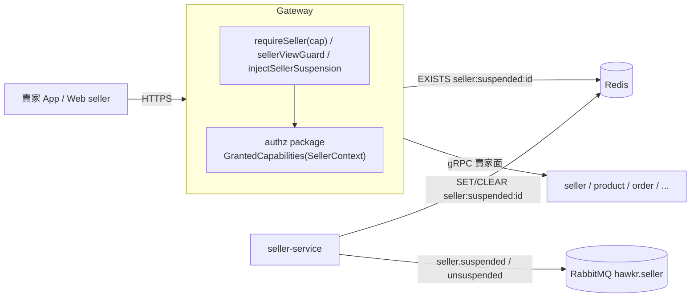
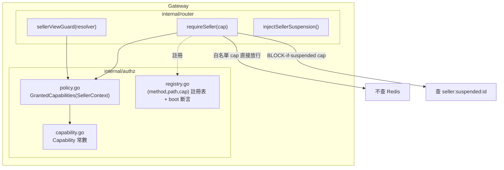
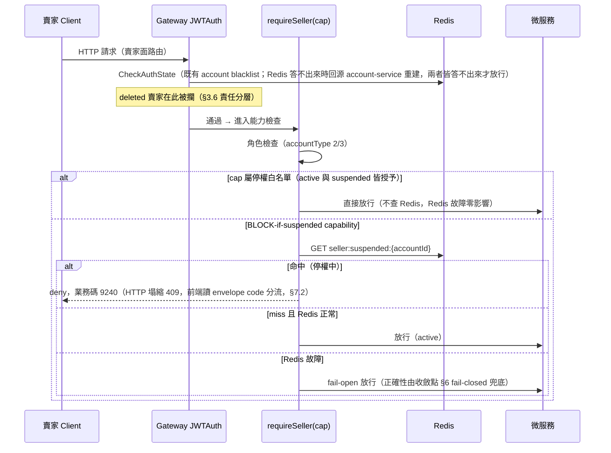

# 賣家能力權限層（Seller Capability Authorization）詳細設計書

## 0. 文件元資訊 (Metadata)

| 項目 | 值 |
|---|---|
| 維護者 | 維護團隊 |
| 對應程式碼 | `gateway/internal/authz/*`（capability / policy / registry）、`gateway/internal/router/seller_capability.go`（`requireSeller(cap)` 掛載）、`gateway/internal/router/seller_route_assert.go`（boot 斷言）、`services/seller-service/*`（status 傳播、寫入權威） |
| 相關 ADR | [2026-09-18-seller-capability-authorization](../adr/2026-09-18-seller-capability-authorization.md) |
| 相關 doc | 32（商家治理，共用 `sellers.status`）、02（product 收斂點 backstop）、03（order 結帳收斂點）、20（結帳模組）、14（IM 訂單關聯細分）、36（MQ 事件）、44（身份模型，角色 bitmask 來源）、56（ADM 代行營運，`AdminCapability` 的 owner）、58（發票 capability）、65（物流履約，`CAP_ORDER_FULFILL`／`CAP_PRODUCT_MANAGE` 的下游語意）、開發規範《賣家能力權限層規範》 |

---

## 1. 概述與目標 (Overview & Goals)

### 1.1 文件定位

本文件描述 **Gateway 的賣家能力權限層（Seller Capability Authorization Layer）**——一個 deny-by-default 的橫切授權架構，回答唯一問題：「這個賣家當前能不能做這件事」。目標讀者為 Gateway、seller-service 與各連動微服務的實作者。本文件**不涵蓋**停權的商業判定規則（何時該停權由 32 號商家治理與 admin 決策決定）、亦不涵蓋各連動 saga 的內部細節（在對應服務設計書擴充）。

賣家停權（Seller Suspension）是能力層的**第一個 policy**；未來會員分級（tier）是第二個 policy。兩者共用同一層，本文件同時交付停權所需的狀態傳播、收斂點兜底與連動事件的能力層相關部分。

### 1.2 一句話定位

在 Gateway 建立單一問答點 `GrantedCapabilities(SellerContext) → capabilitySet`：每條賣家路由於**註冊處宣告**其所需 capability，deny 時回統一停權業務碼。賣家 gating 判斷不得散落在 handler 或各 `routes_*.go` 內。

### 1.3 設計目標 (Goals) 與 非目標 (Non-Goals)

| 類型 | 項目 |
|---|---|
| **Goal** | 「賣家能不能做某事」只有一個問答點（authz package 的 `GrantedCapabilities`），停權/會員分級共用 |
| **Goal** | deny-by-default：路由必須顯式宣告 capability 才可被賣家存取，且此保證**可被機器驗證**（boot 斷言 + CI），非僅靠紀律 |
| **Goal** | 停權「寫入即生效」（≤ 下一個賣家請求生效），不需重鑄 JWT |
| **Goal** | 非對稱 fail 策略：可用性關鍵路徑（出貨/售後）永不因授權層故障而斷；正確性關鍵路徑（下單/商品公開）有收斂點 fail-closed 兜底 |
| **Non-Goal** | **不**在能力層承載「何時停權」的商業判定（由 32 號 + admin 決策） |
| **Non-Goal** | **不**引入 reconciliation / backfill / drift 偵測基礎設施（§22 責任邊界；狀態以 `sellers.status` 為權威、Redis 為加速層） |
| **Non-Goal** | **不**實作會員分級 policy。`Tier` 是預留維度，值恆為 `TIER_STANDARD` |
| **Non-Goal** | **不**把 capability token 納入 CodeMeta（Gateway 內部授權概念，不跨服務、不對前端暴露；見 §8.1） |
| **Non-Goal** | **不**涵蓋 Admin RBAC。`requireAdmin()` 無 capability 參數，admin 端的授權 token 是另一個型別 `AdminCapability`（`gateway/internal/authz/admin_capability.go`），owner 是 56 號《ADM 代行營運》。兩型兩 registry 刻意不合併，理由見相關 ADR。 |

### 1.4 與其他設計書／服務的關係

- **上游身份**：賣家角色（accountType 2/3、role bitmask）來源見 44 號身份模型；本層在角色檢查通過後再做能力檢查。
- **停權來源**：`sellers.status` 落 seller-service，`suspended`（admin 手動）與 `suspended_governance`（32 號治理）並存，狀態衍生 SSOT 見 32 號 §5.4。
- **連動 saga**：停權事件驅動 product 下架、order 取消未付款、coupon 停券、notification 通知——事件定義見 36 號，各服務動作見 02/03/07/12 號。本文件只描述能力層與收斂點兜底部分。
- **收斂點兜底**：結帳鏈 CheckoutValidate（03/20 號）與 product ACTIVE transition（02 號）是能力層 fail-open 的正確性 backstop（§6）。

---

## 2. 範圍與情境 (Context & Scope)

### 2.1 系統情境圖 (C4 Context)



### 2.2 邊界與責任

| | 涵蓋 (In-scope) | 不涵蓋 (Out-of-scope，由誰負責) |
|---|---|---|
| 責任 | 賣家面路由的能力宣告與 deny 判定；停權狀態的 Gateway 讀取路徑；fail 策略；收斂點兜底的接線點界定 | 停權商業判定 → 32 號 + admin；連動 saga 各服務動作 → 02/03/07/12；停權原因/業務碼的 CodeMeta 值 → CodeMeta 文件 |

**enforcement 邊界（設計書必載）**：能力層的 enforcement 邊界 = **`requireSeller(cap)` 掛載的賣家面路由全集** ∪ `sellerViewGuard` 的 3 條 `?view=` 路由 ∪ `sellerSuspensionOnly(cap)` 掛載的 accountType-lag 路由（§4.4 方案 b）。JWTAuth-only 買賣共用路由**不受 guard 保護**，其停權處置逐條列於 §4.4 豁免清單並附理由。admin proxy（`routes_seller.go` PATCH /sellers/:id，admin JWT）非賣家自助入口，不在邊界內。

### 2.3 角色與身份模型

- actor：`buyer`（accountType 1）、`seller`（2）、`seller_and_buyer`（3）、`admin`（4）、`system`。
- 賣家身分由 Gateway JWT 注入的 `x-account-type` 判定（§6 身分規範）；能力層在 `requireSeller` 內先做角色檢查（2/3），再做能力檢查。
- **SELLER_AND_BUYER（3）打賣家路由 = 在做賣家面操作**：掛載點本身界定了「賣家面」，故不需 active-role 判斷；該擋就擋（§3.3 規則 1）。

---

## 3. 能力層架構 (Architecture)

### 3.1 解法總綱 (Solution Strategy)

**結構性解法**：deny-by-default 能力權限層。每條賣家路由在**註冊處宣告**其所需 capability——宣告與掛載**合一**於 `requireSeller(cap)`（capability 為必填參數，編譯期強制）；authz package 統一解析「賣家當前 policy → 授予的 capability set」，比對路由宣告的 capability 是否在集合內，deny 則回統一停權業務碼。停權是第一個 policy，會員分級是未來 policy，共用同一層。

### 3.2 能力層元件視圖 (C4 Component)



| 模組/package | 責任 | 依賴 |
|---|---|---|
| `authz/capability.go` | Capability 常數定義（Go 常數，語意分組）——權威清單 | — |
| `authz/policy.go` | `GrantedCapabilities(SellerContext) → capabilitySet`；tier 預留 | capability |
| `authz/registry.go` | `requireSeller(cap)` 呼叫時註冊 `(method,path,cap)`；boot walk `engine.Routes()` 差集斷言 | capability |
| `router/requireSeller(cap)` | 角色檢查 + 能力檢查合一的 middleware | policy, registry, redis |
| `router/sellerViewGuard` | `?view=` 路由的條件能力判定 | policy |
| `router/injectSellerSuspension` | 只注入 `X-Seller-Suspended` header、不 deny（供下游細分） | redis |

### 3.3 路由 → capability 宣告與掛載（宣告=掛載合一）

**掛載點的權威清冊住在 code**：`requireSeller(cap)` 的掛載集中於 `gateway/internal/router/seller_capability.go`，boot 斷言在 `seller_route_assert.go`。設計書不複述掛載點清單——它會腐化，而 boot 斷言不會。

**宣告＝掛載合一**：capability 是 `requireSeller` 的**必填參數**，一個 middleware 同時做角色檢查 ＋ 能力檢查。**編譯期強制**：凡有 `requireSeller` 必有 capability 宣告，「guard 不在鏈上」「宣告表漏條目」兩類風險在型別層消滅。被否決的替代方案見[相關 ADR](../adr/2026-09-18-seller-capability-authorization.md) D1。

⚠️ 「掛 guard 到賣家群組」不足以覆蓋全部賣家面：per-route 掛載者不經群組 middleware，`?view=` 路由（`/app/orders`，買賣共用）根本沒有賣家 middleware。三條掛載規則因此必須窮盡。

**掛載規則（確定性，三條窮盡）**：

1. **賣家專屬群組/路由**：所有 16 個 `requireSeller()` 改為 `requireSeller(cap)`。群組級掛載處若群組內路由 capability 不同（如 sellerMgmt 內 `GET me`=SELF_READ、`PUT me`=STOREFRONT_WRITE），拆為 per-route 掛載或子群組——**capability 粒度決定掛載粒度**，規則機械：同 capability 才可共用群組級掛載。買家流量天然不經這些掛載點，無誤傷；SELLER_AND_BUYER 打賣家路由即賣家面操作，該擋就擋（掛載點本身界定賣家面，無歧義，比 role 判斷更簡單）。
2. **買賣共用 `?view=` 路由（3 條 ROLE-BRANCH）**：per-route 掛 `sellerViewGuard(resolver)`——resolver 讀 query param：`view=seller/selling` → 視為賣家面、解析出 CAP_ORDER_FULFILL 走能力檢查；其他 view → 直接放行（買家面）。把 handler 內的 `?view=` 授權分流上移到路由註冊處；**HTTP 契約仍保留 `?view=`**（前端相依，見開發規範 API 路徑分離），只有**授權判斷**移出 handler。
3. **JWTAuth-only 路由（買賣共用：IM、social 互動、media 上傳、通知、登入 session、image 工具）**：**明文豁免，不掛 guard**（能力層邊界宣告，§4.4 清單）。其中停權需細分的（IM SendMessage、social 留言）由 Gateway 掛輕量 `injectSellerSuspension()`（只查 Redis 注入 `X-Seller-Suspended` header、**不 deny**），下游 usecase 細分（§4.4 IM）；其餘（media、image 工具）靠上游業務入口 BLOCK 自然阻斷。

### 3.4 Capability 定義（語意分組）

**存放位置**：capability token 是 **Gateway 內部授權概念**，不跨服務、不對前端暴露值 → **Go 常數**（`gateway/internal/authz/capability.go`），**不進 CodeMeta**（§8.1 分野）。粒度選型理由見[相關 ADR](../adr/2026-09-18-seller-capability-authorization.md) D2。

| Capability | 語意 | active | suspended |
|---|---|:---:|:---:|
| `CAP_ACCOUNT_SELF_READ` | 看自己 profile / 停權狀態 | ✓ | ✓ |
| `CAP_STOREFRONT_WRITE` | 店面設定寫入（profile/avatar/cover/onboarding/SEO） | ✓ | ✗ |
| `CAP_PRODUCT_MANAGE` | **供給定義**：商品建立/編輯/上下架/匯入/分類/運費試算/認證/hashtag；物流方案供給（68 大宗寄倉開通、69 商家自送 profile、67 定期配送方案／版本／發布） | ✓ | ✗ |
| `CAP_ORDER_FULFILL` | **既有契約的履約**：出貨/物流/售後/訂單查詢/PayUni 狀態；結算與撥款檢視（65）、批次出貨（68）、定期配送履約與日曆／例外（67）、商家自送日常營運（69） | ✓ | ✓ |
| `CAP_ORDER_CONTRACT` | 收縮型：cancelShipment（取消出貨+退款受理） | ✓ | ✓ |
| `CAP_MARKETING` | 行銷經營：優惠券建立/CRM 寫入+查詢/貼文發佈/AI 助理/dashboard/報表/賣家市場行情查詢、雷達與追蹤增刪（Pricebook） | ✓ | ✗ |
| `CAP_CONTENT_CONTRACT` | 收縮型：刪自己貼文、自行下架貼文、撤自己券 | ✓ | ✓ |
| `CAP_CHAT_SEND` | IM 送訊（停權時 im-service 再做訂單關聯細分） | ✓ | ✓(受限) |
| `CAP_CHAT_READ` | IM 讀取（history/conversations/unread/已讀） | ✓ | ✓ |
| `CAP_NOTIFICATION` | 通知收件箱/偏好/device-token | ✓ | ✓ |
| `CAP_ACCOUNT_CLOSE` | 收縮型：刪帳號（含既有未完成訂單擋板） | ✓ | ✓ |
| `CAP_INVOICE_MANAGE` | 發票／稅務憑證的查詢與設定（總覽、AMEGO 憑證、收據代製授權、發票紀錄與明細、異常詳情、進項發票）；擴張型與唯讀查看（58 §8.1.6(a)） | ✓ | ✗ |
| `CAP_INVOICE_TAX_REMEDY` | 稅務身分申請／補件／延長申請／自行開票責任條款同意＋自行開立回報（58 §8.1.6(a)）——救濟管道 | ✓ | ✓ |

> **唯讀 ≠ 放行**：dashboard / CRM 查詢 / 報表 / AI 助理 / 發票查詢即使純唯讀也歸 BLOCK 類（suspended=✗）。

> **`CAP_PRODUCT_MANAGE` vs `CAP_ORDER_FULFILL` 的分派判準**（物流履約各模組一律照此判，不逐模組再議）：碰**供給定義**（方案／版本／發布／上下架／開通）→ `CAP_PRODUCT_MANAGE`（**不在**白名單）；碰**既有契約的履約**（日曆／例外／承載／出貨／結算檢視）→ `CAP_ORDER_FULFILL`（**在**白名單）。依據：停權賣家必須處理得完既有訂單，但不得再產生新的供給。

> **發票軸必須是兩個 token 而不是一個**：白名單成員資格由集合成員關係編碼（§3.5 的 `suspendedWhitelist`）⇒ 同一個 token 不可能既 BLOCK 又放行，而發票模組同時需要兩類。漏把 `CAP_INVOICE_TAX_REMEDY` 放進白名單是**靜默失效**：只有停權賣家會遇到，症狀是死結（補不了稅務件 ⇒ 審核不完成 ⇒ 恢復後依然接不了單）。

### 3.5 Policy 解析（seller status → capability set；預留 tier 維度）

```go
// gateway/internal/authz/policy.go
type SellerContext struct {
    Status SellerStatus // active / suspended / suspended_governance / deleted
    Tier   SellerTier   // 預留維度，目前恆為 TIER_STANDARD
}

func GrantedCapabilities(ctx SellerContext) capabilitySet {
    switch ctx.Status {
    case StatusActive:
        return allCapabilities            // 全授予（tier 未來在此依 ctx.Tier 收斂）
    case StatusSuspended, StatusSuspendedGovernance:
        return suspendedWhitelist         // deny-by-default 白名單
    case StatusDeleted:
        return emptySet                   // 防守性 dead branch，見 §3.6
    }
}

var suspendedWhitelist = newSet(
    CAP_ACCOUNT_SELF_READ, CAP_ORDER_FULFILL, CAP_ORDER_CONTRACT,
    CAP_CHAT_SEND, CAP_CHAT_READ,
    CAP_NOTIFICATION, CAP_CONTENT_CONTRACT, CAP_ACCOUNT_CLOSE,
    CAP_INVOICE_TAX_REMEDY,
)
```

**白名單的納入判準（不是列舉，是規則）**：只有四類語意合格——① 既有訂單／出貨／售後的處理 ② 收縮型操作（只減不增） ③ 救濟管道（申訴、補件） ④ 通知與看自己狀態。**純唯讀查看不合格**。新增 capability 時照這四類判，判不進去就不在白名單。

- **預留 tier 維度**：`GrantedCapabilities(SellerContext)` 簽章即含 `Tier`，目前恆為 `TIER_STANDARD`、不參與判定。會員分級落地時只需在 `StatusActive` 分支依 tier 收斂 capability set，**能力層架構零改動**。停權 whitelist 與 tier 正交。
- `suspended` 與 `suspended_governance` **共用同一 whitelist**（兩者都是「賣家面停權」）；差異只在**生命週期**（governance 有 cron 自動復權、admin 停權僅手動復權，見 32 號 §5.4）。

### 3.6 deleted 的責任分層（消解與白名單捷徑的矛盾）

§6.2 能力檢查流程有「白名單 cap 直接放行、不查 Redis」的效能捷徑，理論上會讓 `StatusDeleted` 的 emptySet 對白名單路由失效。**裁定：deleted 由帳號層擋，能力層不重複承擔**。依據：賣家刪除的既有 enforcement 是 **Redis account blacklist**（`delete_account.go:69`、`remove_role.go:102`，Gateway `auth.go:113-122` 每請求查、先於任何能力檢查）＋ RemoveRole 移除 accountType 賣家位（`requireSeller` 角色檢查即擋）——已刪賣家在能力層之前就被攔下。故保留白名單捷徑（白名單路由零 Redis 查詢的效能設計），`emptySet` 分支為**防守性 dead branch，正常流量不可達**。能力層的 policy 維度只有 `active / suspended*`。

### 3.8 「新增路由忘記宣告」的結構性防呆（三層）

1. **編譯期**：`requireSeller` 唯一簽章即 `requireSeller(cap Capability)`——寫新賣家路由不給 capability 就編譯不過。消滅最大宗風險（新增賣家路由必然掛 requireSeller，掛了就必然宣告）。
2. **啟動期斷言（boot fail-fast）**：router 建構完成後 walk `engine.Routes()`，斷言：
   - (a) `/api/v1/app` 下**不存在**未在豁免清單的 wildcard 路由（path 含 `*`）；
   - (b) 每條註冊路由屬於「已宣告 capability ∪ 明文豁免清單（§4.4）∪ 買家面清單」三者之一。
   `requireSeller(cap)` 內部把 `(method,path,cap)` 註冊進 registry，boot 用 registry 與 `Routes()` 差集比對，不一致 **panic**（部署即炸，不帶病上線）。
3. **CI 檢查**：lint 禁止在 authz package 之外自行組裝賣家判斷（`IsSeller(` 只允許出現在 authz package）；`go test` 含 boot 斷言的單元化版本（`seller_capability_test.go`），枚舉 `/api/v1/app` 全部路由逐條斷言其 capability 宣告。

**殘餘風險（誠實標註）**：「新增一條賣家路由但完全不掛 requireSeller 也不進豁免清單」——防呆層 2 的 (b) 差集比對會在 boot 抓到「路由存在但三清單皆無」而 panic。唯若開發者**同時**把它加進豁免清單，則屬 review 層語意錯誤，機器不可判定——故 §4.4 豁免清單**每條在本設計書附「為何豁免」理由，靠 review 檢核**。

---

## 4. 停權狀態傳播與豁免清單 (State Propagation)

### 4.1 傳播機制（對稱複用既有 blacklist 模式）

Gateway 每請求以 Redis key `seller:suspended:<id>` 取得停權狀態，複用 `pkg/redis/blacklist.go` 的 `account:blocked:<id>` 模式（Gateway 的 JWTAuth 對 account blacklist 已做 bounded ＋ fail-open 查詢）。JWT claim 與每請求 gRPC 兩個替代方案的否決理由見[相關 ADR](../adr/2026-09-18-seller-capability-authorization.md) D3。

- 新增 `pkg/redis/seller_suspension.go`：key `seller:suspended:<accountId>`，value = 停權原因碼（供注入 header）。`SetSellerSuspended` / `ClearSellerSuspended` / `GetSellerSuspension`。
- **寫入權威 = seller-service**：admin 停權交易 commit 後（post-commit）＋ 停權 MQ consumer 皆可寫；解除時 Clear。key **無 TTL**（admin 停權不自動到期，見 §5）——與 blacklist 的 TTL 版刻意不同。
- **不做背景 reconciliation（§22 責任邊界）**：Redis 遺失 key 時，真正不可逆的後果（買家下到停權賣家的單）由結帳收斂點以 `sellers.status` 權威把關（§6），Redis 只是加速層。
- **Redis 同步收斂於 `recomputeSellerStatus` 單點**：寫入權威的實作不是「每個呼叫端各自記得寫 Redis」，而是 `recomputeSellerStatus` 的 domain helper 本身內建 `SyncRedis` 步驟——呼叫端只需在寫 `sellers.status` 的交易 commit 後呼叫一次 `SyncRedis`，value 對應規則由這一個單點決定：`suspended`（admin 手動）→ 該帳號目前 active 的 `seller_suspensions.reason_code`（DB 存 CodeMeta Value 數字碼如 `9601`，Redis value 同形態；下游 gateway／im／social 只以 key 存在性當 boolean 用，**不得解析 value**）；`suspended_governance`（governance full_suspension）→ 固定 sentinel **`SUSPENDED_GOVERNANCE`**（非 CodeMeta `SellerSuspensionReason` 列舉值——該 enum 只綁 `seller_suspensions.reason_code`，governance 路徑不寫這張表；純 Redis 顯示用途，gating 本身只看 key 是否存在）；`active` → Clear。所有呼叫 recompute 的路徑（admin suspend／lift、governance create／revoke／appeal、cron 復權）因此自動涵蓋；**任何寫 `sellers.status` 的新路徑一律經由 recompute，不得自行寫 Redis**。

### 4.2 授權判定時序（含白名單捷徑與 fail-open 分支）



### 4.3 fail-open vs fail-closed 取捨（關鍵決策）

**問題**：Redis 故障查不到停權狀態，該放行還是擋？

**非對稱設計（選定）**：
- **白名單 capability（ORDER_FULFILL / ORDER_CONTRACT / NOTIFICATION / CHAT_* / CONTENT_CONTRACT / ACCOUNT_SELF_READ / ACCOUNT_CLOSE）**：不論停權與否都授予 → guard 對這些路由**根本不查 Redis**（capability 在 active 與 suspended 兩集合皆有）→ Redis 故障零影響，出貨/售後/救濟永遠可用（符合「停權期間仍須處理既有訂單」硬需求）。
- **BLOCK-if-suspended capability（PRODUCT_MANAGE / MARKETING / STOREFRONT_WRITE）**：需查 Redis 才知該不該擋。Redis 故障 → **fail-open（放行）**。
  - 取捨論證見[相關 ADR](../adr/2026-09-18-seller-capability-authorization.md) D4；與既有 account blacklist 的 fail-open 一致。

**fail-open blip 殘留逐項論證**——blip 窗口內停權賣家可能成功執行的 BLOCK 操作與其後果：

| blip 殘留 | 後果與可逆性 | 處置 |
|---|---|---|
| 商品轉 ACTIVE（Create/UpdateStatus） | 公開商品曝光 = 對外且直接可購買 → **唯一需要 backstop** | §6.2 product ACTIVE transition 收斂點 fail-closed，blip 也產生不了公開商品 |
| 發貼文（CreatePost） | 公開貼文曝光。**現狀**：social 丟棄 can_accept_orders、saga 無 social consumer——停權本來就不折疊既有貼文（裁決僅要求商品下架）。blip 新貼文與既有貼文同等可見、可刪（CAP_CONTENT_CONTRACT）、無交易性後果 → 可接受，不加 backstop |
| 建優惠券模板 | 買家可領，但商品已全下架、券無處可用（中和）；saga 已跑過不回頭停用 blip 新模板，惟其無實質效果，admin 可手動處置 → 可接受 |
| 店面設定 / CRM 寫入 | 純資料寫入，完全可逆 → 可接受 |

**結論**：blip 殘留中唯一具「對外不可逆且有交易後果」性質的是**公開商品**，由 §6.2 backstop 關閉；其餘殘留實質可逆或被商品下架中和。→ **Gateway 層 fail-open（可用性），收斂點 fail-closed（正確性），defense-in-depth。**

### 4.4 JWTAuth-only 豁免清單（逐條附理由）

以下買賣共用路由**不掛 `requireSeller(cap)`**（能力層邊界宣告，§2.2）。每條附「為何豁免」，靠 review 檢核（§3.8 殘餘風險）：

| 豁免路由/群組 | 掛載現狀 | 為何豁免（理由） | 停權處置 |
|---|---|---|---|
| IM 送訊（SendMessage / ws-ticket） | JWTAuth-only | 買賣共用，Gateway 看不到 payload 無法判訂單關聯；停權需「訂單關聯放行」細分 | 掛 `injectSellerSuspension()` 注入 header → im-service usecase 雙端綁定判準（見下） |
| IM 讀取（history/conversations/unread/已讀） | JWTAuth-only | 買賣共用；讀取類白名單放行 | CAP_CHAT_READ 語意上白名單；此群組不 deny |
| social 互動（留言寫入等） | JWTAuth-only | 買賣共用，self-vs-other 灰色地帶需 usecase 判斷（同 06 灰色地帶精神） | 掛 `injectSellerSuspension()`，social usecase 讀 header 細分 self/other |
| media 上傳 | JWTAuth-only | 買賣共用工具層；攔工具層會誤傷買家 | 靠上游業務入口 BLOCK 自然阻斷（06 裁決：攔業務入口非工具層） |
| image 工具（transform 等） | JWTAuth-only | 同 media，純工具 | 同上，上游業務入口阻斷 |
| 通知收件箱/偏好/device-token | JWTAuth-only 或白名單 | 停權賣家仍須收停權/訂單通知；device-token 絕不能擋（否則壞登入推播） | CAP_NOTIFICATION 白名單語意，不 deny |
| 登入 / session | JWTAuth-only | 帳號層路由，非賣家專屬功能 | 白名單語意，不 deny |
| `POST /webhook/merchant_delivery/v1/events`（69 §6.2.3） | top-level，**非** `public`／`app`／`admin` 三 namespace | 來源是物流商而非賣家，無 JWT 可解析；身分由**簽章**承擔 | 不適用（無賣家 principal） |

**accountType-lag 路由掛 `sellerSuspensionOnly(cap)`（不進豁免清單）**：`/app/sellers/me` 寫入 5 條（PUT me / avatar / cover / food-business-registration、PATCH onboarding → `CAP_STOREFRONT_WRITE`）與 `/app/coupon_templates` 建立/列表/詳情 3 條（→ `CAP_MARKETING`，唯讀也鎖）不掛 `requireSeller`：新申請賣家在重新登入前 JWT `accountType` 仍為 1（accountType lag），掛 `requireSeller` 的角色檢查會 403 誤鎖 onboarding。故新增 guard 變體 `sellerSuspensionOnly(cap)`——**只做停權檢查、不做角色檢查**：以 `gateway/internal/storeid` resolver 解析現任 `store_id`（與 handler 同一 surrogate 解析）→ 查 `seller:suspended:<id>` → 命中且 cap 不在 suspended 白名單 → deny 9240；無賣家身分（`storeid.ErrNoCurrentStore`）→ 放行交 handler 既有 403 兜底；Redis / resolver 失敗 → fail-open。掛載一律經 `sellerSuspendableHandle` 進 authz registry（boot 斷言與 CI 枚舉涵蓋）。`POST coupon_templates/:id/revoke`（`CAP_CONTENT_CONTRACT` 收縮型白名單）不 deny 故不掛。GET /me（SELF_READ）、DELETE /me（ACCOUNT_CLOSE）白名單，維持 JWTAuth-only。

**IM 訂單關聯細分（usecase 單點例外）**：停權後僅**訂單關聯**對話可用。判準**綁定對話雙端、order_no 不信任 client 輸入**（一律伺服器端推導）：
- 綁定寫入僅兩條伺服器端路徑：① 訂單情境發起 → im-service 以 order-service internal gRPC 驗 `order.seller==對話賣家 AND order.buyer==對話買家`，三方一致才寫綁定；② 既有對話回填 → im-service 以 `(對話買家, 對話賣家)` 反查 `HasOrderBetween(buyerId, sellerId)`（新 internal RPC，只回 bool + 最近 order_no）。
- **訂單狀態範圍**：判準 `status NOT IN (0, 80)`（排除 PENDING_PAYMENT 與 CANCELLED，其餘 PAID～FULLY_REFUNDED 皆算關聯）。理由：從未付款即取消的單不構成真實交易關係，且停權當下 saga 會批次取消該賣家全部未付款單（§5）——若把這些單算作關聯，等於停權動作自己替賣家對這批買家開通 IM 通道，與批次取消意圖矛盾；已付款後進退款/售後的單仍需雙方溝通，必須算關聯。
- **賣家無法藉掛他人單號開新對話**：綁定驗證取「對話雙端」而非 client 聲稱的任何 id。
- 細節見 14 號 IM 設計書。

**IM 停權當下強制斷既有 WS（已定裁決）**：`seller.suspended` consumer 呼叫 im-service internal RPC `DisconnectUser` **強制斷開該賣家現有 WS 連線**。`ws-ticket` 本身是連線層票，不對單一連線表達「只給某對話用」的部分限制，故不在鑄票層設限；真正守門在**訊息級**——每則 `SendMessage` 逐則以雙端綁定判準擋非訂單關聯對話（見 14 號 §6.5.3），強制斷線只確保既有長連線不會繞過重連即生效的判準。斷線後賣家仍可重連、可收訊，但發訊持續逐則被擋，與訂單關聯放行判準等效覆蓋原意圖。細節見 14 號 §6.5.4。

---

## 5. 停權生命週期與連動（能力層相關部分）

> 完整 saga、資料表、各 consumer 動作見 32/02/03/07/12/36 號；本章只述與能力層/狀態傳播相關者。

- **停權來源**：admin 手動（`SuspendSellerForAdmin`）→ 交易內 INSERT `seller_suspensions` + recompute `sellers.status`='suspended' + `SetSellerSuspended`(Redis) + outbox 發 `seller.suspended`。
- **解除**：僅 admin 手動（`LiftSellerSuspensionForAdmin`）→ UPDATE lifted + recompute status + `ClearSellerSuspended` + 發 `seller.unsuspended`。**無 cron 自動復權**（與 32 號 governance 的自動復權區別）。
- **事件**：`hawkr.seller` exchange，routing key `seller.suspended` / `seller.unsuspended`（producer=seller-service；consumers=product/order/coupon/notification/im）。走 **outbox 保 MQ 必發**（§22 明列合法例外，非新建 reconciliation）。詳見 36 號。
- **連動摘要**：product 下架 ACTIVE→INACTIVE + 可逆快照、order 批次取消未付款（複用 `cancelExpiredOrderInTx`，`OrderCancelReason.SELLER_SUSPENDED`）、coupon 停用模板（`disabled_by_suspension` 旗標）、notification 通知賣家+買家、im 斷 WS。
- **狀態衍生 SSOT**：`sellers.status` 單欄多來源（deleted > suspended > suspended_governance > active），所有寫 status 的路徑一律改呼叫 domain helper `recomputeSellerStatus(sellerId)`，消滅「各路徑各自寫 status」漂移，並解決 32 號 governance cron 誤清 admin 停權的衝突（cron 改呼叫 recompute：governance 過期但 admin 停權仍在 → 維持 suspended）。詳見 32 號。

### 5.1 SellerSuspensionReason（已定裁決：三值，不含 FOOD_SAFETY）

停權原因碼為前端可見（賣家看得到停權原因）→ 定義於 CodeMeta `業務狀態碼.md` 的 `SellerSuspensionReason` enum（完整值表以 CodeMeta 為權威，本文件不複製）。**已定裁決三值**：

- `POLICY_VIOLATION`（違反平台規範）
- `REPEATED_WARNING_IGNORED`（屢勸不改）
- `OTHER`（其他）

**不含 `FOOD_SAFETY`**（食安通報由 32 號治理路徑處理，非本 admin 手動停權原因）。

**存值與傳輸值形態（全鏈路 Value）**：`seller_suspensions.reason_code`（DB）、domain、Redis marker（§4.1）、MQ payload、gRPC/HTTP 傳輸**一律是 CodeMeta Value 數字碼**（`9601`/`9602`/`9603`），與全 repo 其他 CodeMeta enum 的「DB 存 Value」慣例一致。**寫入只認 Value**（Name 輸入回 400），**輸出原樣透傳，不得加轉換層**。MQ `seller.suspended` payload 的 `reasonCode` 同為 Value；consumer 不得對 reasonCode 的值做判斷（im 只寫 log、notification 模板只渲染 `reasonLabel`）。`reasonLabel`（人類可讀 label，由 Value 查表）供 notification-service 的模板引擎字面代入。

### 5.2 `seller.suspended` / `seller.unsuspended` 跨事件亂序與殘留態

`seller.suspended` 與 `seller.unsuspended` 是**同 exchange 不同 routing key**（§5 已述），各 consumer（product/order/coupon/notification/im）對兩個 routing key 各自訂閱、各自 queue。極端情況下（例如短時間內連續停權→解除→再停權，或跨 consumer 處理延遲不均）不能保證下游以**同 broker 端發佈序**收斂處理——理論上存在 consumer 端亂序風險。

- **授權判定不受影響**：Gateway 能力層與結帳收斂點（§6）**不消費這兩個事件**，一律直讀 `sellers.status`（DB，權威）與 Redis `seller:suspended:<id>`（快取，同步寫入路徑——§8.4「寫入即生效」），兩者皆由 seller-service 在同一交易/flow 內同步 recompute + SetSellerSuspended/ClearSellerSuspended 完成，不經 MQ。故授權「查得到即為真」，與事件消費順序無關。
- **連動動作（商品下架/還原）亂序時的自癒性論證**：
  - 下架快照與還原皆以 **`suspensionId` 綁定該次 episode**（§5 saga 摘要）；還原邏輯只處理「仍為 `INACTIVE` 且未被賣家自行變動」者，下架邏輯天然冪等只挑當下 `ACTIVE` 者操作。極端交錯下兩動作的挑選條件（狀態值＋episode id）保證**不會出現「已停權但商品維持 ACTIVE」的安全方向錯誤**。
  - **可能出現滯留下架態**：短間隔停權→解除（十數秒內）時，下架 consumer 若延遲到解除還原**之後**才處理——還原當下快照尚未寫入而 noop，之後下架執行且無後續還原觸發 → 商品滯留 `INACTIVE`。此殘留為 **fail-safe 方向**（錯在多下架、非多曝光）：無安全洩漏、無交易風險；賣家已 active，可**自行重新上架**（§6.2 backstop 對 active 賣家放行）或由 admin 修正，非死鎖。實作者不得據此假設它不會發生。
  - 亂序機率本身極低：兩事件皆由 seller-service **同一 outbox worker** 依 DB 寫入序依序 publish，同一賣家停權／解除業務上不會高頻翻轉。
- **範圍聲明**：本節保證的是安全性（絕不多曝光）與可自救性（滯留態賣家／admin 可修正），**不保證 MQ 消費強時序**。嚴格時序或自動補正屬獨立的 MQ ordering 強化項，不由能力層承擔。

---

## 6. 收斂點雙 backstop (Convergence-point Backstops)

**為什麼需要**：商品下架（§5）只讓買家在正常瀏覽路徑看不到商品，**直接打 API 帶已知 SKU 結帳**仍可繞過。故停權的正確性由兩個收斂點顯式讀 seller-service 產出的 `can_accept_orders` 兜底。

### 6.1 結帳鏈 backstop（CheckoutValidate，fail-closed）

**落點**：`CheckoutValidate`（結帳鏈最前的驗證收斂點，order-service）。此處已逐 SKU 聚合賣家 → 呼叫既有 `BatchGetSellerMeta`，**新增讀取 `can_accept_orders`**：任一賣家 `false` → 該賣家商品整組擋下（回業務碼 `SELLER_SUSPENDED_PRODUCT_UNAVAILABLE`）。

- 為何放 Validate 不放 Confirm：Validate 是結帳三段的收斂驗證點，越早擋越省下游（庫存預佔/金流）。Confirm 可加為第二道，但主防線在 Validate（防線放收斂點）。
- **fail 策略：fail-closed**（SellerMeta 查詢失敗則保守擋單並回可重試錯誤，不放行）。與 Gateway guard 的 fail-open 形成非對稱互補。
- `batchGetSellerMeta()` 回傳的 `SellerMeta` 含 `can_accept_orders`，且該呼叫是硬依賴（失敗拋例外，fail-closed 語意由呼叫本身承擔）。

### 6.2 商品公開 transition backstop（product ACTIVE，fail-closed）

product-service 的 `UpdateSellerProductStatus`（上架）與 CreateProduct 的 ACTIVE 落地點，在**狀態轉 ACTIVE 的收斂 transition** 做 SellerMeta `can_accept_orders` 檢查：停權賣家不得把商品轉 ACTIVE。這關掉 §4.3 fail-open 窗口的唯一不可逆殘留（產生公開商品）。**單一收斂點（ACTIVE transition），非逐路由 if。** 詳見 02 號。

**收斂點不可繞（設計約束）**：CheckoutValidate 的 `can_accept_orders` 檢查與 product ACTIVE transition 檢查是停權正確性的兜底，任何重構**不得移除或繞過**。

---

## 7. 業務碼與前端分流 (Business Codes)

### 7.1 停權家族業務碼（雙端同號）

`錯誤碼.md` 是 Java `GrpcResponseCode.java` 與 Go `bizcode.go` 的**同一 SSOT**，策略為**同一條目、雙端同號生成**。停權區段開 **9240~9249**（9210~9219 內容審核、9220~9229 Seller 媒體、9230~9239 Seller 業務碼皆已佔用），兩碼（完整定義以 CodeMeta 為權威）：

| 業務碼 | 常數 | 由誰回 | 語意面向 |
|---|---|---|---|
| 9240 | `SELLER_SUSPENDED_OPERATION_BLOCKED` | Gateway 能力層 deny（Go） | 賣家（「賣家帳號停權中，無法執行此操作」） |
| 9241 | `SELLER_SUSPENDED_PRODUCT_UNAVAILABLE` | 結帳收斂點（Java） | 買家（「賣家停權中，商品暫停販售」） |

`generate.sh --java --go-errors` 同次生成雙端，數值由同一 md 條目保證一致，無雙數值空間分歧。

### 7.2 前端分流策略

**停權家族兩碼由 Gateway 統一透傳，前端讀 envelope `code` 欄位分流**（不可用 HTTP status 判斷，409 也用於 duplicate）：
- Gateway 的 `GrpcErr` 對所有 FailedPrecondition：訊息帶 `[NNNN] ` 前綴者一律把業務碼還原進 envelope `code`、message 去前綴；無前綴才維持塌縮 `{code:409}`。9240/9241 走與其他業務碼相同的路徑，**不需要獨立白名單登錄**。最終 HTTP 仍 409 塌縮、envelope `{code:9240|9241, message:乾淨中文, messageZh:同}`，與 Gateway 能力層 `BizDeny` 直出形狀一致。三個掛入面（Gateway 能力層 deny、Java 賣家面操作、結帳收斂點）對前端同一形狀。
- 因此「message 帶 `[NNNN]` 前綴 → 還原業務碼」是**所有** FailedPrecondition 業務碼的通用規則，不是停權兩碼的特例；前端一律讀 envelope `code`，message 僅供顯示。
- 賣家端收 `code === 9240` → **一律導同一停權公告頁**（不論觸發自哪個 BLOCK 端點），公告頁自 `GET /app/sellers/me`（白名單 CAP_ACCOUNT_SELF_READ）撈原因碼與申訴入口。
- 買家端收 `code === 9241`（結帳時）→ toast「部分商品暫停販售」+ 該賣家商品自購物車標示不可結帳；不導賣家停權頁。
- 兩碼同 SSOT 條目雙端同號，前端只需一份碼表。
- UI/Layout（停權頁版面）依前端規範**必先問**，本文件只界定 API 契約與業務碼。

---

## 8. 跨切面關注點 (Crosscutting)

### 8.1 capability token 不進 CodeMeta（分野）

CodeMeta（§8）SSOT 對象是「跨服務/前端可見的共享代碼值」。**分野清楚**：
- **進 CodeMeta**（前端可見）：停權原因碼 `SellerSuspensionReason`（賣家看得到）、阻斷業務碼 9240/9241（前端讀 envelope `code`，§7.2）、`OrderCancelReason.SELLER_SUSPENDED`、`SellerEventType.SELLER_SUSPENDED/UNSUSPENDED`。
- **不進 CodeMeta**（Gateway 內部授權判斷）：Capability token（`gateway/internal/authz/capability.go` Go 常數）、`SellerContext`／`SellerTier`；ADM 的 `AdminCapability` 同理（owner 56 號）。
- `sellers.status` 的值不納 CodeMeta：跨服務一律靠 `SellerMeta` gRPC 抽象取得授權語意，不傳 raw status（見 32 號）。

### 8.2 可觀測性

能力層 deny 應以既有 obs middleware 記錄（deny 次數、per-capability、per-seller），供停權生效稽核；boot 斷言 panic 前輸出「哪條路由未歸類」明確訊息，加速定位。

### 8.3 錯誤處理與降級（fail 策略矩陣）

| 依賴 | 白名單路由 | BLOCK-if-suspended 路由 | 結帳收斂點 | product ACTIVE transition |
|---|---|---|---|---|
| Redis 掛 | 不查（零影響） | **fail-open**（放行，可用性優先） | — | — |
| SellerMeta gRPC 掛 | — | — | **fail-closed**（擋單可重試） | **fail-closed**（不得轉 ACTIVE） |

非對稱設計：可用性層 fail-open + 正確性層 fail-closed，兩者互補（§4.3、§6）。

### 8.4 一致性與冪等

- 停權「寫入即生效」：seller-service 同 flow 內 `SetSellerSuspended` → 下一個賣家請求即看到。key 是唯一真實快取（非衍生快照），無需 MQ 失效。
- 連動 consumer 冪等見各服務設計書；重複停權由 `uq_seller_suspensions_active` partial unique 擋、重複解除 no-op。

---

## 9. 品質需求 (NFR)

| 指標 (SLI) | 目標 (SLO) | 量測點 |
|---|---|---|
| 停權生效延遲 | ≤ 1 個賣家請求（寫入即生效） | SetSellerSuspended → 下次 deny |
| 能力層 per-request 額外延遲 | 白名單路由 0 次 Redis；BLOCK 路由 1 次 EXISTS（bounded） | Gateway middleware |
| boot 斷言覆蓋 | 100% `/api/v1/app` 路由歸類（capability ∪ 豁免 ∪ 買家面） | boot walk（不通過即 panic） |

容量：能力檢查複用既有 Redis 連線 + JWT 解析結果，無新增熱路徑單點。

---

## 10. 設計理由

能力層的方案比較、被否決的選項與取捨理由見 [2026-09-18-seller-capability-authorization](../adr/2026-09-18-seller-capability-authorization.md)（收斂點、capability 粒度、狀態傳播、fail 策略、wildcard 處置、tier 預留、pricebook 歸屬、admin/seller 兩型分離）。本節不複述理由。

---

## 11. 風險與技術債 (Risks & Tech Debt)

### 11.1 已知風險與技術債

| 項目 | 嚴重度 | 影響 | 緩解 / 追蹤 |
|---|---|---|---|
| Redis blip fail-open 窗口 | 中 | 停權賣家短暫恢復 BLOCK 能力 | 唯一不可逆殘留（公開商品）由 §6.2 backstop 關閉；其餘可逆/被中和（§4.3 論證表） |
| 豁免清單語意錯誤機器不可判定 | 中 | 誤把賣家路由加進豁免 = deny-by-default 漏洞 | §4.4 每條附理由 + review 檢核（§3.8 殘餘風險） |

---

## 12. 部署與維運 (Deployment)

- **hot path smoke（強制）**：PR 動 product/order/cart/shipping 的 service/repository/gRPC/MQ Consumer → push 前必跑 `infra/smoke-checkout.sh` 全綠（[《開發工作流程》](../開發規範/開發工作流程.md) §6）。
- **boot 斷言即部署守門**：能力層上線後任何漏宣告路由使 Gateway boot panic（fail-fast），不會帶病上線。

---

## 13. 測試策略 (Test Strategy)

| 層級 | 覆蓋 | 關鍵場景 |
|---|---|---|
| unit | authz policy | active 全授予、suspended 白名單、deleted emptySet（dead branch）；tier 預留恆 STANDARD |
| unit | boot 斷言 | 枚舉 `/api/v1/app` 全部路由，逐條斷言其歸屬於 capability ∪ 豁免 ∪ 買家面三清單之一；wildcard 存在 → panic |
| integration | Redis 傳播 | SetSellerSuspended → guard deny；Redis 掛 → 白名單放行、BLOCK fail-open |
| e2e | 停權端到端 | 停權 → 賣家上架被擋（9240）、買家結帳停權商品被擋（9241）、出貨/售後仍可用；解除 → 商品精準還原 |
| e2e | 收斂點 | 直接打 API 帶停權賣家 SKU 結帳 → CheckoutValidate 擋（fail-closed） |

---

## 14. 術語表 (Glossary)

| 術語 | 定義 |
|---|---|
| Capability | Gateway 內部授權 token，語意分組，標記「賣家能做的一類事」；權威清單在 `gateway/internal/authz/capability.go` |
| SellerContext | policy 解析輸入：`{Status, Tier}` |
| deny-by-default | 路由未顯式宣告 capability 則賣家不可存取；由 boot 斷言機器驗證 |
| 白名單 capability | 在 active 與 suspended 兩集合皆有的 capability；guard 對其不查 Redis |
| 收斂點 backstop | CheckoutValidate 與 product ACTIVE transition 的 fail-closed 檢查，兜底 Gateway fail-open |
| `can_accept_orders` | seller-service 在 `SellerMeta` 產出的旗標，由 §6 兩個收斂點讀取，是停權正確性的兜底 |
| blip | Redis 短暫故障窗口 |
