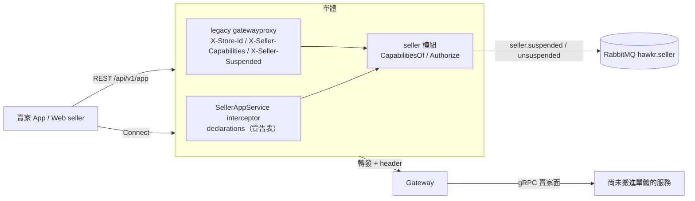
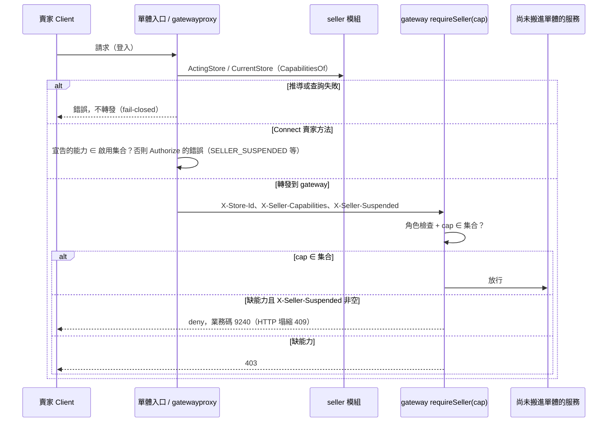

# 賣家能力權限層（Seller Capability Authorization）詳細設計書

> 本檔是 gateway 賣家面路由的能力檢查（`requireSeller`、豁免清單）、IM 與 social 的停權細分、停權連動 saga 的消費端與收斂點 backstop（order、product）的現行規格；這些服務搬進單體時刪除。
>
> 能力的推導（`CapabilitiesOf`、能力表、停權白名單）、Connect 宣告表、轉給 gateway 的 header 契約與停權狀態傳播由單體的 seller 模組擁有，以 `docs/modules/seller.md` §10 為準。

## 0. 文件元資訊 (Metadata)

| 項目 | 值 |
|---|---|
| 維護者 | 維護團隊 |
| 對應程式碼 | gateway 解析：`gateway/internal/middleware/auth.go`；gateway 檢查：`gateway/internal/authz/*`（capability／registry）、`gateway/internal/router/seller_capability.go`（`requireSeller(cap)` 掛載）、`gateway/internal/router/seller_route_assert.go`（boot 斷言） |
| 相關 ADR | [2026-09-18-seller-capability-authorization](../adr/2026-09-18-seller-capability-authorization.md)、[2026-09-29-seller-suspension-and-business-identity-in-monolith](../adr/2026-09-29-seller-suspension-and-business-identity-in-monolith.md) |
| 相關 doc | 02（product 收斂點 backstop）、03（order 結帳收斂點）、20（結帳模組）、14（IM 訂單關聯細分）、36（MQ 事件）、44（gateway 身份解析與守衛）、56（ADM 代行營運，`AdminCapability` 的 owner）、58（發票 capability）、65（物流履約，`CAP_ORDER_FULFILL`／`CAP_PRODUCT_MANAGE` 的下游語意）、開發規範《賣家能力權限層規範》 |

---

## 1. 概述與目標 (Overview & Goals)

### 1.1 文件定位

本文件描述賣家能力權限層（Seller Capability Authorization Layer）在 gateway 與連動服務的部分：一個 deny-by-default 的橫切授權架構，回答唯一問題：「這個賣家當前能不能做這件事」。目標讀者為 gateway 與各連動服務的實作者。本文件**不涵蓋**能力的推導與 Connect 入口（`docs/modules/seller.md` §10）、停權的商業判定規則（`docs/modules/seller.md` §5）、亦不涵蓋各連動 saga 的內部細節（在對應服務設計書）。

### 1.2 一句話定位

賣家能做哪些動作只在 seller 模組推導一次（`docs/modules/seller.md` §10）；gateway 的每個賣家入口在**註冊處宣告**它需要的能力，執行處只檢查能力集合的成員，不自己從停權或生命週期推導。賣家 gating 判斷不得散落在 handler 或各 `routes_*.go` 內。

### 1.3 設計目標 (Goals) 與 非目標 (Non-Goals)

| 類型 | 項目 |
|---|---|
| **Goal** | deny-by-default：gateway 入口必須顯式宣告能力才可被賣家存取，且此保證可被機器驗證（gateway 在 boot 斷言路由歸類） |
| **Goal** | fail-closed：gateway 缺能力集合或 header 不合法一律拒絕 |
| **Non-Goal** | **不**在能力層承載「何時停權」的商業判定（`docs/modules/seller.md` §5 + admin 決策） |
| **Non-Goal** | **不**涵蓋 Admin RBAC。`requireAdmin()` 無 capability 參數，admin 端的授權 token 是另一個型別 `AdminCapability`（`gateway/internal/authz/admin_capability.go`），owner 是 56 號《ADM 代行營運》。兩型兩 registry 刻意不合併，理由見相關 ADR |

### 1.4 與其他設計書／服務的關係

- **上游身份**：賣家角色（accountType 2/3、role bitmask）來源見 44 號 gateway 身份解析；能力檢查在角色檢查通過後做。
- **停權來源**：seller 模組的有效措施（`seller.effective_measures`）；治理的措施與認定見 `docs/modules/seller.md` §5。
- **連動 saga**：停權事件驅動 product 下架、order 取消未付款、coupon 停券、notification 通知——事件定義見 36 號，各服務動作見 02/03/07/12 號。本文件只描述能力層與收斂點兜底部分。
- **收斂點兜底**：結帳鏈 CheckoutValidate（03/20 號）與 product ACTIVE transition（02 號）是正確性的 fail-closed backstop（§6）。

---

## 2. 範圍與情境 (Context & Scope)

### 2.1 系統情境圖 (C4 Context)

### 2.2 邊界與責任

| | 涵蓋 (In-scope) | 不涵蓋 (Out-of-scope，由誰負責) |
|---|---|---|
| 責任 | gateway 賣家路由的能力宣告與 deny 判定；收斂點兜底的接線點界定 | 停權商業判定 → `docs/modules/seller.md` §5 + admin；連動 saga 各服務動作 → 02/03/07/12；停權原因/業務碼的 CodeMeta 值 → CodeMeta 文件 |

**gateway 的 enforcement 邊界**：`requireSeller(cap)` 掛載的賣家面路由全集 ∪ `sellerViewGuard` 的 `?view=` 路由。JWTAuth-only 買賣共用路由**不受 guard 保護**，其停權處置逐條列於 §4.4 豁免清單並附理由。admin proxy（`routes_seller.go` PATCH /sellers/:id，admin JWT）非賣家自助入口，不在邊界內。

### 2.3 角色與身份模型

- actor：`buyer`（accountType 1）、`seller`（2）、`seller_and_buyer`（3）、`admin`（4）、`system`。
- gateway 的賣家身分由單體轉發時帶的 `X-Account-Type` 與 `X-Store-Id` 判定；`requireSeller` 先做角色檢查（2/3），再做能力檢查。
- **SELLER_AND_BUYER（3）打賣家路由 = 在做賣家面操作**：掛載點本身界定了「賣家面」，故不需要 active-role 判斷。

---

## 3. 能力層架構 (Architecture)

### 3.1 解法總綱 (Solution Strategy)

能力由 seller 模組單點推導（`docs/modules/seller.md` §10）。gateway（尚未搬進單體的服務的 REST）收單體轉發時帶的已解析 `X-Store-Id`、`X-Seller-Capabilities`（現任店家目前啟用的動作類能力，逗號分隔）與 `X-Seller-Suspended`；`requireSeller(cap)` 只檢查 cap 是否在集合內。

### 3.2 元件

| 元件 | 責任 |
|---|---|
| `gateway/internal/middleware/auth.go` | 解析 header：`X-Store-Id` 與 `X-Seller-Capabilities` 必須同時存在或同時不存在；空值、不認得的 token、不合法的停權原因都是契約錯誤，一律拒絕 |
| `gateway/internal/authz/capability.go`、`registry.go` | gateway 的能力 token（與 seller 模組的能力名稱是同一組字串，`TestCapabilityTokensMatchGateway` 守）；`(method, path, cap)` 註冊表 |
| `router/requireSeller(cap)` | 角色檢查 + 能力集合成員檢查合一的 middleware；cap 是必填參數 |
| `router/sellerViewGuard` | `?view=` 路由的條件能力判定 |
| `router/injectSellerSuspension` | 只注入 `X-Seller-Suspended` header、不 deny（供下游細分） |

### 3.3 gateway 路由 → capability 宣告與掛載（宣告=掛載合一）

**掛載點的權威清冊住在 code**：`requireSeller(cap)` 的掛載集中於 `gateway/internal/router/seller_capability.go`，boot 斷言在 `seller_route_assert.go`。設計書不複述掛載點清單——它會腐化，而 boot 斷言不會。

**宣告＝掛載合一**：capability 是 `requireSeller` 的**必填參數**，一個 middleware 同時做角色檢查 ＋ 能力檢查。**編譯期強制**：凡有 `requireSeller` 必有 capability 宣告。被否決的替代方案見[相關 ADR](../adr/2026-09-18-seller-capability-authorization.md) D1。

**掛載規則（確定性，三條窮盡）**：

1. **賣家專屬群組/路由**：以 `requireSeller(cap)` 掛載。群組內路由的 capability 不同時拆為 per-route 掛載或子群組——**capability 粒度決定掛載粒度**，同 capability 才可共用群組級掛載。買家流量天然不經這些掛載點；SELLER_AND_BUYER 打賣家路由即賣家面操作，該擋就擋。
2. **買賣共用 `?view=` 路由**：per-route 掛 `sellerViewGuard(cap)`——`view=seller/selling`（`authz.IsSellerView`）視為賣家面，走能力檢查；其他 view 直接放行（買家面）。**HTTP 契約保留 `?view=`**，只有授權判斷在路由註冊處。
3. **JWTAuth-only 路由（買賣共用：IM、social 互動、media 上傳、通知、登入 session、image 工具）**：**明文豁免，不掛 guard**（§4.4 清單）。其中停權需細分的（IM SendMessage、social 留言）由 gateway 掛 `injectSellerSuspension()`（只注入 `X-Seller-Suspended` header、**不 deny**），下游 usecase 細分；其餘靠上游業務入口 BLOCK 自然阻斷。

### 3.4 Capability 定義（語意分組）

**存放位置**：seller 模組的 `model.Capability` 是推導的來源，能力表、停權白名單與分派判準見 `docs/modules/seller.md` §10.1；gateway 的 `authz.Capability` 是同一組字串，是 gateway 內部授權 token，不進 CodeMeta（§8.1）。

### 3.4 「新增入口忘記宣告」的結構性防呆

1. **gateway 編譯期**：`requireSeller` 唯一簽章是 `requireSeller(cap Capability)`，`sellerHandle` 掛載時自動註冊到 registry；`authz.Register` 遇到不認得的 token 直接 panic。
2. **gateway 啟動期斷言（boot fail-fast）**：router 建構完成後 walk `engine.Routes()`，斷言 `/api/v1/app` 下不存在未豁免的 wildcard 路由，且 `strictSellerPrefixes`（整個都是賣家面的區域，例如 `/products`、`/shipments`、`/seller/invoices`）下每條路由都已宣告 capability，不一致 **panic**。
3. **CI**：`seller_capability_test.go` 枚舉 `/api/v1/app` 全部路由逐條斷言歸屬；`IsSeller(` 與停權判斷只允許出現在 authz package。

**殘餘風險**：「新增一條賣家路由但完全不掛 `requireSeller` 也不進豁免清單」會被上述斷言抓到；若開發者同時把它加進豁免清單，則屬 review 層語意錯誤，機器不可判定——故 §4.4 豁免清單每條附「為何豁免」理由，靠 review 檢核。

---

## 4. 停權狀態傳播與豁免清單 (State Propagation)

### 4.1 傳播機制

停權狀態沒有快取也沒有標記，傳播機制（Connect 的 interceptor、轉發到 gateway 的 header 契約、停權寫入點）見 `docs/modules/seller.md` §10.2；傳播延遲為 0。gateway 收到的 header 不合法（`X-Store-Id` 與 `X-Seller-Capabilities` 不成對、能力 token 不認得、停權原因不認得）一律拒絕。

### 4.2 授權判定時序

### 4.3 fail 策略

- **授權層一律 fail-closed**：推導出錯、header 不合法、缺能力集合都拒絕。白名單能力不因停權而缺，所以停權賣家的出貨、售後、救濟路徑不受影響。
- **收斂點同樣 fail-closed**（§6）：能力層之外，結帳與商品上架另有以 `can_accept_orders` 把關的收斂點，兜底「繞過瀏覽路徑直接打 API」的情境。

### 4.4 gateway JWTAuth-only 豁免清單（逐條附理由）

以下買賣共用路由**不掛 `requireSeller(cap)`**（§2.2）。每條附「為何豁免」，靠 review 檢核：

| 豁免路由/群組 | 掛載現狀 | 為何豁免（理由） | 停權處置 |
|---|---|---|---|
| IM 送訊（SendMessage / ws-ticket） | JWTAuth-only | 買賣共用，gateway 看不到 payload 無法判訂單關聯；停權需「訂單關聯放行」細分 | 掛 `injectSellerSuspension()` 注入 header → im-service usecase 雙端綁定判準（見下） |
| IM 讀取（history/conversations/unread/已讀） | JWTAuth-only | 買賣共用；讀取類白名單放行 | CAP_CHAT_READ 語意上白名單；此群組不 deny |
| social 互動（留言寫入等） | JWTAuth-only | 買賣共用，self-vs-other 灰色地帶需 usecase 判斷 | 掛 `injectSellerSuspension()`，social usecase 讀 header 細分 self/other |
| media 上傳 | JWTAuth-only | 買賣共用工具層；攔工具層會誤傷買家 | 靠上游業務入口 BLOCK 自然阻斷（攔業務入口非工具層） |
| image 工具（transform 等） | JWTAuth-only | 同 media，純工具 | 同上，上游業務入口阻斷 |
| 通知收件箱/偏好/device-token | JWTAuth-only 或白名單 | 停權賣家仍須收停權/訂單通知；device-token 絕不能擋（否則壞登入推播） | CAP_NOTIFICATION 白名單語意，不 deny |
| 登入 / session | JWTAuth-only | 帳號層路由，非賣家專屬功能 | 白名單語意，不 deny |

**IM 訂單關聯細分（usecase 單點例外）**：停權後僅**訂單關聯**對話可用。判準**綁定對話雙端、order_no 不信任 client 輸入**（一律伺服器端推導）：
- 綁定寫入僅兩條伺服器端路徑：① 訂單情境發起 → im-service 以 order-service internal gRPC 驗 `order.seller==對話賣家 AND order.buyer==對話買家`，三方一致才寫綁定；② 既有對話回填 → im-service 以 `(對話買家, 對話賣家)` 反查 `HasOrderBetween(buyerId, sellerId)`（internal RPC，只回 bool + 最近 order_no）。
- **訂單狀態範圍**：判準 `status NOT IN (0, 80)`（排除 PENDING_PAYMENT 與 CANCELLED，其餘 PAID～FULLY_REFUNDED 皆算關聯）。理由：從未付款即取消的單不構成真實交易關係，且停權當下 saga 會批次取消該賣家全部未付款單（§5）——若把這些單算作關聯，等於停權動作自己替賣家對這批買家開通 IM 通道；已付款後進退款/售後的單仍需雙方溝通，必須算關聯。
- **賣家無法藉掛他人單號開新對話**：綁定驗證取「對話雙端」而非 client 聲稱的任何 id。
- 細節見 14 號 IM 設計書。

**IM 停權當下強制斷既有 WS**：`seller.suspended` consumer 呼叫 im-service internal RPC `DisconnectUser` **強制斷開該賣家現有 WS 連線**。`ws-ticket` 是連線層票，不對單一連線表達「只給某對話用」的部分限制，故守門在**訊息級**——每則 `SendMessage` 逐則以雙端綁定判準擋非訂單關聯對話（見 14 號 §6.5.3），強制斷線只確保既有長連線不會繞過判準。細節見 14 號 §6.5.4。

---

## 5. 停權生命週期與連動（能力層相關部分）

> 完整 saga、資料表、各 consumer 動作見 02/03/07/12/36 號；本章只述與能力層/狀態傳播相關者。

- **停權來源**：seller 模組的有效措施（措施的建立、撤銷、結束、申覆與到期見 `docs/modules/seller.md` §5）。措施生效或結束的 transaction 內發出 `StoreSuspended`／`StoreUnsuspended`，同一個 transaction 之後的請求即以新狀態推導能力。
- **事件**：`hawkr.seller` exchange，routing key `seller.suspended` / `seller.unsuspended`（producer = 單體的 `sellerrelay`；consumers = product/order/coupon/notification/im）。詳見 36 號。
- **連動摘要**：product 下架 ACTIVE→INACTIVE + 可逆快照、order 批次取消未付款（`OrderCancelReason.SELLER_SUSPENDED`）、coupon 停用模板（`disabled_by_suspension` 旗標）、notification 通知賣家+買家、im 斷 WS。

### 5.1 SellerSuspensionReason（三值，不含 FOOD_SAFETY）

停權原因碼為前端可見（賣家看得到停權原因）→ 定義於 CodeMeta `業務狀態碼.md` 的 `SellerSuspensionReason` enum（完整值表以 CodeMeta 為權威，本文件不複製）。三值：

- `POLICY_VIOLATION`（違反平台規範）
- `REPEATED_WARNING_IGNORED`（屢勸不改）
- `OTHER`（其他）

**不含 `FOOD_SAFETY`**。

**傳輸值形態**：`X-Seller-Suspended`、MQ payload、gRPC/HTTP 傳輸**一律是 CodeMeta Value 數字碼**（`9601`/`9602`/`9603`）；治理停權是固定 sentinel `SUSPENDED_GOVERNANCE`（非 CodeMeta 列舉值，純顯示用途）。**輸出原樣透傳，不得加轉換層**。MQ `seller.suspended` payload 的 `reasonCode` 同為 Value；consumer 不得對 reasonCode 的值做判斷（im 只寫 log、notification 模板只渲染 `reasonLabel`）。`reasonLabel`（人類可讀 label，由 Value 查表）供 notification-service 的模板引擎字面代入。

### 5.2 `seller.suspended` / `seller.unsuspended` 跨事件亂序與殘留態

`seller.suspended` 與 `seller.unsuspended` 是**同 exchange 不同 routing key**，各 consumer（product/order/coupon/notification/im）對兩個 routing key 各自訂閱、各自 queue。極端情況下（短時間內連續停權→解除→再停權，或跨 consumer 處理延遲不均）不能保證下游以發佈序收斂處理——理論上存在 consumer 端亂序風險。

- **授權判定不受影響**：Connect 與 gateway 的能力檢查、結帳收斂點（§6）**不消費這兩個事件**，一律以 seller 模組的權威資料推導（`can_accept_orders` 由同一份有效措施推導），不經 MQ。授權「查得到即為真」，與事件消費順序無關。
- **連動動作（商品下架/還原）亂序時的自癒性論證**：
  - 下架快照與還原皆以 **`suspensionId` 綁定該次 episode**；還原邏輯只處理「仍為 `INACTIVE` 且未被賣家自行變動」者，下架邏輯天然冪等只挑當下 `ACTIVE` 者操作。極端交錯下兩動作的挑選條件（狀態值＋episode id）保證**不會出現「已停權但商品維持 ACTIVE」的安全方向錯誤**。
  - **可能出現滯留下架態**：短間隔停權→解除（十數秒內）時，下架 consumer 若延遲到解除還原**之後**才處理——還原當下快照尚未寫入而 noop，之後下架執行且無後續還原觸發 → 商品滯留 `INACTIVE`。此殘留為 **fail-safe 方向**（錯在多下架、非多曝光）：無安全洩漏、無交易風險；賣家已 active，可**自行重新上架**（§6.2 backstop 對 active 賣家放行）或由 admin 修正，非死鎖。實作者不得據此假設它不會發生。
- **範圍聲明**：本節保證安全性（絕不多曝光）與可自救性（滯留態賣家／admin 可修正），**不保證 MQ 消費強時序**。

---

## 6. 收斂點雙 backstop (Convergence-point Backstops)

**為什麼需要**：商品下架（§5）只讓買家在正常瀏覽路徑看不到商品，**直接打 API 帶已知 SKU 結帳**仍可繞過。故停權的正確性由兩個收斂點顯式讀 `can_accept_orders` 兜底；旗標由單體對舊契約的 SellerService 回應（`internal/legacy/sellerserver`）以店家的可曝光狀態（`Exposable`）產出。

### 6.1 結帳鏈 backstop（CheckoutValidate，fail-closed）

**落點**：`CheckoutValidate`（結帳鏈最前的驗證收斂點，order-service）。此處已逐 SKU 聚合賣家 → 呼叫 `BatchGetSellerMeta`，讀取 `can_accept_orders`：任一賣家 `false` → 該賣家商品整組擋下（回業務碼 `SELLER_SUSPENDED_PRODUCT_UNAVAILABLE`）。

- 為何放 Validate 不放 Confirm：Validate 是結帳三段的收斂驗證點，越早擋越省下游（庫存預佔/金流）。Confirm 可加為第二道，但主防線在 Validate。
- **fail 策略：fail-closed**（SellerMeta 查詢失敗則保守擋單並回可重試錯誤，不放行）。
- `SellerMeta` 的取得是硬依賴（失敗拋例外，fail-closed 語意由呼叫本身承擔）。

### 6.2 商品公開 transition backstop（product ACTIVE，fail-closed）

product-service 的 `UpdateSellerProductStatus`（上架）與 CreateProduct 的 ACTIVE 落地點，在**狀態轉 ACTIVE 的收斂 transition** 做 SellerMeta `can_accept_orders` 檢查：停權賣家不得把商品轉 ACTIVE。**單一收斂點（ACTIVE transition），非逐路由 if。** 詳見 02 號。

**收斂點不可繞（設計約束）**：CheckoutValidate 的 `can_accept_orders` 檢查與 product ACTIVE transition 檢查是停權正確性的兜底，任何重構**不得移除或繞過**。

---

## 7. 業務碼與前端分流 (Business Codes)

### 7.1 停權家族業務碼（雙端同號）

`錯誤碼.md` 是 Java `GrpcResponseCode.java` 與 Go `bizcode.go` 的**同一 SSOT**，策略為**同一條目、雙端同號生成**。停權區段 **9240~9249**，兩碼（完整定義以 CodeMeta 為權威）：

| 業務碼 | 常數 | 由誰回 | 語意面向 |
|---|---|---|---|
| 9240 | `SELLER_SUSPENDED_OPERATION_BLOCKED` | gateway 能力層 deny（Go，REST） | 賣家（「賣家帳號停權中，無法執行此操作」） |
| 9241 | `SELLER_SUSPENDED_PRODUCT_UNAVAILABLE` | 結帳收斂點（Java） | 買家（「賣家停權中，商品暫停販售」） |

Connect 的賣家方法不使用業務碼：停權拒絕是 `permission_denied` + `ErrorInfo.reason` `SELLER_SUSPENDED`，其他缺項是 `failed_precondition` + `SELLER_REQUIREMENT_MISSING`（`docs/modules/seller.md` §10）。

### 7.2 REST 前端分流策略

**停權家族兩碼由 gateway 統一透傳，前端讀 envelope `code` 欄位分流**（不可用 HTTP status 判斷，409 也用於 duplicate）：
- gateway 的 `GrpcErr` 對所有 FailedPrecondition：訊息帶 `[NNNN] ` 前綴者一律把業務碼還原進 envelope `code`、message 去前綴；無前綴才維持塌縮 `{code:409}`。9240/9241 走與其他業務碼相同的路徑，不需要獨立白名單登錄。最終 HTTP 仍 409 塌縮、envelope `{code:9240|9241, message:乾淨中文, messageZh:同}`，與 gateway 能力層 `BizDeny` 直出形狀一致。
- 賣家端收 `code === 9240` → **一律導同一停權公告頁**（不論觸發自哪個 BLOCK 端點），公告頁自 `GetMyStore`（白名單 `CAP_ACCOUNT_SELF_READ`）撈原因碼與申訴入口。
- 買家端收 `code === 9241`（結帳時）→ toast「部分商品暫停販售」+ 該賣家商品自購物車標示不可結帳；不導賣家停權頁。
- UI/Layout（停權頁版面）依前端規範**必先問**，本文件只界定 API 契約與業務碼。

---

## 8. 跨切面關注點 (Crosscutting)

### 8.1 capability token 不進 CodeMeta（分野）

CodeMeta SSOT 對象是「跨服務/前端可見的共享代碼值」。
- **進 CodeMeta**（前端可見）：停權原因碼 `SellerSuspensionReason`、阻斷業務碼 9240/9241（前端讀 envelope `code`，§7.2）、`OrderCancelReason.SELLER_SUSPENDED`、`SellerEventType.SELLER_SUSPENDED/UNSUSPENDED`。
- **不進 CodeMeta**：能力 token（seller 模組的 `model.Capability` 與 gateway 的 `authz.Capability`）；ADM 的 `AdminCapability` 同理（owner 56 號）。Connect 對 client 的呈現是 proto 的 `SellerCapability`。
- 店家狀態的 raw 值不跨服務傳：跨服務一律靠 `SellerMeta` 抽象取得授權語意。

### 8.2 可觀測性

能力層 deny 以既有 obs middleware 記錄（deny 次數、per-capability），供停權生效稽核；gateway boot 斷言 panic 前輸出「哪條路由未歸類」明確訊息。

### 8.3 錯誤處理與降級

| 依賴 | Connect／gateway 能力檢查 | 結帳收斂點 | product ACTIVE transition |
|---|---|---|---|
| seller 模組的推導出錯（資料庫等） | **fail-closed**（錯誤，不轉發） | — | — |
| SellerMeta 取不到 | — | **fail-closed**（擋單可重試） | **fail-closed**（不得轉 ACTIVE） |

### 8.4 一致性與冪等

- 停權「寫入即生效」：措施的 transaction commit 後，下一個請求即以新狀態推導能力；沒有快取，無需失效。
- 連動 consumer 冪等見各服務設計書。

---

## 9. 品質需求 (NFR)

| 指標 (SLI) | 目標 (SLO) | 量測點 |
|---|---|---|
| 停權生效延遲 | ≤ 1 個賣家請求（寫入即生效） | 措施 commit → 下次 deny |
| 能力層 per-request 額外延遲 | 每個賣家請求一次索引讀取（`store_requirement_flags` 與 `effective_measures`） | 入口 |
| gateway boot 斷言覆蓋 | `strictSellerPrefixes` 下 100% 路由已宣告，`/api/v1/app` 無未豁免 wildcard（不通過即 panic） | boot walk |

---

## 10. 設計理由

能力層的方案比較、被否決的選項與取捨理由見 [2026-09-18-seller-capability-authorization](../adr/2026-09-18-seller-capability-authorization.md)（收斂點、capability 粒度、wildcard 處置、pricebook 歸屬、admin/seller 兩型分離）與 [2026-09-29-seller-suspension-and-business-identity-in-monolith](../adr/2026-09-29-seller-suspension-and-business-identity-in-monolith.md)（停權檢查移進單體、狀態傳播、fail 策略）。本節不複述理由。

---

## 11. 風險與技術債 (Risks & Tech Debt)

### 11.1 已知風險

| 項目 | 嚴重度 | 影響 | 緩解 / 追蹤 |
|---|---|---|---|
| 豁免清單語意錯誤機器不可判定 | 中 | 誤把賣家路由加進豁免 = deny-by-default 漏洞 | §4.4 每條附理由 + review 檢核（§3.4 殘餘風險） |
| gateway 信任單體帶的 header | 中 | 能連到 gateway 的其他程序可偽造能力集合 | 只有單體連得到 gateway；gateway 的 header 解析對不合法值一律拒絕 |

---

## 12. 部署與維運 (Deployment)

- **hot path smoke（強制）**：PR 動 product/order/cart/shipping 的 service/repository/gRPC/MQ Consumer → push 前必跑 `infra/smoke-checkout.sh` 全綠（[《開發工作流程》](../開發規範/開發工作流程.md) §6）。
- **啟動斷言即部署守門**：任何漏宣告的 gateway 路由使 gateway boot panic，不會帶病上線（Connect 方法的宣告檢查見 `docs/modules/seller.md` §10.2）。

---

## 13. 測試策略 (Test Strategy)

| 層級 | 覆蓋 | 關鍵場景 |
|---|---|---|
| unit | gateway boot 斷言 | `strictSellerPrefixes` 下逐條斷言已宣告；wildcard 存在 → panic；`TestCapabilityTokensMatchGateway` |
| unit | header 契約 | `X-Store-Id` 與 `X-Seller-Capabilities` 成對；不合法 token、不合法停權原因一律拒絕 |
| e2e | 停權端到端 | 停權 → 賣家上架被擋（9240／`SELLER_SUSPENDED`）、買家結帳停權商品被擋（9241）、出貨/售後仍可用；解除 → 商品精準還原 |
| e2e | 收斂點 | 直接打 API 帶停權賣家 SKU 結帳 → CheckoutValidate 擋（fail-closed） |

---

## 14. 術語表 (Glossary)

| 術語 | 定義 |
|---|---|
| Capability | 語意分組的授權 token，標記「賣家能做的一類事」；推導來源是 seller 模組的 `model.Capability` |
| `CapabilitiesOf` | 店家能力唯一的推導點（`docs/modules/seller.md` §10） |
| deny-by-default | 入口未顯式宣告 capability 則賣家不可存取；由啟動斷言機器驗證 |
| 白名單能力 | 停權時仍授予的動作類能力（不需要 `NOT_SUSPENDED`） |
| 收斂點 backstop | CheckoutValidate 與 product ACTIVE transition 的 fail-closed 檢查 |
| `can_accept_orders` | `SellerMeta` 的旗標，由 §6 兩個收斂點讀取，是停權正確性的兜底 |
