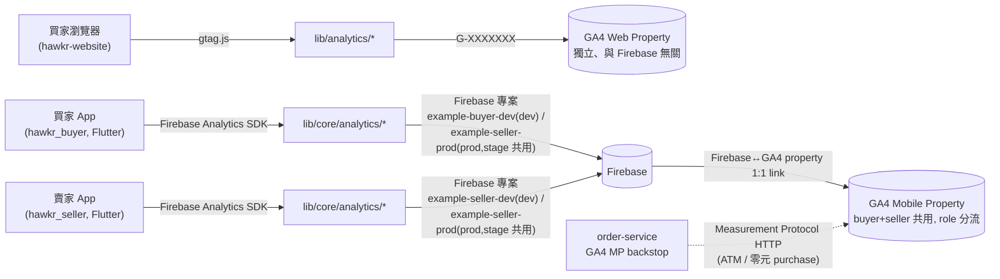
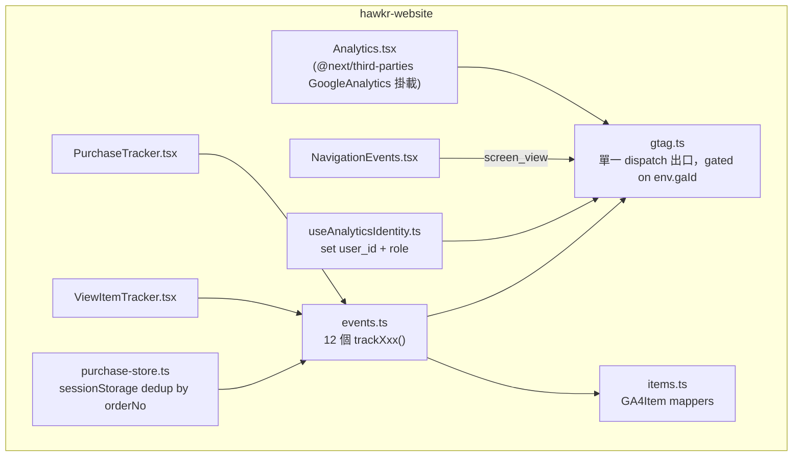
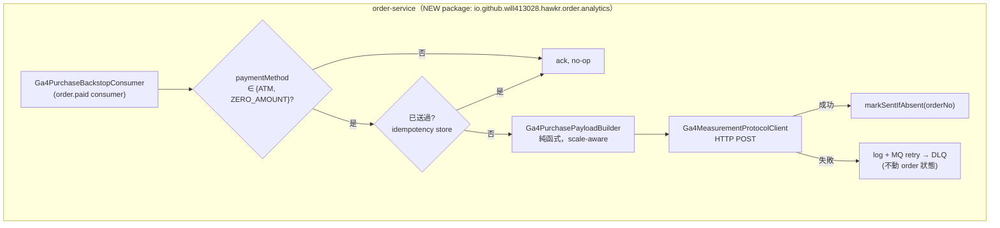
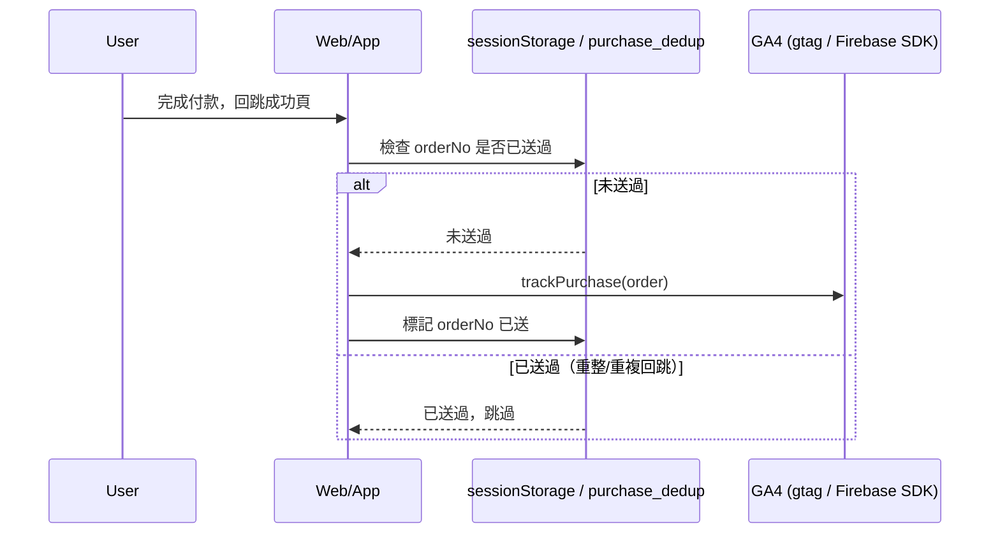
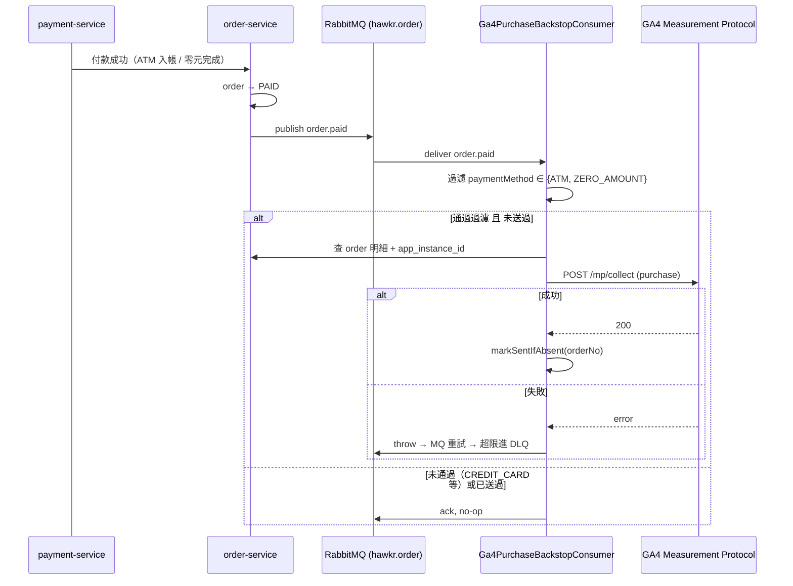

# GA4 分析追蹤（GA4 Cross-Platform Analytics）詳細設計書

---

## 0. 文件元資訊 (Metadata)

| 項目 | 值 |
|---|---|
| 維護者 | Will |
| 對應程式碼 | `hawkr-website/lib/analytics/`（gtag）、`hawkr_buyer/lib/core/analytics/`（Firebase）、`hawkr_seller/lib/core/analytics/`（Firebase）、`backend-payuni/services/java/order-service/`（MP backstop，設計見 §6.3、§12.1） |
| 相關 doc | [ADR：GA4 跨平台分析](../adr/2026-09-18-ga4-cross-platform-analytics.md)、website ADR `decisions/2026-06-07-ga4-client-side-server-mp-deferred.md`、`36-MQ 與事件總覽` §`order.paid` |

---

## 1. 概述與目標 (Overview & Goals)

### 1.1 文件定位

本文件描述 hawkr 全平台（web + buyer app + seller app + 後端）GA4（Google Analytics 4）分析追蹤系統的架構、事件契約、跨服務/跨 repo 的資料流，以及**從零建置 GA4 帳號與資源的完整 SOP**（§12.1）。目標讀者：維護或擴充埋點的工程師、以及未來需要重建 GA4 環境（帳號轉移、誤刪 property、換 Google 帳號）時照本操作的人。不涵蓋：GA4 報表操作／BI 分析方法本身、Google Ads 廣告投放串接、admin 內部可視化報表。

### 1.2 服務一句話定位

讓 web / iOS / Android 三端的使用者行為與電商轉換資料，以一致的事件契約進入同一組 GA4 資源，支援跨平台漏斗分析，並為後端權威營收資料（ATM / 零元訂單）預留補送路徑。

### 1.3 設計目標 (Goals) 與 非目標 (Non-Goals)

| 類型 | 項目 |
|---|---|
| **Goal** | web / buyer / seller 事件命名與參數跨平台鏡像，GA4 可合併成同一漏斗 |
| **Goal** | client-side 先蒐集，不等後端完美歸因（先有資料 > 等完美） |
| **Goal** | `purchase` 不重複計：client 內部去重 + client vs 後端 backstop 互斥分流雙重防線 |
| **Goal** | analytics 呼叫失敗絕不阻斷下單 / 結帳 / 任何業務主流程（fail-open） |
| **Goal** | 非 prod 環境（dev/stage）預設不送資料，不污染正式 property |
| **Non-Goal** | **不**做 Consent Mode 強制 banner（台灣站現階段無 GDPR 義務；已留 `setConsent()` hook 但不主動送 denied 指令） |
| **Non-Goal** | **不**做 session replay / heatmap，僅 GA4 事件層 |
| **Non-Goal** | **不**蒐集 IDFA / 廣告 ID（iOS 端 ATT 豁免，純分析用途） |
| **Non-Goal** | **不**建 admin 端統一可視化報表；GA4 原生報表即為現階段的報表出口 |
| **Non-Goal** | backend MP backstop **不**含 `refund` MP 事件、**不**含信用卡遺失補救 |

### 1.4 與其他設計書／服務的關係

- **商品瀏覽數（`docs/modules/seller.md` §16）**：獨立的內部瀏覽次數統計（賣家 dashboard 用），與本文件的 GA4 是完全分開的兩套系統，不要混淆——它是自建 DB 計數，本文件是送外部 GA4。
- **36-MQ 與事件總覽**：backend backstop 掛載的 `order.paid` 事件契約（exchange/routing key/publisher/既有 consumer）由該文件定義，本文件 §6.3 只描述新增消費端的設計。
- **03-訂單微服務（Order Service）**：backstop 依附的 `orders` 表 schema、`OrderEventPublisher` 皆屬該服務。

---

## 2. 範圍與情境 (Context & Scope)

### 2.1 系統情境圖 (C4 Context)



### 2.2 邊界與責任

| | 涵蓋 (In-scope) | 不涵蓋 (Out-of-scope，由誰負責) |
|---|---|---|
| 責任 | 三端 client-side 事件埋點、事件契約一致性、GA4 資源建置/驗收 SOP、後端 purchase backstop 設計 | GA4 報表/漏斗分析方法（PO/營運）、Google Ads 串接（未規劃）、資料倉儲/BigQuery export（免費版無 roll-up，未使用） |

### 2.3 角色與身份模型

- **buyer**：`user_id` = 買家 `accountId`；`role` user property = `buyer`。
- **seller**：`user_id` = 賣家 `accountId`；額外送 `seller_id`；`role` user property = `seller`。
- buyer 與 seller 因 prod/stage 共用同一個 Firebase 專案，被迫共用同一個 GA4 mobile property（見 §3 與 ADR-04），**靠 `role` user property 在報表層切分**，不是靠不同 property。
- 未登入使用者：web 端不送 `user_id`（僅事件本身，如 `view_item`）；app 端未登入視角前無法觸發需登入的事件（購物車/結帳皆需登入）。

---

## 3. 約束與前提 (Constraints & Assumptions)

| 類型 | 項目 |
|---|---|
| 技術約束 | **Firebase 專案 ↔ GA4 property 是 1:1**（link 在專案層級）；同一 Firebase 專案內所有 app（iOS+Android）→ 全部進同一 property，無法拆分 |
| 技術約束 | GA4 免費版無法把不同 property 的資料 roll-up 合併（需付費 360） |
| 技術約束 | `NEXT_PUBLIC_*` 是 build-time bake，新增/異動一律要同步 Dockerfile `ARG`/`ENV` + `deploy.yml` build-arg，否則 merge 了也靜默不送（O1，已踩過 3 次：auth/GA4/Sentry DSN） |
| 技術約束 | GA4 **不會**可靠地用 `transaction_id` 自動去重跨來源（client + Measurement Protocol）的 `purchase`，兩邊送同一筆會雙計營收 |
| 既有系統約束 | **prod/stage 的 buyer 與 seller 共用同一個 Firebase 專案**（prod=`example-seller-prod`、stage=`example-seller-stage`；僅 dev 分開：buyer=`example-buyer-dev`、seller=`example-seller-dev`）→ buyer+seller mobile 被迫共用一個 GA4 property |
| 既有系統約束 | 後端 order 金額欄位存 **cents**（`totalActualAmount`/`shippingFee`/`unitPrice` 皆 `Long` cents）；client 目前送 GA4 `value` 為整數 TWD |
| 既有約束 | prod web 的 Measurement ID 來自 GitHub repo variable `PROD_GA_MEASUREMENT_ID`，值必須是 `hawkr` GA 帳戶下 Web property 的 `G-XXXX`（不得填 app stream 的識別碼——app stream 沒有 `G-XXXX`） |
| **假設 (Assumptions)** | backstop 設計假設「client 送整數 TWD」為真 → **未驗證**，實作前必須先查證（見 §6.3 與 §11），失真則 MP `value` 需除以 100，否則營收差 100 倍 |

---

## 4. 架構 (Architecture)

### 4.1 解法總綱 (Solution Strategy)

三端各自實作同一種可攜 seam pattern：**單一 gated dispatch 出口 + 純函式 domain→GA4Item mapper + typed 事件層**，prod-only gate 統一做法（web 靠空 measurement id 不啟動、app 靠 flavor 判斷 `setAnalyticsCollectionEnabled`）。事件命名跨三端鏡像（電商事件用 GA4 標準名），使 GA4 能把 web/iOS/Android 合進同一使用者漏斗（靠 `user_id` = 內部 `accountId` 拼接跨裝置）。

後端 backstop 走事件驅動（RabbitMQ `order.paid`），與 client 依付款方式**互斥分流**（client 送即時付清的、backstop 只送 ATM/零元），避免雙計，不需要跨來源 dedup。

### 4.2 元件視圖 (C4 Component)

#### 4.2.1 Web（hawkr-website，gtag）



| 模組/檔案 | 責任 | 依賴 |
|---|---|---|
| `lib/analytics/gtag.ts` | 單一 dispatch 出口；`env.gaId` 為空即整體不啟動 | — |
| `lib/analytics/items.ts` | 純函式：domain 物件 → `GA4Item` | — |
| `lib/analytics/events.ts` | 12 個 typed `trackXxx()` 函式（電商 11 + login） | items, gtag, purchase-store |
| `lib/analytics/useAnalyticsIdentity.ts` | 綁 auth 狀態 → `gtag('set', {user_id, role})` | gtag |
| `lib/analytics/purchase-store.ts` | sessionStorage 存 pending purchase，跨 PayUni redirect 防重 | — |
| `components/analytics/NavigationEvents.tsx` | route 變化 → `screen_view`（等同 pageview） | gtag |
| `components/analytics/PurchaseTracker.tsx` / `ViewItemTracker.tsx` | 掛載點守衛（once-per-mount 防重覆觸發） | events |

#### 4.2.2 Buyer App（hawkr_buyer，Firebase）

| 模組/檔案 | 責任 | 依賴 |
|---|---|---|
| `lib/core/analytics/analytics_service.dart` | 閘控 dispatch 出口，僅 prod flavor 送、其餘 no-op | Firebase Analytics SDK |
| `lib/core/analytics/ga4_item.dart` | 純函式：domain → `GA4Item` | — |
| `lib/core/analytics/analytics_events.dart` | 12 個 typed 事件方法（Firebase typed ecommerce API，items array 不能走 generic `logEvent`） | ga4_item, analytics_service |
| `lib/core/analytics/analytics_providers.dart` | Riverpod providers，串接 UI 呼叫點 | analytics_events |
| `lib/core/analytics/analytics_identity.dart` | 身份橋接：`setUserId(accountId)` + `setUserProperty(role=buyer)` | analytics_service |
| `lib/core/analytics/purchase_dedup.dart` | purchase 去重（多付款路徑：信用卡 WebView 回跳 vs Apple/Google Pay native 回跳皆需覆蓋） | — |
| `lib/core/analytics/analytics_constants.dart` | 事件/參數名常數 | — |

#### 4.2.3 Seller App（hawkr_seller，Firebase）

| 模組/檔案 | 責任 | 依賴 |
|---|---|---|
| `lib/core/analytics/analytics_service.dart` | 同 buyer pattern，閘控 dispatch 出口 | Firebase Analytics SDK |
| `lib/core/analytics/analytics_events.dart` | 10 個營運類事件方法（**無電商 mapper**，不需 `ga4_item.dart`） | analytics_service |
| `lib/core/analytics/analytics_providers.dart` | Riverpod providers | analytics_events |
| `lib/core/analytics/analytics_identity.dart` | `user_id=accountId` + `seller_id` + `role=seller` | analytics_service |
| `FirebaseAnalyticsObserver`（router 掛載） | `screen_view` 自動送（免費，不需手動呼叫） | — |

#### 4.2.4 Backend Backstop（order-service，見 §6.3／§12.1）



### 4.3 GA4 資源拓撲（取代傳統 Port 表；本主題無自建服務 port）

| 資源 | 對應範圍 | 建置方式 |
|---|---|---|
| GA4 Web Property + Web stream | hawkr-website（prod 必要；dev stream optional） | Console 直接建（§12.1 Step 1），**與 Firebase 無關** |
| GA4 Mobile Property + App streams（iOS／Android × buyer／seller） | hawkr_buyer + hawkr_seller | 從 **Firebase 端** enable 接（§12.1 Step 3），🔴 **禁止在 GA4 手動建 app stream** |
| GA4 MP API secret（mobile property，per app stream） | backend backstop | Console：GA4 Admin → property → 該 app data stream → Measurement Protocol API secrets |

> prod 的 mobile property 是 buyer 與 seller **共用**一個（Firebase 專案 1:1 限制），
> 靠 `role` user property 分流。web 是**另一個獨立 property**，兩者不合併。

### 4.4 命名／契約規約

- 事件名一律 GA4 標準電商事件命名（`view_item`/`add_to_cart`/…/`purchase`），跨平台完全鏡像。
- `currency` 固定 `TWD`。
- `item_id` 一律**字串**（訂單/商品 PK 為 TSID int64，避免 JS/前端數值精度遺失）。
- `price` 取數值欄位，非格式化字串；`value` = `Σ price × quantity`。
- `user_id` = 內部 `accountId`（**不是**裝置廣告 id），用 GA4 保留的 set-user-id 機制；`role` 等放 user property，不重複塞進 `user_id`。

---

## 5. 資料設計 (Data Design)

> 本主題無自建資料庫（GA4 為 Google 託管），此章改為**事件目錄**（三端 event catalog）+ backend backstop 的新增表設計。

### 5.1 事件目錄

**Web（12 個 + `screen_view` 共 13）**：`view_item_list` `select_item` `view_item` `add_to_cart` `remove_from_cart` `view_cart` `add_to_wishlist` `begin_checkout` `add_shipping_info` `add_payment_info` `purchase` `login` + `screen_view`（route 變化自動送）。

**Buyer App（12 個，含 `screen_view` 由 observer 另計不入內）**：`view_item_list` `select_item` `view_item` `add_to_cart` `remove_from_cart` `view_cart` `add_to_wishlist` `begin_checkout` `add_shipping_info` `add_payment_info` `purchase` `login`。

**Seller App（10 個 + `screen_view` observer）**：`login` `ship_order` `request_logistics` `cancel_order` `print_cvs_label` `create_product` `update_product` `set_product_status` `send_message` `onboarding_complete`。

### 5.2 User Property / Dimension 對應（取代傳統索引段）

| User Property | 值 | web | buyer app | seller app |
|---|---|---|---|---|
| `user_id`（GA4 保留欄位） | 內部帳號識別碼 | 🔴 **一律不送**（見下方隱私邊界） | 登入 set、登出 set `null` | 登入 set `accountId`、登出 set `null` |
| `role` | `buyer` \| `seller` \| `anonymous` | 登入 set 當前角色，登出 set `anonymous` | 登入固定 `buyer` | 登入固定 `seller` |
| `seller_id` | 賣家 id | — | — | 登入 set |

🔴 **web 端刻意不送 `user_id`**：公開隱私權聲明把網站分析界定為匿名統計，
送出穩定的帳號識別碼會越過那條界線。web 端只用 `role` 這個**類別型**屬性分流，
不得為了「跨平台 stitch」而在 web 端補上 `user_id`。

⚠️ 兩個 App 在登出時只重設 `user_id`，`role`／`seller_id` 會沿用到下一次登入被覆寫為止。
分析登出後的匿名流量時要知道這件事。

### 5.3 序號／排序／一致性

- **Client 內部 purchase 去重**：web 用 `sessionStorage`（key = `transaction_id` = orderNo）跨 PayUni redirect 防重；buyer app 用 `purchase_dedup.dart`，需覆蓋所有付款回跳路徑（信用卡 WebView 成功 callback、Apple/Google Pay native 成功 navigate home 各自獨立觸發點）。
- **Client vs backend backstop 去重**：非靠 GA4 自動 dedup（不可靠），靠**付款方式互斥分流**——client 只送 CREDIT_CARD/APPLE_PAY/GOOGLE_PAY，backstop 只送 ATM/ZERO_AMOUNT，天然不重疊。
- **Backend backstop 內部去重**：表 `ga4_purchase_sent(order_no PK, sent_at)`，`INSERT ... ON CONFLICT DO NOTHING` 防 MQ redelivery 重送。

### 5.4 Schema 演進與遷移

- 新增事件/參數：三端各自的 typed 事件層是唯一改動點，不涉及 schema migration。
- **Backend backstop 需要的欄位**：
  - `orders` 表加欄位 `app_instance_id VARCHAR(64)`、`client_platform VARCHAR(16)`（Flyway migration，`services/java/order-service/src/main/resources/db/migration/`）。
  - 新表 `ga4_purchase_sent`（Flyway migration）。
  - proto `services/java/shared/java-proto/src/main/proto/order/order.proto` 的 checkout/confirm request message 加 `app_instance_id` + `client_platform` 兩欄位，需 buf regen + Java mirror 同步。

---

## 6. API 與介面契約 (API & Interface Contracts)

### 6.1 對外 REST（經 Gateway）

> N/A（理由：本主題不提供對外 REST API，是分析事件的 outbound 埋點；唯一相關的是 buyer app 結帳 confirm request 新增兩個透傳欄位，見 §6.2）。

### 6.2 gRPC（服務間）

backend backstop 需要 checkout／confirm gRPC request 帶：

```proto
string app_instance_id = <next_field_no>;   // Firebase app instance id
string client_platform  = <next_field_no+1>; // "IOS" | "ANDROID"
```

流向：buyer app → gateway（Go，REST→gRPC 透傳）→ order-service `CheckoutService`（持久化到 `orders` 表）。

### 6.3 非同步事件 (MQ)

backstop 依附的是既有事件，不新增事件：

| 項目 | 值 |
|---|---|
| Exchange / Routing Key | `hawkr.order` / `order.paid`（既有事件，見 `36-MQ 與事件總覽` §order.paid；publisher = order-service `OrderEventPublisher.publishOrderPaid`） |
| 新增 Consumer | `Ga4PurchaseBackstopConsumer`（**新建**，order-service 內部，**自消費自己發布的事件**——因為 order+items+`app_instance_id` 資料都已在本服務，避免額外跨服務呼叫） |
| Queue | **新建** `analytics.order.paid`（獨立 queue，禁止與既有 consumer 共用；附 DLQ，比照既有 consumer pattern） |
| Payload | 既有 `OrderPaidPayload`（消費端另查 order 明細取 `app_instance_id`/`client_platform`/`paymentMethod`） |
| 冪等 key | `orderNo`（`ga4_purchase_sent` 表，見 §5.3） |
| **向後相容策略** | 消費端過濾非 ATM/ZERO_AMOUNT 直接 no-op；`app_instance_id` 缺值（舊版 app）走 fallback attribution（送 `user_id` + 合成 `client_id` + `attribution=fallback` 參數） |

### 6.4 即時通道 (WS/SSE)

> N/A（本主題無即時通道；三端埋點皆非同步/背景送出，不阻塞 UI）。

### 6.5 GA4 Outbound 契約（本主題實際的核心介面）

| Channel | 用於 | 端點/機制 | 認證 |
|---|---|---|---|
| **gtag.js** | Web | 瀏覽器直送 `https://www.google-analytics.com/g/collect` | `G-XXXXXXX` measurement id（明碼，前端可見） |
| **Firebase Analytics SDK** | Buyer/Seller App | SDK 內部批次上傳，無需 app 端指定 measurement id（走 `google-services.json`/plist） | Firebase 專案綁定 |
| **Measurement Protocol (MP)** | Backend backstop | `POST https://www.google-analytics.com/mp/collect?firebase_app_id=<X>&api_secret=<Y>`；除錯用 `/debug/mp/collect` | `api_secret`（k8s secret，per app stream 各一組） |

> 每個介面的 error 形狀、冪等性、逾時：gtag/Firebase SDK 皆為 client library 內建 fire-and-forget，呼叫方不感知失敗；MP 為本服務自建 HTTP client，需自行處理逾時/重試（見 §7.3）。

---

## 7. 執行時視圖 (Runtime View)

### 7.1 主要場景（happy path）

買家瀏覽商品 → 加入購物車 → 結帳 → 完成付款。三端（web/app）在每個轉換點各自 fire-and-forget 送出對應事件；`purchase` 是唯一需要防重的事件，其餘皆可重複送（GA4 report 端本就是聚合統計，非唯一性要求）。

### 7.2 時序圖

**(a) Client-side purchase（web / app 共通模式）**



**(b) Backend MP backstop**



### 7.3 失效與重試

| 呼叫 | 逾時 | 重試策略 | 冪等 | 失敗時降級行為 |
|---|---|---|---|---|
| gtag.js（web） | 瀏覽器層級，無自訂逾時 | 無（client library 內建 best-effort） | client purchase 靠 sessionStorage | 送不出去就漏（ad-block／分頁提早關閉），**可接受**（見 ADR-01） |
| Firebase SDK（app） | SDK 內建批次排程 | SDK 內建 | 同上 | 同上 |
| MP HTTP（backstop） | 5–10s | log + 讓 MQ 重試（有限次數）→ 超限進 DLQ | `orderNo` idempotency 表 | **絕不**寫回 order 狀態；MP 失敗不影響訂單已標記 PAID 的事實 |

### 7.4 並發與順序

> 多數事件無序性要求（GA4 report 聚合統計）。唯一例外是 `purchase` 防重（見 §5.3），非鎖/並發問題，是「同一筆訂單多次觸發點」的邏輯去重。

### 7.5 連線／狀態生命週期

> N/A（本主題無長連線/WS/工作流狀態機；MQ consumer 的 ack/重試生命週期已於 §7.3 涵蓋）。

---

## 8. 跨切面關注點 (Crosscutting Concerns)

### 8.1 安全與授權

- 純分析用途，**不**蒐集 IDFA/裝置廣告 id（iOS ATT 豁免）。
- `user_id` = 內部 `accountId`（不可逆推真實 PII，如姓名/手機）。
- Consent：現階段**不送** Consent Mode denied 指令（D2，台灣站無 GDPR 義務），但 web 端已 ship `setConsent()` hook，未來要切 consent-gated 只改一行。
- MP `api_secret` 必須存 k8s secret，不可進 log/前端可見範圍。
- gtag measurement id / Firebase config 屬公開資訊（前端內建），非機密，可放 `NEXT_PUBLIC_*`/`google-services.json` 明碼。

### 8.2 可觀測性 (Observability)

- **唯一驗收手段是 GA4 DebugView / Realtime 報表**（人工，見 §12.1 Step 4）；本主題**沒有**服務層級的 metrics/trace/health endpoint（GA4 為第三方託管服務，無法自建監控埋在其內部）。
- **已知 gap**：三端埋點均無自動化告警——若某次改動（如型別重構、SDK 升版）意外斷了送出，除非人工比對 DebugView，否則不會被偵測到（見 §11）。

### 8.3 錯誤處理與降級 (Failure Modes & Degradation)

| 依賴掛掉 | 行為 |
|---|---|
| GA4/Google 服務不可用 | client SDK fail-open：呼叫端不阻塞、不擲例外，UI 無感 |
| Firebase SDK 初始化失敗（app） | analytics no-op，其餘 App 功能不受影響 |
| MP HTTP 逾時／5xx（backstop） | log + 依 §7.3 走 MQ 重試/DLQ，**絕不**回寫 order 狀態或阻斷任何訂單流程 |

### 8.4 一致性與冪等

- 投遞語意：**at-most-once ~ best-effort**（client 端），無法保證 100% 到達（ad-block、App kill）。
- `purchase` 是唯一要求邏輯冪等的事件，去重機制見 §5.3。
- 其餘事件允許重複送（GA4 report 端本身是聚合統計）。

### 8.5 設定與機密

| Env / Var | 用途 | 現況 |
|---|---|---|
| `NEXT_PUBLIC_GA_MEASUREMENT_ID`（website runtime） | gtag 啟動開關（空值=停用） | 由 CI 注入 |
| GitHub repo variable `PROD_GA_MEASUREMENT_ID` | prod build-arg 來源 | 必須是 Web property 的 `G-XXXX`（建置步驟見 §12.1 Step 1） |
| GitHub repo variable `DEV_GA_MEASUREMENT_ID` | dev build-arg 來源 | 🔴 **刻意不設**——空值即停用 gtag，這是 prod-only 收集 gate 的正確結果，不是缺口 |
| `google-services.json` / `GoogleService-Info.plist`（buyer/seller，per flavor） | Firebase SDK 初始化 | 已存在（dev/stage/prod 各 flavor 一份） |
| `GA4_MP_ENABLED` / `GA4_MP_API_SECRET` / `GA4_FIREBASE_APP_ID_IOS` / `GA4_FIREBASE_APP_ID_ANDROID`（order-service） | backstop 開關 + MP 認證 | `GA4_MP_ENABLED` 僅 prod 為 true |

---

## 9. 品質需求與 NFR (Quality Requirements / SLO)

### 9.1 SLO / SLI

| 指標 (SLI) | 目標 (SLO) | 量測點 | 現況 |
|---|---|---|---|
| 事件到達 GA4 | 無正式 SLO（best-effort 分析資料，非交易關鍵路徑） | DebugView 人工核對 | 未量測 |

### 9.2 容量與規模 (Capacity & Scaling)

> N/A（GA4 為 Google 全託管服務，無自建容量規劃需求；唯一容量相關考量是 GA4 免費版的事件配額，目前流量規模遠低於門檻，未觸發）。

### 9.3 效能預算

- 前端埋點呼叫一律 fire-and-forget，**不得阻塞 UI 主線程**（web 用 `gtag()` 非同步、app 用 Firebase SDK 內建批次）。
- Backend MP HTTP 在獨立 MQ consumer 執行，與訂單主流程完全解耦，無延遲預算限制。

---

## 10. 設計決策

設計理由、考慮過的替代方案與否決理由見
[ADR：GA4 跨平台分析——蒐集面與 property 結構](../adr/2026-09-18-ga4-cross-platform-analytics.md)。

---

## 11. 已知限制

| 限制 | 影響 | 現行處置 |
|---|---|---|
| Backend MP backstop 尚未落地 | ATM／零元訂單的 `purchase` 不會進 GA4，該類營收在漏斗中缺失 | client 端與 backstop 是**互斥分流**（見 ADR-05），所以這塊缺口不會被 client 補上；規格見 §4.2.4／§6.3／§12.1 |
| 🔴 **MP `value` 的單位（分 vs 元）未驗證** | 誤判會讓 backstop 上線後營收數字差 100 倍，且污染正式報表 | **backstop 實作的強制第一步**：先確認 buyer App 收到的 `Order.totalActualAmount` 實際單位，再寫 payload builder |
| 無自動化告警，埋點斷線無感 | refactor 意外拔掉埋點不會有人發現，直到有人查報表發現數字不對 | 現階段規模下接受；規模觸發後可評估以 GA4 API 定期抽查 |
| web 與 mobile 分屬兩個 GA4 property | 無法在單一 GA4 View 內合併 web+app 完整用戶旅程 | 刻意決策（見 ADR-08），非疏漏 |

---

## 12. 部署與維運 (Deployment & Operations)

### 12.1 GA4 從零建置 SOP（Console Runbook）

> 本節**假設一切尚未設定過**，從零開始建置。三層結構：`Account`（公司，一間一個）→ `Property`（一份報表，自帶時區/幣別）→ `Data Stream`（Web / iOS / Android）。

> **建置範圍：只有 prod 是必要的。** 三端的收集閘控本來就是「非 prod 不送」（mobile 靠 flavor gate、web 靠空 measurement id）——dev/stage 就算沒有對應的 GA4 資源，行為也完全正確（no-op）。§12.1 Step 4 的驗收也是用 **prod flavor + debug flag** 跑，不依賴 dev 環境送真實資料。下方 Step 1.5 / Step 3 提到的 dev stream/property 皆為 **optional**，僅在你想額外做「dev 網域也能即時看 Realtime」這種非必要的便利性驗證時才需要，不做不影響任何功能。

#### Step 0 — 先決定 property 結構（最關鍵，做錯難回頭）

- **web 與 mobile 分開兩個 property**（D8 決策）：web 走 gtag、與 Firebase 無關，獨立一個 property；mobile（buyer+seller）因 Firebase 專案共用被迫合一個 property。
- 執行前先 `grep -rh project_id android/` 或讀各 app 的 `google-services.json`/`GoogleService-Info.plist` 核對真實 Firebase 專案，確認以下現況仍成立：

  | 環境 | buyer Firebase 專案 | seller Firebase 專案 | 是否共用 |
  |---|---|---|---|
  | dev | `example-buyer-dev` | `example-seller-dev` | 否，各自獨立 |
  | stage | `example-seller-stage` | `example-seller-stage` | 是 |
  | prod | `example-seller-prod` | `example-seller-prod` | 是 |

  → prod/stage 因共用 Firebase 專案，buyer+seller **必然**落在同一個 GA4 mobile property；**dev 兩者是不同 Firebase 專案，依「不同 Firebase 專案 → 各自一個 property」規則必然各自一個 property，無法人為選擇合一**（除非把 dev 也重組成共用一個 Firebase 專案，屬更大幅度改動，且 dev 本就不需要設 GA4，見上方建置範圍說明，無必要）。

#### Step 1 — 建 Account + Web Property + Web Stream（拿 `G-XXXX`）

1. 用**公司/團隊持有的 Google 帳號**登入 [analytics.google.com](https://analytics.google.com)（別用個人 Gmail，之後轉移所有權很痛）。
2. 「開始測量」→ Account 名（如 `Hawkr`）→ Property 名（如 `Hawkr Web - Prod`）、**時區選 Asia/Taipei、幣別選 TWD，一開始就設對**（之後改不回溯歷史資料）→ 產業/目標 → 同意條款。
3. 選平台 **Web** → 填 `https://example.com`（prod）+ stream 名、**Enhanced measurement 保持開** → 建立。
4. 複製 stream 詳情最上面的 **Measurement ID `G-XXXX`**（之後再找：Admin → Data Streams → 點該 web stream）。
5. **（optional，非必要）若想額外讓 dev 網域也能即時驗證**：在同一個 property 下再加一條 Web stream，URL 填 `https://web-dev.example.com`，或建獨立 dev property（建議獨立，dev 資料不該混進 prod 報表）。不做這步，dev 站因 `DEV_GA_MEASUREMENT_ID` 留空，gtag 直接不啟動，行為正確。

#### Step 2 — 把 `G-XXXX` 接回 web repo

1. GitHub repo `hawkr-website` → Settings → Secrets and variables → Actions → Variables：
   - 設 `PROD_GA_MEASUREMENT_ID` = Step 1 拿到的 prod `G-XXXX`。⚠️ 若該 variable 已有值，先確認它是不是同一個 property 再覆蓋——覆蓋錯會讓 prod 流量整批送進別的 property。
   - 若有 dev stream，設 `DEV_GA_MEASUREMENT_ID` = dev `G-XXXX`。
2. website 的 `deploy.yml` 已接線 `NEXT_PUBLIC_GA_MEASUREMENT_ID` 依 branch 讀對應 var，**無需改 code**。
3. 觸發重部署（push `dev`/`main`）→ 開 property 的 **Realtime** 報表自己逛驗有無資料進來。

#### Step 3 — App 接 GA4：從 Firebase 端開（⚠️ 絕對不要在 GA4 手動建 app stream）

**必要：prod（buyer+seller 共用同一個 mobile property）**。stage/dev 因 app 端 `setAnalyticsCollectionEnabled(prod)` flavor gate，即使不 link GA4，SDK 也不會送任何資料——link 與否不影響行為，屬 **optional**（僅想讓 stage/dev 也能在 Firebase 主控台看到裝置級 debug 事件時才需要）。若要做，對以下專案分別執行：**stage（共用 `example-seller-stage`）**、**dev buyer（`example-buyer-dev`）**、**dev seller（`example-seller-dev`）**：

1. [Firebase Console](https://console.firebase.google.com) → 選該專案 → 齒輪 **Project settings → Integrations → Google Analytics**。
2. 顯示「Link / Enable」→ 點它開 GA（顯示「View link」代表已連，點進去就是該 property）。
3. link 流程：Analytics Account 選 Step 1 建的那個 → property 選**新建一個 Mobile property**（第一次做，prod/stage/dev 各自一個 mobile property，不要混進 web 的 property）→ 完成。
4. Firebase 自動把該專案內各 app（iOS + Android）建成 app stream（**app stream 沒有 `G-XXXX`**，靠 `google-services.json`/plist 流入，不需額外接線）。
5. 開 GA 是**非破壞性**操作（不改 code、不洗資料）；唯一危險是反向 **unlink**，別碰。

> prod/stage 各建一次即可涵蓋 buyer+seller（同專案）；dev 因 buyer/seller 是不同 Firebase 專案，若要做則**必然**各自一個 property，無法合一（見 Step 0 說明）。

#### Step 4 — 驗收（DebugView / Realtime）

- **App debug 是 runtime flag**（debug 裝置事件不污染正式報表/BQ export）：
  - Android：`adb shell setprop debug.firebase.analytics.app <package>`（驗完務必 `adb shell setprop debug.firebase.analytics.app .none.` 關掉）。
  - iOS：Xcode 開 `Runner.xcworkspace` → scheme 加 run argument `-FIRDebugEnabled` → 從 Xcode 跑。
- GA4 → **Admin → DebugView** → 選 debug 裝置 → 操作 App → 逐一點 event 對參數、右側確認 user property（`role`/`seller_id`）。
- ⚠️ **三端分析目前都是 prod-gated**（web 空 measurement id、mobile `setAnalyticsCollectionEnabled(prod)`），dev/stage build 一個 event 都不吐——驗收要跑 **prod flavor build** 掛 debug flag，或臨時把 gate 條件放寬做一次性驗證後改回。
- 有真實流量時，**Realtime 報表是最快的 sanity check**（property link 後幾分鐘就看得到）。

### 12.2 遷移步驟

> 大部分為 Console 操作，非 DB migration。**Backend backstop 的部署前置**：
> 1. Flyway migration：`orders` 表加 `app_instance_id`/`client_platform`；新表 `ga4_purchase_sent`（見 §5.4）。
> 2. proto regen（`buf generate`）+ Java mirror 同步（見 §6.2）。
> 3. k8s secret：`GA4_MP_API_SECRET`、`GA4_FIREBASE_APP_ID_IOS`、`GA4_FIREBASE_APP_ID_ANDROID`（Step 3 建好 app stream 後，於 GA4 Admin → property → 該 app data stream → Measurement Protocol API secrets 建立）。
> 4. `GA4_MP_ENABLED` 僅 prod 開啟，dev/stage 維持 `false`（no-op），比照 client 端 prod-only gate 的既有慣例。

### 12.3 健康檢查與優雅關閉

> N/A（GA4 為第三方託管服務，無自建 health／readiness endpoint 概念；backstop consumer 的健康狀態等同 order-service 本身的健康檢查，不需獨立端點）。

### 12.4 Runbook

- Console 從零建置 SOP：本文件 §12.1（已取代並具體化 wiki `ga4-cross-platform-analytics` 的通用版本）。
- 跨專案可攜 pattern與雷區（Firebase↔property 1:1、MP 雙計陷阱等）：wiki `ga4-cross-platform-analytics`。

---

## 13. 測試策略 (Test Strategy)

| 層級 | 覆蓋 | 關鍵場景 |
|---|---|---|
| unit（web） | `lib/analytics/*` mapper／dispatch 純函式 | items mapper 正確性、`purchase` sessionStorage dedup、consent hook |
| unit（buyer） | `lib/core/analytics/*` | `GA4Item` mapper、purchase dedup、identity 橋接 |
| unit（seller） | `lib/core/analytics/*` | 各事件方法、identity 橋接 |
| unit（backend backstop） | MP payload builder、idempotency、付款方式 filter | scale 轉換；第二次呼叫 no-op；僅 ATM／ZERO_AMOUNT 通過 |
| integration（backend backstop） | `order.paid` consumer 端到端 | ATM／零元 → 斷言恰一次 MP POST；CREDIT_CARD → 零次；重送 → 仍恰一次 |
| e2e／人工 | GA4 DebugView 逐事件核對參數 | 三端各跑一次（步驟見 §12.1 Step 4）；backstop 額外要驗 ATM 入帳觸發、零元訂單、信用卡不重複觸發 |

---

## 14. 術語表 (Glossary)

| 術語 | 定義 |
|---|---|
| Property | GA4 的一份報表單位，自帶時區/幣別，一個 property 可同時收 web+iOS+Android 三種 stream |
| Data Stream | Property 底下的資料管線：Web（拿 `G-XXXX`）/ iOS / Android（靠 Firebase app 綁定，無獨立 ID） |
| Measurement ID | Web stream 專屬的 `G-XXXXXXX` 識別碼，用於 gtag.js 初始化 |
| `app_instance_id` | Firebase Analytics 為每個 app 安裝產生的裝置級識別碼，是 Measurement Protocol 歸因 app 使用者的關鍵 |
| `client_id` | gtag（web）的裝置級識別碼，等同 app 端的 `app_instance_id` |
| Measurement Protocol (MP) | GA4 提供的 server-side HTTP API，可在沒有 client SDK 的情況下直接送事件到 GA4 |
| Consent Mode | GA4/gtag 的同意管理機制，可依使用者同意狀態調整蒐集行為（本專案現階段不啟用，見 D2） |
| DebugView | GA4 後台即時顯示 debug 裝置事件的驗收工具 |

---
