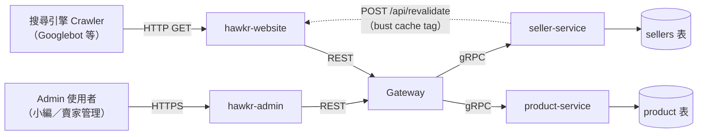
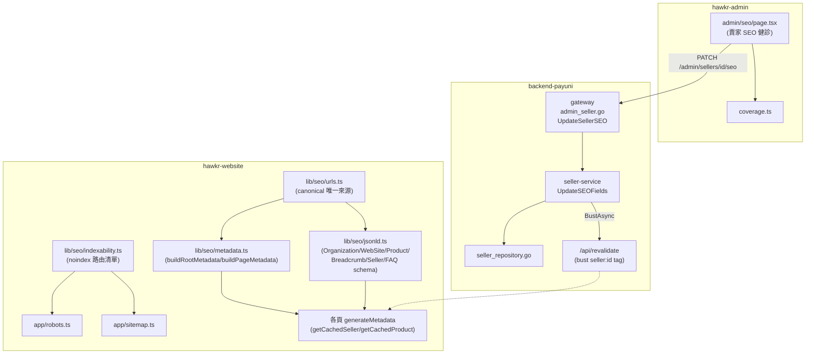
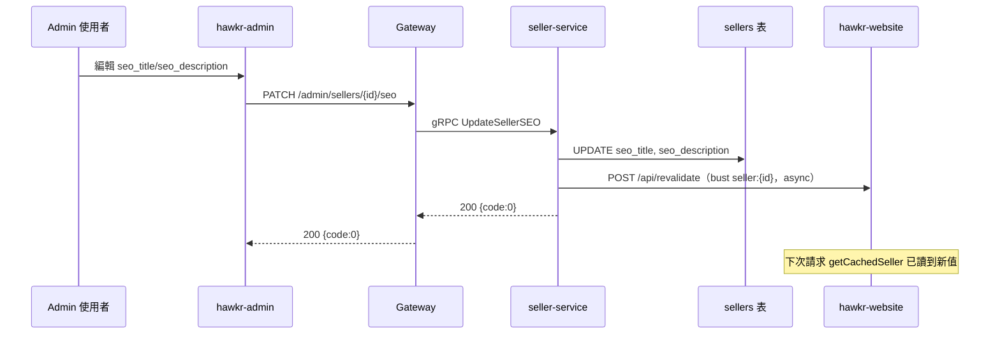

# SEO 技術契約詳細設計書

> **2026-10-09 標註：** 本文關於「賣家 SEO override」的部分（目標、`seo_title`／`seo_description` 欄位、`PATCH /admin/sellers/{account_id}/seo`、admin SEO 健診頁、override 更新的 revalidate 場景與其 e2e）已被 [店家頁的 SEO 由平台從可見資料生成](../adr/2026-10-09-store-seo-platform-generated.md) 取代；店家頁的 title／description 現在由 `lib/seo/store-summary.ts` 生成，沒有手寫欄位。以下內文保留公司時期的原貌，不再修改。

## 0. 文件元資訊 (Metadata)

| 項目 | 值 |
|---|---|
| 維護者 | Will |
| 對應程式碼 | `hawkr-website/lib/seo/`、`hawkr-website/app/robots.ts`、`hawkr-website/app/sitemap.ts`、`hawkr-admin/src/app/admin/seo/`、`gateway/internal/handler/admin_seller.go`、`services/seller-service/internal/usecase/seller.go`、`services/java/product-service/.../domain/text/DescriptionTextExtractor.java` |
| 相關 doc | §02 產品微服務（`pure_description`/`searchable_text` 欄位定義）、§47 GA4 分析追蹤（姊妹主題：本文管「被搜尋引擎發現」，47 管「被追蹤成效」） |
| 相關 ADR | [structured data 缺資料省略欄位、canonical 由 route param 重建](../adr/2026-09-18-seo-structured-data-and-canonical-source.md) |

---

## 1. 概述與目標 (Overview & Goals)

### 1.1 文件定位

本文件描述跨 repo（`hawkr-website` / `hawkr-admin` / `backend-payuni`）的 SEO **技術契約**：website 端的 metadata／JSON-LD／robots／sitemap 模組責任與邊界、賣家 SEO override 由 admin 到網站快取失效的完整鏈路、以及控制全站是否可被索引的開關。

### 1.2 服務一句話定位

本文件不對應單一可部署服務，而是跨 repo 的 SEO 主題文件（比照 §47 GA4 的編寫方式）。

### 1.3 設計目標 (Goals) 與 非目標 (Non-Goals)

| 類型 | 項目 |
|---|---|
| **Goal** | 定義 website 技術 SEO 的模組責任與契約：metadata／JSON-LD／canonical／robots／sitemap 各由誰產生、輸入從哪來 |
| **Goal** | 定義賣家 SEO override 的全鏈路契約：admin → gateway → seller-service → revalidate webhook → 網站讀取 |
| **Goal** | 定義索引開關（`env.seoIndexable`）的判定條件與失效行為 |
| **Non-Goal** | **不**涵蓋 `hawkr_buyer`/`hawkr_seller` Flutter app 的 ASO（App Store Optimization）或 deep link 索引——App 不被搜尋引擎爬取，屬不同領域 |
| **Non-Goal** | **不**做 SEO 成效分析（流量、排名、轉換率）——那是 §47 GA4 的範疇，本文件只管「技術上能不能被發現、能不能被正確索引」 |

### 1.4 與其他設計書／服務的關係

- §02 產品微服務：`pure_description`/`searchable_text` 欄位的完整定義與萃取規則見該文件 §3.6；本文件只定義它們在 SEO 鏈路中的角色（§5.1）。
- §47 GA4 分析追蹤：與本文件是跨 repo 觀測/成長類主題的姊妹文件——47 管「使用者行為被追蹤」，48（本文件）管「頁面被搜尋引擎發現與索引」。

---

## 2. 範圍與情境 (Context & Scope)

### 2.1 系統情境圖 (C4 Context)

### 2.2 邊界與責任

| | 涵蓋 (In-scope) | 不涵蓋 (Out-of-scope，由誰負責) |
|---|---|---|
| 責任 | website 技術 SEO（metadata/JSON-LD/robots/sitemap）；賣家 SEO override 管理鏈路（admin→gateway→seller-service）；product-service 的 SEO 相關欄位現況 | App ASO/deep link（未來另立文件）；內容行銷與外部連結建設（行銷團隊）；SEO 成效分析（§47 GA4） |

### 2.3 角色與身份模型

- **搜尋引擎 crawler**：匿名，透過 `robots.txt`/`sitemap.xml` 探索與索引公開頁面。
- **Admin 使用者**：登入 `hawkr-admin`，具備編輯賣家 `seo_title`/`seo_description` 的權限（走既有 admin 權限守衛，非本文件新增）。
- **一般訪客**：無 SEO 相關操作權限，僅為 SEO 優化的最終受益對象（透過搜尋結果找到頁面）。

---

## 3. 約束與前提 (Constraints & Assumptions)

| 類型 | 項目 |
|---|---|
| 技術約束 | Launch gate：`env.seoIndexable`（`lib/config/env.ts`）僅在 `flavor === "prod"` 且 `NEXT_PUBLIC_SEO_INDEXABLE === "true"` 時為真；未達成時 `app/robots.ts` 回傳 `disallow: /`，全站不可索引 |
| 既有系統約束 | `hawkr-website` 商品/賣家資料走 Next.js `'use cache'`（`cacheLife("seller")`/`cacheTag`），非每次請求即時打後端 |
| **假設 (Assumptions)** | 僅服務台灣市場、單一語言 zh-TW（`messages/` 只有一份語系檔）。本文件不含 i18n／hreflang 契約；拓展海外市場時本假設失效 |

---

## 4. 架構 (Architecture)

### 4.1 解法總綱 (Solution Strategy)

SEO 現況分兩條線：

1. **website 技術 SEO**（root 靜態設定 + per-page 動態 metadata）：`lib/seo/*` 模組化——`metadata.ts` 產生 root/per-page metadata、`jsonld.ts` 產生各類 structured data、`urls.ts` 是 canonical/OG url 的唯一來源（不從 request URL 取，避免追蹤參數混入）、`indexability.ts` 定義 noindex 路由清單，統一供 `robots.ts`/`sitemap.ts` 與各頁 `generateMetadata` 使用。
2. **賣家可編輯 SEO override**：admin 編輯 `seo_title`/`seo_description` → gateway → seller-service 寫入 DB → 透過 on-demand revalidate webhook bust 網站快取 → 網站 `generateMetadata` 讀到新值覆蓋預設標題/描述。

### 4.2 元件視圖 (C4 Component)

| 模組/package | 責任 | 依賴 |
|---|---|---|
| `lib/seo/metadata.ts` | 產生 root/per-page `<title>`/`<meta description>`/OG/Twitter card | `urls.ts` |
| `lib/seo/jsonld.ts` | 產生 Organization/WebSite/Product/Breadcrumb/Seller/FAQ structured data（`schema-dts` 型別檢查，缺資料時省略欄位不捏造） | `urls.ts` |
| `lib/seo/urls.ts` | canonical/OG url 建構。**一律由 route param 重建，不得從 request URL 取**（追蹤參數會污染 canonical，理由見 [ADR](../adr/2026-09-18-seo-structured-data-and-canonical-source.md)） | — |
| `lib/seo/indexability.ts` | `INDEXABLE_STATIC_ROUTES`（sitemap 用）、`PRIVATE_PREFIXES`（noindex 但可爬，讓連結權重流動） | — |
| `admin/seo/page.tsx` + `coverage.ts` | 賣家 SEO 健診（搜尋、覆蓋率顯示）+ override 編輯 modal | gateway API |
| `gateway/internal/handler/admin_seller.go` | `PATCH /admin/sellers/{account_id}/seo` 入口，欄位長度驗證 | seller-service gRPC |
| `seller-service` `UpdateSEOFields` | 寫入 DB 後同步觸發 `revalidate.BustAsync` | `seller_repository`、`revalidate.Client` |

### 4.3 部署拓撲與 Port

N/A——本文件涉及的皆為既有服務既有 port（website/admin 各自的 Next.js server、gateway 9900、seller-service 既有 port），無新增部署單元。

### 4.4 命名／契約規約

- Cache tag：`seller:{account_id}`（`lib/seo/tags.ts` `sellerTag()` 與 Go 端 `revalidate.SellerTag()` 需保持一致，為前後端共用的 webhook 契約）。
- 欄位長度：`seo_title` 以 gateway 的 `max=60` 為準、`seo_description` 以 `max=160` 為準。DB 欄位刻意較寬（`varchar(70)` / `varchar(180)`）作為安全餘裕；**驗證權威在 gateway**，放寬 gateway 上限前必須先確認 DB 容得下。

---

## 5. 資料設計 (Data Design)

### 5.1 資料模型

| 表 | 欄位 | 型別 | 說明 |
|---|---|---|---|
| `sellers`（seller-service） | `seo_title` | `varchar(70)` | 賣家可編輯的 SEO 標題 override，NULL 時網站端 fallback 用 `{賣家名} \| Hawkr` |
| `sellers`（seller-service） | `seo_description` | `varchar(180)` | 賣家可編輯的 SEO 描述 override，NULL 時 fallback 用賣家 `description` 欄位 |
| `product`（product-service） | `pure_description` | `text` | 從商品 description JSONB 萃取的純文字（見 §02 §3.6），作為 `searchable_text` 的組成之一，間接供 `pg_trgm` 檢索（非直接建索引）。**product-service 內部欄位，不經 gRPC／Gateway 對外**——網站端商品 meta description 由 website 自行以 `productSeoDescription()` 從 `product.description` 萃取 |
| `product`（product-service） | `searchable_text` | `text` | `name` + `pure_description` + 分類名 + SKU 名 + hashtag 彙整，供站內搜尋 GIN index 用，非傳統搜尋引擎 SEO |

### 5.2 索引與查詢模式

N/A——本文件涉及欄位皆沿用既有索引設計（`pg_trgm` GIN index 見 §02），無新增查詢路徑。

### 5.3 序號／排序／一致性

N/A。

### 5.4 Schema 演進與遷移

`sellers.seo_title`/`seo_description` 已於 migration `20260605151119_add_seller_seo_fields.sql` 上線並穩定使用，無待遷移項目。

---

## 6. API 與介面契約 (API & Interface Contracts)

### 6.1 對外 REST（經 Gateway）

| 路由 | 用途 | 備註 |
|---|---|---|
| `PATCH /admin/sellers/{account_id}/seo` | Admin 編輯賣家 SEO override | body `{seo_title, seo_description}`，長度驗證 `max=60`/`max=160`；回應遵統一 Envelope |
| 公開賣家 API（既有） | 網站 `generateMetadata` 讀取賣家資料 | 回應含 `seo_title`/`seo_description`，供 `app/(public)/sellers/[id]/(storefront)/page.tsx` override 預設標題/描述 |

### 6.2 gRPC（服務間）

`SellerServer.UpdateSellerSEO`（`services/seller-service/internal/grpc/handler.go`）→ 呼叫 usecase `UpdateSEOFields(ctx, accountID, seoTitle, seoDescription)`。

### 6.3 非同步事件 (MQ)

N/A——SEO override 更新走 §6.4 的 revalidate webhook，非 MQ 事件。

### 6.4 快取失效 Webhook

| 項目 | 值 |
|---|---|
| 呼叫方 | `seller-service`（`go-pkg/revalidate` client），與 `review-service`/`product-service` 共用同一套 webhook 契約（見「後端服務責任邊界規範」§9.7） |
| 端點 | `hawkr-website` `POST /api/revalidate` |
| Payload | cache tag 清單（本情境為 `seller:{account_id}`） |
| 觸發時機 | `UpdateSEOFields` DB 寫入成功後同步呼叫（`BustAsync`，非阻塞主流程） |
| 失敗行為 | 若 `WEB_REVALIDATE_BASE_URL`/`WEB_REVALIDATE_SECRET` 未設定，啟動時記 warn log 且 revalidate 停用（前端快取不失效，需等 `cacheLife("seller")` TTL 到期）——屬既有降級行為，非本文件新增風險 |

### 6.5 Next.js Route Handler（非後端 API）

`app/robots.ts`、`app/sitemap.ts`——依 `env.seoIndexable`／`INDEXABLE_STATIC_ROUTES` 產生，純前端 repo 內部路由，不經 Gateway。

`sitemap.ts` 目前只收錄 `INDEXABLE_STATIC_ROUTES`；動態實體（商品／賣家／食譜）URL 的收錄追蹤於 #3493。

---

## 7. 執行時視圖 (Runtime View)

### 7.1 主要場景（happy path）

**場景 1：搜尋引擎爬取**——crawler 先讀 `robots.txt` 確認 `seoIndexable` 為真，再讀 `sitemap.xml` 取得可索引 URL 清單，逐一 GET 頁面取得 HTML（含 `<title>`/`<meta>`/JSON-LD）。

**場景 2：賣家 SEO override 更新**——admin 編輯後即時透過 webhook bust 對應賣家的網站快取，下次請求即讀到新值（非等待 TTL）。

### 7.2 時序圖

### 7.3 失效與重試

| 外部呼叫 | 逾時/重試 | 冪等 | 降級行為 |
|---|---|---|---|
| `BustAsync` → `/api/revalidate` | 既有 `revalidate.Client` 設定（非本文件範圍） | 冪等（bust 同一 tag 重複執行無副作用） | Webhook 未設定或呼叫失敗 → 前端維持舊快取直到 `cacheLife("seller")` TTL 到期，非阻斷性降級 |
| JSON-LD 缺資料欄位 | N/A | N/A | `productSchema()`/`sellerSchema()` 缺 price/rating 等資料時直接省略該欄位，不捏造假值（理由見 [ADR](../adr/2026-09-18-seo-structured-data-and-canonical-source.md)） |

### 7.4 並發與順序

N/A——皆為請求時渲染（RSC `generateMetadata`），無長連線或並發競態疑慮。

### 7.5 連線／狀態生命週期

N/A（無狀態服務）。

---

## 8. 跨切面關注點 (Crosscutting Concerns)

### 8.1 安全與授權

- `PATCH /admin/sellers/{account_id}/seo` 走既有 admin 權限守衛（非本文件新增）。
- **XSS/meta injection 風險評估**：`seo_title`/`seo_description` 是使用者可控輸入，最終寫入 `<title>`/`<meta>`。網站端透過 Next.js `Metadata` API 回傳純字串物件（`app/(public)/sellers/[id]/(storefront)/page.tsx` `generateMetadata`），由框架序列化輸出，非 `dangerouslySetInnerHTML` 或字串拼接注入 HTML，框架層自動 escape → **風險已由既有實作路徑規避，非待辦項**。

### 8.2 可觀測性 (Observability)

SEO 的把關點在 **CI**，不在 runtime：

- Lighthouse SEO score gate：`lighthouserc.mobile.cjs` / `lighthouserc.desktop.cjs`，`categories:seo` 門檻 `minScore: 0.9`。
- Playwright SEO 契約測試套件：`tests/seo/`。

**沒有 runtime 告警**：索引覆蓋率下滑、爬取錯誤率上升不會觸發任何通知。SEO 退化的偵測依賴人工查看搜尋引擎主控台。

### 8.3 錯誤處理與降級 (Failure Modes & Degradation)

見 §7.3。

### 8.4 一致性與冪等

賣家 SEO override 更新為 at-least-once bust（`BustAsync` 失敗不重試但也不阻斷主流程），透過 tag 冪等特性確保重複 bust 無副作用。

### 8.5 設定與機密

| Env Var | 用途 | Per-env 差異 |
|---|---|---|
| `NEXT_PUBLIC_SEO_INDEXABLE` | 是否允許搜尋引擎索引（配合 `flavor === "prod"` 共同決定 `env.seoIndexable`） | 非 prod flavor 恆為 false；prod 需額外設此變數為 `"true"` 才開啟索引，即使已上 prod 也預設關閉直到手動開關 |
| `WEB_REVALIDATE_BASE_URL` / `WEB_REVALIDATE_SECRET`（seller-service） | revalidate webhook 目標與驗證密鑰 | 未設定時 revalidate 停用（見 §6.4） |

---

## 9. 品質需求與 NFR (Quality Requirements / SLO)

### 9.1 SLO / SLI

| 指標 (SLI) | 目標 (SLO) | 量測點 |
|---|---|---|
| Lighthouse SEO score | ≥ 0.9（低於即 CI 失敗） | CI `lighthouserc.*.cjs` |

### 9.2 容量與規模 (Capacity & Scaling)

N/A——SEO 相關運算皆為輕量字串/schema 產生，無容量瓶頸疑慮。

### 9.3 效能預算

N/A。

---

## 10. 部署與維運 (Deployment & Operations)

### 10.1 環境與設定

見 §8.5 環境變數表。`NEXT_PUBLIC_SEO_INDEXABLE` 需在 prod 環境手動設為 `"true"` 才會真正開放索引，是正式上線 SEO 前必須確認的開關，非部署自動生效。

### 10.2 遷移步驟

N/A——本文件涉及欄位皆已上線穩定，無待遷移項目。

### 10.3 健康檢查與優雅關閉

N/A。

### 10.4 Runbook

N/A。

---

## 11. 測試策略 (Test Strategy)

| 層級 | 覆蓋 | 關鍵場景 |
|---|---|---|
| CI gate | Lighthouse SEO score | `lighthouserc.mobile.cjs`/`lighthouserc.desktop.cjs`，門檻 `minScore: 0.9`，抽測首頁/市集/FAQ/商品頁/賣家頁 |
| e2e (Playwright) | canonical、JSON-LD、img-alt、h1 唯一性、賣家 SEO override | `tests/seo/entity-templates.seo.spec.ts`、`tests/seo/h1-uniqueness.seo.spec.ts`、`tests/seo/seller-seo-override.spec.ts`，獨立跑於 `playwright.seo.config.ts` |

---

## 12. 術語表 (Glossary)

| 術語 | 定義 |
|---|---|
| SEO | Search Engine Optimization，搜尋引擎優化 |
| ASO | App Store Optimization，App 商店搜尋優化（本文件 Non-Goal，見 §1.3） |
| JSON-LD | 一種 structured data 格式，供搜尋引擎理解頁面實體語意（本專案用 `schema-dts` 型別檢查產生） |
| Canonical | `<link rel="canonical">`，告知搜尋引擎該頁面的權威 URL，避免重複內容判定 |
| OG (OpenGraph) | 社群平台（Facebook 等）分享預覽用的 meta 標籤協定 |
| hreflang | 告知搜尋引擎同一內容的不同語言版本對應關係的 meta 標籤 |
| Slug | URL 中語意化、可讀的識別字串（如 `/products/fresh-apple` 而非純數字 ID） |
| ISR / `'use cache'` | Next.js 的快取重新驗證機制，本文件情境為 on-demand tag-based revalidate |
| Lighthouse | Google 提供的網頁品質稽核工具，含 SEO 分類評分 |
| Core Web Vitals | Google 定義的網頁使用者體驗核心指標（LCP/INP/CLS） |
