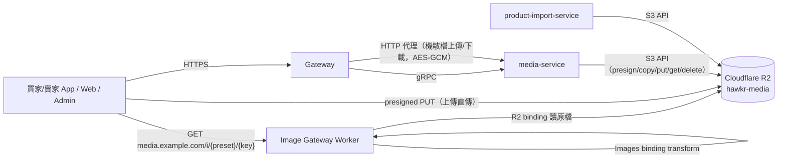
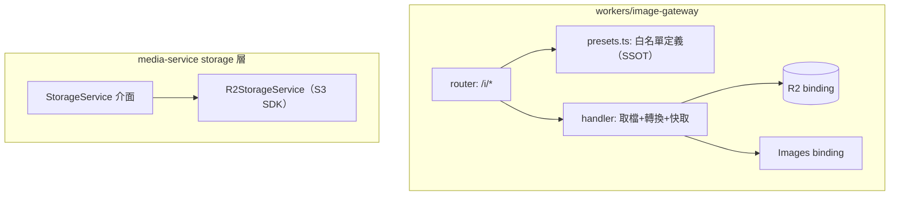
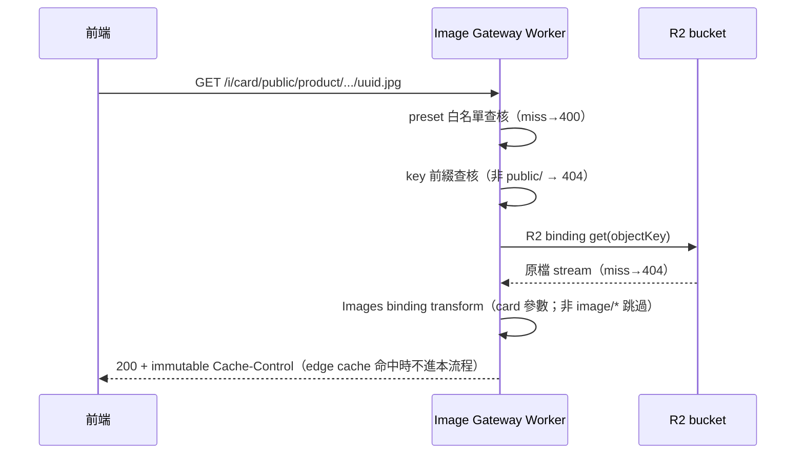

# 多媒體儲存與圖片服務（Cloudflare R2 & Image Gateway）詳細設計書

## 0. 文件元資訊 (Metadata)

| 項目 | 值 |
|---|---|
| 維護者 | 維護團隊 |
| 對應程式碼 | `services/java/media-service/`（storage 層）、`services/java/product-import-service/.../storage/`、`workers/image-gateway/`、`services/java/shared/common-core/.../config/`、`pkg/mediaurl/` |
| 相關 doc | 08 多媒體微服務（媒體資產生命週期）、40 商品匯入、`docs/開發規範/多媒體與圖片 URL 規範.md`、`docs/基礎建設/系統架構與資料流向.md`、[ADR：多媒體儲存與圖片出口](../adr/2026-09-18-media-storage-r2-image-gateway.md) |

---

## 1. 概述與目標 (Overview & Goals)

### 1.1 文件定位
本文件描述平台多媒體儲存（Cloudflare R2）、圖片服務（Image Gateway Worker ＋ preset）、
URL 規範與全平台圖片欄位契約。目標讀者：後端／前端／維運。
不涵蓋：媒體資產生命週期（upload session／finalize／引用計數／GC，見 08 號）。

設計理由與被否決的方案見 [ADR：多媒體儲存與圖片出口](../adr/2026-09-18-media-storage-r2-image-gateway.md)。

### 1.2 服務一句話定位
以 Cloudflare R2 為唯一物件儲存、以 `media.example.com` 上的 Image Gateway Worker 為唯一公開圖片出口，全平台圖片欄位以 objectKey 為唯一真實來源。

### 1.3 設計目標 (Goals) 與 非目標 (Non-Goals)

| 類型 | 項目 |
|---|---|
| **Goal** | 儲存後端 OSS → R2，全平台不再依賴任何阿里雲服務與 `x-oss-process` 語法 |
| **Goal** | 圖片壓縮/resize 收斂為工程固定 preset（deny-by-default，未知 preset 一律 400） |
| **Goal** | DB／MQ payload 一律只存 objectKey；URL 組裝收斂為前後端各一個統一 helper |
| **Goal** | 圖片處理參數調整（quality/尺寸）不需 App 發版（preset 定義只存在 Worker） |
| **Non-Goal** | **不**相容舊 OSS URL、**不**做 `x-oss-process` 相容層/parser、**不**做 R2 miss → OSS fallback |
| **Non-Goal** | **不**做 BD／後台可配置圖片規格；preset 定義集中在 `presets.ts` 單點，未來要 BD 化改為讀 KV／DB 白名單即可 |
| **Non-Goal** | **不**保留前端自由傳 width/height/quality/format |
| **Non-Goal** | **不**在後端做圖片壓縮/縮圖（維持邊緣處理） |
| **Non-Goal** | **不**改變媒體資產生命週期（upload session／staged token／finalize／GC 機制照舊，僅底層 storage API 替換） |

### 1.4 與其他設計書／服務的關係
- **08 多媒體微服務**：資產生命週期 SSOT。本文件生效後，08 號 §6 的 `media.oss.*` 配置與 OSS SDK 描述以本文件 §4/§8.5 為準。
- **40 商品匯入**：`ProductImportOssStorage` 為第二個 storage SDK 接入點，隨本案同步替換。
- **各業務設計書（03 訂單／14 IM／43 評論／15 AI 等）**：其圖片欄位定義隨本案修正為 objectKey（§5.3 資料修正對照）。
- **`docs/開發規範/多媒體與圖片 URL 規範.md`**：本案落地後的長期防回歸規範（隨本設計書同 PR 新增）。

---

## 2. 範圍與情境 (Context & Scope)

### 2.1 系統情境圖 (C4 Context)



### 2.2 邊界與責任

| | 涵蓋 (In-scope) | 不涵蓋 (Out-of-scope，由誰負責) |
|---|---|---|
| Image Gateway Worker | preset 白名單→影像轉換→回應與快取；`/i/original/*` 原圖直出；404/400 語意 | 上傳、權限、資產生命週期 → media-service |
| media-service storage 層 | R2 S3 API 封裝（presign PUT/GET、put、get、copy、delete） | 圖片處理（不做） |
| 統一 URL helper（前後端） | objectKey → URL 組裝 | 業務邏輯 |
| 一次性遷移工具 | OSS→R2 搬檔＋manifest 對帳；DB 存量 URL→key 修正 | 不留 codebase（`tools/`，完成後歸檔） |
| 機敏檔 | **完全不變**：Gateway 代理→media-service AES-256-GCM 加密存 R2 `secure/`，讀取走 `secure_download` 解密串流，不經 Worker、不經公開域名 | — |

### 2.3 角色與身份模型
公開圖：匿名可讀（objectKey 含 uuid 不可枚舉）。機敏檔：沿用 08 號歸屬驗證（本人／asset_reference 關聯／admin）。Worker 不承擔任何身份驗證。

---

## 3. 約束與前提 (Constraints & Assumptions)

| 類型 | 項目 |
|---|---|
| 技術約束 | R2 為 S3 相容 API（SigV4），無 OSS 專屬語意；R2 本身無影像處理，轉換依賴 Cloudflare Images（Transformations） |
| 技術約束 | `example.com` zone 由 Cloudflare 管理；公開圖片出口為 `media.example.com` |
| 技術約束 | objectKey 規範**不變**（08 號 §2.2：`{visibility}/{category}/{accountId}/{date}/{uuid}{ext}`；暫存兩種深度、日期段以 `\d{8}` 定位） |
| 技術約束 | 圖片轉換由 Worker 內的 Cloudflare Images binding 對 R2 串流執行；bucket 維持全私有、不對外宣傳 |
| 技術約束 | R2 的 S3 相容 API 支援 `CopyObject`（finalize `tmp/`→`public/` 的核心動作）與 presigned GET |
| 技術約束 | Transformations 以「唯一轉換請求」計費，用量上界見 §9.2 |

---

## 4. 架構 (Architecture)

### 4.1 解法總綱 (Solution Strategy)
1. **儲存**：單一 R2 bucket `hawkr-media`，key 結構原樣沿用（遷移 targetKey=sourceKey），bucket 不開任何公開存取——公開讀取唯一路徑是 Worker。
2. **圖片出口**：`media.example.com/*` 全路由到 Image Gateway Worker。`/i/{preset}/{objectKey}` 查 preset 白名單→R2 binding 取原檔→Images binding 轉換→回應（immutable 快取）。`/i/original/{objectKey}` 直出原檔。其他路徑 404。
3. **URL 組裝**：後端只組「原圖基底 URL」（`MEDIA_BASE_URL + /i/original/ + key`），統一走 Java `MediaUrlProperties.buildUrl`（common-core，由現行 `CdnProperties` 更名改造）與 Go `pkg/mediaurl.BuildURL`（由 `pkg/cdnutil` 更名改造）；前端統一 `buildImageUrl(imageKey, preset)`（web/admin 共用 TS 模組、兩 App 共用 Dart 類）。
4. **上傳**：media-service 與 product-import-service 的 storage 層改用 AWS S3 SDK（Java v2）對 R2 endpoint：`generatePresignedUrl→S3Presigner`、`putObject/getObject/deleteObject/copyObject→同名 S3 API`。上傳三段式流程、staged token、finalize、GC 邏輯全部不動。
5. **防回歸**：規範層明定禁止完整 URL 落庫（§8.6）；Worker 白名單使「前端自由傳參」在機制上不可行。

### 4.2 元件視圖 (C4 Component)



| 模組 | 責任 | 依賴 |
|---|---|---|
| `workers/image-gateway/src/presets.ts` | preset → 轉換參數映射（**全平台唯一定義點**） | — |
| `workers/image-gateway/src/index.ts` | 路由、取檔、transform、Cache-Control、錯誤語意 | R2 binding、Images binding |
| `media-service .../storage/R2StorageService.java` | 實作與現行 `OssStorageService` 相同的方法面（presign/put/get/copy/delete），介面抽取為 `StorageService` | aws-sdk-java v2 s3 |
| `product-import-service .../storage/ProductImportR2Storage.java` | CSV put/get/delete（同步替換） | 同上 |
| `common-core .../config/MediaUrlProperties.java` | `buildUrl(objectKey)` → 原圖基底 URL（`CdnProperties` 更名改造，http passthrough 防呆**移除**——規範已禁 URL 落庫） | `MEDIA_BASE_URL` |
| `pkg/mediaurl/` | Go 版 BuildURL（`pkg/cdnutil` 更名；social/review 的 ad-hoc 拼接一併收斂進來） | 同上 |
| 前端 `buildImageUrl(key, preset)` | `${MEDIA_BASE}/i/${preset}/${key}`；web/admin 一份 TS、兩 App 一份 Dart | `MEDIA_BASE`（web env var；App dart-define） |

### 4.3 部署拓撲與 Port
Worker：Cloudflare 邊緣，wrangler 部署，**dev/prod 環境分離**（比照 `test-api.`/`api.` 既有慣例）：

| 環境 | Worker route（custom domain） | R2 bucket | MEDIA_BASE_URL |
|---|---|---|---|
| dev | `test-media.example.com/*` | `hawkr-media-dev` | `https://test-media.example.com` |
| prod | `media.example.com/*` | `hawkr-media` | `https://media.example.com` |

custom domain 部署時由 Cloudflare 自動建 DNS。微服務 port 不變。local 開發以 `STORAGE_BACKEND` 環境變數＋dev bucket 連線（本地無 R2 模擬，開發模式沿用現行 mock/skip fallback 行為）。

### 4.4 命名／契約規約：preset 白名單（初版）

| preset | 轉換參數 | 對應場景（收斂自現況三端 48 個 scene） |
|---|---|---|
| `avatar` | 160×160, fit=cover, q=60 | 買家/賣家/聊天頭像（原 web Q20／App avatarS/M/L） |
| `thumb` | 240×240 內, fit=cover, q=70 | 商品縮圖/購物車/訂單項/聊天商品卡（原 144~240 各值） |
| `card` | 720×540, fit=cover, q=75 | 商品卡/貼文卡/首頁卡（原 720/900 各值） |
| `detail` | 1280 長邊, fit=scale-down, q=80 | 商品詳情/貼文詳情（原 1200） |
| `banner` | 1600 長邊, fit=scale-down, q=85 | 首頁/商家 banner、賣家封面（原 1500 q95/1600 q50 取衡） |
| `chat` | 720 長邊, fit=scale-down, q=75 | 聊天圖片訊息 |
| `motion` | 720 長邊, fit=scale-down, q=70, **保留動畫幀** | 動圖（GIF）貼文卡片 |
| `original` | 不轉換 | 全螢幕檢視、商品描述圖（畫質敏感）、PDF 等非圖片檔 |

- **輸出格式不由 preset 宣告**：Cloudflare Images binding 的 `ImageOutputOptions.format` 只接受具體 MIME（`image/jpeg｜png｜gif｜webp｜avif｜rgb｜rgba`），**沒有 `auto` 字面值**（`wrangler types` 生成的型別即如此）。因此 preset 只定義 `transform`（width/height/fit）與 `quality`，實際輸出格式由 Worker 依請求 `Accept` header 現場協商（`index.ts` 的 `negotiateFormat`：avif → webp → jpeg），效果等價於 `cf.image` 的 `format=auto`，只是協商邏輯從平台內建搬到 Worker 內明寫。協商結果同時併入 edge cache key，避免不同 Accept 能力的客戶端互相污染快取。
- **動圖 preset（`motion`）是格式協商的唯一例外**：`ImagePreset` 多一個 `animated?: true`，宣告了的 preset 協商只在**能動**的格式之間選（webp → gif），絕不落到 jpeg/avif —— 靜態格式會把動圖壓成單張，那正是這個 preset 要避免的事。avif 不納入：CF Images 的 animated AVIF 支援不穩定，而這裡「動不動」是功能本身不是畫質偏好，寧可退回 gif 也不賭一個會靜默變成單張的格式。`.output()` 另**顯式**帶 `anim: true`（runtime 型別註明預設為 true，但這個 preset 存在的唯一理由就是動畫，靠預設值等於把功能押在別人不會改預設上）。
- 🔴 **degrade 語意對 `motion` 的意義與其他 preset 不同**：轉換失敗時 Worker 一律 fallback
  直出原檔（§7.3）。對靜態 preset 那只是少一次壓縮；對 `motion` 則是**退回未經壓縮的原始動圖**
  ——動圖原檔與 `card` 尺寸可差兩個數量級，足以拖垮一次載入大量圖片的頁面。
  ⚠️ 因此 `motion` 的驗證**不能只看 HTTP 200**（degrade 也回 200），必須實測輸出的
  **位元組數與幀數**：位元組數與原檔相同即代表轉換根本沒發生。
- 命名即契約：前端只准傳表內 preset 名；Worker 對未知 preset 回 **400**（deny-by-default）、key 不存在回 **404**、非圖片檔而 preset≠original 回 original 行為（Content-Type 非 image/* 時跳過轉換直出）。
- 新增/調整 preset：在 `presets.ts` 的 `PRESETS` 加一組 `{ transform, quality }`（**不含 format**，`ImagePreset` 型別也不接受；要保留動畫另加 `animated: true`）＋本表同步＋部署 Worker，**前端不需改版**。`test/presets.test.ts` 有一條逐值對照本表的 pin，改了這裡沒改那裡（或反過來）會轉紅。
- 數值原則：以「現值不劣化」為底線自現況收斂；App 端 `merchantBanner q95` 特調場景於 dev 驗證 `banner` preset 畫質，不可接受再單獨加 preset（不回退到自由傳參）。

---

## 5. 資料設計 (Data Design)

### 5.1 資料模型
media-service 三表（upload_session／media_asset／asset_reference）與 import_asset 結構不變，除：
- `media_asset` **無 `url` 欄位**：媒體資產只存 objectKey。
  proto `FinalizeImportAssetResponse.url` 的值由 `MediaUrlProperties.buildUrl(objectKey)` 現場組出，不落庫。

### 5.2 索引與查詢模式
無變更（storage 替換不影響查詢路徑）。

### 5.3 存量資料修正（URL → objectKey）對照

處理原則：**按值型態分類處理，不按欄位名假設**——同一個欄位可能混有多種型態的值。分類規則：

| 值型態 | 判別 | 處置 |
|---|---|---|
| 媒體域名 URL | 設定中的 `MEDIA_BASE_URL` 前綴（dev `test-media.`／prod `media.`） | strip 前綴 → objectKey。⚠️ 已退役的舊 CDN 網域**不在**已知來源內（backend#2283：媒體域名不做新舊相容），送進來一律當外來網址拒收 |
| OSS 原始域名 URL | `*.aliyuncs.com/` | strip → objectKey（tmp/ 開頭者按死圖處理） |
| Gateway 代理格式 | `test-api.example.com/api/v1/files/` | strip → key；tmp/ 開頭＝死圖 |
| 死圖（過期 presigned／JWT 字串／tmp already-GC） | query 帶 `Expires=`／`eyJ` 前綴／`tmp/` 前綴 | **清理**（NULL 或自陣列移除；產 undo SQL 留檔）【使用者已裁決】 |
| 第三方 URL（Google OAuth 頭像） | `lh3.googleusercontent.com` 等非我方域名 | **不動**（本欄位語意允許外部 URL 者僅 avatar 快照類，見下表註記） |
| 已是 objectKey | 非 http 開頭 | 不動 |

逐欄位的寫入路徑約束（**這些是寫入端必須守住的規則，不是一次性動作**）：

| # | 服務.表.欄位 | 寫入路徑約束 |
|---|---|---|
| 1 | review `order_item_reviews.image_keys`／`item_image_key` | `review_usecase` 只存 key；🔴 `item_image_key` **不接受前端直送**，由後端以 orderItem 的 `image_object_key` 回填 |
| 2 | im `messages.content`(type=2)／`conversations.last_message_content` | `message` usecase 只存 key。⚠️ 任何掃這兩欄的腳本**必須按 `type=2` 過濾** content，`last_message_content` 隨 `messages` 同步 |
| 3 | order `orders.shipment_photo_keys`／`receipt_photo_keys`／`review` JSONB `imageKeys` | Shipping MQ payload 帶 key（§6.3）；`OrderGrpcService` 收貨照存 key |
| 4 | ai `ai_styles.thumbnail_key` | 🔴 `UpdateAiStyle` **禁收任意 URL**，只收 objectKey 並驗格式 |
| 5 | social `cms_post.image` | `post` usecase 只存 key；URL 一律走 `pkg/mediaurl` |
| 6 | social `cms_comment`／`cms_seller_forum.user_avatar` | 快照來源存 key；Google 外部頭像維持 URL，讀取端以「非 http 開頭＝key」判別後組 URL |
| 7 | content `recipes.image_key` | key 格式自成一格 `public/recipes/{id}.png`（既有批次資料的命名，不套 08 號 objectKey 格式） |
| 8 | shipping `shipments` | 無 `label_url` 欄；讀取端一律以 `label_object_key` 組 URL |
| 9 | media `media_asset` | 無 `url` 欄（§5.1） |
| 10 | notification `notification_templates.image_key_template`／logs `image_key` | 模板填 objectKey 佔位；渲染端組 URL |

**欄位同步 rename（強制）**：凡改存 objectKey 的欄位，名稱一律同步改為 `*_key`／`*_keys` 語意，**禁止名帶 url 實存 key**（`banners.preview_image_url` 命名陷阱不再新增）：

| 現名 | 新名 |
|---|---|
| review `image_urls`／`item_image_url` | `image_keys`／`item_image_key` |
| orders `shipment_photo_urls`／`receipt_photo_urls`／review JSONB `imageUrls` | `shipment_photo_keys`／`receipt_photo_keys`／`imageKeys` |
| ai_styles `thumbnail_url` | `thumbnail_key` |
| recipes `image_url` | `image_key` |
| banners `preview_image_url`／`popup_image_url`（既有陷阱，存 key） | `preview_image_key`／`popup_image_key` |
| notification `image_url_template`／logs `image_url` | `image_key_template`／`image_key` |
| seller `sellers.cover_url` | `cover_key` |
| 中性名不改：`cms_post.image`、`messages.content`、`user_avatar`（語意允許混外部 URL） | — |


### 5.4 Schema 演進與遷移
Flyway `V{N+1}`（media：DROP url；shipping：DROP label_url；order：review 快照 key 欄位改名走 JSONB 內容改寫不動 schema）；Go 服務 Atlas 對應。全部 append-only，V1 不動。

---

## 6. API 與介面契約 (API & Interface Contracts)

### 6.1 對外 REST（經 Gateway）— 扁平成對欄位（全平台強制契約）

> **Connect 契約（單體）不適用本節**：回 `hawkr.common.v1alpha1.Image{uri_template}`（`{MEDIA_ORIGIN}/i/{preset}/{key}`），client 只替換 `{preset}`，key 不對外，寫入只帶新圖的 staged token（ADR [`2026-09-25-api-image-uri-template.md`](../adr/2026-09-25-api-image-uri-template.md)，取代 media ADR 的 ADR-08）。本節的 `imageKey`＋`imageUrl` 只適用還沒搬進單體的 REST 路由，隨各模組搬遷退場。
- 媒體上傳三段式路由**不變**（`/app/media/upload_sessions` 等），回應中 `uploadUrl` 改為 R2 presigned PUT URL（S3 SigV4，https 強制由 S3 SDK endpoint 配置保證）。
- 業務 API 圖片欄位契約統一為**扁平成對雙欄位**（破壞性變更，前端同步改造）：

```json
{ "imageKey": "public/product/123/20260216/a1b2c3.jpg",
  "imageUrl": "https://media.example.com/i/original/public/product/123/20260216/a1b2c3.jpg" }
```
  - `imageKey`＝SSOT，值＝裸 objectKey；前端 `buildImageUrl(imageKey, preset)` 組顯示 URL。
  - `imageUrl`＝原圖基底 URL（`/i/original/{key}`），由 **Gateway 組裝**，供不需壓圖的消費者（分享、匯出）直接使用。
  - **欄位命名一律 `{語意}Key`＋`{語意}Url` 成對**（`logoKey/logoUrl`、`avatarKey/avatarUrl`、`coverKey/coverUrl`、陣列 `imageKeys/imageUrls`）；舊有單欄位名不保留——未上線一次統一，不做「舊名存新語意」的兼容、不做巢狀 `MediaRef{object_key,cdn_url}`（形狀取捨見 [ADR：多媒體儲存與圖片出口](../adr/2026-09-18-media-storage-r2-image-gateway.md)）。**逐服務欄位落地清單見 §6.6，特例處置見 §6.7**（此即 §231/§6.2 承諾之「逐 proto 清單」，收斂進本設計書而非散於實作 PR）。
  - **組裝點唯一＝Gateway**：業務微服務回傳的 proto 只帶 `xxx_key`（objectKey），Gateway 在 HTTP JSON 回應層組出成對 `xxxKey`＋`xxxUrl`（`xxxUrl` 經 Go `pkg/mediaurl.BuildURL` 組）。**服務側禁止 `BuildURL`**（Java `MediaUrlProperties.buildUrl`／Go `pkg/mediaurl.BuildURL` 不得在業務微服務回應路徑呼叫）——現行各服務內組 URL 回扁平單欄的實作捷徑一律移除。不經 Gateway 的通道（MQ payload／WS/SSE／FCM）為特例，各自組裝點於 §6.7 明定。
  - **層次界定**：本條約束 **API/DTO 回應層**。DB 欄位命名依 §5.3 規則——「名帶 url 實存 key」者必 rename，語意中性名（`cms_post.image`、`messages.content`、`user_avatar`）**維持原名不動**；兩層規則不互相覆蓋。
- 機敏檔 API 不變。

### 6.2 gRPC（服務間）
- media.proto：`FinalizeImportAssetResponse.url` 語意改為 Worker 原圖 URL（欄位名不變，值域改；服務間內部欄，media-service 自組原圖 URL 供匯入回填，屬 §6.7 特例）；其餘 RPC 面不變。
- **業務 proto 圖片欄位（§231 落地，覆蓋原「欄位名沿用」暫定）**：承載 objectKey 的欄位一律採 snake_case `xxx_key`／`xxx_keys` 命名（proto 欄位語意誠實化，隨全平台一次切，無相容雙軌）；業務微服務只填 key、**移除服務側 `BuildURL`**；`xxxUrl` 由 Gateway 於對外回應層組出（§6.1）。**逐服務 proto 欄位落地清單見 §6.6**——此清單即 §231「逐 proto 清單於實作 PR 附」的兌現，改為在本設計書定版，實作 PR 依此執行。
- 破壞性 proto 型別/命名變更走一次切（系統未上線，§3 組織約束）；proto 同步流程依開發規範 §3（`api/proto/*` → `gen-go-proto.sh` → rsync java-proto → `mvn clean install`）。

### 6.3 非同步事件 (MQ)

| 項目 | 值 |
|---|---|
| 影響事件 | `order.*`（OrderOutboxPublisher 商品縮圖）、shipping 出貨事件（照片）、`review.created`（評論圖）、`product.restock`／`product.restock.target`（商品縮圖） |
| 變更 | payload 圖片欄位改帶 objectKey 且**欄位名同步改為 `*Key` 語意**（禁止 `*Url` 名存 key 值；36 號 SSOT 先行更新） |
| 向後相容 | 未上線直接切換；消費端同 PR 群改造 |

### 6.4 即時通道 (WS/SSE)
> N/A（IM 圖片訊息走 messages.content 存 key，投遞格式隨 §5.3 #2 改造；通道機制不變）。

### 6.5 Image Gateway HTTP 契約

| 請求 | 回應 |
|---|---|
| `GET /i/{preset}/{objectKey}` | 200 轉換後圖；`Cache-Control: public, max-age=31536000, immutable`；`Content-Type` 依 `Accept` 協商（§4.4） |
| `GET /i/original/{objectKey}` | 200 原檔（Content-Type=R2 metadata） |
| preset 不在白名單 | 400（純文字，無 Envelope——非業務 API） |
| objectKey 不存在 | 404 |
| objectKey 前綴非 `public/` | 404（`secure/`、`tmp/` 一律不可經 Worker 讀取，fail-closed） |
| 其他路徑 | 404 |

### 6.6 逐服務圖片欄位落地清單（§231 兌現）

> 範圍＝全平台對外圖片顯示欄位。**處置碼**：`GW組`＝proto 承載 objectKey（`xxx_key`）、Gateway 對外組成對 `xxxKey/xxxUrl`（服務側禁 BuildURL）；`已合規`＝Gateway 現已組成對雙欄（僅需隨命名收斂核對）；`Sx`＝§6.7 特例；`排除`＝非圖片／寫入 token／base64，不套契約。
> 🔴 **enrich／cascade 欄位（S9）必須與上游成套改**：上游改回 key 之後下游透傳的就是 key，
> 由 Gateway 在最終對外回應組 url。上游改了而下游沒跟＝透傳 key 未組＝斷圖。
> **「新命名」欄＝proto 承載欄名（snake_case，內部傳輸層，可含 `seller_`／`buyer_` 前綴）；非對外 JSON 欄名。** 對外 REST JSON 一律依 §6.1 收斂為 camelCase 成對 `{語意}Key`／`{語意}Url`（`logoKey/logoUrl`、`avatarKey/avatarUrl`、`coverKey/coverUrl`、陣列 `imageKeys/imageUrls`；商品卡 flat 便利欄 `sellerLogoKey/sellerLogoUrl` 避免與 nested `seller.logoKey` 碰撞）。**禁止對外透傳 proto 前綴或 snake_case**（如 `seller_logo_key`、`logo_url`、`sellerAvatarUrl` 皆為實作債，非契約）；商家頭貼不論來源域一律對外 `logoKey/logoUrl`，不保留 `sellerAvatar*`／`shopLogo*`／`avatar*`（賣家）等別名（硬切、零 deprecated 雙欄）。

#### 6.6.1 商品圖對外欄名規則

🔴 **同一張商品圖在對外契約上只准有一組名字**，否則前端寫不出單一取圖函式、
每個端點都要特判。規則只有三句：

1. **帶「一張圖」的物件** → `imageKey` ＋ `imageUrl`。
2. **帶「一組圖」的物件** → `imageKeys` ＋ `imageUrls`（無圖回 `[]`，不得 `omitempty` 讓欄位消失，也不得為 `null`）。
3. **只有在同一個物件同時帶「自己的圖」與「被引用實體的圖」、兩者會撞名時**，才給被引用的那組加前綴。

第 3 條唯一的現行案例是評論：`OrderReviewRecord` 的 `imageKeys` 是買家上傳的評論附圖，
被評論商品的封面因此叫 `productImageKey`／`productImageUrl`。若把它也收斂成 `imageKey`，
單數與複數就會指涉兩件不同的事——那比不一致更難讀。
反過來，`favorite`／`browse-history`／`restock_subscription` 的卡片各只有一組圖，
前綴不帶任何資訊，已收斂為 `imageKey`／`imageUrl`。

`gallery[]` 與商品描述 image block 一併適用第 1 條（`imageKey`／`imageUrl`，見 §6.7 S6 修訂），
`assetId` 維持 S6 例外。

**匯入預覽（product_import）不適用本規則**：其值是 presigned `preview_url` 或原站 `source_url`，
圖片落在 `tmp/product-import/` 前綴而 Worker 只服務 `public/`，**平台 objectKey 不存在**。
欄名一律帶 `preview`（`firstImagePreviewUrl`／`imagePreviewUrl`／`gallery[].previewUrl`），
讓前端一眼看出不能丟進 `buildImageUrl`。補一個空的或假的 `*Key` 比沒有更糟（§25：`_key` 欄不得承載 URL）。

#### account（Go）
| proto 欄位 | 現承載 | 新命名 | 處置 |
|---|---|---|---|
| `AccountInfo.avatar` | 外部 URL | 不改 | **S2**：Google OAuth 頭像，外部 URL 直通，成對契約允許「有 url 無 key」 |

#### buyer（Go）
| proto 欄位 | 現承載 | 新命名 | 處置 |
|---|---|---|---|
| `BuyerAvatarData.avatar_url` | 混（Google URL／key） | `avatar_key`(+GW組 `avatarUrl`) | **S2+GW組**：非 http=key 走 Gateway 組 url；http=外部直通。移除 buyer `handler.go` BuildURL |
| enrich `avatar` | 混 | `avatar_key` | S2+GW組 |
| enrich 卡片 `product_image`／`seller_logo`／`cover_url` | URL（cascade） | `product_image_key`／`seller_logo_key`／`cover_key` | **S9**：源自 product/seller，隨批 3 成套改（上游回 key、Gateway 組 url） |
| `UpdateProfileRequest.avatar` | 輸入/混 | 不改型別 | 輸入路徑（買家自設頭像 objectKey 或 Google URL），S8 邊界 |

#### seller（Go）
| proto 欄位 | 現承載 | 新命名 | 處置 |
|---|---|---|---|
| `SellerInfo.logo`／`cover_url` | URL（mapper.go BuildURL） | `logo_key`／`cover_key`(+GW組 `logoUrl`/`coverUrl`) | **GW組**：移除 `mapper.go`／`handler.go` 的 BuildURL 呼叫 |
| `SellerInfo Meta.logo_url`（internal→product） | URL（mapper.go） | `logo_key` | GW組：內部欄改回 key，product 端經 Gateway 組（移 mapper.go BuildURL；併 product SellerInfoAssembler） |
| `RecommendedSeller.cover_url`／`logo` | URL（handler.go） | `cover_key`／`logo_key`(+GW組) | GW組 |
| `AdminSellerItem.cover_url`(f26,:878) | **裸 key**（handler.go 無 BuildURL，§25 違規） | `cover_key`(+GW組 `coverUrl`) | **GW組**（#1660 核心）：proto rename cover_url→cover_key；admin 回應由 Gateway 補組成對 `coverKey/coverUrl` |
| enrich `avatar` | URL/混 | `avatar_key` | S2+GW組 |
| `AvatarData.object_key`＋`preview_key`／`CoverData.object_key` | KEY（`preview_key` 服務端從未賦值） | `LogoData.logo_key`／`CoverData.cover_key`（+GW組 `logoUrl`／`coverUrl`）；`preview_key` **reserved 移除** | **GW組**：finalize 回應必須與同資源讀取端同名成對（`logoKey/logoUrl`、`coverKey/coverUrl`）。舊契約回 protoc-gen-go 的 snake `object_key`，賣家 App 讀 `objectKey` 永遠 null → 上傳成功卻誤報失敗。RPC `UpdateAvatar`→`UpdateLogo`、路由 `PUT /app/sellers/me/avatar`→`/logo` 同批收斂 |
| `CreateSellerRequest.cover_url`(f7)／`UpdateSellerRequest.cover_url`(f7) | 死欄位（usecase 9220 拒非空） | **proto `reserved` 移除**（#1660 裁決） | 入站死碼，reserved 7 移除欄位＋Gateway 入站 struct／Swagger `cover_url` 同步刪 |
| `CreateSellerRequest.logo`(f3)／`UpdateSellerRequest.logo`(f3) | 死欄位（usecase 一律拒非空，B-214 防 SSRF／盜用他人 object key） | **proto `reserved 3` 移除** | 同 `cover_url`：generic update 不驗來源故不得收 logo，設定一律走 `PUT /app/sellers/me/logo` staged-token flow；Gateway 入站 struct／Swagger `logo` 同步刪 |
| KYC `id_card_front_url`／`back_url`／`bank_book_url`／`document_urls` | 機敏 | 不出 CDN url | **S1**：機敏檔，兩個對外面都不回 key——app 端只回 `xxxAssetId`、admin 端的證件影像由擁有者端點逐次授權與記錄（後台沒有通用的 media 機敏下載，plan 8f-1），不經 Worker |
| `website_url`／`payuni_website_url` | 外部網站 | — | 排除（非圖片） |

#### crm（Go）
| proto 欄位 | 現承載 | 新命名 | 處置 |
|---|---|---|---|
| `Customer.avatar` | URL（enrich 自 buyer） | `avatar_key` | **S9**：buyer 改回 key 後 crm.go 透傳 key，Gateway 組 url（隨批 3）。⚠️ 批 3 只完成上半：crm 透傳了 key，但 Gateway 的顧客列表／詳情兩支忘了組 url（列表更直接把 proto 丟給 encoding/json，吐出 protobuf tag 的 `avatar_key`），前端與賣家 App 都讀不到，頭像全空——2026-07-26 補上 `avatarKey`+`avatarUrl` 成對輸出並以 golden test 鎖形狀 |

#### order（Java）
| proto 欄位 | 現承載 | 新命名 | 處置 |
|---|---|---|---|
| `OrderItem.image_url` 商品圖快照 | URL 快照 | `image_key`(+GW組) | GW組：order 存 key（現已有 `image_object_key`:621… 可回填），Gateway 組 url |
| `image_object_key` | KEY | 保留（已誠實） | 已 key；作為快照回填來源 |
| `seller_avatar_url`／`buyer_avatar_url` | URL（enrich） | `seller_avatar_key`／`buyer_avatar_key` | S2+S9+GW組：live lookup 改回 key，Gateway 組 |
| `label_url` 託運單 PDF | URL（shipping 來源） | `label_key`(+GW組) | GW組：來源 shipping（見下），Gateway 組 `/i/original` url（PDF 走 original） |
| `shipment_photo_urls`／`receipt_photo_urls` | 混（Gateway 已組雙欄 order.go） | `shipment_photo_keys/urls` | **已合規**：核對 proto 值已為 key、命名收斂 |
| `ReviewSnapshot.image_urls` | 混（Gateway 已組 order.go） | `image_keys/urls` | **已合規** |
| MQ payload `sellerAvatar`（OrderOutboxPublisher:97、OrderService:349） | URL | `sellerAvatarKey` | **S3**：MQ 改帶 key，移除 BuildURL，36 號 SSOT＋golden 同步 |

#### shipping（Java）
| proto 欄位 | 現承載 | 新命名 | 處置 |
|---|---|---|---|
| `label_url` 託運單 PDF | URL（ShipmentLabelService:101,136,196；AdminQuery:273） | `label_key`(+GW組) | GW組：DB 已有 `label_object_key`（§5.3 #8 DROP `label_url` 欄），一律由 key 組 |
| `shipment_photo_urls` | URL（AdminQuery:281） | `shipment_photo_keys`(+GW組) | GW組；shipping MQ payload 帶照片同 **S3** |
| `csv_url`／`form_action`／`redirect_url` | 非媒體 | — | 排除（政府 CSV／PayUni 地圖/DeepLink） |

#### aftersales（Java）
| proto 欄位 | 現承載 | 新命名 | 處置 |
|---|---|---|---|
| `image_url`（item／evidence） | URL（GrpcService:976,991） | `image_key`(+GW組) | GW組：售後商品圖/佐證圖，移除 BuildURL |
| `buyer_avatar_url`／`seller_avatar_url` | URL（enrich） | `buyer_avatar_key`／`seller_avatar_key` | S2+S9+GW組 |
| `shipment_photo_urls` | URL（來自 shipping） | `shipment_photo_keys` | S9：隨 shipping 成套 |
| `photo_tokens`／`inspection_photo_tokens`／`evidence_photo_tokens` | 輸入 token | 不改 | **S8**：staged_token 寫入路徑，非顯示 |
| `redirect_url` | 非媒體 | — | 排除（PayUni DeepLink） |

#### ai（Go）
| proto 欄位 | 現承載 | 新命名 | 處置 |
|---|---|---|---|
| `AiStyle.thumbnail_url` | URL（Gateway ai.go 已組） | `thumbnail_key`(+GW組) | **已合規/GW組**：核對 Gateway 出成對；§5.3 #4 存 key＋UpdateAiStyle 堵洞 |
| `ImageResult.image_url` AI 產圖 | URL（ai 服務） | `image_key`（內部）；對外經 GW組 | 內部結果欄改回 key；對外顯示走 Gateway 組 |
| `seller_logo` | URL（enrich） | `seller_logo_key` | S9 |
| `ImageRequest.image_url` | 輸入 | 不改 | **S8**：以圖處理/搜圖輸入，非顯示 |
| `image_base64` | base64 | — | 排除 |

#### product（Java）
| proto 欄位 | 現承載 | 新命名 | 處置 |
|---|---|---|---|
| `GalleryItem.object_key`+`url` | KEY+URL（已成對，ProductProtoConverter:256,464,804 BuildURL） | 已成對，`url` 改由 GW 組 | **GW組**：欄位已備 key+url，移除 converter BuildURL，`url` 由 Gateway 組。**對外 JSON ＝ `imageKey`／`imageUrl`**（§6.6.1；proto 欄名不動） |
| `DescriptionBlock.object_key`+`url` 描述內嵌圖 | KEY+URL（已成對，量大巢狀） | 同上 | GW組：組裝點集中 converter:464→移至 Gateway；不需改 proto 型別。**對外 JSON ＝ `imageKey`／`imageUrl`**，含寫入面 `DescriptionBlockInput`（§6.6.1） |
| `ProductDetail.image_url`／`images` | URL | `image_key`／`image_keys`(+GW組) | GW組：便利主圖/圖陣列 |
| `SellerInfo.logo_url` | URL（SellerInfoAssembler:29 BuildURL） | `logo_key`(+GW組) | **S9+GW組**：enrich 自 seller，移除 Assembler BuildURL |
| `image` | URL | `image_key`(+GW組) | GW組 |
| `Simple/Internal.image_object_key` | KEY | 保留 | 已 key（internal 直傳） |
| `ProductImage.object_key`／`staged_token`／`import_asset_id` | 輸入 | 不改 | **S8**：寫入路徑 |

#### cart（Java）— 結帳 hot path
| proto 欄位 | 現承載 | 新命名 | 處置 |
|---|---|---|---|
| `CartGroup.logo_url` | URL（CartGrpcService:110 BuildURL） | `logo_key`(+GW組) | **S9+GW組**：enrich 自 seller，移除 BuildURL |
| `CartItem.image_url` | URL（CartGrpcService:115，DB 存 key 回傳組） | `image_key`(+GW組) | GW組：**批 1 必跑 `infra/smoke-checkout.sh`** |

#### coupon（Java）
| proto 欄位 | 現承載 | 新命名 | 處置 |
|---|---|---|---|
| `Coupon.seller_avatar_url` | URL（透傳 seller.logo_url） | `seller_avatar_key` | **S9**：seller 改回 key 後 coupon 透傳值變 key，Gateway 組 url（隨批 3） |

#### content（Go）— 已遷移
| proto 欄位 | 現承載 | 新命名 | 處置 |
|---|---|---|---|
| `BannerItem.preview_image_url`／`popup_image_url` | KEY（Gateway content.go 已出 key/url） | `preview_image_key`／`popup_image_key` | **已合規**：proto 名含 url 實存 key，隨命名收斂 rename |
| `Recipe*.image_url` | KEY 手灌（Gateway content.go 已出 key/url） | `image_key` | 已合規 |
| `link_url` | 非圖片 | — | 排除（外連） |

#### social（Go）
| proto 欄位 | 現承載 | 新命名 | 處置 |
|---|---|---|---|
| `Post.image`／`image_url`／`images` | URL（post.go 服務＋Gateway post.go 分裂） | `image_key`／`image_keys`(+GW組) | GW組：組裝點統一收斂 Gateway，移除 social 服務側 BuildURL |
| `seller_logo` | URL（enrich） | `seller_logo_key` | S9 |
| `Comment/Forum.user_avatar` | 混（Gateway post.go／seller_forum.go／realtime comment_channel.go） | `user_avatar_key` | **S2+S4**：REST 走 Gateway 組；realtime（WS）走 §6.7 S4 |
| `evidence_urls` 檢舉佐證 | URL | `evidence_keys`(+GW組) | GW組（proto 註解 OSS 一併更新） |
| `staged_tokens` | 輸入 | 不改 | S8 |

#### im（Go）— WS 特例
| proto 欄位 | 現承載 | 新命名 | 處置 |
|---|---|---|---|
| `Message.content`（type=2 圖片） | KEY（message.go REST＋:485 WS BuildURL） | 中性名不改（§5.3 註存 key） | **S4**：REST 走 Gateway 組；WS 見 §6.7 |
| `Conversation.avatar_url`／`target_avatar`／`logo_url` | 混/URL（im enrich） | `avatar_key`／`target_avatar_key`／`logo_key` | S2+S4：REST GW組，WS 特例 |

#### review（Go）
| proto 欄位 | 現承載 | 新命名 | 處置 |
|---|---|---|---|
| `images`／`image_urls` | KEY（Gateway order_review.go 已組） | `image_keys` | **已合規**：核對 Gateway 出成對；前端改傳 staged_tokens |
| `item_image_url` 商品快照 | KEY（Gateway order_review.go） | `item_image_key` | 已合規；§5.3 #1 堵洞由 orderItem `image_object_key` 回填 |
| `user_avatar`／`buyer_avatar` | URL（enrich 自 buyer） | `user_avatar_key`／`buyer_avatar_key` | S2+S9 |

#### notification（Go）— FCM 特例
| proto/domain 欄位 | 現承載 | 新命名 | 處置 |
|---|---|---|---|
| `NotificationTemplate.image_url_template`(DB/domain) | KEY 模板（worker template_handler.go 組進 FCM） | `image_key_template` | **S5**：FCM 只吃單一 URL，worker 續組（特例保留），模板存 objectKey 佔位 |
| `schema_url`／`rendered_schema_url` | 非圖片 | — | 排除（data schema） |

#### media（Go+Java）／product_import（Java）— 內部/基礎設施
| proto 欄位 | 現承載 | 新命名 | 處置 |
|---|---|---|---|
| media `FinalizeImportAssetResponse.url` | URL | 名不變、值＝Worker 原圖 URL | **§6.2/S6**：服務間內部欄，media 自組原圖 URL 供匯入回填 |
| media `ImportAsset preview_url`／`upload_url`／`object_key`／`source_url` | 混/輸入（presigned 具時效） | 不落庫 | 上傳/匯入基礎設施，presigned 不落庫（S8 邊界） |
| product_import `first_image_url`／`image_url` | URL（匯入預覽，admin；值＝presigned `preview_url` 或外部 `source_url` 直通，非 objectKey） | 名不改（誠實 `*_url`） | **S8／S7**：匯入預覽物件在 `tmp/` 前綴（media `buildTmpObjectKey`），Worker 只服務 `public/` 前綴（fail-closed 404），故此欄無法走公開 Worker 組 URL——必為 presigned 預覽 URL（S8）或外部 CSV `source_url`（S7）直通；服務／Gateway 皆無 BuildURL（已合規），不 rename 為 `*_key`（避免 `_key` 欄承載 URL 反違 §25）。**對外 JSON 欄名一律帶 `preview`**：`firstImagePreviewUrl`／`imagePreviewUrl`／`gallery[].previewUrl`（§6.6.1），讓前端一眼看出不能丟進 `buildImageUrl` |
| product_import `source_url` | 外部 URL（賣家 CSV） | 不改 | **S7**：外部來源 normalize，非我方媒體 |
| product_import `preview_url` | presigned | 不落庫 | 基礎設施 |

### 6.7 特例處置（9 類，逐類定案）

| # | 特例 | 位置 | 處置（定案，不留「另議」） |
|---|---|---|---|
| S1 | **KYC 機敏檔** | seller `id_card_front_url/back_url/bank_book_url/document_urls` | 不出公開 CDN URL，且**兩個對外面都不回 `xxxKey`**（比成對契約更嚴，objectKey 本身即機敏路徑）：**兩端都回 `xxxAssetId`＋`xxxUrl`**，`xxxUrl` 是 `secure_download` 代理路徑（08 號），不是媒體 URL——每次請求重新授權、不落庫、由 assetId 現組。<br>**app 端**＝`/api/v1/app/media/secure_download/{assetId}`（`buildAppAssetURL`，掛 JWTAuth 且 media-service 驗擁有者）；**admin 端**：通用的 `/api/v1/admin/media/secure_download/{assetId}`（無 owner 檢查、不記是誰）已刪除（plan 8f-1），證件影像改由擁有者端點授權（seller 模組，見 KYC ADR）；舊 gateway 的 `buildAdminAssetURL` 隨步驟 9–11 刪除。key 前綴 `secure/` fail-closed（§8.1），Worker 物理 404。<br>🔴 **兩端都必須回 `xxxUrl`，不得只回 `xxxAssetId`**：只給識別碼不給取用途徑，等於把組路徑的工作外包給前端去猜——實際後果是前端把 `URL.createObjectURL(file)` 的 `blob:` 位址寫進 `step_data` 落庫，而 `blob:` 重載即失效，認證草稿因此永遠顯示不出已上傳的文件。<br>`SaveCertificationProgress` 以 `rejectURLValuesInStepData` 擋住任何 URL 值寫入 `step_data`。 |
| S2 | **Google 外部頭像** | account `avatar`；buyer/social/review `user_avatar`、im avatar（混型態） | 成對契約允許「有 `xxxUrl`（外部原值）無 `xxxKey`」：讀取端與 Gateway 以 **「http 開頭＝外部 URL 直用、否則＝objectKey 由 Gateway 組」** 判別。外部 URL 欄位型別不改、不強制 rename（中性名保留）。 |
| S3 | **MQ payload 圖片** | order `sellerAvatar`（OutboxPublisher/OrderService）、shipping 出貨事件照片、`review.created` 評論圖、`product.restock(.target)` 縮圖 | **不經 Gateway**：payload 一律帶 objectKey、欄位名 `*Key`（禁 `*Url` 名存 key）；**組裝點＝消費端**（消費端存 key 或自組 URL）。強制 **36 號 MQ Catalog SSOT 先行更新**＋`tests/contract/golden/event_payload_keys.json` 同步登記（否則 CI 契約 gate 擋／靜默 0 投遞，見 10 檔 §23 教訓）。 |
| S4 | **WS/SSE 即時通道** | im `Message.content`、im Conversation avatar、social realtime `user_avatar` | **不經 Gateway REST**：WS/SSE payload 只帶 objectKey（`*Key` 語意），**組裝點＝接收端前端**（四端 helper `buildImageUrl(key,preset)` 組），發送服務（im/social）**不組 URL**（維持服務側禁 BuildURL 一致）。同資源 REST（Gateway 組 url）與 WS（前端組）並存無 drift——objectKey 為單一 SSOT。⚠️ 同名欄位跨通道值型態不同（REST=URL、WS=objectKey），前端一律過 `buildImageUrl(keyOrUrl, preset)`（S2 dual-mode：http 開頭直用、否則當 key 組）吸收，禁止對 WS 值假設 URL 型態。 |
| S5 | **FCM push** | notification worker `template_handler` | **不經 Gateway**：FCM 通知只吃單一 URL 字串，成對契約不適用；**組裝點＝notification worker**（worker 續組，特例明文保留），template 欄存 objectKey 佔位（`image_key_template`）。 |
| S6 | **/i/original 原圖直出** | product `GalleryItem.url`／`DescriptionBlock.url`、media `Finalize.url`、social share 匯出 | 成對欄位的 `xxxUrl` 語意＝**原圖基底 URL**（`/i/original/{key}`），即供分享/匯出/畫質敏感場景直用（§6.1）；REST 路徑由 Gateway 組，非 REST 匯出（share 匯出、media Finalize）由該路徑自組 original URL。<br>`GalleryItem` 的 `assetId` 登記為例外：它是媒體資產 TSID，讓賣家編輯時 round-trip 保留既有圖，是與 key/url 並列的**第三種語意**，套不進 `{語意}Key`＋`{語意}Url` 的成對契約。適用賣家端與 admin 端；公開端 PDP 會再遮蔽其中部分欄位，遮蔽範圍以 02 號 §2.2.2 為準。<br>`GalleryItem` 與 `DescriptionBlock` 的圖片欄一律是 `imageKey`／`imageUrl`（與 §6.6.1 的商品圖規則一致）；**只有 `assetId` 是例外**，多一個欄位不妨礙另外兩個欄位成對。 |
| S7 | **賣家 CSV 外部來源** | product_import `source_url` | 外部 URL 輸入（normalize 後下載），**非我方媒體，不套成對契約、不改**。 |
| S8 | **上傳/寫入路徑 token** | 各 `staged_token`／`photo_tokens`／`inspection_photo_tokens`／`evidence_photo_tokens`／`import_asset_id`／`ProductImage.object_key`／media presigned `upload_url/preview_url` | 寫入路徑非顯示欄，**一律不改型別、不 rename**；避免誤把輸入欄當顯示欄改。presigned/簽名 URL 具時效，不落庫。<br>⚠️ **豁免範圍僅限 §6.1 的成對命名契約**：不要求這些欄位改成 `{語意}Key`＋`{語意}Url`，也不要求語意層改名（`photoTokens`／`evidencePhotoTokens`／`stagedTokens` 各自說明了那批照片是什麼）。<br>🔴 **不豁免對外 JSON body 的 camelCase**（10 檔 §2）——那管的是大小寫不是語意，故對外一律 `stagedToken`／`newStagedToken`／`stagedTokens`。 |
| S9 | **cascade enrich 鏈** | coupon←seller.logo、crm←buyer.avatar、buyer/product 卡片←seller_logo、order/aftersales avatar enrich | **成套改**：上游（seller/buyer）先改回 key，同批（批 2/批 3）改下游（crm/coupon/order-enrich/卡片）透傳 key，Gateway 於**最終對外回應**組 url。禁止上游改 key 而下游未同批（透傳 key 未組＝斷圖）。 |

---

## 7. 執行時視圖 (Runtime View)

### 7.1 主要場景
上傳（不變，僅 presign 來源改 R2）→ finalize（S3 CopyObject tmp→public）→ 業務 DB 存 key → API 回 imageKey＋imageUrl → 前端 `buildImageUrl(key, preset)` → Worker 取檔轉換回圖。

### 7.2 時序圖（讀取路徑）



### 7.3 失效與重試

| 外部呼叫 | 逾時 | 重試 | 失敗行為 |
|---|---|---|---|
| Worker→R2 binding | CF 平台預設 | 不重試 | 5xx 回 502，客戶端圖片 onerror 佔位圖（前端既有行為） |
| Worker→Images transform | 同上 | 不重試 | 轉換失敗 fallback 直出原檔（degrade 而非破圖），見下方空輸出規則 |
| media-service→R2 S3 API | 沿用現行 OSS client 逾時設定等價值 | SDK 內建 | 沿用現行錯誤語意（上傳失敗回 MEDIA 錯誤碼，碼值不變） |
| GC→R2 delete | 同上 | 🔴 **失敗僅記 warn，不重試也不阻斷**（沿用 08 號現況）——代價是 R2 會累積孤兒殘檔 | — |

🔴 **轉換失敗可能是「靜默回 200 ＋ 0 bytes」而不是拋錯。**
Worker **必須檢查轉換輸出的長度**，長度為 0 一律視同失敗、走 fallback 直出原檔。
漏掉這個檢查的後果不是一次破圖而是**永久破圖**：那顆空殼會被 immutable 快取收下，
之後每一次請求都拿到它。

### 7.4 並發與順序
無新增並發面（Worker 無狀態；storage 替換不改 finalize CAS 狀態機）。

### 7.5 連線／狀態生命週期
> N/A（Worker 無狀態、無長連線）。

---

## 8. 跨切面關注點 (Crosscutting Concerns)

### 8.1 安全與授權
- R2 bucket 零公開存取：無 r2.dev、無 custom domain 直綁——唯一公開讀取面是 Worker，且 key 前綴白名單（僅 `public/`）fail-closed。
- 機敏檔（`secure/`）維持 AES-256-GCM 服務端加密＋代理下載，Worker 物理上讀得到密文但路徑規則直接 404。
- 公開圖片寫入時剝除 metadata：寫進 `public/` 的圖片（JPEG、PNG、WebP、GIF），位元組在 `R2StorageService.copyObject`／`uploadStream` 先過 `ImageMetadataStripper`，丟掉 EXIF（含 GPS）、XMP、IPTC、縮圖、註解與文字區塊，只保留顯示方向（EXIF Orientation，重寫成只含這一欄的最小 EXIF）。原因：`/i/original/*` 直出儲存的位元組，不剝除就是把拍攝位置公開。做法是白名單逐段搬運，不重新編碼、無畫質損失；結構壞掉的圖片拒絕寫入（不退回原檔）。`secure/`（密文）與非圖片不處理。
- R2 API Token 權限最小化：media-service／product-import-service 用 Object Read & Write 限定 bucket token；遷移工具用獨立臨時 token，遷移後作廢；憑證一律 k8s secret／`.env`（gitignored），**禁止如現行 OSS AK/SK 寫死於 application.yml fallback**（本案一併移除該明文，舊 OSS key 於 OSS 退役時作廢）。
- 上傳驗證補強（隨本案實作，堵盤點缺口）：CreateUploadSession 增 MIME 白名單（image/jpeg,png,webp,gif＋pdf 限機敏/標籤場景）＋fileSize 上限宣告驗證（一般 10MB，與前端一致）；**強制點=finalize 時 HEAD 回查 R2 實際 size/Content-Type，超限或與宣告不符即 reject＋刪除 tmp 物件**；`getFileExtension` 消毒（拒含 `/`、`..`）。註：SigV4 presigned PUT 無法表達 size 範圍條件（`content-length-range` 為 S3 POST policy 專屬）——size 上限不依賴 presign 條件，一律由 finalize 回查兜底；presigned PUT 僅綁 Content-Type。

### 8.2 可觀測性 (Observability)
Worker：wrangler tail＋Cloudflare dashboard（請求數/快取命中率/4xx5xx）；重要 SLI＝`/i/*` 5xx 率、transform fallback 率（logpush 可後補，非上線前必要）。微服務側沿用 observability-common，storage 呼叫 log event 命名 `R2StorageService.*`。

### 8.3 錯誤處理與降級
R2 不可用：讀取面全掛（無 fallback，接受——與現況 OSS 掛等價）；上傳面 media-service 回錯誤碼（同現況）。Images 轉換失敗：degrade 直出原檔（§7.3）。Worker 部署壞版：`wrangler rollback` 秒級還原前一個部署。

### 8.4 一致性與冪等
遷移工具冪等（manifest 記錄＋不覆蓋已成功項，`--force` 例外）；資料修正腳本冪等（值型態判別天然可重跑：已是 key 者不動）。**單一寫入路徑為唯一真實來源；不引入補償任務基礎設施**（開發規範 §22）：遷移／修正皆為一次性 ops 工具（`tools/`，完成後歸檔），不進 application code，不建 reconciliation job／backfill CLI／reflow 表。

### 8.5 設定與機密

| 變數 | 消費者 | 值（dev） |
|---|---|---|
| `STORAGE_BACKEND` | media-service／product-import-service | `r2`（唯一合法值） |
| `R2_ACCOUNT_ID`／`R2_ACCESS_KEY_ID`／`R2_SECRET_ACCESS_KEY`／`R2_BUCKET_NAME` | 同上（S3 endpoint=`https://{account_id}.r2.cloudflarestorage.com`） | k8s secret `hawkr-r2` |
| `MEDIA_BASE_URL` | 全服務（原 `CDN_BASE_URL` 更名）＋web/admin env＋App dart-define（**App 端改為 dart-define 注入，治編譯期常數**） | `https://media.example.com` |

`hawkr-r2` secret 只掛 media-service 與 product-import-service 兩個真實消費者，不得撒播到其他服務；`MEDIA_BASE_URL` 走 configmap／common-core defaults。

**R2 bucket browser CORS policy（切換必要設定，out-of-band）**：presigned PUT 由瀏覽器直傳 R2，需 bucket 具 browser CORS policy 才能通過 preflight。此設定不隨 media-service／`workers/`／k8s 部署走，只存在 bucket 上——SSOT＝`infra/r2-cors/`（`cors-dev.json`＋`cors-prod.json`＋冪等套用/比對腳本 `apply.sh`）。origin 白名單 deny-by-default（禁 `*`）、prod 排除 dev admin（dev presigned URL 只指向 dev bucket）。🔴 **遺漏症狀＝presigned PUT 的瀏覽器 preflight 回 403 且無 `Access-Control-Allow-Origin`**（上傳整個掛掉，而後端與 Worker 都沒有錯誤）。bucket 重建／環境遷移後必跑 `infra/r2-cors/apply.sh` 補回；`apply.sh --check` 可比對線上與版控檔 drift。

### 8.6 防回歸規範（本案核心要求）
隨本設計書同 PR 新增 `docs/開發規範/多媒體與圖片 URL 規範.md`，強制條款：
1. DB 圖片/檔案欄位一律只存 objectKey；**禁止**完整 URL、presigned URL、JWT/token 落庫。
2. MQ event payload 圖片欄位一律 objectKey。
3. URL 組裝只准 `MediaUrlProperties.buildUrl`（Java）／`pkg/mediaurl.BuildURL`（Go）／`buildImageUrl(key, preset)`（前端）；禁止 ad-hoc 域名拼接。**且組裝點收斂＝對外回應一律在 Gateway 組（Go `pkg/mediaurl.BuildURL`）；業務微服務回應路徑禁呼叫 BuildURL**（只回 `xxx_key`）；唯三例外通道 MQ 消費端／WS 發送服務→前端組／FCM worker 依 §6.7 各自明定組裝點。
4. 對外圖片欄位一律扁平成對 `{語意}Key`＋`{語意}Url`（陣列 `Keys`／`Urls`），不做巢狀 `MediaRef`；proto 承載 key 欄採 `xxx_key`（§6.1/§6.2）。全平台逐服務落地清單見 §6.6、特例 9 類見 §6.7。
5. 前端禁傳 width/height/quality/format；顯示尺寸需求以 preset 名表達，新需求走 preset 新增流程（§4.4）。
6. Cloudflare 轉換語法（`cf.image`／Images binding 參數）只准出現在 `workers/image-gateway/`。
同步在 `.claude/rules/10-engineering-contracts.md` 增列速查條款；受影響設計書（含 03/08/14/15/40/43 及 §6.6 涵蓋之全平台服務）欄位段同 PR 群修正並於一致性章節註明「objectKey 為唯一真實來源、`xxxUrl` 由 Gateway 組、無並存雙軌」。

---

## 9. 品質需求與 NFR (Quality Requirements / SLO)

### 9.1 SLO / SLI

| 指標 (SLI) | 目標 (SLO) | 量測點 |
|---|---|---|
| `/i/*` 圖片回應 P95（edge cache 命中） | < 100ms | CF analytics |
| `/i/*` 5xx 率 | < 0.5% | CF analytics |

### 9.2 容量與規模
未上線流量小；R2 儲存現量（OSS bucket 全量）預估 < 10GB 級。Transformations 計費以「唯一轉換請求」計，preset 白名單天然上界=檔案數×7。**觸發條件**：正式上線後若 Transformations 費用/用量異常（快取命中率 < 80%），檢討 preset 數量與 cache rule。

### 9.3 效能預算
> N/A（讀取路徑委由 CF edge；上傳路徑與現況等價）。

---

## 10. 設計決策

設計理由、考慮過的替代方案與否決理由見
[ADR：多媒體儲存與圖片出口](../adr/2026-09-18-media-storage-r2-image-gateway.md)。

---

## 11. 已知限制

| 限制 | 影響 | 現行處置 |
|---|---|---|
| Image Gateway Worker 是所有公開圖片的單點 | Worker 掛掉＝全平台圖片壞掉 | 轉換層有 degrade（§7.3）；Worker 本身不可用時無 fallback，與「物件儲存掛掉」等價 |
| GC 對 R2 的 delete 失敗只記 warn | R2 累積孤兒殘檔 | 沿用 08 號既有處置，不在本文件範圍 |
| `recipes` 的圖片由批次資料灌入，無寫入 API | 該批圖片的來源與更新沒有治理管道 | 讀取端照常以 `image_key` 組 URL；key 格式 `public/recipes/{id}.png` 自成一格 |

---

## 12. 部署與維運 (Deployment & Operations)

### 12.1 環境與設定
見 §8.5。Worker 以 wrangler 管理（`workers/image-gateway/wrangler.toml`，dev/prod env 各自 R2 binding 與 route）；**部署走 CI**（GitHub Actions `deploy-worker.yml`＋`CLOUDFLARE_API_TOKEN` repo secret，隨本案建立——不留手動部署債，與紅線「唯一上線路徑=CI/CD」對齊）。

### 12.2 bucket 分離與內容佈署約束

**dev 與 prod 使用各自獨立的 R2 bucket**，內容來源不同：

| bucket | 內容 |
|---|---|
| prod | 引用白名單 copy——由 prod DB 的引用抽出，人工複核後搬，外加基礎資產（`public/defaults/*`、recipes 等） |
| dev | 全量鏡像——不篩選，孤兒檔一併保留 |

🔴 **兩邊皆 copy，不得 move。** prod 與 dev 的引用集合**有交集**（`public/defaults/*` 這類
seed 資產在兩個環境的 DB 裡是同一個 objectKey），「搬走」語意會讓交集檔在其中一側消失而破圖。

🔴 **bucket 分離是 GC 正確性的前提，不只是環境隔離**：GC（08 號 §4.8）的孤兒判定
**只看自己環境 DB 的 `asset_reference`**。共用同一個 bucket 的話，dev 的 GC 會把
「prod 正在用、但 dev DB 沒有引用」的檔案當成孤兒**物理刪除**。

### 12.3 健康檢查與優雅關閉
> N/A（Worker 平台管理；微服務不變）。

### 12.4 Runbook

**破圖排查順序**：前端 URL 形態 → Worker 4xx／5xx（`wrangler tail`）→ R2 物件存在性 → DB 欄位值型態。

**判斷某個媒體網域的 DNS 記錄還在不在**：一律以權威 NS 為準（`dig @<zone 的 NS>`）。
Cloudflare 邊緣快取與遞迴解析器的 DNS 快取會讓已刪除的網域在數天內仍回 200，
**該網域還能打通不代表記錄還在**。

---

## 13. 測試策略 (Test Strategy)

| 層級 | 覆蓋 | 關鍵場景 |
|---|---|---|
| unit | R2StorageService（S3 client mock）；presets.ts 映射；MediaUrlProperties/mediaurl/buildImageUrl 三端 helper | presign 參數、copy 語意、objectKey 消毒、preset→參數映射、未知 preset |
| integration | media-service ↔ dev R2 真 bucket | 三段式上傳→finalize→GC 全鏈路；機敏檔加密 round-trip；HEAD 回查驗證 |
| Worker | wrangler 本地＋dev route curl | 7 preset×代表圖、400/404 語意、secure/ 前綴 404、非圖片檔直出、Cache-Control、輸出格式的 Accept 協商 |
| 遷移 | dry-run→limit 10→全量 | manifest 對帳、failed-only 重試、冪等重跑、checksum |
| 資料修正 | dry-run diff 逐欄位人工核 | 5 種值型態分類正確性、type=2 過濾、undo SQL 可逆性 |
| e2e 回歸 | 四端，**受波及機能一律全路徑測試（上傳→儲存→DB 值核驗→API 回應→前端顯示→後續互動完整鏈），禁止以 smoke 或單點 curl 代替** | 逐機能：商品圖（上架/編輯/列表/詳情/購物車/訂單快照）、商品描述圖、banner（admin 上稿→web/App 顯示）、買家/賣家頭像（上傳→各處顯示）、聊天圖片（發送→對方收→會話預覽）、評論圖（發評→買賣家/web 顯示→訂單快照）、社群貼文圖、AI 風格縮圖、食譜圖、KYC 機敏文件（上傳→admin 預覽）、CSV 商品匯入（含圖片下載鏈）、物流標籤 PDF、售後憑證圖 |

註：`infra/smoke-checkout.sh` 仍為結帳 hot path 的 push 前最低門檻（[開發工作流程](../開發規範/開發工作流程.md) §6），但**不得作為本案受波及機能的驗證依據**——切換驗證以上表全路徑結果為準。

---

## 14. 術語表 (Glossary)

| 術語 | 定義 |
|---|---|
| objectKey | R2 物件鍵，格式見 08 號 §2.2；全平台圖片欄位唯一真實來源 |
| preset | Image Gateway 白名單轉換規格名（§4.4），前端唯一可指定的圖片處理參數 |
| Image Gateway | `media.example.com` 上的 Cloudflare Worker，公開圖片唯一出口 |
| imageKey／imageUrl | API 雙欄位契約：key=SSOT、url=原圖基底 URL（§6.1） |
