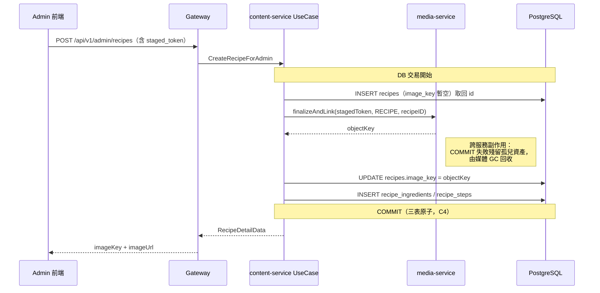
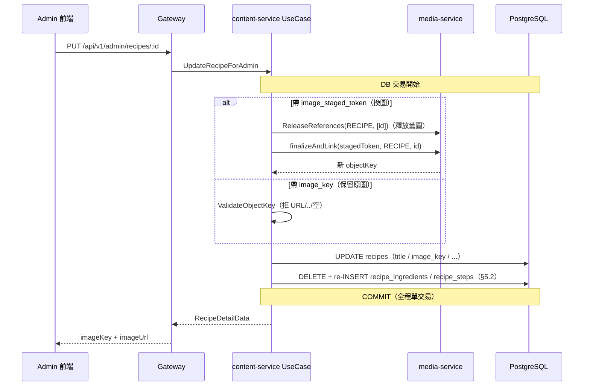

# 食譜內容管理（Recipe Content Management）詳細設計書

> **單體（遷移計畫 A1，2026-09-26 起是現行實作）**：content-service 已刪除，現行實作在單體的 `internal/modules/content`，對外 API 是根目錄 `api/` 的 Connect。本文件描述 content-service 的部分（程式路徑、REST 端點、popular／recent 排序、瀏覽數、頁碼分頁）是舊設計，與現行實作的差異見 content 模組的 `CARRYOVER.md`。

## 0. 文件元資訊 (Metadata)

- **服務**：content-service（Go）
- **相關程式碼**：`services/content-service/`、`gateway/`（content handler）、`api/proto/content/content.proto`、`hawkr-admin/`
- **相關設計書**：49（多媒體儲存與圖片服務，圖片治理）、44（身份模型，admin 授權）、46（能力權限層，僅賣家面適用—食譜為 admin-only 不適用）
- **CodeMeta**：`docs/代碼管理（CodeMeta）/業務類型碼.md` → `AssetReferenceType.RECIPE`
- **一句話定位**：content-service 食譜模組的資料模型與 API 契約，含 Admin 端 CRUD；食譜圖片納入既有 staged-upload 媒體治理鏈。

---

## 1. 概述與目標 (Overview & Goals)

### 1.1 文件定位

content-service 承載平台的內容型資料（Banner、SiteContent、Recipe）。本文件描述其中食譜（Recipe）模組的資料模型、Admin CRUD 契約，以及食譜主圖的媒體治理鏈。

### 1.2 服務一句話定位

食譜是「平台自營的食材應用內容」，供買家瀏覽（首頁食譜列表、食譜詳情、食材建議）；管理由平台 admin 於後台維護，賣家與買家皆不可寫入。

### 1.3 設計目標 (Goals) 與 非目標 (Non-Goals)

**Goals**
- content-service 提供 `CreateRecipeForAdmin` / `UpdateRecipeForAdmin` / `DeleteRecipeForAdmin` 三支 admin 寫入 RPC，以及 admin 讀取用的 `GetRecipeForAdmin` / `ListRecipesForAdmin`（編輯頁 read-back 必要，見 §6.2）。
- 食譜主圖走既有 staged-upload / `finalizeAndLink` 模式（與 Banner 一致），圖片以 `objectKey` 落庫、以 `RECIPE` ref_type 掛媒體引用，納入媒體 GC 治理。
- 巢狀寫入：一次請求同時維護 recipe 主檔 + 食材列表（`recipe_ingredients`）+ 步驟列表（`recipe_steps`）。
- Gateway 提供 `/admin/recipes` CRUD 路由 + Swagger + handler test mock（沿 Banner admin 樣板）。
- hawkr-admin 提供食譜清單頁與編輯頁（食材／步驟動態增列、圖片上傳元件複用）。

**Non-Goals**
- 不改食譜 PK 策略：`recipes.id` 維持 `BIGSERIAL`（見 §3 約束）——轉 TSID 屬破壞性遷移。
- 不新增資料表、不改既有三表 schema、不新增 MQ 事件（食譜無跨服務事件需求）。
- 不動買家端既有唯讀 RPC 與路由（`GetRecipeDetail` / `ListPublicRecipes` / `SearchRecipesComplete` / `GetIngredientSuggestions`）。
- 不做草稿/排程/多語系/版本歷史等進階內容管理能力。

### 1.4 與其他設計書／服務的關係

- **25 Banner**：admin CRUD + staged-upload finalize + `ReleaseReferences` 刪除釋放引用，本設計書 1:1 複用其樣板（`internal/usecase/banner.go`）。
- **49 多媒體**：圖片欄位只存 `objectKey`、URL 組裝唯一入口、回應扁平成對 `imageKey`+`imageUrl`（§6.1）、ref_type 治理。
- **44 身份模型**：`/admin/*` 由 Gateway JWT 注入 `x-account-type=ADMIN(4)` 授權。

---

## 2. 範圍與情境 (Context & Scope)

### 2.1 系統情境

```
hawkr-admin ──HTTP /api/v1/admin/recipes──▶ Gateway ──gRPC──▶ content-service
                                                     │                    │
                                              (JWT: ADMIN)         RecipeUseCase
                                                                    │        │
                                                          recipes/ingredients/steps (PG)
                                                                    │
                                                          MediaClient ──gRPC──▶ media-service
                                                          (FinalizeAndLink / ReleaseReferences, ref_type=RECIPE)

買家端（唯讀，維持不變）：buyer-app / web ──▶ Gateway /public/recipes* ──▶ content-service
```

### 2.2 邊界與責任

| 元件 | 責任 |
|---|---|
| Gateway content handler | `/admin/recipes` 路由、DTO 綁定、圖片輸入正規化（剝殼還原 objectKey）、回應扁平成對 `imageKey`+`imageUrl` |
| content-service RecipeUseCase | 巢狀寫入編排、staged token finalize、子表 reconcile、刪除釋放媒體引用、交易邊界 |
| RecipeRepository | 三表 CRUD（含子表 delete-reinsert），交易內執行 |
| MediaClient（content-service 既有） | `FinalizeAndLink` / `ReleaseReferences`（沿用，無需新增方法） |

### 2.3 角色與身份模型

- 寫入：僅 `ADMIN`（`/admin/recipes`）。無賣家/買家寫入路徑，故 46 號能力權限層不適用。
- 讀取：admin 讀走 `/admin/recipes`（`ListRecipesForAdmin` / `GetRecipeForAdmin`）；買家讀走既有 `/public/recipes*`。

---

## 3. 約束與前提 (Constraints & Assumptions)

- **C1 PK 維持 BIGSERIAL**：`recipes.id` 現為 `BIGSERIAL` 且已對前端暴露（`RecipeCard.id` / `RecipeDetailData.id` 為 string）。本案不改 PK 策略；`CreateRecipeForAdmin` 由 DB 產生 id 後回填。此為既有現狀之延續，明列為非目標（§1.3）以免實作者誤以為要導入 TSID。
  > **單體（遷移計畫 A1，2026-09-25）**：C1 只描述 content-service。單體的 `recipes.id` 是應用層產生的 UUIDv7，食材與步驟的主鍵是 `(recipe_id, position)`；依據是 ADR `2026-09-25-row-identity-by-data-kind.md` 與 PostgreSQL 設計規範 §二，與 content-service 的差異見 `internal/modules/content/CARRYOVER.md`。
- **C2 圖片只存 objectKey**（49 §25）：`recipes.image_key` 已為 `TEXT`（存 objectKey），維持；嚴禁完整 URL 落庫。回應由 Gateway 組裝 `imageUrl`。
- **C3 無 MQ、無新表**：食譜無跨服務事件；子表 `recipe_ingredients` / `recipe_steps` FK `ON DELETE CASCADE` 已存在，沿用。
- **C4 巢狀寫入需原子性**：主檔 + 子表跨多語句，必須在單一 DB 交易內（`pkg/database.TxManager.WithTx`），避免半寫入（食材寫入成功但步驟失敗留下不一致食譜）。
- **C5 ref_type 走 CodeMeta SSOT**：食譜媒體引用使用 `AssetReferenceType.RECIPE`（值 `7119`）。`pkg/media/ref_type.go` 是生成檔，**禁止手改**；碼值的唯一來源是 `docs/代碼管理（CodeMeta）/業務類型碼.md`（見 §8.5）。

---

## 4. 架構 (Architecture)

### 4.1 解法總綱

沿用 content-service 既有 Banner admin CRUD 的分層與媒體治理，將食譜的「主檔 + 兩張子表」以交易包裹的巢狀寫入實作；圖片走 staged-token → `finalizeAndLink` → objectKey，刪除時 `ReleaseReferences` 讓資產進入 GC。

### 4.2 元件視圖

- `gateway/internal/handler/content.go`：新增 `ListRecipesForAdmin` / `GetRecipeForAdmin` / `CreateRecipe` / `UpdateRecipe` / `DeleteRecipe` handler（命名沿 Banner handler 慣例）。
- `gateway/internal/router/routes_content.go`：`admin.Group("/recipes")` 掛 5 條路由。
- `services/content-service/internal/usecase/recipe.go`：`RecipeUseCase` 擴充寫入方法；`RecipeRepository` interface 擴充 `Create` / `Update` / `Delete` / `GetForAdmin` / `ListForAdmin`。
- `services/content-service/internal/grpc/`：content gRPC handler 補 5 支 RPC 映射。
- `services/content-service/internal/repository/postgres/`：sqlc query 新增（三表寫入 + 子表 delete-reinsert）。

### 4.3 部署拓撲與 Port

content-service：HTTP 10035 / gRPC 10036（既有，不變）。Go 服務無 TSID Node ID 概念（§7.3）。

### 4.4 命名／契約規約

- RPC 命名遵循 §5.1 admin 模式 `{Action}{Resource}ForAdmin`。
- 圖片欄位命名誠實（49 §25）：存 key 的欄位一律 `*_key`；proto 圖片欄位一律 `image_key`（值為 objectKey，Gateway 剝殼組裝出成對 `imageKey`+`imageUrl`），請求端新上傳走 `image_staged_token`、保留原圖帶 `image_key`（49 §231 一次切，無 `image_url` 相容雙軌）。

---

## 5. 資料設計 (Data Design)

### 5.1 資料模型（既有三表，無 DDL 變更）

`recipes`（主檔，BIGSERIAL PK）：`id, title, image_key, category, cooking_time_minutes, servings, view_count, created_at, updated_at`
`recipe_ingredients`：`id, recipe_id(FK CASCADE), name, amount, sort_order`
`recipe_steps`：`id, recipe_id(FK CASCADE), step_order, description`

時間戳走 `pgtype.Timestamptz`；`created_at/updated_at` DB `DEFAULT NOW()`，`updated_at` 於 Update 顯式刷新（Go 無 MetaObjectHandler，repository 在 UPDATE 帶 `updated_at = NOW()`）。

### 5.2 子表 reconcile 策略（明訂：delete-reinsert）

Update 對 `recipe_ingredients` / `recipe_steps` 採 **全刪重插**：

```
BEGIN
  UPDATE recipes SET ... , updated_at=NOW() WHERE id=$1     -- 主檔
  DELETE FROM recipe_ingredients WHERE recipe_id=$1          -- 清子表
  INSERT INTO recipe_ingredients (...) VALUES ... (依序帶 sort_order)
  DELETE FROM recipe_steps WHERE recipe_id=$1
  INSERT INTO recipe_steps (...) VALUES ... (依序帶 step_order)
COMMIT
```

**選型理由**：食材/步驟量小（單食譜通常 < 30 列）、無跨表引用、無需保留子列 id 穩定性；delete-reinsert 語意最簡單且天然正確（避免 diff/merge 的順序與新增刪除邊界 bug）。全程在同一交易內（C4），對讀路徑不可見中間態。

### 5.3 序號／排序／一致性

- `recipe_ingredients.sort_order` / `recipe_steps.step_order` 由請求列表**索引**決定（前端拖拉排序 → 後端按陣列順序回填），不信任前端傳入的亂序值。
- 主檔 + 子表寫入原子性由交易保證（C4）。

### 5.4 Schema 演進

本案無 schema 變更。若未來導入 TSID PK，須走 Atlas expand-contract 遷移，屬獨立議題。

---

## 6. API 與介面契約 (API & Interface Contracts)

### 6.1 對外 REST（經 Gateway，`/api/v1/admin`）

| Method | Path | RPC | 說明 |
|---|---|---|---|
| GET | `/admin/recipes` | `ListRecipesForAdmin` | admin 食譜清單（recent 排序、分頁），供後台管理 |
| GET | `/admin/recipes/:id` | `GetRecipeForAdmin` | 載入單一食譜供編輯（含食材/步驟/`imageKey`，**不遞增 view_count**） |
| POST | `/admin/recipes` | `CreateRecipeForAdmin` | 建立食譜（含食材/步驟；圖片必填 staged token） |
| PUT | `/admin/recipes/:id` | `UpdateRecipeForAdmin` | 更新食譜（子表 delete-reinsert；圖片保留或替換） |
| DELETE | `/admin/recipes/:id` | `DeleteRecipeForAdmin` | 刪除食譜（連帶釋放媒體引用） |

- Envelope `{code,message,data,traceId?}`；數字參數/欄位一律 string；圖片回應扁平成對 `imageKey`（objectKey）+`imageUrl`（Gateway 以 `MEDIA_BASE_URL` 組裝，49 §6.1，已合規維持）。
- Swagger：每個 handler 補 `@Summary/@Param/@Router` 註解，DTO 用 exported struct；契約 SSOT 是註解本身，`gateway/docs/` 生成物不入版控（§16）。

**為何含 admin 讀取 RPC（Get/List ForAdmin）**：編輯頁需 read-back 才能運作。買家 `GetRecipeDetail` 走公開路徑且**會遞增 view_count**（recipe.go:56 背景 goroutine），admin 開編輯頁不應污染瀏覽統計；`ListPublicRecipes` 為 random 排序、卡片投影，不適合後台管理清單。故依 §5.1 角色分離另立 admin 讀取 RPC，屬「Read」構成 CRUD 的必要部分，非額外功能。

### 6.2 gRPC（服務間，`api/proto/content/content.proto` → `ContentService`）

新增 RPC（掛在既有 `ContentService`）：

```proto
rpc ListRecipesForAdmin(ListRecipesForAdminRequest) returns (ListRecipesForAdminResponse);
rpc GetRecipeForAdmin(GetRecipeForAdminRequest)   returns (RecipeDetailResponse);   // 複用既有 RecipeDetailData
rpc CreateRecipeForAdmin(CreateRecipeForAdminRequest) returns (RecipeDetailResponse);
rpc UpdateRecipeForAdmin(UpdateRecipeForAdminRequest) returns (RecipeDetailResponse);
rpc DeleteRecipeForAdmin(DeleteRecipeForAdminRequest) returns (BaseResponse);
```

新增 message（草案；數字欄位一律 string，§4）：

```proto
message RecipeIngredientInput {   // 巢狀寫入用
    string name = 1;
    string amount = 2;
}
message RecipeStepInput {
    string description = 1;        // step_order 由列表索引決定，不由前端傳
}

message CreateRecipeForAdminRequest {
    string title = 1;
    string image_staged_token = 2;              // 新上傳主圖 staged token（建立時必填）
    string category = 3;
    string cooking_time_minutes = 4;            // string 數字
    string servings = 5;                        // string 數字
    repeated RecipeIngredientInput ingredients = 6;
    repeated RecipeStepInput steps = 7;
}

message UpdateRecipeForAdminRequest {
    string id = 1;
    string title = 2;
    string image_key = 3;                       // 保留原圖時帶入（裸 objectKey）
    string image_staged_token = 4;              // 替換新圖時帶入，優先於 image_key
    string category = 5;
    string cooking_time_minutes = 6;
    string servings = 7;
    repeated RecipeIngredientInput ingredients = 8;
    repeated RecipeStepInput steps = 9;
}

message DeleteRecipeForAdminRequest { string id = 1; }
message GetRecipeForAdminRequest    { string id = 1; }

message ListRecipesForAdminRequest  { int32 page = 1; int32 page_size = 2; string category = 3; }
message ListRecipesForAdminResponse {
    int32 code = 1;
    string message = 2;
    repeated RecipeCard recipes = 3;            // 複用既有 RecipeCard
    string total = 4;                           // Response 分頁欄一律 string（CI numeric gate 強制）
    string page = 5;
    string page_size = 6;
}
```

- **分頁欄位型別分層**：Request 端 `page` / `page_size` 為 `int32`（輸入參數，Gateway 解析後填入）；**Response 端分頁欄（`total` / `page` / `page_size`）一律 `string`（CI numeric gate 強制，Response 欄位不適用 [Java 微服務開發規範](../開發規範/Java%20微服務開發規範.md) §2.1 例外 #3）**。微服務於 gRPC 邊界 `strconv.FormatInt` 轉出，Gateway 直接透傳；HTTP 回應分頁清單 key 用 `records`（[Gateway Swagger 註解規範](../開發規範/Gateway%20Swagger%20註解規範.md) 分頁 key 規約）。
- `RecipeDetailData.image_key`（值為 objectKey）；Gateway 剝殼組裝，回應提供成對 `imageKey`+`imageUrl`（49 §6.6 content 表；`image_url` 已隨 §231 rename 為 `image_key`，無相容雙軌）。
- Proto 只改 `api/proto/content/content.proto`（見 [Proto 管理規範](../開發規範/Proto%20管理規範.md)）；改後 `scripts/gen-go-proto.sh` 生成，並跑 go.work 全模組 `go test ./...` + `(cd gateway && go build ./...)`。

### 6.3 非同步事件 (MQ)

無。食譜無跨服務事件需求（C3）。

---

## 7. 執行時視圖 (Runtime View)

### 7.1 CreateRecipeForAdmin（happy path）

1. Gateway 綁定 DTO；`image_staged_token` 缺 → 400（建立必填，對齊 Banner）。
2. UseCase：先產生/取得 recipeID（DB BIGSERIAL：先 INSERT 主檔取回 id，再於同交易掛圖與子表；或先 finalize 後 INSERT——實作可選，但 `finalizeAndLink` 需 recipeID 作 ref_id，故採「交易內先 INSERT 主檔（image_key 暫空）→ 取 id → finalizeAndLink 取 objectKey → UPDATE 主檔 image_key → INSERT 子表」）。
3. `finalizeAndLink(stagedToken, RefTypeRecipe, recipeID)` → objectKey。
4. INSERT `recipe_ingredients` / `recipe_steps`（依索引帶 sort_order/step_order）。
5. COMMIT → 回 `RecipeDetailData`。

> 注意：`finalizeAndLink` 為外部（media-service）呼叫，具跨服務副作用。若置於 DB 交易內，media 成功但本地 COMMIT 失敗會殘留已 finalize 的孤兒資產（由 GC 兜底，可接受）；實作與 Banner 一致即可（Banner 於 Create 時 finalize 在 repo.Create 前）。設計層要求：**主檔 + 子表**三表寫入原子（C4），圖片 finalize 的最終一致由媒體 GC 保證。



### 7.2 UpdateRecipeForAdmin

- 圖片分支對齊 Banner（banner.go:114–157）：
  - 有 `image_staged_token` → `finalizeAndLink` 取新 key；**替換前** `ReleaseReferences(RefTypeRecipe,[id])` 釋放舊圖引用（食譜單圖，無 Banner「雙圖單張替換」的精準 unlink 難題，可安全釋放後重掛）。
  - 無 staged token → 用傳入 `image_key`（裸 objectKey），經 `mediaurl.ValidateObjectKey` 防禦（拒 URL/`..`/空），維持原圖。
- 子表 delete-reinsert（§5.2），全程單交易。



### 7.3 DeleteRecipeForAdmin

- `repo.Delete(id)`：DELETE recipes（子表 FK CASCADE 自動清）。
- best-effort `ReleaseReferences(RefTypeRecipe,[id])` 讓主圖資產進入 GC（對齊 banner.go:184–196）。失敗僅記 warn，留孤兒引用交 GC。

### 7.4 失效與並發

- 建立/更新失敗 → 交易回滾，無半寫入。
- 食譜為低頻 admin 寫入，無強並發需求；不加樂觀鎖。
  > **單體（2026-09-25 Will 決定）**：改成加樂觀鎖（etag，Google AIP-154）。整筆覆寫下兩個人同時修改會靜默互相蓋掉，換圖時還可能讓 GC 刪掉正在顯示的圖；規則與理由見 ADR `docs/adr/2026-09-25-optimistic-concurrency-etag.md`。

---

## 8. 跨切面關注點 (Crosscutting Concerns)

### 8.1 安全與授權

`/admin/recipes` 全部經 Gateway JWT → `x-account-type=ADMIN(4)`；content-service 內部 gRPC 免權限（§5.2）。無賣家/買家寫入面。

### 8.2 媒體引用治理（ref_type=RECIPE）

- ref_type 使用 `AssetReferenceType.RECIPE`（值 `7119`，見 §8.5）。
- finalize/link/release 皆帶 `RefTypeRecipe`，ref_id = recipeID（string）。

### 8.5 ref_type 的 SSOT 與生成（[CodeMeta](../代碼管理（CodeMeta）/README.md)）

`AssetReferenceType` 的碼值唯一來源是 `docs/代碼管理（CodeMeta）/業務類型碼.md`。要新增或修改任何 ref_type：

1. 編輯該 `.md` 的 `AssetReferenceType` 表（食譜主圖為 `| RECIPE | RECIPE | 7119 | RECIPE | 食譜主圖引用 |`）。
2. `cd docs/代碼管理（CodeMeta）/scripts && ./generate.sh --all`，由生成器決定哪些輸出會變。
3. **嚴禁**直接手改 `pkg/media/ref_type.go`——它是生成檔，下次生成即覆蓋。
4. content-service 的 `finalizeAndLink` / `ReleaseReferences` 一律引用常數 `media.RefTypeRecipe`，不得寫字面值。

### 8.4 一致性與冪等

- 三表寫入原子（C4）。
- 圖片 finalize 的最終一致由媒體 GC 兜底（孤兒資產可回收）。
- **單一寫入路徑為唯一真實來源；不引入補償任務基礎設施**（[後端服務責任邊界規範](../開發規範/後端服務責任邊界規範.md)）：食譜主檔＋子表的一致性由同交易的單一寫入路徑保證，媒體孤兒資產由既有媒體 GC 治理兜底——**不新增** reconciliation / backfill / resync / drift-detection 類任務或表。

---

## 9. 前端影響（hawkr-admin）

改動面（僅列範圍，不畫 UI 稿）：

- **食譜清單頁**：呼叫 `GET /api/v1/admin/recipes`（分頁、分類篩選），列出食譜卡（縮圖用回應 `imageUrl`），提供新增/編輯/刪除入口。
- **食譜編輯頁**：
  - 呼叫 `GET /api/v1/admin/recipes/:id` 載入（`imageKey` 用於保留原圖、`imageUrl` 顯示預覽）。
  - 圖片上傳：**複用既有 staged-upload 元件**（與 Banner 編輯頁同一元件），送 `image_staged_token`；未換圖時回送 `image_key`。
  - 食材（name/amount）與步驟（description）**動態增列/刪列/拖拉排序**，送 `ingredients[]` / `steps[]` 陣列（順序即 sort/step order）。
  - 建立走 `POST`（圖片必填）、更新走 `PUT`、刪除走 `DELETE`。
- **無買家端改動**：買家食譜瀏覽維持既有唯讀 API。
- 由 Gateway 業務碼塌縮為 HTTP 409 的慣例（前端解析 message `[NNNN]` 前綴），admin 錯誤處理沿既有樣式。

> hawkr-admin 屬本團隊守備 repo；此為新增管理頁（新功能），非既有 Layout 改動，可直接實作。

---

## 10. 驗收條件

1. `業務類型碼.md` 的 `AssetReferenceType` 含 `RECIPE=7119`，且重跑 `generate.sh --all` 後 `pkg/media/ref_type.go` 的 `RefTypeRecipe` 不產生 diff（生成檔未被手改）。
2. go.work 全模組 `go test ./...` ＋ `(cd gateway && go build ./...)` 全綠。
3. content-service `go test ./...` 全綠，含新增 usecase 測試（建立/更新/刪除 + reconcile）。
4. Gateway handler test mock 補齊、`go test -count=1` 綠（§16）。
5. 行為驗證（走 Gateway `/admin/recipes`，ADMIN JWT）：
   - Create：建立含 2 食材 3 步驟 + 上傳圖 → DB `recipes` 新列、`recipe_ingredients`×2 / `recipe_steps`×3、`image_key` 為 objectKey、media 有 `RECIPE` 引用；回應 `imageKey`+`imageUrl` 成對。
   - Update：改標題 + 換圖 + 食材由 2→3 → 主檔更新、子表全刪重插數量正確、舊圖引用已釋放/新圖已掛。
   - Delete：主檔刪除、子表 CASCADE 清空、media `RECIPE` 引用釋放。
   - Get/List ForAdmin：Get 不遞增 `view_count`；List recent 排序、分頁正確。
6. bounded regression（[開發工作流程 §4](../開發規範/開發工作流程.md)）：買家端 `GetRecipeDetail` / `ListPublicRecipes` / `SearchRecipesComplete` / `GetIngredientSuggestions` 仍正常（共用 repository 與 `RecipeCard`/`RecipeDetailData` proto）。**特別驗 `GetIngredientSuggestions`**：admin 更新走子表 delete-reinsert（§5.2）會整批重寫 `recipe_ingredients`，此 RPC 是最直接受影響的讀路徑——更新食材後查建議仍回正確集合、無殘留舊列。

---

## 附註

- 食譜 PK 維持 BIGSERIAL（C1）、無 MQ、無新表（C3）為明示設計選擇，實作勿自行擴張。
- 圖片治理一切以 49 號設計書為權威；ref_type 一切以 CodeMeta `業務類型碼.md` 為 SSOT。
