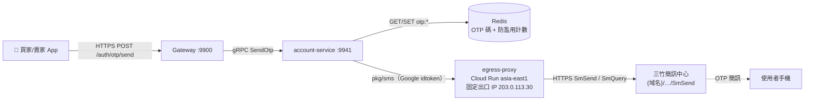
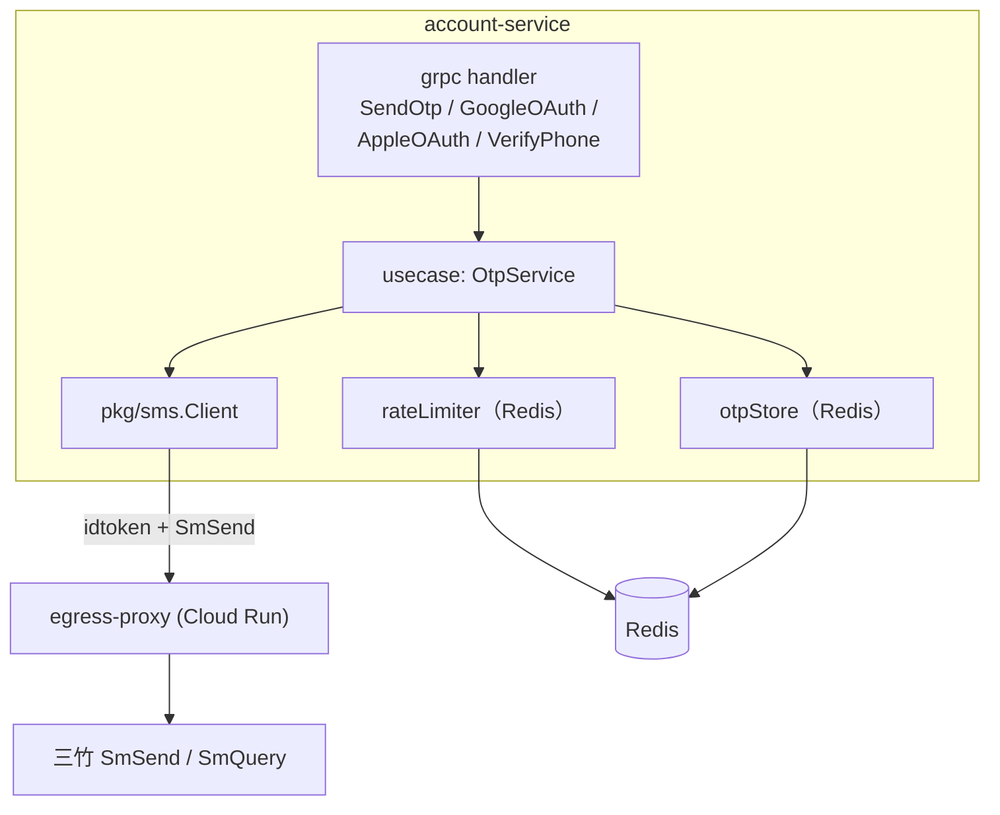
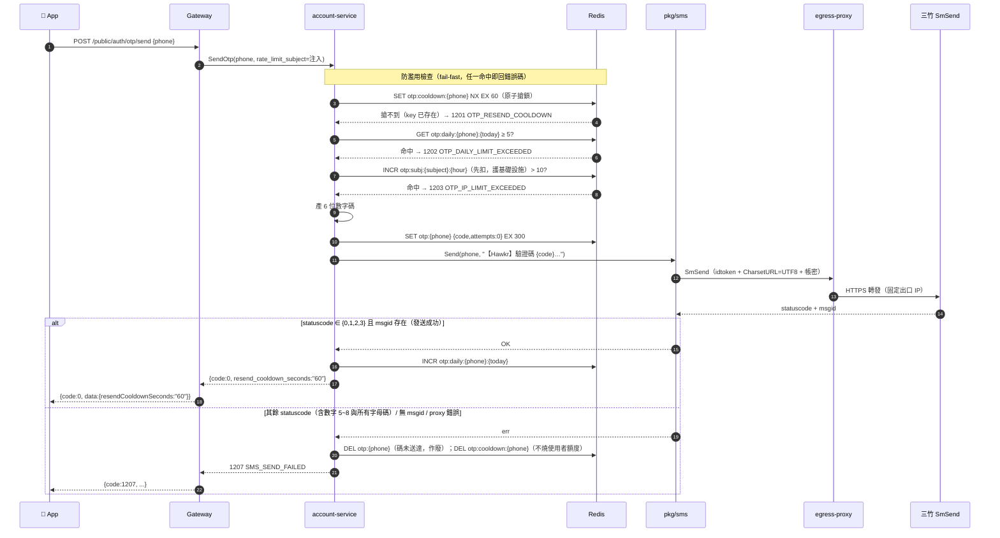
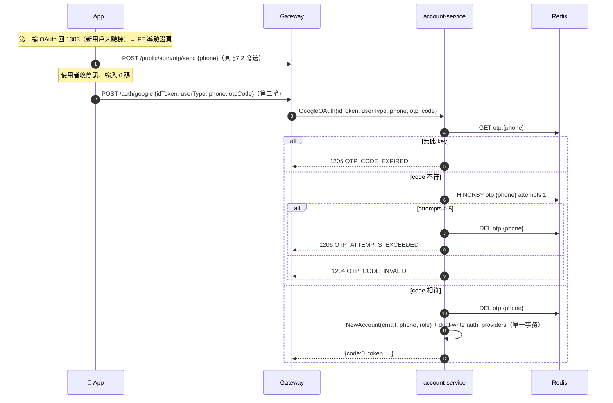

# 簡訊發送與手機 OTP（Mitake SMS & Phone OTP）詳細設計書

> **已退場（2026-09-27，ADR `docs/adr/2026-09-27-identity-clerk.md`）**：新帳號不再驗證手機，身分驗證改用 Clerk；OTP、三竹簡訊與它們的表、job、設定都從單體移除。本文件只當歷史參考。
>
> **單體（遷移計畫 A2，2026-09-27 起）**：OTP 搬進單體的 identity 模組。驗證碼存在 Postgres（`identity.phone_codes`），在建立帳號的 transaction 內原子消耗；冷卻、每日（改成過去 24 小時）與每小時上限由同一張表算出；簡訊由 River job 發送，以驗證碼的 ID 當三竹的 `clientid`，重試只在有效期內（ADR `docs/adr/2026-09-27-identity-opaque-sessions.md` D4、D5，取代 mitake ADR 的 D1「存 Redis」與 D6）。本文件的 Redis key、同步發送與失敗釋放冷卻只描述舊服務；egress-proxy 屬於舊公司的 infra（ADR D9），固定出口在後端 CD 重建。（被上一段取代）

> 本文件描述「後端經三竹（Mitake）企業簡訊發送手機 OTP」能力本身：proxy 拓撲、`pkg/sms` client、OTP 產碼/驗碼、防濫用、錯誤碼、Proto 契約與 Firebase Phone Auth 退役計畫。
>
> **與 17 號分工**：17 號（登入與帳號建立流程）描述**登入流程如何消費 OTP**（1303 新用戶 detour、`/app/auth/phone/verify` 補綁手機）；**本文件（51 號）描述 OTP 能力本身**（怎麼發、怎麼存、怎麼驗、怎麼防濫用、怎麼串三竹）。兩者一為「使用者」、一為「提供者」，介面收斂在 account-service 的 `SendOtp` / OTP 驗證邏輯。

---

## 0. 文件元資訊 (Metadata)

| 項目 | 值 |
|---|---|
| 維護者 | 維護團隊 |
| 對應程式碼 | `serverless/egress-proxy/`、`pkg/sms/`、`services/account-service/internal/{usecase,grpc}/`、`gateway/internal/{handler,router}/` |
| 相關 doc | [17 登入與帳號建立流程](17-登入與帳號建立流程%EF%BC%88Login%20&%20Account%EF%BC%89詳細設計書.md)（消費端）、[27 地址搜尋與驗證](27-地址搜尋與驗證%EF%BC%88Address%20Proxy%EF%BC%89詳細設計書.md)（同型 Cloud Run IAM proxy 前例）、[44 帳號與賣家買家身份模型](44-帳號與賣家買家身份模型%EF%BC%88Account%20&%20Seller-Buyer%20Identity%EF%BC%89詳細設計書.md)（phone 非身分鍵）、[錯誤碼 CodeMeta](../代碼管理%EF%BC%88CodeMeta%EF%BC%89/錯誤碼.md) |

---

## 1. 概述與目標 (Overview & Goals)

### 1.1 文件定位

手機 OTP 簡訊由**後端經三竹（Mitake）發送**：驗證碼由 account-service 產生並保存於 Redis，經 `pkg/sms` → Cloud Run `egress-proxy` → 三竹 SmSend 送出。App 端不持有任何簡訊通路 SDK，只呼叫 `/otp/send` 與帶回 `otpCode`。目標讀者為後端與 App 前端工程師。

### 1.2 一句話定位

account-service 負責「產、存、發、驗」手機 OTP；`egress-proxy` 是唯一取得三竹白名單固定出口 IP 的中繼；`pkg/sms` 是三竹 HTTP API 的 anti-corruption layer。

### 1.3 設計目標 (Goals) 與 非目標 (Non-Goals)

| 類型 | 項目 |
|---|---|
| **Goal** | OTP 全生命週期（產碼/保存/驗碼/失效）收斂於後端 account-service，前端只送手機號與 6 位碼 |
| **Goal** | 三竹白名單 IP 需求以**單一共用 proxy**（prod/dev 共用同一組固定出口 IP）滿足，只跟三竹維護一次 IP 申報 |
| **Goal** | 自建防濫用（重送冷卻 / 每日上限 / per-subject（限流身分）上限 / 單碼嘗試上限），全走 Redis 計數 |
| **Goal** | `pkg/sms` 為通用簡訊發送層，未來可被 notification-service 複用（本期不接線） |
| **Non-Goal** | **不**接三竹 DR（Delivery Report）callback——OTP 輸碼成功即為送達證明（§8.4）；DR 為未來擴充點 |
| **Non-Goal** | **不**做 OTP 對帳 / backfill / reconciliation 任務——OTP 是 Redis ephemeral 狀態，過期即失效（§8.4） |
| **Non-Goal** | **不**保留簡訊通路雙軌——三竹是唯一通路，App 端不留備援 SDK（決策理由見 [ADR](../adr/2026-09-18-mitake-sms-otp-backend-issued.md)） |
| **Non-Goal** | 本期**不**由 notification-service 發交易/行銷簡訊（僅預留 routing key，§6.3） |

### 1.4 與其他設計書／服務的關係

- **17 號**：登入流程如何用 OTP（1303 detour、補綁手機）以 17 號為準；本文件被 17 號 §4 引用。
- **27 號**：`egress-proxy` 拓撲完全比照 27 號 `tgos-proxy`（Cloud Run asia-east1 + tgos-vpc + Cloud NAT 固定出口 IP + IAM-only），複用同一組 VPC / NAT / 固定 IP。
- **44 號**：`accounts.phone` **非身分鍵、無 unique 約束**，OTP 只證明「持有此門號」，不作帳號唯一性判定。

---

## 2. 範圍與情境 (Context & Scope)

### 2.1 系統情境圖 (C4 Context)



### 2.2 邊界與責任

| | 涵蓋 (In-scope) | 不涵蓋 (Out-of-scope，由誰負責) |
|---|---|---|
| **account-service** | OTP 產碼、Redis 保存、驗碼、防濫用計數、呼叫 `pkg/sms` | 帳號建立/登入決策樹 → 17 號、44 號 |
| **`pkg/sms`** | 三竹 HTTP API 封裝、Google idtoken 簽發、statuscode 解析 | OTP 業務語意（碼、TTL、限流） |
| **`egress-proxy`** | 純轉發至三竹、提供固定出口 IP、IAM 認證 | 三竹帳密（由呼叫端請求帶）、OTP 邏輯 |
| **Gateway** | REST→gRPC 轉發、注入 client IP、Envelope 映射 | OTP 產驗（無狀態轉發，不持碼） |

### 2.3 角色與身份模型

- **匿名（未登入）**：新用戶 OAuth 首登 1303 detour → `POST /api/v1/public/auth/otp/send` 屬 public namespace，不需 JWT。
- **已登入**：補綁/換綁手機（`POST /app/auth/phone/verify`）走 `JWTAuth`，`account_id` 由 Gateway 注入。
- OTP 只證明「請求者當下持有該門號」，**不**建立身分；身分仍由 OAuth provider + verified email 決定（44 號）。

---

## 3. 約束與前提 (Constraints & Assumptions)

| 類型 | 項目 |
|---|---|
| 技術約束 | 三竹**以帳號層鎖定來源 IP**（白名單），非白名單來源回 statuscode `k`；Cloud Run 預設出向 IP 浮動 → **必須經固定 IP 出口**（Cloud NAT）。連線需 TLS 1.2+；併發連線 ≤ 15。 |
| 技術約束 | 中文簡訊需 URL Encode，proxy 走 **UTF-8**（`CharsetURL=UTF8`），nginx 需 `proxy_ssl_server_name on` 且**不重編碼** body。 |
| 技術約束 | 回應走統一 Envelope `{code,message,data}`；錯誤走業務碼、**禁止用 HTTP status 分流**（前端解析 message `[NNNN]` 前綴，見 §6.1）。 |
| 組織約束 | 單人維運；三竹**無公開 sandbox**，測試靠正式帳號小額點數實發 → 測試量需嚴格控制（§13）。 |
| 既有系統約束 | 複用 27 號既有 `tgos-vpc` + Cloud NAT + 固定 IP `203.0.113.30`；GCP 專案 `example-seller-prod` 有 Domain Restricted Sharing org policy（禁 `allUsers`）→ 只能 IAM-only。 |
| **假設 (Assumptions)** | ①三竹帳號具備發送權限且白名單已納入 `203.0.113.30`；②純數字 6 碼 OTP 不含網址，不受三竹「網址白名單」（2024-11-15 起）限制；③一組三竹帳號足以支撐 prod+dev 測試量。 |
| 技術約束 | 三竹 API 域名為 `smsapi.mitake.com.tw`，路徑前綴為 `/api/mtk/`（`/b2c/mtk/` 回 404）。 |

---

## 4. 架構 (Architecture)

### 4.1 解法總綱 (Solution Strategy)

三層責任分離：

1. **`egress-proxy`（純轉發）**：`egress-proxy` 為**通用第三方出口轉發層**（nginx 路徑前綴制，各第三方一組前綴），三竹為首個收編對象；本設計只用其三竹路徑。nginx reverse proxy 部署於 Cloud Run `asia-east1`，掛既有 `tgos-vpc` + Cloud NAT，取得三竹白名單內的固定出口 IP。**只白名單 `SmSend` / `SmQuery` 兩路徑**，其餘 404。proxy **不持有三竹帳密**——帳密由呼叫端（account-service）於請求帶入，proxy 原樣轉發。IAM-only 認證，呼叫端需 `roles/run.invoker` 的新 SA `egress-proxy-caller` 簽 Google-signed ID token。
2. **`pkg/sms`（ACL）**：Go client，仿 `pkg/geocode/tgos_client.go`——用 SA key 簽 idtoken、組 SmSend query（`CharsetURL=UTF8`）、解析三竹純文字回應（成功判定＝**`statuscode ∈ {0,1,2,3}` 且 `msgid` 存在**；其餘含數字 5~8 與所有字母碼一律視為發送失敗）。無狀態、無 OTP 語意。
3. **account-service（OTP 業務）**：產 6 位數字碼 → 存 Redis（`otp:{phone}`, TTL 5 分）→ 防濫用檢查 → 經 `pkg/sms` 送出；驗碼時比對 Redis、累計嘗試次數、成功即失效並寫 `accounts.phone`。

### 4.2 元件視圖 (C4 Component)



| 模組/package | 責任 | 依賴 |
|---|---|---|
| `serverless/egress-proxy/` | nginx 轉發 + 固定出口 IP + IAM | Cloud Run, tgos-vpc, Cloud NAT |
| `pkg/sms/` | 三竹 API ACL（idtoken、SmSend、statuscode 解析） | google idtoken, egress-proxy |
| `services/account-service/internal/usecase/otp.go`（新） | 產碼/驗碼/防濫用 | Redis, `pkg/sms` |
| `services/account-service/internal/grpc/` | `SendOtp` handler + OAuth/VerifyPhone 改驗 OTP | usecase |
| `gateway/internal/handler/auth_otp.go`（新） | `POST /public/auth/otp/send` thin proxy + 注入 client IP | account client |

### 4.3 部署拓撲與 Port

| 元件 | 協定 | 用途 | 對外暴露方式 |
|---|---|---|---|
| `egress-proxy` | HTTPS 8080（容器內）| nginx → 三竹 | Cloud Run（IAM-only，非 allUsers）|
| account-service | gRPC 9941 | `SendOtp` 等 RPC | ClusterIP（內部）|
| Gateway | HTTP 9900 | `/public/auth/otp/send` | 對外入口 |

**prod/dev 共用同一份 `egress-proxy`**（同一組固定出口 IP，只需向三竹申報一次白名單）——與 27 號 tgos-proxy 相同策略。

### 4.4 egress-proxy 設計要點

| 項目 | 設計 |
|---|---|
| 轉發目標 | `smsapi.mitake.com.tw`；nginx `proxy_pass` 必須用**變數**目標讓 `resolver` 生效（literal host 只在啟動時解析一次，DNS 變動後會固定打到舊 IP）|
| 路徑白名單 | 只允許 `SmSend`（發送）與 `SmQuery`（餘額/狀態查詢）；其餘路徑 return 404。**不**開放 SmBulkSend / SmCancel（本期無批次/預約需求）|
| 編碼 | `proxy_ssl_server_name on` + `proxy_ssl_name <三竹域名>`；**不重編碼 UTF-8** body（中文由呼叫端 URL Encode 為 UTF-8，`CharsetURL=UTF8`）|
| 帳密 | proxy **不持有**三竹 `username`/`password`；由 account-service 於請求帶入，proxy 原樣轉發 |
| Authorization header | Cloud Run 傳入的 IAM idtoken 對三竹無意義 → nginx `proxy_set_header Authorization ""` 剝除（比照 tgos-proxy）|
| 部署 | `deploy.sh`：`gcloud run deploy --network=tgos-vpc --subnet=tgos-subnet --vpc-egress=all-traffic --min-instances=1 --max-instances=2`（`min-instances=1` 避免冷啟動超時，比照 tgos-proxy）|
| IAM | SA `egress-proxy-caller@example-seller-prod.iam.gserviceaccount.com` 授 `roles/run.invoker`；JSON key 掛於 k8s secret `egress-proxy-caller-credentials`，mount 至 `/secrets/egress-proxy-caller/key.json`（account-service `MITAKE_PROXY_CALLER_KEY_FILE` 指向此路徑；本機測試 key 放 repo `secrets/egress-proxy-caller/key.json`，gitignored）|
| 範圍 | 本設計只用其三竹簡訊路徑（`SmSend`/`SmQuery`）；proxy 本身為通用出口層，收編其他第三方各加路徑前綴 |

### 4.5 命名／契約規約

- OTP 簡訊內容模板（純數字碼，不含網址以避開三竹網址白名單）：`【Hawkr】您的驗證碼為 {code}，5 分鐘內有效，請勿轉傳。`
- `destname` 帶固定來源 key（如 `hawkr-otp`）供三竹回拋對應（本期不接 DR，僅便於三竹後台辨識）。

---

## 5. 資料設計 (Data Design)

> account-service 無新增 DB 表；OTP 狀態全存 Redis（ephemeral）。`accounts.phone` 沿用既有欄位（44 號 SSoT）。

### 5.1 Redis Key 設計

| Key | 型別 | 內容 | TTL | 用途 |
|---|---|---|---|---|
| `otp:{phone}` | Hash / JSON | `{code:"123456", attempts:0}` | 300s（5 分）| 待驗證碼 + 已嘗試次數 |
| `otp:cooldown:{phone}` | String（哨兵）| `1` | 60s | 同號重送冷卻（發送前 `SET NX` 原子搶鎖；send 失敗 `DEL` 釋放，§7.2）|
| `otp:daily:{phone}:{yyyymmdd}` | Counter（INCR）| 次數 | 至當日 24:00（或 86400s）| 同號每日發送上限 |
| `otp:subj:{subject}:{yyyymmddHH}` | Counter（INCR）| 次數 | 3600s（1 小時）| per-subject（限流身分）每小時發送上限 |

- `{subject}` 是 Gateway `middleware.RateLimitSubject` 的回傳值（`v:<訪客 IP>` / `s:ssr` / `s:ci`，歸屬規則見 [01 號 §3.2.4](01-閘道微服務（Gateway）詳細設計書.md)），**不是裸 client IP**——網頁 SSR／CI 一個位址代表的不是一個真人。
- `{phone}` 一律先 `NormalizeToLocal`（09xx）再組 key，避免 `+886` 與 `09` 造成兩把 key。
- 驗碼成功或 `attempts` 達上限 → `DEL otp:{phone}`（碼作廢，須重發）。

### 5.2 一致性

- OTP 是**單把 Redis key 的短生命週期狀態**，無跨 key 事務需求；限流計數用 `INCR`（原子）+ `EXPIRE`。
- 驗碼成功後對 `accounts.phone` 的寫入走 account-service 既有 `NewAccount` / `VerifyPhone` 單一寫入路徑（§8.4）。

---

## 6. API 與介面契約 (API & Interface Contracts)

### 6.1 對外 REST（經 Gateway）

**硬切，配合 App 強制更新，無雙軌**；全部走統一 Envelope `{code,message,data}`，錯誤透傳業務碼（前端解析 message `[NNNN]` 前綴）。

| Method + Path | Namespace | 說明 |
|---|---|---|
| `POST /api/v1/public/auth/otp/send` | public（匿名）| 發送 OTP 到指定手機 |
| `POST /api/v1/app/auth/phone/verify` | app（`JWTAuth`）| 已登入帳號補綁 / 換綁手機（**取代舊 `/app/auth/firebase`**，#944）|

新用戶首登 OTP 核碼**不另開端點**：走 17 號既有 `POST /api/v1/auth/{google,apple}` 第二輪（帶 `phone`+`otp_code`），由 account-service 於 OAuth RPC 內驗碼（§7.2）。

#### `POST /api/v1/public/auth/otp/send`

**Request（camelCase body）**：

```json
{ "phone": "0912345678" }
```

- 限流身分（`rateLimitSubject`）**不由前端帶**，Gateway 以 `middleware.RateLimitSubject(c)` 解析後注入下游 gRPC（§4.1 exception #1，前端不可控）。它**不等於連線來源 IP**：請求帶有效簽章時取的是簽章 payload 內的訪客 IP（`v:<ip>`），網頁 SSR／CI 則各自落在 `s:ssr` / `s:ci`（[01 號 §3.2.4](01-閘道微服務（Gateway）詳細設計書.md)）。

**Response（成功）**：

```json
{ "code": 0, "message": "success", "data": { "resendCooldownSeconds": "60" } }
```

**Response（限流失敗，示例）**：

```json
{ "code": 1201, "message": "[1201] 驗證碼發送過於頻繁，請稍後再試", "data": null }
```

錯誤碼定義見 CodeMeta [錯誤碼 §簡訊與 OTP 業務碼（1200~1299）](../代碼管理%EF%BC%88CodeMeta%EF%BC%89/錯誤碼.md)。

#### `POST /api/v1/app/auth/phone/verify`

**Request**：`{ "phone": "0912345678", "otpCode": "123456" }`（`accountId` 由 Gateway 注入）

**Response**：`{ code, message, data: { success, account } }`（沿用舊 VerifyPhoneResponse 形狀）。

### 6.2 gRPC（服務間）

#### 新增 RPC `SendOtp`

```
rpc SendOtp(SendOtpRequest) returns (SendOtpResponse);
```

| Message | 欄位 | 型別 | 說明 |
|---|---|---|---|
| `SendOtpRequest` | `phone` | string | 手機號（前端可控，§4 規範一律 string）|
| | `rate_limit_subject` | string | 限流身分 `v:<ip>` / `s:ssr` / `s:ci`，**Gateway 注入**（§4.1 exception #1，前端不可控）|
| `SendOtpResponse` | `code` | int32 | 業務碼（0=成功）|
| | `message` | string | 文案 |
| | `resend_cooldown_seconds` | string | 前端倒數提示秒數（§4 規範：數字欄位一律 string）|

#### 既有 RPC 欄位增刪（移除 Firebase、改 OTP）

> Proto 欄位號**移除不回收**（標 `reserved`），新增欄位用新號，避免 wire 相容問題。

| Message | 移除（→ reserved）| 新增 |
|---|---|---|
| `GoogleOAuthRequest` | `firebase_phone_id_token`（field 4）| `otp_code`（field 7）；`phone`（field 2）**保留**，第二輪帶 OTP 驗證過的門號 |
| `AppleOAuthRequest` | `firebase_phone_id_token`（field 4）| `phone`（field 11）+ `otp_code`（field 12）——Apple 原無 `phone` 欄位，需補 |
| `VerifyPhoneRequest` | `firebase_token`（field 2，已 `reserved`）| `otp_code`（field 4）；`account_id`（int64 field 1，Gateway 注入）與 `phone`（field 3）不變 |

> `AccountInfo.firebase_uid`（field 5）在 proto 中仍存在但 DB 已無對應欄位，任何路徑都不得讀寫它。

### 6.3 非同步事件 (MQ)

OTP 流程**不 publish 任何 MQ 事件**（同步發送、輸碼即驗）。

### 6.4 即時通道 (WS/SSE)

> N/A（OTP 為 request/response，無長連線）。

---

## 7. 執行時視圖 (Runtime View)

### 7.1 主要場景

三竹只在 account-service 出向被呼叫；OTP 碼從不離開後端，前端只回傳使用者輸入的 6 碼。三條使用 OTP 的路徑：發送（共用）、新用戶首登核碼（1303 第二輪）、已登入補綁核碼（`/phone/verify`）。

### 7.2 時序圖：OTP 發送（含防濫用檢查點）



> **三個計數器的增減時點**（順序不可調換，否則失去其各自守住的不變式）：
> - `otp:cooldown`：**發送前**以 `SET NX` 原子搶鎖。並發／快速雙擊時第二個請求在發送前就撞 1201，避免「雙發簡訊 + 後寫的碼覆蓋前一個碼」。三竹 send **失敗時 `DEL`**，使用者額度不被我方或三竹的故障吃掉。
> - `otp:subj`（per-subject 每小時）：**發送前** INCR，無論成敗都計。它護的是基礎設施，防單一限流身分灌爆三竹點數。
> - `otp:daily`（使用者每日配額）：**發送成功後**才 INCR。

### 7.3 時序圖：新用戶首登核碼（1303 第二輪，取代 Firebase）



已登入補綁（`POST /app/auth/phone/verify`）驗碼分支與上圖相同，成功後改為 `VerifyPhone` 寫 `accounts.phone`（idempotent，無 phone 重用檢查，44 號）。

### 7.4 失效與重試

| 外部呼叫 | 逾時 | 重試 | 冪等 | 失敗降級 |
|---|---|---|---|---|
| `pkg/sms` → egress-proxy → 三竹 | `http.Client{Timeout:10s}`（比照 tgos_client）| **不自動重試**（避免重複簡訊/重複扣點）| 三竹 `clientid` 可去重（12h），本期可用 GUID 但不依賴 | 回 1207，`DEL otp:{phone}` + `DEL otp:cooldown:{phone}`（失敗不佔冷卻/額度），使用者可立即手動重送 |
| account-service → Redis | 依 pkg redis 設定 | — | 計數 INCR 天然冪等 | Redis 掛 → SendOtp 回 503（fail-closed，寧可發不出也不繞過限流）|

### 7.5 並發與順序

- 同號並發發送：`otp:cooldown` 於**發送前 `SET NX` 原子搶鎖**序列化——並發第二請求搶鎖失敗立即回 1201，不會進入 send round-trip 窗口，杜絕雙發簡訊與後碼覆蓋前碼。
- 同號並發驗碼：`HINCRBY attempts` 原子累計；競態下最多多驗幾次仍受 5 次上限收斂。

---

## 8. 跨切面關注點 (Crosscutting Concerns)

### 8.1 安全與授權

- `/public/auth/otp/send` 匿名可呼叫（新用戶尚無帳號）→ **per-subject 限流是主要防濫用防線**；限流身分由 Gateway 的 `middleware.RateLimitSubject` 判定後注入，前端不可偽造——保證來自 `X-HK-Origin-Auth` 的 HMAC 簽章驗證（[01 號 §3.2.5](01-閘道微服務（Gateway）詳細設計書.md)）：無簽章／簽章無效的請求永遠只能落在 `v:` 命名空間，拿不到 `s:ssr` / `s:ci` 的寬鬆軸。
- OTP 碼、三竹帳密**只存在後端**；前端永不接觸碼，只回傳使用者輸入。
- 三竹帳密為 secret（k8s secret），`egress-proxy-caller` SA key 為 secret，**禁止明文入 git / application.yml**。
- phone 非身分鍵：OTP 通過**不**代表帳號唯一性（多帳號可共用手機，#944）。

### 8.2 可觀測性

- account-service 依既有 `pkg/logger` + OTel；OTP 發送/驗證各 emit 結構化 log（不記完整碼，只記 phone 尾碼 + 結果）。
- 建議 metric：`otp_send_total{result}`、`otp_verify_total{result}`、`mitake_statuscode_total{code}`（監控三竹字母碼異常，如 `k`=IP 白名單失效、`e`=帳密錯）。

### 8.3 錯誤處理與降級

| 依賴 | 掛掉行為 |
|---|---|
| Redis 不可用 | SendOtp / 驗碼 **fail-closed** 回 503（不繞限流、不無碼放行）|
| egress-proxy / 三竹 不可用 | 回 1207，作廢碼，使用者可重送 |
| 三竹回非成功白名單 statuscode（字母碼或數字 5~8）| 一律映射 1207 SMS_SEND_FAILED；`k`/`e`/`f`/`h` 等營運級錯誤靠 §8.2 metric 告警，非使用者可自解 |

### 8.4 一致性與冪等

- **單一寫入路徑為唯一真實來源**：`accounts.phone` 只由 account-service 於 `NewAccount` / `VerifyPhone`（OTP 驗證成功後）寫入，**不引入補償任務基礎設施**（無 reconciliation / backfill / outbox / 對帳 job）。OTP 本身是 Redis ephemeral 狀態，過期即失效，無需對帳。
- **不接 DR callback**：OTP 輸碼成功即為「送達且正確」的最強證明，比三竹 DR（只證送達、不證使用者讀到）更強。系統不處理任何 DR 回呼，也不對三竹開放 inbound 路由。
- 送達語意：at-most-once（不自動重試，避免重複簡訊/重複扣點）。

### 8.5 設定與機密

見 §12.1 環境變數與 secret 清單。

---

## 9. 品質需求與 NFR

### 9.1 SLO / SLI

| 指標 (SLI) | 目標 (SLO) | 量測點 | 現況 |
|---|---|---|---|
| OTP 發送 API P95 延遲 | < 3s（含三竹 round trip）| Gateway 收 → 回 | 未量測 |
| 三竹發送成功率（statuscode ∈ {0,1,2,3} 且有 msgid）| > 98% | `mitake_statuscode_total` | 未量測 |

### 9.2 容量與規模

- OTP 為低頻（登入/綁定觸發），單 replica account-service 足夠；`egress-proxy` `min=1/max=2`。
- 三竹併發連線 ≤ 15：以 OTP 量級遠不會觸及。任何新的簡訊用途接入 `pkg/sms` 前必須重估此上限。

### 9.3 效能預算

三竹 round trip 為主要耗時（proxy 冷啟由 `min-instances=1` 消除）；Redis 操作 < 5ms。

---

## 10. 設計決策

設計理由、考慮過的替代方案與否決理由見
[ADR：手機 OTP 改由後端經三竹發送](../adr/2026-09-18-mitake-sms-otp-backend-issued.md)。

---

## 11. 已知限制

| 限制 | 影響 | 現行處置 |
|---|---|---|
| 三竹無公開 sandbox，測試為正式帳號實發 | 測試成本、誤發打擾真實門號 | §13 的測試量控制；一律用自有測試門號 |
| `/otp/send` 為匿名端點，遭刷可燒三竹點數 | 點數損耗 | per-subject 每小時 10 則上限（發送前 INCR，見 §7.2）；§8.2 metric 告警 |
| 三竹白名單只認固定出口 IP，IP 漂移即全數回 `k` | 簡訊全部發不出去 | 固定 IP 由 Cloud NAT 保證；§8.2 監控 `k` 碼，處置見 §12.4 |

---

## 12. 部署與維運

### 12.1 環境變數與 Secret 清單

| 變數 / Secret | 說明 | 掛載對象 | prod | dev |
|---|---|---|---|---|
| `MITAKE_PROXY_BASE_URL` | egress-proxy Cloud Run endpoint | account-service | 共用同一 proxy URL | 共用同一 proxy URL |
| `MITAKE_PROXY_CALLER_KEY_FILE` | `egress-proxy-caller` SA key 檔路徑（簽 idtoken）| account-service | secret 掛載 | secret 掛載 |
| `MITAKE_USERNAME` / `MITAKE_PASSWORD` | 三竹帳號密碼（k8s secret，呼叫時帶入 proxy）| account-service | secret | secret（同帳號）|
| `MITAKE_API_PATH` | 三竹路徑前綴 `/api/mtk/` | account-service | 定值 | 同 |
| `OTP_CODE_TTL_SECONDS` | OTP 有效期（預設 300）| account-service | 300 | 300 |
| `OTP_RESEND_COOLDOWN_SECONDS` | 重送冷卻（預設 60）| account-service | 60 | 60 |
| `OTP_DAILY_LIMIT_PER_PHONE` | 每號每日上限（預設 5）| account-service | 5 | 5 |
| `OTP_SUBJECT_HOURLY_LIMIT` | per-subject（限流身分）每小時上限（預設 10）| account-service | 10 | 10 |
| `OTP_MAX_ATTEMPTS` | 單碼嘗試上限（預設 5）| account-service | 5 | 5 |

> **共用 proxy**：prod/dev account-service 指向**同一個** `egress-proxy`（同一組固定出口 IP + 同一三竹帳號）。三竹帳密為 secret，**禁止 application.yml 明文 fallback**。
>
> ⚠️ **Firebase 分離提醒**：account-service 的 `FIREBASE_CREDENTIALS_JSON` 隨 Firebase Phone Auth 退役移除（§12.5）；**notification-service 的同名 `FIREBASE_CREDENTIALS_JSON` 是 FCM 推播憑證，不得動**。

### 12.2 遷移步驟

1. 部署 `egress-proxy`（`deploy.sh`），向三竹申報固定出口 IP `203.0.113.30`，取得成功回應（非 `k`）。
2. account-service 上 `SendOtp` + OTP 驗證 + 移除 Firebase 驗證分支；Proto 同步（§6.2）。
3. Gateway 上 `/public/auth/otp/send` + `/app/auth/phone/verify`（改路徑）。
4. App 強制更新放量（新流程無雙軌，舊 App 需強更）；強更機制見 [54 號 App 版本檢查與強制更新](54-App%20版本檢查與強制更新%EF%BC%88App%20Version%20Gate%EF%BC%89.md)。
5. App 強更覆蓋足夠後停用 Firebase console Phone Auth（§12.5）。

### 12.3 健康檢查與優雅關閉

- `egress-proxy`：Cloud Run 內建 health；nginx 純轉發無狀態。
- account-service：沿用既有 health/readiness。

### 12.4 Runbook（要點）

- 大量 `k` 碼 → 三竹白名單失效，查 Cloud NAT 固定 IP 是否漂移、三竹後台 IP 申報。
- 大量 `e`/`f`/`h` → 帳密錯/過期/停用，查 secret 與三竹帳號狀態。
- 餘額不足（字母碼 `s` 帳務失敗）→ 三竹點數儲值。

### 12.5 Firebase 相關的現行禁令

account-service 不得再持有任何 Firebase 依賴：`internal/client/firebase/` 不存在，
`FIREBASE_CREDENTIALS_JSON` 不掛在 account-service，OAuth 與 `VerifyPhone` 一律走 OTP 驗碼。

🔴 **兩個看起來像殘留、但必須保留的東西**：

| 項目 | 為什麼不能刪 |
|---|---|
| notification-service 的 `FIREBASE_CREDENTIALS_JSON` | 那是 **FCM 推播**憑證，與簡訊通路無關。刪掉會讓推播全停 |
| `review_bypass.go` 的送審帳號 OTP bypass | 應用商店審查帳號無法收簡訊，刪掉會讓送審被拒 |

---

## 13. 測試策略

| 層級 | 覆蓋 | 關鍵場景 |
|---|---|---|
| unit | OtpService | 產碼格式（6 位數字）、TTL、限流各分支命中對應碼、attempts 累計與作廢、statuscode 成功白名單判定（{0,1,2,3}+msgid 成功；5~8/字母/無 msgid 失敗）|
| integration | account-service + Redis | 冷卻/每日/IP/嘗試四類限流的邊界（第 N 次通過、第 N+1 次擋）；碼過期；驗碼成功寫 `accounts.phone` |
| e2e（受控真發）| Gateway → 三竹 | 用**自有測試門號**跑 1 次完整發送→收碼→核碼→登入；驗 proxy IAM、UTF-8、statuscode 解析 |

> **三竹無 sandbox、真發燒點數 → 測試量嚴格控制**：
> - 限流四類**優先用 integration + 假三竹（mock `pkg/sms`）** 驗，不真發簡訊。
> - 真發只在 e2e 跑**最小必要次數**（單次 happy path 驗端到端），且僅對自有測試門號。
> - 禁止用真發簡訊壓測限流（會被 60s 冷卻/每日上限自我節流，且燒點數）。
> - 測試完不需清 Redis OTP key（TTL 自動過期）；限流計數 key 測試間可手動 `DEL` 或等 TTL。

---

## 14. 術語表

| 術語 | 定義 |
|---|---|
| OTP | One-Time Password，本文件指手機簡訊 6 位數字驗證碼 |
| SmSend / SmQuery | 三竹單筆發送 / 狀態·餘額查詢 API |
| statuscode | 三竹回應狀態。本設計成功判定＝**`statuscode ∈ {0,1,2,3}` 且 `msgid` 存在**；其餘（含數字 5~8 與所有字母碼）一律視為發送失敗 |
| DR callback | 三竹主動回拋的 Delivery Report；本期不接（§8.4）|
| egress-proxy | Cloud Run nginx 轉發器，提供三竹白名單固定出口 IP |
| 1303 detour | 新用戶首登 OAuth 回 1303（需手機驗證）後的驗機繞道（17 號 §4.1）|
