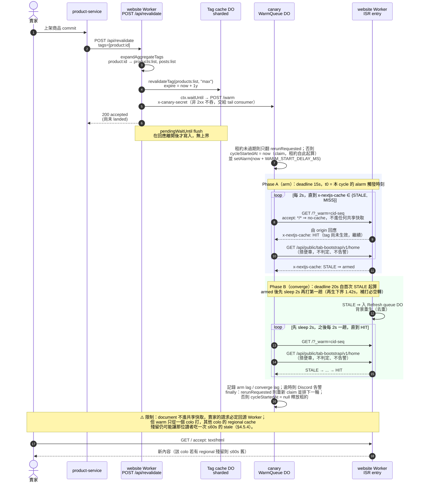
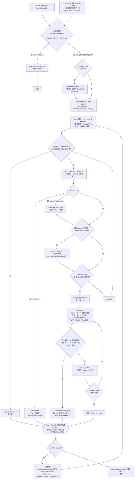

# Web 前端快取架構與版本一致性詳細設計書

## 0. 文件元資訊 (Metadata)

| 項目 | 值 |
|---|---|
| 維護者 | 維護團隊 |
| 對應程式碼 | `hawkr-website/lib/api/cached.ts`、`hawkr-website/next.config.ts`、`hawkr-website/open-next.config.ts`、`hawkr-website/wrangler.jsonc`、`hawkr-website/app/api/revalidate/route.ts`、`hawkr-website/lib/api/revalidate-request.ts`、`hawkr-website/lib/seo/tags.ts`、`hawkr-website/public/_headers`、`hawkr-website/scripts/cloudflare-version-release.mjs`、`hawkr-website/scripts/cloudflare-wait-for-rollout.mjs`、`patches/@opennextjs__cloudflare.patch`、`hawkr-website/cloudflare/canary/src/index.js`、`hawkr-website/cloudflare/canary/wrangler.jsonc`；backend 觸發端見「後端服務責任邊界規範」§9 |
| 相關 doc | §48 SEO 優化與現況（`generateMetadata` 讀取 cached fetcher）、§49 多媒體儲存與圖片服務（`media.example.com` 圖片 immutable 快取）、`基礎建設/系統架構與資料流向.md`（官網 hosting 與邊緣拓撲全貌）、「後端服務責任邊界規範」§9（backend 觸發 revalidate 的 SSOT） |

---

## 1. 概述與目標 (Overview & Goals)

### 1.1 文件定位

本文件描述 `hawkr-website`（行銷官網，Next.js on Cloudflare Workers）的**前端快取
分層架構**與**部署版本一致性**現行契約。標【推斷】者為缺可觀測手段的估計。

**架構定位**：官網為**純 ISR**（Incremental Static Regeneration），
**Cache Components / PPR 明確關閉**。

### 1.2 服務一句話定位

本文件不對應單一可部署後端服務，而是描述官網前端（`hawkr-website`，跑於 Cloudflare Workers / OpenNext）的快取與版本一致性主題（比照 §47/§48 的跨 repo 編寫方式）。backend 側僅透過 `POST /api/revalidate` 觸發失效，該責任歸屬與觸發點矩陣見「後端服務責任邊界規範」§9。

### 1.3 設計目標 (Goals) 與 非目標 (Non-Goals)

| 類型 | 項目 |
|---|---|
| **Goal** | 完整記錄各快取層（瀏覽器 → CF Edge → Worker ISR → R2 + DO）存什麼、TTL、失效方式，附各請求形狀的 header 契約 |
| **Goal** | 記錄後端 mutation → `/api/revalidate` → tag 展開 → 各層 bust → 重生的完整失效鏈 |
| **Goal** | 記錄部署版本一致性機制（`deploymentId`、immutable 資產、version-skew 自癒的**真實適用範圍**、candidate 版本驗證與兩道 rollout 傳播 gate、`queue.js` patch 及其清償條件），以及 version-skew 造成白屏的機制 |
| **Goal** | 記錄 R2 incremental cache 兩 bucket 的儲存量與 lifecycle 現況 |
| **Goal** | 記錄 document / RSC 回應的 `Cache-Control` 契約：四條規則如何窮盡所有請求形狀、公開頁 `no-cache` 與私有路由 `no-store` 的分界，以及「不得為任何路由開 opt-out、Workers Cache 不參與交付正確性」這兩條不變式（§3.3） |
| **Goal** | 記錄失效後的收斂觸發機制（合成讀者）與其**不保證**的部分（§4.5） |
| **Non-Goal** | **不**重述 `hawkr-website#338` 白屏除錯過程（該 issue 為 SSOT）；本文件只記錄治本後架構 |
| **Non-Goal** | **不**展開已知觀察點的優化方案（動態調長 regional cache、build-prefix 可觀測性等）——一律指向追蹤 issue `hawkr-website#339`；本文件只列現況與指標 |
| **Non-Goal** | **不**重複「後端服務責任邊界規範」§9 的 backend 觸發點矩陣與 HTTP contract（該處為 SSOT，本文件只 cross-reference） |
| **Non-Goal** | **不**涵蓋 admin（`hawkr-admin`）的快取——admin 為登入牆內後台，無公開 SEO 讀路徑 |

### 1.4 與其他設計書／服務的關係

- 「後端服務責任邊界規範」§9：backend 何時、對哪些 tag 呼叫 `/api/revalidate` 的**唯一真實來源**（觸發點矩陣、HTTP contract、env 契約、共用 helper）。本文件描述「revalidate 進入前端後各層如何被 bust」，兩者在 `/api/revalidate` 端點交接。
- §48 SEO：各頁 `generateMetadata` 讀取本文件描述的 `unstable_cache` fetcher（`getCachedSeller`/`getCachedProduct`）；賣家 SEO override 更新透過同一條 revalidate 鏈生效。
- §49 多媒體儲存：圖片走 `media.example.com`（Image Gateway Worker + R2），與本文件的 ISR/R2 incremental cache 為**不同 R2 bucket、不同快取路徑**（圖片 immutable 1 年，見 §6）。
- `基礎建設/系統架構與資料流向.md`：官網 hosting（CF Workers）、邊緣拓撲、Workers 清單的全貌在該文件；本文件深入快取分層細節。

---

## 2. 範圍與情境 (Context & Scope)

### 2.1 系統情境（文字流程圖）

公開頁面請求由上而下穿過各快取層（非 mermaid，純文字流程）：

```
瀏覽器
  │  GET https://example.com/... （HTML/RSC）
  ▼
Cloudflare Edge
  │  HTML / RSC：不存共享副本（公開頁 no-cache、私有路由 no-store，§3.3）
  │               ⇒ 每次導覽回源 Worker
  │  /_next/static/*：immutable 1 年（平台資產層，cf-cache-status: HIT，per-colo）
  ▼
官網 Worker（OpenNext on Cloudflare Workers，純 ISR）
  │  Worker ISR incremental cache（x-nextjs-cache: HIT/STALE）
  ├─ Regional cache（邊緣再快取一層，short-lived ~1min）
  ▼
R2 incremental cache（源，key 以 deploymentId 命名空間）
  ├─ Tag cache（DO, sharded）      ← revalidateTag 標記失效
  ├─ Refresh queue（DO）           ← 去重並發 regenerate
  └─ CDN purge buffer（DO）        ← 緩衝呼 CF CDN purge API

後端 mutation ──POST /api/revalidate──▶ 官網 Worker（bust tag → 上述各層失效）
                    └──ctx.waitUntil──▶ canary WarmQueue DO（合成讀者，§4.5）
                                          └── GET / ?_warm ──▶ 觸發 stale 條目背景重生
```

### 2.2 邊界與責任

| | 涵蓋 (In-scope) | 不涵蓋 (Out-of-scope，由誰負責) |
|---|---|---|
| 責任 | 官網公開頁面各快取層的存量/TTL/失效方式；revalidate 進入前端後的 bust 鏈；部署版本一致性 | backend 何時觸發 revalidate（責任邊界規範 §9）；圖片快取（§49）；admin 快取；登入態互動資料快取（TanStack Query，見 §3 末列） |

### 2.3 角色與身份模型

- **匿名訪客 / 搜尋引擎 crawler**：公開讀路徑，走 ISR + data cache，不觸及登入態快取。
- **後端服務（Java/Go）**：唯一的快取失效觸發者，持 `x-revalidate-secret` 呼叫 `/api/revalidate`（責任邊界規範 §9）。
- **登入使用者**：互動態資料（favorites/account/chat…）走 client 端 TanStack Query（per-tab QueryClient），**非**本文件 SEO 公開讀快取路徑。

---

## 3. 快取分層架構 (Cache Layer Architecture)

各層存什麼、TTL、失效方式（「位置」欄為 `hawkr-website` 內的現行設定所在）：

| 層 | 位置 / 證據 | 存什麼 | TTL | 失效方式 |
|---|---|---|---|---|
| 瀏覽器 / CF-edge（HTML / RSC） | `next.config.ts` 的 `PAGE_RESPONSE_CACHE_HEADERS` / `PRIVATE_RESPONSE_CACHE_HEADERS` ＋ `headers()` 的四條規則（§3.3） | **不存共享副本**：公開頁 `private, no-cache, max-age=0, must-revalidate`；`NO_STORE_ROUTE_PREFIXES` 涵蓋的私有路由再收緊為 `private, no-cache, no-store, max-age=0, must-revalidate`。**無任何 opt-out 路由** | 0 | 每次導覽都回源 Worker 重新驗證；ISR 只在 Worker 側生效 |
| CF-edge（靜態資產 `/_next/static`） | `public/_headers` 的 `/_next/static/*` → `Cache-Control: public, max-age=31536000, immutable`（由平台資產層供應，**不經 Worker**） | JS / CSS chunk | 1 年 immutable | 每 deploy 換檔名（`deploymentId` `?dpl=`）+ version-skew 自癒（見 §5） |
| Worker ISR（OpenNext incremental cache） | `open-next.config.ts` `incrementalCache`；命中狀態由回應的 `x-nextjs-cache` 表示（`HIT` / `MISS` / `STALE` / `REVALIDATED`） | 預渲染 HTML/RSC + fetch cache | 各 route `export const revalidate`（首頁／市集／貼文／商品 60、`/search` 300、賣家 storefront 1800）與該頁所讀 data cache 窗（§3.1）**取小者** | `revalidateTag`（tag cache）或 TTL 過期後背景 regenerate（DO queue 去重）。⚠️ domain-collection tag 走 `"max"` profile ⇒ 條目不硬過期，**重生由讀者觸發**；保證「一定有讀者」的合成讀者見 §4.5 |
| Regional cache（邊緣再快取一層） | `open-next.config.ts` `withRegionalCache(r2IncrementalCache, { mode: "short-lived", shouldLazilyUpdateOnCacheHit: false, bypassTagCacheOnCacheHit: false })` | R2 讀結果的邊緣副本 | short-lived（約 1 分鐘上限）——purge 延遲時把 regional entry 界在一分鐘內 | tag-cache 檢查仍開；`shouldLazilyUpdateOnCacheHit=false` 規避 OpenNext 1.20 背景讀無 timeout、會讓已完成的導覽卡在 Worker I/O |
| R2 incremental cache（源） | `open-next.config.ts` `r2IncrementalCache`；`wrangler.jsonc` 每個 env 各自 binding `NEXT_INC_CACHE_R2_BUCKET`（dev `hawkr-web-cache-dev` / prod `hawkr-web-cache-prod`） | ISR 全量渲染結果，key 以 `OPEN_NEXT_BUILD_ID`(=deploymentId) 命名空間 | 由 lifecycle rule 兜底（§6）+ tag 失效 | R2 lifecycle 刪除 + tag revalidate |
| Tag cache（DO, sharded） | `open-next.config.ts` `tagCache: withFilter({ tagCache: doShardedTagCache({ baseShardSize: 4, regionalCache: true, shardReplication: { numberOfSoftReplicas: 1, numberOfHardReplicas: 1, regionalReplication: { defaultRegion: "apac" } } }), filterFn: softTagFilter })`；binding `NEXT_TAG_CACHE_DO_SHARDED` → `DOShardedTagCache` | tag→entry 對應（SQLite DO） | 常駐（閒置休眠）；tag 查詢在邊緣另有 5s regional 快取 | `POST /api/revalidate` 呼 `revalidateTag`。硬約束見 §3.4 |
| Refresh queue（DO） | `open-next.config.ts` `queue: queueCache(doQueue, { regionalCacheTtlSec: 60, waitForQueueAck: true })`；binding `NEXT_CACHE_DO_QUEUE` → `DOQueueHandler` | 去重同一 stale entry 的並發 regenerate；已被 DO 接受的去重 id 在該 colo 快取 60s | 去重 id 60s | `waitForQueueAck: true` ⇒ **只在 DO 確認收下後才寫去重標記**；傳輸失敗必須維持可重試，不得被本地抑制標記蓋掉 |
| CDN purge buffer（DO） | `open-next.config.ts` `cachePurge: purgeCache({ type: "durableObject" })`；binding `NEXT_CACHE_DO_PURGE` → `BucketCachePurge`；buffer `NEXT_CACHE_DO_PURGE_BUFFER_TIME_IN_SECONDS = 5`（三環境同值，§3.4） | 緩衝 + 去重 purge tag，429 靠 DO alarm 重試 | — | 呼 CF purge API（secret `CACHE_PURGE_API_TOKEN` + `ZONE_ID`）。⚠️ **本 zone 為 CF Free 方案，by-tag purge 需 Enterprise ⇒ 此路徑恆失敗且靜默**（`internalPurgeCacheByTags` 只 `error()` 到 console），本 buffer 目前無實際效果；不移除是為升方案後可直接生效（§4.5.4） |
| Data cache（`unstable_cache` 各 fetcher） | `lib/api/cached.ts`（§3.1 TTL 表） | 各 public fetcher 回傳 | 見 §3.1 | tag 失效（primary）+ revalidate TTL（safety net） |
| Client 記憶體（TanStack Query） | `components/shared/AppProviders.tsx:26` `createAppQueryClient`；`lib/query/client.ts` | 登入後使用者資料 / 互動態（favorites/account/chat…） | 各 hook 自訂（e.g. `useFavoriteIds` staleTime `Infinity`、`useSellerTags` 60s） | 前端 invalidate；**非** SEO 公開讀路徑 |

- `enableCacheInterception` **開啟**（`open-next.config.ts`）：ISR / SSG 命中直接由 incremental cache 回 HTML 與 RSC，**不進 NextServer、不載入該頁的 server bundle**。攔截發生在 middleware **之後**（`@opennextjs/aws` `routingHandler.js`），賣家 `store_id → store_code` 的 308 與角色分區守衛照常先跑；`MISS` / `STALE` 仍回到 NextServer 走原本的 ISR 路徑，DO queue 去重與 tag 失效不受影響。`headers()` 的 `Cache-Control` 在攔截結果上一樣後套，瀏覽器看到的政策與未攔截時一致。
  🔴 **前提是全站純 ISR**：`prerender-manifest` 必須零 `PARTIALLY_STATIC` 路由，`tests/open-next-cache-config.test.ts` 釘住此前提與 `enableCacheInterception: true` 本身。
- Cache Components / PPR **明確關閉**（`next.config.ts`；`hawkr-website#338` 白屏 + OOM root cause）。
- **Workers Cache（CF 在 Worker invoke 之前回應命中的共享快取）在任何環境皆不啟用，且不參與交付正確性**：`wrangler.jsonc` 的 top-level 與每個 env 皆**不得出現 `cache` 鍵**（§3.3 有機械 gate）。

### 3.1 Data cache（`unstable_cache`）TTL / tag 表

TTL 常數（`lib/api/cached.ts:37-60`）按**資料語意**分層（非按頁面）：`COMMERCE_LIVE`=300s（價格／庫存／上下架清單與商品詳情）／`SELLER_PROFILE`=1800s(30m)（賣家 profile 與其聚合）／`DISCOVERY`=900s（推薦賣家／食譜／熱門標籤等編輯與排名內容）／`REVIEWS`=900s（評論本文）／`TAXONOMY`=21600s(6h)（分類樹，今日無寫入側失效事件，TTL 即主新鮮度路徑）。

每個窗都是 **safety net**——「漏收一次寫入側失效事件時可容忍的最大陳舊」，而非主新鮮度路徑；主路徑是 mutation 後 `POST /api/revalidate` bust 對應 tag（§4）。各 fetcher 的底層 `fetch` 已無內層 `next:{revalidate}`（`lib/api/index.ts:108-109`、`:339`、`:386`、`:416`；`lib/search/repo.ts:224`），故本表的窗是該讀取路徑上的**唯一**快取窗：tag bust 後下一次讀取直達後端，不會被第二層未帶 tag 的 fetch 窗吸收（收斂前商用即時讀取後方另有 120–300s 內層窗，`COMMERCE_LIVE` 由 60 拉長為 300 即為併成單一帶 tag 窗後維持上游讀取量持平）。

| fetcher | revalidate | tags |
|---|---|---|
| `getCachedProduct` :133 | 300 | `product:<id>` |
| `getCachedProductReviews` :197 | 900 | `product:<id>` |
| `getCachedSeller` :151 | 1800 | `seller:<id>` |
| `getCachedSellerStats` :181 / `getCachedSellerReviewStats` :163 / `getCachedSellerReviews` :480 | 1800 | `seller:<id>` |
| `getCachedSellerProducts` :220 / `getCachedSellerStorefrontProducts` :492 | 300 | `seller:<id>` + `products:list` |
| `getCachedMarketplace` :275 | 300 | `products:list` + `sellers:list` + `posts:list` |
| `getCachedProductsFirstPage` :321 / `getCachedStrictProductsPage` :348 | 300 | `products:list` |
| `getCachedPublicPosts` :389 | 300 | `posts:list` |
| `getCachedRecommendedSellers` :370 | 900 | `sellers:list` |
| `getCachedSeasonalRecipes` :408 | 900 | `recipes:list` |
| `getCachedPopularHashtags` :455 | 900 | `hashtags:list` |
| `getCachedCategoryTree` :435 | 21600 | `categories` |
| home-live-bootstrap（`app/api/public/tab-bootstrap/v1/home/route.ts:45`） | 300 | `products:list` + `sellers:list` + `posts:list` |
| home-discovery-bootstrap（同檔 `:79`） | 900 | `sellers:list` + `recipes:list` |

> tags 欄只有 entity 與 domain-collection **兩層**，掛的是「本 entry 嵌入哪個**資料域**」而非「顯示在哪一頁」。taxonomy 語意與 entity→domain 展開映射見 §4.1–§4.3。
> 🔴 **不得新增第三層（頁面層）tag**——`home` / `tab:*` / `marketplace` 這類「顯示在哪一頁」的 tag 已從 `lib/seo/tags.ts` 與 `lib/api/revalidate-request.ts` 移除，加回去會讓一筆編輯展成整個目錄的失效。

### 3.2 回應 header 契約（按請求形狀）

| 請求 / 資源 | `Cache-Control` | 其他 |
|---|---|---|
| 公開頁 document（`accept` 含 `text/html`） | `private, no-cache, max-age=0, must-revalidate` | 每次導覽回源 Worker；`x-nextjs-cache` 反映 Worker 側 ISR 命中狀態 |
| 公開頁 RSC（`rsc: 1`） | 同上 | `DEPLOYMENT_ID` 有值時另帶 `x-nextjs-deployment-id`（供導覽期版本檢查，見 §5）；`vary` 含 `rsc` |
| 其餘請求形狀（`accept` 不含 `text/html` 且無 `rsc: 1`，例如 `Accept: */*`） | 同上 | 第三條規則是前兩條 `has` 子句的**精確補集**（§3.3） |
| `NO_STORE_ROUTE_PREFIXES` 涵蓋的路由（任一形狀） | `private, no-cache, no-store, max-age=0, must-revalidate` | 不進瀏覽器磁碟快取，也不進 bfcache |
| `/_next/static/*` | `public, max-age=31536000, immutable` | `public/_headers`，由平台資產層在 Worker 之前供應；`cf-cache-status: HIT`（per-colo） |
| 圖片 `media.example.com` | `public, max-age=31536000, immutable` | Image Gateway Worker + R2（§49），與本文件的 R2 incremental cache 為不同 bucket |

**含義**：document 與 RSC 一律不進任何共享快取，每次導覽都回源 Worker，ISR 只在 Worker 側生效。

🔴 **公開頁用 `no-cache` 而不是 `no-store`**：`no-cache` 已足以禁止任何快取在未向 origin 重新驗證前
重用回應（版本 skew 因此擋得住）；`no-store` 多做的一件事是禁止瀏覽器把頁面放進 back/forward cache
⇒ 全站零 bfcache、按上一頁必須整份重載並重跑 hydration。私有路由要的正是那個額外效果
（登出後按上一頁不得還原出剛才的訂單頁），所以**只有它們**用 `no-store`。

**環境入口**：prod `example.com`、dev `web-dev.example.com`；`dev.example.com` 非 worker 入口。

### 3.3 Document / RSC 的 `Cache-Control` 契約（四條規則）

`next.config.ts` 的 `headers()` 以**四條規則**決定每個回應的 `Cache-Control`，同一個 header key
**後匹配者勝**：

| # | 規則 | 命中什麼 | 送出 |
|---|---|---|---|
| ① | `source: "/(.*)"` ＋ `has accept ~ .*text/html.*` | document | `PAGE_RESPONSE_CACHE_HEADERS` |
| ② | `source: "/(.*)"` ＋ `has rsc: 1` | RSC payload | 同上 |
| ③ | `source: "/(.*)"` ＋ `missing: REQUEST_SHAPES_WITHOUT_A_DOCUMENT_RULE` | ①② 的**精確補集** | 同上 |
| ④ | `source: PRIVATE_ROUTE_SOURCE` | 私有路由前綴（任一請求形狀） | `PRIVATE_RESPONSE_CACHE_HEADERS` |

- `PAGE_RESPONSE_CACHE_HEADERS` ＝ `private, no-cache, max-age=0, must-revalidate`
- `PRIVATE_RESPONSE_CACHE_HEADERS` ＝ `private, no-cache, no-store, max-age=0, must-revalidate`

🔴 **沒有第③條，前兩條就是 opt-in 而不是 default**：既不帶 `accept: text/html` 也不帶 `rsc: 1`
的請求形狀會從縫隙逃出去、拿到可共享的 header。③ 亦指名 `rsc` 的**值**而非僅其存在，
使 `rsc: 2` 落進③而不是卡在規則之間。

🔴 **不得為任何路由開 opt-out**——不得送出 `s-maxage`、`public` 或任何允許共享快取保存的
`Cache-Control`。`tests/page-response-cache.test.ts` 逐條機械釘住四件事：三條規則窮盡所有請求形狀、
每個公開請求形狀都拿到 `no-cache` 政策、每個私有前綴的每個形狀都拿到 `no-store`、
**且沒有任何 page header 規則 opt-out 於這兩種政策**。

**私有前綴清單**：`NO_STORE_ROUTE_PREFIXES` ＝ `lib/seo/indexability.ts` 的 `PRIVATE_PREFIXES`
（決定 noindex 的同一組路徑）＋ `/adm`、`/quote-confirm`、`/seller/onboarding`、
`/hawkr-agent-rfq-preview`、`/api`、`/sentinel`。
`PRIVATE_ROUTE_SOURCE` 以 `/(a|b/c)(/.*)?` 的形式展開，使前綴本身與其子路徑都命中，
而只是字首相同的路徑（如 `/accounting` 之於 `/account`）不會。

- `/api` **整段**維持 `no-store`：`headers()` 的同名 header 會覆蓋 route handler 自己設的值，
  而 `/api/health` 的 `no-store` 是 load-bearing（被快取的健康回應會讓死掉的部署看起來還活著），
  `tab-bootstrap` 亦以 `no-store` 為契約。
- `/seller` 與 `/seller/pricing` 是公開行銷頁 ⇒ 私有的是完整路徑 `/seller/onboarding`，不是 `/seller`。
- ⚠️ `tests/page-response-cache.test.ts` 用**獨立手寫**的敏感路徑清單去比對，不從
  `NO_STORE_ROUTE_PREFIXES` 反推期望值 ⇒ 名單漏掉 `app/` 裡的敏感頁時測試會紅，而不是跟著一起錯。

**default-deny 生效的機制**：`@opennextjs/aws` `core/routing/util.js` 的 `fixISRHeaders()` 只在出站
`Cache-Control` **含 `s-maxage`** 時才依 `x-nextjs-cache` 改寫它；上面兩個常數都不含 `s-maxage`
⇒ 一律原封送出。要讓任何回應變成可共享，必須先讓某個路由送出 `s-maxage`——而那正是上一條禁令擋住的事。

🔴 **Workers Cache 不參與交付正確性**：`wrangler.jsonc` 的 top-level 與每個 env 皆**不得出現 `cache` 鍵**，
由 `tests/open-next-cache-config.test.ts` 的「Workers Cache is disabled in every environment」機械釘住
（斷言 `dev` / `production` 兩個 env 存在，且全檔不得匹配 `"cache":`）。
⇒ 部署流程**不需要**清邊緣共享副本，版本一致性完全由 §5 的 candidate 驗證與 rollout gate 承擔。

**SEO**：爬蟲取得的就是 Worker 產生的完整 HTML 與 JSON-LD，不經任何共享快取層。

### 3.4 OpenNext override 的硬約束

以下三條是 `open-next.config.ts` 的現行不變式，各自有機械守門：

| 約束 | 內容 | 守門 |
|---|---|---|
| **`revalidatePath` 禁用** | `softTagFilter` 只保留顯式內容 tag、丟掉 Next 的隱式 `_N_T_` 路徑 tag ⇒ `revalidatePath()` 不會失效任何東西。失效一律用顯式 `revalidateTag`（§4） | `scripts/check-architecture.ts`：任何檔案出現 `revalidatePath(` 即失敗 |
| **`regionalReplication.defaultRegion` 必填** | 省略時 `do-sharded-tag-cache.js` 會 fallback 到 `DEFAULT_REGION = "enam"`（北美），比不設更糟；只加 `shardReplication` 而不加 `regionalReplication`，則其 `Boolean()` 判斷為 false、整段完全不生效。現值 `"apac"` | `tests/open-next-cache-config.test.ts`「sharded tag cache replication is either absent or genuinely regional」 |
| **purge buffer 三環境同值** | `NEXT_CACHE_DO_PURGE_BUFFER_TIME_IN_SECONDS: "5"` 必須在 top-level、`dev`、`production` 各出現一次；`cachePurge` 必須是 `purgeCache({ type: "durableObject" })`，不得改成 `"direct"` | 同上，「cache-tag purge is buffered, deduplicated and 429-retryable through a Durable Object」 |

**讀寫側的取捨（規格，不是理由）**：開啟 regional replication 後**讀取**固定走 `defaultRegion`，
代價在**寫入**側——每次 tag 失效從打 1 個 DO 變成打全部 region（`enam`/`weur`/`apac`/`sam`/`afr`/`oc`）。
因此 `numberOfSoftReplicas` 與 `numberOfHardReplicas` **一律取 1**：本站要的是「落點正確」而非
「多副本分攤讀取壓力」，調高只會讓寫入放大再乘上倍數。

---

## 4. 失效鏈 (Invalidation Chain)

後端 mutation 如何一路 bust 到各快取層。**backend 側「何時、對哪些 tag 觸發」為「後端服務責任邊界規範」§9 的 SSOT，本節不重複觸發點矩陣**，只描述 tag taxonomy 與請求進入前端 `/api/revalidate` 後的展開與 bust 行為。

### 4.1 Tag taxonomy（兩層資料驅動模型）

taxonomy 只有兩層。🔴 **失效的驅動是「內容嵌入哪個資料域」，不是「顯示在哪個頁面」。**
以頁面為單位的 tag 會把不相關的資料域綁在同一個 tag 下，使單一 entity mutation 經
expansion 霰彈式失效全站 landing（例：改一個商品價格會失效食譜／推薦賣家／熱門標籤等
不含該商品的快取）。

| 層 | tag | 誰產生 | 語意 |
|---|---|---|---|
| **Entity** | `product:<id>` `seller:<id>` `post:<id>` `recipe:<id>` | backend producer 直接發（§9） | 單筆資源身分 |
| **Domain-collection** | `products:list` `sellers:list` `posts:list` `recipes:list` `hashtags:list` `categories` | **web expansion 於信任邊界產生**（producer 不直接發） | 「某聚合 fetcher 嵌入了此資料域」 |

🔴 **以下 tag 不存在，不得加回**：

- `tab:home` / `tab:feed` / `tab:market` / `tab:search`：純「顯示在哪個頁」概念，
  無獨立 producer，與資料失效正交。
- `home`：頁面層 legacy tag。**backend 不發、web 不接**。
- `marketplace`：`products:list ∪ sellers:list ∪ posts:list` 的並集冗餘 tag。
  `getCachedMarketplace` 本來就同時掛三個 domain tag，任何 product／seller／post
  mutation 經三 domain tag 展開即精準命中 ⇒ 它**零精準度貢獻**。

**fetcher 掛 tag 唯一準則：掛「我嵌入的資料域」**（不是「我顯示在哪頁」）。終態 fetcher → tag（證據＝各卡片組件嵌入欄位稽核）：

| fetcher（`cached.ts` / tab-bootstrap route） | 終態 tags |
|---|---|
| `getCachedProduct` / `getCachedProductReviews` | `product:<id>` |
| `getCachedSeller` / `SellerStats` / `SellerReviewStats` / `SellerReviews` | `seller:<id>` |
| `getCachedSellerProducts` / `getCachedSellerStorefrontProducts` | `seller:<id>`, `products:list` |
| `getCachedMarketplace` | `products:list`, `sellers:list`, `posts:list` |
| `getCachedProductsFirstPage` / `getCachedStrictProductsPage` | `products:list` |
| `getCachedRecommendedSellers` | `sellers:list` |
| `getCachedPublicPosts` | `posts:list` |
| `getCachedSeasonalRecipes` | `recipes:list` |
| `getCachedPopularHashtags` | `hashtags:list` |
| `getCachedCategoryTree` | `categories` |
| home-live-bootstrap（`app/api/public/tab-bootstrap/v1/home/route.ts`） | `products:list`, `sellers:list`, `posts:list` |
| home-discovery-bootstrap | `sellers:list`, `recipes:list` |

### 4.2 失效鏈流程

1. **後端觸發**（責任邊界規範 §9）：Java（product-service）、Go（seller/review service）於 price/stock/publish/profile mutation commit 後 `POST /api/revalidate`，header `x-revalidate-secret`，body `{tags:[...], event_id?}`（`app/api/revalidate/route.ts:31`）。**producer 只發 entity tag**（`product:<id>` / `seller:<id>`）；domain-collection 失效由步驟 3 的 web expansion 產生，producer 不直接發 domain-collection tag。⚠️ **賣家的 entity tag 必須涵蓋公開網址接受的全部識別碼空間**：店鋪頁片段可以是 `store_id`（2026-07-23 前的連結）或 `store_code`（現行 canonical），而 web 是拿**網址片段**當快取鍵（`lib/api/cached.ts` `sellerTag(id)`），`store_code` 為獨立鑄造、與 `store_id`／`account_id` 無函數關係。因此 seller-service 一律經 `pkg/revalidate.SellerTags(...)` 發出全部 id 空間並去重（收斂點：`services/seller-service/internal/usecase/seller.go` `sellerCacheTags`／`bustSellerCache`）；只發單一 id 空間的賣家，其店鋪頁會 stale 到 TTL（1800s）。共用 helper：Java `RevalidateClient.bustAfterCommit`、Go `pkg/revalidate/Client`（§9.6）。
2. **驗證 + 解析**（`lib/api/revalidate-request.ts`）：secret timing-safe、body ≤64KB、tags ≤128；支援的 tag = `STATIC_PUBLIC_TAGS`（`PUBLIC_CACHE_TAGS` 全部）+ `ENTITY_TAG` regex `^(product|seller|post|category|hashtag|recipe):...`。**任一 tag 非白名單 → 400，整包 tag 全不失效（first-invalid-fails-all）**。🔴 由此得到一條跨 repo 約束：**任一時刻 web 的白名單必須 ⊇ backend 會發的 tag 集合**——backend 先加新 tag 而 web 沒跟上，會讓同一包裡原本有效的 tag 一起失效不了。retired 的 `mode` 欄位一律忽略（拒收會連帶丟掉同包的有效 tag）；`revalidatePath` 被 `softTagFilter` 禁用。
3. **aggregate 展開**（`expandAggregateTags`）：entity tag → 它被嵌入的 domain-collection tag（精準映射，見 §4.3）。
4. **逐 tag `revalidateTag`，profile 由 tag 形狀決定**（`lib/api/revalidate-request.ts` `revalidationProfileFor`，producer 無從選擇）：
   - **entity tag → `{expire:0}`（立即過期）**。tag row 寫入 `expire=now`，使 bust 前產生的 entry 全數判為 miss。entity 指向單一紀錄，其讀者包含剛存檔的本人；serve-stale 會把他自己的變更顯示成沒發生，被讀成存檔失敗。
   - **domain-collection tag → `"max"`（serve stale while revalidate）**。寫入 `expire=now+1y` 只開 stale window。硬過期列表的代價遠大於收益：OpenNext 只在 STALE 路徑走重生去重（`revalidateIfRequired` 非 STALE 直接返回），硬過期會讓每個並發讀者各自 inline 重生；而步驟 3 的 expansion 會把單一筆編輯展成 `products:list`＋`posts:list`＋`sellers:list`，等於一次改價就對整個目錄做這件事——正是把 prod Worker 推過記憶體上限、使站台白屏的同一條放大路徑（#338）。維持 SWR 亦保留後端降級時的 stale-if-error 兜底。列表的讀者不是寫入者，慢一個請求對他們不可見。
5. **被 bust 的層**：Tag cache（DO）標記失效 → 對應 `unstable_cache` entry + ISR incremental cache（R2）entry → 下次請求 regenerate → 同時 CDN purge buffer DO 緩衝呼 CF CDN purge API 清邊緣。⚠️ **Refresh queue DO 的並發去重只覆蓋 domain-collection（SWR）路徑**：`revalidateIfRequired` 僅在回應為 `STALE` 時入列，因此 entity 的立即過期路徑不享有去重，並發讀者各自 inline 重生——entity 為單一紀錄、並發量有界，這是換取「寫入者立刻看到自己的變更」的已知代價。
6. **失效鏈觀測點**：對某 **entity** revalidate 後，該頁下一次請求 `x-nextjs-cache` 為 `MISS`（`hasBeenRevalidated` 判定 `expire <= now && expire > lastModified` 成立即回 null，`@opennextjs/aws@4.0.2 dist/adapters/cache.js:85-89`），regenerate 完成後回到 `HIT`。對 **domain-collection** 則為 `STALE`（`isStale` 分支）→ 背景重生完成後 `HIT`。兩者是可區分的觀測指紋：entity 走 MISS、列表走 STALE。⚠️ domain-collection 的 `STALE → HIT` 轉換**需要有讀者**（`"max"` 不硬過期，時鐘不會替它收斂）；該讀者的存在由 §4.5 的合成讀者保證。

### 4.3 aggregate 展開精準映射（entity → domain-collection）

expansion 只展開 entity「實際被嵌入」的 domain-collection tag，**不再展開到 `tab:*` 或該 entity 未被嵌入的 domain（消除霰彈式假失效）**：

| entity | 展開的 domain-collection tags | 坐實理由（嵌入稽核） |
|---|---|---|
| `product:<id>` | `products:list`, `posts:list` | 商品卡（市集／首頁貨架／storefront）、貼文卡連結商品皆嵌商品可變欄位（name／price／image／stock／rating）|
| `seller:<id>` | `sellers:list`, `products:list`, `posts:list` | 推薦賣家卡嵌賣家欄位；**商品卡直接顯示 `seller.name` + `seller.logoUrl`（`listFilters.ts` mapProduct）→ `seller:<id> → products:list` 不可拆**；貼文卡嵌賣家名 |
| `post:<id>` | `posts:list` | 貼文列表 |
| `recipe:<id>` | `recipes:list` | 食譜列表 |
| `hashtag:<id>` | `hashtags:list` | 熱門標籤列表 |
| `category:<id>` | `categories` | 分類樹 |

映射實作於 `lib/api/revalidate-request.ts:93-119`。今日僅 product-service／seller-service／review-service 為 producer，只發 `product:<id>` 與 `seller:<id>`（`pkg/revalidate/tags.go` 只有 `ProductTag`／`SellerTag`）；`post`／`recipe`／`hashtag`／`category` 四條展開邊為契約先備，producer 補齊（例：`category:<id>` 見 `backend-payuni#1919`）即生效，web 端無須再改。

**收斂後不再有的展開邊**（收斂前假失效，坐實不含對應 entity 欄位 → 移除）：
- 全部 `product/seller/post/recipe → tab:*`：`tab:*` 唯一「額外」命中的 fetcher（食譜／推薦賣家／熱門標籤／分類）皆不嵌對應 entity 欄位。
- `product → sellers:list`：商品變動不改推薦賣家榜單的**排序**（責任邊界 §9.3：賣家推薦由 order 營收排名驅動，非商品 mutation）。⚠️ 推薦端加上「有無公開上架商品」過濾後，商品 mutation 可以改變榜單的**成員**（賣家從 0 件變 1 件會進榜、反之退榜）——但那正好是下方 §4.3 判準「該 mutation 是否改變賣家有哪些公開商品」為真的四種 mutation，它們**仍共發 `seller:<id>`**，而 `seller:<id>` 展開含 `sellers:list`。故此展開邊維持移除，失效面不需改動。
- `product/seller → recipes:list / hashtags:list / categories`：食譜／標籤／分類卡不嵌商品或賣家實體欄位（hashtag count 統計靠 TTL 兜底）。
- `product/seller/post → marketplace`：`marketplace` 為 `products:list ∪ sellers:list ∪ posts:list` 並集冗餘，`getCachedMarketplace` 已同掛三 domain tag，展開經三者精準命中，移除 `marketplace` 展開邊零精準度損失（見 §4.1）。

**移除展開邊的代價（已裁決由 TTL 兜底，非 regression）**——收斂前這兩條資料的更新其實是搭上假失效邊的**意外覆蓋**，非設計意圖：

- **導覽列分類名 stale ≤ 21600s**：`product/seller → categories` 邊移除後，分類改名 cascade（`CategoryService.java:251`，只發 `product:<id>`＋`seller:<id>`）不再經 `tab:market` 順帶 bust `getCachedCategoryTree`，megamenu 分類名最長 stale 6 小時（`CACHE_TTL.TAXONOMY = 21600`）。待 `category:<id>` producer 補齊（`backend-payuni#1919`）後歸零。
- **熱門 hashtag count stale ≤ 900s**：收斂前商品上下架經 `home` 與 `tab:market` 兩路 bust `getCachedPopularHashtags`，收斂後退化為純 TTL（`CACHE_TTL.DISCOVERY = 900`）。count 是統計值而非 entity 欄位，SSOT 裁決靠 TTL 兜底；於此明列以免日後被當 regression 追查。

**失效面對比（一次商品價格編輯）**：收斂前 `product:<id>` → 7 tag → bust ~8–9 個 landing（含食譜／熱門標籤／推薦賣家／分類等 5 個假失效）；step2 後 web 側 expansion 已精準（`product:<id>` → `products:list`+`posts:list`），但 producer 端仍共發 `seller:<id>`，`seller:<id>` 展開含 `sellers:list` → 一次改價仍 bust 兩個不含任何商品欄位的條目（**推薦賣家 rail** `cached.ts:370`、**home-discovery bootstrap** `app/api/public/tab-bootstrap/v1/home/route.ts:79`），即「5 → 2」。**step3 已把殘留 2 條清零**：坐實掛 `seller:<id>` 的 fetcher 全數不嵌商品欄位後，純商品欄位／庫存／改分類 mutation 不再共發 `seller:<id>`（見下）。

**殘留 2 條的坐實與清零（step3 已執行）**：共發 `seller:<id>` 的原動機是「商品卡顯示賣家欄位、storefront 列表按賣家聚合」。收斂後 storefront 列表（`getCachedSellerProducts` / `getCachedSellerStorefrontProducts`）已同掛 `[seller:<id>, products:list]`，商品 mutation 經 `product:<id> → products:list` 即已涵蓋。逐一稽核所有掛 `seller:<id>` 的 fetcher 與 `sellers:list` 條目的實際 payload：

| fetcher | 後端資料源 | 是否因商品 mutation 過時 |
|---|---|---|
| `getCachedSeller`（`cached.ts:151`） | `/public/sellers/{id}` → 賣家 profile 欄位（`seller-service/internal/grpc/mapper.go:14`） | ❌ 無任何商品衍生欄位 |
| `getCachedSellerStats`（`cached.ts:181`） | `/public/sellers/{id}/stats` → `seller-service/internal/grpc/handler.go:298-315` **只填** rating／followers／reviewCount；proto 的 `total_products`／`total_orders`／`total_sales` 全 repo 無賦值點（gateway `seller.go:288` 讀到的恆為零值），web 亦只讀 `followers`（`SellerProfileV2.tsx:85`） | ❌ |
| `getCachedSellerReviewStats` / `getCachedSellerReviews` | review-service 評論列與統計；`sku_name`／`item_image_key` 為**訂單快照欄位**（`review-service/db/schema/schema.sql:15-16`），非商品即時查詢 | ❌ |
| `getCachedSellerProducts` / `getCachedSellerStorefrontProducts` | 商品列表 | ✅ 但同掛 `products:list`，由 `product:<id>` 展開命中 |
| `getCachedRecommendedSellers`（`sellers:list`） | `/public/sellers/recommended` → 近 30 天 order 營收排名 + 賣家 profile + 訂閱數 + **「有無公開上架商品」過濾**（`seller-service/internal/usecase/recommended_sellers.go` 的 `GetRecommendedSellers`；集合來自 product-service `ListStoreIDsWithPublicProductsInternal`） | ✅ 但**只對「改變賣家公開商品集合」的 mutation**，而那批本來就共發 `seller:<id>`（見下） |

🔴 **共發 `seller:<id>` 的判準是「該 mutation 是否改變賣家有哪些公開商品」**（責任邊界 §9.3 ★）——對不改變該集合的 mutation 共發 `seller:<id>` 是純 over-invalidation：欄位編輯（`updateProduct`）／庫存（`StockService`）／改分類（`batchChangeProductCategory`、`CategoryService` cascade）／未跨 ACTIVE 的狀態變更／非 ACTIVE 商品刪除 → **只發 `product:<id>`**；建立即上架／刪除 ACTIVE 商品／上下架跨 ACTIVE／賣家批次下架 → 仍共發 `seller:<id>`。一次商品價格編輯或一次下單扣庫存的假失效因此歸零。

> **推薦賣家的「有無公開上架商品」過濾不改變本判準**：該過濾把 `sellers:list` 的成員集合綁在「賣家有沒有公開商品」上，而集合會變動的時機恰好等於上面判準為真的那四種——`ProductService.createProduct`（`isActive` 分支）／`updateProductStatus`／`updateSellerProductStatus`（皆走 `crossesActiveBoundary`）／`deleteProduct`（`wasActive` 分支）走 `revalidateProductAndSeller`，`SellerProductOffShelfService` 的批次下架／復架走 `revalidateProductsWithSellers`，`ProductImportService` commit 亦共發。⇒ 過濾是**成員**變動、不是**排序**變動，而成員變動的每一個 producer 都已共發 `seller:<id>`，展開含 `sellers:list`，失效面完整。

### 4.5 失效後收斂：合成讀者（Warm）

§4.1–§4.3 描述的是「失效如何被標記」。本節描述失效鏈的最後一環：**被標記為 stale 的條目，靠什麼回到 fresh**。

#### 4.5.1 問題陳述：失效強度，不是涵蓋範圍

「賣家上架商品後，首頁很久看不到」**不是 tag 漏掛，是 profile 的直接後果。**

`revalidationProfileFor`（`lib/api/revalidate-request.ts:223`）按 **tag 形狀**分流，producer 無從選擇（§4.2 步驟 4）：

| tag 形狀 | profile | tag row 寫入 | 下一次讀取的 `x-nextjs-cache` |
|---|---|---|---|
| entity（`product:<id>`、`seller:<id>`） | `IMMEDIATE` `{expire:0}` | `expire = now` | `MISS`（硬失效） |
| aggregate（`products:list` 等 domain-collection） | `DEFERRED "max"` | `expire = now + 1y` | `STALE`（只開 stale 窗口） |

`expire = now + 1y` 的意思是**這個 entry 永遠不會硬過期**。它從此只有一個離開 stale 狀態的方法：**有人來讀它**，讀取觸發背景重生（`revalidateIfRequired` 只在回應為 `STALE` 時入 Refresh queue DO 去重，§4.2 步驟 5）。

首頁的五個 reader 全部落在 aggregate 側，**零 entity tag**（`lib/api/home-bootstrap.server.ts` `loadHomeRenderBootstrap`，窮舉封閉）：

```
getCachedMarketplace / getCachedProductsFirstPage / getCachedRecommendedSellers
/ getCachedPublicPosts / getCachedSeasonalRecipes
```

對照 §3.1 的 tags 欄，這五個掛的是 `products:list` / `sellers:list` / `posts:list` / `recipes:list`——全部 aggregate。

⇒ 🔴 **首頁的收斂由「有人來讀」觸發，不由時鐘觸發。** 在低流量時段，**剛上架完、立刻去看首頁的賣家，就是吃到那一份 stale 的第一個讀者**——他看到舊內容，而他觸發的重生要等下一個讀者才看得到成果。

判準：**看到「首頁沒更新」時，先問失效強度（profile），不要先去數 tag 覆蓋了幾個 fetcher。** tag 掛得再全，`"max"` 都只是開窗，不是關門。

#### 4.5.2 禁止把 aggregate tag 改成 `IMMEDIATE`

🔴 **`lib/api/revalidate-request.ts` 的 profile 一行不動。**
最直覺的修法是「把 aggregate tag 也改成 `IMMEDIATE`」——**那會重演全站白屏**，三段機制連起來看：

1. **失效強度只能按 tag 給，給不了「只有首頁」。** `unstable_cache` 會把 tags 累加進外層 render 的 store（`@opennextjs/aws` `unstable-cache.js:119-129`）。`products:list` 這一個 tag 對應 §3.1 表中的 6 個 entry，涵蓋 `/`、`/market/products`、`/search`、`/feed`、賣家 storefront。**改一個 tag 的 profile ＝ 改這六顆的全部。**
2. **硬失效會繞過重生去重。** OpenNext 只在 `STALE` 路徑走 `revalidateIfRequired` 入 Refresh queue DO 去重（§4.2 步驟 5）；`{expire:0}` 讓 `hasBeenRevalidated` 判為 miss，走的是非 STALE 路徑 ⇒ **不進佇列**。
3. ⇒ **每個並發讀者各自 inline render 一份完整列表頁**——這正是把 prod Worker 推過
   記憶體上限、使站台白屏的那條放大路徑（§4.2 步驟 4），而 §4.3 的 expansion 會把一筆
   商品編輯展成 `products:list` ＋ `posts:list`，等於一次改價就對整個目錄做這件事。

維持 SWR 另有一項不可放棄的附帶價值：**後端降級時的 stale-if-error 兜底**（§4.2 步驟 4）。

⚠️ 任何後續重構若要動這個 profile，**必須先重新論證上面那條放大路徑為何不再成立**。

#### 4.5.3 對策設計：派一個合成讀者去讀

既然收斂需要讀者、而 profile 不能動，就**保證讀者一定存在**：失效發生後，由 canary worker 派出一個合成讀者去讀首頁，把「等真人來」換成「不等真人」。

##### (a) 觸發鏈與載體

- **觸發點**：`app/api/revalidate/route.ts` 的 `applyRevalidation` 回傳後，以 `ctx.waitUntil(notifyWarm(tags))` 送出通知，**不阻塞回給 backend 的 200**。
- **載體＝canary worker，不是主 worker**：主 worker 加 DO 要動 `wrangler.jsonc` 的 migrations 並從 OpenNext 產生的 `worker.js` 匯出自訂 class；canary 只需在 `cloudflare/canary/wrangler.jsonc` 的 migrations 加一個 tag、兩個 env 各加一條 binding。
- **通知走 HTTP，不用 service binding**：`deploy.yml` 明寫 canary 只在主站部署成功後才部署、且 `continue-on-error: true`（觀測設施不得改寫主站部署成敗）。service binding 會把依賴方向倒過來 ⇒ 否決。
- **授權用專用 secret `CANARY_WARM_SECRET`**，比照既有 `/report` 的 `x-canary-secret` fail-closed 形狀（`cloudflare/canary/src/index.js:116-142`：未設 secret 回 503 並在 body 講清楚「缺什麼／影響什麼／怎麼修」，secret 錯回 401）。🔴 **不得複用 `REVALIDATE_SECRET`**：權限必須對稱於用途（canary README「為什麼不複用」表的同一條原則）。

##### (b) 為什麼要暖兩顆，而不是一顆

⚠️ **首頁 SSR 與 bootstrap route 是兩顆獨立的 entry**，暖其中一顆不會讓另一顆變新：

| | `/`（SSR document） | `/api/public/tab-bootstrap/v1/home`（client bootstrap） |
|---|---|---|
| entry 型態 | ISR prerendered entry（外層） | route handler，**外層無 ISR entry**；吐 stale 的是它內部的 `unstable_cache`（`app/api/public/tab-bootstrap/v1/home/route.ts` 的 `getCachedHomeLiveBootstrap` / `getCachedHomeDiscoveryBootstrap`） |
| 誰讀它 | 首次進站的 document 請求、爬蟲 | 瀏覽器端刷新（`loadHomeRenderBootstrap` 的註解明寫兩者「resolve identical data」） |
| 需要 cache-bust query | ✅（保證該趟必定抵達 Worker，`x-nextjs-cache` 才反映這一次的狀態） | ❌ route handler，回應恆 `no-store`，本來就不經任何共享快取 |
| `x-nextjs-cache` | ✅ 有 | ❌ **完全沒有** |
| 收斂可判定 | ✅ | ❌ **不可判定**（無任何可用訊號；body digest 已否決，見 (d)） |

⇒ 設計上**不對稱**：`/` 走兩階段判定＋告警；bootstrap **無條件搭便車**，每趟 poll 順便打一次、跟著 `/` 的迴圈起訖。
⇒ **告警只綁 `/`。bootstrap 永遠不產生告警**——它的「有沒有成功」在設計上不可觀測，算進告警等於發明一個永遠無法判偽的紅燈。**這包含 bootstrap 的非 200 與 fetch throw**：它有一條真實可達的 503 分支（後端 commerce wave 全降級），照「非 200 就告警」實作會讓後端短暫抖動直接打進 Discord。(f) 的告警表已按此逐列限定範圍，兩處措辭必須一起改。

⚠️ **站內已有另一個叫 `warm` 的東西，本節不沿用它**：`app/api/public/tab-bootstrap/v1/warm/route.ts` 是**瀏覽器端的 idle warmer**，只收 `?tab=feed|market|search`（`isWarmableTab` 三值封閉，`home` 不是合法值），填的是 `/market`、`/search` 的內層資料 entry。它**打不到首頁那顆**，而改它的參數會打壞 `/search` 與 `/market/products` 的既有 idle 暖機。兩者同名不同物：站內 `warm` = 使用者端預測性預熱；本節 `warm` = 失效後的收斂保證。

##### (c) 暖讀請求的形狀

```
GET {TARGET_ORIGIN}/?_warm=<cycleId>-<seq>
  accept: */*
  cache-control: no-cache
  pragma: no-cache
  user-agent: hawkr-canary-warm/<ENV_LABEL>
→ 讀 x-nextjs-cache / cf-ray(colo) / status，然後 response.body?.cancel()
```

- 🔴 **cache-bust query（`?_warm=`）必須帶**：它保證這一趟不可能由瀏覽器或任何中介快取供應
  ⇒ 必定抵達 Worker，而 `x-nextjs-cache` 反映的才是**這一次**的 ISR 狀態（見 (d)）。
- 🔴 **`Accept: */*` 必須帶**：它落在 §3.3 的第③條規則，拿到與 document 完全相同的
  `PAGE_RESPONSE_CACHE_HEADERS` ⇒ 暖讀不會在任何共享快取留下條目。改成 `text/html`
  只是換成第①條、結果相同，但 (d) 的判定前提就改成依賴「document 規則不會被改」，
  而 `*/*` 同時證明第③條仍然存在——那是 §3.3「不得開 opt-out」的活體檢查。

兩個附帶性質：

- **query 不分岔 ISR entry**：`app/(public)/page.tsx` 的 `Page()` 不收 `searchParams`，
  query 對 render 惰性 ⇒ 全新 nonce 仍會命中既有 entry，暖讀不會製造平行的 ISR 條目。
- **RSC 與 document 共用同一顆 entry**：`rsc: 1` ＋ `*/*` ＋ nonce 走的是同一顆
  ⇒ 一次暖讀同時涵蓋瀏覽器導航要用的 RSC flight，不必分兩趟。

**param 名必須是 `_warm` 不是 `_canary`**：`_canary` 那個 token 被 canary 自己的 round/probe
用來把請求接到 Traefik access log，混用會污染 canary 樣本。

**用 GET ＋ 立刻 `body.cancel()`，不用 HEAD**：HEAD 會回 `x-nextjs-cache`，但「HEAD 在 STALE
路徑會不會觸發再生」無法坐實 ⇒ 不賭。

##### (d) 判定訊號：`x-nextjs-cache`，且只有它

值域四種：`HIT | MISS | STALE | REVALIDATED`（`next/dist/server/route-modules/pages/pages-handler.js`）。

⚠️ **關鍵性質：`x-nextjs-cache` 只有在該趟真的抵達 Worker 時才代表這一次的狀態。** 任何由共享快取
供應的回應會原封帶回 entry **被寫入當時** origin 說的話，而共享快取命中根本不進 Worker。
⇒ **(c) 的 cache-bust query 不只是「打得到 worker」的手段，也是「判定訊號能不能被信任」的前提。**
這兩件事是同一個機制，不能分開取捨。

**不用 body digest**：零失效下 digest 就會變（`/` 含隨機排序與時間相關內容），資訊量近零。

**判定完全不看 `cf-cache-status`**（僅 (f) 的執行期守門用它做健檢）。

##### (e) 控制流：兩階段 deadline-poll

```
通知鏈：POST /api/revalidate 的 applyRevalidation 回傳
     → ctx.waitUntil(notifyWarm(tags)) → POST {CANARY}/warm
     → canary DO WarmQueue.setAlarm(收到通知時刻 + WARM_START_DELAY_MS)

t0 = 【本 cycle 的 alarm 觸發時刻】，由 DO 在 alarm handler 進入時自己取
     （不由請求方傳入；request body 無時間戳，見 4.5.11）

WARM_START_DELAY_MS       = 5_000
WARM_POLL_INTERVAL_MS     = 2_000    # 沿用 canary metrics.js 的 POLL_INTERVAL_MS
WARM_ARM_DEADLINE_MS      = 15_000   # 自 t0 起算
WARM_CONVERGE_DEADLINE_MS = 20_000   # 自「首次觀測到 STALE」起算
WARM_MAX_POLLS            = 18
WARM_CYCLE_LEASE_MS       = 60_000   # cycle 租約，見 (g)

Phase A（arm）     ：t0 當下先打一趟，之後每 2s 一趟，直到 x-nextjs-cache ∈ {STALE, MISS}
Phase B（converge）：armed 後先 sleep 一個 WARM_POLL_INTERVAL_MS 再打第一趟，
                    之後每 2s 一趟，直到 x-nextjs-cache === HIT
每一趟同時打 bootstrap（無條件搭便車，不判定）
deadline 在【發出該趟之前】判：本趟發出時刻已逾該 phase 的 deadline、或 polls 已達
WARM_MAX_POLLS ⇒ 不再發（此即 (e) 算術自洽段那兩個項的計數口徑）
```

⚠️ **`t0` 是每個 cycle 各自的起跑時刻，不是「那一次 mutation 的時刻」。** rerun cycle（(g) 的 `rerunRequested` 分支）重新排的 alarm 觸發時，**t0 一併重設**，不沿用前一個 cycle 的 t0。
**為什麼必須這樣定義**：批次 mutation 連發時，若沿用第一次的 t0，第二個 cycle 一啟動就已逾 `WARM_ARM_DEADLINE_MS` ⇒ **零 poll、直接 inconclusive** ⇒ 第二筆 mutation 完全沒被暖到——而連發正是本機制最該起作用的場景。
`WARM_START_DELAY_MS` 的錨點則是**通知抵達時刻**（不是 t0）：它買的是 (b) 那 5s 的 per-PoP tag cache，讓 alarm 觸發時 tag lookup 已可能看見新值。

**為什麼必須兩階段**（這是整個設計最容易被後人簡化掉的一點）：單階段（「輪詢到非 STALE 即停」）會在**最常見的失敗模式**上放行——tag 還沒生效時，第一趟就拿到 `HIT` ＋ 舊內容，判定「非 STALE ⇒ 收斂」立刻停。那是一次 no-op，**而且是靜默的 no-op**。
獨立佐證就在源碼註解裡：`app/api/revalidate/route.ts` 的 route 註解自己寫著「a 200 means "accepted", not "landed" — Next flushes tag writes on `pendingWaitUntil` after the response leaves, **which is also why warming a page from inside this request would race the write instead of helping**」。

**arm 訊號集合 `{STALE, MISS}` 恰好對應兩個 profile**（非湊數）：aggregate `"max"` 寫 `expire=now+1y` ⇒ `isStale` ⇒ STALE；entity `{expire:0}` 讓 `hasBeenRevalidated` 判為 miss ⇒ MISS。這與 §4.2 步驟 6 已載明的「entity 走 MISS、列表走 STALE」是同一組指紋。

**deadline 的依據**（列出每個成分，不用倍數修辭）：

| 成分 | 值 | 錨點 |
|---|---|---|
| (a) `pendingWaitUntil` flush | **無上界、無常數** | `app/api/revalidate/route.ts` 註解 |
| (b) per-PoP tag lookup cache | **5s** | `open-next.config.ts` `regionalCache: true` → `do-sharded-tag-cache.js` `max-age=${regionalCacheTtlSec ?? 5}` |
| (c) shard 寫入 fan-out 至 6 region | 未單獨量測 | `open-next.config.ts` shard 設定 |
| (d) CF by-tag purge 傳播 | **0（恆失敗，見 4.5.4）** | — |

- **起始 5s** ＝ 唯一可命名的常數 (b)。
- **arm 15s** ＝ 3×(b)，用來蓋住 (a)(c) 這兩個**沒有常數可引**的成分。論述是「超過每一個叫得出名字的成分，再留餘裕給那個叫不出名字的」。
- **converge 20s**：再生實測 1.42–5.40s（n=8），尾巴由回源 fetch 決定，其 CF 側天花板 15s（repo 內以 `ORIGIN_PROBE_TIMEOUT_MS = 15_000` 對齊）⇒ 20 > 15 + render。
- 總 35s（自 **t0** 起：arm 15 ＋ converge 20）< canary 已實證可跑的 40s 迴圈（`FRESHNESS_DEADLINE_MS = 40_000`，`cloudflare/canary/src/metrics.js:21`）。
  ⚠️ **這個 35s 的錨點是 `t0`（alarm 觸發時刻）**，量的是 alarm handler 內的 poll 預算。**租約下界的錨點是 claim（`/warm` 抵達時刻）**，必須另外含 `WARM_START_DELAY_MS` ⇒ 40s，見 (g)。兩個數字不可互相引用。
- **算術自洽**（A2 機械斷言的算式，兩處必須一致；計數口徑 ＝ 上方控制流的「發出前判 deadline」，故每一趟的**發出時刻**都 ≤ 該 phase 的 deadline）：
  `⌊WARM_ARM_DEADLINE_MS / WARM_POLL_INTERVAL_MS⌋ + 1`（Phase A，發出時刻 t0＋{0,2,…,14}s ⇒ 8）
  `＋ ⌈WARM_CONVERGE_DEADLINE_MS / WARM_POLL_INTERVAL_MS⌉`（Phase B，**armed 後先 sleep 一趟間隔**，發出時刻 t_stale＋{2,4,…,20}s ⇒ 10）
  ＝ **18 ≤ `WARM_MAX_POLLS` 18** ⇒ deadline 不會被 poll 上限提前截斷。
  ⚠️ **Phase B 為什麼先 sleep 再打**（不是省事，算術與實測兩邊都要求）：armed 那一趟**剛剛才**觀測到 STALE，而再生實測下界 1.42s（上一項，n=8）⇒ 在 `t_stale = 0` 立刻補打的那一趟，在實測範圍內**必然仍是 STALE**，是一趟結構性空轉；而本式恰好等於上限、零餘裕，多這一趟就是 **19 > 18**，poll 上限反而先於 converge deadline 截斷判定——正是 A2 ③ 存在要擋的事。代價僅是收斂**最多晚 2s 被觀測到**（不是晚 2s 收斂）。
  ⚠️ 這個式子目前**恰好等於**上限、沒有餘裕：任何一個 deadline 調大、或 `WARM_POLL_INTERVAL_MS` 調小、或 Phase B 改回 armed 當下立刻補打，都必須同步調 `WARM_MAX_POLLS`，否則 poll 上限會先於 deadline 截斷判定（A2 ③ 即為此而設）。

端到端實測佐證（n=4）：2.53 / 4.22 / 3.46 / 3.44s，且起點 marker 是落後指標 ⇒ 真值 ≤4.22s。

##### (f) 告警條件

| 情況 | 範圍 | 處置 |
|---|---|---|
| Phase B 逾時（看到 STALE 但 20s 內未轉 HIT） | `/` | **告警**＋ metric `warm.converge_miss` |
| Phase A 逾時（15s 內從沒看到 STALE） | `/` | **不告警**，只記 `warm.inconclusive` |
| 非 200 / fetch throw | **僅 `/`** | 告警 ＋ `warm.error` |
| 非 200 / fetch throw | **bootstrap** | **不告警**，只記 `warm.bootstrap_error` |
| 每趟暖讀並非由 origin 回應（`cf-cache-status` 顯示命中任何共享快取） | `/` | 計為 failure 並告警（執行期守門，見 4.5.6-B） |
| 每日摘要 | — | cycles、arm lag p50/p95、converge lag p50/p95、inconclusive 率、`bootstrap_error` 次數、`leasePreemptions`、**warm 請求總數** |

**Discord 告警的 cooldown key（不可用預設值）**：一律走 `stats.claimAlert(nowMs, ALERT_COOLDOWN_MS, key)`（`cloudflare/canary/src/stats.js:133`；`ALERT_COOLDOWN_MS = 30 * 60_000`，`metrics.js:89`），key 依 alert family 分開：

| alert family | key |
|---|---|
| `warm.converge_miss` ＋ `warm.error` | `"lastWarmAlertAt"` |
| 執行期守門（暖讀非由 origin 回應） | `"lastWarmGuardAlertAt"` |

⚠️ **禁止使用 `claimAlert` 的預設 key `"lastAlertAt"`**——那把 slot 正被 `#339` 的 freshness leg 佔著（`cloudflare/canary/src/round.js:647` 是全 repo 唯一不傳 key 的呼叫點），warm 借用它會讓一次 warm 告警把 `#339` 主告警靜音 30 分鐘。`stats.js:129-131` 的註解已明文警告過這件事。守門與收斂失敗分開 key 的理由同一條：一個吵的守門不該吃掉 converge 失敗的 slot。

**Phase A 逾時為何不告警**：它與「別的讀者先把 stale 吃掉了」在觀測上**不可分辨**（warm 形狀的回應無 `etag`／`last-modified`／`age`，只有靜態的 `x-nextjs-stale-time`），而後者是**目標已達成**。硬報 ＝ 造出「永遠紅的告警」的第二版，那正是本節要修的病換一個外殼。

**bootstrap 非 200 為何不告警**（與 (b) 的「告警只綁 `/`」是同一條規則，兩處措辭必須一致）：bootstrap 有一條**真實可達**的 503 分支——commerce wave 全降級時 `app/api/public/tab-bootstrap/v1/home/route.ts:301-309` 明確回 503（`{"error":"bootstrap_unavailable"}`）。後端短暫抖動就發 Discord，而該告警在設計上**不可判偽**（(b) 已說明 bootstrap 的收斂與否無任何可用訊號）⇒ 等於造出文件自己反對的「永遠可能紅但無法行動」的告警。它只記 metric，靠每日摘要看趨勢。

##### (g) 批次合併（併發上界）：cycle 閘門是**租約**，不是永久旗標

`WarmQueue` DO（`idFromName("warm")`）持四個鍵：`cycleStartedAt`（毫秒時戳，＝**租約起點**）、`rerunRequested`（布林）、`leasePreemptions`（計數）、`lastNotifyAt`（最近一次**通過授權**的 `/warm` 抵達時刻，供 `/health` 判斷通知鏈是否還活著，見 4.5.5「失敗語意」）。`lastNotifyAt` **每次通過授權的 `/warm` 都寫**，與是否排得出 alarm 無關——否則「通知有到但被合併掉」會被誤讀成「通知沒到」。

**閘門判定**（`cycleRunning` 是**推導值**，不是持久旗標）：

```
cycleRunning(now) := cycleStartedAt != null
                     && now - cycleStartedAt < WARM_CYCLE_LEASE_MS   # 60_000
```

- 收到 `/warm` 時 `cycleRunning(now)` 為真 ⇒ 只翻 `rerunRequested`、不排新 alarm。
- 為假 ⇒ 寫 `cycleStartedAt = now`（**這就是 claim**）並 `setAlarm(now + WARM_START_DELAY_MS)`。
  ⚠️ **claim 發生在 `/warm` 抵達當下，不是 alarm 觸發當下** ⇒ 租約自始就涵蓋那 `WARM_START_DELAY_MS` 的等待窗，下界算式必須含這一項（見本節末）。
- alarm handler 全程包在 `try { … } finally { … }`；`finally` 內依 `rerunRequested` **二選一，不得先設 null 再判**：
  - 為真 ⇒ 清旗標、**`cycleStartedAt = now`（重新 claim，租約不落地）**、`setAlarm(now + WARM_START_DELAY_MS)`
  - 為假 ⇒ `cycleStartedAt = null`（釋放租約）
- ⚠️ **rerun 分支為什麼必須重新 claim**：若先釋放再排 alarm，那 `WARM_START_DELAY_MS` 的等待窗內 `cycleRunning(now)` 為假 ⇒ 期間抵達的 `/warm` 會**再 claim 一次並把 alarm 又往後推 5s**，連發時可被反覆延後（下方「兩個 cycle 起點至少相隔」的硬上限與 (g) 的併發上界一起失效）；而且那段窗口內**沒有任何租約在保護正在接續的工作**，租約下界的 40s 算式亦不成立。接續的 cycle 各自從自己的 claim 起算一份完整租約，**界不累加**。
- **租約過期即可被搶佔**：`cycleStartedAt` 非 null 但已逾 `WARM_CYCLE_LEASE_MS` 時，新的 `/warm` 直接覆寫它並排新 alarm，同時 `leasePreemptions += 1`。該計數進**每日摘要**（(f) 表），非零即代表有 cycle 沒有正常結束——**這是本機制唯一會失聲的故障模式，必須看得見**。

⇒ **兩個 cycle 起點至少相隔 `WARM_START_DELAY_MS` ＋ 前一 cycle 的執行時間（≥ 8s），這是硬上限**，不是統計性質。

**為什麼不能只用一個布林 `cycleRunning`**（照「多副本排程搶佔規範」§二 六步判定，本節即該規範所稱的**永久旗標**）：

| 步 | 本案 |
|---|---|
| 1. claim 的 SET / 候選述詞 | 舊：`SET cycleRunning = true` ／ 候選 ＝「`cycleRunning === false` 才排 alarm」 |
| 2. claim 後還在候選集合嗎 | 不在 ⇒ 進第 3 步 |
| 3. 推出候選的是不是「會過去的未來時間」 | **不是**，是布林旗標 ⇒ **判為永久旗標** |
| 4. 執行者中途消失，它會自己回到候選集合嗎 | **不會**——alarm handler 若拋例外（fetch throw、Discord webhook 失敗、CPU 超限）或 isolate 被回收，`cycleRunning` 永遠留在 `true`；此後每次 `/warm` 只翻 `rerunRequested`、**永不排新 alarm** ⇒ **整個機制永久死亡且零告警** |
| 5. 「catch 裡有回退」不算回頭路 | 成立：`finally` 只在**進程還活著**時跑，isolate 被回收時不會跑 |
| 出路 | 規範的**出路 ①**：把 claim 從旗標改成**時間欄 lease**（`cycleStartedAt` ＋ `WARM_CYCLE_LEASE_MS`），布林降為推導值 |

⚠️ **DO 的單執行緒模型消除的是「兩個 cycle 同時跑」的競態，不是「執行者中途消失」的卡死。** 這兩件事不能互相佐證——前者由 DO 保證，後者只能由租約保證。

**租約長度 60s 的上下界**（規範 §三 的算式）：

- **下界**：租約必須 > **單次 cycle 自 claim 起的最壞持有期**。claim 在 `/warm` 抵達當下發生（本節上方第 2 點）、`finally` 才釋放，故持有期 ＝ `WARM_START_DELAY_MS`（等 alarm）＋ `WARM_ARM_DEADLINE_MS` ＋ `WARM_CONVERGE_DEADLINE_MS` ＝ 5 ＋ 15 ＋ 20 ＝ **40s**。60 > 40 ✓。租約短於它 ⇒ 前一個 cycle 還在跑就被搶佔 ⇒ 兩個 cycle 併發打同一顆 entry，(g) 的併發上界失效。
  ⚠️ **不可寫成 35s**：那是 (e) 以 **t0（alarm 觸發時刻）** 為錨的 poll 預算，漏掉 claim→alarm 之間的 `WARM_START_DELAY_MS`。少了這一項的式子在 `WARM_START_DELAY_MS` 被調大時會**放行不合法組合**——例如 `START_DELAY = 10_000`（② 連帶逼 `ARM ≥ 30_000`、③ 逼 `MAX_POLLS ≥ 26`）時實際持有期已達 60s、租約 60_000 已不足，而「35s 版」的斷言（60 > 50）照樣綠。A2 ④ 因此必須含 `WARM_START_DELAY_MS` 項（見 4.5.6 A2）。
- **上界**：租約同時是**崩潰後的恢復窗口**——cycle 死掉後，最壞要等 60s 才有下一次 `/warm` 能搶佔。可接受的理由是**失敗語意本來就是降級回今日行為**（4.5.5）：那 60s 內首頁的收斂退回「等真人來讀」，不比現況更差。
- **已知殘留（不藏）**：租約過期後若**再也沒有新的 `/warm` 進來**，被中斷的那一個 cycle 不會自己重跑（`rerunRequested` 也隨 DO 儲存留著但無人觸發）。本設計**刻意不加 watchdog alarm** 去自動重試——那會把觀測設施變成「保證送達的重試佇列」，正是 4.5.5 紅線第 4 條要擋的東西。可見性由 `leasePreemptions` 計數承擔。

#### 4.5.4 已知限制（不藏）

> 暖讀保證的是：**origin 的 ISR 條目在 tag 生效後被重生，且不依賴任何真人流量**。
> document 不進任何共享快取（§3.3），賣家下一次瀏覽器請求一定回源 Worker
> ⇒ 他看不看得到新內容，只取決於那一刻 origin 的 entry 有沒有重生完成。
>
> 仍有一項殘留：**regional cache 的單次殘留**——某個 colo 的 R2 讀結果副本未被 purge 清掉時，
> 該 colo 的下一位讀者仍可能吃一次 **≤60 秒**（short-lived 上限，§3）的 stale。
> **warm 只從一個 colo 打，不涵蓋全部 colo。**

🔴 **by-tag CDN purge 需要 CF Enterprise 方案；本 zone 目前不具備。**
⇒ `internalPurgeCacheByTags`（`@opennextjs/cloudflare` `dist/api/overrides/internal.js`）恆回
`purge-failed`，只走 `error()` 到 console，**tail consumer 抓不到** ⇒ **靜默 no-op**。
該函式兩個分支都是 no-op（缺 credentials 時直接回 `missing-credentials`）⇒ 這個結論
**不依賴 secret 有沒有設對**。
⚠️ `NEXT_CACHE_DO_PURGE_BUFFER_TIME_IN_SECONDS` 與相關 binding **不移除**——升方案後即生效。

⚠️ **§3.4 對 purge buffer 的斷言是一個有限保證**：它保證「三環境用同一個有界 buffer、
且走 Durable Object 而非 direct」，**不保證這條路徑是活的**。🔴 `wrangler.jsonc` 與
`open-next.config.ts` 的對應註解**必須**標明「非 Enterprise 方案下 tag purge 恆失敗，本 buffer
無效果」，否則下一個人會以為那道斷言代表這條路徑是活的（假保證會排擠真警覺）。

**誠實邊界**：本方案把首頁陳舊的上界從「等到下一個真人讀者（**無上界**——低流量時段可能很久）」
壓到「origin 重生完成即止」。它不是把延遲降到零，是把**一個沒有上界的等待換成一個有上界的等待**。
這句話要留在文件裡，否則下一個人會拿「還是要等」當作本機制無效的證據。

#### 4.5.5 一致性、交易與補償邊界

> **單一寫入路徑為唯一真實來源；不引入補償任務基礎設施。**
>
> 寫入路徑：backend 既有的 mutation 觸發點（「後端服務責任邊界規範」§9.3 矩陣，本方案不動它），每個寫入點同事務內維護所有反正規化欄位 ＋ counter。
>
> 不做：reconciliation job、async reflow runner、backfill CLI、sample 比對監測。
>
> **既有資料維護由開發者直接 SQL 處理，不在後端寫補償流程。**

（上段為「後端服務責任邊界規範」§六（`docs/開發規範/後端服務責任邊界規範.md:95-105`）要求設計書逐字必寫的條款。）

- **不引入補償任務基礎設施**。合成讀者**不是** reconciliation / backfill / drift detection：它不讀 DB、不比對兩份資料、不修正任何持久狀態，只是**對一個公開 URL 發 GET**。判準依「後端服務責任邊界規範」**§七**（`docs/開發規範/後端服務責任邊界規範.md:115`，「這個基礎設施存在的目的是『業務正確性』還是『資料完整性監測』」）——它的目的是**業務正確性**（使用者看得到已發生的變更），不是資料完整性監測。
- 🚨 **四條紅線：合成讀者不得演進成掃描型**（這是本節取得「有條件放行」的條件本身，任何後續重構違反其一即推翻本節前提，必須重新論證）：
  1. **永不讀 DB**（它連 DB 連線都沒有：canary worker 無任何 DB binding）。
  2. **永不比對兩份資料**（判定訊號只有 `x-nextjs-cache` 一個 header，見 (d)；body digest 已在 (d) 明確否決）。
  3. **永不寫任何業務持久狀態**（DO 內只有 `cycleStartedAt` / `rerunRequested` / `leasePreemptions` / `lastNotifyAt` ＋ rollup 計數，全部是觀測設施自己的狀態）。
  4. 🚨 **永不改成「cron 週期掃描所有 stale 條目」**。這是最可能被後人加上去的一條——它讀起來像是「順手把機制做完整」，實際上會把一個**由失效事件觸發、單一目標、有界**的合成讀者，變成**週期性、全表、無界**的 drift detection，正是「後端服務責任邊界規範」§一「禁止寫進 application code」明列的 `@Scheduled` drift 偵測（`docs/開發規範/後端服務責任邊界規範.md:12-17`；§二 的 `drift detection` 關鍵字表指向同一結論：監測屬 observability，不在 application）。**合成讀者只能由 `/warm` 通知觸發，不得掛 cron。** canary 既有的 cron 是 `#339` 的 freshness round，兩者不得合流。
- **不寫進任何 application code**：backend **零改動**（`RevalidateClient.java` 與 Go `pkg/revalidate` 皆不變，觸發點矩陣不動）。**機械保證＝跨 repo 邊界**：本方案的全部改動落在 `hawkr-website` repo，`backend-payuni` **零改動**——一個要動 backend 的實作，會以「PR 出現在另一個 repo」的形式當場現形，不需另設 gate。反過來說，日後任何在 backend 加 warm 相關呼叫的提案，等同推翻本節前提。website 側只在既有 revalidate route 尾端加一個不阻塞的通知。狀態機活在 canary 的 DO 裡，屬觀測設施。
- **失敗語意（含 sender 端訊號）**：通知走 `ctx.waitUntil`，**失敗不影響 `/api/revalidate` 的回應**——backend 拿到的 200 語意不變（「accepted, not landed」，與現況一致）。暖讀失敗只降級回「等真人來讀」，即今日行為，**不會比現況更差**。
  ⚠️ **但「不影響回應」不等於「可以靜默」**：`CANARY_WARM_SECRET` 漏設 ⇒ `/warm` 恆 503 ⇒ `ctx.waitUntil` 內失敗無人看見 ⇒ **機制全死，而「cycles 為 0」與「今天沒有任何 mutation」在觀測上不可分辨**。⇒ 兩個訊號**都要**：
  1. **sender 端**：`notifyWarm` 收到非 2xx（或 fetch throw）時**不吞例外**，讓該 invocation 的 `outcome !== "ok"`，由既有 tail consumer 的 `isProblem` 命中並發 Discord（`cloudflare/tail-worker/src/index.js:21-23`——它只看 `outcome`，`console.error` 不會觸發，所以「印一行 log」不算訊號）。🔴 **實作必須確保 sender 端的失敗看得見**：若 `ctx.waitUntil` 內的 rejection 不足以把 trace `outcome` 翻成非 `ok`，改以第 2 條（receiver 端 `/health` 的三個欄位）承載該訊號。
  2. **receiver 端**：canary `/health` 的 `warm` 區塊輸出 `secretConfigured`（`Boolean(env.CANARY_WARM_SECRET)`，布林、不洩密）、`lastNotifyAt`、`secondsSinceLastNotify`。⇒ §8.3 runbook 第 1 步得以三分：secret 未設（機制全死）／有設但從未收到通知（通知鏈斷）／收到過但這一輪沒有 cycle。
  ⚠️ **禁止改成持久化重試佇列**：發不出去就發不出去，下一次 mutation 會再送一次。加一張「待送通知表」＋ retry runner ＝ application-level outbox，落在「後端服務責任邊界規範」§一的禁止清單（`docs/開發規範/後端服務責任邊界規範.md:12-17`），也違反上面第 4 條紅線。
- **無交易、無 MQ event、無 DB schema 變更、無 Proto 變更**。DO 內僅兩個時戳（`cycleStartedAt` / `lastNotifyAt`）、一個布林（`rerunRequested`）、一個計數（`leasePreemptions`）與 rollup 計數，落在 canary 既有 SQLite DO 儲存慣例內。
- **併發**：由 4.5.3(g) 的 DO 單例 ＋ **租約**閘門保證任一時刻至多一個 cycle（租約而非永久旗標的理由與六步判定見 (g)）；DO alarm handler 內 subrequest ≤36，遠低於平台 1000 上限。

#### 4.5.6 驗證設計

**A. CI 機械斷言（弄壞 → 轉紅）**

| # | 斷言 | 弄壞方式 |
|---|---|---|
| A1 | 暖讀 header 常數對每個 target 解出的 `effectiveCacheControl` 必須是**不可共享**的（等同 §3.3 的兩個常數之一，不含 `s-maxage`、不含 `public`） | 把任一 target 的期望值改成含 `s-maxage` 的字串 → 紅 |
| A2 | **`WARM_*` 常數關係**（純算術，對 4.5.3(e) 的 deadline-poll 直接斷言，**不預設任何固定時間表**）：① `WARM_START_DELAY_MS >= 5_000`（＝ per-PoP tag cache TTL，`regionalCacheTtlSec ?? 5`）② `WARM_ARM_DEADLINE_MS >= 3 * WARM_START_DELAY_MS` ③ `⌊ARM/POLL⌋ + 1 + ⌈CONVERGE/POLL⌉ <= WARM_MAX_POLLS`（`+1` ＝ Phase A 在 t0 當下先打的那趟；Phase B 的項無 `+1`，因為它 **armed 後先 sleep 一趟間隔**才打——口徑見 4.5.3(e)）④ `WARM_CYCLE_LEASE_MS > WARM_START_DELAY_MS + WARM_ARM_DEADLINE_MS + WARM_CONVERGE_DEADLINE_MS`（**租約自 claim 起算**，故必含等 alarm 的那段；漏掉 `WARM_START_DELAY_MS` 的版本會在該常數調大時靜默放行，見 4.5.3(g) 下界） | ① `WARM_START_DELAY_MS` 改 1_000 → 紅；③ `WARM_MAX_POLLS` 改 12 → 紅；④ 租約改 **40_000**（＝下界本身，等號不成立）→ 紅。**④ 的鑑別力專測**：`WARM_START_DELAY_MS` 改 10_000 ＋ `ARM` 改 30_000 ＋ `MAX_POLLS` 改 26（讓 ①②③ 全綠）而租約留 60_000 → **必須紅**（60_000 > 60_000 不成立）；舊的「35s 版」④ 在此組合下為綠 ＝ 漏網 |
| A3 | 以 stub fetch（永遠回「看起來新鮮」）驅動排程器，斷言兩階段仍走完 | 加回單階段早停 → 紅 |
| A4 | `recordSelfRequests` 累計 ＝ 實際 fetch 數，且 DO 名如常數宣告 | 改 `idFromName` → 紅 |
| A5 | `/warm` 未設 secret 回 503 且 body 含「缺什麼／影響／修法」；secret 錯回 401 | 改成靜默 204 → 紅 |
| A6 | **暖讀形狀的回應不得可共享**：`GET /?_warm=<n>` ＋ `Accept: */*` 拿到的 `Cache-Control` 必須等於 `PAGE_RESPONSE_CACHE_HEADERS`（不含 `s-maxage`、不含 `public`） | 這是「暖讀永不寫進任何共享快取」的機械保證；錨在 `tests/page-response-cache.test.ts` 既有的 `["wildcard accept", { accept: "*/*" }]` 形狀（§3.3） |
| A7 | **cycle 閘門是租約不是永久旗標**：以注入時鐘驅動 `WarmQueue`，`cycleStartedAt = now − WARM_CYCLE_LEASE_MS − 1` 時新的 `/warm` **必須**搶佔並排新 alarm 且 `leasePreemptions` +1；`cycleStartedAt = now − 1` 時**必須**只翻 `rerunRequested`。**外加 rerun 分支**：`rerunRequested = true` 走完 `finally` 後，`cycleStartedAt` **必須非 null 且 ＝ 該時刻**（重新 claim，見 (g)）且新 alarm 已排 —— 租約在兩個 cycle 之間**不得落地** | 把閘門改回布林 `cycleRunning`（或把租約比較拿掉）→ 搶佔那條斷言轉紅；`finally` 改成「先 `cycleStartedAt = null` 再判 rerun」→ rerun 那條轉紅（那個窗口正是連發 `/warm` 能把 alarm 反覆往後推的破口）。**沒有這條，(g) 的租約就只是文件上的一句話**（「多副本排程搶佔規範」§一 ⑧ 目前無通用 CI gate，追 `backend-payuni#2310`） |
| A8 | `notifyWarm` 收到非 2xx **必須**讓 rejection 逸出到 `ctx.waitUntil`（不得 `.catch(() => {})`）；`/health` 的 `warm` 區塊必含 `secretConfigured` / `lastNotifyAt` / `secondsSinceLastNotify` 三鍵 | 加回 `.catch` 吞掉 → 紅；`/health` 少任一鍵 → 紅（缺了 §8.3 runbook 第 1 步就沒有判定依據，見 4.5.5「失敗語意」） |

**B. 執行期守門**：每趟**對 `/` 的**暖讀若**不是由 origin 回應**（`cf-cache-status` 顯示命中任何共享快取）⇒ 計為 failure 並進 Discord（cooldown key `"lastWarmGuardAlertAt"`，見 4.5.3(f)）。
**A 只保證配置正確，B 才保證跑起來沒被 CDN 攔截**——兩者不可互相取代。

**C. dev 實地演練（合併前）**

1. 賣家走**正常流程**上架一件商品（不用 SQL 直塞，走真實 mutation 才會觸發 revalidate）。
2. 讀 canary `/health` 的 `warm` 區塊：arm／converge 兩階段的逐趟 `x-nextjs-cache` 與 `cf-ray` colo，以及 `secretConfigured` / `lastNotifyAt` / `leasePreemptions`。
3. **判定證據是內容**：用 `GET /?_warm=<n>` ＋ `Accept: */*` 抓 HTML 並 grep 新商品 id。
4. **對照組（鑑別力）**：先在暖讀**關閉**下做一次同樣上架，記錄 60s 內是否收斂。若對照組也自己好了，說明是真人流量或 TTL 幫的忙，**本次 PASS 不成立**。
5. **負向（三條，缺一不可）**：
   - 把 target 之一暫指到不存在路徑 ⇒ 確認 `/` 的 failure 計數與 Discord 真的動作，而 **bootstrap 那條只長 `warm.bootstrap_error` 不發 Discord**（驗 P1-2 的範圍限定）。
   - 在 alarm handler 內人為丟例外 ⇒ **兩個分支都要看**：`rerunRequested` 為假時 `finally` 有把 `cycleStartedAt` 清成 null、下一次 `/warm` 排得出 alarm（機制還活著）；為真時 `finally` **重新 claim**（`cycleStartedAt` 非 null）並排下一輪 alarm（租約不落地，見 (g)）。
   - 直接把 DO 的 `cycleStartedAt` 寫成 `now`、**不**排 alarm（模擬 isolate 被回收）⇒ 確認 60s 後的 `/warm` 能搶佔、`leasePreemptions` +1。**這一條是 (g) 租約的唯一實測**，A7 只覆蓋單元層。

**D. 五條假 PASS／假 FAIL 路徑（逐條對應防線，缺一不可）**

| # | 假訊號 | 為什麼會發生 | 防線 |
|---|---|---|---|
| 1 | **tag 未生效就判收斂** | 第一趟拿到 `HIT` ＋ 舊內容，單階段判「非 STALE ⇒ 成功」 | 4.5.3(e) 兩階段控制流；判定不看 `cf-cache-status`；A3 機械釘住 |
| 2 | **暖讀被共享快取供應、worker 沒跑，但 200 ＋ header 看起來正常** | `x-nextjs-cache` 在共享快取命中的回應上照樣有值（4.5.3(d)） | `?_warm=` ＋ `*/*` 的請求形狀；A6 機械斷言；B 執行期守門 |
| 3 | **驗證時拿到的不是 origin 的當前狀態** | 不帶 cache-bust query 去驗，回應可能由瀏覽器或中介快取供應，`x-nextjs-cache` 是寫入當時的值 | dev 驗證**一律**用 `GET /?_warm=<nonce>` ＋ `Accept: */*`，**並同時斷言該趟由 origin 回應**（證明這趟真的到了 worker） |
| 4 | **通知從未送達，但一切看起來正常** | `notifyWarm` 走 `ctx.waitUntil`，secret 漏設 ⇒ `/warm` 恆 503 ⇒ 沒有任何人看見；而**「cycles 為 0」與「今天沒有 mutation」在觀測上不可分辨**，連每日摘要都救不了 | sender 端非 2xx 不吞例外（tail consumer 只看 `outcome`）＋ `/health` 的 `secretConfigured` / `lastNotifyAt` / `secondsSinceLastNotify`；A8 機械釘住；§8.3 runbook 第 1 步據此三分 |
| 5 | **cycle 卡死，機制已死但沒有紅燈** | 舊設計的布林 `cycleRunning` 是永久旗標：handler 拋例外或 isolate 被回收後**永不排新 alarm**，而失敗語意「降級回等真人來讀」讓它看起來只是慢 | 4.5.3(g) 的**租約**（`cycleStartedAt` ＋ `WARM_CYCLE_LEASE_MS`）＋ `finally` 釋放；`leasePreemptions` 進每日摘要；A7 機械釘住；C-5 第三條負向實測 |

#### 4.5.7 可自 canary 沿用的元件

warm 是獨立於 canary `probeSentinel` 的新實作。**可直接沿用**：

- `sleep` / `coloOf`（`cloudflare/canary/src/round.js`）
- `POLL_INTERVAL_MS = 2_000`、`ALERT_COOLDOWN_MS = 30 * 60_000`（`metrics.js`）
- `statsStub` ＋ `stats.claimAlert(nowMs, cooldownMs, key)`（`stats.js`）
  ——🔴 **`key` 必傳**，見 §4.5.3(f)
- `/report` 的 fail-closed 端點形狀

🔴 **不可沿用的是判定邏輯本身**，兩者的失敗語意不同：
`probeSentinel` 的 miss 是一筆**資料點**，warm 的 miss 是一次**使用者可見的失敗**
⇒ 告警等級不同。

#### 4.5.8 成本與配額（依「硬上限依賴接入治理規範」）

| 項目 | 數字 |
|---|---|
| 共享快取垃圾 entry | **零**（document / RSC 一律不可共享，§3.3；暖讀形狀由 A6 釘住） |
| 典型 cycle | arm 1 趟 ＋ converge 2 趟 ≈ 6 請求 ≈ 0.9 MB（prod：`/` 144,879 B、bootstrap 7,271 B） |
| 典型日量 | 0–3 cycle/日 × ~6 ＝ **≤18 請求/日** |
| 上界（每 cycle 打滿） | 3 × 36 ＝ **108/日** |
| 絕對天花板（由 (g) 合併機制決定） | 86400/8 × 36 ＝ **388,800/日** |
| DO alarm handler 內 subrequest | ≤36（平台上限 1000） |

⚠️ **一項不可消除的量測污染**：warm 請求會灌進 canary 自己對 `TARGET_SCRIPT` 的 invocation 量測（餵 `hawkr-website#339`），而 `workersInvocationsAdaptive` **沒有 UA 維度、濾不掉**。⇒ 每日摘要必須一併輸出 warm 請求數讓比例可稽核，並寫進 `cloudflare/canary/README.md`。

#### 4.5.9 時序圖

⚠️ 圖中「`pendingWaitUntil` flush 在 200 之後」的相對時序是 OpenNext 的行為前提；**flush 無上界**，這正是 Phase A 必須存在的理由（§4.5.3(e)）。



#### 4.5.10 狀態機流程圖



#### 4.5.11 API 規格

僅一個新端點（canary worker，非主站）。**無 Proto、無 DB schema、無 MQ event、無 Enum**——本節不觸及 gRPC 與後端資料層。

| 項目 | 值 |
|---|---|
| 路徑 | `POST {CANARY_WARM_URL}/warm`（canary `workers.dev`） |
| 授權 | header `x-canary-secret: {CANARY_WARM_SECRET}`；比照 `/report` fail-closed |
| Request body | `{ "tags": ["products:list", ...] }`（僅供摘要歸因，不影響控制流）。**刻意不帶時間戳**——`t0` 由 DO 在自己的 alarm handler 進入時取（4.5.3(e)），請求方傳來的時刻對每個 cycle 都是錯的（尤其 rerun cycle） |
| 200 | `{ "ok": true }` |
| 401 | secret 不符 |
| 503 | `CANARY_WARM_SECRET` 未設定，body 含「缺什麼／影響什麼／怎麼修」（**禁止靜默 204**） |

> **呼叫端對非 2xx 的處置**：`notifyWarm` **不得吞掉**——rejection 逸出到 `ctx.waitUntil` 才會被既有 tail consumer 看見（4.5.5「失敗語意」；A8 釘住）。這是 `/warm` 端 fail-closed 之外，唯一能讓「secret 漏設 ⇒ 恆 503 ⇒ 機制全死」被察覺的訊號。

> 本端點屬 canary 觀測設施，不在「API 設計規範」的三 namespace（`/api/v1/public`、`/app`、`/admin`）之內，亦不套用 `{code,message,data}` envelope——形狀比照 canary 既有的 `/report`／`/health`。

#### 4.5.12 實作邊界

🔴 **實作落點全部在 `hawkr-website`（canary worker ＋ revalidate route），
`backend-payuni` 零改動。** 這個跨 repo 邊界本身就是機械保證（§4.5.5 第三條）——
`RevalidateClient.java`、Go `pkg/revalidate`、「後端服務責任邊界規範」§9.3 觸發點矩陣、
§9.7 的 5 位置 env 契約**皆不動**。逐檔落點見
backend-payuni#2269。

**兩條不得違反的禁令**：

- 🔴 **`next.config.ts` 的 `headers()` 一行不動**（§3.3）：暖讀依賴第③條規則讓 `Accept: */*`
  拿到與 document 相同的 `no-cache` 政策；`tests/page-response-cache.test.ts` 既有的
  `["wildcard accept", { accept: "*/*" }]` 形狀即該依賴的錨。
- 🔴 **`lib/api/revalidate-request.ts` 的 profile 一行不動**（§4.5.2）。

---

## 5. 版本一致性 (Deployment Consistency)

避免「新 deploy 後客戶端載入舊 chunk / 舊 ISR 命中」的機制：

| 機制 | 說明 | 證據 |
|---|---|---|
| `deploymentId`（`?dpl=`） | 每 deploy 產生唯一 build id（僅 CI 設值；本機 unset ⇒ 沿用 Next 自己的 build id）。它同時做三件事：靜態資產 URL 帶 `?dpl=<id>`、`<html>` 帶 `data-dpl-id`、`OPEN_NEXT_BUILD_ID` 以此命名 R2 incremental cache key namespace ⇒ **新版本讀不到舊 namespace**，新舊 build 的 ISR entry 天然隔離 | `next.config.ts` `deploymentId: DEPLOYMENT_ID`；R2 key 命名（§3 R2 列） |
| 靜態資產 immutable 換名 | `/_next/static/*` 為 `immutable` 1 年，靠 deploy 換檔名換版，無主動失效路徑（設計如此）。⚠️ Cloudflare Workers 每次部署**整批替換**靜態資產且**不保留前一版**——舊 HTML 引用的 chunk 在新部署後即 404，這是 §5.2 白屏路徑的第二步 | `public/_headers`（`tests/open-next-cache-config.test.ts`「fingerprinted Next assets are immutable in the browser cache」） |
| version-skew 自癒（**適用範圍有限**） | Next.js 在 client 端導覽偵測 deploymentId 不一致時硬導覽取新版；RSC 導覽撞到新部署時由 `lib/loading/stale-chunk-reload.ts` 承接。**covered**：已完成 hydration、其後做 client 端導覽的分頁。**NOT covered**：部署傳播窗口內**新開的 document 請求**——自癒邏輯本身就在缺失的 runtime chunk 裡，該分頁永遠不會執行到它，使用者只能手動重整（見 §5.2） | `next.config.ts` `deploymentId`；`lib/loading/stale-chunk-reload.ts`；§5.2 |
| candidate 版本驗證（0% staging） | 每次部署先 `wrangler versions upload` 上傳 candidate 版本並**停在 0%**（`cloudflare-version-release.mjs resolve` → `stage`），再用 `Cloudflare-Workers-Version-Overrides` header 對它跑完整 smoke；**candidate smoke 通過才 `promote` 到 100%**。promote 未成功、或 promote 後的 canonical smoke 未成功 ⇒ `rollback` 回前一個 stable 版本（`rollback_result` 與手動回復指令寫進 job summary） | `scripts/cloudflare-version-release.mjs`；`.github/workflows/deploy.yml` |
| rollout 傳播 gate（**兩道，同一支腳本**） | `scripts/cloudflare-wait-for-rollout.mjs`：對 `tests/cf-smoke/routes.ts` 的 `SMOKE_ROUTES`（7 條）輪詢 document 的 `data-dpl-id`，**連續 3 輪全部命中當次 deployment** 才放行（`--rounds 3 --interval-ms 2000 --timeout-ms 180000`），逾時以非零碼結束、後續 smoke 被 skip、既有 rollback 條件接手。**只讀不寫**。① **promote 前**帶 version override：override 不可用時請求仍可能被路由到 stable 版本，光看 HTTP 200 證明不了 candidate 在服務；② **promote 後**不帶 override 對 canonical host 再等一次：`promote` 回覆成功只代表 Cloudflare 收下 deployment，**邊緣節點是逐台切換的** | `scripts/cloudflare-wait-for-rollout.mjs` |
| worker secret 與版本同批上傳 | `scripts/prepare-worker-secrets.mjs` 在**上傳 candidate 之前**產出暫存 secrets 檔，secret 隨該次版本上傳一起生效；job 結束（`always()`）刪除暫存檔。🔴 **secret 不得排在 smoke 之後**——那會在量測完成後再重按一次傳播時鐘，使 smoke 量到的是被自己推遲的窗口 | `scripts/prepare-worker-secrets.mjs`；`.github/workflows/deploy.yml` 步驟順序 |
| hydration smoke 的 dpl 斷言 | hydration smoke 斷言每條路由的 `data-dpl-id` 等於當次部署識別碼，避免「渲染成功但是舊版」被判綠。🔴 **從 document 回應讀，不從 live DOM 讀**——重新導覽後的 DOM 會顯示新版本，掩蓋掉「這一份 document 來自舊部署」 | `tests/cf-smoke/hydration.smoke.ts` |
| `queue.js` patch | `patches/@opennextjs__cloudflare.patch` 修正 Refresh queue 的 `FatalError` 誤殺（見 §5.1） | patch 檔 |

### 5.1 `queue.js` patch 與清償條件

- **內容**：等同 upstream `opennextjs-cloudflare` 的 **#1272**——OpenNext 的 DO refresh queue 在特定情況把可重試錯誤當 `FatalError` 誤殺，導致 stale entry 無法背景重生。
- **形式**：以本地 `patches/@opennextjs__cloudflare.patch` 覆蓋套件檔（`patch-package` 類機制），屬**過渡性本地補丁**。
- **清償條件**（`REMOVE-WHEN`）：upstream 版本納入 **#1272** 並升級後，**必須移除本 patch**。⚠️ 沒有任何 gate 守這一條，升級後留著它會讓 patch 靜默套在已修好的上游碼上。

### 5.2 version-skew 白屏機制（trace 坐實）

部署傳播窗口內存在一條會導致**整頁白屏**的真實路徑，機制如下（由 dev 部署的 trace 坐實，為 `#338` 白屏症狀在既有三條成因之外的第四條獨立路徑，且是首次有 trace 硬證據者）：

1. 傳播窗口內的 document 請求被**尚未切換的邊緣節點**交給舊版 Worker，拿到**舊版 HTML**。
2. 該 HTML 引用的 chunk 檔名屬於舊 build，新部署已刪除 → **turbopack runtime 404**。
3. runtime chunk 缺失 ⇒ 整頁**零 JS 執行**，React 從未啟動 ⇒ 畫面永遠停在 skeleton。

**關鍵推論：`?dpl=` 自癒對此路徑無效。** 自癒程式碼位於 runtime chunk 內，而該 chunk 正是 404 的那個；分頁從未執行任何 JS，也就沒有任何主體能偵測版本不一致並發起硬導覽。自癒只對「已 hydrate 之後才做 client 導航」的既存分頁成立（§5 表）。傳播窗口內新開的分頁，使用者只能手動重整。

因此傳播窗口本身必須被壓縮並被驗證，而不是倚賴事後自癒——這是 §5 表中 candidate 版本驗證、兩道 rollout 傳播 gate、worker secret 與版本同批上傳、hydration smoke dpl 斷言四者的存在理由。⚠️ document 不進共享快取（§3.3），所以「拿到舊版 HTML」**只有一個來源**：邊緣節點尚未切換到新版本。這正是 rollout 傳播 gate 要求「連續 3 輪、全部路由、全部命中當次 deployment」才放行的原因——單輪乾淨不足以排除逐台切換過程中的漏網節點。

---

## 6. R2 儲存與 lifecycle (R2 Storage & Lifecycle)

ISR incremental cache 落於 R2（與 §49 的 `hawkr-media` 圖片 bucket 為**不同 bucket、
不同用途**）。

| bucket | lifecycle |
|---|---|
| `hawkr-web-cache-dev` | Expire OpenNext incremental cache maxAge **604800s ＝ 7 天** ＋ multipart abort 7 天 |
| `hawkr-web-cache-prod` | Expire OpenNext incremental cache maxAge **2592000s ＝ 30 天** ＋ multipart abort 7 天 |

- lifecycle rule 是 R2 膨脹的唯一兜底，**不得移除**；沒有它 build-prefix 會無限累積。
- **dev / prod 天數刻意不一致**（7 / 30），不是漂移。
- 🔴 **build-prefix 累積數無法直接觀測**：CF REST API 無 list-objects、wrangler
  `r2 object` 僅 get/put/delete 無 list、S3 `ListObjectsV2` 需未提供的 R2 S3 access key。
  ⇒ 這是**現行的可觀測性邊界**，不要以為查得到；容量只能靠 lifecycle 綁定而非監測。

---

## 7. 已知觀察點與追蹤 (Known Observations & Tracking)

以下為現況觀察點，**優化方案一律不在本文件展開**，統一追蹤於 `hawkr-website#339`（本文件只列現況與指標）：

| # | 觀察點（僅事實） | 追蹤 |
|---|---|---|
| 1 | document / RSC 全環境不進共享快取（§3.3）：每次導覽回源 Worker，吃一次 Worker CPU。要改變這一點，必須先解除「不得為任何路由開 opt-out」這條禁令，而 `headers()` **無法按 response status 匹配**（帶 dynamic segment 的路由會把 404 連同 200 一起變成可共享），故任何擴大都需要先有 Worker 層的 status-aware 控制 | `hawkr-website#339` |
| 1d | version-skew 白屏路徑（§5.2）：傳播窗口內舊 HTML 配已刪 chunk → turbopack runtime 404 → 零 JS → 卡 skeleton；`?dpl=` 自癒對此無效（自癒碼在缺失的 chunk 內）。現行防線＝candidate 0% staging ＋ 兩道 rollout 傳播 gate（連續 3 輪 × 7 條路由 × `data-dpl-id`）＋ worker secret 與版本同批上傳 ＋ hydration smoke dpl 斷言 ＋ 失敗即 rollback | `hawkr-website#339` |
| 1e | **warm 合成讀者的量測污染**（§4.5.8）：暖讀請求會灌進 canary 對 `TARGET_SCRIPT` 的 invocation 量測，而 `workersInvocationsAdaptive` **沒有 UA 維度、濾不掉**。緩解＝每日摘要一併輸出 warm 請求數使比例可稽核（典型 ≤18／日、上界 108／日、合併機制天花板 388,800／日） | `hawkr-website#339` |
| 2 | regional cache 維持 `short-lived`（約 1 分鐘上限）：`open-next.config.ts` 明註為臨時保守值，待 cross-PoP freshness probe 驗證 purge 在 burst 下的送達後才調長；`shouldLazilyUpdateOnCacheHit=false` 規避 OpenNext 1.20 背景讀無 timeout 之坑 | `hawkr-website#339` C2 |
| 3 | build-prefix 累積無法直接觀測：CF REST / wrangler 皆無 list objects，只能靠 lifecycle（dev 7d / prod 30d）兜底，缺 per-build 前綴可見性 | `hawkr-website#339` D5 |
| 4 | dev / prod lifecycle 天數不一致（dev 7 天、prod 30 天） | `hawkr-website#339` D5 |
| 6 | `queue.js` 本地 patch（＝ upstream **#1272**）：待 upstream 升級後移除（§5.1） | — |
| 7 | prod CSP 仍 report-only（`next.config.ts` `CSP_REPORT_ONLY`）：`connect-src` 未列 R2 上傳端點，未 enforce | `hawkr-website#339`（CSP report-only） |

---

## 8. 部署與維運 (Deployment & Operations)

### 8.1 環境與設定

- 官網跑於 Cloudflare Workers（OpenNext / wrangler）：prod `example.com`、dev `web-dev.example.com`（見 `基礎建設/系統架構與資料流向.md`）。
- 部署 pipeline：candidate 版本上傳 → 0% staging → version-override smoke → promote 100% → canonical smoke（失敗即 rollback），每次部署換 `deploymentId` → 新靜態資產 URL + 新 R2 incremental cache namespace（§5）。
- R2 / DO bindings 由 `wrangler.jsonc` per-env 宣告（incremental cache R2、tag cache / queue / purge DO），DO migrations `v1/v2/v3` 宣告 `DOShardedTagCache`/`DOQueueHandler`/`BucketCachePurge`。

### 8.2 backend env 契約（cross-ref）

backend 呼叫 `/api/revalidate` 所需的 `WEB_REVALIDATE_BASE_URL` / `WEB_REVALIDATE_SECRET`（含 5 位置同步、HTTP/1.1 強制、連線層 IOException 冪等重試）見「後端服務責任邊界規範」§9.4/§9.5/§9.7，本文件不重複。

### 8.3 快取清除 Runbook（現況手段）

- 首頁未更新：**先分辨是「暖讀沒跑」還是「該 colo 的 regional cache 殘留未過期」，不要一上來就手動再 bust 一次**。
  1. 讀 canary `/health` 的 `warm` 區塊（§4.5）：有沒有這一輪 cycle、arm／converge 兩階段各停在哪、逐趟的 `x-nextjs-cache`。`converge_miss` ⇒ origin 真的沒收斂；`inconclusive` ⇒ 15s 內沒觀測到 STALE（可能是別的讀者先吃掉 stale，即目標已達成）。
     **完全沒有 cycle 時，用同一區塊的三個欄位分辨是哪一種斷法**（沒有它們，「cycles 為 0」與「今天沒有任何 mutation」不可分辨——見 §4.5.5「失敗語意」）：
     - `secretConfigured: false` ⇒ **`CANARY_WARM_SECRET` 漏設**，`/warm` 恆 503、機制全死 ⇒ 補 GitHub secret 並重跑部署（`.github/workflows/deploy.yml` canary 兩陣列）。
     - `secretConfigured: true` 但 `lastNotifyAt` 為 null／`secondsSinceLastNotify` 遠大於本次 mutation 的時距 ⇒ **通知鏈斷在 sender 端**（查主 worker 的 `CANARY_WARM_URL` var 與 tail-alerts 有無 `POST /api/revalidate` 的非 ok invocation）。
     - `leasePreemptions` 在增加 ⇒ 有 cycle **沒有正常結束**（alarm handler 拋例外或 isolate 被回收），看 tail-alerts 找該次 alarm 的錯誤。
  2. origin 已收斂但使用者仍看到舊的 ⇒ document 不進共享快取（§3.3），所以剩下的來源只有**該 colo 的 regional cache 殘留**，上界 **≤60 秒**，不需要動作（§4.5.4）。
  3. 以上都排除後，人工再 bust 才是手段：`POST /api/revalidate` 送對應的 domain-collection tag（`products:list` / `sellers:list` / `posts:list` / `recipes:list`），或直接送該筆 entity tag 讓 expansion 展開（責任邊界規範 §9.3）。**`home` 不是可用手段**——backend 不發、web 不接（§4.1）。
- 部署後舊 chunk 404 / skeleton 卡住：**不要倚賴 version-skew 自癒**——已 hydrate 的分頁做 client 導覽時才會自癒，傳播窗口內新開的分頁零 JS 執行、自癒永不觸發（§5.2），使用者端唯一手段是手動重整。系統面靠 candidate 0% staging 與兩道 rollout 傳播 gate 擋住未收斂的部署（§5）；gate 判紅時 candidate / canonical smoke 會被 skip，既有 rollback 條件把 stable 版本切回去，job summary 裡的 `recovery_command`（`wrangler versions deploy <stable_version_id>@100%`）是手動回復途徑。先確認全部 `SMOKE_ROUTES` 的 `data-dpl-id` 是否已收斂到當次部署，再決定是否重跑部署。

---

## 9. 術語表 (Glossary)

| 術語 | 定義 |
|---|---|
| ISR | Incremental Static Regeneration，Next.js 的預渲染 + 背景重生機制；官網目前為純 ISR |
| OpenNext | `@opennextjs/cloudflare`，把 Next.js 應用適配到 Cloudflare Workers 執行的 adapter |
| PPR / Cache Components | Next.js 的 Partial Prerendering / Cache Components；官網**已關閉**（#338 root cause） |
| incremental cache | ISR 全量渲染結果的持久層，官網落於 R2（`NEXT_INC_CACHE_R2_BUCKET`） |
| tag cache | tag→entry 對應，`revalidateTag` 的失效索引，官網以 sharded Durable Object 實作 |
| regional cache | R2 讀結果在邊緣 PoP 的短暫再快取層（short-lived ~1min） |
| Workers Cache | CF 在 Worker invoke **之前**的共享回應快取（`wrangler.jsonc` 的 `cache` 鍵）。**本站任何環境皆不啟用**，`wrangler.jsonc` 的 top-level 與每個 env 都不得出現該鍵；交付正確性不依賴它（§3.3 有機械 gate） |
| default-deny（無 opt-out） | `headers()` 的四條規則讓**每一種**請求形狀的 document / RSC 都拿到不可共享的 `Cache-Control`（公開頁 `no-cache`、私有路由 `no-store`），沒有任何路由 opt-out（§3.3） |
| `deploymentId` | 每 deploy 唯一 build id，用於靜態資產 `?dpl=`、`<html data-dpl-id>` 與 R2 incremental cache key namespace（新版本讀不到舊 namespace） |
| rollout 傳播 gate | 輪詢 `SMOKE_ROUTES` 的 `data-dpl-id`、連續 3 輪全部命中當次 deployment 才放行的 CI 關卡（`scripts/cloudflare-wait-for-rollout.mjs`），promote 前後各跑一次，用於擋住傳播窗口造成的 version-skew 白屏（§5.2） |
| candidate 版本 | `wrangler versions upload` 上傳但停在 0% 流量的 Worker 版本；以 `Cloudflare-Workers-Version-Overrides` header 定向驗證，通過才 promote 到 100%，未通過則 rollback 回前一個 stable 版本（§5） |
| DO (Durable Object) | Cloudflare 的強一致單例狀態單元，官網用於 tag cache / refresh queue / CDN purge buffer |
| revalidation profile | `/api/revalidate` 依 tag 形狀決定的失效強度：entity tag → `{expire:0}`（立即過期，下一次讀取即為新內容）；domain-collection tag → `"max"`（serve-stale-while-revalidate，保留重生去重與 stale-if-error）。producer 不得指定 |
| 合成讀者（synthetic reader / warm） | 失效發生後由 canary worker 主動發出的公開 GET，用來替代「等真人來讀」以觸發 `"max"` profile 條目的背景重生（§4.5）。它是觀測設施，不讀 DB、不改任何持久狀態，失敗只降級回今日行為。與站內 `tab-bootstrap/v1/warm`（瀏覽器端 idle 預熱）同名不同物 |
| arm / converge（兩階段） | 合成讀者的控制流（§4.5.3(e)）。**arm** ＝ 輪詢到 `x-nextjs-cache ∈ {STALE, MISS}`，證明 tag 寫入已生效；**converge** ＝ 自首次 STALE 起輪詢到 `HIT`，證明重生完成。分兩段是為了擋掉「tag 還沒生效就拿到 HIT ＋ 舊內容」被誤判成收斂的靜默 no-op |
