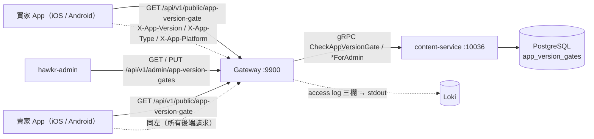
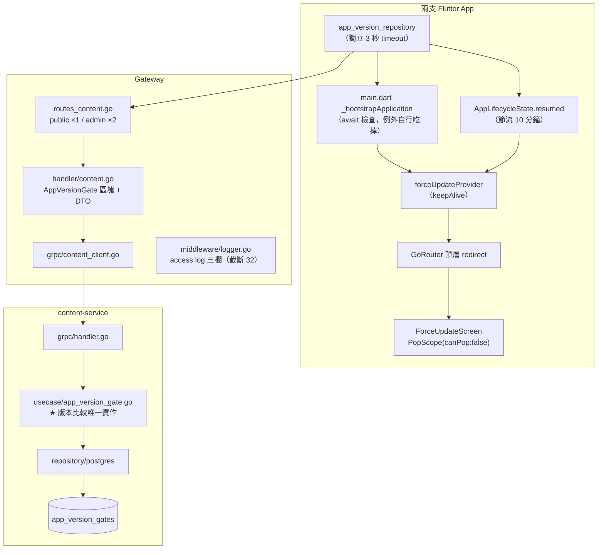
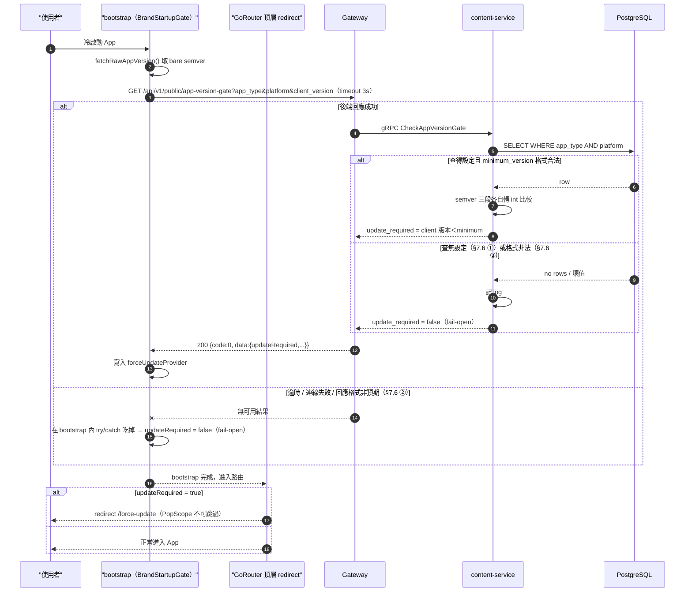
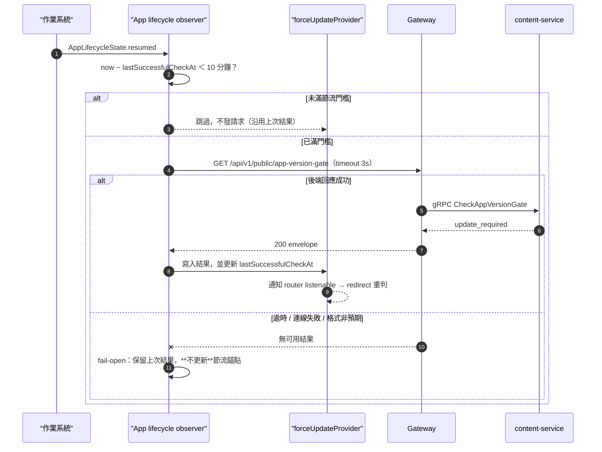

# App 版本檢查與強制更新（App Version Gate）詳細設計書

> **2026-09-26 更新**：App 只發 iOS。平台維度（`AppPlatform`、`platform` 欄位、`X-App-Platform` header）已拿掉，門檻改以 `app_type` 識別；現行實作在單體的 `internal/modules/content`，決策見 ADR `2026-09-26-app-ios-only.md`。本文件以下有關 Android、`AppPlatform` 與「四組」的描述是舊設計，以該 ADR 為準。
>
> **2026-09-27 更新**：兩支 App 的檢查邏輯（只在 iOS、3 秒逾時、fail-open、回到前景的節流）改成共用的 `packages/hawkr_app_update`，D10 與 Non-Goal 的「不做共用 package」已由 ADR `2026-09-27-app-version-gate-shared-package.md` 取代；§4.6 只剩畫面、路由與共用檔的對照。

## 0. 文件元資訊 (Metadata)

| 項目 | 值 |
|---|---|
| 維護者 | 維護團隊 |
| 對應程式碼 | `services/content-service/`（`internal/domain`／`internal/usecase`／`internal/repository/postgres`／`internal/grpc`／`db/schema/schema.sql`／`db/queries/`）、`api/proto/content/content.proto`、`gateway/internal/router/routes_content.go`、`gateway/internal/handler/content.go`、`gateway/internal/grpc/content_client.go`、`gateway/internal/middleware/logger.go`、`hawkr_buyer/lib/features/app_update/`、`hawkr_seller/lib/features/app_update/`、`hawkr-admin/src/app/admin/app-versions/` |
| 相關 doc | 51 簡訊發送與手機 OTP（其 §10.1 D5／§11.3 放量步驟把「App 強制更新」寫成既有前提，本文件即該前提的實作）、50 食譜內容管理（content-service 三層落點的照抄樣板）、25 Banner 動作跳轉（content-service 既有 admin CRUD）、46 賣家能力權限層（§8.1 必答題）、53 Web 前端快取架構（同構主題但平台不同：web 無安裝版本概念，部署即生效）、[`業務類型碼`](../代碼管理%EF%BC%88CodeMeta%EF%BC%89/業務類型碼.md)（`AppType`／新增 `AppPlatform` 的 SSOT） |

---

## 1. 概述與目標 (Overview & Goals)

### 1.1 文件定位

本文件描述「買家／賣家 App 發布新版本後，強制舊版用戶端更新到新版本才可繼續使用」的機制設計。目標讀者：後端、兩支 Flutter App、admin 後台。涵蓋跨四個 repo（`backend-payuni`／`hawkr_buyer`／`hawkr_seller`／`hawkr-admin`）的完整契約。

不涵蓋：網頁（`hawkr-website` 無安裝版本概念，部署即生效，快取與版本一致性見 53 號）、App 的發版流程本身（Xcode Cloud／商店送審）。

### 1.2 服務一句話定位

content-service 持有「哪個 App × 哪個平台的最低可用版本」設定並獨佔版本比較，Gateway 以一支匿名 public 端點對外，兩支 App 在冷啟動與前景恢復時查詢，不通過即進入不可跳過的全螢幕更新畫面。

### 1.3 設計目標 (Goals) 與 非目標 (Non-Goals)

| 類型 | 項目 |
|---|---|
| **Goal** | 低於最低版本的 App 無法繼續使用，只能前往商店更新（issue 目標第 1 條；達成度誠實邊界見 §3.1） |
| **Goal** | 重大 bug 修復可強制生效——調高 `minimum_version` 即刻生效，**不需重新部署後端、不需改任何程式碼**（issue 目標第 2 條，由同一個 gate 涵蓋，無額外機制） |
| **Goal** | 線上各版本 App 的請求佔比從**不可知**變成**可觀測**：App 對所有後端請求帶版本 header，Gateway access log 記錄後可查（§8.2） |
| **Goal** | 後端故障、設定未填、設定填壞三種情況一律 fail-open，不得把使用者鎖在門外（§7.6） |
| **Goal** | 版本比較邏輯只有一份，位於 content-service（後端獨佔比較，App 只讀布林） |
| **Non-Goal** | **不**做 Gateway 逐請求版本攔截（D5：App 非敵對環境；冷啟動＋前景恢復兩檢查點已覆蓋含「放量當下正在使用」的場景；且伺服端硬擋卡在判別不出舊 App，見 §3.1）。🔴 **重啟它的前置是組合判準（Origin allowlist ＋ path namespace ＋ header 缺席）的可行性實測——沒有這一步不要重開 D5。** |
| **Non-Goal** | **不**做「建議更新（可跳過）」兩級機制，**不**預留 `latestVersion` 欄位（D4：需求只要求強制；預留無消費者的欄位＝零消費抽象，本 repo 已有 `can_accept_orders` 做了卻全 repo 零消費的教訓） |
| **Non-Goal** | **不**做伺服端硬擋舊 App——判別不出（「無版本 header」的集合同時包含網頁 SSR 與所有 server-to-server 呼叫，§3.1），需組合判準且每條都得實測 |
| **Non-Goal** | **不**做兩 App 共用 package／monorepo 化／跨 repo CI checksum 對拍（D10：兩 repo 無 shared package、無 workspace；跨 repo CI 需另一 repo 的 checkout 憑證與同步時序，且 Flutter CI gate 只掛 `pull_request` 而兩 App 走直接 push dev，擋不到。改以本設計書為 SSOT ＋ §4.6 兩 repo 實作對照表對齊） |
| **Non-Goal** | **不**新增 MQ event、**不**新增環境變數、**不**引入任何補償／backfill／drift 偵測任務（本需求不需要；責任邊界規範 §22） |
| **Non-Goal** | **不**新增業務錯誤碼（D9：檢查結果以 `data.updateRequired` 表達，非錯誤路徑） |

### 1.4 與其他設計書／服務的關係

- **51 號（簡訊 OTP）**：其 D5「硬切無雙軌」與 §11.3 放量步驟 4「App 強制更新放量」皆以本機制存在為前提。
- **50 號（食譜內容管理）／25 號（Banner）**：同為 content-service 的「站台營運可維護資料 ＋ admin CRUD」形態。本案的 usecase／repository／sqlc 三層直接照抄 `site_contents` 的落點（`services/content-service/internal/usecase/site_content.go`、`internal/repository/postgres/site_content_repository.go`、`db/queries/`）。
- **46 號（賣家能力權限層）**：本案新增的是 public 匿名端點，capability 歸屬與停權賣家可用性的必答題見 §8.1。
- **53 號（Web 前端快取架構與版本一致性）**：同為「版本一致性」主題但平台不同——web 的版本一致性靠部署與快取失效解決，App 因為使用者手上握有一份已安裝的舊二進位檔，只能靠伺服端設定 ＋ 客戶端 gate。兩者無共用機制。

---

## 2. 範圍與情境 (Context & Scope)

### 2.1 系統情境圖 (C4 Context)



### 2.2 邊界與責任

| | 涵蓋 (In-scope) | 不涵蓋 (Out-of-scope，由誰負責) |
|---|---|---|
| content-service | 設定 CRUD、**版本比較（獨佔）**、查無設定與格式非法的語意 | 身分驗證與授權（Gateway）；設定值的業務正確性（admin 使用者） |
| Gateway | 路由、參數必填檢查、DTO 組裝、admin 授權、access log 記錄版本 header | 版本比較（不做）、值域驗證（透傳，值域由 content-service ＋ DB CHECK 守） |
| 兩支 App | 讀取自身版本、發起檢查、fail-open 例外吸收、redirect 攔截、更新畫面、商店導向 | 版本比較（**不實作任何比較邏輯**） |
| admin 後台 | 四組設定的檢視與編輯、送出前二次確認 | 「當前已發布版本是多少」的權威判定（後端無此來源，見 §7.6 ⑥） |

### 2.3 角色與身份模型

- **匿名 App 使用者**：public 檢查端點不需登入、不讀任何身分（未登入者、guest 瀏覽者、token 過期者一律可查）。這是必要的——未登入者也必須看得到更新畫面。
- **停權賣家**：可使用（§8.1）。
- **admin（`x-account-type = 4`）**：唯一可寫入設定者。

---

## 3. 約束與前提 (Constraints & Assumptions)

| 類型 | 項目 |
|---|---|
| 技術約束 | Go 服務 schema 走 Atlas（`db/schema/schema.sql` → `atlas migrate hash`）；query 走 sqlc；回應走統一 Envelope；Proto 數字欄位一律 string |
| 技術約束 | 兩支 App 的 `lib/core/codemeta/code_meta.dart` 是 `generate.sh --flutter` 直接寫入的生成物（只含「前端可見: Yes」的 enum，檔頭 `// dart format off`），backend monolith CI 重新生成並檢查 drift，不得手改 |
| 技術約束 | 兩支 App 無 shared package、無 melos／workspace、無 `path:` local dep，也無 `.arb`／l10n 機制（硬編碼中文 fallback 文案符合現況慣例） |
| 既有系統約束 | content-service 無服務端授權機制，authz 全在 Gateway |
| 既有系統約束 | repo 內查無 App Store 數字 App ID（`ios/fastlane/Appfile:2` 的 `apple_id` 被註解掉）；Android `applicationId` **每個 flavor 不同**（`android/app/build.gradle.kts:44` dev `.dev`／`:49` stage `.stage`／`:54` prod 無後綴） |
| **假設** | prod 已部署但**尚未公開**，無真實使用者受影響 → 這是導入本機制成本最低的窗口；**失真則**「舊版 App 無法被強更」（§3.1）從理論限制變成真實的使用者影響面 |
| **假設** | App 端 `PackageInfo.fromPlatform().version` 回傳的是 bare semver 三段字串 → **失真則**後端比對全部失敗、fail-open、強更靜默永不觸發（§7.6 ③ 為此設的第二道） |

### 3.1 固有限制（達成度的誠實邊界，非本方案缺陷）

以下三條**必須被讀到**，否則本機制的達成度會被高估：

1. **已安裝且未內建 gate 的舊版 App（≤ 1.0.3）無法被強制更新**。它不會主動檢查版本，也沒有更新畫面可顯示。本機制只對「已內建 gate 的版本及其之後」生效。

2. 🔴 **「無 `X-App-Version` header ＝ 舊 App」不成立，不得據此設計伺服端硬擋**：
   - `hawkr-website` 的統一 fetch client（`lib/api/client.ts`）只送 `Accept`／`Content-Type`／`X-Requested-With`（unsafe method）／`X-Active-Role`，**不送任何版本類 header**。
   - website 是 Next.js on Cloudflare Workers，SSR/ISR 取數是 **Worker 伺服端 fetch，連 `Origin` 都沒有**（見 Gateway `internal/middleware/cors.go` 對 native client 無 Origin 的說明）。
   - ⇒ 「無 `X-App-Version`」的集合 ＝ {舊 App} ∪ {網頁 SSR} ∪ {任何 server-to-server 呼叫}——**照這個判準硬擋會打死網頁公開頁**。
   - 要做伺服端硬擋，需要**組合判準**（Origin allowlist ＋ path namespace ＋ header 缺席），且每一條都必須實測可行才能上線。

3. **對 issue 目標第 1 條的達成度只能宣稱「可觀測 ＋ 絕大多數情況可強制」，不得宣稱「保證」**。只要 gate 在客戶端且 fail-open（§7.6 ②），就存在「後端不可用期間舊版 App 仍可運作」的窗口。本機制真正的、可驗證的增量是：版本佔比從不可知變成可觀測（§8.2）。

---

## 4. 架構 (Architecture)

### 4.1 解法總綱 (Solution Strategy)

1. **設定 SSOT ＝ content-service 新表 `app_version_gates`**，維度 = `app_type`（BUYER／SELLER）× `platform`（IOS／ANDROID）四組，每組持有最低可用版本、商店連結、更新提示標題與內文。
2. **版本比較由後端獨佔**：App 只送自身版本字串、只讀 `updateRequired` 布林。比較邏輯若兩端各一份＝兩個真實來源，兩 App 又各自複製＝三份，必然漂移。
3. **App 端 gate 只有一條攔截路徑**：bootstrap 只負責「發起檢查、把結果寫進 provider」，攔截**一律**由 GoRouter 頂層 redirect 執行；冷啟動與前景恢復共用同一條路徑。
4. **admin 可即時調整、不需重新部署**：四組設定由 admin API upsert。
5. **可觀測性**：App 對所有打 Gateway 的請求帶三個版本 header，Gateway access log 記錄之。

### 4.2 元件視圖 (C4 Component)



| 模組 | 責任 | 依賴 |
|---|---|---|
| `content-service internal/usecase/app_version_gate.go` | **semver 比較唯一實作**；查無設定／格式非法的語意裁定；Repository interface 定義於檔頂 | repository |
| `content-service internal/repository/postgres/app_version_gate_repository.go` | `pgx.ErrNoRows` → 回 `nil, nil`（不把「查無」當錯誤），語意由 usecase 決定 | sqlc gen |
| `gateway/internal/handler/content.go`（`// ==== AppVersionGate ====` 區塊） | 參數必填檢查、DTO 組裝（exported struct）、`response.*` helper | content_client |
| `gateway/internal/middleware/logger.go` | access log 追加 `app_version`／`app_type`／`app_platform` 三欄（**client 可控，各截斷 32 字元**） | — |
| 兩 App `features/app_update/` | repository（獨立短 timeout）＋ provider（keepAlive）＋ ForceUpdateScreen | dio／riverpod／url_launcher（皆為既有依賴） |
| `hawkr-admin src/app/admin/app-versions/page.tsx` | 四列固定組合的逐列編輯（無 create／delete）＋送出前二次確認 | TanStack Query、`@/services/api`、`@/lib/codemeta` |

### 4.3 部署拓撲與 Port

無新增可部署單元。承載服務為既有 content-service：

| Port | 協定 | 用途 | 對外暴露方式 |
|---|---|---|---|
| 10035 | HTTP | content-service 內部 | ClusterIP |
| 10036 | gRPC | Gateway ↔ content-service | ClusterIP |
| 9900 | HTTP | Gateway（唯一對外入口） | Ingress |

### 4.4 命名／契約規約

- **RPC 命名的自覺偏離**：public 匿名 RPC **刻意不用 `GetPublicXxx`** 而用 `CheckAppVersionGate`——它回傳的是**帶計算的判定結果**（`update_required`），不是取一份資源。此為對 §5.1 gRPC 角色分離命名慣例的自覺偏離，登記於此；admin 兩支仍守 `XxxForAdmin` 後綴。
- **Gateway path param 一律 snake_case**（repo 慣例全是 `:order_no`／`:template_id`／`:import_job_id`），故 admin upsert 路徑為 `/:app_type/:platform`。
- **CodeMeta**：`AppType`(BUYER/SELLER) **沿用既有不動**；新增 `AppPlatform`(IOS/ANDROID)。值域、標籤與 Description 的 SSOT ＝ [`docs/代碼管理（CodeMeta）/業務類型碼.md`](../代碼管理%EF%BC%88CodeMeta%EF%BC%89/業務類型碼.md)，**本設計書不複製其表格**。
  - 2026-09-25 起 CodeMeta 凍結：`AppPlatform` 的擁有者是單體的 content 模組，CodeMeta 那一段是舊契約的投影，由 content 的測試比對（ADR `docs/adr/2026-09-25-codemeta-retirement.md`）。client 的生成物由 `generate.sh --web --admin --flutter` 直接寫入 monorepo，CI 檢查 drift。
  - **Go 端 `AppPlatform` 常數落點裁定**：常數定義在 content-service `internal/domain`，值域的唯一守門是 DB CHECK 約束；**Gateway 端不另複製一份**——Gateway 只做參數透傳，值域驗證由 content-service ＋ DB 負責。（既有先例是 Gateway 自持手寫鏡像 `gateway/internal/codemeta/codemeta.go:10-24`，本案刻意不比照，理由如上。）
  - 兩支 App 的 `code_meta.dart` 由 `generate.sh --flutter` 直接寫入，內容相同，不手改（見 §3 技術約束）。

### 4.6 兩 App 實作對照表（D10 的緩解手段）

> 2026-09-27：repository 與 provider 的規則已移到共用的 `packages/hawkr_app_update`（ADR `2026-09-27-app-version-gate-shared-package.md`），下表只需對照畫面、路由與共用檔。

兩支 App 各自實作一份，結構差異逐項並列。**任一側改動時，對照本表確認另一側是否需要同步。**

#### 4.6.1 共用檔一致性清單（可機械核對）

🔴 「靠設計書對齊」擋不住真實漂移——兩側的 `code_meta.dart` 只要一邊有 `AppPlatform`、一邊沒有，缺的那側就只能硬編碼 `'IOS'`／`'ANDROID'` 字面值（違反 §8 禁硬編碼）。故下表是**可機械核對**的：改動任一側後**跑一次 `diff` 即可判定**。

| 檔案 | 要求 | 判定方式 |
|---|---|---|
| `lib/core/codemeta/code_meta.dart` | **必須逐位元組相同** | `generate.sh --flutter` 直接寫入兩支 App，backend monolith CI 檢查 drift |
| `lib/shared/utils/app_version_utils.dart` | **必須逐位元組相同** | `diff` 無輸出 |
| `lib/shared/widgets/brand_startup_splash.dart` | **必須逐位元組相同**（既有慣例） | `diff` 無輸出 |
| `lib/core/networking/app_version_headers.dart` | **不要求相同**（兩 repo 平台判定的依賴不同：buyer `dart:io`＋`kIsWeb`、seller `platform_io.dart` 包裝） | 但**平台值一律取自 `AppPlatform` enum**，`grep "'IOS'\|'ANDROID'"` 不得在 enum 定義以外命中 |
| 其餘 gate 相關檔（repository／provider／screen） | 不要求相同（各自沿用該 repo 的錯誤型別、路由、UI 慣例） | 對照 §4.6 主表逐項確認語意等價 |

#### 4.6.2 redirect 判斷必須是可測的純函式（兩側對稱）

🔴 **把 redirect 判斷寫進 `app_router.dart` 的 closure、或讓它直接讀私有 compile-time const，會讓它結構上不可測。** 那會讓「單元測試覆蓋」這個風險緩解手段變成一條**不存在的防線**——實作可能是正確的，但宣稱守著它的東西是空的。

**規則**：兩側的 redirect 判斷都必須是 **top-level 純函式**，參數顯式傳入（`isLoggedIn`／`needsForceUpdate`／`isScreenshotMode`／`location`），不得直接讀 compile-time const 或 Riverpod。判定方式：測試能否不啟動 App、不 mock provider 就直接呼叫它。

**必須被測試釘住的不變式**（兩側對稱）：
1. 強更判斷**早於**登入判斷（未登入 ＋ 需強更 → 導更新頁，不是登入頁）
2. **App Store 送審截圖模式豁免強更**（buyer 特有；漏了會讓 Apple 審核的 guest 截圖流程被攔死，且**只有送審當下才會發現**）
3. 已在更新頁時 return null（不自我循環）
4. `needsForceUpdate=false` 時既有分支行為完全不變

| 面向 | hawkr_buyer | hawkr_seller |
|---|---|---|
| Dio baseUrl | `F.appFlavor.apiBaseUrl`（**含** `/api/v1`） | `F.appFlavor.gatewayHost`（**不含** `/api/v1`）→ 請求路徑要自己補 |
| **fontSize 可否用 `.sp`** | **不可**——`test/shared/widgets/design_policy_test.dart:49-72` 是守門測試（`enableScaleText: () => false`，`.sp` 是恆等式），fontSize 一律固定 logical px 並取型階（12/14/16/18/20/24）；間距另有 4px 梯度守門（`:144-173`），`vertical: 14.h` 這種會被擋，要用 `HkSpace.*` | 可用 `.sp`（seller 無此守門測試） |
| **Riverpod import** | 只有 `hooks_riverpod` 是直接依賴（`pubspec.yaml:56`）；寫 `flutter_riverpod` 會觸發 `depend_on_referenced_packages` | 兩者皆為直接依賴 |
| **全螢幕頁的 AppBar** | 無 `HkGlassAppBar`，用 `buildCommonTitleAppBar(context, title:, showBack: false)`（`lib/shared/widgets/common_top_bar.dart:252`） | `HkGlassAppBar(showBackButton: false)` |
| **gate 檢查的實際落點** | 不能放在 `_bootstrapApplication` 字面開頭——`F.init()` 在 `:163` 才跑、且 gate 需要 `ProviderContainer`。做法：把既有 container 建立區塊上移到 flavor log 之後，gate 緊接其後。**真正要守的不變式是「早於 `_initializeFirebaseMessaging()`、推播導航尚未 arm」** | 同一不變式，落點依 seller 自身 bootstrap 結構 |
| **版本 header 的單一來源** | `lib/core/networking/app_version_headers.dart`（五個落點共用；`PackageInfo` 是 async 而 client 建構點只能同步讀，故啟動時 `initialize()` 快取 bare semver） | 同一形狀，三個落點共用 |
| 共用 Dio timeout | 硬編碼 30 秒（`dio_provider.dart:70-71`） | 走 `F.appFlavor.apiTimeout`（`:39-40`） |
| gate 用的 timeout | **獨立 3 秒**，不共用預設 options | **獨立 3 秒**，同左 |
| repository 樣式 | `abstract interface class` ＋ Dio 實作，sealed `AppException` 分流 | `ApiRequestHelper` mixin，**必帶 `kSkipAuthInterceptorExtra`** |
| `package_info_plus` | `^8.3.0`（pubspec.yaml:66） | `^9.0.1`（pubspec.yaml:52）——**兩 repo 版本不同** |
| 路由常數 | 無常數類，路徑用字面字串 | 有常數類（`app_router.dart:145-160`），必須加 `forceUpdate` |
| 全螢幕的達成方式 | 頂層 route 即全螢幕 | **必須帶 `parentNavigatorKey: rootNavigatorKey`**，否則被 ShellRoute bottom nav 包住 |
| redirect 既有分支 | 三條（強更／`/login` 已登入導首頁／未登入導 `/login`），測試 `test/core/routing/redirect_logic_test.dart`（12 條） | 四條（強更／未登入／onboarding／停權），測試 `test/core/router/redirect_logic_test.dart`（29 條）；`resolveAuthRedirect` 有 23 個呼叫點跨 4 檔 |
| redirect 決策落點 | **top-level 純函式** `resolveBuyerRedirect`（`lib/core/routing/redirect_logic.dart`），`app_router.dart` 的 closure 只負責取值傳參。截圖模式與登入狀態皆為顯式參數 | **top-level 純函式** `resolveAuthRedirect`（`lib/core/router/redirect_logic.dart`），`needsForceUpdate` 為**選填**參數（預設 `false`，因有 23 個既有呼叫點），置於所有判斷最前 |
| **必須豁免的既有流程** | `_appStoreScreenshotMode`／`_appStoreScreenshotRoute`——Apple App Review 的 guest 截圖流程。**強更判斷若不比照豁免，送審截圖流程會被更新畫面攔死** | **目前無此機制**。🔴 seller 日後要做送審截圖模式時，**必須同時**把 `isScreenshotMode` 接進 `resolveAuthRedirect` 並豁免強更判斷——否則 Apple 審核的 guest 截圖流程會被更新畫面攔死，而且**只有送審當下才會發現**（buyer 側已用單元測試釘住，seller 側屆時要一併補） |
| resumed 檢查落點 | `main.dart` `_MyAppState.didChangeAppLifecycleState`（`:266-271`） | `app.dart`（`:87-93`），**須沿用 `widget.runtimeSideEffectsEnabled` guard** |
| 更新畫面骨架 | 移植 seller `suspension_notice_screen.dart`（buyer 無全螢幕攔截頁等價物） | 直接照自家 `suspension_notice_screen.dart:22,29` |
| SSE client | 有（`lib/core/sse/sse_client.dart:63-67`），需注入 header | **無**（`lib/core/sse` 不存在、`flutter_client_sse` 0 命中） |
| 版本 header 落點數 | **五處**（Dio ×3 ＋ SSE ＋ WS） | **三處**（BaseOptions ＋ `freshDio` ＋ WS） |
| 豁免（不打 Gateway） | `oss_service.dart:48` | `media_repository.dart:120` |
| 真正的 retry client（免加 header） | `auth_interceptor.dart:75-90`（`dio.fetch(req)` 沿用原 `requestOptions.headers`） | 無（`dio_provider.dart:199` 的 `freshDio` **不是** retry client，見上） |
| 共用且逐位元組相同的檔 | `lib/shared/widgets/brand_startup_splash.dart`、`lib/shared/utils/app_version_utils.dart`、`lib/core/codemeta/code_meta.dart` | 同左——**任一側改動必須同步另一側** |

---

## 5. 資料設計 (Data Design)

### 5.1 資料模型

**表：`app_version_gates`**（content-service，`hawkr_content`）

| 欄位 | 型別 | 約束 | 說明 |
|---|---|---|---|
| `app_type` | `VARCHAR(16)` | PK（複合）、`CHECK (app_type IN ('BUYER','SELLER'))` | 對應 CodeMeta `AppType` |
| `platform` | `VARCHAR(16)` | PK（複合）、`CHECK (platform IN ('IOS','ANDROID'))` | 對應新增的 CodeMeta `AppPlatform` |
| `minimum_version` | `VARCHAR(32)` | `NOT NULL`、`CHECK (minimum_version ~ '^[0-9]+\.[0-9]+\.[0-9]+$')` | semver 三段字串，例 `1.0.3` |
| `store_url` | `TEXT` | **nullable** | 未設定時 App 隱藏更新按鈕改顯示文字指引（D7） |
| `notice_title` | `VARCHAR(255)` | `NOT NULL DEFAULT ''` | 更新畫面標題 |
| `notice_body` | `TEXT` | `NOT NULL DEFAULT ''` | 更新畫面內文 |
| `updated_at` | `TIMESTAMPTZ` | `NOT NULL DEFAULT NOW()` | 沿用 `site_contents` 慣例 |

> **單體（遷移計畫 A1，2026-09-25）**：上表描述 content-service。單體的文字欄位一律是 `TEXT`（PostgreSQL 設計規範 §一：預設 text，非必要不用 varchar(n)）；`app_type`、`platform` 的值域與 `minimum_version` 的格式仍由 CHECK 守，長度上限沒有產品依據，所以拿掉。差異見 `internal/modules/content/CARRYOVER.md`。

- **PK ＝ `(app_type, platform)` 複合主鍵**：天然唯一，不需另建 surrogate。本表非對外暴露 id 的業務表，**不適用 TSID**。
- `VARCHAR(16)` 而非既有 `payment_transactions.app_type`／`refund_tasks.app_type` 的 `VARCHAR(8)`：`ANDROID` 7 字元，用 8 太貼邊。
- 兩條 `CHECK` 把恆真的不變式交給 DB 守（10 檔 §11.2 教訓）。`minimum_version` 的格式 CHECK 擋在寫入端——格式錯誤的版本字串會讓比較邏輯失去意義。

### 5.2 索引與查詢模式

| 查詢路徑 | 使用索引 |
|---|---|
| public 檢查：`WHERE app_type = $1 AND platform = $2`（單筆） | PK（複合主鍵天然覆蓋） |
| admin 列表：全表掃（四列） | 無需額外索引 |

**不新增任何次要索引**——表恆為四列。

### 5.3 序號／排序／一致性

> N/A（無序號、無樂觀鎖需求）。四列固定組合、upsert 覆寫語意；並發 upsert 的最後寫入者獲勝，這對「四個人不會同時改同一組設定」的營運場景是可接受的。
>
> **單體（2026-09-25 Will 決定）**：改成 etag 樂觀鎖，upsert 的語意是「沒帶 etag 只建立、帶了只修改且要相符」，見 ADR `2026-09-25-optimistic-concurrency-etag.md` D3。

### 5.4 Schema 演進與遷移

1. 改 `services/content-service/db/schema/schema.sql`
2. `make migrate-diff`（互動輸入名稱 `create_app_version_gates`）→ 產 `db/migrations/<ts>_create_app_version_gates.sql` ＋ `atlas.sum`
3. 新增 `db/queries/app_version_gates.sql` → `make sqlc`

**【裁定】初始資料不寫 migration、不建 seed 檔**：repo 現況 `site_contents` 完全沒有自動 seed 機制（`infra/seed-data/` 只有 6 個 DB、無 content），實務靠 admin API 寫入。沿用同一模式——四組設定由 admin API upsert（上線順序見 §12.2）。

**seed 值（依 flavor 分列，D7）**：

| 組合 | `minimum_version` | `store_url` |
|---|---|---|
| BUYER × ANDROID（prod） | 當前已發布版本 | `market://details?id=io.github.will413028.hawkr.buyer` |
| SELLER × ANDROID（prod） | 當前已發布版本 | `market://details?id=io.github.will413028.hawkr.seller` |
| BUYER × IOS（prod） | 當前已發布版本 | **先留空**，待 App Store 數字 App ID 取得後由 admin 補 |
| SELLER × IOS（prod） | 當前已發布版本 | 同上 |
| dev / stage 全部 | 當前已發布版本 | **一律留空**（那兩個 flavor 的 `applicationId` 帶 `.dev`／`.stage` 後綴，根本不在商店） |

> iOS 的 `store_url` 由 admin 於取得 App Store 數字 App ID 後填入。**為空時 App 隱藏
> 「前往更新」按鈕並改顯示文字指引**，不導向任何猜測 URL——這是行為契約，不是待辦。

**向後相容性**：新表、無既有讀寫者，無相容性問題。

---

## 6. API 與介面契約 (API & Interface Contracts)

### 6.1 對外 REST（經 Gateway）

| Method + Path | Namespace | 授權 | 說明 |
|---|---|---|---|
| `GET /api/v1/public/app-version-gate` | public | 匿名（**不掛** `OptionalJWTAuth`） | 版本檢查。🔴 **維持 `tierModerate`，不得列入 `exemptExact`**——豁免等於開一個匿名可無限打 DB 的端點，用一個更大的洞換一個較小的洞。頻率由 App 端 10 分鐘節流控制（§7.6 ⑤）；真的因 429 造成靜默 fail-open 時（§8.3、§12.4 ⑤），**先調 App 端節流門檻或限流配額，不是先開豁免** |
| `GET /api/v1/admin/app-version-gates` | admin | ADMIN(4) | 列出四組設定 |
| `PUT /api/v1/admin/app-version-gates/:app_type/:platform` | admin | ADMIN(4) | upsert 單組設定 |

> **命名說明（刻意不對稱，不是筆誤）**：public 端點用**單數** `app-version-gate`、admin 用**複數** `app-version-gates`。理由：public 端點回傳的是「對這一組 app×platform 的判定結果」（一次判定，非資源集合），admin 端點才是操作資源集合。與 RPC 命名用 `CheckAppVersionGate` 而非 `GetPublicXxx` 同一考量（§10 D 系列）。

#### public 檢查端點

Query 參數（§2：URL/Query 一律 snake_case），**三個皆必填，缺任一 → `response.BadRequest`**：

```
GET /api/v1/public/app-version-gate?app_type=BUYER&platform=IOS&client_version=1.0.3
```

回應（§2：JSON body camelCase、統一 envelope；業務資料一律在 `data` 之下）：

```json
{
  "code": 0,
  "message": "success",
  "data": {
    "updateRequired": true,
    "minimumVersion": "1.0.4",
    "storeUrl": "market://details?id=io.github.will413028.hawkr.buyer",
    "noticeTitle": "請更新至最新版本",
    "noticeBody": "此版本已停止支援，請前往商店更新後繼續使用。"
  },
  "traceId": "..."
}
```

- `storeUrl` 未設定時回**空字串**（JSON 中仍存在該 key，避免前端 `undefined` 判斷分歧）。
- DTO 為 exported struct（§16），定義在 `handler/content.go` 的 `// ==== AppVersionGate ====` 區塊；**禁止把 proto struct 直接放進 `data`**。
- 一律走 `response.*` helper（禁手寫 `c.JSON`）；成功走 `response.GrpcResult`。

#### admin 列表 / upsert

```
GET  /api/v1/admin/app-version-gates
PUT  /api/v1/admin/app-version-gates/BUYER/IOS
```

列表回應 `data`（**四列固定、無分頁，故不走 `response.Page`**）。
⚠️ **刻意與同服務的 `ListSiteContents` 不同**：後者 `data` 直接是陣列（`gateway/internal/handler/content.go:500-504`），本端點包一層 `items`。理由是日後若要加總數或篩選條件，加欄位不會破壞契約。**實作時不要照抄鄰居的形狀**：

```json
{ "items": [ { "appType": "BUYER", "platform": "IOS", "minimumVersion": "1.0.3",
               "storeUrl": "", "noticeTitle": "", "noticeBody": "",
               "updatedAt": "2026-08-06T09:00:00Z" } ] }
```

upsert request body（camelCase）：

```json
{ "minimumVersion": "1.0.4", "storeUrl": "", "noticeTitle": "...", "noticeBody": "..." }
```

upsert 回應 `data` ＝ 單一 item 物件（形狀同上表元素）。時間一律 ISO 8601 UTC 帶 `Z`。

#### Swagger 註解（§16）

public 用 `@Tags 內容 (Content)` 且**無** `@Security`；admin 用 `@Tags 管理員 (Admin)` ＋ `@Security BearerAuth`。`@Param` 的版本參數型別為 `string`，`app_type`／`platform` 附合法值。

⚠️ **`gateway-json-contract.yml` 的 Check B 對本次新 handler 不生效**：該腳本只認 `response.OK`／`OKMsg`／`Page` 作為回應點（`scripts/gateway-json-contract-check.py:531-536`），而本案 handler 沿用 content.go 慣例走 `response.GrpcResult`，**連 `@Success` 形狀都輪不到判就被 skip**。因此「Check B 綠」不等於契約已驗——`@Success` 與實際輸出的一致性本次必須靠 handler test ＋ dev 實打驗證（§13）。

### 6.2 gRPC（服務間）

`api/proto/content/content.proto`，service 區塊接在 SiteContent 三支 RPC 之後：

```proto
    // AppVersionGate
    rpc CheckAppVersionGate(CheckAppVersionGateRequest) returns (CheckAppVersionGateResponse);
    rpc ListAppVersionGatesForAdmin(EmptyRequest) returns (ListAppVersionGatesResponse);
    rpc UpsertAppVersionGateForAdmin(UpsertAppVersionGateRequest) returns (AppVersionGateResponse);
```

message 區塊接在 SiteContent message 之後：

```proto
message CheckAppVersionGateRequest {
    string app_type = 1;        // AppType：BUYER / SELLER
    string platform = 2;        // AppPlatform：IOS / ANDROID
    string client_version = 3;  // semver 三段，例 "1.0.3"
}

message CheckAppVersionGateResponse {
    int32 code = 1;
    string message = 2;
    bool update_required = 3;
    string minimum_version = 4;
    string store_url = 5;
    string notice_title = 6;
    string notice_body = 7;
}

message UpsertAppVersionGateRequest {
    string app_type = 1;
    string platform = 2;
    string minimum_version = 3;
    string store_url = 4;
    string notice_title = 5;
    string notice_body = 6;
}

message AppVersionGateItem {
    string app_type = 1;
    string platform = 2;
    string minimum_version = 3;
    string store_url = 4;
    string notice_title = 5;
    string notice_body = 6;
    string updated_at = 7;
}

message AppVersionGateResponse {
    int32 code = 1;
    string message = 2;
    AppVersionGateItem item = 3;
}

message ListAppVersionGatesResponse {
    int32 code = 1;
    string message = 2;
    repeated AppVersionGateItem items = 3;
}
```

- **所有版本欄位一律 string**（§4；`make proto-lint-numeric` 會擋數值型）。`int32 code` 為全專案慣例例外（§4.1 例外 2）。
- **生成與同步（兩個 CI 步驟各自會擋，漏跑必紅）**：
  1. `./scripts/gen-go-proto.sh` → `pkg/proto/content/*.pb.go`（**入版控、要 commit**）
  2. `./scripts/gen-java-proto.sh` → `rm -rf` ＋ `cp -r` 到 `services/java/shared/java-proto/src/main/proto/`（**入版控、要 commit**）。該腳本尾段還會跑 `./mvnw clean install -pl :proto-common`（`gen-java-proto.sh:23`），本地跑需要 JDK/Maven；CI 只比對 `.proto` 副本，mvn 失敗不影響 gate
  - `proto-generated-diff.yml` 有兩個獨立步驟分別對拍：Go 生成檔在權威 image 內重新生成後 `diff -ru`（`:112`）、Java 副本與 `api/proto` 全目錄 `diff -r`（`:146`）。

### 6.3 非同步事件 (MQ)

> N/A（本案不新增任何 event；設定變更即時經 DB 讀取生效，無需事件傳播）。

### 6.4 即時通道 (WS/SSE)

> N/A（版本檢查為一次性請求／回應）。

### 6.5 客戶端版本 header 契約（D11）

兩支 App 對**所有打 Gateway 的請求**（含長連線握手）帶三個 header：

| Header | 值 | 例 |
|---|---|---|
| `X-App-Version` | App 自身 bare semver（**不含 build number**） | `1.0.3` |
| `X-App-Type` | CodeMeta `AppType` | `BUYER` / `SELLER` |
| `X-App-Platform` | CodeMeta `AppPlatform` | `IOS` / `ANDROID` |

- **無 API 契約破壞**：Gateway 不因缺這些 header 而拒絕任何請求；它們**只作可觀測性用途**（§8.2），不是授權依據。
- ⚠️ **`app_version_utils.dart` 的 `fetchAppVersion()` 不可直接複用**：它回傳的是**顯示字串** `"1.0.3(7)"`（version ＋ build number 括號，`:7-19`），不是 bare semver。直接餵進 `client_version=` 或 header，**後端 semver 比對會全部失敗 → fail-open → 強更永遠不觸發，而且完全靜默**。正解是在同檔**新增**回傳 `info.version` 原值的 getter，**不得改動 `fetchAppVersion()` 既有回傳格式**——它有 4 個顯示用消費者（buyer `settings_screen.dart:48`／`auth_screen.dart:34`，seller `profile_screen.dart:1191`／`auth_screen.dart:36`）。
- **CORS 不受影響**：Gateway 的 `Access-Control-Allow-Headers` 是固定白名單（`cors.go:45`）且不含這三個 header，但 Flutter 原生不送 `Origin`（`cors.go:40` 整段跳過），web/admin 也不送這些 header。**待坐實的邊界**：日後若跑 Flutter Web 或 admin 也要送，必須改 `cors.go:45`（改它不觸發 boot gate——`auth_contract.go:9-22` 只驗 cookie 名與 CORS origins，不驗 headers）。

---

## 7. 執行時視圖 (Runtime View)

### 7.1 主要場景（happy path）

**冷啟動**：App 啟動 → `_bootstrapApplication` 開頭讀自身版本並**await** 版本檢查（獨立 3 秒 timeout）→ 結果寫進 `forceUpdateProvider` → bootstrap 完成、進入 GoRouter → 頂層 redirect 讀 provider，`updateRequired=true` 即導向 `/force-update`。

此位置天然早於推播初始化（buyer `main.dart:205` 的 `_initializeFirebaseMessaging()` 呼叫點在 `_bootstrapApplication` 內，由 `BrandStartupGate` 在 widget `initState` 後才 await），因此 `getInitialMessage() → addPostFrameCallback → NotificationRouter.navigate`（buyer `manager.dart:194-202,403`／seller `manager.dart:228-232,428`）在 gate 攔截時**還沒 arm**，**不需另建抑制機制**（D5b）。

**前景恢復**：`AppLifecycleState.resumed` → 距上次**成功**檢查未滿 10 分鐘則跳過；已滿則重檢，結果變動經 listenable 觸發 redirect 重判。

### 7.2 時序圖

**冷啟動檢查（含 fail-open 分支）**



⚠️ **例外必須在 bootstrap 內自行 try/catch 吃掉**：`BrandStartupGate._runBootstrap` 的 catch 只 `FlutterError.reportError`，**不 setState、不解除 splash**（`brand_startup_splash.dart:75-84`）——例外一旦冒到那裡就是**永遠卡在啟動畫面**。這是 fail-open 的具體落地點，也是本方案最容易做錯的一處。

**前景恢復重檢（含節流與 fail-open 分支）**



### 7.3 失效與重試

| 外部呼叫 | 逾時 | 重試 | 失敗行為 |
|---|---|---|---|
| App → Gateway（版本檢查） | **獨立 3 秒**（不共用預設 Dio options） | **不重試** | fail-open：`updateRequired=false`，放行進 App |
| Gateway → content-service（gRPC） | 沿用 content client 既有 30s | 不重試 | 錯誤沿 envelope 回傳；App 端視為「回應格式非預期」→ fail-open |
| content-service → PostgreSQL | pgxpool 預設 | 不重試 | 回錯誤；App 端 fail-open |

**為何不用共用 Dio 的 timeout**：buyer 共用 Dio 是硬編碼 30 秒（`dio_provider.dart:70-71`）、seller 走 `F.appFlavor.apiTimeout`（`:39-40`）；沿用會讓弱網下啟動畫面最長卡 30 秒才 fail-open。

### 7.4 並發與順序

- 冷啟動檢查 **await**、不 fire-and-forget——否則會先進首頁再彈更新畫面，出現可操作空窗。
- 前景恢復的節流以「上次**成功**檢查」為錨；失敗不更新錨點，故下次 resumed 會立刻重試。
- redirect 自身放行：兩 App 的版本判斷都要先讓 `/force-update` 自身 `return null`。go_router 14.8.1 以 `topRedirectLocation != prevLocation` 提前中止（`configuration.dart:356-357`），不會無限 loop，但仍明寫以免讀者誤解。

### 7.5 連線／狀態生命週期

> N/A（無長連線、無伺服端狀態；App 端狀態只有 `forceUpdateProvider` 與節流錨點兩個記憶體值）。

### 7.6 邊界行為契約（必答題，逐條寫死）

> 這六條是本機制的正確性核心。**任何實作或重構不得偏離；每一條在 §13 都有對應測試。**

**① 查無設定 → `updateRequired: false`**
新表初始為空。若 gate 遇到「查無此 `app_type × platform` 組合」就當成「需要更新」，會在設定寫入前把**所有**使用者鎖在門外。故：查無設定一律回 `updateRequired: false`，與 fail-open 語意一致。repository 層 `pgx.ErrNoRows` → 回 `nil, nil`，語意由 usecase 決定。

**② API 失敗（逾時／連線失敗／回應格式非預期）→ fail-open，且用獨立短 timeout**
三種失敗一律放行進 App，並使用獨立 3 秒 timeout（不共用預設 Dio options）。理由：後端故障不得鎖死所有使用者；且後端不可用時 App 本來就無法運作，fail-open 不擴大實際可用面。
⚠️ **fail-open ≠ gate 失效**：這是刻意的設計選擇，不是漏洞。判準是「網路不可用時使用者能不能自救」——不能，所以放行。

**③ 版本格式非法 → fail-open**
DB CHECK 已擋寫入端；此處防禦讀取端（例如既有壞資料、或人工改庫）。usecase 比較前若發現 `minimum_version` 或 `client_version` 不是三段數字，**記 log 並回 `updateRequired: false`**——不因設定壞掉而鎖死使用者。

**④ `storeUrl` 未設定 → App 隱藏「前往更新」按鈕，改顯示文字指引**
不導向任何猜測 URL。理由：repo 內查無 App Store 數字 App ID，硬編碼會逼出「找不到就寫死錯的」；使用者撞 404 比沒有按鈕更糟。API 層回空字串（key 仍存在），判斷在 App 端。

**⑤ 前景恢復檢查的節流：以「上次成功檢查」為錨，門檻 10 分鐘；冷啟動不受節流**
`resumed` 每次切回前景都會觸發，不節流會對檢查端點打出請求風暴。門檻取 10 分鐘，在「調高最低版本後的生效延遲」與「per-IP 配額排擠」（§9.2）之間取衡。**冷啟動一律檢查、不看節流錨點**——那是使用者更新完 App 後最需要立刻重判的時點。失敗不更新錨點（§7.4）。

**⑥ `minimum_version` 填錯會鎖死全體，且後端無法機械防護**
填一個尚未發布的版本，所有人立刻被擋在更新畫面外且**無法自救**（商店根本沒有那個版本）。**① 的「查無設定＝不強更」保護不了這種情況**——它防的是「沒填」，防不了「填錯」。
後端做不出伺服端拒絕條件，因為**沒有「已發布版本」的權威來源**（Android build number 走 `git rev-list --count`、iOS 走 Xcode Cloud run 序號，兩者皆非 semver；repo 內也無商店查詢管道）。
**唯一可行的防護＝admin 頁面送出前二次確認**：顯示「此值會立即擋住所有低於它的 App」＋並列當前四組現值。這條限制寫在此處，是為了讓日後任何人在「為什麼後端不擋一下」時，先看到答案。

---

## 8. 跨切面關注點 (Crosscutting Concerns)

### 8.1 安全與授權

- **public 端點**：匿名、不掛 `OptionalJWTAuth`、不讀任何身分、不回傳任何 PII。三個 query 參數皆為 client 可控輸入——值域由 content-service ＋ DB CHECK 守（Gateway 只做必填檢查與透傳，§4.4）。
- **admin 端點**：落在 `/admin/*` namespace，走既有 ADMIN(4) 授權。
- **content-service 側不做授權檢查**（該服務無此機制，authz 全在 Gateway）。
- **版本 header 不是授權依據**：`X-App-*` 三個 header 純供可觀測性使用，任何人都能偽造，**不得**用於任何授權或攔截判斷。

**§24 賣家能力層必答題**

| 問題 | 答案 |
|---|---|
| capability 歸屬 | **無**——本案新增的是 public 匿名端點，不承載任何賣家專屬功能、不讀賣家身分，不掛 `requireSeller` |
| 停權賣家可否使用 | **可**——版本檢查與帳號狀態正交；停權賣家一樣需要能更新 App 才進得了申訴管道（46 號白名單精神：救濟管道進停權白名單） |

### 8.2 可觀測性 (Observability)

**Gateway access log 追加三欄**（`gateway/internal/middleware/logger.go:208-218` 的 `[]zap.Field` 是平鋪結構，加一欄即可；`:228` 走 stdout→Loki，與既有 `trace_id` 同管道）：`app_version` / `app_type` / `app_platform`，取自 header，缺值填空字串。

⚠️ **三個值都是 client 可控輸入，寫入 log 前必須截斷（各限 32 字元）**——`redactBody` 只作用於 body，不會保護 `zap.String` 欄位；不截斷等於開放任意長字串灌進 Loki。

**這條 log 要回答的問題**：「線上各版本 App 的請求佔比是多少」「新版放量後舊版是否歸零」。這是 issue 目標第 1 條真正能拿到的能力（§3.1 第 3 點）。

**統計分母的定義（不定義就會算錯）**

**分母只取 `app_version != ""` 的請求**——也就是「本來就會帶版本 header 的那個母體」。不要用「全部請求扣掉某幾類」的思路去湊分母：dev 實測不帶版本的請求有 2,698 筆，其中**絕大多數是網頁 SSR、server-to-server 呼叫與 health probe**，不是下表三類；把它們放進分母只會讓每個版本的佔比一起被稀釋成無意義的數字。

以 `app_version != ""` 為分母後，下表三類**自動既不進分子也不進分母**，不需要任何排除邏輯：

| 類別 | 為什麼無 header | 落點 |
|---|---|---|
| **長連線（SSE／WS）** | 只在**握手**記一筆 access log，之後的訊息不再進 log | buyer SSE `sse_client.dart:63-67`、buyer WS `chat_repository.dart:240`、seller WS `chat_repository.dart:293` |
| **WebView 導航** | `webview_flutter` 的 `loadRequest` 帶不了自訂 header | buyer `payment_webview_screen.dart:60`／`refund_webview_screen.dart:56`／`store_map_webview_screen.dart:45`；seller `store_map_webview_screen.dart:46`／`pdf_preview_screen.dart:70`／`payuni_registration_screen.dart:144` |
| **圖片／下載 URL 直取** | `Image.network`、secure download 走裸 URL | buyer `url_utils.dart:8`／`avatar_utils.dart:8`；seller `media_repository.dart:318,323` |

⚠️ **代價（誠實標註，不是缺陷是取捨）**：因為長連線那一列的訊息不進 log，**重度使用聊天／即時通知的使用者，其活躍度不會反映在請求數上，會被系統性低估**。方向上這對「舊版是否已退場」的判斷是安全的（低估舊版活躍度只會讓判準更早達標——所以放行判準額外加了絕對數與樣本數兩道門檻，見 §8.2.1），但對「新版採用率」的判斷會偏樂觀。本統計的正確讀法是**請求佔比，不是使用者佔比**。

⚠️ **另一個必須過濾的東西：client 灌進來的垃圾值。** `app_version` 是匿名可控輸入（Gateway 只截斷不驗證），任何人 curl 一個亂數 header 就會多出一條 series——dev 上實測已有 `AAAA…`(32 字元)、`9999…`、`DIRECT1786027648` 三筆殘留。故**所有統計查詢一律加 semver 白名單** `` app_version =~ `^[0-9]+\.[0-9]+\.[0-9]+$` ``。被白名單擋掉的量另設告警（`monitoring/loki/rules/fake/app-version.yml`），因為它非 0 時可能代表 App 端送錯格式（例如把顯示字串 `1.0.3(7)` 當版本送出，§6.5 陷阱）——那會讓一整個版本從佔比中消失。

⚠️ **白名單只驗格式、不驗「這個版本真的存在」**：dev 上就有一筆 `9.9.9`（人為測試值），格式合法所以照樣進統計。**不要**為此加「已知版本清單」——那份清單每次發版都要有人維護，最後必然過期成為新的錯誤來源。正確做法是**看圖時人工略過明顯不存在的版本號**；它們只會出現在測試環境，且量級一眼可辨（個位數 vs 成千）。

⚠️ **LogQL 反引號是 raw string**：正則的跳脫點必須寫成單一 `\.`。寫成 `\\.` 會被解讀成「反斜線 ＋ 任意字元」而**全不匹配**——查詢回空、面板一片空白，但不會報錯。

**再次強調**：無版本 header 的請求集合還包含網頁 SSR 與所有 server-to-server 呼叫（§3.1 第 2 點）——**不可反推「這是舊 App」**。

**⚠️ 查詢窗口上限＝ 7 天（不是 30 天）**

Loki 的實際保留期是 **168h / 7 天**，來自 `monitoring/loki/local-config.yaml` 的 `retention_period: 168h`。

同目錄下另有一份 `monitoring/loki/loki-config.yaml` 寫著 `retention_period: 720h`（30 天）——**該檔未被掛載、完全不生效**：`monitoring/docker-compose.yml` 的 loki service 只掛 `./loki/local-config.yaml` 並以 `-config.file=/etc/loki/local-config.yaml` 啟動。引用那份會得到「可回溯 30 天」的錯誤結論（該檔頂端已加註警語）。

→ 任何版本佔比的觀察窗口**不得超過 7 天**。拉更長的時間範圍不會報錯，只會得到被保留期截斷後的假象（前段沒資料被當成「那時候沒人用」）。

**⚠️ 與 App 既有兩處版本上報的語意差（對帳前必須先對齊格式）**

本案的 header 不是 App 上唯一的版本來源。兩支 App 在本案之前就已經有兩處**自動**上報版本，三者格式互不相同：

| 來源 | 欄位 | 格式 | 例 |
|---|---|---|---|
| **本案 header** | `X-App-Version`（Loki access log `app_version`） | **bare semver，不含 build number** | `1.0.3` |
| `sentry_flutter`（兩 repo `pubspec.yaml` 皆 `^9.25.0`） | `release`（SDK 預設自動帶） | `<packageName>@<version>+<build>`，**含** build number；且 `packageName` **每個 flavor 不同**（§3 約束） | `io.github.will413028.hawkr.buyer@1.0.3+7`（prod）／`io.github.will413028.hawkr.buyer.dev@…`（dev） |
| `firebase_analytics`（兩 repo 皆 `^12.4.2`） | `app_version`（平台自動收集） | iOS `CFBundleShortVersionString`／Android `versionName` | `1.0.3` |

拿它們互相對帳時：

- **Sentry ↔ Loki**：必須先把 `release` 剝成 bare semver——**切在第一個 `@` 之後、`+` 之前**，不要硬編碼某個 package name 去比對（flavor 不同前綴就不同）。不剝就對，兩邊的版本字串永遠不相等，對出來的差異全是格式假象。
- **Firebase ↔ Loki**：格式雖同，**母體不同**——Analytics 數的是 App 啟動／事件，Loki 數的是 HTTP 請求，且後者還少了上表三類無 header 來源。兩邊的百分比**不可直接相減**，只能各自看趨勢（放量後舊版是否同向歸零）。
- 這三處**不做統一**：Sentry 的 `release` 含 build number 是它做 source map／artifact 比對所需，改掉會壞掉既有用途；本案 header 不含 build number 是 D3 的結論（build number 跨平台不可比）。**要對齊的是讀數的人，不是格式本身。**

**content-service 側**：沿用既有 gRPC interceptor 五件套與 `/metrics`／`/health`，無新增。usecase 的兩條 fail-open 分支（查無設定、格式非法）各記一行 log——這是判斷「設定是不是壞了」的唯一線索。

### 8.2.1 破壞性契約變更的放行判準

**面板**：Grafana dashboard `hawkr-app-versions`（檔案 `monitoring/grafana/provisioning/dashboards/json/app-versions.json`，provisioning 檔案驅動，`updateIntervalSeconds: 30`，新增／修改後 30 秒內自動生效，不需重啟 Grafana）。

**判準（per `app_type`，環境＝ prod，窗口＝滾動 7 天）——三條同時成立才放行**：

| # | 條件 | 為什麼要它 |
|---|---|---|
| ① | 舊版請求**佔比 < 1%** | 主判準：舊版流量已成尾巴 |
| ② | 舊版請求**絕對數 < 100** | 防「總量暴增讓百分比自然變小」——佔比達標但絕對數仍上千，代表真的還有人在用 |
| ③ | 分母（該 `app_type` 帶合法 semver 的請求總數）**≥ 10,000** | 防「分母太小讓 ① 假性達標」：總共只有 200 筆時，舊版 1 筆就是 0.5%，數字漂亮但毫無統計意義 |

**③ 不成立時，本判準不適用**——不是「暫時降低標準放行」，是**改用其他證據**：App Store Connect／Google Play Console 的版本分佈（母體是安裝數而非請求數，正好補上長連線使用者被低估的缺口）。

**兩個必須誠實標註的邊界**：

- 🔴 **三個門檻是推算值，不是實測校準值。** 用它擋放行是可以的（偏保守），但**不要當成經過驗證的數字**。**App 放量後必須回頭校一次**：看實際的日請求量級，再決定 10,000 這個分母門檻是「一天就能達到」還是「七天都達不到」，並據此調整。
- **7 天是保留期上限，不是「選了 7 天」。** 想看更長的趨勢必須先改 Loki 保留期（`local-config.yaml`），改之前要先算儲存成本。

**放行前手動跑一次的 ratio query**（可直接貼進 Grafana Explore 的 Loki 查詢框，或 `curl` 打 `/loki/api/v1/query`；把 `$app_type` 換成 `BUYER` 或 `SELLER`、`$old` 換成要淘汰的版本號）：

```logql
# ① 舊版佔比（回一個 0~1 的小數，門檻 < 0.01）
sum(count_over_time({container="gateway", environment="prod"} |= `gateway request` | json | app_type=`$app_type` | app_version=`$old` [7d]))
/
sum(count_over_time({container="gateway", environment="prod"} |= `gateway request` | json | app_type=`$app_type` | app_version =~ `^[0-9]+\.[0-9]+\.[0-9]+$` [7d]))

# ② 舊版絕對數（門檻 < 100）
sum(count_over_time({container="gateway", environment="prod"} |= `gateway request` | json | app_type=`$app_type` | app_version=`$old` [7d]))

# ③ 分母樣本數（門檻 ≥ 10,000；dashboard 上的「分母樣本數」panel 就是這條）
sum(count_over_time({container="gateway", environment="prod"} |= `gateway request` | json | app_type=`$app_type` | app_version =~ `^[0-9]+\.[0-9]+\.[0-9]+$` [7d]))
```

這三條都是**互動查詢等級**的成本（7 天窗口秒級回應），可直接貼進 Explore 跑。

**為什麼「舊版佔比 > 1%」不做成告警規則**：那條規則的表達式裡必須寫死「現行版本號」字面值，每次發版都要有人改一次 `app-version.yml`——沒人會記得改，最後會變成一條永遠對著三個版本以前的號碼評估的死規則，比沒有更糟（它會給人「有在監控」的錯覺）。**放行是一次性的人為決策，用一次性的手動查詢。** 唯一做成告警的是與版本號無關、恆真的不變式：非法版本值 > 0（`monitoring/loki/rules/fake/app-version.yml`）。

### 8.3 錯誤處理與降級 (Failure Modes & Degradation)

| 依賴掛掉 | 行為 |
|---|---|
| content-service 不可用 | Gateway 回錯誤 → App 端視為「回應格式非預期」→ **fail-open** |
| PostgreSQL 不可用 | 同上 → **fail-open** |
| Gateway 不可用 | App 連線失敗 → **fail-open**（但此時 App 本來就無法運作） |
| 網路不可用 | 逾時 3 秒 → **fail-open** |
| **該來源 IP 撞上 Gateway `tierModerate` per-IP 限流（120 req／60 秒）** | Gateway 回 429 → App 端走 `ServerException` → **fail-open**；**強更靜默失效，使用者完全無感** |
| 設定未填 | `updateRequired: false`（§7.6 ①） |
| 設定填壞（格式非法） | `updateRequired: false` ＋記 log（§7.6 ③） |
| 設定填錯（合法但版本過高） | **鎖死全體，無伺服端防護**（§7.6 ⑥）——唯一救法是 admin 改回正確值 |

**整條鏈路 fail-closed 的位置：一處都沒有。** 這是刻意的——本機制的失敗模式一律偏向「讓人用得下去」。

⚠️ **限流那一列是唯一「後端沒壞也會 fail-open」的路徑，也是唯一使用者端零徵兆的**：App 照常進得去，看不出強更被跳過，後端也沒有任何錯誤可查。且 per-IP 桶在 CGNAT／電信業者出口下由**同一出口的其他使用者**共享（§9.2），撐爆它的不必是自家流量——排查時不要只查自家 SSR。排查步驟見 §12.4。

🔴 **本端點不得列入 `exemptExact` 豁免**（`gateway/internal/middleware/ratelimit.go` 的 `exemptExact`）：§7.6 ⑤ 已用 App 端 10 分鐘節流控制頻率，豁免等於開一個匿名可無限打 DB 的端點——用一個更大的洞換一個較小的洞。見 §6.1。

### 8.4 一致性與冪等

- admin upsert 天然冪等（`ON CONFLICT ... DO UPDATE`）。
- public 檢查為唯讀，無副作用。
- **單一寫入路徑為唯一真實來源；不引入任何補償任務基礎設施**（責任邊界規範 §22）——本案無 reconciliation／backfill／drift 偵測需求。

### 8.5 設定與機密

> N/A（本案**不新增任何環境變數、不新增任何 secret**）。設定全部存 DB 由 admin 維護，這正是「調高最低版本不需重新部署」的來源。

---

## 9. 品質需求與 NFR (Quality Requirements / SLO)

### 9.1 SLO / SLI

| 指標 (SLI) | 目標 (SLO) | 量測點 | 現況 |
|---|---|---|---|
| public 檢查端點 P95 延遲 | < 300ms | Gateway access log `latency` | 未量測（新建） |
| 冷啟動因版本檢查增加的等待 | P95 < 500ms、**最壞 3 秒**（timeout 上限） | App 端量測 | 未量測 |
| 各版本請求佔比可查 | 分母內 100%（分母定義見 §8.2：只計本來就帶版本 header 的請求） | Grafana dashboard `hawkr-app-versions`（Loki `app_version` 欄） | 現況 prod 命中 0（App 尚未發版，此為基線） |

### 9.2 容量與規模

- **content-service 成為每次 App 冷啟動的依賴**（D2 的代價）：檢查端點若慢或不穩，會拖慢**所有** App 啟動。由獨立 3 秒 timeout ＋ fail-open 兜底，最壞情況是啟動多等 3 秒，不會啟動失敗。此依賴關係在此明確登記。
- **rate limit（外部依賴，本設計不改動其設定）**：新 public 端點落入 Gateway 的 `tierModerate` per-IP 限流桶（`gateway/internal/middleware/ratelimit.go:124-126`，120 req/window；配置 `k8s/values/gateway.yaml:163`），**與所有匿名公開讀取共用同一個 per-IP 配額**。這是 §7.6 ⑤ 節流門檻的另一個理由——不只是省流量，是避免排擠同一 IP 下其他公開讀取（NAT／電信業者出口下多使用者共用 IP 尤其明顯）。
- **DB 負載**：單筆 PK 查詢、表恆四列，可忽略。
- **CF 快取（已確認，非待辦）**：`k8s/external-services/cloudflare/rulesets/` 的三條 cache rule 分別綁 `admin.` host、圖片副檔名、`/.well-known/`，**皆不涵蓋 `/api/v1/public/*`**；`api-first-party-proxy` Worker 只綁 `example.com`／`www.`／`web-dev.`，而 App 走的是 `api.`／`test-api.` host、不經該 Worker。→ **本端點實際無被 CDN 快取的風險**（若被快取，調高最低版本不會即時生效）。此確認本身是交付項，日後改動 zone 快取規則時必須重驗。

### 9.3 效能預算

| 段落 | 預算 |
|---|---|
| App → Gateway 往返（含 gRPC ＋ DB） | 3 秒硬上限（超過即 fail-open） |
| content-service 比較邏輯 | 純記憶體整數比較，可忽略 |
| 冷啟動總增量 | 目標 < 500ms（P95），最壞 3 秒 |

---

## 10. 設計裁決（外部引用）

方案取捨、被否決的選項與理由見
`docs/adr/2026-09-18-app-version-gate-decisions.md`（D1–D11）。

---

## 11. 風險、技術債與未決問題 (Risks, Tech Debt & Open Questions)

### 11.1 已知風險與技術債

| 項目 | 嚴重度 | 影響 | 緩解 / 追蹤 |
|---|---|---|---|
| `minimum_version` 填錯鎖死全體，後端無法機械防護 | **高** | 所有人被擋在更新畫面外且無法自救 | admin 頁送出前二次確認（並列現值 ＋ 警語）；§7.6 ⑥ 全文 |
| 兩 App 實作漂移 | 中 | 單邊改動後行為分叉，且 CI 擋不到 | 本設計書為 SSOT ＋ §4.6 兩 repo 實作對照表；三個逐位元組相同的共用檔在表內明列 |
| content-service 成為每次冷啟動的依賴 | 中 | 該服務慢／不穩會拖慢所有 App 啟動 | 獨立 3 秒 timeout ＋ fail-open（§7.3）；SLO 見 §9.1 |
| fail-open 被誤讀為「gate 失效」 | 中 | 日後有人把它「修」成 fail-closed，等於埋一顆鎖死全體的雷 | §7.6 ② ＋ §8.3 明寫「網路不可用 ≠ 放行漏洞」；測試釘住（§13） |
| `fetchAppVersion()` 回傳格式陷阱 | 中 | 誤用顯示字串 `"1.0.3(7)"` → 比對全失敗 → 強更**靜默**永不觸發 | §6.5 ⚠️ 段；新增獨立 getter 而非改既有函式（4 個顯示用消費者） |
| buyer App Store 截圖模式若未豁免 | 中 | Apple App Review 的 guest 截圖流程被更新畫面攔死 | §4.6 表內明列；buyer 單元測試覆蓋（§13） |
| seller `resolveAuthRedirect` 新參數用預設值 | 低 | 生產呼叫點漏傳會靜默失效（不編譯錯） | 生產呼叫點只有 `app_router.dart:393` 一處，實作時必傳；風險由單元測試補回（§13） |
| iOS `store_url` 上線初期為空 | 低 | iOS 使用者看得到更新畫面但沒有按鈕（只有文字指引） | D7 的刻意取捨；取得 App Store 數字 ID 後由 admin 補，**不需發版** |
| 新 public 端點與所有匿名公開讀取共用 per-IP 限流桶 | 低 | **雙向**：① 高頻檢查會排擠同 IP 下其他公開讀取；② 反過來，該 IP 的配額被別人（含 CGNAT 下的其他使用者）打爆時，gate 收 429 → fail-open → **強更靜默失效且零徵兆**（§8.3 該列） | §7.6 ⑤ 的 10 分鐘節流；**本設計不改動限流設定**，登記為外部依賴（§9.2）；**刻意不列入 `exemptExact`**（§6.1）；排查見 §12.4 ⑤ |

**固有限制**見 §3.1（舊 App 無法被強更、「header 缺席 ≠ 舊 App」、目標第 1 條只能宣稱「可觀測 ＋ 絕大多數可強制」）——那三條**不是**本表的風險，是機制的邊界，不會被緩解掉。

## 12. 部署與維運 (Deployment & Operations)

### 12.1 環境與設定

無新增環境變數、無新增 secret、無新增部署單元。content-service 與 Gateway 皆為既有服務的滾動更新。

### 12.2 上線順序（有依賴，不可顛倒）

```
1. 後端 PR merge → dev 部署（表 ＋ RPC ＋ Gateway 路由 ＋ access log 三欄）
2. admin 寫入四組設定（minimum_version 一律先填「當前已發布版本」）
3. 才把 App 的 dev promote 到 main
```

⚠️ **反序的後果**：App 先發 → 檢查端點 404 → 雖由 fail-open 兜住不會壞，但 **gate 完全空轉**（看起來一切正常，實際毫無效果）。

#### ⚠️ 步驟 3 是 merge 的副作用，不是手動步驟

**iOS 走 Xcode Cloud —— Apple 雲端 watch GitHub `main` 的 changed event 自動部署，不經 GitHub Actions。**
也就是說 **App code 一旦 merge 進 `main`，發版就自動開始了**，沒有「決定要不要發」的中間關卡。

因此步驟 3 的正確理解是：**「把 App 的 dev promote 到 main」這個動作本身就是步驟 3**。前兩步必須在**按下 merge 之前**完成，不能想著「先合了再說，之後再寫設定」。

**Android 側的設定在上架前沒有消費者**：四組設定中的兩組 `ANDROID` 欄位與 code 皆已就緒，
**上架時不需改任何程式**，只需為那兩組填入真實 `storeUrl`（`market://details?id=<prod applicationId>`）。
⚠️ **步驟 2 的 `minimum_version` 必須是「當前已發布版本」，不可填未發布版本**——見 §7.6 ⑥。

**⚠️ 上面三步是「上線一次性」，不是全部——`minimum_version` 是需要每次發版維護的值。**
步驟 2 只給出上線當天的初始值。**之後每一次 App 送審通過／實際放量，都必須回到 admin 把該 `app_type × platform` 的 `minimum_version` 更新為那個剛發布的版本**，否則 gate 會永遠停在上線那天的版本——不會報錯、不會有 log，只是**靜默地形同不存在**。
後端做不到自動化（§7.6 ⑥：沒有「已發布版本」的權威來源），**只能靠人記得**，故這一步已寫進 Flutter 交付流程本身：見 [Git 分支與交付路徑規範](../開發規範/Git%20分支與交付路徑規範.md) §2.1 放行六項之後的「放量之後」段。

**遷移**：Atlas migration 隨 content-service 部署自動 apply（`db/migrations/<ts>_create_app_version_gates.sql`）。**回滾**：新表無既有讀寫者，回滾即 App 端 fail-open，無資料相容性問題。

### 12.3 健康檢查與優雅關閉

> N/A（沿用 content-service 既有 `/health`；本案不新增長連線或需 drain 的狀態）。

### 12.4 Runbook

| 症狀 | 排查順序 |
|---|---|
| 強更沒生效（改了設定但 App 照樣進得去） | ① 直接 curl public 端點確認 `updateRequired` ② 檢查 `client_version` 是否被送成 `"1.0.3(7)"` 顯示字串（§6.5 陷阱）③ 檢查該組 `app_type × platform` 是否真的有 row ④ 確認 App 端節流錨點（切到背景 10 分鐘以上再回來，或冷啟動）⑤ **確認該來源 IP 是否正被 `tierModerate` 限流打成 429**（120 req／60 秒，§8.3）——該路徑 fail-open 且完全靜默，App 端與後端都看不出差別；**CGNAT／電信業者出口下同 IP 的其他使用者也會撐爆同一個桶**，不限於自家 SSR，故不可因「我方沒打那麼多」就排除 |
| 所有人被鎖在更新畫面外 | ① admin 立即把 `minimum_version` 改回「當前已發布版本」（設定即時生效，**不需部署**）② 確認商店上真的有該版本 |
| App 卡在啟動畫面不動 | 檢查 bootstrap 內的 try/catch 是否被移除——例外冒到 `BrandStartupGate._runBootstrap` 就是永遠卡住（§7.2 ⚠️） |
| Loki 查不到版本欄 | ① 確認該請求類型是否屬 §8.2 三類無 header 來源 ② 確認該 client 的 header 注入落點是否漏加——**含長連線，只算 Dio 會漏**（§6.5） |

---

## 13. 測試策略 (Test Strategy)

| 層級 | 覆蓋 | 關鍵場景 | 為什麼非測不可 |
|---|---|---|---|
| unit | content-service usecase | **版本比較**：`1.0.10 > 1.0.9`（字典序陷阱）、相等、低於、高於 | 本案唯一有分支的邏輯 |
| unit | content-service usecase | **非法版本格式 → `updateRequired:false`** | fail-open 的第二道（§7.6 ③） |
| unit | content-service repo/usecase | **查無設定 → `updateRequired:false`** | §7.6 ① 的關鍵安全性設計，錯了會鎖死全體 |
| unit | Gateway handler test | 三支新 handler 的成功與參數缺失路徑 | `gateway-json-contract` Check B 對本案不生效（§6.1 ⚠️），契約一致性沒有 gate 保護 |
| unit | seller App | `needsForceUpdate=true` **優先於**未登入／onboarding／停權三分支；`/force-update` **不在** `_isSuspensionWhitelisted`（`redirect_logic.dart:57-64`） | 補回「參數給預設值」的風險（§11.1） |
| unit | buyer App | `/force-update` 訪客可達（掛在既有 `test/core/routing/route_access_policy_test.dart`）；App Store 截圖模式**不被**強更攔截 | 未登入者必須看得到更新畫面；送審流程不得被攔死 |
| e2e | dev 實打 | 打 public 端點驗 envelope 形狀與 `@Success` 一致；admin upsert → 再查即變；`storeUrl` 空值時 App 隱藏按鈕 | Check B skip 的補償（§6.1） |
| e2e | 兩 App 真機／模擬器 | 冷啟動攔截、前景恢復攔截、fail-open（斷網啟動仍可進 App）、更新畫面不可返回 | fail-open 與不可跳過是本案兩個對立的正確性主張，都要實測 |

🔴 **本案改動觸及 proto 與 CodeMeta ⇒ 必須跑 `generate.sh --all` 與兩支 proto 生成腳本**，否則 drift gate 轉紅。
（CodeMeta drift 的比對是逐位元的，自行判斷「這個 enum 前端看不看得到」而只跑部分目標一定會紅。）
Proto numeric lint 不會擋本案——版本欄位已全為 string。

---

## 14. 術語表 (Glossary)

| 術語 | 定義 |
|---|---|
| gate | 「檢查 ＋ 不通過就攔截」的整體機制；本文件中特指 App 版本 gate |
| fail-open | 檢查無法完成時**放行**（相對於 fail-closed 擋住）。本案所有失敗路徑一律 fail-open，見 §8.3 |
| `minimum_version` | 最低可用版本。低於此版本的 App 一律被攔截；**不是**「最新版本」 |
| bare semver | 不含 build number 的三段版本字串（`1.0.3`），相對於顯示字串 `"1.0.3(7)"` |
| 節流錨點 | 「上次**成功**檢查」的時間戳；前景恢復檢查以它為基準做 10 分鐘節流（§7.6 ⑤） |
| 更新畫面 | `/force-update` 路由對應的全螢幕、不可返回（`PopScope(canPop:false)`）畫面 |
| flavor | Flutter 的建置變體（dev／stage／prod）；Android 的 `applicationId` 每個 flavor 不同 |
