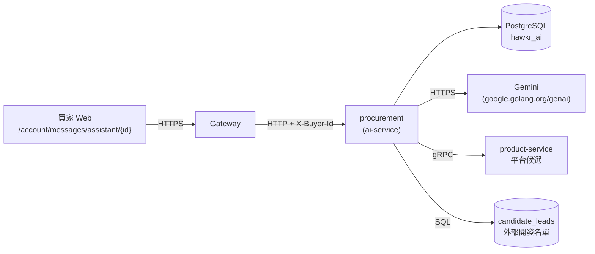
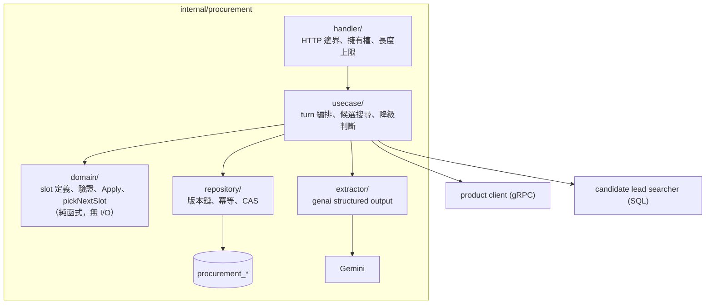
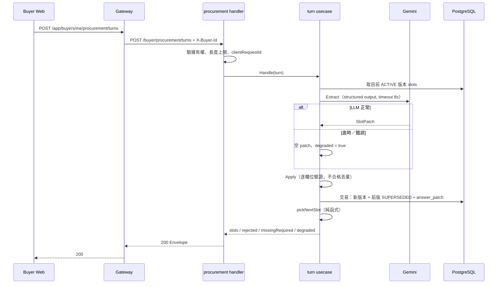
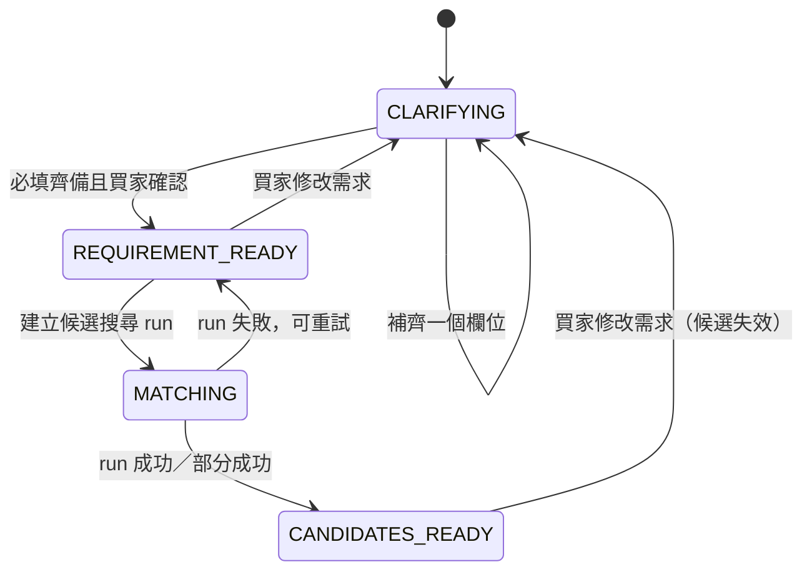

# Hawkr 幫找採購助手（Procurement Assistant）詳細設計書

## 0. 文件元資訊 (Metadata)

| 項目 | 值 |
|---|---|
| 維護者 | Will |
| 對應程式碼 | `services/ai-service/internal/procurement/`、`services/ai-service/db/schema/procurement.sql`、`gateway/internal/handler/ai.go`、`gateway/internal/router/routes_ai.go`、`hawkr-website/features/procurement-assistant/` |
| 相關 doc | [15 AI 微服務](15-AI%20微服務%EF%BC%88AI%20Service%EF%BC%89詳細設計書.md)（本模組寄生於此服務）、[44 帳號與賣家買家身份模型](44-帳號與賣家買家身份模型%EF%BC%88Account%20&%20Seller-Buyer%20Identity%EF%BC%89詳細設計書.md)（`buyer_id` 語意來源）、[02 產品微服務](02-產品微服務%EF%BC%88Product%20Service%EF%BC%89詳細設計書.md)（平台候選來源）、[41 Realtime SSE 推播平台](41-Realtime%20SSE%20推播平台%EF%BC%88Realtime%20SSE%20Push%20Platform%EF%BC%89詳細設計書.md)（既有 SSE 分工）、產品端《Hawkr 幫找 Agent 詳細設計書 v3.0》（2026-08-04，產品定義正本） |
| 相關 ADR | [檢索用盡後的大品項／小品項選擇](../adr/2026-09-13-procurement-category-fallback.md)（LLM 使用條件、分類與行情 ID 邊界、多階段續答、snapshot 的 `openConfirmation.question` 還原契約）<br/>[MVP-A 的六項架構決策](../adr/2026-09-18-procurement-assistant-mvp-a-decisions.md)<br/>[LLM 抽取的重試與逾時](../adr/2026-09-18-procurement-llm-extract-retry-and-timeout.md) |

---

## 1. 概述與目標 (Overview & Goals)

### 1.1 文件定位

本文件描述「Hawkr 幫找」採購助手 **MVP-A（需求釐清與候選呈現）** 以及 PLATFORM quote-invite seller notification contract 的後端與契約設計，目標讀者是後端、前端與 QA。

**不涵蓋**：完整密封報價體驗、價格引擎、外部業者 Email 邀價與入駐、全額付款與 PAYUNi 撥款。

本文件**不取代**產品端 v3.0：凡本文件未載明、且屬 MVP-A 範圍的產品要求，一律以 v3.0 為準。本文件只記載工程落地時的**調整**與**取捨**。

### 1.2 服務一句話定位

把買家的自然語言採購需求，轉成一份**不可變、可稽核、可比對**的需求規格版本，並據此列出平台與外部兩條來源的候選供應商供買家明確勾選。

### 1.3 設計目標 (Goals) 與 非目標 (Non-Goals)

| 類型 | 項目 |
|---|---|
| **Goal** | 已在自然語言中講明的欄位**不重問**——由程式邏輯結構性保證，非靠模型指示 |
| **Goal** | 每次需求改動產生不可變版本；回上一題建立新分支，受影響的下游內容明確失效 |
| **Goal** | **LLM 完全不可用時，整條流程仍能以固定問法走完**（降級而非中斷） |
| **Goal** | 候選卡顯示可驗證的配對事實（命中哪些條件、資料查核時間），並誠實標示無法驗證的條件 |
| **Goal** | 所有寫入端點冪等；同一需求的併發修改只有一個成功 |
| **Non-Goal** | **不**做完整密封報價體驗與時限編排（48h/24h/2h）；平台 invite notification 僅落地 seller 站內通知 |
| **Non-Goal** | **不**做價格引擎與 85% 外部目標邀價 |
| **Non-Goal** | **不**做外部業者 Email 邀價、secure link、入駐與 KYC；EXTERNAL／EMAIL 在本次不建立 seller notification |
| **Non-Goal** | **不**做付款、訂單、售後與撥款 |
| **Non-Goal** | **不**做逐事件重播（event ledger + cursor replay）——理由見 [ADR D3](../adr/2026-09-18-procurement-assistant-mvp-a-decisions.md) |
| **Non-Goal** | **不**做行動 App 端；本次僅官網 Web |
| **Non-Goal** | Agent **不**代買家勾選候選、**不**自動送出、**不**代為承諾任何交易條件 |

### 1.4 與其他設計書／服務的關係

- **寄生於 ai-service**（見 15 號）：本模組是 `services/ai-service/internal/procurement/` 下的獨立 package 與獨立 schema 檔，**與既有 AI 表無外鍵**，具備日後抽成獨立服務的條件。
- **身份語意依 44 號**：需求擁有者一律 `buyer_id`（現任買家 stint surrogate），非 `account_id`。理由見 [ADR D4](../adr/2026-09-18-procurement-assistant-mvp-a-decisions.md)。
- **平台候選來源為 product-service**（見 02 號）：透過既有 `GetProductList` gRPC，本次不新增 Java 端 RPC。
- **與 41 號 SSE 平台正交**：本模組的長任務進度走自身的 run 訂閱，不接入通用 SSE Hub；MVP-A 的長任務僅候選搜尋一種。

---

## 2. 範圍與情境 (Context & Scope)

### 2.1 系統情境圖 (C4 Context)



### 2.2 邊界與責任

| | 涵蓋 (In-scope) | 不涵蓋 (Out-of-scope，由誰負責) |
|---|---|---|
| 需求 | 自然語言解析、欄位驗證、版本化、分支與失效重算 | 品類專屬必填欄位定義 → 產品端 |
| 候選 | 兩條 lane 的檢索、配對事實、勾選狀態 | 供貨承諾與可履約性 → 賣家（報價階段，本次不實作） |
| 對話 | 對話與執行紀錄、需求快照 | 真人客服對話 → im-service |
| 身份 | 依 Gateway 注入的 `X-Buyer-Id` 判擁有權 | 身份解析本身 → 見 44 號 |
| 金流 | 無 | 全部 → 本次不實作 |

### 2.3 角色與身份模型

| Actor | 來源 | 權限 |
|---|---|---|
| Buyer | Gateway 由 JWT 解析後注入 `X-Buyer-Id`（現任 buyer stint surrogate） | 只能存取自己的需求、對話與勾選 |
| System（worker） | 內部排程 | 只讀寫執行紀錄與 artifact，不代買家決策 |

本模組**不接受 client 自報身份**。所有 handler 以 header 值判擁有權；擁有者不符一律回 404（不揭露資源存在性）。

---

## 3. 約束與前提 (Constraints & Assumptions)

| 類型 | 項目 |
|---|---|
| 技術約束 | PK 一律 TSID（禁 UUID／auto-increment）；時間一律 `TIMESTAMPTZ`（UTC）；回應走統一 Envelope `{code,message,data}`；Go 服務 schema 走 Atlas declarative |
| 技術約束 | 識別碼命名誠實：登入 principal 才叫 `account_id`，買家語意一律 `buyer_id`（見 44 號） |
| 技術約束 | LLM 輸出一律走 structured output（`ResponseSchema`），不解析自由文字 |
| 組織約束 | 遇擋路問題選治本不選繞過 |
| 既有系統約束 | ai-service 以 adk-go 實作買賣家小幫手；本模組**不共用其 session 作為狀態來源**（理由見 [ADR D2](../adr/2026-09-18-procurement-assistant-mvp-a-decisions.md)） |
| 既有系統約束 | 平台商品檢索無「可否配送至指定城市」與「庫存量是否足夠」兩個維度（見 §11） |
| **假設** | MVP-A 面向受邀買家，並發量低（< 50 同時對話）→ 單 replica 足夠；**失真則觸發 §9.2** |
| **容量契約** | 外部候選來源 `candidate_leads` 為離線匯入，在 **5000 筆以內**時全量掃描後於應用層排序可接受；**超過 5000 筆即須改 SQL 端排序與分頁**（見 §9.2） |

---

## 4. 架構 (Architecture)

### 4.1 解法總綱 (Solution Strategy)

核心判斷：**採購需求釐清是 workflow，不是 autonomous agent。** 它有固定完成條件（必填欄位補齊）、可驗證的正確性要求（不得重問、不得漏必填）、以及交易語意（版本不可變、修改後精準失效）。把「下一步做什麼」交給模型自主決策，等於把硬性需求變成機率事件且無法回歸測試。

因此採 **Requirement Slot Engine**：伺服器端定義一組固定欄位（slot），每個 slot 自帶驗證器、提問優先序、依賴關係與**一份寫死的標準問法**。LLM 只承擔三個窄任務，各自是獨立、無狀態、可單測的呼叫：

| 職責 | 輸入 | 輸出 | 失敗時行為 |
|---|---|---|---|
| Extract | 當輪訊息 + 目前 slots | `SlotPatch`（key 限於 slot enum） | 回空 patch，流程續行並標 `degraded` |
| Phrase | 一個 slotKey + 已知需求 | 問句 + 3–5 個選項候選 | 用該 slot 的固定問法 |
| Summarize | 需求快照 | 一句描述（僅呈現用） | 用欄位列表 |

**「下一題問哪個 slot」不經過 LLM**，是純函式 `pickNextSlot(revision) (slotKey, done)`。模型產生的選項不直接採用：canonical value 由伺服器端驗證器產生或比對白名單，client 只提交 `optionId`。

長任務（候選搜尋）不綁在單一 HTTP 連線生命週期上：建立 durable run 後立即回 `runId`，client 訂閱或輪詢；斷線只中止訂閱，不取消 run。

### 4.2 元件視圖 (C4 Component)



| 模組/package | 責任 | 依賴 |
|---|---|---|
| `procurement/domain/` | slot 型別、驗證規則、`Apply`、`Hash`、`MissingRequired`、`pickNextSlot` | 無（純函式） |
| `procurement/repository/` | 版本鏈 append-only、前版 SUPERSEDED、冪等鍵、擁有權查核 | domain、GORM |
| `procurement/usecase/` | 一次 turn 的編排、候選搜尋 run、降級判斷 | domain、repository、extractor |
| `procurement/handler/` | HTTP 邊界、Envelope、輸入長度上限、擁有權 | usecase、repository |

**設計原則**：`domain/` 不得依賴其他三者。所有正確性規則（驗證、失效、下一題）都住在這裡，因此可在無 DB、無網路的情況下完整回歸測試。

### 4.3 部署拓撲與 Port

沿用 ai-service，不新增 Deployment。

| Port | 協定 | 用途 | 對外暴露方式 |
|---|---|---|---|
| 9938 | HTTP | 本模組 REST（經 Gateway proxy） | ClusterIP |
| 9939 | gRPC | ai-service 既有內部 gRPC，本模組未使用 | ClusterIP |

### 4.4 命名／契約規約

| 項目 | 規約 |
|---|---|
| ai-service 內部路由前綴 | `/buyer/procurement/*`——**必須以 `/buyer/` 開頭**，Gateway 的 `resolveAssistantActorHeader` 依此前綴決定注入 `X-Buyer-Id` 而非 `X-Store-Id` |
| Gateway 對外路由 | `/api/v1/app/buyers/me/procurement/*` |
| slot key | snake_case，且**同一組常數同時作為** LLM schema property 名、API 欄位名與 `slots_json` 的 key |
| lane | `PLATFORM`｜`EXTERNAL`，兩者狀態與冪等範圍完全分離 |
| 版本狀態 | `ACTIVE`｜`SUPERSEDED` |
| 資料表前綴 | `procurement_` |

---

## 5. 資料設計 (Data Design)

### 5.1 資料模型

Schema 檔 `services/ai-service/db/schema/procurement.sql`，位於既有 `hawkr_ai`。刻意與 AI 既有表**無外鍵**，日後可整檔搬離。PK 一律 TSID（應用端指定，DB 無 default）。

**`procurement_requests`** — 需求主體

| 欄位 | 型別 | 說明 |
|---|---|---|
| `id` | BIGINT PK | TSID |
| `buyer_id` | BIGINT | 擁有者（現任買家 stint surrogate，非 account_id） |
| `status` | TEXT | `CLARIFYING`｜`REQUIREMENT_READY`｜`MATCHING`｜`CANDIDATES_READY` |
| `active_revision_id` | BIGINT | 指向目前生效版本 |
| `version` | INT | 樂觀鎖 |
| `created_at`／`updated_at` | TIMESTAMPTZ | |

**`procurement_request_revisions`** — 需求版本（append-only）

| 欄位 | 型別 | 說明 |
|---|---|---|
| `id` | BIGINT PK | TSID |
| `request_id` | BIGINT | |
| `revision_no` | INT | 同一 request 內遞增 |
| `parent_revision_id` | BIGINT | 版本鏈；0 表示根 |
| `branch_id` | BIGINT | 分支識別；根版本以自身 id 為 branch_id |
| `slots_json` | JSONB | 該版本的完整需求內容 |
| `slots_hash` | TEXT | 內容指紋，供 artifact 失效判斷 |
| `status` | TEXT | `ACTIVE`｜`SUPERSEDED` |

**`procurement_answer_patches`** — 改動稽核與冪等鍵

| 欄位 | 型別 | 說明 |
|---|---|---|
| `id` | BIGINT PK | TSID |
| `request_id`／`buyer_id` | BIGINT | |
| `base_revision_id`／`result_revision_id` | BIGINT | 改動前後版本 |
| `source` | TEXT | `LLM_EXTRACT`｜`ANSWER`｜`REWIND` |
| `payload_json` | JSONB | 當輪訊息、模型 patch、被拒欄位、是否降級 |
| `client_request_id` | TEXT | 冪等鍵 |

**`procurement_conversations`** — 對話容器

| 欄位 | 型別 | 說明 |
|---|---|---|
| `id` | BIGINT PK | TSID，即路由上的 `conversationId` |
| `buyer_id`／`request_id` | BIGINT | |
| `adk_session_id` | TEXT | 僅為模型上下文，**可丟棄，非狀態來源** |
| `title` | TEXT NOT NULL DEFAULT `''` | 對話標題，40 字上限 |
| `title_source` | TEXT NOT NULL DEFAULT `'AUTO'` | `AUTO`（自動標題）｜`USER`（買家改過名，自動標題不再覆寫） |
| `last_message_preview` | TEXT NOT NULL DEFAULT `''` | 列表用的最後一則回覆摘要，60 字截斷 |
| `deleted_at` | TIMESTAMPTZ NULL | 軟刪時間；NULL＝未刪除 |

**`procurement_conversation_commands`** — PATCH／DELETE 的冪等表

| 欄位 | 型別 | 說明 |
|---|---|---|
| `id` | BIGINT PK | TSID |
| `buyer_id` | BIGINT | |
| `client_request_id` | TEXT | 冪等鍵 |
| `conversation_id` | BIGINT | 這次命令實際作用的對話；重播時必須與本次目標相符才算合法 |
| `result_json` | JSONB | `{"op":"rename","title":"..."}` 或 `{"op":"delete"}`；重播時 `op` 須與本次操作種類相符 |
| `created_at` | TIMESTAMPTZ | |

> 候選相關表（`procurement_candidate_sets` / `candidates` / `candidate_selections`）於 A3 階段加入，欄位含 `match_facts_json`、`facts_as_of` 與 telemetry 欄位（`impression_at`、`viewed_detail_at`）。

### 5.2 索引與查詢模式

| 索引 | 型別 | 對應查詢／不變條件 |
|---|---|---|
| `idx_procurement_requests_buyer (buyer_id, created_at DESC)` | INDEX | 買家的需求列表 |
| `uq_procurement_request_revisions_no (request_id, revision_no)` | UNIQUE | 版本號不重複 |
| `uq_procurement_request_revisions_active (request_id) WHERE status='ACTIVE'` | **partial UNIQUE** | **同一 request 同時只有一個生效版本** |
| `idx_procurement_request_revisions_branch (request_id, branch_id, revision_no DESC)` | INDEX | 分支追溯 |
| `uq_procurement_answer_patches_idempotency (buyer_id, client_request_id)` | **UNIQUE** | **冪等的最終防線** |
| `idx_procurement_answer_patches_request (request_id, created_at DESC)` | INDEX | 稽核時間線 |
| `uq_procurement_conversations_request (request_id)` | UNIQUE | 一需求一對話 |
| `idx_procurement_conversations_buyer_active (buyer_id, updated_at DESC, id DESC) WHERE deleted_at IS NULL` | **partial INDEX** | 對話列表分頁（只看未刪除） |
| `uq_procurement_conversation_commands (buyer_id, client_request_id)` | **UNIQUE** | **改名／軟刪冪等的最終防線** |

### 5.3 序號／排序／一致性

- **版本鏈**：`revision_no` 於交易內取自目前 ACTIVE 版本 +1；partial unique index 保證同時只有一個 ACTIVE。
- **併發修改**：兩裝置同時回答同一題時，兩者都以 `expectedRevisionId` 進入；先到者成功，後到者因版本已變而回 `409 STALE_REVISION`，回應直接夾帶最新快照供 client 整段替換。
- **冪等**：先查 `answer_patches` 是否已有同 `(buyer_id, client_request_id)`，有則直接回原版本；unique index 為最終防線。
- **內容指紋**：`slots_hash` 為 slots 序列化後的 SHA-256。欄位順序由 struct 定義固定，因此同內容必得同 hash。

### 5.4 Schema 演進與遷移

- Atlas declarative：`db/schema/` 為唯一真實來源，migration 由 `atlas migrate diff` 產生，**不手寫、不手改**。
- `atlas.hcl` 的 `src` 由單檔改為目錄形式（`file://schema`），使 `procurement.sql` 與既有 `schema.sql` 並存。**dev 與 prod 兩個 env 必須同步修改**。
- 向後相容：candidate 相關表為後續階段新增，屬純新增；既有 AI 表不受影響。

---

## 6. API 與介面契約 (API & Interface Contracts)

### 6.1 對外 REST（經 Gateway）

全部遵統一 Envelope。所有 ID 以 **string** 回傳（TSID 為 64-bit，避免前端精度遺失）。

| Method | Gateway 路徑 | ai-service 路徑 | 說明 |
|---|---|---|---|
| POST | `/app/buyers/me/procurement/turns` | `/buyer/procurement/turns` | 提交一則自然語言需求描述 |
| GET | `/app/buyers/me/procurement/requests/{id}/snapshot` | `/buyer/procurement/requests/{id}/snapshot` | 取得需求快照（斷線恢復用） |
| POST | `/app/buyers/me/procurement/requests/{id}/answers` | 同前綴 | 提交一題答案（A2） |
| POST | `/app/buyers/me/procurement/requests/{id}/rewinds` | 同前綴 | 回到指定欄位、建立新分支（A2） |
| POST | `/app/buyers/me/procurement/requests/{id}/candidate-searches` | 同前綴 | 建立候選搜尋 run（A3） |
| POST | `/app/buyers/me/procurement/requests/{id}/selections` | 同前綴 | 勾選／取消勾選候選（A3） |
| GET | `/app/buyers/me/procurement/conversations` | `/buyer/procurement/conversations` | 對話列表；keyset 分頁，`cursor_id` 為不透明 cursor token（原樣回傳上一頁的 `nextCursorId`），`page_size` 預設 20、上限 50；依 `updated_at` DESC 排序 |
| GET | `/app/buyers/me/procurement/conversations/{id}/messages` | `/buyer/procurement/conversations/{id}/messages` | 對話 transcript（深連結續聊），不回傳 reasoning |
| PATCH | `/app/buyers/me/procurement/conversations/{id}` | `/buyer/procurement/conversations/{id}` | 對話改名；`title` 1–40 字且不含換行，`clientRequestId` 必填 |
| DELETE | `/app/buyers/me/procurement/conversations/{id}` | `/buyer/procurement/conversations/{id}` | 對話軟刪（冪等，已刪除回 200 no-op）；`clientRequestId` 必填 |

**POST turns — request**

```json
{
  "requestId": "1234567890123456789",
  "message": "我要訂寶島梨禮盒 50 盒，單盒預算 800 元，8/20 送到桃園",
  "clientRequestId": "uuid"
}
```

`requestId` 省略時建立新需求。`clientRequestId` 必填。

**POST turns — response**

```json
{
  "code": 0,
  "message": "success",
  "data": {
    "requestId": "1234567890123456789",
    "revisionId": "1234567890123456790",
    "slots": { "item": "寶島梨禮盒", "quantity": 50, "unit": "BOX",
               "budgetPerUnit": 800, "deliveryCity": "桃園市",
               "deliveryDate": "2026-08-20", "exactMatchRequired": true },
    "rejected": [],
    "missingRequired": ["packaging"],
    "degraded": false
  }
}
```

**錯誤碼**

| Code | HTTP | 語意 | client 恢復方式 |
|---|---|---|---|
| `STALE_REVISION` | 409 | 版本已被其他裝置改動 | 回應夾帶最新快照，整段替換 |
| `ANSWER_SCHEMA_INVALID` | 422 | 答案不符欄位契約 | 保留輸入並標出欄位錯誤 |
| `CANDIDATE_FACTS_STALE` | 409 | 候選資料已更新 | 重抓候選並要求重新勾選 |
| `RUN_ALREADY_TERMINAL` | 409 | run 已結束 | 顯示既有終態 |
| `INPUT_TOO_LONG` | 422 | 單則訊息超過 2000 字 | 明示上限 |
| — | 200 + `degraded:true` | **LLM 不可用** | 顯示簡化模式，流程續行 |

> 最後一列是刻意的：**LLM 不可用不是伺服器錯誤，是降級狀態**。回 5xx 會讓前端把可續行的流程當成故障。

### 6.2 gRPC（服務間）

本模組不對外提供 gRPC。作為 client 呼叫 `product.GetProductList`（見 02 號）取平台候選：

| 需求 slot | 對應 filter | 可否伺服器端篩選 |
|---|---|---|
| 品項 | `Keyword` + `CategoryId` | ✅ |
| 冷鏈需求 | `DeliveryTempFilter` | ✅ |
| 單價預算 | — | ❌ 分母不同，見下 |
| 配送城市 | — | ❌ 無此維度 |
| 數量（供應量） | — | ❌ 無此維度 |

後三項**不在應用層對已取回的分頁做二次過濾**——那只會靜默漏掉符合條件但不在該頁的候選。改以候選卡標示「需向賣家確認」，見 §11。

🔴 **單價預算不得映射到 `PriceMaxFilter`**（2026-09-19 修訂；原本這一列是 ✅）。

買家的預算分母是需求的 `unit`（元／KG、元／台斤…），而 `GetProductList` 回的
`ProductListItem` 明文「不含 skus」，其 `price_min`／`price_max` 是 SKU `effective_price`
的彙總，**沒有對應的重量基準**。兩者分母不同，硬篩的症狀是等價問法分岔：
「100 元一公斤」與「60 元一台斤」指同一個價位，卻得到不同的候選集。

即使把它當成 SKU 售價 filter 看也不成立：`price_max_filter` 在
[02 號](02-商品服務（Product%20Service）詳細設計書.md) §5.3.4 是「商品價格區間與篩選區間**重疊**即命中」，
不是 `price <= max`，所以它連「這張候選在預算內」都證不出來——預算因此也**不得列入
候選卡的 `matchedFacts`**。

這是現有資料能力下的正式語意，不是暫時的 fail-open。要真正依預算篩選，需要 Product
producer 端提供 unit-aware search 或 SKU 基準投影；那是另一個待決策的能力，不在本模組
單方面可解的範圍。`ProductSearchFilter.PriceMaxNTD` 本身的 SKU 售價語意保留給其他
合法 caller，未被移除。

### 6.3 非同步事件 (MQ)

候選搜尋是同服務內的 durable run，**不經 MQ**。賣家通知現在走 RFQ publication 的 DIRECT lane 投遞鏈（`procurement_rfq_publication_outbox` ＋ `procurement.rfq_publication_invite.created`），見 [36 MQ 與事件總覽](36-MQ%20與事件總覽（MQ%20%26%20Event%20Catalog）.md) §3.6l.1。

⚠️ 本模組**不持有** quote invite 相關的 MQ 事件、outbox 表或 notification template；賣家通知一律經 RFQ publication 的 DIRECT lane。

### 6.4 即時通道 (WS/SSE)

候選搜尋 run 的進度以 SSE 推送（沿用 ai-service 既有 SSE 寫法，含 `X-Accel-Buffering: no`）。

| 方向 | event | 欄位 | 語意 |
|---|---|---|---|
| S→C | `run.progress` | `runId`,`stage`,`status` | 白名單階段碼與狀態，**不含模型輸出原文** |
| S→C | `run.partial` | `runId`,`lane`,`count` | 單一 lane 完成 |
| S→C | `run.completed` | `runId`,`candidateSetId` | 終態 |
| S→C | `run.failed` | `runId`,`failureReason`,`failedLanes` | 終態；**「查詢失敗」與「查無符合」為不同終態**。`failureReason` 值域見 CodeMeta `ProcurementRunFailureReason` |

**client 恢復**：斷線後以 `runId` 重新訂閱或改輪詢狀態端點；斷線不取消 run。`runId` 建議存於 `sessionStorage`，使切頁後仍能接回。

---

## 7. 執行時視圖 (Runtime View)

### 7.1 主要場景（happy path）

買家送出一句自然語言需求 → 伺服器以 LLM 抽出欄位 → 逐欄位驗證（不合格者丟棄、其餘照收）→ 追加不可變版本 → 純函式判斷是否仍有缺口 → 有缺口則產生一題問題卡，無缺口則產生「需求就緒」→ 買家確認後建立候選搜尋 run。

### 7.2 時序圖



> 賣家通知的時序（publication approval → execute → DIRECT 投遞）見 [64 Hawkr Agent 商務線](64-Hawkr%20Agent%20商務線（RFQ%20Publication、Seller%20Quote、Buyer%20Acceptance）詳細設計書.md) §2-6，本文件不維護第二份。

### 7.3 失效與重試

| 外部呼叫 | 逾時 | 重試 | 冪等 | 失敗時降級行為 |
|---|---|---|---|---|
| Gemini Extract | 30s（首次）+ 30s（重試） | 有條件重試，最多 1 次 | n/a（無副作用） | 回空 patch、`degraded=true`，流程續行 |
| Gemini Phrase | 5s | 不重試 | n/a | 使用該 slot 的固定問法 |
| PostgreSQL 寫入 | 依連線池設定 | 不重試 | 由 `client_request_id` unique index 保證 | 回 500；client 可用同 `clientRequestId` 安全重送 |
| product-service `GetProductList` | 30s（既有 client 設定） | 不重試 | 唯讀 | 該 lane 標 `failed`，run 進 `PARTIAL`，**不得呈現為「查無符合」** |
| `candidate_leads` 查詢 | 依連線池 | 不重試 | 唯讀 | 同上 |

> **重試判準**：只有 `aidomain.ProviderUnavailableError`（逾時／連線失敗／5xx／429／回應無法解析）才重試，**最多一次**；4xx 等「請求本身有問題」一律不重試。實作在 `internal/procurement/usecase/extractor_provider.go` 的 `retryingExtractor`，錯誤分類沿用 `callGeminiWithRetry` 同一條判準。
>
> 🔴 **`ExtractTimeout` / `RetryTimeout` 各 30s 是與 gateway deadline 綁定的值**：兩者相加（60s）必須 ≤ gateway `streamTurnDeadline`（120s）的一半。改動任一個之前先確認這個不等式仍成立，否則會把「最壞情況超過 gateway 上限」這條風險重新打開。取捨與量測依據見 ADR [`docs/adr/2026-09-18-procurement-llm-extract-retry-and-timeout.md`](../adr/2026-09-18-procurement-llm-extract-retry-and-timeout.md)。

### 7.4 並發與順序

| 情境 | 裁決 |
|---|---|
| 兩裝置回答同一題 | 以 `expectedRevisionId` 比對；只有一個成功，另一個回 409 並取得最新快照 |
| 同一 request 同時有兩個 run | partial unique index 保證同時只有一個 `QUEUED`/`RUNNING` run |
| 回上一題後舊頁面送出 | 舊分支已 SUPERSEDED，提交 fail-closed 回 409，**不復活舊版本或舊勾選** |
| 候選資料在勾選後更新 | 以 `facts_version` 比對，不符回 `CANDIDATE_FACTS_STALE`，要求重新確認 |
| worker 中途死亡 | run 具 lease 與 fencing token；lease 過期由 reaper 回收，舊 worker 復活後無法覆寫 |

### 7.5 連線／狀態生命週期



版本分支：任一版本被回溯修改時，自目標版本的祖先建立新分支，原後代整條標記 `SUPERSEDED` 並保留供稽核。**失效清單由伺服器計算並回傳，client 不得自行判斷哪些內容可沿用。**

---

## 8. 跨切面關注點 (Crosscutting Concerns)

### 8.1 安全與授權

| 項目 | 做法 |
|---|---|
| 身份來源 | **一律由 Gateway 從已驗 JWT 推導後注入 `X-Buyer-Id`**；本模組不接受 client 自報 buyer 身份 |
| 擁有權 | 每個端點以 `(resource_id, buyer_id)` 查詢；不符回 **404**（非 403），不揭露資源存在性 |
| IDOR | `conversationId` 出現在 URL，因此**驗擁有權而非僅驗登入** |
| 輸入上限 | 單則訊息 2000 字（HTTP 邊界拒絕）、單欄位值 200 字（domain 層截斷並回報）——上限設在「文字被序列化進 prompt／DB」的唯一邊界點 |
| Prompt injection | 模型輸出一律過 typed schema；不在白名單內的選項丟棄；system prompt 不進入任何可回顯欄位 |
| 資料外洩 | 候選的 Email／電話／社群帳號**不進入 tool output、不進入模型上下文、不進入前端 payload** |

**嚴禁出現在任何一層**（network payload、DOM、無障礙樹、log、trace、Sentry、分析事件）：system／developer prompt、原始工具輸入輸出、堆疊追蹤、金鑰、買家個資、外部業者完整聯絡方式。以哨兵測試驗證，任一層命中即為上線阻斷項（見 §13）。

**候選聯絡管道**：`public_social` **不得**出現在 seller-match 的 tool output——`agent.CandidateSellerResult` 無此欄位、`searchCandidateSellers` 不填值，以值層與 output schema 兩支哨兵測試釘住（`tools_test.go` 的 `TestSearchCandidateSellers_OutputOmitsContactPII` 與 `TestSearchCandidateSellersTool_OutputSchemaOmitsContactFields`）。DB 欄位 `candidate_leads.public_social` 與 `domain.CandidateLead.PublicSocial` 保留，供外部邀價時由 server 端直接讀取，不經 tool output。

> ⚠️ **tool output 的欄位挑選層是這條路徑上唯一的補償控制**——`search_candidate_sellers` 的結果目前是原樣透傳到瀏覽器的。新增任何欄位到 `CandidateSellerResult` 之前，必須先對照 57 號 §1.3 的 data-class 矩陣。兩項已知未關閉的缺口（原樣透傳、`public_website` 值可能是社群網址）追蹤於 issue #3508。

**模型思考過程（reasoning）**：raw reasoning 是**禁止輸出類別**——provider 不開 thinking mode（DeepSeek `thinking`/`reasoning_effort` 參數不送，`reasoning_content` 在 provider 邊界丟棄）、`ComposeResult`/`TurnResult`/`turnPayload`/conversation replay **無** `Reasoning` 欄位、gateway 三個曝露面（AG-UI `CUSTOM` frame、`STATE_SNAPSHOT`/`RUN_FINISHED` 與 unary 回應共用的 TurnResultDTO、conversation messages）不序列化它。前端「AI 目前正在做什麼」的需求由 `steps` 固定 label（`StepLabels` 表）與 server-side public summary 承接，**不得**以 raw chain-of-thought 滿足。DB 既存 payload 若含 `reasoning` key，解碼時自動忽略、不進任何回應。

🔴 `ai.proto` 的三個欄位（`MessageEvent.reasoning`=3、`TurnResult.reasoning`=13、`ConversationMessage.reasoning`=6）為 `reserved`，號碼與名字皆凍結——重新加回同名欄位是 protoc 編譯錯誤。這道護欄在編譯器上，不在測試上。

**公開輸出的三個分類**：使用者看得到的「AI 在想什麼／做什麼」由三個表面承接——`Public Activity`（步驟列，deterministic）、`Public Narrative（進行中）`（模型書寫、可串流）、`Public Narrative（完成後）`（模型書寫、保存為 `PublicAgentMessageV1.blocks[]`）——**不可互相冒充**。

產品需求已確認為模型書寫的動態敘述，不是句型固定的 template 填空。本節只記與安全判準直接相關的兩條：

實作於 `surface_realizer.go`／`surface_pipeline.go`／`surface_validator.go`，`PolicyVersion=phase3-v1`。

1. **模型書寫的敘述只能轉述已定案的 DialoguePlan 與已 commit 的事實**，且模型不決定 dialogue act、下一題、必填／canSkip、price、quality、candidate count、artifact status 或任何 side effect。validator reject／model error 一律回退同一 plan 的 deterministic renderer。這是本節「嚴禁宣稱未發生副作用」在敘述層的落實方式。
2. **Activity 列維持 deterministic**：那一列是對「系統此刻正在做什麼」的事實宣稱，講錯等於宣稱了未發生的副作用。

> 三個表面的完整定義、產生者、時機與約束，見 **57 號設計書 §3**。runtime 契約一律以 57 號為準，本節不維護第二份。

### 8.2 可觀測性 (Observability)

沿用 ai-service 既有 log／metrics／trace 管線與 port。

| 指標 | 用途 |
|---|---|
| `procurement_extract_total{result}` | 抽取成功／逾時／錯誤（`result` ∈ `success`/`timeout`/`error`） |
| `procurement_extract_duration_seconds` | 抽取呼叫耗時分布，**含內部重試那次**；調整 `ExtractTimeout` 一律以這條為依據 |
| `procurement_degraded_total` | **降級觸發次數**——長期偏高代表 LLM 供給有問題 |
| `procurement_rejected_fields_total{slot}` | 各欄位被拒次數；偏高代表該欄位的抽取或問法有問題 |
| `procurement_turns_to_ready` | 從首次輸入到需求就緒的題數分布 |
| `procurement_run_total{status}` | 候選搜尋 run 的終態分布 |
| `procurement_candidate_zero_total{lane}` | 零候選次數，需與 lane 失敗分開觀察 |
| `procurement_narration_total` | StepNarrator 每次呼叫的結果計數，label `code`（步驟碼）、`result`（success／error／rejected／disabled） |
| `procurement_narration_duration_seconds` | StepNarrator 模型呼叫耗時分布，label `code` |
| `procurement_crop_suggest_total` | 分類建議器每次呼叫的結果計數，label `stage`（L1／GROUP／ITEM）、`result`（success／error／rejected／bound_exceeded）；bound_exceeded 在打模型前就回，不記耗時 |
| `procurement_crop_suggest_duration_seconds` | 分類建議器模型呼叫耗時分布，label `stage` |
| `procurement_llm_tokens_total` | provider 回報的 token 用量累計，label `role`（extract／narrate／realize／crop_suggest）、`kind`（prompt／completion／thoughts／cached）；nil 或 0 不記 |

### 8.3 錯誤處理與降級 (Failure Modes & Degradation)

| 依賴不可用 | 行為 |
|---|---|
| Gemini | **fail-open 降級**：改用固定問法（`reply_composer.go` 的 `degradedCompose` 直接回固定文案，**不再呼叫 LLM**），`degraded=true`，流程可完整走完 |
| PostgreSQL | fail-closed：回 500。需求版本是唯一真實來源，不允許記憶體暫存後補寫 |
| product-service | 該 lane 標 `failed`，另一 lane 不受影響；UI 呈現「查詢失敗」而非「查無符合」 |
| `candidate_leads` 查詢 | 同上 |

> **降級與失敗的分界**：使用者仍能完成當前目標的，是降級（回 200 + 旗標）；不能的，是失敗（回錯誤碼）。

### 8.4 一致性與冪等

| 動作 | 冪等範圍 |
|---|---|
| turn／answer／rewind | `(buyer_id, client_request_id)` |
| 候選搜尋 run | `(request_revision_id, policy_version)` |
| 勾選 | `(request_revision_id, lane, candidate_id)` 為 UNIQUE，重複勾選為無操作 |

同 key 同 payload 回原結果；同 key 不同 payload 回 `IDEMPOTENCY_PAYLOAD_MISMATCH`。

### 8.5 設定與機密

沿用 ai-service 既有設定，本模組不新增機密。

| env var | 用途 | 備註 |
|---|---|---|
| `GEMINI_API_KEY` | LLM 呼叫 | 既有 |
| `GEMINI_MODEL` | 模型名 | 既有，預設 `gemini-2.5-flash` |
| `DB_*` | `hawkr_ai` 連線 | 既有 |

---

## 9. 品質需求與 NFR (Quality Requirements / SLO)

### 9.1 SLO / SLI

| 指標 (SLI) | 目標 (SLO) | 量測點 |
|---|---|---|
| turn 端到端延遲 P95 | < 3s | handler 進出 |
| 抽取降級率 | < 2% | `degraded_total / turns_total` |
| 黃金案例欄位抽取正確率 | ≥ 95% | 內部案例集人工判讀 |
| 候選搜尋 run 成功率 | ≥ 99% | run 終態分布 |
| 需求就緒所需題數中位數 | ≤ 3 題 | `turns_to_ready` |

### 9.2 容量與規模 (Capacity & Scaling)

- 並發對話 < 50、`candidate_leads` < 5000 筆時：單 replica、全量掃描後於應用層排序可接受。
- **擴容觸發**：並發對話持續 > 200，或 `candidate_leads` > 5000 筆 → 候選排序與分頁改回 SQL 端；LLM 呼叫改為佇列化以避免額度尖峰。
- 本模組無 in-memory 跨請求狀態，水平擴展無 backplane 需求。

### 9.3 效能預算

| 路徑 | 預算 |
|---|---|
| Extract（LLM） | 30s 硬上限（首次）；`ProviderUnavailableError` 觸發重試時再加 30s，worst case 60s（見 §7.3） |
| Phrase（LLM） | 5s 硬上限 |
| 版本寫入交易 | < 100ms |
| 候選搜尋（雙 lane） | < 10s；超過則以 run 進度呈現 |

---

## 11. 已知風險與技術債

| 項目 | 嚴重度 | 影響 | 緩解 / 追蹤 |
|---|---|---|---|
| 平台商品資料無「可否配送至指定城市」「庫存量」維度 | 中 | 候選無法驗證這兩項條件 | 候選卡標「需向賣家確認」；商品資料補齊後改為伺服器端篩選 |
| 模型抽錯但看似合理（「50 盒」→「50 顆」） | 中 | 需求規格靜默錯誤，不報錯 | 每個抽取欄位在 UI 標示來源且可一鍵修改；`rejected_fields` 指標監測 |
| 候選搜尋於無查詢條件時全表掃描後於應用層排序 | 低 | 資料量成長後效能退化 | 見 §9.2 擴容觸發；> 5000 筆改 SQL 端 |
| 外部候選涵蓋率取決於離線匯入的開發名單 | 中 | 涵蓋率有上限，非即時搜尋 | 產品端決定名單更新頻率 |
| 品類專屬必填欄位未定義 | 低 | 通用欄位可能不足以形成精確詢價 | 通用欄位為安全預設，不阻塞開工 |

---

## 12. 部署與維運 (Deployment & Operations)

### 12.1 環境與設定

沿用 ai-service 既有 container 與 helm values，本模組不新增 Deployment、Service 或 env var。

> schema 走 Atlas declarative（`db/schema/procurement.sql`），migration 由 `atlas migrate diff` 產生。🔴 **禁止對共用環境手動執行 `atlas migrate apply`。**

### 12.2 健康檢查與優雅關閉

沿用 ai-service 既有 `/health` 與既有關閉流程。本模組無長連線常駐狀態；SSE 連線中斷不影響 durable run，因此關閉時不需額外 drain。

### 12.3 Runbook

| 症狀 | 初步處置 |
|---|---|
| `procurement_degraded_total` 突增 | 檢查 Gemini 額度與上游狀態；流程仍可用，不需緊急停機 |
| 大量 `STALE_REVISION` | 檢查前端是否未正確帶 `expectedRevisionId` 或未套用回傳的快照 |
| run 長時間停在 `RUNNING` | 檢查 lease 過期回收是否運作；確認 product-service 可達 |
| 候選長期為零 | 分辨是 lane 失敗（`run_total{status="partial"}`）或真的無符合，兩者處置不同 |

---

## 13. 測試策略 (Test Strategy)

| 層級 | 覆蓋 | 關鍵場景 |
|---|---|---|
| unit | `domain/` 純函式 | 逐欄位驗證與丟棄語意（單一欄位不合法不影響整包）；文字截斷以 rune 計；日期邊界（早於今日／超過前置期上限）；單位與縣市白名單封閉性；`Hash` 對內容敏感、對賦值順序不敏感；`pickNextSlot` 不重問已填欄位 |
| unit | `usecase/` 編排 | LLM 失敗時降級而非錯誤；模型 schema 外的欄位被丟棄；被拒欄位一律回報原因 |
| integration | `repository/` + DB | 版本鏈與前版 SUPERSEDED；同 `client_request_id` 重送不產生第二版本；跨買家讀取回 not-found；partial unique 保證單一 ACTIVE 版本 |
| integration | 候選檢索 | 僅命中部分條件仍回候選並正確標示命中／未命中；三條件皆空時的行為 |
| e2e | 端到端 | 黃金案例（寶島梨禮盒 50 盒、單盒 800、8/20 桃園）一次抽出五個欄位且不重問；模糊輸入（「公司水果箱」）不亂補預設值；同 `clientRequestId` 重送冪等 |
| security | 哨兵測試 | 於 network payload、DOM、無障礙樹、log、trace、Sentry、分析事件七層檢查不含 prompt、原始工具輸出、金鑰、買家個資與候選聯絡方式；**任一層命中即為上線阻斷項**（模型思考過程為負面驗證——回應**不得**含 reasoning，見 §8.1）。⚠️ 「原始工具輸出」這一項在 network payload 層的補償控制是 tool output 的**欄位挑選層**＋兩支 Go 哨兵測試，不是七層掃描（缺口追蹤於 issue #3508） |
| a11y／responsive | 前端 | 320／390／768／1024／1440px 與 200% 縮放下問答卡與候選頁籤不裁切；鍵盤與螢幕閱讀器可完成回上一題與勾選；中文輸入法組字中按 Enter 不誤送 |

**測試資料原則**：時間相關測試一律注入固定基準時間，不使用 `time.Now()`——否則測試會在未來某日突然失敗。

---

## 14. 術語表 (Glossary)

| 術語 | 定義 |
|---|---|
| slot | 構成一份採購需求的固定欄位，如品項、數量、單位、配送城市 |
| SlotPatch | 一次改動的欄位集合，未提及的欄位為 nil（表示不動） |
| revision | 需求的一個不可變版本；同一 request 同時只有一個 ACTIVE |
| branch | 回上一題後產生的新版本鏈；原後代標記 SUPERSEDED 並保留供稽核 |
| lane | 候選來源通道：`PLATFORM`（平台商品／賣家）或 `EXTERNAL`（離線匯入的開發名單） |
| match facts | 候選與需求的可驗證配對證據：命中哪些條件、資料查核時間 |
| degraded | LLM 不可用時的降級狀態；流程改用固定問法續行，非錯誤 |
| run | 一次長任務的持久化執行紀錄；斷線不取消，可重新訂閱 |
