# ADM 代行營運（Delegated Operations）詳細設計書

> **單體（遷移計畫 0.12）**：代行的 session、授權、稽核與管理員代行資格位於 `delegation` 模組與 schema；identity 只擁有管理員身分，代行表只存管理員 ID、不下跨 schema FK。舊的 DelegationService 由單體在 legacy 的 gRPC listener 提供（`internal/legacy/delegationservice`），店家狀態經 `internal/legacy/sellerservice` 讀取後傳入；gateway 的代行編排照舊，到 A10 搬進單體。本文件以下的 account-service、outbox 與 `DELEGATION_*` 環境變數描述舊服務形狀；單體的現行物理 schema 與設定以 delegation 模組的 `db/schema.sql` 和 `AGENTS.md` 為準。

## 0. 文件元資訊 (Metadata)

| 項目 | 值 |
|---|---|
| 維護者 | 維護團隊 |
| 對應程式碼 | **backend-payuni**：`gateway/internal/authz/*`（capability / policy / registry，擴充為賣家＋admin 雙軌）、`gateway/internal/router/*`（`delegatedHandle` 掛載與 boot 斷言）、`gateway/internal/response/*`（業務碼→HTTP status 映射表，新增 `bizhttp.go`）、`gateway/internal/handler/*`（代行 handler 五檔：`admin_delegation.go`／`admin_delegated_storefront.go`／`admin_delegated_product.go`／`admin_delegated_post.go`／`admin_delegated_order.go`）、`gateway/internal/middleware/*`（`X-Delegation-*` 剝除）、`services/account-service/*`（`DelegationService`、Session／授權／稽核／outbox，Go／Atlas／sqlc）、`services/java/product-service/*`（商品讀寫、上下架、資源版本）、`services/seller-service/*`（店面欄位、資源版本）、`services/social-service/*`（貼文、排程發布、資源版本）、`services/java/order-service/*`（訂單唯讀；既有賣家唯讀 RPC 加 `DelegationContext`）、`services/notification-service/*`（賣家通知）、`api/proto/common/delegation.proto`（新增）、`api/proto/{account,product,seller,social,order}/*`、`services/java/shared/common-core/*`（`DelegationContextValidator`、`GrpcAuthContext`）、`pkg/delegation/*`（新增）、`pkg/mq/{exchanges,events}.go`、`infra/mq/topology/topology.yaml`、`docs/代碼管理（CodeMeta）/{錯誤碼,內部技術碼}.md`。**hawkr-admin**：`src/features/delegated-operations/*`（入口／preflight／create）、`src/app/api/admin/delegated-operations/*`、`src/app/api/admin/merchants/[storeId]/delegated-operation/*`。**hawkr-website**：`app/(delegated)/adm/**`（工作區路由 ＋ BFF）、`features/delegated-operations/*`（ADM 窄欄／情境列／結束對話框）、`features/seller-center/**`（**與賣家本人共用的同一份**）、`lib/api/{client,delegated}.ts`（Delegated Adapter 切換點）。三 repo 的職責劃分見 §4.5 |
| 相關 doc | [44 帳號與賣家買家身份模型](44-帳號與賣家買家身份模型%EF%BC%88Account%20&%20Seller-Buyer%20Identity%EF%BC%89詳細設計書.md)（actor／subject 的 ID space 來源）、[46 賣家能力權限層](46-賣家能力權限層%EF%BC%88Seller%20Capability%20Authorization%EF%BC%89詳細設計書.md)（本書擴充其 authz package 為雙軌）、[52 微服務間內部授權](52-微服務間內部授權%EF%BC%88Internal%20Service%20Authorization%EF%BC%89詳細設計書.md)（`DelegationContext` 可信的前提）、[29 Admin 異常訂單管理 API](29-Admin%20異常訂單管理%20API%20詳細設計書.md)（治理視角的訂單唯讀）、[32 商家治理與食安通報](32-商家治理與食安通報%EF%BC%88Seller%20Governance%20&%20Food%20Safety%EF%BC%89詳細設計書.md)（治理入口與 admin actor 慣例）、[36 MQ 與事件總覽](36-MQ%20與事件總覽%EF%BC%88MQ%20&%20Event%20Catalog%EF%BC%89.md)（事件契約 SSOT）、[12 通知微服務](12-通知微服務%EF%BC%88Notification%20Service%EF%BC%89詳細設計書.md)／[13 通知模板引擎與收件箱](13-通知模板引擎與收件箱%EF%BC%88Notification%20Template%EF%BC%89詳細設計書.md)（賣家通知投遞） |

### 0.1 全書閱讀約定：⚠️ 的語意

**⚠️ 只標一件事：照做會出錯，而且錯誤是靜默的**——後端自己看起來是成功（HTTP 200／CI 綠／測試綠／無錯誤 log），實際的功能、授權、稽核或資料正確性已經破了。這一類無法靠後端測試或監控發現，所以必須在文件上被標出來。

不屬於這一類的提醒（先做這個再做那個、抄哪個樣板、值域是多少、某節另有說明）一律用普通句子或「註：」，**不打 ⚠️**。

**寫作規則**：同一個段落或表格儲存格最多標一次；標之前先答「違反它的人，會不會以為自己成功了？」答不出來就不要標。

---

## 1. 概述與目標 (Overview & Goals)

### 1.1 文件定位

本文件是 **ADM 代行營運的後端規格**：Gateway 授權層、account-service 的 Operation Session 與稽核、四個領域服務（product／seller／social／order）的代行讀寫、以及與這些變更相依的 proto、CodeMeta、MQ topology 變更。目標讀者是實作上述後端變更的工程師（或 AI）。

> 代行的**讀取與寫入一律走賣家既有 RPC 並帶 `DelegationContext`**（不做「讀走 admin RPC、寫走賣家 RPC」的雙軌），因此 order-service 的訂單唯讀也在本書範圍內。理由與 proto 清單見 §6.2.1。

本文件有一個不尋常的前置條件，**每一位實作者在動手前都必須知道**：

> **前端契約已經存在，而且已經上了 dev。** `hawkr-admin` 的代行營運 shell 於 commit `7ac6d7a`（`feat(admin): add delegated operations shell`）合入，包含四支上游端點的呼叫程式、完整的 DTO parser、以及把路徑、呼叫順序、欄位值域鎖死的契約測試。後端是**後**到的一方。

這個順序帶來三個約束，它們貫穿全書：

1. **前端已實作的部分，改動有成本，本書逐條記錄取捨。** 端點路徑、envelope 形狀、時間戳格式、capability 的封閉列舉、`status` 的三個小寫值、TTL 的 900 秒上限（**本案已定版改成 1800，是全書唯一一條要求前端改值的硬約束**，§3.4 D1）、`caseReference` 必須是 string 或顯式 `null` —— 這些全部已經被前端程式碼與測試寫死。本書逐條收錄於 §3.1，並在 §6.1 展開成欄位級規格。要偏離其中任何一條，代價不是「請前端配合」，而是**同一波修改 admin repo 的指定檔案並重跑指定測試**（清單見 §4.5），因此偏離必須有明確理由。

   **已實作不等於已定版。** 前端程式碼是**現況**與**改動成本**，不是**權威**。哪些項目跟隨前端、哪些由本書定版、各自的理由與誰要動手，逐條裁決見 §3.1.5 與 [ADR：規則權威歸屬的判定程序](../adr/2026-09-18-adm-delegation-authority-test.md)。

2. **前端是 fail-closed 的，而失效是靜默的。** 違反契約時，前端會拒絕進入工作區或鎖死寫入，但**後端自己看起來是 HTTP 200 成功**——沒有 5xx、沒有錯誤 log、沒有 Sentry 事件。因此「後端測試全綠」「dev 部署成功」都不能證明本功能可用；驗收必須走真實 ADM 瀏覽器路徑（見 §13）。§3.1 逐條標出所有屬於這一類的地雷。

3. **前端沒有意見的部分，才是本書真正在定的東西。** 稽核 schema、outbox 與通知契約、資源樂觀鎖的載體與衝突碼、`revision` 的語意、reason code 清單、conflicting session 的處置、feature flag、PII 揭露分級、排程發布——前端契約對這些**完全沒有約束**（既無欄位也無測試），本書逐項定版。

**本文件不涵蓋**：
- **前端實作細節**。UI 狀態機、版面像素、動畫、狀態管理選型由各 repo 自決；本書只描述後端必須滿足的義務與跨 repo 同波清單。<br/>⚠️ **兩件事刻意不在此列、而是由本書定版**：① **BFF 邊界與 operation credential 的跨 host 傳遞**（§4.5「憑證跨 host 傳遞」）——它決定「誰能拿到憑證」，**權威在後端**，不是渲染細節；② **代行工作區的實作 repo**——它決定共用元件是一份還是兩份。
- **賣家本人的操作路徑**。賣家自己的 `/app/*` 路由、`requireSeller(cap)` 與 12 個賣家 capability 的語意完全不變，見 46 號。
- **平台治理動作**。認證審核、停權、強制下架、異常訂單處置屬治理入口（32／29 號），本書明確把它們留在原處，不搬進代行工作區（見 §2.2）。

### 1.1a 先讀基本設計書

本書是**詳細設計**（實作契約：DDL、proto、端點簽章、capability 列舉、boot 斷言、狀態機轉移邊、實作陷阱），9,500 行、寫給拿到文件就要開始寫程式的人。

要先看懂「這個功能在做什麼、誰會用到它、為什麼不直接發一把賣家鑰匙」，讀 **[56 ADM 代行營運 基本設計書](../基本設計書/56-ADM%20代行營運（Delegated%20Operations）基本設計書.md)**。

⚠️ **兩本書的分工是「外部設計 vs 內部設計」，不是「摘要 vs 全文」**：基本設計書不重複本書的實作細節，本書也不重複它的業務全貌。同一件事只有一個權威版本。

### 1.2 一句話定位

在 ADM 管理員**保持自身身分**的前提下，由伺服器簽發一枚**短效、單目標、能力受限、可撤銷**的 Operation Session，讓管理員經 `/api/v1/admin/sellers/{storeId}/**` 對指定店家的店面、商品、貼文執行**每筆皆落稽核**的寫入與對訂單的唯讀查詢；全程**不換發賣家 token、不經 `/app/*`、不取得任何履約能力**。

### 1.3 設計目標 (Goals) 與 非目標 (Non-Goals)

| 類型 | 項目 |
|---|---|
| **Goal** | 「這個 ADM 管理員現在能不能對這家店做這件事」只有**一個問答點**：Gateway `authz` package 的 `GrantedAdminCapabilities(AdminDelegationContext)`，與賣家側 `GrantedCapabilities` 對稱 |
| **Goal** | deny-by-default 且**可被機器驗證**：代行路由一律經 `delegatedHandle(cap)` 註冊且 capability 必須非空（宣告＝掛載合一），boot 斷言在啟動時 panic，不靠紀律 |
| **Goal** | 「ADM 不可能代出貨」有**三層機械保證**（UI 層不渲染**履約動作**／路由層的代行 registry 不出現履約路徑／授權層 capability 封閉列舉不含履約能力），每層各自可驗證（§8.1）。⚠️ **「UI 層不渲染」的作用域只到禁區為止**——本期未開放但非禁區的賣家模組（庫存／優惠券／客戶管理／客戶訊息／數據分析）**依 mockup 照常渲染選單、點入顯示不可代行**，兩者刻意長得不一樣（§6.1.14） |
| **Goal** | 每一次代行寫入（以及 PII 揭露這類受稽核的讀取）都可還原：actor、target、capability、reason、case、before／after 差異、resource version、request／correlation／idempotency key（稽核表欄位見 §5.1；讀取類部分欄位為 NULL 屬預期，見 §5.1） |
| **Goal** | 稽核**不可漏記**：先寫 intent 再做 domain write，任何 domain write 之前必定已有稽核列（§8.4） |
| **Goal** | Session 是短效且可即時撤銷的：**hard expiry ≤ 1800 秒（30 分鐘）＋ idle expiry 900 秒（閒置 15 分鐘）**，撤銷後下一次請求即 fail-closed |
| **Goal** | 代行語境只有**一個載體**（proto `DelegationContext`），跨 Java／Go 共用同一組 helper，禁止各服務自行實作 |
| **Goal** | 賣家能知道誰在何時替自己改了什麼：寫入完成後經 outbox → MQ → notification-service 送**站內訊息**（inbox ＋ App 推播，`push_mode='visible'`） |
| **Non-Goal** | **不**送 Email。代行的通知承諾**只到站內訊息**（inbox ＋ App 推播）。⚠️ **這是承諾內容不是實作細節**：全書措辭一律「站內訊息」，**禁止出現「站內訊息 ＋ Email」**——寫錯的成本是對賣家講了不成立的話。<br/>機械上也擋著：`notification_templates` **沒有 channel 欄位**，且 `UNIQUE (event_type, target_user_type)` 在 schema 上就擋掉同事件同收件人型別的第二列 ⇒ 代行事件不可能有第二列 Email 模板。要改成送 Email 必須先為該表加 channel 維度（12／13 號設計書的範圍） |
| **Non-Goal** | **不**建立、換發或保存任何賣家 token／JWT／session；不做 impersonation。ADM 的 `x-account-id` 全程是 admin 自己 |
| **Non-Goal** | **不**用 iframe 嵌入 Seller Center，也**不**整頁複製第二套 Seller Center |
| **Non-Goal** | **不**重寫訂單狀態機、物流、支付、撥款或買家店面 |
| **Non-Goal** | **不**讓代行取得**任何**履約能力：取號、託運單、預約取件、叫件、確認出貨、取消物流、一般訂單取消與退款，永不出現在代行 capability 列舉中（`CapOrderFulfill` 等仍只屬賣家，46 號） |
| **Non-Goal** | **不**引入補償任務基礎設施：無 reconciliation job、無 audit backfill、無 drift 偵測、無 async reflow runner（責任邊界規範；措辭見 §8.4）。唯一例外是 outbox，走責任邊界規範「七、例外」第 2 條並於 §8.4 標明理由 |
| **Non-Goal** | **不**為到期機制新增任何排程器、worker 或前端心跳。hard expiry 與 idle expiry **都是讀取時推導**，活動時間戳的順延併進本來就要做的那一次 credential 反查（§6.2.4a、§7.5.4）。<br/>|
| **Non-Goal** | **不**新建第二套授權層。admin capability 擴充既有 `gateway/internal/authz`，共用同一個 registry 與 boot 斷言 |
| **Non-Goal** | **不**把 capability token 納入 CodeMeta（Gateway 內部授權概念、不跨服務、不給前端當業務碼；比照 46 號既有裁決） |
| **Non-Goal** | **不**新增任何 gRPC metadata 傳遞代行語境，**不**變更 52 號的 HMAC canonical（零破壞性遷移） |
| **Non-Goal** | **不**硬刪 Operation Session 記錄。終止一律軟終止（狀態轉終態），保留可查詢的 tombstone |
| **Non-Goal** | **不**代賣家回覆買家私人訊息（IM）、**不**代操作優惠券／CRM／庫存／數據分析／市場行情／處置與申訴（本期 capability 列舉不含這些面，共 **7** 項，逐項見 §6.1.14）。⚠️ **「不做」講的是「不可操作」，不是「不渲染」**：除處置與申訴（帳號層級的頁，代行側隱藏，§6.1.14 #15）外，這些模組的選單項仍依 mockup 照常出現，點入為「不在本次代行授權範圍」的空狀態（逐項理由與行為見 §6.1.14） |
| **Non-Goal** | **不**觸及不在本 repo 的 marketing 與 inventory 服務 |

### 1.4 與其他設計書／服務的關係

| 設計書 | 本書**依賴**它什麼 | 本書**擴充**了它什麼 |
|---|---|---|
| **44 身分模型** | `account_id` 是登入 principal（`accounts` PK）；賣家營運鍵是 `store_id`（`sellers` PK，surrogate）；首任 grandfather 相等但**禁止假設恆等**。本書的 Subject 與 Target Store 直接沿用此定義 | 新增**第三個身分軸**：ADM actor 來自 `admin_accounts`，**不在 `accounts` 表**，因此不參與 44 號的任何解析鏈。並明訂代行路徑**不得**經過 `gateway/internal/storeid` resolver（該 resolver 對 admin account_id 會寫入 60 秒負快取，見 §3.2 與 §4.1） |
| **46 賣家能力層** | deny-by-default 原則、「宣告＝掛載合一」的 registry、boot 斷言的三條既有檢查、`GrantedCapabilities` 單一問答點的形狀；`CapOrderFulfill` 是「永不核發給代行」清單的機械依據 | 把 `authz` package 從「只管賣家」擴充為**賣家＋admin 雙軌**：新增 admin capability 型別與 `GrantedAdminCapabilities`，boot 斷言新增**四條**檢查（① 凡經 `delegatedHandle(...)` 註冊的路由，capability 必須非空 ② `delegatedRoutes` registry 內任一路徑不得命中履約禁字清單 ③ `/admin` 下禁 wildcard ④ `/admin` 下凡不經 `requireAdmin()` 的路由必須命中具名白名單，恰 26 支）。斷言 ①② 的作用域**以註冊方式為準、不以路徑前綴為準**：Session API 與既有治理路由都不經 `delegatedHandle`，皆不受約束（§8.1）。**既有 12 個賣家 capability 的語意與掛載一律不動** |
| **52 微服務間內部授權** | HMAC 四件套保證「呼叫方確實是內部服務」。`INTERNAL_AUTH_MODE=enforcing` ＋ per-service NetworkPolicy 是本書把 proto `DelegationContext` 當可信輸入的**前提**。該前提的內容是：五支服務的 `INTERNAL_AUTH_MODE` 為 `enforcing`，且 per-service NetworkPolicy 存在（§3.3 A2、§8.1.4）。它是**部署當下必須查核的阻斷項**（§13 security），不是可假設成立的事實 | 無。canonical 不變、不新增 header、不新增驗簽路徑。信任模型與既有 `SuspendSellerForAdminRequest.AdminId` 完全相同（§8.1） |
| **29 Admin 異常訂單管理 API** | ADM 訂單唯讀查詢的既有欄位取捨、分頁與錯誤慣例 | 29 號是**跨賣家的平台治理視角**；本書的訂單唯讀是**單一目標店家視角且每次查詢綁 Operation Session**。兩者路由、DTO 與稽核落點都不同，不可互相取代 |
| **32 商家治理與食安通報** | `sellers.status` 是停權權威來源（停權中的店家不可被代行，preflight 判定）；「admin actor 走 proto 明示欄位而非 metadata」的既有慣例（`SuspendSellerForAdminRequest.AdminId`）；`seller_suspensions` 的 partial unique 冪等範式 | 明確劃出「治理 vs 代營運」分流：認證、停權、強制下架、違規處分**留在 32 號的既有入口**，不進代行工作區；兩類動作落在**不同的稽核表**（治理稽核 vs 代行稽核） |
| **36 MQ 與事件總覽** | 事件契約 SSOT；exchange／routing key／payload 的登記格式 | 新增 exchange `hawkr.delegation` 與**唯一事件** `delegation.operation.completed`（§6.3；本期不發 session 生命週期事件）。**同一個 PR 必須回寫 36 號並新增 `infra/mq/topology/topology.yaml` 條目**，否則訂閱靜默失效 |
| **12／13 通知** | **站內訊息**的既有投遞管道（inbox ＋ FCM，`push_mode='visible'`）、DB-driven 模板引擎與 golden key 契約 gate。這兩本設計書**沒有定義 email 通道** —— 本書因此只承諾站內訊息（§1.3 Non-Goal） | 新增代行完成通知的事件消費與模板（**一列** `notification_templates`，走 Atlas migration）；同步 `tests/contract/golden/event_payload_keys.json` |

---

## 2. 範圍與情境 (Context & Scope)

### 2.1 系統情境圖 (C4 Context)

```mermaid
flowchart LR
  Admin["ADM 管理員<br/>瀏覽器"]
  ABFF["Admin BFF<br/>hawkr-admin<br/>preflight／create／revoke／稽核查詢<br/>（same-origin，持 ADM session cookie）"]
  WBFF["代行 BFF<br/>hawkr-website<br/>代行工作區：資源端點／current／媒體<br/>（same-origin，持 operation credential，Path=/adm）"]
  GW["Gateway :9900<br/>/api/v1/admin/… 代行路由<br/>ADM 組：requireAdmin<br/>www 組：credential ＋ delegatedHandle(cap)"]
  ACC["account-service（Go）<br/>DelegationService<br/>Session／授權／稽核／outbox"]
  PROD["product-service（Java）<br/>商品讀寫・上下架"]
  SEL["seller-service（Go）<br/>店面公開欄位"]
  SOC["social-service（Go）<br/>貼文・排程發布"]
  ORD["order-service（Java）<br/>訂單唯讀"]
  NOTI["notification-service（Go）<br/>站內訊息（inbox ＋ App 推播）"]
  MQ["RabbitMQ<br/>exchange: hawkr.delegation"]
  DB[("account-service DB<br/>session／授權／稽核／outbox")]
  Seller["賣家<br/>Seller Web ／ Seller App"]

  Admin -->|"ADM host：ADM session cookie（HttpOnly）"| ABFF
  Admin -->|"www host：operation credential cookie（HttpOnly, Path=/adm）"| WBFF
  ABFF -. "303 ＋ 一次性 handoff code<br/>credential 不進 URL" .-> WBFF
  ABFF -->|"HTTPS<br/>Cookie: hk_session<br/>（preflight／create／revoke／稽核查詢）"| GW
  WBFF -->|"HTTPS<br/>X-HK-Operation-Session<br/>Idempotency-Key<br/>（資源端點／current／媒體；不帶 ADM session）"| GW
  GW -->|"gRPC：preflight／建立／查詢／結束／撤銷／稽核"| ACC
  GW -->|"gRPC ＋ DelegationContext"| PROD
  GW -->|"gRPC ＋ DelegationContext"| SEL
  GW -->|"gRPC ＋ DelegationContext"| SOC
  GW -->|"gRPC ＋ DelegationContext（賣家唯讀 RPC）"| ORD
  SOC -->|"gRPC：RecordAuditIntent／ConfirmAuditResult<br/>（排程發布 worker，origin=scheduled）<br/>★ 唯一不經 Gateway 的代行寫入"| ACC
  ACC --- DB
  ACC -->|"outbox dispatcher（lease claim）"| MQ
  MQ --> NOTI
  NOTI -->|"誰在何時替你改了什麼"| Seller
  Seller -.->|"同一批資料，賣家本人走 /app/*<br/>不受代行影響"| PROD
```

**圖中四件必須看懂的事**：

1. **瀏覽器永遠打不到 Gateway，而且兩個 host 各只持有一半憑證。** ADM host 持 ADM session cookie（preflight／create／revoke／稽核查詢），www host 持 operation credential（資源端點／`current`／媒體）；兩者都是 host-only、互相讀不到（§4.5）。credential 只存在於 HttpOnly cookie 與 BFF→Gateway 的 server-to-server header，不出現在任何 JSON 回應、URL、page props 或瀏覽器儲存中（§3.1 F7）——**唯一進得了 URL 的是一次性 handoff code**（單次、60 秒），它不是 credential。⇒ **代行執行期的請求裡沒有 ADM session，操作者身分由 credential 承擔**（§8.1.3「第 1 項的兩種身分來源」）。
2. **Gateway 是唯一對外入口，且是唯一驗證點的位置。** 代行的真實性由 Gateway 建立，微服務信任之（§8.1 信任邊界）。
3. **賣家本人的路徑（虛線）完全不變。** 代行寫入與賣家寫入落在同一批資料上，因此需要資源樂觀鎖來處理「賣家與管理員同時編輯」（見 §5.1 與 §6.1）。
4. **`social-service → account-service` 是全圖唯一一條反向邊，而且它是必要的。** 排程發布在「到點」那一刻才發生，當下沒有任何 HTTP 請求、Gateway 不在場，但那一次發布仍然是代行寫入、仍然必須落稽核 ⇒ 排程 worker 必須自己呼叫 `RecordAuditIntent`／`ConfirmAuditResult`（`origin=scheduled`，流程見 §7.6）。這條邊也是 `origin` 欄位存在的原因：**「這是不是排程來的」只有呼叫端知道**，account-service 推定不出來，因此由呼叫端帶入、並在服務端以 HMAC 驗簽後的 `serviceName` 機械檢查（§4.5 social-service 條目、§7.6）。

### 2.2 邊界與責任 (In / Out of Scope)

**In-scope（本設計書負責的後端範圍）**

| # | 面向 | 代行能力 | 後端範圍 | 硬性限制 |
|---|---|---|---|---|
| 1 | Operation Session 生命週期 | preflight／建立／查詢當前／結束／撤銷 | account-service `DelegationService` ＋ Gateway 5 支端點 | hard expiry ≤ 1800 秒 ＋ idle expiry 900 秒；一次只綁一個 target；軟終止不硬刪 |
| 2 | 店面 | 查看、編輯公開店面欄位 | seller-service 既有**讀寫** RPC 加 `DelegationContext`；欄位 allow-list | 法定名稱、統編、負責人、銀行、PayUni、認證、KYC 欄位**排除**；SEO 欄位（`seoTitle`／`seoDescription`）亦不在代行 allow-list（§6.1.7） |
| 3 | 商品 | 列表、詳情、建立／編輯草稿、單品上下架、受控批次下架 | product-service 既有**讀寫** RPC 加 `DelegationContext`；新增批次下架 RPC 與批次 before 快照讀 RPC（§7.2.8）與 `@Version` | 上下架與批次屬**獨立 capability**＋二次確認＋單筆 reason 必填＋通知賣家 |
| 4 | 動態／貼文 | 列表、草稿、媒體、標籤、關聯商品、發布／下架、排程發布 | social-service 既有**讀寫** RPC 加 `DelegationContext`；排程器（滿足多副本搶佔規範） | 草稿與發布**分權**（建立草稿與發布是兩支端點）；不代回覆私人訊息 |
| 5 | 訂單 | 列表、篩選、詳情、狀態時間線、完整地址揭露 | order-service 既有**賣家唯讀** RPC 加 `DelegationContext`（代行讀取一律走賣家 RPC，見 §6.2.1）；完整地址走獨立端點 | **唯讀**；不得出現任何 shipment／payment mutation；PII 預設遮罩 |
| 6 | 稽核 | 工作階段時間線、單筆前後差異、結果、通知時點（`notifiedAt`）、結束摘要 | account-service 稽核表 ＋ 查詢 RPC | append-oriented；禁存 token／cookie／credential／完整金融與 KYC 資料；本期不回投遞狀態（語意止於「已發布至 MQ」） |
| 7 | 通知賣家 | **站內訊息**（inbox ＋ App 推播） | outbox → `hawkr.delegation` → notification-service | 走責任邊界規範例外 2；同 PR 更新 36 號與 topology.yaml。**無 Email**（§1.3 Non-Goal） |
| 8 | 跨切面 | admin capability 層、業務碼→HTTP status 映射、資源樂觀鎖、限流、可觀測性 | Gateway `authz` ／ `response`；三個領域服務的 version 欄位 | 每個失敗情境**唯一數字碼**（前端不透傳 message） |
| 9 | 跨 repo 契約 | admin repo 的 capability 白名單、parser 降級與文案修改 | 修改清單與部署順序（§4.5） | **白名單為封閉九值，與後端逐字相同**（§4.5）；parser 為忽略式降級，兩 repo **同波即可、先後不拘** |

**Out-of-scope（明確不做，並指出歸屬）**

| # | 不做的事 | 理由 | 歸屬 |
|---|---|---|---|
| 1 | 取號、託運單、預約取件、叫件、確認出貨、取消物流 | 代行**永遠**不得取得履約能力（三層鎖定的保護對象） | 賣家本人 `CapOrderFulfill`，46 號 |
| 2 | 一般訂單取消、退款、替賣家作成履約意思表示 | 同上 | 賣家本人／售後流程，09 號 |
| 3 | 銀行、PayUni、撥款、對帳、發票 | 財務面永不代行 | 財務角色，既有金流設計書 |
| 4 | 法定名稱、統編、負責人、KYC、密碼、帳號刪除 | 身分與帳號安全永不代行 | 賣家本人／治理入口 |
| 5 | 認證審核、停權／解除、強制下架、違規處分、異常訂單處置 | 屬平台**治理**而非**代營運**，兩者稽核落點不同 | 32 號／29 號既有 admin 入口 |
| 6 | IM 私訊代回覆**與代閱讀**（「客戶訊息」模組整個不開） | 代回覆涉及賣家對買家的意思表示；**代閱讀同樣不開，因為 IM 沒有真正的唯讀**——`MarkMessagesRead`（`api/proto/im/im.proto`）會把 `messages.is_read` 翻成 true 並歸零 `seller_unread_count`（`services/im-service/db/queries/query.sql`），而 `is_read` 是回給對話**雙方**的欄位（`im.proto`）⇒ 買家看到的「賣家已讀」其實是平台管理員讀的；不呼叫它，賣家的未讀計數又會與實際被看過的內容永久不一致。兩條路都不能接受 | 不在本期 capability 列舉；**選單項仍渲染**，點入為不可代行空狀態（§6.1.14） |
| 7 | 庫存管理、優惠券、客戶管理（CRM）、數據分析（報表） | 不在本期 capability 列舉。**逐項的業務理由、渲染規則與擴充路徑一律見 §6.1.14**（本列只是指標）。**本列四項與 §6.1.14 的「七個 ❌」不是數量不一致**：那七項是庫存管理／優惠券／客戶管理／**客戶訊息（IM）**／數據分析／**市場行情**／**處置與申訴**，其中客戶訊息由**上一列（#6）**單獨承載（它的否決理由與其餘不同類：IM 沒有真正的唯讀，讀取本身有副作用），市場行情與處置與申訴則是 mockup 未畫、賣家中心側欄實際存在的兩項（§6.1.14 #14／#15）。⇒ **本列 4 項 ＋ #6 的 1 項 ＋ 那 2 項 ＝ §6.1.14 的 7 個 ❌**，各處是同一個集合的不同切法。⚠️ **mockup 側欄畫出的這些項目不是殘留，是規格**——mockup 的側欄畫的是完整賣家中心，而同一份 mockup 的建立 modal 只勾五組授權範圍（`image5.png`），兩者本來就一致，**渲染集合大於可操作集合是刻意的**。⚠️ 另一個必須分開的事實：「庫存管理」作為**獨立模組**不開，但**編輯單一商品／SKU 的庫存數量已在 `products.write` 內**（`PATCH .../products/{id}` 的 `skus`，§6.1.8），不得因本列把商品編輯頁的庫存欄改成唯讀 | 賣家本人 `CapMarketing`，46 號；擴充需新增 capability，走 §6.1.14 的治理級變更流程 |
| 8 | marketing、inventory 服務 | 不在本 repo（別團隊） | 觸及時先與使用者對齊 |
| 9 | 賣家 token／JWT 換發、iframe 嵌入、第二套 Seller Center | Non-Goal，見 §1.3 | — |
| 10 | Seller **App**（Flutter 雙端）的任何改動 | 賣家自身路徑不受本案影響 | — |
| 10-1 | **in-scope（限動態管理）**：賣家看得到自己貼文的 `publishStatus`，並可自行發布／下架 | **賣家對 `publish_status` 的檢視與操作是本案的必要配套，不是範圍外**——`publish_status` 這個狀態**正是本案引進的**（§5.1.5 F6／F7）：代行者按「儲存草稿」建出 `4401`、按 `/unpublish` 轉出 `4403`，兩者都掛在賣家名下。不納入的後果不是「賣家行為不變」，是**賣家帳上出現一批他看不見、也改不回來的貼文**——列表上草稿與已發布長得一樣（§6.1.9 對代行端列表的同一段論證，對賣家端一字不差），而賣家端沒有任何發布入口。<br/>**因此同波納入三項（`backend-payuni` 側）**：① `GET /app/sellers/me/posts` 回應加 `publishStatus`（碼值字串，與 §6.1.9 代行列表同口徑）② 該端點的 `status=published` 篩選改問 `publish_status`（見下方「賣家自己的貼文管理」列）③ 新增 `POST /app/sellers/posts/{id}/publish`／`/unpublish` 兩支，複用 `UpdateSellerPostStatus`（`delegation` 欄留空即賣家本人路徑）。<br/>**capability 歸屬（46 §3.3 分類原則）**：`publish` ＝ 把內容推向買家的擴張型 ⇒ `CapMarketing`（BLOCK）；`unpublish` ＝ 只減不增的收縮型 ⇒ `CapContentContract`（白名單，停權賣家仍可自清，與同組的 `DELETE .../posts/{id}` 同級）。<br/>**仍然不做**：`expectedVersion`（賣家對自己的貼文沒有第二個寫入者要防，強收版本號只是多一次詳情往返）、`scheduledPublishAt`（排程靠 `scheduled_by_session_id` 重建授權，賣家路徑沒有 session 可指）、回到草稿 `4401`（`UpdateSellerPostStatusRequest.target_status` 的封閉值域只有 `4402`／`4403`，見 §6.1.9） | `backend-payuni`；前端 `hawkr-website` 的渲染早已就緒（缺值不畫），零改動 |
| 10a | **Seller Center 元件的「行為」改變**（＝賣家本人看到的畫面與發出的請求） | 代行工作區在 `hawkr-website` 實作並**直接 import `features/seller-center/**` 的同一份元件**（§4.5），因此 Seller Center 的**程式碼**必然被動到——賣家資料層要由「直接 import `authedFetch`」改為可注入 fetcher 的工廠形狀。<br/>**不變的是行為**：賣家本人走原路徑的每一個畫面與每一次請求都必須逐位元相同，這是 §13 bounded regression 的驗收條件，也是本案在 website 側最大的一筆回歸風險。<br/>⚠️ **唯一的例外是動態管理，且它是刻意的**：`publishStatus` 的顯示與發布／下架入口見 #10-1——那三項**不是**回歸，是本案引進 `publish_status` 的必要配套。bounded regression 因此要分兩類讀：動態管理以外的模組**逐位元相同**；動態管理只要求「賣家原有的建立／編輯／刪除／列表四個動作行為不變」，新增的狀態欄與兩支發布端點不列入回歸差異 | `hawkr-website`；後端 `backend-payuni`（#10-1） |
| 11 | 三個 repo 的 UI 實作細節（版面像素、動畫、狀態管理選型） | 本書只列同波修改清單與後端必須滿足的義務。⚠️ **「前端已上 dev」不是本列的理由**——改動成本要看那份實作有多少行、有沒有消費者、鎖住的是契約還是佔位（[ADR：規則權威歸屬的判定程序](../adr/2026-09-18-adm-delegation-authority-test.md)） | `hawkr-admin`／`hawkr-website` |
| 12 | admin 其他既有路由的 capability 收斂 | 本期只有代行路由宣告 admin capability；機制對全部 admin 路由開放但不強制 | 另案 |
| 13 | 代行工作區的「店面外觀預覽／商品預覽／動態預覽」（買家視角） | 屬**前端權威**（畫面上渲染什麼）：**以本書各代行 GET 端點回傳的 DTO 自繪，不新增預覽端點、且不得改打 `/api/v1/public/*`**。⚠️ 改打公開 API 是最省事、也最錯的做法——草稿與未發布內容在 public 路徑上**根本查不到**（§5.1.5 的 `publish_status = 4402` 過濾），預覽會**靜默空白**而不是報錯。**產品需求的商店預覽視窗畫的正是這個形狀**——視窗上緣的網址列寫著 `example.com/sellers/s9001`（＝嵌入公開店面頁），照它做即命中本列禁令。若既有 DTO 不足以渲染買家視角，那是 §6.1.7／§6.1.8／§6.1.9 的**欄位補充（契約變更）**，走本書流程。<br/>**工作區在 `hawkr-website`，這一列的禁令因此更容易違反、也更容易守。**「更容易違反」是因為那個 repo 裡本來就有買家視角的元件與 `app/(public)` 的店面頁，順手 import 一個就等於改打公開資料源；「更容易守」是因為 `authedFetch` 在代行執行期會 throw（§4.5），而公開頁走的是 `apiClient.public` ⇒ **要再加一條**：`app/(delegated)/**` 之下同樣禁止 import `apiClient.public`，違反即 CI 紅。既有的 `features/seller-center/preview/**`（賣家自己的預覽）**不得**在代行工作區重用，理由同上——它讀的是公開路徑 | `hawkr-website` |
| 14 | 代行使用**商品批次匯入**工具 | `gateway/internal/router/routes_product_import.go` 起的 `registerProductImportRoutes` 全部掛 `sellerHandle` ＋ `authz.CapProductManage` 且註冊在 `/app` group ＝ **賣家側工具**；代行 capability 是封閉九值、不含任何 import 能力，§6.1.1 端點總表也沒有任何 import 路徑。要做 ＝ 新增第 10 個 capability ＋ 新增代行端點，須同時動封閉九值、`chk_sda_capabilities_closed`、跨 repo 白名單，並與 admin repo 白名單同波發布 —— **是另一張票，不是 TTL 題** | 另案 |
| 15 | 訂單詳情的「💬 通知賣家」CTA | 訂單面**唯讀**，而 `notifySeller` 是**依附於一筆 mutation** 的旗標（§8.4 W5 只在 `result='SUCCEEDED'` 時才建 outbox 列）—— 唯讀路徑沒有可依附的 mutation。做它等於為代行新增一條「主動對賣家發訊」的能力，那是**第 10 個 capability** 的形狀（同 #14 的同波成本）。本期不做；要主動提醒賣家走既有 IM 或治理管道 | admin repo／29 號 |

### 2.3 角色與身分模型

本功能同時牽涉**四個**互不相同的概念，混用其中任兩個都會直接造成授權漏洞或稽核失真。

| 概念 | 定義 | 值來源 | ID space | 前端可否指定 |
|---|---|---|---|---|
| **Actor**（操作者） | 目前登入的 ADM 管理員 | Gateway 由 admin session cookie 解析出的 `account_id` | **`admin_accounts.id`** —— 與 `accounts` 表**分離**（`services/account-service/db/schema/schema.sql`） | ❌ 只能由伺服器 session 取得（F1） |
| **Subject**（被代行者） | 被代行的賣家 account | Operation Session 建立當下的 snapshot ＋ 每次請求重新評估授權 | `accounts.id`（登入 principal，44 號） | ❌ |
| **Target Store**（目標店家） | 該 Subject 的現任 store surrogate | 同上 snapshot，並與 URL path 的 `{storeId}` 交叉比對 | `sellers.store_id`（surrogate，44 號） | URL path 帶 `{storeId}`，但**只用於交叉比對，不作為授權依據**（§8.1） |
| **Operation Session**（代行工作階段） | 一次有理由、scope、期限、可撤銷的授權載體 | 伺服器簽發，credential 走 `X-HK-Operation-Session` header | TSID（`delegated_operation_sessions.id`） | ❌ credential 由 BFF 從 HttpOnly cookie 取出後轉送 |

**四件必須寫進實作者腦中的事實**：

1. **ADM 帳號不在 `accounts` 表。** `admin_accounts` 是獨立表（`schema.sql`），因此：
   - 稽核與 session 的 `actor_admin_id` 保存 identity 管理員的 ID，**不可下 FK 到 `accounts`**；代行表位於獨立的 `delegation` schema，依單體 ADR D3 不對 identity 下跨 schema FK。
   - 不得假設 `admin_accounts.id` 與 `accounts.id` 兩個 ID space 不相撞。三個身分軸必須各有**誠實命名**的獨立欄位（`actor_admin_id` ／ `target_seller_account_id` ／ `target_store_id`），禁止共用單一 `operator_id` 欄位再靠 type 欄位分辨。
   - 既有的 `account:blocked:<id>` 黑名單三個 writer 沒有一個碰得到 admin 帳號（`schema.sql` 註解），所以「撤銷 ADM 存取」在本功能只能靠 §7 的 session 撤銷路徑，不能指望帳號黑名單。

2. **`AccountType.ADMIN`（4）不涵蓋 `SELLER`（2）。** `IsSeller(4) == false`（`gateway/internal/middleware/account_type.go`），微服務側 `AccountTypeRules.covers(ADMIN, SELLER)` 亦為 `false`。⇒ **代行不可能靠「admin 帶著 admin JWT 直打 `/app/*` 賣家路由」實現**，這是本設計走獨立 `/admin/sellers/{storeId}/**` namespace 的根本原因（三道牆的完整分析見 §4.1）。

3. **Actor 與 Subject 分離是本功能的**目的**，不是副作用。** 若換發賣家 token（impersonation），下游看到的 `x-account-id` 會變成賣家，稽核層就再也分不出「賣家自己做的」與「管理員替他做的」。這正是 §1.3 把「不建立賣家 token」列為 Non-Goal 的原因，也是所有對外文案禁用「切換身分」「登入賣家」的原因（§3.1 F14）。

4. **operation credential 是憑證，不是識別碼。** 它單獨持有即可操作目標店家，因此比照 log 遮罩規範對「單獨持有即可操作的識別碼」的判準：credential 與其 hash 前綴一律不得落 log、不得進 Sentry、不得存明文；明文只在 S6 回應提供給 www BFF（DB 只存 `credential_hash`，見 §5.1；核發規則見 §8.1.6）。這與 `buyerId`／`storeId` 這類「要配 JWT 才有意義」的識別碼判準不同。

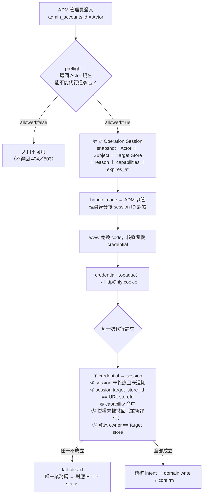

---

## 3. 約束與前提 (Constraints & Assumptions)

本章分四組：**3.1 前端已寫死的契約約束**（違反即靜默失效）、**3.2 本專案工程約束**、**3.3 假設**（失真即必須重新評估本書的對應決策）、**3.4 由本書定版的決策**（不是假設——它不會「失真」，只會被重新決策）。

各項取值的權威歸屬判準（規則的**值**由誰決定、前端現況與改動成本為何不構成權威）見 [ADR：代行營運規則權威歸屬的判定程序](../adr/2026-09-18-adm-delegation-authority-test.md)。

### 3.1 前端已寫死的契約約束

> 出處欄的路徑一律相對於 `hawkr-admin` repo（commit `7ac6d7a` 之後的工作樹）。
> **⚠️ 欄**＝違反時後端自己看起來是成功（HTTP 200／無錯誤 log），UI 卻靜默失效——這一類無法靠後端測試或監控發現。

#### 3.1.1 傳輸層與呼叫序（四支端點共通）

| # | 約束 | 違反後果 | 出處 |
|---|---|---|---|
| T1 | 身分只認 **admin opaque session cookie**。BFF 送出的 `Cookie` header 只含一個 cookie（`__Host-hk_session` ／ `__Secure-hk_session` ／ `hk_session`，依優先序取第一個存在者） | 後端若要求 `Authorization: Bearer`，永遠收不到 | `src/features/delegated-operations/server/upstream.ts`、`src/lib/session.ts` |
| T2 | 固定會收到 `Accept: application/json`、`X-Requested-With: XMLHttpRequest` | — | `upstream.ts` |
| T3 | 有 body 時才有 `Content-Type: application/json`；有冪等需求時才有 `Idempotency-Key` | — | `upstream.ts` |
| T4 | operation credential 走 **`X-HK-Operation-Session`** header（大小寫不敏感） | 後端若改用其他 header 名，代行請求全部無憑證 | `upstream.ts`；`tests/delegated-operation-create-route-runtime.test.ts` |
| T5 | admin BFF 不簽 origin-auth；單體驗證 Access JWT 後把管理員身分傳給 gateway，限流主體為 `m:<id>` | 多位管理員各自計額 | `gateway/internal/middleware/ratelimit_subject.go` |
| T6 | **絕不會收到** `Authorization`、`X-Admin-Actor-Id`、`X-Active-Store`、`X-Target-Seller-Id`、`X-Operation-Session`、`X-Impersonated-User-Id`，以及任何 `x-hk-operation-*` ／ `x-delegated-operation-*` 前綴的瀏覽器 header | 後端若設計成讀這些 header，功能直接死 | `upstream.ts`；`tests/delegated-operation-upstream.test.ts` |
| T7 | **session 四支端點**每支呼叫 10 秒硬逾時（AbortController）。建立流程是 preflight→create→current **串行三段**，最壞 30 秒。**作用域僅止於 session 端點**：該常數只透過 `adminUpstreamFetch` 生效，而它的呼叫點全部落在 preflight／create／current／end 四支；**資源端點（含批次）在 admin repo 沒有任何呼叫程式**，其外層逾時由本書定版（§7.3.1）。該常數**無測試鎖定**（`grep -rln TIMEOUT tests/` 零命中），約束力層級低於 T1–T6 | 單支超過 10 秒 → BFF 回 504，操作者看到失敗但後端可能已寫入 | `upstream.ts`、`src/app/api/admin/delegated-operations/route.ts` |
| T8 | 建立流程的三段呼叫**次數必須恰好 3、methods 固定 `["GET","POST","GET"]`** | 後端不可要求額外的前置或後置呼叫 | `route.ts/199/282`；`tests/delegated-operation-create-route-runtime.test.ts` |
| T9 | 失敗回應的 `message` **一律不透傳給瀏覽器**。只有 `code` 與 `traceId` 會被保留 | 用 message 傳語意 ⇒ 使用者永遠看不到 | `upstream.ts`；`tests/delegated-operation-upstream.test.ts` |
| T10 | `traceId` 格式須符合 `^[A-Za-z0-9._:-]{1,128}$` | 不符 → 被丟棄，錯誤畫面無追蹤編號 | `upstream.ts` |

#### 3.1.2 契約硬約束 C1–C16

| # | ⚠️ | 約束 | 違反後果 | 出處 |
|---|---|---|---|---|
| C1 | ⚠️ | 成功 envelope 必須 `{code: 0, data: ...}`，`code` 是**數字 `0`**（不是 `"0"`／`"SUCCESS"`／省略），且 `data` 這個 key 必須存在 | 整包判定失敗 → 502 | `upstream.ts` |
| C2 | ⚠️ | 時間戳 canonical RFC3339 `...Z`，**小數秒 0–3 位**，且需通過 round-trip 檢查 | 4 位以上小數秒（Java `TIMESTAMPTZ` 微秒必然 6 位）→ 502 | `model.ts`；`tests/delegated-operations-contract.test.ts` |
| C3 | ⚠️ | `caseReference` 必須是 string（前端接受 1–200，已 trim，無控制字元）或**顯式 `null`**；不可省略、不可 `undefined`。**後端另設更嚴的最低門檻**（4–200 且至少含一個數字）——嚴的一側在後端、寬的一側在前端，不會產生 502 | Go `omitempty` ／ Jackson `NON_NULL` 吃掉 null → 502 | `model.ts` |
| C4 | | `ttlSeconds` ∈ [1, **1800**]；session 壽命 `expiresAt − issuedAt` ∈ (0, **1800s**] | 0／負數／**1801**／非整數 → 502 | `model.ts`；`tests/delegated-operations-contract.test.ts`。⚠️ **前端該常數現值為 900，本案必須同波改成 1800**（§3.4 D1）——三處（前端常數、DB `chk_dos_lifetime_max`、契約測試邊界斷言）缺一即「前端擋下／DB 擋下／後端放行」不一致。**這是本表唯一一列由後端主動要求前端改值的硬約束**，落點見 §4.5 hawkr-admin 表 |
| C5 | ⚠️ | capability 必須落在**封閉列舉**內、非空、不重複。出現未知值＝**整份契約作廢**（不是忽略式降級）。**本案同波改掉這一條**：`parseDelegatedOperationCapabilities` 改為忽略未知值、保留已知值，`parsed.length === 0` 才判失敗（裁決理由見 §3.1.5 K7 與 §4.5 admin repo 表第一列）。**在該修改上線之前**，下欄的後果照舊成立 | 後端新增 capability 而未同波改前端 ⇒ **既有工作階段全部 502** | `policy.ts`；`tests/delegated-operations-contract.test.ts` |
| C6 | ⚠️ | `status` 恰為 `active` ／ `expired` ／ `revoked` **三選一，小寫** | `ACTIVE` 或第四個值 → 502 | `model.ts` |
| C7 | ⚠️ | `revision` 為**安全整數 ≥ 0**（JSON number） | 字串／負數／小數 → 502 | `model.ts` |
| C8 | ⚠️ | **連續兩次 `GET current` 必須位元等價**：不可 bump `revision`、不可 sliding expiration 延長 `expiresAt`、不可更新 `issuedAt` | 操作者永遠進不了工作區（顯示「與剛建立的稽核上下文不相符」） | `model.ts`；`src/services/delegated-operations.ts` |
| C9 | ⚠️ | create 必須**原字串回音** `reasonCode` 與 `caseReference`（不可 trim／大寫化／換成內部工單號） | 三重交叉核對失敗 → 502 | `route.ts` |
| C10 | ⚠️ | 同 `Idempotency-Key` 重放回**相同 session**；兌換前改簽新的 `handoffCode`，兌換後不再回 code；Create 不回 credential | 已兌換時 ADM 提示重新開始；重放舊 code → 9282 | `OperationPreflightDialog.tsx`；`route.ts` |
| C11 | | `operationCredential`：16–8192 字元、無 ASCII 控制字元、**不得含空白／`;`／`,`**；且**絕不得出現在 `GET current` 的回應內** | 格式不合 → Set-Cookie 拒絕；出現在回應 → 違反安全邊界 | `server/session.ts`；`tests/delegated-operations-contract.test.ts` |
| C12 | ⚠️ | preflight **不得用 404 表達「賣家不存在」**（404 已被佔用為「功能未部署」）。**503 亦然**——UI 把 503 同樣歸類為「尚未啟用」。<br/>⚠️ **9286（從未開通授權）的 HTTP 是 404，§6.5.1 定版讓它進入 preflight／create ⇒ 本條成為該拆碼的阻擋前置**：ADM 的 preflight／create 轉發必須先改成以業務碼分派，後端才可以回 9286（順序與理由見 §6.5.1、§6.5.2） | 代行入口**永久消失**，且顯示錯誤原因 | `preflight/route.ts`；`MerchantOperationEntry.tsx`；`app/api/admin/delegated-operations/route.ts`（preflight 轉發與 create 轉發各一處 404 分支） |
| C13 | ⚠️ | 後端時鐘不得超前瀏覽器 60 秒以上（`issuedAt` 落未來 → 判 invalid） | 全部 session 判 invalid | `model.ts` |
| C14 | | 不得回 3xx（前端 `redirect: "manual"`） | 被當成錯誤 | `upstream.ts` |
| C15 | | preflight 必須**可安全重複呼叫且唯讀**（入口每 30 秒 stale ＋ focus 重抓 ＋ 每次 create 前再抓一次） | 有副作用的 preflight 會被重複觸發 | `MerchantOperationEntry.tsx`；`route.ts` |
| C16 | | `GET current` 每 30 秒輪詢＋focus／reconnect ⇒ 必須廉價且**完全唯讀**、**不接受任何 query／body** | 若要求 `storeId` query → 400/404，功能死 | `OperationSessionBoundary.tsx`；`upstream.ts` |

#### 3.1.3 前端已封死、後端不得那樣設計（F1–F17）

| # | 封死的事 | 違反後果 | 出處 |
|---|---|---|---|
| F1 | 不得由瀏覽器 header／body 指定代行目標、actor、scope 或 credential | 前端永遠送不到，功能死 | `server/bff-boundary.ts`；`upstream.ts` |
| F2 | 瀏覽器不得指定 capability 或 TTL。create body 只有 `storeId`／`reasonCode`／`caseReference`，capability 與 TTL 由 BFF 從剛抓的 preflight 複製 | 後端若要求前端傳 capability，等於後端自問自答 | `model.ts`；`tests/delegated-operations-contract.test.ts` |
| F3 | 未知 capability ＝**整份契約作廢**，不是忽略式降級。**本案同波改掉**（見 C5）——偽造防護的權威在後端，前端這道 fail-closed 是零安全增益＋跨 repo 破壞性耦合 | 見 C5 | `policy.ts` |
| F4 | `orders.write`、shipment、refund、payment、finance、identity、certification、account-security **永遠不在 allowlist**（9 個機器名為封閉列舉） | 後端核發這些名稱 → 觸發 F3，整包作廢 | `policy.ts`；`tests/delegated-operations-contract.test.ts` |
| F5 | 上游 `message` 一律不透傳，統一換成 `代行營運服務暫時無法使用` | 語意必須放 `code`（每個失敗情境需**唯一數字碼**） | `upstream.ts` |
| F6 | 不得用 seller token／seller session／`/app/...` API 達成代行 | 前端 source-level 契約測試直接紅 | `tests/delegated-operations-ui-contract.test.ts` |
| F7 | credential 不得出現在 JSON 回應、URL、page props、localStorage、sessionStorage | 違反安全邊界 | `tests/delegated-operations-contract.test.ts` |
| F8 | 不得靠 HTTP status 單獨證明終止。generic `401`／`404`／`410` 一律當「結果不明」 | 操作者卡在「結束結果待確認」，寫入被永久 latch 封鎖 | `server/session.ts`；`tests/delegated-operation-session.test.ts` |
| F9 | **非同步／排隊式結束（`202`）不被接受** | 同上 | `tests/delegated-operation-current-route.test.ts` |
| F10 | 不得只因「同店家已有 active session」就直接接入；必須是同一次 create 的精確工作階段 | 前端 409 擋下 | `services/delegated-operations.ts` |
| F11 | preflight 的 `404` 已被佔用為「功能未部署」，不可作為「查無此賣家」 | 見 C12 | `preflight/route.ts` |
| F12 | 成功 envelope `code` 必須是數字 `0` | 一律 502 | `upstream.ts` |
| F13 | 不得回 3xx | 被當錯誤 | `upstream.ts` |
| F14 | 文案禁用 `切換身分`、`登入賣家`，及任何暗示 impersonation 的說法 | 產品定位失守；統一用詞見 §14 | `.impeccable` surface:51 |
| F15 | client-side 隱藏不是授權：後端必須對**每次讀寫**重驗 admin session ＋ operation binding ＋ target ＋ scope ＋ expiry ＋ revision。⚠️ **「重驗 admin session」這一項跨 host 之後對代行執行期不成立**（那些請求由 www host 的 BFF 發出，結構上不帶 ADM session）：它由 operation credential 本身承擔，其餘五項一字不變、逐次重驗（§8.1.3） | — | plan:14 |
| F16 | 代行端點不得經泛用 BFF（路徑含 `delegated-operation(s)` 一律 403，含多層 percent-encoding 與 `..`／`%` 畸形） | — | `server/bff-boundary.ts` |
| F17 | `GET current` 不接受 `storeId` 參數，只能由 credential 解析 session | 若要求 storeId → 功能死 | `upstream.ts` |

#### 3.1.4 終止語意的封閉列舉（DELETE 路徑）

前端對「結束代行」的合法回應是**封閉列舉**，不在其中者一律判「結果不明」，後果是 operation cookie 不清、工作區寫入被**永久 latch 封鎖**（即使關閉 dialog 也不恢復）。本設計選定的路徑見 §6.1，此處只列前端接受什麼：

| 判定 | 回應 |
|---|---|
| ✅ `ended` | HTTP `204`（無 body） |
| ✅ `ended` | HTTP `200` 且 body 為 `{"code":0,"data":{"ended":true}}`（`code` 為數字 0、`data.ended` 為 boolean `true`）—— **本設計採用此類** |
| ✅ 終態 | HTTP `404`／`410` 且 body `code` 為**字串**且 ∈ `{DELEGATED_OPERATION_ENDED, DELEGATED_OPERATION_EXPIRED, DELEGATED_OPERATION_REVOKED, DELEGATED_OPERATION_NOT_FOUND}` —— **本設計不使用**（字串 code 與 envelope `int32 code` 衝突） |
| ❌ 結果不明 | `202`、`200 {ended:false}`、`200 {}`、裸 `404`／`410`、5xx、逾時 |

> 註：因為本設計選了「不使用字串 code」的路徑，`GET current` 對**終態 session** 必須回 `200 {code:0, data:{..., status:"expired"|"revoked"}}`，由前端自行轉 410 並清 cookie。這反過來要求 **session 記錄永不硬刪**（否則查不到就只能回 404，落進「結果不明」）。詳見 §7.5 與 [ADR：工作階段與稽核的服務歸屬、落庫形狀與保留期](../adr/2026-09-18-adm-delegation-service-ownership.md)。

#### 3.1.5 產品需求與前端現況不一致時的定版值

同一件事有三個來源：**產品需求（ADM 代行營運 v2.0 及其 UI mockup）**、**已上 dev 的前端程式碼**、**本書**。
三者不一致時由本書定版；權威歸屬的判定程序、各項的裁決理由與被否決的選項見
[ADR：代行營運規則權威歸屬的判定程序](../adr/2026-09-18-adm-delegation-authority-test.md)。

**本節只列定版值。** 規格全文在各自的落點，本表是索引。

| # | 項目 | 定版值 | 規格落點 |
|---|---|---|---|
| K1 | 操作理由的層級 | 工作階段級只有 `reasonCode` ＋ `caseReference`；自由文字理由下沉到**每一筆 mutation** 的 `operationReason`（≤100 字）。⚠️ **每一個 mutation 表單都必須有 1–100 字的必填理由輸入落點**——mockup 的商店設定頁與商品／貼文編輯頁都沒有畫這一欄，照圖施工每次儲存都 9260／400 | §6.1.0 三態表、§6.1 各資源端點 |
| K2 | 工作階段 TTL | `DEFAULT`／`MAX` 皆 **1800 秒**，由 preflight 下發；建立 modal 下拉的預設選項＝30 分鐘。**操作者可在下拉裡選更短的值**：BFF 原樣轉送 `ttlSeconds`，伺服端取 `min(requested, DELEGATION_SESSION_TTL_MAX_SECONDS)` | §3.4 D1、§6.1.3、§8.5.1 |
| K3 | 閒置逾時 | **做 idle expiry，窗口 900 秒**，讀取時推導；`GET current` 的 30 秒輪詢**不算**活動。建立 modal 的「閒置 15 分鐘後自動結束」文案是規格 | §6.2.4a、§7.5.1 第 3 順位 |
| K4 | `case_reference` 值域 | 上限 **200** 字（trim、無控制字元），並加最低門檻：長度 4–200 且至少含一個數字 | §6.1.3、§5.1.1 `chk_dos_case_reference` |
| K5 | 授權範圍的呈現 | **唯讀展示** preflight 下發的清單；瀏覽器不得指定 capability（F2） | §6.1.2、§6.1.3 |
| K6 | 稽核快照的狀態值 | 存 **CodeMeta 數字碼**，顯示名由前端查對照表（`formatter: enum(EnumName)`） | §6.1.12 |
| K7 | capability 的形式與值域 | **9 個小寫點號式**（`storefront.read`／`storefront.write`／`products.read`／`products.write`／`products.publish`／`posts.read`／`posts.write`／`posts.publish`／`orders.read`），跨 repo 逐字相同；`ADMIN_*` 那組命名不採用 | §4.4.1、§6.1.1 |
| K8 | 工作區渲染哪些模組 | **渲染集合依 mockup ＝ 完整賣家中心；可操作集合仍是封閉九值所覆蓋的四面。渲染集合 ⊋ 可操作集合，這是刻意的。** 未開放的模組照常渲染選單項，點入顯示「不在本次代行授權範圍」的空狀態（不是 `disabled`，也不是隱藏）。**禁區（履約／金流／身分）連選單項都不渲染** | §6.1.14、§8.1.1 層 1 |
| K9 | 側欄「登出」與左 rail「返回 ADM」的語意 | ① 側欄「登出」**＝結束本次代行**：呼叫 `DELETE /api/v1/admin/delegated-operations/current`（S4），成功後導回 ADM 商家詳情，與情境列的「結束代行」是同一個動作；**不得**呼叫 ADM 登出端點。<br/>② 左 rail「返回 ADM」**＝純導覽**，不得產生任何 session 狀態變更（不 end、不 revoke、不 bump `revision`）。<br/>⚠️ 接到 ADM 登出會**污染稽核的 `revoke_reason` 判讀**——ADM 登出會連帶把該 actor 名下所有 active 工作階段以 `revoke_reason='admin_logout'` 撤銷，而 §12.4 ① 的判讀規則正是靠這個值分辨「操作者自己結束」與「被治理撤銷」 | §6.1.5、§7.2.7 讀法 2 |

### 3.2 本專案工程約束

| # | 約束 | 對本設計的具體含意 | 出處 |
|---|---|---|---|
| E1 | **Gateway 是唯一對外 HTTP 入口**，微服務間一律 gRPC、微服務不暴露 HTTP | 代行的六支 session 端點與全部資源端點都落在 Gateway；account-service 的 `DelegationService` 只有 gRPC 介面 | `docs/基礎建設/系統架構與資料流向.md` |
| E2 | **API 只有三個 namespace**（`/api/v1/public/*`／`/app/*`／`/admin/*`），envelope 恆為 `{code,message,data,traceId?}`，成功 `message="success"` 且 Gateway 不得自造 | 代行全部落在 `/admin/*`；語意一律走 `code`（F5 同向要求）。**動作端點用 `POST .../{id}/publish`，不用 `:publish`** | 同上 |
| E3 | **數字欄位對外一律 string**、時間一律 ISO 8601 UTC 帶 `Z` | 全部 ID（session id、store id、account id、product id、post id、audit log id）與資源版本 `version` 皆為 string。**兩項具名例外見下方 E3-X** | `docs/開發規範/Java 微服務開發規範.md` §2 |
| **E3-X** | **具名例外（本設計新增，僅此三欄）**：`ttlSeconds`／`revision`／**`idleSeconds`**必須是 **JSON number**（安全整數） | 前端 parser 對前兩欄硬性要求整數型別，字串一律 502（C4／C7），且該檢查已寫進契約測試；`idleSeconds` 與 `ttlSeconds` 同組同源（同一份 preflight 回應的秒數欄位），分開成兩種型別只會製造前端的分支。此例外**不擴散**：資源樂觀鎖版本 `version` 仍為 string，其餘所有數字欄位仍為 string | C4／C7（`model.ts`）；`idleSeconds` 見 §6.1.2；例外登記於本表 |
| E4 | **TSID 用於對外暴露的業務表，BIGSERIAL 用於內部表**；Go 服務用 `pkg/tsid.NewGenerator`（無 Node ID Base 概念） | `delegated_operation_sessions`／`admin_operation_audit_logs` 對外可見 ⇒ TSID；outbox 為內部表 ⇒ 依既有 Go outbox 慣例 | `docs/開發規範/Java 微服務開發規範.md` §3 |
| E5 | **禁止硬編碼；共享代碼值先改 CodeMeta `.md` 再 `generate.sh`，嚴禁直接改生成檔** | 新增的代行錯誤碼、EventType、稽核 action／actor 碼一律走 `docs/代碼管理（CodeMeta）/` → `generate.sh`。**capability token 不進 CodeMeta**（Gateway 內部概念，比照 46 號既有裁決） | `docs/代碼管理（CodeMeta）/README.md` |
| E6 | **Gateway 未登錄的業務碼一律塌縮成 HTTP 409** | 本功能需要 401/403/409/410/422/424/429 分流 ⇒ 必須在 `gateway/internal/response` 建立**業務碼→HTTP status 的統一映射表**（新增獨立檔 `bizhttp.go`，見 §4.5）並登錄本功能全部碼，而不是為單一情境加 helper | `gateway/internal/response/response.go`；memory `reference_gateway_bizcode_collapses_to_409` |
| E7 | **Proto 只改 `api/proto/*`**；改完必跑 `scripts/gen-go-proto.sh` ＋ rsync 到 java-proto ＋ `mvn clean install`，CI 有 `proto-generated-diff.yml` 對拍 | `DelegationContext` 新增於 `api/proto/common/delegation.proto`；**所有被代行觸及的既有賣家 RPC（含讀取）**統一用**欄位號 100** 加同一個 optional 欄位 | `docs/開發規範/Proto 管理規範.md` |
| E8 | **gRPC 角色分離**：不同角色必須獨立 RPC，禁止 boolean flag 分流 | 本設計**不新增** `*ForDelegation` RPC，而是在既有賣家讀寫 RPC 加 `DelegationContext`——這不是「flag 分流」，而是「同一個賣家讀寫動作，多帶一份授權語境」，語意仍是賣家資源讀寫。代行讀取**不改走 `*ForAdmin`**：後者是平台跨賣家視角，DTO 與語意都不同，走雙軌會產生兩套讀取路徑。此取捨的理由見 [ADR：授權如何穿過微服務牆](../adr/2026-09-18-adm-delegation-authz-propagation.md) | `docs/開發規範/Java 微服務開發規範.md` §4 |
| E9 | **微服務間內部授權走 HMAC**（52 號）；canonical 為 `serviceName\nts\nnonce\naccountIdOrEmpty` | `DelegationContext` **不在簽章覆蓋範圍內**，其可信度來自「呼叫方已被證明是內部服務」＋「Gateway 是唯一產生者」。此信任邊界與前提必須在 §8.1 明寫；canonical **不變**，零破壞性遷移 | `services/java/shared/common-core/.../grpc/GrpcAuthClientInterceptor.java` |
| E10 | **API 同步責任**：新增／修改 gRPC RPC 必須同步 `api/proto` 與 Gateway 路由，嚴禁孤兒 RPC | 每支新增 RPC 都必須有對應的 `/admin/...` 入口 | `docs/開發規範/Java 微服務開發規範.md` §4 |
| E11 | **賣家能力層規約**：宣告＝掛載合一、boot 斷言、`/app` 下禁 wildcard | 代行沿用同一 registry 與掛載慣例；`/admin` 下同樣禁 wildcard（本案新增四條 boot 斷言的第 ③ 條，四條全文見 §4.1.2） | `docs/開發規範/賣家能力權限層規範.md` |
| E12 | **Gateway 新增身分類 header 必須自行 `Header.Del` 剝除外部同名值** | 全 gateway 目前只有一處 `Header.Del`（`router/seller_capability.go`），`applyIdentity` 用 `Set` 覆蓋的慣例**對新增 header 不適用** | `gateway/internal/middleware/auth.go`；`seller_capability.go` |
| E13 | **`storeid` resolver 對 admin account_id 會寫入 60 秒負快取**（`store:current:<adminId>=0`） | 代行路徑**完全不呼叫 `CurrentStoreID`**；target store 一律取自 session snapshot，並與 URL path 交叉比對 | `gateway/internal/storeid/resolver.go` |
| E14 | **DB 遷移**：Java 走 Flyway `V{N+1}` append-only（V1 凍結、禁跳號）；Go 走 Atlas（改 `db/schema/schema.sql` → `atlas migrate diff` → `atlas migrate hash`），**禁止 SSH 手跑 DDL** | 單體（Go／Atlas）在 delegation schema 新增五張表，`admin_eligibilities` 以 admin_id 列存在表示資格，`identity.admins` 不新增資格欄；product-service（Java／Flyway）新增 `version` 欄位；seller／social（Go／Atlas）新增 `version` 欄位，social 另對 `cms_post` 新增排程發布欄位群（§5.1.5） | `docs/開發規範/PostgreSQL 設計規範與最佳實踐.md`、`docs/開發規範/DB Migration 相容性規範（expand-contract）.md` |
| E15 | **新增可由既有欄位推導的欄位時，同一個 migration 內必須緊接回填 `UPDATE`**，恆真的不變式加 `CHECK` | 三張資源表新增 `version BIGINT NOT NULL DEFAULT 0` 屬純新增，`DEFAULT 0` 即正確初值，**無需回填**（理由見 §5.4），同時加 `NOT NULL` 與 `CHECK (version >= 0)`；`delegation.admin_eligibilities` 沒有預設列，無需回填；不存在即 deny-by-default。但 session 表的每條 `CHECK`（壽命為正、**1800 秒上限**、狀態封閉、**`last_active_at` 落在 `[issued_at, expires_at]`**）必須由 DB 守，不只靠應用層。⚠️ **`last_active_at` 屬「可由既有欄位推導的新欄位」的相反面**：它是五張新表之一的欄位、隨 `CREATE TABLE` 一起建立，`NOT NULL` 的初值由 INSERT 當下填 `issued_at`（**不是** `DEFAULT now()`——那會讓一列在 INSERT 與 `issued_at` 之間出現微秒級落差而撞 `chk_dos_second_precision`），因此不涉及回填 | `docs/開發規範/DB Migration 相容性規範（expand-contract）.md` §三 |
| E16 | **PostgreSQL 交易內任一句 SQL 失敗即整個交易 aborted（25P02）**；「衝突就跳過」只有 `ON CONFLICT DO NOTHING` 一條路 | session 建立的冪等分支不得寫成「catch `DuplicateKeyException` 後繼續查」；沿用 `seller_suspension.go` 的「rollback 後用新連線查」或 `ON CONFLICT DO NOTHING` | `docs/開發規範/PostgreSQL 設計規範與最佳實踐.md` |
| E17 | **MQ 服務端已切 passive declare**：查不到 queue 不 crash、不進 DLQ，該訂閱**靜默失效**。broker topology 唯一 owner ＝ `infra/mq/topology/topology.yaml`（Terraform，CI 是唯一 apply 路徑） | 新增 exchange `hawkr.delegation` 時，同一個 PR 必須加 topology 條目；`{exchange}.dlx` 要自己列進 `exchanges:`；Go consumer `MaxRetries > 0` 的 queue 條目必須帶 `retry:` | `docs/基礎建設/MQ Topology 管理（Terraform）.md` |
| E18 | **MQ／事件 SSOT 是 36 號**：新增事件必須先改 36 號、同步服務設計書、CodeMeta EventType、常數檔，禁止字面值硬編碼 | §6.3 的唯一事件 `delegation.operation.completed` 必須完整走完這條鏈；notification 模板變更另需同步 `tests/contract/golden/event_payload_keys.json` | `docs/開發規範/MQ 與事件管理規範.md` |
| E19 | **責任邊界**：`reconciliation` ／ `reflow` ／ `backfill` ／ `resync` ／ drift 偵測**不得寫進 application code**；例外只有跨服務 saga unwind、Outbox、CDC 三種且須於設計書標注理由 | 本設計唯一使用的例外是 **Outbox**（例外 2），理由於 §8.4 標明。稽核的 `PENDING` 列**不是待清理垃圾**，不引入清理 job；稽核保留期清理屬維運 SQL | `docs/開發規範/後端服務責任邊界規範.md` |
| E20 | **多副本排程搶佔規範**：批次讀候選 → 逐筆做副作用的程式碼一律用 lease claim，租約長度須 < 候選窗口壽命且 > 單筆最壞耗時，且**逐筆取租約基準** | 本設計有**兩個**命中點：outbox dispatcher 與貼文排程發布器。兩者都必須完整滿足，且外部呼叫必須有 deadline（否則最壞耗時無上界，租約下界無從建立） | `docs/開發規範/多副本排程搶佔規範.md` |
| E21 | **硬上限依賴接入治理**：接上生產路徑前必須有「與上限對齊的指標＋告警規則＋預算數字」三件；session／鎖／冪等記錄屬「不能失敗的狀態」，禁止放在無預算數字的依賴上 | Operation Session 的權威狀態放 **PostgreSQL**（有容量規劃），不放 Redis；若後續為 `GET current` 加快取，該快取只能是加速層，且必須先補三件 | `docs/開發規範/硬上限依賴接入治理規範（配額與容量）.md` |
| E22 | **log 遮罩是「值的清單」不是「欄位位置的清單」**：同一個值從 body／query／path／header 進來都要遮 | operation credential 走 header，必須把 `X-HK-Operation-Session` 加進敏感清單，並確認 `redactBody`／`redactQuery` 兩條路徑都涵蓋；header 目前不經任何遮罩函式，需另補 | `gateway/internal/middleware/logger.go`（`sensitiveKeys`）、`redactBody`、`redactQuery`，以及把 query 併入 `path` 欄位的那一段 |
| E23 | **Swagger 註解是契約 SSOT**：新增／修改 handler 必同步 `@Summary`／`@Param`／`@Success`；`@Param` 數字參數必須 string；分頁一律走 `response.Page` | 代行的全部端點都要寫註解；`gateway-json-contract.yml` Check B 會比對宣告與實際輸出 | `docs/開發規範/Gateway Swagger 註解規範.md` |
| E24 | **結帳 hot path smoke**：動到 product／order／cart／payment／shipping 任一服務的 service／repository／gRPC／MQ Consumer 層，push 前必跑 `infra/smoke-checkout.sh` 全綠 | 本設計會動 **product-service**（`@Version`＋既有讀寫 RPC）與 **order-service**（既有賣家唯讀 RPC 加 `DelegationContext`），因此 smoke 為強制且**不得**以「只改一行」豁免 | `infra/smoke-checkout.sh`；既有引用範例見 49 號 §12「批 1」與 52 號 §波及面驗證 |
| E25 | **交付路徑**：`backend-payuni` 走 PR、base 一律 `dev`；`hawkr-admin` **與 `hawkr-website` 皆直接 push `dev`**、禁開分支（⚠️ **它是三者中唯一有真實買家流量的**，賣家本人路徑的回歸驗證因此是每一批的必要條件） | 兩 repo **同波即可、先後不拘**：`parseDelegatedOperationCapabilities` 是忽略式降級（逐項過濾未知值、只有全數未知才判契約失敗），因此後端擴充 capability 不需要前端先發布（§4.5 admin repo 表第二列） | `docs/開發規範/Git 分支與交付路徑規範.md` |

### 3.3 假設 (Assumptions)

> 以下每一條若失真，都會使本設計的某個結構失去依據，必須重新評估對應的決策，而不是在實作時就地變通。
> **A2 是本表唯一的例外，它的處置方式與其餘各列相反**：不是「偵測失真」，而是**部署當下必須逐次查核**，見該列與 §13 security。

| # | 假設 | 依據 | 失真後果 | 偵測方式 |
|---|---|---|---|---|
| A1 | **`hawkr-admin` 由本團隊維護，且 capability 白名單與後端九值保持逐字相同** | 該 repo 屬本團隊守備範圍，交付路徑為直接 push `dev`（E25） | 白名單與後端九值不一致時，多出來的值是前端永遠收不到的死碼、少掉的值則讓該能力在 UI 上不出現。**兩 repo 之間沒有硬性先後**：`parseDelegatedOperationCapabilities` 是忽略式降級（逐項過濾未知值，只有 `parsed.length === 0` 才判契約失敗），因此新增第 10 個 capability 時同波發布即可 | §13.1 G3 gate 逐字比對兩 repo 的九值；另確認 `parseDelegatedOperationCapabilities` 仍是忽略式降級 |
| A2 | ⚠️ **這一列不是假設，是一個「部署當下必須查核」的前提，不要讀成永久成立的既成事實。** 五支服務（gateway／account-service／product-service／seller-service／social-service）的 `INTERNAL_AUTH_MODE` 必須為 `enforcing`，且 per-service NetworkPolicy 必須存在。生效值由 `k8s/values/overlays/{dev,prod}/common.yaml` 決定，helm 疊加順序使 overlay 覆蓋 base `k8s/values/*.yaml`。⚠️ **base values 的 `"permissive"` 不要動**——它只對沒有 overlay 的環境（＝本機）生效，改它對 dev／prod 零效果卻會讓本機 fail-closed。本設計把 proto `DelegationContext` 當可信輸入**完全依賴**這個前提，而它不會「失真」、**會被別人改回去**，故每次部署逐次查核 | §8.1.4 前提表 ＋ §13 security 阻斷項（五支逐一查核，命令附在該節） | **前提未達成即不得開 feature flag。** 強行上線會打開兩條都繞過全部稽核的旁路：**(a) 領域服務側**——同 namespace 任一 pod 可自造 `DelegationContext` 直寫 product／seller／social 的代行寫入 RPC；**(b) account-service 側**——可直呼 `DelegationService` 憑空寫改稽核列。⇒ 稽核表既攔不住偽造的寫入，自己也可被竄改 | 不設獨立偵測——**前提段不會被執行，阻斷項會**，故由 §13 的阻斷項在每次部署當下查核 |
| A3 | **Gateway 是唯一對外入口，且代行端點不可能被瀏覽器直接觸及** | E1 ＋ 前端 F16（泛用 BFF 硬性拒絕代行路徑） | credential 若可由瀏覽器直送 Gateway，HttpOnly cookie 的保護即失效 | 代行路由的負向測試（帶 credential 直打 Gateway 應被 CORS／Origin 檢查擋下） |
| A4 | **`admin_accounts.id` 與 `accounts.id` 是兩個獨立 ID space，且本設計不需要它們互不相撞** | `schema.sql` 兩表分離；本設計三個身分軸各有獨立欄位（§2.3） | 若未來合表或共用產生器，稽核查詢的 join 條件需重新檢視 | schema 變更時的 review |
| A5 | **prod 已上架但尚無存量交易**，破壞性契約變更的代價僅限於同波發布的協調 | prod `orders` 的存量交易筆數 | 若已有真實使用者流量，跨 repo 破壞性變更必須改走擴張—收縮（[DB Migration 相容性規範](../開發規範/DB%20Migration%20相容性規範（expand-contract）.md)），且移除承諾要被機械保證 | 上線前重查 prod 交易量——**這是 live DB evidence，不得以 repo 內任何記載代替** |
| A6 | **代行併發規模低**：同一時間全平台的 active session 數量在**個位數到數十**量級（一個 admin 一次只能代行一家、一家一次只被一個 admin 代行，見 §5.1） | 內部員工人數 ＋ §6.1 的兩條 partial unique 約束 | 若規模上升一個數量級，`GET current` 的 30 秒輪詢（C16）會成為 account-service 的常態負載，需重估 §9 容量與是否加快取（受 E21 約束） | `GET current` QPS 與 active session 計數的 metrics |
| A7 | **product／seller／social 三張資源表可安全新增 `version` 欄位**（純新增、無存量語意衝突） | 三處目前皆無樂觀鎖（`ProductEntity` 無 `@Version`，全 repo 僅 6 個 entity 有） | 若某表已有其他語意的 version 欄位，命名與語意需重新設計 | migration 前 `\d` 查核三張表 |
| A8 | **NTP 同步正常**，後端與瀏覽器時鐘偏差在 60 秒內 | C13 是前端硬性檢查 | 時鐘漂移 > 60 秒 ⇒ 全部 session 被判 invalid，且**後端看起來完全正常**（靜默）——請求根本不會送出來，`delegation_denied_total` 不動、`delegation_sessions_created_total` 反而正常 ⇒ **現行監控對它完全失明** | **§13 security 的上線阻斷項**（`abs(now_client − issuedAt) < 5 秒`，dev／prod 各一次）＋ `infra/smoke-delegated-operations.sh` 每次部署後重跑。**不用「節點時鐘偏差告警」代替**：要量的是**後端輸出的 `issuedAt`**，中間隔著時區換算與截秒兩層轉換 |
| A9 | **管理員代行路徑的限流主體為 `m:<id>`** | 單體驗證 Access JWT 並傳遞管理員身分 | 若身分 header 未傳遞，多位管理員可能共用 Worker 出口 IP 的額度 | 限流 metrics 依 subject 分組觀察 |

### 3.4 由本書定版的決策（不是假設）

> 假設是「我相信它成立，失真就要重評」；決策是「我選了它，要改就重新決策」。兩者的處置方式不同，因此分表。下列每一條都**已經被本書選定**，不需要偵測，也不會「失真」。

| # | 決策 | 理由 | 要改動它必須做什麼 |
|---|---|---|---|
| **D1** | **工作階段 TTL 上限為 1800 秒；前端的 60 秒時鐘容差不動**（admin repo `model.ts` 的 `DELEGATED_OPERATION_MAX_TTL_SECONDS` 與 `CLOCK_SKEW_SECONDS`） | TTL 是風險曝險窗口，窗口愈長、撤銷之外的兜底就愈依賴人；曝險窗口的長度由**閒置逾時**（900 秒）承擔另一半——無人操作時 15 分鐘即結束。<br/>60 秒時鐘容差是**安全檢查**而非效能參數，放寬它等於放寬「後端時鐘被推到未來」的偵測門檻；它與 TTL 正交。<br/>兩者的取值依據見 [ADR：工作階段的到期機制、併發範圍與識別碼](../adr/2026-09-18-adm-delegation-session-lifecycle.md) | **TTL 上限**：三處必須同波——admin repo `model.ts` 的常數、`tests/delegated-operations-contract.test.ts` 的邊界斷言、`delegated_operation_sessions` 的 `chk_dos_lifetime_max`（§5.1.1）。**三處缺一即產生「前端擋下／DB 擋下／後端放行」的不一致。**<br/>**60 秒時鐘容差**：同波修改 `model.ts` 的常數與對應斷言 |

---

## 4. 架構 (Architecture)

### 4.1 解法總綱

ADM 代行營運要解的問題是：**平台管理員需要替某一家店維護「店面／商品／貼文」內容，但不能取得該賣家的身分。**

#### 4.1.1 代行身分的形狀：管理員全程只帶自己的憑證

**定版形狀**：**管理員全程只帶自己的 ADM 憑證，走 `/api/v1/admin/**`；「代行誰」由伺服器持有的 Operation Session 回答，「能做什麼」由 Gateway 的 admin capability 層回答，「是不是真的被授權」由微服務讀 proto 的 `DelegationContext` 再驗一次。** 管理員的請求從頭到尾沒有一刻長得像賣家。

⚠️ **不得以「換一枚賣家 JWT 給管理員用」（impersonation）實作**——它會同時破壞兩件事：**(a) 能力面**：賣家 JWT 承載 `accountType ∈ {2,3}`，`gateway/internal/authz` 的 `allCapabilities` 會**全授予**賣家 capability（含出貨／物流／售後與取消出貨＋退款受理），代行的封閉禁區在這條路徑上**沒有任何機械手段可以縮回來**，只剩「前端不要點」；**(b) 稽核面**：下游一切寫入的 `x-account-id` 都變成賣家，`created_by`／`updated_by`／MQ event 的 actor 全部指向賣家本人，「誰做的」在資料層永久無解。否決過程與被否決的其他選項見 [ADR：授權如何穿過微服務牆](../adr/2026-09-18-adm-delegation-authz-propagation.md)。

定版形狀避開了 ADMIN 打賣家路徑會撞上的三道牆，而不是繞過它們：

| # | 牆 | 位置 | 本案處置 |
|---|---|---|---|
| ① | `IsSeller(4) == false` → 403 | `gateway/internal/middleware/account_type.go`；`gateway/internal/router/seller_capability.go` | 代行走 `/admin` 群組（`routes.go` 的 `requireAdmin()`），**不經過** `requireSeller` |
| ② | admin account_id 在 `sellers` 無列 → `ErrNoCurrentStore` ＋ 負快取 `store:current:<adminId>=0` 60 秒 | `gateway/internal/storeid/resolver.go` | 代行路徑**一律不呼叫** `CurrentStoreID`；target store 取自 Operation Session snapshot，並與 URL path 的 `{storeId}` 交叉比對（§4.5 `router/delegated_capability.go`） |
| ③ | `AccountTypeRules.covers(ADMIN, SELLER) == false` → `PERMISSION_DENIED` | `GrpcAuthContext.requireAccountType`（`services/java/shared/common-core/.../grpc/GrpcAuthContext.java`） | 賣家寫入 RPC 改走 `requireSellerOrDelegated(...)`：語意＝「SELLER 本人 ∨（ADMIN ∧ 有效代行且 capability 相符）」，不放寬 `requireAccountType` 本身 |

#### 4.1.2 四根支柱

**支柱一：三層鎖定（禁區不可達，且可機械驗證）**

代行的禁區（`fulfillment` / `shipment` / `cancel` / `refund` / `payment` / `finance` / `identity` / `certification` / `account-security`，**機器名 SSOT ＝ §8.1.0**）不是靠「按鈕不要畫出來」保證，而是三層各自獨立成立、任一層單獨失效都不會開門：

| 層 | 保證方式 | 可驗證性 |
|---|---|---|
| **UI 層** | 訂單頁不 render checkbox／批次列／shipment CTA（**不是 disabled**） | admin repo 既有契約測試（`tests/delegated-operations-contract.test.ts`、`tests/delegated-operations-ui-contract.test.ts`） |
| **路由層** | **boot 斷言四條**：① 凡經 `delegatedHandle(...)` 註冊的路由，capability 必須非空（宣告＝掛載合一）；② `delegatedRoutes` registry 內任一路徑**不得命中禁字清單**；③ `/api/v1/admin` 下禁止 wildcard `Any("/*path")`（比照 `/app` 既有規則——有 wildcard 就代表路由表 ≠ 攻擊面全集，deny-by-default 保證失效）；④`/api/v1/admin` 之下凡註冊在 `adminNoAuth` group（即不經 `requireAdmin()`）的路由，必須逐條命中具名白名單，**恰 26 支**——白名單是 ADM host 組與 www host 組的唯一分界 SSOT，多一支少一支都 panic | 四條皆 boot 即 panic，CI 每次跑路由組裝測試就會踩到 |
| **授權層（Gateway＋微服務）** | Gateway：admin capability 是**封閉列舉**，9 個裡沒有任何一個代表履約能力；微服務：`requireSellerOrDelegated` 只在 delegation 的 capability 命中該 RPC 白名單時放行，履約類 RPC 完全不接受 `DelegationContext`（沒有那個欄位） | Gateway 側未知 capability 於 `RegisterAdmin` 即 panic；微服務側 proto 層即缺欄位，是編譯期而非執行期的保證 |

**禁區機器名的 SSOT 是 §8.1.0，不是 admin repo。** `hawkr-admin` 的 `DELEGATED_OPERATION_PROHIBITED_AREAS`（`src/features/delegated-operations/policy.ts`）是同一份清單在該 repo 的**副本**，用途是「在請求發出前就不呈現危險入口」——該檔的註解自陳 `The backend remains authoritative; this list is also used by the Admin UI to avoid presenting a dangerous affordance before a request is made.`。兩份不一致時**一律以 §8.1.0 為準**，並在同一波把 admin repo 的副本改齊（§4.5）。

**禁字清單定版（10 個，取最嚴）**：`shipment` / `fulfillment` / `payment` / `payout` / `grant` / `refund` / `invoice` / `bank` / `identity` / `certification`。

註：這 10 個禁字與上一段那 9 個「禁區機器名」是**不同的東西**：兩份清單值域不同、用途不同（capability 識別字 vs 路由 URL path），但**同屬後端權威**——禁區機器名的權威在 §8.1.0，禁字清單是 Gateway boot 期對**路由路徑字串**做的機械掃描。兩者不得互相取代（區分全文見 §8.1）。

**作用域不以路徑前綴為準**：Session API（preflight／create／revoke 走 `requireAdmin`，`GET`／`DELETE current` 走 `credentialHandle`）**都不經 `delegatedHandle`**，因此不受斷言 ① 約束；既有治理路由（`PATCH /admin/sellers/{store_id}/seo`、32 號停權路由）同樣不經 `delegatedHandle`，不受影響。

「直接繞過 Gateway 打 `/app/shipments/*`」這條路仍然走 `requireSeller(CapOrderFulfill)`，ADMIN 在 `IsSeller` 就被 403 擋下（牆①），不需要額外處理。

**支柱二：Operation Session 生命週期（只有硬到期，沒有排程器）**

- `expires_at = issued_at + ttlSeconds`，`ttlSeconds` 由**後端 preflight 下發**（瀏覽器可在 mockup 的下拉裡選**更短**的值，伺服端一律 `min(requested, MAX)`），上限 **1800 秒**且由 DB `CHECK` 約束守住。
- **做 idle expiry，窗口 900 秒**：`now() >= last_active_at + idle` 即推導為 `expired`。**它與 hard expiry 同形——都是讀取時推導、都沒有排程器**；活動時間戳的順延併進授權鏈本來就要做的那一次 credential 反查（一句 `UPDATE … RETURNING`，§6.2.4a），**零額外往返、零前端心跳**。`GET current` 的 30 秒輪詢**不算活動**，否則 idle 在工作區開著時永不觸發。<br/>  **曝險窗口的誠實記帳**：最壞情況（操作者持續操作）是 **30 分鐘**；idle 只把「**無人操作**」時的窗口收回 15 分鐘。這是本定版的實際代價，不得寫成「有 idle 所以更安全」。
- `expiresAt` 一經核發**永不變動**（禁止 sliding expiration）；`GET current` 完全唯讀，連續兩次必須位元等價。**`last_active_at` 的順延不是 sliding expiration**：它不動 `expires_at`、不進 DTO、不 bump `revision`，hard 窗口的上界一秒都沒有被延長。
  - **禁 sliding expiration 的後端理由**：`expires_at` 是 §3.4 `D1` 定義的**風險曝險窗口上界**。sliding expiration 會讓一個持續操作中的 session 無限延長，等於把 TTL 這個風控參數取消掉——而 TTL 正是「撤銷之外唯一不依賴人的兜底」。前端「連續兩次 `GET current` 必須位元等價」（C8）與此**同向，是佐證不是唯一依據**。
- 「結束代行」＝**立刻到期**（`ended_at = now()`、`expires_at = LEAST(expires_at, now())`），不是另一個狀態。因此 DB 只需要兩個持久狀態（`active` / `revoked`），對外的第三態 `expired` 是**讀取時推導**的——**不需要任何排程器把 active 改成 expired**，這是本案能完全避開「狀態同步 job」這類技術債的關鍵。狀態模型全文見 §5.1 與 §7.5。
- session 記錄**永不硬刪**（軟終止），因此不存在「查不到只好回 404」的情境；前端 allowlist 裡那條需要字串業務碼的路徑（與本專案 `int32 code` envelope 衝突）永遠不會被觸發。

**支柱三：intent → confirm 兩階段稽核**

稽核落在單體的 delegation schema，現階段 domain write 仍落在舊領域服務自己的 DB，**物理上不可能同交易**。定版不寫一個做不出來的「同交易」規格，改用兩階段：

1. Gateway 授權通過 → `RecordAuditIntent`（delegation 寫 `result = PENDING`，含 actor／target／capability／reason／before 快照／idempotency／correlation）
2. 呼叫領域服務 domain write，`DelegationContext` 帶著上一步拿到的 `audit_log_id`
3. `ConfirmAuditResult` → `SUCCEEDED`（含 after 快照與 resource version）或 `FAILED`（含業務碼）

稽核的不變式是**不可漏記**，而兩階段保證「任何 domain write 之前必定已有 intent」，比同交易更強。`PENDING` 不是待清理的垃圾，**它本身就是稽核事實**（「曾嘗試、結果未確認」），查詢時如實顯示、不計入成功數，因此不需要任何補償任務（§8.4）。

**支柱四：outbox 保證該發的通知不會遺失**

賣家有權知道「平台動過我的店」。**通知範圍由操作者的勾選與「PII 揭露不通知賣家」的定版決定，不是由本支柱決定**：確認 drawer 的「通知賣家」勾選框會寫進稽核列的 `notify_seller`（§5.1.3），`notify_seller = false` 的操作（含**恆為 `false`** 的 `ORDER_PII_REVEAL`，§7.2.6）**不建立 outbox 列、不發事件**。⇒ 本支柱保證的是「**要發的那些一定發得出去**」（投遞管線的可靠性），**不是**「每次代行賣家都會知道」（通知的覆蓋率）——兩者是不同的宣稱，混寫會讓「訂單 PII 揭露不通知賣家」這項已知代價被句子本身抹掉。

在這個作用域內，投遞不能 best-effort：稽核 `SUCCEEDED` 與 outbox 列寫在**同一個 tx**（兩者同在 account-service，這裡是真同交易），再由 dispatcher 發到 MQ。這是責任邊界規範「七、例外」第 2 條的 **Outbox 模式**，設計書於 §8.4 標注理由。dispatcher 是排程器，必須完整滿足[多副本排程搶佔規範](../開發規範/多副本排程搶佔規範.md)（lease claim、租約長度上下界、逐筆取租約基準），實作樣板見 §4.5。

---

### 4.2 元件視圖 (C4 Component)

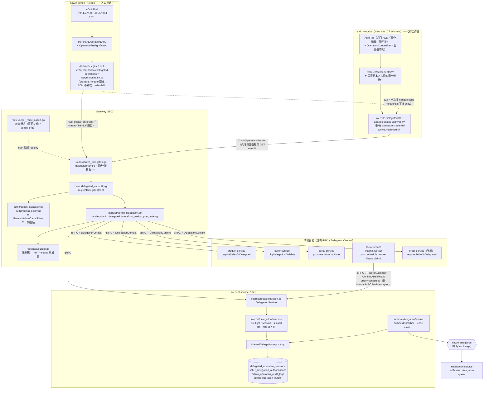

產品需求（ADM 代行營運 v2.0）的六個核心元件，對應到本專案的實際元件如下（責任與禁止事項逐條保留）：

| 產品需求元件 | 本案元件 | 責任 | 禁止 |
|---|---|---|---|
| ADM 外框 | hawkr-admin ADM Shell | 保留管理員導航、身分與返回治理入口 | 不偽裝成 Seller Center 登入頁；文案禁用「切換身分」「登入賣家」 |
| Delegated Workspace | **`hawkr-website`** `app/(delegated)/adm/**` ＋ `features/delegated-operations/components/{AdmRail,OperationContextBar}.tsx` | 顯示 ADM 窄欄、代行情境列，並把賣家中心各面掛進來 | **不自行推導 capability**（一律讀 `summary.capabilities`）；**不得**沿用 `RoleZoneGuard required="seller"` |
| Shared Presentation | **`hawkr-website`** `features/seller-center/**`（＝賣家本人在用的同一份，非副本） | 共用「呈現與互動契約」 | 不讀 seller auth、**不得直接 import `authedFetch`**（一律經 repo 工廠注入 fetcher） |
| Admin Delegated Adapter | **兩段，分屬兩個 repo**：① 建立段 `hawkr-admin` `src/app/api/admin/delegated-operations/**` ＋ `server/upstream.ts`（preflight／create，ADM 不接收 credential）② 工作區段 **`hawkr-website`** `app/(delegated)/adm/api/**`（持有 operation credential cookie ↔ server-to-server header） | 把 UI 動作轉成 ADM 專用 gateway 端點 | **不呼叫 `/api/v1/app/...`**；不轉送任何瀏覽器 header；**禁止 catch-all 代理路由**（那會讓代行的可打端點集合失去可列舉性） |
| Gateway Capability Layer | `gateway/internal/authz`（`admin_capability.go` / `admin_policy.go`）＋ `router/delegated_capability.go` ＋ boot 斷言 | 驗 session、target、scope、ownership、version、idempotency（**actor 一項跨 host 之後沒有比對對象**：跨 host 之後請求只帶 credential，操作者身分由它本身承擔） | **不信任 client 自報的 actor／target**；不新建第二套授權 package |
| Audit／Outbox | account-service `internal/delegation/usecase/audit.go` ＋ `internal/delegation/worker` | 保存前後差異；可靠通知賣家 | 不以一般 log 或 Sentry 取代正式稽核；各領域服務**不得**自行寫代行稽核 |

模組責任表（本案新增／擴充的後端模組）：

| 模組 | 責任 | 依賴 |
|---|---|---|
| `gateway/internal/authz`（擴充） | 「這個管理員此刻能不能做這件事」的**單一問答點**。既有 12 個賣家 capability 不動，新增 `AdminCapability` 型別與 9 個常數，`GrantedAdminCapabilities(AdminDelegationContext)` 與既有 `GrantedCapabilities`（`policy.go`）對稱 | 無（純決策函式，不做 I/O） |
| `gateway/internal/router/delegated_capability.go`（新增） | `requireDelegated(cap)` guard ＋ `delegatedHandle` 掛載 helper（宣告＝掛載合一）；讀 `X-HK-Operation-Session` → 呼叫 `DelegationService.GetCurrentSession`（**`counts_as_activity = true`，順延 `last_active_at`**，§6.2.4a）驗 session → 交叉比對 path `{storeId}` → 剝除 credential header。⚠️ **不掛 `requireAdmin()`**（本 guard 服務的是 www host 組，那裡沒有 ADM session；因此**不做「比對 actor」**——沒有對象可比） | authz、delegation gRPC client |
| `gateway/internal/router/seller_route_assert.go`（泛化） | boot fail-fast：保留既有 3 條賣家檢查，新增 **4 條** admin 檢查（`delegatedHandle` 註冊路由 capability 非空、禁字清單掃描、`/api/v1/admin` 禁 wildcard、**`/api/v1/admin` 下不經 `requireAdmin()` 者必須命中 26 支具名白名單**；見 §4.1.2 支柱一） | authz registry |
| `gateway/internal/response/bizhttp.go`（新增） | **業務碼 → HTTP status 的統一映射表**。現況未登錄業務碼一律塌縮 409（`pkg/envelope.GrpcErr` 的 `AlreadyExists`／`FailedPrecondition`／`Aborted` 分支；該邏輯已自 `gateway/internal/response` 搬走，不要再照舊行號找），而本功能需要 401/403/409/410/422/429 分流 | 無 |
| `account-service internal/delegation/usecase`（新增） | preflight 判定（七步，見 §7.1）、session 建立／查詢／結束／撤銷、**稽核唯一寫入點** `RecordIntent` / `ConfirmResult` | repository、tsid |
| `account-service internal/delegation/worker`（新增） | outbox dispatcher；lease claim（非永久旗標）、逐筆取租約基準 | repository、`pkg/mq` publisher |
| `common-core DelegationContextValidator`（新增） | Java 側驗 `DelegationContext` 完整性與 capability 匹配；`GrpcAuthContext.requireSellerOrDelegated` 呼叫它 | GrpcAuthContext |
| `pkg/delegation`（新增） | Go 側與上者對稱的 `Validate(ctx, d, storeID, cap) error` ＋ `NewContext` / `FromContext(ctx)`（**舊名 `FromRequest` 作廢**，不做泛型 request 解析）；seller-service 與 social-service 共用，禁止各自實作。簽章與判定步驟見 §6.2.4 | `pkg/proto/common` |

---

### 4.3 部署拓撲與 Port

**本案不新增任何可部署單元、不新增任何 Port、不新增任何 Deployment。** 四張新表與 `DelegationService` 全部落在既有 account-service；outbox dispatcher 以 fx Lifecycle 內嵌在 account-service 主行程（樣板＝同服務的 `internal/applerevoke/scheduler.go`），不是獨立 CronJob。

| Port | 協定 | 用途 | 對外暴露方式 |
|---|---|---|---|
| 9900 | HTTP | Gateway（唯一對外入口） | Ingress |
| 9940 | HTTP | account-service 內部 | NodePort（`k8s/values/account-service.yaml`） |
| 9941 | gRPC | Gateway ↔ account-service | NodePort（`k8s/values/account-service.yaml`） |

Node ID Base 不需分配：account-service 是 Go 服務，TSID 走 `pkg/tsid.NewGenerator`（42-bit 毫秒 ＋ 22-bit 同毫秒內遞增序列，`pkg/tsid/tsid.go`），**無 Node ID Base 概念**（[Java 微服務開發規範](../開發規範/Java%20微服務開發規範.md) §3.3）。Node ID Base 的分配表在**[Java 微服務開發規範](../開發規範/Java%20微服務開發規範.md) §3.2**，只涵蓋 Java 服務；`docs/詳細設計書/00-總覽.md` 有一張**服務／埠號表**（欄位為 服務｜技術棧｜HTTP｜gRPC｜目前狀態），與 Node ID 無關——該檔全文沒有「Node ID」四個字。

**本案不新增任何 Gateway→微服務呼叫邊。** 代行觸及的五個下游 client 在 `gateway/internal/grpc/` 全部已經存在（`account_client.go`／`product_client.go`／`seller_client.go`／`social_client.go`／`order_client.go`），本案只是在**既有連線上多送一個 proto 欄位**（§4.4.3 的欄位號 100）；**Gateway 側**的連線關係、簽章 canonical、per-service NetworkPolicy 一律不變。

**但服務之間新增了兩條呼叫邊，其中一條是全新的、必須新增 NetworkPolicy 條目。**

| # | 新增的呼叫邊 | 網路邊現況 | 本案要補什麼 |
|---|---|---|---|
| 1 | `social-service → account-service`：排程發布 worker 呼叫 `RecordAuditIntent`／`ConfirmAuditResult`（§2.1 第 4 點） | **已存在**——`services/social-service/internal/client/account/` 現況即在呼叫 account-service（`GetAccountInfo`／`GetAccountInfoBatch`），NetworkPolicy 不必動 | 只缺該 client 的 `InternalAuthClientInterceptor`（52 號 HMAC）。落點與樣板見 §4.5 social-service 條目 |
| 2 | **`account-service → seller-service`（全新）**：preflight 的第 ③④ 步查目標店家狀態，走 `GetSeller`（§7.2.5 時序圖 `ACC->>SEL`、§6.1.2） | **本案新增**。`services/account-service/internal/client/seller/` 是該服務對 seller-service 的 peer client**；且 `seller-service-ingress` 的 gRPC（10020）白名單**不含 account-service**（⚠️ 該物件由 Helm chart 渲染，SSOT 是 `k8s/values/seller-service.yaml` 的 `networkPolicy.grpcAllowedCallers`，不再是 `k8s/external-services/networkpolicy.yaml`） | **NetworkPolicy 必須新增條目**（§4.3 表第 2 列）——漏了的失敗形狀是：本機 docker compose 一路會通，dev／prod 被 netpol 靜默擋死，preflight **恆回 9280**（下游不可用），而 code、CI、boot 斷言全綠。另需新增 client 與位址設定（52 號 HMAC interceptor 必掛），落點見下方 §4.5 account-service 表 |

⇒ **「本案不新增條目」只對 Gateway 這一層成立，不可推廣成全案結論**；review 時 NetworkPolicy 與 52 號 HMAC 兩項都必須逐條審過第 2 條邊。

**副本數與排程搶佔**：account-service 目前 prod 為單副本（不在被 overlay 成 2 副本的五支之列），因此 outbox dispatcher 今天不會跨 pod 重複。但這**不是**豁免理由——[多副本排程搶佔規範](../開發規範/多副本排程搶佔規範.md)規則 ⑧ 要求「調高 `replicas` 之前排程必須全數有合格搶佔」，沒有搶佔閘門的排程器是**擴容那一刻才引爆的地雷**。本案的 dispatcher 從第一版就走 lease claim（狀態機與 claim CAS 見 §5.1.4，派送流程見 §7.4.4，參數見 §8.5.1）。

**前端側的部署拓撲**：代行工作區落在既有的 `hawkr-website` Cloudflare Worker 上，**不新增 Worker、不新增 hostname、不新增 DNS 記錄、不新增 CF route**——只是在同一個 Worker 上多了 `/adm/**` 這組路由。

| 被否決的部署選項 | 為什麼不做 |
|---|---|
| 給工作區一個專屬 hostname（例如 `ops.example.com`）指到同一個 Worker | 它能換來 `__Host-` cookie（禁 `Domain`，不怕子網域影子化）與最小暴露面，但要付兩筆治理成本：① 新的 custom domain **不在版控裡**（`hawkr-website/wrangler.jsonc` 沒有 `routes` 鍵），會重演[Cloudflare Worker 與 Serverless 部署治理規範](../開發規範/Cloudflare%20Worker%20與%20Serverless%20部署治理規範.md) 記載的「反代中樞只存在於 dashboard」教訓；② website 既有的 canonical-host 邏輯（`lib/seo/canonical-host.ts`、`middleware.ts`）會把非 canonical host 標成 noindex 並可能導轉。⇒ 用 `Path=/adm` 換掉 `__Host-`（理由見 §4.5 cookie 表），成本低一個量級 |
| 新建一個獨立的 Worker 承載工作區 | 那就等於把賣家中心複製一份出去——「兩份必然漂移」的同一把尺 |

⇒ **`hawkr-website` 的 wrangler 設定、DNS、CF route 一律不動**；本案在該 repo 只新增路由與元件，部署仍走既有的 push `dev` → CI（[Git 分支與交付路徑規範](../開發規範/Git%20分支與交付路徑規範.md)）。

---

### 4.4 命名／契約規約

#### 4.4.1 Capability 命名：兩套 capability 刻意不同形

本案的 9 個 admin capability 用**小寫點號式** `{area}.{verb}`（`storefront.read` / `storefront.write` / `products.read` / `products.write` / `products.publish` / `posts.read` / `posts.write` / `posts.publish` / `orders.read`），與既有 12 個賣家 capability 的 SHOUTY 形式（`CAP_PRODUCT_MANAGE`，`gateway/internal/authz/capability.go`）**刻意不同**：

- 賣家 capability 是**純 Gateway 內部**概念，值長什麼樣只影響 log 可讀性。
- 代行 capability 是**前端契約的一部分**——preflight 把它下發給 admin BFF，BFF 又把它當封閉列舉驗證（未知值＝整份契約作廢，不是忽略）。值域一旦定版就是跨 repo 的硬契約（**值域屬後端權威**——它決定哪些動作可做，判準 Q1）；**形式**則是同一組概念的兩種寫法（`storefront.read` 與 `CAP_STOREFRONT_READ` 可互相機械轉換），**此項屬編碼細節，前端有權威**（裁決與理由見 §3.1.5 `K7` 與 [ADR：規則權威歸屬的判定程序](../adr/2026-09-18-adm-delegation-authority-test.md)），因此沿用前端已寫死的那份（admin repo `policy.ts` 的 `KNOWN_DELEGATED_OPERATION_CAPABILITIES`）。⚠️ **沿用的是「形式」不是「內容」**：該陣列施工前有 **11** 個值，其中 `products.bulk` 與 `audit.read` 後端永不核發（封閉九值不含它們），必須刪除而非保留（§4.5）。

Go 端因此是兩個不同型別、兩份不同的 registry：`authz.Capability`（既有）與 `authz.AdminCapability`（新增），`Register` / `RegisterAdmin` 各驗各的已知集合。**不合併成一個型別**——合併之後「賣家路由誤宣告了一個 admin token」就不再 panic，46 號建立的 deny-by-default 保證會被靜默削弱。

**兩套 capability 都不進 CodeMeta，但兩者的理由不同，不可混用。**

- **賣家側**沿用 46 號 §8.1 的既有裁決（`gateway/internal/authz/capability.go` 註解）：它不跨微服務邊界、也不對前端暴露（原文即「do NOT cross service boundaries and are NOT surfaced to the front-end」）。
- **代行側不適用那條理由**——它**確實對前端暴露**（見本節上方：preflight 把 capability 下發給 admin BFF，BFF 當封閉列舉驗證，值域是跨 repo 的硬契約）。**照 46 §8.1 的字面判準推導，代行 capability 反而「應該」進 CodeMeta；本書仍裁決不進，理由是另外兩條**：① 它的值域已由三重機械保證鎖死——§13.1 的 **G2 golden**（Go 常數／`admin_capabilities.golden`／DB CHECK 全文三處一致）、DB 的 `chk_aoal_capability_closed`、admin repo 的契約測試——再進 CodeMeta 等於多一份**需要同步、且沒有任何 gate 守住同步**的 SSOT；② CodeMeta 的四類（業務狀態碼／業務類型碼／內部技術碼／錯誤碼）都容不下一個**授權 token**，硬塞只能塞進「內部技術碼」，而它恰恰不是內部的。
- ⇒ **日後重評此裁決時，不得以 46 §8.1 的「不對前端暴露」直接套用到代行側**（那個前提在這裡是假的），要重新論證上面兩條。

代行相關**確實**要進 CodeMeta 的是錯誤碼與 MQ EventType／稽核 action，清單見 §6 與 §8。

註：產品需求（ADM 代行營運 v2.0）早期草案的 12 個 `ADMIN_*` 命名（`ADMIN_STOREFRONT_WRITE` 等）**作廢**，不得在任何程式碼或文件中出現。

#### 4.4.2 Header 規約

| Header | 方向 | 規約 |
|---|---|---|
| `X-HK-Operation-Session` | www 代行 BFF → Gateway（**唯一合法入站代行載體**；「代行 BFF」是誰見本表下方註） | 大小寫不敏感；值＝opaque credential（前端契約允許 16–8192 字元、無控制字元、不得含空白／`;`／`,`；本案在 S6 以 CSPRNG 核發固定 48 字，見 §8.1.6）。Gateway 讀取後**必須 `c.Request.Header.Del`**，credential 絕不轉送給任何微服務，也絕不回音到任何工作區查詢回應 body |
| `X-Delegation-*`（家族） | 外部 → Gateway | **一律剝除**。即使 Gateway 目前不注入這個家族的任何 header，剝除動作也必須先落地：全 gateway 目前只有 `router/seller_capability.go` 一處 `Header.Del`，其餘身分 header 靠 `applyIdentity`（`middleware/auth.go`）用 `Set` 覆蓋——`Set` 對單值 header 等效覆蓋所以不構成漏洞，但這個慣例**對「未來新增的、Gateway 不一定每次都會 Set」的 header 不成立** |
| `X-Account-Id` / `X-Account-Type` | 單體 → Gateway | 單體驗證 Access JWT 後設定管理員身分；Gateway 以 `m:<id>` 為限流主體。admin BFF 不簽 origin-auth |
| `Idempotency-Key` | 代行 BFF → Gateway | 8–128 字、`^[A-Za-z0-9._:-]+$`。原封轉給後端 |
| `X-Account-Id` / `X-Account-Type` | Gateway → 微服務 | 沿用既有，值仍是**管理員本人**的 account_id 與 `4`（ADMIN）。代行不改寫身分 header |

> **註：「代行 BFF」分屬兩個 repo。** ① **建立段**＝`hawkr-admin` 的 `src/app/api/admin/delegated-operations/**`（preflight／create，以及 create 第三段對帳用的 `{sessionId}/summary`（管理員身分）；不收送 operation credential）② **工作區段**＝`hawkr-website` 的 `app/(delegated)/adm/api/**`（**全部資源端點與結束代行**，兌換後持有 credential）。兩者都逐欄組裝出站 header，不接受瀏覽器 `Headers` 物件；只有 www BFF 使用 `X-HK-Operation-Session`（§4.5、§7.2 開頭的呼叫端對照表）。

**明確不新增的東西**：本案**不新增任何 gRPC metadata**、**不修改 HMAC canonical**（52 號的 `serviceName\nts\nnonce\naccountIdOrEmpty` 保持原樣）。代行語境只有一個載體＝proto 的 `DelegationContext`（§4.4.3），因為兩個載體必然有不一致的一天。信任模型與既有 `SuspendSellerForAdminRequest.AdminId` 完全相同——52 號的 HMAC 已保證呼叫方是內部服務，delegation 的真實性由 Gateway 保證、微服務信任之；其前提（per-service NetworkPolicy ＋ `INTERNAL_AUTH_MODE=enforcing`）於 §8.1 明寫。

#### 4.4.3 Proto 欄位號規約

所有被代行觸及的既有 RPC（**含讀取**——代行的讀與寫一律走賣家既有 RPC，見 §4.1.2 與 §6.2.1），一律加**同一個**可缺席欄位、**統一用欄位號 100**（⚠️ **不加 `optional` 關鍵字**：proto3 的 message 型別欄位天生具有 presence，加了關鍵字不改變語意卻會讓 review 誤以為它是 scalar 的 explicit presence）：

```proto
hawkr.common.DelegationContext delegation = 100;
```

100 遠高於各 message 現行的最大欄位號（product `CreateProductRequest` 最大 13、`UpdateProductRequest` 最大 15、`GetProductListRequest` 最大 19；seller `UpdateSellerRequest` 最大 14 且已 `reserved 20`；social `UpdatePostRequest` 最大 11；order `GetSellerOrdersRequest` 最大 4），一律用同一個號的好處是**跨服務 review 時肉眼即可判斷「這支 RPC 收不收代行」**——沒有 `= 100` 就是不收。新增需要代行的 RPC 時沿用同號。

⚠️ 履約類 RPC（shipment／payment／refund／finance／identity／certification）**永遠不加這個欄位**。這是三層鎖定在 proto 層的落點：不是「加了但拒絕」，是**根本沒有那個欄位可填**。

#### 4.4.4 其他契約規約

- **路徑用 `sellers` 不用 `merchants`**：admin BFF 自己的路徑是 `/api/admin/merchants/{storeId}/...`，但 gateway 側一律 `sellers`（`/api/v1/admin/sellers/{storeId}/delegated-operation/preflight`）。產品需求（ADM 代行營運 v2.0）與 admin design doc 只寫了 BFF 路徑，照抄會抄成 `merchants`。
- **動作端點用 `/publish`、`/unpublish`，不用 `:publish`**（API 設計規範：`POST /{res}/{id}/{action}`）。
- **時間一律 ISO 8601 UTC 帶 `Z` 且強制截到秒**（`2026-08-09T12:00:00Z`）。前端正則只收 0–3 位小數秒：Go `time.RFC3339` 安全但 `RFC3339Nano` 會炸；Java `ISO_OFFSET_DATE_TIME` ＋ `TIMESTAMPTZ` 微秒**必然輸出 6 位而炸**。序列化前一律 `.Truncate(time.Second)` / `.truncatedTo(ChronoUnit.SECONDS)`。
- **數字欄位對外一律 string**（[Java 微服務開發規範](../開發規範/Java%20微服務開發規範.md) §2）：`storeId`／`sellerAccountId`／`adminId`／資源 `version` 全部 string，`revision`／`ttlSeconds`／`idleSeconds` 例外——前端已寫死要求前兩者是**安全整數**（`revision` ≥ 0、`ttlSeconds ∈ [1,1800]`），`idleSeconds` 與 `ttlSeconds` 同組同源；這三個是「計數／秒數」而非 TSID，不受 §4 的 TSID 失精動機約束，於 §6.1 登記為自覺偏離。
- **狀態值一律小寫**：`status ∈ {active, expired, revoked}`。**小寫這個形式**跟隨前端（`ACTIVE` 大寫會讓前端整包 502），屬編碼細節、前端有權威；**但值域本身由後端定版**（恰為三選一，推導規則見 §7.5.1），且**不進 CodeMeta**——裁決與三個理由見 §7.5.1 末段。
- **`message` 一律不透傳給瀏覽器**：admin BFF 只保留 `code` 與 `traceId`。⇒ **每個失敗情境必須有唯一數字碼，禁止用 message 區分語意**（錯誤碼表見 §6.5.1）。

---

### 4.5 實作位置對照（三 repo）

> 路徑與符號名為施工落點的指標；**行號一律以現行程式碼為準**，不要照抄本表的行號。
>
> **代行工作區的實作位置是 `hawkr-website`；三 repo 的職責劃分如下**（推導與被否決的選項見 [ADR：工作區落在哪個 repo、憑證怎麼跨 host、身分由什麼承擔](../adr/2026-09-18-adm-delegation-workspace-host.md)；跨 host 的憑證傳遞見本節「憑證跨 host 傳遞」小節）：
>
> | repo | 本案負責什麼 | 明確不負責什麼 |
> |---|---|---|
> | `backend-payuni` | 全部後端契約：Gateway 代行路由與授權、account-service session／稽核／outbox、四個領域服務的 `DelegationContext`、handoff 兌換端點、**代行授權維護的七支治理端點**（§6.1.15） | 任何畫面 |
> | `hawkr-admin` | **入口**（賣家列表的「開始代行管理」）、**preflight modal**（`image5.png`）、**建立工作階段**（含固定三段呼叫序與九欄對帳）、**代行／稽核紀錄查詢**、**代行結束後的落地頁**、**商家詳情頁的「代行授權」分頁**（開通／調整／撤回／變更歷程，§6.1.15） | **工作區本身**（含情境列、結束對話框、operation credential cookie） |
> | `hawkr-website` | **代行工作區**：ADM 窄欄、金色情境列、賣家中心各面的實際畫面與表單、operation credential 的持有與轉送（website 側 BFF） | 建立工作階段、preflight、稽核查詢頁 |
>
> **為什麼共用元件發生在 repo 內部**：`image1.png` 把「賣家 Seller Session」與「ADM 代行工作區」兩條線畫進**同一個共享展示層方框**並標「同一視覺契約」。要讓那個方框成立，兩條線必須看得見同一份元件——而賣家中心的 37 個頁面（`app/(seller)/seller-center/**`）與整套 design system（HeroUI v3，`package.json`）都在 `hawkr-website`，`hawkr-admin` 一頁都沒有。把賣家中心複製一份到 admin，正是「兩份必然漂移」否決過的形狀；把 UI 棧跨 repo 共享則要先統一 design system 或建 monorepo，而風險落在 prod 的賣家頁面上。⇒ **元件留在原地，工作區搬過去。**

#### backend-payuni

**Gateway**

| 動作 | 位置 |
|---|---|
| 新增 | `gateway/internal/authz/admin_capability.go`（`AdminCapability` 型別 ＋ 9 個常數 ＋ `AllAdminCapabilities` ＋ `IsKnownAdmin`；照 `capability.go` 的骨架寫，**但值是小寫點號式**，見 §4.4.1。**不動** `capability.go` 既有 12 個賣家 capability） |
| 新增 | `gateway/internal/authz/admin_policy.go`（`AdminDelegationContext{SessionStatus, Capabilities, TargetStoreID}` ＋ `GrantedAdminCapabilities`，與 `policy.go GrantedCapabilities` 對稱；deny-by-default：未知 status 一律回空集合，照 `policy.go` 的 `default:` 分支）。**三項判定的順序固定為 status → target → capability**（原設計是四項，第二項為 actor 比對；跨 host 之後沒有第二個身分可比，該項移除）。⚠️ **`ActorAdminID` 欄位一併移除，不得「留著但不判定」**——一個不參與判定的身分欄位會讓讀 code 的人以為這道防線還在，正是「拿 credential 推導出來的值去驗證 credential 自己」被否決的同一個理由。**三項的拒絕碼由本函式帶出，呼叫端不得自行推斷**：簽章為 `GrantedAdminCapabilities(AdminDelegationContext) (granted []AdminCapability, deniedCode int32)`（第二個回傳值的形狀沿用 `pkg/delegation.StoreOperable`，§8.1.3 第 8 項），三項各自**短路**並填 `deniedCode` —— status → **9270**（`expired`）／**9271**（`revoked`；未知 status 的 deny-by-default 分支同樣填 9271，fail-closed 不得留 0）、target → **9263**、capability → **9262**，恰為 §8.1.3 流程圖第 3／5／6 項的三個出口；`granted` 非空 ⇔ `deniedCode == 0`。**空集合有三種成因，`requireDelegated` 不得一律映 9262**：target 不符若映成 9262，操作者看到的是「權限不足」而不是「目標不符」，而兩者的正解相反（前者去申請權限，後者要回 ADM 重新選店）；§13 unit 因此逐種斷言 `deniedCode`，只斷言「回空集合」對三種成因毫無鑑別力 |
| 修改 | `gateway/internal/authz/registry.go`（**另開** `adminRegistry` map ＋ `RegisterAdmin` / `LookupAdminRoute` / `RegisteredAdmin`，與既有賣家側三支對稱。**不要**放寬既有 `Register` 的 `IsKnown` 檢查——放寬即代表賣家路由誤宣告 admin token 也不再 panic） |
| 新增 | `gateway/internal/router/delegated_capability.go`（`requireDelegated(cap)` ＋ `delegatedHandle(g, method, relPath, cap, h)`；骨架抄 `seller_capability.go`。⚠️ **禁止**照抄 `seller_capability.go` 的 `if middleware.SkipRoleCheck { c.Next(); return }` 旁路——賣家側旁路只放行「本人操作本人資源」，代行側同一行等於放行「任何 admin 對任何店家的無稽核寫入」；dev E2E 一律走正式 create 端點取真 credential，不開後門；讀完 `X-HK-Operation-Session` 後必須 `c.Request.Header.Del`，樣板 `seller_capability.go`；**禁止**呼叫 `storeid.Resolver.CurrentStoreID`，target 一律取自 session snapshot，理由見 §4.1.1 牆②；**呼叫 `GetCurrentSession` 時 `counts_as_activity` 一律 `true`**，五支 session 端點各自的 handler 一律 `false`，§6.2.4a）。<br/>**同檔另加 `requireDelegatedSessionOnly()`**（§6.1.13 兩支媒體 upload session 端點專用）：只驗「credential 有效 ＋ session 未終態」（**不做「actor 相符」**——跨 host 之後沒有比對對象），**不收 capability 參數、不比對 target**，其餘（讀完 header 必 `Header.Del`、禁 `SkipRoleCheck` 旁路、禁 `CurrentStoreID`）與 `requireDelegated` 逐條相同。**`requireDelegatedSessionOnly()` 自己也必須填 `counts_as_activity = true`** —— 填 `true` 的 guard **恰為 `delegatedHandle(cap)` 與 `requireDelegatedSessionOnly()` 這兩個**，不是只有 `delegatedHandle`；漏在 `requireDelegatedSessionOnly()` 這一支就是「上傳圖片不算活動」，症狀見 §6.2.4a 該列。<br/>**同檔再加 `credentialHandle(g, method, relPath, h)`**（S3 `GET current`／S4 `DELETE current`／`GET current/summary` **三支**專用，清單以 §6.1.0 掛載對照表與 §8.1.2 白名單為準）：**不掛 `requireAdmin()`、不掛任何 guard**，credential 由 handler 自行讀取解析——這三支必須能如實回報終態（`GET current`／`GET current/summary` 回終態摘要、`DELETE current` 回 `200 {"ended": true}`），被 guard 統一轉碼就做不到（§6.1.0 掛載對照表）。**`credentialHandle` 這三支一律填 `counts_as_activity = false`**：它們都是 session 端點，`GET current` 每 30 秒被輪詢一次，算成活動會讓 idle 在工作區開著時永不觸發（§6.2.4a「六支 session 端點一律 `false`」那一列） |
| 新增 | `gateway/internal/router/routes_delegated.go`（`registerDelegatedOperationRoutes(admin, adminNoAuth, h)`：S1–S5 session 端點 ＋ **S6 handoff 兌換** ＋ **兩支媒體 upload session 端點**（§6.1.13）＋ storefront／products／posts／orders 資源端點。**只有資源端點走 `delegatedHandle`**；**S1／S2／S5 走 `requireAdmin()`**（既有 admin group），**S3／S4 走 `credentialHandle`**（呼叫端是 www host 的 BFF，那裡沒有 ADM session；掛回 admin group 會讓工作區的每一次輪詢都 9261），**兩支媒體端點走 `requireDelegatedSessionOnly()`**（不挑 capability、不進 `delegatedRoutes` registry，因此同樣**必須**排除在 `strictDelegatedPrefixes` 之外），**S6 四者都不走**——它是唯一一支既沒有 ADM session cookie、也還沒有 operation credential 的端點，授權完全由一次性 handoff code 承擔（規格見本節「憑證跨 host 傳遞」小節）。⚠️ S6 因此**必須**排除在 `strictDelegatedPrefixes` 之外，理由與 S1–S5 同（前綴式斷言會把它掃進來、Gateway 啟動即 panic） |
| 修改 | `gateway/internal/router/routes.go`（追加 `registerDelegatedOperationRoutes(admin, adminNoAuth, h)`；斷言呼叫點改名，見下一列。既有的 admin 群組定義**不動**，但 **www host 組需要另一個同前綴、不掛 `JWTAuth()`／`requireAdmin()` 的 sibling group**（`adminNoAuth := v1.Group("/admin")`）承載 www host 組的 26 支路由。⚠️ **兩個 group 的路徑不得重疊**——gin 的路由樹是全域的，同一個 method＋path 註冊兩次會 panic；分界即 boot 斷言第 4 條的具名白名單，白名單本身就是「哪 26 支走 `adminNoAuth`」的 SSOT） |
| 修改 | `gateway/internal/router/seller_route_assert.go`（`assertSellerRouteCoverage`泛化為 `assertRouteCoverage`：保留 (a) `/app` 禁 wildcard、(b) 賣家 registry 漂移、(c) strict prefix 漏宣告三條，新增 admin 側**四條**——(d) 凡經 `delegatedHandle(...)` 註冊的路由，capability 必須非空；(e) `delegatedRoutes` registry 內任一路徑不得命中禁字清單（10 個，見 §4.1.2 支柱一）；(f) `/api/v1/admin` 下禁 wildcard（比照 `/app` 版本）；**(g)`/api/v1/admin` 之下凡註冊在 `adminNoAuth` group（即不經 `requireAdmin()`）的路由，必須逐條命中具名白名單，恰 26 支**（20 資源 ＋ S3 ＋ S4 ＋ `current/summary` ＋ 兩支媒體 ＋ S6）——白名單是唯一的分界 SSOT，多一支少一支都 panic。**(d)(e) 兩條以 `delegatedRoutes` registry 為作用域，不以路徑前綴為準**——因此不要建 `strictDelegatedPrefixes`，前綴式斷言會把走 `requireAdmin` 的 Session API 一起掃進來、Gateway 啟動即 panic；`strictSellerPrefixes`不動） |
| 修改 | `gateway/internal/middleware/auth.go`（`applyIdentity` 檔尾追加 `X-Delegation-*` 家族的 `Header.Del`。全 gateway 目前只有一處 `Header.Del`，「用 `Set` 覆蓋就好」的慣例對新增 header 不適用，理由見 `router/seller_capability.go` 註解） |
| 新增 | `gateway/internal/response/bizhttp.go`（業務碼→HTTP status **映射表** ＋ **`BizStatus(c, code, message)`** 與 **`BizStatusData(c, code, message, data)`** 兩支，簽章全文以 §6.5.2 為準。兩支都**自己查表決定 HTTP status**，呼叫端不得傳入 status——一旦開放呼叫端指定，同一個業務碼就會在不同 handler 得到不同 status，映射表也就不再是 SSOT。既有 `response.go` 已 300+ 行，映射表獨立成檔；全 gateway 只准有這一份映射，不要為代行單開第二套 helper） |
| 修改 | `gateway/internal/response/response.go`（把 `writeBizCodeEnvelopeIfPrefixed`與 `GrpcErr` 的 `codes.FailedPrecondition` 分支接到 `bizhttp` 的映射表——**該分支硬寫 `http.StatusConflict` 就是「未登錄業務碼塌縮 409」的實體位置**） |
| 新增 | `gateway/internal/handler/admin_delegation.go`（S1–S5 session 端點 handler ＋ **S6 handoff 兌換 handler** ＋ **`GetCurrentOperationSummary`**（www host 組的結束摘要，與 `GetSummary` 共用 `DelegationService.GetSessionSummary`，差別只在 `session_id` 由 credential 反查而非取自 URL，§6.1.11）＋ **兩支媒體 upload session handler**（`CreateMediaUploadSession`／`CompleteMediaUploadSession`，轉呼既有 `MediaService`，§6.1.13；media-service 零改動）＋ exported DTO；DTO 必須是 exported struct，禁行內 `object{...}`。⚠️ **S6 的回應是全案唯一一處會吐出 `operationCredential` 的地方**——該處必須在 handler 內明確標注，且**都不得**進入任何 log／Sentry／metric label（§8.1.6）） |
| 新增 | `gateway/internal/handler/admin_delegated_storefront.go`、`admin_delegated_product.go`、`admin_delegated_post.go`、`admin_delegated_order.go`（四類資源的代行 handler，一類一檔；**禁止**把 proto struct 直接放進 `data`——protoc-gen-go 的 tag 是 snake ＋ `omitempty`，`caseReference: null` 會整個消失導致前端 502） |
| 新增 | `gateway/internal/handler/delegation/orchestrator.go`（**新 sub-package**，`gateway/internal/handler` 目前是扁平 package，本案是它第一個子目錄。內容＝`Orchestrate(ctx, spec, domainCall)`：把「取 before → `RecordAuditIntent` → domain write → `ConfirmAuditResult`」三段序抽成唯一實作，`spec` 帶 action／capability／resourceType／before 取得器／diff 規則。**批次路徑 `OrchestrateBatch(ctx, spec, items, batchDomainCall)` 放同一支檔**，四段序與單筆一一對應但每段各打一次批次 RPC（§7.2.8）：批次 before 讀 → `RecordAuditIntentBatch` → 把回來的 `auditLogId` **填進 items** → 批次 domain write → `ConfirmAuditResultBatch`。**不得用「迴圈呼叫 `Orchestrate`」實作批次**——那正是 §7.2.8 消掉的 201 跳形狀，而且它在功能上完全正確、只有 RPC 次數會露餡（§13 stress ④ 因此必須斷言次數）。⚠️ **不可讓走 intent → confirm 的 13 支資源端點各自手抄三段序**——手抄的必然後果是某支漏掉 confirm 或把 intent 寫在 domain write 之後，而那正是 §8.4「不可漏記」不變式的破口。**13 ＝ 12 支寫入類（其中 `batch-unpublish` 走 `OrchestrateBatch`，其餘 11 支走 `Orchestrate`）＋ `ORDER_PII_REVEAL`**：後者雖是 `GET`，仍走同一條 intent → confirm 且 **confirm 在同一個請求內完成**（§5.1.3／§7.1.4／§7.2.6），因此它**在本 package 的作用域內**，不得因為「讀取不會失敗」就讓它自己寫一份（§5.1.3 明令）。其餘 7 支一般讀取端點成功時不落稽核（§7.1.2），不走本 package；本 package 只准 import `internal/grpc` 與 `internal/response`，**不得 import `internal/handler`**（會成環）） |
| 新增 | `gateway/internal/handler/delegation/diff.go`（同 sub-package。`DelegationDiffRules`：逐資源的 `field → {label, formatter}` 表 ＋ `changed_fields` 產生 ＋ `before_snapshot`／`after_snapshot` 的欄位白名單投影。**投影在 Gateway 做，不在領域服務**——proto 與 §7.2 時序圖都是 Gateway 填這兩個欄位；未知欄位不進 diff、白名單以外不進快照（fail-safe）。三張表的內容、`formatter` 的封閉列舉、**比較範圍 `SnapshotFields` 與 `Scope*` 函式**、單列 64 KB 上限一律以 §6.1.12 為準，本檔只登記落點。⚠️ `Diff` 收 `scope` 參數而 `Project` 不收：**收窄的是比較範圍，不是留存範圍**——理由與失效形狀見 §6.1.12「比較範圍」） |
| 新增 | `gateway/internal/grpc/delegation_client.go`（薄封裝；`NewDelegationClient` / `Close` 骨架抄 `account_client.go`） |
| 修改 | `gateway/internal/grpc/di.go`（`fx.Provide(NewDelegationClient)` 接在 `NewAccountClient` 之後） |
| 修改 | `gateway/internal/handler/holder.go`（加 `Delegation *grpcclient.DelegationClient`，接在 `Account` 之後） |
| 修改 | `gateway/internal/handler/auth.go`：`Logout` 與 `LogoutAllDevices` **兩支都要**，在既有憑證撤銷成功之後追加「撤銷該 actor 名下所有未終態代行工作階段」的呼叫（**`DelegationService.RevokeSessionsByActor`**，`revoke_reason='admin_logout'`、`revoked_by_admin_id` ＝**該 admin 自己**）。⚠️ **不是 `RevokeSession`**：那一支以 `session_id` 定位，而登出 handler 手上只有 `admin_accounts.id`，沒有任何 RPC 能由 actor 反查出 session id ⇒ 照字面用 `RevokeSession` 做不出來。`RevokeSessionsByActor` 的請求**不含 `revoke_reason`**：本 RPC 的存在本身就決定了它是 `'admin_logout'`，由 account-service 寫入固定字面值（與 §6.1.15 端點 6 的連帶撤銷同理——收一個字串參數就是給呼叫端一個寫錯它的機會，而稽核的四種撤銷來源全靠這一欄機械區分，§12.4 ①）。**沒有第二支 admin 專用登出端點**：ADM 走 `AuthAdminLogin`／`AuthAdminGoogle` 取得 cookie session，登出一律回到這兩支共用 handler（`routes_auth.go`），所以撤銷邏輯只能掛在這裡，且必須先判 `accountType == 4` 才呼叫，避免對買賣家登出多打一次無謂 gRPC；**登出仍必須 idempotent**：代行撤銷失敗**不得**把登出改成 5xx（登出失敗會把使用者鎖在半登入狀態，該 handler 的註解說明了為什麼），失敗時記 warn 並倚賴 session 的 hard expiry（**≤1800 秒**）兜底。⚠️ **這條兜底的窗口是 30 分鐘不是 15 分鐘，而 idle expiry 在此不構成額外保證**——credential 存在 `hawkr-website` host，ADM 登出不會讓代行工作區停止活動，操作者只要持續操作就持續順延 `last_active_at`。⇒ 撤銷失敗的實際曝險上界就是 hard expiry 的 1800 秒 |
| 新增 | `gateway/internal/handler/delegated_operation_contract_test.go`（回應形狀契約測試；同目錄樣板 `seller_public_pii_test.go`。斷言內容見 §13） |
| 新增 | `gateway/internal/authz/testdata/admin_capabilities.golden`（9 個 admin capability 的封閉列舉 golden；斷言方式與用途見 §13） |

**account-service（Go／Atlas／sqlc）**

| 動作 | 位置 |
|---|---|
| 修改 | `services/account-service/db/schema/schema.sql`（四張新表接在 `idx_web_sessions_account_id`之後。`actor_admin_id` **可以**下 `REFERENCES admin_accounts(id)`——這是把稽核放在 account-service 換來的紅利，別放棄它。partial UNIQUE ／`CHECK (expires_at <= issued_at + INTERVAL '1800 seconds')` 等約束見 §5.1） |
| 新增 | `backend/internal/modules/delegation/db/schema.sql` 的 `delegation.admin_eligibilities`：僅有 admin_id 主鍵，不設 identity FK；沒有列即不可代行。 |
| 新增 | delegation 的 Atlas migration 由 `backend/internal/modules/delegation/db/schema.sql` 產生，包含 `admin_eligibilities`；migration 與 atlas.sum 不手寫不手改。 |
| 新增 | `services/account-service/db/queries/delegated_operation.sql`、`admin_operation_audit_log.sql`、`admin_operation_outbox.sql`、`seller_delegation_authorization.sql`（sqlc；outbox 的 claim 必須是**單列 CAS**，`FOR UPDATE SKIP LOCKED` 在 autocommit 下鎖一放就沒了，理由全文在 `internal/applerevoke/scheduler.go` 註解；失敗路徑必須**清空租約**，且釋放語句本身帶 `AND lease_owner = $1` 守衛（只還原自己持有的租約），把恢復時間從一個租約縮到一個 tick。**claim 與失敗釋放的 SQL 全文以 §5.1.4 為準，本檔不重列 SET 清單**） |
| 新增 | `services/account-service/internal/delegation/module.go`（域組合根；樣板 `services/ai-service/internal/procurement/module.go`——三層各自 `di.go` 只 provide 自己 package 的建構子，介面綁定統一收在 module.go） |
| 新增 | `services/account-service/internal/delegation/domain/{session,audit_log,outbox,authorization}.go` |
| 新增 | `services/account-service/internal/delegation/repository/{session,audit_log,outbox,authorization}.go` ＋ `di.go` |
| 修改 | `internal/modules/delegation/db/schema.sql` 的 `delegated_operation_sessions`：`credential_hash BYTEA` 在 Create 時為 NULL，S6 兌換時寫入新憑證的 SHA-256；`handoff_code_hash BYTEA` 與 `handoff_expires_at TIMESTAMPTZ` 都 nullable 且無 DEFAULT。handoff hash 兌換後同句清空成 NULL，partial UNIQUE 只約束未兌換的 code |
| 新增 | `services/account-service/internal/delegation/usecase/handoff.go`（`IssueHandoff`（create 同交易內）與 `RedeemHandoff`。**兌換必須是單句 CAS**：`UPDATE … SET handoff_code_hash = NULL, credential_hash = SHA-256(credential) WHERE handoff_code_hash = $1 AND handoff_expires_at > now() AND credential_hash IS NULL AND status='active' AND ended_at IS NULL AND now() < expires_at AND now() < last_active_at + make_interval(secs => $2) RETURNING …`（`$2` ＝ `DELEGATION_SESSION_IDLE_SECONDS`），`rows = 0` 一律回 **9282**，**不得**先 SELECT 再 UPDATE——那是兩個人同時兌換同一把 code 時各拿到一份 credential 的形狀。**七個述詞分四組，缺任一組就少掉一道防護**：`handoff_code_hash`／`handoff_expires_at` 管 code 自己（防護①②）、`credential_hash IS NULL` 管只核發一次、`status`／`ended_at` 管 session 已被終止（防護④前半）、`expires_at`／`last_active_at` 管 session 已到期（防護④後半，即 §7.5.1 推導順位 2 與 3）。⚠️ **只寫前四個述詞是靜默錯誤**：DB 的 `status` 沒有 `expired` 這個值（到期是讀取時推導，§7.5.1／§7.5.4），因此一個 hard 或 idle 已到期的 session，`status` 仍然是 `active` ⇒ 兌換照樣成功、回 200、交出 credential，而防護④只實作了一半） |
| 新增 | `services/account-service/internal/delegation/usecase/{preflight,session,audit,summary}.go` ＋ `di.go`（`audit.go` ＝ **唯一稽核寫入點** `RecordIntent` / `ConfirmResult`，見 §4.2。批次版 `RecordIntentBatch` / `ConfirmResultBatch`（§7.2.8）**放同一支檔、共用同一份寫入邏輯**——分兩支實作就等於有兩個寫入點，§8.4「只有一個 INSERT 入口」的不變式當場失效；`RecordIntentBatch` 逐項 `SAVEPOINT`（PostgreSQL 交易 abort，[Java 微服務開發規範](../開發規範/Java%20微服務開發規範.md) §9），`ConfirmResultBatch` 是 all-or-nothing 單一交易） |
| 新增 | `services/account-service/internal/delegation/rules/{action_rules.go,reason_rules.go}`（`DelegationActionRules`／`DelegationReasonRules` 的**唯一落點**。**純函式、無 I/O、不依賴 repository**，比照 [Java 微服務開發規範](../開發規範/Java%20微服務開發規範.md) §6 與 [代碼管理（CodeMeta）](../代碼管理（CodeMeta）/README.md)「CodeMeta enum 內不放業務輔助邏輯，另立 helper」的規約；兩者一律 **fail-closed**：`DelegationActionRules.RiskLevel(action)` 對**未登錄的 action 回 `high`**、`DelegationReasonRules.CaseReferenceRequired(reasonCode)` 對**未登錄的 reason code 回 `true`**——新增 action／reason 時忘記登記，後果必須是「多要一次案件編號、多記一次高風險」，不能是「靜默降級成低風險、靜默免填案件編號」；放在 Go 側而非 Gateway：稽核列的 `risk_level` 由 `RecordAuditIntent` 寫入，判定必須與寫入同一個行程，放 Gateway 會讓「誰決定風險等級」與「誰持久化它」分屬兩個服務） |
| 新增 | `services/account-service/internal/delegation/worker/{worker,scheduler}.go`（outbox dispatcher。樣板就在同一個服務裡：`internal/applerevoke/worker.go`（`fetchBatchSize` / `claimLease` 常數與其註解）、`processRow`（**逐列取租約基準**、claim 在副作用之前、`claimed == 0` 即一個副作用都不做）、`scheduler.go SchedulerInterval`。租約長度上下界的算式見 §7.4.4，三個參數（retry 上限／tick／租約長度）的數值見 §8.5.1 env 表） |
| 新增 | `services/account-service/internal/grpc/delegation.go`（`DelegationService` server 實作；分檔慣例比照同目錄 `auth_providers.go`） |
| 修改 | `services/account-service/internal/grpc/di.go`（`fx.Invoke` 內追加 `pb.RegisterDelegationServiceServer(server, delegationHandler)`） |
| 修改 | `services/account-service/internal/app/app.go`（module 清單加 `delegation.Module`，接在 `websession.Module` 之後；下方新增的 `client` module 一併掛上） |
| 新增 | `services/account-service/internal/client/seller/client.go`（account-service 對 seller-service 的 peer client。樣板 `services/social-service/internal/client/media/client.go`：`grpc.NewClient` 必同時掛 `grpc.WithUnaryInterceptor(interceptor.InternalAuthClientInterceptor("account-service", true))`（52 號 HMAC，缺它一律被 seller-service 的驗簽拒絕）與 `OTelClientStatsHandler`。**只暴露 preflight 需要的 `GetSeller` 一支 stub**，不做泛用封裝——第二支 RPC 就是第二個「店家可否代行」的答案來源（§8.1.3 第 8 項已明令只能有一支）） |
| 新增 | `services/account-service/internal/client/di.go`（在**既有**的 `fx.Provide(...)` 清單內追加 `seller.NewClient`。該檔為既有的 `fx.Module("client", ...)`，且**已掛在** `internal/app/app.go` 的 `client.Module`——不需新建檔案、不需改 `app.go`；照「新建並掛進 app.go」施工會做出第二個 `client` module 而 fx 啟動即衝突。**不要在 `delegation/usecase` 內直接 `grpc.NewClient`**——那會讓連線生命週期脫離 fx，關閉時沒有人 `Close`） |
| 修改 | `services/account-service/internal/config/config.go`（新增欄位 `SellerServiceGrpcAddr string` 與 `SellerStateGrpcDeadlineMs int`（env `SELLER_SERVICE_GRPC_ADDR` ／ `DELEGATION_GRPC_DEADLINE_SELLER_STATE_MS`，後者預設 `1200`），`Load()` 走 `pkgconfig.GetEnvOrDefault(...)`，值域與五個同步位置見 §8.5.1 (A) 與 §12.1。**deadline 是呼叫端的決定**：這一跳由 account-service 發出，因此參數落在**本服務**而不是 Gateway；Gateway 那組 `DELEGATION_GRPC_DEADLINE_*`（含名稱極相近的 `_STORE_STATE_MS`）一個都不要放進本檔。**`Validate()` 必須斷言它非空並 fail-fast**：留空時服務照樣啟動、`/health` 照樣綠，只有 preflight 會**恆回 9280**，而 9280 的語意是「上游暫時不可用、可重試」⇒ 前端會一直重試一個永遠不會好的東西） |
| 新增 | `k8s/values/seller-service.yaml` 的 `networkPolicy.grpcAllowedCallers`（**不是 account-service 的檔**）新增 `account-service` —— ⚠️ **落點**：`seller-service-ingress` 由 Helm chart 渲染，`k8s/external-services/networkpolicy.yaml` 那份只在 bootstrap apply 一次、之後每次 `helm upgrade` 都被 chart 覆寫，改它不會生效。這一條**不在任何 CI gate 的作用域內**，漏了本機 compose 全通、dev／prod 靜默擋死（§4.3 表第 2 列） |

**product-service（Java／Flyway）**

| 動作 | 位置 |
|---|---|
| 修改 | `services/java/product-service/src/main/java/io/github/will413028/hawkr/product/entity/ProductEntity.java`（加 `@Version private Long version;`，接在 `importItemId` 之後、內部類 `GalleryItem`之前。全 repo 只有 6 個 entity 有 `@Version`，`OptimisticLockerInnerInterceptor` 已在 `services/java/shared/common-core/.../config/MyBatisPlusAutoConfiguration.java` 全域註冊，**不需再配置**） |
| 新增 | `services/java/product-service/src/main/resources/db/migration/V16__add_product_version.sql`（V1 凍結、append-only、**禁跳號**；`ADD COLUMN version BIGINT NOT NULL DEFAULT 0` 對既有列填 0 即正確語意，不需要回填 UPDATE） |
| 修改 | `services/java/product-service/src/main/java/io/github/will413028/hawkr/product/grpc/ProductGrpcService.java`：`createProduct`、`updateProduct`、`updateSellerProductStatus`三處 `requireAccountType(AccountType.SELLER)` → `requireSellerOrDelegated(...)`。**`calculateShippingOptions`與 `verifyCertification`不放寬**——這兩支走 admin 既有讀取路徑即可，放寬會多出兩個沒有 capability 對應的入口；**`deleteProduct`不放寬**——刪除不在 9 個 capability 內；`*ForAdmin` 系列是 ADMIN 專用治理 RPC，**完全不動** |
| 修改 | `services/java/product-service/.../grpc/ProductGrpcService.java`：`getProduct`、`getProductList`兩支**讀取** RPC 接受 `DelegationContext`（代行的讀與寫一律走賣家既有 RPC，§4.1.2）。這兩支**現況沒有 `requireAccountType`**（同時服務公開頁與匿名呼叫），因此判定必須以 `delegation` 欄位是否非空做條件分支——**不得把整支 RPC 收斂成賣家專屬**，否則公開商品頁一起掛掉。<br/>⚠️ **`delegation` 非空的分支必須額外斷言 Q4 歸屬，這一步不能靠既有邏輯代勞**：`getProduct` 要斷言該商品的 `store_id` **等於 request 的 `owner_store_id`**，不符一律拋 **9275**（`DELEGATION_RESOURCE_NOT_OWNED`）；`getProductList` 在 `delegation` 非空時 `owner_store_id` **必填且非零**，為零即 **9260**。理由是現況 `ProductService.java` 的述詞是 `if (!isActive && !isOwner) throw` —— **ACTIVE 商品對任何 storeId 一律放行**，照現況接上代行等於 A 店 credential 讀得到 B 店所有上架商品，而成功讀取不落稽核（§7.1.2）⇒ **零痕跡、零告警**。**公開／匿名分支維持現狀不動**（那條路徑本來就該讓任何人讀得到 ACTIVE 商品） |
| 修改 | `services/java/product-service/.../grpc/ProductGrpcService.java`（新增**兩支**批次 RPC 實作：`BatchUpdateSellerProductStatus`（逐項結果，**不可全批假成功**；逐項 try-catch、例外不外拋轉成 per-item result、逐項 version CAS；每項的 `audit_log_id` 是**請求帶進來的值原樣回音**，不是服務端產生）與 `BatchGetSellerProductsForDelegation`（批次 before 快照＋version，唯讀；查不到的 id 回 `found=false` 不整批失敗）。**不需要 Virtual Thread fan-out**：50 次本地 `UPDATE` 在同一個服務內循序跑每筆 <5 ms，fan-out 只在「每筆打第三方」時才划算（那是 `BatchHomeLabelService` 的情況，不是這裡）；形狀參照 06 號設計書的批次執行模型段落，但**去掉並行**） |

**order-service（Java）**

> 代行的 `orders.read` 走賣家既有唯讀 RPC，因此 order-service 有實作落點——這是本案唯一「只讀不寫」的領域服務。

| 動作 | 位置 |
|---|---|
| 修改 | `services/java/order-service/src/main/java/io/github/will413028/hawkr/order/grpc/OrderGrpcService.java`：`getSellerOrders`與 `getSellerOrderDetail`兩處 `requireAccountType(AccountType.SELLER)` → `requireSellerOrDelegated(...)`（capability ＝ `orders.read`）。**不得放寬任何寫入 RPC**——訂單面只有 `orders.read`，出貨／取消／退款全在禁區；`*ForAdmin` 系列是 ADMIN 治理 RPC，**完全不動**；`getSellerOrderStatusCounts`是賣家儀表板統計，本案代行訂單面只給列表與明細，**同樣不動** |
| 修改 | 同檔 `getSellerOrderDetail`加分流：`GetSellerOrderDetailRequest.reveal_recipient_contact`（新增欄位，見 §6.2.3）為 `false`（含未帶 `delegation` 的賣家本人呼叫，proto3 bool 預設即 `false`）時，回應中的 `recipientName`／`recipientPhone`／`shippingAddress` 一律經遮罩再填。**只有 `recipient-contact` 端點會傳 `true`**，列表 RPC**永遠不揭露**——那支根本不吐聯絡欄位。<br/>⚠️ **同一支還要補一條 `Validate` 補不到的斷言**：`reveal_recipient_contact == true` 時，必須在 `requireSellerOrDelegated(...)` 之後**自行斷言 `delegation.audit_log_id` 非空**，為空即 9260。理由是這支的 capability 是 `orders.read`，落在 §6.2.4 **S1b** 的「不驗」側，而 PII 揭露卻是**必落稽核**的（§7.2.6）；`pkg/delegation.Validate` 看不到這個旗標，所以只能在這裡補（全案唯一一處，論證見 §6.2.4） |
| 新增 | `services/java/order-service/src/main/java/io/github/will413028/hawkr/order/util/MaskUtils.java`（遮罩 helper，與同目錄既有 `HashUtil.java`／`OrderShippingProgress.java` 同層。**簽章**：`public static String maskPhone(String phone)` ／ `public static String maskAddressToDistrict(String address)`，兩者皆為**純靜態函式、null-safe（傳 null 回 null）**。**落在 order-service 而非 common-core**：目前全 repo 只有這一個消費者，抽到共用模組會在沒有第二個使用者的情況下先付跨服務契約成本；出現第 2 個服務需要時再依 [Java 微服務開發規範](../開發規範/Java%20微服務開發規範.md) §15 上抽。遮罩規則（手機留前 4 後 3、不足 8 碼全遮；地址止於 city+district）的**權威定義在 §8.1.5**，本檔不重列。**`orders` 表沒有分離的收件人 city／district 欄位**——`V1__init_order_tables.sql` 只有 `recipient_name`／`recipient_phone`／`shipping_address VARCHAR(255)`，`sender_city`／`sender_district` 是**出貨端**不是收件端，不可拿來充數 ⇒ `maskAddressToDistrict` 依 §8.1.5 走近似規則（取字串前綴至第一個「區／鄉／鎮／市」字元為止），**不得在 Java 側自造中文地址 parser**） |

**common-core（Java 共用）**

| 動作 | 位置 |
|---|---|
| 修改 | `services/java/shared/common-core/src/main/java/io/github/will413028/hawkr/common/grpc/GrpcAuthContext.java`（新增 `requireSellerOrDelegated(DelegationContext delegation, long storeId, String capability)`，接在 `requireAccountType`之後。**簽章必須帶 `delegation` 參數**：gRPC interceptor 看不到 request body，而本案定版**不新增任何 gRPC metadata**（§4.4.2）⇒ delegation 只能由各 RPC 方法從 request 取出傳入，無法像 `requireAccountType` 那樣零參數從 `Context.Key` 拿；若需要覆寫下游身分，一律 `Context.current().withValue(...)`，**禁止額外 put header**，理由全文在該檔註解） |
| 新增 | `services/java/shared/common-core/src/main/java/io/github/will413028/hawkr/common/grpc/DelegationContextValidator.java`（驗 `DelegationContext` 完整性 ＋ capability 匹配 ＋ target storeId 一致） |

**seller-service / social-service（Go）**

| 動作 | 位置 |
|---|---|
| 新增 | `pkg/delegation/{context.go,validate.go,store_state.go}`（與 common-core 的 Java helper 對稱。兩個服務**共用這一份**，禁止各自實作。`store_state.go` ＝ `StoreOperable(lifecycleStatus string, deleted bool) (ok bool, deniedCode int32)`，是「這家店現在能不能被代行」的唯一判定（§8.1.3 第 8 項）。**三個消費者**：account-service preflight／Gateway 授權鏈第 8 項／account-service `RecordAuditIntent(origin=scheduled)`。**純函式、不做 I/O**——查 seller-service 是呼叫端的事，判定是這支的事；混在一起會讓它變成第四個「需要 mock 才測得動」的東西，而它正是最該被 table-driven 窮舉的一支（§13 unit 層）。**deny-by-default 白名單**：只有 `active` 且未刪除放行，未知狀態值一律拒絕） |
| 修改 | `services/seller-service/db/schema/schema.sql`（`sellers` 加 `"version" bigint NOT NULL DEFAULT 0`，接在 `food_business_reg_no` 之後、`CONSTRAINT "chk_sellers_status"`之前） |
| 新增 | `services/seller-service/db/migrations/{timestamp}_add_sellers_version.sql`（現行最新 ＝ `20260807065415_fix_food_safety_week_unique_null_bypass.sql`；`atlas migrate diff` 產生 ＋ `atlas migrate hash`） |
| 修改 | `services/seller-service/internal/grpc/`（`UpdateSeller` / `UpdateLogo` / `UpdateCover` 三支寫入 handler 前置 `pkgdelegation.Validate(...)` ＋ `expectedVersion` CAS；`handler.go GetSeller` 這支**讀取**同樣前置 `pkgdelegation.Validate(...)`，capability ＝ `storefront.read`） |
| 修改 | `services/social-service/db/schema/schema.sql`（`cms_post` 加 `version BIGINT NOT NULL DEFAULT 0`，接在 `update_time` 之後、`);`之前；同時加排程發布欄位群（`publish_status` / `scheduled_publish_at` / `published_at` / `schedule_state` / `scheduled_by_session_id` / `schedule_lease_owner` / `schedule_lease_expires_at` / `schedule_next_attempt_at` / `schedule_retry_count`）＋ partial index ＋ CHECK。**欄位定義、型別與約束全文以 §5.1.5 為準，本檔不重列**） |
| 新增 | `services/social-service/db/migrations/{timestamp}_add_cms_post_version_and_schedule.sql`（現行最新 ＝ `20260807233630_add_cms_seller_forum_role.sql`；`atlas migrate diff` 產生 ＋ `atlas migrate hash`） |
| 修改 | `services/social-service/internal/grpc/`（`CreatePost` / `UpdatePost` 寫入 handler 前置 `pkgdelegation.Validate(...)` ＋ `expectedVersion` CAS；`handler.go GetPostDetail` / `ListMyPosts` 兩支**讀取**同樣前置 `pkgdelegation.Validate(...)`，capability ＝ `posts.read`；排程發布欄位處理見 §7.6）。<br/>⚠️ **`GetPostDetail` 在 `delegation` 非空時必須額外斷言 Q4 歸屬**：該貼文的 `cms_post.seller_id` **等於 delegation 的 target store**，不符一律回 **9275**——包含**已發布**的貼文（`publish_status = 4402`）。`GetPost`（`posts.sql`）刻意不在 SQL 層過濾（§5.1.5），所以這一層不做，代行讀者就讀得到任意賣家的貼文詳情，且成功讀取不落稽核（§7.1.2）⇒ 零痕跡。**草稿可見性規則同址定版**：代行讀者看得到 `seller_id == target` 的**全部** `publish_status`（含草稿 `4401`／已下架 `4403`），其餘一律 9275；買家／匿名路徑維持現狀不動 |
| 新增 | `services/social-service/internal/worker/post_schedule_worker.go`（排程發布 worker：到點把 `schedule_state='pending'` 的貼文轉為已發布。claim 一律走 lease（[多副本排程搶佔規範](../開發規範/多副本排程搶佔規範.md)），禁用永久旗標；租約長度上下界與 tick 見 §7.6 ＋ §8.5.1；session 撤銷會把待發排程改為 `cancelled_by_revocation`，授權模型見 §7.6；**每個 tick 的順序固定為「三條收斂（刪除 → 下架 → 窗口）→ 候選 SELECT → 逐列 claim」，且候選 SELECT 與 claim 述詞各帶 `AND deleted_at IS NULL AND hidden_at IS NULL`**（SQL 全文見 §5.1.5）；本檔同時是 `delegation_scheduled_post_expired_total`（OBS8）的**唯一生產者**——**兩處**都要累加：① 窗口收斂語句依 `RowsAffected` 累加 `reason="window_exceeded"`；② 重試達 `SCHEDULED_POST_PUBLISH_MAX_RETRY` 而轉 `expired` 的那一次累加 `reason="retry_exhausted"`。漏掉任一處，§8.2.4 的 `DelegationScheduledPostExpired` 告警在該條路徑上永遠不觸發，貼文靜默過期無人知道；本檔**同時**是 `delegation_scheduled_post_cancelled_total`（OBS10）的唯一生產者——**三處**都要累加：刪除收斂與下架收斂各依自己那一句的 `RowsAffected` 累加 `reason="deletion"`／`"governance"`，撤銷轉態那一次累加 `reason="revocation"`） |
| 修改 | `services/social-service/db/queries/posts.sql` ＋ `hashtag.sql` —— **`publish_status = 4402` 過濾**（§5.1.5）。引入 `publish_status` 之前，全部公開／買家側查詢只過濾 `deleted_at`／`hidden_at`，⇒ **不加這一列，代行建立的草稿當天就會出現在買家 feed 與熱門標籤裡**。逐檔逐 query（`FROM/JOIN cms_post` 全庫 8 處，下表即全集）：<br/>**要加**：`posts.sql ListPosts`、`posts.sql CountPosts`（買家／店面 feed，`$1=0` 時是全站）；`posts.sql ListPostsByHashtagName`、`posts.sql CountPostsByHashtagName`（標籤頁）；`hashtag.sql SelectPopularHashtagsInRange`（熱門標籤——草稿的 hashtag 會把未發布內容的熱度灌進公開榜）<br/>**不加**：`posts.sql ListMyPosts`、`posts.sql CountMyPosts`（賣家與代行者本來就必須看得見自己的草稿）——⚠️ **「不加」指的是不加無條件過濾，不是這兩支不用改**：它們既有的 `status=published` 篩選原本只問 `hidden_at IS NULL`，必須改成同時問 `publish_status`，否則賣家挑「已發布」會撈到自己從未發布的貼文（判準與定版述詞見 §5.1.5 的「賣家自己的貼文管理」列）；`posts.sql AdminListPosts`、`posts.sql AdminCountPosts`（治理視角要看得見全部）；`posts.sql` 的兩支計數對帳 UPDATE（不是讀取路徑）<br/>**`posts.sql GetPost` 不在 SQL 層加過濾**：它同時是留言（`usecase/comment.go`）、檢舉派工（`usecase/dispatcher.go`）、隱藏（`usecase/post_hider.go`）與詳情（`usecase/post.go`）四類路徑的存在性查詢，一律過濾會讓草稿無法被治理與隱藏。草稿的可見性判定改在 `internal/grpc/handler.go GetPostDetail` 依讀者身分裁決，規則以 §5.1.5 為準 |
| 修改 | `services/social-service/internal/client/account/client.go`（`NewClient` 的 `grpc.NewClient` 加 `grpc.WithUnaryInterceptor(interceptor.InternalAuthClientInterceptor("social-service", true))`，並擴充本 client 暴露 `RecordAuditIntent`／`ConfirmAuditResult` 兩支 stub 供排程 worker 使用。**樣板就在同服務隔壁**：`internal/client/media/client.go` 已是這個形狀；本 client 現況**只掛了 `OTelClientStatsHandler`、沒有掛 HMAC**，不補上就無法通過 account-service 的內部驗簽（52 號），且 §7.6 的 `origin=scheduled` 機械判準（驗簽通過且 `serviceName == "social-service"` 才接受）**沒有簽章就永遠不成立** ⇒ 排程發布的稽核會被降級成 `interactive` 或直接被拒；補上之後，本 client 既有的 `GetAccountInfo`／`GetAccountInfoBatch` 也會開始帶簽章，這是預期且正確的方向（其餘 client 早已如此） |
| 修改 | `services/social-service/internal/client/di.go`（`account.NewClient` 的 provide 已存在，無需新增；若排程 worker 走**獨立介面**（`usecase.DelegationAuditClient`）取用同一個 `*account.Client`，在此追加一行 `fx.Annotate(...)` 綁定。**不要為稽核另建第二條 account 連線**——同一個下游服務兩份 `grpc.ClientConn` 會讓斷路器與連線池各算各的） |

**api/proto**

| 動作 | 位置 |
|---|---|
| 新增 | `api/proto/common/delegation.proto`（`package hawkr.common`、`option go_package = "github.com/Will413028/hawkr/go-pkg/proto/common"`、`java_package = "io.github.will413028.hawkr.common.grpc"`、`java_multiple_files = true`。`api/proto/` 現行每個子目錄都對應一個微服務，`common/` 是**第一個非服務目錄**——實作第一步就先跑一次 `./scripts/gen-go-proto.sh` 確認腳本吃得到，不要等寫完才發現） |
| 新增 | `api/proto/account/delegation.proto`（`DelegationService`：`Preflight` / `CreateSession` / **`RedeemHandoff`**（S6 憑證跨 host 交接，見本節「憑證跨 host 傳遞」；漏了它整條交接做不出來）/ `GetCurrentSession` / `EndSession` / `RevokeSession` / **`RevokeSessionsByActor`**（ADM 登出連動，§4.5 auth.go 條目）/ `RecordAuditIntent` / `ConfirmAuditResult` / **`RecordAuditIntentBatch` / `ConfirmAuditResultBatch`**（批次端點用，§7.2.8）/ `ListAuditLogs` / `GetSessionSummary`。`package hawkr.account` 與 `account.proto` 相同——這是 account 目錄第一次出現同 package 第二檔。⚠️ **`CreateSessionData` 必須同時帶 `handoff_code`**（欄位號 3，§6.2.2）：create 不回 code，ADM 就組不出 303 的 `Location`，S6 也就永遠沒有東西可兌換） |
| 修改 | `api/proto/product/product.proto`：**寫入** `CreateProductRequest`、`UpdateProductRequest`、`UpdateSellerProductStatusRequest`；**讀取** `GetProductRequest`、`GetProductListRequest`——五個 message 各加 `hawkr.common.DelegationContext delegation = 100;`。另：`ProductListItem`加 `string version = 33;`（現行最大欄位號 32，列表頁要拿得到樂觀鎖版本才能直接編輯）；service 區塊新增**兩支**批次 RPC，接在 `UpdateSellerProductStatus` 之後：`BatchUpdateSellerProductStatus`（其 `BatchProductStatusItem` 必須含 `audit_log_id` —— Gateway 填入、服務端原樣回音，N 筆稽核要能逐項對帳）與 `BatchGetSellerProductsForDelegation`（批次取 before 快照＋version，§7.2.8 步驟 ②；**不要用逐項 `GetProduct` 代替**——那會讓跳數與 `items` 筆數成正比，正是 §7.2.8 要消掉的形狀。⚠️ **`BatchProductSnapshot` 必須帶 `ProductDetail detail`**：稽核的 `before_snapshot` 取自它，只回 id／found／version／status／name 的話批次的 before_snapshot 只剩一個鍵，而同一個操作的單筆版本存的是完整 12 欄——批次正是「一次動很多件」的高風險操作，舉證素材反而最少。服務端逐項組 detail 是三次本地查詢（SKU／hashtag／分類階層），**跳數仍與 `items` 筆數無關**）。**不加 `CreateProductRequest.expected_version`**——建立時沒有版本可比，沒有消費者的 proto 欄位是永久債 |
| 修改 | `api/proto/order/order.proto`（`GetSellerOrdersRequest`、`GetSellerOrderDetailRequest`各加同欄位。訂單面**只加這兩支讀取**，任何寫入 RPC 都不得出現 `delegation` 欄位） |
| 修改 | `api/proto/seller/seller.proto`（**寫入** `UpdateSellerRequest`（已有 `reserved 20`，欄位號 100 安全）、`UpdateLogoRequest`、`UpdateCoverRequest`；**讀取** `GetSellerRequest`——各加同欄位） |
| 修改 | `api/proto/social/social.proto`（**寫入** `CreatePostRequest`、`UpdatePostRequest`；**讀取** `GetPostDetailRequest`、`ListMyPostsRequest`——各加同欄位） |

**MQ 與共用常數**

| 動作 | 位置 |
|---|---|
| 修改 | `pkg/mq/exchanges.go`（`ExchangeDelegation = "hawkr.delegation"` 接在 `ExchangeAftersales` 之後；`ExchangeDelegationDLX` 加在 DLX 群組；routing key 常數加在對應區塊） |
| 修改 | `pkg/mq/events.go`（`EventTypeDelegationOperationCompleted` 加在對應的 const 區塊。**本案只有這一個事件**——session 生命週期不發事件：outbox 的 `audit_log_id` 是 NOT NULL FK 而 session 起訖不寫稽核表，那一列在 schema 上就插不進去，且無 consumer、無模板、36 號未登記） |
| 修改 | `infra/mq/topology/topology.yaml`（`exchanges:` 依既有字母序插 `hawkr.delegation` 與 `hawkr.delegation.dlx`，位置在 `hawkr.coupon.dlx` 之後、`hawkr.im` 之前；`queues:` 區塊加 `notification.delegation`，帶 `retry: {max_attempts: 3}` ＋ `bindings: [{exchange: hawkr.delegation, key: "#"}]` ＋ `arguments.x-dead-letter-exchange: hawkr.delegation.dlx`。**禁手寫** `.retry` / `.dlq` 衍生資源，policy 會自動展開；**`.dlx` exchange 必須自己列進 `exchanges:`**，漏了 plan 乾淨、apply 才 404） |
| 修改 | `services/notification-service/internal/worker/consumer.go`（`notificationQueueByExchange` 加 `"hawkr.delegation": "notification.delegation"`。⚠️ **這個 map 的 key 集合就是實際訂閱集合**：漏加時只印一行 error、不會啟動失敗，template 永遠不會被消費） |
| 新增 | `services/notification-service/db/migrations/{timestamp}_delegation_operation_completed_template.sql` —— 代行完成通知模板，**一列** `INSERT INTO notification_templates`（Atlas 流程：改 `db/schema/schema.sql` 不適用，模板是資料不是 schema，直接寫 migration 後 `atlas migrate hash`）。**照抄的樣板**：`services/notification-service/db/migrations/20260709120000_content_hidden_seller_template.sql`（同為賣家向、同為 `push_mode='visible'`），差異四處：① 該樣板寫的 `queue_name` 欄位**已被 `20260726042448_drop_queue_name.sql` 移除**，不要照抄 ② 該樣板顯式算 TSID，現行 `id` 已是 `GENERATED BY DEFAULT AS IDENTITY`（`db/schema/schema.sql`），**不要帶 `id`** ③ 該樣板的 `data_fields` 與 `schema_url` 帶著**貼文專用**的值（`post_id`／`reason` 映射、deep link `hawkr://posts/{post_id}`），**不要照抄**——本期定值與理由見下段 ④ 其餘欄位值見下段。<br/>**本列的欄位值**：`exchange='hawkr.delegation'`、`routing_key='delegation.operation.completed'`、`event_type='delegation.operation.completed.seller'`、`target_user_type='seller'`、`target_user_field='target_seller_account_id'`、`category='system'`、`data_type='DELEGATION_OPERATION_COMPLETED'`、`push_mode='visible'`、`enabled=true`、`reference_id_template='#{audit_log_id}'`（去重機制見 §6.3.2）、**`data_fields` 見下段（非 NULL）**、`schema_url=NULL`。<br/>⚠️ **`target_user_field` 必須是 `target_seller_account_id`，不是 `target_store_id`**：這一欄填的是**賣家收件匣讀取端的 identity space**——`gateway/internal/handler/notification_inbox.go` 對 `user_type != "buyer"` 一律直接拿 `X-Account-Id` 當 `user_id`（**不解析 store surrogate**，只有 buyer 才解析），而寫入端 `services/notification-service/internal/worker/template_handler.go` 以本欄從 payload 取值填 `notifications.user_id`。§6.3.3 的 payload **兩欄都在**（`target_store_id` 與 `target_seller_account_id`），因此**填錯不會報錯**：首任店家（`store_id == account_id`）測起來全綠，**非首任店家永遠收不到通知、且沒有任何告警**。⇒ 日後 44 號 re-key ② 若把賣家收件匣改成以 `store_id` 讀取，**本欄與該 resolver 必須同波修改**。<br/>**文案在此定版**（`title_template`／`body_template` 是 `NOT NULL`，見 `services/notification-service/db/schema/schema.sql`，不填就插不進去）：<br/>　• `title_template` ＝ `平台已代您操作商店`<br/>　• `body_template` ＝ `平台管理員 #{actor_display_name} 已代您執行「#{action_label}」，對象：#{resource_name\|您的商店}。`<br/>　• `body_fallback` ＝ `平台管理員已代您執行一項商店操作，如有疑問請聯繫客服。`<br/>可用變數**恰為** §6.3.3 payload 的 `action_label`／`resource_name`／`actor_display_name` 三個，**不得引用其他 payload 欄位**（其餘欄位是 actor／target 識別碼、`operation_reason`、`case_reference` 等內部值，不適合出現在賣家端文案）。`#{欄位\|預設值}` 是模板引擎既有的 per-field 預設語法（樣板檔即用此形式）。<br/>**`schema_url` 一律 `NULL`；`data_fields` 不是 NULL。** 樣板檔那兩欄是貼文專用值，照抄會讓賣家點開通知後被導向一個不存在的頁面，而本事件的 payload 根本沒有 `post_id`／`reason` 這些欄位——但**「不照抄」的正解對兩欄並不相同**。<br/>　• **`schema_url = NULL`**：賣家側零改動、**沒有代行紀錄的落地頁**（§2.2 第 10 條），且 seller App 的 FCM router 對未知 type 走 default 分支、只要 `data['url']` 非空就外開瀏覽器 ⇒ 填一個沒有頁面的 deep link 會變成不可預期的外開行為。<br/>　• **`data_fields` 必須填**（定值與完整推導見 `services/notification-service/db/migrations/20260816093000_delegation_template_ref_fields.sql` 的檔頭註解，**該檔是這兩欄的 SSOT，本節不重列 JSON**）：`refType`／`refId`／`resourceType`／`resourceId`／`resourceName` 五鍵。⚠️ **兩欄不得一起定成 `NULL`**：Gateway 的 `refType`／`refId` **不是**讀 `notifications.reference_id` 欄位，而是讀模板產出的 data map 內同名鍵（`notification_inbox.go`）⇒ `data_fields=NULL` 時 data map 只有 `type`／`category` 兩鍵，收件匣對這一則回 `refId=null`／`refType=null`、**無任何跳轉目標**。通知送達、內文正確、稽核有寫、outbox `done`，**每一層都對，只有召回價值是零**。⇒ 「賣家側零改動、沒有落地頁」這個理由對 `schema_url` 成立，對 `data_fields` **不成立**：`refType`／`refId` 是**收件匣 API 的契約欄位**，不是 deep link。<br/>**`event_type` 與 `data_type` 是兩個不同的東西，不要填成同一個值**：模板的查找鍵是 `(exchange, routing_key)`（`internal/worker/template_handler.go` → `template_cache.go`），`event_type` 是**寫進 `notifications` 列**的型別字串、也是 inbox 去重唯一索引的一員，賣家向模板的既有慣例是 `<routing_key>.seller`（實例：`shipment.anomaly.detected.seller`、`post.hidden_by_platform.seller`）；`data_type` 才是 UPPER_SNAKE 的 FCM `data.type` 值。**此處填的 `event_type` 必須與 §6.3.2 去重表寫進 `notifications.event_type` 的值逐字相同**，兩處不一致會讓唯一索引落在不同的鍵上、去重失效。<br/>**只有一列，不是兩列**：`notification_templates` 有 `UNIQUE (event_type, target_user_type)`（`db/schema/schema.sql`），同一事件對同一收件人型別**在 schema 上就插不進第二列**；且該表**沒有 channel 欄位**，投遞通道完全由 `push_mode` 決定（`'visible'` ＝ 寫 inbox ＋ 發 FCM banner，`db/schema/schema.sql`）。**平台沒有 Email 通道可接**（§1.3 Non-Goal），不要為了「再送一封信」去加第二列或加欄位。<br/>**本列的文案由本書定版**（即上一段的三個模板欄位），實作者照抄即可，不需要另找依據。[13 通知模板引擎與收件箱](13-通知模板引擎與收件箱%EF%BC%88Notification%20Template%EF%BC%89詳細設計書.md) 管轄的是**模板引擎的行為**（`#{}` 取值與 per-field 預設、`body_fallback` 的觸發時機、`push_mode` 的投遞語意），**不收個別事件的文案**——不要把文案的歸屬推給它，那會讓賣家唯一看得到的那句話全書無人負責。模板啟用或改動讀取欄位時，golden 契約 gate 會要求同步下一列 |
| 修改 | `tests/contract/golden/event_payload_keys.json`（新增 `delegation.operation.completed` 的 `emitted_keys` 條目。本地先跑 `cd services/notification-service && make test-integration`，否則 CI 契約 gate 直接紅；⚠️ 該 gate 只驗「template 讀的 key ⊆ golden」，**不驗「golden ⊆ publisher 實發」**——golden 手寫錯不會被抓到，要自己對著 publisher 逐欄核） |

**CodeMeta 與文件**

| 動作 | 位置 |
|---|---|
| 修改 | `docs/代碼管理（CodeMeta）/錯誤碼.md`（「代行營運業務碼（**9260~9299**）」一段，接在「AI 修圖業務碼（9250~9259）」之後；並在「錯誤碼範圍分配」表追加一列。識別字一律 `DELEGATION_*` UPPER_SNAKE，碼值與 HTTP 對照見 §6.5.1；每個失敗情境一個唯一碼，**禁止用 message 區分**，理由見 §4.4.4） |
| 修改 | `docs/代碼管理（CodeMeta）/內部技術碼.md`（新增 `DelegationEventType`（MQ EventType）、`DelegationAuditAction`（值一律 UPPER_SNAKE，清單見 §6.5.3）。**通知模板不進 CodeMeta**：本 repo **沒有** `NotificationTemplateCode` 這個 enum（`grep -rn "NotificationTemplateCode" docs/ services/ pkg/ gateway/` 零命中），模板是 `notification_templates` 表的**資料列**、由 Atlas migration 建立，不是代碼值 —— 不要為了本案去新建這個 enum。稽核的 `result`（`PENDING`／`SUCCEEDED`／`FAILED`）**不進 CodeMeta**——它不跨服務、不是業務碼，值域由 DB CHECK `chk_aoal_result` 與 proto enum 註解守，判準與 capability 不進 CodeMeta 相同（§4.4.1）。分層寫法比照 `AfterSaleAuditActor`與 `AfterSaleAuditAction`——後者的 `FORCE_CONFIRM_RECEIPT 8527` 已示範「Admin 介入 ＋ extra 含 reason／priorStatus」的記錄格式） |
| 修改 | `docs/代碼管理（CodeMeta）/業務狀態碼.md`（新增 `PostPublishStatus`，碼段 `4401~4403`，供 `cms_post.publish_status`；值域與碼段依據見 §6.5.3。這是**業務狀態碼**不是內部技術碼，落錯檔會讓 generate 產出到錯的 Enum 檔） |
| 修改 | `docs/代碼管理（CodeMeta）/scripts/generate.sh`（**新增一個 targeted generator target**，直寫 `pkg/codemeta/labels.go`：輸出 **Value → Label** 對照，**至少涵蓋** `ProductStatus`／`PostPublishStatus`／`OrderStatus`／`DelegationReasonCode`／`DelegationAuditAction`（日後 Go 側再需要別的 enum Label，例如 `ShipmentStatus`，**一律加進同一個 target**，不得另開手寫表）。**不能靠 `--go`**：`generate_go_file`**只輸出「前端可見＝Yes」**的 enum，而 `DelegationAuditAction` 是內部技術碼（前端可見＝No）—— 同類的 `AfterSaleAuditAction` 在 `scripts/output/go/code_meta.go` 命中數為 **0**，可直接驗證這一點。**照抄的樣板是同一支腳本裡的 `generate_go_media`（輸出 `pkg/media/ref_type.go`）**，它存在的理由與本案逐字相同（腳本註解：杜絕手維護副本 drift）。另需在 `--all` 與 usage 兩處登記新 target，`static-gates.yml` 已比對 `scripts/output/` 整個目錄，本 target 的輸出在 `pkg/` 之下，靠下一列的 commit 義務守） |
| 新增（**生成物，必須 commit**） | `pkg/codemeta/labels.go` —— 上一列 target 的輸出，**Go 側中文 Label 的唯一來源**。消費者恰為兩處：Gateway `handler/delegation/diff.go`（`enum` formatter、§6.1.8 商品 `statusLabel`、§6.1.10 訂單 `statusLabel`）與 account-service `RecordAuditIntent`／outbox payload（`action_label`，§6.2.2／§6.3.3）。**禁止在 Go 側手寫第二份中文對照表**：手寫副本的失敗形狀是 drift 不是錯誤 —— CodeMeta 改了 Label，副本不編譯失敗、不轉紅，只是從那天起稽核與通知顯示舊字串（推導與被否決的替代案見 §6.1.12） |
| 修改 | `docs/詳細設計書/36-MQ 與事件總覽（MQ & Event Catalog）.md` —— **本列是 36 號登記內容的唯一清單（SSOT），共八處，缺任一處即與 MQ 事件總覽失去同步**：① §2.1 業務 Exchange 表（欄位為 Exchange｜類型｜Publisher 服務｜用途｜Java 常數｜Go 常數）加一列：`hawkr.delegation` \| Topic \| account-service \| 代行營運事件 \| — \| `ExchangeDelegation` ② §2.2 DLX 表（欄位為 DLX｜類型｜對應業務 Exchange）加一列：`hawkr.delegation.dlx` \| Topic \| `hawkr.delegation` ③ §三新增「3.6j 代行營運領域」節（Exchange 宣告 ＋ 事件表 ＋「設計參考」段）④ §4.2 Go Producer加 account-service `admin_operation_outbox` dispatcher ⑤ §5.2 Go Consumer加 `notification.delegation` ⑥ **§6.2 DLQ 名稱對照加一列**：`notification.delegation` \| `hawkr.delegation.dlx` \| `notification.delegation.dlq` ⑦ **§7.2 Outbox 表加一列**（欄位為 表名｜服務｜用途｜排程器）：`admin_operation_outbox` \| account-service \| 代行操作事件可靠投遞 \| outbox dispatcher（`DELEGATION_OUTBOX_POLL_INTERVAL_SECONDS`，預設 10s）。<br/>⑧ §8.1 Event Type Enum 對照加一列（`DelegationEventType`，位置見 §6.5.3）。<br/>**①② 同時要改該節標題裡的數量**：§2.1 的「（15 個）」→「（16 個）」、§2.2 的「（13 個）」→「（14 個）」——加了列卻沒改數字，下一個做盤點的人會拿標題當窮舉依據 |
| 修改 | `docs/詳細設計書/00-總覽.md`（55 號那列之後追加 56 列。本案是**跨服務主題**（比照 44／52），服務表與「尚未對應獨立設計書的服務」表**不動**） |
| 修改 | `docs/_sidebar.md` ＋ `docs/index.md`（各追加 56 號一行／一列。兩檔皆漏登 55 號，同波補上；56 號插在 **55 號之後**） |
| 順手修 | `docs/代碼管理（CodeMeta）/錯誤碼.md` 的「錯誤碼範圍分配」表若漏了 `9250~9259 AI 修圖業務碼`（該段實際存在），一併補上 |
| 生成物（**必須 commit**） | `pkg/proto/{common,account,product,seller,social}/*.pb.go`（`./scripts/gen-go-proto.sh`，全程在容器內、只需 docker）；`services/java/shared/java-proto/src/main/proto/**`（`./scripts/gen-java-proto.sh` ＋ `mvn clean install`）；`pkg/errors/bizcode/bizcode.go` ＋ 各 Java CodeMeta Enum ＋ `docs/代碼管理（CodeMeta）/scripts/output/` 全目錄 ＋ **`pkg/codemeta/labels.go`**（`./docs/代碼管理（CodeMeta）/scripts/generate.sh --all`，**不可只跑 `--java --go`**，`static-gates.yml` 比對 `scripts/output/` 整個目錄；`labels.go` 與 `pkg/media/ref_type.go` 一樣**不在 `scripts/output/` 之下**，那道 gate 掃不到它，漏 commit 只會在別人 build 時才發現）；三個 Go 服務的 `db/migrations/*.sql` ＋ `atlas.sum` |

**測試與 CI 閘門**

| 動作 | 位置 |
|---|---|
| 修改 | `.github/workflows/static-gates.yml`（新增代行相關 step；檢查項目、斷言內容與失敗訊息以 §13 為準，本檔只登記落點。**其中一道由 §4.5 直接指定**：「代行 handler 不得繞過 orchestrator」——掃 `gateway/internal/handler/admin_delegated_*.go`，命中 `RecordAuditIntent`／`ConfirmAuditResult` 任一識別字即 exit 1，訊息指向 `handler/delegation/orchestrator.go`。⚠️ 這道 gate 守的是 §8.4「任何 domain write 之前必定已有 intent」——三段序一旦被手抄，漏掉的那一支不會有任何執行期症狀。**另外三道（G2 capability golden／G3 跨 repo 同波／G4 樂觀鎖 bump 覆蓋）的斷言內容見 §13.1；G4 必須與三個服務的 `version` 欄位 migration 同一個 PR**。沿用該檔既有慣例：**每個 step 帶 `if: always()`**、**禁用 `continue-on-error`**（會讓 step 顯示 success 而只有 job outcome 是 failure），並把 outcome 併進檔尾「檢查結果彙總」step；該 workflow **刻意沒有 paths filter**，不要為代行加一個——它是 required check，被 path filter 跳過會永遠 Pending 擋住 merge） |
| 新增 | `infra/smoke-delegated-operations.sh`（代行 hot path smoke；與既有 `infra/smoke-checkout.sh` 同層同慣例，涵蓋範圍與驗收條件見 §13） |

#### 憑證跨 host 傳遞（本節的核心，先讀完再看下面兩張表）

**問題陳述**：ADM 與代行工作區從此在**兩個不同的 host** 上，而兩邊的憑證都是 **host-only cookie**，彼此讀不到。

| 事實 | 出處 |
|---|---|
| Gateway 的 web session cookie 在 dev／prod 皆為 `__Host-hk_session`（`SESSION_COOKIE_DOMAIN` 兩邊都是空字串 ⇒ `cookieConfigFrom` 走 `domain == ""` 分支） | `gateway/internal/middleware/session_cookie.go`；`k8s/values/overlays/{dev,prod}/gateway.yaml`（`SESSION_COOKIE_DOMAIN: ""`） |
| `__Host-` 前綴**禁止 `Domain` 屬性** ⇒ 該 cookie 永遠是 host-only，`admin.*` 與 `www.*` 不可能共用 | 同上註解（這個形狀就是為了殺掉寬網域 cookie） |
| ADM 的 admin session 是**由 ADM 自己的 origin 重新發出**的（BFF 收到 gateway 的 `Set-Cookie` 後 `res.headers.append("set-cookie", …)`）⇒ 它綁在 ADM host 上 | `hawkr-admin` `src/app/api/auth/admin-google/route.ts`；讀取端 `src/lib/session.ts` |
| operation credential 目前也是 ADM host-only（`__Host-hk_admin_operation`） | `hawkr-admin` `src/features/delegated-operations/server/session.ts` |
| website 在部署環境是**瀏覽器直打 gateway**，沒有 BFF（`app/api/v1/[...path]` 那支是 **local-dev opt-in**，`isLocalApiProxyEnabled` 把關） | `hawkr-website` `lib/api/client.ts`；`app/api/v1/[...path]/route.ts` |

⇒ **三條路各自為什麼不能走**：

| 被否決的做法 | 為什麼不行 |
|---|---|
| 把 cookie 的 `Domain` 放寬成 `.example.com` | `__Host-` 前綴在定義上就禁止 `Domain`，要放寬只能降級成 `__Secure-`，而那正是先前花力氣移除的寬網域形狀（任一子網域可寫同名 cookie 影子化）。**為了一個新功能把已經收斂完成的登入安全性倒回去，代價與收益完全不成比例** |
| 讓工作區的瀏覽器直打 gateway（沿用 website 既有做法） | 那個瀏覽器在 www 上**沒有任何 ADM 憑證**，它送出的是使用者自己的買家／賣家 session。⚠️ **這不是「會失敗」，是「會成功但操作錯的店」**——一個同時是賣家的管理員，會在毫無稽核的情況下改到自己的店 |
| 把 credential 放進導向 URL 交給 www | credential 會進瀏覽器歷史、`Referer`、以及任何記錄 URL 的中介層。**它是「單獨持有即可操作」的憑證**（憑證判準：拿到它能做什麼，而非它含不含個資），與把密碼放進 query string 同級 |

**定版：一次性 handoff code。** credential 本身從不離開伺服器之間的連線，跨 host 傳遞的是一把**單次、60 秒、與 session 綁定**的兌換碼。

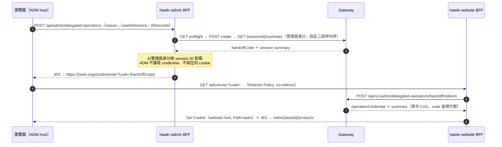

**S6 端點規格**（登記於 §6.1.1 端點總表）：

| 項目 | 定版 |
|---|---|
| 路徑／方法 | `POST /api/v1/admin/delegated-operations/handoff/redeem` |
| 授權 | **不要 ADM session cookie、不要 operation credential**。授權完全由 body 的 `handoffCode` 承擔 |
| 必帶 header | `X-Requested-With: XMLHttpRequest`。admin BFF 不簽 origin-auth；S6 兌換前沒有管理員 principal，由訪客限流處理 |
| Body | `{"handoffCode":"<48 字，字元集與 credential 同，§8.1.6>"}` |
| 成功 | `200 {code:0,data:{operationCredential, …與 `GET current` 完全相同的 summary}}` |
| 失敗 | 一律 **9282**（`DELEGATION_HANDOFF_INVALID`）→ HTTP **410**。**未知／已兌換／code 逾時／session 已不可用（`ended`／`revoked`／hard 或 idle 到期）四種成因共用同一個碼**，這是刻意的：把它們分開等於給攻擊者一支「這把 code 存在嗎」的探測器 |
| 副作用 | 單句 CAS 將 `handoff_code_hash` 設為 NULL，並寫入新產生 credential 的 SHA-256 hash。**不寫稽核列、不順延 `last_active_at`、不改 `revision`**——兌換不是代行操作 |

**四道防護（缺一即不成立）**：① 單次（CAS 同句清空）② 60 秒（`DELEGATION_HANDOFF_TTL_SECONDS`，登記於 §8.5.1 (A) 組）③ 只兌換得出**它自己那個 session** 的 credential ④ session 已 `ended`／`revoked`／逾時者一律 9282（**「逾時」是 hard 與 idle 兩種**，見下段）。⇒ **把連結貼給第二個人，對方拿到的是 410**。

**兌換要同時看三個到期時間，它們互不蘊含**：`handoff_expires_at`（code 自己，60 秒）、`expires_at`（session hard 到期）、`last_active_at + DELEGATION_SESSION_IDLE_SECONDS`（session idle 到期）。⇒ CAS 的述詞是**七個**（全文見上方 `usecase/handoff.go` 那一列與 §6.2.2），不是四個。**不得由「code 只有 60 秒」推論「session 一定還活著」**：`DELEGATION_HANDOFF_TTL_SECONDS`（值域 10–300）與 `DELEGATION_SESSION_*` 之間**沒有任何不等式關係**（§8.5.1 該列明載），而 `ttlSeconds` 的合法值域是 1–1800（§6.1.3）⇒ 一個 10 秒的工作階段在 code 尚未過期時就已經 hard 到期；dev 把 TTL 與 idle 調到數十秒更是 §13.2 明列的測試前置。⚠️ **少掉後兩個述詞不會有任何錯誤訊號**：兌換回 200、credential 交出去，操作者要到工作區裡送出第一個請求才撞 9270／410，而那時 handoff code 已作廢、只能回 ADM 重開——症狀看起來像「進去就被踢出來」，追不到兌換這一步。

**credential 只存在一份**（www host）。ADM 只接收 handoff code 與 session 摘要，以管理員身分完成對帳後導向 www；www 兌換時才取得 credential 並寫入自己的 HttpOnly cookie。ADM 從未取得 credential，也不持有 operation cookie；結束代行由伺服端 session 狀態裁決。

**cookie 屬性定版**（website 側）：

| 屬性 | 值 | 理由 |
|---|---|---|
| 名稱 | `__Secure-hk_delegated_operation`（https）／`hk_delegated_operation`（本機 http） | 與 ADM 那個**刻意不同名**：同名會讓「哪一個 host 的哪一份」在除錯時分不出來 |
| `Path` | **`/adm`** | ⚠️ **這是不用 `__Host-` 的唯一原因**：`__Host-` 強制 `Path=/`，會讓憑證跟著 www 的**每一個**請求（公開商品頁、賣家中心、靜態路由）一起送出。「單獨持有即可操作」的識別碼必須把暴露面壓到最小，`Path=/adm` 做得到而 `__Host-` 做不到 |
| `HttpOnly` / `Secure` / `SameSite` | `true` / `true`（prod）/ `Lax` | 同 ADM 現況 |
| `Max-Age` | `ceil(min(expiresAt − now, DELEGATION_SESSION_TTL_MAX_SECONDS)) + 60`<br/>（後項＝`DELEGATED_COOKIE_EXPIRY_GRACE_SECONDS`） | ⚠️ **餘裕必須放在後面，且不得沿用 admin 那份算式**。admin 那份是 `floor(min(…))`，cookie 因此比 `expiresAt` **早死**（dev 實測早 3.3 秒）。**早死不是「早一點被踢出去」，是換一種錯誤**：credential cookie 不在 ⇒ BFF 的 `GET current` 回 `401 CREDENTIAL_MISSING`（**字串**碼，對不上 §6.1.4 終態表的數字碼）⇒ 工作區判成 `invalid`「目前無法確認代行工作階段」而不是 `expired`「代行工作階段已到期」⇒ **到期這條最尋常的結束路徑，它專屬的那段文案從來沒有出現過**（死碼）。<br/>**多活 60 秒零授權風險，依據是本表下一列的同一句**：credential 沒有任何本地授權力，每一次使用都由 Gateway 重新驗證 ⇒ grace 期間的每一次呼叫一律 9270 **fail-closed**，而那正是我們要的那個碼。⚠️ 反過來說，**這條 grace 與那一列共用同一個前提**：日後若有人在 website 端快取 session 狀態、拿 cookie 值當本地判定依據，兩者同時失效，必須一起重新設計。<br/>**60 而非 30**：狀態靠 30 秒一次的 `GET current` 確認，餘裕短於一輪就可能整輪都沒問到；且 `Max-Age` 由**瀏覽器**的鐘計時、`expiresAt` 由**後端**的鐘決定，本來就是跨鐘比較（沿用 `DELEGATED_OPERATION_CLOCK_SKEW_SECONDS` 同一份誤差預算）。<br/>⚠️ **前端另有相依的一半，只做這一半等於沒修**：grace 用完 cookie 仍會死，畫面會從「已到期」**變回**「無法確認」。狀態判定必須同時滿足「已定案的終態不因輪詢失敗而降級」，見下方 `state/session.ts` 那一列。<br/>**守門**：website `tests/delegated-operation-session.test.ts` 的 `cookie expiry is never earlier than the session expiry` —— 斷言換算回絕對時間後 ≥ `expiresAt`（改回 `floor` 或拿掉 grace 即紅；它守的是不變式而不是那個常數值） |
| 影子 cookie 風險 | **接受**（`__Secure-` 不禁 `Domain`，子網域可寫同名值影子化它） | **不另設防，但必須寫明為什麼**：credential 沒有任何本地授權力，每一次使用都由 Gateway 重新驗證 ⇒ 影子值的後果是 9261／9270（fail-closed），不是越權。同時加一條 website 側單元測試：**除了 `/adm/enter` 與 `/adm/api/session/end`，全 repo 不得有第二處寫這個 cookie 名** |

**失敗行為（三類，缺一都會讓操作者卡在白畫面）**：

| 情境 | website 的行為 |
|---|---|
| `/adm/enter` 兌換回 410／9282 | 直接渲染「此代行連結已失效」＋ **`← 返回 ADM`** 連結。**不得自動重試**（code 是單次的，重試必然再失敗）、**不得**把 gateway 的 `message` 顯示出來（沿用「message 不透傳」，§4.4.4） |
| 工作區內任一代行請求回 9270／9271／9272 | 立刻切成阻擋畫面（§6.1.4 終態表）、清除 website cookie、只留返回 ADM。**與 ADM 現行 `deriveDelegatedOperationState` 的狀態機逐態對應**，搬移時不得改語意 |
| website BFF → Gateway 逾時 | 回 `{code:"UPSTREAM_FAILURE"}`，UI 走「結果不明」（＝ admin 現行 `end_unknown` 的語意）。逾時預算沿用 §7.3.1：session 端點 10s、單筆 mutation 15s、批次 60s |

#### hawkr-website

> 交付路徑：**直接 push `dev`、禁開分支**，把關者是本地驗證 ＋ CI（[Git 分支與交付路徑規範](../開發規範/Git%20分支與交付路徑規範.md)）。⚠️ **這是三個 repo 裡唯一一個「prod 上有真實買家流量」的**——本節每一列都要獨立評估對賣家本人路徑的回歸風險。

**代行工作區骨架**

| 動作 | 位置 |
|---|---|
| 新增 | `app/(delegated)/adm/layout.tsx` —— 工作區的唯一外框。**三件事在這裡發生且只在這裡發生**：① 設定代行執行期旗標（見下方 `lib/api/client.ts` 一列）② 渲染 `AdmRail` ＋ `OperationContextBar` ③ `export const dynamic = "force-dynamic"`。**不得**沿用 `app/(seller)/seller-center/layout.tsx` 的 `RoleZoneGuard required="seller"`——代行者不是賣家，那道 guard 會把他導去登入頁 |
| 新增 | `app/(delegated)/adm/enter/route.ts` —— handoff 兌換（GET，單次）。成功即 `Set-Cookie` ＋ **303** 到 `/adm/{storeId}/products`，回應必帶 `Referrer-Policy: no-referrer` 與 `Cache-Control: private, no-store`。**兌換碼絕不出現在 303 的 `Location` 裡** |
| 新增 | `app/(delegated)/adm/[storeId]/{page,products,posts,orders,storefront,...}` —— 逐面路由，內容一律 import 既有 `features/seller-center/*` 元件 |
| 新增 | `features/delegated-operations/components/AdmRail.tsx` —— **左側 ADM 窄欄**，照 `image4.png`／`image7.png` 由上而下：Hawkr ADM logo、`← 返回 ADM`、`操作紀錄`、底部管理員頭像＋姓名＋「管理員」。<br/>⚠️ **兩個入口都是純導覽的 `<a href>`，指向 ADM origin，不得發出任何會改變 session 狀態的請求**（§3.1.5 `K9` 定版的一半；另一半「側欄『登出』＝結束代行」見下一列） |
| 新增 | `features/delegated-operations/components/OperationContextBar.tsx` —— 金色情境列，照 mockup 由左而右：綠點 ＋ `ADM 代行中`、店名、`管理員：{name}`、`Session {displayCode}`、`剩餘 mm:ss` 倒數、capability chips、右端 `結束代行`。**由 admin repo 搬移而來，admin 那份同波刪除**——留副本就是「兩份必然漂移」 |
| 新增 | `features/delegated-operations/components/OperationEndDialog.tsx` —— 同樣由 admin repo 搬移（結束確認 ＋ 結束摘要綠卡）。**綠卡的資料來源是本表下段 BFF 的 `session/summary`**（＝ Gateway 的 `GET .../current/summary`，§6.1.11）；`DELETE current` 的 `data` 恰為 `{"ended": true}`、一個數字都沒有（§6.1.5），綠卡的六個欄位無一取得自它 |
| 新增 | `features/delegated-operations/state/session.ts` —— 由 admin repo 搬移 `model.ts` 的**狀態推導**部分（`deriveDelegatedOperationState`／`canRenderDelegatedWorkspace`／終態碼對照）。**parser 與封閉列舉留在 admin**（那裡才有 create 流程），website 這份只消費 `GET current` 的 summary。<br/>⚠️ **www 這份比 admin 那份多一層優先序合成（`resolveDelegatedSessionState`），這是刻意的，不得為了「與 admin 逐態對應」而拿掉**：輪詢失敗時**不得**一律判 `invalid` —— 已經由手上 summary 定案的終態（`expired`／`revoked`／`target_mismatch`）不可能再變回別的東西，把它降級成「無法確認」就是上面 `Max-Age` 那一列描述的病（且 grace 用完之後會**再犯一次**：畫面從「已到期」變回「無法確認」）。優先序：**上游明講的終態業務碼 > 已定案的 summary > `invalid`**。守門：website `features/delegated-operations/state/session-state.unit.test.ts`（含反向鑑別力——尚未到期時的傳輸失敗仍必須是 `invalid`，不得樂觀判成有效） |
| 修改 | `app/(seller)/seller-center/**` 的側欄「登出」在代行執行期改為「結束代行」：呼叫 website BFF 的 `POST /adm/api/session/end`，**不得**接任何 ADM 登出端點（`K9`） |

**website 側 BFF（`/adm/api/**`，刻意落在 `Path=/adm` 之下才吃得到 cookie）**

| 動作 | 位置 |
|---|---|
| 新增 | `app/(delegated)/adm/api/_upstream.ts` —— **本 repo 唯一一支會轉送 operation credential 的模組**。形狀直接對照 admin repo 的 `server/upstream.ts`（那份已經過九支契約測試）：**不接受瀏覽器 `Headers` 物件**（授權語境無法從瀏覽器夾帶進來）、只送 `X-HK-Operation-Session`／`Idempotency-Key`／`X-Requested-With`／`X-HK-Origin-Auth`／`Content-Type`、**回應的 `message` 一律不透傳**（只留 `code` 與 `traceId`）。逾時依 §7.3.1 分三檔（**session 端點 10s／單筆 mutation 15s／批次 60s**；**媒體 upload session 兩支歸 15s 檔**，`current/summary` 歸 10s 檔——逐支歸屬與選檔理由見 §7.3.1 ①③），**參數化而非單一常數**——admin repo 那支把逾時寫成模組級常數的形狀不要照抄（見 admin 表該列） |
| 新增 | `app/(delegated)/adm/api/session/{current,end}/route.ts` —— `GET current`（工作區倒數與終態偵測的唯一來源；⚠️ 它打的是 §6.1.4 那支 `counts_as_activity=false` 的端點，**輪詢不算活動**）／`POST end` |
| 新增 | `app/(delegated)/adm/api/session/summary/route.ts` —— 轉送 `GET /api/v1/admin/delegated-operations/current/summary`（§6.1.11 定版），**`OperationEndDialog` 結束摘要綠卡的唯一資料來源**。⚠️ **這一支不能靠上一列兜住，也不能改打 `{sessionId}/summary`**：那一支掛 `requireAdmin()`，www host 既沒有 ADM session、代行 BFF 也沒有 ⇒ 一律 9261／401。**而失敗形狀是靜默的**——綠卡拿不到數字時，前端唯一還做得出來的事就是把「未執行任何出貨或財務操作」寫死，那句話從 P0 事故訊號（`fulfillmentActionCount`／`financeActionCount` 恆為 `"0"`，§6.1.11 末註）退化成永遠顯示綠色的裝飾文案 |
| 新增 | `app/(delegated)/adm/api/{storefront,products,posts,orders}/**/route.ts` —— 資源端點轉送。**一條路徑對一條 gateway 路徑，禁止 catch-all `[...path]` 代理**：catch-all 會讓「代行到底能打哪些端點」失去可列舉性，而那正是 §8.1.0 D1 在 Gateway 側花力氣建立的東西，前端再開一個萬用洞等於自廢一半 |
| 新增 | `app/(delegated)/adm/api/media/upload_sessions/route.ts` ＋ `app/(delegated)/adm/api/media/upload_sessions/[sessionId]/complete/route.ts` —— 媒體上傳的第 ①③ 步（§6.1.13 定版一），同樣經上面那支 `_upstream.ts` 轉送 operation credential，打 Gateway 的 `POST /api/v1/admin/delegated-operations/media/upload_sessions`／`.../{sessionId}/complete`；第 ② 步（`PUT <uploadUrl>` 直送 R2）**不經 BFF**。**這兩支不能靠上一列兜住**：上一列明令禁 catch-all，漏建就是工作區的上傳按鈕 404；而 www 上的瀏覽器沒有 ADM session，退回既有的 `/api/v1/app/media/*` 只會拿到 401（前提變更全文見 §6.1.13） |
| 新增 | `app/(delegated)/adm/api/_csrf.ts` —— 非 GET 一律要求 `X-Requested-With: XMLHttpRequest` **且** `Origin` 等於自身 web origin。⚠️ **`SameSite=Lax` 擋得住跨站 POST，但擋不住跨站 top-level GET 導航** ⇒ 反過來說：**所有會改變狀態的代行端點一律非 GET**，`/adm/enter` 是唯一的 GET 例外而它是單次的 |

**Delegated Adapter：seller-center 元件怎麼從 `/app/*` 切到 `/admin/*`**

| 動作 | 位置 |
|---|---|
| 修改 | `lib/api/client.ts` 的 **`dispatch()`，在 `mode === "authed"` 的分支**（不是 `authedFetch`）—— **全 repo 唯一的切換點與唯一的護欄**。<br/>**加一個模組級旗標 `delegatedRuntime`**（由 `app/(delegated)/adm/layout.tsx` 在 SSR 與 client 各設一次），為 `true` 時該分支**立刻 `throw`**，不發請求。<br/>⚠️ **落點不可掛在 `authedFetch` 上**：`authedFetch` 是標了 `@deprecated` 的 wrapper，本體就是 `dispatch("authed", …)`；而 `apiClient.authed.*`（`bind("authed")` → 同一個 `dispatch`）**不經過 `authedFetch`**。**15 個生產檔案**直接用 `apiClient.authed`（`lib/pricebook/repo.ts`／`lib/seller/forum-repo.ts`／`lib/seller/ai-image.ts`／`lib/reviews/repo.ts`／`lib/favorites/repo.ts`／`lib/after-sales/{buyer,seller}-repo.ts`／`lib/api/auth.ts`／`lib/chat/ws.ts`／`lib/payment/apple-pay.ts`／`lib/sse/useNotificationStream.ts`／`features/seller-center/products-import/repo.ts`／`features/procurement-assistant/{conversations,useAgentConversations,useProcurementSession}.ts`），它們**全部繞過**掛在 wrapper 上的護欄。<br/>⚠️ **必須是 throw 不是 fallback**：漏切的元件會在代行工作區當場炸出明確錯誤，而不是靜默打到 `/app/*` |
| 新增 | `lib/api/delegated.ts` —— `delegatedFetch(path, opts)`，打 website BFF 的 `/adm/api/*`（**同源相對路徑**，不帶 `credentials: "include"` 也會送 cookie）。簽章與 `authedFetch` 同形，讓 repo 層可以無痛注入 |
| 修改 | 賣家資料層改成「接受一個 `fetcher` 參數」的工廠形狀（`createSellerProductRepo(fetcher)`），賣家路徑注入 `authedFetch`、代行路徑注入 `delegatedFetch`。**這是本案在 website 側最大的一筆重構，且它動到的是 prod 賣家頁面**——回歸驗證要求見 §13。<br/>**清單（依 §6.1.1 的 20 支資源端點 ＋ 2 支媒體端點反推）**：<br/>**A. 必須改成工廠形狀（5 支）**：① `lib/seller/repo.ts` 的店面段（`fetchSellerSelf`／`updateSellerSelf`／`updateSellerAvatar`／`updateSellerCover`）② 同檔的貼文段（`createSellerPost`／`updateSellerPost`／`fetchSellerPosts`）——**工廠要拆兩個**（`createStorefrontRepo`／`createPostRepo`），否則代行注入時會把同檔的 CRM／coupon 兩段一起帶進來 ③ `lib/products/seller-repo.ts`（商品 7 支；⚠️ `updateProductStatus` 在代行**必須拆成 `/publish`／`/unpublish` 兩支命令端點**，不能沿用「傳 status 值」的形狀）④ **`lib/orders/repo.ts`**（漏列——訂單面唯一資料層；⚠️ 代行端點**沒有 `view` query**，storeId 在路徑上）⑤ **`lib/media/upload.ts`**（漏列——媒體三步的 ①③ 換 BFF 路徑，② `PUT <uploadUrl>` 不變，§6.1.13）。<br/>**B. 代行側永不注入**：`lib/seller/forum-repo.ts`（店面留言板＝買賣家互動，屬 §6.1.14 #9 同族，端點總表零 forum 路徑）、`lib/seller/shipment.ts`（履約禁區）、`lib/seller/measures.ts`（治理面，§2.2 out-of-scope）；同族還有 `lib/seller/shipping.ts`／`lib/shipping/anomalies.ts`／`lib/seller/certification.ts`／`lib/media/secure-upload.ts`／`lib/after-sales/seller-repo.ts`／`lib/pricebook/repo.ts`／`lib/seller/repo.ts` 的 CRM 與 coupon 兩段。<br/>⚠️ **不是換 fetcher 就好**，三個形狀差異必須在工廠層吸收：① 代行 storefront DTO 只有 12 欄 allow-list（§6.1.7），賣家側的 `normalizeSellerSelf` 會把不存在的欄位讀成 `undefined` 而**不報錯** ⇒ 商店設定頁靜默少欄，工廠必須帶自己的 normalizer ② 狀態變更端點形狀不同（見上）③ 代行多三個必填欄（`expectedVersion`／`operationReason`／`notifySeller`），mutation 簽章要多一個 `delegatedMeta` 參數、賣家路徑傳 `undefined` |
| 修改 | **`lib/hooks/*` 共 8 支** —— repo 換了 fetcher，hook 的 `queryKey` 與 `enabled` 條件也必須換，否則代行下 query 恆不啟用（`enabled` 的 `activeRole === "seller"` 在代行瀏覽器**恆 false**）。<br/>`useSellerProducts`／`useSellerPosts`：queryKey 換 delegated 家族，`enabled` 改判 `hasCapability("products.read")`／`("posts.read")`。`useOrders`：queryKey 換 delegated 家族、移除 `view:"seller"`。**代行下完全不掛**：`useSellerSelf`（identity 改由 `GET current` 的 `summary.target` 提供）、`useSellerDashboard`（`SellerAppService.GetMyDashboard` 無代行端點，總覽 KPI 改由三支 list 的 `total` 自繪）、`useQueryIdentity`（代行瀏覽器沒有 `accountId`／`activeRole` 兩個值）、`useSellerWorkspaceRealtime`（它訂閱根 provider 打 `/app/notifications/stream` 後分派的 window 事件，代行端點總表無 SSE ⇒ 訂單頁改純手動重整）、以及對應上列 B 表的那一組（`useSellerMeasures`／`useSellerShipmentAnomalies`／`useSellerAfterSales*`／`useSellerCustomers*`／`useSellerForum`／`useShippingOnboardings`／`useSellerSubscription`）。<br/>⚠️ `useSellerSelf` 的失敗形狀特別隱蔽：`identityLoading` 為真時整個 shell `return null`，而護欄的 throw 會讓 loading 永不結束 ⇒ **看起來像「頁面壞了」而不是「授權有問題」**，接線順序建議把它排在最前面 |
| 新增 | ESLint `no-restricted-imports`：`app/(delegated)/**` 與 `features/seller-center/**` **禁止直接 import `authedFetch` 與 `apiClient`**（只准經 repo 工廠取得）。⚠️ **`importNames` 必須含 `apiClient` 不只 `authedFetch`**——這是上一列同一個缺口的 lint 面，只擋 wrapper 等於留一扇開著的門。⚠️ **相對路徑與別名要各寫一條**：`lib/` 底下的 repo 寫 `from "../api/client"`，`features/`／`app/` 底下寫 `from "@/lib/api/client"`，lint 的 `paths` 是字面比對。這道是**輔助**，真正的保證是上面那個 throw ＋ 下面這一條結構性事實 |

> **三層保證，由弱到強**：① ESLint／CI grep（可繞過）② `dispatch()` 的 `authed` 分支在代行執行期 throw（繞不過，但要有人設對旗標）③ **結構性**：代行工作區的瀏覽器**沒有賣家 session**，`/app/*` 對它一律 401 ⇒ 漏切的最壞後果是**壞掉**，不是**打穿禁區**。<br/>⚠️ **③ 有一個例外，它正是 ② 存在的理由**：管理員本人同時也是賣家、且在同一個瀏覽器登入過 www 時，`/app/*` 會**成功**——操作到他自己的店、零稽核、零告警。所以 ② 不是防呆而是必需品，且它的**鑑別力測試是上線阻斷項，而且必須有兩支**：**(i)** 在 `/adm` 之下呼叫任一未切換的 seller repo 函式，必須 throw；**(ii)** 在 `/adm` 之下呼叫 `apiClient.authed.get(...)`，同樣必須 throw。**只做 (i) 會讓 15 個直接使用 `apiClient.authed` 的生產檔案原樣繞過護欄而測試全綠**。

**快取、SEO、可觀測性**

| 動作 | 位置 |
|---|---|
| 修改 | `next.config.ts` 的 edge-cache allowlist —— **`/adm` 一條都不准加**，並在 `tests/cloudflare-cache-config.test.ts` 追加負向斷言（allowlist 內不得出現 `/adm` 前綴）。理由：這是 www 上第一次出現帶憑證的請求，任何共享快取命中都是跨管理員的資料外洩 |
| 修改 | `app/robots.ts` —— `/adm` 加進 disallow；`app/(delegated)/adm/layout.tsx` 一律 `noindexMetadata()`（既有 helper） |
| 修改 | Worker 側 log／Sentry scrub —— cookie 與 `X-HK-Operation-Session` 加入遮罩清單。⚠️ **要同時檢查 query string 與 body 兩條進入路徑**——遮罩清單是「值」的清單而非「欄位位置」的清單，同一個值從第二條路徑進來就沒遮到（gateway `middleware/logger.go` 的 `redactBody` / `redactQuery` 共用同一份清單即為此） |

#### hawkr-admin

> **capability 白名單是封閉九值，跨 repo 逐字相同**（後端 `authz/admin_capability.go` ＋ `testdata/admin_capabilities.golden` ＋ 三條 DB CHECK ＋ admin repo `policy.ts`，一致性由 §13.1 的 G2／G3 兩道 gate 守）。⚠️ **要調整時是「刪」或「換」，絕不是「往清單裡補值」**——`products.publish`／`posts.publish` 已在列，照「加兩個值」施工會產生重複值，而 `parseDelegatedOperationCapabilities` 對重複值是**整包拒絕**（下表第二列明訂維持不變）⇒ **每一次 preflight 都 502**。
>
> **兩 repo 同波即可、先後不拘**：`parseDelegatedOperationCapabilities` 是忽略式降級（逐項過濾未知值、只有全數未知才判契約失敗），因此後端擴充 capability 不需要前端先發布（§3.3 A1）。交付路徑是直接 push `dev`、禁開分支。

| 動作 | 位置 |
|---|---|
| 修改 | `src/features/delegated-operations/policy.ts` 的 `KNOWN_DELEGATED_OPERATION_CAPABILITIES`—— 內容必須與後端封閉九值**逐字相同**、順序照 §6.1.1 表；`CAPABILITY_DEPENDENCIES` 只得引用這九值。<br/>**後端永不核發的值不得留在白名單裡**：後端永不核發這兩個值 ⇒ `hasCapability("products.bulk")`／`hasCapability("audit.read")` **恆為 false**，而兩處消費者都因此靜默失效——`workspace/ProductsWorkspace.tsx` 的批次選取列永遠不出現（正確判準是 **`products.publish`**，§6.1.1 的 `POST .../products/batch-unpublish` 一列），`components/DelegatedOperationShell.tsx` 的「代行紀錄」入口永遠不出現（正確做法是**恆渲染**，代行紀錄掛 `requireAdmin()` 而非 capability，§6.1.14 #13）。留著它們只省兩行，代價是兩個功能永遠不會出現而沒有任何錯誤訊號。<br/>`DELEGATED_OPERATION_PROHIBITED_AREAS`**九項一字不動**——它是禁區機器名在 admin repo 的**副本**，權威在 §8.1.0；本期禁區內容不變，故副本也不變 |
| 修改 | `src/features/delegated-operations/policy.ts`（`parseDelegatedOperationCapabilities` 改為**忽略未知 capability、保留已知**：迴圈內遇到不在白名單的值就 `continue`，只有 `parsed.length === 0` 才回 `null`；重複值維持既有的整包拒絕。**理由**：偽造防護的權威在後端——capability 由 Gateway 產生、由 Gateway 驗，前端多做這道 fail-closed 是**零安全增益**，卻換來「後端每新增一個 capability 就會讓既有工作階段全部 502」的跨 repo 破壞性耦合（裁決理由見 [ADR：授權如何穿過微服務牆](../adr/2026-09-18-adm-delegation-authz-propagation.md)）。**`DELEGATED_OPERATION_PROHIBITED_AREAS`九項一字不動**——那是禁區機器名的 admin repo 副本（權威在 §8.1.0），它在 UI 上「不呈現危險入口」的作用與本列的 capability 解析無關；這一列是**解耦 capability 演進權**的關鍵：改完之後，後端擴充 capability 不再要求「前端必須先發布」，兩 repo 的發布順序才放寬得成「同波即可」） |
| 修改 | `src/features/delegated-operations/labels.ts` 的 `DELEGATED_OPERATION_CAPABILITY_LABELS`—— 恰九條，與白名單一一對應；`products.publish` 與 `posts.publish` 的文案必須與 **§6.1.1 capability 表逐字相同**的「上架與下架商品」「發布與下架貼文」（該表註明「前七項是 admin repo 既有字串、後端不得自行改寫」⇒ 反面即：新增的兩項由後端定義）。`DELEGATED_OPERATION_PROHIBITED_LABELS`四條中文表述不動 |
| 修改 | `tests/delegated-operations-contract.test.ts`（封閉列舉斷言的陣列同步收斂為 **9 值**（改前 11）；禁區斷言不動。這支測試是 `assert.deepEqual`，**順序也必須對上** `policy.ts` 的宣告順序） |
| **刪除** | **工作區與 credential cookie 整組在 `hawkr-website`**（落點見上一節）。**共 38 檔／7,667 行**——「工作區整組搬過去」本來就蘊含它們，漏列的那些留在 admin 會是「引用已刪檔案」的編譯錯或「第二份實作」。完整清單：<br/>**① 元件與資料層（21 檔、6,600 行）**：`components/{OperationWorkspace,OperationSessionBoundary,OperationContextBar,OperationEndDialog,OperationBlockedState,OperationSessionContext,DelegatedOperationShell}.tsx`（`DelegatedOperationShell` ＝ 工作區 shell：側欄 nav／返回 ADM rail／操作紀錄入口，三者全部落在 website）、`server/session.ts`、`workspace-contract.ts`（整份代行資源 DTO parser，消費者只有 workspace）、`workspace/{AuditWorkspace,MutationReviewDrawer,OrderDetailWorkspace,OrdersWorkspace,PostEditorWorkspace,PostsWorkspace,ProductEditorWorkspace,ProductsWorkspace,StorefrontWorkspace,WorkspacePrimitives}.tsx`、`workspace/workspace-utils.ts`、`workspace/workspace.module.css`、`src/services/delegated-workspace.ts`（⚠️ 它打的 `WORKSPACE_API_PREFIX = "/api/admin/delegated-operations/workspace"` 是一支**在 admin repo 根本不存在的 BFF**，整套是佔位實作）、`src/app/api/admin/delegated-operations/current/route.ts`。<br/>**② 工作區畫面路由整個目錄（13 檔、101 行）**：`src/app/admin/merchants/[id]/operate/**`（`layout`／`page`／`overview`／`storefront`／`products/{,new,[productId]}`／`posts/{,new,[postId]}`／`orders/{,[orderId]}`／`audit`）。<br/>**③ 測試（4 支、966 行）**：`tests/delegated-workspace-client.test.ts`（全篇測 `services/delegated-workspace.ts`）、`tests/delegated-workspace-contract.test.ts`（全篇測 `workspace-contract.ts`）、`tests/delegated-operation-shell-contract.test.ts`（四個 test 全部讀被刪的三個檔）、`tests/delegated-operation-current-route.test.ts`（直接 import 被刪的 `current/route.ts`）。<br/>⚠️ **是刪除不是保留**：留著等於同一個工作區有兩份實作、同一把 credential 有兩份 cookie，正是「兩份必然漂移」否決過的形狀。判準很機械：**這個檔案在 ADM host 上還有沒有 render 的機會？** preflight／create 之後 ADM 即 303 到 `{WEB_ORIGIN}/adm/enter?code=…`，工作區在 ADM 上不再有任何進入點 ⇒ 一律刪。<br/>**保留不刪**：`components/MerchantOperationEntry.tsx`（ADM 賣家詳情頁入口）、`components/OperationPreflightDialog.tsx`（本表另有一列要改）、`server/upstream.ts`（preflight／create 兩支仍在 ADM，它是那兩支的傳輸層）、`server/bff-boundary.ts`、`model.ts`、`policy.ts`、`labels.ts`；`readOperationCookie` 那組 helper 隨 `session.ts` 一起走 |
| 修改 | `tests/delegated-operations-ui-contract.test.ts` —— ⚠️ **不能刪**：§8.1.1 把它引用為「三層鎖定」**層 1** 的機械保證，而它的 `UI_FILES` 陣列 7 個檔案裡有 4 個在上一列被刪 ⇒ `readFile` 會直接 throw。改法：① `UI_FILES` 移除 `OperationSessionBoundary`／`OperationContextBar`／`OperationBlockedState`／`OperationWorkspace` 四項，只留 `MerchantOperationEntry.tsx`／`OperationPreflightDialog.tsx`／`src/services/delegated-operations.ts`；「代行 UI 不碰 seller API 或 token storage」那個 test 的**斷言一字不動**，只是掃描範圍縮到 ADM 側剩下的 3 檔 ② context bar／blocked state／boundary 的 a11y 與 lifecycle 斷言**整組搬到 website**，對象換成 website 的對應元件 ③ 操作入口 gate 與賣家列表入口兩個 test **留在 admin 不動**（那兩個入口本來就在 ADM）。<br/>⚠️ **連帶**：§8.1.1 層 1 的 gate 欄必須寫成**兩支測試**（admin 的入口面 ＋ website 的工作區面），否則會留下一個「保證在別的 repo、而那邊沒人去建」的洞 |
| 修改 | 另有 3 支測試要跟著改（本表其他列已各自涵蓋）：`delegated-operations-contract.test.ts`（capability 收斂）、`delegated-operation-create-route-contract.test.ts`（`Set-Cookie` → 303 Location）、`delegated-operation-create-route-runtime.test.ts`（硬編路徑斷言）；`tests/admin-visual-system.test.ts` 的檔案清單要移除 `DelegatedOperationShell.tsx`。**明確保留不動**：`delegated-operation-bff-boundary.test.ts`（admin 的 catch-all BFF 仍在，它守的東西在工作區搬走之後更重要）、`delegated-operation-client.test.ts`、`delegated-operation-upstream.test.ts`、`admin-design-documentation.test.ts`（只引用 design token `delegated-gold`，不引用任何被刪檔案） |
| 修改 | `src/app/api/admin/delegated-operations/route.ts`（create）—— **固定三段呼叫序與九欄對帳一字不動**（`GET preflight → POST create → GET current`，恰 3 次，契約測試 2／3），但**對帳通過之後不再 `Set-Cookie`**，改為 **303 到 `{WEB_ORIGIN}/adm/enter?code={handoffCode}`**。credential 在這支 route handler 內用完即丟、**不落任何儲存**。<br/>⚠️ **需要新增一個環境變數 `WEB_ORIGIN`**（dev／prod 各一），**不得**由請求的 `Host` 推導——那讓任何能控制 `Host` 標頭的人指定 credential 的兌換去向 |
| 修改 | `tests/delegated-operation-create-route-contract.test.ts` 的靜態順序斷言：`current 晚於 create 且早於 Set-Cookie` → `current 晚於 create 且早於 303 Location`；`tests/delegated-operation-session.test.ts` 的 cookie 屬性斷言隨 `session.ts` 一起移到 website repo（**斷言內容不變，只換 repo 與 cookie 名／`Path`**）。⚠️ **不要把這兩支測試刪掉了事**——它們鎖住的是「credential 只在證明對帳通過之後才被交出去」這條順序，換 host 不改變它的必要性 |
| **搬移** | `WORKSPACE_AREAS` 為完整賣家中心選單（逐項定版見 §6.1.14）—— **這一項改在 `hawkr-website` 落地**，因為那裡本來就有完整的賣家中心側欄（`features/seller-center/components/SellerCenterShell.tsx`）。⇒ **不是「把六個選單項加進 admin 的陣列」，而是「沿用賣家中心既有的側欄，再把不可操作的項目切成空狀態」**——後者零新增資料結構，也自動跟著賣家中心的演進走。<br/>「渲染但不可操作」仍必須是**宣告出來的**（一張 `區塊 → capability \| null` 的表），不可散在 render 分支。⚠️ **不可操作的模組一律不得發出任何後端請求**（含「打一支必然 403 的端點來探測」）：那會在 `admin_operation_audit_logs` 製造一批 `*_READ` ＋ `result='FAILED'` 的列，把「有人試圖跨店讀取」這個安全訊號淹掉（§6.5.3 四個 READ action 的唯一用途）——而稽核表看起來完全正常，沒有任何東西會報錯 |
| **搬移** | 側欄「登出」與左 rail「返回 ADM」兩個入口（§3.1.5 `K9` 定版）—— 落點改為 website（見上一節 `AdmRail.tsx` 與 seller-center 側欄兩列）。語意不變：「登出」＝結束代行（經 website BFF 的 `POST /adm/api/session/end`，最終仍是 gateway 的 `DELETE .../current`），**不得**接 ADM 登出；「返回 ADM」為純導覽，**不得**發出任何會改變 session 狀態的請求 |
| 修改 | `src/features/delegated-operations/model.ts`（preflight parser 目前**丟棄** `deniedCode`。後端在 `allowed:false` 時一定會帶它，不保留就顯示不出具體拒絕原因（現行一律通用文案 `此店家目前不可代行`）。拒絕時 `reasonOptions` 與 `capabilities` **仍為非空**，parser 既有的非空校驗不必放寬） |
| 修改 | `src/features/delegated-operations/model.ts`（同一支 parser 目前**丟棄** `deniedLabel`（拒絕原因的中文標籤）；與 `deniedCode` 成對保留，UI 才有可顯示的字串） |
| 修改 | `src/features/delegated-operations/model.ts`（SessionSummary parser 目前**丟棄** `sessionId`；保留後錯誤回報與稽核查詢才指認得出是哪一個工作階段。新增欄位**不進**九欄對帳（`model.ts`），不影響既有比對） |
| 修改 | `src/features/delegated-operations/model.ts`（同一支 parser 目前**丟棄** `displayCode`（`OPS-` ＋ base36(id) **左補零至 13 碼**（§5.1.1），session 表的人類可讀對帳鍵）；**稽核查詢**要顯示它。同樣不進九欄對帳）。<br/>⚠️ **情境列已移到 `hawkr-website`**：那邊需要同一份 `displayCode`，但它**不是**從這支 parser 拿的——website 由自己的 `GET current`（經 S6 兌換到的 credential）取得，兩邊各自解析同一份 DTO。**這不構成「兩份必然漂移」**：漂移的前提是兩份**各自維護的定義**，而這裡兩邊解析的是同一個後端契約，契約變了兩邊一起壞（而且 §13 的 G1 鏡像斷言守著它） |
| 無需修改 | `src/features/delegated-operations/server/upstream.ts`（三條 gateway 路徑已與本設計書定版逐字一致：`/api/v1/admin/sellers/{storeId}/delegated-operation/preflight`、`/api/v1/admin/delegated-operations`、`/api/v1/admin/delegated-operations/current`。**不要改它**，改了要連 `tests/delegated-operation-create-route-runtime.test.ts` 的硬編路徑斷言一起改） |
| **修改** | `src/features/delegated-operations/model.ts`（**TTL 上限常數 900 → 1800**，§3.4 D1）＋ `tests/delegated-operations-contract.test.ts`（邊界斷言同步：合法上界 1800、`1801` 必須被拒）。**這一列與 DB 的 `chk_dos_lifetime_max`、後端 `DELEGATION_SESSION_TTL_MAX_SECONDS` 是同一個數字的三個副本，缺一即「前端擋下／DB 擋下／後端放行」不一致**（§3.4 D1）。⚠️ **`model.ts` 的 60 秒時鐘容差不動** |
| **修改** | `src/features/delegated-operations/components/OperationPreflightDialog.tsx`（**依 mockup 建立 modal 重做這一段**）：① TTL 由**唯讀文案**改為 `代行工作階段時長` **下拉選單**，預設選中 preflight 下發的 `ttlSeconds`（＝30 分鐘），可選更短值，送出時放進 create body 的 `ttlSeconds`（伺服端一律 `min(requested, MAX)`，§6.1.3，前端不需要也不得自行夾）；② **保留並顯示「閒置 N 分鐘後自動結束」**——它現在是規格不是稿面。⚠️ **`N` 必須由 preflight 新增的 `idleSeconds` 推導，不得寫死 15**（§6.1.2）：後端調 `DELEGATION_SESSION_IDLE_SECONDS` 時畫面要跟著變，寫死的那一刻它就成了第二個各自為政的數字（同 `auditRetentionDays` 的既有裁決，§6.1.11） |
| **修改** | `src/features/delegated-operations/model.ts`（preflight parser 目前會**丟棄未知欄位**；新增的 `idleSeconds` 必須保留，否則上一列的文案沒有資料來源。與 `deniedCode`／`deniedLabel` 兩列同形、同一支 parser，三者一起改） |
| **不再是 admin 的待辦** | 原「`server/upstream.ts` 逾時參數化」一列 —— **資源端點不再經 ADM 的 BFF**，該參數化改在 website 側的 `_upstream.ts` 一次做對（三檔逾時，見上一節）。ADM 這支只剩 preflight／create 兩支 session 端點，`DELEGATED_OPERATION_UPSTREAM_TIMEOUT_MS = 10_000` **維持不動** |

**不需要抽任何 props-only 共用 view**：工作區與賣家中心在同一個 repo，共用發生在 repo 內部，`features/seller-center/*` 直接被 import。前端逐面接線順序為 storefront → products → posts → orders → feature flag rollout。

**接線時三件後端硬性要求（不是體驗建議，缺一即該表單不能用）**——它們在 mockup 上都沒有落點，列在這裡是為了讓做 website 工作區的人不必回頭翻 §6：① **每個寫入表單一個 1–100 字必填理由輸入欄**（`operationReason`，缺即 9260 / 400，§6.1.0 三態表）；② **`expectedVersion` 的取得與 9266 / 409 的重載合流**（樂觀鎖，§6.1.0 共通四欄）；③ **`notifySeller` 的勾選框**（預設勾選＝`true`；不畫它就等於這個旗標永遠只有預設值，§6.1.0）。<br/>⚠️ **三者的落點在 mockup 上是明確的，不需要另外發明**：`image6.png` 右側的「檢視變更並上架」抽屜由上而下正是「修改原因（必填，7 / 100 字）→ 變更摘要三欄表 → 目前版本 → ☑ 通知賣家 → 將產生不可竄改的代行紀錄 → 返回修改／確認上架」。⇒ **照抽屜做，三件事自然齊備**；而「目前版本 12」那一行就是 ② 的 `expectedVersion` 露出點。

同一個抽屜上的**第四件事不是後端要求，但漏讀規格一樣會做錯**：「變更摘要」三欄表出現在**送出之前**，而 `changedFields` 只存在於寫入之後的稽核回應 —— 該表的資料來源、與稽核那一張的界線、以及必須排除哪些欄位，**定版在 §6.1.12 末節**（結論：不新增預覽端點、前端本地自算、送出後一律改用 `changedFields[].label`）。

## 5. 資料設計 (Data Design)

代行營運的持久化狀態落在單體的 **delegation schema**（Go／Atlas／sqlc／pgxpool），共五張表：管理員資格、工作階段、店家代行授權、授權治理歷史、操作稽核（§5.4）。代行沒有獨立事件 outbox；操作稽核確認時同步發事件，由訂閱者在同一個 transaction 排可靠派送 job。下文的 account-service 與 outbox DDL 保留舊服務的設計脈絡；現行物理 schema 以 `internal/modules/delegation/db/schema.sql` 為準。

本章的業務不變量仍有效；現行表、欄位、CHECK、索引與 migration 以 delegation 的 `db/schema.sql`、`db/migrations` 為準。

現行落點依 [delegation 模組 ADR](../adr/2026-09-27-delegation-module.md)：`actor_admin_id` 只保存 identity 管理員 ID，不下跨 schema FK。下方的同庫 FK 理由屬被取代的 account-service 設計。

**PK 策略：四張表一律 TSID，不用 BIGSERIAL。**
[Java 微服務開發規範](../開發規範/Java%20微服務開發規範.md) §3 主鍵型別表的「內部表用 BIGSERIAL」是 **Java 服務 Entity 的 `@TableId(type = IdType.AUTO)` 配置**；Go 服務走 §7.3，主鍵一律由 `pkg/tsid` 在應用層產生。見 `services/account-service/db/schema/schema.sql`：以代理鍵為主鍵的 6 張表（`accounts.account_id`／`admin_accounts.id`／`auth_providers.id`／`auth_audit_log.id`／`apple_revoke_outbox.id`／`web_sessions.id`）**全部是 `bigint PRIMARY KEY`，沒有一張用 BIGSERIAL**（`revoked_tokens` 以 `token_hash varchar(64)` 為自然主鍵，不屬此類；`auth` schema 的四張表由前端 Better Auth 管理、text 主鍵，不在本專案治理範圍）。本設計沿用。另有兩個獨立理由：

1. 稽核時間線與結束摘要都依賴 id 的時間排序性（§5.3），TSID 天生具備，BIGSERIAL 只在單一 sequence 下才有；
2. 稽核列的 id 會被 `admin_operation_outbox.audit_log_id` 引用並進入 MQ payload，連號可枚舉的 id 等於把「平台今天代行了幾筆」洩漏給事件消費端。

**型別與命名慣例**（對齊 `services/account-service/db/schema/schema.sql`）：表名與欄名一律雙引號、型別小寫（`bigint`／`timestamptz`／`varchar(n)`／`jsonb`／`text[]`）、時間欄一律 `timestamptz NOT NULL DEFAULT CURRENT_TIMESTAMP`、雜湊欄一律 `varchar(64)`（sha256 hex，比照 `web_sessions.token_hash:174`、`revoked_tokens.token_hash:44`）、跨服務外來鍵（`target_store_id`）**不下 FK**（比照 `seller_deletion_audit`／`seller_deleted_outbox`「與 sellers 列解耦」的既有慣例）。

---

### 5.1 資料模型

#### 5.1.1 `delegated_operation_sessions`

一次代行工作階段的完整授權事實：誰（actor）在什麼理由下、對哪個店家、拿到哪些 capability、有效到什麼時候。它是所有代行寫入的授權來源，也是 `GET /admin/delegated-operations/current` 的唯一資料來源。

**PK 策略**：TSID（`pkg/tsid`），對外以 string 暴露於 `/admin/delegated-operations/{id}/revoke`、`/{id}/audit-logs`、`/{id}/summary`。

| 欄位名 | 型別 | 必填 | 說明 |
|---|---|---|---|
| `id` | `bigint` | PK | TSID。對外一律 string（[Java 微服務開發規範](../開發規範/Java%20微服務開發規範.md) §2） |
| `display_code` | `varchar(20)` | UK | 人類可讀的工作階段代號，**由本列的 `id` 確定性推導**（`'OPS-' ＋ 大寫 base36(id) 左補零至 13 碼`，例 `OPS-1KX6XAPY8CTFK`）。無序列、無產號查詢、無撞鍵——理由與算式見下方「`display_code` 由 `id` 推導」。UI 各處與稽核舉證引用的就是它，非 `id` |
| `credential_hash` | `bytea` | NO，UNIQUE | Create 時為 NULL；S6 成功兌換在單句 CAS 寫入 `SHA-256(operationCredential)` 的 32 bytes。**只存雜湊，不存明文也不存密文**；核發規則見 **§8.1.6** |
| `handoff_code_hash` | `varchar(64)` | NO | 一次性 handoff 兌換碼的 `sha256hex`（§4.5「憑證跨 host 傳遞」）。**明文絕不落庫**（CSPRNG 亂數、前綴 `dhof_`，§8.1.6）。`NULL` ＝ **未簽發或已兌換**——兌換由 §6.2.2 `RedeemHandoff` 的單句 CAS 在同一句設回 `NULL`，這就是「單次」那道防護的載體。唯一性由 partial UNIQUE `uq_dos_handoff` 承擔（見下方索引）。⚠️ **必須 nullable 且無 DEFAULT**：給 DEFAULT 等於讓每一列都長出一把可兌換的鑰匙 |
| `handoff_expires_at` | `timestamptz` | NO | handoff code 的到期時刻 ＝ 簽發當下 ＋ `DELEGATION_HANDOFF_TTL_SECONDS`（60 秒，§8.5.1），與 `handoff_code_hash` 在 create 的**同一個交易內**一起寫入（§4.5 `IssueHandoff`）。**不參與 session 的到期判定**：session 的 hard／idle 到期各走 `expires_at`／`last_active_at`，三個時間欄互不換算。⇒ **兌換的 CAS 三個都要看**（七個述詞，§4.5／§5.2 Q8）：本欄過期回 9282，session 的 hard 或 idle 已到期同樣回 9282，兩者是**獨立條件**，不得以任一方推論另一方。⚠️ **兌換的 CAS 只清 `handoff_code_hash`、不清本欄**，因此「hash 為 NULL 而本欄留值」是**已兌換**的正常狀態（`chk_dos_handoff_pair` 因此只能是單向的，理由見下方） |
| `actor_admin_id` | `bigint` | YES | FK `admin_accounts(id)`。操作者，session 建立後不可變 |
| `actor_display_name` | `varchar(160)` | YES | 建立當下快照（1–160 字，前端硬限）。admin 日後改名不影響歷史列 |
| `target_store_id` | `bigint` | YES | 目標店家 surrogate（`sellers.store_id`）。跨服務，無 FK。建立後不可變 |
| `target_seller_account_id` | `bigint` | YES | 目標賣家登入 principal，建立當下快照 |
| `target_store_name` | `varchar(160)` | YES | 店名快照（1–160 字） |
| `reason_code` | `varchar(50)` | YES | 代行原因碼，三選一（`seller_request`／`platform_maintenance`／`content_governance`）。**原字串回音，不得 trim／大寫化**（C9） |
| `reason_label` | `varchar(160)` | YES | 原因中文標籤快照（1–160 字） |
| `case_reference` | `varchar(200)` | NO | 案件編號。**`NULL` 是合法值**，DTO 必須輸出顯式 `null`（C3）。非 NULL 時 **4–200 字、無控制字元、且至少含一個數字**（最低門檻；**不做格式驗證**——理由見 §6.1.3） |
| `capabilities` | `text[]` | YES | 授予能力快照，非空、去重、封閉列舉 9 值。**建立當下決定，session 存續期間不可變**——不縮減也不擴張，要改就結束當前 session 再重開一個（F22；理由見下方「為什麼沒有 capability 縮減」） |
| `issued_at` | `timestamptz` | YES | 核發時刻，**秒精度**（`date_trunc('second', ...)`）。核發後永不變動（C8） |
| `expires_at` | `timestamptz` | YES | 硬到期時刻，**秒精度**。= `issued_at + ttlSeconds`。**只在主動結束時被縮短，任何情況下不得延長**（禁 sliding expiration——後端理由「風險曝險窗口上界」見 §4.1.2；C8 同向佐證） |
| `last_active_at` | `timestamptz` | YES | **閒置逾時的唯一活動時間戳**，**秒精度**。INSERT 時 ＝ `issued_at`。只由**代行資源請求**（經 `delegatedHandle` 註冊的路由，讀與寫皆算）**與兩支媒體 upload session 端點**（經 `requireDelegatedSessionOnly()` 註冊，§6.1.13）在 credential 反查的**同一句 `UPDATE … RETURNING`** 內順延（填 `true` 的完整清單見 §6.2.4a）；**五支 session 端點（S1–S5：preflight／create／`GET current`／`DELETE current`／revoke）一律不動它**——`GET current` 每 30 秒輪詢一次，把輪詢算成活動等於 idle 永不觸發（閒置逾時機制的成立條件之一）。它**不進 DTO**、**不進九欄對帳**、**不 bump `revision`**。**永遠只前進、不倒退**，且**不得晚於 `expires_at`**（見下方 `chk_dos_last_active_range`） |
| `ended_at` | `timestamptz` | NO | 主動結束時刻。`NULL` = 未主動結束 |
| `revoked_at` | `timestamptz` | NO | 撤銷時刻 |
| `revoked_by_admin_id` | `bigint` | NO | 撤銷者，FK `admin_accounts(id)` |
| `revoke_reason` | `varchar(255)` | NO | 撤銷理由 |
| `status` | `varchar(20)` | YES | **DB 只有兩態**：`active`／`revoked`。DTO 的第三態 `expired` 由 `expires_at` 推導，不落庫（§7.5） |
| `revision` | `integer` | YES | 本列的樂觀鎖版本，DEFAULT 0。**只在真正的狀態轉換時 +1**，而狀態轉換只有兩個：**主動結束**與**撤銷**（F22 刪除 capability 縮減後，觸發來源只剩這兩個）；讀取、輪詢、代行寫入一律不 bump（C8）。與領域資源的 `version` 是不同概念，對照見 §14。這是 [Java 微服務開發規範](../開發規範/Java%20微服務開發規範.md) §2「數字對外一律 string」的例外——前端 parser 要求 JS 安全整數，送 string 直接 502（C7）。用 `integer` 而非 `bigint`，讓「安全整數」在 DB 層恆成立 |
| `idempotency_key` | `varchar(128)` | YES | 建立請求的 `Idempotency-Key`（8–128 字，`^[A-Za-z0-9._:-]+$`） |
| `create_request_id` | `varchar(64)` | YES | 建立請求的 `x-request-id` |
| `create_correlation_id` | `varchar(64)` | YES | 建立請求的 correlation id |
| `create_user_agent` | `varchar(512)` | NO | 建立來源 User-Agent |
| `created_at` | `timestamptz` | YES | DEFAULT `CURRENT_TIMESTAMP` |
| `updated_at` | `timestamptz` | YES | DEFAULT `CURRENT_TIMESTAMP`，每次狀態轉換同步更新 |

**索引：**

```sql
CREATE UNIQUE INDEX "uq_dos_actor_idempotency" ON "delegated_operation_sessions" ("actor_admin_id", "idempotency_key");
CREATE UNIQUE INDEX "uq_dos_credential_hash"   ON "delegated_operation_sessions" ("credential_hash");
CREATE UNIQUE INDEX "uq_dos_handoff"           ON "delegated_operation_sessions" ("handoff_code_hash")
  WHERE "handoff_code_hash" IS NOT NULL;
CREATE UNIQUE INDEX "uq_dos_display_code"      ON "delegated_operation_sessions" ("display_code");
CREATE UNIQUE INDEX "uq_dos_actor_active"      ON "delegated_operation_sessions" ("actor_admin_id")
  WHERE "status" = 'active' AND "ended_at" IS NULL;
CREATE UNIQUE INDEX "uq_dos_target_active"     ON "delegated_operation_sessions" ("target_store_id")
  WHERE "status" = 'active' AND "ended_at" IS NULL;
CREATE INDEX "idx_dos_expiring"                ON "delegated_operation_sessions" ("expires_at")
  WHERE "status" = 'active' AND "ended_at" IS NULL;
CREATE INDEX "idx_dos_actor_created"           ON "delegated_operation_sessions" ("actor_admin_id", "created_at" DESC);
CREATE INDEX "idx_dos_target_created"          ON "delegated_operation_sessions" ("target_store_id", "created_at" DESC);
```

**約束：**

```sql
CONSTRAINT "chk_dos_status" CHECK (status IN ('active', 'revoked')),
CONSTRAINT "chk_dos_lifetime_positive" CHECK (expires_at > issued_at),
CONSTRAINT "chk_dos_lifetime_max" CHECK (expires_at <= issued_at + INTERVAL '1800 seconds'),
CONSTRAINT "chk_dos_second_precision" CHECK (
  issued_at = date_trunc('second', issued_at) AND expires_at = date_trunc('second', expires_at)
  AND last_active_at = date_trunc('second', last_active_at)
),
CONSTRAINT "chk_dos_last_active_range" CHECK (
  last_active_at >= issued_at AND last_active_at <= expires_at
),
CONSTRAINT "chk_dos_revision_nonneg" CHECK (revision >= 0),
CONSTRAINT "chk_dos_revoked_fields" CHECK ((status = 'revoked') = (revoked_at IS NOT NULL)),
CONSTRAINT "chk_dos_handoff_pair" CHECK (
  handoff_code_hash IS NULL OR handoff_expires_at IS NOT NULL
),
CONSTRAINT "chk_dos_case_reference" CHECK (
  case_reference IS NULL
  OR (char_length(case_reference) BETWEEN 4 AND 200 AND case_reference ~ '[0-9]')
),
CONSTRAINT "chk_dos_display_code_format" CHECK (display_code ~ '^OPS-[0-9A-Z]{13}$'),
CONSTRAINT "chk_dos_capabilities_closed" CHECK (
  cardinality(capabilities) BETWEEN 1 AND 9
  AND capabilities <@ ARRAY[
        'storefront.read', 'storefront.write',
        'products.read', 'products.write', 'products.publish',
        'posts.read', 'posts.write', 'posts.publish',
        'orders.read'
      ]::text[]
  AND cardinality(capabilities) =
        (CASE WHEN 'storefront.read'  = ANY (capabilities) THEN 1 ELSE 0 END)
      + (CASE WHEN 'storefront.write' = ANY (capabilities) THEN 1 ELSE 0 END)
      + (CASE WHEN 'products.read'    = ANY (capabilities) THEN 1 ELSE 0 END)
      + (CASE WHEN 'products.write'   = ANY (capabilities) THEN 1 ELSE 0 END)
      + (CASE WHEN 'products.publish' = ANY (capabilities) THEN 1 ELSE 0 END)
      + (CASE WHEN 'posts.read'       = ANY (capabilities) THEN 1 ELSE 0 END)
      + (CASE WHEN 'posts.write'      = ANY (capabilities) THEN 1 ELSE 0 END)
      + (CASE WHEN 'posts.publish'    = ANY (capabilities) THEN 1 ELSE 0 END)
      + (CASE WHEN 'orders.read'      = ANY (capabilities) THEN 1 ELSE 0 END)
)
```

**`cardinality()` 不是 `array_length()`——這個差別會直接漏出 502**：`array_length(x, 1)` 對空陣列回 **NULL**，而 CHECK 對 NULL 結果一律視為通過 ⇒ `capabilities = '{}'` 可以入庫，接著原樣流到前端，而前端 parser 對 `capabilities` 做非空校驗，空陣列直接判契約錯誤。`cardinality()` 對空陣列回 `0`，`BETWEEN 1 AND 9` 才真的擋得住。

**去重為什麼寫成那串 `CASE` 而不是 `DISTINCT`**：PostgreSQL 的 CHECK 約束**禁止子查詢**，`cardinality(ARRAY(SELECT DISTINCT unnest(...)))` 這類寫法根本建不起來。既然值域已由 `<@` 封閉在 9 個字面值內，「無重複」等價於「元素個數 = 出現過的相異值個數」，後者可用九個布林值相加表達，純表達式、IMMUTABLE、不依賴任何擴充。重複值若入庫，前端會渲染出兩張一樣的能力卡片，而稽核比對「capability 是否在 snapshot 內」也會出現不必要的歧義。

**為什麼 `chk_dos_second_precision` 是必要的、不是潔癖**：前端的時間正則只收 0–3 位小數秒（C2），DTO 因此必須截到秒。若 DB 存微秒，「結束代行」把 `expires_at` 壓成 `now()` 之後，截秒後的 `expiresAt` 可能與截秒後的 `issuedAt` **相等**（同一秒內建立又結束），而前端硬性要求 `expiresAt − issuedAt > 0`，等於 0 直接判 502、cookie 不清、工作區永久卡死。把秒精度交給 DB 守，這條路就不存在。配套：**主動結束的寫法固定為**

```sql
UPDATE delegated_operation_sessions
SET ended_at = now(),
    expires_at = GREATEST(issued_at + INTERVAL '1 second',
                          LEAST(expires_at, date_trunc('second', now()))),
    revision = revision + 1,
    updated_at = now()
WHERE id = $1 AND status = 'active' AND ended_at IS NULL;
```

**主動結束不需要一併夾 `last_active_at`**：`expires_at` 被收斂到 `date_trunc('second', now())`，而 `last_active_at` 依定義 ≤ `now()` 且同樣截秒 ⇒ `chk_dos_last_active_range` 的 `last_active_at <= expires_at` 恆成立（同一秒內兩者相等亦合法）。`GREATEST(issued_at + INTERVAL '1 second', …)` 那道下夾只會把 `expires_at` 往**後**推，也不會破壞它。

**閒置逾時（idle expiry）在資料層只需要這一個欄位，不需要排程器**：

- **判定是推導**——`now() >= last_active_at + DELEGATION_SESSION_IDLE_SECONDS` 即視為 `expired`（DTO 推導表見 §7.5.1），與 hard expiry 完全同形：**DB 不落 `expired`、沒有任何東西需要定時把列改過去**（§7.5.4 的三條理由原封適用）。
- **順延是零額外成本**——授權鏈第 2／3 項本來就要用 `credential_hash` 反查這一列（§8.1.3），代行資源路由把那一次**讀**換成一句 `UPDATE … RETURNING`（全文與唯一寫法見 §6.2.4a），**沒有新增任何往返、沒有前端心跳、沒有第二支 RPC**。
- **`last_active_at` 刻意不建索引**，讓這句 `UPDATE` 落在 PostgreSQL 的 HOT update 路徑（同頁更新、不動任何索引）。⚠️ **日後若有人為它加索引，這條性質當場消失**且不會有任何錯誤——會看到的只有 `GetCurrentSession` 的 P95 慢慢變差（§9.3 該列）。要按 `last_active_at` 查詢請走 `idx_dos_expiring`（`expires_at`）再過濾，本表列數 ≈ 36,500／2 年（§9.2.4），全表掃描亦廉價。

**credential 在資料層的落點**：
Create 不核發 `operationCredential`，新列的 `credential_hash` 為 NULL。Redeem 以 `crypto/rand` 產生 32 bytes 的隨機明文，在消耗 handoff code 的同一句 CAS 寫入 `credential_hash = SHA-256(credential)`；明文只在 S6 回應出現，供 `GET current` 以唯一索引反查。同 `Idempotency-Key` 重放先由唯一鍵找回既有列；若尚未兌換，改簽 handoff code；若已兌換，只回既有 session 摘要，不發新 code、不改 credential hash。完整規則見 §8.1.6。

**handoff code 在資料層的落點（`uq_dos_handoff` 與 `chk_dos_handoff_pair` 為什麼長這樣）**：
handoff code 與 credential 一樣由 CSPRNG 產生、**只存 hash**、明文從不落庫；它的「單次」由**把 hash 清成 NULL** 表達；兌換的單句 CAS 全文見 **§4.5「憑證跨 host 傳遞」**與 §6.2.2。資料層要為此成立的條件有三個：

1. **`uq_dos_handoff` 是 partial（`WHERE handoff_code_hash IS NOT NULL`）**：已兌換與未簽發的列全部是 `NULL`，述詞把它們排除在索引之外 ⇒ 索引大小正比於**同時存在的未兌換 code 數**（至多等於 active session 數）而非全表，述詞本身也把「唯一性只約束尚未兌換的那一把」寫成讀得出來的意圖。**不得加 PostgreSQL 15 的 `NULLS NOT DISTINCT`**——預設的 `NULLS DISTINCT` 才容許多列同時為 `NULL`，加了它第二個工作階段就建不起來。
2. **`chk_dos_handoff_pair` 只能是單向的**（`hash IS NULL OR expires_at IS NOT NULL`）：有 code 就一定要有到期時刻，而 code 被清掉之後留下的孤兒 `handoff_expires_at` 是合法的。⚠️ **寫成對稱等式（兩欄同時為 NULL 或同時非 NULL）會讓兌換的那一句 `UPDATE` 被自家 CHECK 當場擋下**——CAS 刻意只清 `handoff_code_hash`，於是 S6 永遠回 9282／410，而症狀是「連結一貼就失效」，看起來像 code 每次都過期。
3. **`handoff_expires_at` 刻意不進 `chk_dos_second_precision`**：秒精度是為了讓 DTO 的時間字串滿足前端正則（C2），而本欄**不進任何 DTO**，只在 CAS 裡與 `now()` 直接比較。把它一併截秒不對應任何不變式，只會讓 60 秒窗口平白少掉不足一秒。

**`display_code` 由 `id` 推導（F20）**：原方案是「`OPS-YYMMDD-NNNN`，`NNNN` 取當日最大序號 + 1，撞唯一鍵時重取一次」（產品需求的工作區情境列顯示的正是這個形狀，`Session OP-260803-018`，**實作以本節的推導式為準**）。這個方案在本設計的交易形狀下**不成立**——create 是**單一交易**（同 tx 內先跑 Q3 的到期收斂 `UPDATE`，再 `INSERT` session，§7.4.1），而 PostgreSQL 交易內任一句 SQL 失敗即整個交易 aborted（SQLSTATE `25P02`），此後所有指令一律被拒直到 ROLLBACK（[Java 微服務開發規範](../開發規範/Java%20微服務開發規範.md) §9）。因此「撞鍵後重取一次」在同一個交易裡**做不到**：撞鍵的瞬間 Q3 的收斂結果已一併死亡，唯一出路是整個交易重來，而重來又要與兩條 partial UNIQUE 的併發語意重新糾纏。原方案還留了兩個未定義的洞：`YYMMDD` 用哪個時區、重取幾次為止。

定版改為**由 `id` 確定性推導**——`display_code` 不再是一個需要「產生」的值，而是 `id` 的另一種寫法。產生位置在 account-service 建立 session 的同一個函式內，`id` 由 `pkg/tsid` 取得後立即算出：

```go
// id 由 pkg/tsid 產生（§5.3）；display_code 是它的 base36 寫法，不查表、不會失敗
raw := strings.ToUpper(strconv.FormatInt(id, 36))          // 13 碼（見下方寬度論證）
displayCode := "OPS-" + strings.Repeat("0", 13-len(raw)) + raw
```

| 性質 | 為什麼成立 |
|---|---|
| **無序列** | 不需要 `SELECT max(...)`、不需要 sequence、不需要定義「當日」與時區 |
| **無撞鍵** | base36 是位元保值的進位轉換，`id → display_code` 是**雙射**；`id` 的唯一性由 PK 保證 ⇒ `display_code` 直接繼承，`uq_dos_display_code` 永遠不會被違反 |
| **無交易風險** | 值在 `INSERT` 之前就算完，不查表、不可能失敗，交易不會因它 abort |
| **可離線互轉** | 客服拿到 `OPS-1KX6XAPY8CTFK` 可直接反推 `id` 去查稽核表與 outbox，不必先查 session 表 |

⚠️ **必須用完整的 base36，不得截斷成後 N 碼**（實測坐實，非推測）。`pkg/tsid` 的產出是 `id = unixMilli << 22 | seq`（`pkg/tsid/tsid.go`），而本案的建立頻率遠低於每毫秒一筆 ⇒ `seq` 恆為 0 ⇒ **`id` 的低 22 位恆為 0**。又 `36^8 = 2^16 × 3^16`，故 `id mod 36^8` 只落在 `2^16` 的倍數上，**相異值空間從 `36^8`（2.82×10¹²）塌縮成 `3^16 = 43,046,721`**，週期恰為 43,046,721 毫秒 ≈ **11.96 小時**——相隔剛好 11.96 小時建立的兩個 session 會拿到同一個代號。以 §9.2.3 的 50 session/日 × 2 年（36,500 列）代入生日碰撞式，撞鍵機率 **> 99.99%**，等於把上面剛消滅的交易 abort 原樣裝回去。完整 base36 沒有這個問題，因為它是雙射。

**寬度恆為 13 碼**：`36^12 = 4.74×10¹⁸`、`36^13 = 1.71×10²⁰`，而 `id = unixMilli << 22` 在 2026 年約為 `7.5×10¹⁸`，落在這兩者之間；下緣早在西元 2005 年就跨過、上緣要到西元 3000 年之後才會跨過。仍以左補零固定為 13 碼，讓 CHECK 得以是固定長度的正則。`'OPS-'` ＋ 13 = **17 字元**，`varchar(20)` 有餘裕。

⚠️ **本書 JSON 範例的 `sessionId` 是縮短的示意值**（`2701445580000001`，16 位十進位），其 base36 只有 10 碼，所以範例中的 `displayCode` 帶三個前導零（`OPS-000QLKYYT2O01`）——真實 `pkg/tsid` 產出的 id 在 2026 年恰為 13 碼，補零分支在 prod 不會出現。**每一個範例代號都必須由該列的 `id` 實際推導**，不得手寫一個「看起來像」的字串：手寫值與 `id` 對不上時，照它寫出來的測試 fixture 會在 `display_code` 的唯一鍵與反推路徑（下方「可離線互轉」）上同時失效，而 CHECK 只驗形狀、驗不出對不對。

**`display_code` 與 `id` 都不是授權材料**：operation credential 只在 S6 兌換時由 CSPRNG 獨立產生，無法從 session ID 或顯示碼推導；授權判定走 `credential_hash` 單列反查。顯示碼由 CSPRNG 產生，不暴露 ID 的發號規律（§8.1.6）。

**為什麼沒有 capability 縮減**（F22）：**不要把「capability 縮減」當成第三種狀態轉換**（`SET capabilities = ..., revision = revision + 1`）——**它沒有任何觸發者**，盤點全書：

- 前端 create body 已封閉為五欄，**沒有任何端點可以修改既有 session 的 capabilities**（§3.1.3 F2：capability 由 BFF 從 preflight 複製，且只在 create 當下）；
- `seller_delegation_authorizations` 的撤回**不是**縮減：它讓下一次請求的授權判定直接 fail-closed（§5.1.2「每一次代行請求仍要重新評估本表」），既有 session 的 `capabilities` 快照維持原值不動；
- 治理側要收回權限，正確動作是**撤銷整個 session**（`status='revoked'`），而不是留一個能力被削過的 session 繼續活著。

留著一個沒有觸發者的狀態轉換，會讓實作者去實作一支不存在的端點，也會讓 `revision` 的 bump 規則多出一個永遠不成立的分支。**定版：capability 在建立時決定，要改就結束重開。** `revision` 的觸發來源因此只剩撤銷與結束（§7.5.5）。

**不設 session 級自由文字理由欄位**：畫面稿在建立工作階段的表單上放了一個 300 字的「操作理由」textarea，**不採用**。**本書定版把自由文字理由下沉到單筆 mutation 的 `operationReason`**（≤100 字，落在 `admin_operation_audit_logs`）。**理由**：稽核要回答的是「**這一筆改動**為什麼」，而不是「這次登入為什麼」——一個工作階段可能改十筆不相干的東西，單一 300 字理由對其中任何一筆都不成立；下沉之後，理由才與 `before`／`after` 差異一一對應（同 §3.1.5 `K1`）。**附帶結果**：前端 create body 的五欄形狀（`{storeId, reasonCode, caseReference, capabilities, ttlSeconds}`）與本定版一致，因此不需要跨 repo 變更——但那是**結果**，不是理由。

**session 生命週期不寫稽核表**：建立／結束／撤銷的事實由本表自身欄位承載（`issued_at`／`ended_at`／`revoked_at` ＋ `revoked_by_admin_id`／`revoke_reason` ＋ request／correlation ID ＋ UA）。好處是 `admin_operation_audit_logs.capability` 得以 `NOT NULL` ＋ 封閉列舉 CHECK，讓「本 session 未執行任何出貨或財務操作」在 DB 層恆真（§5.1.3）。
註：這個選擇有一個直接的下游後果：outbox 的 `audit_log_id` 是 `NOT NULL` FK，而 session 生命週期沒有稽核列可指 ⇒ **任何「工作階段結束」類事件在 schema 上就插不進 outbox**。本設計因此只有一個事件（§5.1.4）。

---

#### 5.1.2 `seller_delegation_authorizations`

「哪些店家可以被代行、依據什麼、有效期間多長、誰核准、何時撤回」。**先有授權才能代行**：preflight 第 5 步查本表，查不到有效授權即 `allowed:false`。session 只存建立當下的 capability 快照，**每一次代行請求仍要重新評估本表是否已撤回**——授權撤回必須立即生效，不得等既有 session 自然到期。

**授權逐店建立，不設全域預設**

本表**不預先建立任何涵蓋全體店家的授權列**。每一家可被代行的店家，各自有一列自己的授權，且該列必須註明它是依據什麼建立的（`source` ＋ `source_reference`，兩欄皆必填）。

⇒ **後果是刻意的：功能上線當下，全部店家皆不可代行**，preflight 一律回 `allowed:false ＋ 9286`（**從未開通**；已撤回或已到期才是 9264，兩碼的分界見 §6.5.1）。這不是缺漏也不是待補的資料，是 deny-by-default——**代行是「平台以自己的身分改動賣家的資料」，它的預設值只能是「不允許」**。首批試點店家的授權列由營運逐店建立（經 ADM 商家詳情頁的「代行授權」分頁，API 契約見 §6.1.15），之後每新增一家都是一次個案決定。

**為什麼不選「上線時建一列全域授權」**：一列全域授權會讓「這家店可以被代行」這件事**不存在任何個案記錄**——授權表上只有一列，讀不出來是誰、在什麼依據下同意了哪一家店被代行，而稽核表回答得了「誰在什麼時候改了什麼」，回答不了「他憑什麼可以改這一家」。授權的正當性因此無處可查，正是這張表存在的目的落空。代價（上線要逐店開通）是一次性的營運工，而收益（每一次代行都追得到它的授權依據）是每一次代行都在用的。

**這個選擇與「賣家能否自助 opt-out」是綁定的，不是兩個獨立決定**——推理鏈見本節末的「① 與 ② 的綁定關係」，日後若有人想把授權改回全域預設，**必須連帶把 ② 一起升級**。

**PK 策略**：TSID。

| 欄位名 | 型別 | 必填 | 說明 |
|---|---|---|---|
| `id` | `bigint` | PK | TSID |
| `target_store_id` | `bigint` | NO | 目標店家。**`NULL` = 平台政策型全域授權**（涵蓋所有店家），僅 `source='platform_policy'` 允許 NULL。**本期營運上不得建立任何全域列**；schema 保留 `NULL` 只是為了讓判定規則第 2 步有定義、且日後裁決若改變不必動 schema。全域列的存在本身即異常，檢出方式見 §12.4 ⑧ |
| `source` | `varchar(30)` | YES | **這一列授權是依據什麼建立的**（不是「授權給誰」）：`contract`（合約條款）／`ticket`（客服或營運紀錄）／`platform_policy`（平台政策）。`ticket` **不指向工單系統**——本平台沒有工單系統，它指的是客服對話、通話紀錄或營運簽核這類**可回查的內部紀錄** |
| `source_reference` | `varchar(200)` | **YES** | 該依據的可回查位置：合約編號／客服紀錄的出處與時間／政策公告編號。**逐店開通之下必填**——一列沒有來源的授權，等於把「這家店為什麼可以被代行」這個問題丟回給未來的人，而那正是本表要保存的東西。4–200 字（門檻理由同 §6.1.3 的 `caseReference`：擋掉 `"1"`、`"-"` 這種填了等於沒填的值） |
| `granted_capabilities` | `text[]` | YES | 本授權允許的 capability 上限（session 的 capabilities 必須是它的子集），封閉列舉 9 值 |
| `effective_from` | `timestamptz` | YES | 生效時刻 |
| `effective_until` | `timestamptz` | NO | 失效時刻。`NULL` = 無期限 |
| `approved_by_admin_id` | `bigint` | YES | 核准者，FK `admin_accounts(id)` |
| `approved_at` | `timestamptz` | YES | 核准時刻 |
| `revoked_at` | `timestamptz` | NO | 撤回時刻。非 NULL 即不可代行 |
| `revoked_by_admin_id` | `bigint` | NO | 撤回者，FK `admin_accounts(id)` |
| `revoke_reason` | `varchar(255)` | NO | 撤回理由 |
| `created_at` | `timestamptz` | YES | DEFAULT `CURRENT_TIMESTAMP` |
| `updated_at` | `timestamptz` | YES | DEFAULT `CURRENT_TIMESTAMP` |

**判定規則（最具體者優先，store 級列存在即遮蔽全域）**：

1. 存在 `target_store_id = <store>` 的列 → **以它為準**：`revoked_at IS NULL` 且 `now()` 落在有效期內 → 允許；否則拒絕（**不再回落到全域**）。
2. 否則取 `target_store_id IS NULL` 的全域列，同樣判定。**本期恆不命中**（不建立全域列）。
3. 兩者皆無 → 拒絕。**逐店開通之下，這是未開通店家的常態結果**（preflight 回 `9286`；若查得到授權列但它已撤回或已過 `effective_until`，回的是 `9264`。見 §6.1.2 與 §6.5.1）。

**逐店開通之下，撤回就是撤回那一列**：`UPDATE ... SET revoked_at = now(), revoked_by_admin_id = ...`，一句 UPDATE 即時生效（§12.4 ⑧）。

第 1 步「存在即遮蔽」因此在本期是**冗餘保險而不是撤回機制**——它保證的是「即使有人違規建了一列全域授權，逐店撤回仍然有效、不會被全域列當場抵銷」。⚠️ 這一步**不可以因為本期不建全域列就拿掉**：拿掉之後判定會退化成「兩列取其一，誰先命中誰算數」，而那正是全域列一旦出現就會靜默推翻逐店撤回的形狀。

本表是**治理設定表，不是稽核表**：撤回與復權皆為 `UPDATE`；「**現在**誰被授權做什麼」由 `approved_by_admin_id`／`revoked_by_admin_id`／`revoked_at`／`updated_at` 四欄自帶（比照 `seller_suspensions` 的 `suspended_by_admin_id`／`lifted_by_admin_id` 既有範式），**不寫進 `admin_operation_audit_logs`**（那張表只記代行寫入，且它的 `session_id` 是 `NOT NULL REFERENCES delegated_operation_sessions(id)`——授權治理發生在任何工作階段之前，結構上塞不進去）。

**「曾經被授權過什麼」則不在本表，在 `delegation_authorization_audit_logs`（§5.1.6）。** 本表每店至多一列（`uq_sda_store`），復權是 `UPDATE` 同一列 ⇒ 它**結構上留不住歷史**；治理變更的逐次痕跡由 §5.1.6 那張 append-only 表承擔，與本表的寫入在**同一個 transaction** 內完成。⚠️ 兩張表的分工是明確的：讀「這家店現在能不能被代行」一律查本表（preflight 第 5 步只讀本表，不讀稽核表）；讀「這家店的授權被誰改過幾次」一律查 §5.1.6。**不得**把治理歷史反過來塞進本表（加 `revision`、加第二列、加 JSONB 歷程欄皆屬此類）。

**索引：**

```sql
CREATE UNIQUE INDEX "uq_sda_store"  ON "seller_delegation_authorizations" ("target_store_id")
  WHERE "target_store_id" IS NOT NULL;
CREATE UNIQUE INDEX "uq_sda_global" ON "seller_delegation_authorizations" (("target_store_id" IS NULL))
  WHERE "target_store_id" IS NULL;
```

**約束：**

```sql
CONSTRAINT "chk_sda_source" CHECK (source IN ('contract', 'ticket', 'platform_policy')),
CONSTRAINT "chk_sda_global_is_policy" CHECK (target_store_id IS NOT NULL OR source = 'platform_policy'),
CONSTRAINT "chk_sda_source_reference" CHECK (char_length(source_reference) BETWEEN 4 AND 200
                                             AND source_reference ~ '[0-9]'),  -- 門檻與 case_reference 一致（§6.1.3）：長度 ≥4 且至少含一個數字
CONSTRAINT "chk_sda_period" CHECK (effective_until IS NULL OR effective_until > effective_from),
CONSTRAINT "chk_sda_revoked_fields" CHECK ((revoked_at IS NULL) = (revoked_by_admin_id IS NULL)),
CONSTRAINT "chk_sda_capabilities_closed" CHECK (
  cardinality(granted_capabilities) BETWEEN 1 AND 9
  AND granted_capabilities <@ ARRAY[
        'storefront.read', 'storefront.write',
        'products.read', 'products.write', 'products.publish',
        'posts.read', 'posts.write', 'posts.publish',
        'orders.read'
      ]::text[]
  AND cardinality(granted_capabilities) =
        (CASE WHEN 'storefront.read'  = ANY (granted_capabilities) THEN 1 ELSE 0 END)
      + (CASE WHEN 'storefront.write' = ANY (granted_capabilities) THEN 1 ELSE 0 END)
      + (CASE WHEN 'products.read'    = ANY (granted_capabilities) THEN 1 ELSE 0 END)
      + (CASE WHEN 'products.write'   = ANY (granted_capabilities) THEN 1 ELSE 0 END)
      + (CASE WHEN 'products.publish' = ANY (granted_capabilities) THEN 1 ELSE 0 END)
      + (CASE WHEN 'posts.read'       = ANY (granted_capabilities) THEN 1 ELSE 0 END)
      + (CASE WHEN 'posts.write'      = ANY (granted_capabilities) THEN 1 ELSE 0 END)
      + (CASE WHEN 'posts.publish'    = ANY (granted_capabilities) THEN 1 ELSE 0 END)
      + (CASE WHEN 'orders.read'      = ANY (granted_capabilities) THEN 1 ELSE 0 END)
)
```

註：這裡與 `chk_dos_capabilities_closed` 是**同一個判定的兩個落點**：`cardinality()`（不是 `array_length()`）＋ 去重，理由同 §5.1.1；授權上限若被寫成空陣列，session 的「子集」檢查會恆為真，等於整個授權表失效。

**① 與 ② 的綁定關係：授權粒度決定了撤回途徑的規格**

這兩件事**不是兩個獨立選項，是同一個授權模型的兩半**。哪一半可以怎麼做，取決於另一半怎麼選：

| 授權粒度（①） | 賣家的同意是怎麼取得的 | 撤回途徑（②）**必須**做到什麼 |
|---|---|---|
| **逐店開通**（本案定版） | **個案取得**：每一列授權都對應一次具體的合約條款、客服往來或營運決定，賣家在那個當下是知情的 | 撤回 ＝ **終止一次已成立的委任**。既然委任是人對人談成的，終止走同一條路（客服／營運）就足夠，**條件是要有明確的管道與時限承諾** ⇒ **不做賣家自助 opt-out** |
| 全域預設授權（**未採用**） | **從未取得**：賣家沒有在任何時點表示過意見，授權來自平台單方面的一列資料 | **自助退出是這個模型唯一的正當性補強**。不能同時是「沒問過你」又「要退出得先找到客服」——那讓賣家對自己店面的控制權，取決於平台的回應速度 ⇒ **必須做賣家自助 opt-out**（含 Seller App 發版） |

⇒ 本案選逐店開通，因此**不實作賣家自助 opt-out**，Seller Center／Seller App 維持零改動（§2.2 第 10 條）。撤回走人工途徑，並以**兩項承諾**補上它相對於自助退出的缺口：

1. **服務條款必須載明**（營運／法務負責，非程式碼交付物）：平台在哪些情況下會代行、代行者能做與**不能做**什麼（履約禁區，§8.1.0）、以及**如何要求終止**與 SLA。**它沒有任何 CI 守得住**：開通第一家試點店家之前必須逐項核對服務條款是否已載明上述內容並留下驗收物，漏做時沒有任何機械訊號。
2. **撤回 SLA 寫進 Runbook**（§12.4 ⑧）：受理後 **1 個工作日內**完成授權撤回；賣家若同時要求停止**正在進行**的代行，**當下立即執行**（撤銷 session 的 SQL 是同一節的第二段，效果等同撤銷端點）。

⚠️ **日後若有人要把 ① 改回全域預設授權，② 必須同波升級成自助 opt-out**——這一條寫在這裡，是因為改 ① 只需要 INSERT 一列資料，而它會**靜默地**把 ② 的正當性基礎抽掉：授權模型變了，但撤回途徑看起來還好好的。上面那張表就是判準，不需要重新論證一次。

#### 5.1.3 `admin_operation_audit_logs`

**本設計書的核心資產**：每一筆代行寫入（含讀取類的 PII 揭露）在動作發生**之前**先落一列 `PENDING`，動作結束後回填結果（intent → confirm 兩階段，§7.3）。

**讀取類（`ORDER_PII_REVEAL`）同樣必須 confirm，且在同一個請求內完成**：Gateway 取得下游回應、確認資料將回傳給呼叫端的當下，立即以 `SUCCEEDED` confirm（`confirmed_at` 一併寫入，滿足 `chk_aoal_confirmed`）。**不得因為「讀取不會失敗」就省略 confirm** —— 省略會讓每一次揭露都留下一列永久 `PENDING`，而 PII 揭露是所有稽核列裡最密集的一群，`DelegationAuditPending` 告警會在上線當天就恆亮，從此失去鑑別力（這正是 §9 要求「PENDING 必須維持在例外量級」的原因）。下游回傳失敗時同樣要 confirm 為 `FAILED`，不留 `PENDING`。稽核面板顯示的每一個欄位都在這張表裡。

**PK 策略**：TSID（時間排序性即稽核時間線的排序鍵，見 §5.3）。

| 欄位名 | 型別 | 必填 | 說明 |
|---|---|---|---|
| `id` | `bigint` | PK | TSID。同時是事件去重鍵（見 §5.1.4） |
| `session_id` | `bigint` | YES | FK `delegated_operation_sessions(id)`。→ UI KPI「工作階段 ID」 |
| `actor_admin_id` | `bigint` | YES | FK `admin_accounts(id)`。→ UI「操作者（Actor）」 |
| `actor_display_name` | `varchar(160)` | YES | 快照，admin 改名不影響歷史列 |
| `target_store_id` | `bigint` | YES | → UI「目標店家（Target）」 |
| `target_seller_account_id` | `bigint` | YES | 快照 |
| `target_store_name` | `varchar(160)` | YES | 快照 |
| `origin` | `text` | YES | 這筆操作的**發起形態**：`interactive`（操作者當下互動）／`scheduled`（代行期間設定的排程於稍後自動執行）。§7.6 的排程授權模型依賴本欄——排程真正執行時 session 通常已結束，授權事實只能靠 `session_id` ＋ 本欄一起舉證 |
| `capability` | `varchar(40)` | YES | 授權此次動作的 capability，封閉列舉 9 值。→ UI「操作能力（Capability）」 |
| `action` | `varchar(60)` | YES | 動作碼，UPPER_SNAKE（`PRODUCT_PUBLISH`／`ORDER_PII_REVEAL`／`POST_SCHEDULE` …），走 CodeMeta；Enum 名稱與完整碼表見 §6.5.3 |
| `resource_type` | `varchar(20)` | YES | `storefront`／`product`／`post`／`order` |
| `resource_id` | `bigint` | NO | 目標資源 id。**建立類操作在 intent 當下還沒有 id**，因此可為 NULL，由 confirm 階段補寫（見下方可更新白名單）。批次操作**逐項寫一列**（不寫一列聚合），故永遠指得出單一資源；`resource_type='storefront'` 時填 `target_store_id` |
| `resource_name` | `varchar(160)` | NO | 目標資源名稱快照（商品名／貼文標題／店名）。→ UI 稽核表格「目標」欄的主字串 |
| `resource_image_key` | `varchar(255)` | NO | 目標資源縮圖的 **objectKey**（49 號規範：只存 key、不存 URL）。→ UI 稽核表格「目標」欄的縮圖 |
| `result` | `varchar(12)` | YES | `PENDING`／`SUCCEEDED`／`FAILED`。**`PENDING` 是合法終態**（見下方） |
| `biz_code` | `integer` | NO | 失敗時的業務碼；`result <> 'FAILED'` 時必須為 NULL |
| `operation_reason` | `varchar(100)` | NO | 單筆操作原因，1–100 字。→ UI 表格「理由」欄。**三態，見下方「`operation_reason` 的三態」**：寫入類必填／PII 揭露必填／被拒絕的列可空。欄位本身宣告為可空是因為第三態存在，**不代表寫入類可以不帶** |
| `case_reference` | `varchar(200)` | NO | session 快照 |
| `request_id` | `varchar(64)` | YES | `x-request-id` |
| `correlation_id` | `varchar(64)` | YES | → UI「關聯 ID（Correlation ID）」 |
| `idempotency_key` | `varchar(160)` | NO | 本列的冪等鍵，**四種組成見下方「冪等鍵的四種組成」**：單筆＝header 原值／批次＝逐項導出／排程＝`schedule:{postId}:{epoch}`／GET 類＝NULL（刻意不去重）。→ UI「冪等鍵（Idempotency Key）」 |
| `payload_hash` | `varchar(64)` | NO | `sha256hex(canonical request payload)`（批次取**該項**的 payload）。**有 payload 時必填**，供「同 key 不同 payload」的判定（見 §6.5.1 的衝突碼）；GET 類無 payload，為 NULL。<br/>**canonical request payload 的定義（本列即定版，全書唯一一處）**：該次 mutation 的 request body，經 §6.1.7–§6.1.9 的**欄位白名單過濾**後序列化成 JSON，且 ① **物件的鍵以 UTF-8 位元組序（字典序）排序**，② **缺席的欄位不輸出**（缺席與 `null` 是兩件事，不可互相取代），③ 陣列**維持送出時的順序**（順序本身是內容的一部分，例如 `images` 的排列決定主圖），④ 無多餘空白（`,`／`:` 後不加空格）。**批次取該項自己的 `items[i]` 物件**，不是整包 `items`。<br/>**`operationReason` 與 `expectedVersion` 不計入**：前者是稽核理由不是操作內容（值另存於 `operation_reason` 欄），計入會讓「重試時順手把理由寫得更清楚」變成 9267；後者每次版本衝突重試都必然改變，計入會把**版本衝突**誤判成 **key 重用**，而兩者的 client 恢復動作完全不同（前者重新載入再送、後者必須換一把新 key）。<br/>⚠️ **`stagedToken`／`stagedTokens` 反過來必須計入**（本書刻意不排除它）：把它排除，「換一張圖但沿用同一把 key」就會命中重放而**靜默回傳舊結果**，新圖永遠不會被套用且**沒有任何錯誤**；計入之後同樣的操作得到 9267，操作者知道要換一把 key。**只計入 token 字串本身，不得把它連同解析出的 objectKey 一起塞進 log 或錯誤訊息**（§6.1.13 的 log 禁令對 hash 的輸入同樣適用——hash 值可落庫，**原文不可**）。<br/>**產生者只有 Gateway 一處**（`handler/delegation/orchestrator.go`），因此這份規則不會跨服務分裂；但正因為只有一處，**它一旦被改動就沒有第二方會發現**——改動時必須同波更新本列與 §6.6.1 的五元組說明。 |
| `before_snapshot` | `jsonb` | NO | 動作前快照，**allow-list 投影**不是整列 dump |
| `after_snapshot` | `jsonb` | NO | 動作後快照，confirm 階段回填 |
| `changed_fields` | `jsonb` | NO | **結構化欄位差異**：`[{"field":"stockQty","label":"庫存數量","before":"0 件","after":"36 件"}, ...]`。→ UI「變更摘要」三欄表（欄位／原始內容／變更後）。值的產生規則（含單位字面）唯一定義在 §6.1.12 |
| `resource_version_before` | `bigint` | NO | 動作前資源版本（資源樂觀鎖版本，與 session 的 `revision` 不同，見 §14）。→ UI「目前版本」 |
| `resource_version_after` | `bigint` | NO | 動作後資源版本，confirm 階段回填 |
| `user_agent` | `varchar(512)` | NO | → UI「裝置」 |
| `risk_level` | `varchar(10)` | YES | `low`／`medium`／`high`，由 **action** 推導後快照寫入（`DelegationActionRules.riskLevel(action)`，對照表見 §6.5.3）。推導基準是 action 不是 capability：同一個 `orders.read` 底下，「看訂單列表」與「揭露收件人個資」風險完全不同，用 capability 推會把 `ORDER_PII_REVEAL` 算成中風險，而那正是稽核舉證要用的數字。→ UI KPI「風險操作 N 項」的計數依據 |
| `notify_seller` | `boolean` | YES | DEFAULT `true`。操作者在確認 drawer 的「通知賣家」勾選狀態（body 未送時視為 `true`，§6.1.0 共通四欄），**由 intent 階段寫入**（confirm 只讀不寫，否則它永遠只會是預設的 `true`）；`false` 時不建立 outbox 列。**兩階段稽核的 INSERT 一律顯式帶值，DB 的 `DEFAULT true` 在程式路徑上永不出場**——兩個方向的後果都要防：**①（寫入類）** `RecordAuditIntentRequest` 的 `bool notify_seller = 16` 是 proto3 scalar，「未設定」與 `false` 在 wire 上不可區分 ⇒ Gateway 沒有**顯式填 `true`** 時寫進來的就是 `false`，§8.4 W5 一列 outbox 都不建、賣家零通知且零錯誤訊號。因此寫入類的 `true` 一律由 Gateway 顯式填。**②（手寫 SQL）** 只有不經這條路徑的手寫 INSERT（維運補正、資料修補）省略本欄時才會落到 `DEFAULT true` ⇒ 靜默地發出通知。`action='ORDER_PII_REVEAL'` 與維運補正列（`AUDIT_CORRECTION`）因此**一律顯式寫入 `false`**（§7.2.6；§12.4）——揭露路徑沒有勾選框，兩個方向落到預設都是錯的 |
| `notified_at` | `timestamptz` | NO | 通知事件成功發布至 MQ 的時刻，由 outbox dispatcher 與「標記 outbox 完成」同一個 tx 回寫。→ UI「賣家通知狀態」的時間 |
| `created_at` | `timestamptz` | YES | intent 寫入時刻 = UI 表格「時間」欄。DEFAULT `CURRENT_TIMESTAMP` |
| `confirmed_at` | `timestamptz` | NO | confirm 寫入時刻；`result = 'PENDING'` 時為 NULL |

**索引：**

```sql
CREATE INDEX "idx_aoal_session_created" ON "admin_operation_audit_logs" ("session_id", "created_at" DESC);
CREATE INDEX "idx_aoal_pending"         ON "admin_operation_audit_logs" ("created_at")
  WHERE "result" = 'PENDING';
CREATE UNIQUE INDEX "uq_aoal_session_idempotency"
  ON "admin_operation_audit_logs" ("session_id", "idempotency_key")
  WHERE "idempotency_key" IS NOT NULL;
```

**`idx_aoal_target_created`（`target_store_id, created_at DESC`）與 `idx_aoal_actor_created`（`actor_admin_id, created_at DESC`）的消費者是 §5.2 的 Q10「跨工作階段的稽核列」。** ⚠️ **索引與消費它的端點必須同波交付**：本表是全案寫入量最大的表（§9.2.3），無人使用的索引等於為每一列多付兩次寫入成本；全文見 §5.2。

**這條唯一索引必須是 partial**：`idempotency_key` 已改為可空（GET 類刻意不去重），而 PostgreSQL 的 UNIQUE 不會把多個 NULL 視為相同——單就這點來說不加 `WHERE` 也不會擋住寫入。加 `WHERE idempotency_key IS NOT NULL` 是為了讓**索引本身只覆蓋去重路徑**：PII 揭露列會是所有稽核列裡最密集的一群，把它們排除在唯一索引之外，索引大小才與「需要去重的寫入」成正比，而不是與總稽核量成正比。

**約束：**

```sql
CONSTRAINT "chk_aoal_result" CHECK (result IN ('PENDING', 'SUCCEEDED', 'FAILED')),
CONSTRAINT "chk_aoal_confirmed" CHECK ((result = 'PENDING') = (confirmed_at IS NULL)),
CONSTRAINT "chk_aoal_biz_code" CHECK (result = 'FAILED' OR biz_code IS NULL),
CONSTRAINT "chk_aoal_risk_level" CHECK (risk_level IN ('low', 'medium', 'high')),
CONSTRAINT "chk_aoal_resource_type" CHECK (resource_type IN ('storefront', 'product', 'post', 'order')),
CONSTRAINT "chk_aoal_origin" CHECK (origin IN ('interactive', 'scheduled')),
CONSTRAINT "chk_aoal_reason_len" CHECK (
  operation_reason IS NULL OR char_length(operation_reason) BETWEEN 1 AND 100
),
CONSTRAINT "chk_aoal_capability_closed" CHECK (
  capability = ANY (ARRAY[
    'storefront.read', 'storefront.write',
    'products.read', 'products.write', 'products.publish',
    'posts.read', 'posts.write', 'posts.publish',
    'orders.read'
  ]::text[])
)
```

**`operation_reason` 的三態**（本表與 §6.1.0 的必填矩陣是同一份判定的兩個落點，值域以本節為準）：

| 稽核列的類別 | `operation_reason` | 為什麼 |
|---|---|---|
| **寫入類**（`*_UPDATE`／`*_CREATE`／`*_PUBLISH`／`*_UNPUBLISH`／`*_SCHEDULE`／批次下架逐項…） | **必填**，1–100 字 | 「為什麼替賣家改這個」是這張表存在的理由；UI 確認 drawer 強制輸入，Gateway 於 intent 前驗證，空值即 9260 |
| **PII 揭露**（`ORDER_PII_REVEAL`） | **必填**，1–100 字 | 走 query 參數 `operation_reason`（GET 無 body，§6.1.10）。「為什麼要看這位買家的完整地址」正是該列稽核的核心價值——它是全表**唯一**必填理由的讀取類 |
| **被拒絕的請求所產生的列**（`result='FAILED'`，含 §6.5.3 的四個 READ action） | **可空** | 請求在到達業務層前就被擋下（capability 不足／target 不符／session 失效），呼叫端根本沒有機會帶理由；要求它必填等於讓最該留痕的那一類事實寫不進來 |

⚠️ **可空的範圍只有第三態**。`origin='scheduled'` 的列屬第一態（寫入類）**必填**——排程執行時沒有 HTTP 請求可帶理由，因此值必須取自設定排程當下已寫下的那一筆（同 session、同貼文的 `POST_SCHEDULE` 稽核列的 `operation_reason`）；**取值的具體來源由 §7.6 定義**，本節只鎖住「不得留空」這個約束。
**DB 只守值域不守歸屬**：`chk_aoal_reason_len` 只能表達「非 NULL 時長度 1–100」。「寫入類必須非 NULL」需要跨欄比對 `action` 的分類表（§6.5.3），CHECK 做不到，由 Gateway 在 intent 前判定、契約測試（§13）守住迴歸——與下方稽核不變式的分工完全同源。

**冪等鍵的四種組成**（各端點的對照總表見 §6.6.1，本節只定義它在資料層的形狀與唯一性）：

| 來源 | `idempotency_key` 的值 | 長度上界 |
|---|---|---|
| 單筆 mutation | 請求 header 的 `Idempotency-Key` **原值** | 128 |
| 批次 mutation 的**每一項** | `<header 原值>:<resource_id>`（後端導出） | 128 + 1 + 19 = 148 |
| **排程執行**（`origin='scheduled'`） | `schedule:{postId}:{scheduled_publish_at 的 epoch 秒}` | 9 + 19 + 1 + 10 = 39 |
| GET 類（`ORDER_PII_REVEAL`） | `NULL`（刻意不去重） | — |

`varchar(160)` 對四者皆有餘裕。

**批次的鍵必須逐項導出**：一次批次下架只有**一個** HTTP `Idempotency-Key` header，但會寫 N 列稽核；若 N 列共用同一把 key，`uq_aoal_session_idempotency` 當場被違反。逐項導出同時買到第二個性質：**部分成功的批次可以用同一把 header key 重試，已成功的項因 key 已存在而被跳過，只重跑失敗項**——批次因此不需要「全批假成功」或「全批重做」兩種壞選擇。

**排程的鍵不能來自 header，因為排程執行時沒有 HTTP 請求**（F19）。worker 的租約重試、以及「同一篇貼文被重新排程到同一時點」都必須落在同一把鍵上，否則每一次重試都會多寫一列 `PENDING`，而 §9 的 `DelegationAuditPending` 告警會被這些列淹掉。`{postId}` 使不同貼文互不干擾，`{scheduled_publish_at 的 epoch 秒}` 使「改期後重排」是一個**新的**稽核事實而非舊列的重放——兩個組件缺一都會得到錯的折疊行為。去重由 `uq_aoal_session_idempotency`（`session_id` 取 `cms_post.scheduled_by_session_id`）承擔；worker 的執行流程與租約見 §7.6。

**GET 類刻意不去重**：同一筆訂單被揭露兩次是兩個獨立的稽核事實，不能被冪等鍵折疊掉。

**`chk_aoal_capability_closed` 讓授權層的封閉性在資料層恆真**：整套代行只鎖三層——UI 層（前端不渲染入口）、路由層（未經 `delegatedHandle` 註冊即不存在）、授權層（Gateway ＋ 微服務的 capability 判定）。本 CHECK 不是第四層，它是**授權層的機械兜底**：封閉列舉裡沒有任何履約／金流能力，於是「本次代行未執行任何出貨或財務操作」（結束 modal 的綠卡宣稱）不是由查詢統計出來的，而是 DB 約束使它恆真——即使有人日後在 Gateway 開了一條漏網路由，寫稽核這一步就會被 DB 擋下，而稽核 intent 是所有代行操作的前置 gate，該操作因此完全無法完成。代價是新增 capability 需要一次 migration；這是治理級變更，該付這個代價。

**稽核不變式（DB 守值域，應用層＋契約測試守歸屬）**：

> **`result = 'SUCCEEDED'` 的稽核列，其 `capability` 必定落在該列 `session_id` 所指 session 的 `capabilities` 快照內。**

`result = 'FAILED'` 的列**不受此限**——被拒絕的請求正是要記下「它請求了一個未被授予的 capability」，把它一併約束掉等於把最該留痕的那一類事實刪掉。`chk_aoal_capability_closed` 只檢查**值域**（9 個封閉列舉之一），不檢查是否在該 session 的快照內：後者需要跨列比對，CHECK 做不到，由應用層在 intent 當下判定、契約測試（§13）守住迴歸。

**`result = 'PENDING'` 是合法終態，不是待清理的垃圾**。它的語意是「曾經嘗試、結果未確認」——這本身就是稽核事實，而且是最需要被看見的那一種。查詢時如實顯示「結果未確認」，**不計入成功數**，`idx_aoal_pending` 供監控其比率。**明確不做**：稽核對帳 job、audit backfill、drift 偵測（§8.4）。

**append-oriented（寫入後不可變）**：只有 `result`／`resource_id`／`after_snapshot`／`changed_fields`／`resource_version_after`／`biz_code`／`confirmed_at` 可由 confirm 階段更新**一次**（CAS 條件 `WHERE result = 'PENDING'`），`notified_at` 可由 outbox dispatcher 更新一次，**其餘欄位寫入後不可變**。
`resource_id` 在白名單內是**建立類操作的必要條件**：新增商品／貼文在 intent 當下還沒有 id，若它不可補寫，稽核列就永遠指不出被建立的是哪一筆。補寫同樣受 `WHERE result = 'PENDING'` 的 CAS 保護，且只補一次。驗證方式見 §12.4。

**禁止存入的內容**：token、cookie、`operationCredential`、完整銀行資料、完整 KYC 文件、媒體 binary。機制上的保證是 `before_snapshot`／`after_snapshot` 走**欄位白名單投影**，不是 `SELECT *` 的整列 dump；PII 欄位以遮罩值寫入。

**投影在 Gateway 做，不是各領域服務**。逐資源的白名單與 `changed_fields` 的產生規則一律見 **§6.1.12**（`DelegationDiffRules`），本節只定義它在資料層的形狀。歸屬是機械可查的、不是偏好：`before_snapshot`／`after_snapshot`／`changed_fields` 三欄由 `RecordAuditIntent`／`ConfirmAuditLog` 的**請求欄位**帶入（§6.2.2），時序上也是 Gateway 取得 before 與 after 之後自己填（§7.2.2）——三個領域服務從頭到尾沒有任何寫這三欄的路徑。把責任寫成「各領域服務定義」會讓三個服務各實作一份、彼此不一致，而且沒有一份會被執行。

⚠️ **「稽核快照白名單」與「§8.1.5 的 DTO allow-list」是兩份不同的東西**，不得互相引用、不得合併成一份：

| | 稽核快照白名單（§6.1.12） | DTO allow-list（§8.1.5） |
|---|---|---|
| 決定什麼 | 哪些欄位可以**寫進稽核表** | 哪些欄位可以**回給 admin 前端** |
| 讀者 | 事後舉證、法遵調閱（**經維運 SQL**——兩欄無 API 出口，§6.1.11 定版；稽核面板讀的是 `changed_fields`） | 操作者當下的瀏覽器 |
| 判準 | 「這個欄位是不是本次變更的證據」 | 「這個欄位該不該被這個人看見」 |
| 排除的理由 | 與本次變更無關（噪音、體積） | 不該外流（PII、機敏） |

兩者會在具體欄位上**得出相反結論**，這正是不能共用一份清單的原因：

- 資源的 `version` 欄**不出現在任何 DTO**（前端拿 `expectedVersion` 走的是 §6.6.4 的契約欄位），但**必定進快照**——它是版本衝突舉證的唯一依據。
- 訂單收件人手機在 DTO 是**遮罩後輸出**（§8.1.5），在稽核表則是**兩者皆不存**：`ORDER_PII_REVEAL` 要記的是「誰、在什麼理由下、看了哪一筆」，把 PII 複製一份到稽核表只是多開一個外洩面。

**白名單以外一律不進快照**，未知欄位也不進（fail-safe，規則見 §6.1.12）。**單列 snapshot 上限 64 KB，由應用層在寫入前斷言**：超過即截斷長字串欄並記 WARN，不得靜默寫入。這與 §9.2.3 的擴容觸發條件「單列 snapshot > 64 KB ⇒ 檢查是否有人把整個 entity 塞進 snapshot」是同一個上限的兩端——應用層擋在前、監控查在後。

**保留原則不落欄位**：UI 顯示的「依平台稽核政策保留 2 年」取自設定值 `DELEGATION_AUDIT_RETENTION_DAYS`（預設 730，見 §8.5.1），不是每列存一份。**下發路徑是 `GET .../{sessionId}/summary` 的 `auditRetentionDays`（單位：天，§6.1.11）**——不給出口的話前端只能把「2 年」寫死，env 改了 UI 不會跟著改。清理走維運 SQL，見 §5.4 與 §12.4。

---

#### 5.1.4 `admin_operation_outbox`

代行寫入成功後「一定要發出去」的賣家通知事件佇列。與稽核列轉 `SUCCEEDED` **同一個 tx** 寫入——兩者同在 account-service 同一個庫，這裡是真正的同交易（[後端服務責任邊界規範](../開發規範/後端服務責任邊界規範.md) 例外 2）。

**全書只有一個事件：`delegation.operation.completed`。** 沒有 session 生命週期事件——`audit_log_id` 是 `NOT NULL` FK，而 session 的建立／結束／撤銷不寫稽核列（§5.1.1），這種列在 schema 上就插不進來。

**PK 策略**：TSID。

| 欄位名 | 型別 | 必填 | 說明 |
|---|---|---|---|
| `id` | `bigint` | PK | TSID |
| `audit_log_id` | `bigint` | YES | FK `admin_operation_audit_logs(id)`。事件的聚合根；同時是消費端的去重鍵 |
| `event_type` | `varchar(60)` | YES | 目前唯一值 `delegation.operation.completed`（36 號登記） |
| `payload` | `jsonb` | YES | 發布時的 JSON 快照（**sqlc 需 override 為 `json.RawMessage`**，見 §5.4） |
| `status` | `varchar(20)` | YES | `pending`／`done`／`failed` |
| `retry_count` | `integer` | YES | DEFAULT 0。達 `DELEGATION_OUTBOX_MAX_RETRY`（§8.5.1）即為 dead-letter 語意 |
| `next_attempt_at` | `timestamptz` | YES | **退避**時間（失敗後指數推遲），DEFAULT `CURRENT_TIMESTAMP` |
| `lease_owner` | `varchar(64)` | NO | 租約持有者識別（pod 名）。**純觀測用**，正確性由 `lease_expires_at` 的 CAS 保證 |
| `lease_expires_at` | `timestamptz` | NO | **冷卻租約，不是「已處理旗標」**（[多副本排程搶佔規範](../開發規範/多副本排程搶佔規範.md) 規則 ③）。到期後該列自動回到候選集合；claim 當下**逐筆**取基準 |
| `last_error` | `text` | NO | 最後一次失敗摘要 |
| `event_published_at` | `timestamptz` | NO | 成功發布至 MQ 的時刻 |
| `created_at` | `timestamptz` | YES | DEFAULT `CURRENT_TIMESTAMP` |
| `updated_at` | `timestamptz` | YES | DEFAULT `CURRENT_TIMESTAMP`。claim CAS 與失敗路徑都會寫它——本表是本設計唯一的可變狀態佇列，沒有這一欄就無從觀察「這列最後一次被碰是什麼時候」 |

**索引：**

```sql
CREATE INDEX "idx_aoo_pending" ON "admin_operation_outbox" ("next_attempt_at", "lease_expires_at")
  WHERE "status" = 'pending';
CREATE INDEX "idx_aoo_audit_log" ON "admin_operation_outbox" ("audit_log_id");
```

**約束：**

```sql
CONSTRAINT "chk_aoo_status" CHECK (status IN ('pending', 'done', 'failed')),
CONSTRAINT "chk_aoo_retry_nonneg" CHECK (retry_count >= 0),
CONSTRAINT "chk_aoo_lease_pair" CHECK ((lease_owner IS NULL) = (lease_expires_at IS NULL)),
CONSTRAINT "chk_aoo_done_published" CHECK (status <> 'done' OR event_published_at IS NOT NULL),
CONSTRAINT "chk_aoo_event_type" CHECK (event_type IN ('delegation.operation.completed'))
```

**狀態值域只有三個，沒有 `processing`、沒有 `dead_letter`。** `SET status = 'processing'` 正是 [多副本排程搶佔規範](../開發規範/多副本排程搶佔規範.md) 規則 ③／④ 定義的**永久旗標**：它把列推出候選集合，而沒有任何時間欄能讓它回來——pod 在 publish 中途崩潰，該筆永久卡死且無告警。改以 `lease_expires_at` 租約表達「有人正在處理」。同理 `delivered` 併入 `done`；**dead-letter 不是一個狀態值，而是 `status = 'failed' AND retry_count >= DELEGATION_OUTBOX_MAX_RETRY` 這個述詞**，MQ 端的死信由 topology 的 `.dlx` 承擔，不在本表重複建模。

**claim 一律單列 CAS（本節是這段 SQL 的 SSOT，§7.4.4／§12.4 一律引用不重寫）**：

```sql
UPDATE admin_operation_outbox
   SET lease_owner = $1,          -- pod 名
       lease_expires_at = $2,     -- = $3 + DELEGATION_OUTBOX_LEASE_SECONDS
       updated_at = $3            -- claim 當下逐筆取的 now()
 WHERE id = $4
   AND status = 'pending'
   AND next_attempt_at <= $3
   AND (lease_expires_at IS NULL OR lease_expires_at <= $3)
```

`rows = 1` 才算搶到，`rows = 0` 表示別的 pod 先搶走或已不在候選集合，直接跳下一筆。
⚠️ **禁止 `SELECT ... FOR UPDATE SKIP LOCKED`**：dispatcher 逐筆處理時每句 SQL 各自 autocommit，鎖在該句結束的瞬間就放掉，等於沒鎖。述詞含 `status = 'pending'` 是刻意的——那正是 partial index `idx_aoo_pending` 的謂詞，少了它索引用不上。

**失敗路徑必須清空租約，且釋放語句本身也是 CAS（本節同為這段 SQL 的 SSOT，§4.5／§7.4.4／§8.4 一律引用不重寫）**：

```sql
UPDATE admin_operation_outbox
   SET lease_owner = NULL,
       lease_expires_at = NULL,
       retry_count = retry_count + 1,
       next_attempt_at = $2,      -- 退避時點 = $4 + 退避間隔（算式見 §8.5.1）
       last_error = $3,           -- 失敗摘要（過長截斷）
       updated_at = $4            -- 失敗當下逐筆取的 now()
 WHERE id = $5
   AND lease_owner = $1           -- 守衛：只還原自己持有的租約
   AND status = 'pending'
```

留著租約不清，恢復時間就是一整個租約長度；清掉之後只等一個 tick。

**`WHERE lease_owner = $1` 這個守衛不可省略**（[多副本排程搶佔規範](../開發規範/多副本排程搶佔規範.md) §五 必答題 7 末段：釋放的 CAS 條件必須是「租約仍等於我剛寫進去的那個值」，否則會清掉別人的租約）。形狀與 §12.3 優雅關閉第 3 步同源，差別只在那裡按 pod 批次還原、這裡按單列還原。
`rows = 0` **不是錯誤，不得記 ERROR、不得重試**：它表示本 pod 的租約在處理期間已到期並被另一個 pod 搶走（或該列已被轉終態），那一列已由新持有者負責，本 pod 直接跳下一筆。

⚠️ **偵測與告警的述詞不得依賴 `lease_owner`／`lease_expires_at`**。這兩欄會被 claim 寫入、被失敗路徑清空，用它們當「有沒有卡住」的判定材料，會出現「只有在租約被持有的那幾秒才看得到」的偵測窗口，而掃描是週期取樣的——結果就是幾乎永不觸發。積壓偵測一律以 `status`／`retry_count`／`next_attempt_at`／`created_at` 為準（§9 SLI）。

**租約算式**（[多副本排程搶佔規範](../開發規範/多副本排程搶佔規範.md) §三「通則 1」，[多副本排程搶佔規範](../開發規範/多副本排程搶佔規範.md) 為速查層；租約長度、tick 間隔、重試上限三個參數的**數值一律落在 §8.5.1 env 表**，本節只引用，派送節奏見 §7.4.4）：租約長度取 `DELEGATION_OUTBOX_LEASE_SECONDS`。

- **下界**：單筆最壞耗時 = 一次 MQ publisher confirm 的逾時上限（`pkg/mq`），必須明顯小於租約長度 ✅
- **述詞層上界**：候選述詞除租約欄外沒有任何時間上界 ⇒ 候選窗口寬度 = ∞，租約不會退化成永久旗標 ✅
- **業務層上界**：publish 靜默失敗時，這筆通知最多晚一個租約長度重送——賣家通知可接受 ✅
- **逐筆取基準**：`lease_expires_at` 由 claim 當下的 `now()` 計算，**不可**在批次迴圈外算一次（否則不變式會從「單筆最壞耗時 < 租約」退化成「整批總耗時 < 租約」，隨批次大小一起破）

---

#### 5.1.5 `cms_post` — 排程發布欄位與媒體引用欄位（social-service）

代行期間可以把一篇貼文設定成「稍後自動發布」。這件事的持久化狀態全部落在 social-service 既有的 `cms_post` 上，**不新增表**：排程只是貼文自身的一組屬性，另立一張排程表會讓「貼文被刪了排程還在」變成需要對帳的問題。

**現況基線（`services/social-service/db/schema/schema.sql` 的 `cms_post`）**：`cms_post` 目前**沒有任何發布狀態欄位**——貼文一建立就是公開的，可見性只由 `hidden_at`（平台強制下架）與 `deleted_at` 表達。本次變更把「未發布」這個狀態第一次引入這張表，回填判定因此不是形式問題（見下方）。
型別與時間欄命名沿用該檔既有慣例（型別大寫、時間欄 `create_time`／`update_time`），不套用 account-service 那套小寫慣例。

以下兩段先講**引入這個狀態的連帶義務**（漏做即靜默出事），欄位與約束定義在其後的表格。

**引入 `publish_status` 的連帶義務：所有公開／買家側查詢必須加 `publish_status = 4402` 過濾（F6）。**

「草稿在買家端看不到」在這張表上**不是自動成立的事實**——它只在每一支公開讀取路徑都過濾時才成立。見 `services/social-service/db/queries/posts.sql` 與 `hashtag.sql`：目前**沒有任何一支**查詢帶發布狀態條件，全部只過濾 `deleted_at`／`hidden_at`。不補過濾條件的後果是直接的：代行者按「儲存草稿」建立的貼文**當場進入買家 feed 與 hashtag 列表**，而 admin UI 同時顯示它是草稿——那比沒有草稿功能更糟，因為操作者會相信它沒被看見。

判準逐面向如下（**要改哪幾支查詢、檔名與行號見 §4.5 的 social-service 條目**，本節只定義判準）：

| 查詢面向 | 加不加 `publish_status = 4402` | 理由 |
|---|---|---|
| **公開／買家側**：貼文列表、貼文計數、hashtag 貼文列表與計數、熱門 hashtag 統計 | **必須加** | 買家只該看到已發布內容；hashtag 統計若不加，草稿會把標籤熱度灌上排行榜 |
| **賣家自己的貼文管理**：`ListMyPosts`／`CountMyPosts` | **不加**；但既有的 `status=published` 篩選必須改問 `publish_status` | 賣家必須看得到自己的草稿與已下架貼文（所以不加無條件過濾）；而**「已發布」這個篩選值原本只問 `hidden_at IS NULL`**，那一欄記的是平台強制下架 ⇒ 草稿（`4401`）與已下架（`4403`）的 `hidden_at` 本來就是 `NULL`，賣家挑「已發布」會撈到自己從未發布的貼文，畫面上沒有任何東西會說它不對。定版述詞：`published` ⇒ `publish_status = 4402 AND hidden_at IS NULL`；`hidden` 維持 `hidden_at IS NOT NULL`（**賣家自行下架不寫 `hidden_at`，不得被算成平台強制下架**——兩者的申訴管道不同）；空值維持回傳全部。碼值由呼叫端帶入，SQL 內不寫字面值。<br/>⚠️ **篩選詞彙維持 `"" / published / hidden` 三值不擴充**：`publish_status` 是數字碼字串，把它塞進同一個 `status` 欄等於一個欄位兩種口徑。要讓賣家「只看草稿」是前端以逐列的 `publishStatus`（§2.2 #10-1 ①）自行分組，不是新增篩選值 |
| **平台治理**：`AdminListPosts`／`AdminCountPosts` | **不加** | 治理視角必須看得到全部狀態 |
| **單筆取用**：`GetPost` | **不加**，由呼叫端依角色判定（規則即下表，不是「實作時再想」） | 同一支查詢同時服務買家、賣家、治理三種角色 |

**`GetPostDetail` 的四種讀者（`internal/grpc/handler.go`，定版；deny-by-default）** —— `GetPost` 在 SQL 層不過濾，這張表就是唯一的守門處：

| 讀者 | 判定輸入 | 看得到哪些 `publish_status` | 不符時 |
|---|---|---|---|
| 匿名／買家 | 無 `delegation`、非本人 | **只有 `4402`** 且 `deleted_at IS NULL AND hidden_at IS NULL` | 走既有「查無此貼文」路徑，**不得**回 9275（那會洩漏「這則存在」） |
| 賣家本人 | 無 `delegation`，`cms_post.seller_id ==` 呼叫者的 store surrogate | 全部（`4401`／`4402`／`4403`） | 非本人 ⇒ 降級套用匿名／買家那一列 |
| **代行讀者** | `delegation` 非空且已過 `pkgdelegation.Validate`（capability ＝ `posts.read`） | **僅限 `seller_id == delegation 的 target store`** 的貼文，該範圍內**全部** `publish_status`（含草稿） | `seller_id != target` ⇒ **9275**，**不論該貼文是否已發布** |
| 平台治理 | 既有 `AdminListPosts`／治理路徑 | 全部 | — |

⚠️ **代行讀者那一列的要害是「已發布的別家貼文也要拒」**：草稿的保護靠 `publish_status` 過濾，已發布內容則本來就對外可見，於是很容易寫成「代行讀者比照買家再放寬草稿」——那等於任何一把代行 credential 都能逐一調閱全平台賣家的貼文詳情，而成功讀取不落稽核（§7.1.2）⇒ 零痕跡。歸屬（Q4）與可見性（`publish_status`）是**兩個獨立條件，必須同時成立**。

**這個判準不能靠 review 記住**：§13 的 security 測試以「建立草稿 → 打公開列表與 hashtag 查詢 → 斷言查不到」把它釘死。新增任何一支讀 `cms_post` 的公開查詢時，同一條測試就是它的入場券。**跨店讀取**另有一條專屬阻斷項（§13 security「跨店讀取」）。

**hashtag 計數的維護時點（F6 的連帶，定版）：`cms_hashtag.post_count` 在「轉為已發布」時才 +1，草稿建立時不計數。**

⚠️ **這是一個獨立的洩漏面，四條 `publish_status` 過濾一條都掃不到它** —— 自動完成讀的是 `cms_hashtag` 這張**聚合表**，不是 `cms_post`。

現況（`services/social-service/internal/usecase/hashtag.go` 與 `post.go`）：`HashtagUseCase.Apply` 的計數增減由參數 `publicVisible` 控制，而 `CreatePost` 對它**硬傳 `true`**，理由寫在原始碼註解裡——「New posts are public-visible (deleted_at + hidden_at both null on fresh row)」。**這句註解在 `publish_status` 引入之後為假**：代行建立的貼文是草稿，兩個時間欄仍然都是 NULL，計數照樣 +1，而 `SearchHashtagsByPrefix`／`SearchHashtagsByContain`（`db/queries/hashtag.sql`）的述詞正是 `post_count > 0` ⇒ **只被代行草稿用過的標籤會出現在公開自動完成清單裡**。

**定版：`publicVisible` 的定義擴充為「`publish_status = 4402` **且** `deleted_at IS NULL` **且** `hidden_at IS NULL`」**，三者缺一即不計數。落點逐處（既有函式 `AdjustCountersForVisibilityChange(postID, delta)`，`hashtag.go` —— **不新增任何機制**）：

| 呼叫點 | 現況 | 定版後 |
|---|---|---|
⚠️ **落點共 6 處，不是 4 處**：`DeletePost`／`RestorePost` 這兩條**既有**路徑同樣在調整同一個 counter；漏掉它們的後果不是「少做一件事」，而是**計數往負值漂移或憑空多算**，且 `AdjustHashtagPostCount` **沒有 `GREATEST(0, …)` 下限** ⇒ 一則從未被計數的草稿被刪除後 `-1`，該 hashtag 的 `post_count` 可能掉到 0 以下，於是 `post_count > 0` 的述詞會把**真正已發布**的貼文一起從公開自動完成裡抹掉。

| 呼叫點 | 現況 | 定版後 |
|---|---|---|
| `CreatePost`（`post.go` 的 `hashtagUC.Apply(..., visible)`） | 硬傳 `true` | 傳 `publish_status == 4402`。賣家自建落在 `4402`（F7）⇒ 仍為 `true`，**賣家行為逐位元不變**；代行草稿 ⇒ `false` |
| `UpdatePost`（同一支 `Apply`） | `!deleted_at && !hidden_at` | 同式再 AND `publish_status == 4402` |
| **發布轉態**（`UpdatePublishStatus`：互動式 `/publish` 與排程 worker 的 T2，§7.6.1） | **不存在** | 新增：轉 `4402` 的**同一個 tx 內** `AdjustCountersForVisibilityChange(postID, +1)` |
| **下架轉態**（同一支，`/unpublish` 轉 `4403`） | **不存在** | 新增：同上但 `-1` |
| **`DeletePost`**（既有 `-1` 路徑） | `wasVisible = !hidden_at`（軟刪前的可見性） | 同式再 AND `publish_status == 4402` —— **刪一則從未被計數的草稿不得 `-1`** |
| **`RestorePost`**（既有 `+1` 路徑） | 只判 `hidden_at`（`RestorePost` 不動 `publish_status`，故取軟刪前讀到的值即為權威） | 同式再 AND `publish_status == 4402` —— **還原一則被強制隱藏的草稿不得 `+1`**，否則只被代行草稿用過的標籤就這樣漏進公開自動完成 |

**三條收斂與撤銷取消一律不需要 `-1`** —— 這正是選這一邊而不是「維持現況計數、取消時補 `-1`」的理由：`cancelled_by_deletion`／`cancelled_by_governance`／`expired`（§5.1.5 ①-a／①-b／①-c）與 `cancelled_by_revocation`（§7.6.4）**四條路徑都只作用在 `schedule_state='pending'` 的列，而那些列的 `publish_status` 恆為 `4401`** ⇒ 它們從來沒有被計數過，減無可減。取消路徑因此保持純粹的狀態轉換、完全不碰 counter，與 §7.6.4「零新機制」同向。

⚠️ **不得改用「維持現況計數語意、在取消路徑補 `-1`」**：四條取消路徑中有三條是 SQL 收斂語句（`UPDATE ... WHERE schedule_state='pending'`，一次影響 N 列），要補 `-1` 就得先把受影響的 `post_id` 撈回來再逐列調整 hashtag ⇒ 一句 SQL 變成「查 ＋ 迴圈」，而且**漏任一條就是計數永久多算且無人察覺**——沒有對帳程序，§22 也不允許寫一個。

**鑑別力**：見 §13 security「代行草稿不得外流」第 ⑤ 條（以代行建草稿並帶一個**全新**的 hashtag → 自動完成查不到；把同一則轉 `4402` 後 → 查得到）。少了反向對照，一份「乾脆不再計數」的壞實作也會全綠。

**賣家本人 `CreatePost` 的 `publish_status` 定版（F7）：賣家路徑一律寫入 `4402`（已發布），賣家既有行為完全不變。**

`CreatePost` 的 INSERT（`services/social-service/db/queries/posts.sql` 的 `-- name: CreatePost :one`）**顯式傳入 `publish_status`，不吃 DB `DEFAULT`**；賣家路徑傳的值就是 `4402` ⇒ **賣家「發文」這個動作**的行為與變更前逐位元相同，Seller App 不需要任何改動（§2.2 out-of-scope #10）。⚠️ **這句話的範圍只到 `CreatePost`**：賣家在 Seller Center **檢視**貼文狀態與**發布／下架**自己貼文的路徑另有同波改動，見 §2.2 #10-1——那三項不是被這一句豁免掉的，它們處理的是代行者在賣家帳上留下的 `4401`／`4403`，與賣家自己發文的初值無關。`DEFAULT 4402` 仍留在 schema 上，但它的作用只剩「既有列的初值即正確」（見下方回填判定），**不承載任何業務規則**——`published_at` 由 `publish_status` 就地導出，兩者各自傳入時呼叫端就有機會寫出「已發布但沒有發布時點」，那正是回填要修掉的形狀。

**「代行一律建草稿」的分流點在 social-service 的 `CreatePost` handler**：`services/social-service/internal/grpc/handler.go` 的 `createPublishStatus(d *commonpb.DelegationContext)` 依 `d != nil` 決定寫入 `4401`（未發布）或 `4402`（已發布）。

> **定版理由（本節曾定版為「分流放在 Gateway、RPC 內不看 `delegation`」，改以實作為準，理由如下）。**
>
> 1. **原方案在現行契約下做不出來。** `api/proto/social/social.proto` 的 `CreatePostRequest` **沒有 `publish_status` 欄位**，而且它的欄位註解就明文寫著「刻意**不加** `publish_mode` / `scheduled_publish_at`：建立一律為草稿，發布走 `UpdateSellerPostStatus`（capability `posts.publish`）」——Gateway 因此無從「明傳 `4401`」。「Gateway 傳什麼值」這句話所預設的那個參數並不存在。
> 2. **補上那個參數的代價與收益不成比例。** 要照原方案施工＝proto 加欄位 ＋ Gateway 傳值 ＋ social-service 讀值，且兩個服務必須同波部署；換到的只是消去一個**目前僅有一個呼叫端**的 `if`。
> 3. **現行形狀更 fail-closed。** 值由 `delegation` 是否存在直接導出，`nil` ⇒ 已發布、非 `nil` ⇒ 草稿，中間沒有「Gateway 忘了帶」的窗口；補上 proto 欄位反而新增一條「欄位缺席 ⇒ 落到 proto3 零值」的路徑，而 `publish_status` 的零值不是任何合法碼值。
>
> ⚠️ **這不是 §3.2 E8（gRPC 角色分離）的違例。** E8 禁的是「用 flag 讓同一支 RPC 走兩條**業務語意**」——例如同一支 RPC 依 `isAdmin` 決定回傳誰的資料、或跳過授權。這裡分流的是**同一個業務動作的一個欄位初值**，授權判定（`pkgdelegation.Validate`）在此之前已經完成且對兩條路徑一致，回傳形狀與可見性規則也完全相同。要讓代行者直接發布時，改的是 `createPublishStatus` 這一個函式。

| 欄位 | 型別 | 說明 |
|---|---|---|
| `version` | `BIGINT NOT NULL DEFAULT 0` | 樂觀鎖版本，代行寫入以 `expectedVersion` 比對 |
| `publish_status` | `SMALLINT NOT NULL DEFAULT 4402` | 發布狀態，走 CodeMeta（Enum 名稱與碼值見 §6.5.3，設計書不複製碼表）。**DEFAULT 取已發布碼 `4402`**：既有列的初值即正確（見下方回填判定）。⚠️ **賣家行為不變靠的不是這個 DEFAULT**——`CreatePost` 顯式傳入 `publish_status`，賣家路徑傳的值就是 `4402`（見上方 F7）；DEFAULT 只服務既有列 |
| `scheduled_publish_at` | `TIMESTAMPTZ NULL` | 預定發布時點 |
| `published_at` | `TIMESTAMPTZ NULL` | 實際發布時點 |
| `schedule_state` | `TEXT NULL` | `pending`（已排程待執行）／`done`（已發布）／`cancelled_by_revocation`（授權被撤銷，排程一併作廢，§7.6）／`cancelled_by_deletion`（貼文已被賣家自刪或隨整店退場軟刪）／`cancelled_by_governance`（貼文已被平台強制下架）／`expired`（**兩個觸發來源**：重試耗盡未能發布，或逾候選窗口未被執行，見下方收斂 SQL）。`NULL` = 這篇貼文從未被排程。⚠️ **三個 `cancelled_*` 必須分開記，不可合併成一個籠統的 `cancelled`**：`hidden_at` 可被 `RestorePost` 清成 NULL，事後靠反查 `deleted_at`／`hidden_at` 回答「這則排程為什麼沒發」會在申訴成功後得到「看起來沒被下架過」的錯誤答案——**終態值必須凍結取消當下的原因，因為它所依據的欄位本身會變** |
| `scheduled_by_session_id` | `BIGINT NULL` | 設定此排程的代行 session id。**跨庫不下 FK，僅存值**（比照 `target_store_id` 的既有慣例）——排程執行時 session 早已結束，這個值是稽核舉證的唯一鏈結 |
| `schedule_lease_owner` | `TEXT NULL` | 租約持有者（pod 名），純觀測用 |
| `schedule_lease_expires_at` | `TIMESTAMPTZ NULL` | **冷卻租約，不是已處理旗標**（[多副本排程搶佔規範](../開發規範/多副本排程搶佔規範.md) 規則 ③） |
| `schedule_next_attempt_at` | `TIMESTAMPTZ NULL` | 失敗後的退避時點 |
| `schedule_retry_count` | `INT NOT NULL DEFAULT 0` | 重試次數 |

**索引：**

```sql
CREATE INDEX IF NOT EXISTS idx_cms_post_schedule_pending
  ON cms_post (scheduled_publish_at)
  WHERE schedule_state = 'pending';
```

**約束：**

```sql
CONSTRAINT chk_cms_post_version_nonneg CHECK (version >= 0),
CONSTRAINT chk_cms_post_schedule_state CHECK (
  schedule_state IS NULL
  OR schedule_state IN (
       'pending', 'done', 'expired',
       'cancelled_by_revocation', 'cancelled_by_deletion', 'cancelled_by_governance'
     )
),
CONSTRAINT chk_cms_post_schedule_pending_at CHECK (
  schedule_state IS DISTINCT FROM 'pending' OR scheduled_publish_at IS NOT NULL
)
```

**worker 每個 tick 的固定順序：① 三條收斂語句（刪除 → 下架 → 窗口）→ ② 候選 SELECT → ③ 逐列單列 CAS claim。**

**① 三條收斂語句**（順序固定，理由見下）：

```sql
-- ①-a 賣家自刪／整店退場（deleted_at 不可逆，優先於下架）
UPDATE cms_post
   SET schedule_state = 'cancelled_by_deletion',
       schedule_lease_owner = NULL,
       schedule_lease_expires_at = NULL,
       update_time = $1
 WHERE schedule_state = 'pending'
   AND deleted_at IS NOT NULL;

-- ①-b 平台強制下架（與 ①-a 互斥，故帶 deleted_at IS NULL）
UPDATE cms_post
   SET schedule_state = 'cancelled_by_governance',
       schedule_lease_owner = NULL,
       schedule_lease_expires_at = NULL,
       update_time = $1
 WHERE schedule_state = 'pending'
   AND deleted_at IS NULL
   AND hidden_at IS NOT NULL;

-- ①-c 逾候選窗口
UPDATE cms_post
   SET schedule_state = 'expired',
       schedule_lease_owner = NULL,
       schedule_lease_expires_at = NULL,
       update_time = $1
 WHERE schedule_state = 'pending'
   AND scheduled_publish_at <= $1 - make_interval(hours => $2::int)  -- $2 = SCHEDULED_POST_PUBLISH_WINDOW_HOURS
```

**①-a／①-b 刻意拆成兩句，不寫成一句 `CASE`**：這樣各自的 `RowsAffected` 可以餵各自的 metric label（OBS10 的 `reason`，§8.2.3）。這是 OBS8 那條教訓的直接套用——「只記其中一條，另一條就會靜默」。
**①-a／①-b 刻意沒有時間窗口下限**（與 ①-c 不同）：下個月才要發的貼文今天被刪除，排程就該**今天**取消，不是等到下個月才由窗口收斂處理。
**順序決定互斥性**：①-b 帶 `deleted_at IS NULL` 才不會與 ①-a 重複計數；①-c 排最後，是因為前兩者的原因比「逾窗口」更具體，先被更精確的終態值吃掉才不會被籠統地記成 `expired`。

⚠️ **三條收斂語句刻意不帶租約守衛**（沒有 `AND schedule_lease_owner IS NULL`，也沒有 `AND (schedule_lease_expires_at IS NULL OR schedule_lease_expires_at <= $1)`），而且**這與失敗釋放語句必須帶守衛（§5.1.4）不矛盾**——兩者的方向相反：釋放語句是「還原我自己的租約」，動到別人的就是搶；收斂語句是「這一列已經失效，誰持有它都不算數」，加上租約守衛只會讓**正被某個 pod 持有的失效列跳過收斂**，停在 `pending` 等租約到期，而那個 pod 隨後照樣把它發出去。收斂被跳過的那條路徑正是 §7.6.1 危害 C／D 要防的東西，加守衛等於把偶發變成必然。
**收斂與 claim 因此會互相覆寫，這是設計的一部分**：收斂把某列轉成終態時，持有租約的 pod 到了 T2 會因為終寫 CAS 的 `AND schedule_state = 'pending'` 拿到 `rows = 0` 而放棄發布（§7.6.2）。**fail-closed 由終寫 CAS 承擔，不由收斂語句的述詞承擔。**

**② 候選 SELECT**（claim 的 `UPDATE` 與候選述詞必須成對定義，缺一實作者只能自行發明）：

```sql
SELECT id
  FROM cms_post
 WHERE schedule_state = 'pending'
   AND scheduled_publish_at <= $1
   AND scheduled_publish_at > $1 - make_interval(hours => $2::int)  -- $2 = SCHEDULED_POST_PUBLISH_WINDOW_HOURS
   AND (schedule_next_attempt_at IS NULL OR schedule_next_attempt_at <= $1)
   AND (schedule_lease_expires_at IS NULL OR schedule_lease_expires_at <= $1)
   AND deleted_at IS NULL
   AND hidden_at IS NULL
 ORDER BY scheduled_publish_at
 LIMIT $3
```

**③ claim（單列 CAS）形狀與 outbox 同源（[多副本排程搶佔規範](../開發規範/多副本排程搶佔規範.md)；SSOT 的完整推導在 §5.1.4，這裡只列本表的述詞）**：

```sql
UPDATE cms_post
   SET schedule_lease_owner = $1,
       schedule_lease_expires_at = $2,
       update_time = $3
 WHERE id = $4
   AND schedule_state = 'pending'
   AND scheduled_publish_at <= $3
   AND scheduled_publish_at > $3 - make_interval(hours => $5::int)  -- $5 = SCHEDULED_POST_PUBLISH_WINDOW_HOURS
   AND (schedule_next_attempt_at IS NULL OR schedule_next_attempt_at <= $3)
   AND (schedule_lease_expires_at IS NULL OR schedule_lease_expires_at <= $3)
   AND deleted_at IS NULL
   AND hidden_at IS NULL
```

**②③ 的 `deleted_at IS NULL AND hidden_at IS NULL` 不是 ① 的重複防禦，是不同時點的兩個問題**：① 處理「跑收斂的那一刻已經被刪／被下架」，②③ 處理「收斂跑完到 claim 之間才被刪／被下架」的那幾毫秒。
⚠️ **反過來，只加 ②③ 的述詞而不加 ①，是不可接受的**：被擋下的列會停在 `pending` 被每個 tick 重撈、CAS 恆為 `rows = 0`（tick 30 秒 × 24 小時 ＝ 每列 2,880 次無效 CAS），最後由 ①-c 轉成 `expired`——於是 `DelegationScheduledPostExpired`（§8.2.4）會為一個**完全預期、無需處置**的情形而響，而一條開始響假訊號的告警等於作廢。**收斂語句是「加述詞」這個方案能成立的前提，不是錦上添花。**

**這三條都不是補償任務**（責任邊界規範「七、例外」的判定準則）：它們沒有在偵測資料漂移，而是**排程佇列本身的狀態機推進**——超過發布窗口的排程、以及貼文已被刪除或已被強制下架的排程，都是失效排程，把它推進終態是佇列語意的一部分。判準有三：① 執行位置在同一支 worker 的同一個 tick，不是獨立的 job 或 CLI；② 述詞有界（`schedule_state='pending'` 走 partial index，`idx_cms_post_schedule_pending` 的 partial 述詞即此，三條全吃得到，索引不必動）；③ 不引入任何新的基礎設施。**更關鍵的是該規範的核心判準**：目的是**業務正確性**（把失效排程推進終態）而非**資料完整性監測**——`deleted_at IS NOT NULL AND schedule_state = 'pending'` **不是漂移**，它是完全合法的中間狀態（賣家剛刪、worker 還沒跑到這個 tick）。若哪天有人把它抽成獨立的掃描程式，那時它就變成補償任務，本設計拒絕那個形狀。

⚠️ **窗口長度一律走參數，禁止在 SQL 寫字面值。** §8.5.1 宣告自己是這組參數的唯一數值來源且值域開放 1–168；若 SQL 硬寫 `INTERVAL '24 hours'`，env 會被讀取、被 `Validate()`、進 k8s values，卻對行為零影響——那是一個「看起來可調、實際上不可調」的設定，比沒有設定更危險。

**為什麼要有窗口**：沒有下限的話，worker 停機三天後恢復，會一次發出三天前排定的所有貼文——對賣家（內容過時）與買家（時間軸被灌爆）都是傷害。窗口長度見 §8.5.1 的 `SCHEDULED_POST_PUBLISH_WINDOW_HOURS`。

述詞含 `schedule_state = 'pending'` 是為了吃到 partial index；失敗時與 outbox 一樣**清空租約**並累加 `schedule_retry_count`、推遲 `schedule_next_attempt_at`。租約長度、tick、重試上限的數值一律見 §8.5.1。消費這些欄位的 worker（`services/social-service/internal/worker/post_schedule_worker.go`，新增）登記在 §4.5。

**回填判定（結論與 `version` 相反，理由在這裡）**：

| 欄位 | 需要回填嗎 | 理由 |
|---|---|---|
| `version` | **不需要** | 樂觀鎖從 0 起算，`DEFAULT 0` 對既有列即正確初值（同 §5.4 的論證） |
| `publish_status` | **需要** | 這一欄**可由既有狀態推導**——變更前的每一篇 `cms_post` 語意上都是「已發布」。若直接 `ADD COLUMN ... NOT NULL DEFAULT <草稿>`，全站既有貼文會在一次 migration 內集體變成未發布，這正是 [DB Migration 相容性規範（expand-contract）](../開發規範/DB%20Migration%20相容性規範（expand-contract）.md) 記載的那種「不變式從第一天就破」。定版做法：`DEFAULT` 取**已發布**碼值 `4402`（`PostPublishStatus.PUBLISHED`，見 §6.5.3），使既有列的初值即正確 |
| `published_at` | **需要** | 同上，既有貼文的發布時點就是它的 `create_time`；同一個 migration 檔內緊接 `UPDATE cms_post SET published_at = create_time WHERE published_at IS NULL;`（Atlas 生成後手動追加，再 `atlas migrate hash`） |
| 其餘排程欄位 | **不需要** | `NULL` 表示「從未被排程」，對既有列即正確語意；`schedule_retry_count DEFAULT 0` 同理 |

⚠️ **回填只治得了既有列，`CreatePost` 必須同時改，否則缺口從上線那一刻起就重新長出來。** 變更前的 `CreatePost` INSERT（`services/social-service/db/queries/posts.sql`）不列出 `publish_status`（吃 `DEFAULT 4402` ＝ 已發布），**也不寫 `published_at`** ⇒ 若只做 migration 回填，**每一篇新發的貼文都會是「已發布但沒有發布時點」**，與回填要消滅的症狀完全同形、只是換到新資料上。

**定版**：`CreatePost` 的 INSERT 顯式傳入 `publish_status`，並就地由它導出 `published_at` —— 值為「`publish_status` 落在已發布（`4402`）時取 `now()`，否則 `NULL`」。賣家自建傳 `4402` ⇒ 一律取 `now()`（**賣家可見行為不變**，只是多了一個原本就該有的時點）；代行建草稿（`createPublishStatus` 判出 `4401`，見上方 F7）⇒ 維持 `NULL`，由日後的發布轉態補上。<br/>⚠️ **`published_at` 不另開一個獨立參數**：兩者各自傳入時，呼叫端就有機會寫出「已發布但沒有發布時點」——那正是本段要消滅的形狀，而回填只作用於既有列。<br/>⚠️ 這一條與 §5.1.5 的排程／發布轉態是**兩件事**：轉態負責「草稿 → 已發布」時寫入 `published_at`，本條負責「一建立就是已發布」的那條路徑；只做轉態那一半，賣家的每一篇貼文都會漏。

**媒體引用欄位**

貼文的圖片引用必須與業務列的當前資產保持同步（08 號設計書 §4.6.2 的不變式：`asset_reference` 集合必須是業務 pointer 集合的超集）。
**守這條不變式的機制是寫入路徑本身**：`PostUseCase.UpdatePost` 在 commit 之後送 `ReleaseReferences` 收斂（§7.7），**沒有佇列、沒有標記欄、沒有租約、沒有 reconciler**。

| 欄位 | 型別 | 說明 |
|---|---|---|
| `image_asset_id` | `BIGINT NULL` | **媒體引用的唯一真相**：貼文目前掛的圖片資產 id。既有的 `image`（R2 object key）維持不動，兩欄同步寫入。`NULL`（且 `image` 亦為 NULL）即「這一列不該有任何引用」；`image_asset_id IS NULL` 而 `image` 非 NULL ＝ 尚未回填的 legacy 列 |

⚠️ **不得在本表上重建 in-table divergence 佇列**（`media_converged_asset_id`／`media_next_attempt_at`／`media_desired_asset_id` 三欄與 `idx_cms_post_media_diverged` 這一組形狀）：那是一支補償任務的資料結構，屬後端服務責任邊界規範明令拒絕的形狀，且它要求的單一寫者與租約在本案沒有任何業務可靠性理由。

⚠️ **若日後必須從 `cms_post` DROP 欄位，`SELECT *` 是陷阱**：sqlc 在**產碼當下**就把 `SELECT *` / `RETURNING *` 依 schema 展開成欄位清單，生成物會逐字 SELECT 那些欄位，而這在 `.sql` 原始碼與 review diff 裡都看不見。CI 的 `deploy` job `needs: migrate` ⇒ 把「刪欄位 ＋ 重跑 sqlc」壓成一支 PR，還跑著舊碼的 pod 會在整個滾更窗口內 SELECT 到已不存在的欄位。**正解是分兩波**：先讓查詢明列欄位並略過待刪欄（回傳型別隨之從共用 struct 變成各自的 `XxxRow`，以過渡 mapper 轉回共用 struct，`domain`／`usecase`／`grpc` 三層不受影響），部署後才 DROP 並改回 `SELECT *`。

⚠️ **`COMMENT ON TABLE cms_post` 必須寫明「不得硬刪」的理由**：硬刪之後沒有任何一列能推導出「這個 `ref_id` 該掛哪些資產」，而 media proto 也沒有任何一支 RPC 能列舉某 `ref_type` 的全部引用 ⇒ 該列在 media 上的引用永久留存、事後無跡可循。表註解本身就是這個版本（`\d+` 看得到），沒有第二份契約文件。

候選述詞、收斂後驗證、單一寫者與殘餘風險定義在 §7.7，這裡不重列；參數的數值 SSOT 見 §8.5.1。

---

#### 5.1.6 `delegation_authorization_audit_logs`

「`seller_delegation_authorizations` 的每一次治理變更，是誰、在什麼時候、依據什麼、把授權範圍從什麼改成什麼」。**append-only，只有 INSERT，沒有任何 UPDATE／DELETE 路徑。**

**為什麼本期以外才有這張表（前提改變，不是翻案）**

§5.1.2 定版「本表是治理設定表不是稽核表」時，授權的建立與撤回**只走人工 SQL**（§12.4 ⑧），每一次變更都伴隨一份 ops 紀錄或 PR，因此「曾經撤回過」這件事靠 `source_reference` 指向的依據文件就追得回來——那是**人的流程保證**。授權維護介面（§6.1.15）上線之後，改授權變成一次點擊，**沒有人會維護那條文件鏈**，同一個承諾就落空了。⇒ 這張表補上那個保證，且**遵守「授權治理歷史不得寫進 `admin_operation_audit_logs`」的禁令**——它是一張獨立的表。

**PK 策略**：TSID（時間排序性即治理時間線的排序鍵，同 §5.3）。

| 欄位名 | 型別 | 必填 | 說明 |
|---|---|---|---|
| `id` | `bigint` | PK | TSID |
| `authorization_id` | `bigint` | YES | FK `seller_delegation_authorizations(id)`。每店至多一列授權 ⇒ 同一店家的全部稽核列共用同一個 `authorization_id` |
| `target_store_id` | `bigint` | YES | **刻意冗餘**（見下方理由三） |
| `action` | `varchar(30)` | YES | `GRANT`／`REINSTATE`／`UPDATE`／`REVOKE`。值域由 CodeMeta `DelegationAuthorizationAction` 定義（§6.5.3 (7)），**本書不複製該表** |
| `actor_admin_id` | `bigint` | YES | 執行治理動作者，FK `admin_accounts(id)` |
| `actor_display_name` | `varchar(160)` | YES | **快照**，取 `admin_accounts.email`（該表沒有顯示名欄位，既有範式見 `preflight.go` 的 `DisplayName: profile.Email`）。比照 `admin_operation_audit_logs.actor_display_name` 的 `NOT NULL` 快照範式：**稽核是歷史事實，email 日後改了不該回溯** |
| `operation_reason` | `varchar(255)` | YES | 本次治理動作的理由，1–255 字。**與授權列的 `source_reference` 不是同一件事**：後者是「這家店憑什麼可以被代行」（依據），前者是「這一次為什麼要改」（動機） |
| `source` | `varchar(30)` | NO | 變更後的依據類型；`REVOKE` 不帶 |
| `source_reference` | `varchar(200)` | NO | 同上 |
| `capabilities_before` | `text[]` | NO | **`NULL` ＝ 該列此前不存在**（`GRANT` 首建）。與空陣列語意不同，而空陣列在授權列上是被 `chk_sda_capabilities_closed` 禁止的 |
| `capabilities_after` | `text[]` | NO | **四種 action 都帶**，值恆為該次動作寫回之後這一列真正的能力集合。`REVOKE` 因此是 `after == before`（撤回不改能力欄，只改 `revoked_at` 三欄；「授權沒了」由 `action` 那一欄表達，不由本欄）。<br/>⚠️ **本欄刻意不用 `NULL` 表達「這次動作沒碰能力」**：`NULL` 在**相鄰的** `capabilities_before` 已經有一個明確且不同的意思（該列此前不存在），讓它在 `after` 再背第二個意思，讀稽核的人就得先知道是哪一欄才解得開。`after == before` 是自我描述的，不需要任何約定 |
| `effective_until_before` | `timestamptz` | NO | 同上的 before／after 對照 |
| `effective_until_after` | `timestamptz` | NO | 同上 |
| `idempotency_key` | `varchar(128)` | NO | 來源請求的冪等鍵。**它同時是三支寫入路徑的冪等記錄本身**，不只是事後對帳欄——`uq_daal_idempotency` 讓同一把鍵在同一列授權上只能成功一次，於是「這是不是重放」由稽核 INSERT 的影響列數回答（見下方索引註解）。空值不去重（partial index 不涵蓋 `NULL`） |
| `request_id` | `varchar(64)` | NO | — |
| `correlation_id` | `varchar(64)` | NO | — |
| `created_at` | `timestamptz` | YES | DEFAULT `CURRENT_TIMESTAMP`。**沒有 `updated_at`**——append-only，沒有更新路徑，加一個永遠等於 `created_at` 的欄位只會讓人以為它可以被改 |

**索引：**

```sql
CREATE INDEX "idx_daal_store_created" ON "delegation_authorization_audit_logs" ("target_store_id", "created_at" DESC);

-- 冪等重放的唯一性保證，形狀比照 admin_operation_audit_logs 的 uq_aoal_session_idempotency。
-- 有它，端點 4／5 的「同 key 同 payload 重放回同一結果」才有機械保證：沒有它，
-- 端點 5 的 CAS 述詞（列存在且未撤回）在重放時仍然成立，第二次照樣改一次授權列並
-- **補寫第二列稽核**——稽核於是宣稱發生過兩次治理動作。
-- ⚠️ 寫入端一律 INSERT … ON CONFLICT (authorization_id, idempotency_key)
-- WHERE idempotency_key IS NOT NULL DO NOTHING RETURNING *：讓 DB 拋唯一鍵錯再 catch 會使
-- 整個交易 aborted（25P02），而那一句之後還要 SELECT 回既有結果。推斷子句必須指名欄位，
-- 裸 DO NOTHING 會把 TSID 主鍵碰撞也一起靜默吞掉。
CREATE UNIQUE INDEX "uq_daal_idempotency"
  ON "delegation_authorization_audit_logs" ("authorization_id", "idempotency_key")
  WHERE "idempotency_key" IS NOT NULL;
```

**約束：**

```sql
CONSTRAINT "chk_daal_action" CHECK (action IN ('GRANT', 'REINSTATE', 'UPDATE', 'REVOKE')),
CONSTRAINT "chk_daal_reason" CHECK (char_length(operation_reason) BETWEEN 1 AND 255)
```

**四個設計選擇的理由（每一個都對應一種具體的錯法）：**

1. **`capabilities_before`／`capabilities_after` 刻意不加封閉九值 CHECK**——這是本表與 `seller_delegation_authorizations`／`admin_operation_audit_logs` 最重要的一處**不對稱**，不是漏寫。那兩張表存的是「現在成立的事」，值域收斂是正確的；本表存的是**歷史事實**，capability 日後若改名或移除，加了 CHECK 會讓歷史列變成寫不進去（或被迫改寫歷史）。⚠️ 附帶的機械收益：九值副本因此**維持在五份**，`scripts/check-delegation-capability-closure.py` 的守備範圍不必擴充——加一份副本就是加一個會漂移的地方。
2. **`action` 不與 `DelegationAuditAction`（§6.5.3 (3)）共用**：後者是**代行寫入**的動作（`PRODUCT_UPDATE` 之類），本表記的是**治理設定**的動作，兩者的讀者、保留期與查詢軸全部不同。共用一個 enum 會讓 `chk_aoal_capability_closed` 那類封閉約束在兩邊互相牽制。
3. **`target_store_id` 冗餘**：稽核列必須能在**不 join 一張可變表**的情況下答出「當時對哪家店做了什麼」；且它是列表查詢（§6.1.15 端點 7）唯一的述詞軸，索引直接下在它上面。
4. **沒有 `revoke_reason` 欄位**：撤回的理由走 `operation_reason`（全部四種 action 共用同一欄），授權列上的 `revoke_reason` 是「現況為什麼被撤」，兩者在 `REVOKE` 那一列取同一個值。分兩欄會讓「查某次治理動作的理由」變成要判斷看哪一欄。

**原子性（硬約束）**：授權列的 `INSERT`／`UPDATE` 與本表的 `INSERT` **必須在同一個 transaction 內**（`pkg/database.TxManager.WithTx`）。⚠️ **不得以「讓 DB 拋唯一鍵錯再 catch」實作首建／復權的分流**——PostgreSQL 交易內任一句 SQL 失敗即整個交易 aborted（`25P02`），catch 得到例外但下一句 SELECT 會炸成 500（[PostgreSQL 設計規範與最佳實踐](../開發規範/PostgreSQL%20設計規範與最佳實踐.md)）。正解是 `INSERT ... ON CONFLICT ... DO UPDATE ... WHERE <CAS 述詞>`，0 rows 即「CAS 不成立」（§6.1.15 逐支列出各自的述詞與對應業務碼）。

**保留與清理**：本表**不清理**，理由與 `seller_delegation_authorizations` 同源（§5.4「資料保留與清理」）——治理歷史一旦刪除，「這家店曾經被授權過什麼」就永久消失，而那正是本表存在的唯一理由。量級可忽略：每次授權變更一列，§9.2.3 的授權變更頻率遠低於代行寫入。

---

### 5.2 索引與查詢模式

| 表 | 索引 | 型別 | 對應查詢／不變條件 |
|---|---|---|---|
| `delegated_operation_sessions` | `uq_dos_actor_idempotency` | UNIQUE (`actor_admin_id`,`idempotency_key`) | **不變條件**：同一把 `Idempotency-Key` 重放不產生第二個 session（C10）。同時是重放查詢的唯一路徑 |
| `delegated_operation_sessions` | `uq_dos_credential_hash` | UNIQUE (`credential_hash`) | **credential 反查的唯一路徑，兩種呼叫者共用同一個索引**：① `GET /admin/delegated-operations/current`（每 30 秒輪詢＋focus／reconnect，純 `SELECT`，C16）② **代行資源路由**的授權鏈第 2／3 項（一句 `UPDATE … RETURNING`，順延 `last_active_at`，§6.2.4a）。兩者都必須是**單列 index scan**。**不變條件**：credential 唯一 |
| `delegated_operation_sessions` | `uq_dos_handoff` | partial UNIQUE (`handoff_code_hash`) WHERE `handoff_code_hash IS NOT NULL` | **S6 兌換（Q8）的唯一查詢路徑**，單列命中即完成 CAS（§4.5）。**不變條件**：任一時刻至多一把有效的 handoff code，且它只兌換得出自己那個工作階段的 credential。已兌換與未簽發皆為 `NULL`，被述詞排除在索引之外 ⇒ 索引大小正比於未兌換 code 數而非全表。**不得加 PostgreSQL 15 的 `NULLS NOT DISTINCT`**：預設的 `NULLS DISTINCT` 才容許多列同時為 `NULL`，加了它第二個工作階段當場建不起來 |
| `delegated_operation_sessions` | `uq_dos_display_code` | UNIQUE (`display_code`) | **不變條件**：對外代號唯一——`display_code` 是 `id` 的雙射像（§5.1.1），唯一性由 PK 直接繼承，本索引因此**永遠不會被違反**，它的角色是機械兜底（有人日後改回可撞的產號規則時當場擋下）＋「以代號反查 session」的唯一查詢路徑（稽核舉證、客服對帳） |
| `delegated_operation_sessions` | `uq_dos_actor_active` | partial UNIQUE (`actor_admin_id`) WHERE `status='active' AND ended_at IS NULL` | **不變條件**：一個 admin 同時只能代行一家。同時服務 preflight 的衝突查詢 |
| `delegated_operation_sessions` | `uq_dos_target_active` | partial UNIQUE (`target_store_id`) WHERE `status='active' AND ended_at IS NULL` | **不變條件**：一個店家同時只被一個 admin 代行，避免兩人同改造成版本衝突風暴 |
| `delegated_operation_sessions` | `idx_dos_expiring` | partial (`expires_at`) WHERE `status='active' AND ended_at IS NULL` | create 的同 tx 前置 gate：把已到期卻仍佔著 partial UNIQUE 名額的列標成 `ended_at = now()` |
| `delegated_operation_sessions` | `idx_dos_actor_created` | (`actor_admin_id`,`created_at` DESC) | 某 admin 的歷史工作階段列表 |
| `delegated_operation_sessions` | `idx_dos_target_created` | (`target_store_id`,`created_at` DESC) | 某店家「被代行」的歷史列表 |
| `seller_delegation_authorizations` | `uq_sda_store` | partial UNIQUE (`target_store_id`) WHERE NOT NULL | **不變條件**：每個店家至多一列 store 級授權——「存在即遮蔽全域」的判定規則只有在唯一時才成立 |
| `seller_delegation_authorizations` | `uq_sda_global` | partial UNIQUE (`(target_store_id IS NULL)`) WHERE NULL | **不變條件**：全域平台政策授權至多一列，不會出現兩份互相矛盾的預設授權 |
| `admin_operation_audit_logs` | `idx_aoal_session_created` | (`session_id`,`created_at` DESC) | 稽核時間線分頁；結束摘要的「已執行 N 項」「風險操作 N 項」計數 |
| `admin_operation_audit_logs` | `idx_aoal_pending` | partial (`created_at`) WHERE `result='PENDING'` | 監控「結果未確認」比率（§9 SLI）。partial 讓索引大小正比於異常量而非總量 |
| `admin_operation_audit_logs` | `uq_aoal_session_idempotency` | partial UNIQUE (`session_id`,`idempotency_key`) WHERE `idempotency_key IS NOT NULL` | **不變條件**：同一 session 內同一把冪等鍵只產生一列 intent（批次的鍵已逐項導出，§5.1.3）；重放時比對 `payload_hash`，不同即回衝突碼（§6.5.1）。GET 類（PII 揭露）不帶鍵，刻意不去重 |
| `admin_operation_outbox` | `idx_aoo_pending` | partial (`next_attempt_at`,`lease_expires_at`) WHERE `status='pending'` | dispatcher 取候選批。**不變條件**：終態列（`done`／`failed`）退出候選集合，索引不隨歷史量成長 |
| `admin_operation_outbox` | `idx_aoo_audit_log` | (`audit_log_id`) | 由稽核列反查通知投遞狀態（UI「賣家通知狀態」） |

**十個 canonical 查詢**（實作時照抄形狀，別自己發明）：

| # | 查詢 | 形狀 | 走哪個索引 |
|---|---|---|---|
| Q1 | `GET current` | `WHERE credential_hash = $1` | `uq_dos_credential_hash` |
| Q2 | preflight 衝突檢查 | **拆成兩支查詢**：`WHERE actor_admin_id=$1 AND status='active' AND ended_at IS NULL AND now() < expires_at AND now() < last_active_at + make_interval(secs => $2)` 與 `WHERE target_store_id=$1 AND status='active' AND ended_at IS NULL AND now() < expires_at AND now() < last_active_at + make_interval(secs => $2)`（`$2` ＝ `DELEGATION_SESSION_IDLE_SECONDS`）。⚠️ **後兩支到期述詞與 §7.5.1 的推導順位逐條對齊，缺任一支即是靜默錯誤**：DB 的 `status` 沒有 `expired` 這個值 ⇒ 一個 hard 或 idle 已到期、但還沒有任何人替它跑過 Q3 的列仍是 `status='active' AND ended_at IS NULL` ⇒ 本查詢把它報成有效衝突 ⇒ preflight 回 `allowed=false` ＋ 9268／9269，而 **create 會先問一次 preflight**，於是在走到自己那個同 tx 收斂 gate（Q3）之前就被擋掉 ⇒ 兩條路都不通、ADM 入口永久卡死（唯一出路是 S5 撤銷），而畫面顯示的是與真實成因完全無關的「您已有進行中的代行工作階段」。**Q3 收的是佔位、Q2 管的是判定，兩者缺一都會復現同一個症狀** | 分別走 `uq_dos_actor_active`／`uq_dos_target_active`（前兩個述詞即該 partial index 的謂詞，到期兩支是命中列上的過濾；partial unique 保證至多一列） |
| Q3 | create 的同 tx 前置 gate | `UPDATE ... SET ended_at=now() WHERE status='active' AND ended_at IS NULL AND (expires_at <= now() OR last_active_at + make_interval(secs => $3) <= now()) AND (actor_admin_id=$1 OR target_store_id=$2)`（`$3` ＝ `DELEGATION_SESSION_IDLE_SECONDS`）。⚠️ **`OR last_active_at + idle <= now()` 是閒置逾時的同波義務，漏掉不會有任何錯誤訊號**——閒置逾時的列會繼續佔住兩條 partial UNIQUE，操作者重建工作階段時撞 9268／9269（全文見 §7.4.1，本列與該節逐字一致） | `idx_dos_expiring`（partial 述詞 `status='active' AND ended_at IS NULL` 先收斂；hard 與 idle 兩支到期述詞、以及 actor／target 的 OR 都在命中列上過濾——閒置逾時加入之後，收斂條件不只 `expires_at`，該 index 只服務 OR 的前半支。列數＝併發 active 工作階段數，掃描代價可忽略） |
| Q4 | 稽核時間線分頁 | `WHERE session_id=$1 ORDER BY created_at DESC, id DESC LIMIT $2 OFFSET $3`（四個 filter 各自「空字串＝不篩選」）。⚠️ **是 OFFSET 不是 keyset**：本查詢的對外契約 `ListAuditLogsResponse` 要回 `page`／`page_size`／`total`，而 keyset 游標既表達不出「第 N 頁」也算不出 `total` —— 兩者互斥，被契約決定的是 OFFSET。排序鍵必須複合，理由見本表下方 | `idx_aoal_session_created` |
| Q5 | 結束摘要計數 | `SELECT count(*) FILTER (WHERE result='SUCCEEDED'), count(*) FILTER (WHERE risk_level='high' AND result='SUCCEEDED') WHERE session_id=$1` | `idx_aoal_session_created` |
| Q6 | outbox lease claim | 單列 CAS，**全文見 §5.1.4**（含 `status='pending'`、`next_attempt_at <= $3`、租約到期三個述詞；禁 `FOR UPDATE SKIP LOCKED`） | `idx_aoo_pending`（述詞含非 PK 條件，符合 [多副本排程搶佔規範](../開發規範/多副本排程搶佔規範.md) 規則 ⑦） |
| Q7 | 排程貼文 claim | 單列 CAS，**全文見 §5.1.5**（`schedule_state='pending'` ＋ `scheduled_publish_at <= now()` ＋ 租約到期） | `idx_cms_post_schedule_pending`（social-service） |
| Q8 | S6 handoff 兌換 | 單列 CAS，**全文見 §4.5「憑證跨 host 傳遞」**（`SET handoff_code_hash = NULL` ＋ **七個述詞**：`handoff_code_hash = $1`、`handoff_expires_at > now()`、`credential_hash IS NULL`、`status='active'`、`ended_at IS NULL`、**`now() < expires_at`**、**`now() < last_active_at + make_interval(secs => $2)`**（`$2` ＝ `DELEGATION_SESSION_IDLE_SECONDS`），`RETURNING` 取回該列；`rows = 0` 一律回 9282）。**禁止先 `SELECT` 再 `UPDATE`**——那是兩個人同時兌換同一把 code 時各拿到一份 credential 的形狀。⚠️ **後兩個述詞不可省**：DB 的 `status` 沒有 `expired` 值（§7.5.1 推導順位 2／3），省掉它們＝已到期的工作階段照樣兌換得出 credential，且全程回 200 | `uq_dos_handoff` |

| Q9 | 跨工作階段的工作階段列表 | `SELECT s.*, revoker.email FROM delegated_operation_sessions s LEFT JOIN admin_accounts revoker ON revoker.id = s.revoked_by_admin_id WHERE <actor／store／display_code／issued_at 區間，各自空值＝不篩選> ORDER BY s.created_at DESC, s.id DESC LIMIT $n OFFSET $m` ＋逐字相同述詞的 `count(*)`。**時間區間比對 `issued_at`**（那才是對外投影出去的值）而**排序用 `created_at`**（與索引一致，兩欄同一次 INSERT 寫入、序關係恆等價）。**沒有 status 述詞**：DB 只存 `active`／`revoked`，`expired` 由 §7.5.1 在讀取當下推導，寫進 WHERE 就是同一條規則有兩份實作 | `idx_dos_actor_created`／`idx_dos_target_created`；`display_code` 走 `uq_dos_display_code` |
| Q10 | 跨工作階段的稽核列 | `WHERE <actor_admin_id／target_store_id／action／resource_type／result／created_at 區間，各自空值＝不篩選> ORDER BY created_at DESC, id DESC LIMIT $n OFFSET $m` ＋逐字相同述詞的 `count(*)`。形狀＝Q4 把 `session_id` 這個必填軸換成 actor／store 兩個選填軸 | `idx_aoal_actor_created`／`idx_aoal_target_created`（**本查詢就是這兩支索引唯一的消費者**，兩者同波交付） |

**`admin_operation_audit_logs` 的 `idx_aoal_target_created` 與 `idx_aoal_actor_created` 服務 Q10**。⚠️ **索引與消費它的端點必須在同一個 migration／同一個 PR 一起加**：稽核表是本案寫入量最大的表（§9.2.3），只加索引不開端點是白付寫入成本，只開端點不加索引是 seq scan。
註：`delegated_operation_sessions` 的 `idx_dos_actor_created`／`idx_dos_target_created` **保留**——它們有現成消費者（§12.4 ① Runbook 的工作階段查詢），與本段講的是不同的表。

**Q2 必須拆成兩支，不能寫成一支 `OR`**：`WHERE (actor_admin_id=$1 OR target_store_id=$2) AND ...` 會讓兩個 partial UNIQUE 索引**都用不上**，退化成 seq scan——而這支查詢在每次 preflight（入口每 30 秒 stale ＋ focus 重抓 ＋ 每次 create 前再抓一次）都會跑。

---

### 5.3 序號與排序一致性

**TSID 產生方式**：Go 服務一律 `pkg/tsid.NewGenerator()`（`pkg/tsid/tsid.go`），產出 int64 = 42-bit 毫秒時間戳 ＋ 22-bit 同毫秒內遞增序列（同毫秒上限 4,194,304，滿了忙等到下一毫秒而非退回隨機，確保唯一）。**Go 服務沒有 Node ID Base 的概念**（[Java 微服務開發規範](../開發規範/Java%20微服務開發規範.md) §3.3），本設計書四張新表不需要挑 Node ID。id 對外一律轉 string（[Java 微服務開發規範](../開發規範/Java%20微服務開發規範.md) §2；前端 P3 明令禁止轉 number，TSID 會失精）。

**稽核時間線的排序鍵 = `(created_at, id)`，不是單獨的 `created_at`。**
批次下架會在同一次請求內逐項寫列，`created_at` 完全可能相同（同一微秒）；只靠它排序在分頁邊界會漏列或重複。id 在單一 pod 內單調遞增，但 account-service 未來擴容成多副本時跨 pod 不保證單調，因此**必須複合**：`ORDER BY created_at DESC, id DESC`。

⚠️ **分頁走 OFFSET，不是 keyset**。**複合排序鍵與分頁機制是兩件事**：前者是為了讓「同一微秒的兩列」有穩定的全序，OFFSET 一樣需要它；後者被對外契約決定——`ListAuditLogsResponse`／`ListSessionsResponse`／`ListAllAuditLogsResponse` 三者都要回 `page`／`page_size`／`total`，而 keyset 游標既表達不出「第 N 頁」也算不出 `total`。OFFSET 在持續寫入時會漏列的代價確實成立，但本表的寫入者只有該 session 自己的操作者，翻頁當下同時有新列寫入的窗口極窄。

**時間欄輸出精度**：所有進 DTO 的時間戳一律 `FormatISO8601` 後截到秒（C2）。`issued_at`／`expires_at` 更進一步由 DB CHECK 保證存進去就是秒精度（§5.1.1）。

**outbox 派送不保證跨列順序**：dispatcher 依 `next_attempt_at` 取批、逐筆 claim，失敗的列會退避到後面。消費端**必須冪等**且不得依賴事件順序，去重鍵 = `audit_log_id`（一筆稽核最多對應一個 completed 事件）。

**`revision` 與 `version` 都不是排序鍵**：`revision`（§5.1.1）是 session 記錄本身的樂觀鎖版本，`version`（§5.4／§5.1.5）是領域資源的樂觀鎖版本——兩者是不同概念（對照表見 §14），只做 CAS 比較，任何地方都不得拿來排序或推斷先後。

---

### 5.4 Schema 演進與遷移

#### delegation（Atlas）— 五張表

`internal/modules/delegation/db/schema.sql` 是 desired state；`admin_eligibilities`、工作階段、店家授權及兩張稽核表均在 `delegation` schema。`identity.admins` 不保存代行資格；資格表只有 `admin_id BIGINT PRIMARY KEY`，不存在列即未開通，不下跨 schema FK。管理員資料仍經 identity 公開 API 取得。

```bash
cd internal/modules/delegation/db
atlas migrate diff admin_eligibilities --env dev
sqlc generate
```

migration 與 `atlas.sum` 由 Atlas 產生，不手寫。`GetDelegationSessionByCredential` 是純讀；`TouchDelegationSession` 只在代行資源請求順延閒置期限。資格以 `hawkr delegation-eligibility enable|disable -admin-id <ID> -operator-admin-id <ID>` 維護；資格撤回與進行中工作階段的撤銷在同一個 transaction 執行（§8.5.3）。

#### product-service（Flyway V16）— 樂觀鎖欄位

`product.version` 由 `V16__add_product_version.sql` 建立。V1 永久凍結、append-only、**禁跳號**（[Java 微服務開發規範](../開發規範/Java%20微服務開發規範.md) §9）。⚠️ 新增 migration 前一律以 `ls services/java/product-service/src/main/resources/db/migration/` 的實際最大號為準，不要照抄書上的數字。

```sql
-- V16__add_product_version.sql
ALTER TABLE product ADD COLUMN version BIGINT NOT NULL DEFAULT 0;
ALTER TABLE product ADD CONSTRAINT chk_product_version_nonneg CHECK (version >= 0);
COMMENT ON COLUMN product.version IS
  '樂觀鎖版本（設計書 56 §5.4）。每次成功寫入 +1；代行寫入以 expectedVersion 比對，不符即 409。';
```

**回填判定（[DB Migration 相容性規範（expand-contract）](../開發規範/DB%20Migration%20相容性規範（expand-contract）.md) 的教訓逐條走過，結論是不需要，不是省略）**：該教訓針對的是「新欄位可由既有欄位推導」的情形——`ADD COLUMN ... DEFAULT 'x'` 會把每一列都填成 `x`，使不變式從第一天就破。`version` **不由任何既有欄位推導**，樂觀鎖從 0 起算，`DEFAULT 0` 對既有列填 0 **即為正確初值**，因此不需要在同一個 migration 內追加 `UPDATE`。恆真的不變式 `version >= 0` 依教訓的另一半，一併加 `CHECK` 交給 DB 守。

**Entity 側**：`ProductEntity`（`services/java/product-service/src/main/java/io/github/will413028/hawkr/product/entity/ProductEntity.java`，`@TableName(value = "product", autoResultMap = true)`）加 `@Version private Long version;`。`OptimisticLockerInnerInterceptor` 已由 `common-core` 的 `MyBatisPlusAutoConfiguration:39` 全域註冊，服務端不需額外配置（本次是 repo 內第 7 個帶 `@Version` 的 entity）。
註：`product` 表帶 `BEFORE UPDATE` trigger `update_product_updated_at`，與 `@Version` 無衝突（trigger 只寫 `updated_at`）。

#### product-service（Flyway V17）— SKU 層樂觀鎖欄位

```sql
-- V17__add_product_sku_version.sql
ALTER TABLE product_sku ADD COLUMN version BIGINT NOT NULL DEFAULT 0;
ALTER TABLE product_sku ADD CONSTRAINT chk_product_sku_version_nonneg CHECK (version >= 0);
```

**為什麼 `product` 已經有 `version` 還要再加一個**：這不是重複，是兩把守著不同東西的鎖，缺一不可。下表第 11 列讓 `reaggregateStockFromSku` 等四條反正規化寫入路徑**刻意不 bump `product.version`**，代價是 `product.version` 對「代行者／賣家把編輯表單開著的期間發生的扣庫存」完全失明；而賣家自助 `PUT /app/products/{id}` 會把 client 送來的 `stockQty` **逐 SKU 原樣寫回** `product_sku`（`ProductSkuConverter.updateEntity`）⇒ 賣家只是改個商品名稱存檔，就把中間賣掉的庫存**復活**，`product` 與 `product_sku` 一起錯，HTTP 200、稽核記 `SUCCEEDED`、沒有任何訊號。窗口 ＝ 表單開著多久，可以是幾十分鐘。

把鎖掛在 SKU 自己身上，兩個目標同時成立——這是第三條路，不是在第 11 列的取捨上翻案：

| 目標 | 由誰達成 |
|---|---|
| 扣庫存不製造代行編輯的 409 風暴（第 11 列的動機） | `product.version` **仍然不動**，第 11 列原封不變 |
| 賣家／代行存檔不會復活賣掉的庫存 | `product_sku.version` 攔得到 |

**為什麼 SKU 層的 bump 不會反過來製造新的 409 風暴**（三個理由要一起看，缺一則結論不成立）：

1. **`product_sku` 沒有反正規化計數欄。** 第 11 列的四條之所以高頻，是因為 `sales_count`／`favorite_count`／`rating`／`review_count`／`stock_qty` 全部掛在 `product` 上、由 MQ consumer 驅動。`product_sku` 的寫入者只有三種：扣庫存／歸還庫存、賣家與代行的 SKU 編輯本身、以及新增／刪除規格。
2. **唯一的比對者是「確實帶了那筆 SKU」的請求。** `updateSkus` 對空 `skus` 清單是明確的 no-op（proto3 分不出「缺席」與「空陣列」，此語意由 `ProductServiceUpdateSkusEmptyListTest` 守住），而 gateway 的代行 `PATCH` 只在 `body.skus` 非空時才組 `skus`。⇒ **只改商品名稱／描述／產地／認證的編輯，一條 SKU CAS 都不會發生**，扣過多少次庫存都不影響。
3. **真的撞上時，409 是正確答案而不是誤報。** 會撞的請求就是「正在把一個過期的 `stockQty` 寫回這筆 SKU」的請求——那正是要攔的 lost update。第 11 列的 409 之所以是阻斷器，是因為它擋的是**與代行者編輯的欄位不相交**的計數欄變動；SKU 層擋的恰好是同一個欄位。

**`deductStock` 自身不帶 `AND version = ?` 述詞**：扣庫存是相對運算（`stock_qty - #{quantity}`）而非覆寫，其正確性由 `stock_qty >= #{quantity}` 述詞保證；帶了版本述詞只會讓結帳在賣家同時編輯商品時失敗。**bump 與 CAS 是兩件事，這裡只要前者。**

**回填判定**：結論與 `product.version` 同源——`version` 不由任何既有欄位推導，`NOT NULL DEFAULT 0` 會把全部既有列填成 0 且不留 `NULL`，0 即為正確初值，因此不追加 `UPDATE`。

**Entity 側**：`ProductSkuEntity` 加 `@Version private Long version;`；`insert` 時該欄為 null ⇒ MyBatis-Plus 預設 `insertStrategy=NOT_NULL` 把它從 INSERT 欄位清單省略 ⇒ 由 DB `DEFAULT 0` 填入（與 `ProductEntity` 同模式）。

**契約側**：`ProductSku` proto 加 `version = 12`（回應方向）與 `expected_version = 13`（請求方向）。樂觀鎖是**往返協定**，兩個方向缺一個，DB 欄位與 CAS 邏輯都還在但鎖完全不生效，且沒有任何東西會轉紅（往返由 `ProductSkuVersionConversionTest` 守）。`expected_version` 為空字串 ＝ 不比對，沿用 `requireExpectedVersion` 對舊 client 的既有語意 ⇒ **舊版 App 不會因此開始拿到 409**，但也還沒受到保護，要等 client 開始回送 `version` 才生效。

**業務碼**沿用 `DELEGATION_RESOURCE_VERSION_CONFLICT`（9266，「資料已被更新，請重新載入後再試」）：它是本 repo 唯一的版本衝突碼，訊息對賣家自助端與代行端都成立，為同一語意另開一個碼才是重複。

**`product_sku` 的既有寫入路徑窮舉（F41 同法）**：

| # | 寫入路徑 | 機制 | 是否 bump `version` | 處置 |
|---|---|---|---|---|
| 1 | `ProductService.updateSkus`／`createProduct`／`ProductImportService.doCreate` 的 `productSkuRepository.insert` | `insert` | ✅ DB `DEFAULT 0` | 無需改動 |
| 2 | `ProductService.updateSkus` 的 `productSkuRepository.updateById` | `updateById` | ✅ 自動 | 賣家／代行 SKU 編輯的主路徑；`applySkuExpectedVersion` 把 client 的 `expectedVersion` 蓋進 entity 才送去 CAS——不覆蓋就是拿本交易剛讀到的版本比對自己，永遠命中，鎖是裝飾品 |
| 3 | `ProductSkuRepository.deductStock` | `@Update` 自訂 SQL | ❌ → **已改為 bump** | 這是唯一一條「賣家看不見卻會改 `stock_qty`」的路徑，也就是本缺陷的成因 |
| 4 | `ProductSkuRepository.restoreStock` | `@Update` 自訂 SQL | ❌ → **已改為 bump** | 訂單取消（`OrderCancelledConsumer`）同樣落在編輯窗口內；只改第 3 列而漏這一列，等於鎖只擋得住「賣掉」擋不住「取消退回」 |
| 5 | `ProductSkuRepository.deleteByIdIn`／`deleteByProductId` | 實體刪除 | — | 列已不存在，代行的下一次操作得到 `PRODUCT_SKU_NOT_FOUND` 而非靜默覆蓋 |

⚠️ **G4 gate（`scripts/check-version-bump-coverage.py`）對 `product_sku` 必須自成一條，否則整張表系統性失明**：它的錨是 `\bUPDATE\s+(product|sellers|cms_post)\b`，而 `\bproduct\b` 對 `UPDATE product_sku` **不命中**（`\b` 要求 `product` 後面接非單字字元，`_` 是單字字元）。已把 `product_sku` 加進錨的 alternation。

#### seller-service／social-service（Atlas）— 樂觀鎖欄位（social 另含排程欄位）

兩者流程與 account-service 相同（`make migrate-diff` → `atlas migrate hash`），只是改的是各自的 `db/schema/schema.sql`：

| 服務 | 表 | 新增欄位 | migration 名稱 |
|---|---|---|---|
| seller-service | `sellers`（`db/schema/schema.sql`） | `"version" bigint NOT NULL DEFAULT 0` ＋ `chk_sellers_version_nonneg` | `add_sellers_version` |
| social-service | `cms_post`（`db/schema/schema.sql`） | `version` ＋ 9 個排程發布欄位 ＋ 1 索引 ＋ 3 約束，**欄位定義見 §5.1.5** | `add_cms_post_version_and_schedule` |

`sellers.version` 的回填判定同 product-service：不由既有欄位推導，`DEFAULT 0` 即正確初值，不需追加 `UPDATE`。
⚠️ `cms_post` **不是**同一個結論——`publish_status` 與 `published_at` 兩欄可由既有狀態推導，**必須在同一個 migration 檔內回填**，逐欄判定見 §5.1.5。⚠️ **回填之外還有一件事**：`CreatePost` 的 INSERT 必須同步寫入 `published_at`，否則 migration 之後新建的每一篇貼文都是「已發布但無發布時點」（定版與理由見 §5.1.5 回填判定表下方）。

Go 側 CAS 寫法固定為 `UPDATE ... SET <欄位...>, version = version + 1 WHERE <pk> = $1 AND version = $2`，**`rows = 0` 即版本衝突**，轉版本衝突業務碼（碼名與 HTTP 見 §6.5.1）。

#### 既有寫入路徑必須全部 bump version（F41）

`expectedVersion` 只在**每一條會改這張表的寫入路徑都會 bump `version`** 時才有意義。漏掉任何一條，該路徑的寫入對代行的樂觀鎖**完全失明**：賣家（或某支 consumer）在代行者讀出 `version` 之後、寫回之前改了同一列，`version` 沒動 ⇒ 代行的 CAS 照樣 `rows = 1` ⇒ **代行覆蓋了對方的寫入而不報 409**。這正是 `version` 欄要防的那一件事。

⚠️ **Java 側最容易漏的機制**：`OptimisticLockerInnerInterceptor` **只對 `updateById` 與帶 entity 的 `update(entity, wrapper)` 生效**，對 `@Update` 自訂 SQL、`LambdaUpdateWrapper`（不帶 entity）、`UpdateWrapper.setSql` **一律不生效且不報錯**——它們會安靜地寫入而不 bump。Go 側沒有攔截器，`version = version + 1` 必須逐句手寫，漏了同樣不報錯。**兩邊的失敗模式都是靜默的**，所以下面這張表是窮舉，不是抽樣。

**`product`（product-service，Java／MyBatis-Plus）**

見 `services/java/product-service/src/main/java/io/github/will413028/hawkr/product/repository/ProductRepository.java` 的全部寫入方法，以及 `grep -oE 'productRepository\.[a-zA-Z]+'` 的全部呼叫點。

⚠️ **只掃 `ProductRepository` 與 `productRepository.` 兩個錨會漏掉第 12 列**：`ProductSuspensionSnapshotRepository.restoreFromSnapshot` 用 **`@Select` 包一句 `UPDATE product`**（為了 `RETURNING`），bean 名不是 `productRepository`、註解不是 `@Update` ⇒ **兩層掃描盲區都避開了**。窮舉 `product` 表的寫入路徑時，錨必須下在**表名 ＋ UPDATE 動詞**（`grep -rn 'UPDATE product' services/java/product-service/src/main/java`），不是 repository 的 bean 名，也不是 `@Update` 這個註解名——同一條教訓的 gate 版本見 §13.1 G4。

| # | 寫入路徑 | 機制 | 是否 bump `version` | 處置 |
|---|---|---|---|---|
| 1 | `ProductService.createProduct`（`ProductService.java` 的 `insert` ＋ `updateById`） | `insert` / `updateById` | ✅ 自動 | 無需改動（`insert` 寫入 `version = 0`） |
| 2 | `ProductService.updateProduct` | `updateById` | ✅ 自動 | 代行商品編輯的主路徑 |
| 3 | `ProductService.updateProductStatus` | `updateById` | ✅ 自動 | 平台治理上下架 |
| 4 | `ProductService.updateSellerProductStatus` | `updateById` | ✅ 自動 | 賣家／代行上下架 |
| 5 | `ProductService.reflowSearchableForProductIds` | `updateById` | ✅ 自動 | — |
| 6 | `ProductService.softDeleteProduct`（`deleteById`） | 邏輯刪除 | ❌ 不 bump | **可接受**：軟刪後該列退出所有代行讀寫路徑（查詢一律 `deleted_at IS NULL`），代行的下一次操作得到 404 而非靜默覆蓋 |
| 7 | `ProductImportService.doCreate`（`ProductImportService.java` 的 `insert`／`updateById`） | `insert` / `updateById` | ✅ 自動 | — |
| 8 | `batchUpdateCategoryHierarchy`（`ProductRepository.java`） | `@Update` 自訂 SQL | ❌ **不 bump** | **必須改**：SQL 加 `version = version + 1` |
| 9 | `batchUpdateStatusByIds` | `@Update` 自訂 SQL | ❌ **不 bump** | **必須改**：同上。這條尤其重要——它是賣家停權／刪除的連動下架，與代行的上下架寫同一個欄位 |
| 10 | `stampSellerDeletedByMerchant` | `@Update` 自訂 SQL | ❌ 不 bump | **可接受並標明**：只蓋 `seller_deleted_at`，且蓋完該賣家已進入刪除流程、不會再有代行 session |
| 11 | `incrementSalesCount`／`reaggregateStockFromSku`／`incrementFavoriteCount`／`updateReviewStats` | `@Update` 自訂 SQL | ❌ 不 bump | **刻意不 bump，必須在文件標明後果**：這四條是 MQ consumer 驅動的**反正規化計數欄**（`sales_count`／`stock_qty`／`favorite_count`／`rating`＋`review_count`），與代行者編輯的欄位不相交，且它們的更新頻率遠高於代行操作——讓它們 bump 會使代行編輯在高流量商品上幾乎必然 409，把樂觀鎖變成阻斷器。**代價**：代行者若在同一秒讀到舊的計數欄再寫回，會用舊值覆蓋——**因此 §6.1.12 的「可編輯？」欄必須把這些欄位標為「❌ 唯讀觀察」**（`stockQty`／`priceMin`／`priceMax` 由 SKU 聚合，`salesCount`／`favoriteCount`／`rating`／`reviewCount` 由 MQ consumer 維護），代行的 `UpdateProduct` 一律不送這些欄位，覆蓋就不會發生。**它們仍然進稽核快照與 diff**（唯讀觀察值），這與「不可編輯」不衝突——稽核要記的是「這次操作前後商品長什麼樣」，不是「這次改了什麼」。代行者要調整庫存或售價，正解是走 **SKU 層**的編輯（`skus` 欄位可編輯），聚合欄由領域服務重算。⚠️ **SKU 層有它自己的樂觀鎖**（`product_sku.version`，本節「SKU 層樂觀鎖欄位」）：本列的「不 bump」只涵蓋 `product`，不代表 SKU 的寫回不受保護——那條路徑的 lost update（賣家把賣掉的庫存原樣寫回復活）正是靠 SKU 自己的 version 擋住的 |
| 12 | **`ProductSuspensionSnapshotRepository.restoreFromSnapshot`** | **`@Select` 包 `UPDATE product … RETURNING`**（為了拿回還原的 id） | ❌ **不 bump** | **必須改**：SQL 加 `version = p.version + 1`。它是停權解除的**批次還原**（`INACTIVE → ACTIVE`），改的正是代行者會改的 `status` 欄，且由治理／MQ 路徑觸發、可能落在代行者讀出 `version` 之後。⚠️ 它同時是**第 9 列的反向操作**，只改第 9 列而漏這一列，等於樂觀鎖只擋得住「下架」擋不住「上架回來」 |

**`sellers`（seller-service，Go／sqlc）**

見 `services/seller-service/db/queries/sellers.sql` 全部 `UPDATE sellers`／`INSERT INTO sellers`，另全 repo `grep -rn 'UPDATE sellers'` 確認寫入只在 seller-service（其餘命中皆為測試 fixture）：

| # | 查詢 | 用途 | 處置 |
|---|---|---|---|
| 1 | `CreateSeller`（`sellers.sql`） | 建立 store stint | 無需改（新列 `version = 0`） |
| 2 | `UpdateSeller` | **代行店面編輯的主路徑** | **必須加** `version = version + 1` ＋ `AND version = $N` 的 CAS 述詞 |
| 3 | `UpdateSellerLogo`／`UpdateSellerCover`／`UpdateSellerSEO` | 賣家自行更換素材與 SEO | **必須加** `version = version + 1`（不需 CAS 述詞：它們不是代行路徑，只需讓代行者的 `expectedVersion` 察覺變化）。SEO 欄位不在代行 allow-list（§6.1.7），但**仍要 bump**——代行者讀到的整列快照包含它 |
| 4 | `UpdateCurrentCertificationID`／`CompleteOnboarding`／`UpdateSellerFoodBusinessRegistration` | 認證與 onboarding 狀態機 | **必須加** `version = version + 1` |
| 5 | `UpdateSellerRatingByStoreID` | 評分反正規化（事件驅動） | **刻意不 bump**，理由同 product 的計數欄；`rating` 不在代行 allow-list |
| 6 | `UpdateSellerStatusByStoreID`／`UpdateSellerStatusCurrentByAccountID` | 治理停權／解除、刪除 | **必須加** `version = version + 1`。停權會改變代行是否還能寫（§8.1.3），版本必須反映 |
| 7 | `RetireCurrentSellerStint`／`SetSellerPIICleared` | stint 退場、PII 清理 | **不 bump，須標明**：兩者都發生在該 stint 已無代行可能之後（`is_current = false` 或帳號已刪） |
| 8 | `storecode_backfill.go`（一次性回填） | store_code 補值 | **不 bump，須標明**：一次性維運腳本（§22），執行時無代行 session |

**`cms_post`（social-service，Go／sqlc）**

見 `services/social-service/db/queries/posts.sql`；另確認 `services/social-service/internal/**` 無任何繞過 sqlc 直寫 `cms_post` 的裸 SQL（`seller_identity_backfill.go` 動的是 `cms_post_like`，非本表）：

| # | 查詢 | 用途 | 處置 |
|---|---|---|---|
| 1 | `CreatePost`（`posts.sql`） | 建立貼文（賣家與代行共用） | 無需改（新列 `version = 0`） |
| 2 | `UpdatePost` | **代行貼文編輯的主路徑** | **必須加** `version = version + 1` ＋ CAS 述詞 |
| 3 | `HidePost`／`RestorePost` | 平台強制下架／恢復 | **必須加** `version = version + 1`（與代行的發布／下架寫同一篇貼文的可見性） |
| 4 | `SoftDeletePost`／`SoftDeletePostsBySellerID` | 軟刪 | **不 bump，須標明**：同 product 第 6 條，軟刪後該列退出代行讀寫路徑 |
| 5 | `IncrPostViewCount`／`IncrPostShareCount`／`IncrPostLikeCount`／`DecrPostLikeCount`／`IncrPostCommentCount`／`DecrPostCommentCount` | 互動計數 | **刻意不 bump**，理由同 product 計數欄；六者皆不在代行 allow-list |
| 6 | `ReconcilePostLikeCounts`／`ReconcilePostCommentCounts` | 計數對帳（既有機制） | **刻意不 bump**，同上 |
| 7 | 排程發布 worker（§7.6 新增） | 到點改 `publish_status`／`published_at` | **不 bump 且刻意不檢查 `expectedVersion`**：排程只改這兩欄、不動任何內容欄，理由見 §7.6 |

**寫成規則（新增寫入路徑時逐條問）**

1. 這條路徑會改**代行 allow-list 內**的欄位嗎？會 → **必須 bump**，沒有例外。
2. 只改**反正規化計數欄**（事件驅動、高頻、不在 allow-list）？→ 不 bump，並在本表補一列說明。
3. 只改**已使該列退出代行讀寫路徑**的欄位（軟刪、stint 退場、PII 清理）？→ 不 bump，並在本表補一列說明。
4. 以上皆非 → **預設 bump**。判斷不出來就 bump：多 bump 的代價是代行者多看到一次 409（可重試），少 bump 的代價是靜默覆蓋（不可偵測）。

註：本表**不是「順手全改」**：第 2、3 類刻意不 bump，是因為讓它們 bump 會把樂觀鎖變成阻斷器（第 2 類）或增加無意義的寫入（第 3 類）。但**「不 bump」必須是有理由的決定並寫進本表**，不能是漏掉——兩者在程式碼裡長得一模一樣，只有這張表能分辨。

#### 變更總表

本表的數量欄以 §5.1.x 各節的 SQL 區塊為準（逐條數出來，不是估的）；**改了 §5.1.x 的索引或約束就要回頭改這裡**，兩處對不上時**以 §5.1.x 為準**。

| 變更類型 | 變更項 | 落在哪個 migration 檔 | 來源章節 |
|---|---|---|---|
| CREATE TABLE | `delegated_operation_sessions`（＋**9** 索引、**11** 約束；**含閒置逾時的 `last_active_at timestamptz NOT NULL` 與 `chk_dos_last_active_range`**；**含憑證跨 host 交接的 `handoff_code_hash varchar(64)`／`handoff_expires_at timestamptz` 兩欄（皆 nullable、無 DEFAULT）＋ partial UNIQUE `uq_dos_handoff` ＋ `chk_dos_handoff_pair`**） | account-service `db/migrations/{timestamp}_add_delegated_operation_tables.sql` | §5.1.1 |
| CREATE TABLE | `seller_delegation_authorizations`（＋2 索引、**6** 約束） | 同上 | §5.1.2 |
| CREATE TABLE | `admin_operation_audit_logs`（＋**3** 索引、**8** 約束） | 同上 | §5.1.3 |
| CREATE TABLE | `admin_operation_outbox`（＋2 索引、5 約束） | 同上 | §5.1.4 |
| CREATE TABLE | `delegation.admin_eligibilities`（admin_id 主鍵、無 identity FK；沒有列即 deny-by-default） | delegation 的 Atlas migration | §5.4／§8.5.3 |
| ADD COLUMN | `product.version BIGINT NOT NULL DEFAULT 0` ＋ `chk_product_version_nonneg` | product-service `V16__add_product_version.sql` | §5.4 |
| ADD COLUMN | `product_sku.version BIGINT NOT NULL DEFAULT 0` ＋ `chk_product_sku_version_nonneg` | product-service `V17__add_product_sku_version.sql` | §5.4 |
| ADD COLUMN | `sellers.version bigint NOT NULL DEFAULT 0` ＋ `chk_sellers_version_nonneg` | seller-service `db/migrations/{timestamp}_add_sellers_version.sql` | §5.4 |
| ADD COLUMN | `cms_post.version BIGINT NOT NULL DEFAULT 0` ＋ **9 個排程發布欄位**（`publish_status`／`scheduled_publish_at`／`published_at`／`schedule_state`／`scheduled_by_session_id`／`schedule_lease_owner`／`schedule_lease_expires_at`／`schedule_next_attempt_at`／`schedule_retry_count`）＋ **1 索引**（`idx_cms_post_schedule_pending`）＋ **3 約束**（`chk_cms_post_version_nonneg`／`chk_cms_post_schedule_state`／`chk_cms_post_schedule_pending_at`）＋ **同檔回填 `published_at`** | social-service `db/migrations/{timestamp}_add_cms_post_version_and_schedule.sql` | §5.1.5／§5.4 |
| 不變 | `accounts`／`web_sessions`／`revoked_tokens`／`auth_audit_log`／`apple_revoke_outbox`；現行 `identity.admins` 不新增代行資格欄 | — | — |
| 生成物（**必須 commit**） | `services/account-service/internal/repository/postgres/gen/*.go`（`make sqlc`）、各服務 `db/migrations/atlas.sum`（`atlas migrate hash`） | — | §5.4 |

#### 回滾

| 變更 | 回滾方式 | 順序限制 |
|---|---|---|
| delegation 五張新表 | 回滾需先停用代行入口，再依外鍵順序移除稽核、授權、session，最後移除 `admin_eligibilities` | 現行 schema 以模組 Atlas migration 為準 |
| **`delegation.admin_eligibilities`** | 隨 delegation schema 回滾移除；不對 `identity.admins` 執行 DROP COLUMN | 先停止建立新 session 並撤銷進行中的 session |
| 三個 `version` 欄位 | `DROP COLUMN` | **必須先 revert 依賴它的 code**（DTO 已回 `version`、mutation 已收 `expectedVersion`），再 drop 欄位；反序會讓線上服務查一個不存在的欄位 |
| **`cms_post` 的 9 個排程發布欄位 ＋ 1 索引 ＋ 2 個排程 CHECK** | `DROP INDEX` → `DROP CONSTRAINT` → `DROP COLUMN` | **必須先確認 social-service 的排程 worker 已下線**（social-service 排程 worker 的回滾），否則 worker 的 claim SQL 會查一個不存在的欄位。`published_at` 的回填值隨欄位一起消失、不可回復 |
| 已套用的 migration | **一律不得就地修改**，修正走下一個 migration（Atlas 會校驗 `atlas.sum`；Flyway 會校驗 checksum） | — |

#### 資料保留與清理

- 稽核保留 **2 年**，設定值 `DELEGATION_AUDIT_RETENTION_DAYS`（預設 730）。
- 清理**不寫進 application code**（§22）：由開發者戴維運帽子以一次性 SQL 執行，Runbook 見 §12.4。
- 清理順序固定：先刪 `admin_operation_outbox` 的終態列（`status IN ('done','failed')`），再刪超過保留期的 `admin_operation_audit_logs`——**逆著 FK 方向刪，否則被外鍵擋下**。
- ⚠️ **`delegated_operation_sessions` 永不硬刪，清理程序不得碰它**（Non-Goal 一節、§4.4「不回 404」段、§6.1.4、§7.2.5、§8.1.7、§9.2.4 共五處以它為前提）。理由是機械的：`GET .../current` 對終態 session 必須回 `200 + status:"expired"|"revoked"` 讓前端據以清 cookie 並顯示阻擋畫面；session 列一旦被刪，該端點只剩 404 可回，而前端沒有這條分支 ⇒ **代行工作區永久卡在載入或空白，且沒有任何錯誤訊號**。終止一律以狀態轉終態表達（`ended_at`／`revoked_at`／到期），列本身是可查詢的 tombstone。
- `seller_delegation_authorizations` **不清理**：它是治理設定，撤回以 `revoked_at` 表達，刪列會讓「這家店曾經被授權過」這件事消失。

## 6. API 與介面契約 (API & Interface Contracts)

### 6.1 對外 REST（經 Gateway）

#### 6.1.0 共通規約（本節先讀完，後續每支端點不再重複）

**Namespace 與掛載**

所有端點的**路徑**都在 `/api/v1/admin` 之下，但**該前綴跨 host 之後不再蘊含 `requireAdmin()`**：**ADM host 組**（S1 preflight／S2 create／S5 revoke／兩支稽核查詢／**七支授權治理端點**／**兩支跨工作階段查詢**）沿用既有的 `middleware.JWTAuth()` + `requireAdmin()` 群組；**www host 組**（20 支資源端點／S3／S4／`current/summary`／兩支媒體 upload session）由 operation credential 承擔身分，掛在同前綴、不同 middleware chain 的 sibling group 上（gin 只綁定 middleware 到 group，同前綴的不同路徑各有自己的 chain）。分組理由與代價見 §8.1.3「第 1 項的兩種身分來源」，**分界本身由 §8.1.2 boot 斷言第 4 條的具名白名單（恰 26 支）機械守住**。

| 掛載 helper | 語意 | 對稱物 |
|---|---|---|
| `adminHandle(g, method, path, h)` | 只要 `requireAdmin()`，不掛 capability guard | — |
| **`credentialHandle(g, method, path, h)`** | **不掛 `requireAdmin()`**；credential 由 handler 自行讀取與解析，**驗不過時的回應形狀由 handler 自己決定**。目前掛 S3 `GET current`、S4 `DELETE current` 與 `GET current/summary` 三支——它們的存在意義就是「如實報告這個工作階段現在是什麼狀態、做過什麼」，**包含終態** | — |
| `delegatedHandle(g, method, path, cap, h)` | **不掛 `requireAdmin()`**；解析 operation credential ＋ 驗 capability／target／到期（判定順序見 §8.1.3 的八項；**第 4 項 actor 比對本期不適用**） | `sellerHandle(g, method, path, cap, h)` |
| `requireDelegatedSessionOnly()`（**無 capability 參數**） | 只驗「credential 有效 ＋ session 未終態」，**不驗 capability、不驗 target**（upload session 不碰 target store，沒有可授權的對象）。目前只掛兩支媒體 upload session 端點（§6.1.13）。⚠️ **它同樣以 `counts_as_activity = true` 呼叫 `GetCurrentSession`**（§6.2.4a）——上傳圖片是操作者在做事，漏填就是「換一批商品圖的人被閒置踢掉」 | — |

**每支端點的掛載 helper 對照（定版）**

| 端點 | helper | credential 由誰解析 | 理由 |
|---|---|---|---|
| `GET .../delegated-operation/preflight` | `adminHandle` | 不解析 | 建立之前還沒有 credential |
| `POST /delegated-operations` | `adminHandle` | 不解析 | 同上 |
| **`GET /delegated-operations/current`** | **`credentialHandle`**（原 `adminHandle`） | **handler 內自行讀 `X-HK-Operation-Session`** | 它必須能回 `status: "expired"` / `"revoked"`（§6.1.4），而 `delegatedHandle` 對到期／撤銷一律 fail-closed 成 9270／9271；掛上去就再也回不了終態摘要，前端永遠停在「結果不明」。**改掛 `credentialHandle` 的理由是它由 www host 的 BFF 發出，那裡沒有 ADM session**——沿用 `adminHandle` 會讓每一次輪詢都拿到 9261 |
| **`DELETE /delegated-operations/current`** | **`credentialHandle`**（原 `adminHandle`） | **handler 內自行讀；缺席或無法解析都不算失敗** | 它必須在 credential 無法解析時仍回 `200 {"ended": true}`（§6.1.5）；`delegatedHandle` 會先回 9274／401，把工作區寫入永久 latch 封鎖。**同上：呼叫端是 www host 的 BFF** |
| `POST /delegated-operations/{sessionId}/revoke` | `adminHandle` | 不解析 | 治理動作，對別人的工作階段執行 |
| `GET .../{sessionId}/audit-logs`、`GET .../{sessionId}/summary` | `adminHandle` | 不解析 | 唯讀查詢，不要求呼叫者持有該工作階段（**ADM host 組的治理查詢**，可查任意工作階段） |
| **`GET .../delegated-operations/current/summary`** | **`credentialHandle`** | **handler 內自行讀 `X-HK-Operation-Session`** | 結束摘要綠卡在 `hawkr-website`，那個 host 沒有 ADM session ⇒ 上一列打不到（§6.1.11 定版）。⚠️ **它與上一列的分野是「誰能查哪一個」**：本支的 `sessionId` 由 credential 反查、不接受呼叫者指定，否則 credential 就取得了跨工作階段的讀取面 |
| **`POST .../delegated-operations/handoff/redeem`（S6）** | **四個 helper 都不掛** | **handler 內自行從 body 取 `handoffCode`；此時還沒有 credential** | 它是唯一一支「既沒有 ADM session cookie、也還沒有 operation credential」的端點（§4.5）：授權完全由一次性 handoff code 的四道防護承擔。⚠️ 掛上 `delegatedHandle`／`credentialHandle` 都會要求一個它正要去換的東西，掛上 `adminHandle` 則要求一個 www 上的瀏覽器沒有的東西——三者都讓交接**永遠失敗** |
| **`POST .../delegated-operations/media/upload_sessions`、`.../{sessionId}/complete`（§6.1.13 兩支）** | **`requireDelegatedSessionOnly()`** | **guard 解析並驗到期；不驗 capability、不驗 target** | 它們不寫任何業務資料、不碰 target store，沒有可授權的對象，因此不挑 capability（§6.1.13 定版二）。⚠️ **但它們一律 `counts_as_activity = true`**（§6.2.4a）：上傳是操作者在做事，而「換一批商品圖」正是最容易停留超過 idle 窗口的動作 |
| **`GET /delegated-operations`、`GET /delegated-operations/audit-logs`（跨工作階段查詢兩支）** | **`adminHandle`** | **不解析**（治理回看，與呼叫者持不持有工作階段無關） | 它們列的是**全平台**的代行活動：一頁裡的每一列是不同的 admin 與不同的店家。⚠️ **絕不可掛 `credentialHandle`／`delegatedHandle`**：那等於把跨店治理視野發給每一個 operation credential，而且掛 `delegatedHandle` 會先落進 credential-only 白名單而讓 boot 斷言 panic。⚠️ **也不掛 `delegation.admin_eligibilities` 的 allowlist**：那把尺管的是「誰可以發起代行」，回看已經發生的事是稽核 —— 綁在一起會造出「查得到單一工作階段、卻查不到列表」的矛盾，而稽核角色本來就不該有發起代行的資格 |
| **`GET/POST/PUT .../delegated-operations/authorizations*`、`.../capabilities`（§6.1.15 七支）** | **`adminHandle`** | **不解析**（治理設定動作，發生在任何工作階段之前） | 它們改的是「這家店可不可以被代行」這條規則本身，身分來源是 ADM session，授權閘門是 `delegation.admin_eligibilities`（未通過 9288）。⚠️ **絕不可掛 `credentialHandle`／`delegatedHandle`**：前者等於讓持有 operation credential 的人替自己擴權，後者會要求它們宣告一個不存在的代行 capability |
| 其餘 20 支資源端點 | `delegatedHandle` | guard 解析並驗 capability／target／到期 | 逐支見 §6.1.1 端點總表的 capability 欄 |

⚠️ **`credentialHandle` 不等於「不驗身分」。** 這三支在 handler 內仍必須解析 credential 並反查工作階段——**credential 就是 www host 組的身分本體**。差別只在於解析不出來時的回應形狀由 handler 自己決定（`GET current` 與 `GET current/summary` 回 9274／401、`DELETE current` 回 `200 {"ended": true}`），而不是被 guard 統一轉成 9270／9271／9274。這三支端點的整個存在意義就是「如實報告工作階段現在是什麼狀態、做過什麼」，包含終態。

`delegatedHandle` 內部呼叫 `authz.RegisterAdmin(method, fullPath, cap)`（宣告＝掛載合一），boot 斷言逐條檢查（見 §8.1）。**`/api/v1/admin` 下禁止 wildcard `Any("/*path")`**，比照 `/app` 既有規則，違反即 boot panic。

**Gateway 側的 gin path param 一律註冊為 `:store_id`（snake_case），不是 `:storeId`。** 兩個理由缺一不可：① [API 設計規範](../開發規範/API%20設計規範.md) 規定 URL 一律 snake_case；② **gin 不允許同一層路徑段出現不同名的 wildcard**——既有 `gateway/internal/router/routes_admin.go` 已經用 `admin.GET("/sellers/:store_id")` 與 `admin.PATCH("/sellers/:store_id/seo")` 把 `/api/v1/admin/sellers/` 這一段定調了，同段再註冊 `:storeId` 會在 `tree.go` 直接 panic（`conflicts with existing wildcard`），Gateway 啟動不了。訂單編號同理註冊為 `:order_no`（既有慣例見 `router/constants.go`）。

**全書寫的 `{storeId}`／`{orderNo}` 是對外契約與 Swagger 註解的渲染寫法，與 gin 的註冊字串不是同一層東西**，兩者不需要、也不應該逐字相同：前者是給前端與 API 文件看的路徑模板，後者是路由樹的內部識別字。任何要寫進**程式碼、metric label、boot 斷言範例**的地方，一律用 gin 的實際註冊字串（`:store_id`／`:order_no`）——metric 的 `path` label 取自 `c.FullPath()`，寫成 `:storeId` 的查詢與告警會**恆為零命中**，而零命中與「真的沒有流量」在 PromQL 上無法區分。

**斷言 (d)(e) 只約束經 `delegatedHandle` 註冊的路由**（見 §8.1.2 四條斷言中的 (d)(e) 兩條；(g) 的作用域另計，見該節）。工作階段 API（preflight／create／revoke／audit-logs／summary 與 兩支跨工作階段查詢走 `adminHandle`，`GET`／`DELETE current` 走 `credentialHandle`）本來就沒有 capability，因此不受「capability 必須非空」那條約束 —— 否則 Gateway 啟動即 panic。既有治理路由（`PATCH /admin/sellers/{store_id}/seo`、32 號停權路由）同理不受影響。

**Request header（Gateway 只接受這些；其餘一律忽略）**

| Header | 必要性 | 說明 |
|---|---|---|
| `Cookie: __Host-hk_session` / `__Secure-hk_session` / `hk_session` | **ADM host 組必要**（S1 preflight／S2 create／S5 revoke／兩支稽核查詢／§6.1.15 七支授權治理端點） | ADM opaque session，**該組**的身分唯一來源。⚠️ **www host 組（20 支資源端點／`current` 兩支／兩支媒體／S6）不送，也送不到**——它是 host-only cookie，`hawkr-website` 讀不到（§4.5） |
| `X-HK-Operation-Session` | **www host 組必要** | operation credential 明文，**該組的身分本體**。**大小寫不敏感**（前端實測斷言用小寫 `x-hk-operation-session`） |
| `Idempotency-Key` | 所有 mutation 必要 | 格式 `^[A-Za-z0-9._:-]{8,128}$` |
| `X-Account-Id` / `X-Account-Type` | 單體驗證後傳給 Gateway | admin principal `m:<id>` 是限流主體；admin BFF 不簽 origin-auth |
| `Accept: application/json`、`X-Requested-With: XMLHttpRequest` | 前端固定送 | 後端不依賴 |
| `Content-Type: application/json` | 有 body 時 | — |

⚠️ **Gateway 必須在 `/api/v1/admin` 群組入口主動 `Header.Del` 掉五個保留名**：`X-Delegation-Session-Id`、`X-Delegation-Capability`、`X-Delegation-Audit-Id`、`X-Acting-Store-Id`、`X-Admin-Actor-Id`。即使目前沒有任何 handler 讀它們也要刪 —— 全 gateway 目前只有一處 `Header.Del`（`router/seller_capability.go`），`applyIdentity` 一律用 `Set` 覆蓋的慣例**對新增 header 不適用**：只要未來有人加了讀取點，外部就能偽造。

**不會、也不得要求前端送出的東西**：`Authorization`、`X-Admin-Actor-Id`、`X-Active-Store`、`X-Target-Seller-Id`、`X-Operation-Session`、`X-Impersonated-User-Id`、任何 `x-delegated-operation-*` 前綴。專用 BFF 完全不轉送瀏覽器 header；後端若把授權依據放在這些 header 上，**功能直接死**（收不到）。

**Response envelope**

一律 `{code, message, data, traceId?}`（[API 設計規範](../開發規範/API%20設計規範.md)）。成功恆為 `{"code": 0, "message": "success", "data": {...}}`。

**`data` key 必須存在**（前端 `unwrapUpstreamData` 檢查 `payload.code !== 0` 或缺 `data` 就整包判失敗 → 502）。`response.Envelope.Data` 帶 `json:"data,omitempty"`，**傳 `nil` 會讓整個 `data` key 消失**。因此：

- 代行端點**禁止** `response.OK(c, nil)`；無內容也要回結構（例如 `{"ended": true}`）
- 列表一律走 `response.Page`（`PageData` 是 struct，空清單仍會輸出 `"records": []`）；**禁止直接把 `[]T{}` 丟給 `response.OK`** —— 空 slice 會被 `omitempty` 整個吃掉

**`message` 一律不透傳給瀏覽器**。前端把上游 `message` 換成固定字串，只保留 `code` 與 `traceId`。⇒ **每個失敗情境都必須有唯一數字碼**（§6.5），禁止用 message 區分語意。

**不得回 3xx**（前端 `redirect: "manual"`，任何 3xx 被當成錯誤）。
**preflight 與 create 不得回 404 或 503**（C12：兩者都被前端讀成「此環境尚未部署代行營運服務」，入口永久消失）。

**時間格式（最容易靜默失敗的一條）**

代行相關 DTO 的所有時間戳一律 `FormatISO8601` 且**強制截到秒**：`2026-08-09T06:12:30Z`。

- 前端正則只收 **0–3 位小數秒**，第 4 位起直接 502
- Go `time.RFC3339` 安全，**`time.RFC3339Nano` 會炸**；序列化前一律 `.Truncate(time.Second)`
- Java `DateTimeUtils.formatIso8601` 走 `ISO_OFFSET_DATE_TIME`，配 `TIMESTAMPTZ` 微秒精度**必然輸出 6 位小數**；一律 `.truncatedTo(ChronoUnit.SECONDS)`
- 後端時鐘不得超前前端 60 秒以上（`issuedAt` 落未來 → 前端判 invalid，C13）

**數字型別（§4 例外登記）**

代行 DTO 的 ID 類（`storeId`／`sellerAccountId`／`adminId`／`sessionId`／`version`／`total`／`page`）**一律 string**。但以下兩個欄位是 **JSON number**：

| 欄位 | 型別 | 理由 |
|---|---|---|
| `ttlSeconds` | number（整數，1–1800） | 前端以 `Number.isSafeInteger` 驗證，送 string 直接 502（C4） |
| `idleSeconds` | number（整數，60–1800） | 僅出現在 preflight 回應（§6.1.2）；同一組值域安全例外 |
| `revision` | number（整數，≥ 0） | 同上（C7） |

三者值域遠小於 `2^53`（ttl／idle ≤ 1800、revision 為小整數），無精度風險。**這是值域安全的例外，不是慣例鬆綁** —— 任何 ID 類欄位仍必須是 string。本設計書定版後於 [`../開發規範/Java 微服務開發規範.md`](../開發規範/Java%20微服務開發規範.md) §2.1「例外規則」表新增第 4 列登記。

註：**產品需求的畫面把各種 ID 畫成短碼**——賣家 ID `S9001`、商品 ID `P-20250801-001`、帳號 ID `u_88990123`。本書契約沒有這一套對外編號，上述欄位回的一律是 TSID 數字字串（例 `2685914682`），**實作以本節為準**；前端不得對它們做前綴解析或格式驗證。工作階段代號 `displayCode`（`OPS-` ＋ 13 碼 base36，§5.1.1）是另一回事——它是 session 的對外代號、不是資源 ID，不要把它的形狀套到資源 ID 上。

**所有列表端點的共通分頁參數（四支列表端點一律相同，端點各節不再重列）**

| Query | 型別 | 必填 | 值域 | 逾越時 |
|---|---|---|---|---|
| `page` | 數字字串（snake_case query，[API 設計規範](../開發規範/API%20設計規範.md)） | — | ≥ 1，預設 **1** | **9260 / 400**（不靜默夾住） |
| `page_size` | 數字字串 | — | **1–50，預設 20** | **9260 / 400** |

- **值域來源不是新發明**：`gateway/internal/handler/constants.go` 既有 `minPageSize = 1`／`maxPageSize = 50`。代行端點沿用同一組常數，**不另立**。
- **預設取 20 而不是既有的 `defaultPageSize = 10`**：代行工作區的主要手勢是「掃一頁 → 全選 → 批次下架」，一頁 10 件會讓一次季末下架要翻五頁。產品需求的商品與訂單列表把每頁筆數畫成「顯示 10」，**實作以本表為準**。
- **上限 50 與 §6.1.8 的 `items` 上限 50 是同一個數字，必須由同一個常數提供**（不得各寫各的字面值）：§6.1.8 明訂「`items` 上限必須 ≥ 代行商品列表的 `page_size` 上限」，兩者相等時「全選本頁 → 批次下架」在**任何** `page_size` 取值下都成立。若日後調小 `items` 上限，同一個常數會**同時**把 `page_size` 上限壓下來——這條耦合因此是機械成立的，不靠人記得。
- ⚠️ **不得改成「超過上限就夾到 50」**：夾住之後回應的 `pageSize` 與請求不符，而前端據回應的 `pageSize` 算總頁數 ⇒ 頁碼算錯且無任何錯誤訊號。**明確回 9260 才是對的。**
- 回應一律走 `response.Page`（`data:{records,total,page,pageSize}`，[Gateway Swagger 註解規範](../開發規範/Gateway%20Swagger%20註解規範.md)），空清單仍輸出 `"records": []`。

**所有 mutation 的共通四欄**

| 欄位 | 位置 | 必要性 | 值域 |
|---|---|---|---|
| `operationReason` | body（GET 型揭露端點走 query `operation_reason`） | **三態，見下** | trim 後 1–100 字；含控制字元或超長 → 9260 |
| `expectedVersion` | body | 所有 PATCH／publish／unpublish／batch 逐項**必填**；POST 建立不適用 | 數字字串（`^\d{1,19}$`） |
| `notifySeller` | body | **選填，預設 `true`**；**每一支寫入類 mutation 都接受它**（見下） | boolean；送非布林值 → 9260 / 400 |
| `Idempotency-Key` | header | 所有 mutation **必填** | `^[A-Za-z0-9._:-]{8,128}$` |

**`notifySeller` 是全部寫入類 mutation 的共通欄，不是 publish 專屬（定版）**

| 端點群 | 接受 `notifySeller`？ | 說明 |
|---|---|---|
| storefront `PATCH`／`logo`／`cover`、product `POST`／`PATCH`、post `POST`／`PATCH` | **是**，選填、預設 `true` | 這幾支是「改了賣家的資料」，正是支柱四（§4.1.2）要讓賣家知道的那一類 |
| product `publish`／`unpublish`／`batch-unpublish`、post `publish`／`unpublish` | **是**，選填、預設 `true` | 逐支端點節另有重列（§6.1.8／§6.1.9） |
| `GET .../orders/{orderNo}/recipient-contact`（PII 揭露） | **否**，body 不存在；稽核列的 `notify_seller` 由 Gateway **顯式寫 `false`** | §7.2.6；不得依賴 DB DEFAULT |
| 唯讀端點 | **否** | 沒有可依附的 mutation（§2.2 第 15 條） |

- **Gateway 一律把解析結果顯式帶進 `RecordAuditIntentRequest.notify_seller`**（body 缺席時填 `true`）。⚠️ **不得靠 DB 的 `DEFAULT true` 兜底**：稽核列由兩階段的 `RecordAuditIntent` INSERT，而 `bool notify_seller = 16`（§6.2.2）是 proto3 scalar，**缺省序列化為 `false` 而不是「未設定」**——沒有顯式帶值，寫入類全部會落成 `false` ⇒ §8.4 W5 一列 outbox 都不建 ⇒ 支柱四對半數寫入端點無聲失效，而稽核列一列不少、沒有任何錯誤訊號
- 上表「是」的每一支，其 §6.1.7／§6.1.8／§6.1.9 的逐欄值域表**或欄位清單**（`batch-unpublish` 是 bullet 形式）都**必須**列出 `notifySeller`——那些表明訂「只接受本表欄位，allow-list 以外的 key → 9260 / 400」，漏列即等於前端送了會被 400
- 何時允許把它關掉、以及關掉之後的觀測缺口，本期沒有規則、沒有指標、也沒有告警（已知缺口，不在本節新增規則）

**`operationReason` 的三態（本表與 §5.1.3 的稽核欄可空性是同一條規則的兩個落點，不得各說各話）**

| 態 | 適用情境 | 必填？ | 缺席時 |
|---|---|---|---|
| **寫入類 mutation** | storefront `PATCH`／`logo`／`cover`；product `create`／`update`／`publish`／`unpublish`／`batch-unpublish`（整批一個理由，不逐項）；post `create`／`update`／`publish`／`unpublish` | **必填** | 9260 / 400 |
| **PII 揭露** | `GET .../orders/{orderNo}/recipient-contact`（走 query `operation_reason`） | **必填** | 9260 / 400 |
| **讀取被拒絕而落的稽核列** | §6.5.3 的四個 READ action（`STOREFRONT_READ`／`PRODUCT_READ`／`POST_READ`／`ORDER_READ`，只在 `result='FAILED'` 時產生） | **可空** | `RecordAuditIntentRequest.operation_reason` 傳空字串，稽核表該欄存 `NULL` |

註：第三態存在的唯一理由是：讀取被拒絕時**根本沒有使用者輸入可取**（拒絕發生在 handler 讀 body／query 之前，且讀取端點本來就沒有這個欄位）。除此之外**沒有任何「選填理由」的情境**——不得把任何 mutation 的 `operationReason` 寫成選填。

**`operationReason` 需要一個 UI 輸入落點，而現行 mockup 一個都沒有畫。** UI mockup 的商店設定頁（換 logo／換封面、以及商品與貼文的編輯表單同樣）從頭到尾沒有理由輸入欄——照它施工，每一次儲存送出的 body 都缺 `operationReason`，後端一律回 **9260 / 400**，該表單完全不能用。⇒ **接線資源端點時，每一個寫入類表單都必須有一個 trim 後 1–100 字的必填理由輸入欄**；自然落點是送出前的確認 drawer——`notifySeller` 的勾選框也在那裡，兩者是同一次「送出前確認」的兩個輸入。§3.1.5 `K1` 作廢的是**工作階段級**的 300 字 textarea，不是理由本身：理由沒有消失，它下沉到了每一筆 mutation。

**不用 `If-Match`**：代行 BFF 完全不轉送瀏覽器 header，`If-Match` 送不到。版本走 body 的 `expectedVersion`，與既有 `idempotency_key` 走 body／header 的慣例一致。

**每個 mutation 的統一回應形狀**

```json
{
  "code": 0,
  "message": "success",
  "data": {
    "auditLogId": "2701445588392017",
    "version": "13",
    "resource": { "…該端點的資源 DTO…" }
  }
}
```

`auditLogId` 即 UI 顯示的「稽核編號」；`version` 是寫入成功後的**新**資源版本（前端據此更新 `expectedVersion`，不做永久樂觀成功）。

**每個 mutation 的固定執行序（兩階段稽核）**

`RecordAuditIntent`（account-service 寫 `PENDING`）→ 領域服務 domain write（`DelegationContext` 帶 `audit_log_id`）→ `ConfirmAuditResult`。intent 寫入失敗即 fail-closed（9279），**不進行 domain write**。詳見 §7.2 時序圖與 §8.4。

**限流（超出 → 429 + 9273）**

**沿用 Gateway 既有的 `tierDefault`（300 次 / 60 秒），本功能不新增限流層級、不新增 per-endpoint 額度。** 代行端點的路徑不在 `/api/v1/public/` 之下，`classifyTier` 因此一律回 `tierDefault`（`gateway/internal/middleware/ratelimit.go`）；`DELEGATION_RATE_LIMITED`（9273）即該既有 tier 觸發時回傳的業務碼。

管理員請求由單體驗證 Access JWT，再將管理員 ID 傳給 Gateway；Gateway 的限流主體為 `m:<id>`，不同管理員各自計額。admin BFF 不簽 `X-HK-Origin-Auth`。未認證的 S6 兌換請求沒有管理員 principal，以訪客位址限流。website 的 origin-auth 簽章仍用於其訪客／SSR／CI 請求。

管理員代行不保存操作 IP；session 與操作稽核表沒有 IP 欄位。Cloudflare Access 的登入稽核紀錄可查登入時的 IP，Gateway 的訪客位址仍用於 vendor portal 限流。

註：新增 tier 需要改動既有限流基建，不在本期範圍；寫一張沒有落點的 per-endpoint 額度表是死規格，故不寫。若日後量測顯示 `GET current`（每 30 秒輪詢 ＋ focus／reconnect）或 `batch-unpublish` 需要獨立額度時另案評估。

**共通失敗列（各端點的失敗情境表不再重複）**

| 情境 | 業務碼 | HTTP | 適用範圍 | client 恢復方式 |
|---|---|---|---|---|
| ADM session 失效 | 9261 | 401 | **只有 ADM host 組**（S1 preflight／S2 create／S5 revoke／兩支稽核查詢） | 返回 ADM 登入 |
| operation credential 缺席／無法解析 | 9274 | 401 | **只有 www host 組**（20 支資源端點／S3／`current/summary`；S4 與 S6 各有自己的定版，見該節） | 重新建立工作階段（cookie 保留，不宣稱已結束） |

⚠️ **兩列不會同時出現在同一支端點上**（一支端點只屬於一組）。把 9261 掛到 www host 組是本節最容易犯的錯，症狀是**代行工作區的每一次請求都 401**，而 ADM 那邊完全正常。

各端點的失敗情境表只列**該端點特有**的情境；限流（9273）與後端內部錯誤（9280）雖然每一支都會發生，但**恢復方式逐支不同**，因此仍逐支列出。

---

#### 6.1.1 端點總表

| Method | 路徑 | capability | Handler | 對應 gRPC RPC | 說明 |
|---|---|---|---|---|---|
| GET | `/api/v1/admin/sellers/{storeId}/delegated-operation/preflight` | —（`requireAdmin`） | `admin_delegation.go: Preflight` | `DelegationService.Preflight` | S1 授權判定；唯讀、可安全重複呼叫 |
| POST | `/api/v1/admin/delegated-operations` | —（`requireAdmin`） | `admin_delegation.go: CreateOperation` | `DelegationService.CreateSession` | S2 建立工作階段，只回 handoff code ＋ summary |
| GET | `/api/v1/admin/delegated-operations/current` | —（credential 解析） | `admin_delegation.go: GetCurrentOperation` | `DelegationService.GetCurrentSession` | S3 無 query／無 body，**完全唯讀**（`counts_as_activity=false`；**不順延 `last_active_at`**，§6.2.4a） |
| DELETE | `/api/v1/admin/delegated-operations/current` | —（credential 解析） | `admin_delegation.go: EndCurrentOperation` | `DelegationService.EndSession` | S4 結束（冪等） |
| POST | `/api/v1/admin/delegated-operations/handoff/redeem` | —（**一次性 handoff code**；既不要 ADM session cookie、也不要 credential） | `admin_delegation.go: RedeemHandoff` | `DelegationService.RedeemHandoff` | **S6 憑證跨 host 交接**。工作區在 `hawkr-website`、ADM 在另一個 host，兩邊的 cookie 都是 host-only ⇒ 只能靠這一支把 credential 交過去。規格、四道防護與失敗行為全文見 **§4.5「憑證跨 host 傳遞」**。⚠️ **不走 `delegatedHandle`、也不走 `requireAdmin`**，因此它**不在** `delegatedRoutes` registry 內、不受 10 個禁字斷言約束——這是刻意的（它不是代行資源端點），但也意味著**它的授權完全靠自己那四道防護**，review 必須逐條看過 |
| POST | `/api/v1/admin/delegated-operations/{sessionId}/revoke` | —（`requireAdmin`） | `admin_delegation.go: RevokeOperation` | `DelegationService.RevokeSession` | S5 撤銷（ADM 治理動作，非代行 capability） |
| GET | `/api/v1/admin/delegated-operations/{sessionId}/audit-logs` | —（`requireAdmin`） | `admin_delegation.go: ListAuditLogs` | `DelegationService.ListAuditLogs` | 稽核時間線 |
| GET | `/api/v1/admin/delegated-operations/{sessionId}/summary` | —（`requireAdmin`） | `admin_delegation.go: GetSummary` | `DelegationService.GetSessionSummary` | 結束摘要（含「零出貨／零財務」宣稱），**ADM host 組的治理查詢**，可查任意工作階段 |
| GET | `/api/v1/admin/delegated-operations/current/summary` | —（credential 解析） | `admin_delegation.go: GetCurrentOperationSummary` | `DelegationService.GetSessionSummary`（**同一支**） | **www host 組的結束摘要**（§6.1.11 定版）。結束摘要綠卡在 `hawkr-website`，那個 host 沒有 ADM session ⇒ 上一列打不到。`sessionId` 由 credential 反查、**只回自己那一個**；終態必須可讀（`counts_as_activity=false`） |
| GET | `/api/v1/admin/delegated-operations` | —（`requireAdmin`） | `admin_delegated_audit.go: ListDelegatedOperations` | `DelegationService.ListSessions` | **跨工作階段治理列表**。依 `actorAdminId`／`storeId`／`displayCode`／時間區間篩選，回應走 `response.Page`。**刻意不提供 status 篩選**：DB 只存 `active`／`revoked`，`expired` 是讀取當下推導的（§7.5.1），寫進 WHERE 就是同一條規則有兩份實作 |
| GET | `/api/v1/admin/delegated-operations/audit-logs` | —（`requireAdmin`） | `admin_delegated_audit.go: ListAllDelegatedAuditLogs` | `DelegationService.ListAllAuditLogs` | **跨工作階段稽核列**。列的形狀沿用 §6.1.11 的 `AuditLogEntry`。⚠️ 路徑是 `delegated-operations/audit-logs` 這個**靜態段**，不是 `delegated-operation-audit-logs`：ADM 的 catch-all BFF 逐 segment 全等比對 `delegated-operation`／`delegated-operations` 才拒絕代理，單一 segment 的寫法兩者都不等 ⇒ 會被 catch-all 代理掉而繞過 parser／safeUpstreamError／no-store，且不會有東西轉紅 |
| POST | `/api/v1/admin/delegated-operations/media/upload_sessions` | —（**只驗 session**，`requireDelegatedSessionOnly`） | `admin_delegation.go: CreateMediaUploadSession` | `MediaService.CreateUploadSession`（既有） | §6.1.13。工作區在 `hawkr-website`，那個瀏覽器沒有 ADM session，`/app/media` 通不過 ⇒ 只能靠 operation credential。**不挑 capability、不落稽核、不進 `delegatedRoutes` registry** |
| POST | `/api/v1/admin/delegated-operations/media/upload_sessions/{sessionId}/complete` | 同上 | `admin_delegation.go: CompleteMediaUploadSession` | `MediaService.CompleteUploadSession`（既有） | 同上。回 `stagedToken`，後續由四支資源端點各自的 capability 守住「掛上去」那一步 |
| GET | `/api/v1/admin/sellers/{storeId}/storefront` | `storefront.read` | `admin_delegated_storefront.go: Get` | `SellerService.GetSeller` | 公開欄位 allow-list |
| PATCH | `/api/v1/admin/sellers/{storeId}/storefront` | `storefront.write` | `admin_delegated_storefront.go: Update` | `SellerService.UpdateSeller` | 同上 allow-list |
| POST | `/api/v1/admin/sellers/{storeId}/storefront/logo` | `storefront.write` | `admin_delegated_storefront.go: UpdateLogo` | `SellerService.UpdateLogo` | staged token |
| POST | `/api/v1/admin/sellers/{storeId}/storefront/cover` | `storefront.write` | `admin_delegated_storefront.go: UpdateCover` | `SellerService.UpdateCover` | staged token |
| GET | `/api/v1/admin/sellers/{storeId}/products` | `products.read` | `admin_delegated_product.go: List` | `ProductService.GetProductList` | `owner_store_id` = target |
| POST | `/api/v1/admin/sellers/{storeId}/products` | `products.write` | `admin_delegated_product.go: Create` | `ProductService.CreateProduct` | 一律建為未上架（`INACTIVE`） |
| GET | `/api/v1/admin/sellers/{storeId}/products/{productId}` | `products.read` | `admin_delegated_product.go: Get` | `ProductService.GetProduct` | — |
| PATCH | `/api/v1/admin/sellers/{storeId}/products/{productId}` | `products.write` | `admin_delegated_product.go: Update` | `ProductService.UpdateProduct` | 忽略／拒絕 status 欄位 |
| POST | `/api/v1/admin/sellers/{storeId}/products/{productId}/publish` | **`products.publish`** | `admin_delegated_product.go: Publish` | `ProductService.UpdateSellerProductStatus` | 明確命令，非任意改 status |
| POST | `/api/v1/admin/sellers/{storeId}/products/{productId}/unpublish` | **`products.publish`** | `admin_delegated_product.go: Unpublish` | `ProductService.UpdateSellerProductStatus` | 同上 |
| POST | `/api/v1/admin/sellers/{storeId}/products/batch-unpublish` | **`products.publish`** | `admin_delegated_product.go: BatchUnpublish` | `ProductService.BatchUpdateSellerProductStatus` | **逐項結果**，禁止全批假成功 |
| GET | `/api/v1/admin/sellers/{storeId}/posts` | `posts.read` | `admin_delegated_post.go: List` | `SocialService.ListMyPosts` | — |
| POST | `/api/v1/admin/sellers/{storeId}/posts` | `posts.write` | `admin_delegated_post.go: Create` | `SocialService.CreatePost` | **一律建為未發布**（`PostPublishStatus.DRAFT`）；建立即發布＝再呼叫 `/publish` |
| GET | `/api/v1/admin/sellers/{storeId}/posts/{postId}` | `posts.read` | `admin_delegated_post.go: Get` | `SocialService.GetPostDetail` | admin 私有詳情，不走 public fallback |
| PATCH | `/api/v1/admin/sellers/{storeId}/posts/{postId}` | `posts.write` | `admin_delegated_post.go: Update` | `SocialService.UpdatePost` | — |
| POST | `/api/v1/admin/sellers/{storeId}/posts/{postId}/publish` | **`posts.publish`** | `admin_delegated_post.go: Publish` | `SocialService.UpdateSellerPostStatus` | 支援排程 |
| POST | `/api/v1/admin/sellers/{storeId}/posts/{postId}/unpublish` | **`posts.publish`** | `admin_delegated_post.go: Unpublish` | `SocialService.UpdateSellerPostStatus` | — |
| GET | `/api/v1/admin/sellers/{storeId}/orders` | `orders.read` | `admin_delegated_order.go: List` | `OrderService.GetSellerOrders` | 唯讀，PII 遮罩 |
| GET | `/api/v1/admin/sellers/{storeId}/orders/{orderNo}` | `orders.read` | `admin_delegated_order.go: Get` | `OrderService.GetSellerOrderDetail` | 唯讀，PII 遮罩 |
| GET | `/api/v1/admin/sellers/{storeId}/orders/{orderNo}/recipient-contact` | `orders.read` | `admin_delegated_order.go: RevealRecipientContact` | `OrderService.GetSellerOrderDetail` | **必落稽核**（見 §6.1.10） |
| GET | `/api/v1/admin/delegated-operations/capabilities` | —（`requireAdmin` ＋ allowlist） | `admin_delegation_authorization.go: ListCapabilityCatalog` | **不打 gRPC**（Gateway `internal/authz` 直接下發） | **治理設定，不是代行**。capability 目錄（九值＋直接依賴＋風險），供授權勾選 UI。逐支契約見 **§6.1.15** |
| GET | `/api/v1/admin/delegated-operations/authorizations` | 同上 | `admin_delegation_authorization.go: List` | `DelegationService.ListDelegationAuthorizations` | 授權治理總覽 |
| GET | `/api/v1/admin/delegated-operations/authorizations/{storeId}` | 同上 | `admin_delegation_authorization.go: Get` | `DelegationService.GetDelegationAuthorization` | 單店詳情；查無回 `exists:false` 不回 9286 |
| POST | `/api/v1/admin/delegated-operations/authorizations` | 同上 | `admin_delegation_authorization.go: Grant` | `DelegationService.GrantDelegationAuthorization` | 開通**或**重新開通（每店終生一列，`uq_sda_store` 逼出來的） |
| PUT | `/api/v1/admin/delegated-operations/authorizations/{storeId}` | 同上 | `admin_delegation_authorization.go: Update` | `DelegationService.UpdateDelegationAuthorization` | 調整授權範圍，**全量取代** |
| POST | `/api/v1/admin/delegated-operations/authorizations/{storeId}/revoke` | 同上 | `admin_delegation_authorization.go: Revoke` | `DelegationService.RevokeDelegationAuthorization` | 撤回，**同交易連帶中止該店進行中的工作階段** |
| GET | `/api/v1/admin/delegated-operations/authorizations/{storeId}/history` | 同上 | `admin_delegation_authorization.go: History` | `DelegationService.ListDelegationAuthorizationHistory` | 授權變更歷程（§5.1.6） |

**動作端點用 `/publish`、`/unpublish` 路徑段，不用 `:publish` 冒號語法**（[API 設計規範](../開發規範/API%20設計規範.md) Action 規則 `POST /{res}/{id}/{action}`）。產品需求（ADM 代行營運 v2.0）示意的 `:publish` 寫法作廢。

**跨工作階段的兩支查詢**（本表上方兩列）皆 `requireAdmin`（治理動作，不是代行 capability，掛 `adminHandle`）、回應走 `response.Page`、列的欄位集合是白名單。⚠️ **它們與 `{sessionId}` 為軸的那兩支稽核端點並存，不得互相取代**——兩者是不同的問題：單一工作階段的時間線 vs 跨工作階段回看。

**本表就是代行的攻擊面全集。** Gateway boot 斷言逐條掃描 `delegatedRoutes` registry，任一路徑命中下列 10 個禁字任一片段即 panic（§8.1 三層鎖定的路由層機械保證）：

```
shipment  fulfillment  payment  payout  grant
refund    invoice      bank     identity  certification
```

註：這 10 個禁字是**路由路徑的字串禁區**，與 admin repo `policy.ts` 的 9 個「禁區機器名」（前端 capability 白名單的反面）是**不同的東西**，兩份清單不必也不應強行對齊；區分見 §8.1。

**本表 40 列裡只有 20 列進 `delegatedRoutes` registry，其餘 20 列是具名例外**：六支 S 端點（S1 preflight／S2 create／S3 `GET current`／S4 `DELETE current`／S5 revoke／S6 handoff redeem）、三支摘要與稽核查詢（`{sessionId}/audit-logs`／`{sessionId}/summary`／`current/summary`）、兩支媒體 upload session（`.../media/upload_sessions` 與 `.../{sessionId}/complete`）、**七支授權治理端點**（§6.1.15）、以及 **兩支跨工作階段查詢**（`GET /delegated-operations`／`GET /delegated-operations/audit-logs`）。它們不是代行**資源**端點，因此不經 `delegatedHandle`、也不受上面那條禁字斷言與 capability 非空斷言保護（掛法逐支見 §6.1.0 的 helper 對照表，代價見 §6.1.13）。⇒ 這 20 條必須以**逐條具名的白名單**表達，落點是 §13 contract 第 ① 項與 §13.1 G5 第 ① 項的斷言式「**總表 40 列 − 具名例外 20 列 ＝ registry 20 支**」；**不得**改寫成「registry 沒有的就略過」，那會讓日後任何一支漏登記的資源端點一起靜默通過。

本表的「全集」宣稱因此精確地是：**凡是碰得到 target store 業務狀態的代行路徑，全在本表內，而且全在 registry 內。** 媒體上傳**在本表內**（上方兩列）：工作區在 `hawkr-website`，那個瀏覽器沒有 ADM session，沿用既有 `/api/v1/app/media/upload_sessions` 的結果是**代行工作區裡一張圖都上傳不了**（症狀 401）。它為什麼仍然不挑 capability、歸屬怎麼判、稽核怎麼記，全部定版於 **§6.1.13**。

⚠️ **末七列（授權治理，§6.1.15）在本表內，但它們不是「代行」端點**——上面那句「全集」宣稱是**單向**的（凡代行路徑皆在本表且在 registry），本表本身則是 `/api/v1/admin/delegated-operations` 前綴下的**路由清冊**，比代行路徑大。那七支改的是「這家店可不可以被代行」這條規則本身：不碰任何 target store 的業務狀態、不開工作階段、不消耗 capability，也**不得**寫進 `admin_operation_audit_logs`（留痕走 §5.1.6）。<br/>**它們仍然必須列進本表**，理由是本表同時是路由清冊測試（`delegated_route_assert_test.go`）的對照表：一支被誤掛進 `adminNoAuth` 群組的**開通**端點，等於讓任何持有 operation credential 的人替自己開通任意店家的任意能力——而那在 diff 裡看不出來（兩個 group 的註冊行長得一模一樣，差別只在用了哪一個 group 變數）。⇒ **少了本表這七列，那個保證就沒有錨。**

**capability 封閉列舉（9 個）**

| capability | 中文標籤 | 風險等級 | 涵蓋的稽核 action（§6.5.3） |
|---|---|---|---|
| `storefront.read` | 查看店面內容 | low | —（唯讀，不落稽核 action） |
| `storefront.write` | 編輯店面內容 | medium | `STOREFRONT_UPDATE`／`STOREFRONT_LOGO_UPDATE`／`STOREFRONT_COVER_UPDATE` |
| `products.read` | 查看商品 | low | — |
| `products.write` | 編輯商品 | medium | `PRODUCT_CREATE`／`PRODUCT_UPDATE` |
| `products.publish` | 上架與下架商品 | **high** | `PRODUCT_PUBLISH`／`PRODUCT_UNPUBLISH`／`PRODUCT_BATCH_UNPUBLISH` |
| `posts.read` | 查看貼文 | low | — |
| `posts.write` | 編輯貼文 | medium | `POST_CREATE`／`POST_UPDATE` |
| `posts.publish` | 發布與下架貼文 | **high** | `POST_PUBLISH`／`POST_UNPUBLISH`／`POST_SCHEDULE` |
| `orders.read` | 查看訂單（唯讀） | **high** | `ORDER_PII_REVEAL` |

**本表的「風險等級」是衍生值，不是獨立事實**：唯一的權威來源是 §6.5.3 的 action 級 `DelegationActionRules.riskLevel(action)`，本欄＝該 capability 所涵蓋 action 的最高等級。UI 的「風險操作 N 項」KPI 一律以 action 級計算，**不得改用 capability 級**（capability 級會把 `ORDER_PII_REVEAL` 算成中，而那正是稽核舉證要用的數字）。

註：中文標籤前七項是 admin repo `labels.ts` 的既有字串，**後端不得自行改寫**；`products.publish`／`posts.publish` 兩項為本期新增，需由 admin repo 同波補上（見 §4.5）。

**capability 演進權已解耦**：admin 前端的 `parseDelegatedOperationCapabilities` 同波改為**忽略未知值、保留已知值**，因此後端新增 capability 不再需要前端先發布，**同波即可、先後不拘**（前提是 admin repo 的 parser 已是忽略式降級）。
**在該前端修改上線之前**，舊行為（未知值＝整份契約作廢 ⇒ 既有工作階段全部 502）仍然成立——這是本次跨 repo 同波清單的第一項。
註：capability token **不進 CodeMeta**（比照 46 號 `authz/capability.go` 既有裁決：Gateway 內部授權概念、不跨服務、不作為前端業務碼）。
**媒體上傳刻意不在這九個之內，也不新增第十個。** 上傳只在 media 自己的表插一列、不碰 target store 的任何業務狀態；真正需要授權的是「把圖掛上去」，而那一步已由 `storefront.write`／`products.write`／`posts.write` 各自守住。理由全文與歸屬判定見 **§6.1.13**。⇒ **本表的九值是封閉的，G2 golden 與 admin repo 白名單不因媒體上傳而改動。**

**本表的九值同樣不因「工作區側欄畫了更多模組」而改動。** 代行工作區依 mockup 渲染的是**完整賣家中心**選單（庫存管理／優惠券／客戶管理／客戶訊息／數據分析／總覽都在其中），但**渲染集合與可操作集合是兩個不同的集合**——前者屬 Q3、後者屬 Q1，逐項定版、「不可代行」空狀態的後端契約（**零參與**）、以及新增第 10 個 capability 的十步檢查清單，全部見 **§6.1.14**。同一份 mockup 的建立 modal 只勾五組授權範圍（`image5.png`：店面管理／商品編輯／商品上架下架／動態內容／訂單唯讀），與本表九值一一對應，**mockup 本身並未要求擴大 capability 集合**。

---

#### 6.1.2 S1｜preflight

```
GET /api/v1/admin/sellers/{storeId}/delegated-operation/preflight
```

**Request**

| 位置 | 名稱 | 型別 | 必填 | 值域 | 說明 |
|---|---|---|---|---|---|
| path | `storeId` | string | ✔ | 1–128 字、已 trim、無 ASCII 控制字元、**不得含 `/` 或 `\`**；本專案為 TSID 數字字串 | 目標店家的 store surrogate |
| header | `Cookie` | — | ✔ | ADM session | 見 §6.1.0 |

無 query、無 body。

⚠️ **必須唯讀且可安全重複呼叫**（C15）：入口每 30 秒 stale 重抓、視窗 focus 重抓，且**每次 create 前 BFF 都會再抓一次**。preflight 不得寫入任何資料、不得產生稽核列、不得消耗冪等額度。

**Response — 允許（200）**

```json
{
  "code": 0,
  "message": "success",
  "data": {
    "allowed": true,
    "target": {
      "storeId": "2685914682",
      "sellerAccountId": "2685914682",
      "storeName": "梨山盛花園"
    },
    "actor": {
      "adminId": "2701338845",
      "displayName": "Cora Chen"
    },
    "reasonOptions": [
      { "code": "seller_request",        "label": "賣家請求（管理員記錄）", "caseReferenceRequired": true },
      { "code": "platform_maintenance",  "label": "平台維護", "caseReferenceRequired": false },
      { "code": "content_governance",    "label": "內容治理", "caseReferenceRequired": true }
    ],
    "capabilities": [
      "storefront.read", "storefront.write",
      "products.read", "products.write", "products.publish",
      "posts.read", "posts.write", "posts.publish",
      "orders.read"
    ],
    "ttlSeconds": 1800,
    "idleSeconds": 900,
    "caseReferenceRequired": true
  }
}
```

**Response 逐欄契約**

| 欄位 | 型別／值域 | 必填 | 違反後果 |
|---|---|---|---|
| `allowed` | boolean，**必須恰為 `true` 或 `false`** | ✔ | 非 boolean → 502 |
| `target.storeId` | string，opaque id 規則，**必須與 path 的 `storeId` 完全相等** | ✔ | 不等 → BFF 502／UI「目標店家不相符」 |
| `target.sellerAccountId` | string，opaque id 規則 | ✔ | → 502 |
| `target.storeName` | string，1–160 字、已 trim、無控制字元 | ✔ | → 502 |
| `actor.adminId` | string，opaque id 規則 | ✔ | → 502 |
| `actor.displayName` | string，1–160、已 trim、無控制字元 | ✔ | → 502 |
| `reasonOptions` | **非空陣列**；元素 `{code,label,caseReferenceRequired?}`；`code` 需符 opaque id 規則、**不可重複**；`label` 1–160；`caseReferenceRequired` 若出現必須是 boolean | ✔ | 空陣列或 code 重複 → 502 |
| `capabilities` | **非空陣列**、**不可重複**、全部落在 9 個封閉列舉內 | ✔ | 未知或重複 → **整份契約作廢** 502 |
| `ttlSeconds` | **JSON number，安全整數，1 ≤ n ≤ 1800** | ✔ | 0／負數／1801／非整數／string → 502 |
| **`idleSeconds`** | **JSON number，安全整數，60 ≤ n ≤ 1800，且 `< ttlSeconds` 的上限** | ✔ | 0／負數／非整數／string → 502 |
| `caseReferenceRequired` | **boolean，頂層必填** | ✔ | 缺或非 boolean → 502 |

**頂層 `caseReferenceRequired` 的定義是 OR**：

```
data.caseReferenceRequired = 任一 reasonOptions[i].caseReferenceRequired 為 true
```

它回答的是「這張表單有沒有可能需要案件編號」（決定 UI 是否渲染該欄位），**不是**「這一次一定要填」。真正的必填判定在 create 時依**所選的** `reasonCode` 對應的 `reasonOption.caseReferenceRequired` 決定。兩者不可互相取代：頂層為 true 但選了 `platform_maintenance` 時，`caseReference` 仍可為 `null`。

**Response — 拒絕（200，`allowed:false`）**

```json
{
  "code": 0,
  "message": "success",
  "data": {
    "allowed": false,
    "deniedCode": 9272,
    "deniedLabel": "帳號停權中，無法代行。",
    "target": { "storeId": "2685914682", "sellerAccountId": "2685914682", "storeName": "梨山盛花園" },
    "actor":  { "adminId": "2701338845", "displayName": "Cora Chen" },
    "reasonOptions": [
      { "code": "seller_request",        "label": "賣家請求（管理員記錄）", "caseReferenceRequired": true },
      { "code": "platform_maintenance",  "label": "平台維護", "caseReferenceRequired": false },
      { "code": "content_governance",    "label": "內容治理", "caseReferenceRequired": true }
    ],
    "capabilities": [
      "storefront.read", "storefront.write",
      "products.read", "products.write", "products.publish",
      "posts.read", "posts.write", "posts.publish",
      "orders.read"
    ],
    "ttlSeconds": 1800,
    "idleSeconds": 900,
    "caseReferenceRequired": true
  }
}
```

**拒絕一律走 `200 + allowed:false`，不用 HTTP 403**（前端兩條路都吃，本專案挑這條 —— 保持「preflight 永遠是 200」的單一形狀，讓 `!ok` 分支只承載真正的傳輸／服務錯誤）。

⚠️ **`allowed:false` 時 `reasonOptions` 與 `capabilities` 仍必須非空**，回傳「該店家在無阻擋時會核發的集合」。這不是裝飾：前端 parser 在進入 `allowed` 分支**之前**就對這兩欄做非空校驗，空陣列會讓整份回應被判契約錯誤（502），連帶把 `deniedCode` 一起丟掉 —— 操作者只會看到「代行不可用」而看不到真正原因。`ttlSeconds`／`idleSeconds`／`caseReferenceRequired` 同理必須給合法值。

**`idleSeconds` 是設定值的下發，不是每次判定的結果**（同 §6.1.11 `auditRetentionDays` 的既有形狀）：值取自 `DELEGATION_SESSION_IDLE_SECONDS`（§8.5.1），供建立 modal 渲染「閒置 N 分鐘後自動結束」（mockup 明載）。⚠️ **前端不得把 15 分鐘寫死**——寫死的那一刻，`DELEGATION_SESSION_IDLE_SECONDS` 就有了第二個各自為政的副本，而畫面會很誠懇地說一個假的數字。**單位是秒，不是分**，避免前端再做一次除法。<br/>**`idleSeconds` 不出現在 session summary DTO**（`GET current`／create 回應都沒有它）：那份 DTO 受**九欄對帳**與「連續兩次位元等價」拘束（C8／C16），每加一欄都要重新論證它不會漂移；而閒置窗口只有建立 modal 需要顯示，preflight 是它唯一的自然落點。

**`allowed:false` 時 `capabilities` 的來源（定版）**

「回傳非空集合」是硬約束，但**回哪一個集合**必須有唯一定義，否則四個 handler 會各湊一份：

| 拒絕原因 | `capabilities` 取自 | 語意 |
|---|---|---|
| 停權（9272）／衝突 session（9268／9269）／feature flag 關閉、actor 不在 allowlist、店家不存在（9265） | 該店家依 §5.1.2 判定規則命中的那一列授權的 **`granted_capabilities`** | 「阻擋解除後會核發的集合」—— 授權表有值，如實回它 |
| **授權已撤回或已到期（9264）**，即 §5.1.2 判定的第 3 種結果中**查得到列**的那一半 | **該列的 `granted_capabilities`**（雖然它已失效） | 同上——「阻擋解除後會核發的集合」。列還在，如實回它 |
| **從未開通（9286）**，即第 3 種結果中**查無列**的那一半 | **系統預設的 9 個**（§6.1.1 capability 封閉列舉全集） | 授權表根本沒有列可取，此時的集合**僅供 UI 渲染 chips**，**不代表任何核發** |

⚠️ **判準是「取不取得到一列」，不是「拒絕碼是哪一個」。** 實作上就是 `auth != nil && len(auth.GrantedCapabilities) > 0` 這一個述詞（`preflight.go` 的 `denied`），上表三列全部由它決定；把它改寫成「依 `deniedCode` 分派」會在新增拒絕碼時默默走錯分支。⚠️ 9264 落在「有列」那一側是刻意的：**復權後的範圍以現有列為起點**，回預設九值會讓 UI 對一個只被授予兩項能力的店家渲染出九個 chips。

**這個集合在 `allowed:false` 時不具授權效力。** create 一律以伺服端當下重新評估的核發集合為準（§6.1.3「後端自問自答」），前端把它原封複製進 create body 也一樣會被 9262 擋下 —— 因為 `allowed:false` 的店家根本走不到 create 成功。把它當成「已授予」而據以放行，是把展示值當授權依據。

**不得在拒絕時回空陣列來「表達沒有權限」**：那會讓整份回應被前端判成契約錯誤（502），連 `deniedCode` 一起丟掉，操作者看到的是「代行不可用」而非真正原因。

註：`deniedCode` / `deniedLabel` 是本設計書新增欄位（前端目前會丟棄，已列入 §4.5 跨 repo 清單以顯示原因）。

**判定順序**（每一步都可能終止；完整 flowchart 見 §7.1）

1. feature flag 關閉 → `allowed:false` ＋ `deniedCode 9265`
2. actor 不在 admin allowlist → `allowed:false` ＋ `9265`
3. store 不存在或已刪除 → `allowed:false` ＋ `9265`（**絕不回 404**）
4. store 停權中 → `allowed:false` ＋ `9272`
5. `seller_delegation_authorizations` 無有效授權 → `allowed:false` ＋ **`9286`（查無該店授權列）** 或 **`9264`（列存在但已撤回／已過 `effective_until`）**。⚠️ 這一步取得的是同一次查詢的結果，**不需要第二次 SELECT**：查無 ⇒ 9286；查到但 `IsEffective(now)` 為偽 ⇒ 9264
6. 衝突的 active session → `allowed:false` ＋ `9268`（該 admin 已有 active session，**不論目標店家是否相同**）／`9269`（該店家已被另一 admin 代行）。判定細節與冪等重放的例外見 §6.1.3
7. 全通過 → `allowed:true`

**失敗情境表**（共通列見 §6.1.0）

| 情境 | 業務碼 | HTTP | client 恢復方式 |
|---|---|---|---|
| `storeId` 格式非法（含 `/`、超長、控制字元） | 9260 | 400 | 修正輸入；UI 不應送出 |
| feature flag 關閉／actor 不在 allowlist／store 不存在 | — | **200** `allowed:false` + `deniedCode 9265` | 顯示「此店家目前不可代行」，入口保留 |
| 店家停權中 | — | **200** `allowed:false` + `deniedCode 9272` | 顯示伺服器給的句子「帳號停權中，無法代行。」 |
| 從未開通（該店沒有授權列） | — | **200** `allowed:false` + `deniedCode 9286` | 顯示「此店家尚未開通代行」。⚠️ preflight 一律回 **200**，`deniedCode` 在 body 內 ⇒ 這裡的 9286 **不會**變成 404，C12 的顧慮只落在 create（§6.5.1） |
| 授權已撤回或已到期 | — | **200** `allowed:false` + `deniedCode 9264` | 顯示「此店家的代行營運授權已撤回或已到期」 |
| 衝突 active session | — | **200** `allowed:false` + `deniedCode 9268`/`9269` | 提示先結束前一個工作階段 |
| 限流 | 9273 | 429 | 倒數重試（唯讀，安全） |
| 後端內部錯誤（下游 gRPC 不可用／逾時／未預期例外） | 9280 | **424** | 顯示暫時性錯誤並可重試（四個錯誤寫法見下表） |

**內部錯誤一律 `424 + 9280`（`DELEGATION_UPSTREAM_UNAVAILABLE`），四個常見替代寫法都是錯的**：

| 錯誤寫法 | 後果 |
|---|---|
| `503` | 被前端歸類為「此環境尚未部署代行營運服務」，入口**永久隱藏**（C12） |
| `404` | 同上 |
| `500`（無業務碼） | 500 不是 9260 段的碼，違反「每個失敗情境都必須有唯一數字碼」（§6.1.0）；前端只能顯示泛用錯誤，無法分辨可否重試 |
| **`502`（本案原本的寫法）** | 語意看似正確，但 **Cloudflare 會把 origin 5xx 的整個 body 換成自己的錯誤頁**（`error code: 502` ＋ `text/plain`）⇒ 前端 `response.json()` 直接拋錯，**連 9280 都收不到**。實測與六種 4xx 的對照組見 §6.5.2。**任何 5xx 都有這個問題**，不只 502 |

同一條規則適用於 §6.1.3 create，兩支端點的內部錯誤形狀必須一致。

---

#### 6.1.3 S2｜建立工作階段

```
POST /api/v1/admin/delegated-operations
Idempotency-Key: 8f0e1c9a-2b74-4c11-9a1e-5d6f7a8b9c01
Content-Type: application/json
```

**Request body**

| 名稱 | 型別 | 必填 | 值域 | 說明 |
|---|---|---|---|---|
| `storeId` | string | ✔ | 同 S1 的 storeId 規則 | 目標店家 |
| `reasonCode` | string | ✔ | 必須是 S1 `reasonOptions[].code` 之一 | 見 §6.5 `DelegationReasonCode` |
| `caseReference` | string \| **null** | ✔（可為 null） | **4–200 字**、已 trim、無控制字元、**至少含一個數字**；允許 `/`（門檻理由見下方） | **必須顯式送 `null`，不可省略** |
| `capabilities` | string[] | ✔ | 非空、不重複、⊆ S1 回傳值 | BFF 從剛抓的 preflight 原封複製 |
| `ttlSeconds` | number | ✔ | 1–1800 整數 | **由建立 modal 的「代行工作階段時長」下拉決定**（mockup，預設 30 分鐘＝preflight 下發值），BFF 原樣轉送；伺服端一律 clamp（見下） |

**`capabilities` 是「後端自問自答」，`ttlSeconds` 是「使用者可選但伺服端封頂」**——兩者的處置**刻意不同**，不要混成一條：

- **`capabilities`**：瀏覽器送的同名欄位在 BFF 就被丟棄，BFF 重抓 preflight 後才補進 body。後端不得把它當使用者輸入，必須**伺服端重新評估**——請求的 capability 有任一項不在伺服端當下核發集合內 → **9262 / 403**（fail-closed，禁止靜默剔除）。
- **`ttlSeconds`**：`min(requested, DELEGATION_SESSION_TTL_MAX_SECONDS)`；`requested ≤ 0` 或 `> 1800` → **9260 / 400**。**操作者只選得到更短的窗口，而更短嚴格更安全**，這正是 K2 重判能讓下拉真的可選的原因——「讓被稽核的人決定自己被稽核的窗口有多長」這個風險，被 `min()` ＋ DB `chk_dos_lifetime_max` 兩道封在「只能更短」那一側。⚠️ **clamp 是伺服端的義務，前端不得代勞**：前端自己夾一次不會錯，但它一旦被當成唯一防線，curl 直打就繞過去了——**拒絕規則的權威一律在後端**。

**`reasonCode` 不在 `reasonOptions` 內** 與 **`caseReferenceRequired` 為 true 卻沒給 `caseReference`** 這兩種情況，BFF 自己就會擋掉（403 / 400），根本不會打到後端 —— 但後端**仍必須自己再驗一次**（`plan:14`：client 隱藏按鈕不是授權）。

**`caseReference` 到底該填什麼、由誰負責（理由見 [ADR：停權即時失效、通知通道與 PII 揭露](../adr/2026-09-18-adm-delegation-suspension-and-notification.md)）**：本平台**沒有工單系統**，`case_reference` 因此是**操作者自填的參考字串，平台未驗證其指向**，責任歸屬即該次代行的 `actor_admin_id`。三個 reason 各自的填法：

| `reasonCode` | 必填 | 該填什麼 |
|---|---|---|
| `content_governance` | ✔ | **有可指向的對象**：對應治理案件的資料列識別碼（例如食安通報／違規檢舉的 id）。這是三者中唯一未來可升級成機械 resolve 的一類 |
| `seller_request` | ✔ | **沒有可指向的對象**——賣家沒有向平台提出請求並留痕的管道。填入操作者可據以回溯的線索（來電時間、對話出處、對接窗口），並理解它是**管理員的記錄**而非委託證據 |
| `platform_maintenance` | — | 顯式送 `null` |

**UI mockup 把「案件編號」標成非必填，那是 mockup 的疏漏，以本表為準。** 稿面上該欄無 `*`、placeholder 明寫「（非必填）」，而當下預選的 reason 正是「賣家請求」——`seller_request` 與 `content_governance` 的 `caseReferenceRequired` 皆為 `true`（§6.1.2 `reasonOptions`），照稿施工會在 BFF 就被擋下（或送到後端回 9260 / 400），三個 reason 有兩個建不出工作階段。⇒ 稿面的「（非必填）」字樣作廢；**必填標示依所選 reason 切換**（頂層 `caseReferenceRequired` 只決定「要不要渲染這個欄位」，真正的必填判定看所選 `reasonOption`，見 §6.1.2）。怎麼呈現屬前端權威，本書不定版；**後端接受集合則不因稿面而放寬** —— 拒絕規則的權威在後端。同一張稿把工單號寫在那個不採用的 300 字自由文字理由欄裡（§3.1.5 `K1`）、結構化欄位反而留空——那正是案件編號欄位要防的形狀：**舉證落不進可查詢的欄位**。`K1` 之後，工單號的唯一落點就是 `caseReference`。

**稽核 UI 與 API 文件必須標明「本欄為操作者自填的參考字串，平台未驗證其指向」。** 一個看起來被驗證過、實際沒有指向的欄位，比一個明顯是自由文字的欄位更危險——爭議中的第三方、內控與法務會理所當然認為它指向某個可查的東西。

**`caseReference` 的驗證強度：只設最低門檻，不做格式驗證。**

| 項 | 定版 |
|---|---|
| **規則** | 非 `null` 時：**長度 4–200、已 trim、無 ASCII 控制字元、且至少含一個數字**。違反回 **9260 / 400**（與其他 body 格式錯同碼）。DB 側同一條規則落在 `chk_dos_case_reference`（§5.1.1），應用層與 DB 兩處都要成立 |
| **為什麼不做格式驗證**（例如 `HK-YYYY-NNNN`） | 理由：格式驗證**只能證明它長得像，不能證明它存在**，反而**製造假的確定性**；且 `content_governance` 要填的治理案件 id 是**純數字 TSID**，與任何「前綴＋年份＋流水號」式樣不相容——一個要同時容納 TSID、外部合約號與自由描述的規則，最後必然放寬回「任意字串」 |
| **為什麼還是要有門檻** | 原規格允許 `"1"`、`"-"` 這種**填了等於沒填**的值通過，而這一欄承擔的是舉證責任。門檻擋的不是「格式不對」，是「明顯無意義」——它不宣稱這個編號指向什麼，只確保操作者真的寫了一個像編號的東西 |
| **門檻為什麼可以這麼低** | **逐店開通之下，舉證壓力已經下降了一層**：每一列授權都有自己的 `source` ＋ `source_reference`，「這家店為什麼可以被代行」在授權表上就答得出來，`case_reference` 回答的是更窄的「**這一次**代行的由來」。兩層證據並存時，第二層不需要獨自扛下全部舉證責任 |
| **可逆性** | 收緊只需改應用層驗證與一條 CHECK，**不動 schema、不動契約形狀**。放寬同理 |
| **前端要不要同步** | **不需要**（admin repo 零改動）。前端 `isSafeReference` 仍是 1–200，比後端寬 ⇒ 使用者填 `"1"` 時，UI 送得出去、後端擋下來、BFF 依 9260 顯示錯誤。若要在表單上即時提示，屬**體驗改善不是契約要求**，不列入 §4.5 跨 repo 清單 |

**Response（200）**

```json
{
  "code": 0,
  "message": "success",
  "data": {
    "handoffCode": "dhof_Xk3Bq8Zr1Nv6Tm0Ls5Wd2Yc9Hp4Ja7Fe0Gu3Rb6Qi2",
    "session": {
      "sessionId": "2701445580000001",
      "displayCode": "OPS-000QLKYYT2O01",
      "target": {
        "storeId": "2685914682",
        "sellerAccountId": "2685914682",
        "storeName": "梨山盛花園"
      },
      "actor": { "adminId": "2701338845", "displayName": "Cora Chen" },
      "reason": { "code": "seller_request", "label": "賣家請求（管理員記錄）", "caseReferenceRequired": true },
      "caseReference": "HK-2026-0817",
      "capabilities": [
        "storefront.read", "storefront.write",
        "products.read", "products.write", "products.publish",
        "posts.read", "posts.write", "posts.publish",
        "orders.read"
      ],
      "issuedAt": "2026-08-09T06:12:30Z",
      "expiresAt": "2026-08-09T06:42:30Z",
      "status": "active",
      "revision": 0
    }
  }
}
```

⚠️ **首次建立時 `data` 只有 `handoffCode`／`session`，已兌換後的同鍵重放只有 `session`；任何時候都不得含 `operationCredential`。** ADM 以自己的身分按 `session.sessionId` 讀取 `GET /admin/delegated-operations/{sessionId}/summary` 的 `data.session`，逐欄對帳後才組 303 `Location`；只有 S6 兌換會簽發 credential。重放缺少 handoff code 時 ADM 不導向，提示操作者重新開始。

**`handoffCode` 定版**

- 格式：`dhof_` ＋ 43 字 base64url（共 48 字），字元集與 `operationCredential` 相同（§8.1.6）
- **走 response body，不走 `Set-Cookie`**：它要被 ADM 讀出來拼進 303 的 `Location`，而 credential cookie 屬於 www host、ADM 設不了
- 明文只在本回應出現一次；DB 只存 `sha256hex`（`handoff_code_hash`），TTL `DELEGATION_HANDOFF_TTL_SECONDS`（60 秒，§8.5.1）
- **僅尚未兌換的冪等重放改簽新碼**（見下方冪等段）；已兌換時 `handoffCode` 缺席

**S6 核發的 `operationCredential` 硬性字串限制**（它會被原封不動塞進 `Set-Cookie`）

- 長度 **16 ≤ len ≤ 8192**
- 無 ASCII 控制字元（charCode ≤ 31 或 = 127）
- **不得含空白、`;`、`,`**
- 本專案定版格式：`dops_` ＋ 43 字 base64url（共 48 字），URL-safe

⚠️ **Create 不產生 credential。** S6 兌換時用 `crypto/rand` 產生至少 256 bit 的隨機值，DB 只存 SHA-256 hash；明文只在兌換回應出現。相同 handoff code 再兌換一律 9282。完整規則見 §8.1.6。

**`session` 逐欄契約（SessionSummary，create 與 current 共用同一個 parser）**

「九欄對帳」欄標示該欄位是否參與 §6.1.4 的 create ↔ current 全等比對。**標 ✔ 的九欄在兩支端點之間必須逐字元相同**（含 `null`）；標 — 的欄位不比對，因此允許顯示層在兩次回應之間變動（例如店名被賣家改掉）。

| 欄位 | 型別／值域 | 必填 | 九欄對帳 | 違反後果 |
|---|---|---|---|---|
| `sessionId` | string，TSID 數字字串 | ✔ | — | 前端目前丟棄（見 §4.5 跨 repo 清單） |
| `displayCode` | string，`OPS-` ＋ 13 碼大寫 base36（正則 `^OPS-[0-9A-Z]{13}$`，由 `id` 推導，見 §5.1.1） | ✔ | — | 同上 |
| `target.storeId` | string，opaque id 規則 | ✔ | **✔** | → 502 |
| `target.sellerAccountId` | string，opaque id 規則 | ✔ | **✔** | → 502 |
| `target.storeName` | string 1–160、trim、無控制字元 | ✔ | —（純顯示） | → 502 |
| `actor.adminId` | string，opaque id 規則 | ✔ | **✔** | → 502 |
| `actor.displayName` | string 1–160 | ✔ | —（純顯示） | → 502 |
| `reason.code` | string，opaque id 規則 | ✔ | **✔** | → 502 |
| `reason.label` | string 1–160 | ✔ | —（純顯示） | → 502 |
| `reason.caseReferenceRequired` | 選填 boolean（出現就必須是 boolean） | — | —（純顯示） | 非 boolean → 502 |
| `caseReference` | **string（4–200，trim，無控制字元，至少含一個數字）或顯式 `null`** | ✔ | **✔** | **省略／`undefined` → 502**。前端 parser 接受的是 1–200（`isSafeReference`），比後端寬——**寬的一側不會產生 502**，後端只會回出自己寫入過的值 |
| `capabilities` | 非空、去重、全落在 9 個封閉列舉內 | ✔ | **✔**（集合相等，順序不拘） | → 502 |
| `issuedAt` | ISO 8601 UTC，`Z` 結尾，小數秒 0–3 位 | ✔ | **✔** | 4 位以上小數秒 → 502 |
| `expiresAt` | 同上 | ✔ | **✔** | 同上 |
| `status` | **恰為 `active` / `expired` / `revoked`（小寫）** | ✔ | **✔** | `ACTIVE`／第四個值 → 502 |
| `revision` | **JSON number，安全整數 ≥ 0** | ✔ | **✔** | 字串／負數／小數 → 502 |
| （衍生）`expiresAt − issuedAt` | **> 0 且 ≤ 1800 秒** | — | — | 超過 → 502 |

註：四個「不比對欄位」（`target.storeName`／`actor.displayName`／`reason.label`／`reason.caseReferenceRequired`）純粹是顯示值。**不比對不等於可以亂給** —— 它們仍受上表的型別／長度校驗，違反照樣 502。

**`caseReference` 為 `null` 時的回應**（選了 `caseReferenceRequired:false` 的理由，例如 `platform_maintenance`）：

```json
{
  "code": 0,
  "message": "success",
  "data": {
    "handoffCode": "dhof_Pw5Kd1Ux8Ho4Zc7Bn2Vg6Sa9Tj3Lm0Ry5Ef8Qd1Iv4",
    "session": {
      "sessionId": "2701445580000002",
      "displayCode": "OPS-000QLKYYT2O02",
      "target": { "storeId": "2685914682", "sellerAccountId": "2685914682", "storeName": "梨山盛花園" },
      "actor": { "adminId": "2701338845", "displayName": "Cora Chen" },
      "reason": { "code": "platform_maintenance", "label": "平台維護", "caseReferenceRequired": false },
      "caseReference": null,
      "capabilities": ["storefront.read", "storefront.write", "products.read"],
      "issuedAt": "2026-08-09T07:02:10Z",
      "expiresAt": "2026-08-09T07:12:10Z",
      "status": "active",
      "revision": 0
    }
  }
}
```

註：本例的壽命是 **600 秒**（`07:02:10` → `07:12:10`），刻意與上一個範例（1800 秒）不同——它示範的是**操作者在下拉裡選了比預設更短的窗口**（K2）。兩者都合法：伺服端只夾上界（`min(requested, 1800)`），不夾下界以外的東西。

⚠️ **這個 `null` 必須真的序列化出來。** Go 端 `*string` **不得**加 `omitempty`、Java 端不得用 `@JsonInclude(NON_NULL)` —— 欄位消失（`undefined`）即 502，操作者進不了工作區。這是全書最容易被序列化器預設值吃掉的一欄（C3）。

**`caseReference` 是最容易被序列化器吃掉的一欄**：Go 的 `*string` **不得加 `omitempty`**；Java 端不得用 `@JsonInclude(NON_NULL)`。省略即 502，操作者進不了工作區。

⚠️ **`reasonCode` 與 `caseReference` 必須原字串回音**：不可 trim、不可大寫化、不可換成內部工單號。BFF 會逐字比對，不符即 502（C9）。

**Create 回應必須通過的三重交叉核對**（BFF 端自動執行，後端要自己保證會過）

1. 剛建立的 session 狀態必須是 `active`（或剩餘 ≤ 120 秒的 `expiring`），且 target 與請求相符
2. `session.capabilities ⊆ preflight.capabilities`（子集即可，不必相等）
3. 逐欄回音：`target.storeId`、`target.sellerAccountId`、`actor.adminId` 三者與 preflight 相同；`reason.code` ＝ 請求的 `reasonCode`；`caseReference` ＝ 請求的 `caseReference`（`null` 也要一致）；`expiresAt − issuedAt ≤ ttlSeconds × 1000`；`expiresAt − now ≤ ttlSeconds × 1000`

**冪等**（C10）

- 同 `Idempotency-Key` 重放 → **回傳完全相同的 session（含 `issuedAt`／`expiresAt`／`revision`）**；Create 不回 credential
- `handoffCode` 是 CSPRNG 亂數、DB 只留 hash，重放時伺服端沒有舊明文可回。尚未兌換時改簽一把新 code 並覆蓋 `handoff_code_hash`／`handoff_expires_at`，舊 code 當場失效。已兌換時只回 session、`handoffCode` 缺席；ADM 提示重新開始，不導向 www，既有 `credential_hash` 不改寫
- 同 key 但 payload 不同（storeId／reasonCode／caseReference／capabilities／ttlSeconds 任一不同）→ **9267 / 409**
- 使用者在 dialog 內改動 reason 或 case 欄位時，前端會重置 key；後端不需要處理這件事

**重複建立的三種情境（判定順序由上而下）**

| 情境 | 行為 | 業務碼 |
|---|---|---|
| **同一 `Idempotency-Key` 重放** | 回既有 session；未兌換時改簽 `handoffCode`，已兌換時不回 code；`revision` 不 bump，也不核發 credential | — |
| **不同 `Idempotency-Key`，且該 admin 已有 active session**（目標店家相同或不同**皆然**） | 拒絕，需先結束前一個 | 9268 / 409 |
| **不同 admin 對同一店家**已有 active session | 拒絕（避免兩人同改造成版本衝突風暴） | 9269 / 409 |

⚠️ **「同 admin 同店家、不同 key ⇒ 回既有 session」是明令禁止的行為。** 看似便利，實際會直接打斷建立流程：回傳的是**上一次** create 的工作階段，其 `reason.code`／`caseReference` 是上次的值，而 BFF 會拿它們與**這一次**請求的值逐字比對（C9 原字串回音）。比對不符 → 502，操作者卡在建立畫面且沒有任何可行的自救動作 —— 他無法「結束」一個自己不知道存在的工作階段。

⇒ **唯一能回既有 session 的情境是同 `Idempotency-Key` 重放**，此時 actor／target／reason／case 全部來自同一次請求，九欄全等比對必然通過。其餘一律走 9268／9269，讓 UI 明確提示「先結束前一個工作階段」。

**「過期 session 佔位」的處理**：create 的同一個交易內先執行一次 `UPDATE ... SET ended_at = now() WHERE status='active' AND ended_at IS NULL AND (expires_at <= now() OR last_active_at + make_interval(secs => $3) <= now()) AND (actor_admin_id = $1 OR target_store_id = $2)`（`$3` ＝ `DELEGATION_SESSION_IDLE_SECONDS`），把已到期（hard **或閒置**）但仍佔著 partial unique index 的列收掉。⚠️ **`OR last_active_at + idle <= now()` 是閒置逾時的同波義務，漏掉不會有任何錯誤訊號**：閒置逾時的列在 DTO 上已是 `expired`、Gateway 也已 fail-closed，但它在 DB 上仍是 `status='active' AND ended_at IS NULL`，操作者被踢出後重建工作階段會撞 9268／9269（全文見 §7.4.1，本段與該節逐字一致）。這屬於「同一觸發流程內的同步前置 gate」（§22 判準補充），**不是** reconciliation job。

**失敗情境表**（共通列見 §6.1.0）

| 情境 | 業務碼 | HTTP | client 恢復方式 |
|---|---|---|---|
| body 欄位缺失／格式錯／`ttlSeconds` 越界 | 9260 | 400 | 修正後重送（新 key） |
| 請求的 capability 未被核發 | 9262 | 403 | 重跑 preflight |
| **從未開通**（該店沒有授權列） | **9286** | **404** | 顯示「此店家尚未開通代行」並引導至授權開通。⚠️ **404 有 C12 前置**：ADM 側必須先改成以業務碼分派，否則會被顯示成「代行營運目前未啟用」（§6.5.1「為什麼拆」的 ⚠️ 段） |
| **授權已撤回或已到期**（授權列存在但失效） | **9264** | 403 | 顯示「此店家的代行營運授權已撤回或已到期」，引導至授權歷程查看 `revoke_reason` |
| feature flag 關閉／actor 不在 allowlist | 9265 | 403 | 顯示不可代行 |
| 同 key 不同 payload | 9267 | 409 | 換新 key |
| 該 admin 已有 active session（同店家或不同店家皆然） | 9268 | 409 | 先結束前一個 |
| 同店家已被另一 admin 代行 | 9269 | 409 | 稍後再試 |
| 店家停權／已關閉 | 9272 | 422 | 顯示不可代行 |
| 限流 | 9273 | 429 | 倒數重試（**同一把 key**） |
| 稽核 intent 寫入失敗 | 9279 | 409 | 以**同一把 key** 重試 |
| 後端內部錯誤（下游 gRPC 不可用／逾時／未預期例外） | 9280 | **424** | 以**同一把 key** 重試；**禁止回 404／503／500／502**（同 §6.1.2） |

---

#### 6.1.4 S3｜查詢當前工作階段

```
GET /api/v1/admin/delegated-operations/current
X-HK-Operation-Session: dops_9tJ0mQx7Kd2ZfVb3Rn8sYuC1Ea6Ph4Lw5Ti0Og2NkJ8
```

**Request**

⚠️ **無 query string、無 body。** 前端的上游路徑是純常數字串，**要求 `storeId` query 會讓功能直接死**（F17）。目標店家只能由 credential 反查工作階段快照取得。

**Response（200）**

```json
{
  "code": 0,
  "message": "success",
  "data": {
    "sessionId": "2701445580000001",
    "displayCode": "OPS-000QLKYYT2O01",
    "target": { "storeId": "2685914682", "sellerAccountId": "2685914682", "storeName": "梨山盛花園" },
    "actor": { "adminId": "2701338845", "displayName": "Cora Chen" },
    "reason": { "code": "seller_request", "label": "賣家請求（管理員記錄）", "caseReferenceRequired": true },
    "caseReference": "HK-2026-0817",
    "capabilities": ["storefront.read", "storefront.write", "products.read", "products.write", "products.publish", "posts.read", "posts.write", "posts.publish", "orders.read"],
    "issuedAt": "2026-08-09T06:12:30Z",
    "expiresAt": "2026-08-09T06:42:30Z",
    "status": "active",
    "revision": 0
  }
}
```

`data` 就是 §6.1.3 的 `session` 物件，逐欄契約完全相同。

⚠️ **`operationCredential`、任何 seller token／access token／refresh token／seller session 都絕不得出現在本回應內**（C11 / F7）。前端 parser 會丟棄多餘欄位，但回傳本身就是違規。

⚠️ **本端點必須完全唯讀、且連續兩次呼叫位元等價**（C8 / C16）。這是本設計書最容易被實作破壞的一條：

- **不得 bump `revision`**
- **不得 sliding expiration 延長 `expiresAt`**（`expires_at` 一經核發永不變動）
- **不得更新 `issuedAt`**
- **不得順延 `last_active_at`** —— 該欄位存在（閒置逾時，§5.1.1），但**本端點恆以 `counts_as_activity = false` 呼叫 `GetCurrentSession`**（§6.2.4a），一個位元都不寫。⚠️ **這一條不是潔癖，是 idle expiry 能不能成立的分水嶺**：本端點每 30 秒被輪詢一次（＋focus／reconnect），把輪詢算成活動，`last_active_at` 就永遠不會老，閒置逾時在工作區開著時**永遠不觸發**。順延只發生在經 `delegatedHandle` 註冊的**代行資源路由**上
- 頻率：工作區開啟時每 30 秒一次，外加 focus 與 reconnect 各一次；必須廉價

破壞任一項的後果：建立流程結束後瀏覽器會再抓一次 current，與 create 的回應做九欄全等比對（`target.storeId`／`target.sellerAccountId`／`actor.adminId`／`reason.code`／`caseReference`／`issuedAt`／`expiresAt`／`status`／`revision`，外加 `capabilities` 集合相等；逐欄標注見 §6.1.3 的「九欄對帳」欄）——不等 ⇒ **操作者永遠進不了工作區**，UI 顯示「目前工作階段與剛建立的稽核上下文不相符」。

**終態工作階段的表達**

| DB 狀態 | 回應 | 說明 |
|---|---|---|
| `status='revoked'` | **200** ＋ `data.status = "revoked"` | 前端自行轉 410 並清 cookie |
| `now() >= expires_at`（含主動結束後） | **200** ＋ `data.status = "expired"` | 同上 |
| **`now() >= last_active_at + idle`**（閒置逾時） | **200** ＋ `data.status = "expired"` | 同上。**與 hard expiry 回同一個值**，前端不需要（也不得）區分兩者——`status` 是恰三值的封閉列舉（C1）。⚠️ 由於本端點的輪詢不算活動，**這是操作者會看到閒置逾時的唯一途徑**：離開超過 idle 窗口後，下一次輪詢（≤30 秒）就會把工作區切成阻擋畫面 |
| 其餘 | **200** ＋ `data.status = "active"` | — |

**不回 404、不回 410、不用字串業務碼。** 工作階段記錄**永不硬刪**（只有軟終止：`ended_at`／`revoked_at`／到期），所以「查不到只能回 404」的情境不存在。這也是為什麼 §5.4 的清理程序**不得**刪除 `delegated_operation_sessions` 的列 —— 刪了就把本節的前提拆掉。前端 allowlist 中那條「404/410 ＋ **字串** code」的路徑（與 [API 設計規範](../開發規範/API%20設計規範.md) 的 `int32 code` 直接衝突）因此**永遠不會被觸發**，本專案一個字串碼都不需要。

**失敗情境表**（共通列見 §6.1.0）

| 情境 | 業務碼 | HTTP | client 恢復方式 |
|---|---|---|---|
| 缺 `X-HK-Operation-Session` header | 9274 | 401 | 重新建立工作階段 |
| credential 無法解析／查無對應列（含新 code 兌換後舊 hash 被覆蓋） | 9274 | 401 | 重新建立工作階段（BFF 保留 cookie，不宣稱已結束） |
| 限流 | 9273 | 429 | 降頻重試 |
| 後端內部錯誤（下游 gRPC 不可用／逾時） | 9280 | **424** | 保留 cookie；前端不清狀態 |

🔴 **本表沒有 9281（`actor_admin_id` ≠ 當前 ADM session 的 admin）**：本端點由 www host 的 BFF 發出，請求裡沒有第二個身分可以拿來比對（§8.1.3「第 1 項的兩種身分來源」）。**這是防線的減少，不是形式的簡化**——碼位保留但本期無 emitter（§6.5.1）。⚠️ **不得**因為「少了一列」就把 9274 的語意擴大成「包含不是你的」：9274 表達的仍然只有「不存在」，而**「存在但不是你的」在本期是判定不出來的**，不是被歸進了別的碼。

註：這裡的 401 **不會**清掉 operation cookie（前端對 generic 401/404/410 一律「保留 cookie，不宣稱已結束」），所以回 401 是安全的；反過來說，**不得用 404 表達「查無此工作階段」**，那會與「endpoint 沒部署」語意混淆。

---

#### 6.1.5 S4｜結束工作階段

```
DELETE /api/v1/admin/delegated-operations/current
X-HK-Operation-Session: dops_9tJ0mQx7Kd2ZfVb3Rn8sYuC1Ea6Ph4Lw5Ti0Og2NkJ8
```

**Request**：無 query、無 body。

**後端一定會在 DELETE 之前先看到一次 `GET current`** —— BFF 用它驗 target 綁定，不符就回 409 且**根本不 DELETE**（實作與 surface 文件所寫的「先送結束請求」相反，以實作為準）。

**Response（200）**

```json
{
  "code": 0,
  "message": "success",
  "data": { "ended": true }
}
```

**`data` 恰為 `{"ended": true}`，不得附加任何其他 key。** 前端的終止證明是封閉列舉判定，本專案定版採**最小形狀**以消除歧義；結束摘要綠卡的數字另走 `GET .../current/summary`（§6.1.11 定版）——**不是** `{sessionId}/summary`，那一支掛 `requireAdmin()`，代行 BFF 沒有 ADM session、打不到。

**寫入語意**：`SET ended_at = now(), expires_at = LEAST(expires_at, now()), revision = revision + 1`。「結束代行」＝「立刻到期」，語意與 `expired` 一致，**不需要任何排程器把 `active` 改成 `expired`**（無技術債的關鍵）。

**冪等**：工作階段已 ended／expired／revoked 時**仍回同樣的 200**，不回 404／410。

⚠️ **credential 無法解析時也回 `200 {"ended": true}`**（跨 host 之後**沒有例外**——本端點不要求 ADM session）。理由不變：此時不存在任何以該 credential 進行的代行，`ended` 在客戶端關心的層次上為真；而回 401／404 會讓前端判定「結果不明」，把工作區寫入**永久 latch 封鎖**（關閉 dialog 也不恢復）。回應不因 credential 是否存在而不同，故不洩漏任何資訊。

**失敗情境表**（共通列見 §6.1.0）

| 情境 | 業務碼 | HTTP | client 恢復方式 |
|---|---|---|---|
| 後端內部錯誤／逾時 | 9280 | **424** | 重試 DELETE |

🔴 **本表沒有 9281（`actor_admin_id` ≠ 當前 ADM session 的 admin）**——本端點由 www host 的 BFF 發出，請求裡沒有第二個身分可以拿來比對（§8.1.3「第 1 項的兩種身分來源」）。⚠️ **少掉的保護要看清楚**：有第二個身分可比時，擋得住「憑一把撞到的 credential 結束他人的代行，而且不留任何治理痕跡」（結束不是撤銷，沒有 `revoked_by_admin_id`）。跨 host 之後**持有 credential 即被視為該工作階段的操作者**，這條路徑不再被攔——但它的前提也升高了：對方得先取得 www host 上那個 `HttpOnly`／`Path=/adm` 的 cookie，而那已經等同取得一份完整的工作階段憑證。代價與承接它的三道既有機制見 [ADR：工作區落在哪個 repo、憑證怎麼跨 host、身分由什麼承擔](../adr/2026-09-18-adm-delegation-workspace-host.md)。

**寫入路徑由兩跳收成一跳**：Gateway 直接送 `EndSession(operation_credential, request_id)`，不再先打一次 `GetCurrentSession`。原本第 1 跳的**唯一**作用是取回 `actor` 供比對，而那個比對已經沒有對象 ⇒ 留著它就是一次不參與任何判定的 800 ms 往返（逾時預算同波改寫，§7.3.1）。`EndSessionRequest` 仍然只有 `operation_credential` 與 `request_id`、不帶 actor，也仍然不會為此加欄位（§6.2 訊息定義）。

⚠️ **BFF 側的前置 `GET current` 不受本條影響，不要一起拿掉**：它驗的是「工作區路由的 `storeId` ＝ 工作階段的 target」（§7.2.4 的 ①，不符即 409 且根本不送 DELETE），與 actor 比對是兩件不同的事——前者今天仍然成立且仍然必要。

**以下回應形狀一律會讓操作者永久卡在「結束結果待確認」，明令禁止**：

| 禁止的回應 | 為什麼 |
|---|---|
| `202 {code:0, data:{accepted:true}}` | **非同步／排隊式結束不被接受** |
| `200 {code:0, data:{ended:false}}` | 不是終止證明 |
| `200 {code:0, data:{}}`（缺 `ended`） | 同上 |
| 裸 `404` / `410`（body 無字串終態碼） | 前端無法區分「已結束」與「endpoint 沒部署」 |
| 裸 `204`（無 body） | 前端雖接受，但**全平台所有端點都回 envelope**，204 會成為本專案唯一特例 |

---

#### 6.1.6 S5｜撤銷工作階段

```
POST /api/v1/admin/delegated-operations/{sessionId}/revoke
Idempotency-Key: <uuid>
Content-Type: application/json
```

這是 **ADM 治理動作**，不是代行動作：由 ADM 主控台（或平台管理員）對別人的工作階段執行，因此**不需要也不接受** `X-HK-Operation-Session`，只需 `requireAdmin()`。

**本期 `sessionId` 的取得管道只有兩條**（本節與 `GET .../{sessionId}/audit-logs`／`.../summary` 三支都要一個 `sessionId`，而 §6.1.1 端點總表**刻意沒有任何列出工作階段的端點**）：

| 要撤銷誰的 | 從哪裡拿到 `sessionId` |
|---|---|
| **自己的** | `POST /delegated-operations` 的 `data.session.sessionId`，或 `GET /delegated-operations/current` 的 `data.sessionId` |
| **別人的** | §12.4 ① 的維運 SQL（`WHERE target_store_id = :store_id OR actor_admin_id = :admin_id`），由後端工程師代查 |

**ADM 主控台的「工作階段列表」端點**（`GET /api/v1/admin/delegated-operations`，§6.1.1 端點總表）有兩個必須守住的性質：① 它是**唯一列出全平台代行活動**的端點（回應含其他 admin 的 actor 與其他店家的 target），`requireAdmin()` 之下任一 admin 都看得到全部 —— 收斂手段是**欄位集合白名單 ＋ 契約測試**（多一欄即紅，`admin_delegated_governance_list_test.go`），**不是**可見性顆粒度（ADM 本期無細分角色）；② 它走 **`adminHandle`** 而不是 `delegatedHandle`（§8.1.2：判錯即 Gateway 啟動 panic，或反過來把跨店治理視野發給每一個 operation credential）。§12.4 ① 的維運 SQL 仍然有效，但不是唯一路徑。

**Request**

| 位置 | 名稱 | 型別 | 必填 | 值域 |
|---|---|---|---|---|
| path | `sessionId` | string | ✔ | TSID 數字字串 |
| body | `revokeReason` | string | ✔ | trim 後 1–200 字、無控制字元 |

**Response（200）**

```json
{
  "code": 0,
  "message": "success",
  "data": {
    "sessionId": "2701445580000003",
    "status": "revoked",
    "revision": 1,
    "revokedAt": "2026-08-09T06:20:11Z"
  }
}
```

**語意**

- 撤銷即時生效：`status → revoked`、`revoked_at`、`revoke_reason`、`revision + 1`
- 下一次 `GET current` 與**任何**代行寫入立即 fail-closed（9271 / 410）
- 冪等：已 revoked 再撤銷 → 回同樣的 200（`revision` 不再 bump）
- 已 expired 的工作階段**仍可撤銷**（留下治理痕跡）；`revoked` 為終態
- **ADM session 登出時，其下所有 active 工作階段一併撤銷**（落點 `gateway/internal/handler/auth.go`，§4.5）。⚠️ **前端 P7 的原始假設「logout 之後會清掉 operation cookie」在跨 host 之後不成立**——cookie 在 `hawkr-website` 的 host 上，ADM 的 `Set-Cookie` 碰不到它。**它清不掉，但也不需要清**：撤銷是伺服端狀態，www 的下一次請求（含每 30 秒的 `GET current` 輪詢）就會拿到 9271／`revoked`，工作區照 §4.5 的失敗行為切成阻擋畫面並清掉自己那一份。⇒ **這條連動是 跨 host 之後承接 actor 比對的三道兜底之首**，而撤銷失敗只記 warn、不影響登出結果，因此 §13 security ⑦(c) 把「登出之後 www 端的 credential 確實失效」列為必測

**失敗情境表**（共通列見 §6.1.0）

| 情境 | 業務碼 | HTTP | client 恢復方式 |
|---|---|---|---|
| `revokeReason` 缺失或超長 | 9260 | 400 | 修正後重送 |
| `sessionId` 不存在 | 9277 | 410 | 重載列表 |
| 限流 | 9273 | 429 | 倒數重試 |

---

#### 6.1.7 資源 API｜店面（storefront）

**`GET /api/v1/admin/sellers/{storeId}/storefront`** — `storefront.read`

回應 `data` 為公開欄位 allow-list：

```json
{
  "code": 0,
  "message": "success",
  "data": {
    "storeId": "2685914682",
    "version": "7",
    "name": "梨山盛花園",
    "description": "海拔 2000 公尺的高山果園…",
    "prize": "2025 十大精品水果",
    "contactPhone": "04-25989123",
    "city": "台中市",
    "district": "和平區",
    "addressDetail": "梨山里中正路 100 號",
    "websiteUrl": "https://lishan.example.com",
    "logoKey": "seller/2685914682/logo/abc.jpg",
    "coverKey": "seller/2685914682/cover/def.jpg"
  }
}
```

⚠️ **allow-list 是 deny-by-default**：法定名稱、統一編號、負責人、銀行帳戶、PayUni 設定、KYC、發票、物流開通、`birthday`、`gender`、`foodBusinessRegNo`、`seoTitle`／`seoDescription` **一律不出現在 DTO**。SEO 是治理動作，走既有的 `PATCH /api/v1/admin/sellers/{store_id}/seo`，不進代行工作區。

註：媒體欄位一律只回 **objectKey**（`logoKey` / `coverKey`），完整 URL 由前端以 `buildImageUrl(key, preset)` 組裝（49 號設計書；[多媒體與圖片 URL 規範](../開發規範/多媒體與圖片%20URL%20規範.md)）。欄位名必須誠實：存 key 就叫 `*Key`。

**`PATCH /api/v1/admin/sellers/{storeId}/storefront`** — `storefront.write`

```json
{
  "expectedVersion": "7",
  "operationReason": "協助賣家補齊店面介紹",
  "notifySeller": true,
  "name": "梨山盛花園",
  "description": "海拔 2000 公尺的高山果園…",
  "prize": "2025 十大精品水果",
  "contactPhone": "04-25989123",
  "city": "台中市",
  "district": "和平區",
  "addressDetail": "梨山里中正路 100 號",
  "websiteUrl": "https://lishan.example.com"
}
```

**逐欄值域（定版；Gateway DTO 的 binding tag 直接照本表寫）**

| 欄位 | 型別 | 必填 | 值域 | 逾越／不合法 |
|---|---|---|---|---|
| `expectedVersion` | string | ✔ | `^\d{1,19}$` | 9260 / 400；不符現行版本 → 9266 / 409 |
| `operationReason` | string | ✔ | trim 後 1–100 字（§6.1.0 三態的第一態） | 9260 / 400 |
| `notifySeller` | boolean | — | **預設 `true`**（§6.1.0 共通四欄）；`false` 時不建立 outbox 列、不發 MQ 通知，但**稽核照樣寫**。Gateway 必須把結果**顯式**帶進 `RecordAuditIntent`，缺席時填 `true` | 9260 / 400（非布林值） |
| `name` | `*string` | — | trim 後 1–255 字，**不得為空白字串** | 9260 / 400 |
| `description` | `*string` | — | 0–**5000** 字（DB 為 `text`，上限由本書定；空字串＝清空） | 9260 / 400 |
| `prize` | `*string` | — | 0–255 字 | 9260 / 400 |
| `contactPhone` | `*string` | — | 0–50 字；**格式不在 Gateway 驗**，由 seller-service 既有 `phone.NormalizeToLocal` 正規化 | 9260 / 400（僅長度） |
| `city` | `*string` | — | **封閉列舉**：22 個縣市之一（全文見下方註），或空字串（＝清空）。另接受「臺北市／臺中市／臺南市／臺東縣」四個異體字寫法，但落庫與回傳一律正規化成「台」字寫法 | 9260 / 400 |
| `district` | `*string` | — | 0–50 字；**沒有封閉列舉**，但必須是該縣市底下的正式區名（見下方註） | 9260 / 400 |
| `addressDetail` | `*string` | — | 0–255 字 | 9260 / 400 |
| `websiteUrl` | `*string` | — | 0–500 字；非空時 scheme 必須是 `http`／`https` 且 host 非空 | 9260 / 400 |

- **長度上限的來源是 DB 欄位定義**（`services/seller-service/db/schema/schema.sql` 的 `sellers`：`store_name varchar(255)`／`description text`／`contact_phone varchar(50)`／`city varchar(50)`／`district varchar(50)`／`address_detail varchar(255)`／`prize varchar(255)`／`website_url varchar(500)`）。**不得只靠 DB 擋**：`varchar` 超長在 PostgreSQL 是 `22001` 例外，會冒成 500 而不是 9260，且**稽核 intent 已經寫進去了**（兩階段稽核，§6.1.0）⇒ 留下一列永遠 `FAILED` 的稽核與一個看起來像後端壞掉的錯誤。
- `websiteUrl` 的判定與 seller-service 既有 `validateWebsiteURL`（`internal/usecase/website_url_validation.go`）**同規則**，Gateway 只是提前失敗；領域服務仍是權威。
- **`postalCode` 不是可送欄位**：它由 seller-service 依 `city`＋`district` 反查（`twaddr.LookupPostalCodeByCityDistrict`），送進來即 9260 / 400。
- **`city` 是封閉列舉，Gateway 必須自己擋**（理由與 `websiteUrl` 同形：提前失敗，領域服務仍是權威）。合法值恰為以下 22 個（`services/seller-service/db/schema/schema.sql` 的 `chk_sellers_city`，與 `pkg/twaddr/city.go` 的 `TaiwanCities` 逐字相同）：基隆市、台北市、新北市、桃園市、新竹市、新竹縣、苗栗縣、台中市、彰化縣、南投縣、雲林縣、嘉義市、嘉義縣、台南市、高雄市、屏東縣、宜蘭縣、花蓮縣、台東縣、澎湖縣、金門縣、連江縣。另有四個異體字別名（`臺北市`／`臺中市`／`臺南市`／`臺東縣`）由 `twaddr.CanonicalCity`（`pkg/twaddr/city.go`）接受並正規化成「台」字寫法，**Gateway 一併接受**——提前失敗不得比領域服務嚴格，否則會擋掉一個下游其實收得下的值。**不合法值走不到 DB CHECK**：`SellerUseCase.UpdateProfile`（`services/seller-service/internal/usecase/seller.go`）在寫入前就以 `errors.NewInvalidInput` 拒絕，回的是通用碼 **400** —— 它不在 §6.5.1 的封閉碼表內，而前端一律不透傳 `message`（§6.1 開頭）⇒ 操作者拿到一個對應不到任何恢復動作的錯誤，同時稽核已落一列 `FAILED`。Gateway 擋成 9260 / 400 才有可解釋的失敗。
- 註：**UI mockup 的商店設定頁把縣市與區合併成單一下拉，值寫作「臺中市 和平區」**。異體字本身不會被擋下，但落庫與回傳一律是「台中市」⇒ 前端選項字串請直接用「台」字寫法，否則操作者會看到自己剛送出的值在儲存後被改寫。合併成一個下拉屬前端形式（前端權威），後端契約仍是 `city`／`district` 兩個獨立欄位。
- ⚠️ **同一張稿的「詳細地址」欄填的是含縣市與區的完整地址**（值形如「台中市和平區梨山里中正路 123 號」），**實作以本表為準**：`addressDetail` 是**街道級明細**，縣市與區各有獨立欄位。照稿把縣市區一併塞進 `addressDetail`，買家頁與稽核 before／after 都會出現雙份縣市，而回應是 `code: 0`、稽核是 `SUCCEEDED`、沒有任何錯誤訊號。
- ⚠️ **`district` 沒有封閉列舉，填錯不會報錯，只會讓 `postalCode` 靜默錯。** `LookupPostalCodeByCityDistrict`（`pkg/twaddr/postal_code.go`）以 `city ＋ district` 的**精確字串**查表，未命中時**退回該縣市的中心區碼**（`台中市`＋`和平區` → `424`；`台中市`＋拼錯或空的區名 → `400`），而回應仍是 `code: 0`、稽核仍是 `SUCCEEDED`、沒有任何錯誤 log。⇒ 前端必須提供**與縣市連動的區名下拉**，不得自由輸入。本書**不把區名列入 Gateway 值域**：`pkg/twaddr` 那張表是郵遞區號查表（設計上就允許「只給縣市」的降級），不是行政區劃的 SSOT，拿它當值域等於讓一份查表資料悄悄變成對外契約。
- 只接受本表欄位；出現 allow-list 以外的 key → **9260 / 400**（不靜默忽略）
- **語意定版為部分更新（PATCH）**：`expectedVersion` 與 `operationReason` 是必填控制欄，其餘每個內容欄位都選填 —— **未出現的 key 保留原值，出現的 key 一律覆寫**
- **未送的欄位由 orchestrator 以 before 快照回填後整份送下游，不得送空字串。** 下游 `UpdateSellerRequest` 的空字串語意**逐欄不同**：`store_name`／`birthday`／`gender` 的空字串＝「前端沒送、保留原值」，而 `description`／`prize`／`address_detail` 的空字串＝**清空**（`services/seller-service/internal/usecase/seller.go` 與其註解）。⇒ 把「未送」直接翻譯成空字串，會讓「只改店名」的請求把賣家的店面介紹與獎項一起清掉，而且 `code: 0`
- ⚠️ **「未送」與「送空字串」是兩件不同的事**：`{"prize": ""}` ＝ 把獎項清空，完全不出現 `prize` ＝ 不要動它。Go 端 DTO 因此必須以指標（`*string`）承接：`nil` ＝ 未送、指向 `""` ＝ 清空。用值型別會讓兩者都變成 `""`，於是每一次「只改店名」的請求都會把賣家沒碰過的欄位一併清空 —— 而且因為 `expectedVersion` 相符、回應 `code: 0`，這個破壞是靜默的
- **不得以「全量替換」實作**（把整份 DTO 寫回去）：代行工作區的表單只渲染 allow-list 內的欄位，全量替換會讓任何不在表單上、但在 DTO 裡的欄位被寫成零值
- 回應為 §6.1.0 的統一 mutation 形狀，`resource` 即 GET 的同一份 DTO，**全欄回傳**（不只回本次改動的欄位；前端據此重繪整個表單並更新 `expectedVersion`）

**店面設定沒有草稿狀態，UI 不得提供「儲存草稿」（定版）**

`PATCH .../storefront` 直接寫 `sellers` 表，該表**沒有任何發布狀態或草稿欄位**（`services/seller-service/db/schema/schema.sql` 的 `CREATE TABLE "sellers"` 全文：只有 `status`（`active`／`suspended`／`suspended_governance`／`closed`）這個**帳號級**狀態，沒有 `publish_status` 之類的**內容級**狀態）。全書「建立時不對外公開」只適用商品（§6.1.8，落 `ProductStatus.INACTIVE`）與貼文（§6.1.9，落 `PostPublishStatus.DRAFT`）——那兩者各自有 `product.status` 與 `cms_post.publish_status` 可承載。

⚠️ **UI mockup 的商店設定頁底部有「儲存草稿」次要按鈕，實作不得照做。** 它在後端沒有對應語意，只能落到 `PATCH .../storefront` 這一條路：按下去會**當場改掉買家看得到的店面**並依 `notifySeller` 通知賣家，而按鈕字面承諾的是「還沒公開」⇒ 操作者會相信自己的修改還沒被看見。這與 §5.1.5 為貼文草稿寫的那段警告是同一個病，差別在店面**連 `publish_status` 這種可補救的欄位都沒有**。要「暫存未完成的編輯」只有兩條路：做成**前端本機暫存**（完全不呼叫後端），或不做。**為店面引入草稿態不在本期範圍**——它會改變買家頁的讀取路徑（同 §5.1.5 那條「每一支公開查詢都要加過濾」的連帶義務），是一次獨立的契約變更。

**下游 proto 的身分軸是兩根，不是一根**：`UpdateSellerRequest` / `UpdateLogoRequest` / `UpdateCoverRequest` 的 `account_id`（欄位 1）承載的是**登入 principal**，只有賣家自己的路徑填它（`gateway/internal/handler/seller.go` 的 `UpdateMySeller` 取自 JWT）；代行路徑一律填 **`store_id`**（`UpdateSellerRequest` 欄位 16、logo／cover 欄位 4），語意與 `GetSellerRequest.store_id` 相同、與 `account_id` 互斥。

⚠️ **不要把 `account_id` 讀成「其實是 store surrogate」**（照那樣實作會產生一個回 `code: 0` 的跨店寫入）：`sellers` 是 store-stint 表，`account_id` **非唯一**，而「某帳號的 `account_id` 恰好等於另一列的 `store_id`」在 TSID 值域裡完全可能。以 `account_id` 為鍵的寫入因此會靜默落到別家店。兩軸在**首任賣家**上相等（`store_id == account_id`），所以本機 seed 與所有既有測試都看不出差別——這正是它能一路測到最終驗收的原因。服務端已對「代行請求未填 `store_id`」fail-closed（`delegation.Validate` 的 S4 owner-key 檢查讀 `store_id`）。

**`POST .../storefront/logo`、`POST .../storefront/cover`** — `storefront.write`

```json
{ "expectedVersion": "7", "operationReason": "更新商店封面", "notifySeller": true, "stagedToken": "stg_…" }
```

| 欄位 | 型別 | 必填 | 值域 |
|---|---|---|---|
| `expectedVersion` | string | ✔ | `^\d{1,19}$`；不符 → 9266 / 409 |
| `operationReason` | string | ✔ | trim 後 1–100 字（§6.1.0 三態的第一態） |
| `notifySeller` | boolean | — | **預設 `true`**（§6.1.0 共通四欄）；Gateway 顯式帶進 `RecordAuditIntent`，缺席時填 `true` |
| `stagedToken` | string | ✔ | 值域與 log 禁令見 §6.1.13 |

本表以外的 key → **9260 / 400**（不靜默忽略）。回應同統一 mutation 形狀，`resource` 為 `{ "logoKey": "…" }` 或 `{ "coverKey": "…" }`。

註：前端可控輸入**只收 stagedToken 與 objectKey**，禁止收完整 URL 回存（[多媒體與圖片 URL 規範](../開發規範/多媒體與圖片%20URL%20規範.md)）。`stagedToken` 從哪裡來、算誰的、值域與 log 禁令，定版見 **§6.1.13**。

---

#### 6.1.8 資源 API｜商品（products）

**`GET .../products`** — `products.read`

Query：`page`／`page_size`／`keyword`／`status`（snake_case，[API 設計規範](../開發規範/API%20設計規範.md)；**`page`／`page_size` 的值域見 §6.1.0 的共通分頁參數**）。回應走 `response.Page`：

```json
{
  "code": 0,
  "message": "success",
  "data": {
    "records": [
      { "productId": "2698…", "name": "高山蜜梨禮盒", "status": "4004", "statusLabel": "已上架",
        "priceMin": "1280", "priceMax": "1280", "stockQty": "36", "salesCount": "18",
        "imageKey": "product/2698…/1.jpg", "categoryName": "水果 / 梨", "version": "12" }
    ],
    "total": "12", "page": "1", "pageSize": "20"
  }
}
```

下游填 `GetProductListRequest.owner_store_id = <target store_id>`（**不是** `store_id` 欄位 —— 那是公開頁「指定任意賣家」語意，兩者不可混用）。

⚠️ **本期不提供商品彙總計數。** mockup 的四張 KPI 卡（`總商品數`／`上架中`／`庫存預警`／`草稿`）一律**以本端點回應的 `total` 呈現，或直接不渲染**（屬前端權威）。**不得為此新增 product 統計 RPC，也不得放寬任何既有統計 RPC** —— 放寬一支「回全站或跨店計數」的 RPC 是本案最容易被靜默鑿開的一個洞：它不碰 `delegatedRoutes` registry、不觸發 boot 斷言的禁字掃描、不需要新 capability，CI 全綠而攻擊面已經擴大。需要真正的分狀態計數時，走 §6.1.14 的 capability 擴充流程。

**`POST .../products`** — `products.write`

```json
{
  "operationReason": "協助賣家建立新品",
  "notifySeller": true,
  "name": "高山蜜梨禮盒",
  "categoryId": "3010203",
  "description": { "blocks": [] },
  "images": [{ "stagedToken": "stg_…" }],
  "skus": [{ "spec": "10 入", "price": "1280", "stockQty": "36", "unit": "3301" }],
  "origin": "台中市和平區",
  "certifications": [],
  "hashtags": ["梨山蜜梨"]
}
```

**一律建立為未上架**（`ProductStatus.INACTIVE`）。請求中出現 `status` 欄位 → **9260 / 400**。上架只能走 `/publish` 明確命令，禁止用「任意改 status」達成 —— 這讓權限（`products.write` vs `products.publish`）、稽核 action、冪等與 domain invariant 全部可驗證。碼值見 [業務狀態碼](../代碼管理%EF%BC%88CodeMeta%EF%BC%89/業務狀態碼.md) 的 `ProductStatus`，本設計書不複製。

⚠️ **不是 `ProductStatus.DRAFT`（定版，2026-08 修訂）。** DRAFT 的語意是「僅建立者可查看」，而代行建立的商品從第一刻起就該歸賣家看見與接手——一個賣家看不到的「草稿」正是代行不該製造的隱藏狀態，也讓賣家非得等代行者回來才能把商品上架。`INACTIVE` 的語意涵蓋「從未上架」，且 `INACTIVE → ACTIVE` 是賣家自助路徑本來就走得通的既有轉換（`ProductService.validateSellerStatusTransition`）。**兩者都不對買家可見**，所以這個修訂不放寬任何 capability 邊界：讓商品對買家可見的唯一路徑仍是 `products.publish` 的 `/publish`。

**逐欄值域（定版；POST 與 PATCH 共用，PATCH 另加 `expectedVersion`／`removedSkuIds`）**

| 欄位 | 型別 | POST 必填 | 值域 | 逾越／不合法 |
|---|---|---|---|---|
| `operationReason` | string | ✔ | trim 後 1–100 字 | 9260 / 400 |
| `notifySeller` | boolean | — | **預設 `true`**（§6.1.0 共通四欄）；`false` 時不建立 outbox 列、不發 MQ 通知，但**稽核照樣寫**。Gateway 必須把結果**顯式**帶進 `RecordAuditIntent`，缺席時填 `true` | 9260 / 400（非布林值） |
| `name` | string | ✔ | trim 後 1–**255** 字 | 9260 / 400 |
| `categoryId` | string | ✔ | `^\d{1,19}$`；必須是**第三層**分類（`category_lv1`／`lv2` 由服務端反查填入，**不得由前端送**） | 9260 / 400；分類不存在由 product-service 回既有業務碼 |
| `description` | object | — | `{ "blocks": [] }`；`blocks` **最多 100 個**，每個 block 的 `type ∈ {text, table, list, image}`；**不接受 HTML 標籤**（既有 `InputValidator.requireNoHtmlTags`） | 9260 / 400 |
| `images` | array | — | **最多 10 張**；每個元素為 `{"stagedToken"}` 或 `{"assetId"}` **二選一**（§6.1.13 定版四） | 9260 / 400；`assetId` 不在 orchestrator 的原始資源讀取結果內 → 9275 / 403（見 §6.1.13） |
| `skus` | array | ✔ | **1–20 個**；逐欄見下表 | 9260 / 400（空陣列亦然） |
| `origin` | string | — | 0–255 字（DB 為 `text`，上限由本書定） | 9260 / 400 |
| `certifications` | array | — | **最多 10 個**；元素形狀沿用既有 `Certification` message，本書不重列。⚠️ **送出不等於公開**：每一筆走 19 號的申請收斂點（`source = DELEGATED_ADMIN`），未核准前不會出現在任何公開 surface；非法值（type 不在 `CertificationType` 值域／`certNo` 不合格式）**剔除該筆＋記 warn log，不回 4xx**（不讓一個認證層級的問題讓整次商品儲存失敗）。稽核投影另見 §6.1.12「認證的投影來源」 | 9260 / 400 |
| `hashtags` | string[] | — | **canonical 去重後最多 10 個**（product-service `HashtagInputValidator.MAX_HASHTAGS_PER_PRODUCT = 10`，超量回既有 `3017`） | 9260 / 400（Gateway 只擋筆數，正規化與重複判定仍由領域服務權威） |
| `expectedVersion`（PATCH） | string | PATCH ✔ | `^\d{1,19}$` | 9260 / 400；不符 → 9266 / 409 |
| `removedSkuIds`（PATCH） | string[] | — | 每個 `^\d{1,19}$`；與 `skus` 的 `skuId` 不得重疊 | 9260 / 400；不屬本商品 → 9275 / 403 |

**`skus[]` 的逐欄值域**

| 欄位 | 型別 | 必填 | 值域 | 下游 proto 欄位 |
|---|---|---|---|---|
| `skuId` | string | 僅 PATCH 更新既有 SKU 時 | `^\d{1,19}$` | `ProductSku.id` |
| `spec` | string | ✔ | trim 後 1–**100** 字 | 對應 **`ProductSku.sku_name`**（`product_sku.sku_name VARCHAR(100)`）——**欄名不同，這是最容易接錯的一欄** |
| `price` | string | ✔ | 數字字串，**> 0**，單位「元」（[Java 微服務開發規範](../開發規範/Java%20微服務開發規範.md) §2：金額一律 `BIGINT`／`Long`／string） | `ProductSku.price` |
| `salePrice` | string | — | 數字字串；非空時必須 **> 0 且 < `price`**（DB CHECK `sale_price > 0 AND sale_price < price`） | `ProductSku.sale_price` |
| `stockQty` | string | ✔ | 數字字串，**≥ 0** | `ProductSku.stock_qty` |
| `unit` | string | ✔ | **必須是 `WeightUnit` 的合法 Value**（`product_sku.unit` 存的是 **Value** 不是 Code —— 見 CodeMeta 該表的「DB 儲存欄位」列，本書不複製碼表）。送中文「盒」「包」、送 Code（`KG`）或小寫皆**立即**被 product-service 擋下（`ProductService.java` 的 `CodeMetaValidator.requireValidValue`），回既有業務碼。⚠️ 真正危險的是繞過這道驗證落庫的髒值：它讓商品上架成功，**到結帳鏈才由 `WeightUnit.fromValue()` 拋例外**（`CheckoutService.java`；[Java 微服務開發規範](../開發規範/Java%20微服務開發規範.md) §13.4 的既有事故）。產品需求的編輯頁把單位畫成「盒」，**實作以本欄值域為準** | `ProductSku.unit` |
| `weight` | string | — | 數字字串（小數 3 位以內） | `ProductSku.weight` |
| `lengthCm`／`widthCm`／`heightCm` | string | — | 數字字串（小數 2 位以內） | 同名欄位 |
| `shippingMethods` | array | — | 元素 `{type, temperature, freeThreshold, feePayer}`，值域沿用既有 `ShippingMethodDTO` | `ProductSku.shipping_method` |

⚠️ **上面那個 JSON 範例只寫了四個 SKU 欄位，那是範例不是全集。** 代行 DTO **必須**涵蓋 `weight`／尺寸／`shippingMethods`：它們不在 DTO 內時，代行建立的商品**沒有配送設定**，而 `validateProductShipping` 對空清單**直接 return、不會擋**（`services/java/product-service/.../service/ProductService.java` 的 `validateProductShipping`）⇒ **商品上架成功、買家卻算不出運費**。這是「後端 200 成功、業務靜默失效」的形狀，必須在 DTO 層就不可能發生。

**長度／數值上限的來源逐項是 DB 欄位定義**（`V1__init_product_schema.sql` 的 `product`／`product_sku`：`product.name VARCHAR(255)`／`product_sku.sku_name VARCHAR(100)`／`unit VARCHAR(20)`／`stock_qty >= 0`／`sale_price` CHECK）。產品需求的商品編輯頁在名稱欄下方畫的是 `7 / 60` 字計數器，**實作以本表為準**——60 不是任何一層的實際上限，照稿設限會讓合法商品名在前端就被擋下。陣列筆數上限（images 10、skus 20、blocks 100、certifications 10）**由本書定版**——DB 是 JSONB 沒有筆數限制，不定就等於沒有上限，而 `before_snapshot`／`after_snapshot` 有 64 KB 硬上限（§6.1.12），無界陣列會讓稽核快照被截斷成佔位物件。

**這些值域是 Gateway 的 binding tag，不是新的業務規則。** 領域服務既有的驗證**一條都不放寬、不繞過**——Gateway 只是讓「明顯不合法的輸入」在稽核 intent 寫入**之前**就失敗（§6.1.0 固定執行序：intent → domain write → confirm）。⇒ 落在 Gateway 的每一條都必須回 **9260**，落在領域服務的沿用既有業務碼經 §6.5.2 映射。

**`GET .../products/{productId}`** — `products.read`；**`PATCH .../products/{productId}`** — `products.write`

PATCH body ＝ POST 的欄位集合 ＋ `expectedVersion`（必填）＋ `operationReason`（必填，§6.1.0 三態）＋ `removedSkuIds`（選填）。同樣**拒絕 `status` 欄位**。

**語意定版為部分更新**，純量欄位的規則與 §6.1.7 storefront 完全相同（未送保留、送了覆寫、`nil` 與空字串是兩件事）。**陣列欄位沒有「部分覆寫」這種中間態，必須逐欄定義**：

| 欄位 | 出現時的語意 | 未出現時 |
|---|---|---|
| `name`／`categoryId`／`origin` | 覆寫 | 保留 |
| `description` | **整份 `blocks` 替換**（它是一份文件，不是集合） | 保留 |
| `images` | **整份替換**（順序即顯示順序，無穩定鍵可合併）。**要保留的既有圖必須以 `{"assetId":"…"}` 回送**，否則整份替換會把它們刪掉（§6.1.13 定版四） | 保留 |
| `certifications`／`hashtags` | **整份替換**（值本身即鍵，替換與合併結果相同）。⚠️ **`certifications` 的「整份替換」是在申請表上生效，不是在 JSONB 上**：送出的每一筆 `(type, certNo)` 走 19 號的收斂點建立／沿用申請，**未送的 `certification_type` 才是「賣家停止宣稱」**（判定粒度是 type，不是 `(type, certNo)`）。⇒ 代行只想換號碼時**必須把同 type 的新號碼送出來**，把整個 type 拿掉的語意是撤回宣稱 | 保留 |
| `skus` | **以 `skuId` 為鍵合併**（見下） | 保留，一個 SKU 都不動 |
| `removedSkuIds` | 刪除列出的 SKU | 不刪任何 SKU |

**`skus` 的合併規則（唯一定版）** —— PATCH 的 `skus[]` 元素比 POST 多一個選填欄 `skuId`（string，數字字串）：

| 元素形狀 | 動作 | 說明 |
|---|---|---|
| 有 `skuId` 且屬於本商品 | **更新該 SKU**；元素內未出現的欄位保留原值 | 與物件層的部分更新規則一致 |
| 有 `skuId` 但不屬於本商品 | **9275 / 403**，整個請求拒絕，不部分套用 | 跨商品／跨店改 SKU |
| 無 `skuId` | **新增一個 SKU**，id 由服務端配發 | — |
| 既有 SKU 未被列出 | **不動** | 這一列就是「合併」與「全量替換」的分界 |

刪除**只能**走 `removedSkuIds: string[]`（每個 id 必須屬於本商品，否則 9275 / 403）：

- ⚠️ **不得以「沒出現在 `skus` 裡」表達刪除。** 那會讓「只改一個 SKU 的庫存」這個最常見的操作變成「刪掉其他所有規格」—— 請求完全合法、`expectedVersion` 相符、回 `code: 0`，而賣家的商品規格被清空。**這是本節唯一真正危險的一條**
- `removedSkuIds` 與 `skus` 可同時出現；**同一個 id 不得同時出現在兩者**，違反即 9260 / 400
- 刪到零個 SKU → 9260 / 400（商品至少保留一個規格）
- 刪除在稽核上的表達見 §6.1.12：`changed_fields` 記一列 `{"field":"skus","label":"商品規格"}`，`before`／`after` 為規格數量的 `qty` 顯示值

**`POST .../products/{productId}/publish`、`/unpublish`** — **`products.publish`**

```json
{ "expectedVersion": "12", "operationReason": "賣家請求上架秋季新品", "notifySeller": true }
```

| 欄位 | 型別 | 必填 | 說明 |
|---|---|---|---|
| `expectedVersion` | string | ✔ | 版本不符 → 9266 / 409 |
| `operationReason` | string | ✔ | 1–100 字，**publish 類必填**（UI 的確認 drawer 為必填欄位） |
| `notifySeller` | boolean | — | 預設 `true`；`false` 時不發 MQ 通知事件，但**稽核照樣寫**（UI 的「通知賣家」勾選框） |

- `publish` → `ProductStatus.ACTIVE`；`unpublish` → `ProductStatus.INACTIVE`
- 回應為統一 mutation 形狀，`resource` 含 `status`／`statusLabel`／`version`

**本端點沿用 product-service 既有的上架規則，不新增任何治理狀態的特判**：判定只有 capability ＋ 樂觀鎖 ＋ 既有的 `validateSellerStatusTransition` 與 `requireSellerAcceptingOrdersForActivation`。既有規則擋得住就擋得住，既有規則沒擋，代行也不額外加擋——在代行這一側單獨加一條「治理下架不可代行上架」，會造出「代行者不能上架、賣家本人可以」的反轉。
**架構事實（可驗證，不是安慰話）**：日後若為治理下架引入狀態表達（例如 `governance_takedown_at` ＋ 原因 ＋ 案件編號），**代行路徑會自動繼承，本節一行都不用改**——因為本設計選了「既有 RPC 加 `DelegationContext`」而否決「開 `*ForDelegation` 變體」（[ADR：授權如何穿過微服務牆](../adr/2026-09-18-adm-delegation-authz-propagation.md)），業務規則只有一份實作，新規則補在 `updateSellerProductStatus` 附近即同時對賣家與代行生效。

**`POST .../products/batch-unpublish`** — **`products.publish`**

```json
{
  "operationReason": "季末統一下架",
  "notifySeller": true,
  "items": [
    { "productId": "2698000000000001", "expectedVersion": "12" },
    { "productId": "2698000000000002", "expectedVersion": "5" },
    { "productId": "2698000000000003", "expectedVersion": "9" }
  ]
}
```

- `notifySeller` boolean，**選填、預設 `true`**（§6.1.0 共通四欄）；送非布林值 → 9260 / 400。**整批一個旗標、不逐項**（與 `operationReason` 同形）；`false` 時整批都不建立 outbox 列、不發 MQ 通知，但**逐項稽核照樣寫**
  - ⚠️ **這一個旗標要展開成 N 份顯式值**：`RecordAuditIntentBatchRequest.items` 是 `repeated RecordAuditIntentRequest`（§6.2.2），`notify_seller` 掛在**每一項**上，而它是 proto3 scalar、「未設定」與 `false` 在 wire 上不可區分 ⇒ Gateway 必須把解析結果（body 缺席時填 `true`）**逐項顯式填進全部 N 個 item**。漏填的那幾項一列 outbox 都不建、賣家零通知，而稽核列一列不少、沒有任何錯誤訊號（§8.4 W5）
- `items` 1–**50** 筆；超過 → 9260 / 400（上限同時控制交易長度與 §29 租約推算）。落地形式＝Gateway DTO 的 binding tag（`binding:"required,min=1,max=50"`，比照既有 `BatchPrintCvsLabel`）
  - **上限不是時間問題**：Gateway 的跳數與 `items` 筆數無關（§7.2.8 批次語意），預算見 §7.3.1 ②。要不要調小是產品體驗題
  - **上限與列表端點的 `page_size` 是耦合的，且已由同一個常數機械保證**：`items` 上限**必須 ≥ 代行商品列表的 `page_size` 上限**，否則「全選本頁 → 批次下架」這個最自然的手勢**在操作者已經勾完之後**才失敗。§6.1.0「所有列表端點的共通分頁參數」已把兩者定版為**同一個值（50）、同一個常數**，因此日後調小 `items` 上限時 `page_size` 上限會一起降——**不得把它們拆成兩個字面值**
- `productId` 不可重複；重複 → 9260 / 400
- 每一項的 `expectedVersion` 取自列表回應的 `version` 欄（本節列表 DTO 已含），**逐項各自比對**——一項版本衝突只讓該項回 9266，不影響其他項（§7.2.8 讀法 3）

⚠️ **回應必須是逐項結果，禁止全批假成功**：

```json
{
  "code": 0,
  "message": "success",
  "data": {
    "requested": "3",
    "succeeded": "2",
    "failed": "1",
    "results": [
      { "productId": "2698000000000001", "ok": true,  "code": 0,    "version": "13", "auditLogId": "27014…01" },
      { "productId": "2698000000000002", "ok": false, "code": 9266, "version": "6",  "auditLogId": "27014…02" },
      { "productId": "2698000000000003", "ok": true,  "code": 0,    "version": "10", "auditLogId": "27014…03" }
    ]
  },
  "traceId": "…"
}
```

- **只要這一批被受理，頂層 `code` 恆為 `0`**，不論全成功還是部分失敗；成敗以 `data.failed > 0` ＋ 逐項 `code` 表達。**這一條不是風格偏好**：前端的 `unwrapUpstreamData` 對 `code !== 0` 一律整包判失敗並丟棄 `data`，逐項結果會連同 `auditLogId` 一起消失，操作者只看得到「批次失敗」而不知道哪三筆成功、哪一筆為什麼失敗
- **9276（`DELEGATION_BATCH_PARTIAL_FAILED`）保留給「整批被拒」**：在逐項執行**之前**就終止、因此沒有 `results` 可回的情況。常見的整批拒絕都有**更具體的專屬碼**且會先被擋下——capability 不足走 9262、`items` 超量或 `productId` 重複走 9260、工作階段到期走 9270。**9276 是這些之外的兜底位，不是常見路徑**；把它當成「批次的通用失敗碼」會讓前端拿不到可據以修正的原因
- **9276 明確不用於部分失敗。** 受理的批次一律 `code: 0` ＋ `data.failed > 0`（見上一條）。碼名裡的 `PARTIAL` 易誤讀為「部分失敗」，**語意以本節為準**
- HTTP **一律 200**（受理的批次走 `response.OK`；整批被拒走 `response.Biz`，非零業務碼帶 data）
- 逐項 `code` 是 JSON number（沿用 §4.1 例外 2「Response `int32 code`」）；`version` 是失敗項的**現行**版本，讓前端能直接重試
- 每一項都有自己的 `auditLogId` —— 批次不是一筆稽核，是 N 筆；沒有 `auditLogId` 就無法逐筆對帳
- 逐項失敗**不影響**其他項；不使用單一大交易包住全部（避免一項版本衝突讓整批回滾）

---

#### 6.1.9 資源 API｜貼文（posts）

**`GET .../posts`** — `posts.read`；**`GET .../posts/{postId}`** — `posts.read`

註：詳情走 admin 私有讀取，**不使用 public fallback**（`plan:154`）—— 草稿與排程中的貼文在 public 路徑上根本查不到。

Query（列表）：`page`／`page_size`（值域見 §6.1.0 的共通分頁參數）。回應走 `response.Page`。

**列表回應逐欄（`data.records[]`，定版）** —— 實作為 Gateway `handler.DelegatedPostListItem`：

| 欄位 | 型別 | 說明 |
|---|---|---|
| `postId` | string | 貼文 TSID；ID 一律字串（[API 設計規範](../開發規範/API%20設計規範.md)，避免 JavaScript 精度問題） |
| `content` | string | 貼文全文，列表**不截斷** |
| `imageKeys` | string[] | ⚠️ **最多 1 個**：上游 `PostListItem` 只帶單一 `image_key`，Gateway 包成單元素陣列以與詳情同形狀。只回 objectKey，URL 由前端以 preset 組裝（49 號）。無圖時為 `[]` |
| `tags` | string[] | 無標籤時為 `[]`，**不為 `null`** |
| `publishStatus` | string | 碼值，CodeMeta `PostPublishStatus`（本書不複製碼表） |
| `publishStatusLabel` | string | 同碼的中文 Label，唯一來源 `pkg/codemeta/labels.go`（§4.5 生成物；Go 側禁止手寫第二份對照表） |
| `createdAt` | string | ISO 8601 UTC 秒精度；上游為 unix 秒，`0` → 空字串 |
| `hiddenAt` | string \| null | 平台隱藏時間；未隱藏為 `null` |
| `hiddenReason` | string | 平台隱藏原因；未隱藏為空字串 |

- **`publishStatus`／`publishStatusLabel` 是必要欄位不是選配**：少了它，前端**分不出一則貼文是草稿還是已發布**——兩者在列表上長得一樣（草稿沒有任何狀態標記），而代行工作區的管理員正是靠列表判斷這家店的經營狀態。碼與標籤兩者都給，與詳情同口徑，前端不必維護第二份碼→中文對照表。
- **列表刻意不含 `version`**：上游 `PostListItem` 不帶它（只有詳情的 `PostDetailInfo` 有）。要編輯就先打詳情取 `expectedVersion`；**不得填空字串**讓前端拿去當 `expectedVersion`（那會把 9266 版本衝突變成一個無法診斷的 400）。
- **deny-by-default 排除項**（allow-list 逐項列的是「貼文內容、圖片 objectKey、標籤、關聯商品 ID、發布狀態、排程時間、version」）：不含 `likeCount`／`commentCount`／`viewCount`／`shareCount`／`isLiked`（互動計數不在其中）；不含 `sellerId`／`sellerName`／`logoKey`（代行工作區的 target store 是固定的，逐列重覆賣家識別資訊沒有消費者）。

**詳情回應逐欄（`data`，定版）** —— 實作為 Gateway `handler.DelegatedPostDetail`：

| 欄位 | 型別 | 說明 |
|---|---|---|
| `postId` | string | 同上 |
| `version` | string | 樂觀鎖版本；**`PATCH`／`publish`／`unpublish` 的 `expectedVersion` 唯一來源** |
| `content` | string | 貼文全文 |
| `imageKeys` | string[] | 完整清單（走 `PostDetailInfo.image_keys`，**不受列表的單張限制**）。無圖時為 `[]` |
| `tags` | string[] | 無標籤時為 `[]` |
| `publishStatus` | string | 同列表 |
| `publishStatusLabel` | string | 同列表 |
| `scheduledPublishAt` | string \| null | 排程發布時間（ISO 8601 UTC）；非排程為 `null` |
| `publishedAt` | string \| null | 實際發布時間；尚未發布為 `null` |
| `createdAt` | string | 同列表 |
| `hiddenAt` | string \| null | 同列表；平台隱藏時間（ISO 8601 UTC），未隱藏為 `null` |
| `hiddenReason` | string | 同列表；未隱藏為空字串 |
| `products` | object[] | 關聯商品，逐元素見下表；無關聯時為 `[]` |

**`products[]` 逐欄** —— 實作為 Gateway `handler.DelegatedPostProduct`：

| 欄位 | 型別 | 說明 |
|---|---|---|
| `productId` | string | 商品 TSID |
| `name` | string | 商品名稱 |
| `imageKey` | string | 主圖 objectKey（單張，非陣列） |
| `price` | string | 金額字串，單位「元」的整數（[API 設計規範](../開發規範/API%20設計規範.md)；禁浮點） |

> **本節這三張表就是 §2.2 out-of-scope #13 所稱「欄位補充（契約變更）」的落點。** 該列規定「若既有 DTO 不足以渲染買家視角，走本書流程」，而流程要有地方著陸——**代行貼文 GET 的回應欄位一旦增刪或改型別，必須在同一個 PR 內改這幾張表**，否則那條指令沒有可指認的對象，契約變更就會只發生在程式碼裡。
>
> **怎麼認出違反（可執行，須零輸出）**——比對程式碼的 json tag 與本節表格列，兩側逐欄對拍：
>
> ```bash
> cd <repo root>
> DOC='docs/詳細設計書/56-ADM 代行營運（Delegated Operations）詳細設計書.md'
> awk '/^#### 6\.1\.9 /,/^#### 6\.1\.10 /' "$DOC" > /tmp/sec619
> awk '/^type DelegatedPost(ListItem|Detail|Product) struct/,/^}/' \
>   gateway/internal/handler/admin_delegated_post.go |
>   grep -oE 'json:"[a-zA-Z]+"' | sed 's/json:"//;s/"$//' | sort -u |
>   while read -r f; do grep -qE "^\| \`$f\`" /tmp/sec619 || echo "未登記：$f"; done
> ```
>
> ⚠️ **判準必須錨在表格列（`^| \`欄名\``）而不是「該節有提到這個字」。** 本節的 deny-by-default 排除項刻意逐一寫出 `likeCount`／`commentCount` 等欄名，若只檢查「節內是否出現該字串」，**把一個排除項升級成真正的回傳欄位會靜默通過**——而那正是最需要被攔下的一種契約變更（互動計數進入代行可見範圍是 allow-list 的實質放寬）。實測：以整節為範圍時該變異不轉紅，錨在表格列才轉紅。

**`POST .../posts`** — `posts.write`

```json
{
  "operationReason": "以賣家名義準備秋季產季貼文",
  "content": "梨山的秋天到了…",
  "stagedTokens": ["stg_a", "stg_b"],
  "tags": ["產地直送", "梨山蜜梨"],
  "productIds": ["2698000000000001"],
  "notifySeller": true
}
```

| 欄位 | 型別 | 必填 | 值域 |
|---|---|---|---|
| `content` | string | ✔ | 1–**2000** 字 |
| `stagedTokens` | string[] | — | 最多 **1** 個（公開中的貼文恰好 1 張照片；草稿可以沒有。social 的 B1 規則，多於 1 個一律拒絕） |
| `tags` | string[] | — | 賣家原始輸入，server normalize |
| `productIds` | string[] | — | **只能關聯 target store 名下的商品**；跨店 → 9275 / 403 |
| `notifySeller` | boolean | — | 預設 `true` |

**本端點一律建立為未發布（`PostPublishStatus.DRAFT`），body 不接受 `publishMode` 與 `scheduledPublishAt`**（出現即 9260 / 400）。「建立即發布」＝前端連續呼叫兩支：先 `POST .../posts` 拿到 `postId`，再 `POST .../posts/{postId}/publish`。

**為什麼拆成兩支而不是在 body 加一個 `publishMode`**：草稿與發布是**兩個 capability**（`posts.write` vs `posts.publish`，UI 的 chips 顯示為 `內容編輯 → 內容發布` 兩段）。若同一支端點依 body 值決定要不要再驗 `posts.publish`，capability 就變成 handler 內的條件分支，離開了「宣告＝掛載合一」（§6.1.0）—— boot 斷言掃得到路由宣告的那一個 capability，掃不到藏在 if 裡的第二個，路由層的機械保證就此破洞。

**媒體歸屬（定版見 §6.1.13）**：`stagedTokens` 對應的媒體必須由**同一位 ADM 操作者**上傳——由 media-service 既有的 `token.account_id == caller 的 x-account-id` 驗證承擔（08 號 §3.4），不符即轉正失敗。**不得改寫成「必須由本次工作階段上傳，或屬於 target store」**——這兩半都不可實作（media 沒有工作階段概念、`upload_session` 沒有 store 欄位）；`stagedToken` 的長度值域與 log 禁令同見該節。

**`PATCH .../posts/{postId}`** — `posts.write`；欄位同上，加 `expectedVersion`（必填）＋ `operationReason`（必填，§6.1.0 三態）。同樣不接受 `publishMode`／`scheduledPublishAt`（改狀態一律走命令端點）。

**`POST .../posts/{postId}/publish`、`/unpublish`** — **`posts.publish`**

```json
{ "expectedVersion": "3", "operationReason": "內容已審閱，代行發布",
  "publishMode": "scheduled", "scheduledPublishAt": "2026-08-10T01:00:00Z", "notifySeller": true }
```

| 欄位 | 型別 | 必填 | 值域 |
|---|---|---|---|
| `expectedVersion` | string | ✔ | 數字字串；不符 → 9266 / 409 |
| `operationReason` | string | ✔ | trim 後 1–100 字（§6.1.0 三態） |
| `publishMode` | string | `/publish` ✔ | **恰為 `immediate` 或 `scheduled`**；`/unpublish` 不接受本欄 |
| `scheduledPublishAt` | string | `publishMode="scheduled"` 時 ✔ | ISO 8601 UTC 秒精度、`Z` 結尾，且 **`now() + 5 分鐘 ≤ t ≤ now() + 90 天`** |
| `notifySeller` | boolean | — | 預設 `true` |

- `/unpublish` 只需 `expectedVersion` ＋ `operationReason`

**賣家本人的對應入口（§2.2 #10-1，同波交付）**：`POST /app/sellers/posts/{id}/publish`／`/unpublish`
打的是**同一支 `UpdateSellerPostStatus`**，差別只在 `delegation` 欄留空（`pkgdelegation.Validate` 對
`nil` 直接放行，歸屬改由 `usecase.UpdatePublishStatus` 的 `post.SellerID != in.SellerID` 判定）。
**賣家路徑刻意不帶 `expectedVersion`／`operationReason`／`publishMode`／`scheduledPublishAt`**：
前兩者是代行才有的機制（樂觀鎖防的是「管理員看到的版本已被賣家改掉」、理由是稽核要求），
排程則要求 `scheduled_by_session_id` 而賣家沒有 session 可指。**`target_status` 的封閉值域對兩條
路徑一致**——只有 `4402`／`4403`，賣家同樣回不到草稿 `4401`。

**`scheduledPublishAt` 的值域（定版）：`now() + 5min ~ now() + 90days`，超出即 9260 / 400。**

| 邊界 | 值 | 為什麼是這個數 |
|---|---|---|
| 下界 | **`now() + 5 分鐘`** | 小於它的排程與「立即發布」沒有可觀察的差別（worker tick 見 §8.5.1），卻要多付一整條排程路徑的失敗面；同時它讓「排程建立後還來得及撤回」這件事真的成立 |
| 上界 | **`now() + 90 天`** | 排程列會佔著 `schedule_state='pending'` 直到執行，而工作階段最長只有 30 分鐘。90 天已遠超任何代行情境的合理跨度；再長只是讓一筆沒人記得的授權在幾個月後自動發文 |

- **邊界檢查在 Gateway 與 social-service 各做一次**（Gateway 快速失敗、領域服務權威），兩處**一律以自己收到請求當下的 `now()` 為基準**，不採信任何由請求帶入的「現在時刻」
- 以下情況一律 **9260 / 400**：格式不合（非秒精度、非 `Z` 結尾）、超出上下界、`publishMode="scheduled"` 卻缺 `scheduledPublishAt`、`publishMode="immediate"` 卻帶了 `scheduledPublishAt`、`/unpublish` 帶了 `publishMode` 或 `scheduledPublishAt`
- ⚠️ **值域檢查不得改成「只擋過去時間」**：`t <= now()` 才擋等於接受「1 秒後」與「10 年後」，前者製造與立即發布競態的排程列、後者製造永久待執行列。兩者都不會報錯，只會在很久以後才被發現
- 排程成功建立的稽核 action 是 `POST_SCHEDULE`（不是 `POST_PUBLISH`）；到點實際發布時再落一筆 `POST_PUBLISH`、`origin='scheduled'`（§6.5.3、§7.6）

**排程發布與工作階段到期的關係**：**工作階段到期後，已排程的發布仍會執行。** 排程在建立當下就已完成授權（capability 已驗、reason 已記、稽核 intent 已落），到期的是「操作者的操作權」而非「已授權動作的效力」。稽核列以 `scheduled_by_session_id` 保留歸屬；排程觸發時再寫一筆 `POST_PUBLISH` 稽核，`session_id` 指向原工作階段、`actor` 為原操作者、`origin` 為 `scheduled`（與互動式操作的 `interactive` 區分，見 §5.1.3 的 `origin` 欄位與 §7.6 的授權模型）。

排程器必須完整滿足 [多副本排程搶佔規範](../開發規範/多副本排程搶佔規範.md)（[多副本排程搶佔規範](../開發規範/多副本排程搶佔規範.md)）：lease claim 非永久旗標、租約長度 < 候選窗口壽命且 > 單筆最壞耗時、**逐筆取租約基準**。設計見 §7.6，租約長度／tick／退避的數值一律以 §8.5.1 的 env 表為準。

---

#### 6.1.10 資源 API｜訂單（orders，唯讀）

**`GET .../orders`** — `orders.read`

Query：`page`／`page_size`／`status`／`keyword`／`date_from`／`date_to`（`page`／`page_size` 的值域見 §6.1.0 的共通分頁參數）。回應走 `response.Page`。

**本期不提供訂單彙總統計**（與 §6.1.8 的商品 KPI 同一條裁決，此處重述是為了讓從需求／mockup 進來的讀者不必先走到 §4.5 才看得到）：mockup 的訂單 KPI 卡一律以本端點的 `total` 呈現或不渲染。**`getSellerOrderStatusCounts`（`OrderGrpcService.java`）這支賣家儀表板統計 RPC 明令不動**（§4.5 order-service 條目），代行訂單面只有列表與明細兩支。

```json
{
  "code": 0,
  "message": "success",
  "data": {
    "records": [
      {
        "orderNo": "HK260728001",
        "createdAt": "2026-07-28T02:24:00Z",
        "paymentMethod": "CREDIT_CARD",
        "status": "20",
        "statusLabel": "待出貨",
        "itemCount": "3",
        "totalAmount": "2480",
        "buyer": { "displayName": "王小明", "maskedPhone": "0912-***-234" },
        "shippingStatus": "3001",
        "updatedAt": "2026-07-28T03:10:00Z"
      }
    ],
    "total": "142", "page": "1", "pageSize": "20"
  }
}
```

**`GET .../orders/{orderNo}`** — `orders.read`

詳情額外含品項、金額明細、物流方式、狀態時間線；收件資訊**遮罩**：

```json
"recipient": {
  "name": "王小明",
  "maskedPhone": "0912-***-234",
  "city": "台北市",
  "district": "大安區"
}
```

**PII 揭露分級**：列表與詳情**預設遮罩**。遮罩規則的**權威定義在此**（§4.5 的 `MaskUtils` 條目指向這裡）：
- **手機**：保留前 4 碼與後 3 碼，中間一律 `*`（`0912-***-234`）。**長度 < 8 碼一律全遮**（否則遮罩後反而露出大部分）。null／空字串原樣回傳。
- **地址**：止於 city ＋ district。**`orders` 表沒有分離的收件人 city／district 欄位**（`V1__init_order_tables.sql` 只有 `shipping_address VARCHAR(255)`；`sender_city`／`sender_district` 是**出貨端**不是收件端）⇒ 採**近似規則**：取字串前綴至**第一個**「區／鄉／鎮／市」字元為止（含該字元），找不到則回傳前 6 個字元。
  ⚠️ **不得在 Java 側自造中文地址 parser**——那是一個沒有維護者的規則庫，且錯誤方向是「遮太少」（洩漏）。近似規則的錯誤方向是「遮太多」（可接受）。Go 側雖有 `pkg/twaddr`，但 order-service 是 Java，不跨語言引用。

⚠️ **遮罩在 order-service 執行，不在 Gateway。** 代行的訂單讀取走既有賣家唯讀 RPC，該 RPC 以**兩個獨立的輸入**決定回傳遮罩值或完整值：`DelegationContext` 存在 ⇒ 這是代行讀取，**預設遮罩**；再看 `reveal_recipient_contact`（§6.2.3）是否為 `true` ⇒ 只有這一支揭露端點會填 `true`。兩者的零值都指向「遮罩」，所以任何忘記填、任何新增的呼叫點，預設都是安全的那一邊——**完整 PII 不會離開 order-service**，除非呼叫的是 `recipient-contact` 揭露端點。若把遮罩放在 Gateway，完整收件資訊會在每一次列表請求時跨 gRPC 傳輸並落進 Gateway 的記憶體與（若有疏漏）log，等於把 deny-by-default 降級成「傳過來再遮掉」。產品需求的畫面示意在詳情裡直接顯示完整地址，**以本規則為準** —— 未遮罩的收件資訊只能走下方的 `recipient-contact` 端點，且必落稽核。

**本區塊絕對不得出現任何履約動作**：無 `POST`／`PUT`／`PATCH`／`DELETE`、無取號、無託運單、無預約取件、無叫件、無確認出貨、無取消、無退款。這由三層鎖定的後兩層各自獨立守住（§8.1）：**路由層** ＝ Gateway boot 斷言掃描 `delegatedRoutes` registry，命中 §6.1.1 的 10 個禁字任一片段即 panic；**授權層** ＝ 即使有人繞過 Gateway 直打 `/app/shipments/*`，那條路走的是 `requireSeller(CapOrderFulfill)`，ADMIN 的 `IsSeller(4) == false` → 403。

**`GET .../orders/{orderNo}/recipient-contact`** — `orders.read` ＋ **必落稽核**

```
GET /api/v1/admin/sellers/2685914682/orders/HK260728001/recipient-contact?operation_reason=協助賣家確認地址
```

| 位置 | 名稱 | 必填 | 值域 |
|---|---|---|---|
| query | `operation_reason` | ✔ | trim 後 1–100 字（GET 沒有 body，故走 query；snake_case 依 [API 設計規範](../開發規範/API%20設計規範.md)） |

```json
{
  "code": 0,
  "message": "success",
  "data": {
    "auditLogId": "2701445588392099",
    "recipient": {
      "name": "王小明",
      "phone": "0912341234",
      "fullAddress": "106 台北市大安區信義路四段 123 號 5 樓之 3",
      "zipCode": "106"
    }
  }
}
```

註：這是**唯一**會回傳未遮罩收件資訊的端點，且：

- 稽核 action ＝ `ORDER_PII_REVEAL`，`risk_level = high`，**計入 UI 的「風險操作」計數**
- 稽核 intent **必須先寫成功**才回資料；intent 失敗 → 9279 / 409，不揭露
- **本端點是全 repo 唯一會把 `GetSellerOrderDetailRequest.reveal_recipient_contact` 填成 `true` 的地方**（§6.2.3）。列表與詳情兩支端點打同一支 RPC，但一律留零值 ⇒ 遮罩
- capability 就是 `orders.read`，**沒有第二層獨立的揭露授權**：不足即 9262，不存在「揭露被拒」的專屬碼（原規劃的 9278 已刪，見 §6.5.3）
- `before_snapshot` / `after_snapshot` **一律不存 PII 值**，只存 `{"revealedFields":["phone","fullAddress"]}`
- 揭露的欄位集合是白名單，不得順手多回 email、身分證、付款資訊
- **不通知賣家**：稽核列的 `notify_seller` **顯式寫入 `false`**，因此 §8.4 W5 不為它建立 outbox 列、不發 MQ 事件、`notifiedAt` 為 `null`。⚠️ **不得依賴 DB 的 `DEFAULT true`**——本端點沒有「通知賣家」勾選框，落到預設就會靜默通知。業務理由（查看訂單是高頻讀取、通知是低頻推播，逐次推播會稀釋通知本身的鑑別力）見 §7.2.6 與 [ADR：停權即時失效、通知通道與 PII 揭露](../adr/2026-09-18-adm-delegation-suspension-and-notification.md)。**已知代價**：本列 `risk_level='high'` 雖計入 UI 的「風險操作 N 項」並出現在結束摘要與 §6.1.11 的稽核查詢，但那三個面**都在平台側**（§6.1.11 掛 `requireAdmin()`）⇒ **賣家本期看不到自己的買家收件資訊被誰看過**，不得把它表述成「賣家的知情權由稽核保障」

---

#### 6.1.11 稽核 API

**`GET /api/v1/admin/delegated-operations/{sessionId}/audit-logs`** — `requireAdmin()`

Query：`page`／`page_size`／`action`／`resource_type`／`result`／`date_from`／`date_to`（`page`／`page_size` 的值域見 §6.1.0 的共通分頁參數）。

```json
{
  "code": 0,
  "message": "success",
  "data": {
    "records": [
      {
        "auditLogId": "2701445588392017",
        "createdAt": "2026-08-09T06:18:12Z",
        "confirmedAt": "2026-08-09T06:18:12Z",
        "actor": { "adminId": "2701338845", "displayName": "Cora Chen" },
        "target": { "storeId": "2685914682", "sellerAccountId": "2685914682", "storeName": "梨山盛花園" },
        "action": "PRODUCT_PUBLISH",
        "actionLabel": "上架商品",
        "riskLevel": "high",
        "capability": "products.publish",
        "resourceType": "product",
        "resourceId": "2698000000000001",
        "resourceName": "高山蜜梨禮盒",
        "resourceImageKey": "product/2698…/1.jpg",
        "operationReason": "賣家請求上架秋季新品",
        "caseReference": "HK-2026-0817",
        "result": "SUCCEEDED",
        "bizCode": 0,
        "resourceVersionBefore": "12",
        "resourceVersionAfter": "13",
        "changedFields": [
          { "field": "status", "label": "發布狀態", "before": "未上架", "after": "已上架" }
        ],
        "correlationId": "c9a4d60b-7e84-4f3b-9e30-2c7d9d9f2b91",
        "requestId": "7f3a…",
        "idempotencyKey": "3f2b6d1e-8c4a-4f7d-9b02-6ea1c5d84f39",
        "origin": "interactive",
        "clientIp": "192.0.2.200",
        "userAgent": "Mozilla/5.0 (Macintosh; Intel Mac OS X 10_15_7) AppleWebKit/537.36 (KHTML, like Gecko) Chrome/126.0.0.0 Safari/537.36",
        "notifiedAt": "2026-08-09T06:18:41Z"
      }
    ],
    "total": "4", "page": "1", "pageSize": "20"
  }
}
```

- **`actor` 與 `target` 逐列下發，不由 `GET summary` 推導。** 它們對應 `actor_admin_id`／`actor_display_name`／`target_store_id`／`target_seller_account_id`／`target_store_name` 五欄（§5.1.3 已標注這幾欄的落點就是稽核抽屜的「操作者（Actor）」與「目標店家（Target）」），物件形狀與 `GET current`／`GET summary` 的 `actor`／`target` **完全相同**，前端一份 parser 就夠。**兩個理由各自獨立成立，不得因為「本端點以 `{sessionId}` 為軸、同一頁的列必然同 actor 同 target」而省掉**：① 稽核列的名稱是 **intent 當下**的快照，session 列的是**建立當下**的快照——管理員或店家在工作階段中途改名時兩者不同值，而稽核要舉證的是動作發生當下的稱謂；② 跨工作階段稽核端點（`GET /api/v1/admin/delegated-operations/audit-logs`）**沿用本節既有的欄位集合**，那支端點的每一列 actor／target 必然互不相同 —— 現在省掉，日後它就得另立一套回應形狀，而「沿用」正是那項 P1 不必重開一輪契約設計的前提
- **通知只回一個 `notifiedAt`，沒有 `status` 與 `channels`。** 它的誠實語意是「代行完成事件已發布至 MQ」，不是「賣家已收到」。要能回答 `DELIVERED` 必須有 notification-service 往回寫投遞結果的路徑，本期沒有 —— 回一個永遠是 `DELIVERED` 的假值，會讓稽核紀錄在爭議時反過來咬人。`notifySeller=false` 的操作不發事件，`notifiedAt` 為 `null`
- `changedFields` 是**結構化欄位差異**（`{field,label,before,after}`），不是 raw JSON diff —— UI 要渲染「欄位／原始內容／變更後」三欄表，raw diff 做不到。**哪些欄位進得來、`label` 是什麼、`before`／`after` 怎麼格式化，唯一定義在 §6.1.12**（四個 handler 都不得自行組裝）
- **`beforeSnapshot`／`afterSnapshot` 不出現在任何回應（定版）。** 產品需求的稽核抽屜有一塊「變更內容（系統紀錄）」，左右並列 Before／After 的 raw JSON（`{"stock":0,"status":"unlited","version":11}` → `{"stock":36,"status":"listed","version":12}`），**本期不實作**：`admin_operation_audit_logs.before_snapshot`／`after_snapshot` 兩欄沒有任何 API 出口。三個理由各自獨立成立——① **照本書的定版渲染出來的那塊面板不可讀**：快照存的是**投影後的原始值**（§6.1.12：狀態存 CodeMeta 數字碼、`skus`／`images` 投影成**數量**、`hashtags` 是 join 後截斷的字串），實際內容會長成 `{"status":4003,"stockQty":"0","images":3}`；圖上那份 JSON 之所以看起來可讀，是因為它寫的是 `"status":"listed"` 這種**已被 §3.1.5 `K6` 否決**的字面狀態值。要讓它可讀就得在前端再跑一次 label 與 formatter 對照，而那正是 `changedFields` 已經做完的事。② **體積**：單列快照上限 64 KB ×兩欄、`page_size` 上限 50 ⇒ 單次回應最壞 6.4 MB，而這支端點是每次開啟「代行紀錄」頁就打的。③ §6.1.12 明訂「稽核快照白名單」與「§8.1.5 的 DTO allow-list」是**兩份不同的清單、不得互相推導**——「可以寫進稽核表」不蘊含「可以回給前端」，把快照掛上 DTO 正是那條禁令的反向形態。<br/>⇒ 爭議舉證、以及「`truncate` 兩端顯示相同但原始值不同」（§6.1.12）要看的完整比對，一律走**維運 SQL**：`SELECT before_snapshot, after_snapshot FROM admin_operation_audit_logs WHERE id = :audit_log_id`。判準與 §2.2 Out-of-scope #16 把跨 session 回看交給維運 SQL 同源。要開成端點屬另案。
- `result` 為 `PENDING` 時：`confirmedAt` 為 `null`、`after_snapshot` 缺席、`changedFields` 為 `[]`。**`PENDING` 是合法終態之一**（兩階段稽核的第二階段可能永遠不會到達；語意見 §5.1.3），查詢時如實顯示「結果未確認」、不計入成功數
- **`PENDING`／`FAILED` 在 UI 上必須與 `SUCCEEDED` 分開呈現。** 稽核表格的「結果」欄是三值三態：`SUCCEEDED`＝成功、`FAILED`＝失敗、`PENDING`＝**「結果未確認」且採中性樣式**——既不是成功的綠勾也不是失敗的紅字，它的語意是「曾經嘗試、結果未知」，套用任一種既有樣式都是在說謊。⚠️ 產品需求的稽核表格四列全是成功樣式、結果欄只畫了一種狀態，**實作以本節為準**：把 `PENDING` 併進成功樣式，操作者這一側就再也看不到「結果未確認」這件事——§12.4 ② 的維運 SQL 雖然照樣查得到，但那是維運路徑，不是他走得到的；於是 §8.2.4 `DelegationAuditPending` 告警響起時，唯一能自助核對的畫面上一列都沒有
- ⚠️ `before`／`after` 的值一律經 allow-list 與遮罩：**禁止**出現 token、cookie、credential、完整銀行資料、完整 KYC、媒體 binary、未遮罩 PII
- **`PRODUCT_PUBLISH` 這一列的 `changedFields` 只會有 `status`。** publish 端點不接受任何內容欄位（§6.1.8：body 僅 `expectedVersion`／`operationReason`／`notifySeller`），庫存變更走 `PATCH`＝**另一個 capability、另一筆 `PRODUCT_UPDATE` 稽核列**。⚠️ 產品需求的確認抽屜把「改庫存」與「上架」畫成同一個動作、共用一個修改原因，**實作以本節為準**：那個形狀在本案不存在，前端要做就是**兩次呼叫、兩筆稽核列、兩個 `auditLogId`**（誰先誰後、其一失敗如何呈現屬前端流程）。照抄成「單一稽核列同時含 `status` 與 `stockQty`」的實作，會讓該列的 `capability`（`products.publish`）與它自己宣稱的變更對不上——而 `changed_fields` 是爭議時的舉證，對不上的那一刻它就不再是證據。⚠️ **「只會有 `status`」不會自己成立**：它由 §6.1.12「比較範圍」的 `SnapshotFields = {status}` 保證。⚠️ **漏掉 `SnapshotFields` 時這一句就是假的**——上下架的稽核列會變成固定兩列，多出來的那列是「主題標籤被清空」，而標籤一列未動
- **`idempotencyKey` 回的是 header 原值**（§5.1.3「冪等鍵的四種組成」單筆列），格式受 §4.4.2 拘束（8–128 字、`^[A-Za-z0-9._:-]+$`），由 Admin BFF 產生、與工作階段代號無關。⚠️ **不得把 `displayCode` 或任何日期序號編進這把鍵**——產品需求的稽核抽屜示意值形如 `ik_240803_0187_…`（內嵌已被 §5.1.1 F20 作廢的 `OPS-YYMMDD-NNNN` 代號），照抄會讓一個作廢的格式從範例復活，且該鍵的唯一性保證來自 `uq_aoal_session_idempotency` 而不是它的字面結構
- **`userAgent` 回的是 `user_agent` 欄的原文**（`varchar(512)`，寫入時不解析）。產品需求的抽屜顯示的是解析後的短字串（`Chrome 126 (macOS)`）——**那是前端的呈現，後端不提供解析後欄位、也不新增第二個欄位**（前端權威）。後端若代為解析，等於在稽核表裡存一份會隨 UA 慣例過時的衍生值，而原文才是爭議時的舉證原文

**`GET /api/v1/admin/delegated-operations/{sessionId}/summary`** — `requireAdmin()`

```json
{
  "code": 0,
  "message": "success",
  "data": {
    "sessionId": "2701445580000001",
    "displayCode": "OPS-000QLKYYT2O01",
    "target": { "storeId": "2685914682", "storeName": "梨山盛花園" },
    "actor": { "adminId": "2701338845", "displayName": "Cora Chen" },
    "issuedAt": "2026-08-09T06:12:30Z",
    "endedAt": "2026-08-09T06:21:41Z",
    "durationSeconds": "551",
    "status": "expired",
    "operationCount": "4",
    "riskOperationCount": "1",
    "pendingAuditCount": "0",
    "notifiedSeller": true,
    "fulfillmentActionCount": "0",
    "financeActionCount": "0",
    "auditRetentionDays": "730"
  }
}
```

**`durationSeconds` 的上界是 TTL，不是任意值**（**上限 1800，並多一個閒置逾時的終點**）：

```sql
-- :idle_seconds = DELEGATION_SESSION_IDLE_SECONDS（§8.5.1）
durationSeconds = EXTRACT(epoch FROM
    LEAST(
      COALESCE(ended_at, 'infinity'::timestamptz),                    -- ① 主動結束
      CASE WHEN now() >= last_active_at + make_interval(secs => :idle_seconds)
           THEN last_active_at                                        -- ② 閒置逾時
           ELSE 'infinity'::timestamptz END,
      expires_at,                                                     -- ③ hard 到期
      now()                                                           -- ④ 還在進行中
    ) - issued_at)
```

⚠️ **④ 不可省**。三個候選同時落在未來，只發生在一種列上：**還在進行中**（`ended_at` 為 NULL、未閒置逾時、`expires_at` 未到）。少了 ④，那一類列會取到未來的 `expires_at` ⇒ 一個剛簽發 30 秒的工作階段回報整個 TTL（1800），**把上界當成值**。ADM 治理查詢 `GET /{sessionId}/summary` 對活著的工作階段是做得到的，所以那一類列不是理論情形。

⚠️ **② 的條件式不可拉平成無條件 `LEAST`**。若寫成無條件（`LEAST(…, last_active_at, …)`），`end` 恆等於 `last_active_at`、其餘候選全成死碼 —— 一個「操作到最後一刻才被撤銷」的工作階段時長會歸零。`CASE WHEN` 正是防這件事。

實作見 `services/account-service/internal/delegation/usecase/summary.go`（走「取四者最小」而不是「挑第一個命中」——後者在「閒置逾時之後才被撤銷」的列上會答撤銷時刻而不是最後活動時刻）。

`expires_at ≤ issued_at + 1800 秒` 由 `chk_dos_lifetime_max` 在 DB 層恆真（§5.1.1）⇒ **本欄不可能超過 1800**，`ended_at` 也不可能晚於 `expires_at`（「結束代行」的寫入語意是 `expires_at = LEAST(expires_at, now())`，§7.5.2）。

⚠️ **閒置逾時取的是 `last_active_at`，不是 `last_active_at + idle`——這不是筆誤。** 授權窗口確實延續到 `last_active_at + idle`（§7.5.1 第 3 順位），但這一欄要回答的是**稽核問題**「這次代行實際持續多久」，而 `last_active_at` 之後**什麼都沒發生**。把 15 分鐘的寬限窗算進「工作時長」會讓每一筆閒置結束的紀錄憑空多出 15 分鐘，而那 15 分鐘裡沒有任何一列稽核可以對應。⇒ **「工作階段還能不能用」與「這次代行做了多久」是兩個問題，本欄只答後者。**

⚠️ 產品需求的結束 modal 示意「工作時長 23 分鐘」（＝1380 秒），**結構上成立**（1380 ≤ 1800）——它是操作者連續工作 23 分鐘後按「結束代行」的正常結果。上面那組範例值（`issuedAt` → `endedAt` ＝ 551 秒）同樣合法，`createdAt` 落在區間內的稽核列同理。

**結束 modal 的「稽核狀態」一列由 `pendingAuditCount` 決定，不是固定文案。** 只有 `pendingAuditCount == "0"` 才可以顯示「均已寫入稽核紀錄」；`> 0` 時必須如實顯示未確認的筆數（例如「N 筆結果未確認」）並保留進入稽核查詢的入口。⚠️ 產品需求的結束 modal 只畫了「均已寫入稽核紀錄」一種措辭，**實作以本節為準**——`PENDING` 是合法終態、不是待清理的垃圾（§5.1.3），把這一列寫死成全綠，操作者就永遠不會在他最該去對帳的那一刻（§12.4 ⑦）知道自己這次代行有寫入結果未確認。

⚠️ **這一列與綠卡「未執行任何出貨或財務操作」不同源，不得連動**：後者由下註的兩個計數恆為 `"0"` 保證（結構恆真），與本次有沒有 `PENDING` 完全無關；把兩者綁成同一個「全部正常」旗標，會讓一次 `PENDING` 殘留連帶把一句**永遠為真**的安全宣稱變成紅色。

`auditRetentionDays` **是設定值的下發，不是每列存一份**：值取自 `DELEGATION_AUDIT_RETENTION_DAYS`（§8.5.1，預設 730），供稽核抽屜的「保留原則」一行渲染（UI 顯示「依平台稽核政策保留 N 天／約 M 年」）。⚠️ **前端不得把「2 年」寫死**——保留期是 k8s values 改值即生效的設定，硬寫的那一刻它就成了第三個各自為政的數字（另兩個是 env 本身與 `DelegationAuditRetentionOverdue` 的告警閾值，§8.2.4 已為那一對登記過同一個病）。單位是**天**不是年，避免前端再做一次除法。

註：`fulfillmentActionCount` / `financeActionCount` **恆為 `"0"`**，這正是 UI 結束 modal 上「未執行任何出貨或財務操作」那句宣稱的資料來源。它們不是裝飾：計算方式是「本工作階段稽核列中 `action` 落在履約／財務族的筆數」，而代行 capability 封閉列舉裡根本沒有對應能力，因此結構上不可能非零 —— **一旦非零，代表三層鎖定被打穿，屬 P0 事故訊號**。

本期 ADM 無細分角色，稽核端點以 `requireAdmin()` 放行全體管理員（與既有治理稽核可見性一致）；細分屬另案。

**`GET /api/v1/admin/delegated-operations/current/summary`** — `credentialHandle`（www host 組的結束摘要，定版）

上面那一支掛 `requireAdmin()`，而**結束摘要綠卡（`OperationEndDialog`）在 `hawkr-website`**——那個 host 沒有 ADM session，它的代行 BFF 也沒有（§4.5「憑證跨 host 傳遞」）。⇒ 少了本支端點，操作者按「結束代行」時綠卡的每一個數字都取不到，而**前端唯一還能做的事就是把它寫死**——包括「未執行任何出貨或財務操作」那一句。那句話一旦與 `fulfillmentActionCount`／`financeActionCount` 脫鉤，就從一個 P0 事故訊號退化成永遠顯示綠色的裝飾文案（本節末註）。

`data` 形狀與 `{sessionId}/summary` **逐欄完全相同**（前端一份 parser 就夠），差別只在身分來源與作用域：

| 項目 | 定版 |
|---|---|
| 掛載 | `credentialHandle`（§6.1.0）：不掛 `requireAdmin()`，credential 由 handler 自行讀取與解析 |
| 對應 gRPC RPC | `DelegationService.GetSessionSummary`（**同一支，不新增 RPC**；`session_id` 由 Gateway 從 credential 反查後填入） |
| `sessionId` 從哪來 | **不從 URL 來**，由 credential 反查。⚠️ 這正是它與 `{sessionId}/summary` 的分野：credential 持有者若能自行指定 `sessionId`，就讀得到**別人**的代行紀錄，而跨工作階段回看是治理權限、不是代行權限 |
| `counts_as_activity` | **`false`**，與 `GET current` 同一條理由（§6.2.4a）。它在工作階段**即將結束或已結束**時才被呼叫，算成活動只會把 `last_active_at` 往後推，而那之後不會再有任何操作 |
| 終態必須可讀 | 工作階段為 `ended`／`expired`／`revoked` 時**一律回 200 ＋ 完整摘要**。綠卡本來就是在終止之後才渲染的，改成 fail-closed 的 9270／9271 等於綠卡永遠是空的——與 §6.1.4 `credentialHandle` 存在的理由完全相同 |
| 失敗 | credential 缺席／無法解析 → **9274 / 401**（cookie 保留，不宣稱已結束）；限流 → 9273 / 429；下游不可用 → 9280 / 424 |
| 逾時預算 | **session 端點檔**：外層 10s、Gateway handler 總預算 8s（§7.3.1 ①） |

⚠️ **`{sessionId}/summary` 一個字都不動**：它仍是 `requireAdmin()` 的治理查詢，ADM 的稽核頁走它、且可查任意工作階段。**不得**把它改成「兩種身分都收」——§6.1.0 明訂一支端點只屬於一組，而合併之後 credential 就順帶取得了跨工作階段的讀取面，等於用一個 UI 需求換掉一道授權邊界。

本支端點已登記於：§6.1.1 端點總表（40 列）與其具名例外清單（20 支）、§6.1.0 的 helper 對照表、§8.1.2 boot 斷言第 4 條白名單（26 支）、§8.1.3 的身分來源分組表、§13／§13.1 G5 的斷言式「40 − 20 ＝ 20」、§4.5 的 website BFF 表。

---

#### 6.1.12 變更摘要與稽核快照的產生規則

`changed_fields`（UI 三欄表）與 `before_snapshot`／`after_snapshot`（爭議舉證）**是同一份規則表的兩個輸出**，而不是四個 handler 各自組裝的東西。沒有這一節，`STOREFRONT_UPDATE`／`PRODUCT_UPDATE`／`POST_UPDATE`／`PRODUCT_PUBLISH` 四條路徑會長出四套 label 與四套遮罩判斷。

**落點與唯一入口**

| 項目 | 值 |
|---|---|
| 規則表與函式 | `gateway/internal/handler/delegation/diff.go` |
| 呼叫者 | 只有 `gateway/internal/handler/delegation/orchestrator.go`（§4.5 的 `delegation.Orchestrate`）；**四個 `admin_delegated_*.go` 一律不得自行組 `changed_fields` 或快照** |
| 產生位置 | **Gateway**，不是領域服務 |

**投影在 Gateway，不在領域服務。** `RecordAuditIntentRequest.before_snapshot_json` 與 `ConfirmAuditResultRequest.after_snapshot_json` 都是 Gateway 填的欄位（§6.2.2），時序圖也是 Gateway 讀 before、Gateway 送 confirm（§7.2.2）。把投影推給三個領域服務，等於要 seller／product／social 各自維護一份「什麼可以寫進稽核表」的判斷 —— 那正是本節要消滅的形狀。

**兩個輸出的差別（最常被混為一談的一對）**

| | `changed_fields` | `before_snapshot` / `after_snapshot` |
|---|---|---|
| 用途 | UI 的「欄位／原始內容／變更後」三欄表 | 爭議時的舉證原文 |
| 值的形態 | **顯示字串**（經 formatter） | **投影後的原始值**（不經 formatter） |
| 內容範圍 | 本次 mutation **動得到**的欄位之中，**變更過**的那些 | 規則表 `InSnapshot=true` 的**全部**欄位（該時點的完整白名單投影） |
| 誰決定 | 規則表的 `Formatter`／`Label` ＋ 端點宣告的 `SnapshotFields`（下方「比較範圍」） | 下方規則表的 `InSnapshot` |

**與 §8.1.5 DTO allow-list 的關係（兩份不同的東西）**

| | §8.1.5 DTO allow-list | 本節的快照白名單 |
|---|---|---|
| 回答的問題 | 什麼可以**回給前端** | 什麼可以**寫進稽核表** |
| 生命週期 | 一次請求 | 永久保存（稽核表不刪列） |
| 典型差異 | `version` 必須回前端（前端要拿去當 `expectedVersion`） | `version` **不進快照**（另有 `resource_version_before`／`_after` 專欄，重複存等於兩個真實來源） |

兩份清單有交集但不相等，**不得以「DTO 能回就能存」互相推導**。

---

**`Formatter` 封閉列舉（七種，不得新增第八種）**

| formatter | `Arg` | 輸入 | 輸出範例 | 空值輸出 |
|---|---|---|---|---|
| `plain` | — | 純量字串 | `梨山盛花園` | `—` |
| `qty` | 單位字面（`件`／`項`／`張`） | 數字字串 | `36 件` | `0 件` |
| `money` | — | 數字字串（單位「元」，[Java 微服務開發規範](../開發規範/Java%20微服務開發規範.md) §2） | `NT$ 1,280` | `NT$ 0` |
| `bool` | — | boolean | `是` / `否` | `否` |
| `objectKey` | — | objectKey 字串 | `abc.jpg`（key 末段） | `—` |
| `truncate` | 字數上限 `n` | 字串 | 前 n 字 ＋ `…` | `—` |
| `enum` | CodeMeta enum 名 | 碼值字串；**多值以 `、` join**（投影層產生） | `已上架`（`ProductStatus` 的 `4004`，取自 CodeMeta 實際 Label）／`有機農產品、產銷履歷`（`CertificationType` 的 `3701、3702`） | `—` |

- **`Arg` 一律是字面值，`qty` 沒有「取商品自己的計量單位」這種動態值**。曾考慮過一個 `@unit`（取快照的 `unit` 欄當單位），**否決**，兩個理由各自獨立成立：① `stockQty` 是**商品層聚合值**（由 SKU 聚合，見下方規則表），而計量單位是 **SKU 層**欄位（`skus[].unit`，§6.1.8），一個商品的多個 SKU 可以各用不同單位 ⇒ 聚合值配不出唯一正確的單位；② 該欄的值域是 `WeightUnit` 的 **Value**（`3301`／`3302`／`3303`，見 CodeMeta），直接當單位字面會印出數字碼，要印中文就得再過一次 label 對照 —— 為一個欄位在 formatter 層開泛型取值機制，代價遠大於顯示 `36 件`。⚠️ 產品需求的稽核抽屜寫的是「`0 盒 → 36 盒`」，**實作以本節為準**：「盒」不在 `WeightUnit` 值域內，把它當成資料送進 `product_sku.unit` 會讓 `WeightUnit.fromValue()` 在結帳鏈拋例外（§6.1.8、[Java 微服務開發規範](../開發規範/Java%20微服務開發規範.md) §13.4 的既有事故）
- **`objectKey` 只取 key 末段當顯示值，且絕不組完整 URL**（49 號設計書、[多媒體與圖片 URL 規範](../開發規範/多媒體與圖片%20URL%20規範.md)）。完整 key 保留在快照裡
- **`enum` 的 Arg 是 CodeMeta enum 名**（如 `ProductStatus`／`PostPublishStatus`），**本設計書不複製 enum 表格**（[Java 微服務開發規範](../開發規範/Java%20微服務開發規範.md) §6 與 [代碼管理（CodeMeta）](../代碼管理（CodeMeta）/README.md)）
- **`enum` 逐段解析 `、` 分隔的多值**，單值是它的退化情形（沒有分隔符＝一段）。這不是第八種 formatter，而是同一種：投影層仍舊只做「陣列 join 成純量」，formatter 仍舊只收純量。認不得的碼值原樣輸出（與單值行為一致），**不得**因為其中一段查不到就整格退成 `—` —— 那會讓一筆合法的認證宣稱在稽核上消失

**`enum` 的 Label 從哪裡拿到（定版，二選一之中取①）。** 「一律查 CodeMeta」不是一個可施工的指示——**Go 側今天查不到**：`docs/代碼管理（CodeMeta）/scripts/output/go/code_meta.go` 所在目錄**沒有 `go.mod`、不在 `go.work` 的 `use` 清單內**，物理上 import 不到；而 `gateway/internal/codemeta/codemeta.go` 的檔頭本來就明文拒絕依賴 docs 路徑，全檔沒有任何 Label 欄位。

> **定版：新增一個 targeted generator target，直寫 `pkg/codemeta/labels.go`。**
> 樣板與前例就在同一支腳本裡：`docs/代碼管理（CodeMeta）/scripts/generate.sh` 的 `generate_go_media`直寫 `pkg/media/ref_type.go`，存在的理由與本案完全相同——`generate_go_file` 只輸出「前端可見＝Yes」的 enum，而該腳本註解已寫明這麼做是為了「杜絕手維護副本 drift」。
>
> - **輸出內容**：`Value → Label` 的對照（**不是整個 CodeMeta struct**），至少涵蓋 `ProductStatus`／`PostPublishStatus`／`OrderStatus`／`DelegationReasonCode`（前端可見＝Yes 者取自既有 markdown）與 `DelegationAuditAction`（前端可見＝No，正是 `generate_go_file` 掃不到的那一類，§6.5.3 (3)）
> - **消費者恰為兩處**：Gateway 的 `diff.go`（本節的 `enum` formatter、§6.1.8 的 `statusLabel`、§6.1.10 的訂單 `statusLabel`）與 account-service 的 `RecordAuditIntent`／outbox payload（`action_label`，§6.2.2／§6.3.3）。`pkg/` 兩者都 import 得到，不需要各自複製
> - **落點與 commit 義務**登記在 §4.5 的「CodeMeta 與文件」表
>
> ⚠️ **禁止在 Go 側手寫第二份中文對照表**（包含「反正只有四個值，先寫死」）。手寫副本的失敗形狀是 drift 而非錯誤：CodeMeta 改了 Label，副本不會編譯失敗、不會有測試轉紅，只是稽核與通知從那天起顯示舊字串。
>
> ⚠️ **不得改由領域服務下發 `status_label`**：形狀上有前例（`api/proto/shipping/shipping.proto` 即 `status_label`，Gateway 純透傳），但它**只解得了資源狀態、解不了 `DelegationAuditAction`**——那個 label 由 account-service 產生，沒有任何領域服務可以下發它；採②等於同時存在兩套 label 來源。且它要為 `ProductListItem`／`ProductDetail`／`PostDetailInfo` 各加一個欄位，付的是 proto 契約成本，換到的仍是一半的覆蓋。

⚠️ **本書所有 Label 範例一律以 CodeMeta 的實際 Label 為準，不得自行意譯。** 產品需求的畫面用的正是這些意譯字串（商品列表與編輯頁的「上架中／下架中」、訂單列表的「待處理」），**實作以 CodeMeta 為準**。撰寫期間已發生過一次：`ProductStatus` 的 `4004` 在 `業務狀態碼.md` 是 **`已上架`**（不是「上架中」）、`4003` 是 **`未上架`**（不是「已下架」）、`OrderStatus` 的 `20` 是 **`待出貨`**（不是「待處理」）。照「查 CodeMeta」施工得到的輸出會與意譯過的範例不符，而**沒有任何測試會告訴你哪一邊才對**。要改顯示字串就去改 CodeMeta 的 markdown 並重跑 generate（那會同時改動其他服務的顯示，屬跨服務決策），不要在本案的實作裡覆寫。

⚠️ **本節列出的 Label 字面值本身也會變，因此它們是範例而不是契約。** `ProductStatus` 的 `4003`／`4004` 與 `PostPublishStatus` 的 `4401` 都已在 CodeMeta 側被改過一次（舊值為「未啟用」／「啟用」／「草稿」）。這正是「Label 只能有一個來源」的理由：改一次 markdown ＋ 重跑 generate，所有消費者同步；**任何被硬寫進 code 的中文字面值都不會轉紅，只會從那天起顯示舊字串**。撰寫本書時引用具體 Label 一律當成當下快照，施工前重查 markdown。
- 投影層負責把值正規化成**純量**（陣列以 `、` join 成字串、物件取其顯示欄位），formatter 只處理純量 —— 所以七種就夠，不需要 `list` 或 `object` 之類的第八種

---

**規則表（`field → {label, formatter, arg, inSnapshot}`）**

`Label` 的 **SSOT 就是這張表**。後端在 `changed_fields[].label` 直接下發中文字串，**admin repo 的 `labels.ts` 只做顯示、不得依 `field` 自建一份對照表** —— 否則新增一個欄位要改兩個 repo，而漏改的那一邊會顯示英文欄名。

**（1）`resource_type = "storefront"`**（欄位取自 §6.1.7 的 DTO）

| field | label | formatter | arg | inSnapshot | 可編輯？ |
|---|---|---|---|---|---|
| `name` | 店家名稱 | `plain` | — | ✔ | ✔ |
| `description` | 店家介紹 | `truncate` | 60 | ✔ | ✔ |
| `prize` | 獲獎紀錄 | `truncate` | 60 | ✔ | ✔ |
| `contactPhone` | 聯絡電話 | `plain` | — | ✔ | ✔ |
| `city` | 縣市 | `plain` | — | ✔ | ✔ |
| `district` | 鄉鎮市區 | `plain` | — | ✔ | ✔ |
| `addressDetail` | 詳細地址 | `plain` | — | ✔ | ✔ |
| `websiteUrl` | 官方網站 | `truncate` | 60 | ✔ | ✔ |
| `logoKey` | 商店 Logo | `objectKey` | — | ✔ | ✔（走 `/storefront/logo` 端點，不在 PATCH body） |
| `coverKey` | 商店封面 | `objectKey` | — | ✔ | ✔（走 `/storefront/cover` 端點，不在 PATCH body） |

不在表內即不進 diff、不進快照：`storeId`（歸屬鍵，另有 `resource_id`）、`version`（另有 `resource_version_*`）。

**（2）`resource_type = "product"`**

| field | label | formatter | arg | inSnapshot | 可編輯？ |
|---|---|---|---|---|---|
| `name` | 商品名稱 | `plain` | — | ✔ | ✔ |
| `categoryName` | 商品分類 | `plain` | — | ✔ | ✔ |
| `description` | 商品介紹 | `truncate` | 60 | ✔ | ✔ |
| `origin` | 產地 | `plain` | — | ✔ | ✔ |
| `status` | 發布狀態 | `enum` | `ProductStatus` | ✔ | ❌ 只能經 `/publish`／`/unpublish` 命令改，PATCH 一律忽略／拒絕（§6.1.8） |
| `priceMin` | 最低售價 | `money` | — | ✔ | ❌ 唯讀觀察（由 SKU 聚合，改價走 `skus`） |
| `priceMax` | 最高售價 | `money` | — | ✔ | ❌ 唯讀觀察（由 SKU 聚合，改價走 `skus`） |
| `stockQty` | 庫存數量 | `qty` | `件` | ✔ | ❌ 唯讀觀察（由 SKU 聚合，改庫存走 `skus`） |
| `skus` | 商品規格 | `qty` | `項` | ✔ | ✔（以 `skuId` 為鍵合併，刪除走 `removedSkuIds`，§6.1.8） |
| `images` | 商品圖片 | `qty` | `張` | ✔ | ✔ |
| `hashtags` | 主題標籤 | `truncate` | 60 | ✔ | ✔ |
| `certifications` | 產品驗證 | `enum` | `CertificationType` | ✔ | ✔（⚠️ 投影來源**不是** `ProductDetail.certifications`，見下方「認證的投影來源」）|

**「可編輯？」與「inSnapshot」是兩件不同的事。** `inSnapshot` 決定這個欄位要不要進稽核快照與 diff（稽核要記的是「操作前後商品長什麼樣」）；「可編輯？」決定代行的 `UpdateProduct` 能不能送這個欄位。標 ❌ 的欄位**照樣進快照**，但 request 若帶了它一律**忽略**（不報錯，避免前端誤送整包 DTO 時整筆失敗）。
註：這一欄不是形式主義：`stockQty`／`priceMin`／`priceMax` 的反正規化寫入路徑**刻意不 bump `version`**（§5.4 第 11 列），代行的 `expectedVersion` 對它們失明；若讓它們可編輯，代行者讀到舊值再寫回就是**靜默覆蓋且無任何訊號**。⚠️ **這只解決 product 層**：真正調整庫存要走 SKU 層（`skus` 可編輯），而那條路徑的 lost update 由 `product_sku.version` 這把獨立的鎖擋（§5.4「SKU 層樂觀鎖欄位」）——`product.version` 對它一樣失明。

- `skus`／`images` 投影成**數量**而非內容：規格與圖片的內容差異放進快照會讓單列輕易破 KB 級（§9.2.3），而 UI 三欄表要的是「規格從 2 項變 3 項」這種可讀事實
- `hashtags`／`certifications` 都投影成 `、` join 後的字串，但**兩者的 formatter 不同，因為兩者 join 的東西不同**：`hashtags` join 的是**標籤名**（本來就可讀）故走 `truncate`；`certifications` join 的是 **`CertificationType` 碼值**（`3701`…）故走 `enum`。
  ⚠️ 這一列曾經是 `truncate`／60，於是稽核三欄表的「產品驗證」顯示成 `3701、3702` —— 而稽核快照是**永久紀錄**，`diff.go` 的檔頭又明令 admin repo 不得自建第二份對照表，所以那個顯示是前端補不了的。判準：**這一欄 join 的是碼值還是人看得懂的字？** 是碼值就得走 `enum`。
  改走 `enum` 之後不再有 60 字截斷：`CertificationType` 只有六個值、單筆商品上限 10 筆（§8），最壞約 90 字，遠低於快照的 64 KB 上限；而把一串法規宣稱截斷到一半，比讓那一格長一點更糟。
- `categoryId` **不在表內**：diff 的輸入是資源快照不是 request body（見下），快照裡帶的是可讀的 `categoryName`

---

**認證的投影來源**

19 號設計書把商品認證改成「申請 → 政府自動查驗／ADM 人工審核 → 核准後才公開標章」，
`product.certifications` JSONB 因此**降級為 approved-only 公開投影**，權威來源改成 `product_certification_application` 表。

🔴 **因此不得拿 approved-only 投影當稽核的比較來源**：代行者送出一筆**新**認證，它會落成 `SUBMITTED`（尚未核准）
⇒ 不會進 approved-only 投影 ⇒ `before` 與 `after` 的 `certifications` **完全相同**
⇒ `changed_fields` 不記那一列、`before/after_snapshot` 兩邊也一樣 ⇒ **稽核記成「未變更」**。
這正是 `diff.go` 檔頭那條約束（*certifications are regulatory claims, and dropping one … would erase it from the audit record*）的反面：
它防的是「其中一段碼認不得就整格退成 `—`」，而這裡是**整筆宣稱在稽核上根本沒出現過**。失效訊號同樣為零——端點回 200、稽核列寫入成功、形狀完全正確。

**定版：`certifications` 的投影來源改讀「該商品在該時點的申請表當前集合（含待審）」，不是 approved-only 投影。**

- **語意也跟著變，而且是刻意的**：這一格回答的是「**代行者當下讓這個商品宣稱了哪些認證**」，不是「買家現在看得到哪些標章」。
  稽核要記的是代行者做了什麼；標章有沒有公開由 19 號的審核流程決定，與代行者無關。`Label` 維持「產品驗證」，`formatter`／`Arg` 維持 `enum`／`CertificationType`（join 的仍是碼值）。
- **`inSnapshot` 維持 `true`**，`PRODUCT_UPDATE` 的 `SnapshotFields` 維持 `nil`（全表）⇒ `certifications` 仍在比較範圍內。
  `PRODUCT_PUBLISH`／`PRODUCT_UNPUBLISH`／`PRODUCT_BATCH_UNPUBLISH` 的 `SnapshotFields` 維持 `{status}`，不受影響。

⚠️ **施工位置是 `gateway/internal/handler/admin_delegated_product.go` 的 `productResource()`，不是 `delegation/diff.go`。**
路徑是 `readProduct` → `productResource` → `delegation.Resource.Fields`，`certifications` 那一格目前由
`detail.GetCertifications()` 蒐集出 `certNames` 再 `joinForDisplay` 而來。
`diff.go` 只有**規則宣告與 formatter**（`FieldRule` 表 ＋ `enumLabelList`），它拿到的已經是投影後的純量 —— **改 `diff.go` 改不到來源**。

⚠️ **`before` 與 `after` 必須走同一支 `productResource()`**，否則一邊讀申請表、一邊讀投影，等於製造一個永遠有差異的欄位。
批次路徑同理（`TestDelegatedAudit_BatchBeforeSnapshotMatchesSinglePath` 的判準是「與單筆逐鍵相同」，來源換了而批次沒跟上就會轉紅）。

**資料怎麼到 Gateway**：由既有的 detail 讀取路徑下發（`ProductDetail` 與 `BatchProductSnapshot.detail` 帶出申請表的當前集合），
**不是**在 Gateway 多打一次申請查詢端點。三個既有約束共同決定了這個選擇，缺一都不成立：
① `before_snapshot` 必須在 **intent 之前**就讀到（§6.1.12「快照的三條硬約束」第 2 條）；
② 讀取那一跳帶的是 WriteCap，再讀一次資源會被 S3 判成 capability 不符（§8.1.3，同「為什麼不是要求每個端點都回完整資源」那條）；
③ 批次的跳數承諾——Gateway 逐項打查詢會付 N 次跨服務呼叫（§7.2.8 讀法 3；批次 before 的同一條理由見 `BatchProductSnapshot` 那一節第 8 點）。

⚠️ **不要因此在代行命名空間下新增任何帶 `certification` 字樣的路由或 delegated RPC**：
`certification` 是禁字清單十個之一（§8.1.0），而 D3 的機械斷言是「帶 `DelegationContext delegation = 100` 的 message 名 ＋ 檔名」不得命中禁字（§8.1.0 四道機械保證的 D3）。
代行送出認證走的是**既有的 `UpdateProduct`**（`certifications` 是它 body 內的一個欄位），本次**不新增任何代行端點**，D1–D4 的期望值不變。
19 號新增的賣家端申請端點在 `/app/*`、ADM 審核端點在 `/admin/product_certification_applications`，兩者都**不是**代行路由，不進 `delegatedRoutes` registry。

**（3）`resource_type = "post"`**

| field | label | formatter | arg | inSnapshot | 可編輯？ |
|---|---|---|---|---|---|
| `content` | 貼文內容 | `truncate` | 60 | ✔ | ✔ |
| `tags` | 主題標籤 | `truncate` | 60 | ✔ | ✔ |
| `productIds` | 關聯商品 | `qty` | `項` | ✔ | ✔（只能關聯 target store 的商品，§6.1.9） |
| `imageKeys` | 貼文圖片 | `qty` | `張` | ✔ | ✔ |
| `publishStatus` | 發布狀態 | `enum` | `PostPublishStatus` | ✔ | ❌ 只能經 `/publish`／`/unpublish` 命令改，PATCH 一律忽略 |
| `scheduledPublishAt` | 排程發布時間 | `plain` | — | ✔ | ❌ 只能經 `/publish`（帶 `publishMode=scheduled`）設定 |
| `publishedAt` | 發布時間 | `plain` | — | ✔ | ❌ 由系統寫入 |

**（4）`resource_type = "order"`** —— 訂單唯讀，**規則表為空**：

| 情境 | `changed_fields` | 快照 |
|---|---|---|
| `ORDER_PII_REVEAL` | `[]`（沒有任何欄位被改） | `before_snapshot` ＝ `after_snapshot` ＝ `{"revealedFields":["phone","fullAddress"]}`（§6.1.10；**一律不存 PII 值本身**） |
| `ORDER_READ`（讀取被拒，F8） | `[]` | 兩欄皆 `NULL` |

---

**產生演算法（可直接照著實作）**

```go
// gateway/internal/handler/delegation/diff.go

// Formatter 是封閉列舉。新增第八種需要改本設計書 §6.1.12。
type Formatter string

const (
    FormatterPlain     Formatter = "plain"
    FormatterQty       Formatter = "qty"
    FormatterMoney     Formatter = "money"
    FormatterBool      Formatter = "bool"
    FormatterObjectKey Formatter = "objectKey"
    FormatterTruncate  Formatter = "truncate"
    FormatterEnum      Formatter = "enum"
)

// FieldRule 是「一個資源欄位在稽核上如何呈現、能不能留存」的唯一定義。
type FieldRule struct {
    Label      string    // 中文顯示名。SSOT 在此，admin repo 不重複定義
    Formatter  Formatter
    Arg        string    // qty 的單位字面／truncate 的字數／enum 的 CodeMeta enum 名
    InSnapshot bool
}

// DelegationDiffRules 以 resourceType 為鍵，即上方四張表。
var DelegationDiffRules = map[string]map[string]FieldRule{
    "storefront": { /* 表 (1) */ },
    "product":    { /* 表 (2) */ },
    "post":       { /* 表 (3) */ },
    "order":      { /* 空 */ },
}

// Project 產生 before_snapshot／after_snapshot 的投影。
// resource 是領域 DTO 正規化成純量後的 map；回傳只含 InSnapshot=true 的鍵。
// ⚠️ 它**不**收窄到本次 mutation 動得到的欄位——快照要的是「當下這個資源長什麼樣」。
func Project(resourceType string, resource map[string]any) map[string]any

// Diff 產生 changed_fields。before／after 都是 Project 的輸出。
// scope ＝ 本次 mutation 動得到的欄位（Spec.SnapshotFields）；nil ＝ 整張規則表。
func Diff(resourceType string, before, after map[string]any, scope []string) []ChangedField

// 每個狀態切換／媒體替換類端點各自宣告自己的比較範圍。回傳新 slice，不是套件層變數。
func ScopeProductStatus() []string    // {status}
func ScopeStorefrontLogo() []string   // {logoKey}
func ScopeStorefrontCover() []string  // {coverKey}
func ScopePostPublishState() []string // {publishStatus, scheduledPublishAt, publishedAt}
```

判定順序（每一步都會影響正確性）：

0. **先收窄比較範圍到 `SnapshotFields`（見下方「比較範圍」），再走 1–4。** 沒有這一步，2–4 的結果對狀態切換類端點必然是錯的
1. **只走規則表的鍵。** 快照裡出現而規則表沒有的欄位一律略過 —— **這是 fail-safe 的核心**：某天 seller DTO 長出 `bankAccount`，它不會因為「沒人記得登記」而自動流進一張永久保存、全體管理員可查的稽核表。反向的漏記（規則表有、DTO 沒有）只會少一列 diff，代價遠小於多洩一個欄位
2. **變更判定用原始值，顯示值才套 formatter。** 順序反過來會漏記：`truncate(60)` 讓兩段只有第 200 字不同的長文字看起來相同，先比較就直接被排除掉了
3. **未變更的欄位不進 `changed_fields`**（`before` 與 `after` 的投影值相等即略過），但**仍進快照** —— 快照記的是資源在該時點的完整白名單投影，包含這次沒動到的欄位
4. `before` 缺鍵而 `after` 有值 ⇒ `before` 輸出該 formatter 的空值形態（見上表最後一欄），反之亦然。**不得輸出 `null` 或 `undefined`**：`ChangedField.before`／`.after` 是 proto 的 `string`，UI 三欄表也不處理缺值。⚠️ **這條規則只在比較範圍內成立**——範圍外的缺鍵不是「值被清空」而是「這次根本沒動它」，兩者在投影上長得一模一樣，所以第 0 步不可省

**`truncate` 的兩端可能顯示相同而原始值不同**（只改了第 200 字）。此時 `ChangedField` **仍必須輸出**（判定用的是原始值），UI 上會出現一列「看起來沒差別的變更」。這是刻意的取捨：**寧可顯示一列看不出差異的變更，也不要讓一次真實的內容修改在稽核上消失。** 要看完整差異的人去查 `before_snapshot`／`after_snapshot` —— 那兩欄存的正是不經 formatter 的原始值。⚠️ **這兩欄沒有 API 出口**（§6.1.11 定版），查法是維運 SQL（`WHERE id = :audit_log_id`）；別把這句讀成「稽核抽屜上會有一塊看得到原始值的面板」。

---

**比較範圍（`SnapshotFields`）**

`Diff` 的前提是「`before` 與 `after` 是**同一個投影函式**對**同一個資源**的兩次**完整**取樣」，所以「一邊有鍵、一邊沒有」只可能是值變了。**狀態切換與媒體替換類端點打破這個前提**：它們的寫入回應是命令回執而不是資源全貌。於是每一支這樣的端點都會把回應沒帶到的欄位記成「被清空」。

失效有兩種外殼，第二種特別隱蔽（**兩側鍵集合相同**，任何只比對鍵集合的檢查都抓不到）：

| 外殼 | 形狀 | 症狀 |
|---|---|---|
| ① 鍵**缺席** | 端點手寫單鍵 after（`{"logoKey": …}`），before 是完整 10 欄 | 換一次 logo ⇒ `changed_fields` 10 列，只有 1 列是真的 |
| ② 鍵**在、值是零值** | 上游 DTO 沒回填衍生集合（`hashtags` 為空） | 每次上／下架虛報一列「主題標籤被清空」，而 `product_hashtag` 一列未動 |

**定版：`delegation.Spec` / `BatchSpec` 的 `SnapshotFields []string` 宣告「這次 mutation 動得到哪些欄位」，`Diff` 只在這個範圍內比較；`Project` 維持全表。**

- **為什麼不讓 `Project` 一起收窄**（照字面「快照 ＝ 白名單 ∩ 觸及欄位」施工的作法）：那會讓 `STOREFRONT_LOGO_UPDATE` 的 `before_snapshot` 只剩一個 `logoKey`，而 `before_snapshot` 存在的唯一理由就是爭議時答得出「**這家店在被代行操作的當下長什麼樣**」。收窄比較範圍消滅的是歧義，收窄快照丟掉的是證據，兩者不是同一件事
- **為什麼不是「要求每個端點都回完整資源」**：那要在寫入之後再讀一次資源，而那一跳帶的是 WriteCap，會被 S3 判成 capability 不符（§8.1.3）；且它把正確性押在「十三支端點跨三個領域服務，每一支都記得回全欄」——`UpdateSellerProductStatus` 就是沒做到的那一支
- ⚠️ **「`Project` 維持全表」的前提是 `ReadBefore` 真的取得完整資源，而這件事要在 `before` 的來源上守，不是在 `Project` 裡守。** 批次路徑曾經破在這裡：它的 before 來自 `BatchGetSellerProductsForDelegation`，而該 RPC 原本只回 `id／found／version／status／name` ⇒ `PRODUCT_BATCH_UNPUBLISH` 的 `before_snapshot` **只有 `status` 一個鍵**，而同一個操作的單筆版本（`PRODUCT_UNPUBLISH`）存的是完整 12 欄。`changed_fields` 兩邊都正確，所以既有的逐 action 範圍測試全綠——**收窄比較範圍與收窄留存範圍是兩件事，只驗前者的測試看不到後者的缺口**。修法是讓該 RPC 回完整 `ProductDetail`、Gateway 端走**與單筆同一支** `productResource()`（§6.2.3），而不是在批次那側手寫第二份欄位清單。機械閘門：`TestDelegatedAudit_BatchBeforeSnapshotMatchesSinglePath`（判準刻意是「與單筆逐鍵相同」而非「至少 N 個鍵」——規則表長出第 13 欄時只有前者會在批次沒跟上時轉紅）
- **`nil` ＝ 整張規則表**，只有在寫入回應確實是完整資源投影時才正確。現況：`STOREFRONT_UPDATE`／`PRODUCT_UPDATE`／`POST_UPDATE`／兩支 `*_CREATE`／`ORDER_PII_REVEAL` 為 `nil`
- ⚠️ **新增端點必須決定這一欄**（要全表就明寫 `nil`）。漏填等於選了全表，而選錯的後果是稽核列虛報從未發生的變更 —— 不編譯失敗、不轉紅、回應完全正常。機械閘門：`admin_delegated_diff_scope_test.go` 的 `TestDelegatedOrchestrateCallSites_AllDeclareSnapshotFields`（AST 掃每一個 `Orchestrate`／`OrchestrateBatch` 呼叫點）＋ `TestDelegatedAudit_ChangedFieldsStayInsideTheMutationScope`（逐 action 斷言 `changed_fields` 的欄位集合，stub 刻意回殘缺資源以保留鑑別力）
- ⚠️ scope 內打錯字的欄名會被靜默略過 ⇒ 該端點的 `changed_fields` 恆為空。由 `TestDiffScopes_OnlyReferenceRegisteredFields` 逐項對規則表核對

| action | `SnapshotFields` |
|---|---|
| `PRODUCT_PUBLISH`／`PRODUCT_UNPUBLISH`／`PRODUCT_BATCH_UNPUBLISH` | `{status}` |
| `STOREFRONT_LOGO_UPDATE` | `{logoKey}` |
| `STOREFRONT_COVER_UPDATE` | `{coverKey}` |
| `POST_PUBLISH`／`POST_SCHEDULE`／`POST_UNPUBLISH` | `{publishStatus, scheduledPublishAt, publishedAt}` |
| `STOREFRONT_UPDATE`／`PRODUCT_UPDATE`／`POST_UPDATE`／`PRODUCT_CREATE`／`POST_CREATE`／`ORDER_PII_REVEAL` | `nil`（全表） |

**同波修掉的上游成因（不靠它，但它本身是 bug）**：`ProductService.updateSellerProductStatus` 與 `updateProductStatus` 產出 `ProductDetailDTO` 後漏了 `result.setHashtags(buildHashtagItemDTOs(id))`（同檔另外五條路徑都有），所以回應的 `hashtags` 恆為空。它同時讓 admin 改完商品狀態拿到一份沒有標籤的商品。**Gateway 側的收窄不因此可省**：領域服務回什麼形狀，不該決定稽核記什麼。


---

**快照的三條硬約束**

1. **白名單以外一律不進快照。** 實際寫入 ＝ `InSnapshot=true` 的欄位（該時點資源上實際帶到的那些）。禁止 `SELECT *` 整列 dump、禁止把 request body 原封存進去（body 可能含 `stagedToken`）。⚠️ **快照不收窄到「本次觸及的欄位」**——那是 `changed_fields` 的比較範圍（上一節「比較範圍」），不是快照的留存範圍；⚠️ **兩者不得混為一談**：混同會讓 `STOREFRONT_LOGO_UPDATE` 的快照只剩一個鍵，爭議時答不出當下的店面長什麼樣
2. **`before_snapshot` 在 intent 時就寫死，不可變**（§7.2.2、§7.5.6）。因此 Gateway 必須在 intent 之前先讀一次資源
3. **單列 64 KB 上限，由應用層斷言。** 組裝完 JSON 後在 Gateway 檢查 `len(jsonBytes) > 64*1024`：

```json
{ "_truncated": true, "_reason": "snapshot_too_large", "_originalBytes": 71234,
  "_fields": ["description", "hashtags", "certifications"] }
```

超限時**整欄改存上面這個佔位物件**（列出被丟棄的欄名），並記一筆 `ObsLogger` warn（event `DelegationDiff.project.truncated`）。

- **不得讓 `RecordAuditIntent` 因此失敗。** intent 失敗是 fail-closed（9279），會擋掉一次合法的寫入 —— 為了「快照太大」而拒絕賣家的商品更新，是拿稽核的便利去換業務的可用性
- **不得把 JSON 字串直接截斷到 64 KB。** 截斷後不是合法 JSON，寫進 `jsonb` 欄位會得到 `22P02 invalid input syntax for type json`（§5.4 的 sqlc override 註記同源）
- 64 KB 的餘裕來源：§9.2.3 **估算**快照約 2–8 KB（商品最大），上限取其 8 倍；真的碰到就是 `description` 或 `hashtags` 異常膨脹，值得一筆 warn 去看

---

**送出前的「變更摘要」（產品需求 image6 右側確認 drawer）—— 定版**

確認 drawer 在**按下送出之前**就要顯示一張「欄位／原始內容／變更後」的表，而本節到目前為止定義的 `changed_fields` **只存在於寫入之後**的稽核回應（§6.1.11）：送出前沒有任何端點能給出它。定版如下。

| 問題 | 定版 |
|---|---|
| 新增預覽端點？ | **不新增。** 預覽必須帶著「還沒送出的 body」去問後端 ⇒ 形狀上是一支**不寫入的 mutation**，要自己的 capability 歸屬、boot 斷言、限流與冪等語意；而它算出來的仍然只是近似值——稽核 diff 的 `before` 取自 **intent 當下**那次資源讀取（本節「快照的三條硬約束」第 2 條），不是預覽當下那次。付整套契約成本，換到的東西**仍然不權威** |
| 那前端拿什麼畫？ | **前端本地自算**：比較「已載入的資源 DTO」與「當前表單狀態」。兩邊的值前端本來就都在手上，缺的只有顯示用的欄位名 |
| 欄位名從哪來？ | **表單自己的欄位標籤**（表單上本來就印著「商品名稱」「庫存數量」）。**這不牴觸本節「`labels.ts` 不得依 `field` 自建對照表」那條禁令**——該禁令約束的是「拿到後端回來的 `changedFields` 之後，前端另建一份 `field → 中文` 表去覆寫它」，那才是第二個真實來源 |

**兩者的界線必須寫死，否則就會長回同一個病**：

- **送出前**：用表單標籤，且該表只是「送出前確認」的輔助，**不得**宣稱它等同稽核紀錄
- **送出後**：一律直接渲染 `changedFields[].label`／`.before`／`.after`，**禁止**用表單標籤覆寫，也禁止依 `field` 反查任何前端自建的對照表

⚠️ **送出前的預覽必須排除「唯讀觀察」欄位**（上方三張規則表「可編輯？」欄標 ❌ 者：product 的 `status`／`priceMin`／`priceMax`／`stockQty`、post 的 `publishStatus`／`scheduledPublishAt`／`publishedAt`）。它們在 PATCH 一律被忽略（不報錯），把它們列進預覽等於向操作者展示一筆**不會發生的變更**，而送出後的稽核列不會有那一行 —— 兩張表對不上時，先被懷疑的會是稽核。

⚠️ **兩張表本來就可能不逐列相同，這是刻意的，不是 bug**：輸入不同（前端比的是表單狀態 vs 已載入 DTO；稽核比的是 intent 當下讀到的資源快照 vs 寫入後快照），中途被賣家本人改過的欄位只會出現在稽核那一張。真正的保證由樂觀鎖給：中途被改就是 9266 / 409，該次寫入根本不會成立（§6.6.4）。

**產品需求把「改庫存」與「上架」畫成同一個確認 drawer，那個形狀在本案不存在**（§6.1.11：兩支端點、兩個 capability、兩筆稽核列、兩個 `auditLogId`）。⇒ 送出前的預覽同樣是**逐次一張**：PATCH 一張、`/publish` 一張；而 `/publish` 的變更恆為單一欄位（`status`），前端知道自己正在上架，**不需要為它畫三欄表**。

---

#### 6.1.13 代行的媒體上傳（`stagedToken` 從哪裡來）

四支資源端點收 `stagedToken`／`stagedTokens`（storefront `/logo`、`/cover`，products `POST`／`PATCH` 的 `images`，posts `POST`／`PATCH` 的 `stagedTokens`），但**代行本身不提供上傳端點**。本節定版它從哪裡來、算誰的、怎麼稽核。

**定版一：三步上傳的形狀不變，但第 ①③ 步改由 website 側 BFF 轉送 operation credential，因此 Gateway 需新增兩支路由。**

⚠️ **不得沿用 `/api/v1/app/media/upload_sessions`**：www 上的瀏覽器**沒有任何 ADM 憑證**（`__Host-` cookie 是 host-only，§4.5），它唯一持有的是 operation credential ⇒ 沿用的後果是**代行工作區裡一張圖都上傳不了**，而症狀是 401，看起來像權限設定錯誤而不是設計缺口。

| 步 | 呼叫 | 走哪裡 |
|---|---|---|
| ① | `POST /api/v1/admin/delegated-operations/media/upload_sessions` | website BFF `/adm/api/media/upload_sessions` 轉送 **operation credential** |
| ② | `PUT <uploadUrl>`（檔案位元組，直送 R2） | **瀏覽器直送**，不經任何 BFF（預簽 URL 自帶授權，與賣家路徑完全相同） |
| ③ | `POST /api/v1/admin/delegated-operations/media/upload_sessions/{sessionId}/complete` | 同 ① |

⚠️ **這兩支必須以 `counts_as_activity = true` 呼叫 `GetCurrentSession`**（§6.2.4a 填法表已登記）。它是 proto3 `bool`，**漏填即 `false`** ⇒ 上傳期間完全不順延 `last_active_at`，而「換一批商品圖」正是最容易停留超過一個 idle 窗口、又不打任何 `delegatedHandle` 路由的動作（步 ② 直送 R2，一次 gateway 都沒打）⇒ 操作者傳完圖按儲存時被閒置踢掉，中途零訊號。**不挑 capability** 與 **算不算活動** 是兩件事，不得因為前者是「不驗」就把後者一起當成不適用。

**這兩支的 guard 是 `requireDelegatedSessionOnly()`，不是 `requireDelegated(cap)`**：只驗「credential 有效 ＋ session 未終態」（**不做「actor 相符」**——跨 host 之後沒有比對對象，見 §8.1.3），**不驗任何 capability**。理由是——upload session 不寫任何業務資料、不碰 target store，**沒有可授權的對象**；改變的只是「這個請求靠什麼證明自己來自一次合法代行」。⇒ **九值封閉列舉、`chk_aoal_capability_closed`、`admin_capabilities.golden`、admin repo 白名單四處一個都不動**（定版二仍然成立）。

**這兩支列進 §6.1.1 端點總表，但不進 `delegatedRoutes` registry**（與 S6 handoff 同一個處置，理由也相同：它們不是代行**資源**端點，不該被 10 個禁字斷言與 capability 非空斷言掃到）。⚠️ **代價要寫出來**：不進 registry ＝ 不受 boot 斷言保護，這兩支的正確性只能靠 review 與測試。因此 §13.1 的 **G5 gate 第 ① 項（端點總表 ↔ registry 逐條比對）必須把它們列為具名例外**，而不是讓比對邏輯「忽略不認識的路徑」——後者會讓日後任何一支漏登記的端點一起靜默通過。

**後端改動量**：兩支 Gateway 路由 ＋ 一個只驗 session 的 guard；**media-service 零改動、`/app/media` 既有路由零改動、賣家路徑零改動**（賣家仍走 `/app/media`）。

⚠️ **這兩支端點刻意「不挑 capability、不落稽核」**：upload session 不寫任何業務資料、不碰 target store，沒有可授權的對象；它們不進 capability 列舉、不進稽核表，但**必須**進端點總表（§6.1.1）與 registry。

| 步 | 呼叫 | 回傳 |
|---|---|---|
| ① | `POST /api/v1/app/media/upload_sessions`（body：`filename`／`contentType`／`fileSize`／`isSecure:false`） | `sessionId` ＋ 預簽 `uploadUrl` |
| ② | `PUT <uploadUrl>`（檔案位元組，直送 R2） | — |
| ③ | `POST /api/v1/app/media/upload_sessions/{sessionId}/complete` | **`stagedToken`** ＋ `previewUrl` |

這三步在 admin repo 已經是既有共用函式 `uploadImageToMedia(file)`（`src/services/media-upload.ts`，Banner 與 Recipe 編輯器共用），代行工作區**直接沿用，不另寫一份**（[Java 微服務開發規範](../開發規範/Java%20微服務開發規範.md) §15）。完整規格見 **08 號《多媒體微服務》§3.1–§3.4**，本節只定義代行特有的部分。

**為什麼不開 `POST /api/v1/admin/sellers/{storeId}/media/upload_sessions`**：upload session 不寫任何業務資料、不碰 target store（只在 media 自己的 `upload_session` 表插一列），**沒有可授權的對象**。開一支就得進 §6.1.1 端點總表、挑一個 capability、進 boot 斷言的掃描範圍、落一筆稽核 —— 全部是為了一個不改變任何店家狀態的動作付跨 repo 契約成本。真正需要授權的是「把這張圖掛到這家店的資源上」，那件事已經由那四支端點各自的 capability ＋ orchestrator 的兩階段稽核守住。

**定版二：媒體上傳不屬於任何 capability，九值封閉列舉不因本節擴充。**

註：這不是漏洞：沒有 `storefront.write`／`products.write`／`posts.write` 的 admin 也上傳得了，但他**掛不上去**——引用該 token 的每一支端點都各自驗 capability。上傳後從未被引用的物件由 media GC 的 `cleanExpiredSessions` 在 `upload_session` TTL 到期後刪除 R2 物件並標 `EXPIRED`（08 號 §8.3）；**代行側不做任何清理**（§22：不寫補償任務）。
⇒ `chk_aoal_capability_closed`、`gateway/internal/authz/testdata/admin_capabilities.golden`、admin repo `policy.ts` 白名單**三處都不動**，§13.1 的 G2／G3 gate 不受本節影響。

**定版三：歸屬判定＝「同一位 ADM 操作者」，不是「同一個工作階段」。**

這條是可實作的版本，取代原先寫不出來的「必須由本次工作階段上傳或屬於 target store」：

| 事實 | 出處 |
|---|---|
| `/app/media/upload_sessions` 掛 `middleware.JWTAuth()`，而 `resolveIdentity` 的 web 分支接受 ADM 的 opaque session cookie | `gateway/internal/router/routes_media.go`、`gateway/internal/middleware/auth.go` |
| ⇒ `upload_session.account_id` ＝ Gateway 注入的 `x-account-id` ＝ **Actor 的 `admin_accounts.id`**（§2.3） | 08 號 §2.1 |
| 領域服務轉正時打 `MediaService.FinalizeImages`，其驗證是 **`token.account_id` 必須等於 caller 的 `x-account-id`** | `services/java/media-service/.../grpc/MediaGrpcService.java`；08 號 §3.4 |
| 代行**不換發賣家身分**（§2.3 事實 3），`x-account-id` 全程是同一個 admin id，並由 client interceptor 逐跳傳播 | `common-core/.../grpc/GrpcAuthClientInterceptor.java` |

⇒ **同一位 ADM 上傳、同一位 ADM 掛載 ⇒ 轉正必然通過；換一位 ADM ⇒ 必然失敗（media 回 `NOT_FOUND`）。這道防線是既有的，不需要任何新程式碼。**

**「必須由本次工作階段上傳」在實作上不成立，且刻意不做。** media 沒有工作階段的概念，也沒有任何欄位存得下它。要真的綁到 session，得在 Gateway 另存一張 `session_id × staged_token` 的對照表、在四支端點各查一次 —— **一個新的狀態載體**換一個近乎為零的收益：同一位 admin 同時只能代行一家店（§9.2.1 的 partial UNIQUE），跨 session 重用的最壞後果是他把十幾分鐘前為**同一家店**上傳的圖用在這次代行。**明確不做。**

**「或屬於 target store」那半句同樣不成立，已移除**：`upload_session` 沒有 store 欄位，`media_asset` 的歸屬要到 `LinkImages` 之後才存在，而代行請求送進來的是 staged token 不是 asset。要沿用 target store 的**既有**圖片走的是 `assetId`（見定版四），不是 staged token。

**定版四：products 的 `images[]` 元素是 `stagedToken` 與 `assetId` 二選一。**

`ProductImage` 本來就有兩種模式（`api/proto/product/product.proto`：`staged_token` ＝ 新上傳、`asset_id` ＝ 既有資產）。代行 DTO 逐元素：

| 形狀 | 語意 |
|---|---|
| `{"stagedToken": "stg_…"}` | 本次新上傳的圖 |
| `{"assetId": "27013…"}` | **保留**一張既有圖（值取自 `GET .../products/{productId}` 回應的同名欄位） |
| 兩者皆有／皆無 | **9260 / 400**（互斥） |

⚠️ **只支援 `stagedToken` 會讓「只改一個價格」把商品既有圖片全部清空**：`images` 是**整份替換**（§6.1.8），前端要保留原圖就必須把原圖回送，而原圖沒有 staged token。這與 `skus` 的 `removedSkuIds` 是同一個形狀的坑——請求完全合法、`expectedVersion` 相符、回 `code: 0`，而賣家的商品圖片被清空。

**`assetId` 的越權由 Gateway 用「intent 前那次原始資源讀取的結果」守，不新增跨服務呼叫**：`assetId` 必須出現在 orchestrator 於 intent 之前讀到的**原始資源物件**（§6.1.0 固定執行序的第一步）中，不在其中即 **9275 / 403**。⚠️ **比對對象不是持久化的 `before_snapshot` JSONB**——依 §6.1.12，`images` 進快照時被投影成**數量**（`qty`／張）而非 assetId 陣列，拿快照比對會永遠不命中，這條防線會靜默失效。orchestrator 手上的原始物件才有完整的 assetId 集合。這是唯一不必多打一支 RPC 就能擋下「搬用他人已 finalize 的 object key」的規則，與 seller-service 對 generic update 拒收 logo／cover 入站值的既有裁決同向（`services/seller-service/internal/usecase/seller.go` 註解）。

**定版五：上傳本身不落稽核；落稽核的是引用它的那一次 mutation。**

| 問題 | 答案 |
|---|---|
| 上傳要不要寫一列稽核？ | **不要** |
| 那什麼被記下來？ | 引用它的那次 mutation：`STOREFRONT_LOGO_UPDATE`／`STOREFRONT_COVER_UPDATE`／`PRODUCT_CREATE`／`PRODUCT_UPDATE`／`POST_CREATE`／`POST_UPDATE`。`changed_fields` 記 `logoKey`／`coverKey`／`images`，`before`／`after` 存 **objectKey**（§6.1.12） |
| 為什麼不記？ | 稽核要回答「這個管理員動了這家店的**什麼**」。一次沒有被掛上去的上傳，什麼都沒動——同 §6.5.3「成功的讀取不記」的論證。而且 `DelegationAuditAction` 是封閉列舉＋DB CHECK，為它新增一個 `MEDIA_UPLOAD` 會在稽核表製造一批不對應任何店家狀態變化的列，污染「已執行 N 項」與風險統計 |

⇒ **不新增任何 `DelegationAuditAction` 值**（§6.5.3 的清單不變）。

**定版六：`stagedToken` 的值域與禁令。**

- Gateway **不解析、不驗簽**（那是 media-service 的職責），只驗**非空**與**長度 ≤ 4096**，逾越即 **9260 / 400**
- ⚠️ **絕不進 log、不進稽核快照、不進 `changed_fields`**：它是 JWT 形狀的短期憑證（08 號 §3.3）。§6.1.12 的快照白名單已明令「禁止把 request body 原封存進去（body 可能含 `stagedToken`）」，本條是同一條規則在上傳側的重述
- posts 的 `stagedTokens` **最多 1 個**（§6.1.9）；products 的 `images` 上限見 §6.1.8 的逐欄值域表

**跨 repo：前端這一條路徑刻意不走專用 BFF。**

代行工作區在 `hawkr-website`，上傳的第 ①③ 步走該 repo 的代行 BFF（`app/(delegated)/adm/api/media/**`），與其他代行資源端點**同一支 `_upstream.ts`**——因為它們現在需要同一樣東西（operation credential），沒有理由再分兩條路徑。website 側**不得**沿用賣家的 `authedFetch`（代行執行期會 throw，§4.5）。
**與 F16「泛用 BFF 硬性拒絕代行路徑」的關係也跟著變了**：這兩支現在**就是**代行路徑（帶 `X-HK-Operation-Session`、路徑含 `delegated-operations`），因此 §13 security「身分與範圍偽造」第 ① 條會掃到它們，而**那是對的**——瀏覽器經泛用 BFF 打它們就該被拒。
⚠️ **不得在泛用 BFF 上開「路徑含 `delegated-operations` 卻放行」的例外**——那正是 F16 要擋的東西。
註：**後端不再是零改動**（新增兩支路由與一個只驗 session 的 guard，見定版一）；media-service、`/app/media` 既有路由、`GrpcAuthClientInterceptor` 仍然全部不動。

---

#### 6.1.14 代行工作區的模組集合：**渲染**與**可操作**是兩個集合

> **本節是「工作區的側欄／頂部導覽出現哪些項目、每一項點下去會發生什麼」的唯一 SSOT。**
> §1.3 Goal／Non-Goal、§2.2 out-of-scope #6／#7、§3.1.5 `K8`／`K9`、§8.1.1 層 1 一律是本節的
> 指標或展開；在那些位置改動模組集合而未同步本節，視為文件缺陷。
> 本節**不改變 capability 值域**——§6.1.1 的封閉九值一字不動。

##### 兩個集合

| 集合 | 內容 | 權威 | 大小 |
|---|---|---|---|
| **渲染集合** | 工作區畫得出來的選單項 ＝ 完整賣家中心（依 mockup `image4.png`／`image7.png`） | Q3（前端）＋「UIUX 完全依照 mockup」 | 下表 13 項 |
| **可操作集合** | 點下去真的打得到後端的模組 ＝ 封閉九值所覆蓋的四面 | Q1（後端），§6.1.1 | storefront／products／posts／orders |

**渲染集合 ⊋ 可操作集合，而且這是刻意的。** 理由見本節末段「為什麼渲染比可操作大」。
⚠️ **不要把這兩個集合合併成一份清單再用一個旗標區分**——它們的權威、變更頻率與變更流程都不同：
渲染集合隨 mockup 走（改它只動 `hawkr-website`），可操作集合是治理級變更（改它要付 §8.1.0 四道保證的全部代價）。

##### 逐項定版

第 1–13 列依 mockup 完整版側欄由上而下（末三項為頂部導覽與左側暗色 rail）；**第 14／15 列是 mockup 未畫、但賣家中心側欄實際存在的兩項**（市場行情／處置與申訴；後者在代行側隱藏，見第 15 列。實際位置在第 7 列「客戶管理」與第 8 列「商店設定」之間）——**編號沿用附加而非插入，是為了不動其他章節既有的「§6.1.14 #N」引用**。
**「代行可操作？」欄的 ❌ 一律代表「本期未開放」，不是「禁區」**——禁區另有處置，見下一小節。
⚠️ **本表刻意不含錢包與認證（`/seller-center/wallet`）與物流與退貨（`/seller-center/me/shipping`）**：那兩項命中 `finance`／`certification`／`fulfillment`／`shipment` 四個禁區機器名，處置是**連選單項都不渲染**（下一小節第一列），不屬本表的「渲染集合」。

| # | 選單項 | 渲染 | 代行可操作 | capability | 定版與理由 |
|---|---|---|---|---|---|
| 1 | **總覽**（頂部導覽稱「賣家總覽」） | ✅ | ✅ 唯讀投影 | **無新增**；每一區塊各自受既有 `products.read`／`posts.read`／`orders.read` 約束 | 由前端以既有代行 GET 端點回應的分頁 `total` 自繪（與 §2.2 out-of-scope #13 的預覽同一形狀），**後端零新增**。缺哪一個 read capability 就**不渲染**對應區塊。⚠️ **不得為它新增任何彙總／dashboard 端點或 RPC，也不得放寬既有統計 RPC**（§6.1.8 的禁令一字不動，並同樣適用於訂單面 §6.1.10）。無法由既有端點推導的指標（例：需要「低於安全庫存的 SKU 數」才算得出的庫存預警）**那張卡不渲染** |
| 2 | **訂單管理** | ✅ | ✅ 唯讀 | `orders.read` | 既有（§6.1.10）。履約動作屬禁區，連 CTA 都不渲染 |
| 3 | **商品管理** | ✅ | ✅ | `products.read`／`.write`／`.publish` | 既有（§6.1.8） |
| 4 | **庫存管理** | ✅ | ❌ | — | 作為**獨立模組**（跨商品的庫存總表、進出貨紀錄、安全庫存設定）屬 inventory 服務，**不在本 repo**（§2.2 out-of-scope #8，別團隊）。⚠️ **這一列不涵蓋「編輯單一商品／SKU 的庫存數量」——那已經在 `products.write` 內**（mockup `image6.png` 的編輯商品頁有庫存欄、`image11.png` 的稽核 diff 有 `stock: 0 → 36`），走 `PATCH .../products/{productId}` 的 `skus`（聚合欄 `stockQty` 為唯讀觀察，§6.1.12）。照本列把商品編輯頁的庫存欄改成唯讀，會讓 mockup 畫出來的稽核 diff 永遠不可能產生 |
| 5 | **動態管理**（頂部導覽稱「動態」） | ✅ | ✅ | `posts.read`／`.write`／`.publish` | 既有（§6.1.9） |
| 6 | **優惠券** | ✅ | ❌ | — | 發券＝替賣家決定讓利金額、期間與適用範圍，是**對買家生效**的意思表示；而**收拾的路徑落在平台治理不在賣家自助**——作廢已核發的個別券只有 `AdminVoidInstance`（`api/proto/coupon/coupon.proto`，ADMIN 治理 RPC），賣家側只有 `SellerRevokeTemplate`（撤的是模板）。⇒ 這個動作的後果**超出「替賣家做他自己做得到的事」**，而撤銷工作階段撤不回已被領走的券。**唯讀同樣不開**：46 號 §24 的既有裁決是「純唯讀查看也鎖」，且代行者不需要知道賣家的行銷成本結構才能上架商品 |
| 7 | **客戶管理**（CRM，頂部導覽同名） | ✅ | ❌ | — | `GetCustomerList`（`api/proto/crm/crm.proto`）是**全店買家 PII 的批次視圖**（名單、消費紀錄、分群標籤），與 **PII 逐筆揭露原則直接衝突**——該原則把 PII 揭露定為「**逐筆的動作**、必落稽核（`ORDER_PII_REVEAL`）、計入風險操作」，而 CRM 面的本質是一次看全部。要開它必須先回答「批次揭露落幾列稽核」「開列表算不算揭露」，那是獨立一輪設計 |
| 8 | **商店設定**（早期稿側欄稱「商店預覽」） | ✅ | ✅ | `storefront.read`／`.write` | 既有（§6.1.7）。兩個名字是**同一個模組**，完整版把預覽收進設定頁。頁內「商店外觀預覽」由前端以 §6.1.7 的 DTO 自繪，**不得改打 `/api/v1/public/*`**（§2.2 out-of-scope #13：草稿與未發布內容在 public 路徑查不到，預覽會**靜默空白**而不是報錯） |
| 9 | **客戶訊息**（IM） | ✅ | ❌ | — | 兩條理由，任一即足：① 代回私訊＝賣家對買家的意思表示（§2.2 out-of-scope #6）；② **IM 沒有真正的唯讀模式**——`MarkMessagesRead`（`api/proto/im/im.proto`）把 `messages.is_read` 翻成 true 並歸零 `seller_unread_count`（`services/im-service/db/queries/query.sql`），而 `is_read` 是回給對話**雙方**的欄位（`im.proto`）⇒ 買家看到的「賣家已讀」其實是平台管理員讀的；反過來不呼叫它，賣家的未讀計數就與實際被看過的內容永久不一致。**讀取在此不是無副作用的動作**，因此「只給 read capability」這條退路不存在 |
| 10 | **登出** | ✅ | ✅（非賣家機能） | 非 capability | **＝結束本次代行**：呼叫 `DELETE /api/v1/admin/delegated-operations/current`（S4，§6.1.5），與 Context Bar 的「結束代行」是同一個動作。**不得**呼叫 ADM 登出端點——完整理由與三條論證見 §3.1.5 `K9` |
| 11 | **數據分析**（頂部導覽） | ✅ | ❌ | — | **資料源存在**（單體 `SellerAppService.GetMyDashboard` 的訂單統計，來自 order 側 `GetStorePeriodOrderStats`），所以理由不是「做不到」而是**刻意不做**：接上它等於**放寬一支統計 RPC**，而那正是 §6.1.8 明訂的最容易被靜默鑿開的洞——它不碰 `delegatedRoutes` registry、不觸發 boot 斷言的禁字掃描、不需要新 capability，**CI 全綠而攻擊面已經擴大**。與第 1 列的差別很具體：總覽的每一格都能由既有代行 list 端點的 `total` 得到，報表要的（營收趨勢、轉換率、客單價）**沒有任何既有代行端點吐得出來** |
| 12 | **返回 ADM**（左側暗色 rail） | ✅ | ✅（非賣家機能） | 非 capability | **純導覽，不得產生任何 session 狀態變更**（不 end、不 revoke、不 bump `revision`）。理由與連帶見 §3.1.5 `K9` ② |
| 13 | **操作紀錄**（左側暗色 rail；早期稿側欄稱「代行紀錄」） | ✅ **恆渲染** | ✅ | `requireAdmin()`，**非代行 capability** | 既有（§6.1.11 兩支稽核端點）。它是 ADM 治理頁，不受本表任何 capability 規則約束；把它一併隱藏會讓操作者查不到自己剛留下的稽核，與 §4.1.2 第三根支柱直接牴觸 |
| 14 | **市場行情** | ✅ | ❌ | — | ⚠️ **mockup 未畫，但賣家中心側欄實際存在**（`SellerCenterShell.tsx` 的 `/seller-center/insights`，位置在「客戶管理」與「商店設定」之間）。它**不是禁區**（不含履約／金流／身分任一）且**沒有任何代行端點**（§6.1.1 總表零命中）⇒ 兩個候選處置在安全與後端契約上完全等價，依下一小節三條規則機械套用即落在「本期未開放但非禁區」分支 ⇒ **渲染＋空狀態**。資料層 `lib/pricebook/repo.ts` 代行側**永不注入**（§4.5），該模組**不發任何請求** |
| 15 | **處置與申訴** | ❌ **不渲染** | ❌ | — | **賣家中心側欄實際存在，但代行側隱藏**：`/seller/measures` 是賣家本人帳號層級的頁（不在 `/seller-center` 之下、不屬任何工作區），申訴只能由賣家本人提出，代行也沒有對應的區段頁。實作是 `website/features/delegated-operations/nav-policy.ts` 的 `DELEGATED_HIDDEN_HREFS`（與 `/seller-center/invoices`、`/seller-center/notifications` 同一份排除清單，不登記即預設對代行開放）。它不是履約／金流禁區，隱藏的理由是頁面屬賣家本人帳號，不是安全邊界；真正的授權仍由後端對每次請求重驗。資料層 `lib/seller/measures.ts` 代行側**永不注入**（§4.5） |

**「上架新商品」CTA（頂部右上）**：需要 `products.write`（建立未上架商品）＋ `products.publish`（走完上架）。
它是**動作按鈕**不是模組入口，適用下一小節的另一條規則。

**停權賣家可否使用（46 號 §24 的必答題）**：**一律不可，而且不是逐項規則。**
店家狀態重驗讓授權鏈第 8 項在**每一次**代行請求（含唯讀）重驗目標店家狀態，命中即 **9272** 並把工作階段
轉終態（§8.1.3）⇒ 上表任何一列在目標店家停權／關店／刪帳號之後都不可用，
**不需要、也不得**為個別模組另訂停權白名單。**賣家本人**走 Seller Center／Seller App 的這些機能
完全不受本案影響（§2.2 out-of-scope #10）。**唯一的例外是動態管理**：賣家看得到自己貼文的
`publishStatus`，並可自行發布／下架（§2.2 #10-1）——那是代行在賣家帳上留下 `4401`／`4403` 的必要
配套，且**停權賣家只保留下架**（`CapContentContract`），發布仍被 `CapMarketing` 擋住。

##### 三條規則（把上表壓成可機械執行的形式）

| 對象 | 規則 | 為什麼不能反過來 |
|---|---|---|
| **禁區模組**（履約／出貨／取消／退款／付款／財務／身分／認證／帳號安全） | **連選單項都不渲染**（§8.1.1 層 1，不變） | 渲染它等於在畫面上宣告「這裡有出貨功能，只是你沒權限」，與對營運與賣家的正式宣稱「本次代行未執行任何出貨或財務操作」（§8.1.0）直接衝突 |
| **本期未開放但非禁區的模組**（上表 ❌ 共 **7** 個，其中 **6** 個適用本列：庫存管理／優惠券／客戶管理／客戶訊息／數據分析／**市場行情**；第 7 個**處置與申訴**是賣家本人帳號層級的頁，代行側隱藏，見第 15 列） | **渲染選單項 ＋ 點入顯示「不在本次代行授權範圍」空狀態**（不是 `disabled`、不是隱藏） | 見下方「為什麼渲染比可操作大」三條 |
| **動作按鈕**（建立／編輯／上架／批次下架／揭露完整地址…） | **capability 不足時不渲染**，與履約 CTA 同一條規則 | 模組入口回答的是「這家店有沒有這個功能」（答案恆為有，賣家自己有），動作按鈕回答的是「我現在能不能做這件事」（答案隨 capability 變）。把動作按鈕也渲染成點不動，操作者只會反覆嘗試，而且它與履約 CTA 的處理方式不一致 |

##### 「不可代行」空狀態的後端契約：**零參與**

前端依 preflight 下發的 `capabilities`（§6.1.2）自行判定，**後端不提供任何協助**：

- **不得**新增「查這個模組能不能用」的端點——那個答案 preflight 已經給過了，第二個來源必然有不一致的一天
- ⚠️ **不得用「打一支必然 403 的端點」來探測**：那會在 `admin_operation_audit_logs` 製造一批
  `STOREFRONT_READ`／`PRODUCT_READ`／`POST_READ`／`ORDER_READ` ＋ `result='FAILED'` 的列，
  把「有人試圖跨店讀取」這個**安全訊號**淹掉（§6.5.3 四個 READ action 的唯一用途就是留下這個訊號）。
  失敗是靜默的——稽核表看起來完全正常、每一列都合法，只是再也分不出哪一列是攻擊嘗試

##### 渲染集合為什麼大於可操作集合（三條）

1. **UI 隱藏不是授權，UI 渲染同樣不是授權。** §8.1.0 已明文把 UI 層排除在四道機械保證之外；
   一個被排除在保證之外的層，它渲不渲染不可能改變攻擊面。攻擊面的定義是 §6.1.1 的端點總表
   ＋ boot 斷言掃描的 `delegatedRoutes` registry（§8.1.2），**源碼對源碼、與畫面無關**。
2. **隱藏製造的誤解比顯示更嚴重。** 模組整個消失時，操作者看到的是「這家店沒有優惠券功能」
   ——那是**假的**（賣家自己有），而且它會被寫進對賣家的說明裡。顯示 ＋ 明確空狀態回答的才是
   正確的問題：「這個功能存在，但不在**這一次**代行的授權範圍內。」
3. **禁區與未開放必須看得出差別。** 禁區是**永遠不會有**（四道機械保證支撐的對外宣稱），
   未開放是**本期沒有**。兩者若都用隱藏表達，不只操作者分不出來——
   日後擴充時 UI 會**悄悄長出一個新入口**而沒有任何人察覺，那正是 `K8` 原本想避免的那種說不清楚。

##### 新增第 10 個 capability 的檢查清單（治理級變更，十步缺一即為漏洞）

> 擴充代行範圍**不是「加一個字串常數」**（§8.1.0 末段）。任一模組要從上表的 ❌ 轉為 ✅，逐步做完下列十項。

1. **§6.1.1 capability 封閉列舉表**加一列（capability、中文標籤、風險等級、涵蓋的稽核 action）
2. **§6.1.1 端點總表**加對應端點；路徑**不得命中 10 個禁字**（§8.1.2 第 2 條），否則 Gateway boot `panic`
3. `gateway/internal/authz/admin_capability.go` 加常數 ＋ `gateway/internal/authz/testdata/admin_capabilities.golden` 加一行（G2 會斷言三處一致）
4. **account-service migration 要改四條 CHECK，不是一條**：
   ① **`chk_dos_capabilities_closed`（工作階段表，§5.1.1）**——⚠️ **最容易漏的一條**：它擋在最前面，
   漏了它連 `CreateSession` 都 INSERT 不進去，症狀是「建立工作階段直接失敗」而不是「新能力不生效」
   ② `chk_sda_capabilities_closed`（授權表，§5.1.2）③ `chk_aoal_capability_closed`（稽核表，§5.1.3）
   ④ **`chk_aoal_resource_type`（稽核表，§5.1.3）**——若新 capability 帶來的是**新的資源面**
   （現值恰為 `storefront`／`product`／`post`／`order` 四個），少了它稽核 intent 一樣寫不進去。
   **前三條是同一份九值封閉列舉在三張表的三個副本**（session／授權／稽核），第四條是資源面的值域。
   ⚠️ **三條各自的失敗時點不同，所以不能只改其中一條再靠測試發現**：只改 ① 的後果是授權表存得進、
   稽核表寫不進，而稽核 intent 是所有代行寫入的**同步前置 gate**（§8.4 W4）⇒ 要跑到 `RecordAuditIntent`
   才以 **9279** 失敗，看起來像一個與 capability 完全無關的稽核故障；只改 ①② 而漏 ③ 的形狀一模一樣，
   而且更難查——錯誤訊息指向的是 `resource_type` 而不是新加的那個 capability
5. **CodeMeta SSOT**（[《Java 微服務開發規範》](../開發規範/Java%20微服務開發規範.md) §6）：capability token **本身不進 CodeMeta**（§4.4.1 的三條理由不變），
   **但新 capability 必然帶來兩類必須進 CodeMeta 的值**——
   ① `DelegationAuditAction` 新值（`docs/代碼管理（CodeMeta）/內部技術碼.md`，含**成功寫入類**與對應的
   **READ ＋ FAILED** 類，見 §6.5.3）＋ `DelegationActionRules.riskLevel(action)` 的新分支；
   ② 可能的新錯誤碼（`docs/代碼管理（CodeMeta）/錯誤碼.md` 的 9260~9299 段，**9278 是空號不得填補**）。
   兩者一律 **先改 `.md` → `cd docs/代碼管理（CodeMeta）/scripts && ./generate.sh --java`（Go 業務碼另跑 `--go-errors`）
   → markdown 與生成檔同一個 commit**。⚠️ **嚴禁直接改生成檔**（`GrpcResponseCode.java`、`pkg/codemeta/labels.go`、
   `pkg/errors/bizcode/bizcode.go`）——下次 generate 會覆蓋，曾造成執行期 crash（[Java 微服務開發規範](../開發規範/Java%20微服務開發規範.md) §6 與 [代碼管理（CodeMeta）](../代碼管理（CodeMeta）/README.md)）
6. **§6.5.3 (3) 的 Label 表**加列 ⇒ `generate.sh` 的 `pkg/codemeta/labels.go` target 重跑
   （account-service 的 `RecordAuditIntent` 與 outbox payload 一律查它，禁止在 Go 側手寫第二份中文對照表）
7. **proto**：對應的既有賣家 RPC 加 `hawkr.common.DelegationContext delegation = 100`（§4.4.3，統一欄位號）。
   ⚠️ **履約／金流面永遠不加**——那是 D3 在 proto 層的落點
8. **§8.1.0 四道機械保證全部重跑**（D1 路由禁字、D2 **五處**一致（Go 常數／golden 檔／三條 DB CHECK）、D3 proto 面（**message 級**判定，§8.1.0）、D4 DB CHECK），
   **含各自的鑑別力那一步**——只跑正向那步等於沒量測
9. **admin repo 同波**：`policy.ts` 白名單 ＋ `labels.ts` 中文標籤 ＋ 契約測試；
   PR body 帶 `ADMIN-REPO-SYNCED: <sha>`（§13.1 G3）。兩 repo **同波即可、先後不拘**
10. **文件回灌**：§2.2 in／out-of-scope 兩表、**本節逐項定版表**（把該列由 ❌ 改為 ✅ 並填 capability）、
    §13 的對應測試列（含本節下方那條 registry 負向斷言的字串清單）、
    以及 **§6.1.12 的變更摘要規則表**——那一節目前恰有四組（`storefront`／`product`／`post`／`order`），
    新資源面**必須有第五組**，否則該面的稽核列 `changed_fields` 產不出來、UI 的「變更摘要」三欄表是空的，
    而寫入本身完全成功、沒有任何錯誤。⚠️ 漏掉本節那一列的後果最隱蔽：程式能跑，但下一個做盤點的人
    會拿一張過期的表當窮舉依據

---

#### 6.1.15 代行授權維護（治理設定，ADM host）

`seller_delegation_authorizations`（§5.1.2）的建立、撤回與復權**一律經本節的授權維護端點**；§12.4 ⑧ 的人工 SQL 只是介面不可用時的退路，且**不會**留下 §5.1.6 的稽核列。

⚠️ **本節不改變 §5.1.2 的任何一條定版**：逐店開通、不建全域列、每店至多一列（`uq_sda_store`）、撤回與復權皆為 `UPDATE`、本表不清理——全部原樣成立。**改變的只有兩件事**：① 執行那個 `UPDATE` 的是介面而不是人的手；② 因為①，「曾經被授權過什麼」不能再寄託在人維護的文件鏈上，必須由 §5.1.6 的 append-only 稽核表承擔（推導見 §5.1.6 開頭）。

**這七支不是代行端點，但仍然列進 §6.1.1 端點總表。** 它們改的是「這家店可不可以被代行」這條規則本身，不碰 target store 的任何業務狀態、不開工作階段、不消耗 capability、也**不得**寫進 `admin_operation_audit_logs`（那張表的 `session_id` 是 `NOT NULL REFERENCES delegated_operation_sessions`，而授權治理發生在任何工作階段之前，結構上填不進去；造一個假 session 來填會污染稽核時間線與結束摘要統計）。⇒ 它們**不進 `delegatedRoutes` registry**（不經 `delegatedHandle`、不受禁字與 capability 非空斷言保護），但**必須進端點總表**——該表同時是路由清冊測試的對照表，斷言式因此是「**總表 40 列 − 具名例外 20 列 ＝ registry 20 支**」（§6.1.1／§6.1.11／§13／§13.1 G5 四處同一份）。⚠️ **registry 的 20 支一個都不變**：那七支不是代行資源端點，進 registry 反而會讓 capability 非空斷言要求它們宣告一個不存在的代行能力。

**七支共通的掛載與規約（逐支不再重複）**

| 項目 | 定版 |
|---|---|
| 掛載 | `adminHandle(admin, …)` ＝ 既有的 `middleware.JWTAuth()` + `requireAdmin()` 群組。**絕不可**掛 `adminNoAuth`（boot 斷言第 4 條的白名單是雙向比對，多一支即 panic）或 `delegatedHandle`（那會要求一個代行 capability，而治理動作不屬於任何一個） |
| 身分 | ADM opaque session cookie。`actor_admin_id` 由 Gateway 解析後填入 gRPC request，**前端不可控** |
| 授權 | actor 必須在 `delegation.admin_eligibilities` allowlist 內（與 preflight 同一把尺），未通過一律 **9288**。⚠️ 實作**收斂成單一具名述詞**（delegation 內 `authorization.governingAdmin`），**不得**在六支 RPC 各自重寫資格查詢 —— 日後治理政策若要求「授權者 ≠ 操作者」，要改的是那一個述詞而不是六個散落的分支。<br/>⚠️ **本列只涵蓋後六支（打 RPC 的那些）**。**端點 1（能力目錄）刻意只要求 `requireAdmin`，不驗 allowlist**，理由三條缺一不可：① 它不打領域服務，而資格只存在於 delegation 的 DB ⇒ 要驗就得為一支回傳**九個常數字串**的端點多付一次 gRPC 往返；② 它回的內容零租戶資料，且 ADM 前端 bundle 本來就把同一份能力名稱送到每個管理員的瀏覽器（`labels.ts`）⇒ 加閘門買不到任何機密性；③ **流程上游已經 fail-closed**：授權面板先打單店詳情（端點 3，有 allowlist），能力目錄只在對話框開啟時才取 ⇒ 未 allowlist 的管理員在面板層就被擋下，對話框根本開不了。<br/>**因此「補上這道閘門」是錯的修法，不是待辦。** 由 `TestDelegationCapabilityCatalogIsAdminOnlyByDesign` 釘住，改動前先讀該測試的說明 |
| 路徑前綴 | **必須含 `delegated-operation(s)` 字面值**。admin repo 的 catch-all BFF 黑名單只認這兩個字面值（`server/bff-boundary.ts`），命名成 `delegation-authorizations` 會讓前端得以用通用 `api.get` 繞過整套 parser／`safeUpstreamError`／`no-store` 保護。用這個前綴 ⇒ **零前端改動即自動涵蓋** |
| 禁字 | 路徑不得命中 §6.1.1 的 10 個禁字。⚠️ **`grant` 是其中之一** —— 開通端點因此是 `POST …/authorizations` 而不是 `…/grant`。（該斷言以 registry 為作用域、掃不到這七支，但命名仍照同一條規矩走：一個叫 `/grant` 的 admin 路徑會讓日後把它收進 registry 變成不可能） |
| 分頁 | `page`／`page_size` 走 §6.1.0 的共通分頁參數（預設 20、值域 1–50、**越界回 9260 不 clamp**） |
| 冪等 | 三支寫入端點（開通／調整／撤回）**必填** `Idempotency-Key` header，格式同 §4.4.2（8–128 字、`^[A-Za-z0-9._:-]+$`），不符回 9260 |
| 回應 | 統一 envelope；列表兩支走 `response.Page`（`data:{records,total,page,pageSize}`），其餘走 `response.OK`。業務拒絕一律 `response.BizStatus`（§6.5.2 登錄表決定 status），**禁用** `GrpcErr`（它把 `FailedPrecondition` 硬寫成 409） |
| DTO | 每支自寫投影函式，**禁止把 proto struct 直接放進 `data`**（`protoc-gen-go` 的 tag 是 snake_case ＋ `omitempty`，直出＝欄名走樣且零值欄位整個消失）。可空欄位一律 `*string` 且**不加 `omitempty`**（欄位消失＝前端 502） |
| 逾時 | 查詢類套 `GrpcDeadlineCurrentMs`、寫入類套 `GrpcDeadlineCreateMs`（沿用既有設定欄位，不新增） |

**端點總表（7 支）**

| # | Method | 路徑 | 對應 gRPC RPC | 語意 |
|---|---|---|---|---|
| 1 | GET | `/api/v1/admin/delegated-operations/capabilities` | **不打 gRPC** | capability 目錄（九值 ＋ 直接依賴 ＋ 風險等級），供 ADM 畫勾選 UI。由 Gateway 的 `internal/authz` 直接下發 |
| 2 | GET | `/api/v1/admin/delegated-operations/authorizations` | `ListDelegationAuthorizations` | 治理總覽列表 |
| 3 | GET | `/api/v1/admin/delegated-operations/authorizations/{storeId}` | `GetDelegationAuthorization` | 單店詳情（商家詳情頁的「代行授權」分頁） |
| 4 | POST | `/api/v1/admin/delegated-operations/authorizations` | `GrantDelegationAuthorization` | **開通或重新開通** |
| 5 | PUT | `/api/v1/admin/delegated-operations/authorizations/{storeId}` | `UpdateDelegationAuthorization` | 調整授權範圍（**全量取代**） |
| 6 | POST | `/api/v1/admin/delegated-operations/authorizations/{storeId}/revoke` | `RevokeDelegationAuthorization` | 撤回（**連帶中止進行中工作階段**） |
| 7 | GET | `/api/v1/admin/delegated-operations/authorizations/{storeId}/history` | `ListDelegationAuthorizationHistory` | 授權變更歷程（§5.1.6） |

上表的 `{storeId}` 是**對外契約與 Swagger 註解的渲染寫法**（沿用 §6.1.0 末段的全書慣例）；**gin 的實際註冊字串是 `:store_id`**（snake_case——`:storeId` 會與 `routes_admin.go` 既有的 `:store_id` 在同一路徑段衝突而讓 gin 啟動不了，且 metric 的 path label 取自 `c.FullPath()`）。⚠️ 要寫進**程式碼、路由清冊測試、metric label** 的地方一律用後者。

**三個必須寫進實作、否則會做出錯的東西的語意**

1. **端點 4 同時承載「首建」與「復權」，這是 DB 逼出來的不是偷懶。** `uq_sda_store` 的述詞是 `WHERE target_store_id IS NOT NULL`，**不含 `revoked_at`** ⇒ 每店終生一列，復權只能 `UPDATE` 同一列（§12.4 ⑧「不要 INSERT 第二列」）。而復權在維運語意上本來就與首建同義（都是重設 `effective_from`／`approved_at`／`approved_by_admin_id` ＝ 一次全新的授權）。實際走了哪一條由回應的 `outcome`（`created`／`reinstated`）回報，**不由呼叫方以旗標指定**，稽核 action 亦據此分為 `GRANT`／`REINSTATE`。
2. **端點 6 在同一個 transaction 內連帶撤銷該店所有進行中的工作階段**，被撤銷的 id 回在 `revokedSessionIds`（恆為陣列，無工作階段時為 `[]`）。原本 §12.4 ⑧ 要求人工做第二步（「兩者都做才是完整的撤回」），把一個**已知會被忘記的人工步驟**留到 API 時代等於交付一個半殘的治理動作。⚠️ **必須同交易**：分開就留下「授權已撤回但代行還在跑」的窗口，而那正是本欄要消除的東西。被撤銷的 session 其 `revoke_reason` 填 `'authorization_revoked'`（固定字面值，與 `'admin_logout'`／`'store_not_operable'` 同形，供稽核機械區分，§12.4 ①）。
3. **端點 5 是全量取代，不是 partial update。** `grantedCapabilities` 送什麼就是什麼；**`effectiveUntil` 未帶 ＝ 清成無期限**，不是「沿用舊值」。⇒ **前端每次都要送當前值**，表單必須以端點 3 的回應預填後整份送出。⚠️ 這條寫錯的後果是靜默的：一個只想加一項能力的管理員，會把一個原本有期限的授權變成永久授權，而回應是 200、畫面看起來正確。

**逐支契約：CAS 述詞、業務碼、冪等語意**

| # | CAS 述詞（rows 數即判定） | 成功回應 | 業務拒絕 | 冪等語意 |
|---|---|---|---|---|
| 1 | —（唯讀，不打 DB） | `{capabilities:[{value,risk,dependsOn}]}`，`dependsOn` 恆為陣列（**直接**依賴，非遞移閉包） | 9261／9288 | 天然（唯讀） |
| 2 | —（唯讀） | `response.Page`。`status` 篩選只有 `""`／`effective`／`ineffective` 三值 | 9260（`status` 或分頁越界）／9261／9288／9280 | 天然 |
| 3 | —（唯讀，**只查 store 級那一列**） | `{exists, authorization, activeSessionCount}` | 9261／9288／9280 | 天然 |
| 4 | `INSERT … ON CONFLICT (target_store_id) WHERE target_store_id IS NOT NULL DO UPDATE SET … WHERE seller_delegation_authorizations.revoked_at IS NOT NULL RETURNING *` | `{authorization, outcome}` | **9285**（rows = 0 ＝ 已有有效授權）／**9287**（能力依賴閉包不完整）／9265（目標 store 不存在或不可代行）／9267／9260／9261／9288／9280 | 同 key 同 payload 重放回同一結果；同 key 不同 payload → 9267 |
| 5 | `UPDATE … WHERE target_store_id = $1 AND revoked_at IS NULL RETURNING *` | `{authorization}` | rows = 0 時**再以一句唯讀 SELECT 分辨成因**：該列不存在 → **9286**；已撤回 → **9264**。另有 9287／9267／9260／9261／9288／9280 | 同上 |
| 6 | `UPDATE … SET revoked_at = now(), revoked_by_admin_id = $2, revoke_reason = $3 WHERE target_store_id = $1 AND revoked_at IS NULL RETURNING *` | `{authorization, alreadyRevoked, revokedSessionIds}` | rows = 0 **且該列存在** ⇒ 早已撤回，回**成功**且 `alreadyRevoked=true`；該列不存在才是 **9286**。另有 9260（`revokeReason` 長度）／9261／9267／9288／9280 | 冪等成功**不得補寫第二列稽核**（第二次撤回什麼都沒發生），`revoked_at`／`revoked_by_admin_id`／`revoke_reason` 一律保留第一次的值，`revokedSessionIds` 必為 `[]`。重放本身由上面那句 CAS 答完，走不到稽核寫入；**9267 只發生在把這把鍵沿用自該店另一次治理動作**（`uq_daal_idempotency` 擋下第二列，撤回與其工作階段連帶一起 rollback） |
| 7 | —（唯讀） | `response.Page`，依 `created_at` 由新到舊、同毫秒以 `id` 遞減穩定排序 | **9286**（從未開通過的店；**不是空清單**——「查無此店的授權」與「有授權但沒改過」是兩件事，而後者不可能發生：開通本身就會留下第一列 `GRANT`）／9260／9261／9288／9280 | 天然 |

⚠️ **端點 3 的「查無」與端點 7 的「查無」刻意不同形。** 前者回 `code:0 ＋ exists:false`（照 `GetActiveSellerSuspensionForAdmin` 的「查無即空投影」慣例）：商家詳情頁的分頁對每一家店都會打它，用 9286 表示「尚未開通」會讓「這家店還沒開通」與「上游掛了」在前端長得一模一樣。後者回 9286：歷程是使用者**主動**點開的，此時「這家店沒有授權」是一個需要說出來的事實。

⚠️ **端點 3 不得回落全域列。** 全域列（`target_store_id IS NULL`）存在時會遮蔽所有店，治理畫面若把它當成「這家店的設定」顯示，管理員會對著一列不屬於該店的授權按下撤回。account-service 側要用 **store 級專用查詢**，**不要**沿用工作階段建立路徑那一支（那支「不過濾有效性、含全域回落」是刻意的，改它會動到 preflight 的判定）。

⚠️ **端點 4 與 5 分開是刻意的，不得合成一支 upsert。** 兩者的 CAS 述詞**恰好相反**（`revoked_at IS NOT NULL` vs `IS NULL`）。合成之後，管理員對著一張過時分頁按下「調整範圍」，會把一個因故撤回的店**靜默復權**，而且沒有任何錯誤訊號。分開之後這條路徑在 SQL 層就不可能發生 —— 這也是本組端點**不需要 `revision` 樂觀鎖**的理由（少一支 migration、少一個會被誤填的欄位）。

⚠️ **端點 7 的 `capabilitiesBefore`：DB 的 `NULL` 在 wire 上是空陣列，這是三層之間唯一一處刻意的表示法收斂。** §5.1.6 用 `NULL` 表達「該列此前不存在」（只出現在 `action=GRANT`），而 proto3 的 `repeated` 分不出 null 與空陣列 ⇒ **JSON 一律輸出陣列，空陣列即該語意**，不得為它引入第三種表示（`null`）。之所以不會混淆：授權列的 capability 基數下界是 1（`chk_sda_capabilities_closed`）⇒ **「有列但零能力」不是合法狀態**，空陣列只可能來自 `NULL`。⚠️ 讀「變更前狀態」要**兩欄一起讀**（`capabilitiesBefore` ＋ `effectiveUntilBefore`）：後者為 `null` 有兩種成因——該列此前不存在，或當時就是無期限。

⚠️ **禁止「先 SELECT 再決定 INSERT 或 UPDATE」**（兩個管理員同時開通同一家店時，一個會靜默覆蓋另一個），也**禁止「讓 DB 拋唯一鍵錯再 catch」**——PostgreSQL 交易內任一句 SQL 失敗即整個交易 aborted（`25P02`），catch 得到例外，但後續任何一句 SELECT 都會炸成 500。授權列的寫入與 §5.1.6 稽核列的 `INSERT` **必須同一個交易**（§5.1.6「原子性」）。

**capability 依賴閉包：SSOT 與 fail-closed 的落點**

依賴關係**不存在於 DB**：`chk_sda_capabilities_closed` 的九個 `CASE` 是**去重保證**（cardinality ＝ 出現值個數），不是依賴檢查（§5.1.2 已說明 PG CHECK 禁子查詢做不出 `DISTINCT`）。⇒ 只勾 `products.write` 不勾 `products.read`，DB 收得下、畫面憑空少一項、零錯誤訊號。

**定版：依賴表放 `gateway/internal/authz/admin_capability.go`，與封閉九值同檔 ＝ 同一個 SSOT**，由 **Gateway 在 handler 層 fail-closed 驗證**（不齊即 **9287**），並由端點 1 直接下發給 UI。四個理由各自獨立成立：① 九值的權威本來就在這個檔（§8.1.2 的 G2 gate 已守住它與 golden、三條 DB CHECK 的一致）② Gateway 是這組端點的唯一入口，在此驗證即 fail-closed ③ 零 gRPC 往返 ④ account-service 不必再持一份副本（值域與基數由 DB CHECK 守）。配套：新增 `gateway/internal/authz/testdata/admin_capability_dependencies.golden`，並**擴充 `scripts/check-delegation-capability-closure.py`** 比對 Go 依賴表 ↔ golden。

| capability | 直接依賴 | 風險 |
|---|---|---|
| `storefront.read` | — | low |
| `storefront.write` | `storefront.read` | medium |
| `products.read` | — | low |
| `products.write` | `products.read` | medium |
| `products.publish` | `products.read`／`products.write` | **high** |
| `posts.read` | — | low |
| `posts.write` | `posts.read` | medium |
| `posts.publish` | `posts.read`／`posts.write` | **high** |
| `orders.read` | — | **high**（九值中唯一「唯讀但必落稽核」，PII 揭露的前置） |

註：風險等級沿用 §6.1.1 capability 表的同一欄，**不是本節另立的第二份**；中文標籤取 admin repo `labels.ts` 既有字串（§6.1.1 註）。

**UI 行為規則（可機械執行、可寫成測試）**：**R1** 勾選 X ⇒ 其遞移閉包全部自動勾選並標示「由 X 連帶」；**R2** 取消 Y ⇒ 所有依賴 Y 的項一併取消（反向連動）；**R3** 被連帶勾選者不可單獨取消（`disabled` ＋ 說明「要取消它，請先取消 X」）；**R4** 送出前本地校驗閉包，不齊直接擋、不發 request；**R5** 後端仍獨立校驗（9287）——**R1–R4 是體驗，R5 是保證**，過時分頁、`curl`、日後的其他前端全靠 R5；**R6** 至少勾一項（DB 基數下界為 1），全空時送出鍵 `disabled` ＋ 說明「未勾選任何能力等於沒有授權，請直接使用撤回」；**R7** 勾選 `orders.read` 時顯示高風險提示（唯讀但每次揭露都會落 `ORDER_PII_REVEAL` 稽核）；**R8** 首次開通**不得預設全選**（首次開通一律最小必要子集）；**R9** 依賴表一律取自端點 1 的下發值，取不到就**不開對話框**（fail-closed），不得退回前端本地的那一份。

⚠️ **殘餘風險，誠實記帳**：admin repo `policy.ts` 另有一份本地依賴表，它在 preflight 解析路徑上仍會用到（那條路徑拿不到端點 1 的下發值），而**跨 repo 沒有機械保證**（backend CI 看不到 admin repo）。緩解：① 授權建立這條**安全相關**路徑只用伺服端下發表（單一 SSOT）② 本地那一份只會**收窄**顯示，方向 fail-safe ③ 兩邊檔案互加指標註解。**這一項不宣稱已解決。**

**業務碼與 HTTP：兩個必須先講清楚的分辨**

- **9264 不被 9286 取代。** 9264 ＝「授權列存在但已失效（撤回或到期）」，9286 ＝「從來沒有授權列」。兩者的下一步相反（前者去復權，後者去首次開通），合成一個碼就分不出來。⚠️ 端點 5 的 rows = 0 因此**必須**再查一次才能決定回哪一個，**不得**把兩者合併成同一個模糊錯誤。⚠️ **這條分界不限於本節七支**：preflight 與 create 同樣依它分流（§6.5.1「為什麼拆」），本節與那裡是同一條規則的兩個落點，不是兩套說法。
- **9286 是本功能第一個 404，本節七支不受 C12 影響。** C12 的作用域是**preflight 與 create 這兩支端點的 HTTP 狀態**——admin repo 的 `route.ts`（preflight 轉發與 create 轉發）與 `MerchantOperationEntry.tsx` 把它們的 404／503 讀成「此環境尚未部署代行營運服務」並**永久隱藏入口**。本節七支的消費者是授權維護分頁，不是代行入口元件。§8.3.3 那條「`codes.NotFound` 不得直接透出 404」講的也是另一件事：那是禁止把 gRPC 的 `NotFound` 原樣透出，而 9286 的 404 是 `bizHTTPStatus` 對一個**具名業務碼**給出的明確狀態。<br/>⚠️ **配套硬約束（沒有 CI 守得住，只能靠 review）**：ADM 側新增的 same-origin route **不得**沿用 preflight route handler 的「404 ⇒ 功能未部署」分支。照抄那個 handler 的後果是「這家店還沒開通授權」被顯示成「代行營運尚未啟用」，而兩者的處置完全相反。<br/>⚠️ **9286 已不再只出現在本節。** §6.5.1 定版 preflight／create 也用它表達「從未開通」，那讓 C12 從「本節不必管的事」變成**一個必須先拆掉的前置**：在 ADM 把那兩條 404 分支改成以業務碼分派之前，後端不得讓 9286 回進 preflight／create。順序與理由見 §6.5.1 的 ⚠️ 段。

**路由清冊斷言：七條逐字加進 `admOnly`，三個數字動兩個**

`gateway/internal/router/delegated_route_assert_test.go` 的三個數字：**registry 維持 20**、**`adminNoAuth` 白名單維持 26**（本節七支走 `requireAdmin`，不進那個群組 ⇒ §8.1.2 boot 斷言第 4 條完全不受影響）、**`admOnly` 由 5 條擴為 12 條、總數由 31 改為 38**。七條路徑**逐字寫死**在 `admOnly` 內，該測試因此同時斷言：① 七條全部已掛載；② 七條**皆不在** `adminNoAuth` 群組內。

第 ② 條才是它們必須進這份清單的理由：**一支被誤掛進 credential-only 群組的開通端點，等於讓任何持有 operation credential 的人替自己開通任意店家的任意能力**——那正是本功能整套授權鏈要防的東西，且它在 diff 裡看不出來（兩個 group 的註冊行長得一模一樣，差別只在用了哪一個 group 變數）。⚠️ **不得**寫成「registry 沒有的就略過」或只斷言總數：前者讓漏登記的端點靜默通過，後者讓「掛錯群組」在總數不變的情況下溜過去。

**實作位置**

| 層 | 落點 |
|---|---|
| proto | `api/proto/account/delegation.proto`（六支 RPC ＋ 對應 message，接在既有 12 支之後） |
| account-service | `internal/delegation/rules/authorization_rules.go`（`source` 三值／`source_reference` 4–200 且至少含一個數字／`operation_reason` 長度／`CanGovernDelegation`，**純函式無 I/O**）、`internal/delegation/repository/authorization.go`（加 writer ＋ 稽核 repository；⚠️ 該檔頂端「no writer here on purpose」那段註解**必須同波改掉**，否則它就成了一句騙人的註解）、`internal/delegation/usecase/authorization.go`（新檔）、`internal/grpc/delegation.go`（六支 handler） |
| Gateway | `internal/authz/admin_capability.go`（依賴表 ＋ `MissingCapabilityDependencies`）、`internal/handler/admin_delegation_authorization.go`（新檔：DTO ＋ 七支 handler ＋ Swagger 註解）、`internal/grpc/delegation_client.go`（六支 wrapper）、`internal/router/routes_delegated.go`（七行 `adminHandle`）、`internal/response/bizhttp.go`（登錄 9286／9287／9288，§6.5.2） |
| admin repo | 商家詳情頁新增「代行授權」分頁 ＋ 開通／調整／撤回三個對話框；`server/upstream.ts` 的 `DELEGATED_OPERATION_UPSTREAM` 加七條路徑。⚠️ a11y 三件套（`useEscapeKey`／`useFocusTrap`／`useModalIsolation`）必須掛滿，冪等鍵**一次生成、失敗不換** |

---

### 6.2 gRPC 介面

#### 6.2.1 `api/proto/common/delegation.proto`（新增）

`api/proto/common/` 是**新目錄**。`scripts/gen-go-proto.sh` 以 `--proto_path=api/proto` 執行，因此 import 路徑為 `common/delegation.proto`；這是本 repo **第一個跨目錄 proto import**（目前只有 `google/protobuf/timestamp.proto` 一種外部 import），rsync 到 `services/java/shared/java-proto/src/main/proto/` 時整棵樹一起複製，Java 側同樣解析得到。

```protobuf
syntax = "proto3";

package hawkr.common;

option go_package = "github.com/Will413028/hawkr/go-pkg/proto/common";
option java_multiple_files = true;
option java_package = "io.github.will413028.hawkr.common.grpc";
option java_outer_classname = "DelegationCommonProto";

// DelegationContext 是「ADM 代行營運」語境的**唯一**載體。
//
// 使用規則（全平台一致，禁止例外）：
//   1. **所有被代行觸及的既有賣家 RPC —— 讀取與寫入都算 —— 一律以欄位號 100
//      加上本 message**，欄位可缺席（proto3 message 欄位天生有 presence，
//      不需 `optional` 關鍵字）：未帶 = 賣家本人操作、帶了 = 代行操作。
//      微服務端一律以 requireSellerOrDelegated(store_id, capability) 判定。
//   2. 禁止任何服務自訂等價 message。
//   3. 禁止以 gRPC metadata／HTTP header 傳遞同一語意（單一載體原則）。
//      既有的 HMAC canonical `serviceName\nts\nnonce\naccountIdOrEmpty` **不變**，
//      零破壞性遷移。
//   4. 代行的讀取**不走 *ForAdmin 路徑**：*ForAdmin 是「平台跨賣家視角」，
//      DTO 與語意都和「以賣家視角看自己的資料」不同，而代行工作區與賣家工作區
//      共用展示層的前提正是同一份 DTO。讀走 admin RPC、寫走賣家 RPC 的雙軌
//      會長出兩套讀取路徑，是技術債。
//
// 信任模型：52 號設計書的 HMAC 內部授權已保證呼叫方是內部服務；delegation 的
// 真實性由 Gateway 保證，微服務信任之 —— 與既有
// `SuspendSellerForAdminRequest.admin_id` 完全同一個模型。前提是
// NetworkPolicy 收斂 ＋ `INTERNAL_AUTH_MODE=enforcing`（見 §8.1）。
message DelegationContext {
    // 代行工作階段 ID（TSID 數字字串）。稽核歸屬鍵。
    string session_id = 1;

    // 執行本次操作的平台管理員 ID（admin_accounts.id，數字字串）。
    // 這**不是** accounts.id —— admin 帳號在獨立表，兩個 id space 不可互換。
    string operator_admin_id = 2;

    // 本次操作動用的 admin capability token（如 "products.publish"）。
    // 微服務端以此比對白名單；不在白名單內一律拒絕。
    string capability = 3;

    // 單筆操作理由（≤ 100 字，已 trim）。與工作階段層的 reason 是兩層，不可混用。
    string operation_reason = 4;

    // 稽核列 ID（account-service 於 RecordAuditIntent 先行產生，數字字串）。
    // 領域服務**不需要**把它回寫進自己的表。domain write 與稽核列的對帳，
    //    由稽核列自己的 resource_id ＋ resource_version_after 達成
    //    （版本每次成功寫入 +1，比對得上就是同一次寫入）。
    //    在 products／sellers／cms_post 各加一欄 audit_log_id 是未經設計的
    //    schema 擴散，且三個服務都沒有落點，本期明令不做。
    string audit_log_id = 5;

    // 冪等鍵。當既有 request 已有 `idempotency_key` 欄位時（product 系列），
    // Gateway 必須把**同一個值**同時填進兩處；微服務端若發現兩者不同，
    // 一律回 INVALID_ARGUMENT，不得任選其一。
    string idempotency_key = 6;
}
```

**本 message 刻意不含 `target_store_id`。** 資源歸屬鍵沿用各 request 既有的 `store_id`／`seller_id` 欄位；delegation 只回答「誰、憑什麼能力、為什麼」。這是「Gateway 是唯一權威」這個信任模型的直接推論，代價是微服務無法獨立交叉驗證 target —— 補償手段為 Gateway boot 斷言 ＋ §8.1 的信任邊界宣告，屬**已知且已接受**的設計取捨。

#### 6.2.2 `api/proto/account/delegation.proto`（新增）

```protobuf
syntax = "proto3";

package hawkr.account;

option go_package = "github.com/Will413028/hawkr/go-pkg/proto/account";
option java_multiple_files = true;
option java_package = "io.github.will413028.hawkr.account.grpc";
option java_outer_classname = "DelegationServiceProto";

// DelegationService - ADM 代行營運工作階段與稽核服務（account-service）
//
// 全部 RPC 皆為 **internal-only**：唯一合法呼叫方是 Gateway，
// 不對前端暴露、不經任何 public/app namespace。
service DelegationService {

    // 判定某位管理員此刻能否對某店家開始代行，並回傳可用 scope / reason 選項 / TTL。
    // **必須唯讀且可安全重複呼叫**（前端每 30 秒、focus 與每次 create 前都會呼叫）。
    //    不得寫入任何資料、不得產生稽核列、不得消耗冪等額度。
    rpc Preflight (PreflightRequest) returns (PreflightResponse);

    // 建立短效代行工作階段，只回傳 handoff code 與安全摘要。
    // 冪等鍵為 (actor_admin_id, idempotency_key)；同 key 重放回同一個 session，未兌換時改簽 handoff code。
    rpc CreateSession (CreateSessionRequest) returns (CreateSessionResponse);

    // 兌換一次性 handoff code，取回該工作階段的 operation credential
    //    （設計書 §4.5「憑證跨 host 傳遞」；Gateway 側是 S6）。
    // **唯一呼叫方是 Gateway 的 S6 端點**，而 S6 既不要 ADM session cookie、
    //    也不要 operation credential —— 授權完全由 handoff code 自己承擔。
    //    ⇒ 四道防護全部落在本 RPC 的實作內，一道都不得推給呼叫端。
    // **必須是單句 CAS**：
    //    UPDATE … SET handoff_code_hash = NULL, credential_hash = :new_hash
    //     WHERE handoff_code_hash = $1 AND handoff_expires_at > now()
    //       AND status = 'active' AND ended_at IS NULL
    //       AND now() < expires_at                                  -- session hard 到期
    //       AND now() < last_active_at + make_interval(secs => $2)  -- session idle 到期
    //     RETURNING …            （$2 = DELEGATION_SESSION_IDLE_SECONDS）
    //    rows = 0 一律回 9282（DELEGATION_HANDOFF_INVALID，四種成因共用同一個碼）。
    // ⚠️ **述詞恰為六個，最後兩個不可省**：DB 的 status 沒有 expired 值
    //    （到期是讀取時推導，設計書 §7.5.1 順位 2／3）⇒ 一個 hard 或 idle
    //    已到期的 session，status 仍然是 'active'。少了它們，過期工作階段
    //    照樣兌換得出 credential 並回 200，而四道防護的第 ④ 道只做到一半。
    //    handoff 窗口與 session 窗口**互不蘊含**（DELEGATION_HANDOFF_TTL_SECONDS
    //    與 DELEGATION_SESSION_* 之間沒有任何不等式關係，§8.5.1）。
    //    **禁止先 SELECT 再 UPDATE** —— 那是兩個人同時兌換同一把 code 時
    //    各拿到一份 credential 的形狀。
    // 同一句清空 code hash 並寫入新 credential hash；不寫稽核列、
    //    不順延 last_active_at、不 bump revision —— 兌換不是代行操作。
    rpc RedeemHandoff (RedeemHandoffRequest) returns (RedeemHandoffResponse);

    // 由 credential 反查當前工作階段摘要。
    // **不得 bump revision、不得延長 expires_at、不得更新 issued_at**——
    //    連續兩次呼叫必須回傳位元等價的摘要，否則前端永遠進不了工作區。
    // **counts_as_activity=false 時完全唯讀**（GET /current 端點恆走這一側，每 30 秒被輪詢）；
    //    counts_as_activity=true 時**只多順延 last_active_at 一欄**（閒置逾時，§6.2.4a），
    //    回應內容不因此改變——last_active_at 不進 DTO、不進九欄對帳。
    rpc GetCurrentSession (GetCurrentSessionRequest) returns (GetCurrentSessionResponse);

    // 結束工作階段（＝立刻到期）。冪等：已 ended/expired/revoked 仍回成功。
    // credential 查無對應列時也回成功（見設計書 §6.1.5 的理由）。
    rpc EndSession (EndSessionRequest) returns (EndSessionResponse);

    // 撤銷工作階段（ADM 治理動作，非代行能力）。即時 fail-closed，revision + 1。
    // 已 expired 者仍可撤銷以留下治理痕跡；revoked 為終態。
    rpc RevokeSession (RevokeSessionRequest) returns (RevokeSessionResponse);

    // ADM 登出連動：撤銷該管理員名下**所有進行中**的代行工作階段（§4.5 auth.go 條目、
    //    §12.4 ① 的等效 SQL）。呼叫端是 Gateway 的登出 handler。
    // **不收 revoke_reason**：本 RPC 的存在本身就決定了它是 'admin_logout'，
    //    由服務端寫入固定字面值。收一個字串參數就是給呼叫端一個寫錯它的機會，
    //    而稽核的四種撤銷來源全靠這一欄機械區分（與 §6.1.15 端點 6 的連帶撤銷同理）。
    // `revoked_by_admin_id` 一律 ＝ actor 自己：登出是他自己的動作，不是第三方介入，
    //    §12.4 ① 正是以「兩者相同」來判讀這一類撤銷。
    // 冪等：述詞是「進行中」，重放一次撤不到任何列，回成功 ＋ 空陣列，
    //    因此不收 idempotency_key。
    rpc RevokeSessionsByActor (RevokeSessionsByActorRequest) returns (RevokeSessionsByActorResponse);

    // 兩階段稽核的第一階段：在**任何** domain write 之前寫入 PENDING 稽核列。
    // 寫入失敗即 fail-closed，呼叫方不得進行 domain write。
    rpc RecordAuditIntent (RecordAuditIntentRequest) returns (RecordAuditIntentResponse);

    // 兩階段稽核的第二階段：把 PENDING 更新為 SUCCEEDED / FAILED，
    // 並在同一個交易內寫入 outbox 列（Outbox 保 MQ 必發，§22 例外 2）。
    // 呼叫方必須同步有限重試 3 次（指數退避，總計 < 2 秒）；仍失敗才留 PENDING。
    rpc ConfirmAuditResult (ConfirmAuditResultRequest) returns (ConfirmAuditResultResponse);

    // 上兩支的批次版，供 §7.2.8 的批次端點使用。
    // **語意完全等同於「呼叫 N 次單筆版」**，差別只在跳數與交易邊界：
    //    仍然寫 N 列稽核、仍然逐項 idempotency_key、仍然逐項回 audit_log_id。
    //    存在的理由是「Gateway 的跳數不得與 items 筆數成正比」（§7.2.8）。
    // RecordAuditIntentBatch 是**逐項成敗**：某一項寫不進去只讓該項以 9279 收尾，
    //    其餘照跑（§7.2.8 讀法 6）。實作必須逐項 SAVEPOINT —— PostgreSQL 交易內
    //    任一句 SQL 失敗即整個交易 aborted（25P02），不設 SAVEPOINT 做不到部分成功。
    rpc RecordAuditIntentBatch (RecordAuditIntentBatchRequest)
        returns (RecordAuditIntentBatchResponse);

    // ConfirmAuditResultBatch 相反，是 **all-or-nothing**：N 列 UPDATE 與 N′ 列 outbox
    //    INSERT 在同一個交易內，失敗即 N 列一起停在 PENDING（寬度分析見 §7.3.3 視窗 A）。
    //    重試次數與退避沿用單筆版的裁決，每次的 deadline 與總預算另有參數（§8.5.1 (B)）。
    rpc ConfirmAuditResultBatch (ConfirmAuditResultBatchRequest)
        returns (ConfirmAuditResultBatchResponse);

    // 稽核時間線查詢（UI 的「代行紀錄」頁）。唯讀。
    rpc ListAuditLogs (ListAuditLogsRequest) returns (ListAuditLogsResponse);

    // 結束摘要（UI 的「結束本次代行？」modal）。唯讀。
    // fulfillment_action_count / finance_action_count 結構上恆為 "0"。
    // **兩支 HTTP 端點共用這一支 RPC，差別只在 session_id 從哪裡來**（§6.1.11）：
    //    GET .../{sessionId}/summary  → ADM session 授權，session_id 取自 URL（可查任意工作階段）
    //    GET .../current/summary      → operation credential 授權，session_id 由 Gateway 反查（只回自己那一個）
    //    **不新增第二支 RPC**：兩者的回應形狀與計算規則完全相同，分開會讓「零出貨零財務」有兩個實作。
    rpc GetSessionSummary (GetSessionSummaryRequest) returns (GetSessionSummaryResponse);
}

// ==================== 共用資料結構 ====================

message DelegationTarget {
    string store_id = 1;             // store surrogate（數字字串）
    string seller_account_id = 2;    // 登入 principal（數字字串）
    string store_name = 3;           // 1–160 字，已 trim
}

message DelegationActor {
    string admin_id = 1;             // admin_accounts.id（數字字串）
    string display_name = 2;         // 1–160 字，已 trim
}

message DelegationReason {
    string code = 1;                       // DelegationReasonCode Value（小寫 snake）
    string label = 2;                      // 1–160 字
    bool case_reference_required = 3;
}

message ReasonOption {
    string code = 1;
    string label = 2;
    bool case_reference_required = 3;
}

// OperationSessionSummary 是對外唯一的工作階段投影。
// 絕不得包含 operation credential、seller token、access/refresh token。
message OperationSessionSummary {
    string session_id = 1;                       // TSID 數字字串
    string display_code = 2;                     // OPS- ＋ base36(id) 左補零至 13 碼（完整值不截斷），見 §5.1.1
    DelegationTarget target = 3;
    DelegationActor actor = 4;
    DelegationReason reason = 5;
    // case_reference 未設定時必須輸出 JSON null，不可省略。
    //    Go 端 DTO 用 *string 且**不得**加 omitempty；Java 端不得用 NON_NULL。
    //    proto3 以 optional 標記，讓 Gateway 能區分「空字串」與「未設定」。
    optional string case_reference = 6;
    repeated string capabilities = 7;            // 9 個封閉列舉的子集，非空、去重
    string issued_at = 8;                        // ISO 8601 UTC，秒精度，Z 結尾
    string expires_at = 9;                       // 同上；一經核發永不變動
    string status = 10;                          // active | expired | revoked（小寫）
    // §4 數字對外 string 的例外（值域安全）：前端以 Number.isSafeInteger 驗證。
    int64 revision = 11;
}

message ChangedField {
    string field = 1;      // 程式欄位名
    string label = 2;      // 中文顯示名（UI 三欄表的第一欄）
    string before = 3;     // 已遮罩／已 allow-list 的顯示值
    string after = 4;
}

message AuditLogEntry {
    string audit_log_id = 1;
    string created_at = 2;                 // ISO 8601 UTC 秒精度
    optional string confirmed_at = 3;      // PENDING 時為 null
    string action = 4;                     // DelegationAuditAction Value
    string action_label = 5;
    string risk_level = 6;                 // low | medium | high
    string capability = 7;
    string resource_type = 8;              // storefront | product | post | order
    string resource_id = 9;
    string resource_name = 10;
    string resource_image_key = 11;        // objectKey，非 URL（49 號設計書）
    string operation_reason = 12;
    optional string case_reference = 13;
    string result = 14;                    // PENDING | SUCCEEDED | FAILED
    int32 biz_code = 15;                   // 沿用 §4.1 例外 2（Response int32 code）
    string resource_version_before = 16;
    string resource_version_after = 17;
    repeated ChangedField changed_fields = 18;
    string correlation_id = 19;
    string request_id = 20;
    string idempotency_key = 21;
    reserved 22;
    reserved "client_ip";
    string user_agent = 23;
    // 語意 = 「代行完成事件已發布至 MQ 的時刻」，不是「賣家已收到」。
    //    本期沒有 notification-service 回寫投遞結果的路徑，因此**不提供**
    //    notification_status／notification_channels —— 回一個恆為 DELIVERED
    //    的假值會讓稽核紀錄在爭議時反過來咬人。notify_seller=false 時為 null。
    optional string notified_at = 24;
    // 發起形態：interactive（操作者當下互動）／scheduled（代行期間設定的排程稍後自動執行）。
    // 排程執行時工作階段通常已結束，授權事實只能靠 session_id ＋ 本欄一起舉證，故查詢面必須帶出。
    string origin = 25;
    // 逐列快照，**不由 GetSessionSummary 推導**（§6.1.11）：這裡的名稱是 intent 當下的值，
    //    與 session 建立當下的快照可能不同（中途改名）；且跨 session 稽核端點
    //    沿用本 message，那支端點的每一列 actor／target 必然互不相同。
    DelegationActor actor = 26;
    DelegationTarget target = 27;
    // 刻意**沒有** before_snapshot_json／after_snapshot_json：兩欄無任何 API 出口（§6.1.11 定版），
    //    完整比對走維運 SQL。加回來會同時破壞體積上界與「快照白名單 ≠ DTO allow-list」那條禁令。
}

// ==================== Preflight ====================

message PreflightRequest {
    string actor_admin_id = 1;      // Gateway 由 ADM session 解析後填入，前端不可控
    string target_store_id = 2;
    reserved 3;
    reserved "client_ip";
    string user_agent = 4;
}

message PreflightResponse {
    int32 code = 1;
    string message = 2;
    PreflightData data = 3;
}

message PreflightData {
    bool allowed = 1;
    DelegationTarget target = 2;
    DelegationActor actor = 3;
    // 以下兩欄 **allowed=false 時同樣必須非空**（回「無阻擋時會核發的集合」）：
    //    前端 parser 在 allowed 分支之前就對它們做非空校驗，空陣列 → 502，
    //    連 denied_code 都會被丟掉。見設計書 §6.1.2。
    repeated ReasonOption reason_options = 4;
    repeated string capabilities = 5;
    // §4 數字對外 string 的例外（值域安全）：1–1800 的安全整數。
    int32 ttl_seconds = 6;
    bool case_reference_required = 7;
    int32 denied_code = 8;                      // allowed=false 時的業務碼；allowed=true 時為 0
    string denied_label = 9;
    // 閒置逾時窗口（秒），設定值 DELEGATION_SESSION_IDLE_SECONDS 的下發（設計書 §6.1.2）。
    //    僅供建立 modal 渲染「閒置 N 分鐘後自動結束」；不進 session summary、不進九欄對帳。
    //    同為 §4 的值域安全例外：60–1800 的安全整數。
    int32 idle_seconds = 10;
}

// ==================== CreateSession ====================

message CreateSessionRequest {
    string actor_admin_id = 1;
    string actor_display_name = 2;
    string target_store_id = 3;
    string reason_code = 4;
    optional string case_reference = 5;          // 顯式未設定 = null
    repeated string requested_capabilities = 6;
    int32 requested_ttl_seconds = 7;
    string idempotency_key = 8;
    string request_id = 9;
    string correlation_id = 10;
    reserved 11;
    reserved "client_ip";
    string user_agent = 12;
}

message CreateSessionResponse {
    int32 code = 1;
    string message = 2;
    CreateSessionData data = 3;
}

message CreateSessionData {
    reserved 1;
    reserved "operation_credential";
    OperationSessionSummary session = 2;

    // 一次性 handoff 兌換碼明文（48 字元，`dhof_` ＋ base64url，字元集與 credential 同，
    //    §8.1.6）。DB 只存 SHA-256 hash，
    //    絕不得進 log／Sentry／metric label。
    // 由 CreateSession **在同一個交易內**簽發（IssueHandoff），有效期
    //    DELEGATION_HANDOFF_TTL_SECONDS（60 秒，§8.5.1），單次兌換即作廢。
    // ⚠️ **它唯一合法的去處是 ADM create route 組出的 303 Location**
    //    （`{WEB_ORIGIN}/adm/enter?code=…`，§4.5）；credential 本身
    //    **絕不得**進 URL —— 兩者的差別正是否決「credential 進導向 URL」的理由。
    // 同 key 重放僅於兌換前改簽 code；兌換後只回 session 摘要，不再提供 code 或改寫 credential hash。
    string handoff_code = 3;
}

// ==================== GetCurrentSession ====================

message GetCurrentSessionRequest {
    // credential 明文，由 Gateway 從 X-HK-Operation-Session header 取得。
    // 不接受 store_id 參數：目標店家只能由工作階段快照決定。
    string operation_credential = 1;

    // 本次呼叫是否算作「操作者的活動」（閒置逾時用，設計書 §6.2.4a）。
    //   true  ＝ 呼叫方是**代行資源路由**（經 delegatedHandle 註冊，讀寫皆然）
    //            → account-service 以同一句 UPDATE … RETURNING 順延 last_active_at
    //   false ＝ 呼叫方是**六支 session 端點**（preflight／create／current／end／current-summary／revoke）
    //            → 純唯讀，一個位元都不寫
    // ⚠️ 本欄由 Gateway 依**路由註冊在哪個 middleware 下**填入，不是逐個 handler 手寫，
    //    更不是從 HTTP request 讀（瀏覽器無從指定；它一旦可控就等於把 idle 關掉）。
    // ⚠️ proto3 的 bool 預設是 false ⇒ **漏填 = 不順延 = 操作者做到一半被閒置踢掉**，
    //    這個方向是刻意的（fail-closed）：漏填會被人反映，反過來預設 true 則是靜默失效。
    bool counts_as_activity = 2;
}

message GetCurrentSessionResponse {
    int32 code = 1;
    string message = 2;
    OperationSessionSummary data = 3;
}

// ==================== EndSession ====================

message EndSessionRequest {
    string operation_credential = 1;
    string request_id = 2;
}

message EndSessionResponse {
    int32 code = 1;
    string message = 2;
    EndSessionData data = 3;
}

message EndSessionData {
    bool ended = 1;    // 恆為 true
}

// ==================== RevokeSession ====================

message RevokeSessionRequest {
    string session_id = 1;
    string actor_admin_id = 2;     // 執行撤銷的管理員（可與工作階段 actor 不同）
    string revoke_reason = 3;      // 1–200 字
    string idempotency_key = 4;
    string request_id = 5;
}

message RevokeSessionResponse {
    int32 code = 1;
    string message = 2;
    RevokeSessionData data = 3;
}

message RevokeSessionData {
    string session_id = 1;
    string status = 2;             // 恆為 "revoked"
    int64 revision = 3;
    string revoked_at = 4;         // ISO 8601 UTC 秒精度
}

// ==================== RevokeSessionsByActor（ADM 登出連動） ====================

message RevokeSessionsByActorRequest {
    // 登出的那位管理員自己（admin_accounts.id）。revoked_by_admin_id 也填這個值。
    string actor_admin_id = 1;
    string request_id = 2;
}

message RevokeSessionsByActorResponse {
    int32 code = 1;
    string message = 2;
    RevokeSessionsByActorData data = 3;
}

message RevokeSessionsByActorData {
    // 本次真的被撤銷的工作階段（恆為陣列，沒有進行中的工作階段時為 []）。
    // 供呼叫端記錄用；登出的成敗不取決於它（登出必須 idempotent，§4.5）。
    repeated string revoked_session_ids = 1;
}

// ==================== RedeemHandoff（§4.5） ====================

message RedeemHandoffRequest {
    // handoff code 明文，由 Gateway 從 S6 的 body `handoffCode` 取得。
    // **不接受 session_id、store_id 或任何其他參數**：兌換得出哪一個工作階段，
    //    只能由 code 自己決定（四道防護③）。多收一個參數就多一個可被指定的目標。
    string handoff_code = 1;
    string request_id = 2;
}

message RedeemHandoffResponse {
    int32 code = 1;
    string message = 2;
    RedeemHandoffData data = 3;
}

message RedeemHandoffData {
    // 明文 credential 的唯一出口；兌換時由 CSPRNG 產生至少 256 bit，DB 只存 hash。
    string operation_credential = 1;
    // 與 GetCurrentSession 回的**完全相同**那份摘要（§4.5 S6 規格）：
    //    型別共用同一個 message，禁止為兌換另立一份精簡版 —— website 側
    //    要用它決定導向哪個 storeId，欄位一旦不同就會導去錯的店。
    OperationSessionSummary session = 2;
}

// ==================== RecordAuditIntent ====================

message RecordAuditIntentRequest {
    string session_id = 1;
    string capability = 2;
    string action = 3;                       // DelegationAuditAction Value
    string resource_type = 4;
    string resource_id = 5;                  // 建立類操作時為空字串（confirm 階段補寫）
    string resource_name = 6;
    // 三態（§6.1.0 的表是 SSOT，本欄與 §5.1.3 的欄位可空性同源）：
    //   寫入類 mutation → 必填；PII 揭露 → 必填；
    //   讀取被拒絕而落的稽核列（STOREFRONT_READ／PRODUCT_READ／POST_READ／ORDER_READ）
    //   → 唯一可空的情境，傳空字串，稽核表存 NULL。
    // 除上述第三態外，account-service 收到空字串一律回 INVALID_ARGUMENT，
    //    不得靜默存成 NULL —— 稽核列少一個理由，事後就再也補不回來。
    string operation_reason = 7;
    string resource_version_before = 8;
    string before_snapshot_json = 9;         // allow-list 後的 JSON 字串；禁 token/PII
    // GET 類（PII 揭露）刻意不去重，此欄留空；稽核表的唯一索引是
    //    partial WHERE idempotency_key IS NOT NULL。
    string idempotency_key = 10;
    string request_id = 11;
    string correlation_id = 12;
    reserved 13;
    reserved "client_ip";
    string user_agent = 14;
    // 請求 payload 的 SHA-256（allow-list 後）。GET 類無 payload 時留空；
    // 有 payload 時必填 —— 「同一把 key 配不同 payload」只能靠它判定。
    string payload_hash = 15;
    // 「通知賣家」勾選狀態。在 intent 當下就已知，必須在這裡寫入；
    //    ConfirmAuditResult 只讀不寫，否則本欄永遠只能是 true。
    // proto3 scalar：「未設定」與 false 在 wire 上不可區分。寫入類端點
    //    一律由 Gateway 顯式填 true（body 缺席時也填 true，§6.1.0），漏填
    //    就是 false ⇒ W5 一列 outbox 都不建、賣家零通知且零錯誤訊號。
    //    ORDER_PII_REVEAL 與 AUDIT_CORRECTION 反向：一律顯式填 false。
    bool notify_seller = 16;
    // interactive | scheduled。排程觸發的發布走 scheduled，
    // §7.6 的排程授權模型依賴本欄區分兩者。
    string origin = 17;
}

message RecordAuditIntentResponse {
    int32 code = 1;
    string message = 2;
    RecordAuditIntentData data = 3;
}

message RecordAuditIntentData {
    string audit_log_id = 1;
    // 同 idempotency_key 重放時為 true，呼叫方據此決定是否重跑 domain write。
    bool replayed = 2;
    string result = 3;                       // 重放時回既有列的 result
}

// ==================== ConfirmAuditResult ====================

message ConfirmAuditResultRequest {
    string audit_log_id = 1;
    string result = 2;                       // SUCCEEDED | FAILED
    int32 biz_code = 3;
    string resource_id = 4;                  // 建立類操作在此補上（可更新白名單內）
    string resource_version_after = 5;
    string after_snapshot_json = 6;          // allow-list 後的 JSON 字串
    repeated ChangedField changed_fields = 7;
    // 刻意**沒有** notify_seller：它在 RecordAuditIntent 就已寫入，
    //    本階段只從稽核列讀出來決定要不要寫 outbox 列（false = 不寫，稽核照寫）。
}

message ConfirmAuditResultResponse {
    int32 code = 1;
    string message = 2;
    ConfirmAuditResultData data = 3;
}

message ConfirmAuditResultData {
    string audit_log_id = 1;
    string result = 2;
}

// ==================== 批次版（§7.2.8） ====================

message RecordAuditIntentBatchRequest {
    // 1–50 筆。逐項欄位語意與單筆版**完全相同**，不另立一套。
    repeated RecordAuditIntentRequest items = 1;
}

message RecordAuditIntentItemResult {
    string resource_id = 1;          // 與請求同序對位用；建立類為空字串時以序位對位
    bool ok = 2;
    int32 biz_code = 3;              // 失敗時為 9279（沿用 §4.1 例外 2）
    RecordAuditIntentData data = 4;  // ok=true 時帶 audit_log_id／replayed／result
}

message RecordAuditIntentBatchResponse {
    int32 code = 1;
    string message = 2;
    repeated RecordAuditIntentItemResult results = 3;   // 與 items 同序、同長度
}

message ConfirmAuditResultBatchRequest {
    // 1–50 筆。只放**已成功寫入 intent** 的項；intent 階段就失敗的項不進來
    //    （它們的稽核列已是終態 FAILED，再 confirm 一次是 no-op 但語意混淆）。
    repeated ConfirmAuditResultRequest items = 1;
}

message ConfirmAuditResultBatchResponse {
    int32 code = 1;
    string message = 2;
    // all-or-nothing：本欄要嘛是完整的 N 筆回音，要嘛整支 RPC 失敗而 N 列全停在 PENDING。
    //    這裡**不存在**「部分 confirm 成功」的狀態。
    repeated ConfirmAuditResultData results = 3;
}

// ==================== ListAuditLogs ====================

message ListAuditLogsRequest {
    string session_id = 1;
    string action_filter = 2;         // 空字串 = 不篩選
    string resource_type_filter = 3;
    string result_filter = 4;
    string date_from = 5;             // ISO 8601 UTC；空字串 = 不篩選
    string date_to = 6;
    string page = 7;                  // 數字字串
    string page_size = 8;             // 數字字串
}

message ListAuditLogsResponse {
    int32 code = 1;
    string message = 2;
    repeated AuditLogEntry records = 3;
    string total = 4;
    string page = 5;
    string page_size = 6;
}

// ==================== GetSessionSummary ====================

message GetSessionSummaryRequest {
    string session_id = 1;
}

message GetSessionSummaryResponse {
    int32 code = 1;
    string message = 2;
    SessionSummaryData data = 3;
}

message SessionSummaryData {
    string session_id = 1;
    string display_code = 2;
    DelegationTarget target = 3;
    DelegationActor actor = 4;
    string issued_at = 5;
    optional string ended_at = 6;
    string duration_seconds = 7;
    string status = 8;                       // active | expired | revoked
    string operation_count = 9;
    string risk_operation_count = 10;        // risk_level=high 的筆數
    string pending_audit_count = 11;         // result=PENDING 的筆數
    bool notified_seller = 12;
    // 以下兩者結構上恆為 "0"；非零 = 三層鎖定被打穿，P0 事故訊號。
    string fulfillment_action_count = 13;
    string finance_action_count = 14;
    // DELEGATION_AUDIT_RETENTION_DAYS 的下發（單位：天）。UI 的「保留原則」一行據此渲染，
    //    前端不得寫死「2 年」——改 env 即改顯示，見 §6.1.11 與 §8.5.1。
    string audit_retention_days = 15;
    // ADM 按 session ID 對帳所需的完整工作階段投影；不含 credential。
    OperationSessionSummary session = 20;
}
```

#### 6.2.3 既有 proto 的變更片段

> 規則：`DelegationContext` **一律用欄位號 100**（全平台一致，避開既有欄位號段）；其餘新增的領域欄位使用該 message **自己的下一個可用號碼**，不與 delegation 混段。
>
> ⚠️ **讀取 RPC 同樣要帶 `delegation`**（§6.2.1 規則 1）。代行的讀與寫走的是同一條賣家 RPC、同一份 DTO；微服務端一律 `requireSellerOrDelegated(store_id, capability)`。下列每個 `Get*Request` 都因此出現在清單裡 —— 漏掉任一個，對應的 `*.read` capability 在伺服端就沒有落點。
> **這條規則的作用域是「代行端點打出去的那一跳」，不含 Gateway 自己的授權查詢。** 授權鏈第 8 項的店家狀態重驗同樣打 `SellerService.GetSeller`，但它**不帶 `delegation`**（理由與判定見 §8.1.3 第 8 項「本跳帶不帶 `delegation`」）。同理，`audit_log_id` 只在 `.write`／`.publish` 上必填，讀取路徑為空即合法（§6.2.4 S1b）。

**`api/proto/product/product.proto`**

```protobuf
// ---- service 區塊：接在既有 rpc UpdateSellerProductStatus(:34) 之後 ----

    // 賣家批次更新商品狀態（含擁有者驗證 + 逐筆狀態轉換驗證 + 逐筆樂觀鎖）。
    // 逐項獨立成敗，禁止用單一交易包住全批 —— 一項版本衝突不得讓其他項回滾。
    rpc BatchUpdateSellerProductStatus (BatchUpdateSellerProductStatusRequest)
        returns (BatchUpdateSellerProductStatusResponse);

    // 批次取 before 快照與當前 version（代行批次寫入的第一跳，§7.2.8 步驟 ②）。
    // 存在的理由是「跳數不得與 items 筆數成正比」：逐項打 GetProduct 會讓
    //    一次 50 筆的批次多出 50 跳，而 prod 的 account-service 連線池只有 2。
    // 唯讀；查不到的 product_id 在 results 內以 found=false 回報，不整批失敗
    //    —— 那一項的失敗要走稽核（intent → FAILED），不能在讀取階段就消失。
    rpc BatchGetSellerProductsForDelegation (BatchGetSellerProductsForDelegationRequest)
        returns (BatchGetSellerProductsForDelegationResponse);


// ---- message CreateProductRequest：接在 hashtags = 13 之後 ----
    hawkr.common.DelegationContext delegation = 100;  // 代行語境；未帶 = 賣家本人


// ---- message UpdateProductRequest：接在 update_hashtags = 15 之後 ----
    string expected_version = 16;                       // 樂觀鎖，數字字串；不符 → ABORTED
    hawkr.common.DelegationContext delegation = 100;


// ---- message UpdateSellerProductStatusRequest：接在 status = 3 之後 ----
    string expected_version = 4;
    string idempotency_key = 5;
    hawkr.common.DelegationContext delegation = 100;


// ---- message GetProductListRequest（讀取）：接在 certification_types = 19 之後 ----
    hawkr.common.DelegationContext delegation = 100;


// ---- message GetProductRequest（讀取）：接在 store_id = 2 之後 ----
    hawkr.common.DelegationContext delegation = 100;


// ---- message ProductDetail：接在 stock_qty = 38 之後 ----
    string version = 40;    // 樂觀鎖版本（數字字串）；每次成功寫入 +1。現行最大欄位號 39（`favorite_count`），故取 40


// ---- message ProductListItem：接在 delivery_temp = 28 之後 ----
    string version = 33;    // 樂觀鎖版本（數字字串）；列表要能直接帶出 expectedVersion。現行最大欄位號 32，29 已被 `certifications` 佔用


// ---- 新增 message ----
message BatchProductStatusItem {
    string product_id = 1;
    string expected_version = 2;
    // 該項的稽核列 ID。**由 Gateway 在 RecordAuditIntentBatch 回來之後填入**，
    //    領域服務只原樣回音到 BatchProductStatusResult.audit_log_id —— 它拿不到這個值，
    //    稽核列在 account-service。少了本欄，Result 那一欄就是一個永遠填不出來的宣稱（§7.2.8 讀法 5）。
    // 空字串 = 有人繞過兩階段稽核，領域服務必須拒絕（同 §6.2.1 S1）。
    string audit_log_id = 3;
}

message BatchGetSellerProductsForDelegationRequest {
    int64 store_id = 1;                    // Gateway 注入（§4.1 例外 1）
    repeated string product_ids = 2;       // 1–50 筆，不可重複
    hawkr.common.DelegationContext delegation = 100;
}

message BatchProductSnapshot {
    string product_id = 1;
    bool found = 2;                        // false ＝ 不存在或不屬 store_id（不區分，避免探測）
    string version = 3;                    // 當前樂觀鎖版本（數字字串）
    string status = 4;                     // 當前狀態碼，供狀態轉換前置判斷
    string name = 5;                       // 稽核列的 resource_name

    // before_snapshot 的完整投影素材（§6.1.11）。送整份 ProductDetail 而不是逐欄
    //    列舉那 12 個投影欄，是為了讓 Gateway 走**與單筆路徑同一支** productResource()
    //    ——欄位集合與格式化語意只存在一處，規則表日後長出第 13 欄時兩條路徑一起跟上。
    //    逐欄列舉會在這裡長出第二份必須手動同步的清單，而漏同步的症狀是「批次的稽核
    //    少記一欄」，不會編譯錯、不會有測試轉紅。
    // ⚠️ seller／reviews 不填：投影用不到，而 buildSellerInfo 是跨服務呼叫，逐項付
    //    一次會讓這一跳退化成 N 次 seller-service RPC —— 正是本 RPC 要消掉的形狀。
    //    found=false 時本欄為空；Gateway 端 detail 缺席時退回「只有 status」的舊形狀
    //    （滾動部署窗口），不得照樣投影成一整組空值。
    ProductDetail detail = 6;
}

message BatchGetSellerProductsForDelegationResponse {
    int32 code = 1;
    string message = 2;
    repeated BatchProductSnapshot results = 3;   // 與 product_ids 同序、同長度
}

message BatchUpdateSellerProductStatusRequest {
    int64 store_id = 1;                    // Gateway 注入（§4.1 例外 1）
    string status = 2;                     // 目標狀態碼；本期只用於下架
    repeated BatchProductStatusItem items = 3;   // 1–50 筆，product_id 不可重複
    string idempotency_key = 4;
    hawkr.common.DelegationContext delegation = 100;
}

message BatchProductStatusResult {
    string product_id = 1;
    bool ok = 2;
    int32 code = 3;            // 沿用 §4.1 例外 2
    string message = 4;
    string version = 5;        // 成功=新版本；失敗=現行版本，供前端直接重試
    // 每一項都有自己的稽核列 —— 批次是 N 筆稽核，不是一筆。
    //    少了本欄，前端拿到逐項結果卻無法逐筆對帳。
    // 本欄是 BatchProductStatusItem.audit_log_id 的**原樣回音**，不是領域服務產生的。
    string audit_log_id = 6;
}

message BatchUpdateSellerProductStatusResponse {
    int32 code = 1;
    string message = 2;
    repeated BatchProductStatusResult results = 3;
    string requested = 4;
    string succeeded = 5;
    string failed = 6;
}
```

**`api/proto/seller/seller.proto`**

```protobuf
// ---- message UpdateSellerRequest：接在 website_url = 14 之後（reserved 20 不動）----
    string expected_version = 15;
    hawkr.common.DelegationContext delegation = 100;

// ---- message UpdateLogoRequest：接在 staged_token = 2 之後 ----
    string expected_version = 3;
    hawkr.common.DelegationContext delegation = 100;

// ---- message UpdateCoverRequest：接在 staged_token = 2 之後 ----
    string expected_version = 3;
    hawkr.common.DelegationContext delegation = 100;

// ---- message GetSellerRequest（讀取）：接在 store_id = 3 之後 ----
    hawkr.common.DelegationContext delegation = 100;

// ---- message SellerInfo：接在 store_code = 37 之後 ----
    string version = 38;    // 樂觀鎖版本（數字字串）
```

⚠️ `UpdateSellerRequest` / `UpdateLogoRequest` / `UpdateCoverRequest` 各新增一個 `store_id` 欄位（分別為 16 / 4 / 4），語意同 `GetSellerRequest.store_id`：**代行路徑填 `store_id`，賣家自己的路徑填 `account_id`，兩者互斥**。欄位 1 `account_id` 是登入 principal，不是 store surrogate（理由與事故形狀見 §6.1.7 該段）。

```protobuf
// ---- message UpdateSellerRequest：接在 expected_version = 15 之後 ----
    int64 store_id = 16;

// ---- message UpdateLogoRequest / UpdateCoverRequest：接在 expected_version = 3 之後 ----
    int64 store_id = 4;
```

**`api/proto/social/social.proto`**

```protobuf
// ---- service 區塊：接在既有 rpc DeletePost(:17) 之後 ----

    // 賣家更新貼文發布狀態（草稿 ↔ 已發布 ↔ 已下架；支援排程）。
    // 與 CreatePost/UpdatePost 分離，讓「編輯」與「發布」可以分權（posts.write vs posts.publish）。
    rpc UpdateSellerPostStatus (UpdateSellerPostStatusRequest) returns (PostResponse);


// ---- message CreatePostRequest：接在 tags = 8 之後 ----
    // 刻意**不加** publish_mode / scheduled_publish_at：建立一律為草稿，
    //    發布走 UpdateSellerPostStatus（capability posts.publish）。
    //    詳見設計書 §6.1.9「為什麼拆成兩支」。
    string idempotency_key = 9;
    hawkr.common.DelegationContext delegation = 100;


// ---- message UpdatePostRequest：接在 tags_present = 11 之後 ----
    string expected_version = 12;
    string idempotency_key = 13;
    hawkr.common.DelegationContext delegation = 100;


// ---- message ListMyPostsRequest（讀取）：接在 page_size = 4 之後 ----
    hawkr.common.DelegationContext delegation = 100;


// ---- message GetPostDetailRequest（讀取）：接在 post_id = 2 之後 ----
    hawkr.common.DelegationContext delegation = 100;


// ---- message PostDetailInfo：接在 tags = 18 之後 ----
    string publish_status = 19;           // PostPublishStatus 數字碼字串（4401 草稿／4402 已發布／4403 已下架），見 §6.5.3；
                                          // 「已排程」不是本欄的值，由 schedule_state 表達（§5.1.5）
    string scheduled_publish_at = 20;     // 空字串 = 無排程
    string published_at = 21;             // 空字串 = 尚未發布
    string version = 22;                  // 樂觀鎖版本（數字字串）


// ---- 新增 message ----
message UpdateSellerPostStatusRequest {
    string post_id = 1;
    int64 seller_id = 2;                  // store surrogate；Gateway 注入（§4.1 例外 1）
    // PostPublishStatus 的**數字碼字串**：4402（已發布）／4403（已下架）。
    // 不接受 4401（草稿）—— 回到草稿不是一個發布命令，本期無此需求。
    // 刻意不用 "PUBLISHED"／"UNPUBLISHED" 這種語意字串：同一個事實在
    //    PostDetailInfo.publish_status 已經是數字碼字串（§6.2.3），一個 request
    //    用名字、一個 response 用碼，會逼每個呼叫端自備一份雙向對照表，
    //    而那份表沒有 SSOT。碼值一律查 CodeMeta 的 PostPublishStatus（§6.5.3）。
    string target_status = 3;
    string scheduled_publish_at = 4;      // 非空 = 排程發布，target_status 必須是 "4402"
    string expected_version = 5;
    string idempotency_key = 6;
    hawkr.common.DelegationContext delegation = 100;
}
```

註：`cms_post` 目前**沒有**任何發布狀態概念（只有 `hidden_at` 平台強制下架旗標）。`publish_status` / `scheduled_publish_at` / `published_at` / `version` 以及排程搶佔所需的 lease 欄位皆為本期新增，欄位定義、CHECK、索引與 Atlas migration 見 **§5.1.5**。

**`api/proto/order/order.proto`**

```protobuf
// ---- message GetSellerOrdersRequest（讀取）：接在 buyer_id = 4 之後 ----
    hawkr.common.DelegationContext delegation = 100;


// ---- message GetSellerOrderDetailRequest（讀取）：接在 order_no = 2 之後 ----
    hawkr.common.DelegationContext delegation = 100;

    // 只有 GET .../orders/{orderNo}/recipient-contact 這一支端點傳 true。
    // 遮罩的預設值是 false，且 proto3 的 bool 零值就是 false ⇒ 任何忘記填、
    //    任何舊版 client、任何新的呼叫點，預設都是「遮罩」。這是本欄用
    //    reveal_*（而不是 mask_*）命名的唯一理由：fail-safe 的方向必須與零值一致。
    // 本欄只在 delegation 非空時被讀取；賣家本人的呼叫一律看得到自己的訂單，
    //    不經本欄。order-service 收到 delegation 為空而本欄為 true 時回 INVALID_ARGUMENT。
    bool reveal_recipient_contact = 101;
```

**`reveal_recipient_contact` 取 101 而不是接在 `order_no = 2` 之後的 3**：`DelegationContext` 固定佔 100（§6.2.3 開頭的規約），代行分流旗標與它是同一組語意，放在同一段比較不會在下一次有人加業務欄位時被誤刪。**`api/proto/order/order.proto` 的 `GetSellerOrderDetailRequest` 現行最大欄位號為 2（`order_no`），100／101 皆未被佔用。**

**為什麼要一個旗標，而不是讓 order-service 依「呼叫的是哪支 RPC」判斷**：代行的列表、詳情、揭露三支端點打的是**同兩支既有賣家 RPC**（§6.1.1），RPC 本身分不出呼叫者是誰。沒有這個旗標，遮罩就只能退回 Gateway 做 —— 那等於每一次列表請求都把完整收件資訊跨 gRPC 拉進 Gateway 記憶體，把 deny-by-default 降級成「傳過來再遮掉」（§6.1.10 已明令禁止）。

註：order-service 只出現在讀取路徑，**本期不新增任何寫入 RPC，也不放寬任何既有寫入 RPC**。它出現在本清單的唯一理由是 `orders.read` 需要伺服端落點（含 `ORDER_PII_REVEAL` 的稽核）。order-service 的實作條目見 §4.5。

#### 6.2.4 `DelegationContext` 驗證判定步驟（語言無關）

同一份判定要在 **Java（product／order，`common-core` 的 `DelegationContextValidator`）** 與 **Go（seller／social，`pkg/delegation`）** 各實作一次。兩份實作只要有一步不同，就會出現「同一個請求打 product 被拒、打 seller 通過」的分裂授權 —— 而這種分裂不會有任何測試自然抓到，因為兩邊各自的測試都會通過。

**本節就是那份共同規格。** 兩邊都以本節的步驟編號實作，並跑同一組 table-driven 案例（§13）。

**共用簽章**

```go
// pkg/delegation（Go 側；seller-service 與 social-service 共用這一份，禁止各自實作）
package delegation

// Capability 是 9 個 admin capability token 的封閉列舉。
type Capability string

const (
    CapStorefrontRead  Capability = "storefront.read"
    CapStorefrontWrite Capability = "storefront.write"
    CapProductsRead    Capability = "products.read"
    CapProductsWrite   Capability = "products.write"
    CapProductsPublish Capability = "products.publish"
    CapPostsRead       Capability = "posts.read"
    CapPostsWrite      Capability = "posts.write"
    CapPostsPublish    Capability = "posts.publish"
    CapOrdersRead      Capability = "orders.read"
)

// Validate 執行下方 S1a–S5。d 為 nil 代表賣家本人路徑，直接回 nil（判定不適用）。
// storeID 是**本次 request 的歸屬鍵**（各 RPC 自己從 req 取，例如 GetProductListRequest.owner_store_id
// 或 UpdateSellerPostStatusRequest.seller_id）。
// cap 是**本 RPC 宣告的** capability，寫死在呼叫處，不從 request 讀。
func Validate(ctx context.Context, d *commonpb.DelegationContext, storeID int64, cap Capability) error

// NewContext 在 Validate 通過後把 delegation 放進 ctx，供 usecase／repository 取用。
func NewContext(ctx context.Context, d *commonpb.DelegationContext) context.Context

// FromContext 取出已驗證的 delegation。第二個回傳值為 false 代表賣家本人路徑。
// 舊名 FromRequest 作廢：本 package 不做泛型 request 解析（那需要反射或介面斷言，
//    而每個 RPC 的 request 型別都不同）。各 RPC 自行 req.GetDelegation() 後傳進 Validate。
func FromContext(ctx context.Context) (*commonpb.DelegationContext, bool)
```

Java 側對稱（`services/java/shared/common-core/.../delegation/DelegationContextValidator.java`）：

```java
// d 為 null 代表賣家本人路徑，直接 return。
// 違反任一步拋 BusinessException(GrpcResponseCode.DELEGATION_*)，由既有 gRPC
// exception advice 轉成帶 [NNNN] 前綴的 status message（§6.5.2）。
public static void validate(DelegationContext d, long storeId, String capability);
```

**判定步驟（順序固定、逐步 fail-closed；每步都綁一個業務碼）**

| # | 判定 | 通過條件 | 不通過 | gRPC status | 業務碼 |
|---|---|---|---|---|---|
| **S0** | `delegation` 是否存在 | — | — | — | 不存在 ⇒ **賣家本人路徑**，跳過 S1a–S5，走既有 `requireSeller`。存在 ⇒ 進 S1a |
| **S1a** | 必填欄位非空（**恆驗**） | `session_id`／`operator_admin_id`／`capability` **三欄皆非空字串** | 任一為空 | `INVALID_ARGUMENT` | **9260** |
| **S1b** | `audit_log_id` 非空（**只在必落稽核的操作上驗**） | 判定輸入 ＝ `cap` 的動詞段：`.write`／`.publish` 一律必驗非空；**`.read` 一律不驗**（讀取成功不落稽核、根本沒有 intent，§7.1.2） | `.write`／`.publish` 而該欄為空 | `INVALID_ARGUMENT` | **9260** |
| **S2** | `capability` 落在封閉列舉 | `capability ∈` 上方 9 個常數 | 不在列舉內 | `PERMISSION_DENIED` | **9262** |
| **S3** | `capability` 與本 RPC 宣告相符 | `d.capability == cap`（`cap` 是呼叫處寫死的字面常數） | 不符 | `PERMISSION_DENIED` | **9262** |
| **S4** | 歸屬鍵存在 | `storeID > 0` | `storeID <= 0` | `INVALID_ARGUMENT` | **9260** |
| **S5** | 冪等鍵一致 | request 若**本身已有** `idempotency_key` 欄位，其值必須與 `d.idempotency_key` **逐字元相同**；request 沒有該欄位時本步跳過 | 兩者皆非空且不同 | `INVALID_ARGUMENT` | **9260** |

⚠️ **S3 的 `cap` 必須是呼叫處寫死的字面常數，不得從 request 取。** 從 request 取等於讓呼叫方自己宣告自己需要什麼權限 —— S2 會過（值合法）、S3 也會過（自己跟自己比），整個判定退化成「只驗格式」。這是本節最容易被寫錯的一步，而且寫錯之後所有測試照樣綠。

⚠️ **S4 只能驗到「歸屬鍵存在」，驗不到「歸屬鍵是對的」。** 因為 `DelegationContext` **刻意不含 `target_store_id`**（§6.2.1 末段：Gateway 是唯一權威，微服務無法獨立交叉驗證 target，屬已知且已接受的取捨）。「被讀寫的資源真的屬於這個 store」是 §7.1.2 的 **Q4**，由領域服務在查詢層以 `WHERE id = ? AND store_id = ?` 守住，不符回 **9275**。⇒ **不要試圖在 `Validate` 裡做 Q4**：它拿不到資源，寫出來的只會是一個假的保證。

**S1b 是「intent 先行」的伺服端落點，但它有作用域，寫成無條件必填會讓代行讀取整個不能用。** Gateway 只有在 `RecordAuditIntent` 成功之後才拿得到 `audit_log_id`；`.write`／`.publish` 路徑看到它為空就代表有人繞過了兩階段稽核（§8.4），必須拒絕而不是「當成賣家本人操作」放行。**但純讀取路徑從來就不呼叫 `RecordAuditIntent`**（§7.1.2：讀取成功不落稽核）⇒ 若把四欄一律必填，**每一支代行讀取端點**（`GET .../storefront`、`.../products`、`.../posts`、`.../orders`）都會在領域服務被 S1b 打回 **9260**，功能上線即全面不可用，而每一支的單元測試（只餵寫入 fixture）照樣全綠。

**唯一的例外由呼叫端補，不塞進 `Validate`：訂單 PII 揭露。** `GET .../orders/{orderNo}/recipient-contact` 的 capability 是 `orders.read`（落在 S1b 的「不驗」側），但它**確實有 intent**（`ORDER_PII_REVEAL`，intent 與 confirm 在同一個請求內完成，§7.2.6）。⇒ **`OrderGrpcService.getSellerOrderDetail` 在 `reveal_recipient_contact == true` 時，必須在 `requireSellerOrDelegated(...)` 之後自行斷言 `delegation.audit_log_id` 非空，為空即 9260。** 放在呼叫端而不是 `Validate` 內，是因為 `Validate` 只看得到 `(d, storeID, cap)`、看不到 `reveal_recipient_contact`；要讓它看得到就得加參數（九個呼叫處都多背一個布林）或傳整個 request（需反射，本節開頭已否決）。這個例外只有一處，明寫在那一處比讓九處共同承擔便宜。**判定是安全的**：取得完整 PII 的唯一途徑就是把該旗標設為 `true`，而設了就必須帶 `audit_log_id`。

**兩份實作的等價性 fixture（Java 與 Go 各跑同一組，§13）**

| # | 輸入 | 期望 |
|---|---|---|
| E1 | `delegation = null` / `nil` | 通過（賣家本人路徑） |
| E2 | 四欄齊全、capability `products.write`、宣告 `products.write`、storeID `2685914682`、無 `idempotency_key` 欄位 | 通過 |
| E3 | `capability = "products.write"`、`audit_log_id = ""`，其餘齊全 | **S1b** 失敗，9260 |
| E4 | `session_id = ""`，其餘齊全 | **S1a** 失敗，9260 |
| E5 | `capability = "products.delete"` | S2 失敗，9262 |
| E6 | `capability = "PRODUCTS.WRITE"`（大寫） | S2 失敗，9262（**列舉比對大小寫敏感，不得先 normalize**） |
| E7 | `capability = "products.read"`，宣告 `products.write` | S3 失敗，9262 |
| E8 | `storeID = 0` | S4 失敗，9260 |
| E9 | request 的 `idempotency_key = "ik_a"`，`d.idempotency_key = "ik_b"` | S5 失敗，9260 |
| E10 | request 的 `idempotency_key = "ik_a"`，`d.idempotency_key = "ik_a"` | 通過 |
| E11 | request 有 `idempotency_key = ""`，`d.idempotency_key = "ik_a"` | 通過（request 沒送就不比對，見 S5 通過條件） |
| **E12** | `capability = "products.read"`、`audit_log_id = ""`，宣告 `products.read`，其餘齊全 | **通過**（S1b 不適用於 `.read`）。⚠️ **這一列是本組唯一守得住「代行讀取能不能用」的 fixture**：少了它，兩側實作把 `audit_log_id` 寫成無條件必填時，Java 與 Go 會「等價地一起錯」，等價性測試照樣全綠 |
| **E13** | `capability = "storefront.read"`、`audit_log_id = ""`，宣告 `storefront.read`，其餘齊全 | **通過**。這是 `GET .../storefront` 代行讀取端點打到 `SellerService.GetSeller` 的形狀（§4.5 seller-service 條目）。**不要與 §8.1.3 第 8 項的店家狀態重驗混為一談**：那一跳**根本不帶 `delegation`**（走 S0 直接回 nil），見該節 |

⚠️ E6 存在的理由：`capability` 是前端 allowlist 的成員，**大小寫也是契約的一部分**。若驗證器先 `toLowerCase` 再比，Gateway 就可以核發一個前端不認得的大寫值而不被伺服端擋下 —— 那個值會在前端造成「未知 capability ＝ 整份契約作廢」的 502（§6.1.1）。

#### 6.2.4a 閒置逾時的落地方式（一句 `UPDATE … RETURNING`，零額外往返）

**問題**：閒置逾時要回答「操作者上一次真的做事是什麼時候」，而這個問題**不能靠前端心跳、也不能靠排程器**回答——前者是瀏覽器可控的自我宣告（分頁開著就永遠不逾時），後者是 §22 明令拒絕的「資料完整性監測」型基礎設施，而且它一出現就同時要處理 §29 的多副本搶佔。

**解法**：授權鏈第 2／3 項本來就要用 `credential_hash` 反查那一列 session（§8.1.3）。**把那一次讀換成一句寫**，順延與判定在同一次往返內完成。

**唯一寫法（account-service 側，`GetCurrentSession` 的 `counts_as_activity = true` 分支）**：

```sql
UPDATE delegated_operation_sessions
   SET last_active_at = CASE
         WHEN status = 'active'
          AND ended_at IS NULL
          AND now() <  expires_at
          AND now() <  last_active_at + make_interval(secs => $2)   -- $2 = IDLE_SECONDS
         THEN date_trunc('second', now())
         ELSE last_active_at
       END
 WHERE credential_hash = $1
RETURNING *;
```

**逐條讀法（每一條都對應一種寫錯之後不會有任何錯誤訊號的形狀）**：

| # | 規則 | 寫錯的後果 |
|---|---|---|
| 1 | **只准 `SET last_active_at`。不得動 `revision`、`updated_at`、`expires_at`、`status`** | 動 `revision` ⇒ 每次代行請求都改變它 ⇒ 九欄對帳（§7.2.1 B1）失敗 ⇒ 後端全 200、操作者永遠進不了工作區（§7.5.5 同名警告）。動 `expires_at` ⇒ 就是 sliding expiration，直接推翻 C8 與 §4.1.2 支柱二 |
| 2 | **用 `CASE … ELSE last_active_at`，不要把條件搬進 `WHERE`** | 搬進 `WHERE` 之後，終態 session 會回 0 列 ⇒ 呼叫端拿不到那一列，就無法回出 `status='expired'`／`'revoked'` ⇒ 只能再補一次 `SELECT`（多一次往返），或錯誤地回 9274「查無此工作階段」而讓前端清掉 cookie |
| 3 | **順延條件必須含「目前仍未逾時」**（`now() < last_active_at + idle`） | 少了它，一個**已經閒置逾時**的 session 會被下一次請求救回 `active` ⇒ idle expiry 從「到了就結束」退化成「只要偶爾打一次就永遠有效」，等於沒做。⚠️ 這是本節唯一一條**單看程式碼很合理、單看測試也全綠**的錯：happy path（連續操作）與 hard expiry 兩組測試都不會轉紅，只有專門的「逾時後再打一次」案例抓得到（§13 integration 該列） |
| 4 | **順延條件必須含 `now() < expires_at`** | 少了它，hard 到期後的請求仍會把 `last_active_at` 推到 `expires_at` 之後，違反 `chk_dos_last_active_range` ⇒ **DB 直接拋約束違反**（這一條是會立刻報錯的，所以危險性最低；列出來是因為它解釋了那條 CHECK 為什麼存在） |
| 5 | **`date_trunc('second', …)`** | 少了它違反 `chk_dos_second_precision`（同樣立刻報錯） |
| 6 | **`last_active_at` 不得建索引** | 建了就失去 HOT update（§5.1.1 末段），每次代行請求多一次索引維護；**不會報錯**，只會讓 §9.3 的 P95 慢慢變差 |

**Gateway 側的填法（`counts_as_activity` 從哪裡來）**：

| 呼叫點 | `counts_as_activity` | 為什麼 |
|---|---|---|
| 經 `delegatedHandle(cap)` 註冊的**代行資源路由**（讀與寫皆然） | **`true`** | 操作者真的在工作區裡做事。**讀也算**——在工作區裡翻商品列表、看訂單詳情就是在工作，把讀排除會讓「瀏覽 16 分鐘再按儲存」被踢掉 |
| **經 `requireDelegatedSessionOnly()` 註冊的兩支媒體 upload session 端點**（`POST .../media/upload_sessions`、`.../{sessionId}/complete`，§6.1.13） | **`true`** | ⚠️ **這一列最容易被漏掉，而漏掉的後果是靜默的**：`counts_as_activity` 是 proto3 `bool`，漏填即 `false` ⇒ **上傳圖片期間完全不順延 `last_active_at`**。而「換一批商品圖」正是最容易在工作區裡停留超過一個 idle 窗口、又**不打任何 `delegatedHandle` 路由**的動作（選檔、裁切、逐張上傳全在 ② 那一步直送 R2，一次 gateway 都沒打）⇒ 操作者傳完圖按儲存時被踢掉，中途沒有任何訊號。**它不挑 capability 與它算不算活動是兩件事**，不得因為前者是「不驗」就把後者也當成不適用 |
| `preflight`／`POST /delegated-operations`／`GET current`／`DELETE current`／**`GET current/summary`**／`revoke` **六支** session 端點（前二與 `revoke` 走 `adminHandle`，其餘三支走 `credentialHandle`，§6.1.11） | **`false`** | `GET current` 每 30 秒被輪詢一次、外加 focus 與 reconnect（C16）——**那是瀏覽器的心跳，不是人的動作**。把它算成活動，`idle` 在工作區開著時**永遠不會觸發**，機制寫了等於沒寫。`current/summary` 同理且更明確：它在工作階段**即將結束或已結束**時才被呼叫，那之後不會再有任何操作 |
| `POST .../handoff/redeem`（S6，兩個 helper 都不掛） | **`false`** | 它根本不呼叫 `GetCurrentSession`（走 `RedeemHandoff`），本欄對它不存在；列在這裡是為了讓上面三列構成全集。⚠️ 兌換的副作用**只有清空 `handoff_code_hash` 一件**（§4.5 S6 規格），**不得**順手順延 `last_active_at` |

⚠️ **這個值必須由「路由註冊在哪個 middleware 下」決定，不是逐個 handler 手寫參數。** 兩者的差別在漏寫時的表現：前者漏寫是**編譯期／boot 期**問題（guard 統一填，handler 沒有第二個填法），後者漏寫是**某一支端點靜默不順延**——而那支端點會變成「用它工作 15 分鐘就會被踢」，且只有真人長時間操作才碰得到。

⚠️ **填 `true` 的 guard 恰為兩個，不是一個**：`delegatedHandle(cap)`（20 支資源端點，落點沿用 §8.1.2 的 `delegatedRoutes` registry，capability 與本旗標由同一次註冊給定）與 `requireDelegatedSessionOnly()`（兩支媒體端點，**不進 registry**，§6.1.13）。⇒ **「只要看 registry 就掃得完誰填 true」這句話不成立**，媒體那兩支必須靠 review 與 §13 的整合測試守住（§6.1.13 已登記同一筆代價）。任何「未來新增一個不進 registry 的 guard」都必須回到本表補一列，否則它預設就是 `false`。

⚠️ **`DELETE current` 路徑上唯一那次 `GetCurrentSession` 填 `false`**（§7.2.4 的 ①，由 **BFF** 打來驗 target 綁定，本來就必須完全唯讀）。Gateway 側原本的第二跳已隨 actor 比對一起移除（§6.1.5），結束工作階段時順延 `last_active_at` 本來也毫無意義。

**為什麼不改用 `admin_operation_audit_logs.created_at` 當活動時間戳**：稽核列只在 **mutation 與 PII 揭露**時產生（讀取成功不落稽核，§7.1.2）⇒ 純瀏覽不算活動，操作者「翻了 16 分鐘商品列表才按儲存」會被踢掉。而且它要在每次判定時對稽核表多跑一次 `MAX(created_at) WHERE session_id = ?`——**多一次查詢，換一個更差的語意**。⇒ 本設計改以 session 列自己的欄位承載，判定與順延都在既有那一次單列 UNIQUE 命中內完成。

#### 6.2.5 生成與同步

改完 `.proto` 之後（[Proto 管理規範](../開發規範/Proto%20管理規範.md)）：

1. `./scripts/gen-go-proto.sh`（只需 docker；protoc 與 plugin 版本固定在 `scripts/proto/Dockerfile`）
2. `rsync api/proto/ → services/java/shared/java-proto/src/main/proto/`
3. `cd services/java/shared/java-proto && mvn clean install`
4. 驗證 product / seller / social / account 四個服務與 gateway 全數編譯
5. 生成物 `pkg/proto/**/*.pb.go` **必須 commit**（它是建置輸入）

CI 的 `proto-generated-diff.yml` 會在權威 image 內重新生成並對拍，另獨立比對 `api/proto` 與 java-proto 副本 —— 改了 proto 忘記重新生成會直接擋 PR。

---

### 6.3 非同步事件（MQ）

#### 6.3.1 新增 exchange

| Exchange | 類型 | Publisher | 用途 | Go 常數 |
|---|---|---|---|---|
| `hawkr.delegation` | topic | account-service（Go） | 代行營運事件 | `ExchangeDelegation` |
| `hawkr.delegation.dlx` | topic | —（死信） | 死信交換機 | `ExchangeDelegationDLX` |

**不塞進既有的 `hawkr.governance`**。治理（違規、食安、申訴）與代行是兩種語意：治理是平台對賣家的處分，代行是平台替賣家操作。混用會讓 consumer 無法分流，也會讓 `#` 綁定的 notification queue 收到一堆與自己無關的事件。

#### 6.3.2 事件清單

| 事件 | exchange | routing key | producer | consumer | payload schema | 冪等鍵 |
|---|---|---|---|---|---|---|
| 代行寫入完成 | `hawkr.delegation` | `delegation.operation.completed` | account-service outbox dispatcher | notification-service（queue `notification.delegation`）→ **站內訊息**通知賣家（inbox ＋ App 推播；無 Email，§1.3 Non-Goal） | `DelegationOperationCompletedEvent`（下方） | **`audit_log_id`**（見下方去重機制） |

**消費端去重機制（定版）**

notification-service 建立 `notifications` 列時填：

| 欄位 | 值 |
|---|---|
| `event_type` | **`delegation.operation.completed.seller`** ——即模板列的 `event_type`（§4.5「MQ 與共用常數」已定版，兩處必須逐字相同）。⚠️ **不是 `DELEGATION_OPERATION_COMPLETED`**：那個 UPPER_SNAKE 值是本事件的 `data_type`（FCM `data.type`）與 MQ event type，**不是** `notifications` 列的 `event_type`——實際落庫的值取自模板（`services/notification-service/internal/worker/template_handler.go` 的 `EventType: tmpl.EventType`）。填成 UPPER_SNAKE 會讓下面那條唯一索引落在一個永遠不會出現的鍵上，去重完全失效 |
| `reference_id` | **`audit_log_id`**（事件 payload 的同名欄位） |
| `user_id` / `user_type` | target 賣家 |

去重由該表**既有**的 `UNIQUE (user_id, user_type, event_type, reference_id)` 承擔：同一筆代行寫入不論被重送幾次，都只會產生一則站內訊息。

⚠️ **不得以 `event_id` 去重。** `event_id` 是 `pkg/mq.BaseEvent` 每次 publish 現場產生的 UUID —— outbox dispatcher 重送同一列時它是**新的值**，拿它當去重鍵等於完全沒有去重。這正是 outbox「至少一次」語意下最需要防的那個情境。真正跨重送穩定的鍵只有 `audit_log_id`（稽核列 TSID，一次寫入一個）。

**也不需要新建一張 dedup 表。** 唯一索引已經存在，多一張表就多一個要清理、要監控、要對帳的東西。

本期**只有這一個事件**。「工作階段結束」不發事件：結束摘要是查詢（`GetSessionSummary`），沒有任何 consumer 需要被推播 —— 發一個沒人收的事件只會在 36 號事件清單多一筆孤兒，且 topology 上會出現一條沒有 consumer 的 queue。若未來有需求另案評估。

#### 6.3.3 Payload

```json
{
  "event_id": "0d8b0f42-6a5e-4f61-9c7b-3b2a1e5d9c40",
  "event_type": "DELEGATION_OPERATION_COMPLETED",
  "version": "1.0",
  "timestamp": "2026-08-09T06:18:41Z",
  "source": "account-service",
  "correlation_id": "c9a4d60b-7e84-4f3b-9e30-2c7d9d9f2b91",
  "audit_log_id": "2701445588392017",
  "session_id": "2701445580000001",
  "session_display_code": "OPS-000QLKYYT2O01",
  "actor_admin_id": "2701338845",
  "actor_display_name": "Cora Chen",
  "target_store_id": "2685914682",
  "target_seller_account_id": "2685914682",
  "capability": "products.publish",
  "action": "PRODUCT_PUBLISH",
  "action_label": "上架商品",
  "risk_level": "high",
  "resource_type": "product",
  "resource_id": "2698000000000001",
  "resource_name": "高山蜜梨禮盒",
  "operation_reason": "賣家請求上架秋季新品",
  "case_reference": "HK-2026-0817",
  "occurred_at": "2026-08-09T06:18:12Z"
}
```

- 前七欄來自 `pkg/mq.BaseEvent`（`event_id` / `event_type` / `version` / `timestamp` / `source` / `correlation_id` / `metadata`），wire 一律 **snake_case**
- **所有 ID 皆為 string**（TSID 精度；int64 給 generic-map consumer 會 float64 截斷）
- 時間戳一律 ISO 8601 UTC 秒精度
- **禁止放入**：credential、token、cookie、`before`／`after` 快照原文、任何未遮罩 PII。通知模板需要的顯示值只有 `action_label` / `resource_name` / `actor_display_name` 三項
- `notify_seller = false` 的操作**不寫 outbox 列**，因此不會有事件

#### 6.3.4 `infra/mq/topology/topology.yaml` 條目

```yaml
# --- exchanges: 區塊（依字母序插入，hawkr.content 與 hawkr.im 之間）---
- name: hawkr.delegation
  type: topic
- name: hawkr.delegation.dlx
  type: topic

# --- queues: 區塊（依字母序插入，notification.content 與 notification.im 之間）---
- name: notification.delegation
  retry:
    max_attempts: 3
  bindings:
  - exchange: hawkr.delegation
    key: '#'
  arguments:
    x-dead-letter-exchange: hawkr.delegation.dlx
```

要點（每一條漏掉都會靜默失效）：

- ⚠️ **未加 topology 條目 ＝ 訂閱靜默失效，不會報錯。** dev/prod 服務端已切 passive declare（Go `MQ_PASSIVE_DECLARE=true`），查不到 queue 不 crash、不進 DLQ，唯一線索是 Go 在連線／reconnect 當下印一行 `skipping queue X (NOT consumed)` 之後全無聲
- **`hawkr.delegation.dlx` 必須自己列進 `exchanges:`** —— policy 展開只產 `.retry`，缺 `.dlx` 時 `plan` 照樣乾淨，要到 `apply` 才炸 `404 (not_found)` 並留下 partial apply
- ⚠️ **Go consumer `MaxRetries > 0` 的 queue 條目必須帶 `retry:`**，否則本機綠、CI 綠、上線整條 subscription 被 skip
- **不要手寫 `notification.delegation.retry` 與 `notification.delegation.dlq`** —— 這一條宣告會展開成 6 個資源（queue 本體、`.dlq`、fanout `.retry` exchange、以及 3 條 binding）。手寫會與展開結果重複
- `key: '#'` 必須加引號，否則 YAML 解析成 `null`，`validate.py` 會擋
- push 前跑兩支本機唯讀驗證（**cwd 不同**）：`infra/mq/tools/validate.py`、repo root 的 `scripts/mq-consumer-registration-check.py`
- 註：登記 gate 只掃 Go。本案 producer 與 consumer 都是 Go，故 gate 有效；但 review 仍須人工核對

#### 6.3.5 36 號 MQ 與事件總覽的登記內容

**清單以 §4.5「MQ 與共用常數」的 36 號那一列為準（共八處，含 §6.2 DLQ 對照與 §7.2 Outbox 表），本節不重列。**
理由：這份清單先前在本書有兩份副本，且兩份互斥（一份漏 §6.2、一份漏 §8.1，兩份都漏 §7.2）——一份會漂移的副本比沒有更糟，因為它讀起來像窮舉。

**只有一項需要在本節定版**（它是內容不是落點）：§3.6j 的「設計參考」段要寫的兩件事 —— **為何不塞進既有的 governance／seller 領域**（代行是跨資源類型的操作語境，掛在任一領域都會讓該領域的事件表出現與它無關的 routing key），以及 **為何走 outbox 而不是寫完直接 publish**（§8.4 例外 2 的理由與範圍限制）。

#### 6.3.6 常數落點

| 語言 | 檔案 | 新增 |
|---|---|---|
| Go | `pkg/mq/exchanges.go` | `ExchangeDelegation = "hawkr.delegation"`、`ExchangeDelegationDLX = "hawkr.delegation.dlx"`、`RoutingKeyDelegationOperationCompleted = "delegation.operation.completed"` |
| Go | `pkg/mq/events.go` | `EventTypeDelegationOperationCompleted EventType = "DELEGATION_OPERATION_COMPLETED"` ＋ `DelegationOperationCompletedEvent` struct |
| CodeMeta | `../代碼管理（CodeMeta）/內部技術碼.md` | `DelegationEventType`（見 §6.5.3） |

註：禁止字面值硬編碼（[Java 微服務開發規範](../開發規範/Java%20微服務開發規範.md) §6／§23）。

---

### 6.4 即時通道（WebSocket / SSE）

> N/A（本功能無 WS/SSE 需求）。
>
> 工作階段剩餘時間由前端以 `issuedAt`／`expiresAt` 本地倒數，狀態一致性靠每 30 秒的 `GET current` 輪詢 ＋ focus／reconnect 重抓；撤銷的即時性由「下一次輪詢或下一次寫入立即 fail-closed」保證，最壞延遲 30 秒，可接受。既有的 `hawkr.seller_workspace` SSE 通道服務的是賣家本人的工作區，代行工作區不接入 —— 接入會讓 ADM 收到賣家的即時推播，擴大資料面且與「唯讀訂單」的邊界衝突。

---

### 6.5 錯誤碼與 HTTP 映射

#### 6.5.1 業務碼總表（代行營運，9260~9299）

| 業務碼 | Name | HTTP | 語意 | client 恢復方式 |
|---|---|---|---|---|
| 9260 | `DELEGATION_INVALID_COMMAND` | **400** | 參數缺失／格式錯／不允許的欄位／ttl 越界／批次超量 | 修正輸入後重送（**換新 Idempotency-Key**） |
| 9261 | `DELEGATION_ADMIN_SESSION_REQUIRED` | **401** | ADM session 缺席或失效 | 返回 ADM 登入；不保留敏感內容 |
| 9262 | `DELEGATION_CAPABILITY_DENIED` | **403** | 本工作階段未持有該 capability | 重跑 preflight；UI 不顯示不存在的權限細節 |
| 9263 | `DELEGATION_TARGET_MISMATCH` | **403** | URL 的 `storeId` 與工作階段 target 不符 | 返回 ADM 商家詳情重新開始 |
| 9264 | `DELEGATION_AUTHORIZATION_REVOKED` | **403** | 該店家的授權列**存在但已失效**——曾開通、之後被撤回或已過 `effective_until`。**不涵蓋「從未開通」**，那是 9286 | 顯示「此店家的代行營運授權已撤回或已到期」並提供聯繫營運的途徑。**兩種情形的文案必須分開**（見下方「為什麼拆」） |
| 9265 | `DELEGATION_STORE_NOT_DELEGABLE` | **403** | feature flag 關閉／actor 不在 allowlist／店家不存在或已刪除。**兩個發生時點**：preflight 判定（§6.1.2 第 1–3 步）**與**代行期間的逐次重驗（§8.1.3 第 8 項）——後者同時會把工作階段轉終態 | 顯示「此店家目前不可代行」，入口保留 |
| 9266 | `DELEGATION_RESOURCE_VERSION_CONFLICT` | **409** | `expectedVersion` 與現行版本不符 | 開啟 diff／reload 流程；**不得**把本地狀態標成成功 |
| 9267 | `DELEGATION_IDEMPOTENCY_KEY_REUSED` | **409** | 同 key 不同 payload | 換新 key；顯示 `traceId` |
| 9268 | `DELEGATION_CONFLICT_ACTOR_OTHER_STORE` | **409** | 同一 admin 已在代行另一家店 | 先結束前一個工作階段 |
| 9269 | `DELEGATION_CONFLICT_STORE_OTHER_ACTOR` | **409** | 同一店家已被另一 admin 代行 | 稍後再試 |
| 9270 | `DELEGATION_SESSION_EXPIRED` | **410** | 工作階段已到期。**hard 到期與閒置逾時共用本碼**——對操作者而言處置相同（重建），成因區分走稽核與 §12.4 ①，不走業務碼；**不得為 idle 另立新業務碼**，`status` 的三值封閉列舉（C1）也容不下第四個值 | 全頁阻擋；**未儲存內容由操作者自行複製**；**不得自動重建 session 後重送**。到期後的正規出路是「結束後重新建立工作階段」。**本欄不得承諾「保留本地草稿」**——admin repo 對代行工作區沒有任何本地草稿機制（工作區沒有草稿保全機制，到期與 9271 撤銷兩種情境皆然），一句沒有實作的承諾比沒有承諾更糟；要不要補上該機制屬另案 |
| 9271 | `DELEGATION_SESSION_REVOKED` | **410** | 工作階段已撤銷 | 同上 |
| 9272 | `DELEGATION_STORE_NOT_OPERABLE` | **422** | 店家狀態不允許代行（停權／治理停權／等待刪除；已關店是 9265，見文末修訂）。**兩個發生時點**：preflight 判定（§6.1.2 第 4 步）**與**代行期間的逐次重驗（§8.1.3 第 8 項）——後者同時會把工作階段轉終態，於是**下一次**請求改回 9271（`DELEGATION_SESSION_REVOKED`）。前端在代行工作區收到本碼時應顯示「此店家已停止營運，代行已結束」並等待輪詢把畫面切成阻擋狀態，**不要**當成可重試錯誤 | 顯示「停權中，無法代行」 |
| 9273 | `DELEGATION_RATE_LIMITED` | **429** | 限流 | 倒數後安全重試；**不得重複 mutation** |
| 9274 | `DELEGATION_CREDENTIAL_INVALID` | **401** | operation credential 缺席／無法解析／查無對應列 | 重新建立工作階段（cookie 保留，不宣稱已結束） |
| 9275 | `DELEGATION_RESOURCE_NOT_OWNED` | **403** | 資源不屬於 target store（跨店存取） | 阻擋；**必記安全稽核** |
| 9276 | `DELEGATION_BATCH_PARTIAL_FAILED` | **200** | **整批被拒**：在逐項執行**之前**就終止的批次（此時沒有 `results` 可回）。**部分失敗不用這個碼** —— 受理的批次一律 `code: 0` ＋ `data.failed > 0` ＋ 逐項 `code`（§6.1.8） | 顯示整批未執行的原因；重新提交 |
| 9277 | `DELEGATION_SESSION_NOT_FOUND` | **410** | 指定的 `sessionId` 不存在（revoke／audit-logs／summary 路徑） | 重載列表 |
| 9279 | `DELEGATION_AUDIT_INTENT_FAILED` | **409** | 稽核 intent 寫入失敗 → fail-closed，未進行 domain write | 以**同一把 Idempotency-Key** 重試 |
| 9280 | `DELEGATION_UPSTREAM_UNAVAILABLE` | **424** | 代行所依賴的下游（account-service／seller-service）逾時或不可用 | 顯示「代行營運服務暫時無法使用」＋`traceId`；可重試。⚠️ **不得用 500／502／503，也不得用任何 5xx**：Cloudflare 站在 Gateway 前面，origin 回 5xx 時它會把整個 body 換成自己的錯誤頁（見 §6.5.2 的實測），前端的 `response.json()` 直接拋錯、**永遠拿不到 9280**；而 503 與 404 另有被前端解讀為「功能尚未啟用」並**永久隱藏入口**的問題（C12）。選 **424 Failed Dependency** 的理由是它的語意就是「所依賴的上游失敗」，且身為 4xx 不觸發 CF 的 body 替換——C12 的顧慮對 4xx 不成立：4xx 說的是「這一次請求出了事」，不是「這個服務不存在」 |
| **9281** | **`DELEGATION_ACTOR_MISMATCH`** | **403** | **保留碼位，本期無任何端點回傳**。原語意＝「credential 解析得到的工作階段，其 `actor_admin_id` 與當前 ADM session 的 admin **不是同一人**」；代行執行期整組在 www host，請求裡沒有第二個身分可以拿來比對，這個判定在本期**做不出來** | 前端不需要、也不得為它寫處置分支。⚠️ **碼位保留是為了防重用**：日後若恢復「www 側也持有獨立的 ADM 身分」（例如「由 ADM BFF 代轉每一支代行請求」那個選項被重開），語意必須原樣回到這一格；中途被拿去表達別的東西就再也回不來 |
| **9282** | **`DELEGATION_HANDOFF_INVALID`** | **410** | S6 兌換失敗。**四種成因共用同一個碼**：code 不存在／已被兌換過／code 逾時（> `DELEGATION_HANDOFF_TTL_SECONDS`）／對應工作階段已不可用（`ended`／`revoked`／**hard 或 idle 到期**——後者的 `status` 仍是 `active`，由 CAS 的 `expires_at`／`last_active_at` 兩個述詞攔下，§5.2 Q8） | 顯示「此代行連結已失效，請回 ADM 重新開始」＋ 返回 ADM 連結；**不得自動重試**（code 是單次的，重試必然再失敗）。<br/>⚠️ **四種成因刻意不分開**：分開等於送給攻擊者一支「這把 code 存在嗎」的探測器。這與 9281／9274 刻意分開**不矛盾**——那兩者分開是因為操作者的**正解不同**（換帳號 vs 重建），而這四種的正解完全相同（回 ADM 重新開始） |

| **9283** | **`DELEGATION_SCHEDULED_POST_NOT_PUBLISHABLE`** | **—** | 排程發布執行時，貼文已不符合發布條件（在排程與執行之間被刪除／下架／收斂）。**唯一 emitter 是 social-service 的排程發布 worker** | **不經 HTTP，永遠不會出現在任何回應裡**：它只寫進稽核列的 `biz_code` 供事後舉證，前端**不得**為它寫處置分支。⚠️ **與 9284 刻意分開**：合成一個碼，事後就分不出「貼文自己不能發了」與「系統一直失敗到放棄」——前者要問賣家、後者要查我們自己 |
| **9284** | **`DELEGATION_SCHEDULED_POST_RETRY_EXHAUSTED`** | **—** | 排程發布重試次數已用盡，該列永久放棄。同樣只由 social-service 的排程發布 worker 寫入稽核 | 同上，不經 HTTP。⚠️ **不得**套用 9260（無效指令）或 9280（暫時無法使用）代替這兩個碼——前者會讓稽核說謊，後者對一個已經永久放棄的列是假話 |
| **9285** | **`DELEGATION_AUTHORIZATION_ALREADY_ACTIVE`** | **409** | 此店家已有一列**未撤回**的代行授權，開通端點（§6.1.15 端點 4）的 `ON CONFLICT … DO UPDATE … WHERE revoked_at IS NOT NULL` 影響 0 列。**這是 CAS 不成立，不是例外、也不是重試訊號** | 重載該店的授權詳情；要改範圍走「調整授權範圍」（端點 5），不要重按開通 |
| **9286** | **`DELEGATION_AUTHORIZATION_NOT_FOUND`** | **404** | 這家店**從來沒有**授權列。落點是調整（端點 5）／撤回（端點 6）／歷程（端點 7），以及 preflight／create 的「無有效授權」判定（見下方「為什麼拆」與 ⚠️ C12 前置）。⚠️ **單店詳情（端點 3）不回本碼**——它回 `code:0 ＋ exists:false`，理由見 §6.1.15（每開一次分頁就打一次，用錯誤碼表達「還沒開通」會讓它與上游故障長得一樣） | 引導至「開通代行授權」。⚠️ **不得**與 9264 合併顯示 |
| **9287** | **`DELEGATION_CAPABILITY_DEPENDENCY_INCOMPLETE`** | **400** | 送出的 `grantedCapabilities` 缺少依賴項（例：有 `products.write` 而無 `products.read`）。由 **Gateway** 的閉包驗證發出，fail-closed；依賴表的 SSOT 與規則見 §6.1.15 | 補上缺少的檢視權限後重送。前端的 R1–R4 連動應使它在正常操作下不可能出現——**出現即代表前端連動壞了或有人繞過 UI** |
| **9288** | **`DELEGATION_ADMIN_NOT_ALLOWLISTED`** | **403** | 執行治理動作的管理員不在 `delegation.admin_eligibilities` allowlist 內。§6.1.15 **後六支**（打 RPC 的那些）共通的前置，由**單一具名述詞**判定。⚠️ **端點 1（能力目錄）不回本碼**，理由見 §6.1.15 該端點列——它不打領域服務，Gateway 手上沒有 allowlist | 顯示「未開通代行營運治理權限」＋聯繫途徑；**不得**與 9265（店家不可代行）共用文案——前者要改的是「我」，後者要改的是「這家店」 |

**為什麼拆：9264 不被 9286 取代，兩者必須並存，且對每一個讀者都要分開。**

9264 ＝「授權列**存在但已失效**」（撤回或到期），9286 ＝「**從來沒有**授權列」。這是 CodeMeta 的定版（`../代碼管理（CodeMeta）/錯誤碼.md`，兩碼的 Message 逐字寫著這個分界），依 [CLAUDE.md](../../CLAUDE.md) 的優先序，契約 SSOT 高於本設計書。

>
> 原理由有兩層：① 逐店開通之下**絕大多數命中是「從未開通」**，把 9264 的文案寫成「授權已被撤回」會誤導操作者以為發生過什麼事；② 操作者對兩種情形都只能去找營運，處置相同。
>
> **① 操作者分得出「從未開通」與「已撤回」。** 同一位管理員在同一頁的「代行授權」分頁就看得到這家店究竟是哪一種（§6.1.15 端點 3／7）。此時代行入口說「尚未開通」而隔壁分頁顯示「已於某日撤回」，**兩邊講不同的話才是誤導**，而且它會讓人以為授權列被誰弄丟了。
>
> **② 從來只在「操作者＝外人」時成立。** 本功能的操作者是平台管理員，而開通授權的也是平台自己——他的下一步確實不同：從未開通 ⇒ 走首次開通流程（要備齊 `source`／`source_reference`／能力子集）；已撤回 ⇒ 先查為什麼被撤回（`revoke_reason` 就在歷程裡），再決定要不要復權。
>
> ⇒ **原禁令改寫為：兩種情形的文案必須分開，不得共用一句「此店家尚未開通代行」。** 原禁令要防的東西（把「從未開通」說成「已被撤回」）在拆碼之後自動不會發生，因為那條路徑根本不會回 9264。

⚠️ **拆碼在 preflight 與 create 上有一個跨 repo 的硬前置，先做這一步再讓 9286 進入這兩支端點。** 9286 的 HTTP 是 **404**（`gateway/internal/response/bizhttp.go`），而 hawkr-admin 的代行入口路徑對 404 有一條**吞掉業務碼**的分支：`src/app/api/admin/delegated-operations/route.ts`（preflight 轉發與 create 轉發各一處）把任何 404 一律轉成 `DELEGATED_OPERATION_UNAVAILABLE`，`MerchantOperationEntry.tsx` 再把它連同 503 顯示成「代行營運目前未啟用」。⇒ **在那兩條分支改成以業務碼分派之前，一個「從未開通」的店家會讓管理員看到「這個環境沒有代行營運服務」，而後端看起來完全正常。** 這正是 C12（§3.1 約束表）與下方 §6.5.2 註記所預告的失效形狀，**沒有任何 CI 守得住**。ADM 側的正解已有現成前例：`src/services/delegated-operations.ts` 的授權面 client 就是「一律以業務碼分派，不看 HTTP status」。<br/>⚠️ **順序不可顛倒**：先改 ADM 的兩條 404 分支（純前端，可獨立上線且對現況零影響），再讓後端把 9286 回進 preflight／create。反序會產生一段「入口對未開通店家永久消失」的窗口。

⚠️ **9281 本期沒有 emitter，這是定版結果，不是漏寫。** 「9281（存在，但不是你的）與 9274（不存在）刻意分開」這條論證的前提是**請求裡有兩個身分可以比對**；跨 host 之後代行執行期只帶 operation credential，「不是你的」判定不出來，原本的三個落點（§6.1.4 與 §6.1.5 的失敗情境表、20 支資源端點的 `deniedCode`）因此各自移除該列。

⇒ 兩件事一併明令：**不得**把 9274 的語意悄悄擴大成「也涵蓋不是你的」——那會讓一件**判定不出來**的事看起來像已經被涵蓋；**不得**把 9281 的碼位挪作他用。這道防線少掉了什麼、由哪三道既有機制承接、各自的邊界在哪，逐條寫在 [ADR：工作區落在哪個 repo、憑證怎麼跨 host、身分由什麼承擔](../adr/2026-09-18-adm-delegation-workspace-host.md)。

**9279 刻意不用 503**（C12）。為避免同一組碼在不同端點有兩種語意，稽核前置失敗統一走 409（本專案業務拒絕的預設值）。

#### 6.5.2 Gateway 的 HTTP 映射表

⚠️ **Gateway 對未登錄的業務碼一律塌縮成 HTTP 409**（`response.BizDeny`、`GrpcErr` 的未知業務碼前綴分支）。本功能需要 400／401／403／**404**／409／410／422／**424**／429 分流，因此**上表中每一個非 409 的碼都必須登錄進統一映射表**，否則前端拿到的全是 409。

⚠️ **這張表的值一律必須是 4xx，不得出現任何 5xx。** 這是可用性的硬前提而非風格偏好：**Cloudflare 站在 Gateway 前面，origin 回 5xx 時它會把整個 response body 換成自己的錯誤頁。** 9280 若登錄為 502——

```
叢集內直打 gateway：{"message":"代行服務暫時不可用…","code":9280}   content-type: application/json
經 Cloudflare：      error code: 502                                content-type: text/plain
```

⇒ 前端 `response.json()` 直接拋錯，**業務碼永遠送不到前端**，而這張表存在的全部理由就是把業務碼送到前端。同批以代行自己的業務碼在線上網域逐一實測，六種 4xx 全部原樣透傳、只有 502 被換掉：`400/9260`✓、`403/9263`✓、`409/9267`✓、`409/9268`✓、`401/9274`✓、`410/9282`✓、`502/9280`✗。天然對照組：同一支端點在修復後從 502 變 401，body 就從被換成 HTML 變成完整送達。⇒ 9280 改用 **424 Failed Dependency**（語意＝依賴的上游失敗）。機械閘門＝`TestBizHTTPStatus_NoServerErrorStatuses`。

落點：新增 `gateway/internal/response/bizhttp.go`

```go
// bizHTTPStatus 是「業務碼 → HTTP status」的唯一登錄表。
// 未登錄的碼沿用既有塌縮行為（409），與 BizDeny 一致。
var bizHTTPStatus = map[int32]int{
    bizcode.DelegationInvalidCommand:                  http.StatusBadRequest,          // 400
    bizcode.DelegationCapabilityDependencyIncomplete:  http.StatusBadRequest,          // 400（§6.1.15）
    bizcode.DelegationAdminSessionRequired:            http.StatusUnauthorized,        // 401
    bizcode.DelegationCredentialInvalid:               http.StatusUnauthorized,        // 401
    bizcode.DelegationCapabilityDenied:                http.StatusForbidden,           // 403
    bizcode.DelegationTargetMismatch:                  http.StatusForbidden,           // 403
    bizcode.DelegationAuthorizationRevoked:            http.StatusForbidden,           // 403
    bizcode.DelegationStoreNotDelegable:               http.StatusForbidden,           // 403
    bizcode.DelegationResourceNotOwned:                http.StatusForbidden,           // 403
    bizcode.DelegationActorMismatch:                   http.StatusForbidden,           // 403
    bizcode.DelegationAdminNotAllowlisted:             http.StatusForbidden,           // 403（§6.1.15）
    bizcode.DelegationAuthorizationNotFound:           http.StatusNotFound,            // 404（§6.1.15，唯一一個 404）
    bizcode.DelegationSessionExpired:                  http.StatusGone,                // 410
    bizcode.DelegationSessionRevoked:                  http.StatusGone,                // 410
    bizcode.DelegationSessionNotFound:                 http.StatusGone,                // 410
    bizcode.DelegationStoreNotOperable:                http.StatusUnprocessableEntity, // 422
    bizcode.DelegationRateLimited:                     http.StatusTooManyRequests,     // 429
    bizcode.DelegationUpstreamUnavailable:             http.StatusFailedDependency,    // 424
    // 以下維持 409（不必登錄，列出僅為可讀性）：
    //   DelegationResourceVersionConflict / DelegationIdempotencyKeyReused
    //   DelegationConflictActorOtherStore / DelegationConflictStoreOtherActor
    //   DelegationAuditIntentFailed
    //   DelegationAuthorizationAlreadyActive（9285，§6.1.15）
}

// BizStatus 依登錄表決定 HTTP status 後送出業務拒絕；查不到則 fallback 409
// （與既有 BizDeny 同義）。
func BizStatus(c *gin.Context, code int32, message string) { /* … */ }

// BizStatusData 同上，但帶 data。典型消費者是 9266：409 ＋ §6.6.4 的
// {expectedVersion, currentVersion, currentUpdatedAt, changedBy} diff payload。
// 簽章刻意**沒有** httpStatus 參數：status 一律查 bizHTTPStatus 決定（查不到即 409）。
//    多一個參數就等於多一條「繞過登錄表」的路徑，而那條路徑一被用，
//    這張表就不再是「業務碼 → HTTP status」的唯一登錄表了。
//    9276（批次部分失敗）不是反例：它的 HTTP 是 200，走的是既有的 response.Biz
//    而不是本函式，因此不需要、也不得為它在這裡開一個 status 參數（見下方註）。
func BizStatusData(c *gin.Context, code int32, message string, data interface{}) { /* … */ }
```

⚠️ **表中唯一的 404（9286）與 C12 正面相碰，它是全表風險最高的一格。** C12 的作用域是 **preflight 與 create** 的 HTTP 狀態（admin repo 把那兩支的 404／503 讀成「此環境尚未部署代行營運服務」並永久隱藏入口）。9286 原本只出現在 §6.1.15 的治理端點上——消費者是授權維護分頁而不是代行入口元件，因此兩者互不相干；**§6.5.1 定版 preflight／create 也用 9286 表達「從未開通」之後，這個隔離消失了**。§8.3.3「`codes.NotFound` 不得直接透出 404」講的仍是另一件事（那是禁止把 gRPC 的 `NotFound` 原樣透出，而這裡的 404 是本表對一個具名業務碼給出的明確狀態）。

⇒ **兩條硬約束，兩條都沒有 CI 守得住：**

1. **順序**：ADM 必須先把 preflight／create 轉發的 `status === 404 ⇒ DELEGATED_OPERATION_UNAVAILABLE` 分支改成以**業務碼**分派（現成前例：`src/services/delegated-operations.ts` 的授權面 client），後端才可以讓 9286 回進這兩支。反序 ⇒ 對每一家未開通的店，入口顯示「代行營運目前未啟用」並永久消失，**而後端看起來完全正常**。
2. **記帳**：加入本表的每一個 404 都必須連著寫出它的消費者是誰。9286 現在有**兩組**消費者（授權維護分頁、代行入口），新增第三組時要重跑同一次判定——「這組消費者會不會把 404 讀成『功能不存在』」。

註：上表刻意**沒有** `bizcode.DelegationBatchPartialFailed`（9276）：它的 HTTP 是 **200**，走既有的 `response.Biz`（非零業務碼帶 data，HTTP 維持 200，[API 設計規範](../開發規範/API%20設計規範.md)）。把 200 登錄進一張名為「業務**拒絕** → HTTP status」的表會讓下一個讀表的人以為 9276 是一種 4xx。

註：建立這張表**而不是**為單一情境加 helper：本功能一次要 8 種 status 分流，逐個加 helper 會在 `response` package 裡長出八個一次性函式。

#### 6.5.3 CodeMeta 條目

以下**六組** enum 均為**本期新增**，設計書只列出定義，**實作階段才 generate**：**(1)～(5) ＋ (7)**。⚠️ **(6) 不計入**——它是 `notification_templates` 的**資料列**而不是 CodeMeta 條目，編號留在原位只為不讓既有引用失效（照 9278 空號的同一個處置：與其重編號讓外部指標全部失準，不如把「這一格不算」寫清楚）。

註：必須先修改 `docs/代碼管理（CodeMeta）/*.md` 對應條目，再執行 `cd docs/代碼管理（CodeMeta）/scripts && ./generate.sh --all`（**不可只跑 `--java`**：Go 業務碼在 `--go-errors`、Value→Label 對照在 `--go-labels`，§4.5），並**同時 commit markdown 與生成檔**。嚴禁直接改生成檔（`GrpcResponseCode.java`、`pkg/errors/bizcode/bizcode.go`）—— 下次 generate 會覆蓋，曾造成執行期 crash（[Java 微服務開發規範](../開發規範/Java%20微服務開發規範.md) §6 與 [代碼管理（CodeMeta）](../代碼管理（CodeMeta）/README.md)）。

**capability 值域擴充時，CodeMeta 側的連帶不是「零」。** capability token 本身**不進** CodeMeta（§4.4.1 的三條理由），但新增第 10 個 capability 必然帶來本節 (1) 的新錯誤碼與 (3) 的新 `DelegationAuditAction`（含成功寫入類**與**對應的 READ ＋ FAILED 類），兩者都必須走上面那條 `.md` → `generate.sh` 流程。完整的十步檢查清單見 **§6.1.14 末段**。

**(1) `../代碼管理（CodeMeta）/錯誤碼.md`**

- 「### 代行營運業務碼（9260~9299）」一節，內容即 §6.5.1 的 Name／Code／Message 三欄，**含 9281 `DELEGATION_ACTOR_MISMATCH`**（**保留碼位、本期無 emitter**；仍要登記，登記本身就是「這個碼位已被佔用」的機械保證）**與 9282 `DELEGATION_HANDOFF_INVALID`**
- 「### 錯誤碼範圍分配」表含一列：`9260~9299 | 代行營運業務碼`
- 分段依據：9250~9259 已被 AI 修圖佔用，9260 起為目前最小的連續空段
- **9278 是空號，不得填補。** 它原本規劃給 `DELEGATION_PII_REVEAL_DENIED`，但該情境不存在 —— `recipient-contact` 端點需要的 capability 就是 `orders.read`，沒有這個 capability 一律走 9262，沒有第二種「揭露被拒」的可能。空一個號比留一個永遠不會被回傳的碼好：死碼會讓前端寫出永遠不會執行的分支，也會讓下一個人以為存在某種需要獨立授權的揭露機制

**(2) `../代碼管理（CodeMeta）/業務類型碼.md` — `DelegationReasonCode`**

| Name | Code | Value | Label | caseReferenceRequired |
|---|---|---|---|---|
| `SELLER_REQUEST` | `SELLER_REQUEST` | `seller_request` | 賣家請求（管理員記錄） | **true** |
| `PLATFORM_MAINTENANCE` | `PLATFORM_MAINTENANCE` | `platform_maintenance` | 平台維護 | **true** |
| `CONTENT_GOVERNANCE` | `CONTENT_GOVERNANCE` | `content_governance` | 內容治理 | **true** |

**`platform_maintenance` 不豁免案件編號**，與其餘兩個 reason 一致。⚠️ **不得把它改回豁免**——CodeMeta、本書六處、mockup 切版規格、E2E 目錄、`reason_rules.go` 註解、`delegation.go` 註解全部只寫結論（`false`／「不需案件參考」／「顯式送 null」），沒有一處說為什麼。相對地「為什麼不做格式驗證」有 ADR 明文，同一個區塊卻沒有這個豁免的對應段落 ⇒ 比較像沒被討論過，而不是討論後決定。

改成必填的三個依據：

1. **本設計自己的預設就是「要求」。** `rules.CaseReferenceRequired` 對**未登錄**的 code 回 `true`，該函式註解逐字：「Forgetting to register a reason must cost one extra mandatory field, never a silently optional one — the case reference is the only trace tying a delegated session to why it happened.」豁免才是例外，不是預設。
2. **授權層的對稱位置並不豁免。** `source = 'platform_policy'`（平台依自己的政策開通某店）的 `source_reference` 是 `NOT NULL` 且套用同一組門檻（`chk_sda_source_reference`，4–200 字含至少一個數字，ADM 文案寫「政策文號」）。⇒「平台自己發起就無可指之物」這個原則，本設計在上一層並不持有；兩層相反的處置只能有一個是對的。
3. **`platform_maintenance` 是最容易變成萬用選項的那一個**（不需賣家點頭、語意最寬）。唯一有痕跡需求的類別卻是唯一免填的，方向與 §1.3 Goal「每一次代行寫入都可還原：actor、target、capability、reason、case…」相反。

⚠️ **反方論點保留在此，供日後推翻用（不要重新發現一次）**：若平台維護真的無物可指，強制必填只會產生 `MAINT-1` 這種填充值——那是把噪音裝扮成證據，正是否決格式驗證時說的「製造假的確定性」。這個顧慮成立與否取決於維護動作有沒有對應的變更單／事故單可指。今天沒有工單系統，但 dev 實測顯示操作者本來就在填自訂編號（`DEV-E2E-56-B4`、`TICKET-2026-0819-D3B`、`CS-LANEA-A8-001`），門檻也只有「4–200 字含一個數字」⇒ 判定成本低於失去痕跡的代價。**要推翻只需把 `reason_rules.go` 的那一格改回 `false`，並同時放寬 `TestCaseReferenceRequiredFailsClosed`（該測試會逼你在這裡留下理由）。**

⚠️ **契約不變**：`caseReference` 仍是 proto3 `optional`，未設定時仍必須輸出 JSON `null` 而非省略欄位。既有列本來就是 `null`，而前端對「欄位缺席」判 502——必填與否是**建立時**的規則，不是**回應形狀**的規則。

⚠️ **Value 是小寫 snake_case**（不同於多數 CodeMeta enum 的 UPPER_SNAKE）：前端以 opaque-id 規則驗證並原字串回音比對，值一旦大寫化就 502。產品需求書早期範例的 `SELLER_ONBOARDING_SUPPORT` 作廢。
**`SELLER_REQUEST` 的 Label 是「賣家請求（管理員記錄）」不是「賣家委託」**（產品需求的建立表單 chip 寫的正是「賣家委託」，**實作以本表為準**；理由見 [ADR：停權即時失效、通知通道與 PII 揭露](../adr/2026-09-18-adm-delegation-suspension-and-notification.md)）：本平台沒有工單系統、賣家也沒有向平台提出請求並留痕的管道，這個 reason 是**管理員的自我宣告**，措辭不得暗示它是委託證據。Label 只在後端（preflight 下發 `reason.label`），admin 前端不寫死中文字串，改這一格即全站生效。
註：`caseReferenceRequired` 不是 enum 欄位，而是由 preflight 依 `DelegationReasonRules.caseReferenceRequired(code)`（純函式 helper）計算後下發 —— CodeMeta enum 內禁止放業務輔助邏輯（[Java 微服務開發規範](../開發規範/Java%20微服務開發規範.md) §6 與 [代碼管理（CodeMeta）](../代碼管理（CodeMeta）/README.md)）。

**(3) `../代碼管理（CodeMeta）/內部技術碼.md` — `DelegationAuditAction`**

| Name / Code / Value | Label | riskLevel |
|---|---|---|
| `STOREFRONT_UPDATE` | 更新店面資料 | medium |
| `STOREFRONT_LOGO_UPDATE` | 更新商店 Logo | medium |
| `STOREFRONT_COVER_UPDATE` | 更新商店封面 | medium |
| `PRODUCT_CREATE` | 建立商品 | medium |
| `PRODUCT_UPDATE` | 編輯商品 | medium |
| `PRODUCT_PUBLISH` | 上架商品 | **high** |
| `PRODUCT_UNPUBLISH` | 下架商品 | **high** |
| `PRODUCT_BATCH_UNPUBLISH` | 批次下架商品 | **high** |
| `POST_CREATE` | 建立貼文 | medium |
| `POST_UPDATE` | 編輯貼文 | medium |
| `POST_PUBLISH` | 發布貼文 | **high** |
| `POST_UNPUBLISH` | 下架貼文 | **high** |
| `POST_SCHEDULE` | 排程發布貼文 | **high** |
| `ORDER_PII_REVEAL` | 查看訂單完整收件資訊 | **high** |
| `STOREFRONT_READ` | 查看店面內容（**被拒絕**） | low |
| `PRODUCT_READ` | 查看商品（**被拒絕**） | low |
| `POST_READ` | 查看貼文（**被拒絕**） | low |
| `ORDER_READ` | 查看訂單（**被拒絕**） | low |
| `AUDIT_CORRECTION` | 稽核補正（維運） | low |

註：`riskLevel` 不是 enum 欄位，由 `DelegationActionRules.riskLevel(action)` 純函式決定（同上，enum 內不放業務邏輯）。UI 的「風險操作 N 項」KPI ＝ `count(riskLevel = 'high')`。

**上表 19 個 Label 的 Go 側取用方式，必須明訂到可施工的程度，否則實作者只剩「手抄一份」一條路。** `AuditLogEntry.action_label`（§6.2.2）與 MQ payload 的 `action_label`（§6.3.3）都由 **account-service** 產生，而稽核表**沒有這一欄**（§5.1.3 全表無 `action_label`）⇒ 只能由 `action` 即時推導。但 `generate.sh` 的 `generate_go_file` **只輸出「前端可見＝Yes」**的 enum，而 `DelegationAuditAction` 是內部技術碼（前端可見＝No，同類的 `AfterSaleAuditAction` 在 `scripts/output/go/code_meta.go` 命中數為 **0**）；而且那份生成物所在目錄**沒有 `go.mod`、不在 `go.work`**，import 不到。

> **定版：Value→Label 由 `generate.sh` 的專屬 target 直寫 `pkg/codemeta/labels.go`**（比照既有 `generate_go_media` → `pkg/media/ref_type.go`，同一動機：杜絕手維護副本 drift）。account-service 的 `RecordAuditIntent` 與 outbox payload 組裝**一律查它**；**禁止在 Go 側手寫第二份中文對照表**。落點、消費者與 commit 義務見 §4.5「CodeMeta 與文件」表，完整推導與被否決的替代案見 §6.1.12。
> 註：`DelegationActionRules`（§4.5）只提供 `RiskLevel(action)`／`CaseReferenceRequired(reasonCode)` 這兩支**業務判定**，**不提供 Label**——Label 是代碼值的一部分，屬 CodeMeta 生成物；把它塞進 rules 就等於在 rules 裡手維護一份 CodeMeta 副本。

**四個 READ action 的唯一用途：`result = 'FAILED'` 的讀取拒絕列。**

| | 讀取**成功** | 讀取**被拒絕** |
|---|---|---|
| 落稽核？ | **不落** | **落** |
| action | — | `STOREFRONT_READ`／`PRODUCT_READ`／`POST_READ`／`ORDER_READ` |
| `result` | — | 恆為 `FAILED`（**永遠不會有 `SUCCEEDED` 的 READ 列**） |
| `biz_code` | — | 拒絕的業務碼（**9262 capability 不足／9263 target 不符／9275 資源不屬於 target store**）。**Q1 的 9270／9271 與 Q3b 的 9272／9265 不得列入**——那四種依 §7.1.2 末段**明訂不落稽核**（`origin=interactive` 的 intent 前置條件正是「session 有效」，已終止的工作階段連 intent 都寫不進去），把它們寫進本欄會讓實作者去補一條寫不進去的稽核 |
| `operation_reason` | — | 可空（§6.1.0 三態的第三態） |
| 快照 | — | 兩欄皆 `NULL`（拒絕發生在讀到資源之前，沒有狀態可記） |

**這一列由誰、在哪一步寫（三種來源，寫入時點不同）：**

| 拒絕點 | 誰寫 | 時點 |
|---|---|---|
| **Q2**（target 不符，9263） | Gateway 的代行 guard | 在 domain call **之前**就已判定，guard 直接呼叫 `RecordAuditIntent`（帶 READ action ＋ `result='FAILED'`），**不走 orchestrator 的三段序**（沒有 domain write 可 confirm） |
| **Q3**（capability 不足，9262） | 同上 | 同上 |
| **Q4**（資源不屬於 target store，9275） | **Gateway 的 orchestrator，在收到領域服務的 9275 之後補寫** | **9275 是領域服務在 domain call 之後才產生的**（歸屬判定需要先讀到資源，§7.1.2 Q4 的判定者是領域服務），Gateway 在發出讀取請求時還不知道會被拒 ⇒ 唯一可能的寫入時點就是拿到錯誤之後。補寫的那一列與 Q2／Q3 那一類**欄位完全相同**（READ action ＋ `result='FAILED'` ＋ `biz_code=9275` ＋ 兩欄快照 `NULL`），差別只在寫入時點 |

⚠️ **不要因為「讀取路徑沒有 intent → confirm 兩階段」就省略 9275 這一列。** 兩階段是為了保證「domain write 之前必定已有 intent」（§8.4），**讀取沒有 write 要保護**，因此 9275 這一列是**單次 INSERT、直接寫成終態 `FAILED`**，不經 `PENDING`。漏掉它的後果是：跨店讀取嘗試（本案安全模型最在意的攻擊形狀，§13 security「跨店讀取」阻斷項）**完全沒有痕跡**——成功的讀取本來就不落稽核，被 Q4 擋下的讀取又沒人記，於是事後沒有任何資料可以回答「他試過讀誰的東西」。

- **為什麼要有這四個碼**：讀取被拒是安全事件，必須留痕；但稽核表的 `action` 欄有 CHECK 約束，沒有合法值就寫不進去 —— 於是實作者只有兩條路：塞一個寫入類 action（污染「已執行 N 項」的統計，也讓 `PRODUCT_UPDATE` 出現在一次根本沒發生的更新上），或乾脆不記（安全事件消失）。兩條都不能接受
- **為什麼成功的讀取不記**：代行工作區的每一次分頁、每一次輪詢都是讀取，全記會讓稽核表成長率高一到兩個數量級（§9.2.3），而稽核表要回答的問題是「這個管理員動了什麼」，不是「他看了幾次列表」。一般讀取的可觀測性由 §8.2.1 的 access log 承擔
- `ORDER_PII_REVEAL`（揭露成功）與 `ORDER_READ`（讀取被拒）是**兩個不同的事實**，不得互相取代：前者 `SUCCEEDED` ＋ `high`，後者 `FAILED` ＋ `low`
- `AUDIT_CORRECTION` 是維運補正列的 action（§12.4 ②），同樣不是代行操作 —— 它與四個 READ 一樣，存在的理由是「這件事必須寫得進稽核表」

**(4) `../代碼管理（CodeMeta）/內部技術碼.md` — `DelegationEventType`**

| Name / Code / Value | Label | 說明 |
|---|---|---|
| `DELEGATION_OPERATION_COMPLETED` | 代行寫入完成 | Routing key `delegation.operation.completed`；notification-service consume 後以**站內訊息**通知賣家（inbox ＋ App 推播，`push_mode='visible'`；無 Email 通道，§1.3 Non-Goal） |

**(5) `../代碼管理（CodeMeta）/業務狀態碼.md` — `PostPublishStatus`**

`cms_post` 目前**沒有任何發布狀態概念**（只有 `hidden_at` 平台強制下架旗標），本欄為本期新增。

| Name / Code | Value | Label | 說明 |
|---|---|---|---|
| `DRAFT` | `4401` | 未發布 | 尚未發布，僅賣家與代行者可見。⚠️ Label 是 **`未發布`** 不是「草稿」——本書其他段落以「草稿」指稱這個狀態是**行文用語**，畫面上顯示的字串一律取 CodeMeta 的 Label（§6.1.12 的定版理由同此） |
| `PUBLISHED` | `4402` | 已發布 | 買家可見 |
| `UNPUBLISHED` | `4403` | 已下架 | 曾發布後被撤下（與 `hidden_at` 的平台強制下架是兩回事） |

碼段依據：`4000~4399` 已被 `ProductStatus`／`LabelPrintStatus`／`TcatCallStatus`／`PayUniSubmitStatus` 佔用，`4400` 起為目前最小的連續空段（見 `業務狀態碼.md`）。

**`SCHEDULED` 不是 `publish_status` 的值。** 「已排程待發布」由 `schedule_state = 'pending'` 表達（§5.1.5）。
兩個欄位各自表達一件事：`publish_status` 是**貼文現在對買家可不可見**，`schedule_state` 是**有沒有一個待執行的排程任務**。
若把 `SCHEDULED` 塞進 `publish_status`，同一個事實會有兩個載體，排程執行後還得同時改兩欄才能保持一致——那正是本設計書在其他地方一再避免的形狀。

**既有列的回填值取 `4402`（已發布）**：變更前的每一篇 `cms_post` 語意上都是已發布，若 `DEFAULT` 取草稿碼會讓全站既有貼文在一次 migration 內集體變成未發布（[DB Migration 相容性規範（expand-contract）](../開發規範/DB%20Migration%20相容性規範（expand-contract）.md) 的「不變式從第一天就破」）。

**(6) 通知模板 — 走 `notification_templates` 資料列，不進 CodeMeta**

| 落點 | 值 | 說明 |
|---|---|---|
| `notification_templates` 一列（Atlas migration） | `event_type='delegation.operation.completed.seller'`、`data_type='DELEGATION_OPERATION_COMPLETED'`、`push_mode='visible'` | 平台管理員代行寫入完成後通知賣家；欄位值全表與樣板檔見 §4.5「MQ 與共用常數」 |

**本 repo 沒有 `NotificationTemplateCode` 這個 enum**（`grep -rn "NotificationTemplateCode" docs/ services/ pkg/ gateway/` 零命中）。通知模板是 `notification_templates` 表的**資料**，由 notification-service 的 Atlas migration 建立、以 `(exchange, routing_key)` 被查找，**不是共享代碼值**，因此不走 CodeMeta 的 `.md` → `generate.sh` 流程。不要為了本案新建這個 enum。
**投遞通道只有站內訊息**（inbox ＋ App 推播）。`notification_templates` **沒有 channel 欄位**，通道由 `push_mode` 決定（`'visible'` ＝ 寫 inbox ＋ 發 FCM banner，`services/notification-service/db/schema/schema.sql`）；代行事件**沒有第二列 Email 模板**，也不可能有 —— 該表的 `UNIQUE (event_type, target_user_type)`在 schema 上就擋掉同事件同收件人型別的第二列。理由見 §1.3 Non-Goal。
註：模板內容屬 13 號《通知模板引擎與收件箱》的管轄範圍，本書只定義**觸發條件與可用變數**：`action_label`／`resource_name`／`actor_display_name` 三項（§6.3）。
模板新增或改動讀取欄位時，**必須同步** `tests/contract/golden/event_payload_keys.json`，否則 notification-service 的契約 gate 會擋（該 gate 只驗「template 讀的 key ⊆ golden」，不驗「golden ⊆ publisher 實發」，golden 手寫錯不會被抓）。

**(7) `../代碼管理（CodeMeta）/內部技術碼.md` — `DelegationAuthorizationAction`**

代行**授權列本身**的治理動作類型（§5.1.6 `delegation_authorization_audit_logs.action` 存它的 Value）。**值域與 Label 一律以 [內部技術碼](../代碼管理%EF%BC%88CodeMeta%EF%BC%89/內部技術碼.md) 的 `DelegationAuthorizationAction` 為準，本書不複製該表**（設計書禁止複製 Enum 完整表格；複製出來的那一份必然是第二個會漂移的地方，而 §5.1.6 的 `chk_daal_action` 已經是第一個副本了）。

- **不與 (3) `DelegationAuditAction` 共用**：後者記「代行期間對賣家資源做了什麼」（綁 session、綁 capability），本 enum 記「誰改了這家店的代行授權」（發生在任何 session 之前）。兩者的讀者、保留期、查詢軸與所在的表全部不同；共用一個 enum 會讓 `chk_aoal_capability_closed` 那類封閉約束在兩張表之間互相牽制（§5.1.6 理由二）。
- **Label 由後端隨稽核列下發**（`DelegationAuthorizationAuditEntry.action_label`，§6.1.15 端點 7），前端**不得**自建 action → 標籤對照表——那會是 CodeMeta 的第二份副本，且改碼時不會有任何東西轉紅。⇒ 本 enum **必須加進 `docs/代碼管理（CodeMeta）/scripts/generate.sh` 的 `GO_LABEL_ENUMS` 白名單**，Value→Label 才會進 `pkg/codemeta/labels.go`（與 (3) 同一條管線）。⚠️ **漏加不會報錯**：generate 照樣成功、編譯照樣過，只有那個 label 是空字串。
- **「哪些 action 必須帶 `source_reference`」這類判定不是本 enum 的欄位**：CodeMeta enum 內禁止放業務輔助邏輯，該判定放 account-service 的 `internal/delegation/rules` 純函式（與 `DelegationReasonRules`／`DelegationActionRules` 同一個處置）。

**已存在、直接引用不重複定義的 Enum**

| Enum | 位置 | 用途 |
|---|---|---|
| `ProductStatus` | [業務狀態碼](../代碼管理%EF%BC%88CodeMeta%EF%BC%89/業務狀態碼.md) | 商品 publish／unpublish 的目標狀態 |
| `OrderStatus` | 同上 | 訂單唯讀列表與詳情的 `status` |
| `ShipmentStatus` | 同上 | 訂單唯讀的物流狀態顯示 |
| `SellerSuspensionReason` | [內部技術碼](../代碼管理%EF%BC%88CodeMeta%EF%BC%89/內部技術碼.md) | preflight 判定第 4 步的停權原因顯示 |

**禁止**：在本設計書硬編碼上述 Enum 的 value 數值。

---

### 6.6 冪等與版本

#### 6.6.1 冪等鍵與衝突行為

| 場景 | 冪等鍵 | 冪等機制 | 衝突行為（同 key 不同 payload） |
|---|---|---|---|
| 建立工作階段 | `(actor_admin_id, Idempotency-Key)` | DB `UNIQUE (actor_admin_id, idempotency_key)`；重放先查既有 session，僅未兌換時改簽 handoff code；已兌換時只回摘要。Create 不核發 credential；S6 兌換時才產生隨機值並寫 hash | 9267 / 409 |
| 結束工作階段 | 無需鍵 | 動作本身冪等（`ended_at` 已設就不再動，`revision` 不再 bump）；credential 查無列也回 `ended:true` | — |
| 撤銷工作階段 | `Idempotency-Key` | 已 `revoked` 再撤銷回同樣結果，`revision` 不再 bump | 9267 / 409 |
| 店面 PATCH／Logo／Cover | `Idempotency-Key` ＋ `expectedVersion` | 稽核 intent 以 key 去重（`replayed=true` 直接回既有結果）；domain write 以樂觀鎖擋重複 | 9267 / 409 |
| 商品 create | `Idempotency-Key` | product-service 既有 `idempotency_request` 表（`UNIQUE (key, store_id)`），SHA-256 payload hash 比對；**hash 不可用即拒絕** | 9267 / 409 |
| 商品 update／publish／unpublish | `Idempotency-Key` ＋ `expectedVersion` | 同上 ＋ 樂觀鎖 | 9267 / 409 |
| 商品批次下架 | `Idempotency-Key`（整批一把）＋ 逐項 `expectedVersion` | 稽核 intent 逐項一列（`{key}:{productId}` 為子鍵）；重放回既有逐項結果 | 9267 / 409（整批拒絕） |
| 貼文 create／update／publish／unpublish | `Idempotency-Key` ＋ `expectedVersion`（create 除外） | social-service 以 `UNIQUE (seller_id, idempotency_key)` 去重 | 9267 / 409 |
| 訂單完整地址揭露 | `Idempotency-Key` 不適用（GET） | 每次揭露都是獨立稽核事實，**刻意不去重** | — |
| 賣家通知（MQ） | `audit_log_id` | outbox 保 MQ 必發 ＋ consumer 建 `notifications` 列時填 `reference_id = audit_log_id`、`event_type = 'delegation.operation.completed.seller'`（＝模板列的 `event_type`，**不是** UPPER_SNAKE 的 `data_type`；§6.3.2），由**既有**的 `UNIQUE (user_id, user_type, event_type, reference_id)` 去重（§6.3.2）。**不得以 `event_id` 去重** —— 它是每次 publish 現場產生的 UUID，重送即為新值，等於沒有去重 | 同一 `audit_log_id` 不產生第二則通知 |

**`Idempotency-Key` 綁定的是 (actor, session, command, resource, payload hash) 五元組**。同一把 key 用在不同 command 或不同資源上一律 9267 —— 網路 timeout 後用相同 key 查詢結果是合法的，換個動作重用同一把 key 不是。
**其中 payload hash 的 canonical 形式定版於 §5.1.3 `payload_hash` 那一列**（欄位白名單、鍵序、缺席 vs `null`、陣列順序，以及 `operationReason`／`expectedVersion` 不計入而 `stagedToken` 必須計入的理由）。改動那份規則等同改動本節的衝突判定，兩處必須同波。

**既有 request 已有 `idempotency_key` 欄位時（product 系列），Gateway 必須把同一個值同時填進 `DelegationContext.idempotency_key` 與該欄位**；微服務端發現兩者不同一律 `INVALID_ARGUMENT`，不得任選其一（見 §6.2.1 註解）。

#### 6.6.2 兩個「版本」是不同的東西

這是本設計書最容易被混淆的一對概念，必須分清：

| | `revision`（工作階段版本） | `version`（資源版本） |
|---|---|---|
| 出現位置 | `SessionSummary.revision` | 資源 DTO 的 `version`、mutation 的 `expectedVersion` |
| JSON 型別 | **number**（§4 例外） | **string**（§4 常規） |
| 載體 | `delegated_operation_sessions.revision` | `products.version`／`sellers.version`／`cms_post.version` |
| 何時 +1 | **只有真正的狀態轉換**，恰有兩種：主動結束、撤銷（本設計沒有「capability 縮減」，見 §5.1.1） | **每次成功寫入** |
| 讀取／輪詢時 | **一律不 bump**（C8；bump 了操作者永遠進不了工作區） | 不變 |
| 衝突表現 | 無（前端只比對相等） | `expectedVersion` 不符 → 9266 / 409 |

#### 6.6.3 資源樂觀鎖：三個服務都要新增，不是沿用

**可直接抄的三段落地形式**（缺這三段，實作者會寫出「回傳 0 筆卻回 200 成功」的路徑）：

**(a) Go（seller-service／social-service）** —— 版本比對寫進 `WHERE`，用影響筆數判定：

```sql
UPDATE sellers
   SET store_name = $1, updated_at = $2, version = version + 1
 WHERE id = $3
   AND version = $4;      -- $4 = expectedVersion
```
```go
ct, err := tx.Exec(ctx, q, ...)
if err != nil { return err }
if ct.RowsAffected() == 0 {
    return pkgerrors.NewBusiness(bizcode.DelegationResourceVersionConflict, "resource version conflict")
}
```

**(b) Java（product-service）** —— MyBatis-Plus 的樂觀鎖**不會拋例外**：

```java
int affected = productMapper.updateById(entity);   // @Version 已在 ProductEntity
if (affected == 0) {
    throw new BusinessException(GrpcResponseCode.DELEGATION_RESOURCE_VERSION_CONFLICT);
}
```

**(c) 反面寫法（禁止）**：

```java
// ❌ 絕對禁止：把 updateById 的回傳值丟掉
productMapper.updateById(entity);
return buildSuccessResponse(entity);   // 版本不符時，這裡會回 200 成功而資料根本沒寫進去
```

⚠️ **`OptimisticLockerInnerInterceptor` 在版本不符時讓 `updateById` 回傳 0 且不拋任何例外。** 回 0 不得當成成功，也**不得**退化成「再查一次拿新 version 然後覆蓋」——那等於把樂觀鎖關掉，賣家的併發修改會被靜默吃掉。稽核側的後果更嚴重：`confirm` 會記成 `SUCCEEDED`、`after_snapshot` 是一份從未落庫的想像值。

| 服務 | 現況 | 本期動作 |
|---|---|---|
| product-service（Java） | `ProductEntity` **沒有** `@Version`（全 repo 只有 6 個 entity 有） | 加 `@Version` 欄位 ＋ Flyway `V{N+1}__add_product_version.sql` |
| seller-service（Go） | `sellers` 無版本欄 | 加欄 ＋ Atlas migration |
| social-service（Go） | `cms_post` 無版本欄 | 加欄 ＋ Atlas migration |

統一語意：`BIGINT NOT NULL DEFAULT 0`，每次成功寫入 `+1`。

**既有列的回填（只講 `version` 這一欄）**：三張表的 `version` **都不由任何既有欄位推導**——樂觀鎖從 0 起算，`ADD COLUMN ... DEFAULT 0` 對既有列填 0 即為正確初值，不需要追加 `UPDATE`。[DB Migration 相容性規範（expand-contract）](../開發規範/DB%20Migration%20相容性規範（expand-contract）.md) 的教訓針對的是「新欄位**可由**既有欄位推導」那一類（`DEFAULT` 會把每列填成同一個錯值），`version` 不屬於它；但教訓的另一半照樣適用：migration 必須附 `CHECK (version >= 0)` 讓 DB 守住恆真的不變式。
**這句只涵蓋 `version`，不涵蓋 `cms_post` 本次同時新增的排程欄位**：`publish_status` 與 `published_at` **可由既有狀態推導**（變更前每一篇貼文語意上都是「已發布」），**必須在同一個 migration 檔內回填**，結論與本段相反。逐欄判定見 §5.1.5、遷移落點見 §5.4。

註：MyBatis-Plus 的 `OptimisticLockerInnerInterceptor` 已在 `common-core` 的 `MyBatisPlusAutoConfiguration` 註冊，product-service 加了 `@Version` 就自動生效；Go 端需在 UPDATE 的 WHERE 子句自行帶 `AND version = $expected`，並在**影響筆數 = 0** 時回 9266（不可當成成功）。

#### 6.6.4 版本衝突的 client 契約

409 + 9266 的回應必須讓前端畫得出 diff：

```json
{
  "code": 9266,
  "message": "資源已被修改",
  "messageZh": "資源已被修改",
  "data": {
    "expectedVersion": "12",
    "currentVersion": "14",
    "currentUpdatedAt": "2026-08-09T06:30:02Z",
    "changedBy": "seller"
  },
  "traceId": "…"
}
```

- `changedBy`：`seller`（賣家本人）／`admin`（另一個代行工作階段）／`system`
- **不覆寫賣家較新的修改**；前端提供「重新載入最新版本」與「複製我的內容」
- 註：合併後必須取得新的 `expectedVersion`，且**原 `Idempotency-Key` 不得重用於不同 payload**（重用 → 9267）
- 註：版本衝突與一般欄位驗證要分開呈現，避免使用者誤以為「再按一次」就好

## 7. 執行時視圖 (Runtime View)

> **本章的資料面足跡（先記住這一句，後面每一張圖都是它的展開）**
>
> - **一次代行寫入碰兩個資料庫 ＋ 一個 exchange**：account DB（`admin_operation_audit_logs` 的 intent／confirm ＋ `admin_operation_outbox`）、該領域自己的 DB（product／seller／social 三選一）、`hawkr.delegation`（§6.3.1）。
> - **排程發布路徑碰 social DB ＋ account DB**：worker 在 social 側 claim 與發布，稽核 intent／confirm 仍寫 account；exchange 相同。
> - 兩個庫之間**沒有分散式交易**。一致性由 intent → domain write → confirm 兩階段承擔（§8.4），「MQ 必發」由 outbox 承擔。
> - **Gateway→微服務**的呼叫邊全部是既有的；**服務之間**則新增兩條，其中 `account-service → seller-service` 是全新的、**必須新增 NetworkPolicy 條目**（§4.3 的兩列表）。

### 7.1 主要場景

#### 7.1.1 場景清單

| # | 場景 | 觸發者 | 入口 | 對應圖 | 時序圖 |
|---|---|---|---|---|---|
| S-1 | 判定某店家可否代行（入口按鈕的可用性） | ADM 管理員開啟賣家列表／詳情 | `GET /api/v1/admin/sellers/{storeId}/delegated-operation/preflight` | §7.1.4 P1 段 | **§7.2.5** |
| S-2 | 建立代行工作階段 | ADM 於 modal 按「建立代行工作階段」 | `POST /api/v1/admin/delegated-operations` | §7.2.1 | §7.2.1 |
| S-3 | 工作階段狀態輪詢（每 30 秒＋focus／reconnect） | ADM 工作區前端 | `GET /api/v1/admin/delegated-operations/current` | §7.2.1 尾段 | **—**：單跳唯讀（Gateway → account-service），無分支、無副作用、不跨第三個服務；它唯一的非顯然行為是「完全唯讀、不 bump `revision`、**不順延 `last_active_at`**」，而那已由 §7.2.1 的兩次對帳與 B1／B5、§6.2.4a 的 Gateway 填法表完整表達，畫成獨立時序圖不增加資訊 |
| S-4 | 代行讀取（店面／商品／貼文／訂單） | ADM 於工作區瀏覽 | `GET /api/v1/admin/sellers/{storeId}/{storefront,products,posts,orders}` | §7.1.4 P3 段 | **—**：成功路徑不落稽核，**唯一的寫入是那句順延 `last_active_at` 的 `UPDATE … RETURNING`**（§6.2.4a，它取代第一跳原本的 `SELECT`、不新增往返），形狀恆為「`GetCurrentSession` → **seller-service `GetSeller`（Q3b 店家狀態重驗）** → 領域讀取 RPC」**三跳**；Gateway 側的 Q1–Q3b 已由 §7.1.4 P3 段的流程圖窮舉；**Q4（資源歸屬）不在 P3 段的圖上**——它由領域服務判定，節點見 P4E，**讀取與寫入共用同一個判定**，讀取側的具體述詞見 §4.5 的 product／social 兩列與 §5.1.5「`GetPostDetail` 的四種讀者」。拒絕路徑的稽核形狀與 §7.2.6 的 alt 分支相同。**唯一例外是 PII 揭露，它另有圖（S-7）** |
| S-5 | 代行寫入（非發布層：店面欄位、商品編輯、貼文草稿） | ADM 在編輯表單按儲存（**只有貼文與商品才是「儲存草稿」；店面沒有草稿態**，§6.1.7） | `PATCH .../storefront`、`PATCH .../products/{id}`、`POST .../posts`（草稿）等 | §7.2.2 | §7.2.2 |
| S-6 | 代行發布命令（商品上下架、貼文發布下架、批次下架） | ADM 於二次確認 drawer 按「確認上架」 | `POST .../products/{id}/publish`、`POST .../posts/{id}/publish`、`POST .../products/batch-unpublish` | §7.2.3 | 單筆 §7.2.3；批次 **§7.2.8** |
| S-7 | 訂單完整收件資訊揭露（PII） | ADM 按「查看完整地址」 | `GET .../orders/{orderNo}/recipient-contact` | §7.1.4 P3 段 | **§7.2.6** |
| S-8 | 結束代行 | ADM 按「結束代行」 | `DELETE /api/v1/admin/delegated-operations/current` | §7.2.4 | §7.2.4 |
| S-9 | 撤銷工作階段（治理動作，非代行 capability） | 另一位具權限的 ADM／ADM 登出連動 | `POST /api/v1/admin/delegated-operations/{id}/revoke` | §7.5 | **§7.2.7** |
| S-10 | 貼文排程發布（session 到期後仍會執行） | 由 S-6 建立、由排程 worker 執行 | social-service 排程 worker | §7.6 | §7.6.1 |

> **建立即發布是前端連續呼叫兩支端點**（`POST .../posts` 建草稿 → `POST .../posts/{id}/publish` 發布），
> 不是同一支端點靠 `publishMode` 分流。理由是「宣告＝掛載合一」：`posts.write` 與 `posts.publish`
> 必須各自掛在自己的路由上，不能在 handler 內二次判定（§8.1）。

#### 7.1.2 授權鏈的六個問答點

任何一次代行讀寫都要通過同樣的六問（Q1／Q2／Q3／**Q3b**／Q4／Q5），**順序固定、逐項 fail-closed**。它們是 §7.1.4 流程圖 P3 段與 §7.2.2 時序圖的骨架。
註：本表是**業務層**的問答骨架；Gateway 實作層的完整清單是 §8.1.3 的**八項**（本表的 Q1 在那裡拆成「身分可解析」「credential 可解析出 session」「未到期未撤銷」**三項**——原有的第四項「actor 相符」跨 host 之後沒有比對對象；Q3b ＝ 第 8 項）。兩張表不是兩套規則，是同一條鏈的兩種顆粒度。

| # | 問題 | 判定者 | 依據 |
|---|---|---|---|
| Q1 | 工作階段有效嗎（**hard 未到期、未閒置逾時**、未撤銷）？ | account-service（權威） | `delegated_operation_sessions.status` ＋ `expires_at` ＋ **`last_active_at`**（§7.5.1 推導規則的三個順位）。**Q1 同時是 `last_active_at` 的順延點**：代行資源路由上它是一句 `UPDATE … RETURNING`，判定與順延同一次往返（§6.2.4a） |
| Q2 | 工作階段的 target 與 URL 的 `{storeId}` 相符嗎？ | Gateway | session snapshot 的 `target_store_id`。**不呼叫 `storeid.CurrentStoreID`**（見 §4：該 resolver 對 admin account 會寫入 60 秒負快取，不可用於 target 判定） |
| Q3 | 本路由宣告的 capability 落在工作階段的 capability snapshot 內嗎？ | Gateway `authz.GrantedAdminCapabilities` | 宣告＝掛載合一（§4.2） |
| **Q3b** | **目標店家現在還能被代行嗎（未停權／未關店／未刪除）？** | Gateway（判定）＋ seller-service（事實權威） | `sellers.status` ＋ `deleted_at`，經 `pkg/delegation.StoreOperable`。全文見 §8.1.3 第 8 項。**執行位置在 Q3 之後**：前三問只讀 session 與記憶體 registry，Q3b 是這條鏈上第一次跨服務往返，排在最後才問最省 |
| Q4 | 被寫的資源真的屬於 target store 嗎？ | 領域服務 | `product.store_id`／`cms_post.seller_id`／`sellers.store_id` 與 `DelegationContext` 的 target 比對 |
| Q5 | `expectedVersion` 與資源當前版本相符嗎？ | 領域服務（權威）＋ Gateway（快速失敗） | 資源樂觀鎖欄位（§5.1） |

> **Q3b 刻意不改動 Q4／Q5 的編號**：那兩個編號散落在 §7.1.3／§7.1.4／§6.6.3 等多處，重新編號的收益是「數字連續」、代價是每一處引用都要同步改對，不划算。
> **Q3b 與 Q4 是兩件不同的事，不可互相取代**：Q4 問「這個資源屬不屬於這家店」（歸屬），Q3b 問「這家店現在還能不能被動」（狀態）。一家已停權的店家，它的商品仍然完全屬於它——Q4 照樣通過。

> **讀取路徑跑 Q1–Q4（含 Q3b），寫入路徑跑 Q1–Q5（含 Q3b）。** 代行的讀取與寫入**一律走賣家既有 RPC**，
> 一律帶 `DelegationContext`（§6.2.1），微服務端一律以 `requireSellerOrDelegated(storeId, capability)` 判定。
> 不做「讀走 `*ForAdmin`、寫走賣家 RPC」的雙軌：代行讀取的語意是「以賣家視角看自己的資料」，
> 與平台跨賣家視角的 `*ForAdmin` **DTO 與語意都不同**，而共享展示層成立的前提正是同一份 DTO。

> **寫入路徑與 PII 揭露**：Q1–Q3 通過之後、Q4 之前，必定已經寫下一筆 `PENDING` 稽核（§7.2.2 步驟 6）。這保證「**任何 domain write 之前必定已有 intent**」，比同交易更強（§8.4）。PII 揭露（`ORDER_PII_REVEAL`）雖然是 `GET`，仍走同一條 intent → confirm，且 **confirm 在同一個請求內完成**（§7.2.6）。
>
> **一般讀取成功不落稽核，被拒絕才落。** 通過 Q1–Q4 的讀取（列表／詳情瀏覽）**不產生稽核列** —— 那是常態操作，寫進去只會把稽核表淹掉，並讓 §9 要求的 `PENDING` 比率與「風險操作 N 項」失去鑑別力。但**被 Q2／Q3 拒絕的讀取必須落一列 `result='FAILED'`**：那不是瀏覽，是「有人拿著一把 credential 去要不屬於他的資料」，屬安全事件。
>
> 拒絕列使用 READ 類 action（`STOREFRONT_READ`／`PRODUCT_READ`／`POST_READ`／`ORDER_READ`，見 §6.5.3），這四個 action **只允許出現在 `result='FAILED'` 的列上** —— 它們存在的唯一理由是「被拒絕的讀取也需要一個合法的 `action` 值」，不是為了記錄成功的讀取。
>
> **Q1 拒絕（`expired`／`revoked`）不落稽核**，因為 `RecordAuditIntent(origin=interactive)` 的前置條件正是「session 有效」—— 已終止的工作階段連 intent 都寫不進去。這不是遺漏：session 終止這件事本身已由 `delegated_operation_sessions` 的 `ended_at`／`revoked_at`／`revoke_reason` 留痕，而該列**永不硬刪**（§7.2.4 E3）。
>
> **Q3b 拒絕同樣不落稽核，理由與 Q1 同形**：它不是「有人拿著 credential 去要不屬於他的資料」（那才是 Q2／Q3 要落 `FAILED` 的理由），而是「這次代行的對象已經不該再被寫入」。事實由 session 列的 `revoked_at` ＋ `revoke_reason='store_not_operable'` 完整留痕，且該列永不硬刪 —— 稽核上查得到「這個工作階段是因為店家轉為不可代行而終止的」，這比多一列沒有 `before`／`after` 的 `FAILED` 更能回答問題。**順序上也做不到落稽核**：Gateway 是先判 Q3b 拒絕、後呼叫 `RevokeSession`，而 `origin=interactive` 的 intent 前置條件是 session 有效 —— 若先撤銷再寫 intent，intent 會被自己剛造成的終態擋下。

#### 7.1.3 拒絕分支與可見後果

> 業務碼此處**只列識別字**；**數字碼、HTTP status 與 client 恢復方式一律見 §6.5.1**（碼段 9260~9299），碼值 SSOT ＝ `../代碼管理（CodeMeta）/錯誤碼.md`。
> 註：前端**一律不透傳 `message`**，語意只能靠 `code`；所以每個情境都必須能由 `code` 唯一決定 client 的下一步動作。

| 拒絕點 | 業務碼識別字 | preflight 的表達 | 對前端的可見後果 |
|---|---|---|---|
| feature flag 關閉 | `DELEGATION_STORE_NOT_DELEGABLE` | `data.allowed=false` | 入口按鈕不可用、顯示「此店家目前不可代行」。**不得回 404／503**（C12，前端把這兩個狀態碼讀成「功能尚未部署」並**永久隱藏入口**，而後端看起來只是回了一個 HTTP 狀態） |
| actor 不在 admin allowlist（`delegation.admin_eligibilities`） | `DELEGATION_STORE_NOT_DELEGABLE` | `data.allowed=false` | 同上 |
| 店家不存在／已刪除 | `DELEGATION_STORE_NOT_DELEGABLE` | `data.allowed=false` | 同上。**絕不可用 404 表達「查無此賣家」** |
| 店家停權中 | `DELEGATION_STORE_NOT_OPERABLE` | `data.allowed=false` | 賣家列表該列按鈕 disabled、文案是伺服器給的句子「帳號停權中，無法代行。」 |
| 無有效代行授權／授權已撤回 | `DELEGATION_AUTHORIZATION_REVOKED` | `data.allowed=false` | 同上 |
| 該 admin 已有 active session（**同店家或不同店家皆然**） | `DELEGATION_CONFLICT_ACTOR_OTHER_STORE` | `data.allowed=false` | 「請先結束目前的代行工作階段」 |
| 該店家已被別的 admin 代行 | `DELEGATION_CONFLICT_STORE_OTHER_ACTOR` | `data.allowed=false` | 同上 |
| preflight 內部依賴失效（account／seller RPC 逾時或錯誤） | `DELEGATION_UPSTREAM_UNAVAILABLE` | — | 入口暫時不可用並可重試。**必須是 424，不得用 500／502／503**（C12 ＋ CF 會換掉 5xx 的 body，見 §6.5.2） |
| 同 `Idempotency-Key` 但 payload 不同 | `DELEGATION_IDEMPOTENCY_KEY_REUSED` | — | 停止重送並顯示 `traceId` |
| 參數／命令不合法（含寫入路徑 `operationReason` 缺漏） | `DELEGATION_INVALID_COMMAND` | — | 定位到欄位 |
| admin session 失效 | `DELEGATION_ADMIN_SESSION_REQUIRED` | — | 返回 ADM 登入 |
| 代行 credential 缺席／無法解析／查無對應列（含新 code 兌換後舊 hash 被覆蓋） | `DELEGATION_CREDENTIAL_INVALID` | — | 重新建立工作階段；cookie 保留，不宣稱已結束（核發見 §8.1.6） |
| capability 不足 | `DELEGATION_CAPABILITY_DENIED` | — | 該模組本來就不 mount；若靠直呼 API 觸發則只回 `code`＋`traceId` |
| **代行期間目標店家轉為停權／關店（Q3b）** | `DELEGATION_STORE_NOT_OPERABLE` | —（preflight 階段同碼，但那是「擋新建」） | 本次請求失敗；**工作階段同時轉終態**，≤30 秒後輪詢讀到 `revoked`、工作區切成阻擋畫面並清 cookie。**不落稽核**（理由見 §7.1.2 末段）；前端**不得**當成可重試錯誤 |
| **代行期間目標店家被刪除（Q3b）** | `DELEGATION_STORE_NOT_DELEGABLE` | — | 同上 |
| **Q3b 問不到答案**（seller-service 逾時／不可用） | `DELEGATION_UPSTREAM_UNAVAILABLE` | — | 本次請求失敗且**可重試**；**工作階段維持 `active`、不轉終態**——上游抖動是暫時的，而終態不可逆（§8.1.3） |
| URL `{storeId}` 與工作階段 target 不符（Q2） | `DELEGATION_TARGET_MISMATCH` | — | 阻擋跨店存取，**且必落稽核**（§7.2.2 alt 分支） |
| 資源不屬於 target store（Q4） | `DELEGATION_RESOURCE_NOT_OWNED` | — | 同上，**必記安全稽核** |
| 資源版本衝突（Q5） | `DELEGATION_RESOURCE_VERSION_CONFLICT` | — | 開啟 diff／重新載入流程，不覆寫賣家較新的修改 |
| 稽核 intent 寫不下去（fail-closed，領域服務未被呼叫） | `DELEGATION_AUDIT_INTENT_FAILED` | — | 以**同一把 `Idempotency-Key`** 重試 |
| credential 有效但工作階段 actor 不是當前 admin | `DELEGATION_ACTOR_MISMATCH` | — | 「此工作階段屬於其他管理員」；不清 cookie、不自動重建。判定落點三處：`GET`／`DELETE current`（§6.1.4／§6.1.5）＋ 全部 20 支資源端點（§8.1.3 第 4 項）。**資源端點不得把它塌成 9262**——那會顯示「權限不足」，指向完全相反的處置 |
| 工作階段已到期 | `DELEGATION_SESSION_EXPIRED` | — | 工作區阻擋畫面「代行已到期」 |
| 工作階段已撤銷 | `DELEGATION_SESSION_REVOKED` | — | 工作區阻擋畫面「代行已撤銷」 |
| 限流 | `DELEGATION_RATE_LIMITED` | — | 倒數後安全重試，不重複 mutation（額度沿用既有 `tierDefault`，見 §6.1.0） |

**拒絕列一樣要落稽核，而且它的 capability 本來就不在 snapshot 內。** `DELEGATION_TARGET_MISMATCH`
與 `DELEGATION_CAPABILITY_DENIED` 兩條拒絕路徑都必須寫稽核（`result='FAILED'`）。因此稽核的封閉性不變式
只能寫成：**`result='SUCCEEDED'` 的稽核列，其 `capability` 必定在該 session 的 `capabilities` snapshot 內**；
`result='FAILED'` 的拒絕列不受此限——它記的正是「請求了一個不被授予的 capability」這件事本身。
DB 層的 `chk_aoal_capability_closed` 只檢查 capability 落在封閉列舉的值域內，不檢查是否在 snapshot 內
（那是應用層＋契約測試的責任，§5.1.3）。

**阻擋畫面的延遲窗口（實作者必須知道）**：資源 API 的拒絕只會把 `code` 與 `traceId` 送到瀏覽器；工作區真正切成阻擋畫面，是靠下一次 `GET current` 讀到 `status` 已成終態。輪詢週期 30 秒 ⇒ **撤銷或到期之後，UI 最壞 30 秒才會變色，但這段期間的任何寫入都已由後端 fail-closed 擋住**。UI 的即時性不是安全機制，後端的逐次重驗才是。

#### 7.1.4 業務判斷流程圖

```mermaid
flowchart TD
    START(["ADM 於賣家列表點『開始代行管理』"])

    subgraph P1 ["P1 preflight 判定（唯讀、可安全重複呼叫）"]
        P1A["GET .../delegated-operation/preflight"] --> P1B{"feature flag 開啟？"}
        P1B -- 否 --> DN1["allowed=false<br/>DELEGATION_STORE_NOT_DELEGABLE<br/>UI：此店家目前不可代行"]
        P1B -- 是 --> P1C{"actor 在 admin allowlist？<br/>delegation.admin_eligibilities"}
        P1C -- 否 --> DN2["allowed=false<br/>DELEGATION_STORE_NOT_DELEGABLE"]
        P1C -- 是 --> P1D{"store 存在且未刪除？"}
        P1D -- 否 --> DN3["allowed=false<br/>DELEGATION_STORE_NOT_DELEGABLE<br/>禁用 404 表達查無賣家"]
        P1D -- 是 --> P1E{"store 未停權？"}
        P1E -- 停權 --> DN4["allowed=false<br/>DELEGATION_STORE_NOT_OPERABLE<br/>UI：帳號停權中，無法代行。"]
        P1E -- 未停權 --> P1F{"seller_delegation_authorizations<br/>有有效授權？"}
        P1F -- 無 --> DN5["allowed=false<br/>DELEGATION_AUTHORIZATION_REVOKED"]
        P1F -- 有 --> P1G{"衝突的 active session？"}
        P1G -->|"該 admin 已有 active session<br/>（同店家或不同店家皆然）"| DN6["allowed=false<br/>DELEGATION_CONFLICT_ACTOR_OTHER_STORE"]
        P1G -->|"別的 admin 正在代行此店家"| DN7["allowed=false<br/>DELEGATION_CONFLICT_STORE_OTHER_ACTOR"]
        P1G -->|"無衝突"| P1H["allowed=true<br/>回 target／actor／reasonOptions<br/>capabilities／ttlSeconds／idleSeconds／caseReferenceRequired"]
    end

    subgraph P2 ["P2 建立工作階段"]
        P2A["POST /admin/delegated-operations<br/>帶 Idempotency-Key"] --> P2B{"(actor, Idempotency-Key)<br/>命中既有列？"}
        P2B -- 是 --> P2C["回既有 session<br/>未兌換時改簽 handoffCode；已兌換時只回摘要"]
        P2B -- 否 --> P2D{"該 admin 已有 active session？<br/>（同店家或不同店家皆然）"}
        P2D -- 有 --> DN8["DELEGATION_CONFLICT_ACTOR_OTHER_STORE<br/>必須先結束既有工作階段"]
        P2D -- 無 --> P2E["同一 tx：sweep 過期佔位列<br/>→ INSERT session（credential_hash 為 NULL）<br/>→ 簽 handoffCode（只存 hash，60 秒）"]
        P2E --> P2F{"partial UNIQUE 撞鍵？"}
        P2F -->|"actor 撞"| DN14["DELEGATION_CONFLICT_ACTOR_OTHER_STORE"]
        P2F -->|"target 撞"| DN15["DELEGATION_CONFLICT_STORE_OTHER_ACTOR"]
        P2F -- 否 --> P2G["回 handoffCode ＋ SessionSummary"]
        P2C --> P2H
        P2G --> P2H["ADM BFF 對帳 A／B：echo reasonCode／caseReference<br/>＋以 admin 身分按 session ID 讀 summary 九欄比對"]
        P2H -- 不一致 --> DN9["ADM BFF 502；不發 303、不交出 handoffCode<br/>code 60 秒後自然失效<br/>工作階段已建立卻進不了工作區，處置見 §12.4"]
        P2H -- 一致 --> P2I["303 → website 的 /adm/enter?code=…<br/>website BFF 兌換（S6，單句 CAS）<br/>→ 寫自己 host 的 cookie，進入代行工作區"]
    end

    subgraph P3 ["P3 代行讀寫的授權鏈（每一次請求都重跑）"]
        P3A["請求帶 X-HK-Operation-Session"] --> P3B{"Q1 工作階段有效？<br/>未撤銷 ∧ now()&lt;expires_at<br/>∧ now()&lt;last_active_at+idle<br/>（同句 UPDATE 順延 last_active_at）"}
        P3B -->|"已到期"| DN10["DELEGATION_SESSION_EXPIRED"]
        P3B -->|"已撤銷"| DN11["DELEGATION_SESSION_REVOKED"]
        P3B -- 有效 --> P3C{"Q2 target 與 URL storeId 相符？"}
        P3C -- 否 --> DN12["DELEGATION_TARGET_MISMATCH<br/>必落稽核（result=FAILED）"]
        P3C -- 是 --> P3D{"Q3 路由 capability<br/>命中 snapshot？"}
        P3D -- 否 --> DN13["DELEGATION_CAPABILITY_DENIED<br/>必落稽核（result=FAILED）"]
        P3D -- 是 --> P3G{"Q3b 目標店家仍可代行？<br/>sellers.status / deleted_at"}
        P3G -->|"停權／關店"| DN16["DELEGATION_STORE_NOT_OPERABLE<br/>＋把工作階段轉 revoked<br/>不落稽核"]
        P3G -->|"已刪除／查無"| DN17["DELEGATION_STORE_NOT_DELEGABLE<br/>＋把工作階段轉 revoked<br/>不落稽核"]
        P3G -->|"問不到答案"| DN18["DELEGATION_UPSTREAM_UNAVAILABLE<br/>可重試，工作階段維持 active"]
        P3G -- 可代行 --> P3E{"是寫入嗎？"}
        P3E -->|"唯讀"| P3H["走賣家既有讀取 RPC，帶 DelegationContext"]
        P3H --> P3I{"Q4 資源屬於 target store？<br/>領域服務判定，讀取路徑同樣要問"}
        P3I -- 否 --> DN19["DELEGATION_RESOURCE_NOT_OWNED（9275）<br/>orchestrator 補寫一列 READ action<br/>result=FAILED，兩欄快照 NULL"]
        P3I -- 是 --> P3F["回 PII 最小化 DTO<br/>成功讀取不落稽核<br/>orders 完整地址另走獨立端點且必落稽核"]
    end

    subgraph P4 ["P4 稽核 → domain write → confirm → 事件"]
        P4A["RecordAuditIntent<br/>寫 PENDING：actor／target／capability／origin<br/>reason／before 快照／payloadHash<br/>notifySeller／idempotency／correlation"] --> P4B{"授權是否已撤回？<br/>（同 tx 重新評估）"}
        P4B -- 已撤回 --> P4C["同 tx 將 session 轉 revoked<br/>→ DELEGATION_AUTHORIZATION_REVOKED"]
        P4B -- 有效 --> P4D["呼叫領域服務<br/>帶 DelegationContext 與 idempotency_key"]
        P4D --> P4E{"Q4 資源屬於 target store？"}
        P4E -- 否 --> P4F["FAILED：DELEGATION_RESOURCE_NOT_OWNED"]
        P4E -- 是 --> P4G{"Q5 expectedVersion 相符？"}
        P4G -- 否 --> P4H["FAILED：DELEGATION_RESOURCE_VERSION_CONFLICT"]
        P4G -- 是 --> P4I["domain write：資料寫入 ＋ version+1"]
        P4I --> P4J["ConfirmAuditResult SUCCEEDED<br/>同 tx 寫 after 快照 ＋ outbox 列"]
        P4F --> P4K["ConfirmAuditResult FAILED（帶業務碼）"]
        P4H --> P4K
        P4J --> P4L["outbox dispatcher 單列 CAS 取 lease → publish"]
        P4L --> P4M["notification-service 消費<br/>站內訊息（inbox ＋ App 推播）"]
        P4K --> P4N["回錯誤碼，無事件、不通知"]
    end

    DONE(["賣家收到通知；ADM 於代行紀錄看到該筆稽核"])

    START --> P1A
    P1H --> P2A
    P2I --> P3A
    P3E -->|"寫入"| P4A
    P4M --> DONE
```

#### 7.1.5 流程圖的三個關鍵讀法

1. **P1 的六道檢查是「授權」，P3 的四道 Gateway 檢查（Q1／Q2／Q3／Q3b）是「認證、綁定與對象狀態」**。P1 只在建立前跑一次；P3 每一次請求都跑。
   **P3 的唯讀分支之後還有一道 Q4（歸屬），判定者是領域服務不是 Gateway** —— 圖上把它畫在 domain call 之後正是因為這個順序：Gateway 發出讀取請求時還不知道那個資源屬於誰。**Q4 在讀取路徑上與寫入路徑（P4E）同樣必須成立**，它不是寫入專屬的檢查：`ProductService.java` 現況對 **ACTIVE 商品放行任何 storeId**、`GetPost` 依 §5.1.5 刻意不在 SQL 層過濾，兩者接上代行之後就是跨店讀取面（§13 security「跨店讀取」阻斷項）。P4B 之所以要在寫入路徑上再評估一次 `seller_delegation_authorizations`，是因為 P1 的結果只是建立當下的 snapshot（§5.1），授權在工作階段存活期間可能被撤回。
   **Q3b 與 P1 第 4 步問的是同一件事，但不是重複**：P1 那次答的是「現在能不能**開始**代行」，Q3b 答的是「現在能不能**繼續**代行」。同一個 snapshot 問題——P1 的結論一旦被建立成 session，就再也不會自己更新；停權發生在建立之後時，只有 Q3b 看得見。**這與 P4B 對授權表的重新評估是同一個模式的兩個實例**：凡是「建立當下取快照」的判定，都必須在請求路徑上有一個對應的重驗點，否則 snapshot 就變成了一張永不過期的通行證。
2. **P1 的所有拒絕都是 `200 {code:0,data:{allowed:false}}`，不是 HTTP 錯誤**（唯一例外是 `DELEGATION_UPSTREAM_UNAVAILABLE`，那是 preflight 自己壞了，走 424）。**`allowed:false` 時 `reasonOptions` 與 `capabilities` 仍必須非空**——回「該店家在無阻擋時會核發的集合」，另以 `deniedCode` 表達拒絕原因。**不得回空陣列**：前端 parser 在 `allowed` 分支**之前**就對這兩欄做非空校驗，空陣列會直接讓 BFF 判成契約錯誤回 502，連 `deniedCode` 一起被丟掉。`deniedCode` 本身目前不被前端顯示（已列入 §4.5 的跨 repo 待辦），但它是稽核與 trace 的依據，仍必須回。
3. **P4 的 intent 一定早於 domain write，confirm 一定晚於 domain write**。這個順序不是效能取捨，是稽核的不變式：稽核可以「多記一筆結果未確認」，但**不可以少記一筆已發生的變更**。

---

### 7.2 時序圖

本節共八張圖，**編號順序不等於時間順序**（後四張是後續補上的，沿用既有編號以免動到全書交叉引用）。按實際發生順序閱讀：

| 閱讀順序 | 小節 | 場景 |
|---|---|---|
| 1 | §7.2.5 | 入口判定（preflight ＋ 30 秒 stale 輪詢）— S-1 |
| 2 | §7.2.1 | 建立工作階段（三段呼叫序 ＋ 九欄對帳）— S-2 |
| 3 | §7.2.2 | 代行寫入（以商品編輯為例）— S-5 |
| 4 | §7.2.3 | 發布命令與通知賣家（單筆）— S-6 |
| 5 | §7.2.8 | 批次下架的逐項語意與部分成功 — S-6 批次 |
| 6 | §7.2.6 | 訂單完整收件資訊揭露（PII）— S-7 |
| 7 | §7.2.4 | 結束代行 — S-8 |
| 8 | §7.2.7 | 撤銷及其兩個連帶 — S-9 |

S-3（輪詢）與 S-4（一般讀取）刻意沒有獨立時序圖，理由逐列寫在 §7.1.1 場景表的「時序圖」欄；S-10（排程發布）的時序圖在 §7.6.1。

⚠️ **各圖的 `BFF` 指的不是同一個 repo，看 participant 標籤不要看代號**（participant 在本節是**載荷資訊**——它決定「誰持有 operation credential」）：

| 圖 | 呼叫端 | 為什麼 |
|---|---|---|
| §7.2.5（preflight）、§7.2.1 的 `BFF` | **`hawkr-admin`** | preflight／create 兩支 session 端點留在 ADM（§4.5 admin 表），且 create 的九欄對帳必須在 303 之前完成 |
| §7.2.1 的 `WEB` | **`hawkr-website`** | handoff 兌換之後，credential 只存在於 www host 這一份（§4.5「credential 只存在一份」） |
| **§7.2.2／§7.2.4／§7.2.6／§7.2.8** | **`hawkr-website` 的代行 BFF**（`app/(delegated)/adm/api/**`） | 資源端點與結束代行都需要 operation credential，而 ADM host 在兌換之後**不再持有任何 credential**。逾時歸屬見 §7.3.1 ② |

⇒ **這四張圖裡的 `BFF->>GW` 一律是「website 的代行 BFF → Gateway」的 server-to-server 呼叫**，不是瀏覽器直打，也不經 ADM。

#### 7.2.1 建立工作階段（固定三段呼叫序 ＋ 九欄對帳）

**前端的三段呼叫序是既成事實，不可改動**：`preflight(GET)` → `create(POST)` → `current(GET)`，方法序固定為 `["GET","POST","GET"]`、呼叫次數恰好 3。後端只要少回一段所需資料，整條流程就 fail-closed。

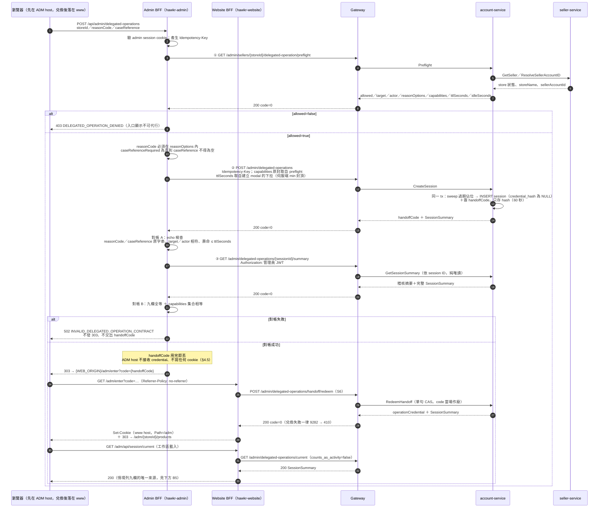

**對帳共發生兩次，任一次不通過操作者就進不了工作區**（對帳 A／B 都在 ADM BFF，且都必須在 303 送出之前完成）。九個純量欄位為 `target.storeId`、`target.sellerAccountId`、`actor.adminId`、`reason.code`、`caseReference`、`issuedAt`、`expiresAt`、`status`、`revision`，外加 `capabilities` 集合相等。

> **四個欄位刻意不參與比對**：`storeName`、`displayName`、`reason.label`、`reason.caseReferenceRequired`
> ——它們是展示層文案，可能隨資料變動而在兩次讀取間不同，納入比對會造成偽失敗。
> **不比對不等於可以亂給**：它們仍受型別／長度校驗，違反照樣 502。逐欄標注見 §6.1.3 的「九欄對帳」欄。

**原本的「對帳 C」（瀏覽器再讀一次 `GET current`，與 201 body 做第三次九欄比對）**不存在，而且物理上做不到。** 它在新形狀下**物理上做不到**：ADM 不再回 201 body（改回 303）、瀏覽器離開 ADM host 之後那裡也已經沒有任何 credential，`GET current` 打不出去。**替代保證是結構性的，不是再比對一次**：

| 對帳 C 原本擋的東西 | 現在由誰擋 |
|---|---|
| 瀏覽器最後拿到的憑證，可能不是 BFF 對帳過的那一個 | **handoff code 與 session 綁定且單次**（§4.5 四道防護③）：兌換得出來的 credential 只可能屬於對帳 A／B 驗過的那一列。**這一段不再是「比對出來的」而是「換不出別的來」** |
| 對帳通過與交出憑證之間的順序被寫反 | 對帳失敗即**不發 303、不交出 `handoffCode`**（上圖 alt 分支），code 60 秒後自然失效；admin repo 的順序斷言同步改為「`current` 晚於 `create` 且早於 303 `Location`」（§4.5 admin 表） |
| 瀏覽器看到的九欄與後端不一致 | 工作區的情境列**一律以 website BFF 的 `GET current` 為準**，而該端點受 B1（完全唯讀）與 C8 拘束 ⇒ 兩次獨立讀取本來就必須位元等價 |

⚠️ **誠實記帳**：少掉的是「瀏覽器端第三次讀取」這一道**偵測**。上表第三列是不變式，不是檢查——**沒有任何一方會把兌換回應與工作區首次 `GET current` 拿來比對**。這是本次改動接受的代價，換來的是 credential 不進 URL、不進第二個 host。

由此推出五條硬性行為（**B1–B4 在後端，B5 在 `hawkr-website` 側的工作區**），違反任一條的症狀都是「後端全 200、UI 靜默進不去或顯示錯的東西」：

| # | 行為 | 理由 |
|---|---|---|
| B1 | `GET current` **完全唯讀**：不 bump `revision`、不 sliding expiration、不更新 `issuedAt`、**不順延 `last_active_at`** | 對帳 B 與工作區的每一次輪詢都要求連續兩次讀取位元等價（C8／C16）；`last_active_at` 那一項另有獨立理由（輪詢算成活動則 idle 永不觸發，§6.2.4a） |
| B2 | `reasonCode`／`caseReference` **原字串回音**，不 trim、不大寫化、不換成內部工單號；`caseReference` 為空時必須是**顯式 `null`**（Go 用 `*string` 且**不得加 `omitempty`**） | 對帳 A 逐字比對 |
| B3 | 時間戳一律 `...Z` 且**小數秒 0–3 位**，序列化前強制截到秒 | 前端正則只收 3 位以內；`TIMESTAMPTZ` 微秒直出必然 6 位 |
| B4 | 同 `Idempotency-Key` 重放必須回**同一個 session**；未兌換時改簽新的 `handoffCode`，已兌換時不回 code、不覆蓋 credential hash；Create 不核發 credential（§6.2.2） | BFF 以管理員身分按 session ID 對帳；已兌換而缺 code 時提示重新開始，不導向 www |
| **B5** | **工作區側渲染的九欄，一律取自 website BFF 的 `GET current`，不得改用 S6 兌換回應裡那份 summary** | 兌換回應與 `GET current` 在正常情況下逐欄相同，所以拿它渲染**測不出差異**；但它是**單次、一次性**的，工作區之後的倒數與終態偵測本來就只能靠輪詢（§4.5 website BFF 表「唯一來源」）。兩個來源並存 ＝ 情境列與終態判定各有一份真相，而對帳 C 已經不在了，沒有任何東西會發現它們分岔 |

> **註：credential 只在 S6 成功兌換時產生。** 冪等重放先以 `(actor_admin_id, idempotency_key)` 查到既有 session；尚未兌換時改簽 handoff code，已兌換時只回摘要。S6 的 CAS 僅在 `credential_hash IS NULL` 時成功。詳見 §8.1.6。

#### 7.2.2 代行寫入（以商品編輯為例）

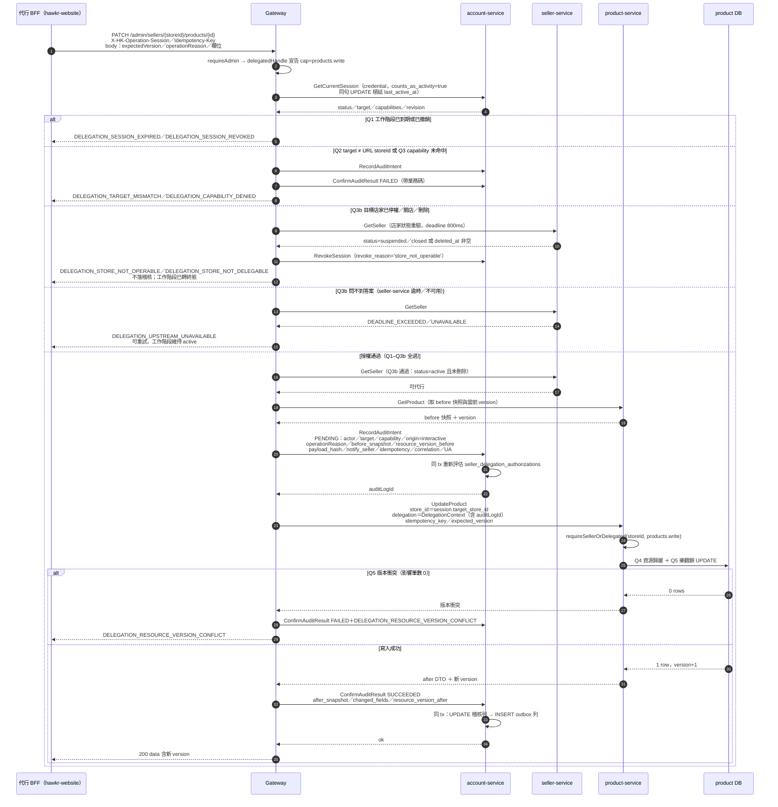

**四個容易做錯的地方**：

1. **before 快照必須在 intent 時就寫入**。稽核列是 append-oriented：只有 `result`／`after_snapshot`／`confirmed_at`／`resource_id` 允許被 confirm 更新一次（`resource_id` 在此白名單內，是因為建立類操作在 intent 當下還沒有 id），`before_snapshot` 寫下去就不可變。因此 Gateway 必須在 intent 之前先讀一次資源。這一次讀與後續寫之間的競態，由 `expectedVersion` 樂觀鎖關掉——中途被別人改掉就是版本衝突，稽核列以 `FAILED` 收尾，不會留下說謊的 before。
2. **`ConfirmAuditResult` 與 outbox 列同一個 tx**。兩者同在 account-service，這裡是真正的同交易；跨到領域服務的那一段用 intent → confirm 兩階段補上（§8.4）。
3. **`Idempotency-Key` 一路透傳到領域服務的 `idempotency_key` 欄位**。product-service 既有的冪等作用域是 `(key, store_id)`；代行寫入的 `store_id` 就是 target store，與賣家本人共用同一個作用域，靠 BFF 產生的 UUID 保證不撞。各層冪等鍵的完整定義見 §6.6.1。
4. **Q3b（店家狀態重驗）必須排在 before 快照與 `RecordAuditIntent` 之前**（§8.1.3 第 8 項）。把它挪到 intent 之後會同時弄壞兩件事：**(a)** 會為一個注定被拒絕的請求寫下一列 `PENDING` 稽核，而 §7.1.2 定版「Q3b 拒絕不落稽核」；**(b)** 撤銷動作與 intent 的順序會倒過來——`origin=interactive` 的 intent 前置條件是 session 有效，若先撤銷再寫 intent，intent 會被自己剛造成的終態擋下，變成一個 9279（稽核前置失敗）而不是 9272。反過來也不要把它提到 `GetCurrentSession` **之前**：那樣做會在 session 根本無效（過期／別人的 credential）時，白白對 seller-service 多打一次無謂的查詢，而那條路徑本來是最便宜的拒絕。

#### 7.2.3 發布命令與通知賣家

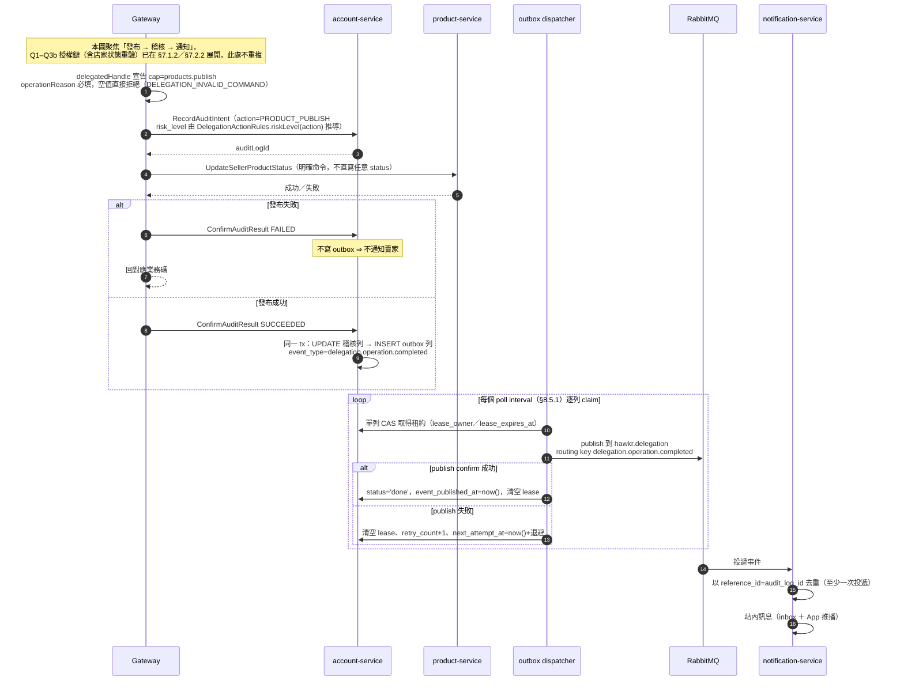

**通知只在真的寫成功時才發**：outbox 列與 `SUCCEEDED` 是同一個 tx 的兩個寫入，`FAILED` 路徑不產生 outbox 列。這也是 UI 那句「賣家已通知」得以成立的機制基礎。

> **通知狀態只到「已發布至 MQ」為止。** 稽核 API 回傳的 `notifiedAt` 語意就是「事件已成功 publish」，
> 本期**不回**「已投遞／已讀」之類的投遞狀態——那需要 notification-service 的回寫路徑，本期沒有，
> 造一個永遠停在 `PENDING` 的假欄位比不做更糟。

#### 7.2.4 結束代行

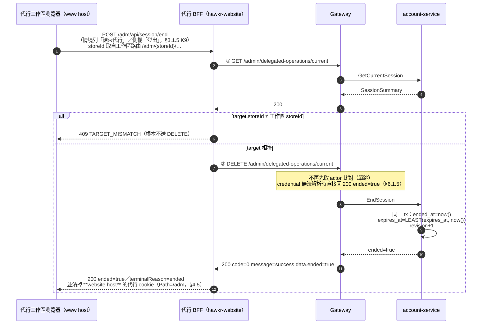

> ⚠️ **本圖的呼叫端是 `hawkr-website` 的代行 BFF**，不是 ADM BFF——ADM host 上沒有 credential。
> 兩個理由：ADM host 在 handoff 兌換之後**不再持有任何 credential**，而 admin 的 `src/app/api/admin/delegated-operations/current/route.ts` **已列入 §4.5 的刪除清單**。
> **gateway 側的端點與語意一字不變**（仍是 `DELETE /api/v1/admin/delegated-operations/current`，§6.1.5）——換的只是誰去打它。
>
> **① 是本流程唯一的一次 `GetCurrentSession`。** 曾經存在的 ②-a（Gateway 自己再打一次、取 `actor` 做比對）
> 已隨 actor 比對一起移除，§7.3.1 的預算同波由 2.8s 改為 2s。
> ⚠️ **不要因此把 ① 也一起省掉**：它是 **BFF** 打的、驗的是 **target 綁定**（工作區路由的 `storeId` ＝ 工作階段的 target，
> 見下方 E1–E3 與 §6.1.5），與 actor 是兩件不同的事。省掉它，操作者在 A 店分頁按「結束代行」會結束到 B 店的工作階段。

> **綠卡的數字不在本圖裡。** 結束確認 modal 的綠卡（已執行 N 項／風險操作 N 項／稽核狀態／「未執行任何出貨或財務操作」）
> 由 `OperationEndDialog` **另打一次** BFF 的 `session/summary`（＝ Gateway 的 `GET .../current/summary`，§6.1.11 定版），
> 時點在 ② 回 200 之後；該端點對終態一律回 200 ＋ 完整摘要，正是為此。
> ⚠️ **不得把那些數字併進 `DELETE` 的回應**：`data` 恰為 `{"ended": true}` 是下表 E1 的硬性要求，多帶一個 key 就破壞前端的封閉列舉判定。

> **結束（與撤銷）不產生任何 MQ 事件。** 本設計唯一的事件是 `delegation.operation.completed`，
> 它由 `ConfirmAuditResult(SUCCEEDED)` 的同 tx 寫入 outbox。工作階段的生命週期本身不寫稽核表，
> 而 outbox 的 `audit_log_id` 是 `NOT NULL` 外鍵 ⇒ 「session 結束事件」在 schema 上**根本插不進去**；
> 加上它沒有 consumer、沒有通知模板、36 號也未登記，發出去只會進 DLQ。

**終止語意的三條硬性要求**（違反任一條，操作者會卡在「結束結果待確認」，工作區寫入被永久封鎖且 cookie 不清）：

| # | 要求 | 禁止 |
|---|---|---|
| E1 | `DELETE` 一律回 `200 {code:0,message:"success",data:{ended:true}}` | 禁止 `202`／`{ended:false}`／缺 `ended`／裸 `404`／裸 `410` |
| E2 | **冪等**：session 已 ended／expired／revoked，`DELETE` 仍回同樣的 200 | 禁止「已經結束了所以回 404」 |
| E3 | session 記錄**永不硬刪**（軟終止），`GET current` 對終態一律回 `200 {code:0,data:{...,status:"expired"\|"revoked"}}`，由前端自行轉 410 並清 cookie | 禁止刪列後只能回 404 |

E3 同時是「不需要任何字串業務碼」的關鍵：只要 tombstone 永遠查得到，前端 allowlist 裡那條「404／410 ＋ 字串 code」的路徑就永遠不會被觸發，本專案的 `int32 code` envelope 契約（§6.1）得以完整保留。
⚠️ E3 也是**資料清理的硬性邊界**：`delegated_operation_sessions` 的列**任何清理程序都不得刪除**，否則排程歸屬（§7.6.3）與終止語意同時失效。保留期政策只作用在稽核列上（§5.4）。

#### 7.2.5 入口判定（preflight ＋ 30 秒 stale 輪詢）

**本節在時間軸上早於 §7.2.1**（先有入口判定才有建立）。編號在後純粹是為了不動既有交叉引用，閱讀順序是 §7.2.5 → §7.2.1。

preflight 與其他端點最大的差別是**它會被反覆呼叫**：入口每 30 秒 stale 重抓、視窗 focus 重抓，且每次 create 前 BFF 還會再抓一次（C15）。這決定了它的三條硬性性質——唯讀、廉價、形狀恆為 200。

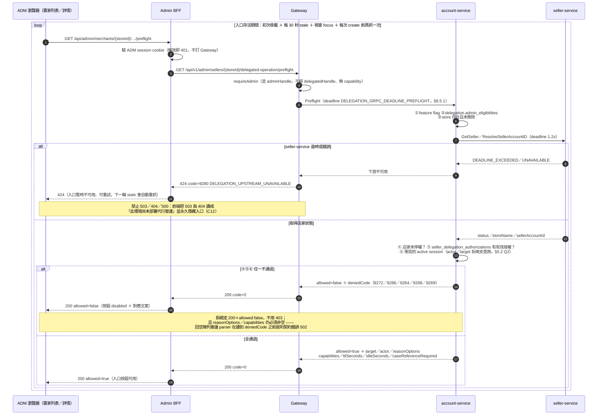

**三個實作者容易踩的地方**：

1. **preflight 不得有任何副作用**：不寫稽核列、不消耗冪等額度、不寫 `last_active_at`（那個欄位不存在）、不建立任何佔位列。它每天會被呼叫的次數等於「開著賣家列表的分頁數 × 120 次／小時」，任何一次寫入都會被放大成這個量級。
2. **⑥ 的兩支查詢不可合併成一支 `OR`**：合併會讓兩條 partial UNIQUE 索引都用不上而退化成 seq scan（§5.2 Q2 的說明），而這正是全書呼叫頻率最高的查詢。
3. **preflight 的結論沒有權威性**：它與 create 之間存在時間差，真正擋住併發的是兩條 partial UNIQUE（§7.4.1）。preflight 的職責只是「提前告知，讓按鈕在點下去之前就 disabled」。
4. **⑥ 的兩支查詢必須帶上兩支到期述詞**（§5.2 Q2）：**沒有權威性不等於擋不住人**——create 會先問一次 preflight，因此 ⑥ 誤判成衝突時，Q3 的同 tx 收斂 gate 根本不會被執行到。「到期列由 Q3 收掉」這個安排成立的前提，是 ⑥ 先不要把那些列判成衝突。

#### 7.2.6 訂單完整收件資訊揭露（PII，S-7）

這是全書唯一「讀取也必須落稽核」的路徑，也是唯一會讓未遮罩收件資訊離開 order-service 的路徑。它與寫入路徑的差別有兩個：**intent 與 confirm 在同一個請求內完成**、**刻意不去重**。

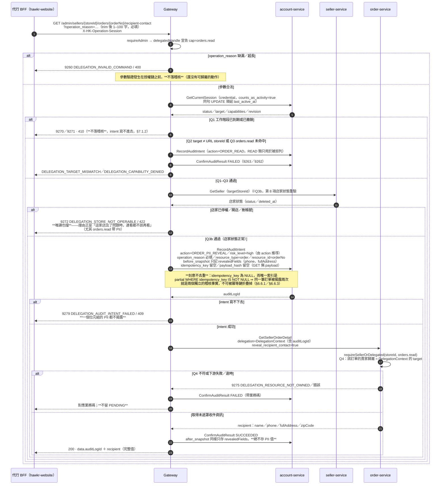

⚠️ **本圖的問答順序即定版順序：Q1 → Q2／Q3 → Q3b → 稽核 intent**。⚠️ **不得把 `GetSeller`（Q3b）排在 Q1／Q2／Q3 之前**（§7.1.3「Q3b 執行位置在 Q3 之後」、§7.2.2 註 4）：先問 Q3b 會多付一次跨服務往返給一個**連 credential 都無效**的請求，也讓「Q1 拒絕不落稽核」與「Q3b 拒絕不落稽核」兩條規則的先後失去唯一解。

**四條硬性要求**：

1. **confirm 必須在同一個請求內完成，不得省略。** 「讀取不會失敗，所以不用 confirm」是最容易犯的錯：省略會讓每一次揭露都留下一列永久 `PENDING`，而揭露是所有稽核列裡最密集的一群 ⇒ `DelegationAuditPending` 告警（§8.2.4）上線當天就恆亮，從此失去鑑別力。下游失敗時同樣要 confirm 為 `FAILED`，**任何情況都不留 `PENDING`**（§5.1.3）。
2. **遮罩在 order-service 執行，不在 Gateway。** `reveal_recipient_contact = true` 只有這一支端點會傳（`GetSellerOrderDetailRequest` 的分流旗標，§6.2.3）；其餘所有訂單讀取都不傳，order-service 回的就是遮罩值。完整 PII 因此**只在這一種呼叫下離開 order-service**，不會在每次列表請求時跨 gRPC 傳輸並落進 Gateway 記憶體與 log。
3. **快照不存值，只存欄位名。** `before_snapshot`／`after_snapshot` 一律是 `{"revealedFields":[...]}`；把 PII 寫進稽核快照，等於把「保護個資」的機制變成「複製個資」的機制，而稽核表的保留期是 730 天。
4. **揭露欄位是白名單**：`name`／`phone`／`fullAddress`／`zipCode`，不得順手多回 email、身分證、付款資訊（§8.1.5）。

> ✅ **已定版：不通知賣家，但必落稽核。** `ORDER_PII_REVEAL` 的稽核列 `notify_seller` **顯式寫入 `false`**，揭露不寫 outbox、不發通知；揭露本身則**完整落庫**（actor／時刻／訂單／`revealedFields`／`operation_reason`／UA），`risk_level='high'` 計入 UI 的「風險操作 N 項」。
> **必須說清楚這些稽核面都在平台側**：稽核 API（§6.1.11）掛 `requireAdmin()`、結束摘要是給操作者的查詢、§6.3.2 全書**只有一個** MQ 事件而 `notify_seller=false` 就不發 ⇒ **賣家在本期對「有人看了我的買家收件資訊」是完全不可見的**。這是本定版接受的**已知代價**（兩條出路見 [ADR：停權即時失效、通知通道與 PII 揭露](../adr/2026-09-18-adm-delegation-suspension-and-notification.md)）；**不得**把它表述成「賣家的知情權由稽核保障」——被保障的是**平台的可稽核性**。
> **業務理由**：查看訂單是**高頻讀取**，通知是**低頻推播**，兩者的節奏差一個數量級。每揭露一次就推一則「管理員完成了一次操作」，賣家一天內會收到數十則語意相同的訊息，**被稀釋的是通知本身的鑑別力**——真正需要他立刻反應的那幾則（代行改了商品價格、代行發了貼文）會淹沒在噪音裡。⇒ 不通知不是少做一件事，是把賣家的注意力留給真的需要他的事件；知情權沒有被放棄，只是換成**可查**而不是**被推播**。
> **不得依賴 DB 的 `DEFAULT true`**：§5.1.3 的 DEFAULT 之所以是 `true`，是為了寫入類操作（改商品、發貼文）——揭露路徑**沒有**「通知賣家」勾選框，落到預設就會**靜默地**通知。這一處必須顯式寫 `false`，且它是 intent 階段寫入（confirm 只讀不寫）。
> **方向改變的成本刻意留得很低**（這是附帶好處，不是理由）：稽核事實已完整保留，日後若裁決為「要通知」，可依 `action='ORDER_PII_REVEAL'` 的稽核列由維運補發（§12.4 的「補通知」SQL）；反過來，已經發出去的通知收不回。

#### 7.2.7 撤銷及其兩個連帶（S-9）

撤銷是**治理動作**（`requireAdmin`，不需也不接受 `X-HK-Operation-Session`），它自己只改一列；真正要看懂的是它的兩個連帶效果，而**兩個連帶都不是推送出去的，是被撤銷方在下一次動作時自己撞上的**。

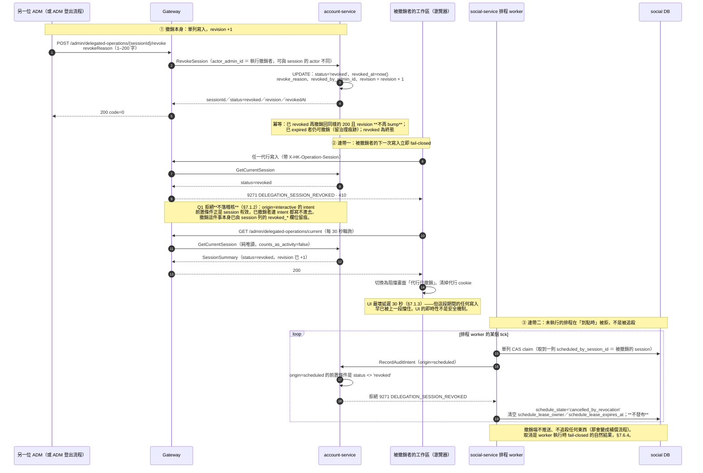

**兩個容易誤解的地方**：

1. **`revision + 1` 不是為了通知任何人**，它是 session 列自己的樂觀鎖版本（§7.5.5）。前端察覺撤銷靠的是下一次 `GET current` 讀到 `status='revoked'`，不是靠 `revision` 變了。
2. **ADM 登出連動走 `RevokeSessionsByActor`**，`revoke_reason = 'admin_logout'`、`revoked_by_admin_id` 填**該 admin 自己**（實作落點見 §4.5 的 admin logout handler）。**它與 `RevokeSession` 是同一個轉態、同一組 SET 子句**，差別只在定位方式：登出 handler 手上只有 `admin_accounts.id`，而 `RevokeSession` 以 `session_id` 定位 ⇒ 需要一支以 actor 為條件的批次版。它不是第二條機制，因此也自動獲得上面兩個連帶。
   **第三個呼叫者是店家狀態重驗**（§8.1.3 第 8 項）：`revoke_reason = 'store_not_operable'`、`revoked_by_admin_id` 同樣填當前這位 ADM 自己。**本節的三個連帶對它一體適用**——這正是第 8 項不必自己實作「取消排程」與「卸載工作區」的原因。排程路徑上還有一個對稱的觸發點在 account-service（`RecordAuditIntent(origin=scheduled)`，§7.6.3 例外段），它不經 Gateway，因此 `revoked_by_admin_id` 填該 session 自己的 `actor_admin_id`。**三個呼叫者共用同一支 RPC、同一組連帶，只有 `revoke_reason` 不同。**

#### 7.2.8 批次下架的逐項語意與部分成功（S-6 批次）

批次**不是一個大交易**，也**不是 Gateway 逐項打 N 次 RPC**。它是 **N 個獨立的代行寫入，由 O(1) 支批次 RPC 承載**：Gateway 對每一跳只打一次，逐項處理發生在服務端。所有重點仍然在「逐項」這三個字上——逐項的 intent、逐項的 `auditLogId`、逐項的 `expectedVersion`、逐項的 outbox 列，**一項都沒有因為改成批次 RPC 而改變**。

**跳數與 `items` 筆數脫鉤，是這個形狀的全部意義。** 逐項打 RPC 是 `1 + 4N` 跳（N=50 ⇒ **201 跳**；此式未計整批只付一次的 `GetSeller`，計入為 **202**），批次是 **6 跳（與 N 無關；含 新增的店家狀態查詢）**。這不只是快慢問題：prod 的 account-service 連線池上限是 **2**（`k8s/values/overlays/prod/common.yaml` 的 `DB_POOL_MAX_CONNS`，account-service 無 overlay 覆蓋），逐項形狀等於對一個 2 連線的池打 100 次短交易，而同一個池還要服務全站登入流量與**每一支代行請求的 `GetCurrentSession`** ⇒ 延遲會外溢到不相干的請求。**把 N 列收進一個交易，是這個池型下唯一正確的形狀。**

註：這也是 repo 既有慣例：`BatchGenerateHomeLabel`（批次宅配取號，每筆打 PayUni ＋ 下載 PDF ＋ 上傳 OSS，50 筆同步部分成功，已在 prod 運行，見 06 號設計書）、`BatchChangeProductCategoryForAdmin`、`BatchPrintCvsLabel`——**沒有一個**是 Gateway 逐項打 N 次 RPC。而 §6.2 的 `BatchUpdateSellerProductStatus`、§6.1.1 路由表、§4.5 的 product-service 條目**本來就都寫的是批次 RPC**；本節先前那張逐項迴圈的圖是與它們矛盾的孤例，已改正。

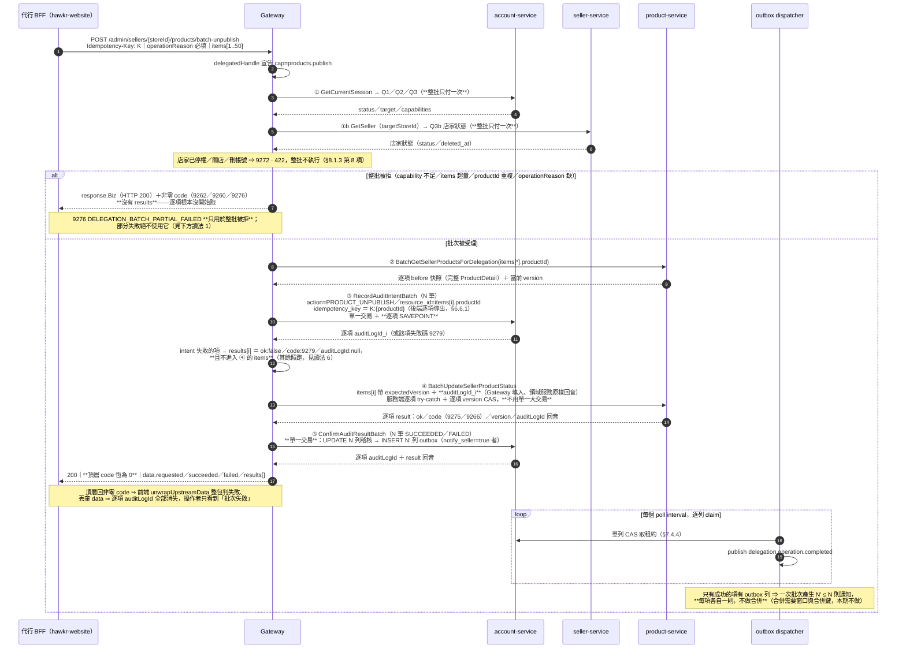

**八個讀法**：

1. **9276 只用於「整批被拒」**：capability 不足、`items` 超量、`productId` 重複這類在逐項執行**之前**就終止的情況。一旦有任何一項開始執行，回應就必須是 `code: 0` ＋ `data.failed > 0` ＋ 逐項各自的 `code`。這兩種形狀不可互換（§6.1.8）。
2. **每一項都必須回自己的 `auditLogId`**：批次不是一筆稽核而是 N 筆，少了它就無法逐筆對帳，「這批到底哪幾筆真的改了」在事後不可考。
3. **逐項失敗不影響其他項**。④ 的服務端**不使用單一大交易包住全部**——一項版本衝突就整批回滾，會讓操作者面對「50 筆全滅、原因是第 37 筆」這種無從處理的結果。這與③⑤「單一交易」不矛盾：③⑤ 寫的是稽核與 outbox（同一張表的 N 列，全成或全不成才是正確語意），④ 寫的是 N 個不同商品的業務狀態（必須逐項獨立）。**兩者的交易邊界不同，是刻意的。**
4. **冪等鍵逐項導出**（`{header 原值}:{resourceId}`），因此整批重送時已成功的項會命中既有稽核列（`replayed=true`）而不重複寫入；這也是「批次可以安全重送」的依據。
5. **`auditLogId` 由 Gateway 填進 ④ 的 `items`，領域服務原樣回音。** 不是領域服務產生、也不是它回寫——它拿不到那個值，因為稽核列在 account-service、而 intent 由 Gateway 打。`BatchProductStatusItem` 因此**必須有 `audit_log_id` 欄位**（§6.2.3）：`BatchProductStatusResult.audit_log_id` 要回得出來，前提是它先被傳得進去。
6. **③ 逐項 intent 失敗的處置：該項標 9279／`FAILED`，且不進入 ④ 的 `items`，其餘照跑。** 單筆路徑的規則是「intent 失敗 ⇒ 整個代行寫入中止」（§7.3.2），**批次版必須逐項化**——否則一列稽核寫不進去就炸掉整批 50 件，而那 49 件的 intent 明明是成功的。實作面：③ 在單一交易內逐項 INSERT 時**必須逐項 `SAVEPOINT`**——PostgreSQL 交易內任一句 SQL 失敗會讓整個交易 aborted（`25P02`），之後所有指令一律被拒，「某項失敗其餘照跑」在沒有 SAVEPOINT 的情況下**做不到**（[Java 微服務開發規範](../開發規範/Java%20微服務開發規範.md) §9）。
7. **⑤ 是 all-or-nothing，因此 confirm 失敗的影響面是 N 列而不是 1 列。** 這是本形狀唯一的退步，**必須明講、不得靜默**——完整的寬度分析與「為什麼仍是淨改善」見 §7.3.3 視窗 A。
8. **② 回的必須是完整 before 快照，不是只夠做狀態轉換判斷的那幾欄。** `before_snapshot` 是爭議時的舉證素材（§6.1.12），而批次正是「一次動很多件」的高風險操作——它的舉證素材**不得比單筆少**。⇒ `BatchProductSnapshot` 帶 `ProductDetail detail`，Gateway 對批次與單筆跑同一支投影函式。⚠️ **這與讀法 3「逐項獨立」及本節的跳數承諾都不衝突**：服務端逐項組 detail 是三次**本地**查詢（SKU／hashtag／分類階層），Gateway 這一跳仍然只有一次。反過來讓 Gateway 逐項打 `GetProduct` 才會破壞跳數承諾，而且那條路還會連帶付 N 次 seller-service 呼叫（`GetProduct` 內含 `buildSellerInfo`）。⚠️ 補齊 before **不放寬比較範圍**：`SnapshotFields` 仍是 `{status}`。

> **批次的總時間預算見 §7.3.1「② 批次資源端點的預算表」。** 批次語意下跳數與 N 脫鉤（6 跳，含店家狀態查詢），`items` 上限 50 不構成時間問題。
> **仍留給業務裁決的只剩一個不阻擋實作的產品題**：一次批次下架最多幾件是想要的操作體驗。

---

### 7.3 失效與重試

#### 7.3.1 逾時預算

**外層逾時分兩段編列，兩段的權威歸屬不同——不可混用。**

- **① session 端點**（preflight／create／`GET current`／`DELETE current`／**`GET current/summary`**，共五支）：外層是 admin repo 已寫死的 **10 秒**硬逾時（`upstream.ts`，只透過 `adminUpstreamFetch` 生效，T7）。這是**既有事實**，後端預算必須小於它。建立工作階段是三段串行呼叫，最壞 30 秒；因此每一段的後端預算獨立編列，不可互相借用。<br/>⚠️ **前三支在 ADM host、後三支在 www host，但外層值刻意相同**（`GET current` 兩處都會被打到——ADM 側在 create 後的九欄對帳，www 側在工作區輪詢）。website 的 `_upstream.ts` 對 session 檔沿用 10s **不是繼承 admin 的常數**，而是本書為這一檔定的值；admin 那支常數維持 `10_000` 不動（它現在只服務 preflight／create）。
- **② 資源端點**（代行的商品／店面／貼文／訂單讀寫，含批次）：**呼叫端在 `hawkr-website` 的代行 BFF**（`app/(delegated)/adm/api/**`）。**呼叫端是全新的、沒有既有契約可沿用，因此一次定對**：**外層逾時仍由本書定版**，且**必須**在 website 的 `_upstream.ts` 從第一天就參數化（§4.5）——把它寫成第二個模組級常數，就是把 admin repo 那個「調大它會連帶放寬輪詢逾時」的問題原樣複製到另一個 repo。**定版值：單筆 mutation 外層 15s、批次外層 60s；`GET current` 與其他 session 端點維持 10s。**
- **③ 媒體 upload session 兩支**（`POST .../media/upload_sessions`、`POST .../{sessionId}/complete`，§6.1.13）：**歸 ② 的「單筆 mutation」檔（外層 15s／Gateway handler 12s）**，不另立第四檔。⚠️ **「上傳大圖很慢」這個直覺會把人推去選 60s，而它是錯的**：大圖的耗時全部落在**步 ②（`PUT <uploadUrl>` 直送 R2）**，而步 ② **不經 BFF、一次 gateway 都不打**（§6.1.13 三步表）——經過本預算的 ①③ 兩支送的是 JSON metadata，位元組數與檔案大小**無關**。60s 那一檔的存在理由是「批次 N=50 在服務端的單交易工作量」（見下方批次預算表），與上傳沒有任何共同因子；照直覺選它，等於給一支輕量 mutation 四倍的預算，而真正會慢的那一步根本量不到。<br/>反向也不成立：**不得歸 ① 的 10s**——那個值是 admin repo 既有寫死的事實，作用域是 session 端點；媒體兩支的呼叫端是 website 的 `_upstream.ts`，沒有沿用它的理由，且它們是 mutation（會在 media 的 `upload_session` 表寫列），與 ② 的其餘成員同類。

**②的定版值不得靠調大一個模組級逾時常數達成。** 調大它會連帶放寬 `GET current`（30 秒輪詢）的逾時——一支 hang 住的輪詢就吃掉兩輪，工作階段狀態顯示延遲翻倍。正確做法是把逾時參數化成 per-call 選項、預設值仍為 10s，資源端點各自宣告（落點：`hawkr-website` 的 `app/(delegated)/adm/api/_upstream.ts`，§4.5）。⚠️ **這條戒律的對象是 website 的 `_upstream.ts`**（admin repo 的同名常數 `DELEGATED_OPERATION_UPSTREAM_TIMEOUT_MS` 不在資源端點路徑上）**——website 的 `_upstream.ts`**。admin repo 那個常數維持 `10_000` 不動——它現在只服務 preflight／create 兩支。
註：上界不是無限：**兩個 BFF 都跑在 Cloudflare Workers**（admin 與 website 皆是），CF 對 origin 的回應等待有上限（**推測** ~100 秒，未實測）。②的 60s 是刻意留在該上界之下的值。

**① session 端點與單筆資源 mutation 的預算表**：

| 層 | 預算 | 說明 |
|---|---|---|
| 前端 → BFF → Gateway（session 五支端點，含 `current/summary`） | **10s**（既有事實，`upstream.ts`） | `AbortController` 硬逾時，超時 BFF 回 504 |
| 前端 → BFF → Gateway（資源端點，單筆 mutation） | **15s**（本書定版） | 接線資源端點時採此值，不沿用 10s |
| 前端 → BFF → Gateway（**媒體 upload session 兩支**） | **15s**（同上檔，見上方 ③） | 位元組走步 ② 直送 R2、不經本路徑；這兩支只送 JSON metadata |
| Gateway handler 總預算（session 端點） | 8s | 外層 10s 留 2s 給網路與 BFF 開銷 |
| Gateway handler 總預算（單筆資源 mutation） | **12s** | 外層 15s 留 3s 給網路、BFF 與 CF 開銷 |
| Gateway → `Preflight` | 3s（內含 seller-service 1.2s） | preflight 只在建立前與入口輪詢時呼叫 |
| Gateway → `CreateSession` | 2s | |
| Gateway → `GetCurrentSession` | 800ms | 每次代行請求都會呼叫，必須廉價 |
| `DELETE current` 的**單跳**：`EndSession`（2s，沿用 `_CREATE_MS`） | **2s** < 8s | **一跳，不是兩跳**：原本的第一跳 `GetCurrentSession`（800ms）只為取 `actor` 做比對，該比對已無對象，整跳移除（§6.1.5、§7.2.4）。⚠️ **BFF 側前置的那次 `GET current`（驗 target 綁定）不在本列作用域內**——它是另一支端點、另一條 10s 預算，不要因為都叫 `GET current` 就以為連它一起省掉了。不重試，`EndSession` 冪等，由前端重送 `DELETE` 恢復（§7.3.2） |
| Gateway → seller-service `GetSeller`（授權鏈第 8 項：店家狀態重驗） | 800ms | **店家狀態重驗新增**（§8.1.3 第 8 項）。**每一次代行請求都會呼叫，讀與寫皆然**——唯讀路徑的額外成本就只有這一跳（它沒有 intent／confirm）。命中時多一次 `RevokeSession`（2s，沿用 `DELEGATION_GRPC_DEADLINE_CREATE_MS`），**不列入本表的最壞總和**：那條路徑不會再往下走 domain write，且撤銷失敗不改變本次請求的結果（§8.1.3） |
| Gateway → 領域服務 read RPC（before 快照） | 800ms | 每次代行寫入的第一跳（`before_snapshot` 必須在 intent 之前取得，見 §7.2.2 讀法 1） |
| Gateway → `RecordAuditIntent` | 800ms | |
| Gateway → 領域服務 write RPC | 4s | |
| Gateway → `ConfirmAuditResult` | 400ms／次，**最多 3 次**，退避 100ms／200ms，總最壞 1.5s | 上限來自「同步有限重試總計 < 2s」的裁決 |
| 一次單筆代行寫入的最壞總和 | 0.8＋**0.8**＋0.8＋0.8＋4＋1.5 ＝ **8.7s** < 12s | 逐項相加必須留有餘裕，這是預算表存在的理由。粗體那一項是店家狀態重驗 |

**② 批次資源端點的預算表**（形狀依 §7.2.8 的批次語意：Gateway 對每一跳各打**一次**批次 RPC，跳數與 `items` 筆數無關）：

| 層 | 預算 | 說明 |
|---|---|---|
| 前端 → BFF → Gateway（批次） | **60s**（本書定版） | 接線資源端點時採此值；刻意留在 CF 對 origin 的等待上界（推測 ~100s）之下 |
| Gateway handler 總預算（批次） | **50s** | 外層 60s 留 10s 給網路、BFF 與 CF 開銷 |
| Gateway → `GetCurrentSession` | 800ms | **整批只付一次**（在逐項語意之外，見 §7.2.8） |
| Gateway → seller-service `GetSeller`（第 8 項） | 800ms | **整批只付一次**——批次的 target store 恰好一個（第 5 項已保證 `session.target_store_id == URL 的 storeId`），因此這一跳與 `items` 筆數無關 |
| Gateway → 領域服務批次 read RPC（before 快照） | 3s | 一次取回 N 筆的 before 快照與 `version` |
| Gateway → `RecordAuditIntentBatch` | 4s | 一次交易寫 **N 列**稽核（逐項語意不變，只是收進一個交易） |
| Gateway → 領域服務批次 write RPC | 20s | `BatchUpdateSellerProductStatus`（§6.2），服務端逐項 try-catch＋逐項 version CAS |
| Gateway → `ConfirmAuditResultBatch` | 3s／次，**最多 3 次**，退避 100ms／200ms，總最壞 9.3s（總預算上限 10s） | 與單筆同一條「同步有限重試」裁決，只是每次的 deadline 依 N 放大 |
| 一次批次（N=50）的最壞總和 | 0.8＋**0.8**＋3＋4＋20＋9.3 ＝ **37.9s** < 50s | 粗體那一項是店家狀態重驗，整批只付一次 |

**這兩張表是預算（deadline）不是耗時估計。** 把每一跳的 deadline 相加得到的是「所有下游同時進入平時 20 倍延遲」這個情境的上界；§9.3 為同一條路徑編列的是 **P95 額外總增量 < 261 ms**。批次的典型耗時**推測**在 **1.5–2s**（N=50，未實測——這條路徑在 dev 上尚不存在，無從量測）。⇒ **`items` 上限不是時間問題**：跳數與 N 無關，N 只影響每一跳服務端的單交易工作量。

註：預算表按**兩跳**編列：`GetCurrentSession` 與 `RecordAuditIntent` 是兩支獨立 RPC，不合併為一支。
合併會讓「純讀取的授權判定」與「寫稽核」耦合在同一個呼叫裡，讀取路徑被迫承擔寫入成本；
而以 in-memory 快取消掉第一跳同樣不可行——多副本下會讓撤銷延遲生效，而撤銷是安全動作。

#### 7.3.2 失效與重試表

> 冪等鍵欄只列作用域，完整定義（含 NULL 語意與衝突行為）見 §6.6.1；逾時／重試上限的數值 SSOT ＝ §8.5.1 env 表。

| 外部呼叫 | 逾時 | 重試 | 冪等 | 失敗時降級行為 |
|---|---|---|---|---|
| Gateway → account-service `Preflight` | 3s | 不重試 | 天然（唯讀） | 回 **424 ＋ `DELEGATION_UPSTREAM_UNAVAILABLE`**；**不得回 503／500／502**（C12；500 另外不在 9260~9299 段內；5xx 的 body 會被 CF 換掉，見 §6.5.2） |
| Gateway → account-service `CreateSession` | 2s | 不重試（由前端持同一 `Idempotency-Key` 重送） | `UNIQUE (actor_admin_id, idempotency_key)` | 回錯誤碼；同鍵重放回同一 session，未兌換時取得新 handoff code，已兌換時不再取得 code |
| Gateway → account-service `GetCurrentSession` | 800ms | 不重試 | **天然**（輪詢路徑純唯讀；代行資源路徑只把 `last_active_at` 設成 `now()`，**重放同一次呼叫的結果與只呼叫一次相同**，§6.2.4a） | 該次代行請求 fail-closed；輪詢路徑則沿用上一輪狀態，不宣稱已結束 |
| Gateway → account-service `RecordAuditIntent` | 800ms | 不重試 | `(actor, idempotency_key, action, resource_id)` | **整個代行寫入中止**（回 `DELEGATION_AUDIT_INTENT_FAILED`），領域服務完全不被呼叫。稽核寫不下去就不准寫業務，這是刻意的順序 |
| Gateway → account-service `RecordAuditIntentBatch` | 4s | 不重試 | 同上，逐項各一把 | **逐項化，不是整批中止**：失敗的**該項**回 `9279`／稽核列為 `FAILED`，且**不進入**批次 write 的 `items`；**其餘項照跑**（§7.2.8 讀法 6）。沿用單筆版的「整個寫入中止」會讓一列稽核寫不進去就炸掉整批 50 件，而那 49 件的 intent 明明成功——**「稽核寫不下去就不准寫業務」的作用域是那一筆，不是那一批**。整支 RPC 層級的失敗（連線／逾時／交易本身起不來）仍是整批中止，回 `9279`，領域服務完全不被呼叫 |
| Gateway → account-service `ConfirmAuditResultBatch` | 3s／次 | **3 次、指數退避（100ms／200ms）、總計 < 10s**（`DELEGATION_AUDIT_CONFIRM_BATCH_TOTAL_BUDGET_MS`） | `auditLogId` 為鍵，重複 confirm 為 no-op | **all-or-nothing**：仍失敗則該批的 **N 列一起**停在 `PENDING`。影響寬度與單筆版不同，見 §7.3.3 視窗 A |
| Gateway → 領域服務 write RPC | 4s | 不重試 | 領域服務既有 `idempotency_key` 機制 | `ConfirmAuditResult(FAILED)`；逾時視為結果未知，一律走 FAILED＋業務碼，由使用者以同一把 key 重送 |
| Gateway → account-service `ConfirmAuditResult` | 400ms／次 | **3 次、指數退避（100ms／200ms）、總計 < 2s** | `auditLogId` 為鍵，重複 confirm 為 no-op | 仍失敗則稽核列停在 `PENDING`（合法終態，語意見 §5.1.3），查詢時如實顯示、不計入成功數，**不做對帳 job、不做 backfill**（§8.4） |
| Gateway → account-service `EndSession`／`RevokeSession` | 2s | 不重試 | 冪等（終態再結束仍回成功） | 回原狀態碼；cookie 由前端保留，不宣稱已結束 |
| account-service → seller-service `GetSeller` | 1.2s（`DELEGATION_GRPC_DEADLINE_SELLER_STATE_MS`） | 不重試 | 天然（唯讀） | 回 **424 ＋ `DELEGATION_UPSTREAM_UNAVAILABLE`（9280）**，與 §6.1.2 失敗情境表一致。**不得回 `allowed:false`＋`DELEGATION_STORE_NOT_OPERABLE`（9272）**——9272 的語意是「**確知**此店家不可代行」，逾時／`UNAVAILABLE` 是「**問不到答案**」，兩者依 §8.1.3 第 8 項必須分開；混用會讓操作者看到「此店家停權中」這個與事實無關的原因（正是 §6.1.2 引入 `deniedCode`／`deniedLabel` 要解決的問題），也會讓 seller-service 的一次抖動被誤讀成治理事件。fail-closed 仍然成立：**兩者都不放行**，差別只在錯誤碼與可重試性（9280 可重試、9272 不可） |
| outbox dispatcher → RabbitMQ publish（含 confirm） | `DELEGATION_MQ_PUBLISH_TIMEOUT_SECONDS` | 失敗後由 `next_attempt_at` 退避驅動；崩潰的列由租約到期回到候選集合；次數上限 `DELEGATION_OUTBOX_MAX_RETRY` | 消費端以 `reference_id = audit_log_id` 去重（§6.3.2） | 達上限 → `status='failed'` 且 `retry_count >= DELEGATION_OUTBOX_MAX_RETRY`（此組合**即是** dead-letter 語意，§5.1.4）＋告警；**賣家不會收到通知，但業務寫入與稽核都已成立** |
| notification-service → 站內訊息寫入 | 2s | consumer framework 的 retry／DLX | 以 `reference_id = audit_log_id` 去重（§6.3.2） | 進 DLQ，人工處理（§12.4） |
| notification-service → FCM 推播 | 由 FCM client 自帶 | **不重試、不 nack** | `push_notifications` 的 `(user_id, user_type, event_type, reference_id)` 唯一索引 | 失敗只寫一列 `status='failed'`＋`error_log` 後 **`return nil`**（`internal/usecase/send_push.go`）⇒ **不影響 inbox 已寫入的事實**、也不會讓訊息重回 queue。這是既有行為，本案沿用不改：inbox 才是通知賣家的權威載體，推播只是提醒 |
| 排程 worker → account-service intent／confirm | 同上兩列 | 同上 | 同上 | intent 失敗 ⇒ 該次排程不執行，租約到期後重試（§7.6） |

#### 7.3.3 降級原則

1. **fail-closed 是預設**。任何一個授權相關的判定拿不到答案（RPC 逾時、Redis 失聯、店家狀態查不到），一律當作「不准」。這與賣家能力層的 fail-open（Redis 失敗放行、靠收斂點兜底）**方向相反**：賣家操作自己的店，誤擋的成本高；ADM 代行別人的店，誤放的成本高。
2. **降級不得改變稽核的完整性**。任何「先寫業務、稽核之後再補」的變體都不被接受——那正是 intent 先行的理由。
3. **已知且接受的視窗 A（confirm 打不進去）**：`ConfirmAuditResult` 三次都失敗時，domain write 已成立、outbox 列未寫入 ⇒ 該次變更**不會通知賣家**，稽核列停在 `PENDING`。這個視窗以 §12.4 ② 的 Runbook 查詢處理（門檻與其推導在該節，本節不重列數值），**不引入補償任務**。

   **批次路徑的視窗 A 寬度不同，必須明講**：`ConfirmAuditResultBatch` 是 all-or-nothing（§7.2.8 讀法 7），三次都失敗時停在 `PENDING` 的是**該批的 N 列**，不是 1 列。

  | | 逐項 confirm（每項各一次呼叫） | 批次 confirm（整批一次呼叫，現行定版） |
  |---|---|---|
  | 每次呼叫的失敗機率 | p | p |
  | 一批（N 筆）**至少一列** PENDING 的機率 | `1 - (1-p)^N`（N=50、p=0.1% ⇒ **4.9%**） | `p`（**0.1%**） |
  | 發生時停在 PENDING 的列數 | 通常 1 列 | **N 列** |
  | **期望的 PENDING 列數** | `N × p` | `N × p` ← **相同** |

   **判定：淨改善，但不是無代價的改善。** 期望列數不變，改變的是分布——**發生次數下降約 N 倍、每次規模上升 N 倍**。這對 §12.4 的 Runbook 是好事（同一批的殘列一次處理完，而不是散在幾十次不同的批次裡），對 `DelegationAuditPending` 告警也是好事（觸發次數下降）。但**告警的門檻與 Runbook 的措辭必須按「一次可能看到幾十列」來寫**——按「偶發一兩列」設計的門檻在這個分布下會在真的出事時才第一次觸發，那時已經是幾十列。
   **這個代價不換取「別的地方比較好看」，它換取的是跳數與 `items` 脫鉤**（§7.2.8）；把它記在這裡是為了讓日後調整批次大小的人知道這條耦合存在。
4. **已知且接受的視窗 B（領域服務逾時，寫入結果未知）**：Gateway 對領域服務 write RPC 的 deadline 到期時，Gateway 拿不到結果，但**領域服務端的交易可能已經 commit**。定版處置：

  | 面向 | 定版 |
  |---|---|
  | 稽核 | `ConfirmAuditResult(FAILED)` ＋ 逾時對應的業務碼。**不留 `PENDING`** ——「結果未知」在本設計裡由 `FAILED` 承載。在**互動路徑**上，`PENDING` 專指「連 confirm 都送不出去」（視窗 A）；**排程路徑另有第三個來源**（終寫 CAS `rows = 0` ⇒ 刻意不送 confirm），判別與處置見 §7.6.2，§12.4 ② 判讀殘留時要先分辨 |
  | outbox | **不寫**。對一筆結果未知的寫入發出「已完成」通知，比不通知更糟：賣家收到通知卻查不到變更（或反過來），而稽核列還寫著 `FAILED`，三者互相矛盾 |
  | 可見後果 | **業務資料可能已改、稽核列記 `FAILED`、賣家沒收到通知**。這是本設計中唯一「稽核可能低估實際變更」的形狀，必須被明確承認而不是被機制掩蓋 |
  | 收斂手段 | 告警 `DelegationWriteUnconfirmed`（§8.2.4）→ Runbook §12.4 ⑦ 指示人工比對領域資料與稽核列的 `resource_version_before`，判定寫入是否成立，再決定要不要補通知 |

   **操作者側的正規恢復動作是「以同一把 `Idempotency-Key` 重送」**，而且它優先於任何人工介入：領域服務既有的冪等機制會讓「已成立的寫入」回既有結果、「未成立的寫入」真正執行一次 —— 這是把不確定收斂掉的唯一便宜路徑。告警與 Runbook 處理的是**沒有人重送**的殘留情況。

   **不做自動修復**（不查詢領域服務回填稽核、不重放 outbox、不寫任何對帳 job）。理由與視窗 A 相同：這類程式是責任邊界規範「一、三類動作分類」的**禁止寫進 application code**（`*ReconciliationJob` / drift 偵測）那一類，而它要修的東西——「這次寫入到底成不成立」——在 Gateway 側本來就沒有權威答案。

---

### 7.4 並發與順序

#### 7.4.1 工作階段層級的三種併發

| 情境 | 判定 | 機制 | 結果 |
|---|---|---|---|
| 同一 admin 對**同一**店家再建一次 | 冪等或衝突 | 只看 `(actor_admin_id, idempotency_key)`；未命中即視為新的建立請求 | ①**同 key** ⇒ 回既有 session；尚未兌換時改簽 handoff code，已兌換時不再給 code（§8.1.6） ②**不同 key** ⇒ `DELEGATION_CONFLICT_ACTOR_OTHER_STORE`，必須先結束既有工作階段。**不得回既有 session**——`reasonCode`／`caseReference` 是原字串回音，回既有列必然對不上本次請求值，BFF 對帳 A 失敗直接 502，操作者卡死 |
| 同一 admin 對**不同**店家 | **拒絕** | partial `UNIQUE (actor_admin_id) WHERE status='active' AND ended_at IS NULL` | `DELEGATION_CONFLICT_ACTOR_OTHER_STORE`；必須先結束前一個。一次只能代行一家，避免在兩個工作區之間誤操作 |
| **不同** admin 對同一店家 | **拒絕** | partial `UNIQUE (target_store_id) WHERE status='active' AND ended_at IS NULL` | `DELEGATION_CONFLICT_STORE_OTHER_ACTOR`；避免兩人同時改同一家造成版本衝突風暴 |

兩條 partial UNIQUE 是**唯一**的權威判定，preflight 的第 6 步只是提前告知。原因很直接：preflight 與 create 之間存在時間差，只靠 preflight 判斷等於用一次讀取去保護一次寫入。

**過期佔位列的處理**：兩條 partial UNIQUE 的述詞只看 `status` 與 `ended_at`，看不到 `expires_at`／`last_active_at` ⇒ 已到期（hard **或閒置**）但未結束的列仍會佔住位置。處置是在 `CreateSession` 的**同一個 tx 內**先跑一次收斂：

```sql
UPDATE delegated_operation_sessions
   SET ended_at = now()
 WHERE status = 'active'
   AND ended_at IS NULL
   AND (expires_at <= now()
        OR last_active_at + make_interval(secs => $3) <= now())   -- $3 = DELEGATION_SESSION_IDLE_SECONDS
   AND (actor_admin_id = $1 OR target_store_id = $2);
```

⚠️ **`OR last_active_at + idle <= now()` 這一項是閒置逾時的同波義務，漏掉不會有任何錯誤訊號**：閒置逾時的列在 DTO 上已經是 `expired`（§7.5.1 第 3 順位）、Gateway 也已 fail-closed，但它在 DB 上仍是 `status='active' AND ended_at IS NULL` ⇒ **繼續佔住兩條 partial UNIQUE**。操作者被閒置踢出、想重建工作階段時會撞 `DELEGATION_CONFLICT_ACTOR_OTHER_STORE`／`_STORE_OTHER_ACTOR`（9268／9269），而畫面上顯示的是「你已經在代行另一家店」——一個與真實成因完全無關的訊息，且要等到 hard expiry（最長 30 分鐘）才會自己好。**閒置逾時之所以能不新增排程器，前提就是這一句同波擴充**。

⚠️ 本句 `SET ended_at = now()` **不動 `expires_at`**，因此 `chk_dos_last_active_range`（`last_active_at <= expires_at`）不受影響。

這屬於「同一觸發流程內的同步前置 gate」，等同 CAS 前置檢查，**不是 reconciliation job**（§8.4）。它也解釋了為什麼系統不需要任何排程器去清理過期工作階段（§7.5.4）。

#### 7.4.2 資源層級：賣家本人與 admin 同時編輯

代行寫入與賣家本人的寫入打的是**同一張表的同一列**（`store_id` 相同），沒有任何隔離。唯一的保護是資源樂觀鎖：

```sql
UPDATE product
   SET name = $1, ..., version = version + 1, updated_at = now()
 WHERE id = $2
   AND store_id = $3          -- Q4 資源歸屬，與 DelegationContext 的 target 綁定
   AND version = $4;          -- Q5 expectedVersion
```

**影響筆數 = 0 的處置**：一律視為版本衝突，回 `DELEGATION_RESOURCE_VERSION_CONFLICT`，**不得**退化成「再查一次然後覆蓋」。前端據此開啟 diff／重新載入流程，並在合併後取得新的 `expectedVersion`；**原 `Idempotency-Key` 不可用於不同 payload**，否則會撞上 `DELEGATION_IDEMPOTENCY_KEY_REUSED`。

註：三個資源的樂觀鎖欄位都是**本期新增**（product-service 的 `ProductEntity` 目前沒有 `@Version`、seller-service 與 social-service 也沒有版本欄位），不是既有資產，欄位定義見 §5.1、遷移見 §5.4。

#### 7.4.3 批次操作的逐項語意

批次下架（`POST .../products/batch-unpublish`）**不是一個大交易**，它是 N 個獨立的代行寫入：

| 面向 | 規則 |
|---|---|
| 稽核 | **每一項各寫一列稽核**（各自的 before／after／version），不是整批一列；逐項結果**必須各自回傳自己的 `auditLogId`**，否則 N 筆稽核無從對帳 |
| 版本 | 每一項各自帶 `expectedVersion`，各自判 Q5 |
| 冪等 | 批次帶一把 `Idempotency-Key`，逐項的冪等鍵派生為 `{key}:{resourceId}`，重送不會重複寫入（§6.6.1） |
| 回應 | HTTP 200 ＋ 逐項結果。**全成功與部分失敗一律 `code: 0`**，以 `data.failed > 0` ＋ 逐項各自的 `code` 表達失敗，**禁止整批假成功**、也**禁止**用非零的 envelope `code` 表達部分失敗——前端的 `unwrapUpstreamData` 對 `code !== 0` 會把整包判為失敗，逐項結果會被整批丟掉。`DELEGATION_BATCH_PARTIAL_FAILED` 保留給「整批被拒」 |
| 事件 | 只有成功的項產生 outbox 列，**每一項各發一則事件**，走既有機制。**本期不做合併**：合併需要一個窗口（等多久）與一個合併鍵（依什麼併），兩者都沒有定義；寫「由 notification-service 合併呈現」等於把一個不存在的機制寫成契約 —— 賣家實際會收到 N 則通知，而文件說會收到 1 則 |
| 原因 | 批次操作的 `operationReason` **必填**（UI 的「批次下架需先確認原因」即此） |

#### 7.4.4 多副本搶佔（§29）

叢集現況是「prod 預設 `replicas: 1`，只有 5 支被 overlay 覆蓋成 2」，account-service 今天不在那 5 支之內。**但 outbox dispatcher 與排程 worker 仍必須從第一天就用合格搶佔**：§29 規則 ⑧ 要求「調高 `replicas` 之前排程必須全數有合格搶佔」，而擴容通常是為了應付流量、沒有人會在那時想到排程器。沒有搶佔閘門的排程器是**擴容那一刻才引爆的地雷**。

**為什麼不能用永久旗標**：若 claim 寫的是 `status='processing'` 這種沒有時間欄的述詞，該列就被推出候選集合且沒有任何機制讓它回來——pod 在 publish 中途被 kill，那一列**永久卡死且無告警**。判準是機械的：**claim 的述詞若把 row 推出候選集合、且無時間欄可讓它回來，即為永久旗標**。這也是 outbox 狀態只有 `pending`／`done`／`failed` 三個值、**沒有 `processing`** 的原因：搶佔由租約欄位表達，不佔用狀態值域。

**claim 語句：單列 CAS，語句全文見 §5.1.4**（資料層是 SSOT，此處不重複 SQL）。本節只固定它必須滿足的條件：

| 要求 | 內容 |
|---|---|
| 形狀 | 先取一個候選 `id`，再對**該單一 id** 下 `UPDATE ... WHERE id = $n AND <述詞>`；影響筆數為 1 才算搶到 |
| 述詞必含 | `status = 'pending'`（用得到 partial index `idx_aoo_pending`，同時把 `done`／`failed` 排除在候選外）、`next_attempt_at <= now()`、`lease_expires_at IS NULL OR lease_expires_at <= now()` |
| **禁止** | `SELECT ... FOR UPDATE SKIP LOCKED`。dispatcher 在 autocommit 下執行，**鎖一放就沒了**，兩個副本會先後取到同一列；唯一能跨連線存活的搶佔憑證是寫進資料列的租約 |
| 失敗時 | **清空 lease ＋ `retry_count+1` ＋ `next_attempt_at = now()+退避`**，恢復時間從一個租約縮到一個 tick。⚠️ **釋放語句本身也必須是 CAS**（述詞含 `AND lease_owner = $1 AND status = 'pending'`），否則會清掉別人剛搶走的租約。**SQL 全文以 §5.1.4 為準，本表不重列 SET 清單** |

| §29 不變式 | 本案取值 | 為什麼成立 |
|---|---|---|
| claim 用 lease，不用永久旗標 | `lease_expires_at`＝`DELEGATION_OUTBOX_LEASE_SECONDS`（§8.5.1） | 崩潰的列在租約到期後自動回到候選集合 |
| 租約 **>** 單筆最壞耗時 | 租約 60s > publish deadline `DELEGATION_MQ_PUBLISH_TIMEOUT_SECONDS`（10s）＋ DB 往返。⚠️ **這個 10s 只有在 publisher 以 `mq.WithConfirmTimeout` 建構時才是真的**——`pkg/mq` 的 confirm 等待不繼承呼叫端 ctx，未傳 Option 時真實上界是套件預設 30s | publish 有明確 deadline，最壞耗時才有上界；沒有 deadline 就無從建立下界 |
| 租約 **<** 候選窗口剩餘壽命 | 候選窗口無上限（未發出的列永遠是候選） | 上界不受限。這一條在**排程發布**上不成立，見 §7.6.2 |
| 逐筆取租約基準 | 每列各下一次 claim，`now()` 在該列的 claim 語句內取 | 若一次 claim 一批並在迴圈外算一次基準，不變式會從「單筆最壞耗時 < 租約」退化成「批次總耗時 < 租約」，隨 `DELEGATION_OUTBOX_BATCH_SIZE` 一起破 |

**失敗釋放與偵測述詞必須一起看**（這一段刻意寫出來，因為兩個看似無關的改動很容易互相抵銷）：publish 失敗時清空 lease 而不是留著租約等它過期，之所以安全，是因為「卡住的列」偵測述詞是 `event_published_at IS NULL AND created_at < now() - 15min`，**完全不依賴 lease 欄位**。如果哪天把偵測述詞改成依賴 `lease_expires_at IS NOT NULL`，「失敗時清空 lease」就會把偵測賴以成立的值抹掉，告警幾乎永遠不觸發——兩支各自的測試都會是綠的，缺的是同時經過兩者的那一支。修改任一邊時必須同時檢查另一邊。

#### 7.4.5 順序保證與不保證

| 保證 | 內容 |
|---|---|
| **保證** | 同一 `audit_log_id` 的 intent 嚴格早於 domain write，confirm 嚴格晚於 domain write |
| **保證** | 同一 session 的稽核列以 `(session_id, created_at)` 索引取出即為操作順序（UI 的代行紀錄時間線） |
| **不保證** | 跨 session、跨 store 的 MQ 事件順序。consumer 一律以 `reference_id = audit_log_id` 冪等去重（§6.3.2），不得依賴到達順序 |
| **不保證** | 同一次批次內各項的完成順序 |
| **不保證** | 「賣家收到通知」與「ADM 看到稽核列」的先後——稽核是同步寫入、通知是非同步投遞，通知必定不早於稽核 |

---

### 7.5 狀態生命週期

#### 7.5.1 狀態碼表

**DB 只有兩個持久狀態，對外的第三個是推導出來的。**

| 層 | 值域 | 說明 |
|---|---|---|
| DB `status` | `active`／`revoked` | **沒有 `expired`**；CHECK 約束見 §5.1.1 |
| DB `ended_at` | `TIMESTAMPTZ NULL` | 正常結束的時間戳，`NULL` ＝ 未主動結束 |
| DB `expires_at` | `TIMESTAMPTZ NOT NULL` | 硬到期時間；「必須晚於 `issued_at`」與「最長壽命上限」兩條 CHECK 見 §5.1.1 |
| DB `last_active_at` | `TIMESTAMPTZ NOT NULL` | **閒置逾時的活動時間戳**。只由代行資源請求順延，session 端點不動它；值域 CHECK 見 §5.1.1 |
| DTO `status` | `active`／`expired`／`revoked`（**恰為三選一、全小寫**） | 推導規則見下表 |

DTO `status` 推導規則（**依序判斷，先命中先返回**）：

| 順位 | 條件 | DTO `status` |
|---|---|---|
| 1 | `status = 'revoked'` | `revoked` |
| 2 | `now() >= expires_at` | `expired`（hard expiry） |
| 3 | `now() >= last_active_at + DELEGATION_SESSION_IDLE_SECONDS` | `expired`（**idle expiry**） |
| 4 | 否則 | `active` |

**第 2 與第 3 順位對外是同一個值，刻意不分成兩個 DTO 狀態**：前端的 `status` 值域是恰三個小寫值的封閉列舉（C1），多回一個 `idle_expired` 會讓整份契約作廢（502）。**兩者對操作者的意義也相同**——工作階段不能再用、要繼續就重建。要區分成因走稽核與 Runbook（§12.4 ① 的 `dto_status` 查詢已把兩者分列），不走 DTO。

> 前端另有 `expiring`（剩餘 ≤ 120 秒）／`end_unknown`／`target_mismatch`／`invalid` 四個顯示狀態，那些是**前端由 DTO 推導出來的畫面狀態，後端沒有、也不得回傳這些值**。後端只認上表三個值。

**為什麼 session `status` 不進 CodeMeta**（判準與 capability、稽核 `result` 相同，見 §4.4.1 與 §4.5 的 CodeMeta 條目）：

1. **它不跨微服務邊界**——只由 account-service 產生、只由 admin BFF 消費，沒有第二個服務讀它。CodeMeta 要解決的是「同一個代碼值被多個服務各自複製一份」，這裡沒有第二份。
2. **DTO 的第三態 `expired` 是推導值、不落庫**（上表），而 CodeMeta 的碼段管理對「不存在於任何資料表的值」沒有意義——它會登記一個永遠沒有列去對照的碼。
3. **值域已由兩處守住**：DB `CHECK (status IN ('active','revoked'))`（§5.1.1）＋本節的推導表。再加第三份定義只會製造漂移面。

註：這與 §3.1.5 `K6`（稽核快照存 CodeMeta 數字碼）**不矛盾**：`K6` 管的是**領域資源的業務狀態**（`ProductStatus` 等），那些確實跨服務、會改名、且歷史稽核列要在改名後仍讀得懂；session `status` 是本功能自己的生命週期標籤，生於斯止於斯。**小寫形式**跟隨前端，屬編碼細節（§4.4.4）。

#### 7.5.2 狀態轉移矩陣

| From ＼ To | active | expired（推導） | revoked |
|---|---|---|---|
| **active** | — | ◯ | ◯ |
| **expired** | - | — | ◯ |
| **revoked** | - | - | — |

每條轉移由誰觸發：

| 轉移 | 觸發者 | 實作動作 | `revision` |
|---|---|---|---|
| `active` → `expired`（自然到期，hard） | 時間 | **無任何寫入**——`now() >= expires_at` 時推導結果自動改變 | 不變 |
| `active` → `expired`（**閒置逾時**） | 時間 ＋ 操作者停止動作 | **無任何寫入**——`now() >= last_active_at + idle` 時推導結果自動改變。⚠️ 它是**推導**不是轉態，因此**沒有反向轉換**：閒置逾時之後再送一次代行請求**不會**把 session 救回來（`UPDATE` 的順延條件含「仍未逾時」，§6.2.4a） | 不變 |
| `active` → `expired`（主動結束） | ADM 按「結束代行」／`DELETE current` | `SET ended_at = now(), expires_at = LEAST(expires_at, now()), revision = revision + 1` | **+1** |
| `active` → `revoked` | 另一位 ADM 呼叫 `revoke`／ADM session 登出連動／**治理端撤回該店的代行授權時，由 `RevokeDelegationAuthorization` 在同一個交易內連帶轉態**（`revoke_reason='authorization_revoked'`，§6.1.15 端點 6）／**目標店家轉為不可代行時由授權鏈第 8 項或 `RecordAuditIntent(origin=scheduled)` 轉態**（§8.1.3、§7.6.3） | `SET status='revoked', revoked_at=now(), revoke_reason=..., revision = revision + 1` | **+1** |
| `expired` → `revoked` | 同上 | 同上（已到期仍可撤銷，留下治理痕跡） | **+1** |

**上表就是全部——`revision` 的觸發來源只有結束與撤銷兩種。** 本設計**沒有**「capability 縮減」這個轉換：capability 在 `CreateSession` 當下由伺服端評估後快照凍結，工作階段存活期間**不會被改寫**。授權範圍要變，正解是**結束目前的工作階段、重新建立一個**（新的 `id`、新的 capability 快照，並在 S6 兌換時核發新 credential）——這與「`expired` 不可回到 `active`」是同一個原則：工作階段是一次性的、內容不可變的授權憑證。

> 授權在存活期間被撤回時，效果是**整個工作階段轉 `revoked`**，**不是**把 `capabilities` 陣列裁掉幾項。前者 fail-closed 且只有一個判定點，後者需要一個沒有任何觸發者的寫入路徑。
> ⚠️ **它由誰觸發**：`RevokeDelegationAuthorization`（§6.1.15 端點 6）在撤回授權列的**同一個交易**內連帶轉態。§7.1.4 P4B 描述的「代行寫入路徑同 tx 重新評估 `seller_delegation_authorizations`」**在 Gateway 上沒有落點**（§8.1.3 第 7 項的已知缺口）——⇒ 走 §12.4 ⑧ 的退路 SQL 直接 `UPDATE` 授權列時，**本轉態不會發生**，必須另跑 §12.4 ① 的人工撤銷。

**終態聲明**：`revoked` 為終態，不可再轉。`expired` 不可回到 `active`——重新代行必須建立**新的** session（新的 `id`、重新選 reason 與 scope；兌換時核發新 credential）。session 記錄**永不硬刪**（tombstone，§7.2.4 E3）。

#### 7.5.3 狀態機

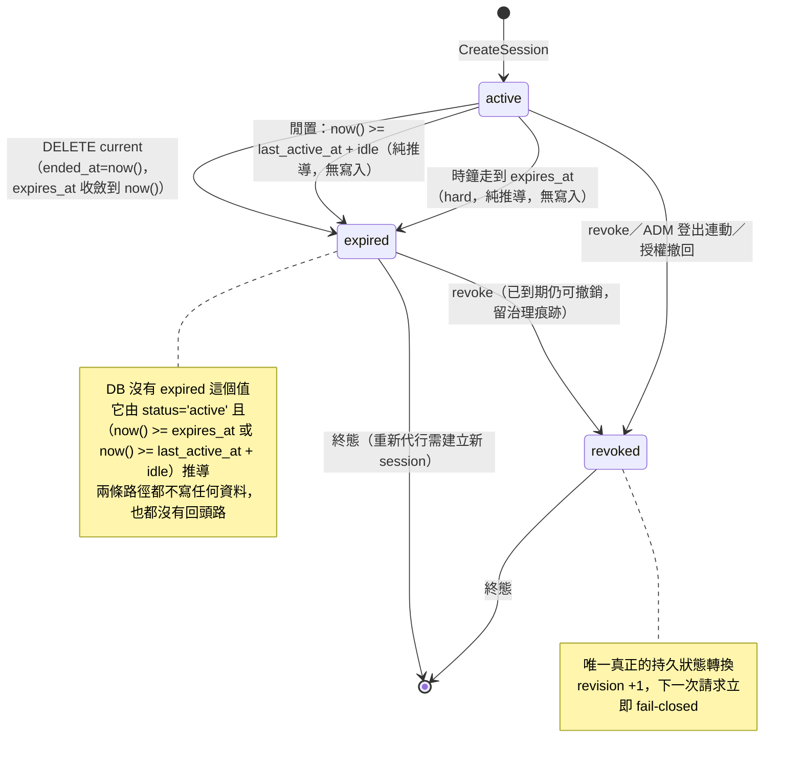

#### 7.5.4 為什麼沒有排程器把 active 改成 expired

「結束代行」被實作成**立刻到期**（`expires_at` 收斂到 `now()`），而不是新增一個 `ended` 狀態值，理由有三：

1. **語意一致**：對外只有一個問題「這個工作階段還能不能用」，答案由 `expires_at` 一個欄位決定。若同時存在「ended 狀態」與「到期時間」，就有兩個真實來源，而它們必然會在某個路徑上不一致。
2. **不需要任何排程器**。若 DB 真的存 `expired`，就必須有東西定時把到期的列從 `active` 改過去——那是一支純粹為了資料整潔而存在的排程器，屬 §22 明令拒絕的「資料完整性監測」類別。推導狀態讓這支排程器**根本不需要存在**。
3. **佔位問題另有解**：兩條 partial UNIQUE 會被過期未結束的列佔住，這由 `CreateSession` 同 tx 的同步前置 gate 解決（§7.4.1），不是排程器。

**閒置逾時沿用同一個形狀，因此同樣沒有排程器**：`last_active_at` 是活動時間戳，「閒置多久算逾時」由讀取時的推導回答（§7.5.1 第 3 順位），**沒有任何東西需要定時去掃它**。這一點是「把順延併進既有那次 credential 反查」而非「前端心跳」或「掃描 worker」的直接結果——後兩者各自會帶進一支排程器或一條額外的請求流量，而本設計連一個 tick 都不需要。⚠️ **佔位收斂的述詞必須同波擴充**：`CreateSession` 的前置 gate 若只看 `expires_at <= now()`，閒置逾時的列會**繼續佔住兩條 partial UNIQUE**，操作者重建工作階段時撞 9268／9269 而畫面上完全看不出原因（§7.4.1 已同步）。

#### 7.5.5 `revision` 的 bump 規則

`revision` 是 **session 記錄本身的樂觀鎖版本**，與資源版本（§7.4.2 的 `expectedVersion`）是**兩個完全不同的概念**，不可混用（逐欄對照見 §14）。

| 動作 | bump？ |
|---|---|
| 主動結束（`DELETE current`） | ✅ +1 |
| 撤銷（`revoke`／ADM 登出連動／授權撤回時的同 tx 轉態） | ✅ +1 |
| 自然到期（時鐘走到 `expires_at`） | ❌ ——推導狀態，無任何寫入 |
| 閒置逾時（時鐘走到 `last_active_at + idle`） | ❌ ——同樣是推導狀態，無任何寫入 |
| `GET current` 輪詢（每 30 秒＋focus／reconnect） | ❌ **絕對不可**（**也不順延 `last_active_at`**） |
| 任何代行讀取 | ❌ ——但**會順延 `last_active_at`**（順延不是狀態轉換） |
| 任何代行寫入（改商品、發貼文） | ❌ ——它改的是資源版本，不是 session 版本（同樣**會順延 `last_active_at`**） |

**bump 的來源恰為兩種：結束與撤銷。** 兩者都是「工作階段從此不能再用」的一次性轉換，此外沒有第三種寫入會動到這一列的內容——`capabilities` 快照在建立後不可變（§7.5.2），因此不存在「capability 縮減」這種 bump 來源。

⚠️ **`last_active_at` 的順延是「這一列有一次 `UPDATE`」，但它不是狀態轉換，因此不 bump `revision`。** 這是本節最容易被寫錯的一步：實作者看到 `UPDATE delegated_operation_sessions …` 很自然會順手加上 `revision = revision + 1`（其餘每一句 UPDATE 都有），而那會讓**每一次代行請求都改變 `revision`**——九欄對帳（§7.2.1 B1）於是在建立後的第一次資源請求就失敗，症狀是「後端全 200、操作者永遠進不了工作區」。⇒ §6.2.4a 的 SQL 只准動 `last_active_at` 一欄，連 `updated_at` 都不動（`updated_at` 的語意是「狀態轉換時同步更新」，§5.1.1）。

**讀取時 bump `revision` 會直接讓建立流程的九欄對帳失敗**（§7.2.1 B1），症狀是「後端全 200、操作者永遠進不了工作區」。

#### 7.5.6 稽核列 `result` 的生命週期

| From ＼ To | PENDING | SUCCEEDED | FAILED |
|---|---|---|---|
| **PENDING** | — | ◯ | ◯ |
| **SUCCEEDED** | - | — | - |
| **FAILED** | - | - | — |

- 三個值**都是合法終態**（`PENDING` 的語意、查詢呈現與「明確不做對帳」見 §5.1.3）。
- 只有 `result`／`resource_id`／`after_snapshot`／`changed_fields`／`resource_version_after`／`biz_code`／`confirmed_at` **七欄**允許被 confirm 更新**一次**（CAS 條件 `WHERE result = 'PENDING'`），另 `notified_at` 由 outbox dispatcher 更新一次；其餘欄位寫入後不可變（append-oriented）。**白名單的 SSOT 是 §5.1.3，本節只引用不重新窮舉**——少列 `biz_code` 的後果是 OBS9 的述詞（`result='FAILED' AND biz_code = 9280`，§8.2.3）**恆為 0**、`DelegationWriteUnconfirmed` 永不觸發、§12.4 ⑦ 的人工對帳查詢零命中；少列 `resource_version_after` 則讓同一條對帳失去比對基準。`resource_id` 之所以在白名單內，是因為建立類操作在 intent 當下還沒有 id（因此該欄可為 NULL，見 §5.1.3）。
- 查詢與 UI：`PENDING` 不計入結束摘要的「已執行 N 項」。

---

### 7.6 排程發布

貼文支援「立即發布」與「排程發布」兩種模式（UI 的 radio ＋ 日期／時間 picker）。排程發布落在本期範圍內，且必須完整滿足 §29。

> 排程用到的 `cms_post` 欄位（`scheduled_publish_at`／`schedule_state`／`scheduled_by_session_id`／
> `schedule_lease_owner`／`schedule_lease_expires_at`／`schedule_next_attempt_at`／`schedule_retry_count`
> 與索引、CHECK）**定義一律見 §5.1.5**，本節不重列。tick 週期、租約長度、候選窗口三個參數的**數值 SSOT ＝ §8.5.1 env 表**，本節只引用其語意。

#### 7.6.1 執行流程

| 階段 | 動作 | 稽核 |
|---|---|---|
| T0 建立排程 | ADM 於工作區選「排程發布」＋時間 → `POST .../posts/{id}/publish` 帶 `scheduledAt` → social-service 寫 `cms_post.scheduled_publish_at`、`schedule_state='pending'` 與 `scheduled_by_session_id` | 稽核 `action=POST_SCHEDULE`、`result=SUCCEEDED`（排程**這個動作**當下就成功了） |
| T1 到點執行 | 排程 worker 每個 tick 逐列以單列 CAS claim → 呼叫 `RecordAuditIntent`（`origin=scheduled`，`session_id` 取自 `scheduled_by_session_id`，`idempotency_key` 見下方定版） | 稽核 `action=POST_PUBLISH`、`result=PENDING` |
| T2 發布 | social-service 在自己的 tx 內把貼文轉為已發布（**只改 `publish_status` ＋ `published_at`**，見下方「T2 的寫入面」） | — |
| T3 收尾 | `ConfirmAuditResult(SUCCEEDED)`，同 tx 寫 outbox → 通知賣家 | 稽核轉 `SUCCEEDED` |

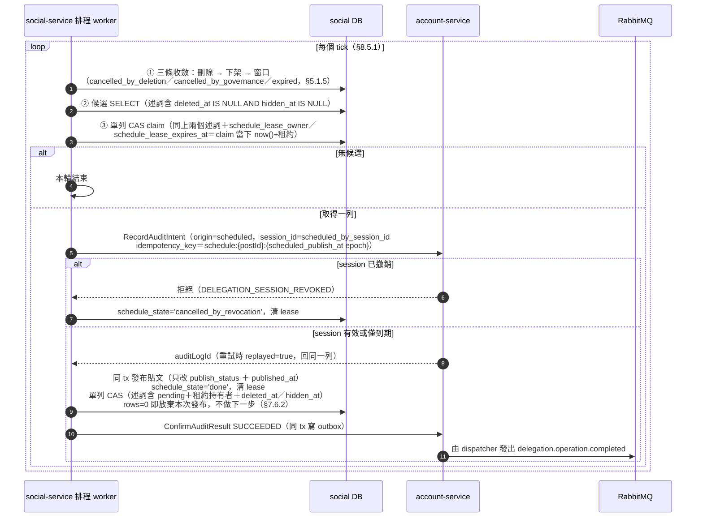

**排程 intent 的冪等鍵（定版）**

```
idempotency_key = "schedule:{postId}:{scheduled_publish_at 的 Unix epoch 秒}"
```

例：`schedule:2699000000000007:1786748400`。它寫進稽核列的 `idempotency_key` 欄（§5.1.3），因此受 partial UNIQUE `uq_aoal_session_idempotency`（`(session_id, idempotency_key) WHERE idempotency_key IS NOT NULL`）約束。

| 問題 | 答案 |
|---|---|
| **租約重試會不會產生第二列 `PENDING`？** | **不會。** worker 崩潰後租約到期、該列回到候選集合被重新 claim，重跑的 `RecordAuditIntent` 帶的是**同一把鍵**（`postId` 與 `scheduled_publish_at` 都沒變），命中既有列即回既有 `auditLogId` 且 `replayed=true`，不 INSERT 第二列。worker 據此直接續跑發布，不重寫 intent |
| **為什麼不用隨機值或 worker 的執行序號？** | 每次 claim 都是新的一輪執行，隨機鍵會讓每次重試各寫一列 `PENDING`。一則貼文重試三次就留下三列「結果未確認」的假稽核，而 `PENDING` 比率是 §9.1 的 SLI ——它會被自己的重試機制汙染 |
| **為什麼鍵裡要有 `scheduled_publish_at`？** | 同一則貼文可以被改期後重新排程（取消舊排程、設新的 `scheduled_publish_at`），那是**另一次**發布動作，必須各自留痕。只用 `postId` 會把後一次靜默折疊進前一次，稽核上看起來像「只排程過一次」 |
| **這把鍵從哪裡來？** | **worker 端導出**，不來自任何 HTTP header —— 排程路徑沒有互動式請求，也就沒有 `Idempotency-Key` 可用。兩個組成部分都取自被 claim 的那一列本身，因此同一列的每次重試必然算出同一把鍵 |

⚠️ **`scheduled_publish_at` 取 claim 到的那一列的欄位值，不是 `now()`，也不是 worker 進 tick 的時間。** 用時間點以外的任何東西當第二段，就等於讓重試各自算出不同的鍵，整條冪等保證失效。

**T2 的寫入面：排程執行只改兩個業務欄位，因此不需要 `expectedVersion`**

| 排程執行**會**改的欄位 | 排程執行**不會**改的欄位 |
|---|---|
| `publish_status`（→ `4402` 已發布）、`published_at`；以及租約收尾用的 `schedule_state`（→ `done`）、`schedule_lease_owner`／`schedule_lease_expires_at`／`schedule_next_attempt_at` | 標題、內文、圖片、hashtag 等**任何內容欄位**，以及樂觀鎖欄位 `version` |

理由：**排程是「到點發布」，不是「到點覆蓋內容」。** 內容在 T0 之前就已經寫定，T1–T2 只是把一個已授權的狀態轉換執行掉。既然不覆蓋任何內容欄位，就沒有「我以為的內容被別人改掉了」這種衝突可言 —— 賣家在等待期間繼續編輯這則貼文完全合法，發出去的就是他最後編輯的版本，**這是正確行為而不是 race**。`expectedVersion` 存在的目的是保護「讀-改-寫」，而這裡沒有讀-改。

由此推出三條實作要求：

1. **發布的 UPDATE 不帶 `AND version = $n` 述詞，也不 bump `version`。** 併發安全全部由 `schedule_lease_*` 的單列 CAS 承擔（§7.6.2），與資源樂觀鎖是兩套互不相干的機制（對照見 §8.4.4）。
2. **稽核列的 `resource_version_before` 與 `resource_version_after` 填入該貼文當下的 `version` 原值且兩者相等** —— 記錄「發布時這則貼文處於哪個版本」，不宣稱這次操作改了版本。
3. **定版：貼文在等待期間被賣家刪除或被平台強制下架時，排程一律不執行**，且兩者留下**不同**的終態值（`cancelled_by_deletion`／`cancelled_by_governance`）。機制是**讀時防禦四件套**：worker 每個 tick 先跑三條收斂語句（刪除 → 下架 → 窗口），再跑候選 SELECT 與 claim，而候選 SELECT 與 claim 的述詞各帶 `AND deleted_at IS NULL AND hidden_at IS NULL`；**第四件是終寫（T2）本身**——發布語句同樣帶 `AND deleted_at IS NULL AND hidden_at IS NULL`（外加 `schedule_state='pending'` 與租約持有者），`rows = 0` 即放棄本次發布。前三件都只防到 **claim 當下**，而 claim 到 T2 之間還隔著 intent 0.8s ＋ 發布 tx 5.0s（§8.5.1 (C) 表），**那個窗口只有第四件守得住，且它在單副本下同樣存在**。SQL 全文與順序理由見 **§5.1.5**（前三件）與 **§7.6.2**（第四件），「這為何不是補償任務」的判準見 **§5.1.5**。

   **這裡要防的危害不是「治理下架被排程復活」——照字面那句不成立。** T2 的寫入面（見上表）只改 `publish_status` 與 `published_at`，而 social-service 五支公開／買家側查詢全部過濾 `hidden_at`（`posts.sql` 的 `ListPosts`／`CountPosts`／`ListPostsByHashtagName`／`CountPostsByHashtagName` 與 `hashtag.sql` 的 `SelectPopularHashtagsInRange`）⇒ 一則被下架的貼文即使 `publish_status` 被改成已發布，買家當下仍看不到它。真正的危害有四條：

  | # | 危害 | 機制 |
  |---|---|---|
  | **C**（最嚴重） | **治理恢復（RESTORE）的語意被悄悄改寫** | 時序：草稿＋排程 → 治理下架（`hidden_at` 有值）→ 排程照發（`publish_status` 轉已發布，當下無可見後果）→ 賣家申訴成功、admin RESTORE 只清 `hidden_at` ⇒ 三個條件同時成立、貼文對全體買家可見。admin 按下 RESTORE 時的心智模型是「還原到下架前的狀態」，而下架前它是**草稿、不可見**。**治理處分的效力被一條代行路徑間接改寫，而 admin 看不到這件事。** 它不違反 §8.1.0 的四道保證（那四道守的是履約／金流），但違反 §2.2「強制下架屬平台治理、不進代行工作區」的劃界精神 |
  | **B** | **兩張稽核表對同一則貼文給出互相矛盾的敘事** | 治理側落一列 `HIDE_TARGET`，代行側落 `POST_PUBLISH／SUCCEEDED` 並經 outbox 通知賣家「已發布」；賣家點進去看到的是下架狀態。稽核可解釋性是本書的核心價值（§8.1.0／§12.4 的舉證 SQL 全建立在它上面） |
  | **A** | hashtag 計數器被錯誤累加 | 屬 `publish_status` 讀取路徑收斂（F6）的範圍，不屬本項。**已於 §5.1.5 的 F6 段定版：草稿不計數、轉為已發布時才 +1** ⇒ 本節的三條收斂**不需要**補 `-1`（被取消的列恆為草稿，從未被計數） |
  | **D** | 對已退場店家繼續寫入業務資料 | `seller.deleted` 會把該店貼文整批軟刪（`SoftDeletePostsBySellerID`）；排程若照發，會在已刪除的資料列上寫 `published_at`、寫一列代行稽核、並對一個已刪除帳號發通知（`delegation_notification_failed_total` 上升） |

   **為什麼賣家自刪與平台強制下架在「發不發」這題上同等處理**：既有程式碼對兩欄的排序是明確的 **`deleted_at` ≻ `hidden_at`** ——`GetPost` 只過濾 `deleted_at`（「已刪除＝不存在」），`HidePost`／`RestorePost` 兩支的述詞都含 `AND deleted_at IS NULL`（已刪除者不能被下架、也不能被恢復），而 `deleted_at` 沒有任何反向 query。「擋下架、放行自刪」會造出一個與既有語意方向相反的狀態機。至於「賣家自刪＝放棄，所以可以照發」在邏輯上不通：他放棄的是**這則貼文**，不是「反對排程但同意內容」。
   **但終態值必須分開記兩個**，理由與上一段相反：`hidden_at` **可逆**（`RestorePost` 會把它清成 NULL），`deleted_at` 不可逆——只寫一個籠統的 `cancelled` 會在申訴成功後反查不出取消原因。
   **取消一律不通知賣家、不寫代行稽核**，與既有 `cancelled_by_revocation` 對齊（§7.6.4 同樣只轉態、不寫稽核、不發 outbox）；可解釋性改由 **OBS10 counter（§8.2.3）＋ §12.4 ⑥ 的查詢**承擔。這一條的代價要說清楚：賣家在 T0 就收過「管理員為您排程了一則貼文」的通知（§8.4 W5），之後永遠等不到，也不會被告知取消，而 Seller Center／Seller App 零改動（§2.2 第 10 條）使他沒有自助查詢管道。**要改成「通知」的話，三種取消（`revocation`／`deletion`／`governance`）必須一起做**——只做其中兩種是最差的選項。

#### 7.6.2 搶佔的五個不變式（§29 的四條 ＋ 終寫 CAS）

| 不變式 | 本案取值 | 說明 |
|---|---|---|
| lease 而非永久旗標 | `schedule_lease_owner`／`schedule_lease_expires_at` | 崩潰的列在租約到期（預設 120 秒，§8.5.1）後自動回到候選集合。**禁止**用 `SET schedule_state='publishing'` 這種無時間欄的述詞 claim |
| 租約 **>** 單筆最壞耗時 | 120s > **7.8s**（intent 0.8s ＋ 發布 tx 5.0s ＋ confirm 總預算 2.0s） | 每個外部呼叫都有 deadline，最壞耗時才有上界。**三項各自都是 §8.5.1 (C) 表的參數**（`_AUDIT_INTENT_DEADLINE_MS`／`_PUBLISH_TX_BUDGET_MS`／`_AUDIT_CONFIRM_TOTAL_BUDGET_MS`），因此這條不等式由 `Validate()` 在啟動時斷言，不是散文承諾 |
| 租約 **<** 候選窗口剩餘壽命 | 120s ≪ 24h | 候選窗口定義為 `scheduled_publish_at <= now() AND scheduled_publish_at > now() - SCHEDULED_POST_PUBLISH_WINDOW_HOURS`（預設 24h，SQL 走參數不寫字面值，見 §5.1.5）；超過窗口仍未執行者由 worker 每個 tick 的收斂語句轉 `schedule_state='expired'` 並告警（**SQL 與「這為何不是補償任務」的判準見 §5.1.5**；窗口長度 env 見 §8.5.1；告警見 §8.2.4）——避免無限期延後發布一則已經過時的貼文。**這條在 outbox 上不成立而在這裡成立**，因為排程有明確的候選窗口，而 outbox 沒有 |
| 逐筆取租約基準 | 每列各下一次 claim，`now()` 在該列的 claim 語句內取 | 一次 claim 一批並在迴圈外算基準，會讓不變式退化成「批次總耗時 < 租約」 |
| **終寫（T2）也是 CAS** | 發布語句自帶 `schedule_state='pending'` ＋ 租約持有者 ＋ `deleted_at IS NULL AND hidden_at IS NULL` 四個述詞，`rows = 0` 即放棄本次發布（SQL 全文見下方） | **這一條不是 §29 的四條之一，但缺了它前四條就守不住整條路徑**：§5.1.5 的收斂語句、候選 SELECT 與 claim 三者都只防到 **claim 當下**，而 claim 到 T2 之間還有 intent 0.8s ＋ 發布 tx 5.0s（§8.5.1 (C) 表）的窗口——貼文在這段期間被刪除／被強制下架，或租約已到期被另一個 pod 接手，claim 時的述詞全部無法回溯生效。**這個窗口在單副本下同樣存在**（賣家自刪與 worker 是兩個進程），不因 `replicas: 1` 而消失 |

**終寫（T2）的 SQL**（發布與租約收尾在同一句，`rows` 即判定）：

```sql
UPDATE cms_post
   SET publish_status = 4402,              -- PostPublishStatus.PUBLISHED（§6.5.3）
       published_at = $2,                   -- 發布當下的 now()
       schedule_state = 'done',
       schedule_lease_owner = NULL,
       schedule_lease_expires_at = NULL,
       schedule_next_attempt_at = NULL,
       update_time = $2
 WHERE id = $1
   AND schedule_state = 'pending'
   AND schedule_lease_owner = $3            -- 本 pod：租約仍在我手上
   AND deleted_at IS NULL
   AND hidden_at IS NULL
```

**`rows = 0` 的處置：放棄本次發布，且不是錯誤。** 具體要求三條——① **不呼叫 `ConfirmAuditResult(SUCCEEDED)`**（那會讓稽核宣稱一次從未發生的發布，並經 outbox 通知賣家「已發布」，正是 §7.6.1 危害 B 的形狀）；② **不累加 OBS10**（該列的終態值由 §5.1.5 ① 的收斂語句或接手的 pod 負責寫，計數歸它們，重複記會讓 OBS10 的 `reason` 分布失真）；③ **不清租約、不推遲 `schedule_next_attempt_at`**——租約若已被別人持有，動它就是清別人的租約；租約若仍在我手上而 `rows = 0`，那必然是另外三個述詞之一不成立（已被刪除／已被下架／已被收斂轉態），該列本來就不該再回到候選集合。worker 記一行 INFO 後直接跳下一筆。
⚠️ **稽核列也一律不動——連 `ConfirmAuditResult(FAILED)` 都不要寫。** 理由是 `rows = 0` 有兩個成因，而其中一個會被 `FAILED` 寫壞：

| 成因 | 事後判別（若要在 Runbook 分辨） | 為什麼不能寫 `FAILED` |
|---|---|---|
| **(A) 租約被接手** | `schedule_state` 仍為 `pending`、`schedule_lease_owner` 不是本 pod | 排程 intent 的冪等鍵是 `schedule:{postId}:{scheduled_publish_at}`（§7.6.1）⇒ **接手的 pod 拿到的是同一列 `auditLogId`**，而 `ConfirmAuditResult` 的述詞是 `WHERE result='PENDING'`（§8.4 W5）、**先到先贏**。本 pod 搶著寫 `FAILED`，會把接手者隨後那次**成功發布**的 `SUCCEEDED` 擋掉 ⇒ 稽核記成失敗、outbox 一列都不建、賣家永遠收不到通知，而貼文其實已經發出去。這一列的 `PENDING` 是**暫態**，由接手者收尾 |
| **(B) 該列已被收斂成終態** | `schedule_state` ∈ `cancelled_by_deletion`／`cancelled_by_governance`／`expired`／`cancelled_by_revocation` | 這裡沒有 (A) 的競態，**寫得下去而且要寫**：`ConfirmAuditResult(FAILED, 9283)`。⚠️ **但必須先確認租約還在自己手上**——(A) 與 (B) 在 `rows = 0` 的當下**長得一模一樣**，唯一分得開它們的事實是「我還持不持有這一列的租約」。⇒ 實作先打一次租約歸屬探針（`IsLeaseHeldBy`），**仍持有才寫 `FAILED`**；已被接手則什麼都不寫、留給接手者收尾。探針本身失敗時**退回不寫**：誤寫 `FAILED` 會擋掉接手者真實的 `SUCCEEDED`（`ConfirmAuditResult` 的述詞是 `WHERE result='PENDING'`、先到先贏），而漏寫只是多留一列 `PENDING`——兩者傷害不對等，不確定時一律選後者 |

**因此排程路徑是 `PENDING` 的第三個來源**，與 §7.3.3 的兩個視窗都不同（視窗 A ＝ 連 confirm 都送不出去、視窗 B ＝ 領域寫入結果未知）：這裡 confirm 送得出去、結果也明確，只是**在租約已被接手時刻意不送**（留給接手者）。⇒ **§12.4 ② 判讀 `PENDING` 殘留時，`origin = 'scheduled'` 的列必須先按上表分辨 (A)／(B)，不得一律當成視窗 A 去補正**：(A) 會自己消失（下一次接手成功即轉 `SUCCEEDED`）；(B) 在正常路徑上**已經被寫成 `FAILED` ＋ 9283**，因此**留在 `PENDING` 的 (B) 只剩一種成因＝租約歸屬探針當下失敗**（見上表末段）——那一列是永久殘留且該貼文確實沒有被發布，正確處置是照 §12.4 ⑥ 查 `schedule_state` 確認取消原因後**原樣留著**，不要人工改成 `SUCCEEDED`。

**(B) 的量級**：命中需要「賣家刪文／平台下架／逾候選窗口」恰好落在 claim → T2 的 5.8 秒內（§8.5.1 (C) 表），量級可忽略。

> ⚠️ **(B) 必須寫 `FAILED` ＋ 9283 `DELEGATION_SCHEDULED_POST_NOT_PUBLISHABLE`（§6.5.1），不得留 `PENDING`**（落點 `services/social-service/internal/worker/post_schedule_worker.go`）。兩者是不同的事實：`PENDING` 的語意是「**不知道**寫入成不成立」，而 (B) 是「**明確知道**它不成立」——留成 `PENDING` 等於讓稽核少講一件它其實知道的事，並讓 §12.4 ② 的判讀永遠停在「查 `schedule_state` 才知道」。
> 下面這條機械重評述詞可以留著當健康度指標，但要注意它的語意——`SELECT count(*) FROM admin_operation_audit_logs WHERE result='PENDING' AND origin='scheduled' AND created_at < now() - interval '1 hour'` 穩定 > 0，現在表示的是**租約歸屬探針在持續失敗**（(B) 的正常路徑已經會轉 `FAILED`），那是 DB 或 repo 層的問題，不是窗口估錯。

失敗釋放語意同 §7.4.4：清空 lease ＋ `schedule_retry_count + 1` ＋ `schedule_next_attempt_at = now() + 退避`，**且釋放語句本身帶 `AND schedule_lease_owner = $1 AND schedule_state = 'pending'` 守衛**（形狀與 §5.1.4 的 outbox 釋放語句同源，理由同樣是「不得清掉別人的租約」；`rows = 0` 同樣不是錯誤）；「卡住的排程」偵測述詞是 `scheduled_publish_at <= now() - 10min AND published_at IS NULL AND schedule_state = 'pending' AND deleted_at IS NULL AND hidden_at IS NULL`，**不依賴 lease 欄位**——同樣地，改動任一邊都必須同時檢查另一邊。
註：述詞末尾那兩個條件是「貼文被刪除／被強制下架時不發」的連帶（§7.6.1 第 3 點）：已被刪除／已被強制下架的列在收斂跑到之前最多會停在 `pending` 一個 tick，不排除它們會讓這條偵測在每個 tick 邊界短暫誤報。**它們與 §5.1.5 ① 的三條收斂語句是同一組改動，移除任一邊都要同時檢查另一邊。**

**必答題：claim 之後還有誰寫得到租約欄？——沒有人。**（[多副本排程搶佔規範](../開發規範/多副本排程搶佔規範.md) §五 必答題 4 的 blockquote 要求逐句回答，並說明是怎麼確認的。）兩張表的答案分別是：

- **`cms_post`**（`schedule_lease_owner`／`schedule_lease_expires_at`）：social-service 走 Go／sqlc，**沒有 ORM 的整列更新路徑**（無 `updateById`／`save` 這類「字面上看不到欄名」的寫法），每一支查詢的 SET 清單都逐句可見。`cms_post` 的**全部**寫入查詢已於 §5.4 F41 逐條列出（`CreatePost`／`UpdatePost`／`HidePost`／`RestorePost`／`SoftDeletePost`／`SoftDeletePostsBySellerID`／六支互動計數／兩支 `Reconcile*Counts`），逐句核對其 SET 清單**皆不含這兩欄**；§5.4 F41 同時已核對 `services/social-service/internal/**` **無任何繞過 sqlc 直寫 `cms_post` 的裸 SQL**。本案新增的寫入者只有兩類，且都帶租約述詞：worker 的 claim／終寫／失敗釋放（本節）與 §5.1.5 ① 的三條收斂語句（刻意不帶租約守衛，理由見 §5.1.5）。
- **`admin_operation_outbox`**（`lease_owner`／`lease_expires_at`）：全新表，寫入者恰有四處且全部在 dispatcher 與其生命週期內——claim、成功轉終態、失敗釋放（§5.1.4）、優雅關閉的守衛式釋放（§12.3）。稽核 confirm 的同 tx 只 **INSERT** 一列（§8.4 W5），不 UPDATE。
- **G4 為既有路徑加 `version = version + 1` 不會擴及租約欄**：那是逐句手寫的欄位追加（§5.4 F41 第 2／3 條），不是整列更新。
- ⇒ **新增任何一支寫 `cms_post` 的查詢時，本問與 F41 的 bump 判準要一起回答**：先問「它 bump 不 bump `version`」，再問「它有沒有碰到 `schedule_lease_*`」。第二問答「有」而又不帶租約述詞，就是把 at-most-once 鑿回來。

#### 7.6.3 裁決：工作階段到期後，排程仍會執行

**定版：會執行。**

理由：**排程發布在建立當下就已完成全部授權**——capability（`posts.publish`）已驗、`operationReason` 已填、稽核 intent 已落、目標與資源歸屬已綁定。到期的是「**操作者的操作權**」，不是「**已授權動作的效力**」。這兩者是不同的東西：

- 到期之後 ADM **不能再**下新命令（任何互動式請求一律 `DELEGATION_SESSION_EXPIRED`）。
- 到期之前已經下達、只是延後生效的命令，其效力來自下達當下的授權，不因操作者後來離開而失效。

歸屬如何保留：稽核列的 `session_id` 永遠指向 `scheduled_by_session_id`；session 記錄永不硬刪（tombstone，§7.2.4 E3），該值恆有效。因此排程在 T1 執行時，仍能完整還原「誰、以什麼身分、依據什麼理由、在哪個工作階段中安排了這次發布」。

實作上的差別只有一處：`RecordAuditIntent` 有兩種來源模式——

| `origin` | session 必須 | 目標店家必須 | 用途 |
|---|---|---|---|
| `interactive` | `status='active'` **且** `now() < expires_at` | 仍可代行（由 Gateway 第 8 項在請求路徑上判，§8.1.3） | 所有由 ADM 當下觸發的讀寫 |
| `scheduled` | `status <> 'revoked'`（**允許已到期**） | 仍可代行（**由 account-service 在本次呼叫內判**，見下方例外） | 排程 worker 執行已授權的延後動作 |

`origin` 是稽核表的**持久欄位**（`TEXT NOT NULL`，見 §5.1.3），且**必須由 `RecordAuditIntentRequest` 帶入**——它不能由 account-service 自行推定，因為「這是不是排程來的」只有呼叫端知道。這個欄位是**提權欄位**（它決定用哪一組授權條件），因此判準是**執行期機械強制**而非測試：account-service 只在「內部授權簽章驗證通過且 `serviceName == "social-service"`」時才接受 `scheduled`，其餘一切情形一律以 `interactive` 落庫。判定表與理由見 §8.1.4(b-1)。

##### 例外：目標店家被停權／關店／刪帳號時，排程一律不執行

**「到期不影響已授權動作的效力」這條裡的「到期」，指的是操作者的操作權消失，不是被代行的那家店消失。** 店家被停權／關店／刪帳號時，這次代行的**正當性基礎本身**已經不在了——不是操作者離開，是被代行的對象已經不該再被平台以它的名義寫入任何東西。因此店家不可代行時的定版在排程上與「到期不影響已建立的排程」方向相反：**已排程但未發布的貼文不發。**

這與「貼文被刪除／被強制下架時不發」（§7.6.1 第 3 點）是**同一組讀時防禦**，只是防的層級不同：前者防的是**這則貼文**不該發，本項防的是**這家店**不該被寫。兩者都在 worker 執行時 fail-closed，都不由治理端推送、不追殺任何東西。

**機制（刻意不新增任何狀態值與指標 label）**：`RecordAuditIntent(origin=scheduled)` 的前置條件由「`status <> 'revoked'`」擴充為「`status <> 'revoked'` **且** 目標店家仍可代行」。後者不成立時，account-service 在**同一次呼叫**內：

1. 以 `pkg/delegation.StoreOperable` 判定（與 preflight、Gateway 第 8 項共用同一份規則，§8.1.3）——資料來源是 seller-service `GetSeller`，account-service 為 preflight 本來就要打這條邊（§7.2.1 ①），因此本路徑**不新增第二條服務間呼叫邊**——但那條邊本身是**本案全新的**，NetworkPolicy 與 client 落點見 §4.3 表第 2 列；
2. 把該 session 轉為 `revoked`（`revoke_reason='store_not_operable'`，與 Gateway 第 8 項同一個字面值）；
3. 回 **9271 `DELEGATION_SESSION_REVOKED`**。

於是 worker 走的是**既有的那個分支**：`schedule_state='cancelled_by_revocation'`、清 lease、OBS10 累加 `reason="revocation"`（§7.6.4、§8.2.3）。

**回 9271 不是把原因說謊**：判定成立的那一刻 session **真的**已經被撤銷，9271 描述的是當下的事實；真正的起因由 session 列的 `revoke_reason='store_not_operable'` 完整保留，事後以 `SELECT revoke_reason FROM delegated_operation_sessions WHERE id = <scheduled_by_session_id>` 一句就查得出來。**這是刻意的設計選擇**：另立一個 `schedule_state='cancelled_by_store_not_operable'` 需要同時改 §5.1.5 的 CHECK、OBS10 的封閉 label 集合與 worker 的分支邏輯，換到的資訊在 session 列上本來就有。

⚠️ **這一道與 Gateway 第 8 項是兩道獨立的判定，不是同一道的兩個呼叫點，兩道缺一不可**：
- 只有 Gateway 那道 → 代行者在停權後沒有再送任何請求時，session 不會被轉態，排程照發。
- 只有這一道 → 代行者可以繼續互動式寫入**最長 30 分鐘**（hard 上限；他還在動作，閒置逾時不會先到），「進行中的工作階段立即失效」這條保證不成立。

**「問不到答案」的處置與 §8.1.3 一致，但落點不同**：seller-service 逾時／不可用時，account-service **不轉終態、不拒絕成 `revoked`**，而是回 9280（`DELEGATION_UPSTREAM_UNAVAILABLE`）；worker 收到 9280 **不取消排程**，走既有的失敗釋放語意（清 lease ＋ `schedule_next_attempt_at = now() + 退避`，§7.6.2），下一個 tick 重試。理由同 §8.1.3：轉終態不可逆、上游抖動是暫時的，而排程路徑另有 24 小時候選窗口兜底（逾窗轉 `expired` 並告警，§7.6.2）。**「不知道」絕不可以走上「取消」這條不可逆的路。**

#### 7.6.4 撤銷會取消未執行的排程

**撤銷（`revoked`）與到期（`expired`）在排程上的待遇刻意不同**：到期只是操作者離開；撤銷是「這次代行本身被判定不該發生」，其下所有尚未生效的動作都應該一併停止。

機制上**不做任何跨服務推送**（那會變成補償流程）：worker 在 T1 執行前必然要呼叫 `RecordAuditIntent`，而 `origin=scheduled` 的判定條件是 `status <> 'revoked'` ⇒ 已撤銷的 session 會在這一步被拒絕（`DELEGATION_SESSION_REVOKED`），worker 據此把該排程轉為 `schedule_state='cancelled_by_revocation'` 並清 lease。**fail-closed 發生在執行時，不需要撤銷端去追殺任何東西。**

同理，ADM session 登出時其下所有 active 工作階段一併撤銷（見 §7.5.2），因此登出也會連帶讓未執行的排程在到點時被拒絕——這是同一條機制的自然結果，不是額外邏輯。

**`cancelled_by_revocation` 這個終態值有四個來源，不是一個**（§7.5.2 的 `active → revoked` 觸發者表即其全集）：人工撤銷、ADM 登出連動、**治理端撤回該店的代行授權**（§6.1.15 端點 6 的連帶轉態）、以及**目標店家轉為不可代行**（§7.6.3 例外段與 §8.1.3 第 8 項）。四者都寫同一個終態轉換（`RevokeSession`，登出連動走它的批次版 `RevokeSessionsByActor`）／同一個前置條件被拒，因此 worker 端只有一條分支；要分辨是哪一種，讀 session 列的 `revoke_reason`（固定字面值 `admin_logout`／`store_not_operable`／`delegation_disabled`／`authorization_revoked`／人工填入的工單號；完整對照表見 §12.4 ①）。

### 7.7 媒體引用的釋放路徑

貼文的圖片引用（`asset_reference`，`ref_type = POST`）與業務列分屬兩個資料庫，中間沒有共同 transaction。08 號 §4.6.2 的不變式——**`asset_reference` 集合必須是業務 pointer 集合的超集**——由 `pkg/media.LinkImages` 的順序契約守住，六個媒體擁有者一體適用：

```
① LinkImages（commit 前，失敗即中止）
② 業務列寫入（失敗即中止）
③ ReleaseReferences（commit 後，best-effort）
```

貼文沒有例外：③ 由 `PostUseCase.UpdatePost` 負責（換圖 `keep=[新資產]`、清圖 `keep=nil`、純內容編輯不送）。⚠️ **不得改用 level-triggered reconciler**（獨立 Deployment 每輪重放全部已納管未刪列來收斂）——那是後端服務責任邊界規範明令拒絕的補償任務基礎設施。

**為什麼貼文不需要例外（兩條，分開讀）**：

1. **「貼文一旦被刪除，呼叫端就讀不到那個業務列，best-effort 重試永遠短路」只對靠重讀業務列來重試的形狀成立。** 一支同步的 ③ 手上已經有 `refID` 與 desired，不需要回頭讀那一列；而軟刪列依契約本來就刻意保留引用不釋放，刪除路徑根本不需要 ③。
2. **週期性掃描違反《後端服務責任邊界規範》§二。** 該節禁止 application code 內的週期性 drift 掃描，§三把「reconciliation job」「drift 偵測」整格劃給維運 SQL 與 DB observability，§七的三項例外（跨服務 saga unwind／outbox／CDC）都不涵蓋它。它唯一的產出是「釋放已無人引用的資產」＝ 儲存洩漏的回收，正是 §七 判定準則裡「資料完整性監測」那一側。

**③ 未送達時的殘留與其處置**：

| 狀態 | 方向 | 處置 |
|---|---|---|
| ③ 沒送成功 ⇒ 舊資產的引用留著 | 洩漏（可逆） | 維運稽核偵測、維運動作清理，見 `scripts/audit_media_reference_precheck.py` |
| 業務列指著、media 卻沒有引用 | 資產會被 GC 實刪（不可逆） | ① 是致命步驟，正常路徑產生不出這個狀態；**沒有任何自癒機制**，因此稽核報告把這一格列為最高優先 |
| 軟刪列的資產永遠不被回收 | 刻意接受的存儲成本 | 不處理。真的要清除走 `seller.deleted` handler |

`cms_post` **不得硬刪**：硬刪之後沒有任何一列能推導出「這個 `ref_id` 該掛哪些資產」，而 media 也沒有任何 RPC 能列舉某 `ref_type` 的全部引用 ⇒ 該列在 media 上的引用永久留存。約束的投放點是 `COMMENT ON TABLE cms_post`（`\d+` 看得到）。

---

## 8. 橫切面 (Cross-cutting Concerns)

### 8.1 安全與授權 (Security & AuthZ)

代行營運是本平台第一個「A 帳號對 B 帳號的資源做寫入」的機能。既有的所有授權判斷都建立在
「操作者＝資源擁有者」這個隱含前提上（`x-account-id` 注入 → resolver 解析成 `store_id` → 微服務以
`store_id` 判歸屬），本機能把這個前提拿掉，因此**每一層都必須重新回答「誰在操作、對誰操作、能做什麼」**。
本節是本設計書中唯一定義這三個問題答案的地方。

#### 8.1.0 履約禁區：四道機械保證

> **本節是「代行永遠不得取得履約／金流能力」這條主張的唯一 SSOT。** 全書其他提及禁區的位置
> （§2.2 out-of-scope 表、§4.1.2 支柱一、§4.4.3 Proto 欄位號規約、§6.1.1 端點總表的禁字方塊、
> 下一節 §8.1.1、§12.4 ⑤ 的舉證 SQL、§13 security 的上線阻斷項）一律是本節的**指標或展開**：
> 清單、數量與判準以本節為準，在那些位置改動禁區內容而未同步本節，視為文件缺陷。

「本次代行未執行任何出貨或財務操作」是結束 modal 對營運與賣家的正式宣稱。這句話**不是統計出來的**
——統計只能證明「這一次沒有」，證明不了「做不到」。它由**四道各自獨立成立的機械保證**支撐：
拿掉任意三道，剩下那一道仍然擋得住。

| 道 | 層 | 機械形式 | 違反時的表現（都不是 log warning） |
|---|---|---|---|
| **D1** | 路由層 | Gateway boot 斷言的**四條**檢查（前三條掃 `delegatedRoutes` registry，第四條掃 `/api/v1/admin` 的註冊 group；全文與擋住的具體錯誤見 §8.1.2）：① 路徑不得命中 10 個禁字 ② 每條路由的 capability 參數不得為空 ③ `/api/v1/admin` 之下禁止 wildcard ④ `/api/v1/admin` 之下不經 `requireAdmin()` 的路由必須命中 26 支具名白名單 | **進程啟動 `panic`** ⇒ 帶有漏網路由的 image 根本部署不起來 |
| **D2** | 授權層 — Gateway | admin capability 是**封閉列舉 9 個**（§6.1.1），其中沒有任何一個代表履約或金流能力；未登錄的值在 `RegisterAdmin` 即 panic。Go 常數／golden 檔／**三條 DB CHECK**（`chk_dos_capabilities_closed`／`chk_sda_capabilities_closed`／`chk_aoal_capability_closed`，分別在工作階段表／授權表／稽核表，同一份九值的三個副本）由 §13.1 的 **G2 gate** 鎖成完全一致 | boot `panic`；三處不一致時 `static-gates.yml` 轉紅擋 PR |
| **D3** | 授權層 — 微服務（proto） | 履約類 RPC 的 request message **沒有** `hawkr.common.DelegationContext delegation = 100` 欄位（§4.4.3）。不是「有欄位但拒絕」，是**組不出一個帶 delegation 的請求** | **編譯失敗**——編譯期保證，不是執行期檢查 |
| **D4** | 稽核層 — DB | `admin_operation_audit_logs` 的 `chk_aoal_capability_closed` CHECK 把 `capability` 鎖成封閉九值（§5.1.3）。而稽核 intent 是**所有代行寫入的同步前置 gate**（§8.4 W4）⇒ 履約能力連稽核列都寫不進去 ⇒ 該次 domain write 根本不會被呼叫 | INSERT 被 DB 拒絕 → 整條請求以 `DELEGATION_AUDIT_INTENT_FAILED`（9279）失敗 |

**UI 層（訂單頁不渲染出貨 CTA）不計入這四道。** 它在 **`hawkr-website`**、由該 repo 的
`tests/delegated-operations-ui-contract.test.ts` 守，而且 **UI 隱藏不是授權**——使用者用 devtools 就能
造出請求。它是可用性設計而非安全保證，因此後端這側的宣稱**不依賴它**。

**逐道的「怎麼驗它真的在」。** 每一道都給**正向驗證 ＋ 鑑別力驗證**兩步：只跑正向那步等於沒量測
（弄壞它也不會紅的檢查，綠燈是假的）。鑑別力那步做完必須還原（§13.2）。

```bash
# ── D1 路由層 ────────────────────────────────────────────────────────────
# 正向：既有測試會組裝完整路由表，boot 斷言不成立即 panic ⇒ 測試紅
cd gateway && go test ./internal/router/... -count=1
# 鑑別力：暫時往 delegatedRoutes registry 塞一條含禁字的路由
#   （例：delegatedHandle(g, "POST", "/sellers/:store_id/shipments", CapOrdersRead, h)）
#   param 名必須是 :store_id（gin 同段位不許換名，會先 panic 在 wildcard 衝突
#      而不是禁字斷言 —— 那會給出一個看起來正確的假紅燈，§6.1.0）
#   期望：上面那條測試轉紅，訊息指出命中的禁字。驗完還原。

# ── D2 授權層（Gateway）──────────────────────────────────────────────────
# 正向：Go 常數／golden 檔／DB CHECK 全文三處一致，且恰為 9 個
grep -oE '"[a-z]+\.[a-z]+"' gateway/internal/authz/admin_capability.go | tr -d '"' | sort -u > /tmp/cap_go
sort -u gateway/internal/authz/testdata/admin_capabilities.golden                            > /tmp/cap_golden
# ⚠️ DB 側有**三條**同源的 capability CHECK（工作階段／授權／稽核各一份），三條都要比，
#    只比 chk_aoal 會漏掉另外兩條的漂移。
for c in chk_dos_capabilities_closed chk_sda_capabilities_closed chk_aoal_capability_closed; do
  psql "$ACCOUNT_DSN" -tAc "SELECT pg_get_constraintdef(oid) FROM pg_constraint \
       WHERE conname = '$c'" \
   | grep -oE "'[a-z]+\.[a-z]+'" | tr -d "'" | sort -u                                      > "/tmp/cap_db_$c"
  diff /tmp/cap_golden "/tmp/cap_db_$c" || echo "DRIFT: $c"
done
diff /tmp/cap_go /tmp/cap_golden && wc -l < /tmp/cap_go
# 期望：全部 diff 無輸出、無 DRIFT 行、行數為 9
# 鑑別力：往 golden 檔加一行 fulfillment 後重跑 → 四個 diff 全部必須非空

# ── D3 授權層（微服務 proto）─────────────────────────────────────────────
# 正向：帶 delegation 欄位的 message 逐一列出（期望 18 個，只在 storefront／product／post／order 四面）
#
# ⚠️ 判定必須是 **message 級**，不可用「檔案級」的 grep -rl | xargs grep -lEi。
#    檔案級的寫法實跑會輸出 seller／order／product 三個檔
#    ——因為那三個 .proto 本來就含 payment／certification 等字樣（在別的 message 裡）
#    ⇒ 期望「零輸出」永遠不成立，照抄進 CI 是**永久紅燈**。
cat > /tmp/d3.awk <<'AWK'
FNR==1 { depth=0; name=""; hit=0 }
name=="" && /^[[:space:]]*message[[:space:]]+[A-Za-z0-9_]+[[:space:]]*\{/ { name=$2; hit=0; depth=0 }
name!="" {
  depth += gsub(/\{/,"{") - gsub(/\}/,"}")
  if ($0 ~ /DelegationContext[[:space:]]+delegation[[:space:]]*=[[:space:]]*100/) hit=1
  if (depth<=0) { if (hit) print FILENAME": "name; name=""; depth=0 }
}
AWK
awk -f /tmp/d3.awk $(find api/proto -name '*.proto' | sort)
# 期望恰 18 列：order 2（GetSellerOrders／GetSellerOrderDetail）、product 7、
#              seller 4（GetSeller／UpdateSeller／UpdateLogo／UpdateCover）、social 5
#
# 鑑別力（這一步才是真正的斷言）：履約／金流面一個都不能有
awk -f /tmp/d3.awk $(find api/proto -name '*.proto' | sort) \
 | grep -Ei 'shipment|payment|refund|payout|invoice|bank|identity|certification|fulfill'
# 期望：**零輸出**。任一命中 ＝ D3 已被打穿，屬上線阻斷項（§13 security）
# 鑑別力已驗：把 delegation 欄位注入 payment.proto 的 CreatePaymentRequest 之後重跑 → 該列被印出
# （比對對象是「檔名: message 名」整行，因此「message 名含禁字」與「整個 .proto 屬禁區面」兩種
#   破壞形式都抓得到，而不會被同檔其他 message 的字樣誤傷）

# ── D4 稽核層（DB）──────────────────────────────────────────────────────
# 正向：約束存在且值域恰為九值
psql "$ACCOUNT_DSN" -tAc "SELECT pg_get_constraintdef(oid) FROM pg_constraint \
     WHERE conname = 'chk_aoal_capability_closed'"
# 鑑別力：直接插一列履約 capability，必須被 DB 擋下
psql "$ACCOUNT_DSN" -c "INSERT INTO admin_operation_audit_logs (…, capability, …) \
     VALUES (…, 'shipment.write', …);"
# 期望：ERROR: new row for relation "admin_operation_audit_logs" violates check
#       constraint "chk_aoal_capability_closed"
```

**四道之外還有一條旁證，但它不是保證**：§12.4 ⑤ 的
`SELECT … GROUP BY capability, resource_type` 只能證明「這個 session 沒有履約列」。稽核舉證時它必須
與上面四道一起出示，**單獨給它等於只回答了「這次剛好沒有」**，而不可代出貨驗收（§13 security 第一組
五條）要的是「不可能有」。

**新增任何 capability 都必須把這四道重跑一遍**（D4 還要付一次 migration）。capability 不是「加一個
字串常數」，是治理級變更。

#### 8.1.1 三層鎖定的機械保證

> 本節是 §8.1.0 四道保證的**層次展開**：講的是同一件事在「UI／路由／授權」三層上的分佈與繞過後果。
> 禁區清單、道數與驗證命令以 §8.1.0 為準，本節不重列。

產品需求（ADM 代行營運 v2.0）與 UI 承諾的是「三層鎖定：畫面不渲染履約動作・ADM 路由沒有 shipment
mutation・Gateway capability 明確拒絕」。後端據此落成**三層**——UI 層／路由層／授權層，其中授權層
再分 Gateway 與微服務兩個子項。每層各自獨立成立，任一層被繞過其餘各層仍然擋得住。

| # | 層 | 保證方式 | 可驗證性（怎麼證明它真的在） | 被繞過會怎樣 |
|---|---|---|---|---|
| 層 1 | **UI 層** | 訂單頁**不渲染** row checkbox、批次列與任何出貨 CTA（不是 `disabled`）；**禁區模組（履約／金流／身分）連選單項都不渲染**。⚠️ **「本期未開放但非禁區」的模組相反**——庫存管理／優惠券／客戶管理／客戶訊息／數據分析／市場行情／處置與申訴**七項**依 mockup 與賣家中心既有側欄 **照常渲染選單項**，點入顯示「不在本次代行授權範圍」空狀態（§6.1.14；渲染集合 ⊋ 可操作集合是刻意的）。另有「總覽」渲染且可操作，但它**不打自己的端點**，由既有 list 端點的 `total` 組成。兩者刻意長得不一樣：禁區是永遠不會有，未開放是本期沒有，都用隱藏表達就再也分不出來 | **由兩支測試共同承擔，缺任一支這一層就只保住一半**：① `hawkr-admin` 的 `tests/delegated-operations-ui-contract.test.ts`（縮到**入口面**——`MerchantOperationEntry`／`OperationPreflightDialog`／`services/delegated-operations.ts` 三檔，斷言 source 內無 `/api/v1/app/`、無 `sellerToken\|accessToken\|refreshToken`）② **`hawkr-website` 必須新建一支同名同形的測試涵蓋工作區面**（context bar／阻擋畫面／boundary 的 a11y 與 lifecycle 斷言整組搬過去，＋訂單頁不渲染出貨 CTA 的斷言）。⚠️ **只寫「由 admin 的契約測試守」是錯的**：那些被斷言的元件已經不在 admin repo，留著這句話會讓「保證在別的 repo、而那邊沒人去建」的洞看起來像已完成（清單見 §4.5 admin 表） | 使用者用 devtools 造請求；由層 2–3 攔下。**UI 隱藏不是授權**（前端 `plan:14` 明文） |
| 層 2 | **路由層** | Gateway **boot 斷言**：代行路由 registry 內任一路徑不得命中禁字清單（10 個，見 §8.1.2 第 2 條） | 進程啟動即 `panic`，CI 必跑；斷言為源碼對源碼，不依賴部署後探測 | 路由根本不存在 → 404。但 404 在 preflight 有特殊語意（C12），故此層只作用於**資源 API**，session API 的 404 由層 3a 統一改寫 |
| 層 3a | **授權層 — Gateway** | 代行 capability 為**封閉列舉 9 個**（§8.1.3），其中不含任何履約能力；`delegatedHandle` 在掛載時即宣告 capability（宣告＝掛載合一），capability 為空即 boot 失敗。ADMIN 直呼 `/app/shipments/*` 走既有 `requireSeller(CapOrderFulfill)`，`IsSeller(AccountTypeAdmin)==false`（`gateway/internal/middleware/account_type.go`）→ 403 | 既有 `authz` registry 已有 boot 斷言機制（`gateway/internal/router/seller_route_assert.go`）；本期泛化後同一支函式同時涵蓋賣家與 admin。加負向測試：ADMIN JWT 打 `/app/shipments/*` 必得 403 | 進到微服務；由層 3b 攔下 |
| 層 3b | **授權層 — 微服務** | `requireSellerOrDelegated(storeId, capability)`（Java 與 Go 各一份實作）只在 `DelegationContext.capability` 命中該 RPC 的白名單時放行；**履約類 RPC 完全不接受 `DelegationContext`**（proto 上根本沒有該欄位，不是「有欄位但拒絕」） | 欄位不存在 ⇒ 呼叫端連組裝都組不出來，是編譯期保證而非執行期檢查 | 無下一層。此層是 fail-closed 的底 |

> **為什麼層 3b 選「不加欄位」而不是「加欄位後拒絕」**：後者需要每支履約 RPC 各寫一次拒絕邏輯，
> 漏一支就是一個洞，而且漏掉時沒有任何訊號（編譯過、測試綠、執行期靜默放行）。
> 前者讓「忘記拒絕」變成不可能——欄位不存在的 message 塞不進 `DelegationContext`。

**永久禁區的機器名（9 個，SSOT ＝ §8.1.0）**：
`fulfillment`／`shipment`／`cancel`／`refund`／`payment`／`finance`／`identity`／`certification`／`account-security`。
對應 UI 上唯一會出現的四條中文表述（`labels.ts`）：備貨、出貨與物流狀態／取消、退款與售後決策／
付款、結算、銀行與財務資料／身分、認證、密碼與帳號安全。

註：這 9 個是**禁區名**不是 capability，**不得**出現在任何 capability 列舉裡——核發它們會觸發前端的
「未知 capability ＝ 整份契約作廢」（C5），造成既有工作階段全部 502。

⚠️ **這 9 個「禁區機器名」與 §8.1.2 第 2 條的 10 個「路徑禁字」是兩個不同的東西**，不得互相取代：

| | 禁區機器名（9 個） | 路徑禁字（10 個） |
|---|---|---|
| 屬於 | capability 白名單的**反面**（權威在 §8.1.0；admin repo `policy.ts` 是副本） | Gateway boot 斷言的**路徑字串**黑名單（§8.1.2 第 2 條） |
| 比對對象 | capability 識別字 | 路由註冊時的 URL path |
| 違反時 | 前端整份契約作廢 → 既有工作階段 502 | 進程啟動 `panic`，程式碼根本上不了線 |
| 清單 | `fulfillment`／`shipment`／`cancel`／`refund`／`payment`／`finance`／`identity`／`certification`／`account-security` | `shipment`／`fulfillment`／`payment`／`payout`／`grant`／`refund`／`invoice`／`bank`／`identity`／`certification` |

兩份清單值域不同、用途不同（capability 識別字 vs 路由 URL path），**但同屬後端權威**：禁區機器名的 SSOT
是 §8.1.0，路徑禁字取後端路徑命名的**最嚴**集合（多了 `payout`／`grant`／`invoice`／`bank` 四個金流與財務
相關字，少了 `cancel`／`account-security` 兩個非路徑慣用字）。任一份清單增修都不自動同步到另一份。

`hawkr-admin` 的 `DELEGATED_OPERATION_PROHIBITED_AREAS`（`policy.ts`）是禁區機器名在 admin repo
的**副本**，用途是「在請求發出前就不呈現危險入口」（該檔註解自陳 `The backend remains authoritative`）。
它不是權威來源——§8.1.0 已明文把 UI 層排除在四道機械保證之外（「UI 隱藏不是授權」），一份被排除在保證之外
的清單不可能是那個保證的 SSOT。**兩份不一致時一律以 §8.1.0 為準，並同波把副本改齊；副本漂移屬文件缺陷，
不是「前端契約凍結」。**

#### 8.1.2 Gateway boot 斷言：讓「忘記宣告」變成 boot panic

既有 `assertSellerRouteCoverage`（`gateway/internal/router/seller_route_assert.go`，於
`routes.go` 呼叫）本期泛化為同時涵蓋 admin 命名空間。**新增四條檢查**（第 4 條為 www host 組的配套），
全部在進程啟動時執行，不通過即 `panic`（不是 log warning——warning 會被忽略，panic 不會）：

| # | 檢查 | 擋住的具體錯誤 | 若只靠人工 review 會怎樣 |
|---|---|---|---|
| 1 | **凡經 `delegatedHandle(...)` 註冊的路由，其 capability 參數必須非空**（宣告＝掛載合一） | 新增一支代行端點時忘記宣告 capability，於是它只受 `requireAdmin()` 保護 ＝ 任何 admin 不需工作階段即可寫任何店家 | 這正是 46 號建立能力層前的狀態：405 條路由逐條人工判定，耗掉整輪 session 仍有遺漏 |
| 2 | **`delegatedRoutes` registry 內任一路徑不得命中禁字清單**（10 個）：`shipment`／`fulfillment`／`payment`／`payout`／`grant`／`refund`／`invoice`／`bank`／`identity`／`certification` | 有人為了方便，在代行命名空間下掛一支「代查物流」而它其實是 mutation | 三層鎖定的層 2 消失，而且沒有任何訊號 |
| 3 | `/api/v1/admin` 之下禁止 wildcard `Any("/*path")`（比照 `/api/v1/app` 既有規則） | wildcard 代理路由使「路由表＝攻擊面全集」不再成立，deny-by-default 保證失效 | 46 §3.7 已踩過：2 條 JWTAuth-only 死代理 wildcard 讓能力層盤點無法窮舉 |
| 4 | **`/api/v1/admin` 之下凡不經 `requireAdmin()` 的路由，必須逐條列在具名白名單內**（恰 **26 支**：20 支資源端點 ＋ S3 `GET current` ＋ S4 `DELETE current` ＋ `GET current/summary` ＋ 兩支媒體 upload session ＋ S6 handoff redeem）。白名單以外只要有一支略過 `requireAdmin()`，即 boot panic | 跨 host 之後 `/api/v1/admin/**` 這個前綴**不再蘊含 admin 身分**。有人把一支治理端點掛到 credential-only 群組上，它就是一支**沒有任何身分要求**的治理端點 | 那支路由在 review 時與其他 `/admin/` 路由長得一模一樣——差別只在註冊時用了哪一個 group 變數，而那一行通常不在 diff 的視線內 |

⚠️ **斷言 1 與 2 的作用域是 `delegatedHandle` 註冊表，不是路徑前綴**。這個區別是必要的：

- **S1 preflight／S2 create／S5 revoke 走 `requireAdmin`，S3／S4 走 credential，三者都不經 `delegatedHandle`**，因此不受
  斷言 1 約束。若改以路徑前綴（`/api/v1/admin/sellers/{storeId}/**`）為判準，preflight 這支落在前綴下卻
  沒有 capability 可宣告（它的作用正是「判斷能不能拿到 capability」）⇒ **Gateway 啟動即 panic**。
- **既有治理路由同樣不經 `delegatedHandle`**（`PATCH /admin/sellers/{store_id}/seo`、32 號停權路由等），
  不受本節任何斷言影響——它們走的是平台治理身分，不是代行身分。

**deny-by-default 的完整語意**：
- capability 是**封閉列舉**。未登錄的值不是「未知就忽略」，而是**整份契約作廢**（C5，前端 502）。
  admin repo 的 parser 為忽略式降級，因此新增 capability 時兩 repo 同波即可、無先後要求。
- 路由的 capability 為空 ＝ boot panic，不是「預設給最小權限」。預設值會讓錯誤靜默存活。
- `DelegationContext` 缺席或 capability 不匹配 ＝ 微服務拒絕，不是「退回賣家自助語意」。

#### 8.1.3 授權判定的單一問答點

「這個 admin 現在能不能對這家店做這件事」全平台只有一個回答者：
`authz.GrantedAdminCapabilities(AdminDelegationContext)`（`gateway/internal/authz/policy.go`，與既有
`GrantedCapabilities(SellerContext)` 對稱）。9 個 capability 的定義、中文標籤與風險等級見 §6.1 的
「capability × 中文標籤 × 風險等級」對照表；
它們**刻意不進 CodeMeta**（沿用 `gateway/internal/authz/capability.go` 對賣家 capability 的既有裁決：
Gateway 內部授權概念、不跨服務、不作為前端業務碼）。

**每次讀寫都要重驗的八件事**（第 1–7 項為前端 `plan:14` 明文要求，第 8 項為店家狀態重驗；缺一即為漏洞。**第 4 項本期不適用**，理由與代價見下方「第 1 項的兩種身分來源」）：

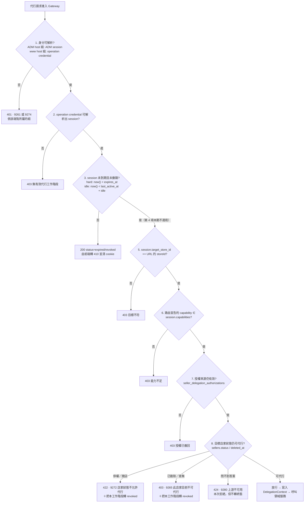

##### 第 1 項的兩種身分來源，與第 4 項為什麼在本期沒有落點

代行工作區在 `hawkr-website`，**代行執行期的每一支端點都由 www host 的 BFF 發出，而那個 host 沒有 ADM session cookie**（`__Host-` 前綴是 host-only，§4.5）。⇒ 端點依身分來源分成兩組，**這是本節唯一的分岔，不得再增加第三組**：

| 組 | 端點 | 誰發出 | 身分來源 | 缺席時 |
|---|---|---|---|---|
| **ADM host 組** | S1 preflight／S2 create／S5 revoke／`{sessionId}/audit-logs`／`{sessionId}/summary` | `hawkr-admin` BFF | **ADM session**（`requireAdmin`，既有不變） | **9261 / 401** |
| **www host 組** | 20 支資源端點／S3 `GET current`／S4 `DELETE current`／`GET current/summary`／兩支媒體 upload session | `hawkr-website` BFF | **operation credential**（伺服端核發的 opaque 值，與工作階段一對一） | **9274 / 401**；**S4 例外**：回 `200 {"ended": true}`（§6.1.5） |
| **無身分（唯一一支）** | S6 handoff redeem | `hawkr-website` BFF | 一次性 handoff code 的四道防護（§4.5） | **9282 / 410** |

**第 4 項（actor 比對）因此在本期沒有任何落點**：www host 組的請求裡沒有第二個身分可以拿來與 session 快照的 `actor_admin_id` 比對，而拿 credential 自己推導出來的值去比對 credential，是恆等式（「拿 credential 自己推導出來的值去比對 credential」被否決的理由）。⇒ **持有 credential 即是這個工作階段的操作者**，`DelegationContext.operator_admin_id` 取自 session 快照（本來就是如此），稽核歸屬一個字不變（§6.2 `RecordAuditIntentRequest` 不帶 actor）。

⚠️ **編號一律不重排。** 全書數十處以「第 5 項」「第 8 項」指名本流程圖的判定，重排會讓每一處同時指錯。第 4 項保留為空號，不得拿去掛任何新判定。

**這條防線是真的少了，不是換了一種方式達成**：舊設計的 9281 擋得住「同一台電腦上 ADM 的登入者換了人，而 operation cookie 沒清」。跨 host 之後那個錯配仍然可能發生，只是再也沒有第二個事實可以察覺它。接手的三道既有機制（ADM 登出連動撤銷／idle 900 與 hard 1800／S5 撤銷）**都不是即時攔截**，逐條邊界與代價見 [ADR：工作區落在哪個 repo、憑證怎麼跨 host、身分由什麼承擔](../adr/2026-09-18-adm-delegation-workspace-host.md)，**不得**寫成「有別的機制所以更安全」。

**配套的機械保證（落點在 §8.1.2 boot 斷言第 4 條＝§4.5 的 (g)）**：`/api/v1/admin/**` 這個前綴從此**不再蘊含 `requireAdmin`**。⇒ 該前綴下凡不經 `requireAdmin()` 的路由，必須逐條列在具名白名單內（26 支：20 資源 ＋ S3 ＋ S4 ＋ `current/summary` ＋ 兩支媒體 ＋ S6），不在名單內即 boot panic。少了它，日後把一支治理端點掛到 credential-only 群組上，就是一支**沒有任何身分要求的治理端點**，而它在 review 時看起來與其他 `/admin/` 路由毫無差別。

**第 2／3 項就是順延 `last_active_at` 的落點**：這兩項本來就要用 `credential_hash` 反查那一列 session，代行資源路由把那一次讀換成一句 `UPDATE … RETURNING`（`counts_as_activity = true`，全文與六條寫法規則見 §6.2.4a）⇒ **閒置逾時零額外往返、零排程器、零前端心跳**。作用域**比第 8 項多兩支**：填 `true` 的是「經 `delegatedHandle` 註冊的代行資源路由」**加上** `requireDelegatedSessionOnly()` 的兩支媒體 upload session 端點（§6.1.13）——後者不做第 8 項的店家狀態重驗（它不碰 target store），但**上傳圖片一樣是操作者在做事**，漏填即「換一批商品圖的人被閒置踢掉」（填法全表見 §6.2.4a）。六支 session 端點一律 `false`（含 `GET current/summary`，§6.1.11）——`GET current` 每 30 秒被輪詢，把它算成活動，idle 在工作區開著時永不觸發。

第 7 項是產品需求（ADM 代行營運 v2.0）的要求：session 只存建立當下的 snapshot，**每次請求仍要重新
評估授權表是否已撤回**。
換言之 session 內的 capabilities 是「當時核發的上限」，不是「現在仍然有效的證明」。

> ⛔ **第 7 項在 Gateway 的每次請求路徑上沒有獨立判定**：`seller_delegation_authorizations` 的唯一讀取者是 account-service 的 **preflight**（`internal/delegation/usecase/preflight.go`）；`GetCurrentSession` 的 usecase（`session.go` 的 `GetCurrent`）只以 `credential_hash` 反查 session 那一列，**完全不碰授權表**，`GetCurrentSessionResponse` 也沒有承載授權有效性的欄位。
> ⇒ **單看 Gateway，代行進行中撤回授權，當前工作階段照樣寫得下去，直到它自己到期或被 S5 撤銷。**
> **要在每次請求上判定就必須動 proto**（在 `OperationSessionSummary` 加一個授權仍有效的判定，或新增一支專用 RPC），不是「在 Gateway 多寫一行」就能收尾的事。
>
> ✅ **這條路徑今天由撤回端點自己封住**：`RevokeDelegationAuthorization`（§6.1.15 端點 6）在**同一個交易**內連帶中止該店所有進行中的工作階段 ⇒ **唯一會讓授權失效的動作，自己就把 session 一併收掉了**。<br/>⚠️ **這是「入口被堵住」，不是「第 7 項有落點」**：⇒ **任何一條不經端點 6 就讓授權失效的新路徑，都會立刻讓這個缺口成為可觸發的**——`effective_until` 到期自動失效、批次撤回的維運 SQL、賣家自助 opt-out、§12.4 ⑧ 的退路 SQL 皆屬此類（最後一項今天就存在，所以該節明寫走 SQL 一律是兩步）。

⚠️ 第 5 項的比對對象是 **session snapshot 的 `target_store_id`**，不是 resolver 的結果 —— 見 §8.1.4(c)。

##### 第 8 項：目標店家狀態仍可代行（命中即立即失效）

**定版**：賣家在代行期間被**停權／關店／刪帳號**時，進行中的工作階段**立即失效**——下一次代行請求即 fail-closed，並且該工作階段當場轉入終態（連帶讓已排程未發布的貼文不再發出，見 §7.6.3）。

**為什麼是「立即」而不是「有效至自然到期」**：停權是**即時的風險控制**，而它被觸發的原因往往正是這家店出了問題；讓一個已經建立的代行工作階段繼續寫入，等於讓風險控制對「正在進行中的操作」失效——治理端按下停權之後，平台自己的帳號仍在替該店改商品、改店面、發貼文，事後沒有任何說法能解釋為什麼那些寫入被允許。而代行的最長曝險窗口是 30 分鐘（§5.1.1 硬上限 1800 秒；**無人操作時 15 分鐘即由閒置逾時結束**），**選擇立即失效的代價（一次操作被中斷）遠小於選擇延續的代價（停權後仍有寫入發生）**。⚠️ **這個窗口是 30 分鐘，長度本身使本項更必要**：窗口愈長，「等它自然到期」這個替代方案就愈弱，逐次重驗（本項）承擔的兜底比重就愈大。代價是實的、不是零。

| 判什麼 | 值 |
|---|---|
| **查什麼** | 目標店家的 `sellers.status`（生命週期值 `active`／`suspended`／`suspended_governance`／`closed`）與 `deleted_at` |
| **判定規則** | **deny-by-default：只有 `status='active'` 且未刪除才放行。** 其餘一律拒絕——包含日後新增的任何 `status` 值。⚠️ 反過來寫成「命中 `suspended`／`closed` 才拒」的黑名單形式是錯的：新增一個生命週期值時，黑名單會**靜默放行**它，而白名單只會誤擋（誤擋看得見、靜默放行看不見） |
| **判定的唯一實作** | `pkg/delegation.StoreOperable(lifecycleStatus string, deleted bool) (ok bool, deniedCode int32)`（新增，與 `Validate` 同 package）。**三個消費者共用這一份**：preflight 的第 3／4 步（§6.1.2）、本項、`RecordAuditIntent(origin=scheduled)`（§7.6.3）。三處各寫一份判定 ＝ 三份會各自演化，於是「入口說不可以、寫入說可以」這種矛盾遲早出現；規則只有一份，才談得上「這家店能不能被代行」有唯一答案 |
| **資料來源** | seller-service，**沿用 preflight 用的同一支 RPC** `GetSeller`（§7.2.1 ①、§7.2.5）。Gateway 本來就持有 seller-service client（§6.1.1 的 `/storefront` 路由即走 `SellerService.GetSeller`），**本項這一跳**不新增呼叫邊、不新增 NetworkPolicy 條目。**這句只涵蓋 Gateway 這一跳**——preflight 的同一支查詢是由 **account-service** 發出的（§7.2.5 時序圖 `ACC->>SEL`），那是一條全新的服務間呼叫邊，NetworkPolicy 必須新增條目（§4.3 表第 2 列）。**刻意不為此另立一支輕量 RPC**：第二支 RPC ＝ 第二個「店家可否代行」的答案來源，preflight 與逐次重驗一旦查不同支，兩邊的欄位取用與判定就會各自漂移 |
| **拒絕碼** | 停權（`suspended`／`suspended_governance`）與關店（`closed`）→ **9272 `DELEGATION_STORE_NOT_OPERABLE`**（422）；已刪除或查無該店 → **9265 `DELEGATION_STORE_NOT_DELEGABLE`**（403）。兩者都是既有碼、語意原封相符（§6.5.1），**不新增業務碼**——這兩個碼在 preflight 表達的就是同樣兩件事，逐次重驗只是把同一個判定搬到請求路徑上。⚠️ **`closed` 實際落 9265 而非本列的 9272**（seller-service 對公開 lookup 把關店視同不存在，preflight 亦然），偏差與理由見下方 ⛔ 段落，寫測試時以實際行為為準 |
| **本跳帶不帶 `delegation`** | **不帶。** 這一跳是 **Gateway 自己的授權判定**，不是代行操作 —— 它問的是「這家店現在能不能被代行」，發生在放行之前，此刻還沒有任何 `DelegationContext` 可以送（`audit_log_id` 也還不存在，因為讀取路徑本來就不寫 intent，§7.1.2）。⇒ **`GetSellerRequest.delegation` 留空**，seller-service 端走 `pkg/delegation` 的 **S0**（`d == nil` ⇒ 賣家本人／既有路徑，直接回 nil），視同既有 admin 讀取。<br/>**這一列必須明寫，否則會與 §6.2.1／§6.2.3「代行讀取一律帶 `delegation`」對撞**：那兩節講的是**代行端點**（`GET .../storefront` 等，帶 `storefront.read`），本跳不是端點、不在 `delegatedRoutes` registry 內、沒有 capability。照字面把 `delegation` 帶上去，反而會因為 `audit_log_id` 為空而在寫入類語境下被 S1b 打回 9260 |
| **問不到答案時** | seller-service 逾時／`UNAVAILABLE` → **9280 `DELEGATION_UPSTREAM_UNAVAILABLE`**（424，可重試）。**本次請求一律拒絕（fail-closed），但不得轉終態** |

> **接線落點**（`requireDelegated`，`gateway/internal/router/delegated_capability.go`）：`enforceStoreOperable` 排在第 5／6 項之後、`c.Next()` 之前，打 `SellerClient.GetStoreStateForGuard`（`internal/grpc/delegation_client.go`，**不帶 `delegation`**）取 `lifecycle_status` 餵 `pkg/delegation.StoreOperable`，命中即 `RevokeDelegationSession(revoke_reason='store_not_operable')` 後回拒絕碼。deadline 取 `DELEGATION_GRPC_DEADLINE_STORE_STATE_MS`（800），撤銷沿用 `..._CREATE_MS`。
>
> ⚠️ **「seller-service 明確回答了」在這一跳不等於 `err == nil`**：Gateway 的 `EnvelopeGuardInterceptor` 會把非零 envelope code 一律轉成 gRPC error，所以業務拒絕與傳輸失敗**都以 `err` 現身**，必須在呼叫端分開，否則已刪除的店會永遠回 9280 且工作階段永不轉終態。判準：`NotFound`（軟刪的店——lookup 濾 `deleted_at IS NULL`）與 `FailedPrecondition`（envelope 業務碼的預設映射，已關店的 `4040` 走這裡）＝**確知**，其餘（`Unavailable`／`DeadlineExceeded`／`Canceled`／`Internal`）＝**問不到**。
>
> **`SellerInfo` 沒有 deleted 欄位，但 9265／9272 分得出來，因此不動 proto**：`SellerService.GetSeller(store_id)` 走 `GetPublicSellerProfileByStoreIDOrCode`，SQL 述詞為 `(store_id = $1 OR store_code = $1) AND deleted_at IS NULL`，且**不濾 status** ⇒ 停權店查得到、`lifecycle_status='suspended'` 原樣回來（→ 9272）；已刪除的店根本不在結果集（→ `NotFound` → 9265）；已關店由 `handler.go` 回 `4040`（→ 9265）。⇒ `StoreOperable` 的 `deleted` 參數在這一跳**恆傳 `false` 且正確**——查得到的列必然未軟刪。**與 account-service preflight 對同一支 RPC 的處置逐字相同**（`internal/client/seller/client.go` 把 `NotFound` 與非零 code 一律譯成 `ErrStoreNotFound` → 9265），於是入口與逐次重驗對同一家店永遠給同一個答案。
> **殘留的契約偏差只有一項**：`closed` 依 §6.5.1 字面應為 **9272（422）**，實際落 **9265（403）**，因為 seller-service 對公開 lookup 把關店視同不存在。這個偏差**在 preflight 已經存在**（同一支 RPC、同一個形狀），不是逐次重驗引入的；要修就得改 seller-service 對 `closed` 的回法，那會動到所有公開店面頁的既有行為，超出本案範圍。兩者都 fail-closed 拒絕並轉終態，差別只在 HTTP 狀態與前端文案。
> ⚠️ **不要為此在 `SellerInfo` 加 `deleted` 欄位**：查得到的列必然未軟刪，該欄位在每一個成功回應上恆為 `false` ⇒ 它是一個沒有判別力卻看起來像防線的欄位，正是否決「留著但不判定」的同一個理由。

**「確知不可代行」與「問不到答案」必須分開處置，這是本項最容易寫錯的地方。**

- **確知**（seller-service 明確回覆了一個非 `active` 的狀態，或該店已刪除）→ 拒絕 ＋ **轉終態**。
- **不知道**（逾時／連線失敗）→ 拒絕，**但工作階段維持原狀**。

理由：轉終態是**不可逆**的（`revoked` 為終態，§7.5.2），而 seller-service 的一次抖動是**暫時**的。若把「問不到」也拿去轉終態，一次 30 秒的 seller-service 不可用就會把當下所有進行中的代行工作階段永久打死，且全部需要重建——用一個暫時故障換一批不可逆的損失。fail-closed 的要求是「這次請求不准通過」，它不要求「把授權銷毀」，兩者不是同一件事。

**命中之後：把工作階段轉為 `revoked`，而不是只回一個錯誤**

拒絕當次請求只解決了「這一筆不會寫進去」；它解決不了另外兩件事：① 操作者的工作區仍顯示「進行中」，每按一次都失敗卻看不出為什麼（`GET current` 讀到的仍是 `active`）；② 該工作階段先前建立的**排程貼文到點仍會發出**。兩者都要靠終態轉換才會消失。

處置固定為：Gateway 呼叫既有的 `RevokeSession`（§6.2.2、§7.2.7 ①），參數 `revoke_reason = 'store_not_operable'`（**固定字面值**）、`actor_admin_id` 填**當前這位 ADM 自己**。這與「ADM 登出連動」完全同形（§7.2.7 讀法 2：`revoke_reason='admin_logout'`、`revoked_by_admin_id` 填該 admin 自己），**因此不需要為「系統觸發的撤銷」另外定義一種空 actor 語意**；各來源靠 `revoke_reason` 的固定字面值在稽核上機械區分（`admin_logout`／`store_not_operable`／`delegation_disabled`／`authorization_revoked`／人工撤銷填工單號，完整對照表與 `revoked_by_admin_id` 的填法見 §12.4 ①）。

於是第 8 項**自動獲得撤銷既有的三個連帶**，一個都不必另外實作：

| 連帶 | 機制 | 出處 |
|---|---|---|
| 下一次代行請求立即 fail-closed | 第 3 項讀到 `status='revoked'` → 9271 | §7.2.7 ② |
| 工作區在 ≤30 秒內切成阻擋畫面並清 cookie（**前提見下方 **） | 輪詢的 `GET current` 讀到 `revoked` | §7.2.7 ②、§7.1.3 |
| **已排程未發布的貼文不發** | worker 到點呼叫 `RecordAuditIntent(origin=scheduled)` 被拒 → `schedule_state='cancelled_by_revocation'` | §7.6.4 |

**第二與第三個連帶都只在「代行者又送了至少一次代行資源請求」時才觸發**——轉態發生在第 8 項命中的那一刻，而第 8 項只掛在資源路由上（作用域見下方）。因此：

- **第三個連帶**：操作者若在停權發生後就沒有再動作，工作階段不會被轉態，排程照樣會發 ⇒ §7.6.3 在排程路徑上另有一道**獨立**的同名判定，兩道缺一不可。
- **第二個連帶**：同理，`GET current` 會持續讀到 `active`，**工作區不會自動切成阻擋畫面**；上表那個「≤30 秒」的計時起點是**第 8 項命中的那一次請求**，不是店家被停權的那一刻。這一項**沒有**對應的獨立防線，而且是**刻意接受的**：未轉態期間寫入面已由第 8 項 fail-closed 完全擋住（代行者一動作就撞上），缺的只是「操作者停手不動時 UI 早一點知道」。要補齊的正解是事件驅動撤銷（消費既有 `seller.suspended`／`seller.deleted`），本期不做，選項與否決理由見 [ADR：停權即時失效、通知通道與 PII 揭露](../adr/2026-09-18-adm-delegation-suspension-and-notification.md)。

**`RevokeSession` 呼叫本身失敗不改變本次請求的結果**：拒絕在第 8 項判定成立的那一刻就已成立，撤銷只是為了讓 UI 與排程跟上。失敗時記 warn 並照常回 9272／9265，下一次請求會再撞一次同一個判定、再試一次撤銷。**不得**因為撤銷失敗而把請求改判成 5xx——那會把一個已經正確拒絕的請求，變成一個看起來像後端壞掉的請求。

**作用域：只掛在經 `delegatedHandle` 註冊的代行資源路由（讀寫皆然），session 端點（S1–S5 五支）不跑**

⚠️ **兩支媒體 upload session 端點（§6.1.13）同樣不跑第 8 項**——它們不碰 target store，沒有「這家店還能不能被代行」可問。**但它們要填 `counts_as_activity = true`**（§6.2.4a）：**店家狀態重驗**與**活動順延**是兩條各自獨立的作用域，不要因為前者不適用就把後者也一起關掉（關掉的症狀是靜默的，見 §6.2.4a 該列）。

這不是效能取捨，是正確性要求：`GET /admin/delegated-operations/current` 走 `credentialHandle`（§6.1.1、§8.1.2 斷言作用域），**它若也跑第 8 項就會回 422 而不是回 `status='revoked'`**，前端於是永遠讀不到終態，工作區會卡在「暫時不可用」而不是切成阻擋畫面——上一段的第二個連帶當場失效。同一個理由使第 8 項與 §9.1.1「`GET current` 不查 seller-service、單次查詢」的三條硬性要求**完全不衝突**：那三條約束的是 session 端點，第 8 項一步都沒踏進去。

**為什麼唯讀路徑也要擋**（不是只擋寫入）：

1. 定版的字面是「**工作階段**立即失效」，不是「寫入立即失效」。把讀排除，等於讓「失效」有兩種強度，而 §8.1.3 存在的理由就是**只有一個問答點、沒有分支**。
2. 排除讀取會留下最不該留的那個窗口：代行者**寫不了、卻仍讀得到**一家**已刪除**店家的訂單收件資訊（`orders.read` 是 9 個 capability 之一），這正是 §8.1.5 PII 最小化要收掉的東西。
3. 成本可接受：第 8 項為唯讀路徑加的是它的**第二跳**（原本只有 `GetCurrentSession`），寫入路徑本來就有四跳（見 §9.3），因此絕對增量在讀取上反而更小；而命中即轉終態，實務上一個工作階段最多只會命中一次。

**效能影響（誠實記帳）**：每一次代行請求（讀與寫）多一跳 `Gateway → seller-service GetSeller`，deadline 800 ms（env `DELEGATION_GRPC_DEADLINE_STORE_STATE_MS`，§8.5.1 (B)），預算 P95 < 50 ms。單筆代行寫入的額外總增量因此從 P95 < 211 ms 變成 **< 261 ms**（＋50 ms ＝ 新增那一跳的預算；兩者都是各段預算的保守相加，算式見 §9.3），對應的 S6 SLO 同步由 +250 ms 放寬為 **+300 ms**（§9.1、§9.3）；逾時預算表新增一列，最壞總和 7.9 s → **8.7 s**，仍在 12 s 的 handler 預算內（§7.3.1）。批次路徑**整批只付一次**（target store 只有一個），因此與 `items` 筆數無關。

⚠️ **不沿用既有的 `seller:suspended:<accountId>` Redis 快取**（46 號 §4.2）。`pkg/redis/seller_suspension.go` 不適用的理由有**三條，各自獨立成立**，任一條都足以否決：

1. **它是 fail-open 的**。`GetSellerSuspension`在 **cache miss 與 Redis 錯誤兩種情況都回 `("", false)`＝未停權**，函式註解自己寫明「callers on the BLOCK-if-suspended path must fail-open per 46 §4.3」。拿一個設計上就會在故障時回「沒事」的來源，去餵一個必須 fail-closed 的判定，等於 Redis 一有狀況第 8 項就**靜默失效**——而這正是 §28 教訓的形狀（不能失敗的判定放在一個會失敗且量不到的地方）。
2. **它的值域涵蓋不了本項要判的三件事**。該 key 只在**管理員手動停權**時由 seller-service 寫入（檔頭註解：`admin manual suspension state propagation`），**關店（`status='closed'`）與刪帳號（`deleted_at`）根本不會寫這個 key**。要擋的三個情境（停權／關店／刪帳號）它只涵蓋一個。
3. **它以 `accountId` 為鍵**，而代行路徑的鍵是 `store_id`（surrogate），且代行路徑**刻意不走 storeid resolver**（§8.1.4(c)）。沿用它就要在代行路徑上把 §8.1.4(c) 剛避開的那次身分解析裝回去。

⇒ 因此 §9.4 的判定**維持不變**：本功能仍然完全不使用 Redis、不新增任何硬上限依賴。第 8 項多出來的成本是一次同叢集 gRPC，落在既有的 PostgreSQL 與 gRPC 預算內。

#### 8.1.4 信任邊界（逐層列出什麼可信、什麼不可信）

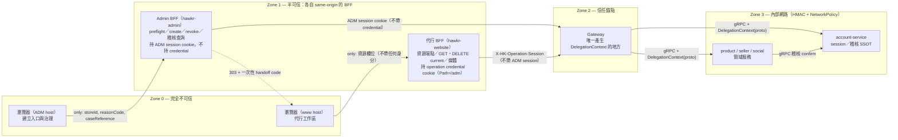

**兩條 Zone 0 → Zone 1 的邊互不相通，這正是「credential 即身分」的前提**：ADM host 的憑證到不了 www host（`__Host-` 是 host-only，§4.5），因此 www host 組的請求裡**沒有、也不該有** admin 身分——它憑的是 operation credential，而那是一把伺服端核發、與工作階段一對一、可撤銷、有 TTL 的 opaque 值。⇒ 對 Gateway 而言，「這個請求屬於哪一個工作階段」與「操作者是誰」在 www host 組上是**同一個問題的同一個答案**（session 快照的 `actor_admin_id`），不存在第二個來源可以交叉比對。代價見 §8.1.3「第 1 項的兩種身分來源」。

**(a) 瀏覽器送的一切都不可信，而且結構上送不進來**

前端不是「約定不送」，是**物理上送不到**：代行專用 BFF 不接受 `Headers` 物件、逐欄組裝出站 header
（`upstream.ts`），瀏覽器 header 一律不轉送；泛用 BFF `/api/bff/[...path]` 則對任何路徑段
解碼後為 `delegated-operation(s)` 的請求直接 403（`server/bff-boundary.ts`，含多層 percent-encoding
與 `..`／`%` 畸形）。

⇒ **後端的對應義務**：
- 代行的目標、actor、scope、credential **一律不得從任何 HTTP header 或 request body 取得**（`storeId`
  出現在 URL path，但它只作為**交叉比對對象**，不是權威來源；權威來源是 session snapshot）。
- 前端保證絕不送的 header 清單（後端若讀它們，功能直接死）：`Authorization`、`X-Admin-Actor-Id`、
  `X-Active-Store`、`X-Target-Seller-Id`、`X-Operation-Session`、`X-Impersonated-User-Id`，以及任何
  `x-hk-operation-*`（除 `X-HK-Operation-Session` 本身）／`x-delegated-operation-*` 前綴。
- **入站 header 剝除是後端自己的責任**：Gateway 目前全域只有一處 `Header.Del`
  （`gateway/internal/router/seller_capability.go`），`applyIdentity`（`middleware/auth.go`）
  用的是 `Set` 覆蓋。`Set` 對單值 header 等效覆蓋所以既有身分 header 沒有偽造風險，但**新增的代行相關
  header 沒有任何 `Set` 會覆蓋它們**，必須自行 `Header.Del`：
  1. `X-HK-Operation-Session`：Gateway 讀取並解析後**必須 Del**，絕不轉發給任何下游。
  2. 任何 `X-Delegation-*`／`X-Hk-Operation-*` 前綴的入站 header：**一律先 Del 再處理**，避免外部注入。

**(b) 微服務對 `DelegationContext` 的信任模型**

`DelegationContext` 走 **proto 欄位**（統一欄位號 100，定義見 §6.2.1），不走 metadata、不擴充 HMAC
canonical。**代行的讀取與寫入一律走賣家既有 RPC 並一律帶本欄位**（§6.2.1），微服務側一律以
`requireSellerOrDelegated(storeId, capability)` 判定；不存在「讀走 admin RPC、寫走賣家 RPC」的雙軌。
微服務**信任**它，其正當性建立在兩件事上：

1. **52 號 HMAC 保證呼叫方是內部服務**：canonical `serviceName\nts\nnonce\naccountIdOrEmpty`
   （`GrpcAuthClientInterceptor.java`）＋時間窗＋nonce 防重放。非內部呼叫者拿不到有效簽章，
   因此**組不出一個會被受理的請求**，遑論在其中夾帶偽造的 `DelegationContext`。
2. **delegation 的真實性由 Gateway 保證**：Gateway 是唯一驗證 credential、比對 target、判定 capability
   並產生 `DelegationContext` 的地方；微服務不重新驗證 credential（它也拿不到 credential —— 見 §8.1.6）。

**這與既有 `SuspendSellerForAdminRequest.AdminId` 是同一個信任模型**
（`gateway/internal/handler/admin_seller_suspension.go` → `seller-service` usecase 簽章
`seller_suspension.go` 的 `adminID int64`）：admin 身分走 proto 明示欄位、由 Gateway 填、微服務信任。
本設計不發明新的信任模型，只是把同一個模型的載體從單一 `int64` 換成一個結構化 message。

**這個模型的兩個前提，缺一即失效**（兩者都不是本設計新增的機制，但本設計**依賴**它們，因此登記於此）：

| 前提 | 現況 | 上線 gate |
|---|---|---|
| `INTERNAL_AUTH_MODE=enforcing` | **dev／prod 已成立**：`k8s/values/overlays/{dev,prod}/common.yaml` 皆為 `"enforcing"`，helm 疊加順序（`values/<svc>.yaml` → `overlays/<env>/common.yaml` → `overlays/<env>/<svc>.yaml`，後者覆蓋前者）使全部服務生效。⚠️ base `k8s/values/*.yaml` 的 22 個 `"permissive"` **只對沒有 overlay 的環境生效**（`overlays/local/common.yaml` 不覆蓋此鍵）⇒ 那是**本機**的值，不是 dev／prod 的值；只讀 base values 會得到「全部仍是 permissive」的錯誤結論。permissive 下缺 secret 時 fallback 為不簽不驗（`internal_auth.go` 的未簽名內部呼叫直接放行）——這正是**本機**的實際行為 | **代行功能上 prod 前仍必須逐次查核**五個服務（gateway／account／product／seller／social）的**生效值**為 `enforcing` 且 `internal.auth.unsigned` 歸零；查核不通過即不得開啟 feature flag。查核動作在 **§13 security**（附查證命令）。理由：這個前提今天成立，但它由**別的變更**維護，隨時可能被改回去 |
| per-service NetworkPolicy 收斂 same-ns allow-all | 52 號 §7 規劃中 | 非硬 gate（HMAC 已足夠），但同 ns pod 可達性仍是縱深防禦的一層 |

**(b-1) `origin=scheduled` 是提權欄位，判準必須是執行期機械強制，不是測試**

`RecordAuditIntentRequest.origin` 決定 account-service 用**哪一組條件**判定授權是否仍然成立
（§7.6.3：`interactive` 要求 session 仍 `active` 且未到期，`scheduled` 只要求 `status <> 'revoked'`）。
⇒ 一個能任意宣告 `origin=scheduled` 的呼叫端，就能對**已到期的 session** 繼續寫入。這是提權欄位，
和 `capability` 同級，**不能靠「約定只有 worker 會傳」＋一條測試守住**——測試只在 CI 跑，執行期沒有
任何東西在檢查。

**定版（account-service 側，`RecordAuditIntent` 的入口判定）**：

| 條件 | 判定 |
|---|---|
| 52 號的內部授權簽章驗證通過（server 側 interceptor 判出 `isInternalCall() == true`）**且** `x-internal-service` 解析出的 `serviceName == "social-service"` | 接受請求所帶的 `origin`（可為 `scheduled`） |
| 其餘一切情形（未驗簽、驗簽失敗、`serviceName` 為其他值） | **一律以 `interactive` 落庫**，忽略請求所帶的值，不報錯 |

**為什麼這個判準是機械的而不是約定**：Gateway 依 [Java 微服務開發規範](../開發規範/Java%20微服務開發規範.md) §4.2 **不得帶 `x-internal-service`**
（使用者面走 `requireAccountType`／capability 判定），因此 Gateway 這條路徑在結構上永遠拿不到
`serviceName == "social-service"`，也就永遠只能落 `interactive`。而排程 worker 走的是
social-service → account-service 的內部 client，該 client **必須掛 `InternalAuthClientInterceptor`**
（落點見 §4.5；同服務的 media client 已有先例）⇒ 它的簽章由 52 號的 HMAC 保證，`serviceName` 偽造
不了。判準的兩個輸入（驗簽結果、`serviceName`）都不是呼叫端可自我宣告的值。

**靜默降級而非報錯是刻意的**：`origin` 是稽核欄位不是業務參數，把不合格的宣告降級成
`interactive` 會讓該次請求繼續走**較嚴格**的那組授權條件（session 必須仍有效），fail-closed 方向正確；
回錯誤反而給了攻擊者一個「我猜對了服務名嗎」的探測訊號。降級發生時記一條 `warn` 級 application log
（不是稽核列），供排查用。

**這條取代原本「以 §13 security 層測試守住」的說法**。§13 的對應測試仍然保留，但它的角色從
「唯一防線」降為「迴歸守門」：斷言「非 social-service 身分傳 `origin=scheduled` → 落庫值為
`interactive`」。

**(c) storeid resolver 的負快取陷阱：代行路徑完全不走 resolver**

`gateway/internal/storeid/resolver.go` 的 `CurrentStoreID(ctx, accountID)` 回答的是
「**這個登入者自己**現在是哪家店」。對 admin account_id 呼叫它有兩個獨立的問題：

1. **語意就是錯的**：代行的目標店家與操作者自己的店毫無關係，問這個問題本身沒有意義。
2. **會留下污染**：admin 在 `sellers` 表無 row → gRPC NotFound → `ErrNoCurrentStore`，並**寫入負快取
   `store:current:<adminId>=0`，TTL 60 秒**（`resolver.go`）。這個負值在 Redis 裡活 60 秒，
   期間任何走 resolver 的路徑都會拿到「無店」的既定答案而不再回查 SSOT。

**定版**：代行路徑的 target store **一律取自 Operation Session snapshot 的 `target_store_id`**，
與 URL path 的 `{storeId}` 做交叉比對（不等即 403），**完全不呼叫 `CurrentStoreID`／`resolveStoreID`**。
可驗證性：代行 handler 的單元測試以 mock resolver 斷言其呼叫次數為 0。

#### 8.1.5 PII 最小化

判準沿用 [API 設計規範](../開發規範/API%20設計規範.md)「public DTO deny-by-default」的同源精神：**逐欄明列可回什麼，而不是列舉不可回什麼**；
上游 message 長胖時新欄位不會自動流出。四類資源各有獨立 DTO，**禁止共用賣家自助（`/app/*`）的 DTO**。

**下表是「代行 DTO 的 allow-list」，管的是 API 回應面——「這個 admin 的瀏覽器看得到什麼」。**
它與 §6.1.12 的**稽核快照欄位白名單**（管 `before_snapshot`／`after_snapshot` 落庫的欄位，
即「稽核表存得下什麼」）是**兩份不同的清單，兩份都要維護**，不得互相取代：

| | 本表（代行 DTO allow-list） | §6.1.12（稽核快照白名單） |
|---|---|---|
| 管的是 | HTTP 回應 body 的欄位集合 | 寫進 `admin_operation_audit_logs` 的 snapshot JSON 欄位集合 |
| 讀者 | ADM 管理員的瀏覽器 | **日後的舉證程序（保留 2 年），經維運 SQL 讀取**——快照兩欄沒有 API 出口（§6.1.11 定版），稽核查詢 UI 看到的是 `changed_fields` 不是快照 |
| 落點 | Gateway 各 endpoint 的 DTO 投影 | Gateway 的 `DelegationDiffRules`（§6.1.12） |
| 判準差異 | 「這個欄位 admin 現在該不該看到」 | 「這個欄位變更了，兩年後還該不該留著」 |
| 交集不等於相等 | 遮罩後手機**在**本表（admin 看得到） | 遮罩後手機**不進**快照（快照只存 §6.1.12 規則表 `InSnapshot=true` 的欄位，而訂單的規則表是空的） |

⇒ 新增欄位時**兩張表各判一次**；只改其中一張就上線，會出現「畫面看得到但稽核查不到」或
「稽核存了畫面根本不顯示的欄位」兩種相反的缺陷。

| 資源 | 代行 DTO 可含 | **明確排除**（即使上游 message 有） |
|---|---|---|
| **storefront** | 店名、城市／地區、營業電話、營業地址、商店亮點、商店介紹、logo objectKey、cover objectKey、`version` | **`seoTitle`／`seoDescription`（一律不出現，§6.1.7）**、銀行帳號、統一編號、負責人姓名／身分證號、KYC 文件 objectKey、PayUni `merId`、撥款設定、認證審核內部狀態、`auth_epoch` 類帳號安全欄位 |
| **product** | 商品全部自主維護欄位（名稱／描述／圖片 key／分類／認證標章／售價／庫存／規格／運送設定／發布狀態）、`version` | 內部冪等追蹤欄位（`idempotency_request` 關聯）、匯入來源原始 payload |
| **post** | 貼文內容、圖片／影片 objectKey、標籤、關聯商品 ID、發布狀態、排程時間、`version` | 檢舉紀錄與治理內部狀態（那是治理面，不是代行面） |
| **order** | 訂單編號、建立／更新時間、付款方式類型碼、商品縮圖／名稱／件數、金額、物流狀態碼、訂單時間軸、物流方式、希望送達日、買家顯示名、**遮罩後**手機、**止於 city+district 的地址** | 買家 email、買家生日／性別、完整收件手機、街道級完整地址、金流交易明細、退款與撥款資訊、買家帳號 ID 之外的任何帳號欄位 |

**訂單 PII 遮罩規則（後端執行，不是前端顯示層做的）**：

| 欄位 | 列表與詳情的預設值 | 規則 |
|---|---|---|
| 收件人手機 | `0912-***-234` | 保留前 4 碼與後 3 碼，中間固定 3 個 `*`；長度不足 8 碼者全遮 |
| 收件地址 | `台北市大安區` | 只回 city + district 兩級，**不回**路名、門牌、樓層 |
| 收件人姓名 | 全名（不遮） | 姓名對「確認是不是同一筆訂單」是必要的，且不足以單獨定位個人 |

註：UI mockup 的訂單詳情抽屜顯示了完整地址字串，**那是 mockup 的疏漏**，以本表為準。

**「查看完整地址」是獨立的 PII 揭露動作**：
- 獨立端點 `GET /api/v1/admin/sellers/{storeId}/orders/{orderNo}/recipient-contact`（詳見 §6.1）
- 需要 `orders.read`，且**必落稽核**：`action = ORDER_PII_REVEAL`，`risk_level` 由
  `DelegationActionRules.riskLevel(action)` 依 **action** 推導為 `high`（不是由 capability 推導——
  `orders.read` 的其餘動作並非高風險），計入稽核 UI 的「風險操作」計數
- 回傳完整手機與完整地址；**不回**買家 email 與任何非配送用途的個人欄位
- 此端點**沒有列表變體**：一次只能揭露一筆，不提供批次

**本節的作用域：只涵蓋代行工作區的訂單路徑，不涵蓋既有 admin 治理路徑。**

同一個 admin 帳號今天就能走 **`GET /api/v1/admin/shipments/{id}`** 取得**未遮罩**的收件人姓名、手機與完整地址，
**零遮罩、零稽核**——見 `gateway/internal/handler/admin_shipping.go`（`AdminShipmentDetailResp`
的 `recipientName`／`recipientPhone`／`recipientAddress` 三欄），以及直接由上游 message 填值的那一段、
全檔 `audit` 零命中、`mask`／`redact`／`遮罩` 零命中；該路由掛在 `gateway/internal/router/routes_shipping.go`
的 admin group（`JWTAuth` ＋ `requireAdmin`，無 capability、無代行 session 要求）。

⇒ 本節與 PII 逐筆揭露原則建立的保護，**對「刻意避開稽核的操作者」收益為零**：他不必進代行工作區。
這**不是本案造成的洞**（該端點早於本案存在，屬 29 號《Admin 異常訂單管理》的治理視角），
但**必須寫明作用域**——否則日後有人會以為「代行的 PII 稽核涵蓋全平台」，
在事故調查時拿代行稽核表的空白當作「沒有人看過這筆地址」的證據，而那個推論是錯的。

**本案刻意不順手修它**：既有 admin 路徑的遮罩與稽核是獨立議題，牽動 29 號的既有 DTO 契約與 admin 前端，
與本案的交付邊界正交；就地擴進來會讓本案的 PR 同時改動治理面的既有行為。
該端點零遮罩、零稽核，屬治理面既有缺口，**另案處理**，不是不處理。

#### 8.1.6 Operation credential 的核發與保護

> **本節是 operation credential 的唯一 SSOT。** Create 只核發 handoff code 與 session 摘要；ADM BFF 以管理員身分按 session ID 讀取 `/{sessionId}/summary` 的完整 `data.session` 並對帳，ADM host 不接收 credential。

**S6 兌換核發一式**（RFC 6749 §4.1 的授權碼兌換模式）：

```
credential      = "dops_" + base64url_nopad( CSPRNG(32 bytes) )
credential_hash = SHA-256( credential )
```

credential 本體至少 256 bit；`dops_` 加 43 字 base64url，共 48 字，滿足 C11 的 cookie 安全字元與長度限制。Create 插入 session 時 `credential_hash` 為 NULL。Redeem 先產生隨機 credential，再以**單句 CAS**核對 handoff code、code 到期、session 的 active／未結束、hard／idle 到期；只有命中列才在同一句清空 `handoff_code_hash` 並寫入 `credential_hash`。未命中一律 9282，剛產生的 credential 沒有落庫、不能操作。DB 只保存 SHA-256 hash，不保存明文或密文。

同一把 code 第二次兌換必定 9282，不會核發第二把有效 credential。CAS 另要求 `credential_hash IS NULL`，已兌換的 session 即使有 handoff code 也不能覆蓋舊 hash。同 `Idempotency-Key` 重放依 §6.1.3 回同一個 session；未兌換時改簽 code，已兌換時只回摘要且不簽新 code。同一 session 只核發一次 credential。

**handoff code** 同樣以 CSPRNG 產生 32 bytes、加 `dhof_` 前綴，只保存 `SHA-256(handoff_code)`，60 秒有效且只可兌換一次。它的明文只出現在 Create 回應與 303 `Location`；credential 明文只出現在 S6 回應。兩者都不得落 log／Sentry／metric label。兩種 token 不靠任何設定金鑰，沒有金鑰輪替流程。

**保護規則**：

| 規則 | 機械保證 |
|---|---|
| credential **明文絕不落庫**，DB 只存 `credential_hash`（SHA-256，UNIQUE） | 表定義見 §5.1.1；`credential` 不是任何表的欄位 |
| credential **絕不出現在 `GET current` 的回應內** | C11 硬約束；契約測試斷言回應投影不含 `operationCredential`／`token` |
| credential **絕不出現在任何 log**（access log、application log、trace attribute、metric label） | 見 §8.2.2 的具體修改項 |
| credential **不轉發給任何微服務** | 微服務收到的是 `DelegationContext`（不含 credential 欄位），不是 credential 本身 |
| credential 的字串形態必須滿足 16–8192 字元、無 ASCII 控制字元、**不得含空白／`;`／`,`** | C11；它會被 BFF 原封塞進 `Set-Cookie`，違反即 cookie 解析失敗。48 字元的 `dops_` ＋ base64url 恆成立 |

#### 8.1.7 稽核紀錄的防護

稽核表 `admin_operation_audit_logs`（§5.1.3）是本設計書的核心資產，它的價值完全建立在「不可事後竄改」上。

| 規則 | 說明 |
|---|---|
| **append-oriented** | 只有 `RecordAuditIntent` 一個 INSERT 入口（§8.4 的 W4），全平台不存在第二個寫入點 |
| **只有七個欄位可由 confirm 更新，且只能一次** | `result`（`PENDING` → `SUCCEEDED`／`FAILED`）、**`resource_id`**（建立類操作在 intent 當下還沒有 id，confirm 時補寫；欄位可空性見 §5.1.3）、`after_snapshot`、`changed_fields`、`resource_version_after`、`biz_code`、`confirmed_at`。更新條件帶 `WHERE result = 'PENDING'`，第二次 confirm 影響筆數為 0 ⇒ 不覆蓋既有結論。**白名單的 SSOT 是 §5.1.3**（另有 `notified_at` 由 outbox dispatcher 更新一次，不在 confirm 的作用域內）——**少列 `biz_code` 會讓 OBS9（`result='FAILED' AND biz_code = 9280`）恆為 0**、`DelegationWriteUnconfirmed` 永不觸發 |
| **其餘欄位寫入後不可變** | 由 §12.4 Runbook 的驗證步驟定期抽查；DB 層不設 trigger（§22：偵測歸 observability，不寫進 application code） |
| **永不硬刪** | 保留期到期後的清理屬**維運 SQL**（§8.5.1 的保留期參數、§12.4 的執行步驟），不寫進 application code |
| **禁止存入的內容** | token、cookie、operation credential、完整銀行資料、完整 KYC 文件內容、媒體 binary（產品需求（ADM 代行營運 v2.0））。`before_snapshot`／`after_snapshot` 只存 **§6.1.12 規則表 `InSnapshot=true` 的欄位**，不是整個 entity dump（那張表就是白名單；`changed_fields` 另有更窄的比較範圍 `SnapshotFields`，兩者不是同一件事） |
| **session 記錄永不硬刪，且不在任何清理程序的範圍內** | 軟終止（status 轉終態），因此不存在「查不到只能回 404」的情境；這同時是前端終止語意能走純 envelope 路徑的前提。清理程序**只涵蓋稽核列與已派送 outbox 列**（§9.2.4）——把 session 列刪掉就等於把「終止語意」的前提拆了 |

**稽核完整性的三個不變式**（§13 測試策略逐條覆蓋）：
1. 任何代行 domain write 之前，必定已有一列 intent（`RecordAuditIntent` 是 Gateway 呼叫領域服務前的同步前置）
2. 任何一列稽核的 `session_id` 必定指向一個真實存在的 session（FK 保證）
3. **`result='SUCCEEDED'` 的稽核列，其 `capability` 必定在該 session 的 `capabilities` snapshot 內**
   （應用層斷言 ＋ §13 契約測試）

註：第 3 條**刻意只約束 `SUCCEEDED`**：`result='FAILED'` 的拒絕列記的正是「請求了一個不被授予的
capability」，若不變式擴及全部列，那些列在結構上就寫不進去，而它們正是安全稽核最需要的證據。
DB 層的 `chk_aoal_capability_closed` 只檢查 capability 落在 9 個封閉列舉內（**值域**檢查），
不檢查它是否在該 session 的 snapshot 內（**那是應用層＋契約測試的事**，DB 看不到 snapshot）。

---

### 8.2 可觀測性 (Observability)

#### 8.2.1 稽核 vs 一般 log 的責任邊界

這兩者**不可互相替代**，混用會同時失去兩邊的價值：

| | 稽核（`admin_operation_audit_logs`） | 一般 log（Loki／application log／trace） |
|---|---|---|
| 目的 | **對外可舉證的事實紀錄** | 可觀測性：排查、量測、告警 |
| 完整性 | 不可漏記（intent 先行）、不可竄改（§8.1.7） | 允許遺失、允許取樣、允許截斷 |
| 保留期 | 2 年（可配置，§8.5） | Loki retention（遠短於 2 年） |
| 查詢面 | 有 UI（`GET .../audit-logs`）、有索引、有分頁 | Grafana／LogQL，非產品面 |
| **能否作為稽核來源** | 是（唯一） | **否** |

**後端沒有 Sentry**（`grep -rn "sentry" --include="*.go" gateway/ pkg/ services/` 只命中
`gateway/internal/middleware/cors.go` 的 CORS 允許 header 與 `pkg/otel/tracer.go` 的註解，
無任何 Sentry SDK）。前端 admin 有 Sentry 且已把 `x-hk-operation-*`／`x-operation-*`／
`x-delegated-operation-*` header 與任何 `operation*session*`／`operation*credential*` body key 加入 scrub
（`src/lib/sentry/scrub.ts`）。**後端側的對應要求不是「也接 Sentry」，而是「credential 絕不進 log」**。

#### 8.2.2 credential 絕不進 log：具體修改項

Gateway 的 access log **不記任意 header**：dev/staging 路徑（`loggerWithBody`，
`gateway/internal/middleware/logger.go`）的 `auth` 欄位只會是空字串或 `"[REDACTED]"`，從不含
`Authorization` 的實際內容，`X-Forwarded-For` 與三個 App 版本 header 皆先經 `truncateHeaderValue`
截斷；prod 路徑（`loggerMetadataOnly`，`logger.go`）同樣記這三個截斷後的 App
版本 header 與 `X-Forwarded-For`，但完全不記 `Authorization`（連截斷值都沒有）。因此
`X-HK-Operation-Session` 本身不會落 log。**但真正的洩漏點在回應 body**：

`POST /api/v1/admin/delegated-operations/handoff/redeem` 的成功回應含 `data.operationCredential`，而 access log 會把
回應 body 經 `redactBody` 後寫入 `resp_body` 欄位（`logger.go`）——`operationCredential` 已經在
`sensitiveKeys`（`logger.go` 起）的強制遮罩清單裡，無論 dev/staging 的 `allowedKeys` 允許清單
（見該檔案頂部說明）有沒有誤收這個欄位都會被遮（`shouldRedact` 的
belt-and-suspenders 設計，見 `logger.go` 的 `shouldRedact` 函式註解）；prod 環境則
連 body 本身都不會被擷取，這個問題在 prod 上已經整層消失。

**現況**：`gateway/internal/middleware/logger.go` 的 `sensitiveKeys` 已包含

```go
// 代行 operation credential。它不是 PII，但它**是憑證**：後端對代行工作階段的
// 查詢／結束／每一次代行寫入全部只認這一個值。落進 access log 等於把「誰能以
// ADM 身分寫這家店」寫進任何有 Loki 讀取權的人眼前。
// normalizeKey 去底線與大小寫後同時涵蓋 operationCredential / operation_credential。
"operationcredential": {},
```

`normalizeKey`（同檔）會 `ToLower` 並移除 `_` 與 `-`，因此單一條目即涵蓋所有拼法；
`redactQuery`（`logger.go`）與 `redactBody` 共用同一份清單，query string 一併涵蓋（本功能不經 query
傳 credential，但清單共用使未來新增路徑不需重新判斷）。

**新增任何敏感值時的三問**（比照 gateway `middleware/logger.go` 的遮罩清單維護方式）：這個值會不會從 query string 進來？會不會出現在**回應**裡？
微服務側有沒有自己記一份？——本次三問的答案分別是「不會／**會，就是這一條**／不會（credential 不下傳）」。

#### 8.2.3 指標

沿用既有 Prometheus 慣例：Gateway 側 `promauto`（`gateway/internal/middleware/metrics.go`），
Go 服務側 gRPC interceptor（`pkg/middleware/grpc/interceptor/metrics_interceptor.go`），
DB 業務事實走 sql_exporter（`monitoring/sql-exporter/sql_exporter.yml`）。

| # | metric | 型別 | 來源 | label | 用途 |
|---|---|---|---|---|---|
| OBS1 | `delegation_sessions_created_total` | counter | account-service | `reason_code`, `result`(ok/denied/conflict) | 代行 session 建立數；denied/conflict 佔比即 preflight 判定品質 |
| OBS2 | `delegation_sessions_active` | gauge | sql_exporter（account DB） | — | 活躍 session 數；容量與 §9.2 上界對帳。查詢述詞：`SELECT count(*) FROM delegated_operation_sessions WHERE status='active' AND ended_at IS NULL AND expires_at > now() AND last_active_at + interval '<DELEGATION_SESSION_IDLE_SECONDS> seconds' > now()`。**四個條件缺一不可**：DB 只有 `active`／`revoked` 兩態，「已結束」「已 hard 到期」「已閒置逾時」分別由 `ended_at`／`expires_at`／`last_active_at`（＋idle 窗口）表達（§5.1.1、§7.5.1）⇒ 只寫 `status='active'` 會把三類都算進來，這支 gauge 就變成單調非遞減，§9.2.1 的擴容觸發條件（7 日 P95）跟著失效。⚠️ **第四個條件是閒置逾時的同波義務**：漏了它，gauge 會把「開著沒人動、實際已 fail-closed」的工作階段繼續算成活躍，讀數**恆偏高**且偏差量隨 idle 窗口成長——而它與「真的有很多人在代行」在儀表板上完全一樣。**`<DELEGATION_SESSION_IDLE_SECONDS>` 是這個值在 sql_exporter 的第二個副本**（第一個在 account-service 的設定）；改 env 時必須同波改這句 SQL，否則 gauge 與服務對同一件事有兩種答案 |
| OBS3 | `delegation_audit_pending_total` | gauge | sql_exporter（account DB） | — | **稽核 PENDING 殘留數**：intent 已落但 confirm 未回。查詢述詞：`SELECT count(*) FROM admin_operation_audit_logs WHERE result='PENDING' AND created_at < now() - interval '10 minutes' AND created_at >= now() - interval '24 hours'`。**兩個邊界都是必要的，缺任一個這支 gauge 就沒有鑑別力**：下界 10 分鐘對齊 §12.4 ② 的判讀門檻（confirm 的同步重試總預算量級是秒，10 分鐘內的 `PENDING` 可能只是還沒 confirm 完），上界 24 小時是因為 **`PENDING` 是合法終態**（§12.4 ②：查不到就維持 `PENDING`、補正是 append 而原列保持 `PENDING`）⇒ 不設滾動窗的話這個計數**單調非遞減**，第一列殘留之後 gauge 永久 > 0 且**沒有任何合法動作清得掉它**。同 OBS9 的處置 |
| OBS4 | `delegation_outbox_lag_seconds` | gauge | sql_exporter（account DB） | — | 最舊未派送 outbox 列的年齡。查詢述詞：`SELECT COALESCE(EXTRACT(epoch FROM now() - min(created_at)), 0) FROM admin_operation_outbox WHERE event_published_at IS NULL`。⚠️ **述詞只能有 `event_published_at IS NULL` 這一個條件**：① **不得依賴 lease 欄位**——lease 在失敗時會被清空（§8.4 W9），拿它當偵測依據會讓告警只在租約被持有的那幾秒成立；② **不得加 `status='pending'` 去縮窄**——dead-letter 列（`status='failed'`）在本書沒有任何其他告警覆蓋，這支 gauge 是它今天唯一的可見形式（見 §8.2.4 `DelegationOutboxLag` 的處置欄） |
| OBS5 | `delegation_notification_failed_total` | counter | notification-service | `channel`(**`inbox`／`push`**) | 通知賣家失敗率。**label 值域只有這兩個，沒有 `email`**（§1.3 Non-Goal）。兩者權重不同：`inbox` 失敗＝賣家知情權未達成（S8 只計這一支）；`push` 失敗只是提醒沒送到，inbox 仍在（`send_push.go` 不 nack） |
| OBS6 | `delegation_denied_total` | counter | Gateway | `biz_code` | 403／409／410 分佈（每個失敗情境都有唯一業務碼，見 §6.5.1）。**計數範圍定版：只計「已建立工作階段之後」的拒絕**（9271／9272／9265／9266／9262／9263／9275／9280）。**preflight 的 `allowed:false` 一律不計入本指標**，改由 OBS11 承擔——理由見下方 |
| **OBS11** | `delegation_preflight_denied_total` | counter | Gateway | `denied_code`（封閉小基數：**9286**／9264／9265／9272） | **preflight 判定為不可代行的次數。** **它必須與 OBS6 分開，不是為了好看**：逐店開通之下**9286（從未開通）是絕大多數店家的常態結果**，而 preflight 由 C15／C16 驅動「每 30 秒 stale ＋ 視窗 focus 重抓 ＋ 每次 create 前再抓」⇒ 它會是本功能出現頻率最高的拒絕碼。混進 OBS6 的後果是**兩邊都壞**：`DelegationDeniedSpike` 的基線變成「有多少人在瀏覽商家頁」與它想偵測的東西完全無關；而把 preflight 排除又會讓「授權被誤撤回」失去唯一的可見形式——**分成兩支指標是唯一能同時保住兩者的做法**。<br/>⚠️ **`denied_code` 必須含 9286，漏掉它等於漏掉這支指標的主要流量**：拆碼之前那些命中全部記在 `9264` 上，拆碼之後它們改記 9286，**而 9264 的曲線會因此掉到接近零**——那是預期的，不是故障（見 `DelegationAuthorizationRevokedSpike`） |
| OBS8 | `delegation_scheduled_post_expired_total` | counter | **social-service**（worker 內 `promauto` counter） | `reason`(`window_exceeded`／`retry_exhausted`) | 被轉為 `schedule_state='expired'` 的貼文數。**兩個觸發來源都必須累加**（§5.1.5）：`window_exceeded` 隨每個 tick 收斂語句的 `RowsAffected` 累加；`retry_exhausted` 在重試達上限那一次轉態時累加 1。**只記其中一條，另一條就會變成「貼文永遠不發布、賣家不知情、零告警」**——那正是本指標存在的理由。**生產者必須是 worker 而非 sql_exporter**：sql_exporter 現行只連 account DB；且 counter 語意（累計發生次數）用 gauge 查現存列數表達不出來，也分不出兩個來源。`reason` 是**二值封閉列舉**，不觸犯本節的 label 基數紅線 |
| OBS9 | `delegation_write_unconfirmed_total` | gauge | sql_exporter（account DB） | — | **「寫入結果未確認」的稽核列數**：`result='FAILED'` 且 `biz_code = 9280`（`DELEGATION_UPSTREAM_UNAVAILABLE`，即領域服務逾時／不可用）。**它與 OBS3 是兩個不同的窗口**：OBS3（`PENDING`）是「intent 落了、confirm 沒回」，OBS9 是「confirm 回了 FAILED，但那個 FAILED 的原因是逾時 ⇒ domain write 到底成不成立無人知道」。逾時被判成 FAILED 是 §7.3.2 的定版（結果未知一律走 FAILED），代價就是這個窗口，必須有指標看得到它。查詢述詞：`SELECT count(*) FROM admin_operation_audit_logs WHERE result='FAILED' AND biz_code = 9280 AND confirmed_at >= now() - interval '1 hour'`（滾動 1 小時窗，避免歷史列讓 gauge 恆亮） |
| OBS10 | `delegation_scheduled_post_cancelled_total` | counter | **social-service**（worker 內 `promauto` counter） | `reason`(`revocation`／`deletion`／`governance`) | 被取消的排程貼文數。**三處都要累加**：`revocation` 在 `RecordAuditIntent` 被拒、轉 `cancelled_by_revocation` 那一次累加 1（§7.6.4）；`deletion`／`governance` 各自隨 §5.1.5 ①-a／①-b 收斂語句的 `RowsAffected` 累加——**這正是那兩條刻意拆成兩句而非一句 `CASE` 的理由**。三值封閉列舉，不觸犯下方 label 基數紅線。**它補的是一個既有缺口**：`cancelled_by_revocation` 在本指標之前完全無聲，而「取消不通知賣家」（§7.6.1 第 3 點）成立的前提就是取消至少對平台自己可見——沒有這支 counter，取消就是真的無聲 |
| **OBS12** | `delegation_audit_table_bytes` | gauge | sql_exporter（account DB） | — | `admin_operation_audit_logs` 的實體大小。述詞：`SELECT pg_total_relation_size('admin_operation_audit_logs')`。**它存在的唯一理由是讓 §9.2.3 的第一條擴容觸發條件（`> 5 GB`）真的有東西在評估它**——在此之前那條件是「有人某天想起來去 `psql` 查一下」 |
| **OBS13** | `delegation_audit_oldest_row_age_days` | gauge | sql_exporter（account DB） | — | 最舊稽核列的年齡。述詞：`SELECT COALESCE(EXTRACT(day FROM now() - min(created_at)), 0) FROM admin_operation_audit_logs`。**這一支才是真正在守「保留期清理沒人跑」**：保留期清理是維運 SQL、沒有任何程式會自動執行它，而 OBS12 只有在資料量真的長到 5 GB 才會說話——**年齡超過保留期會先發生，而且早得多** |
| OBS7 | `http_requests_total`（既有） | counter | Gateway | `method`,`path`,`status`,`subject_kind`,`tier` | 代行端點的 429／5xx 分佈，**及高風險端點的成功次數**——本節唯一量得到「**成功操作**」的指標（OBS1／OBS6／OBS8／OBS10 計的分別是建立、拒絕、逾期、取消，沒有一支看成功的寫入或讀取）。`DelegationPiiRevealSpike`（§8.2.4）即建在本指標上，**零埋點成本**。`path` 為 gin FullPath（參數保持 `:id`），基數有界 |

**label 基數紅線**：禁止把 `store_id`／`admin_id`／`session_id`／`credential` 作為 metric label。
沿用 `ratelimit_subject.go` 的既有裁決——「never derive a label from the subject itself, whose
cardinality is unbounded」。「是哪一個 admin 對哪一家店」是**稽核問題與 log 問題，不是 metric 問題**。

**OBS2／OBS3／OBS4／OBS9／OBS12／OBS13 這一組 gauge 的唯一資料源是 sql_exporter 的 `account` job，而該 job 今天不存在**
（`monitoring/sql-exporter/sql_exporter.yml` 現有三個 job：`aftersales`／`shipping`／`payment`；
`ACCOUNT_DSN` 全 repo 零命中）。它的建立步驟、四個檔的落點與驗證方式見本節下方，
**是開啟 feature flag 的必要前置**（§12.1）。

**這一步不在 k8s deploy 流程內**（監控 stack co-located 於 dev-infra／prod-infra 兩台主機），
**沒有任何 CI 會發現它漏做**，而漏做的後果**全部是靜默的**：六個 gauge 無資料 ⇒ 依賴它們的五條告警
（§8.2.4 的 `DelegationAuditPending`／`DelegationOutboxLag`／`DelegationWriteUnconfirmed`／`DelegationAuditTableGrowing`／`DelegationAuditRetentionOverdue`）PromQL 回 no data
⇒ **永不觸發**，與「一切正常」在儀表板上完全無法區分。§9.2.1 的擴容觸發條件（`delegation_sessions_active`
的 7 日 P95）同樣失去輸入。⇒ **驗收判準是「series 存在」，不是「值為 0」。**

#### 8.2.4 告警

落點 `monitoring/prometheus/rules/business-alerts.yml`（`channel: business` → dev-警報／prod-警報）。
**這些是 observability 偵測，回復歸維運**（§22：偵測歸 observability，不寫 application 補償任務）。

| alert | expr | for | severity | 處置 |
|---|---|---|---|---|
| `DelegationAuditPending` | `delegation_audit_pending_total > 0` | 1h | warning | §12.4 Runbook：查該列的 `session_id`／`correlation_id`，以 log 判定 domain write 是否成立，人工在稽核 UI 標注（**不寫自動 confirm 任務**）。**一次觸發可能對應幾十列而不是一列**：批次的 confirm 是 all-or-nothing，失敗即該批 N 列一起停在 `PENDING`（§7.3.3 視窗 A）。處理時先按 `idempotency_key` 的 `{K}:` 前綴把同批的列分組，一組一次判讀——逐列查會把同一件事重複判讀 N 次。**門檻維持 `> 0`（不因批次而上調）**：批次改變的是每次觸發的列數，不是「該不該看」——1 列與 50 列都代表 confirm 這一步真的沒發生，判讀動作相同。抑制雜訊靠的是 OBS3 述詞的 10 分鐘下界與 `for: 1h`，不是把門檻抬到 N。⚠️ **本告警會在殘列滾出 OBS3 的 24 小時窗時自行 resolve，而那不代表列被處理掉了**（`PENDING` 是合法終態，永遠不會消失）⇒ resolve 不是結案訊號，判讀完成與否以 §12.4 ② 的補正列（`action='AUDIT_CORRECTION'`）為準 |
| `DelegationOutboxLag` | `delegation_outbox_lag_seconds > 600` | 15m | warning | §12.4 Runbook：查 dispatcher pod 存活與 MQ 連線；**不需人工解鎖**——publish 失敗時 dispatcher 會同步清空 lease（下一個 tick 即重試），持有者崩潰時則由租約到期讓該列自行回到候選集合（§29 lease 語意，§8.4 W9）。**若成因是 dead-letter 列**（`status='failed' AND retry_count >= DELEGATION_OUTBOX_MAX_RETRY`，§5.1.4）**則它不會自行恢復**：那些列已停止重試，但 `event_published_at` 仍是 NULL，所以會一直把本 gauge 撐在高點——處置是走 §12.4 ③ 的重置 SQL（確認外部原因已排除後），不是等它自己好。這也是本告警是 dead-letter 唯一可見形式的原因（本節沒有針對 `status='failed'` 的獨立告警） |
| `DelegationScheduledPostExpired` | `increase(delegation_scheduled_post_expired_total[1h]) > 0` | 1h | warning | 有排程貼文被轉為 `expired`（**兩個來源都會觸發**：`reason="window_exceeded"` ＝ worker 長時間停機；`reason="retry_exhausted"` ＝ 發布持續失敗）。§12.4 ⑥ Runbook（**連 social-service 的 PostgreSQL，不是 account DB**）：查 worker pod 存活與 `cms_post.schedule_retry_count`／`schedule_next_attempt_at`；**不自動重排**——是否改期由營運與賣家決定，後端不替使用者決定一則過時內容該不該發 |
| `DelegationWriteUnconfirmed` | `delegation_write_unconfirmed_total > 0` | 15m | warning | **寫入結果未確認**：Gateway 對領域服務的呼叫逾時，稽核列被判成 `FAILED`（`biz_code=9280`），但**那次 domain write 可能已經成功**（逾時只代表結果未知）。定版**不寫 outbox**——對一次不確定是否存在的寫入發通知，會讓賣家收到與實際狀態不符的告知，比不通知更糟（§7.3.3）。⇒ 這裡不做任何自動修復，一律走 §12.4 ⑦ 的 Runbook：以 `resource_id` ＋ `resource_version_before` 回領域 DB 核對該資源的現行 `version`，判定寫入是否成立，再決定要不要補通知並在稽核 UI 標注 |
| `DelegationNotificationFailing` | `rate(delegation_notification_failed_total{channel="inbox"}[15m]) > 0` | 30m | warning | 查 notification-service 與 MQ topology；賣家知情權未達成屬需通報事項。**只看 `channel="inbox"`**：`push` 失敗是常態雜訊（失效 token），不帶 label 會讓這條告警長期紅著而被忽略 |
| `DelegationDeniedSpike` | `sum(rate(delegation_denied_total{biz_code=~"9271\|9272\|9265\|9262\|9263"}[10m])) > 0.05` | 15m | info | 工作階段層的拒絕突增，通常代表 feature flag／allowlist／授權表被改動，或前後端 capability 版本不同步。**`biz_code` 清單是白名單、不是萬用字元**：`biz_code` 是數字碼，不得寫成 `biz_code=~"…session…"` 這類佔位式 pattern（它不是可執行的 PromQL），且沒有閾值——**貼進 `business-alerts.yml` 會直接被 Prometheus 拒載**。**9286 與 9264 刻意都不在清單內**：9286 是 preflight 的常態結果（見 OBS11），放進來會讓這條告警的基線由「有多少人在瀏覽商家頁」決定；9264 雖然在拆碼後已是低頻，但它有自己的專屬告警（下一列），放進這條只會讓同一件事響兩次且說法較差 |
| `DelegationPiiRevealSpike` | `increase(http_requests_total{path="/api/v1/admin/sellers/:store_id/orders/:order_no/recipient-contact",status="200"}[15m]) > 20` | 15m | info | **買家收件資訊被大量揭露。** 處置＝以 §6.1.11 的稽核查詢撈同一時窗的 `action='ORDER_PII_REVEAL'` 列，**逐列核對 `operation_reason` 是否對得上一個真實的協助情境**（`actor_admin_id` 分組後看是否集中在同一人）。**閾值 20 的來源**：併發 active session ≤ 50（§9.2.1），15 分鐘內揭露 20 次代表平均每個活躍工作階段揭露不到一次，屬明顯高於常態；上線首月以實測 P99 校準，**校準前不得因為它吵而直接關掉**——它是本節唯一一條看「成功的高風險操作」的告警。<br/>⚠️ **它偵測不到走既有 `GET /admin/shipments/{id}` 的旁路**（該端點零遮罩、零稽核、不在代行路由表內）⇒ **不得**據這條告警沒響就宣稱「沒有人大量看過買家地址」。它能回答的只有「**經由代行揭露端點**看過幾次」 |
| `DelegationAuthorizationRevokedSpike` | `increase(delegation_preflight_denied_total{denied_code="9264"}[1h]) > 0` | 1h | info | **授權被誤撤回**的唯一可見形式。**不得改用 OBS6**（preflight 不計入 OBS6）。<br/>⚠️ **拆碼讓這條告警第一次真正可用**：拆碼前 9264 同時承載「從未開通」，因此必須外掛一個「該店家先前有過成功的 session」的條件才有鑑別力，而那個條件在 PromQL 內表達不出來——當時的替代方案是改用 sql_exporter 對 `revoked_at IS NOT NULL` 的列數做 gauge。拆碼後 **9264 本身就精確地只表示「曾開通、現已失效」**，`> 0` 即可直接成立，不需要外掛條件、也不需要 sql_exporter 繞路。<br/>⚠️ **它同時涵蓋「已過 `effective_until`」而不只是「被撤回」**，所以告警文案不得斷言是誰撤的；收到後先查 §6.1.15 端點 7 的歷程分辨兩者 |
| `DelegationAuditTableGrowing` | `delegation_audit_table_bytes > 5e9` | 30m | warning | 對齊 §9.2.3 的第一條擴容觸發條件（`> 5 GB`）。處置＝執行 §12.4 的保留期清理 SQL。**這條與下一條是「稽核表成長與保留期未執行」的唯一偵測手段**——沒有它們，只能等 DB 容量告警，而本設計並不依賴那個告警 |
| `DelegationAuditRetentionOverdue` | `delegation_audit_oldest_row_age_days > <DELEGATION_AUDIT_RETENTION_DAYS>` | 6h | warning | **保留期清理該跑而沒跑。** 清理是維運 SQL、沒有任何程式會自動執行它（§22 也不允許寫一個）⇒ 這條告警就是「有沒有人記得跑」的唯一機械檢查。處置＝§12.4 的清理 SQL。⚠️ **閾值必須與 `DELEGATION_AUDIT_RETENTION_DAYS`（§8.5.1）同值**；改了 env 沒改告警，等於把保留期改成了兩個數字。**第三個數字（UI 上的「保留 N 天」）已由 `GET .../summary` 的 `auditRetentionDays` 機械地從同一個 env 導出**（§6.1.11），所以需要人記得同步的只剩本欄這一處 |

追蹤：代行鏈路的 `correlation_id` 由 Gateway 產生並同時寫入 ①稽核列 ②`DelegationContext`
③gRPC metadata `x-request-id`（既有 `gateway/internal/grpc/metadata_interceptor.go`），
使「稽核 UI 上的一列」能一鍵對到 Loki 與 Tempo。稽核 UI 的「關聯 ID」欄位即此值。

---

### 8.3 錯誤處理與降級 (Failure Modes & Degradation)

#### 8.3.1 語意只能放 code，不能放 message

前端**一律不透傳上游 `message`**（`upstream.ts`，理由是怕回音 credential 與內部拓撲），
只保留 `code` 與 `traceId`。因此：

- **每一個失敗情境必須有唯一數字業務碼**，禁止用 message 區分。錯誤碼清單（碼值、名稱、HTTP、
  client 恢復方式）的唯一 SSOT 是 **§6.5.1**；碼值本身登記於 `../代碼管理（CodeMeta）/錯誤碼.md`。
- 使用者看到的文案由前端依 `code` 決定；後端寫再詳細的 message 也**永遠不會被使用者看到**。
- 需要傳給使用者的補充資訊（例如衝突的既有 session 屬於誰）必須放在 `data` 之下，不能塞進 `message`
  （[API 設計規範](../開發規範/API%20設計規範.md)：成功回應的 `message` 恆為 `"success"`，非零業務碼走 `response.Biz`）。

#### 8.3.2 **不得回 503**

C12 是硬約束：admin 前端把 preflight 的 **404 與 503 都**顯示成「代行營運尚未啟用」並隱藏入口
（`MerchantOperationEntry.tsx`）。⇒ 後端一次暫時性故障會被永久呈現為「功能未上線」。

⚠️ **這條與 Gateway 的既有預設行為直接衝突，必須主動處理**：
`gateway/internal/response/response.go` 的 `GrpcErr` 對 `codes.Unavailable`／`codes.DeadlineExceeded`
回 **503**，對非 gRPC status error 與 `default` 分支也走 `ServiceUnavailable` → **503**
。

**定版**：代行的 session 端點（S1–S5 ＋ `GET current/summary`）與所有代行資源端點**不得使用 `GrpcErr` 的預設路徑**，一律走
業務碼→HTTP status 統一映射表（表本身見 §6.5.1，實作落點 `gateway/internal/response/bizhttp.go`），其中：

| 下游情況 | 映射 | 理由 |
|---|---|---|
| `codes.Unavailable` / `DeadlineExceeded` / 未知 code / 非 status error | **424 ＋ `DELEGATION_UPSTREAM_UNAVAILABLE`** | 424 Failed Dependency 語意正確（依賴的上游失敗），前端只會顯示「代行營運服務暫時無法使用」＋ traceId，**入口不會消失**；且身為 4xx 不會被 Cloudflare 換掉 body（§6.5.2） |
| `codes.PermissionDenied` | 403 ＋ 對應業務碼 | |
| `codes.NotFound` | **不得直接透出 404**；改為對應的 403／410 業務碼 | 404 已被前端佔用為「功能未部署」（C12） |
| `codes.Aborted`（樂觀鎖衝突） | 409 ＋ 版本衝突業務碼 | 沿用既有慣例 |
| `codes.ResourceExhausted` | 429 ＋ 限流業務碼 | 沿用既有慣例 |

可驗證性：§13 的 security 層加一條「代行端點在下游全掛的情況下，回應 status 不得為 503／404／3xx」。

#### 8.3.3 依賴失效矩陣

| 依賴掛掉 | preflight | create | current | 代行 mutation |
|---|---|---|---|---|
| **account-service** | **424 ＋ `DELEGATION_UPSTREAM_UNAVAILABLE`**（**fail-closed**：無法判定授權即不得放行） | 424，session 不建立 | 424，**前端保留 cookie、不宣稱已結束**（`current/route.ts` 的 `!ok` 分支），工作區顯示暫時不可用 | **一律拒絕**（424）。稽核 intent 寫不進去 ⇒ 不得執行任何 domain write |
| **seller-service**（店家狀態／授權查核） | `allowed:false` ＋ `deniedCode`（不是 424——判定得出「現在不可代行」）。此時 `reasonOptions` 與 `capabilities` **仍必須非空**，見 §6.1 | 424 | 不受影響（current 不查 seller，§9.1.1） | **店家狀態重驗上線後變成一律 424 ＋ `DELEGATION_UPSTREAM_UNAVAILABLE`**：第 8 項（Q3b）問不到店家狀態即 fail-closed，讀與寫皆然（§8.1.3）。**但工作階段維持 `active` 不轉終態**——服務恢復後下一次請求自動放行，不需要重建。**這是店家狀態重驗帶進來的新失效面**：舊版代行 mutation 不查 seller-service，因此不受它影響；現在它是每一次代行請求的必經跳，seller-service 的可用性直接成為代行的可用性上界 |
| **領域服務**（product／seller／social） | 不受影響 | 不受影響 | 不受影響 | 502 ＋ 稽核列停在 `PENDING`（見 §8.4） |
| **MQ** | — | — | — | domain write 與稽核 confirm 照常成功；outbox 列累積，`delegation_outbox_lag_seconds` 上升 |
| **notification-service** | — | — | — | 通知延後／失敗，`OBS5` 上升；**不影響代行寫入的成立**（通知是事後告知，不是前置條件） |
| **Redis** | 不受影響 | 不受影響 | 不受影響 | 不受影響——**本功能不使用 Redis**（§9.4） |

**整條鏈路的降級方向：一律 fail-closed。** 這與 54 號 App 版本閘門刻意全 fail-open 的選擇相反，理由是
兩者的失敗代價不對稱：版本閘門失敗只是「該更新的人沒被擋」，代行授權失敗是「不該寫的人寫進去了」。

**account-service 不可用時的完整語意**：
1. **無法建立新 session**（create 502）
2. **既有 session 的一切寫入一律拒絕**——session 的有效性、capability、target 綁定全部只有 account-service
   答得出來，Gateway 沒有任何本地快取可以代答（這是刻意的，見 §9.4）
3. **既有 session 不會被誤判為已結束**：`GET current` 回 502 而非 404／410，前端保留 cookie、不清狀態；
   服務恢復後輪詢自動復原

---

### 8.4 一致性與冪等 (Consistency & Idempotency)

> **單一寫入路徑為唯一真實來源；不引入補償任務基礎設施**（`../開發規範/後端服務責任邊界規範.md`「六、設計書 §一致性章節必寫」要求逐字載明本句）。

**寫入路徑（全部列出，每個寫入點在同一事務內維護該路徑的所有不變式）**：

| # | 寫入點 | 服務 | 同事務內維護的東西 |
|---|---|---|---|
| W1 | `CreateSession` | account-service | 過期佔位列的同步收斂（`ended_at`）＋ INSERT session 列；`(actor_admin_id, idempotency_key)` UNIQUE 與兩條 partial UNIQUE 由 DB 守 |
| W2 | `EndSession` | account-service | `ended_at`、`expires_at = LEAST(expires_at, now())`、`revision + 1` |
| W3 | `RevokeSession`／`RevokeSessionsByActor` | account-service | `status='revoked'`、`revoked_at`、`ended_at`（`COALESCE(ended_at, LEAST(expires_at, now()))`）、`revoke_reason`、`revoked_by_admin_id`、`revision + 1`。兩支的 SET 子句逐項相同，差別只在 WHERE：前者以 `session_id` 定位單列，後者以 `actor_admin_id` ＋「進行中」四述詞批次命中 |
| W4 | `RecordAuditIntent` | account-service | INSERT 稽核列（`result='PENDING'`）＋ `before_snapshot`＋ 追溯欄位 |
| W5 | `ConfirmAuditResult` | account-service | UPDATE 稽核列（confirm 白名單七欄，SSOT ＝ §5.1.3：`result`／`resource_id`／`after_snapshot`／`changed_fields`／`resource_version_after`／`biz_code`／`confirmed_at`，`WHERE result='PENDING'`）＋ **同一 tx** INSERT outbox 列（**僅 `result='SUCCEEDED'` 且該列 `notify_seller = true`**——`ORDER_PII_REVEAL` 恆為 `false`，永遠不在此建立 outbox 列，§7.2.6）。⚠️ **本步驟完全依賴 W4 已把 `notify_seller` 寫對**：`RecordAuditIntentRequest.notify_seller` 是 proto3 scalar，Gateway 對寫入類端點沒有**顯式填 `true`** 時它就是零值 `false` ⇒ 這裡一列 outbox 都不建、賣家零通知、且沒有任何錯誤訊號（§5.1.3 同名欄位、§6.1.0 共通四欄） |
| W6 | 商品 mutation | product-service | 商品欄位 ＋ `version + 1`（樂觀鎖 CAS，`WHERE version = expectedVersion`）＋ 既有冪等表 |
| W7 | 店面 mutation | seller-service | 店面欄位 ＋ `version + 1`（同上） |
| W8 | 貼文 mutation | social-service | 貼文欄位 ＋ `version + 1`（同上）＋ 排程發布欄位 |
| W9 | outbox dispatcher | account-service | **單列 CAS** claim（述詞含 `status='pending'`，用得到 partial index；**禁用 `FOR UPDATE SKIP LOCKED`**——autocommit 下鎖一放就沒了）→ MQ publish → 成功寫 `event_published_at`＋`status='done'`；**失敗即清空 lease，且釋放語句本身帶 `AND lease_owner = $1` 守衛**（只還原自己持有的租約）。**claim 與失敗釋放的 SQL 全文、參數與 `rows = 0` 的語意一律以 §5.1.4 為準，本表不重列 SET 清單**；狀態機同見 §5.1.4 |
| W10 | 排程發布 worker | social-service | 單列 CAS claim（同上形狀，欄位見 §5.1.5）→ 貼文轉發布 ＋ `version + 1` → 稽核 confirm |

本設計**沒有反正規化欄位、沒有跨表 counter**：稽核列與 session 列各自自足，資源 `version` 由該資源自己的
寫入路徑維護。各寫入點的不變式全部由「同事務內的 CAS ＋ DB 約束」保證（約束清單見 §5.1）。

⚠️ **W6–W8 不只是代行路徑：`version` 的維護義務落在該資源的每一條寫入路徑上。** 樂觀鎖是
「誰都要 bump」才成立的協定——只要有**任何一條**會改 `product`／`sellers`／`cms_post` 的既有寫入路徑
沒有 bump `version`（賣家自助的編輯、後台治理的欄位修改、匯入、批次腳本都算），代行送上來的
`expectedVersion` 就對那條路徑**完全失明**：資料被改了、版本沒動、CAS 照樣通過 ⇒ 代行**靜默覆蓋**
賣家較新的修改，而 §6.6.4 承諾的「不覆寫賣家較新的修改」當場破功，且**沒有任何錯誤訊號**。
⇒ **既有寫入路徑清單與逐條的改法（含「不走樂觀鎖」時要在文件標明後果）是 §5.4 的內容**，本節不重列；
本節只固定判準：**碰這四張表（`product`／`product_sku`／`sellers`／`cms_post`）的寫入路徑，一律走樂觀鎖，沒有例外清單。**

⚠️ **CAS 影響筆數 = 0 是版本衝突，不是成功。** Go 側 `UPDATE ... WHERE id=$1 AND version=$2` 的
`rows = 0`、Java 側 MyBatis-Plus `updateById` 的回傳 `0`，兩者都**不會拋例外**——回 0 當成功，或
「再查一次然後覆蓋」，都會把樂觀鎖變成裝飾。可抄的三段落地範例（Go／Java／反面寫法）見 **§6.6.3**，
業務碼為 9266（`DELEGATION_RESOURCE_VERSION_CONFLICT`）。

**不做**：reconciliation job、async reflow runner、backfill CLI、sample 比對監測。
具體到本功能，以下四項**明確不實作**：稽核對帳 job、audit backfill、drift 偵測、`PENDING` 殘留清理任務。
`PENDING` 的處置是**偵測 ＋ 人工判讀**（§8.2.4 `DelegationAuditPending` ＋ §12.4 Runbook），不是自動修復。

**既有資料維護由開發者直接 SQL 處理，不在後端寫補償流程。** 適用於：稽核保留期到期清理、
outbox 已派送列清理、測試資料清除、`seller_delegation_authorizations` 的批次調整。

#### 8.4.1 三個看起來像補償任務、但不是的東西（逐項標注理由）

| 機制 | 為什麼不是補償任務 | 依據 |
|---|---|---|
| **intent → confirm 兩階段** | 它是**同一觸發流程內的同步前置 gate**：`RecordAuditIntent` 在 domain write **之前**同步執行，失敗即整條請求失敗（不 fallback、不排隊、不補寫）。等同 CAS 前置檢查，屬「把寫入路徑寫對」 | §22 判準補充 |
| **outbox（`admin_operation_outbox`）** | **§22 例外 2「Outbox 模式：DB commit 後保證 MQ event 一定發出」**，屬技術可靠性，與資料清整無關。範圍嚴格限制：只搬運**已 commit 的稽核事實**，不修正任何業務資料、不回填、不比對 | 責任邊界規範「七、例外」第 2 條（[後端服務責任邊界規範](../開發規範/後端服務責任邊界規範.md)），設計書於此明確標注理由 |
| **排程發布 worker** | 它執行的是**使用者明確要求的延後動作**（貼文編輯畫面上的「排程發布」選項是產品功能），不是修正資料不一致。它的存在不依賴任何失敗 | 產品需求；與「drift 偵測」在動機上正交 |
| **閒置逾時**——**它根本不是一個「東西」，這正是重點** | 它**沒有任何執行單元**：判定是讀取時推導（`now() >= last_active_at + idle`，§7.5.1），順延併進授權鏈本來就要做的那一次 credential 反查（§6.2.4a），佔位收斂沿用 `CreateSession` 既有的同 tx 前置 gate（§7.4.1）。⇒ **零排程器、零 worker、零 tick、零租約**。<br/>**列在這裡是為了擋一個很自然的實作衝動**：看到「閒置 15 分鐘後自動結束」會想寫一支定時掃描把逾時列改成終態——那支 worker 一旦存在，就同時是 §22 拒絕的「資料完整性監測」**和** §29 要管的搶佔對象，而它做的事情**本來就能被算出來**（與拒絕「排程器把 active 改成 expired」是同一條理由） | §22；§7.5.4 |

**排程發布 worker 與 outbox 兩者是排程／批次形狀，因此 §29 多副本排程搶佔規範完整適用**：lease claim（非永久旗標）、
租約長度 < 候選窗口壽命且 > 單筆最壞耗時、逐筆取租約基準。租約參數與算式見 **§8.5.1**。

#### 8.4.2 為什麼兩階段比「同交易」更強

產品需求（ADM 代行營運 v2.0）要求「audit 與 domain write 同交易」，但稽核落在 account-service、domain write 落在各領域
服務的**獨立資料庫**，物理上不可能同交易。硬寫進規格等於寫一個做不出來的東西。

兩階段對稽核的核心不變式——**不可漏記**——提供的保證**強於同交易**：

| 情境 | 同交易（假想） | intent → confirm（定版） |
|---|---|---|
| 授權通過但服務崩潰於 write 之前 | 無紀錄（交易未開始） | **有 `PENDING` 列**：曾經嘗試過這件事被記下來了 |
| write 成功但 confirm 失敗 | 不會發生（同交易） | `PENDING` 列 ＋ 告警；真相由 log／資源 `version` 判讀 |
| write 失敗 | 無紀錄 | `FAILED` 列（含業務碼），**失敗的嘗試也是稽核事實** |

`result='PENDING'` 是**合法的終態之一**（語意見 §5.1.3），不計入風險操作數。**把它消滅掉才是稽核資訊的損失。**

confirm 失敗時的處置：**同步有限重試**（3 次、指數退避、總計 < 2 秒），仍失敗才留 `PENDING`。
這個重試在同一個請求生命週期內完成，不進佇列、不落任務表。

#### 8.4.3 冪等範圍

**冪等鍵與各場景重放行為的完整對照表是 §6.6.1，本節不重複展開**（建立 session、結束／撤銷 session、
代行 mutation、稽核 intent、稽核 confirm、MQ 事件消費、outbox 派送——逐項的鍵、機制與重放行為
一律以 §6.6.1 為準）。本節只補三件與一致性設計直接相關、且 §6.6.1 不承載的事：

1. **同 `Idempotency-Key` 重放回同一個 session**（C10）；未兌換時改簽 handoff code，已兌換時不再回 code。Create 不核發 credential；S6 兌換時才產生隨機值並寫 hash。同 code 再兌換回 9282，既有 hash 不覆蓋。
2. **終止類操作是狀態冪等，不靠冪等鍵**：已 ended／expired／revoked 一律回同樣的
   `200 {code:0,data:{ended:true}}`，**不回 404／410**。這條成立的前提是 session 列**永不硬刪**
   （§8.1.7）——刪了就只能回 404，終止語意當場崩掉。
3. **outbox 派送是 at-least-once**：崩潰重跑最多重複 publish 一次，由 consumer 端的冪等吸收；
   本設計不為了追求 exactly-once 引入任何額外基礎設施。

**`GET current` 沒有冪等鍵，因為它必須是完全唯讀**：C8 要求連續兩次呼叫回傳位元等價的 summary。（**代行資源路徑上那句順延 `last_active_at` 的 `UPDATE` 同樣不需要冪等鍵**：它是**冪等賦值**——設成 `now()` 而非累加，重放與單次執行的最終狀態相同，且回應內容完全不受影響，§6.2.4a。）
把它寫成唯讀就讓「讀取時 bump `revision`」「sliding expiration」在結構上不可能發生
（相對於「記得不要 bump」——那是一條靠紀律的規則）。**該端點不得寫任何表，包含 `last_seen_at`
這類看起來無害的欄位。**

#### 8.4.4 `revision` 與資源 `version` 是兩個不同的東西

**兩者的逐項對照表是 §14，本節不重複展開。** 一句話區分：`session.revision` 是**工作階段記錄本身**的
狀態轉換計數（**只在結束與撤銷時 +1，此外沒有第三種來源**——`capabilities` 快照建立後不可變，
見 §7.5.5；讀取與代行寫入時**絕不** +1），而資源 `version`
是**商品／店面／貼文各自資料列**的樂觀鎖（每次成功寫入 +1）。

註：兩者對外型別不一致（`revision` 為 number、資源 `version` 為 string）是**刻意的**：`revision` 的型別
由前端封閉契約寫死（C7），而資源 `version` 是本期新增、由後端定義，因此遵循 [Java 微服務開發規範](../開發規範/Java%20微服務開發規範.md) §2「數字對外一律
string」。實作時不要「統一」它們。

---

### 8.5 設定與機密 (Config & Secrets)

#### 8.5.1 環境變數

本節分**兩組**：**(A) account-service 側**（session／稽核／outbox 的行為參數）與
**(B) Gateway 側**（per-hop gRPC deadline）。落點不同、擁有者不同，不可混為一表。

**(A) account-service**（Go，`services/account-service/internal/config/config.go`，沿用既有
`pkgconfig.GetEnvOrDefault` ＋ `Config` struct ＋ `Load()` ＋ `Validate()` 的慣例），
k8s 落點 `k8s/values/account-service.yaml` 的 `config:` 段（非機密，值進 git）。

| 環境變數 | 預設 | 值域 | 說明 |
|---|---|---|---|
| `DELEGATION_ENABLED` | `false` | bool | Feature flag。關閉時 preflight 回 `allowed:false`（**不是 404／503**，C12）。Gateway 路由永遠掛載，flag 只影響判定結果 |
| `DELEGATION_SESSION_TTL_DEFAULT_SECONDS` | `1800` | 1–1800 | preflight 下發的 `ttlSeconds`。**本值的依據**：產品需求 mockup 建立 modal 的「代行工作階段時長」下拉**預設選項＝30 分鐘**（UIUX 完全依照 mockup）。**在 1–1800 內調整屬營運調參**（前端常數、DB CHECK、契約測試三處都已經是 1800，調 default 不動它們任何一處）；**超過 1800 才是重新決策**（同時要走 §3.4 D1 的三處同波）。⚠️ **dev 可調到數十秒**以便觸發到期情境，這是 §13.2 的測試前置 |
| `DELEGATION_SESSION_TTL_MAX_SECONDS` | `1800` | 1–1800 | 硬上限（30 分鐘）。同一上限**同時由 DB CHECK 守**（`chk_dos_lifetime_max`，§5.1.1），應用層設定不能突破它。**定版：hard 1800 ＋ idle 900**——曝險窗口由「TTL 一個參數」改成「TTL ∧ idle 兩個參數」共同收斂，實際最壞曝險仍是 30 分鐘，但**無人操作時 15 分鐘就結束**。**產品需求的工作區倒數畫的是 `24:18`／`22:41`／`18:42`／`18:07`／`12:54`／`04:18` 這類數字，本列的值正是為了讓它們成立**（900 秒上限下 `15:00` 以上的倒數結構上造不出來） |
| **`DELEGATION_HANDOFF_TTL_SECONDS`** | `60` | 10–300 | **handoff 兌換碼的有效秒數**（§4.5）。它涵蓋的只有「ADM 送出 303 → 瀏覽器導向 → website BFF 兌換」這一段，全部發生在一次導向裡 ⇒ **60 秒已經非常寬鬆**。<br/>⚠️ **不要把它調成分鐘級去「容忍慢網路」**：它是本案唯一一條不需要 ADM session 就能換到 credential 的路徑，窗口每拉長一倍，猜中與側錄的機會就多一倍；導向失敗的正解是回 ADM 重按一次，那個成本是幾秒鐘。<br/>**它與 `DELEGATION_SESSION_*` 沒有任何不等式關係**，不要照抄 idle 那一列去加 `Validate()` 斷言——handoff 窗口本來就遠短於任何 session 窗口，加一條恆真的斷言只會讓讀的人以為兩者有耦合。**正因為沒有這層關係，S6 的兌換 CAS 必須自己判 session 的 hard 與 idle 到期**（§5.2 Q8 的第六、七個述詞），不得以「code 只有 60 秒、session 一定還活著」代替——`ttlSeconds` 的合法值域是 1–1800，dev 更會把兩者一起調到數十秒（§13.2） |
| **`DELEGATION_SESSION_IDLE_SECONDS`** | `900` | 60–1800 | **閒置逾時窗口**（mockup 建立 modal 明載「閒置 15 分鐘後自動結束」）。判定是**讀取時推導**（§7.5.1 第 3 順位），順延是**代行資源請求（＋兩支媒體 upload session 端點）那一次 credential 反查的同一句 `UPDATE`**（填 `true` 的完整清單見 §6.2.4a）⇒ **沒有排程器、沒有前端心跳、沒有第二支 RPC**。<br/>⚠️ **`Validate()` 必須斷言 `DELEGATION_SESSION_IDLE_SECONDS < DELEGATION_SESSION_TTL_MAX_SECONDS`，不成立即 fail-fast**（不是 log warning）：兩者相等或反轉時，idle 在數學上**永遠不可能先於 hard expiry 觸發** ⇒ 機制寫了等於沒寫，而服務照常啟動、`/health` 照常綠、所有測試照常過（這個不等式現在是啟動時的斷言）。<br/>**本值同時被四處消費**：DTO 狀態推導、`CreateSession` 的佔位收斂 gate（§7.4.1）、`GET .../summary` 的 `durationSeconds`（§6.1.11）、**S6 兌換 CAS 的第七個述詞**（`now() < last_active_at + make_interval(secs => $2)`，§5.2 Q8／§4.5）。四處**都從同一個設定讀**，不得任何一處寫死 900 |
| `DELEGATION_AUDIT_RETENTION_DAYS` | `730` | ≥ 1 | 稽核保留期（稽核 UI 明示 2 年）。**清理本身是維運 SQL，不是排程任務**（§8.4）；清理範圍**不含 session 列**（§8.1.7）。**本值同時由 `GET .../summary` 的 `auditRetentionDays` 下發給 UI**（§6.1.11）——改值即改顯示，前端不得寫死；改值時另需同步 `DelegationAuditRetentionOverdue` 的閾值（§8.2.4） |
| `DELEGATION_AUDIT_CONFIRM_MAX_ATTEMPTS` | `3` | 1–5 | confirm 同步重試次數 |
| `DELEGATION_AUDIT_CONFIRM_TOTAL_BUDGET_MS` | `2000` | 500–5000 | 重試總預算，超過即留 `PENDING` |
| `DELEGATION_OUTBOX_POLL_INTERVAL_SECONDS` | `10` | 5–60 | dispatcher 掃描間隔 |
| `DELEGATION_OUTBOX_BATCH_SIZE` | `50` | 1–500 | 每輪 claim 筆數。**租約基準逐筆取**，此值不影響租約不變式（§29） |
| `DELEGATION_OUTBOX_LEASE_SECONDS` | `60` | 見下方算式 | outbox 列的租約長度 |
| `DELEGATION_OUTBOX_MAX_RETRY` | `5` | 1–20 | 重試上限。**dead-letter 不是一個狀態值**：`admin_operation_outbox.status` 只有 `pending`／`done`／`failed` 三值（§5.1.4），dead-letter 的語意 ＝ `status='failed' AND retry_count >= DELEGATION_OUTBOX_MAX_RETRY` |
| `DELEGATION_OUTBOX_BACKOFF_BASE_SECONDS` | `10` | 5–60 | **退避基數。全書所有寫「`next_attempt_at = 退避時點`」的地方（§5.1.4、§7.4.4、§8.4 W9、§4.1 的 sqlc 條目）指的都是這一條算式**：`next_attempt_at = now() + LEAST(BASE × 2^(retry_count - 1), DELEGATION_OUTBOX_BACKOFF_MAX_SECONDS)`，`retry_count` 取**本次失敗後**的值（1 起算）。達 `DELEGATION_OUTBOX_MAX_RETRY` 即轉 `status='failed'`，不再排下一次 |
| `DELEGATION_OUTBOX_BACKOFF_MAX_SECONDS` | `300` | 60–1800 | 單次退避的封頂值（達此值後不再倍增）。**它與 `DelegationOutboxLag` 的 600 秒門檻是同一組數字的兩端**：封頂值必須讓整條退避序列在告警門檻之內走完，否則一列「本來會自己成功」的訊息也會先把告警打亮（斷言見下方） |
| `SELLER_SERVICE_GRPC_ADDR` | 無（**必填**） | `host:port` | account-service 連 seller-service 的位址（preflight 第 ③④ 步查店家狀態，§7.2.5）。**本案為 account-service 新增的第一個對外 peer 連線**，命名沿用本 repo 既有的 `{PEER}_SERVICE_GRPC_ADDR` 慣例；dev／prod 值為叢集內 Service DNS。⚠️ **`Validate()` 必須斷言非空並 fail-fast**——留空時服務照常啟動、`/health` 照常綠，只有 preflight 恆回 **9280**（語意是「可重試」，於是前端會永遠重試一個不會好的東西）。光有這個變數還不夠：**`seller-service-ingress` 的 NetworkPolicy 也必須放行 account-service**（§4.3 表第 2 列），兩者缺任一項的可見症狀完全相同 |
| `DELEGATION_GRPC_DEADLINE_SELLER_STATE_MS` | `1200` | 300–**2500** | **account-service → seller-service `GetSeller`** 的 deadline（preflight 第 ③④ 步查目標店家狀態，§7.2.5；即 §7.3.1「Gateway → `Preflight` 3s（內含 seller-service 1.2s）」與 §7.3.2 該列的那個 1.2s）。落點是 **account-service** 的 `config.go`，不是 Gateway——deadline 是呼叫端的決定。**本值必須小於 `DELEGATION_GRPC_DEADLINE_PREFLIGHT_MS`（Gateway 側，預設 3000）並留出 preflight 自身的 DB 查詢餘裕**；調到大於等於它，preflight 的外層 deadline 會先到，於是每一次 seller-service 變慢都表現成 Gateway 側逾時（9280），而真正的慢點在下游、log 落在另一個服務。`Validate()` 只能斷言本值落在值域內（跨服務的兩個變數不在同一個行程），因此這條關係要靠 review 守 |
| `DELEGATION_MQ_PUBLISH_TIMEOUT_SECONDS` | `10` | 1–30 | 單次 publish（含 confirm）的 deadline。**它是租約下界的來源**。**落地方式只有一種**：把本值傳給 `mq.WithConfirmTimeout(...)` 作為 publisher 的建構參數（`pkg/mq/publisher.go`）。**在呼叫端包 `context.WithTimeout` 無效**——`pkg/mq` 的 confirm 等待刻意用 `context.Background()`、不繼承 caller ctx（`publisher.go`），未傳 Option 時實際上界是套件預設的 30s，而下方的租約算式會因此建立在一個假的數字上 |

**租約長度的上下界（§29 硬性要求，兩邊都要成立）**：

```
下界：lease > 單筆最壞耗時 = MQ publish deadline + DB 往返
      → 60s > 10s + 餘裕                              ✔
上界：lease < 候選窗口的剩餘壽命
      → outbox 列的候選窗口是「未派送即永遠是候選」，無時間上限
      → 上界實際由「可接受的恢復延遲」決定：pod 崩潰後最多 60 秒該列回到候選集合 ✔
```

**`DELEGATION_OUTBOX_LEASE_SECONDS` 若被調到小於 `DELEGATION_MQ_PUBLISH_TIMEOUT_SECONDS`，
持有者還在 publish 就會被合法搶走 ⇒ 重複發送**（同型於「租約短於外部呼叫 deadline」那一類缺陷）。兩者的關係由 `Validate()` 在
啟動時斷言，不成立即 fail-fast（不是 log warning）。

⚠️ **這個斷言只比較兩個環境變數，證明不了 `DELEGATION_MQ_PUBLISH_TIMEOUT_SECONDS` 真的接到 publisher 上。**
若它沒有被傳進 `mq.WithConfirmTimeout(...)`，真實上界是 `pkg/mq` 的預設 30s，斷言照樣綠而不等式已經破。
補足它的是 §13 integration outbox ④ 的鑑別力斷言（publisher 實際生效的 confirm timeout 等於該環境變數），
兩者缺一即為假的保護。

**退避序列的 fail-fast（`Validate()` 第二條斷言）**：

```
Σ(k = 1 … DELEGATION_OUTBOX_MAX_RETRY - 1)
    LEAST(DELEGATION_OUTBOX_BACKOFF_BASE_SECONDS × 2^(k-1),
          DELEGATION_OUTBOX_BACKOFF_MAX_SECONDS)
  < 600 秒（DelegationOutboxLag 的告警門檻，§8.2.4）

預設值代入：10 + 20 + 40 + 80 = 150 秒 < 600 ✔
（第 5 次失敗即 dead-letter，不再排下一次，所以只加到 MAX_RETRY - 1 項）
```

**這條斷言的門檻 600 是寫死在 `DelegationOutboxLag` 的 PromQL 裡的字面值，兩處必須同值**——調鬆退避
而沒有同步調高告警門檻，會讓「還在正常重試中」的列先把告警打亮，`DelegationOutboxLag` 的鑑別力當天歸零
（同 `DelegationAuditRetentionOverdue` 與 `DELEGATION_AUDIT_RETENTION_DAYS` 的耦合）。

**(B) Gateway 側：per-hop gRPC deadline**（落點 `gateway/internal/config/config.go` ＋
`k8s/values/gateway.yaml` 的 `config:` 段）。**這組不在 account-service**——deadline 是**呼叫端**的
決定，account-service 沒有立場也沒有能力替 Gateway 決定「等多久放棄」。

**預設值一律取自 §7.3.1 逾時預算表**（那張表是預算的 SSOT，本表只是把它變成可調參數）；
**值域上界**則是本組參數各自允許的最大值。兩者刻意不同：預設是「常態該花多久」，上界是
「調參時不得越過的線」。

| 環境變數 | 預設 | 值域 | 對應 §7.3.1 的哪一列 |
|---|---|---|---|
| `DELEGATION_GRPC_DEADLINE_PREFLIGHT_MS` | `3000` | 500–**5000** | Gateway → `Preflight`（內含 seller-service 1.2s）。**上界刻意高於預設，本列不是「只能調快」的例外**：preflight 走 session 端點那一組（外層 10s／handler 8s，§7.3.1 ①），5000 ms 仍遠低於該預算。但**調鬆會直接吃掉 S1**（preflight P95 < 300 ms）與 S9（建立流程端到端 < 3s）的餘裕，而 preflight 是本功能呼叫頻率最高的端點（C15／C16 的 30 秒 stale ＋ focus 重抓）⇒ 調它之前先確認 S1 的實測分佈，不要拿它當「上游變慢」的止痛藥 |
| `DELEGATION_GRPC_DEADLINE_CREATE_MS` | `2000` | 500–**5000** | Gateway → `CreateSession`。`EndSession`／`RevokeSession`／`RevokeSessionsByActor` **沿用本值**（§7.3.1 同為 2s），不另立參數 |
| `DELEGATION_GRPC_DEADLINE_CURRENT_MS` | `800` | 200–**2000** | Gateway → `GetCurrentSession`（每次代行請求都會呼叫，必須廉價） |
| `DELEGATION_GRPC_DEADLINE_STORE_STATE_MS` | `800` | 200–**2000** | Gateway → seller-service `GetSeller`（授權鏈第 8 項的店家狀態重驗，§8.1.3）。**與 `_CURRENT_MS` 同量級是刻意的**：兩者都是「每次代行請求都跑、且只做單筆索引查詢」的判定跳，任一被調鬆都會讓每一次代行請求（含唯讀）跟著變慢。**第 8 項命中後的 `RevokeSession` 沿用 `DELEGATION_GRPC_DEADLINE_CREATE_MS`**（§8.5.1 該列已載明 `EndSession`／`RevokeSession` 共用），不另立參數。<br/>**不要與 (A) 組的 `DELEGATION_GRPC_DEADLINE_SELLER_STATE_MS` 搞混**：兩者都是「打 seller-service `GetSeller`」，但**呼叫端不同、落點不同、值不同**——本列是 **Gateway → seller-service**（每次代行請求，800 ms，落 `k8s/values/gateway.yaml`），(A) 那列是 **account-service → seller-service**（preflight 一次，1200 ms，落 `k8s/values/account-service.yaml`）。設錯服務的那一個**不會報錯**：該服務讀不到自己沒宣告的變數，就靜默沿用預設值，而另一個服務的 deadline 完全沒被調到 |
| `DELEGATION_GRPC_DEADLINE_DOMAIN_READ_MS` | `800` | 200–**3000** | Gateway → 領域服務 read RPC（before 快照，每次代行寫入的第一跳） |
| `DELEGATION_GRPC_DEADLINE_AUDIT_INTENT_MS` | `800` | 200–**3000** | Gateway → `RecordAuditIntent` |
| `DELEGATION_GRPC_DEADLINE_AUDIT_CONFIRM_MS` | `400` | 100–**3000** | Gateway → `ConfirmAuditResult`（**每次**；次數與總預算由 (A) 組的 `DELEGATION_AUDIT_CONFIRM_MAX_ATTEMPTS`／`_TOTAL_BUDGET_MS` 管，本值只管單次） |
| `DELEGATION_GRPC_DEADLINE_DOMAIN_WRITE_MS` | `4000` | 1000–**8000** | Gateway → 領域服務 write RPC（product／seller／social） |

**批次路徑的 deadline 另立四個參數**（對應 §7.3.1 的「② 批次資源端點預算表」）。**不要沿用單筆那組**：批次每一跳在服務端的工作量是 N 筆，沿用單筆 deadline 會讓 N 稍大就必然逾時，而逾時 ＝ 結果未知 ＝ 稽核記 `FAILED`（§7.3.3 視窗 B）。

| 環境變數 | 預設 | 值域 | 對應 §7.3.1 的哪一列 |
|---|---|---|---|
| `DELEGATION_GRPC_DEADLINE_BATCH_DOMAIN_READ_MS` | `3000` | 1000–**10000** | Gateway → 領域服務批次 read RPC（一次取回 N 筆 before 快照與 `version`） |
| `DELEGATION_GRPC_DEADLINE_BATCH_AUDIT_INTENT_MS` | `4000` | 1000–**15000** | Gateway → `RecordAuditIntentBatch`（一次交易寫 N 列） |
| `DELEGATION_GRPC_DEADLINE_BATCH_DOMAIN_WRITE_MS` | `20000` | 5000–**35000** | Gateway → 領域服務批次 write RPC（`BatchUpdateSellerProductStatus`） |
| `DELEGATION_GRPC_DEADLINE_BATCH_AUDIT_CONFIRM_MS` | `3000` | 1000–**10000** | Gateway → `ConfirmAuditResultBatch`（**每次**；次數沿用 `DELEGATION_AUDIT_CONFIRM_MAX_ATTEMPTS`，總預算改由下一列管） |
| `DELEGATION_AUDIT_CONFIRM_BATCH_TOTAL_BUDGET_MS` | `10000` | 2000–**20000** | 批次 confirm 的重試總預算（單筆版是 (A) 組的 `DELEGATION_AUDIT_CONFIRM_TOTAL_BUDGET_MS=2000`）。落點在 **Gateway**，與 (A) 組的單筆版不同服務 |

**值域上界是逐項的，不保證加總成立**——單筆組全部調到上界的加總（2000＋2000＋3000＋3000＋8000＋3000×3 ＝ 27 秒）
遠超過該路徑的外層逾時。因此 `Validate()` **必須斷言下面兩條，任一不成立即 fail-fast**（不是 log warning）：

```
① 單筆代行寫入
CURRENT + STORE_STATE + DOMAIN_READ + AUDIT_INTENT + DOMAIN_WRITE
        + AUDIT_CONFIRM_TOTAL_BUDGET_MS
    ≤ 12000 ms（單筆資源 mutation 的 Gateway handler 總預算，§7.3.1）

② 批次代行寫入
CURRENT + STORE_STATE + BATCH_DOMAIN_READ + BATCH_AUDIT_INTENT + BATCH_DOMAIN_WRITE
        + AUDIT_CONFIRM_BATCH_TOTAL_BUDGET_MS
    ≤ 50000 ms（批次的 Gateway handler 總預算，§7.3.1）

預設值代入 ①：800 + 800 + 800 + 800 + 4000 + 2000 = 9200 ms ≤ 12000 ✔
預設值代入 ②：800 + 800 + 3000 + 4000 + 20000 + 10000 = 38600 ms ≤ 50000 ✔
```

**confirm 那一項直接取 `_TOTAL_BUDGET_MS`，不寫成 `min(TOTAL_BUDGET, 單次 × 次數)`**：後者漏算重試**之間**
的退避（100 ms／200 ms），`MAX_ATTEMPTS` 調到值域上界 5 時退避總和達 1500 ms，`min()` 式會系統性低估。
`_TOTAL_BUDGET_MS` 本來就是「含退避的執行期上限」（§7.3.2 的「總計 < 2s」／「總計 < 10s」即此），
直接用它才是真正的上界，也才與 §7.3.1 的最壞總和（8.7 s／37.9 s）對得起來——那兩個數字含退避。

**`STORE_STATE` 在①②兩式各只出現一次**（不是每項一次）：它是 per-request 的判定跳，批次的 target store 恰好一個（第 5 項保證），因此與 `items` 筆數無關。**這一項是店家狀態重驗加進來的**——加項之後兩條斷言仍成立，但**餘裕各少了 800 ms**；日後再往這兩式加跳之前，先看還剩多少（① 現餘 2800 ms、② 現餘 11400 ms）。

**為什麼上界不是外層逾時本身**：外層逾時是**前端**的 `AbortController` 值，其中要扣掉 BFF、網路與 CF
的開銷（§7.3.1 單筆留 3 秒、批次留 10 秒）。後端拿外層值當上界，等於把餘裕當預算用——逾時發生在前端
而不是後端時，Gateway 收不到取消訊號，稽核列會停在一個沒有人去 confirm 的狀態。
註：session 端點（五支）沿用舊式：外層 10 秒、handler 8 秒。⚠️ **它們的呼叫端分屬兩個 repo**——preflight／create 在 `hawkr-admin`（10 秒是那裡的既有事實，T7），`GET`／`DELETE current` 與 `GET current/summary` 改由 `hawkr-website` 的代行 BFF 呼叫（§6.1.11）。**後者要沿用同一個 10 秒**，不是因為它是既有事實，而是因為後端預算相同 ⇒
不由本書定版；資源端點的 15／60 秒則是本書定版值（§7.3.1）。

**這條斷言與「逾時 ＝ 結果未知 ＝ `FAILED`」是同一件事的兩端**：deadline 調得越鬆，
`DelegationWriteUnconfirmed`（§8.2.4）命中的機率越高。**調大 `_DOMAIN_WRITE_MS` 不是解決逾時的方法**，
它只是把不確定窗口拉長；真正的處置是查領域服務為什麼慢。

**(C) social-service 排程發布 worker 的參數**（code 落點 `services/social-service/internal/config/config.go`，
k8s 落點 `k8s/values/social-service.yaml`）。**本表是這組參數的唯一數值來源**，§7.6／§9.3 只引用不重列。

> ⚠️ **`MEDIA_RECONCILE_*` 三鍵與 `MEDIA_CONVERGE_*` 四鍵都不是本設計的設定**（媒體引用不走 reconciler，§7.7）。
> **這七個鍵若還出現在任何 values 或 ConfigMap 裡都是殘留，直接刪。**

| 環境變數 | 預設 | 值域 | 說明 |
|---|---|---|---|
| `SCHEDULED_POST_PUBLISH_POLL_INTERVAL_SECONDS` | `30` | 5–300 | 掃描間隔（tick）。它同時是「排程時點到實際發布」的**下限誤差** |
| `SCHEDULED_POST_PUBLISH_BATCH_SIZE` | `50` | 1–500 | 每輪 claim 筆數。**租約基準逐筆取**，此值不影響租約不變式（§29） |
| `SCHEDULED_POST_PUBLISH_LEASE_SECONDS` | `120` | **30–600** | 貼文列的租約長度（`cms_post.schedule_lease_expires_at`，欄位見 §5.1.5）。值域是逐項上下界，**真正的守門人是下方三條 `Validate()` 斷言**（值域內仍可能違反不等式，例如 lease 取 30 而 `_PUBLISH_TX_BUDGET_MS` 一起調到上界 15000） |
| `SCHEDULED_POST_PUBLISH_MAX_RETRY` | `5` | 1–20 | 重試上限；達上限即 `schedule_state='expired'`，由 §12.4 Runbook 人工判讀 |
| `SCHEDULED_POST_PUBLISH_BACKOFF_BASE_SECONDS` | `60` | 30–600 | 退避基數。§7.6.2／§7.6.3 寫的「`schedule_next_attempt_at = now() + 退避`」指的是這條算式：`LEAST(BASE × 2^(retry_count - 1), SCHEDULED_POST_PUBLISH_BACKOFF_MAX_SECONDS)`，`retry_count` 取本次失敗後的值（1 起算）。**下界應 ≥ 一個 tick**——小於 tick 的退避不會讓重試更早發生，只會製造「看起來很密其實沒差」的假象 |
| `SCHEDULED_POST_PUBLISH_BACKOFF_MAX_SECONDS` | `1800` | 300–7200 | 單次退避的封頂值（達此值後不再倍增）。**必須讓整條退避序列在候選窗口內走完**，否則重試還沒用完該列就已逾窗轉 `expired`，`DelegationScheduledPostExpired` 的 `reason` 會全部記成 `window_exceeded`、把真正的 `retry_exhausted` 蓋掉（斷言見下方） |
| `SCHEDULED_POST_PUBLISH_AUDIT_INTENT_DEADLINE_MS` | `800` | 200–3000 | worker → account-service `RecordAuditIntent(origin=scheduled)` 的單次 deadline。**必須是本組參數而不是沿用 (B) 組**：(B) 落在 Gateway 的 config，social-service 讀不到它；而 deadline 是**呼叫端**的決定，worker 是這支 RPC 的第三個呼叫端（§7.3.2 末列） |
| `SCHEDULED_POST_PUBLISH_AUDIT_CONFIRM_DEADLINE_MS` | `400` | 100–3000 | worker → account-service `ConfirmAuditResult` 的**單次** deadline |
| `SCHEDULED_POST_PUBLISH_AUDIT_CONFIRM_MAX_ATTEMPTS` | `3` | 1–5 | confirm 同步重試次數（沿用 §7.3.2 「同步有限重試」的同一條裁決，數值在本表） |
| `SCHEDULED_POST_PUBLISH_AUDIT_CONFIRM_TOTAL_BUDGET_MS` | `2000` | 500–5000 | confirm 的重試總預算（**含重試之間的退避**），超過即留 `PENDING`。**預設與值域刻意與 (A) 組的 `DELEGATION_AUDIT_CONFIRM_TOTAL_BUDGET_MS` 相同**——§7.3.2 末列定的是「排程 worker 沿用同一條裁決」，兩處給不同的數字就是把一條裁決拆成兩個答案。它是租約下界算式裡「稽核 confirm」那一項的來源 |
| `SCHEDULED_POST_PUBLISH_TX_BUDGET_MS` | `5000` | 1000–15000 | 單則貼文發布交易的預算（`cms_post` 的 `UPDATE` ＋ 狀態轉移 ＋ 清租約，同一個短 tx）。它是租約下界算式裡「貼文發布 tx」那一項的來源。**它必須是一個可調參的具名值**：租約下界是不等式，右邊每一項都要有出處，否則那條斷言只能靠散文承諾 |
| `SCHEDULED_POST_PUBLISH_WINDOW_HOURS` | `24` | 1–168 | **候選窗口長度**。`scheduled_publish_at` 早於 `now() - 本值` 的列不再是候選，由 worker 每個 tick 的收斂語句轉 `expired`（SQL 見 §5.1.5）。它同時是 §7.6.2 租約上界論證的依據——**改小它必須同時複核租約長度仍遠小於它** |

```
下界：lease > 單筆最壞耗時
      單筆最壞耗時 = AUDIT_INTENT_DEADLINE_MS          （0.8s）
                   + PUBLISH_TX_BUDGET_MS              （5.0s）
                   + AUDIT_CONFIRM_TOTAL_BUDGET_MS     （2.0s，含重試之間的退避）
                   = 7.8s
      → 120s > 7.8s（餘裕 15 倍）                              ✔
      註：三項全部來自上表，沒有一項是散文裡的估數 —— 這條不等式的每個輸入都可調參，
         所以它必須是啟動斷言而不是註解。
上界：lease < 候選窗口的剩餘壽命
      → 候選窗口 = scheduled_publish_at <= now() AND scheduled_publish_at > now() - 24h（§7.6.2）
      → 120s ≪ 24h                                             ✔
      註：這條上界在 outbox 上不成立而在排程上成立：排程有明確的候選窗口（逾 24h 轉
         schedule_state='expired' 並告警），outbox 沒有。兩者不可互相套用算式。
      副作用：pod 崩潰後最多 120 秒該列回到候選集合，即排程發布的最壞延遲。

fail-fast：`Config.Validate()` 必須斷言下面三條，任一不成立即啟動失敗（不是 log warning）：

  ① 租約下界
     LEASE_SECONDS × 1000
       > AUDIT_INTENT_DEADLINE_MS + PUBLISH_TX_BUDGET_MS + AUDIT_CONFIRM_TOTAL_BUDGET_MS
     預設代入：120000 > 800 + 5000 + 2000 = 7800 ✔
     缺這條的後果：持有者還在發布，租約就被合法搶走 ⇒ 同一則貼文重複發布。

  ② 租約上界
     LEASE_SECONDS × 10 < WINDOW_HOURS × 3600
     預設代入：1200 < 86400 ✔
     理由——租約長度逼近候選窗口時，lease 會退化成永久旗標（規範 §29 的 L4 形狀：
     24h 租約配 24h 窗口，實際語意變成 at-most-once）。

  ③ 退避序列走得完候選窗口
     Σ(k = 1 … MAX_RETRY - 1) LEAST(BACKOFF_BASE_SECONDS × 2^(k-1), BACKOFF_MAX_SECONDS)
       < WINDOW_HOURS × 3600
     預設代入：60 + 120 + 240 + 480 = 900 秒 < 86400 ✔
     缺這條的後果：重試還沒用完該列就逾窗轉 expired，OBS8 的 reason 全記成 window_exceeded，
     真正的 retry_exhausted 被蓋掉（而那兩個來源分開記正是 OBS8 存在的理由）。
```

**排程任務清單（本功能新增的排程器，共兩支，此表即全集）**

`../開發規範/多副本排程搶佔規範.md` §29 的判定輸入分散在多處（參數在本節、SQL 在 §5.1.4／§5.1.5、
不變式論證在 §7.6.2、告警在 §8.2.4），稽核時要逐處翻。本表把**一支排程器要被判定為合格所需的全部
輸入**收在一列，新增任何排程器必須在此登記一列，否則視為未經 §29 審查。

| 排程名 | 服務 | tick | claim 機制 | 租約 | 候選窗口 | 當前副本數 | 對應告警 |
|---|---|---|---|---|---|---|---|
| **outbox dispatcher** | account-service | `DELEGATION_OUTBOX_POLL_INTERVAL_SECONDS` ＝ **10s** | **單列 CAS**（`UPDATE … SET lease_owner, lease_expires_at WHERE id=$1 AND status='pending' AND (lease_expires_at IS NULL OR lease_expires_at < now())`；**禁用 `FOR UPDATE SKIP LOCKED`**，SQL 全文見 §5.1.4） | `DELEGATION_OUTBOX_LEASE_SECONDS` ＝ **60s**（下界 > `DELEGATION_MQ_PUBLISH_TIMEOUT_SECONDS` ＝ 10s，由 `Validate()` 斷言） | **無時間上限**——未派送即永遠是候選。上界改由「可接受的恢復延遲 ≤ 60s」決定 | **1**（`k8s/values/overlays/prod/common.yaml` 的 `replicas: 1`；account-service 無 prod overlay 覆蓋） | `DelegationOutboxLag`（§8.2.4） |
| **post schedule worker** | social-service | `SCHEDULED_POST_PUBLISH_POLL_INTERVAL_SECONDS` ＝ **30s** | 單列 CAS（同形狀，欄位 `cms_post.schedule_lease_owner`／`schedule_lease_expires_at`，見 §5.1.5） | `SCHEDULED_POST_PUBLISH_LEASE_SECONDS` ＝ **120s**（下界 > 單筆最壞耗時 **7.8s** ＝ intent 0.8 ＋ 發布 tx 5.0 ＋ confirm 總預算 2.0，三項皆為 (C) 表參數；上界 ≪ 候選窗口。**兩條皆由 `Validate()` 斷言**，不是只有上界） | `SCHEDULED_POST_PUBLISH_WINDOW_HOURS` ＝ **24h**（`scheduled_publish_at ∈ (now()-24h, now()]`；逾窗即轉 `schedule_state='expired'`） | **1**（同上；social-service 無 prod overlay 覆蓋） | `DelegationScheduledPostExpired`（§8.2.4） |

⚠️ **「當前副本數 ＝ 1」不是豁免理由。** §29 規則 ⑧ 要求「調高 `replicas` 之前排程必須全數有合格搶佔」，
而擴容通常是為了應付流量、沒有人會在那一刻想到排程器 ⇒ **沒有搶佔閘門的排程器是擴容那一刻才引爆的
地雷**。本表兩支從第一天就是 lease claim，不是等到副本數變 2 才補。
**副本數是會變的判定輸入**：本欄的值以 `k8s/values/overlays/prod/` 為準（`prod/common.yaml`
定 `replicas: 1`，逐服務檔覆蓋成 2 的目前只有 gateway／cart／order／payment／payuni-webhook 五支）。
本表任一列的副本數變成 ≥ 2 時，必須回頭複核該列的租約上下界仍然成立。

#### 8.5.2 機密

operation credential 與 handoff code 均在核發時由 CSPRNG 產生；本功能不設定 credential 推導金鑰，也不需要輪替用的前任金鑰。明文只在各自的唯一回應出口短暫存在，DB 只存 SHA-256 hash（§8.1.6）。既有的 `INTERNAL_SERVICE_HMAC_SECRET`／`_PREV` 屬 52 號微服務內部授權，與代行 credential 無關。

#### 8.5.3 admin allowlist 不走環境變數

allowlist（誰可以發起代行或治理店家授權）由 `delegation.admin_eligibilities` 擁有，不走 env。每位管理員有一列 `admin_id` 才算開通；沒有列即 deny-by-default。`identity.admins` 只管身分與 Access 認證。逐店授權表與管理員資格是兩個不同的軸，撤回某位管理員的資格不刪店家的授權。

沒有後台 UI 時，營運執行 `hawkr delegation-eligibility enable|disable -admin-id <ID> -operator-admin-id <ID>`；命令連接同一資料庫並呼叫 delegation 的公開 `SetAdminEligibility`，`operator-admin-id` 是執行操作的管理員 ID。撤回必須在同一個 DB transaction 刪除資格列，並以 `revoke_reason='delegation_disabled'` 撤銷該管理員進行中的工作階段，撤銷者記執行操作的管理員 ID。建立工作階段時在 transaction 內鎖住資格列，再寫 session；與撤回併發時，兩者依該列的鎖排序，不會在資格撤回後留下新建的 active session。任何一步失敗，資格與 session 變更一併 rollback。

---

## 9. 品質需求與 NFR (Quality Requirements / SLO)

### 9.1 SLO / SLI

| # | 指標 (SLI) | 目標 (SLO) | 量測點 | 備註 |
|---|---|---|---|---|
| S1 | preflight P95 延遲 | **< 300 ms** | `http_request_duration_seconds{path="/api/v1/admin/sellers/:store_id/delegated-operation/preflight"}` | 它是入口的必經判定，且**每次 create 前 BFF 會再抓一次**（`delegated-operations/route.ts`），慢就是整個建立流程慢 |
| S2 | preflight 可用性 | **≥ 99.9%**（非 5xx 比例） | 同上 `status` label | 失敗會讓入口消失或顯示「暫時無法使用」 |
| S3 | create P95 延遲 | **< 500 ms** | `…path="/api/v1/admin/delegated-operations"` ＋ method=POST | 含 DB 單一 tx（清理過期佔位 ＋ INSERT）與三份 snapshot 組裝 |
| S4 | **`GET current` P95 延遲** | **< 100 ms** | `…path="/api/v1/admin/delegated-operations/current"` ＋ method=GET | 見 §9.1.1 |
| S5 | `GET current` 可用性 | **≥ 99.9%** | 同上 | 失敗不清 cookie（§8.3.3），但工作區會顯示暫時不可用 |
| S6 | 代行 mutation P95 延遲 | **< 賣家自助同操作 + 300 ms** | Gateway `http_request_duration_seconds` 與對應 `/app/*` 路由對比 | 額外成本來自**五跳**：session 驗證 ＋ **店家狀態重驗**（§8.1.3 第 8 項）＋ **before 快照讀取** ＋ 兩次稽核 gRPC，六段預算（含 Gateway 內的 capability 查表）合計 P95 < 261 ms，明細見 §9.3。**本目標值含第 8 項那一跳的預算**：放寬幅度恰等於新增那一跳的預算（P95 < 50 ms），不是量測劣化、也沒有順手加餘裕。**本目標值與 §9.3 的六段和是同一件事的兩端**——§9.3 加減任何一跳，本列必須同波重算，否則 S6 會變成一個沒有預算支撐的數字 |
| S7 | 稽核不漏記率 | **100%**（不變式，不是統計目標） | 契約測試 ＋ `delegation_audit_pending_total` | 「漏記」與「PENDING」是兩件事：PENDING 是記下來但結果未確認，仍算記到了 |
| S8 | 賣家通知送達 | **≥ 99%**（24 小時內） | `delegation_notification_failed_total{channel="inbox"}` ÷ 事件數 | 通知是事後告知，不阻擋寫入。**分子必須帶 `channel="inbox"`**：`push` 失敗（裝置沒裝 App／token 失效）不代表賣家沒被通知，混入會讓這條 SLO 量到錯的東西（OBS5） |
| S9 | 建立流程端到端 | **< 3 秒**（P95，三段串行） | BFF 側 | 每支呼叫有 **10 秒硬逾時**（T7），三段串行最壞 30 秒；SLO 遠嚴於逾時上限 |

#### 9.1.1 `GET current` 的特殊要求：廉價 ＋ 完全唯讀

這支端點的呼叫模式與其他端點量級不同：**每個開啟的工作區固定 2 次/分鐘**（30 秒輪詢，
`OperationSessionBoundary.tsx`；該檔在 `hawkr-website`，**輪詢節奏與次數不變**），外加視窗 focus 與網路 reconnect 各一次。

三條硬性設計要求：

| 要求 | 原因 | 機械保證 |
|---|---|---|
| **完全唯讀** | C8：連續兩次呼叫必須回位元等價的 summary。任一寫入（bump `revision`、sliding expiration、更新 `issuedAt`）都會讓操作者**永遠進不了工作區**。其中「不得 sliding expiration」另有**獨立成立的後端理由**（風險曝險窗口上界，見 §4.1.2），C8 對該項是佐證而非唯一依據。**`last_active_at` 的順延同樣不得發生在本端點**——理由不是 C8（該欄不進 DTO，順延它不會讓 summary 不等價），而是**閒置逾時會因此永不觸發**（本端點每 30 秒被輪詢，§6.2.4a） | 本端點恆以 `counts_as_activity = false` 呼叫 `GetCurrentSession`（§6.2.4a），該分支在 usecase 內走純 `SELECT`；§13 契約測試連打兩次斷言逐欄相等，**外加直查 DB 斷言 `last_active_at` 未變**（後者才是 idle 這一側的鑑別力——前者對它完全失明） |
| **單次查詢** | 每分鐘 2 次 × 併發 session 數；不得為了組 summary 打多支 RPC | 由 `credential_hash` 的 UNIQUE 索引單筆命中；target／actor／reason 全部是 session 列上的 snapshot 欄位，**不需要 join，也不需要回查 seller-service** |
| **不查 seller-service** | snapshot 已含 `target_store_name`／`actor_display_name`／`reason_label`；前端的九欄比對**不包含**這三欄（`model.ts`），它們允許漂移 | 依 §5.1.1 的 snapshot 欄位設計，不是靠實作紀律 |

**「不查 seller-service」的作用域只到本端點為止，不要推廣成「代行路徑不查 seller-service」**：**代行資源路由**每一次請求都會查一次店家狀態（§8.1.3 第 8 項）。兩者不衝突，因為它掛在 `delegatedHandle` 上而本端點走 `credentialHandle`——**而且必須不掛**：`GET current` 若也跑第 8 項，店家停權時它會回 422 而不是回 `status='revoked'`，前端就永遠讀不到終態、工作區切不成阻擋畫面（§8.1.3「作用域」段）。

**`status` 是推導值不是查詢值**：`revoked` 看 `status` 欄位、`expired` 由 `now() >= expires_at`
**或** `now() >= last_active_at + idle` 推導（§7.5）。因此**不需要任何排程器把 `active` 改成 `expired`**——
這是本設計不引入排程器改狀態的關鍵，**閒置逾時沿用同一個形狀、同樣不引入排程器**。

### 9.2 容量與規模

#### 9.2.1 併發 session 數

上界由 §5.1.1 的兩條 partial UNIQUE 索引**在 DB 層封死**：

```
UNIQUE (actor_admin_id)   WHERE status='active' AND ended_at IS NULL   -- 一個 admin 同時只能代行一家
UNIQUE (target_store_id)  WHERE status='active' AND ended_at IS NULL   -- 一家店同時只被一個 admin 代行
```

⇒ **併發 active session 數 ≤ min(具備代行資格的 admin 帳號數, 店家數)**，而第一項遠小於第二項。

| 項目 | 數字 | 來源 |
|---|---|---|
| 設計預算（併發 active session） | **50** | 上界＝`delegation.admin_eligibilities` 的列數。實作前以 `SELECT count(*) FROM delegation.admin_eligibilities` 為準；50 是含成長餘裕的預算值 |
| 每 session 的輪詢負載 | 2 req/min（＋ focus／reconnect 的零星請求） | `OperationSessionBoundary.tsx` |
| 50 session 的輪詢總量 | **100 req/min ≈ 1.7 req/s** | 全部為單筆 UNIQUE 索引命中的唯讀查詢 |

Gateway 以管理員 principal `m:<id>` 分別計額；同一辦公室出口 IP 不會讓多位管理員共用一個桶。每位管理員的請求量與入口掛載位置仍需依 §9.2.2 估算。

**擴容觸發條件**：`delegation_sessions_active` 的 7 日 P95 > 40（即預算的 80%）⇒ 重新評估本節數字，
並確認 §9.2.2 的限流預算仍成立。
註：本觸發條件的輸入來自 OBS2，而 OBS2 的資料源是 sql_exporter 的 `account` job（§8.2.3）；
該步驟漏做則此條件**永遠不會觸發**（查詢回 no data，與「用量很低」無法區分）。

#### 9.2.2 rate limit 預算（外部依賴，本設計不改動其設定）

`/api/v1/admin/*` 落在 Gateway 的 **`tierDefault`**（`gateway/internal/middleware/ratelimit.go`：
非 exempt、非 OTP、非 `pubAuthPrefix`、非 `/api/v1/public/` ⇒ default），配額
**`RATE_LIMIT_DEFAULT_PER_WINDOW = 300` / `RATE_LIMIT_WINDOW_SECONDS = 60`**
（`k8s/values/gateway.yaml`）。

**計費身分是管理員 principal `m:<id>`**：單體驗證 Access JWT 後將管理員 ID 傳給 Gateway；admin BFF 不簽 origin-auth。每位管理員各有 300/60s 額度。

| 消耗項 | 每分鐘請求數 | 佔 300/60s 的比例 |
|---|---|---|
| `GET current` 輪詢（1 個工作區） | 2 | 0.67% |
| **preflight**（入口初次掛載 ＋ 每 30 秒 stale ＋ 視窗 focus 重抓 ＋ 每次 create 前再抓一次，§7.2.5；**每個掛載中的入口各算一次**） | **2** | **0.67%** |
| 資源列表／詳情瀏覽（人工操作，估） | ≤ 20 | 6.7% |
| 代行 mutation（人工操作，估） | ≤ 5 | 1.7% |
| **單一 admin 尖峰合計** | **≈ 29** | **9.7%** |

⇒ 單一管理員的估計尖峰約 29 req/min，低於其 300/60s 額度；管理員人數不以出口 IP 推算。

**preflight 這一列的係數取決於前端把入口掛在哪裡，而那不是本書定得了的**：入口掛在賣家**列表頁**還是**詳情頁**屬 **前端權威**（畫面上渲染什麼、發幾次請求），本書不定版。上表按「同時只有 **1 個**入口掛載」計（詳情頁形狀；admin repo 現況 `MerchantOperationEntry.tsx` 只有 `staleTime: 30_000` ＋ `refetchOnWindowFocus`，**沒有 `refetchInterval`**，所以 30 秒 stale 只在有互動時重抓，2 req/min 已是保守上界）。
⇒ **若 admin repo 改為在賣家列表頁逐列掛載（每頁 N 列），本表的 preflight 一列必須以 N 倍重算**：N = 20 時單一 admin 尖峰 ≈ 67。屆時應由賣家列表 API 一次回 `delegable` 欄位，用一次查詢覆蓋整頁，也消掉 §5.2 Q2 的查詢放大。

**擴容觸發條件**：`http_requests_total{status="429", path=~"/api/v1/admin/.*"}` 出現任何非零值 ⇒
① 先確認不是單一 client 迴圈 ② 確認對應管理員 principal 的請求量 ③ 才調高
`RATE_LIMIT_DEFAULT_PER_WINDOW` 或為 `/api/v1/admin/*` 另立 tier。
⚠️ **不得**把代行端點加進 `exemptExact` 豁免——那會開一個 admin session 被竊後可無限打 DB 的洞
（同 54 號 §8.3 對版本檢查端點的既有裁決）。

#### 9.2.3 稽核表成長率

| 項目 | 估算 | 依據 |
|---|---|---|
| 每列基礎欄位 | ≈ 600 bytes | 身分／動作／語境／安全欄位，多為 bigint 與短字串 |
| `before_snapshot` + `after_snapshot` + `changed_fields` | ≈ 2–8 KB（商品最大） | **只存 §6.1.12 規則表 `InSnapshot=true` 的欄位**（最多 12 欄，且 `skus`／`images` 是數量不是內容），不是整個 entity dump（§8.1.7） |
| 平均每列 | **≈ 6 KB** | |
| 每 session 平均操作數 | **4 項** | 稽核 UI「已執行 N 項」的典型值 |
| 每日代行次數 | **50 session/日** | **這是量綱轉換，不是把 §9.2.1 的數字搬過來**：§9.2.1 的 50 是**併發** active session 上界（＝ allowlist 內的 admin 帳號數），本列的 50 是**日流量**。轉換假設＝「每位具資格的 admin 平均每日發起 1 次代行」。**此假設只用於估算**——實際容量以下方 `pg_total_relation_size` 的觸發條件為準，那個條件以實測量為錨、不依賴本假設，所以假設偏差 2–3 倍也不會讓處置失準 |
| 日增列數（50 session/日 × 4 項） | **200 列 ≈ 1.2 MB/日** | |
| 2 年保留期累計 | **≈ 880 MB**（含索引約 **1.3 GB**） | 本表現行 **3 條索引**（`idx_aoal_session_created`／`idx_aoal_pending`／`uq_aoal_session_idempotency`，見 §5.2），沿用 1.5 倍係數 —— 該係數原按 5 條估，移除兩支無消費者的維度索引後**仍沿用不下修**，所以 1.3 GB 是保守上界 |

**擴容觸發條件**（任一命中即處置）：
- `pg_total_relation_size('admin_operation_audit_logs') > 5 GB` ⇒ 執行保留期清理（維運 SQL，§12.4）。**這一條由 OBS12 ＋ `DelegationAuditTableGrowing` 告警自動評估**（§8.2.3／§8.2.4），不靠人記得去 `psql` 查；另有 OBS13 ＋ `DelegationAuditRetentionOverdue` 從「最舊列年齡」這一側守同一件事，而且會**早得多**觸發
- 日增列數 > 5,000（即預算的 25 倍）⇒ 重新評估本節，並考慮按月 partition。**這一條由 OBS12 的日增量評估**（`increase(delegation_audit_table_bytes[24h])`，§8.2.3）：以本節「平均每列 ≈ 6 KB」換算，200 列/日 ≈ **1.2 MB/日**（預算）、5,000 列/日 ≈ **30 MB/日**（觸發線）⇒ 判準寫成 `increase(delegation_audit_table_bytes[24h]) > 3e7`。**刻意不為它另立一支日增列數 gauge**：OBS12 已在（`pg_total_relation_size`），再加一支 `count(*)` 的 gauge 只是把同一件事量兩次；換算係數（6 KB/列）本來就是本節的估算輸入，係數偏差 2 倍也不會讓「25 倍」這個量級的判準失準
- 單列 snapshot > 64 KB ⇒ 檢查是否有人把整個 entity 塞進 snapshot（違反 §8.1.7）

#### 9.2.4 outbox 與其他表

`admin_operation_outbox` 每個 `SUCCEEDED` mutation 一列，派送後保留 **7 天**供追溯，之後由維運 SQL 清理
（不是排程任務，§8.4）。穩態列數 ≈ 200 列/日 × 7 = 1,400 列，可忽略。

`delegated_operation_sessions` 每次建立一列且**永不硬刪**（tombstone 是終止語意成立的前提，§8.1.7），
50 列/日 × 2 年 ≈ 36,500 列，可忽略。**它沒有任何清理程序**：保留期清理只涵蓋稽核列與已派送
outbox 列；稽核列有 FK 指向 session，session 先刪不但破壞稽核可讀性，也會讓「結束已不存在的 session」
從 200 退化成 404，把前端的終止語意拆掉。

### 9.3 效能預算

代行 mutation 相對於「賣家自己操作同一件事」多出的成本，全部來自**五次額外的 gRPC 往返**：
`GetCurrentSession`（驗 session）、seller-service `GetSeller`（授權鏈第 8 項的店家狀態重驗）、
領域服務 read RPC（取 `before_snapshot`）、`RecordAuditIntent`（落 intent）、`ConfirmAuditResult`（回填結果）。
**這五跳與 §7.3.1 的逾時預算表、§8.5.1 (B) 的五個 deadline 參數、§7.2.2 的時序圖逐跳一一對應**——三處任一多一跳或少一跳，就是本節與它們之中有一處寫錯了。
**唯讀路徑只付前兩跳**（沒有 before 快照讀、沒有 intent／confirm），因此第 8 項對讀取的額外成本是 **P95 < 50 ms**，不是 261 ms。

**session 驗證與 intent 寫入是兩支獨立 RPC，不合併**（定版兩跳）。理由：`GET current` 端點本來就要單獨
呼叫 `GetCurrentSession`，而該端點必須完全唯讀（C8，§9.1.1）；把 session 驗證與**稽核 intent 寫入**合併，
等於要求同一支 RPC 在兩種呼叫者之下有兩種副作用，而其中一種還會憑空產生稽核列。
⚠️ **`last_active_at` 的順延不構成反例**：它只動 session 列自己的一個非契約欄位、由請求層級的
`counts_as_activity` 決定寫不寫（§6.2.4a），回應內容在兩個分支下**位元相同**；而 intent 是**另一張表的一列
新資料**，且它的存在與否會改變稽核事實。**「同一支 RPC 有兩種行為」與「同一支 RPC 產生兩種事實」不是同一件事**，
本段擋的是後者。

**下表每一列都是設計預算（budget），沒有任何一列是量測值。** 本功能尚未實作，這些 RPC 在 dev 上不存在，
無從量測；預算的依據是「同叢集 gRPC ＋ 單筆索引／PK 查詢 ＋ 單一短 tx」這個路徑形狀，不是觀測資料。
⇒ **不要因為某一列標了「推測／未實測」就推定其他列有實測背書**（批次那條之所以額外標註，是因為它連路徑形狀
都還沒定案，不是因為它比其他列更沒依據）。上線後由 §13 stress ④ 把實測值補回本節，屆時再判斷哪些預算需要調整。

| 段落 | 預算 | 說明 |
|---|---|---|
| Gateway 授權判定（credential 解析前的 capability 查表 ＋ target 比對） | **< 1 ms** | 純記憶體，registry 是啟動時建好的 map |
| `GetCurrentSession`（credential_hash 單筆 UNIQUE 命中 ＋ 授權表重新評估） | **P95 < 40 ms** | 同叢集 gRPC ＋ 單筆索引查詢，無 join、無跨服務呼叫（§9.1.1）。**代行資源路由上它是一句 `UPDATE … RETURNING`**（順延 `last_active_at`，§6.2.4a）**而非 `SELECT`，預算不變**：同一個唯一索引單筆命中，改動的欄位未建索引 ⇒ 落在 PostgreSQL 的 HOT update 路徑（同頁更新、零索引維護），成本與同一筆的讀取同量級。⚠️ **若有人為 `last_active_at` 加索引，HOT 當場失效、本列預算不再成立**，且沒有任何錯誤訊號（§5.1.1 同名警告）。`GET current` 端點本身仍走純 `SELECT`（`counts_as_activity=false`） |
| seller-service `GetSeller`（第 8 項店家狀態重驗） | **P95 < 50 ms** | 同叢集 gRPC ＋ 單筆 PK 查詢。**刻意沿用 preflight 那支 fat `GetSeller` 而不另立輕量 RPC**——理由是「店家可否代行」只能有一個答案來源（§8.1.3），而回應體積對 P95 的影響遠小於一次跨服務往返本身。**不快取**：`seller:suspended:<accountId>` 是 fail-open 且值域涵蓋不到關店／刪帳號，理由三條見 §8.1.3 |
| 領域服務 read RPC（取 `before_snapshot` 與當前 `version`） | **P95 < 50 ms** | 同叢集 gRPC ＋ 單筆 PK 查詢。**每次代行寫入的第一跳**（`before_snapshot` 必須在 intent 之前取得，§7.2.2 讀法 1），deadline 800 ms（`DELEGATION_GRPC_DEADLINE_DOMAIN_READ_MS`，§8.5.1 (B)）。回應只含白名單投影的欄位（§6.1.12），不是整個 entity dump，所以與 `GetSeller` 同量級 |
| `RecordAuditIntent`（PENDING 列 INSERT ＋ `before_snapshot` 組裝） | **P95 < 60 ms** | 同叢集 gRPC ＋ 單一短 tx |
| domain write | **與賣家自助路徑相同** | 額外只多了 `DelegationContext` 的欄位驗證（純記憶體）與 `version` CAS |
| `ConfirmAuditResult`（UPDATE 稽核列 ＋ INSERT outbox，同 tx） | **P95 < 60 ms** | |
| **額外總增量** | **P95 < 261 ms**（＝上列六段預算的保守相加：1＋40＋50＋50＋60＋60） | 對應 S6 的「+300 ms」目標（§9.1），餘裕 **39 ms**。**本列只給一個數字**：典型值依定義 ≤ P95，另立一個大於 P95 的「典型」是量綱錯誤；比 P95 更差的情況由下一列的「最壞路徑」表達。**S6 的 +300 已含第 8 項那一跳的預算（50 ms）**；不含該跳的五段和為 211 ms，餘裕 39 ms |
| **最壞路徑**（confirm 三次重試耗盡） | **+ 2,000 ms** | 此時 domain write **已經成功**，使用者感知為「回應變慢」而非失敗；稽核列停在 `PENDING` 並觸發告警 |

**瀏覽器到 Gateway 的跳數是「瀏覽器 → website Worker → Gateway」**，**同一個形狀、同一個跳數、同一個出口**（website 的 `API_BASE_URL` 指向同一個 gateway，`wrangler.jsonc` 各 env 的 `vars`）。⇒ **上表每一列的預算一字不改**。

唯一新增的往返是 **handoff 兌換**（§4.5），而它**不在任何操作的熱路徑上**——每個工作階段恰好一次，發生在進入工作區的那一次導向裡：

| 段落 | 預算 | 說明 |
|---|---|---|
| `POST .../handoff/redeem`（單句 CAS `UPDATE … RETURNING`） | **P95 < 40 ms** | 與 `GetCurrentSession` 同形（同一張表、同一個唯一索引單筆命中、同樣落在 HOT update 路徑），**每個 session 只付一次**，不計入 S6 的「+300 ms」預算——那條預算量的是「代行 mutation 相對於賣家自助多出的成本」，而兌換不是 mutation |

⚠️ **不要因此推論「多一個 Worker 沒有代價」**：代價不在延遲而在**回歸面**——website 是 prod 上唯一有真實買家流量的服務，本案在它裡面動到了賣家資料層（§4.5 Delegated Adapter 三列）。

**批次端點的效能預算**（§7.2.8）：額外成本**不隨 `items` 筆數成長**——Gateway 端的五次往返
（`GetCurrentSession` ＋ **seller-service `GetSeller`** ＋ 批次 before 讀 ＋ `RecordAuditIntentBatch` ＋
`ConfirmAuditResultBatch`）與 `items` 筆數無關（第 8 項那一跳同樣整批只付一次，因為 target store 恰好一個），成長的只有各服務**單一交易內**的 N 筆列工作（每筆 5–15 ms，同交易內無 per-row 網路往返）。
N=50 的端到端耗時**推測 1.5–2 s**（**未實測**——這條路徑在 dev 上尚不存在，無從量測；§13 stress ④ 上線前
必須把實測值補回本節）。**這個「不隨 N 成長」正是逐項迴圈做不到的事**：逐項是 `1 + 4N` 跳，額外成本與 N 成正比，
而 prod 的 account-service 連線池只有 2，那些往返會排隊並外溢到全站登入流量。

**明確不做的最佳化**（現在做等於零消費抽象）：
- **不快取 session**——包含 Redis（見 §9.4 的三個理由）與 **in-memory**。後者尤其不可以：Gateway 是
  多副本，各副本各自持有一份過期時間不同的 session 狀態，會讓**撤銷延遲生效**；而撤銷是安全動作，
  它的延遲不是效能問題而是安全問題。快取最佳化本期不做
- 不把 intent 與 confirm 合併成「事後一次寫」——那會讓「domain write 之前必定已有 intent」這條不變式消失
- 不把 confirm 改成非同步 fire-and-forget——那會讓 `PENDING` 從例外變成常態，告警立刻失去鑑別力

**排程發布 worker 的效能預算**：每輪掃描的候選集合以 `scheduled_publish_at <= now()` 索引命中，
單筆處理 P95 < 300 ms（貼文 UPDATE ＋ 稽核 confirm ＋ outbox INSERT）；掃描間隔決定的最大延遲
＝ 掃描間隔 ＋ 單筆耗時 × 批次位置，具體參數見 **§8.5.1**。

### 9.4 §28 硬上限依賴治理判定

> **本功能不引入任何新的硬上限依賴。**

逐項對照 `../開發規範/硬上限依賴接入治理規範（配額與容量）.md` §1 的適用判準
（「用滿了會回錯誤／拒絕服務／丟資料」→ 適用；「只是變慢」→ 不適用）：

| 依賴 | 本功能是否新增用量 | 判定 |
|---|---|---|
| **Redis** | **完全不使用** | 見下方三點理由 |
| PostgreSQL（account DB） | 新增 4 張表 ＋ 既有表 ADD COLUMN（`admin_accounts`、social DB 的 `cms_post`），成長率見 §9.2.3 | 連線數（硬上限依賴登記表既有列管項）不因本功能增加——沿用各服務既有 `pgxpool`，不新開池 |
| RabbitMQ | 新增 1 個 exchange ＋ queue（§6.3） | 訊息量 ≈ 200/日，遠低於既有量級；無新的硬上限 |
| Cloud Run `egress-proxy` | 不使用（無第三方外呼） | §26 不適用 |

**session 的權威狀態放 PostgreSQL，不放 Redis，也不放 Gateway 行程內記憶體。**
⚠️ **這不是效能取捨，重開本題的前提是「撤銷如何即時穿透所有 Gateway 副本」，不是「P95 變高了」**——多副本各持一份到期時間不同的 session 狀態會讓撤銷延遲生效，而撤銷是安全動作。
另外兩條理由（§28 禁止把不能失敗的狀態放進無容量預算的依賴；快取的 TTL 窗口會破壞 C8 的「兩次讀取位元等價」）與被否決的選項見
[ADR：工作階段的到期機制、併發範圍與識別碼](../adr/2026-09-18-adm-delegation-session-lifecycle.md)。

⇒ 本功能仍然不新增任何 Redis key，也不增加既有 key 的存取量，本節判定不變。

⚠️ **不得沿用既有的 `seller:suspended:<accountId>` 快取**（三條理由，任一即足；全文見 §8.1.3 第 8 項）：
① **它是 fail-open 的**（`pkg/redis/seller_suspension.go`，cache miss 與 Redis 錯誤都回「未停權」），
拿來餵一個必須 fail-closed 的判定，等於 Redis 一有狀況第 8 項就靜默失效；
② **值域涵蓋不到關店與刪帳號**（該 key 只在管理員手動停權時寫入），要擋的三個情境（停權／關店／刪帳號）它只涵蓋一個；
③ **它以 `accountId` 為鍵**，而代行路徑的鍵是 `store_id` surrogate，沿用它要把 §8.1.4(c) 剛避開的身分解析裝回去。

## 12. 部署與維運 (Deployment & Operations)

### 12.1 環境與設定

環境變數與 secret 的完整清單、值域與租約算式見 **§8.5**，本節只寫**同步流程**與**開關順序**。

**新增或修改任一環境變數，五個位置缺一不可**（本 repo 的既有教訓：只改部分位置導致遠端崩潰）：

| # | 位置 | 本案落點 |
|---|---|---|
| 1 | 所有 `.env*`（`.env`／`.env.dev`／`.env.local`／`.env.template`） | `DELEGATION_*` 全組（本地開發預設 `DELEGATION_ENABLED=true`，方便 E2E）＋ **`SELLER_SERVICE_GRPC_ADDR`** ＋ **`SCHEDULED_POST_PUBLISH_*` 全組** |
| 2 | `docker-compose-local.yml` | **account-service／gateway／social-service 三個 `environment:` 區塊各自一份**（依下方分派表切分） |
| 3 | `k8s/values/account-service.yaml`、`k8s/values/gateway.yaml` **與** `k8s/values/social-service.yaml` | 非機密走各自的 `config:`（值進 git，含 `SELLER_SERVICE_GRPC_ADDR` 與 `SCHEDULED_POST_PUBLISH_*`）；代行 credential 不需設定金鑰 |
| 4 | 叢集配置生效 | **走 PR → CI/CD**（`k8s/values/*` 變更由部署流程帶入）。禁止 SSH 手動改 configmap 取代這一步 |
| 5 | 部署後驗證服務讀到新值 | `kubectl get deploy account-service -o json`、`kubectl get deploy gateway -o json` 與 `kubectl get deploy social-service -o json` **三支都看**（env 與 secretRef），再打一次 preflight 確認 `allowed`、**`ttlSeconds`（應為 1800）與 `idleSeconds`（應為 900）**符合預期（**兩欄都要看**——只看 `ttlSeconds` 會漏掉「idle 設定沒被讀到、服務靜默沿用預設」這一類）；social-service 另看 boot log 確認 §8.5.1 (C) 的三條 `Validate()` 斷言以**實際生效值**通過 |

**本案的環境變數落在三個服務，位置 2／3／5 都要做三份。** 分派以 §8.5.1 的分組為準，**不以名稱前綴為準**——`DELEGATION_GRPC_DEADLINE_SELLER_STATE_MS` 是 (A) 組（account-service），其餘 `DELEGATION_GRPC_DEADLINE_*` 全是 (B) 組（Gateway）：

| 服務 | 變數 |
|---|---|
| **account-service**（§8.5.1 (A)） | `DELEGATION_ENABLED`／`DELEGATION_SESSION_TTL_*`／`DELEGATION_AUDIT_*`／`DELEGATION_OUTBOX_*`／`DELEGATION_MQ_PUBLISH_TIMEOUT_SECONDS`／**`DELEGATION_GRPC_DEADLINE_SELLER_STATE_MS`**／`SELLER_SERVICE_GRPC_ADDR` |
| **gateway**（§8.5.1 (B)） | `DELEGATION_GRPC_DEADLINE_PREFLIGHT_MS`／`_CREATE_MS`／`_CURRENT_MS`／**`_STORE_STATE_MS`**／`_DOMAIN_READ_MS`／`_AUDIT_INTENT_MS`／`_AUDIT_CONFIRM_MS`／`_DOMAIN_WRITE_MS`／四支 `_BATCH_*`／`DELEGATION_AUDIT_CONFIRM_BATCH_TOTAL_BUDGET_MS` |
| **social-service**（§8.5.1 (C)） | `SCHEDULED_POST_PUBLISH_POLL_INTERVAL_SECONDS`／`_BATCH_SIZE`／`_LEASE_SECONDS`／`_MAX_RETRY`／`_BACKOFF_BASE_SECONDS`／`_BACKOFF_MAX_SECONDS`／`_AUDIT_INTENT_DEADLINE_MS`／`_AUDIT_CONFIRM_DEADLINE_MS`／`_AUDIT_CONFIRM_MAX_ATTEMPTS`／`_AUDIT_CONFIRM_TOTAL_BUDGET_MS`／`_TX_BUDGET_MS`／`_WINDOW_HOURS`（共 12 支，落點 `services/social-service/internal/config/config.go`） |

⚠️ **把某一組寫進另一個服務的 values 不會有任何錯誤訊號**：該服務只是讀不到自己沒宣告的變數、靜默沿用程式碼裡的預設值，`/health` 綠、boot 綠、`kubectl describe` 也看得到那個 env（只是掛在錯的 Deployment 上）。位置 5 的三支 `kubectl get deploy` 是唯一能發現它的一步，**因此不可只查其中一支**。

**(C) 組漏做的失敗模式與 (A)(B) 不同，而且更靜默**：§8.5.1 (C) 的三條 `Validate()` 斷言比的是**這一組參數彼此之間**的不等式，全部吃程式碼預設值時三條照樣成立、boot 照樣綠——於是「租約／退避／候選窗口已依本書定版」這句話在叢集上**沒有任何落點**，而 §8.5.1 自稱是這組參數的**唯一數值來源**。⇒ 位置 3 漏掉 `k8s/values/social-service.yaml` 不會被任何檢查抓到，只能靠位置 5 的第三支 `kubectl get deploy` 逐項對帳。

**「實際生效的設定只活在 k8s Secret 而不在 git」是本 repo 出過兩次事故的形狀**（一次讓 20 個服務連著另一個 Redis 跑了 12 天，一次讓 prod 金流全打 sandbox）。因此：**key 名與值來源必須進 git，值不進**；`k8s/scripts/check-secret-declarations.sh` 是 PR gate，只加 values 引用而不加建立邏輯會讓它轉紅——那正是它存在的理由。

**`SELLER_SERVICE_GRPC_ADDR` 走完這五個位置仍然不夠。** 它是 account-service 的**第一條對外 peer 連線**，位址對了不代表封包過得去——`seller-service-ingress` 的 NetworkPolicy 白名單必須同時放行 account-service。兩者缺任一項的可見症狀完全相同（preflight 恆 9280），所以排查時要兩邊都查，不要在確認過 env 之後就排除設定面。

**Feature flag 的開關順序**：

```
開啟：後端全部上線並驗證（含三項人工前置，見下）
      → DELEGATION_ENABLED=true → 逐位把 admin 放進 allowlist
關閉：DELEGATION_ENABLED=false（preflight 立刻回 allowed:false）
      → 既有 active session 不會被關閉，仍可繼續操作到自然到期
      → 要立即停止所有進行中的代行，必須另外執行 §12.4 ① 的批次撤銷
```

**開啟 flag 之前有三項人工前置，缺一不可，且三者都不在 k8s 應用部署的驗收範圍內**：<br/>① **試點店家的授權列**（經 ADM 授權維護分頁逐店開通，§6.1.15 端點 4）——沒有它，每一次 preflight 都回 `allowed:false ＋ 9286`，**功能看起來像壞掉**。<br/>② **sql_exporter 的 `account` job**——它是 §8.2.3 六個 gauge 的唯一資料源；沒有它，五條代行告警的 PromQL 回 no data ⇒ **永不觸發**，稽核殘留／outbox 積壓／寫入未確認／稽核表成長／保留期逾期全程無聲。<br/>③ **五支服務（gateway／account／product／seller／social）`INTERNAL_AUTH_MODE=enforcing` ＋ per-service NetworkPolicy 的查核**（§8.1.4、§13 security 阻斷項）——沒有它，同 namespace 任一 pod 可自造 `DelegationContext` 直寫領域服務、或直呼 `DelegationService` 憑空寫改稽核列，⇒ **稽核可被繞過**。<br/>三者的漏做後果分別是「功能看起來壞掉」「告警全程無聲」「稽核可被繞過」，只有 ① 是看得見的。

**flag 關閉時 preflight 回 `allowed:false`，不得回 404 或 503**（C12：入口永久隱藏，操作者連錯誤原因都看不到）。

### 12.3 健康檢查與優雅關閉

**健康檢查**：account-service 沿用既有 `/health` 與 `/metrics`（Go 服務可觀測性慣例，全服務必備）。本功能**不新增**探針端點——outbox dispatcher 的健康以指標表達（積壓筆數、最舊未派送列的年齡，§8.2.3），不是以 liveness 失敗表達；讓 dispatcher 積壓去殺掉整個 pod 只會讓情況更糟。

**優雅關閉（outbox dispatcher）**：掛在 fx 的 `OnStop` hook，順序固定四步：

1. **停止領新批**：關閉 ticker，`claim` 迴圈檢查 shutdown 訊號後不再取新列。
2. **等待當前列完成**：最多等一個 `DELEGATION_MQ_PUBLISH_TIMEOUT_SECONDS`（單筆 publish 的 deadline，§8.5.1）。已進入 publish 的那一列讓它跑完，避免製造「已發出但未標記」的窗口。**這個關閉預算的前提是該值已透過 `mq.WithConfirmTimeout` 生效**；未傳 Option 時 confirm 最長會等 `pkg/mq` 的預設 30s，關閉預算會被低估 3 倍並可能撞上 k8s 的 `terminationGracePeriodSeconds`。
3. **守衛式釋放租約**：對本 pod 仍持有、且尚未轉終態的列執行
   ```sql
   UPDATE admin_operation_outbox
      SET lease_owner = NULL, lease_expires_at = NULL
    WHERE lease_owner = $1 AND status = 'pending';
   ```
   `WHERE lease_owner = $1` 是守衛：只還原自己持有的租約，不碰別的 pod 正在處理的列。**這與 §5.1.4 的單列失敗釋放是同一族語句、同一個守衛理由**，差別只有兩處：這裡按 pod 批次還原（不知道自己手上還有哪幾列）且**不動 `retry_count` 與 `next_attempt_at`**——優雅關閉不是一次業務失敗，把它算進重試次數會讓正常的 rolling deploy 逐步吃掉 `DELEGATION_OUTBOX_MAX_RETRY` 的預算。
4. **關閉 MQ channel 與 DB pool**（既有 fx lifecycle）。

**為什麼「還原租約」在這裡是安全的**：本 repo 有過一次教訓——失敗時還原租約，把另一個改動賴以偵測的非空值抹掉，導致告警幾乎永遠不觸發。本案不會重演，因為**積壓偵測述詞完全不依賴 lease 欄位**（Runbook 的卡住列查詢：`status='pending' AND created_at < now() - interval '15 minutes'`，§12.4 ③）。OBS4 的 gauge 述詞（`event_published_at IS NULL`，§8.2.3）同樣不依賴 lease 欄位，**兩者皆滿足本論證**。**這兩件事綁在一起**：日後若有人把偵測述詞改成依賴 `lease_expires_at IS NOT NULL`，第 3 步就必須同時移除，否則偵測會靜默失效。修改任一邊時必須檢查另一邊。

**即使第 3 步完全沒跑到（pod 被 SIGKILL）也不會有列永久卡死**——那正是租約而非永久旗標的意義：`lease_expires_at` 到期後該列自動回到候選集合，最多晚 `DELEGATION_OUTBOX_LEASE_SECONDS`。第 3 步只是把恢復時間從一個租約縮短到一個 tick，是最佳化不是正確性依賴。

### 12.4 Runbook

> 以下全部是**維運操作**：SQL 由後端工程師直接執行，**不寫進 application code**（§22）。
> ①–⑤ 連線到 **account-service** 的 PostgreSQL；**⑥ 連線到 social-service 的 PostgreSQL**（排程欄位在 `cms_post`，不同的庫）；**⑦ 兩邊都要**（先在 account DB 撈稽核列，再依 `resource_type` 連對應領域服務的庫對帳）；**⑧ 連 account-service 的 PostgreSQL**（授權表 `seller_delegation_authorizations` 在該庫）。
> prod 執行前先在 dev 演練同一段 SQL。

#### ① 工作階段卡住：操作者說「進不去／出不來」，或需要強制中止某次代行

> **「賣家被停權／關店／刪帳號」不再需要走本節**：那個情境由授權鏈第 8 項自動 fail-closed 並把工作階段轉終態，`revoke_reason` 會是固定字面值 `store_not_operable`。
> **「賣家要求撤回代行授權」不需要走本節**——只要撤回是**經 §12.4 ⑧ 的正規途徑**（ADM 授權維護分頁，§6.1.15 端點 6）做的，該店進行中的工作階段會在同一個交易內被連帶中止，`revoke_reason` 為 `authorization_revoked`。⚠️ **走 §12.4 ⑧ 的退路 SQL 就仍然要回來走本節**：直接 `UPDATE` 授權列不會碰到工作階段。
> ⇒ 本節的人工撤銷只留給**其他**理由（誤操作、營運判斷、操作者離線但 session 還佔著 partial UNIQUE、以及上面那個退路 SQL 的第二步）。
> 反過來，**看到 `revoke_reason='store_not_operable'` 時不要去「修復」它**——那不是故障，是設計行為。要繼續代行必須先解除店家的停權／關店狀態，然後**重新建立**工作階段（`revoked` 是終態，§7.5.2）。

> **「找出 `session_id`」不必手寫 SQL**：ADM 的 `GET /api/v1/admin/delegated-operations` 可依 `actorAdminId`／`storeId`／`displayCode`／時間區間列出工作階段，回應含 `status`（已推導）與撤銷四件套。**本節的 SQL 仍然保留**——它拆得出 `expired` 與 `idle_expired` 的成因（端點對外只有三態），而撤銷仍然只能走端點或這裡的 `UPDATE`。
> ⚠️ **這正是那項 P1 的觸發條件 ④**：「人工撤銷他人工作階段的頻率高到營運開始自己手寫本節的 SQL 並且出錯」——`session_id` 填錯就是撤銷了另一個人正在進行中的代行，而且不會有任何錯誤。現在改成先用端點查出 id 再撤銷。

**查**（先確定它現在到底是什麼狀態——DTO 的 `expired` 是推導出來的，DB 裡看不到這個值）：

```sql
SELECT id, actor_admin_id, actor_display_name,
       target_store_id, target_store_name,
       status, revision,
       issued_at, expires_at, last_active_at, ended_at, revoked_at,
       -- :idle_seconds ＝ 該環境當下的 DELEGATION_SESSION_IDLE_SECONDS（§8.5.1，預設 900）
       -- 前三個分支對外都是 DTO 的 'expired'（§7.5.1）；這裡刻意拆開，是為了讓判讀看得出成因
       CASE WHEN status = 'revoked'  THEN 'revoked'
            WHEN now() >= expires_at THEN 'expired'
            WHEN now() >= last_active_at + make_interval(secs => :idle_seconds)
                                     THEN 'idle_expired'
            ELSE 'active' END AS dto_status,
       capabilities, reason_code, case_reference
  FROM delegated_operation_sessions
 WHERE target_store_id = :store_id
    OR actor_admin_id  = :admin_id
 ORDER BY created_at DESC
 LIMIT 20;
```

**判讀**：

| 現象 | 成因 | 處置 |
|---|---|---|
| `dto_status = 'active'` 但操作者說進不去 | 多半是 operation cookie 遺失（換裝置／清 cookie），credential 只存在 HttpOnly cookie，**後端無法補發** | 撤銷該 session（下方 SQL），請操作者重新建立 |
| 該 admin 有一列 active，但他想代行另一家 | 「一人只能代行一家」的 partial UNIQUE | 撤銷或請他自行結束後重建 |
| 該店家有一列 active、actor 是別人 | 「一家只能被一人代行」的 partial UNIQUE | 聯繫該 actor；必要時撤銷 |
| 列存在但 `expires_at` 已過、`ended_at` 為 NULL | 正常。過期列由下一次 create 的同 tx 前置 gate 收尾 | 不需處置 |
| **`dto_status = 'idle_expired'`**（`expires_at` 還沒到，但 `last_active_at + idle` 已過） | **正常，閒置逾時。** 操作者離開超過 `DELEGATION_SESSION_IDLE_SECONDS`（預設 900 秒）沒有做任何代行動作；`GET current` 的輪詢**刻意不算活動**，所以工作區開著也會逾時 | 不需處置。要繼續代行請**重新建立**工作階段（`expired` 不可回 `active`，§7.5.2）。⚠️ **不要把它「修好」成延長 `expires_at` 或倒回 `last_active_at`**——那等於手動實作一次 sliding expiration，而 `expires_at` 一經核發永不變動（C8、§4.1.2） |
| **用 `hawkr delegation-eligibility disable` 撤回資格後仍寫得進去** | 成功的 `SetAdminEligibility` 會在同一 transaction 刪除資格列並撤銷進行中的 session；因此這不是合法的持續狀態 | 查 CLI 錯誤、`delegation.admin_eligibilities` 是否仍有列，以及 session 的 `revoked_at`；確認請求打到同一個資料庫 |

**撤銷單一 session**（等同 §6.1 撤銷端點的效果）：

```sql
UPDATE delegated_operation_sessions
   SET status = 'revoked',
       revoked_at = now(),
       revoked_by_admin_id = :operator_admin_id,
       revoke_reason = :reason,
       revision = revision + 1,
       updated_at = now()
 WHERE id = :session_id
   AND status = 'active';
```

**批次撤銷全部進行中的代行**（feature flag 關閉後要立即止血時用）：把 `WHERE` 換成 `WHERE status = 'active' AND ended_at IS NULL AND expires_at > now() AND last_active_at + make_interval(secs => :idle_seconds) > now()`。（末項可省——閒置逾時的列已經 fail-closed，撤銷它只是多留一筆治理痕跡、不影響止血效果；但**帶上它才與「進行中」的字面一致**。）撤銷即時生效：下一次 `GET current`（前端每 30 秒輪詢）與任何代行寫入立即 fail-closed。

⚠️ **`revision = revision + 1` 不可省略**：前端以九欄全等比對來確認「這是我剛建立的那個工作階段」，`revision` 是其中一欄；狀態轉換不 bump 會讓前端拿不到變更訊號。

**ADM 登出連動撤銷的欄位填法**：admin 登出時，他名下所有進行中的代行必須一併撤銷（正常路徑由 admin logout handler 自動執行，落點見 §4.5）。本節只記其**等效 SQL 與欄位填法**，供事後判讀，以及 handler 因故沒跑到時的人工補做：

```sql
UPDATE delegated_operation_sessions
   SET status = 'revoked',
       revoked_at = now(),
       revoked_by_admin_id = :admin_id,          -- 填該 admin 自己
       revoke_reason = 'admin_logout',           -- 固定字面值
       revision = revision + 1,
       updated_at = now()
 WHERE actor_admin_id = :admin_id
   AND status = 'active';
```

⚠️ **實作（`RevokeSessionsByActor`）的述詞比這段等效 SQL 嚴格**：它用的是「進行中」的四項
（`status='active' AND ended_at IS NULL AND now() < expires_at AND now() < last_active_at + idle`），
與 §6.1.15 端點 6 的連帶撤銷逐字相同。差別只在**已 hard／idle 到期但還沒有人替它收斂的列**：
那些列本來就 fail-closed，撤銷它們買不到任何安全性，只會在稽核上多出一批看起來像
「登出時還有五個工作階段在跑」的假訊號。⇒ 人工補做時照抄上面這段會多撤到那些列，
要與程式一致就補上後三個述詞。

| 欄位 | 值 | 為什麼是這個值 |
|---|---|---|
| `revoked_by_admin_id` | **該 admin 自己**（＝ `actor_admin_id`） | 撤銷是他自己的登出動作觸發的，不是第三方介入。填成 `NULL` 或系統帳號會讓稽核讀起來像「有人把他踢掉了」 |
| `revoke_reason` | 固定字面值 `'admin_logout'` | 讓「自己登出」在稽核上與人工撤銷（維運工單號）、治理撤銷可機械區分。不要填自由文字 |

**`revoked_by_admin_id == actor_admin_id` 是這一類撤銷的識別特徵**，判讀 §12.4 ① 的查詢結果時據此分流：兩者相同 ＝ 登出連動；不同 ＝ 有人介入。

**取消代行資格的連帶撤銷**（§8.5.3）由 delegation 的 `SetAdminEligibility` 在同一個 transaction 刪除 `admin_eligibilities` 的列並撤銷該管理員仍進行中的工作階段；不是兩次獨立的人工 SQL。`revoked_by_admin_id` 填執行取消的管理員 ID，`revoke_reason` 固定為 `'delegation_disabled'`。已到期或已結束的列不改寫；撤銷述詞與 `RevokeDelegationSession` 的進行中判定一致。

**`revoke_reason` 的固定字面值目前共五種**，判讀時據此機械分流（**新增第六種必須同步 §8.1.3 的同名清單與 §7.5.2 的觸發者表**）：

| 值 | 來源 | `revoked_by_admin_id` |
|---|---|---|
| `admin_logout` | ADM 登出連動（自動） | ＝ `actor_admin_id`（他自己） |
| `store_not_operable` | 授權鏈第 8 項命中（自動，§8.1.3） | 當下觸發那次請求的 ADM 自己；排程路徑填該 session 的 `actor_admin_id` |
| `delegation_disabled` | 取消該 admin 的代行資格（人工，本節） | 執行取消的營運人員 |
| **`authorization_revoked`** | **治理端撤回該店的代行授權（自動連帶，§6.1.15 端點 6）** | **執行撤回的那位管理員**（＝授權列的 `revoked_by_admin_id`，兩張表同一個人） |
| 維運工單號／自由文字 | 其餘人工撤銷（誤操作、營運判斷…） | 執行撤銷的人 |

⚠️ **`authorization_revoked` 與 `store_not_operable` 不可混用**：前者是「這家店不再被授權代行」（店家本身正常營業），後者是「這家店已停權／關店」。兩者的後續處置相反——前者要問營運「授權為什麼被撤」，後者要問賣家治理「店為什麼被停」。⚠️ 同時**不得**因為「都是自動撤銷」就沿用 `store_not_operable`，那會讓稽核紀錄說一件沒發生的事（該店從未被停權）。

#### ② 稽核 `PENDING` 殘留：怎麼判讀、怎麼補正

**先理解語意**：`result='PENDING'` **是合法終態**，意思是「曾經嘗試、結果未確認」。它本身就是稽核事實，**不是待清理的垃圾**，不需要也不允許寫一個程式去清它。

**查**：

```sql
SELECT id, session_id, actor_admin_id, target_store_id,
       capability, action, resource_type, resource_id,
       operation_reason, correlation_id, request_id,
       created_at, resource_version_before
  FROM admin_operation_audit_logs
 WHERE result = 'PENDING'
   AND created_at < now() - interval '10 minutes'
 ORDER BY created_at DESC;
```

（10 分鐘是判準：confirm 的同步重試總預算是 `DELEGATION_AUDIT_CONFIRM_TOTAL_BUDGET_MS`，量級是秒；超過 10 分鐘仍 `PENDING` 代表 confirm 這一步真的沒發生。）

**判讀 —— 用 `correlation_id` 去領域服務對帳，答案只有三種**：

| 領域側事實 | 意義 | 處置 |
|---|---|---|
| 資源版本已從 `resource_version_before` 前進 | 領域寫入**成功了**，只是 confirm 沒回來 | 補正（見下方），寫一列修正事件 |
| 資源版本未變、且無對應寫入紀錄 | 領域寫入**沒有發生**（Gateway → 領域服務那一跳失敗） | 補正為 `FAILED`，同樣寫一列修正事件 |
| 查不到（資源已被刪除等） | 無法判定 | **維持 `PENDING`**。這是誠實的紀錄，不要猜 |

**補正的正確方式是 append，不是 UPDATE 原列**：稽核表是 append-oriented，`result` 只允許由 confirm 階段以 `WHERE result='PENDING'` 的 CAS 更新一次；維運補正**另寫一列** `action = 'AUDIT_CORRECTION'`，在 `before_snapshot` 記錄被補正的 `id` 與判定依據。原列保持 `PENDING`——**「當時沒確認」這個事實不應該被事後抹掉**。

**補正列的欄位填法（不照這張表填，DB 約束會直接把它擋在門外）**：稽核表的 NOT NULL 與 CHECK 是為「代行請求產生的列」設計的，維運補正列沒有請求上下文，因此每個必填欄位都要有明確的取值來源。設 `:src` ＝ 被補正的那一列：

| 欄位 | 補正列要填什麼 | 理由 |
|---|---|---|
| `session_id` | **取 `:src.session_id`** | 補正事實隸屬於同一次代行；另建 session 或填 NULL 都會讓它從該 session 的稽核串裡掉出去 |
| `capability` | **取 `:src.capability`** | `chk_aoal_capability_closed` 鎖成封閉九值，填不進任何「維運專用」的第 10 個值。這正是不新增維運 capability 的原因 |
| `actor_admin_id`／`target_store_id`／`resource_type`／`resource_id` | 取 `:src` 的同名欄位 | 補正描述的是同一個對象；改掉任一個都會讓兩列對不起來 |
| `action` | `'AUDIT_CORRECTION'` | 已列入 §6.5.3 的 action 列舉 |
| `origin` | **`'interactive'`** | 封閉列舉只有 `interactive`／`scheduled` 兩值（`scheduled` 由 §6.2.4 的驗簽機械判定，維運補正不得冒用）。人工執行歸 `interactive` |
| `request_id`／`correlation_id` | **維運工單號**（同一個值填兩欄即可） | 兩欄是 NOT NULL 追溯欄位，補正列沒有 HTTP 請求可繼承。填工單號讓「誰依據什麼做的補正」可回查；不要沿用 `:src` 的值——那會讓兩列看起來像同一次請求產生的 |
| `risk_level` | **`'low'`** | 補正是紀錄行為，不觸及賣家資料。填 `high` 會污染 UI 的「風險操作 N 項」KPI |
| `result` | `'SUCCEEDED'`，`confirmed_at = now()` | 補正這個動作本身是確定完成的（滿足 `chk_aoal_confirmed`）；它不是「待確認」 |
| `notify_seller` | **`false`** | 維運補正不對賣家發通知，因此不建立 outbox 列 |
| `operation_reason` | **必填**，1–100 字，寫明判定依據 | 補正列不屬於 §5.1.3 三態中「被拒絕的列」那一態（它是一個確實發生的維運動作），因此不適用可空。例：「依 product.version 已由 7 前進至 8，判定 #123 的領域寫入成功，confirm 未回」 |
| `before_snapshot` | `{"correctedAuditLogId": <:src.id>, "basis": "<對帳查詢與結果>"}` | 被補正列的 id 與判定依據的落點 |
| `after_snapshot` | 補正後認定的結果（`{"correctedResult": "SUCCEEDED"}` 或 `"FAILED"`） | 讓「補正成什麼」可機械讀取，不必解析中文 |
| `idempotency_key` | 一個**在該 session 內未用過**的值，建議 `correction:<:src.id>` | `uq_aoal_session_idempotency` 是 `(session_id, idempotency_key)`；沿用 `:src` 的鍵會直接撞唯一鍵。用 `correction:` 前綴同時保證「同一列不會被補正兩次」 |

**明確不做**：稽核對帳 job、audit backfill、drift 偵測（§8.4）。

#### ③ outbox 積壓怎麼查

```sql
-- 積壓總覽
SELECT status,
       count(*)                                   AS rows,
       min(created_at)                            AS oldest,
       max(retry_count)                           AS max_retry
  FROM admin_operation_outbox
 GROUP BY status;

-- 卡住的列（偵測述詞刻意不依賴 lease 欄位，見 §12.3 ）
SELECT id, audit_log_id, event_type, status, retry_count,
       next_attempt_at, lease_owner, lease_expires_at,
       left(last_error, 200) AS last_error, created_at
  FROM admin_operation_outbox
 WHERE status = 'pending'
   AND created_at < now() - interval '15 minutes'
 ORDER BY created_at
 LIMIT 50;
```

**判讀**：

| 現象 | 成因 | 處置 |
|---|---|---|
| `lease_expires_at` 全部在未來、`retry_count` 不動 | dispatcher 正在跑，只是量大 | 觀察；確認 §8.2.3 的積壓指標是否在下降 |
| `lease_expires_at` 全部為 NULL、`next_attempt_at` 已過、列不動 | **dispatcher 沒在跑**（pod 未啟動／fx 未 wire／flag 相關） | 查 account-service pod 狀態與啟動 log；⚠️ 不要用 SQL 手動改 `status='done'`，那會讓事件永遠不發出 |
| `retry_count` 逼近上限、`last_error` 指向 MQ 連線 | broker 不可達或 exchange 不存在 | 查 topology 是否已 apply；exchange 不存在時 publish 會失敗但 plan 是乾淨的，這是 topology 漏登記的典型徵狀 |
| 某列 `status='failed'` | 重試已用盡 | 見 ④ |

**重置單列重試**（確認外部原因已排除後）：

```sql
UPDATE admin_operation_outbox
   SET status = 'pending', retry_count = 0,
       next_attempt_at = now(), last_error = NULL,
       lease_owner = NULL, lease_expires_at = NULL
 WHERE id = :outbox_id
   AND status = 'failed';
```

#### ④ 通知失敗怎麼重送

先分清楚事件卡在哪一段——**兩段的處置完全不同**：

| 段 | 判準 | 處置 |
|---|---|---|
| **還沒離開 outbox** | `admin_operation_outbox` 該列 `event_published_at IS NULL` | 走 ③ 的重置 SQL。**確認 `event_published_at` 之後才動手**：對已派送的列重置 ＝ 重複發送（雖然 consumer 有冪等，但會製造重複通知） |
| **已發出、consumer 端失敗** | `event_published_at` 有值，賣家沒收到通知，**且 `{queue}.dlq` 裡找得到該訊息** | 用 RabbitMQ management API 從 DLQ re-drive 回原 queue。**不要**在 application code 加重送任務（§22）；re-drive 是維運操作 |
| **已發出、但訊息被靜默丟棄** | `event_published_at` 有值，`notifications` 查不到（`reference_id = audit_log_id` 零列），**而 `{queue}.dlq` 也是空的** | **這個情境不留下任何錯誤紀錄**，DLQ re-drive 對它無效（沒有東西可 re-drive）。兩個成因二選一，逐一排除：① **模板列缺席或 `enabled=false`** —— `template_handler.go` 找不到模板時 `logger.Debug` ＋ `return nil`（**ack**），訊息當場消失。查 `SELECT enabled, exchange, routing_key, event_type, target_user_field FROM notification_templates WHERE event_type = 'delegation.operation.completed.seller'` ② **`(exchange, routing_key)` 對不上** —— 模板的這兩欄必須逐字等於 `hawkr.delegation` ／ `delegation.operation.completed`（模板查找鍵就是這一對）。處置：修好模板列後**重置該筆 outbox 重送**（③ 的 SQL），或走 ⑦ 的補送 |
| **`notifications` 有列，賣家仍說沒看到** | `reference_id = audit_log_id` **查得到**一列，但賣家的收件匣是空的 | 看該列的 `user_id`：它必須等於該賣家的 **account id**（不是 `store_id`）。模板的 `target_user_field` 填成 `target_store_id` 時，**非首任店家**（`store_id ≠ account_id`）的列會寫到一個讀取端永遠不會查的 `user_id` ⇒ 賣家收件匣恆空而**沒有任何錯誤**（讀取端 `gateway/internal/handler/notification_inbox.go` 對 seller 直接用 `X-Account-Id`）。處置：改模板列 `target_user_field='target_seller_account_id'`（§4.5），既有錯列以 `UPDATE notifications SET user_id = :account_id WHERE reference_id = :audit_log_id` 逐筆補正 |

**確認賣家實際收到與否**：以 `audit_log_id` 為錨查 notification-service 的投遞紀錄（`notifications` 以 `reference_id = audit_log_id` 撈那一列；12／13 號設計書），不要只看 `notified_at`——那個欄位的語意是「事件成功發布至 MQ」，不是「賣家看到了」。UI 顯示「已透過站內訊息通知賣家」的依據是前者，這個落差要在對外說明時講清楚。**文案不得提及 Email**（§1.3 Non-Goal）；賣家是否**讀過**看該列的 `is_read`／`read_at`，那是第三個層次，`notified_at` 與投遞紀錄都證明不了。

#### ⑤ 證明某次代行沒有執行任何履約操作（結束摘要綠卡的依據）

結束 modal 宣稱「未執行任何出貨或財務操作」。這句話**不是統計出來的，是四道機械保證使它恆真**。稽核時要拿得出的是這四項證據，而不只是一句 count = 0：

```sql
-- 證據 1：該 session 授予的 capability 集合本身不含任何履約／金流能力
SELECT id, capabilities
  FROM delegated_operation_sessions
 WHERE id = :session_id;
-- 期望：capabilities ⊆ {storefront.read, storefront.write,
--                       products.read, products.write, products.publish,
--                       posts.read, posts.write, posts.publish, orders.read}

-- 證據 2：該 session 的全部稽核列，逐列的 capability 與 resource_type
SELECT capability, resource_type, action, result, count(*)
  FROM admin_operation_audit_logs
 WHERE session_id = :session_id
 GROUP BY 1, 2, 3, 4
 ORDER BY 1, 2, 3;
-- 期望：resource_type 只出現 storefront/product/post/order；
--       resource_type='order' 的列，action 只可能是唯讀類或 ORDER_PII_REVEAL
```

- **證據 3（DB 層）**：`admin_operation_audit_logs` 的 `chk_aoal_capability_closed` CHECK 約束把 `capability` 鎖成封閉九值。由於稽核 intent 是**所有代行寫入的前置 gate**，任何履約能力連稽核列都寫不進去 ⇒ 代行寫入無法完成。這一條讓證據 2 的結果不只是「這次剛好沒有」，而是「不可能有」。
- **證據 4（路由層）**：Gateway boot 斷言保證代行路由表不含任何 shipment／payment／finance／identity 路徑，不成立即 panic。CI 每次都跑 ⇒ 有這道斷言的 image 才部署得起來。

⚠️ **只給證據 2（count = 0）是不夠的**——那只證明「這一次沒有」，證明不了「做不到」。不可代出貨驗收的第 5 條要的是後者（§13 security 層）。


#### ⑥ 排程貼文逾窗口未發布（`DelegationScheduledPostExpired` 告警）

> **這一節連的是 social-service 的 PostgreSQL**，不是 account DB。

**查**（哪些排程被轉成 `expired`、卡在哪一步）：

```sql
SELECT id, seller_id, schedule_state,
       scheduled_publish_at, published_at,
       schedule_retry_count, schedule_next_attempt_at,
       schedule_lease_owner, schedule_lease_expires_at,
       scheduled_by_session_id,
       now() - scheduled_publish_at AS overdue
  FROM cms_post
 WHERE schedule_state IN ('pending', 'expired')
   AND scheduled_publish_at <= now()
 ORDER BY scheduled_publish_at
 LIMIT 50;
```

**判讀**（先看告警的 `reason` label 分流，兩個 `expired` 觸發來源的處置不同，見 §5.1.5）：

| 現象 | 判定 | 處置 |
|---|---|---|
| `schedule_retry_count >= SCHEDULED_POST_PUBLISH_MAX_RETRY` | 重試耗盡：發布本身一直失敗 | 查 worker log 的失敗原因（多半是貼文內容或關聯商品已被刪）。**先修資料再決定是否改期** |
| `schedule_retry_count = 0` 且 `overdue > 窗口` | 逾窗口：worker 在該時段沒有執行 | 查 worker pod 存活與部署事件。**這是可用性事故**，不是資料問題 |
| 大量列同時 `expired` 且 overdue 相近 | worker 長時間停機後恢復 | 窗口機制正確運作（避免一次補發全部積壓）。逐則與營運確認是否改期 |

**不自動重排。** 後端不替使用者決定一則已經過時的內容該不該發——是否改期、改到什麼時候，由營運與賣家決定。
需要改期時的操作是**由賣家或代行者重新設定排程**（走正常端點，會產生新的稽核列），
**不是**用 SQL 把 `schedule_state` 改回 `pending`——那會產生一則沒有稽核歸屬的發布。

**驗證**：處置後該告警於下一個評估週期消失；`SELECT count(*) FROM cms_post WHERE schedule_state='pending' AND scheduled_publish_at <= now() - make_interval(hours => :window_hours)` 應為 0。

**附：被取消的排程怎麼查**（「取消不通知賣家」的配套——沒有這一段，取消就是真的無聲）：

```sql
SELECT schedule_state, count(*) AS n,
       min(scheduled_publish_at) AS earliest,
       max(scheduled_publish_at) AS latest
  FROM cms_post
 WHERE schedule_state IN ('cancelled_by_revocation',
                          'cancelled_by_deletion',
                          'cancelled_by_governance')
   AND update_time >= now() - make_interval(days => :days)
 GROUP BY schedule_state;

-- 要逐則回答「這一則為什麼沒發、是誰安排的」時：
SELECT id, seller_id, schedule_state, scheduled_publish_at,
       scheduled_by_session_id, deleted_at, hidden_at, update_time
  FROM cms_post
 WHERE schedule_state LIKE 'cancelled_by_%'
   AND update_time >= now() - make_interval(days => :days)
 ORDER BY update_time DESC
 LIMIT 100;
```

**回答「為什麼沒發」一律看 `schedule_state`，不要反查 `deleted_at`／`hidden_at`**：`hidden_at` 會被治理恢復（`RestorePost`）清成 NULL，反查在申訴成功之後會回答「看起來沒被下架過」。`scheduled_by_session_id` 可回到 account DB 撈該次代行的稽核歸屬（誰、依據什麼理由排的）。
**賣家不會收到取消通知**（§7.6.1 第 3 點定版），因此賣家來問「我的貼文為什麼沒發」時，這一段就是唯一的回答路徑。趨勢面看 OBS10（§8.2.3）。

#### ⑦ 代行寫入結果未確認（`DelegationWriteUnconfirmed` 告警）

> **這一節要連兩個庫**：先在 **account DB** 撈稽核列，再依該列的 `resource_type` 連**對應領域服務的 PostgreSQL**（product／seller／social）對帳。

**現象與為什麼它需要人工**：Gateway 打領域服務逾時（`biz_code = 9280`），稽核列被 confirm 為 `FAILED`，
**但逾時不等於沒寫入**——Gateway 沒收到回應，領域服務那一側可能已經 commit。
此時**刻意不寫 outbox**（§7.3.3）：對一個可能不存在的寫入發「已為您完成」的通知，比不通知更糟。
代價是**若寫入其實成功了，賣家不會收到通知**——這個窗口由本 Runbook 收尾，**沒有任何程式會自動補**（§8.4 明列不做）。

**查**（account DB）：

```sql
SELECT id, session_id, actor_admin_id, target_store_id,
       capability, action, resource_type, resource_id,
       resource_version_before, resource_version_after,
       notify_seller, operation_reason,
       correlation_id, request_id, biz_code, created_at, confirmed_at
  FROM admin_operation_audit_logs
 WHERE result = 'FAILED'
   AND biz_code = 9280            -- DELEGATION_UPSTREAM_UNAVAILABLE（逾時／下游不可用）
   AND created_at > now() - interval '7 days'
 ORDER BY created_at DESC;
```

註：`biz_code = 9280` 是**唯一**需要人工對帳的失敗類別。其餘 `FAILED`（9266 版本衝突、9260 參數錯、9262 能力不足…）
都是**領域服務明確回覆的拒絕**，代表寫入確定沒發生，不需要對帳也不需要補通知。

**判讀 —— 拿 `resource_id` ＋ `resource_version_before` 去領域庫對帳，答案只有三種**：

| 領域側事實 | 意義 | 處置 |
|---|---|---|
| 該資源的 `version` 已從 `resource_version_before` **前進** | 寫入**成功了**，只是回應沒回來 | ① 依 §12.4 ② 的填法 append 一列 `AUDIT_CORRECTION`（`after_snapshot` 填 `{"correctedResult":"SUCCEEDED"}`）② 若原列 `notify_seller = true`，依下方「補通知」補一列 outbox |
| `version` **未變**，且領域側查無對應寫入 | 寫入**沒有發生** | append 一列 `AUDIT_CORRECTION`（`{"correctedResult":"FAILED"}`）。**不補通知**——沒有事情發生就沒有事情可通知 |
| 查不到（資源已被刪除、或期間有其他寫入使 `version` 無法歸因） | **無法判定** | **維持原狀，不補正也不補通知**。這是誠實的紀錄，不要猜。在補正列以外的地方（工單）記錄判不出來的理由 |

**`version` 前進不必然是這次代行造成的**：賣家本人或另一次代行也會 bump。判定前先確認該資源在該時窗內沒有其他寫入
（比對 `resource_version_before + 1` 是否恰為現值，以及該時窗內是否有其他稽核列指向同一個 `resource_id`）。
**對不上就走第三種答案**，不要為了結案而選第一種。

**補通知（只在第一種答案且 `notify_seller = true` 時做）**：手動補一列 outbox，dispatcher 下一個 tick 會派送。

```sql
INSERT INTO admin_operation_outbox (id, audit_log_id, event_type, payload, status, next_attempt_at)
VALUES (:tsid, :audit_log_id, 'delegation.operation.completed', :payload::jsonb, 'pending', now());
```

- `:payload` 的欄位組成見 §6.3.3，逐欄取自該稽核列，**不要自己編造欄位**。
- **重複執行是安全的**：消費端以 `reference_id = audit_log_id` 去重（§4.5），同一個 `audit_log_id` 補兩次仍只產生一則站內訊息。
- **先確認該 `audit_log_id` 沒有既存的 outbox 列**（`SELECT * FROM admin_operation_outbox WHERE audit_log_id = :id`）——
  有的話代表事件早就發過，這一列的問題不在這裡。

**明確不做**：自動對帳 job、依 `version` 差自動補 confirm、自動補通知（§8.4）。
本節的每一步都需要人看過領域側事實才成立——**「version 前進了」這個訊號本身不足以區分是誰寫的**，
把它寫成程式就是造一個會定期猜錯的東西。

**驗證**：處置後該列在下一輪查詢中已有對應的 `AUDIT_CORRECTION` 列（或已被判為第三種答案並記錄於工單）；
若補了通知，以 `audit_log_id` 查 notification-service 的投遞紀錄確認賣家實際收到（判準與 ④ 相同：`notified_at` 只代表事件發出）。

---

#### ⑧ 賣家要求撤回代行授權

> 逐店開通之下**不提供賣家自助 opt-out**，撤回走本節的人工途徑。
> **SLA：一個工作日內完成**。此承諾同時寫進服務條款（§5.1.2）。

**正規途徑是 ADM 商家詳情頁的「代行授權」分頁**（§6.1.15）：查詢走端點 3、撤回走端點 6、變更歷程走端點 7。⚠️ **一律優先走介面**，兩個理由都不是偏好問題：① 介面的撤回會**在同一個 transaction 內連帶中止該店進行中的工作階段**，手寫 SQL 不會（見下方判讀表第 1 列）；② 介面的每一次寫入都會在 `delegation_authorization_audit_logs`（§5.1.6）留一列 append-only 稽核，手寫 SQL **完全不留痕跡**——而「誰在什麼依據下撤回了這家店」正是賣家事後爭議時要回答的問題。

**以下 SQL 是介面不可用時的退路，不是日常途徑。** 用它就等於接受上面兩項缺失，因此執行後必須自行補上：跑 §12.4 ① 的人工撤銷（否則代行照樣進行中），並在維運紀錄留下操作者與依據。

**查**（該店家目前有哪些有效授權）：

```sql
SELECT id, target_store_id, source, source_reference,
       granted_capabilities, effective_from, effective_until,
       approved_by_admin_id, revoked_at, revoke_reason
  FROM seller_delegation_authorizations
 WHERE target_store_id = :store_id
 ORDER BY created_at DESC;
```

**撤回**（保留列、不刪除——授權曾經存在是稽核事實）：

```sql
UPDATE seller_delegation_authorizations
   SET revoked_at = now(),
       revoked_by_admin_id = :admin_id,
       revoke_reason = :reason          -- 例：'seller_requested_optout'
 WHERE target_store_id = :store_id
   AND revoked_at IS NULL;
```

**判讀與後續**：

| 現象 | 處置 |
|---|---|
| 該店家目前有 active 代行工作階段 | **走介面撤回時不需要第二步**：`RevokeDelegationAuthorization`（§6.1.15 端點 6）已在**同一個 transaction** 內連帶中止該店所有進行中的工作階段（`revoke_reason='authorization_revoked'`），被中止的 id 回在回應的 `revokedSessionIds`，撤回對話框據此顯示「已同時中止 N 個進行中的代行工作階段」。⚠️ **不得把「撤回授權」設計成「介面改授權列 ＋ 人工再撤銷一次」兩步**——一個已知會被忘記的人工第二步等於交付一個半殘的治理動作。<br/>⚠️ **底層 SQL 路徑（介面故障時的退路）仍然是兩步**：直接 `UPDATE` 授權列**不會**碰到工作階段（capability 在建立當下快照凍結），此時仍須接著跑 §12.4 ① 的人工撤銷。⇒ **判準是「你走的是哪一條路」，不是「撤回這個動作」**：走介面一步、走 SQL 兩步 |
| 撤回後賣家又要求恢復 | **UPDATE 同一列，不要 INSERT 第二列**——`uq_sda_store` 是 `partial UNIQUE (target_store_id) WHERE target_store_id IS NOT NULL`（§5.1.2），述詞**不含 `revoked_at`** ⇒ 每個店家從頭到尾至多一列（§5.2 同名不變條件），新建一列必撞唯一鍵。復權即 `UPDATE ... SET revoked_at = NULL, revoked_by_admin_id = NULL, revoke_reason = NULL, source = :source, source_reference = :new_reference, granted_capabilities = :caps, effective_from = now(), effective_until = :until, approved_by_admin_id = :admin_id WHERE target_store_id = :store_id`（§5.1.2「撤回與復權皆為 `UPDATE`」）。<br/>**三個 revoke 欄位必須一起清**：`chk_sda_revoked_fields` 要求 `(revoked_at IS NULL) = (revoked_by_admin_id IS NULL)`，只清其中一個會被自家 CHECK 擋下。<br/>**復權仍然會覆蓋掉本表上前一次撤回的三個欄位——但那個事實已經不會消失**：本表是**治理設定表不是稽核表**（§5.1.2），它只回答「現在誰被授權做什麼」；「曾經撤回過」由 **`delegation_authorization_audit_logs`（§5.1.6）** 承擔，該表 append-only、與本表的寫入同一個 transaction，透過 §6.1.15 端點 7 查閱。⚠️ **不得用「靠 `source_reference` 指向的依據文件追溯前一次撤回」代替歷史表**——那是**人的流程保證**：改授權是一次點擊，沒有人會維護那條文件鏈（推導全文見 §5.1.6 開頭）。<br/>⚠️ **另一半禁令仍然成立且本案遵守**：**不得**把授權治理歷史塞進 `admin_operation_audit_logs`（那張表只記代行寫入，且它的 `session_id` 是 `NOT NULL REFERENCES delegated_operation_sessions`，授權治理發生在任何工作階段之前、結構上填不進去）。§5.1.6 是一張**獨立的表**，不是把它塞進那張表的變體 |
| 查到 `target_store_id IS NULL` 的列 | **這是違反 §5.1.2 定版的全域授權列**，逐店開通之下不應存在。立即撤回並追查建立來源 |

**驗證**：撤回後對該店家打 preflight 必須回 `allowed:false` ＋ **9264**。


## 13. 測試策略 (Test Strategy)

| 層級 | 覆蓋 | 關鍵場景（具體到可執行） | 為什麼非測不可 |
|---|---|---|---|
| **unit** | Gateway `authz` 雙軌判定 | ① `GrantedAdminCapabilities` 對「session 已過期」「target 與 path 的 storeId 不符」「capability 不在 session 快照內」**三種**輸入各回空集合，**且逐種斷言 `deniedCode`（依序 9270／9263／9262，§4.5 `admin_policy.go` 一列）**——只斷言「回空集合」對三種成因毫無鑑別力；②「target 不符 **且** capability 也不在快照內」必須回 **9263 而不是 9262**——**這一列才是短路順序的鑑別力**：一份把 capability 判定寫在 target 之前的實作會讓其餘三種輸入全綠（它們各自只命中一項），只有這一列會轉紅；③ 賣家側 `GrantedCapabilities` 的既有 12 個 capability 行為**逐一不變**（雙軌改造的回歸）。⚠️ **跨 host 之後不得再有 actor 那一種輸入**：`AdminDelegationContext` 沒有 `ActorAdminID` 欄位，寫得出那個測試就代表欄位被加回來了 | 授權判定的單一問答點，錯了三層鎖定全垮 |
| **unit** | session 狀態推導 | `status='revoked'` → `revoked`；`now() >= expires_at` → `expired`；**`now() >= last_active_at + idle` → `expired`**；否則 `active`。**邊界各一條**：`now()` 恰等於 `expires_at` 判 `expired`（不是 `active`）；`now()` 恰等於 `last_active_at + idle` 判 `expired`。**順位鑑別力（不可省）**：造一列「`expires_at` 還很遠、但 `last_active_at` 已老於 idle」→ 必須回 `expired`；反向再造一列「`last_active_at` 剛更新、但 `expires_at` 已過」→ 同樣必須回 `expired`。**兩條都要**：只有前者會在「漏實作 idle」時轉紅，只有後者會在「誤把 idle 寫成覆蓋 hard」時轉紅 | DB 只有兩態、DTO 有三態，推導錯誤會讓已到期的 session 仍被判可用。**idle 那一支尤其危險**：漏掉它不會有任何錯誤，只是閒置逾時**從未發生過**，而畫面、log、指標全部正常 |
| **unit** | 時間格式化 | 對 `2026-08-09T12:00:00.123456Z` 的輸入，DTO 輸出必須是 `2026-08-09T12:00:00Z`（正則 `^\d{4}-\d{2}-\d{2}T\d{2}:\d{2}:\d{2}Z$`）。Java 與 Go 兩側各一份 | 4 位以上小數秒 → 前端 502（C2）。Java `ISO_OFFSET_DATE_TIME` ＋ `TIMESTAMPTZ` **必然**輸出 6 位 |
| **unit** | 樂觀鎖參數 | 以 session 的 `revision` 值當作 `expectedVersion` 送出 → 必須被拒（型別／來源不符），不得成為「永遠成功的樂觀鎖」 | `revision` 與 `version` 是本設計最容易混淆的一組（§14） |
| **unit** | **樂觀鎖 `rows = 0` 的轉譯**（Java／Go 兩側，每個帶樂觀鎖的寫入方法各一條） | ① `mapper.updateById(entity)` 回傳 **0** → 必須拋 `BusinessException(DELEGATION_RESOURCE_VERSION_CONFLICT)`（9266）。**不得**當成成功回傳、**不得**退化成「再查一次然後用新版本覆蓋」；② 回傳 **1** → 正常路徑，且該筆 `version` 恰 +1；③ Go 側 `UPDATE ... WHERE id=$1 AND version=$2` 的 `RowsAffected() == 0` 走**同一條**轉譯（同一個業務碼）。⚠️ **不接受「其中一個寫入方法測過就代表全部」**——每個方法都是獨立的一行 `if`，漏一個就是漏一個 | **MyBatis-Plus 版本不符時回傳 0 且不拋例外**（§6.6.3）。漏寫這行 `if` 的路徑會把賣家的併發修改**靜默覆蓋**，而編譯、既有測試、smoke 全綠——沒有任何訊號 |
| **unit** | **`DelegationContext` 驗證器的 Java／Go 等價性** | 以 §6.2.4 的判定步驟為準，做**一份共用的 table-driven 案例集**（每列 ＝ 一組 `DelegationContext` ＋ 呼叫端宣告 ＋ **期望業務碼**），**Java 與 Go 各跑同一組，逐列期望值必須完全相同**。案例至少涵蓋 §6.2.4 每一個判定步驟的通過與失敗各一列（欄位空／capability 不在封閉列舉／capability 與本 RPC 宣告不符／`idempotency_key` 與 request 既有欄位不一致），外加一列全通過的 happy case。**案例集以資料檔形式共用**（同一份 JSON 檔，兩側各自讀），不是兩邊各抄一份 | 同一份語意有兩份實作，等價性不會自己成立。⚠️ 兩邊各寫各的測試只證明「各自沒壞」，證明不了「兩邊判一樣」——**共用案例集是唯一能證明後者的做法**。判不一樣的後果是同一個請求在 Java 服務被拒、在 Go 服務放行 |
| **unit** | **店家狀態判定 `pkg/delegation.StoreOperable`**（§8.1.3 第 8 項） | ① `('active', deleted=false)` → 放行；② `('suspended', false)`／`('suspended_governance', false)`／`('closed', false)` → 拒絕且回 **9272**；③ `(任意 status, deleted=true)` → 拒絕且回 **9265**（刪除優先於狀態，與 social 側 `deleted_at ≻ hidden_at` 的既有排序同向）；④ **鑑別力：傳一個虛構的第五個狀態值（例 `'dormant'`）必須回拒絕**——這一條才是驗「白名單而非黑名單」的斷言，沒有它，一份寫成 `if status == "suspended" \|\| status == "closed"` 的黑名單實作會讓①②③全綠 | 判定只有一份，卻被 preflight／Gateway 第 8 項／`RecordAuditIntent(origin=scheduled)` 三處消費。④ 對應的失敗模式是**靜默放行**：新增生命週期值時黑名單不報錯、不編譯失敗、既有測試全綠 |
| **unit** | 批次冪等鍵導出 | 一次批次下架 3 項、單一 header key `K` → 導出 `K:<resourceId>` 三把互異的鍵；重送同一把 header key → 已成功的兩項跳過、只重跑失敗的第 1 項 | 三項共用一把 key 會當場違反 `uq_aoal_session_idempotency`，且部分成功的批次無法重試 |
| **unit** | **`changed_fields` 的比較範圍**（§6.1.12「比較範圍」） | ① 逐 action 跑一次完整 orchestrate，斷言 `changed_fields` 的**欄位集合**恰等於該 action 動得到的欄位（`STOREFRONT_LOGO_UPDATE` ⇒ 只有 `logoKey`；`PRODUCT_PUBLISH` ⇒ 只有 `status`）；② 反向：`PRODUCT_UPDATE` 改一欄仍記那一欄（收窄不得吃掉正常路徑）；③ `before_snapshot` 在收窄的 action 上仍是**完整**投影；④ AST 掃每一個 `Orchestrate`／`OrchestrateBatch` 呼叫點都宣告了 `SnapshotFields`；⑤ 每個 `Scope*` 的欄名都在規則表內。⚠️ **stub 必須刻意回殘缺的寫入回應**（狀態端點不回 `hashtags`），否則 ①②③ 在拿掉修復後照樣全綠 | 多記一列從未發生的變更，比少記一列更糟——`changed_fields` 是爭議時的舉證，賣家看到的是「你把我的店名清空了」。**這一類失效不會有任何錯誤訊號**：端點回 200、稽核列寫入成功、形狀完全正確。漏掉時，換一次 logo 會記 10 列而只有 1 列是真的；上下架每次虛報「主題標籤被清空」。④ 是給第 14 支端點的閘門：漏填 `SnapshotFields` 等於選了全表比較，而它不編譯失敗也不轉紅 |
| **integration** | session 生命週期（account-service ＋ 真 DB） | ① 建立時 `credential_hash` 為 NULL → 兌換 handoff code 後才寫入 hash → 以兌換所得 credential 呼叫 `GET current`，**連續兩次回傳位元等價的 summary**（`revision`／`issuedAt`／`expiresAt` 三欄逐欄比對）；② 同 `Idempotency-Key` 重放 → 回**同一個 session**；未兌換時改簽 handoff code，已兌換時不回 code 且不改 hash；Create 不回 credential；③ 同一 admin 對第二家店 create → 被 partial UNIQUE 擋下並回專用碼；④ 不同 admin 對同一店家 create → 同上；⑤ 撤銷後 `GET current` → `status='revoked'`、`revision` 已 +1；⑥ **handoff 兌換（S6）的 code 到期反例**（`DELEGATION_HANDOFF_TTL_SECONDS` 調到數秒）：逾時後兌換回 **9282**，且直查 DB 斷言該列 `handoff_code_hash` **仍非 NULL**——證明 CAS 是「命中 0 列」而不是「先清空再判定」；⑦ **session 已到期但 `status` 仍為 `active` 時兌換必須被拒**：以 `ttlSeconds` 建一個數秒的工作階段（handoff TTL 維持 60）→ hard 到期後、code 尚未過期時兌換 → **9282**；idle 版同理（`DELEGATION_SESSION_IDLE_SECONDS` 調到數秒，hard 維持長值） | ①②直接對應前端最容易踩死的兩條（C8／C10）；③④是併發限制的 DB 級保證；**⑦ 是四道防護④後半的唯一驗收**——CAS 少了 `expires_at`／`last_active_at` 兩個述詞時，它會回 200 並交出 credential，而 ①～⑥ 全部照樣綠（DB 的 `status` 沒有 `expired` 值，§7.5.1） |
| **integration** | **閒置逾時（account-service ＋ 真 DB；`DELEGATION_SESSION_IDLE_SECONDS` 調到數十秒跑）** | ① **順延**：打一支代行**讀取**端點 → 直查 DB 斷言 `last_active_at` 前進、且 `revision`／`expires_at`／`updated_at` **三欄皆未變**；② **寫入路徑同樣順延**（與①分開測——兩者走不同 handler）；③ **輪詢不算活動**：連打 `GET /admin/delegated-operations/current` 五次、每次間隔數秒 → `last_active_at` **一次都沒動**，且逾時後照樣進入 `expired`；④ **逾時**：靜置超過 idle → 下一次代行請求 fail-closed（9270）、`GET current` 回 `status='expired'`，**且 `expires_at` 尚未到**（斷言 `now() < expires_at`，否則測到的是 hard expiry 不是 idle）；⑤ **逾時後不可復活**：④之後再打一次代行請求 → 仍為 `expired`，直查 DB 斷言 `last_active_at` **未被推進**；⑥ **佔位收斂**：④之後同一 admin `CreateSession` → **成功**（不是 9268／9269），且舊列被同 tx gate 標上 `ended_at`；⑦ **反向對照**：在 idle 窗口內每隔一小段就打一次代行請求，持續超過一個 idle 窗口 → 全程 `active`、`expires_at` 一秒都沒被延長 | ③⑤⑥⑦ 四條各自是前三條的鑑別力來源，**一條都不能省**：③ 防「把 `counts_as_activity` 誤填在 session 端點」——那會讓 idle 在工作區開著時永不觸發，而①②④照樣全綠；⑤ 防「順延條件漏了『目前仍未逾時』」（§6.2.4a 規則 3）——那會讓 idle 退化成「偶爾打一次就永遠有效」，而①②③④照樣全綠；⑥ 防「`CreateSession` 的收斂 gate 漏了 `OR last_active_at + idle <= now()`」（§7.4.1）——那會讓操作者被踢出後**重建不了**，錯誤碼還指向一個完全無關的成因；⑦ 防「順延根本沒生效、所有 session 都在 idle 窗口整點死掉」——那會讓①～⑥全綠而功能實際不可用 |
| **integration** | intent → confirm 兩階段 | ① 領域寫入成功 → 稽核列 `PENDING → SUCCEEDED`，`after_snapshot` 與 `resource_version_after` 齊全；② 領域寫入回錯 → `FAILED` ＋ `biz_code`；③ **confirm 全部重試都失敗 → 列停在 `PENDING`，且領域側的寫入確實已發生**（證明 intent 先行的不變式）；④ 對已是 `SUCCEEDED` 的列再 confirm 一次 → CAS 不生效、欄位不變；⑤ **`RecordAuditIntentBatch` 的逐項 `SAVEPOINT`**：批次 3 項、人為讓第 2 項的 intent INSERT 違反約束（例如撞 `uq_aoal_session_idempotency`）→ 斷言第 1／3 項拿得到有效 `auditLogId` 並進入 domain write，第 2 項回 **9279**，整批**不是**一起炸掉。**鑑別力：拿掉 `SAVEPOINT` 這條測試必須轉紅** | ③的核心主張是：稽核可能未確認，但**不可能漏記**。⑤ 守的是 §7.2.8 讀法 6 明訂的規則（PostgreSQL 交易內任一句 SQL 失敗 ⇒ 整個交易 `25P02` aborted，「某項失敗其餘照跑」沒有 `SAVEPOINT` 就**做不到**）——**全表其餘測試一條都碰不到它**：stress ④ 造的 3 筆失敗是 `expectedVersion` 錯誤（9266），走的是 product-service 的逐項 try-catch，**完全不經過 intent INSERT 的失敗路徑** ⇒ 一份沒有 `SAVEPOINT` 的實作會讓 §13 全部測試通過 |
| **integration** | outbox dispatcher（§29 搶佔） | ① 兩個 dispatcher 實例同時跑，同一列只被派送一次；② **持有者尚未完成 publish 時，第二個實例不得搶走該列**（把 publish 停在 deadline 內驗證）；③ 持有者 SIGKILL 後，該列在租約到期後回到候選集合並被重新派送；④ `DELEGATION_OUTBOX_LEASE_SECONDS < DELEGATION_MQ_PUBLISH_TIMEOUT_SECONDS` 時服務**啟動即 fail-fast**；④' **鑑別力：斷言 publisher 實際生效的 confirm timeout 等於 `DELEGATION_MQ_PUBLISH_TIMEOUT_SECONDS`**——做法是讓 broker 對一則訊息不回 ack，量測 publish 呼叫返回的耗時落在該值附近（而非 `pkg/mq` 的預設 30s）；⑤ 租約基準逐筆取：一批 50 列，第 50 列的租約長度仍是完整值而非「扣掉前 49 列耗時」 | 本 repo 第一個從零寫的合格搶佔；②④⑤三條各對應一種曾經發生過的 §29 違規形狀。⚠️ **④' 是 ④ 的鑑別力，不可省**：④ 只比較兩個環境變數的大小，一份「把 timeout 包在呼叫端 ctx 上」的實作會讓 ④ 全綠，而 `pkg/mq` 的 confirm 等待根本不看 caller ctx（`publisher.go`）⇒ 真實上界 30s > 租約 ⇒ 重複發送。**斷言的是數字有沒有生效，不是數字之間的關係** |
| **integration** | **通知消費端冪等**（notification-service ＋ 真 DB） | ① **重送同一列 outbox 事件**（同一個 `audit_log_id`）→ 賣家站內訊息**恰一則**；第二次由既有 `UNIQUE (user_id, user_type, event_type, reference_id)` 擋下，consumer **視為成功 ack**（不進 DLQ、不無限重試）；② 兩則不同 `audit_log_id` 的事件 → **兩則**訊息 | 去重由 `reference_id = audit_log_id` 承擔（§4.5、§6.3.3），**不是**由 `event_id` 承擔。①防的是重複通知（§12.4 ④／⑦ 的補送路徑依賴它才安全）；②防的是把去重鍵寫成 session 級——那會讓同一個 session 的第二次操作**靜默不通知**，而且沒有任何錯誤 |
| **integration** | 排程發布（social-service） | ① 排程時間到 → 發布成功且寫稽核；② **建立排程的 session 已到期 → 排程仍執行**；③ **該 session 被撤銷 → 未執行的排程被取消**；④ 兩個 worker 副本不重複發布；⑤ **排程 `pending` → 賣家刪除貼文 → 到點斷言未發布且 `schedule_state='cancelled_by_deletion'`**；⑥ 同上但走平台強制下架 → `cancelled_by_governance`；⑦ **反向對照：未刪除也未下架者到點必須發布**；⑧ **排程 `pending` → 目標店家轉 `suspended`（貼文本身未刪未下架）→ 到點斷言未發布、`schedule_state='cancelled_by_revocation'`、且該 session 的 `revoke_reason='store_not_operable'`**（§7.6.3 例外段）；⑨ **⑧ 的失效對照：seller-service 不可用（回 `UNAVAILABLE`）時，排程既不發布也不取消**——該列回到候選集合、下一個 tick 重試，`schedule_state` 仍為 `pending` | ②③是同一個機制的兩面，只測一面會讓另一面靜默錯誤。⑦ 是 ⑤⑥ 的鑑別力：沒有它，一個「永遠不發布」的壞 worker 也會讓 ⑤⑥ 全綠。⚠️ **⑧ 不可用「刪帳號」情境代替**：刪帳號會經 `seller.deleted` 把貼文寫上 `deleted_at`，於是 ⑤ 那條路徑先命中 ⇒ 拿刪帳號測 ⑧ 會**測到 ⑤ 而以為測到 ⑧**。**停權與關店才是只有 ⑧ 擋得住的情境**。**⑨ 是 ⑧ 的反向鑑別力**：沒有它，一個「把所有查不到狀態的都當成不可代行」的實作會讓 ⑧ 全綠，而那正是 §8.1.3 明令禁止的（上游抖動不得轉終態） |
| **integration** | **店家狀態逐次重驗（第 8 項，互動路徑）** | ① 建立 session → 店家轉 `suspended` → **下一次代行寫入**回 9272，且**該筆 domain write 未發生**（回領域 DB 斷言資源未變）；② 同上，**下一次代行讀取**（`GET .../products`）同樣回 9272——**唯讀路徑不得放行**；③ ①之後再打**任一**代行請求 → 改回 **9271**（session 已轉終態），且 `GET /admin/delegated-operations/current` 回 `status='revoked'`、`revision` 已 +1、`revoke_reason='store_not_operable'`；④ 店家轉 `closed` → 拒絕並轉終態，但**碼是 9265 不是 9272**（seller-service 把關店視同不存在，見 §8.1.3 第 8 項 ⛔ 段落）；店家 `deleted_at` 非空 → 同樣回 **9265**；⑤ **`GET current` 本身不跑第 8 項**：店家已停權時該端點仍必須回 200 ＋ session summary（而非 422）——否則前端永遠讀不到終態、工作區切不成阻擋畫面；⑥ **反向對照：`status='active'` 且未刪除者，同樣的請求必須成功**；⑦ **上游不可用**（seller-service 回 `UNAVAILABLE`）→ 回 **9280**，domain write 未發生，且 **session 仍為 `active`**（`GET current` 斷言）——不得因為一次上游抖動就轉終態 | ⑤⑥⑦ 三條各自是前四條的鑑別力來源：⑥ 防「永遠拒絕」的壞實作、⑤ 防「把第 8 項掛到 session 端點」這個很自然但會讓 UI 卡死的錯掛、⑦ 防「確知」與「不知道」被混成同一條路徑（§8.1.3 明列的最易錯點）。**①與②必須各測一條**：一份「只在 mutation 路徑掛第 8 項」的實作會讓①綠②紅，而②正是「工作階段立即失效」與「只擋寫入」那個被否決選項的分界 |
| **contract** | 與 hawkr-admin 的九支既有測試對齊（見下方「跨 repo 對齊」） | 逐條鏡像斷言：envelope `code` 為**數字 0** 且 `data` key 存在／`caseReference` 為 string 或**顯式 `null`**（Go `*string` 且**無 `omitempty`**）／`status` 恰為三個**小寫**值／`revision` 為非負安全整數／`capabilities` 非空去重且全落在九值內／**`ttlSeconds ∈ [1,1800]` 且 `expiresAt − issuedAt ∈ (0,1800s]`**（**同波前 admin repo 的值是 900，兩邊對不上時以本書為準並立即改前端**）／`operationCredential` 長度 16–8192 且不含空白／`;`／`,`／`reasonCode` 與 `caseReference` **原字串回音**／`DELETE` 回 `200 {code:0,data:{ended:true}}` 且對已終止 session 仍回同樣的 200<br/>**＋案件編號最低門檻的兩條負向斷言**：`caseReference` 長度 <4 或不含數字 ⇒ **9260**（`"1"`／`"----"` 皆須被拒）；某店家**從未開通** ⇒ preflight 回 `allowed:false` ＋ **9286**（逐店開通之下這是常態路徑，不是例外路徑，必須有正向測試），而**已撤回**的店家回 **9264**——**兩條都要，且必須是兩個不同的 case**：只寫一條的話，一份把兩種情形合成同一個碼的實作照樣全綠 | 這些斷言全部是「後端看起來 200 成功、UI 靜默失效」的形狀（§3.1.2／§3.1.3），**沒有任何錯誤 log 會告訴你踩到了** |
| **contract** | 前端 fail-closed 五類各至少一條（A–E） | **A**（入口消失）：preflight 對「賣家不存在」**不得回 404**、對「服務暫時不可用」**不得回 503**，一律 `200 {allowed:false}`；**B**（契約作廢）：`capabilities` **空陣列 → 前端整份契約作廢**，因此後端**任何**路徑都不得回空陣列（含 `allowed:false` 的 preflight）——這是唯一仍會讓契約作廢的形狀，必須有專門的負向測試；至於 `capabilities` 出現**第 10 個值**，前端會忽略該值、保留已知，**不再是契約作廢**，它的同波保證由 §13.1 G3 承擔，不在契約測試層重複；**C**（進不了工作區）：create 回應缺 `operationCredential`／時間戳 4 位小數／`status` 大寫 → 各一條負向測試；**D**（結束卡死）：`DELETE` 回 `202`／`{ended:false}`／裸 `404` → 各一條負向測試斷言後端**不會**產生這些回應；**E**（輪詢誤判）：`GET current` 只能由 credential 解析 session，**不接受 storeId query** | 五類的共同特徵是後端無感。契約測試是唯一能在後端這側抓到它們的地方 |
| **contract** | **稽核 API 的回應形狀**（§6.1.11 兩支） | ① `audit-logs` 每一列**必有** `actor`（`adminId`／`displayName`）與 `target`（`storeId`／`sellerAccountId`／`storeName`），且兩個物件的**欄位集合與 `GET summary` 的同名物件相等**（前端一份 parser 的前提）；② 回應**任一層都不得出現** `beforeSnapshot`／`afterSnapshot`／`before_snapshot`／`after_snapshot` 四個鍵中的任何一個（**負向斷言**）；③ `result='PENDING'` 的列必須**出現在 `records` 內**（不得被過濾掉），且 `confirmedAt` 為 `null`、`changedFields` 為 `[]`；④ `GET summary` 必回 `auditRetentionDays`，且其值**等於**當前 `DELEGATION_AUDIT_RETENTION_DAYS`（測試需以非預設值跑一次） | 四條都是「畫面看起來對、契約已經偏離」的形狀。**鑑別力逐條**：①漏了之後前端只能拿 session 級的 actor／target 冒充逐列快照，改名情境永遠對不上，而畫面上看不出來；②**把快照掛上 DTO 不會讓任何既有測試轉紅**，只會在某天回一包 6.4 MB，這條負向斷言是該定版的唯一機械保證；③被過濾掉之後 `pendingAuditCount` 與列表互相矛盾（摘要說有 N 筆、列表一列都看不到），而操作者手上沒有第二個查法（§12.4 ② 的 SQL 是維運路徑）；④**用預設值 730 測不出鑑別力**——寫死 `"730"` 的實作與正確實作在預設環境下完全一致 |
| **contract** | **代行授權維護的七支端點**（§6.1.15） | ① **路由清冊**：七條路徑**逐字**加進 `delegated_route_assert_test.go` 的 `admOnly`（5 → 12），總數 31 → 38；斷言七條全部已掛載、且**七條皆不在 `adminNoAuth` 群組內**。⚠️ **registry 20 與 `adminNoAuth` 白名單 26 兩個數字不動**（那七支走 `requireAdmin`、不進 registry）；② **依賴閉包的鑑別力**：送 `["products.write"]`（缺 `products.read`）必須回 **9287**，而**拿掉閉包驗證後這條要轉紅**；③ **9264 與 9286 不得互換**：對「已撤回」的店打端點 5 回 9264、對「從未開通」的店打端點 5 回 9286，兩條各一；④ **全量取代語意**：帶 `effectiveUntil` 的授權列，以**不帶該欄**的 body 打端點 5 之後，回應的 `effectiveUntil` 必須是 `null`（不是沿用舊值）；⑤ **冪等**：端點 6 對已撤回的列回 `code:0 ＋ alreadyRevoked:true ＋ revokedSessionIds:[]`，且 `revokedAt` 仍是**第一次**的值；⑥ `*string` 可空欄位加上 `omitempty` 必須轉紅、空陣列不得序列化成 `null` | ①擋的是**最貴的一種誤掛**：一支被誤放進 credential-only 群組的開通端點，等於讓任何持有 operation credential 的人替自己開通任意店家的任意能力，而它**在 diff 裡看不出來**（兩個 group 的註冊行長得一模一樣）。②③④三條各自對應一種「回 200、畫面正確、資料錯了」的形狀：②是 DB 收得下但畫面憑空少一項；③是把管理員導向相反的處置；④是把一個有期限的授權**靜默**變成永久授權 |
| **contract** | **渲染集合 ⊋ 可操作集合：後端側的斷言**（§6.1.14 定版；渲染那一半在 `hawkr-website`，本列只驗後端沒有偷偷長大） | ① `delegatedRoutes` registry 的路徑集合與 §6.1.1 端點總表**逐條比對**，斷言式為 **「總表 40 列 − 具名例外 20 列 ＝ registry 20 支」**，多一條或少一條即紅。**那 20 條例外必須以路徑逐條寫死在測試檔內**（S1–S6 六支 ＋ `{sessionId}/audit-logs` ＋ `{sessionId}/summary` ＋ `current/summary` ＋ 兩支 `.../media/upload_sessions`／`.../{sessionId}/complete` ＋ **七支授權治理端點** ＋ **兩支跨工作階段查詢**，理由逐支見 §6.1.1、§6.1.11、§6.1.13、§6.1.15）——**不得**寫成「registry 沒有的就略過」：那種寫法會讓日後任何一支漏登記的**資源**端點一起靜默通過，而本列擋的正是那件事；具名之後，新增端點只要沒同步 registry 或這份清單，斷言照樣轉紅；② registry 內的路徑**不得出現** `inventory`／`coupon`／`crm`／`customer`／`message`／`analytics`／`dashboard`／`overview` 任一片段；③ `admin_capabilities.golden` 恰 **9** 行（由 §13.1 G2 承擔，本列只記依賴關係，不重複實作） | ⚠️ **這一列擋的是「前端照 mockup 渲染了完整選單，於是後端順手補一支端點餵它」**——那條路徑**不觸發 §8.1.2 的任何一條 boot 斷言**（路徑不含 10 個履約禁字）、**不需要新 capability**（可以掛在既有 `products.read` 上），CI 全綠而攻擊面已經擴大，形狀與 §6.1.8 明列的統計 RPC 洞完全相同。<br/>**② 必須是測試而不是 boot 斷言**：這些模組是「本期沒有」不是「永遠沒有」（§6.1.14 三條規則），寫進 boot 禁字清單會讓日後擴充時變成「刪一個安全禁字」，而那個動作看起來像在削弱保證、也會污染 §8.1.0 那份以履約為唯一內容的 SSOT |
| **e2e** | dev 實打（`infra/smoke-delegated-operations.sh`） | 固定三段呼叫序 `preflight(GET) → create(POST) → current(GET)`，恰好 3 次呼叫；接著跑完一輪代行：改店面 → 編商品 → 上架（二次確認＋原因）→ 發貼文草稿 → 看訂單 → 結束；每步驗 DB 稽核列與 outbox 列，最後驗賣家收到通知 | 前端的建立流程寫死了這個序與次數；e2e 是唯一能驗到「跨服務 ＋ MQ ＋ 通知」整條鏈的層級 |
| **e2e** | **六**個異常情境可人為觸發 | merchant unavailable（店家停權）／expiring（剩餘 ≤120 秒的文案切換）／revoked（撤銷後立即 fail-closed）／target mismatch（拿 A 店的 credential 打 B 店路徑）／end unknown／**idle expired（開著工作區不動作，超過 `DELEGATION_SESSION_IDLE_SECONDS` 後由輪詢自行切成阻擋畫面）**。⚠️ **idle 那一項必須「開著工作區純等待」來觸發**——在頁面上點任何會打代行端點的東西都會順延，測起來就變成 hard expiry | 這六個是前端 Phase 1 驗收卡住的項目，後端上 dev 後必須都能被觸發，否則前端無法完成自己的驗收 |
| **e2e** | 受改動波及的既有路徑（bounded regression） | 賣家本人走原路徑：建商品／編商品／上下架／改店面／發貼文各一次，全部成功且**稽核表不新增任何列**（代行稽核只記代行）；product-service 新增 `@Version` 後既有更新路徑不出現偽衝突 | 本案改動了三個服務的既有寫入 RPC 與商品實體，最大的回歸風險在賣家本人的日常路徑。<br/>⚠️ **這一列有第二個、而且更大的來源：`hawkr-website` 的賣家資料層工廠化**。後端那一半改的是 RPC 授權判斷，前端這一半改的是**賣家中心 37 個頁面的共同底層** ⇒ **上述五個動作必須在 web 端真點一次**（不接受只跑後端 API），且每一面接線後各跑一次；同時斷言 `authedFetch` 在賣家路徑**不 throw**（旗標的反向鑑別力） |
| **e2e** | **跨 repo 的入口到工作區全鏈**（`hawkr-admin` → Gateway → `hawkr-website` 三段） | 從 ADM 賣家列表按「開始代行管理」→ preflight modal 選時長送出 → **瀏覽器落在 www 的 `/adm/{storeId}/products`**，逐項斷言：① 情境列的店名／管理員／`display_code`／倒數與 `GET current` 的 summary 逐欄一致；② ADM host 上**查不到**任何 operation cookie；③ www host 上那個 cookie 的 `Path` 恰為 `/adm`（在 `/seller-center` 的請求上**不得**出現）；④ 把 303 的 `code` 重貼一次 → **410**；⑤ 按「結束代行」後 cookie 被清除且返回 ADM 的連結可用 | 這是本案**唯一**跨三個 repo 的路徑，而它的每一段在各自 repo 的測試裡都會通過——**只有整鏈測得到「credential 到底有沒有安全地換手」**。⚠️ ④ 不是可選項：它是 handoff 四道防護裡「單次」那一道的唯一驗收 |
| **security** | **任一命中即為上線阻斷項** — **Delegated Adapter 的雙向鑑別力** | ① 在 `app/(delegated)/adm/**` 之下呼叫任一**未切換**的 seller repo 函式 → `authedFetch` **必須 throw**，且 network 面板**零** `/app/*` 請求；② 賣家本人的 `/seller-center` 逐頁 → **不得 throw**，行為與改動前逐位元相同；③ **最關鍵的一條**：讓測試帳號**同時**是管理員與賣家、在同一個瀏覽器先登入 www 賣家中心再進代行工作區 → 代行工作區的任何操作**不得**打到 `/app/*`（打到就會成功、改到他自己的店、零稽核） | ③ 是「結構性 fail-closed」（沒有賣家 session ⇒ `/app/*` 回 401）的**唯一例外**，也是把護欄放在單一 dispatch 切換點而非依賴結構的理由。只驗 ①② 會在測試帳號沒有賣家身分時全綠，而全綠什麼都沒證明 |
| **security** | **任一命中即為上線阻斷項** — 不可代出貨（下列五條缺一即不可上線） | ① ADM 路由表無一般出貨 `POST/PUT/PATCH/DELETE`（**由 Gateway boot 斷言機械保證**，測試驗證斷言本身會 panic）；② Admin Delegated Adapter interface 無 shipment method（admin repo 契約測試）；③ 帶 admin JWT 直呼 `/app/shipments/*` → **403**（`IsSeller(4)==false`，不因 `accountType=4` 放行）；④ 帶 operation credential 直呼賣家履約 RPC → 拒絕（微服務端 `requireSellerOrDelegated` 不接受履約 capability）；⑤ 結束摘要可證明 shipment action count 為 0（§12.4 ⑤ 的舉證方式） | 這是本案**唯一不可妥協的業務主張**。任一條不成立，整個功能的前提失效 |
| **security** | **任一命中即為上線阻斷項** — 身分與範圍偽造 | ① 瀏覽器經泛用 BFF 打代行端點 → 403（路徑含 `delegated-operation(s)` 一律拒）；② 外部帶 `X-Delegation-*` header → **必須被 Gateway 剝除**（`Header.Del`，不可只靠 `Set` 覆蓋）；③ 過期／已撤銷 credential 重送寫入 → 拒絕；④ A 店 credential 對 B 店資源寫入 → 拒絕（session 快照與 path 交叉比對）；⑤ 未帶 `DelegationContext` 的 admin JWT 打領域寫入 RPC → 拒絕；⑥ 偽造 `DelegationContext`（同 namespace pod 直呼 gRPC）→ 由 52 號 HMAC 擋下（前提：`INTERNAL_AUTH_MODE=enforcing`）；⑦ **www host 組的身分邊界（「借用他人 credential」情境在此形狀下構造不出來）**，四條逐條斷言 —— **(a)** 帶**有效 ADM session cookie、不帶 credential** 打任一代行資源端點（讀與寫各一支）→ 必須 **9274／401**；**(b) 反向對照不可省**：不帶任何 ADM session、只帶該工作階段的 credential（＝ www 的真實形狀）打同樣兩支 → 必須**成功**（少了它，一份「一律 401」的壞實作會讓 (a) 全綠）；**(c)** 該 admin 在 ADM **登出**之後，同一把 credential 打同樣兩支 → 必須 **9271／410**，且 `GET current` 回 `status='revoked'`；**(d)** 以該 credential 成功寫入時，`admin_operation_audit_logs` 的 `actor_admin_id` **恆等於 session 快照的 actor**（`SELECT actor_admin_id WHERE session_id = :session`），與請求端帶了什麼無關 | ②是本 repo 的既有缺口形狀：全 gateway 只有一處 `Header.Del`，新增身分 header 沿用「Set 就好」的慣例會留下偽造面。⚠️ **⑦ 不驗「B admin 的 ADM session ＋ A 的 credential」**——那個組合跨 host 之後**構造不出來**（www 的請求裡根本沒有 ADM session）。它驗三件事：**(a)(b) 代行資源端點確實只認 credential、不認 admin 身分**（S6 另有自己的四道防護，不在本條作用域內）——分界寫錯的症狀不是報錯，是「工作區全部 401」，或更糟的「admin 不需要工作階段就打得進來」；**(c) 登出連動撤銷真的穿透到 www host**，它是 actor 比對消失後那條殘餘風險的**唯一即時兜底**，而兜底沒接上時沒有任何東西會報錯（`handler/auth.go` 的撤銷失敗只記 warn）；**(d) 不是防線，是記帳**——`RecordAuditIntentRequest` 不帶 actor（§6.2），account-service 一律由 `session_id` 快照推導 `actor_admin_id`，⇒ 任何人拿著遺留 credential 做的事，帳都會記在建立工作階段的那位 admin 頭上。這一條把該殘餘風險做成可驗證的事實，而不是留在文字裡 |
| **security** | **任一命中即為上線阻斷項** — **內部授權前提必須在部署當下查核**（不是「設計上假設成立」） | **部署前逐一查核 gateway／account／product／seller／social 五個服務**（與 §8.5.1 上線 gate、§8.5.2 的五服務清單同一份，不得只查其中三支）：① `INTERNAL_AUTH_MODE` 為 `enforcing`；② 五支各有一條 per-service NetworkPolicy。查證命令：<br>`for s in gateway account-service product-service seller-service social-service; do echo -n "$s: "; kubectl get deploy "$s" -o jsonpath='{.spec.template.spec.containers[0].env[?(@.name=="INTERNAL_AUTH_MODE")].value}'; echo; done`（**期望五行全部輸出 `enforcing`**；**空字串同樣阻斷**——未宣告時 `pkg/middleware/grpc/interceptor/internal_auth.go` 的預設值就是 `permissive`，「沒設」不等於「安全」）<br>`kubectl get networkpolicy -o name \| grep -E 'gateway\|account-service\|product-service\|seller-service\|social-service'`（**期望五支各一條**） | ⚠️ **這一條是把 §8.1.4 的「前提陳述」升格成阻斷項，理由是前提段不會被執行、阻斷項會。** 前提不成立時有**兩條**獨立的旁路，缺任一支服務就漏掉一條：<br/>**(a) 領域服務側（product／seller／social）**——同 namespace 的任一 pod 可自造一個 `DelegationContext` 對任意店家寫入，且**稽核完全看不到**（不經 Gateway、不經 account-service）：三層鎖定的 D1／D2／D4 全在 Gateway 或 account-service，這條路徑一個都碰不到，只剩 D3（proto 缺欄位）擋得住履約類。<br/>**(b) account-service 側**——它是稽核 INSERT 的**唯一入口**（§8.1.7）與 `origin=scheduled` 提權判準的判定者（§7.6.3）。permissive 下同 ns 任一 pod 可直呼 `DelegationService`：憑空 INSERT／改寫稽核列、把 `origin=scheduled` 的判準退化成自我宣告、對任意工作階段 `RevokeSession`，而 D1／D2／D4 **一道都碰不到**（它們全在這支服務的上游）。<br/>兩項條件是 **AND** 不是 OR：HMAC 擋偽造身分、NetworkPolicy 縮小可達面，少任一項都讓另一項獨自承擔全部風險 |
| **security** | **任一命中即為上線阻斷項** — **後端輸出的 `issuedAt` 與真實時間的偏差必須在部署當下實測**（A8 的升格） | `POST /api/v1/admin/delegated-operations` 之後**立刻**比對回應的 `issuedAt` 與 client 當下時間：`abs(now_client − issuedAt) < 5 秒`（遠嚴於前端的 60 秒容差，留出漂移空間）。**dev 與 prod 各跑一次**；同一條斷言加進 `infra/smoke-delegated-operations.sh`，使**每次部署後都會重跑** | ⚠️ **與上一列同形，理由也是同一句：前提段不會被執行，阻斷項會。** A8（§3.3）失真的後果是「時鐘漂移 > 60 秒 ⇒ **全部 session 被前端判 invalid**，而後端看起來完全正常」——請求根本不會送出來，`delegation_denied_total` 不會動、`delegation_sessions_created_total` 反而正常 ⇒ **現行監控體系對這個故障 100% 失明**，且失效是全有全無。**不是「加一條 node_exporter 時鐘偏差告警」就夠**：本案要量的是**後端輸出的 `issuedAt`** 與真實時間的差，中間還隔著時區換算與截秒（§6.1.0）兩層轉換——節點層偏差為 0 也可能因為那兩層而產出未來時間 |
| **security** | **任一命中即為上線阻斷項** — **`version` 回填義務已窮舉且全數落地**（部署前人工執行，不是測試） | **對 `product`／`product_sku`／`sellers`／`cms_post` 四張表各跑三步，缺一即阻斷**（⚠️ 下面第一條命令的 `update[[:space:]]+product` 會同時命中 `product_sku`，**歸類時要分清楚是哪一張表**——兩張表各有各的 `version`）：<br/>**① 重新窮舉**（不得直接沿用 §5.4 F41 的清單——那是撰寫當下的快照，要驗的正是「之後有沒有人新增」）。錨下在「**表名 ＋ UPDATE 動詞**」與「**ORM 寫入動詞**」兩路，**不得以狀態值等字面值為錨**（本 repo 走 `#{param}` 注入，字面值 grep 系統性失明，[多副本排程搶佔規範](../開發規範/多副本排程搶佔規範.md)）：<br/>`/usr/bin/grep -rniE -e 'update[[:space:]]+product' -e 'update[[:space:]]+sellers' -e 'update[[:space:]]+cms_post' services/ pkg/ --include='*.java' --include='*.xml' --include='*.sql' --include='*.go'`（實測 91 命中，其中 `ProductRepository.java` 7 條，與 F41 窮舉的 7 支自訂 SQL 對得上）<br/>`/usr/bin/grep -rn -F -e '@Update' -e 'LambdaUpdateWrapper' -e 'UpdateWrapper' -e '.setSql(' -e '.updateById(' services/java/product-service services/java/product-import-service --include='*.java'`（實測 103 命中）<br/>**兩條命令的寫法有兩個刻意之處**：`--include` 一律**帶引號**（zsh 會展開裸 `*.java` 而讓命令直接失敗），且用多個 `-e` 而**不用 `\|` 交替**（避免 BRE／ERE 的 `\|` 差異，也避免抄寫時被跳脫符號絆住）。<br/>**② 逐條歸類，只准兩種狀態**：每一條命中必須落在 §5.4 F41 的某一列——「**已 bump**」或「**刻意不 bump ＋ 理由**」。**出現第三種狀態（未登記）即阻斷**，把它補進 F41 並依該節的四條規則判定後再放行。<br/>**歸類時不要用「命中行附近幾行」去找對應的方法名**：MyBatis 的 `@Update` 用多行 text block，SQL 首行與方法簽章可能相隔十幾行（例：`ProductRepository.java` 的 `UPDATE product` 與其對應的 `batchUpdateCategoryHierarchy` 方法簽章相隔十幾行）。**用窄窗口比對會把「必須改」的路徑誤判成沒命中**，而那正是 F41 標紅的兩條所在。<br/>**③ 行為斷言（唯一能抓到靜默失效的一步）**：對每一條標「必須 bump」的路徑，實跑一次寫入並斷言該列 `version` 恰 **+1**——`SELECT version FROM <表> WHERE id = ?` 前後各一次。**只讀 SQL 不算數**：Java 的 `@Update` 少寫一句、Go 的手寫 `version = version + 1` 漏一句，兩者都是**編譯過、測試綠、`rows = 1`、零 log** | ⚠️ **這是全書唯一標「高（上線前必處理）」的存續風險，它的失敗模式是靜默覆蓋——代行寫掉賣家較新的修改，CAS 照樣回 `rows = 1`，沒有任何錯誤訊號。****§13 既有的三層對它全部失明，所以它只能是阻斷項不能是測試項**：unit「樂觀鎖 `rows = 0` 的轉譯」作用域是「**每個帶樂觀鎖的寫入方法**」，一條**忘記加**樂觀鎖的路徑根本不在作用域內；e2e bounded regression 驗的是「不出現**偽**衝突」，方向相反——完全不 bump 的路徑同樣不會有偽衝突，**在故障狀態下照樣全綠**；stress ③ 只覆蓋代行自己的寫入路徑，不覆蓋賣家側既有路徑有沒有 bump。升格的理由與 `DelegationContext` 那一列相同：**前提段不會被執行，阻斷項會**。長期解是一道 static gate（掃出漏 bump 的既有寫入路徑）；gate 存在之前，本欄的三步就是唯一的保證 |
| **security** | **任一命中即為上線阻斷項** — 稽核與憑證不可繞過 | ① 任何代行寫入路徑，稽核 intent 失敗時**寫入必須不發生**（拿掉 intent 這一步，寫入要整條失敗而不是靜默略過稽核）；② `operationCredential` **絕不出現在** `GET current` 回應、任何 log、Sentry、URL、DB 明文欄位（只存 `credential_hash`）；③ 稽核列的不可變欄位以 `UPDATE` 嘗試修改 → 應用層不提供該路徑，且 confirm 的 CAS 條件 `WHERE result='PENDING'` 使二次寫入無效；④ 訂單完整地址端點未帶 `orders.read` → 403，且帶了也必落一列 `ORDER_PII_REVEAL` | ①是「稽核不可繞過」的定義；②的憑證判準與 PII 不同——**任何單獨持有即可操作的識別碼一律視為憑證**（§8.1.6） |
| **security** | **任一命中即為上線阻斷項** — **跨店讀取**（Q4 在讀取路徑上也必須成立） | **攻擊形狀是「path 的 storeId 填對、資源 id 填別家」**（path 填 B 會先被 Gateway 的 Q2 擋在 403，測不到 Q4）。以 **A 店** 的 operation credential 打下列四支，逐條斷言 **9275**：① `GET /admin/sellers/{A}/products/{B 店某個 ACTIVE 商品的 id}`（**本條主要標的**——`ProductService.java` 現況對 ACTIVE 商品放行任何 storeId）② `GET /admin/sellers/{A}/posts/{B 店某則已發布貼文的 id}` ③ `GET /admin/sellers/{A}/posts/{B 店某則草稿的 id}` ④ `GET /admin/sellers/{A}/orders/{B 店的 orderNo}`。另加一條列表斷言：⑤ `GET /admin/sellers/{A}/products` 的回傳**逐筆** `store_id` 皆為 A（下游 `owner_store_id` 必填且非零，為零即 9260，不得退化成查全站）。**反向對照不可省**：同一把 credential 對**自家**（A 店）的同狀態資源（ACTIVE 商品、已發布貼文、草稿貼文、訂單）必須 **200** —— 少了它，一個「代行讀取一律回 9275」的壞實作也會讓五條全綠 | ⚠️ **這一條不能由既有的「身分與範圍偽造」第 ④ 項涵蓋**：那一項只驗**寫入**。讀取的失敗模式更隱蔽——`ProductService.java` 現況是 `if (!isActive && !isOwner) throw`，**ACTIVE 商品對任何 storeId 一律放行**；`GetPost` 依 §5.1.5 刻意不在 SQL 層過濾。兩處都不是 bug，是既有的正確行為，接上代行之後才變成跨店讀取面。且**成功讀取不落稽核**（§7.1.2）⇒ 一旦漏掉，事後**沒有任何資料可以回答「他讀過誰的東西」**，連偵測都做不到，所以只能在上線前擋 |
| **security** | **任一命中即為上線阻斷項** — 代行草稿不得外流 | 以代行建立一則 `publish_status = 4401`（草稿）的貼文後，逐條斷言**查不到**：① 公開貼文列表（`/api/v1/public/*` 的貼文查詢）② **hashtag 查詢**（`hashtag.sql` 那條路徑）③ 買家側 feed ④ 該賣家的公開店面貼文區；**⑤ hashtag 自動完成**——建草稿時帶一個**全新**（`cms_hashtag` 尚不存在）的標籤，`SearchHashtagsByPrefix`／`SearchHashtagsByContain` 兩支**查不到它**。**反向對照不可省**：把同一則改為 `4402` 後，上述**五條都必須查得到** | §5.1.5 宣稱「草稿在 public 路徑查不到」，而該宣稱在既有查詢補上 `publish_status = 4402` 過濾**之前為假**（既有查詢只過濾 `deleted_at`／`hidden_at`）。反向對照是這條測試的**鑑別力**來源：少了它，一個永遠回空的壞查詢也會讓五條全綠。⚠️ **⑤ 必須獨立列一條、不能靠 ①–④ 涵蓋**：自動完成讀的是 `cms_hashtag.post_count` 這張**聚合表**，四條 `publish_status` 過濾一條都掃不到它（§5.1.5 的「hashtag 計數的維護時點」）；**必須用全新標籤**，否則既有的非零計數會讓查得到，測試看起來全綠卻什麼都沒驗 |
| **stress／併發** | 三種併發不變式（**dev 實打，不接受單機 mock**） | ① **20 並發**、同一 admin、**不同店家** create → **恰 1 成功**，其餘全部回 9268（partial UNIQUE 是唯一裁決者）；② **20 並發**、**同一把 `Idempotency-Key`** create → 稽核**恰 1 列**，且 20 個回應指向**同一個 session**、各自拿到新簽的 handoff code（舊 code 即失效）；Create 不核發 credential；③ **同一商品 10 並發** mutation、各帶相同的 `expectedVersion` → **恰 1 成功、9 回 9266**，且該商品的 `version` 恰 **+1**；④ **滿載批次**：`items` **50 筆**（含 3 筆刻意帶錯 `expectedVersion`）一次下架 → 端到端**實測**耗時記錄下來、`results` 恰 50 項、`succeeded=47`／`failed=3`、稽核表恰 **50 列**（不是 1 列也不是 47 列）、outbox 恰 **47 列**，且 **Gateway 對 product-service／account-service 的 RPC 次數與 `items` 筆數無關**（用 metrics 或 log 計數證實是 5 跳，不是 201 跳） | 三條都是「單執行緒測試永遠綠、上線才炸」的形狀，`go test` 的循序執行對它們完全失明。②尤其危險：冪等若退化成「各自建各自的」，各個 create 會得到不同的 session；後續兌換便可能核發多把仍有效的憑證，違反同一冪等鍵只對應一個 session 的約束。④是 §7.2.8 批次語意的**鑑別力測試**：若有人把它實作回逐項迴圈，`results` 與稽核列數照樣全對、只有 RPC 次數會露餡，**所以次數必須被斷言、不能只看結果** |
| **a11y** | > N/A（代行工作區的無障礙驗收在 **`hawkr-website`**，見 §2.2 out-of-scope；本設計書只定義「哪些模組渲染、點入會發生什麼」的歸屬與後端契約（§6.1.14），不含任何渲染實作。⚠️ 順帶記一條給做工作區的人：**未開放模組用空狀態頁而不是 `disabled`**，除了 §6.1.14 的三條理由，`disabled` 在鍵盤導覽與螢幕閱讀器上還是一個無法聚焦、也讀不出原因的死點） | — | — |

### 13.1 跨 repo 對齊與協定守衛：五道機械 gate

hawkr-admin 現有九支代行相關測試，它們把前端這側的契約鎖成封閉列舉：

| # | 測試檔（hawkr-admin） | 鎖住什麼 |
|---|---|---|
| 1 | `tests/delegated-operations-contract.test.ts` | capability 封閉列舉、SessionSummary 逐欄值域、時間格式、TTL 上限（**現為 900，本案同波改 1800**，§3.4 D1）、九欄對帳 |
| 2 | `tests/delegated-operation-create-route-runtime.test.ts` | gateway 三條路徑與 `["GET","POST","GET"]` 呼叫序、呼叫次數恰為 3、body 欄位 |
| 3 | `tests/delegated-operation-create-route-contract.test.ts` | 靜態順序斷言（auth 早於讀 body、preflight 早於 create、current 晚於 create 且早於 Set-Cookie） |
| 4 | `tests/delegated-operation-upstream.test.ts` | 傳輸層 header 白名單、message 不透傳、`code`／`traceId` 格式 |
| 5 | `tests/delegated-operation-session.test.ts` | credential 字元集與長度、cookie 屬性、終止證明的封閉列舉 |
| 6 | `tests/delegated-operation-current-route.test.ts` | `202`／`{ended:false}`／裸 404 一律判「結果不明」 |
| 7 | `tests/delegated-operation-client.test.ts` | 瀏覽器側 `isConfirmedEnd` 的二次驗證 |
| 8 | `tests/delegated-operation-bff-boundary.test.ts` | 泛用 BFF 拒絕代行路徑（含多層 percent-encoding 與畸形路徑） |
| 9 | `tests/delegated-operations-ui-contract.test.ts` | source-level 斷言：前端無 `/api/v1/app/`、無 seller token 識別字 |

**這九支不全部留在 `hawkr-admin`**：**#5**（credential 字元集／cookie 屬性／終止證明）隨 `server/session.ts` 移到 `hawkr-website`，**#3** 的「current 早於 Set-Cookie」改斷言「current 早於 303 Location」，**#7**（瀏覽器側 `isConfirmedEnd`）隨結束流程移到 website。<br/>**#9 反而變得更重要、且必須在兩個 repo 各有一份**：在 admin 它斷言「入口與建立流程不碰 `/app/*`」；在 website 它斷言「`app/(delegated)/**` 不出現 `/api/v1/app/` 字面值、不 import `authedFetch`、不 import `apiClient.public`」（後者是 §2.2 out-of-scope #13 的機械落點）。<br/>⚠️ **搬移時斷言內容一字不改**——它們鎖住的是「credential 只在對帳通過後才交出去」「終止必須被證明」這兩條語意，換 repo 不改變必要性。

**五道 gate**（G1–G3 處理跨 repo 對齊：各 repo 的 CI 無法互跑，對齊靠「共同的錨」＋「同波閘門」；G4 處理**本 repo 內部**的樂觀鎖協定覆蓋；**G5** 處理三 repo 錨點一致，斷言端點總表 ↔ registry 與 credential 出口位置）：

| gate | 位置 | 機制 | 失敗表現 |
|---|---|---|---|
| **G1 後端鏡像斷言** | backend-payuni：`gateway/internal/handler/delegated_operation_contract_test.go` | 對上表 1／4／5／6 的每一條斷言寫出後端側的鏡像版本（同樣的值域、同樣的封閉列舉），以**本設計書 §3.1.2 的 C1–C16 為錨** | `go test` 紅，PR 擋下 |
| **G2 capability golden** | backend-payuni：`gateway/internal/authz/testdata/admin_capabilities.golden` ＋ `static-gates.yml` 新增一 step | golden 檔逐行列出九個 capability token；gate 斷言 Go 常數集合、golden 檔、**以及三條 DB CHECK 的全文**（`chk_dos_capabilities_closed`／`chk_sda_capabilities_closed`／`chk_aoal_capability_closed`）**全部完全一致**。改任一處而未同步其餘即紅。⚠️ **只比對 `chk_aoal` 一條是不夠的**：三張表各有一份九值副本，漏比的那兩條會各自漂移，而它們的失敗時點都不在 capability 判定當下——`chk_dos` 漏改是「建立工作階段就失敗」、`chk_sda` 漏改是「授權列填不進去」 | `static-gates.yml` 紅，PR 擋下 |
| **G3 跨 repo 同波閘門** | backend-payuni：同一支 `static-gates.yml` step | **只要 `admin_capabilities.golden` 在本次 PR 的 diff 內**，就要求 PR body 含一行 `ADMIN-REPO-SYNCED: <hawkr-admin commit sha>`，且該 sha 在 admin repo 存在。這把「兩 repo 同波」從口頭約定變成機械條件 | 缺該行即紅。它擋的是**同波**不是內容——內容由 G2 與 admin repo 自己的封閉列舉測試各自守。它不是**順序**閘門：先後不拘，只要求同一波裡兩邊都動過 |
| **G4 樂觀鎖 bump 覆蓋** | backend-payuni：同一支 `static-gates.yml` step | 掃 `product`／**`product_sku`**／`sellers`／`cms_post` **四張表的 UPDATE 語句**，未含 `version` 且不在版控的豁免清單內即紅。⚠️ **`product_sku` 必須自成一條**：`\bproduct\b` 對 `UPDATE product_sku` **不命中**（`\b` 要求 `product` 後面接非單字字元，而 `_` 是單字字元）⇒ 本 gate 首版對整張 `product_sku` 表系統性失明，而那張表上正好有唯一一條「賣家看不見卻會改 SKU」的路徑（扣庫存）。⚠️ **錨下在「表名 ＋ UPDATE 動詞」，不是字面值**：本 repo 的 SQL 走 `#{param}`／`$n` 注入，以狀態值或版本號的字面值為錨會系統性失明（[多副本排程搶佔規範](../開發規範/多副本排程搶佔規範.md) 的同源教訓）——一支綠得很有信心卻什麼都沒驗到的 gate，比沒有 gate 更糟。**豁免清單的首批內容由 §5.4 F41 的窮舉表直接產出**（含刻意不 bump 的 `Reconcile*Counts`），每一列附一行理由 | `static-gates.yml` 紅，PR 擋下 |
| **G5 三 repo 錨點一致** | backend-payuni：同一支 `static-gates.yml` step | 代行橫跨**三個** repo。本 gate 斷言兩件在本 repo 就查得到的事：① **端點總表（§6.1.1）與 `delegatedRoutes` registry 逐條一致**——與 §13 contract 那一列共用同一份斷言式：**「總表 40 列 − 具名例外 20 列 ＝ registry 20 支」**，例外逐條具名（S1–S6 六支 ＋ `{sessionId}/audit-logs` ＋ `{sessionId}/summary` ＋ `current/summary` ＋ 兩支 `.../media/upload_sessions`／`.../{sessionId}/complete` ＋ **七支授權治理端點**，§6.1.15 ＋ **兩支跨工作階段查詢**）。**寫成「筆數與內容完全一致」會讓本 gate 恆紅**——registry 從來就只收 20 支資源端點（§6.1.0 helper 對照表末列），直接比全表筆數永遠對不上；而恆紅的 gate 必然被下一個人改成「忽略不認識的路徑」，那正是 §6.1.13 明令禁止的退化，等於把本 gate 要守的東西拆掉。**S6 handoff、`current/summary`、兩支媒體端點與七支授權治理端點正是靠這份具名清單被記住的**：它們不進 registry、不受 boot 斷言保護，這份清單是它們僅有的機械存在證明（授權治理那七支另有一條更強的斷言——**必須不在 `adminNoAuth` 群組內**，§6.1.15）；② **`gateway/internal/handler/admin_delegation.go` 內吐出 `operationCredential` 的位置恰為一處**（S6 redeem），S2 create 出現即紅。<br/>⚠️ **它刻意不去讀另外兩個 repo 的檔案**，理由與「為什麼不做後端 CI 直接讀 admin repo 的 `policy.ts`」完全相同（見本節末段），而 `hawkr-website` 同樣走直接 push `dev`、無 PR，觸發點對不上 | `static-gates.yml` 紅，PR 擋下 |

⚠️ **G4 必須與三個服務的 `version` 欄位 migration 同一個 PR 上線**：樂觀鎖是「誰都要 bump」才成立的協定，欄位先上而守它的 gate 後上，中間就是一段**協定存在但沒人守**的窗口，而它的失敗模式是「代行靜默覆蓋賣家較新的修改，CAS 照樣 `rows = 1`、零錯誤訊號」。
**G4 是本節唯一一道「守未來」的 gate**：G1／G2／G3 守的是今天寫下的契約，G4 守的是**明天有人新增的寫入路徑**。§5.4 F41 只回答了「今天有哪些」。

**為什麼不做「後端 CI 直接讀 admin repo 的 `policy.ts`」**：需要另一個 repo 的 checkout 憑證與同步時序，而 admin repo 走直接 push `dev`（無 PR），CI 觸發點對不上——擋不到真正的漂移窗口。G1–G3 的組合在可執行性與覆蓋率之間是實際可落地的取捨（G4 不涉及跨 repo，不受這個限制影響）。

### 13.2 測試資料原則

- **代行 guard 沒有任何旁路，一個都沒有。**
  - ⚠️ **旁路有兩套、名字不同，兩套對代行 guard 一律不適用**（定版，覆蓋任何「沿用既有慣例」的推定）。**只禁 Gateway Go 側那一個等於沒禁**——Java 側的旁路叫另一個名字，一支只 grep `SKIP_ROLE_CHECK` 的機械檢查在 Java 側必然全綠而真正的旁路原封不動：
    - **Gateway（Go）**：`SKIP_ROLE_CHECK`（`gateway/internal/router/seller_capability.go` 的 `if middleware.SkipRoleCheck { c.Next(); return }`）。
    - **微服務（Java）**：`skipAccountTypeCheck` ／ 環境變數 `SKIP_ACCOUNT_TYPE_CHECK` ／ 設定鍵 `hawkr.auth.skip-account-type-check`（`GrpcAuthContext.java`）。⚠️ **`docker-compose-local.yml` 有 8 處 `SKIP_ACCOUNT_TYPE_CHECK: ${SKIP_ACCOUNT_TYPE_CHECK:-true}`——本機預設就是開啟的**，所以「本地 E2E 通過」證明不了代行判定真的跑過。
    - **同一支 `requireAccountType` 還有第二個早退：`isInternalCall()`**（`GrpcAuthContext.java`，帶 `x-internal-service` 且驗簽通過即直接 return）。它對既有賣家 RPC 是正確的（內部呼叫本來就不該被當成使用者），但**代行的 `delegation` 非空時不成立**：那時 request 帶著一份需要逐項驗證的授權宣稱，「呼叫方是內部服務」只證明它是自家 pod，證明不了那份宣稱為真。
  - **因此 `requireSellerOrDelegated(delegation, storeId, capability)` 在 `delegation` 非空時，不得沿用 `requireAccountType` 的任何一個早退**：`isInternalCall()` 不得直接 return、`skipAccountTypeCheck` 不得退化成只驗 JWT，§6.2.4 的 S1a→S5 必須**逐步走完**（S1b 依該表本來就只在 `.write`／`.publish` 上驗，那是**判定自身的作用域**，不是旁路，不受本條約束）。`delegation` 為空時（賣家本人走既有路徑）維持 `requireAccountType` 的現行行為完全不變。
  - **可機械檢查**：`requireSellerOrDelegated`、`DelegationContextValidator`、`GrantedAdminCapabilities`、`requireDelegated`／`delegatedHandle` 的程式碼路徑上，**不得出現 `SKIP_ROLE_CHECK`、`skipAccountTypeCheck`／`SKIP_ACCOUNT_TYPE_CHECK`、`isInternalCall` 這三個符號的任何讀取**。三個都要掃，掃一個等於沒掃。
  - **為什麼不能沿用**：這兩個旗標都讓一個環境變數就能把整條授權鏈短路（Java 側那個在本機甚至預設為 `true`）。代行的三層鎖定（§8.1.1）是本功能**唯一**的安全主張，讓它可被一行 `if` 打穿，等於在生產程式碼裡放一個關掉三層鎖定的開關——而那個開關會在某個環境被打開，這是本 repo 已經有過的形狀。**「dev 才會設」不是理由**：判準是「這段 code 存不存在」，不是「今天誰設了它」。
  - **E2E 的替代路徑（這是取嚴格版之後 E2E 仍然跑得動的原因）**：`infra/smoke-delegated-operations.sh` **走正式的 create 端點取得真的 operation credential**，後續每一步都帶著它打——與真人操作走同一條路，沒有任何一步是繞的。前置條件用資料準備滿足，不用旗標滿足：ADM 帳號進 allowlist（`admin_accounts` 的代行資格欄位）、目標店家有一列有效授權（`seller_delegation_authorizations`）、`DELEGATION_ENABLED=true`。這三項在 dev 都是**直接下 SQL／改設定**就能備妥的東西。
  - **同樣不得新增**：「跳過 capability 檢查」「跳過稽核 intent」「直接注入 `DelegationContext`」這類旗標。需要在測試裡構造特定 session 狀態時，正確做法是**用 SQL 把資料改成那個狀態**（例如把 `expires_at` 改到過去以製造到期），而不是加一個讓判定不執行的開關——前者驗的是真的判定邏輯，後者只證明「關掉檢查就不會被檢查」。
- **TTL 與 idle 可調是測試前置**：`DELEGATION_SESSION_TTL_DEFAULT_SECONDS` 與 `DELEGATION_SESSION_IDLE_SECONDS` 在 dev 都可調到數十秒，讓「到期」「即將到期」「閒置逾時」三個情境不必等 15–30 分鐘。這是 e2e 五情境與 §13 integration 閒置逾時那一列可觸發的前提。⚠️ **調 idle 時必須維持 `IDLE < TTL_MAX`**，否則服務啟動即 fail-fast（§8.5.1 的 `Validate()` 斷言）——這是刻意的：等號成立時 idle 永遠不會先觸發，測試會「通過」而什麼都沒驗到。
- **測完當下清資料**，不留 row 等排程：清 `admin_operation_outbox` 前先確認 `event_published_at` 有值（未派送就刪 ＝ 事件蒸發）；`delegated_operation_sessions` 走撤銷而非 DELETE（軟終止是終止語意的前提，硬刪會讓前端的終止路徑無法測）。QA round 未全綠的那一輪保留供根因分析。
- **PII 相關測試不得使用真實買家資料**：訂單唯讀與 `ORDER_PII_REVEAL` 的測試一律用 seed 帳號；稽核列的 `before_snapshot`／`after_snapshot` 在測試斷言時只比對欄位集合與遮罩形狀，不印出值。
- **dev 環境的操作一律直接做**：造資料、改資料、清 Redis、重啟服務都不需要事前確認；dev 存在的意義就是承受這些。prod 只做唯讀驗證與灰度放量。

---

## 14. 術語表 (Glossary)

| 術語 | 定義 |
|---|---|
| **Actor** | 真正執行動作的 ADM 管理員。身分在**建立工作階段時**由 admin session 解析並寫進 session 快照的 `actor_admin_id`；代行執行期一律由 credential 反查該快照取得（那些請求不帶 ADM session）。**在 UI、request context、稽核與通知中始終是他**——這是本設計與 impersonation 的根本差別 |
| **Subject** | 被代行的賣家帳號（`target_seller_account_id`，登入 principal） |
| **Target Store** | 該次代行固定的目標店家 surrogate（`target_store_id`）。建立當下快照，**代行期間不隨賣家的 store 換任而漂移** |
| **Operation Session（代行工作階段）** | 短效、可撤銷、綁定理由與能力範圍的代行授權單位。**壽命 ≤ 1800 秒（hard），另受 900 秒閒置逾時拘束**；`expiresAt` 一經核發永不變動（禁 sliding expiration）——閒置逾時走 `last_active_at` 推導，**不動 `expiresAt`** |
| **idle expiry（閒置逾時）** | 「操作者已停止動作」的到期判定：`now() >= last_active_at + DELEGATION_SESSION_IDLE_SECONDS` 即推導為 `expired`（§7.5.1）。**活動 ＝ 經 `delegatedHandle` 註冊的代行資源請求（讀寫皆算）＋ 兩支媒體 upload session 端點（§6.1.13）；`GET current` 的 30 秒輪詢不算**——否則工作區開著就永不逾時。與 hard expiry 一樣是**讀取時推導**，不需要排程器（§6.2.4a） |
| **operation credential** | 證明「持有者正在某個 Operation Session 內」的不透明字串。**它是憑證不是識別碼**——單獨持有即可操作，因此絕不落 log、絕不回傳於 `GET current`，DB 只存 `credential_hash` |
| **Capability** | 「在這個工作階段下可以做的最小能力」。本期九個，形如 `products.publish`（小寫點號式）。與賣家側的 `CAP_PRODUCT_MANAGE`（大寫底線式）**刻意不同形**，讓兩套 capability 在程式碼中不可能被誤用（§4.4.1） |
| **Delegated Adapter** | 把代行 UI 的動作轉譯成 ADM 專用 API（`/api/v1/admin/*`）的資料層。**兩段，分屬兩個 repo**（定版見 §4.2 元件表）：① **建立段**在 `hawkr-admin`（`src/app/api/admin/delegated-operations/**` ＋ `server/upstream.ts`；只服務 preflight／create／依 session ID 的管理員對帳，ADM 不接收 credential）② **工作區段**在 **`hawkr-website`**（`app/(delegated)/adm/api/**` ＋ `lib/api/delegated.ts`；持有 operation credential cookie，賣家中心元件由「直接 import `authedFetch`」改為注入 fetcher 的工廠形狀，§4.5）。後端不實作它，但它的 interface 內**不得存在任何 shipment method**（三層鎖定第一層） |
| **Governance（治理）** | 平台**對**賣家的動作：認證審核、違規處分、停權、強制下架、食安通報。走 `*ForAdmin` RPC，**不經過代行**，事件走 `hawkr.governance` |
| **Fulfillment（履約）** | 取號、託運單、叫件、確認出貨、物流追蹤等賣家責任。**永遠不可代行**，四道機械保證見 §12.4 ⑤ |
| **Idempotency（冪等）** | 相同命令重送不造成第二次寫入或第二次通知。建立 session 走 `Idempotency-Key` header；代行寫入的稽核列以 `(session_id, idempotency_key)` 唯一，批次逐項導出 `<header 原值>:<resource_id>` |
| **Outbox** | 與業務寫入同交易保存、供可靠非同步投遞的事件表。§22 明列的三個例外之一（例外 2），設計書標理由後合法 |
| **store surrogate** | 賣家的營運業務鍵（`sellers.store_id`），與登入 principal（`accounts.account_id`）分離。**首任 grandfather 值相等，但禁止假設恆等**（44 號） |
| **PENDING（稽核結果）** | 「曾經嘗試、結果未確認」。**是合法終態、是稽核事實本身**，不是待清理佇列。查詢時如實顯示、不計入成功數、不需要補償任務 |
| **preflight** | 建立工作階段前的授權判定端點。唯讀、可安全重複呼叫（入口每 30 秒 stale ＋ focus 重抓 ＋ 每次 create 前再抓一次）。**拒絕一律以 `200 {allowed:false}` 表達**，不得用 404／503 |
| **`revision`（session 版本）** | **Operation Session 這一列**的樂觀鎖版本。型別 **number**（前端要求 JS 安全整數，送 string 直接 502）。只在**真正的狀態轉換**時 +1，而狀態轉換**恰有兩種：結束與撤銷**（本設計沒有「capability 縮減」這個轉換——capability 建立當下快照凍結、存續期間不可變，見 §5.1.1）；讀取、輪詢、代行寫入**一律不 bump**——連續兩次 `GET current` 必須位元等價 |
| **`version`（資源版本）** | **被代行的資源**（商品／店面／貼文）的樂觀鎖版本。型別 **string**（[Java 微服務開發規範](../開發規範/Java%20微服務開發規範.md) §2：數字對外一律 string）。每次成功寫入 +1，mutation 以 `expectedVersion` 帶入比對，不符即 409 |
| **`revision` vs `version`** | 兩者是**完全不同的東西**，只是名字相近。`revision` 描述「授權還是不是原來那個授權」，`version` 描述「資源內容改了幾次」。**型別刻意不同**（number vs string）正是為了讓混用在型別層就炸開。把 `revision` 拿去當 `expectedVersion` 會得到一個**永遠成功的樂觀鎖**——它比較的是一個在寫入時不會變的值，賣家的併發修改因此被靜默覆蓋。§13 unit 層有對應的負向測試 |

---

## 修訂：店家狀態的句子由 seller 給（2026-10-21，A3b 步驟 10e 第 5b 刀）

preflight 的店家狀態拒絕（已關閉、等待刪除、停權）的句子（`deniedLabel`）改由 seller 的 `StoreActionDelegate` 原因給（`seller.StoreActionUnavailableText`），清單按鈕與 `StartDelegation` 被拒時的錯誤是同一句，client 與 delegation 都不自己寫：「店家已關閉，無法代行。」「店家等待刪除，無法代行。」「帳號停權中，無法代行。」（Will 2026-10-21 核可）。已關閉的店家在 delegation 模型裡是存在的店家（`DenialStoreClosed`），對外仍是 9265，對應只在 legacy 轉接層；9272 是等待刪除與停權。§6.1.2 第 4 步以前文字裡的「停權中，無法代行」「此店家目前停權中，無法代行」「此店家已停權或關閉，無法代行」都以這三句為準。設計：`docs/plans/2026-09-29-a3-buyer-seller/step10e-5b-design.md` F7。

