# 58　電子發票服務（Invoice Service）詳細設計書

> **服務定位**：invoice-service 是平台唯一的「開票人（issuer）→ 受票人（recipient）」憑證編排服務——付款成功當下為每筆訂單鎖定不可變的發票快照，代賣家向光貿 AMEGO 開立買家的電子發票，退款時自動判定並執行作廢或折讓，全程對法定期限倒數、對每次送件留存可稽核原文。**平台不是發票人，也不代替賣家承擔法定義務**；賣家不具代開資格時，正確行為是明示「平台不會代開」，而不是沉默地不開票。

| 配套文件 | 位置 |
|---|---|
| 三端 31 個畫面的版面與文案 | `58A-電子發票前端實作規格.md` |
| AMEGO API 原文與錯誤碼全表 | `../第三方整合/AMEGO 電子發票 API 總覽.md` |
| 碼值本體（狀態碼／類型碼／錯誤碼） | `../代碼管理（CodeMeta）/` |
| 事件契約 ＋ broker 資源（兩套 SSOT，兩邊都要改） | `36-MQ 與事件總覽（MQ & Event Catalog）.md` ＋ `infra/mq/topology/topology.yaml` |
| 本書以書名號引用的工程規範 | `../開發規範/` 下的《多副本排程搶佔規範》《硬上限依賴接入治理規範（配額與容量）》《後端服務責任邊界規範》《多媒體與圖片 URL 規範》《MQ 與事件管理規範》 |

`檔案:行號` 一律相對 repo root，除非另標 repo 名（`hawkr-website/`、`hawkr-admin/`）。本書的 ⚠️ 只標一件事：**照做會出錯，而且錯誤是靜默的**——後端看起來成功（HTTP 200／CI 綠／AMEGO 回 `code:0`／無錯誤 log），實際的法遵義務、金額正確性或稽核完整性已經破了。

---

## 0. 關鍵參數速查

散在各章、且**彼此有大小關係**的數字集中在這裡對照。**值的 SSOT 仍在「出處」欄那一節**——改值一律先改那裡再回寫本表；本表只負責讓「調一個數字會弄壞哪一條不等式」在同一個視野裡看得見。出處欄的節號省略 `§`。

### 0.1 Deadline 與九組租約（租約下界 ＝ 該次 claim 內所有 deadline 之和）

| 參數 | 值 | 出處 | 與其他參數的約束關係 |
|---|---|---|---|
| `INVOICE_GRPC_DEADLINE_MS`（Gateway → invoice，一般） | 3 s | 6.2.0、8.5.1(B)、9.4.3、12.1.2 | 同步端點不在請求路徑打 AMEGO（開票一律非同步）⇒ **不必**大於任何 AMEGO deadline。p99 預算 ≤ 300 ms（deadline 的 1/10）。**不照抄 `aftersales_client.go` 的 30 s 硬編碼**——那個數字沒有配套的 p99 預算 |
| `INVOICE_GRPC_DEADLINE_CREDENTIAL_TEST_MS`（憑證連線測試） | 15 s | 6.1.13、6.2.0、8.5.1(B)、9.4.3、12.1.2 | 端點 25／44／66 是**全書唯一**在請求路徑上同步等 AMEGO 的三支，走查詢類 `deadlineQuery` ⇒ 必須 > 10 s，餘裕 5 s 給一次 DB 讀 ＋ 憑證解密。用 3 s 會讓「測試連線」在 AMEGO 稍慢時固定失敗，而賣家看到的訊息會說成他的 AppKey 有問題 |
| `InvoiceGrpcClient.INTERNAL_READ_DEADLINE_SEC`（order-service → invoice，Java） | 10 s | 6.2.4 | 結帳鏈上的兩支 internal RPC（`ResolveOrderInvoiceModeInternal`／`ValidateOrderInvoiceInputInternal`）。**這是 backstop 不是 p99 預算**：它唯一的工作是把「完全沒有 deadline」的無上界收成有上界，p99 預算仍是 ≤ 300 ms（§9.4.3，兩支都不打 AMEGO）。取 10 s 是逐字沿用 order-service 五支既有 client 的 `INTERNAL_READ_DEADLINE_SEC = 10L`，不自造第六個數字 |
| `deadlineIssue`＝`AMEGO_HTTP_TIMEOUT_ISSUE_MS` | 30 s（保守推定） | 4.5.12、7.5.2、8.5.1 A-2 | 租約下界裡最大的一項；調大 ⇒ `INV.op` 下界與 `INVOICE_ISSUE_LEASE_SECONDS` 同批重算（boot 時由 `Validate` ⑨⑩⑪ 斷言）。egress proxy 的 `http.Client.Timeout` backstop 取 `deadlineIssue + 5 s`，必須嚴格大於它 |
| `deadlineQuery`＝`AMEGO_HTTP_TIMEOUT_QUERY_MS` | 10 s（保守推定） | 同上 | 逾時對帳段，計入 `INV.op` 下界 |
| `deadlineList`（`invoice_list`，**每頁獨立**計時） | 20 s | 4.5.12、7.5.2 | **不可併回 `deadlineQuery`**：併了 `INV.op` 下界少算 10 s，而那 20 s 正是下界 60.4 s 遠高於 `INV.rc` 20.3 s 的唯一原因 |
| 內部 gRPC（ORD／PAY／SHIP／BUY）／`deadlineTime` 校時／`MAIL_HTTP_TIMEOUT_MS` | 3 s／5 s／10 s | 7.5.2、4.5.12、8.5.1(F) | 內部 gRPC 唯讀，失敗由 MQ consumer 重試 3 次後進 DLQ；`MAIL_*` 是通知 worker 租約下界的來源 |
| MQ publish ＋ confirm | 10 s（`INVOICE_MQ_PUBLISH_TIMEOUT_SECONDS`） | 7.5.2、7.5.4、8.5.1 A-3、9.4.3、12.1 | `INV.ob` 租約下界的唯一輸入（下界 10.2 s ＜ 租約 30 s）。落地只認 `mq.WithConfirmTimeout(...)`，在呼叫端包 ctx 無效——`pkg/mq` 的 confirm 等待用 `context.Background`（`pkg/mq/publisher.go:233`），未傳 Option 時實際上界是套件預設 30 s，下界算式會建在一個假數字上 |
| `invoice_operations.next_attempt_at`／`INV.op` | 120 s | 7.5.4、4.3.3、8.5.1 A-3、5.2.3 | 合法帶 `(60.4 s, 5 min]`：下界 ＝ 30 ＋ 10 ＋ 20 ＋ 0.4（DB），業務上界 ＝ 可容忍補救延遲 5 分鐘。三處必須同值，不同時實際生效的是 env |
| 同一欄第 2 組／`INV.rc` | 60 s | 7.5.4、4.3.3 | 下界 20.3 s ＝ `max(invoice_query 10 s, invoice_list 一頁 20 s)` ＋ DB 0.3 s，**成立條件是「一次 claim 只做一次外部呼叫」**（拿掉後最壞耗時 `N × 20 s`、無上界）。⚠ 與第 1 組共用同一欄 ⇒ `status` 集合必須不相交，交集非空 ⇒ 60 s 合法搶走 120 s 持有中的列 ⇒ 重複開票 |
| `invoice_documents.upload_recheck_next_at`／`INV.rc` | 120 s | 7.5.4 | 下界 10.3 s（`invoice_status` 10 s ＋ DB 0.3 s）。與上一列是同一支 worker 的兩組租約、落在不同表 ⇒ 需要兩個不同的 `outbox_name`，同名第二次註冊直接 panic |
| `invoice_documents.pdf_fetch_next_at`／`INV.pdf` | 120 s | 7.5.4、5.1.5 | 下界 50.2 s ＝ `invoice_file` 10 ＋ 下載 `file_url` 20 ＋ MED 上傳 20 ＋ DB 0.2。**刻意不併進 `INV.op`**：併進去下界逼近 110 s、租約得放大到 4 分鐘，而開票是法定期限最緊的路徑 |
| `invoice_provider_accounts.health_check_next_at`／`INV.hc` | 120 s | 7.5.4、5.1.3 | 下界 10.3 s（單打）／20.3 s（健康檢查同時打 `track_status`） |
| `INV.ob`／`INV.dl`／`INV.gov`／`INV.trk` | 30 s／5 min／30 min／10 min | 7.5.4 | 下界 10.2 s／1.5 s／3.5 s／10.3 s。後三支餘裕巨大可接受，因為工作本身就是週期性的；`INV.op`／`INV.rc` 不行——它們每一輪都在跟法定期限賽跑 |
| `invoice_operations.held_until`（**不是租約**） | 60 s | 7.3.2、7.5.4 | `HELD` 在候選述詞之外，靠到期自動回 `READY`；`INV.op` tick 10 s ⇒ 最壞 70 s 回到候選集合 |

### 0.2 重試次數與退避階梯

| 參數 | 值 | 出處 | 與其他參數的約束關係 |
|---|---|---|---|
| `INVOICE_ISSUE_MAX_RETRY`（＝`pkg/outbox` 的 `MaxAttempts`） | 13 | 7.5.3、8.5.1 A-3、5.1.8 | `MaxAttempts` 比退避段數多 1 ⇒ 12 段覆蓋 ≈ **4.02 h**，剛好吸收 AMEGO 公告過的 4 小時維護窗；取 12 只有 3.52 h。`invoice_operations.max_attempts` 的 DB `DEFAULT` 必須同值（worker 讀的是列上的值） |
| `INVOICE_BACKOFF_BASE_SECONDS`／`_MAX_SECONDS` | 30 s／1800 s | 7.5.3、8.5.1 A-3 | 階梯 `2^n × 30` ＝ 60／120／240／480／960／1800 s 後持平。整條序列（≈4.02 h）必須 < `InvoicePendingBacklog` 的 **6 小時**門檻，否則本來會自己成功的列會先把告警打亮 |
| `INV.pdf`／`INV.ob` 的 `MaxAttempts` | 8／10 | 7.5.3 | 7 段 ＝ 2.0 h／9 段 ≈ 25 min |
| `INVOICE_RECHECK_MAX_ATTEMPTS` | 12 | 8.5.1 A-3 | ⚠ 與 7.5.3／7.5.4 的「`unknown_since > 24 h` 才轉 `FAILED_UNKNOWN`」是**兩個不同的終止條件**：照 30s→1m→2m→5m→10m→30m 的階梯，第 12 次約在 3.8 h 就到，24 h 那條會變成永不觸發的死規則。兩者必須擇一定版 |
| MQ consumer `MaxRetries` | 3 | 7.5.5、7.5.2 | 三次皆失敗 ⇒ NACK 進 DLQ ＋ 告警；`order.paid` 這條「不建 document 就 ACK」會造成訂單靜默無發票 |

### 0.3 法定期限、治理期限與告警階梯

| 參數 | 值 | 出處 | 與其他參數的約束關係 |
|---|---|---|---|
| B2C／B2B 存證期限 | 開立日**翌日**起 2／7 **自然日**，末日 23:59:59 Asia/Taipei、假日不延長 | 3.1 L4、7.1.2、7.5.3 | B2C 實際落在 48–72 h，一切預算論證取最保守的 **48 h**。**禁止**寫成 `invoice_date + 48h`（最多早算約 24 h，而該欄同時是候選 SQL 的 `ORDER BY` 與告警階梯依據） |
| 法定期限告警階梯 | T−24 h／T−6 h／T−1 h／T+0 | 7.5.6 | T+0 之後**不停止重試**（未經通知前已據實傳輸存證可免罰）；自動重試吃掉 4.02 h 後仍留 ≥ 43.9 h 給人工 |
| 憑證與稽核保存 | 1826 天（5 年） | 3.1 L8、9.5、8.5.1 A-4 | `INVOICE_DOCUMENT_RETENTION_DAYS` ＝ `INVOICE_AUDIT_RETENTION_DAYS` ＝ `InvoiceRetentionOverdue` 告警閾值，三處同值；且是媒體 GC 7 天與帳號 PII T+30 的例外 |
| 申訴回覆 SLA | 3 **工作天** | 8.5.1 A-4、7.3.5 | 與存證期限的自然日是**兩套曆制、兩個函式**（`AddBusinessDays` vs `AddNaturalDays`）。行事曆鏡像未涵蓋的日期一律視為假日，並以「起算日 + 14 自然日」為硬上限 |
| 申訴入口開放延遲 | 24 h（`INVOICE_COMPLAINT_OPEN_DELAY_HOURS`） | 6.1.6（9311）、8.5.1 A-4 | 不設此閘 ⇒ 無效申訴灌爆 3 工作天 SLA ⇒ 誤判違規 ⇒ 觸發停權門檻 |
| 買家異議期 | 72 h | 5.1.12（K02／K06） | 逾期視為同意，是「賣家單方下修退款金額」時折讓合意的唯一來源 |
| 稅務身分審核寬限／重申冷卻 | 60 天（自**送出審核申請**起算）／7 天 | 8.5.1 A-4（C4、C3） | 單一時鐘：補件不重算，最多延長一次且延長後必有到期日。冷卻反向亦適用（已核定資格可由 ADM 推翻重審） |
| 違規窗口／停權門檻／停權天數 | 90 天／3 次／14 天 | 8.5.1 A-4（C1、C2） | 窗口是**滑動窗、查詢當下即時算**，禁止維護 `violation_count` 計數器欄；停權由 seller 模組的措施處理，發票模組只提建議 |
| 待審期間接單上限 | 50 單／100,000 元 | 8.5.1 A-4（C5） | **先到者**停接新單；既有訂單仍可履約 |

### 0.4 容量、批次與速率上限

| 參數 | 值 | 出處 | 與其他參數的約束關係 |
|---|---|---|---|
| `AMEGO_CLIENT_RATE_LIMIT_QPS` | 5（**每副本**，非全站） | 4.5.11、9.3.3、8.5.1 A-2 | 我方自訂上限即上限（AMEGO 未公開真實值、回應無 `Retry-After`／`X-RateLimit-*`）。`replicas = N` ⇒ 真實上限 `N × 5`，`InvoiceAmegoRateNearLimit` 的 expr 必須用 `sum` 不是 `max`，否則上限被低估 N 倍 |
| `INV.op`／`INV.rc` 的 `FetchBatch`／`interval` | 50／10 s、50／60 s | 7.5.3、9.2.2 | 吞吐上界 `min(FetchBatch/interval, 1/單筆耗時)`。`INV.rc` 的 0.83/s 是**第一面牆** W1（D ≈ 2,000）；`INV.op` 是 W2（D ≈ 5,000 p99）。W1 抬到 200 ⇒ D ≈ 8,000，此時 W3（≈7,700）變成新的第一面牆 |
| `INV.pdf`／`INV.ob` 的 `FetchBatch`／`interval` | 20／60 s、100／10 s | 7.5.3 | 0.2/s、10/s |
| `maxReconcileListPagesPerRound` | 1 | 4.3.3、7.5.4 | 每輪只翻 1 頁 × 20 s。放大這個數 ⇒ `INV.op` 下界跟著乘，120 s 租約當場失效 |
| `INVOICE_MANUAL_CAPACITY_PER_DAY` | 20 | 8.5.1 A-4、9.1 | 同時是 SLO-1 的絕對值那一半與告警 ⑰ 的 `> 20` ⇒ 改值必須同批改告警。**不得以調高本值作為告警的處置** |
| `INVOICE_TRACK_BALANCE_WARN_THRESHOLD`／`_GROWTH_HEADROOM` | 200／0.5 | 8.5.1 A-3、9.3.3 | 下期需求 ＝ 本期張數 ×(1+0.5)；不足時必須趕在**雙月 18 日**前向財政部申請調號，過了只能等下下期 |
| `INVOICE_PDF_MAX_BYTES` | 4 MiB | 8.5.1 A-2 | 在抓檔完成、送進 media **之前**檢查；超過單則 gRPC 訊息上限會在取檔時才炸，而那個錯誤看不出成因 |
| `DB_POOL_MAX_CONNS`（prod overlay） | 4 | 9.4.1 | 8 支常駐排程器 ＋ gRPC ＋ 10042 檔案串流；沿用 `overlays/prod/common.yaml` 的 2 會在相位重疊時互相排隊 |
| AMEGO 呼叫的每日固定成本 | 97.83 次／日／賣家 | 9.2.1 | `INV.hc` 15 分鐘巡檢 96 次 ＋ `INV.trk` 1.83 次，**掛在賣家數 S 不是訂單數 D 上** ⇒ 起步期與成長期 B > A，「還沒開始開票所以流量是零」為假；改巡檢週期是容量決策不是即時性偏好 |

---

## 1. 概述與目標 (Overview & Goals)

### 1.1 文件定位

本文件是**電子發票能力的後端規格 ＋ 三端（backend-payuni／hawkr-admin／hawkr-website）的契約與同波清單**：invoice-service 的資料模型與狀態機、AMEGO 整合、開票／作廢／折讓編排、賣家稅務身分治理，以及相依的 proto、CodeMeta、MQ topology、k8s 與監控變更。

**repo 對電子發票是綠地，但有三個看起來像既有實作的假起點**：

| 命中 | 實際是什麼 | 照它做的後果 |
|---|---|---|
| `invoice` 出現在 `gateway/internal/router/seller_route_assert.go:76-79` | 代行路由的 **boot-time 禁字**（10 個之一，子字串比對） | 任何經 `delegatedHandle` 註冊、路徑含 `invoice` 的路由 ⇒ Gateway 啟動 panic、部署即炸（E4） |
| PayUni 金流 API 的 `CarrierType` 有 `amego` 值（`docs/第三方整合/PayUni 金流官方 API 總覽.md:399`） | **光貿會員載具**，與串接 AMEGO 開票 API 是兩件事 | 誤以為 PayUni 已代開發票（不採用的理由見 ADR-05） |

**兩個設定本書方向的事實**：① 納稅義務人與受罰主體是**賣家**、每位賣家各自曝險，行為罰不因事後補開而消滅（L5／L6）⇒ 平台的時點設計錯誤會被乘以賣家數量，任何「先上線、之後再修正時點」的方案都不成立；② 「售後／申訴流程完全結束後才開票」已判定不可行——法規上違法（L1／L2），且「所有售後途徑都關閉」在本系統沒有上界（U15），技術上無法實作為自動觸發條件 ⇒ **本書每一章都建立在「付款成功即開票」這個時點上**。

**本文件不涵蓋**：

| 不涵蓋 | 說明 |
|---|---|
| 前端版面像素、動畫、狀態管理選型 | 本書只列後端義務、每個端點的消費者、跨 repo 同波清單。**但兩件事由本書定版**：發票與稅籍進代行禁區（E4／§2.2）、停權賣家白名單範圍（§8.1） |
| Buyer App／Seller App（Flutter 雙端）改動 | 見 §1.3 N3 與 §2.2 #14（代償路徑） |
| 平台與上游供應商的月結對帳 | 第一階段只輸出月結明細、由財務在平台外處理；月結匯出功能本身已移出 Phase 1（D17） |
| 賣家平台服務條款的法律定性 | 「居間／行紀／代理」取決於服務條款，不在本 repo。程式碼只能說明事實上的資金路徑（§3.2） |

### 1.1a 先讀基本設計書

本書是**詳細設計**（實作契約：DDL、proto、端點簽章、狀態機、陷阱），寫給拿到文件就要開始寫程式的人。

要先看懂「這個服務在做什麼、誰會看到它」，讀 **[58 電子發票服務 基本設計書](../基本設計書/58-電子發票服務（Invoice%20Service）基本設計書.md)**：四個開票方向、開票主鏈、憑證生命週期、三端頁面地圖，一頁看完，每一節指回本書對應章節。

⚠️ **兩本書的分工是「外部設計 vs 內部設計」，不是「摘要 vs 全文」**：基本設計書不重複本書的實作細節，本書也不重複基本設計書的業務全貌。同一件事只有一個權威版本。

### 1.2 設計目標 (Goals)

| # | Goal | 硬性內容 |
|---|---|---|
| G1 | **開票時點零違規** | 觸發判準＝**發貨日與收款日取較早者**，不得硬綁 `order.paid`。現況付款恆早於出貨（無 COD，M5），但判準必須寫成取較早者，否則啟用貨到付款時時點靜默失效 |
| G2 | **每筆已付款訂單的發票狀態可窮舉** | 任一訂單在任一時刻只落在「已開立／處理中（含下次動作時間）／已判定不開立（含原因）／需人工（含原因與負責人）」四類之一，四類在 ADM 各有查詢入口 |
| G3 | **對 AMEGO 的呼叫冪等** | 同一筆訂單永不開出第二張發票。AMEGO 無冪等鍵機制、逾時後無法分辨「沒收到」與「回應遺失」（P3）⇒ 靠「送出前先落庫 ＋ 逾時先 `invoice_query(type=order)` 對帳」兩件事保證，不靠重試次數 |
| G4 | **法定期限是一等公民** | `statutory_deadline_at`（B2C 開立翌日起 2 日／B2B 7 日，末日不因假日延長，L4）貫穿資料模型、ADM KPI、告警與測試矩陣。排程用自然日，重試上限與告警設小時級 |
| G5 | **通用 issuer→recipient 模型** | issuer ∈ {賣家, 平台}、recipient ∈ {買家, 賣家, ADM 手填任意對象含非會員}、觸發 ∈ {自動, ADM 手動}、品項來源 ∈ {訂單快照, ADM 手填}。Phase 1 只實作兩條線，但資料模型與狀態機必須容納全部組合，**不得把 `order_no` 當必填主鍵**（§2.3） |
| G6 | **憑證與證據保存 5 年** | 發票文件、折讓證明、買家同意訊息、每次對 AMEGO 送件的請求／回應原文。與兩個既有自動刪除機制衝突（媒體 GC 7 天、帳號 PII T+30，U13），必須例外化。owner ＝ §9.5，決策 ＝ D10 |
| G7 | **賣家稅務身分治理全做** | ADM 審核佇列、文件上傳、審核中 60 天可接單、自行開票責任條款、免用統一發票資格與收據代製、買家申訴 3 工作天 SLA、重複違規停權。參數見 D15 |
| G8 | **折讓的買賣雙方合意留得下證據且保存 5 年**（L8） | 合意事實發生在售後流程（買家提出退貨／退款申請＝合意；賣家單方下修時異議期屆滿＝同意，D13）⇒ 存證留在 aftersales 案件時間軸，`invoice_adjustments` 只持有 `refund_no` 指標、**不複製一份**。實際風險在「aftersales 的案件時間軸是否真的保存滿 5 年」——待坐實項（#3514），上線 blocking；不足 5 年時補唯讀 `consent_evidence_ref varchar(64)` 指向案件編號，不得把同意訊息搬進發票庫 |

### 1.3 非目標 (Non-Goals)

本表是「不做的事」的唯一清單，§2.2 不重複。

| # | 不做 | 內容與代價 | 歸屬 |
|---|---|---|---|
| N1 | 平台服務費開票線 | Phase 1 平台對賣家無收入（M8）。**這一句必須寫在設計書裡**：財政部函釋支持「賣家是發票人」的前提是「平台只就平台服務費開立發票」；平台有收費而無憑證會讓法源前提懸空 | Phase 2 |
| N2 | 訂閱制、平台代個人服務提供者開立 | 模型容納（§2.3），本期不建對應排程、費率或方案表。Uber 訂單的買家發票**就是方向一（賣家對買家）**，本書現況即可承載；平台對賣家收 Uber 物流服務費屬**方向二**的一個費用類型，同樣是模型容納、本期不建排程與費率表 | Phase 2 |
| N3 | Buyer App／Seller App 的任何改動 | 代價：App 買家無法選統編／捐贈／手機條碼（落預設載具，可接受）、訂單詳情看不到發票文件（可接受）、**但申訴入口會完全消失**——申訴是他唯一的救濟管道 ⇒ 代償路徑改為 in-scope（§2.2 #14），App 仍零改動 | Phase 2 |
| N4 | 月結匯出 | 需求端有完整 API 與 WBS，但 ADM 的 IA 七節點無此項、A01–A10 無對應畫面 ⇒ 半成品，整組移出含 API 契約（D17） | Phase 2 |
| N5 | 賣家主動申請作廢／折讓入口 | 作廢與折讓全自動（售後進終態自動判定執行，賣家零操作），異常走 ADM 手動介面 ⇒ `POST /app/sellers/me/invoices/{id}/adjustment-requests` 與 ADM 決議端點整組移出（D17） | Phase 2 |
| N6 | 自建 SMTP／自建寄信基礎設施／**Phase 1 接任何雲端 email 供應商** | 平台目前零 email 寄送能力（U6）。Phase 1 只做 `MailSender` 介面 ＋ `LogMailSender`（D12），**不接任何外部 email 依賴** ⇒ `docs/開發規範/硬上限依賴接入治理規範（配額與容量）.md` 的三件套在 Phase 1 不適用，Phase 2 接 provider 時才啟動。簡訊已排除 | §12.1 選型 |
| N7 | 細粒度 ADM capability | Phase 1 沿用 `requireAdmin`（`gateway/internal/router/routes_admin.go:64-66`，accountType=4），以強制填理由 ＋ 二次確認 ＋ 完整稽核補足。前提見 A7（D11） | Phase 2 |
| N8 | 發票端點進代行 namespace／代行工作區 | `invoice` 是 boot-time 禁字，且發票兼具「財務」與「賣家法定責任」兩種語意，與既有禁區 `wallet` 同性質。ADM 發票端點只能走一般 `/api/v1/admin/*`（`JWTAuth + requireAdmin`）；要代行是修改 56 號禁字清單的獨立決策，不能在發票 PR 裡順手做（E4） | 56 號禁字清單 |
| N9 | 補償任務基礎設施 | 無 `*ReconciliationJob`、無 backfill CLI、無 drift 偵測、無「掃 `orders` 找該開票卻沒開的訂單」（E12）。唯一例外是 **Outbox**，理由於 §8.4 標明 | §8.4 逐項分流 |
| N10 | PayUni 代開發票 | 不用 `TradeInvoice` 旗標與 `CarrierType`／`CarrierInfo`／`InvBuyerName` 三參數（D2） | — |
| N11 | 申請 Hawkr 專屬會員載具，**以及任何形式的「平台代買家配載具」** | 需求書「預設會員載具」的意圖由發票中心滿足（D7）；未主動選載具即開無載具發票 | Phase 2 |
| N12 | 「同一 account 多店鋪並存」 | `sellers` 是 store-stint 表，delete → re-onboard 產生**新 `store_id`**，是序列不是並存（U12）。發票文件永遠綁開票當下的 `store_id` 快照，不隨 incarnation 轉移 | — |
| N13 | `/api/v1/public/*` 的發票端點 | 發票含統編、載具、買受人資訊，天然是 Tier A ＋ PII（E21）；public DTO 是 deny-by-default 白名單且需契約測試雙斷言，不做是最省事也最安全的選擇 | — |
| N14 | 優惠券 `funded_by` 欄位 | ADMIN 全平台券是契約層存在、營運層未發行，Phase 1 值恆為 `SELLER` ⇒ 會漂移的空欄位。一律視為賣家負擔、開折扣後金額。**但不得寫成「不可能發生」**：保留 D9a 的 fail-closed | — |
| N15 | **直接修改付款、訂單或出貨狀態** | 發票是憑證編排不是業務狀態機。注意方向：「發票異常不擋出貨」是**單向解耦**，而本書另外建立**反向依賴**（訂單付款事實驅動開票）——兩者不矛盾但方向相反，只看前者會做出「兩者完全獨立」而漏掉反向依賴（§7 時序圖把兩個方向並列畫出） | order／payment／shipping 各自設計書 |
| N16 | 個人賣家（非營業人、無統編）的開票路徑 | 涉及營業人資格認定與稅籍登記義務，工程端不得推定；個人賣家在 PayUni 送的 `UBN` 是**身分證字號**，拿它開發票在稅法上不成立（L12）。Phase 1 處置：個人賣家不得進入 `AMEGO_AUTO`，只能 `SELLER_SELF_ISSUE` 或 `PLATFORM_RECEIPT`，UI 明示 | Phase 2 |
| N17 | 賣家自行重試開票 job | 重試會打 provider，而賣家側無法判斷「結果未知」狀態的安全性。改為「通知平台處理」 | ADM 工作台 |
| N18 | 反覆推進「結果未知」的自動化對帳 job | 責任邊界規範禁止 drift 偵測與 reconciliation 進 application code。「長時間未知」的推進**仍要做**，但走 lease claim 的 recheck worker，且命名與註解禁出現 reconciliation／drift／對帳 | §8.4 逐項分流 |
| N19 | 「售後／申訴流程完全結束後才開票」 | 違法（L1／L2）**且**工程上不可實作（U15：售後窗口無上界） | — |
| N20 | marketing、inventory 服務 | 不在本 repo（別團隊） | 觸及時先對齊 |

### 1.4 與其他設計書／服務的關係

| 設計書 | 本書**依賴**它什麼 | 本書**新增／擴充**了它什麼 |
|---|---|---|
| **03 訂單** | `orders.total_actual_amount` ＝發票總額唯一來源（＝PayUni 實收，與 `refundable_amount` 同基準）；恆等式 `total_actual_amount = Σ order_items.actual_pay_amount + shipping_fee`，尾差歸最後一筆；「一筆訂單＝一個賣家」由 `CheckoutValidator` 的 `DIFFERENT_SELLER` 硬擋；`order.paid` 事件（`order_outbox` 同事務，`.../order/mq/PaymentEventHandler.java:213-235`） | ① 結帳新增**買家發票資料採集**（統編／載具／捐贈碼）＋ 新增 `order_invoice_snapshots` 表 ⇒ 觸發結帳 hot path smoke；② 新增 `GetOrderInvoiceSnapshotInternal`（52 號 HMAC）；③ `POST /app/checkout/preview` 回應新增 `invoiceMode` 與金額 breakdown；④ 新增 outbox 事件 **`order.refund.finalized`**（三個發布點皆在既有退款交易內，§6.3）；⑤ checkout preview／confirm 各新增一支對 invoice-service 的 internal RPC（`ResolveOrderInvoiceModeInternal`／`ValidateOrderInvoiceInputInternal`）。`/app/checkout/confirm` 的 invoice 區塊**必須選填**——App 已上架且直呼此端點（`hawkr_buyer/lib/features/cart/presentation/widgets/checkout_payment_sheet.dart:355`），改必填會直接打爛線上 App |
| **05 支付** | 發票日期唯一來源 `payment_transactions`：`provider_paid_at`（PayUni 真實付款時間，卡片取 `AuthDay+AuthTime`、ATM 取 `PaymentDay`，**ATM webhook 常為 NULL**）、`pay_time`（我方 webhook 寫入當下 `nowUtc`）；自動請款模式（`05:3429`）是「授權即收款」的程式碼依據；`is_duplicate` 語意（`V1__init_payment_tables.sql:51-53`）；`ZERO_AMOUNT(2900)` 不呼叫 PayUni | 新增唯讀 internal RPC **`GetPaymentFactsInternal(order_no)`** → `trade_no`／`provider_paid_at`／`pay_time`／`trade_amt`／`payment_type`／`is_duplicate`（52 號 HMAC，client deadline 3s）。現行 proto 只有 admin 面的 `AdminPaymentTransactionDetail` 帶 `provider_paid_at`，服務間直用違反角色分離。**除此之外不改支付服務任何狀態機**，發票側只讀不寫 |
| **09 售後** | 退款事實來源；`refund_outcome ∈ {FULL_REFUND, PARTIAL_REFUND}`（`V3__add_refund_outcome.sql`）；`AfterSaleCaseStatusRules.isActive` 是「售後是否還活著」的 canonical 判定（禁止自造第二套終態集合）；申訴期公式（`60 → last_rejected_at+72h`、`33 → closed_at+72h`） | **零改動、不新增任何 producer、不新增 RPC**。折讓／作廢的觸發源不在 aftersales 側，收斂到 order-service 新增的 `order.refund.finalized`（訂單層唯一權威退款事件）。逐條「採用／考慮過但不採用」見 §6.3 |
| **12／13 通知與模板引擎** | 站內訊息投遞管道（inbox ＋ FCM）、DB-driven 模板引擎與 golden key 契約 gate（`tests/contract/golden/event_payload_keys.json`）；`target_user_field` 語意 | ① 新增發票模板列（Atlas migration）＋ 同步 golden；② **新增 email 通道**——`notification_templates` 沒有 `channel` 欄位，需 expand-contract 加欄並回填既有列為站內。`target_user_field` 填錯完全無聲，且 grandfather 恆等（首任 `buyer_id == account_id`）會讓 dev 全綠，只有 re-key 過的使用者永遠收不到 |
| **18 賣家實名認證** | `seller.kyc_applications` 的 `tax_id`／`company_name`／`seller_type` 是目前唯一存賣方稅籍的地方（`internal/modules/seller/db/schema.sql`）；被退回的申請重送沿用原列，狀態回到 `DRAFT` | **新增獨立稅務身分軸 `seller_tax_profiles`，不沿用認證申請單當開票依據**（U4）。開票當下取快照，有自己的審核 FSM、有效期與複審觸發 |
| **36 MQ 與事件總覽** | 事件契約 SSOT；exchange／routing key／payload 登記格式與 Idempotency 策略代號 | 同一 PR 回寫三段（缺任一段不會編譯錯、不會測試紅）：① 36 號 §2.1／§2.2 各加一列（`hawkr.invoice` ＋ 手寫的 `hawkr.invoice.dlx`）並新增 §3.6k 發票領域，登記出向 11 條 routing key；② 36 號 §3.1「訂單領域」加一列 `order.refund.finalized`（屬 `hawkr.order`，不屬發票領域）；③ `topology.yaml` 新增三條入向 queue（`invoice.order.paid`／`invoice.order.refund.finalized`／`invoice.order.cancelled`，皆帶 `retry:`）與 invoice 出向資源。⚠️ `order.paid` 的 routing key **就是 `order.paid`，沒有 `.v1`**（`infra/mq/topology/topology.yaml:773`）——綁 `.v1` 收不到任何訊息且不報錯，整條自動開票鏈靜默不啟動 |
| **44 身分模型** | `account_id` ＝登入 principal；`buyer_id`／`store_id` ＝業務鍵，皆 surrogate、首任 grandfather 相等但禁止假設恆等；store-stint 語意（買家一個帳號一生只有一個）；T+30 PII 清理 | ① 新增第三、四個身分概念：發票的 **issuer** 與 **recipient**（§2.3），兩者都可指向不在 `accounts` 表內的對象；② 發票文件、折讓證明、買家同意訊息屬法定 5 年保存，為 PII 清理例外，帳號刪除不連帶刪除、僅關閉對外查詢 |
| **46 賣家能力層** | deny-by-default、「宣告＝掛載合一」registry、boot 斷言、`GrantedCapabilities` 單一問答點；停權白名單四類；純唯讀查看也鎖 | 新增賣家面發票 capability 並回答 46 號必答題（逐條裁決見 §8.1）。**「自動開票」是系統行為**（排程／MQ，不經賣家能力檢查），能力層管不到；能力層只管「賣家在前端查發票／設定稅籍」 |
| **49／08 多媒體** | DB/MQ/快取只存 objectKey、欄位名必須誠實（`*_key`）、URL 組裝唯一入口 `pkg/mediaurl.BuildURL`；PDF 落 media 的先例（`ShipmentLabelService`） | 新增機敏版後端直傳 RPC **`ServerUploadSecureAndFinalize`**（`ref_type`／`ref_id` 必填、加密落 R2、`is_secure=true`、objectKey 落 `secure/` 前綴）。既有 `ServerUploadAndFinalize` 不可用（硬寫 `public/` 前綴、`is_secure=false`、`uploaderAccountId=NULL` 導致授權述詞兩分支都不通）。**media GC 規則不改**：解法是把「建資產」與「建 `asset_reference`」壓成同一次呼叫。另需 CodeMeta 新增 `AssetReferenceType.INVOICE_DOCUMENT = 7120`（哨兵 `7199 OTHER` 之前），`ref_id` 用 `invoice_documents.id` 不用 `order_no`。⚠️ **加密落 R2 是強制的**：上傳必須 AES-GCM 加密並落 wrapped key，主密鑰不可用時 **fail loud**——退回明文是靜默失效，一旦發生就無從察覺。🔴 **讀取端的明文分支是永久的、不得刪除**：早期寫入的資產 `encryption_key` 為 NULL 而 `is_secure` 仍為 true，刪掉那條分支等於把歷史發票鎖死；**判斷以 `encryption_key` 欄位值為準，不以 `is_secure` 為準**。 |
| **52 內部授權** | HMAC 四件套；`INTERNAL_AUTH_MODE=enforcing` ＋ per-service NetworkPolicy | 無新增。invoice-service 的 gRPC client **必須自己掛** `interceptor.InternalAuthClientInterceptor("invoice-service", ...)`——server 端由 `pkg/server/grpc.go` 自動裝、client 端不會。repo 內已有漏掛實例（`services/review-service/internal/client/order/client.go:22`，不要照抄） |
| **56 ADM 代行營運** | `invoice` 是它的 boot-time 禁字（`seller_route_assert.go:76-79`）；代行 storefront allow-list 明文排除發票（`gateway/internal/handler/admin_delegated_storefront.go:22-24`）；ADM actor 來自 `admin_accounts`（不在 `accounts` 表）、`admin_capability` 是封閉九值 | ① 「發票與稅籍」必須登記進 `hawkr-website/features/delegated-operations/nav-policy.ts:21-25` 的 `DELEGATED_HIDDEN_HREFS`（現有 3 條：`/seller-center/wallet`、`/seller-center/me/shipping`、`/seller-center/preview`）。那是**排除清單、其餘一律渲染**（判定式 `:75`），漏登記不會編譯錯、不會測試紅，後果是代行人員可進 AppKey 設定頁；② 禁止把 `ADMIN_INVOICE_*` 塞進封閉九值（會撞兩個 DB CHECK ＋ boot 斷言），禁止另蓋第二套授權層 |
| **29 Admin 異常訂單** | ADM 唯讀查詢的欄位取捨、分頁與錯誤慣例；「不提供改寫業務狀態的動作端點」「手動重試／取消／強制成功 API 不實作」（`29:53`） | 本書的 ADM 發票工作台是**發票域的處置入口**（重試、取消、解鎖人工處理），與 29 號的訂單域唯讀聚合是不同的東西，路由、DTO 與稽核落點皆不同，不可互相取代 |
| **32 商家治理** | 停權由 seller 模組的措施表示，管理員經 `CreateMeasure` 建立 | **發票模組不自建停權**。重複違規的停權一律由管理員經 seller 的 `CreateMeasure` 建立處分，發票模組只提建議與計數（90 天 3 次，D15）。疊加語意採多來源獨立 flag、AND 才放行 |
| **24 節假日** | 既有 `HolidayService`（在 shipping-service）與 ADM 的 holiday-calendar 資料源 | 申訴 3 **工作天** SLA：**後端算 `due_at`、前端禁自算**。shipping-service 新增唯讀 internal RPC **`GetHolidaysInternal(from_date, to_date) → repeated date`**（52 號 HMAC，deadline 3s；既有 `ListBusinessDays` 是 App 面、request 無日期區間，不得直用）；invoice-service 建唯讀鏡像 `invoice_business_day_mirror`（每日整段覆蓋，DDL 見 §5.1.14），算式走 `pkg/bizcalendar.AddBusinessDays`。**禁止複製第二份假日邏輯**。行事曆耗盡時 fallback 方向必須偏晚：未涵蓋日期視為假日、以「起算日 + 14 自然日」為硬上限並告警 |
| **20 結帳模組** | `CheckoutPreviewRequest.consolidated`（`api/proto/order/order.proto:716`）；`resolvePaymentMerId` 分流（`.../order/checkout/CheckoutService.java:454-463`） | 新增 fail-closed：賣家已進 `AMEGO_AUTO` 模式時**拒絕 `consolidated=true`**（M4） |

### 1.5 已定案決策一覽

一則一列：編號 → 採用什麼。**被否決的方案、取捨與代價一律在**
`docs/adr/2026-09-18-invoice-service-architecture.md`（全書的 `ADR-NN` 與 `D-NN` 編號以本表與 §3.7 為準）。

| # | 決策 | 採用 |
|---|---|---|
| ADR-01 | 服務落點 | 獨立微服務 `invoice-service` |
| ADR-02 | 服務語言 | Go（fx／sqlc／Atlas／pgx） |
| ADR-03 | 開票時機 | 付款成功 |
| ADR-04 | 發票模型 | 通用 issuer → recipient |
| ADR-05 | provider 串接 | 自建 AMEGO client |
| ADR-06 | 上傳結果取得 | 主動輪詢 |
| ADR-07 | 冪等記錄落點 | PostgreSQL |
| ADR-08 | ADM 授權 | 既有 `requireAdmin` ＋ 強制填理由 ＋ 二次確認 ＋ 完整稽核 |
| ADR-09 | 發票端點 namespace | 一般 `/api/v1/admin/*` |
| ADR-10 | 稅別來源 | 賣家層級預設值 ＋ 可抽換 resolver |
| ADR-11 | 通知管道 | Phase 1：`MailSender` 介面 ＋ `LogMailSender`；Phase 2 接雲端 email 服務 |
| ADR-12 | 執行模型 | due-date driven（事件建工作、排程推進狀態） |
| ADR-13 | 狀態建模 | 三軸分離 |
| ADR-14 | 資料一致性維護 | metric ＋ 告警 ＋ 維運 SQL |
| ADR-15 | 發票配號 | `f0401` 自動配號 |
| ADR-16 | AMEGO 呼叫粒度 | 一次一張 ＋ 我方批次層 |
| ADR-17 | 故障備援 | 受控人工出口（ADM 查證 ＋ 雙人確認後解鎖） |
| ADR-18 | AppKey 保護 | 單層 AES-256-GCM ＋ current／previous 兩版本 |
| ADR-19 | 退款處理 | 毛額開立 ＋ 作廢／折讓 |
| ADR-20 | 優惠券歸屬 | 一律賣家負擔 ＋ 平台出資券 fail-closed 轉 ADM |
| ADR-21 | 零元訂單 | 不開票，訂單詳情標示原因 |
| ADR-22 | 載具 | 買家未主動選擇即開無載具發票，平台不代配 |
| ADR-23 | 副本與搶佔 | 單副本 ＋ lease claim |
| ADR-24 | 表名 | `invoice_*` ＋ provider 欄（provider 與 issuer 皆中立） |
| ADR-25 | 賣家能力 | 新增**兩個** capability |
| ADR-26 | 接單上限執行點 | 結帳鏈既有收斂點回 `9326` |
| ADR-27 | 稅務資格 SSOT | invoice-service（`seller_tax_profiles`） |
| ADR-28 | proto 型別與共用 | 字串 ＋ CodeMeta；Request 獨立、Response 形狀完全相同才共用（13 個） |
| ADR-29 | 錯誤碼號段 | `9300~9399`；CodeMeta Value 段 `3801~3899` 保留不登記 |
| ADR-30 | 保存期 | 5 年，列為 PII 清理與 media GC 例外 |
| ADR-31 | 折讓合意 | 退貨／退款申請即合意；賣家單方下修另給異議期 |
| ADR-32 | Phase 1 範圍 | 逐項分流：月結匯出與賣家申請作廢移出、S05 補做 |
| ADR-33 | IP 白名單 | 兩模式建構子，Phase 1 走直連 |
| ADR-34 | AMEGO 配額治理 | 自訂 5 QPS 並當成 `max` series |
| ADR-35 | 和單 | 賣家已進 `AMEGO_AUTO` 時對 `consolidated=true` 拒絕 |
| ADR-36 | 治理期限起算點 | 自賣家**送出審核申請**起算 |

**論證寫在規格正文的決策**：

| 決策 | 採用 | 正文 |
|---|---|---|
| Port 分配 | `10040` HTTP／`10041` gRPC／`10042` 檔案串流 | §4.3.1、§6.1.4 |
| MQ routing key | `order.paid` | §4.4.2 |
| 入向 queue | `invoice.order.paid`、`invoice.order.refund.finalized`、`invoice.order.cancelled` 三條 | §4.4.2、§6.3.2.5 |
| proto `package` | `hawkr.invoice` | §4.4.1 |
| 發票 PDF 取得 | objectKey ＋ 授權下載 | §8.1.5 |
| Tier A 越權回應 | 404，與「不存在」不可區分 | §8.1.4 |
| 發票日期取值 | `COALESCE(provider_paid_at, pay_time)`，期別以 UTC+8 雙月制換算 | D4、§5.3.4 |
| 表頭稅別 | 一律 `DetailVat=1`（含 B2B），明細帶含稅價 | §5A.6.2 |
| 折扣分攤 | 最大餘數法、全整數、先分攤再算稅 | §5A.5、§5A.6.3 |

---

## 2. 範圍與情境 (Context & Scope)

### 2.1 系統情境圖 (C4 Context)

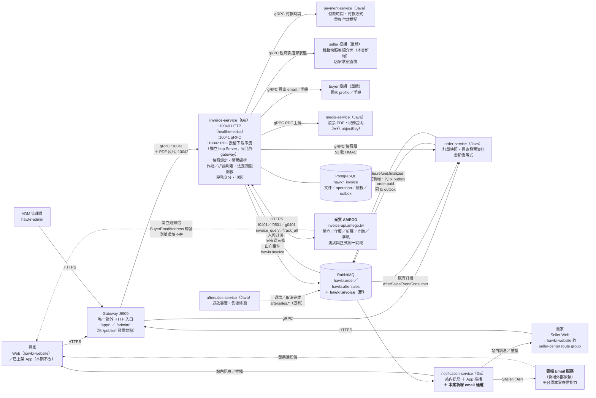

| 圖中的事實 | 對實作的含意 |
|---|---|
| **AMEGO 沒有任何回頭的箭頭** | 光貿無 webhook／callback（P2）。「是否真的上傳財政部」「是否轉錯誤」「有沒有中獎」只能自己輪詢 ⇒ 必須自建 recheck worker |
| 買家的發票通知有兩條路，責任歸屬不同 | AMEGO 那條（虛線）由 `BuyerEmailAddress` 觸發、是開立的副作用、測試環境不寄、重寄只能人工登入後台。平台這條（`NOTI → MAIL`）涵蓋 AMEGO 蓋不到的情境（收據模式、賣家自行開票、開票失敗告知、申訴回覆）。**「載具帶了 email」不等於「會寄信」**——`BuyerEmailAddress` 是唯一開關 |
| invoice-service 對上游四個服務全部是「讀」，無寫入邊 | 發票不得直接修改付款、訂單或出貨狀態。唯一例外是結帳採集買家發票資料，那是 order-service 在建單路徑上自己寫的 |
| 入向事件只有三條，都綁 `hawkr.order`，都用業務鍵去重、都不准用 `event_id` | `order.paid`（既有事件、零 producer 改動）⇒ 冪等鍵取 **`order_no`**（M7）；`order.refund.finalized`（本案新增）⇒ 冪等鍵取 **`refund_ref`**（＝`financial_logs.external_txn_id`）；`order.cancelled`（既有事件、零 producer 改動，#2904）⇒ 冪等鍵取 **`order_no`**。**不訂閱 `aftersales.refund.completed`**（U8：`event_id` 每小時換新 UUID；`FULL_REFUND` 語意不等於全額；不涵蓋 `cancel_id` path） |

### 2.2 In-scope 範圍

不做的事與歸屬見 §1.3，本節不重複。

| # | 能力 | 後端範圍 | 硬性限制 |
|---|---|---|---|
| 1 | 發票快照鎖定（賣方主體、買方發票資料、品項、金額、稅別、發票日期、發票模式） | invoice-service ＋ order-service `GetOrderInvoiceSnapshotInternal` | 快照一經鎖定不隨上游變更而漂移；發票模式以快照為準、資格變更不回溯 |
| 2 | 自動開票（賣家 → 買家）：`AMEGO_AUTO` 訂單自動開 B2C／B2B 電子發票 | invoice-service ＋ `pkg/amego` | 觸發判準＝發貨日與收款日取較早者；零元訂單不開票；冪等鍵送出前先落庫 |
| 3 | 作廢與折讓：售後進終態時自動判定並執行（賣家零操作） | invoice-service 訂閱退款事件 | 判定樹四層：原發票上傳狀態 → 是否已有折讓 → 是否跨期／過關帳日 → 全額或部分（P4–P6）；累計折讓 ≤ 已開票金額由 DB 層兜底 |
| 4 | 法定期限管理：`statutory_deadline_at` 倒數、逼近告警、逾期升級 ADM 待辦 | invoice-service | 用自然日不用工作日；末日不因假日延長 |
| 5 | 賣家稅務身分治理：資格申請、ADM 審核佇列、文件上傳、審核中 60 天可接單、責任條款版本化、免用統一發票資格與收據代製 | invoice-service（資格 SSOT）＋ seller 模組（只出一支唯讀稅籍介面） | 稅務資格＝Invoice 擁有、店鋪 lifecycle＝Seller 擁有；已代製收據不追溯 |
| 6 | AMEGO 憑證與字軌：per-seller 統編＋AppKey 加密保存、連線驗證、字軌餘量監控與告警 | invoice-service | AppKey **不可回顯**；**先驗證再覆蓋**（否則產出「綠色已啟用＋每筆開票都失敗」）；字軌足夠是 `ACTIVE` 的前置驗證項之一 |
| 7 | 買家發票資料：結帳採集統編／載具／捐贈碼；買家常用發票資料集合管理 | order-service（採集，建單 hot path）＋ invoice-service（偏好集合） | 法定必要不是可選功能（L9）。AMEGO 完全不驗捐贈碼與自然人憑證的存在性，必須我方驗（P12） |
| 8 | 買家申訴（未收到發票）：建案、3 工作天 SLA、賣家回覆、ADM 裁決、違規計數 | invoice-service ＋ 既有 violation 路徑 | 工作天由後端算；違規計數只計已確認違規、以**去重後的訂單數**計不以案件數；停權走既有能力層不自建 |
| 9 | ADM 手動開票：issuer／recipient／品項全部手填（含非會員受票人） | invoice-service ＋ `/api/v1/admin/*` | 強制填理由 ＋ 二次確認 ＋ 完整稽核；不走代行 namespace |
| 10 | AMEGO 故障的受控人工出口：ADM 查證未開立 → 雙人確認 → 解鎖人工處理；賣家人工開票後回報號碼 | invoice-service | 系統不顯示為「平台已開立」——平台不冒充開立人 |
| 11 | 稽核與保存：每次送件的請求／回應原文（遮罩後）、每次狀態變更、ADM 操作稽核 | `invoice_provider_audit_logs`（含 `provider varchar(16)`，Phase 1 恆為 `'AMEGO'`）＋ `invoice_status_history`（七個 aggregate 共用的 append-only 狀態歷程）＋ `invoice_admin_audit_logs` | append-only；保存 5 年；禁存 AppKey 明文。折讓的買家同意訊息**不在這三張表**，留在 aftersales 案件時間軸（§5.1.7），本服務只存 `refund_no` 指標 |
| 12 | 跨切面：賣家 capability、業務碼→HTTP status 分流、log 遮罩、可觀測性、依賴治理三件套 | Gateway ＋ invoice-service ＋ monitoring | 每個失敗情境唯一數字碼；AMEGO 落入硬上限依賴治理範圍（E14） |
| 13 | 跨 repo 契約：三端新增 **21 條前端頁面路由**（website 買家 2 ／賣家 9；hawkr-admin 10）＋ §6.1 的 API 端點全表 | 修改清單與部署順序見 §12.2 | 每支 API 端點都要指名消費者（哪個 repo 的哪個畫面），零命中＝未交付。API 端點支數只有一份、在 §6.1.0 (15)，本章不留第二份數字 |
| 14 | **App 買家的申訴代償路徑**（N3 的補償，App 仍零改動） | `hawkr-website` 申訴頁 ＋ 本案新增的 email 通道 ＋ 既有站內訊息 | App 訂單詳情頁沒有現成外連點（`hawkr_buyer/lib/features/order/` 對 `launchUrl` 零命中，現有 4 個使用點在 settings／home／app_update／product）⇒ 通知帶申訴頁連結、買家在瀏覽器開啟即可申訴。隨之的後端義務：**申訴頁必須支援「從外部連結進入 → 登入後直達該訂單的申訴表單」**，不能設計成只有從 Web 訂單詳情點得進去，否則代償等於沒做 |

### 2.3 角色與身分模型

本功能牽涉**六個**互不相同的概念，混用任兩個都會造成稅務錯誤、授權漏洞或稽核失真。

| 概念 | 定義 | 值來源 | ID space | 前端可否指定 |
|---|---|---|---|---|
| **Issuer**（開票人／營業人） | 這張憑證在稅法上的銷售主體 | 開票當下的快照（`issuer_kind` ＋ `issuer_store_id` ＋ 稅籍快照欄位） | `sellers.store_id`（賣家線）／平台常數（平台線，Phase 1 未實作） | ❌ 一律由伺服器從訂單快照或 ADM 表單解析 |
| **Recipient**（受票人／買受人） | 發票開給誰 | 訂單線取買家發票資料快照；ADM 手動線取表單 | `buyers.buyer_id`（會員）／**無 ID**（ADM 手填的非會員，只有抬頭＋統編／載具） | 部分：買家在結帳填自己的統編／載具／捐贈碼（受 P12 驗證約束）；**不能指定別人** |
| **Actor**（觸發者） | 這一次開立／作廢／折讓是誰發動的 | `system`（自動）／ADM session／賣家 | ADM：`admin_accounts.id`（不在 `accounts` 表）；賣家：`accounts.id` | ❌ |
| **Account**（登入 principal） | 登入身分 | Gateway 由 JWT 注入 `x-account-id` | `accounts.account_id` | ❌ |
| **Buyer**（買家業務鍵） | 買家的營運身分 | Gateway `buyerid` resolver 由 `account_id` 解析 | `buyer.buyers.buyer_id`（surrogate，一個帳號一生一個） | ❌ |
| **Store**（賣家業務鍵） | 賣家的營運身分 | Gateway `sellerid` resolver 由 `account_id` 解析 | `sellers.store_id`（store-stint surrogate，TSID，永不變動） | ❌ |

| # | 必須寫進實作的事實 | 做錯的後果 |
|---|---|---|
| 1 | **`merId` 不是身分鍵，且與發票無關**。格式 `HAWK<store_code>`，只在付款、退款與 PayUni Webhook 使用。發票的賣方主體一律取 `store_id` ＋ 稅籍快照 | 兩者生命週期不同：重新入駐會拿到新的 `store_id` 與 `store_code`，所以有新的 `merId`（`seller.payuni_registrations`，一個 stint 一次性），而發票要綁的是開票當下那個主體 |
| 2 | **`store_id` 不是 `orders.store_id`**。`orders` 裡叫 `store_id` 的欄位是**超商門市代號**（`VARCHAR(20)`，`V1__init_order_tables.sql:40`，proto 已改名 `cvs_store_id`）。賣家 surrogate 在 order-service 的欄位是 `orders.seller_account_id`（名字是舊的、值已是 surrogate） | ⚠️ 填錯完全無聲，且 grandfather 恆等會讓 dev 全綠。設計書與 DB 欄位註解各寫一次 |
| 3 | **ADM 帳號不在 `accounts` 表**。稽核的 `actor_admin_id` 指向 `admin_accounts.id`、不可下 FK 到 `accounts`，也不得假設兩個 ID space 不相撞 | 三個身分軸必須各有誠實命名的獨立欄位（`actor_kind` ＋ `actor_admin_id`／`actor_account_id`），禁止共用單一 `operator_id` 再靠 type 欄分辨 |
| 4 | **Recipient 可以沒有任何平台 ID**（ADM 手動開票的受票人可為完全非會員） | 資料模型不得把 `buyer_id` 設 NOT NULL，也不得把 `order_no` 當主鍵或必填 |
| 5 | **Issuer 與 Actor 分離是目的不是副作用**。平台代賣家送件，但發票人始終是賣家 | 把 Actor 寫進 issuer 欄位，稽核層就再也分不出「這張發票的稅務責任歸誰」。這也是所有對外文案禁用「平台開立」「平台代開」措辭的原因（`PLATFORM_RECEIPT` 除外，那是收據不是發票） |
| 6 | **買家 email 有兩個來源，權威順序寫死**：`buyers.email` 優先、`accounts.email` 回退 | 三個陷阱（nullable／只回填一次／不同步）見 U5，取值定版見 D6 |
| 7 | **AMEGO 的「公司」＝ issuer，租戶隔離只靠「統編 + AppKey」**，無獨立 sandbox 網域、回應無環境標記（P1） | issuer 的憑證選錯，會對別的公司開出真發票且無法從回應辨識 ⇒ 「issuer → 憑證」的解析必須是單一 choke point 且有 fail-fast 斷言 |

**issuer→recipient 模型矩陣**（Phase 1 實作範圍是打勾的兩列）：

| 線 | issuer | recipient | 觸發 | 品項來源 | Phase 1 |
|---|---|---|---|---|---|
| **商品交易** | 賣家（`store_id` ＋ 稅籍快照） | 買家（`buyer_id` ＋ 發票資料快照） | 自動（付款成功） | 訂單快照 | ✅ |
| **ADM 手動開票** | 賣家 或 平台 | 任意（含非會員） | ADM 手動 | ADM 手填 | ✅ |
| 平台服務費 | 平台 | 賣家（`store_id`） | 自動（週期結算） | 費用計算 | ❌ 模型容納 |
| 🆕 **Uber 物流服務費** | 平台 | 賣家（`store_id`） | 送達完成（`ADR-003`） | 物流費計算 | ❌ **走上一列的模型**（不是新方向） |
| 訂閱制 | 平台 | 賣家 或 買家 | 自動（訂閱週期） | 方案快照 | ❌ 模型容納 |

🔴 **對帳差額的憑證形式**

| | 規則 |
|---|---|
| **商業關係** | 平台針對 Uber 物流服務費對賣家開票（上表第三列）；月結取得實際成本後**實際 > 暫估 ⇒ 產生對應追加憑證**、**實際 < 暫估 ⇒ 產生對應折讓／調整文件**（`ADR-008`）。🔴 **兩個方向都是義務不是選項** |
| **不得做的事** | 🔴 **任何對帳差額都不得回頭改買家那張發票**（買家配送費／訂單總額／商品本金一律不動，`ADR-008`）。買家端的更正只在**買家自己的交易**有變動時才發生 |
| **fail-closed** | 追加與折讓的正式會計科目、稅務科目與法律形式（是否為折讓單、開立時點、期別歸屬）由會計師認定。🔴 **不得自行杜撰**；未取得認定前這條軸不得自動開立，一律停在待處理並告警 |

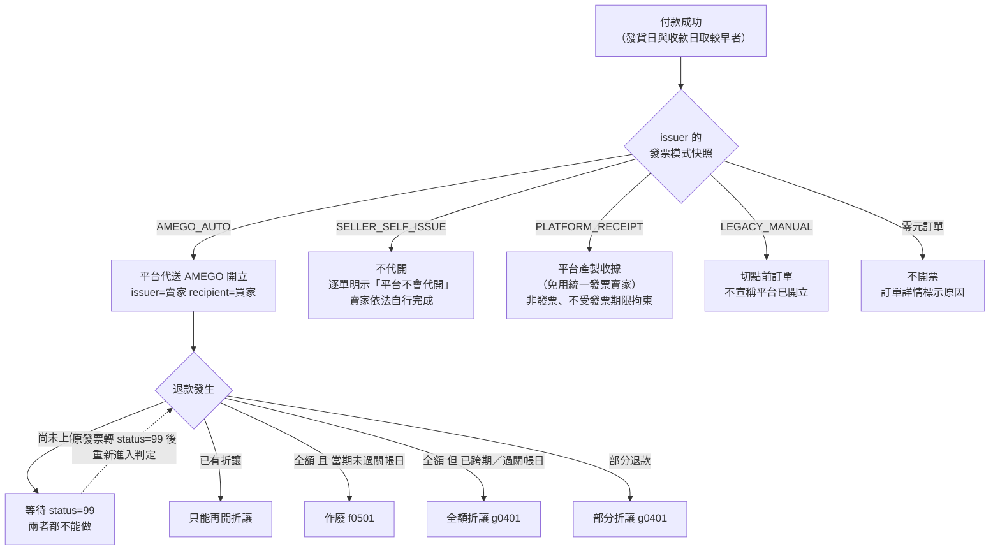

| 圖註 | 內容 |
|---|---|
| `R0` 不是終態 | 它是「原發票尚未上傳完成（AMEGO `3050121`／`3050131`，P6）」的等待節點，由 recheck worker 輪詢到 `status=99` 後**重新走一次同一棵判定樹**。做成終態會讓退款卡在沒有出口的狀態 |
| 同一件事的三個名字 | DB 欄名 `invoice_documents.fulfillment_mode`（§5）／對外 API 欄名 `invoiceMode`（§6，checkout preview 與訂單詳情）／正文口語「發票模式」。值域＝CodeMeta `InvoiceFulfillmentMode` 四值 `AMEGO_AUTO`／`SELLER_SELF_ISSUE`／`PLATFORM_RECEIPT`／`LEGACY_MANUAL`，與圖中 A1–A4 一一對應 |
| 「零元訂單」不是第五個模式 | 它是 `status = NOT_APPLICABLE` ＋ `not_applicable_reason = ZERO_AMOUNT`（D5），畫在同一層只因為它同樣在這個分岔點被判掉 |

---

## 3. 約束與前提 (Constraints & Assumptions)

**3.1–3.4 是外部給定的**（法規／金流結構／上游現況／第三方供應商），只能設計繞過或吸收；**3.5 是本專案規範**，違反會被 CI 或 boot 斷言擋下、或靜默失效；**3.6 是假設**，失真回 §11.2 重評，每條附偵測方式；**3.7 是本書定版的決策**，要改必須重新決策，不得在實作時就地變通。

### 3.1 法規硬約束（L 系列，不可協商）

| # | 法規要求 | 對設計的約束 | 法源 |
|---|---|---|---|
| **L1** | 買賣業開票時限「以發貨時為限。但發貨前已收之貨款部分，應先行開立」——本文觸發事實是**發貨**，但書是把時點**提前**的強制規定（用「應」不是「得」），且逐筆金額判定。生鮮賣家全部適用（農林／畜牧／水產與製造、手工、出版業同買賣業） | 觸發判準寫成「**發貨日與收款日取較早者**」，不得硬綁 `order.paid` | 營業稅法 §32 I ＋〈時限表〉「買賣業」列 |
| **L2** | 「賣家還沒拿到錢」不能延後開票：① 主判準與收款無關 ② 延後開票的例外是明文列舉，無「款項由第三人保管」這一種 ③ 主管機關對網購鑑賞期已表態「可緩寄，不可緩開」 ④ 主張「那筆錢不算賣家的」會把平台推進「受託代銷」，那時每筆訂單都要由平台就全額開票 | 「等買家確認收貨」「等售後期間屆滿」「等撥款完成」三者一律違法，不得作為開票條件。統一發票使用辦法 §16（收款時為時限者可依票載日開立）**買賣業不適用** | 〈時限表〉；統一發票使用辦法 §14 I-2／§16／§17／§18；營業稅法 §3 III |
| **L3** | 「開立」與「交付」是兩件事，能延後的只有後者；電子發票依限傳輸即視為交付 | **開立時間**與**對買家的呈現時間**必須是兩個獨立欄位。呈現可延後到確認收貨後，開立不得延後 | 統一發票使用辦法 §7 VI |
| **L4** | 上傳存證是獨立的第二個時限：B2C「自開立**翌日起算二日內**」、B2B「翌日起算七日內」，且末日為星期六日、國定假日或其他休息日者**不予延長** | 不得引用「48 小時」舊說法。B2C 實際窗口＝開立日 +1 日 00:00 → +2 日 23:59:59。重試排程用**自然日**，重試上限與告警設在**小時級** | 台財稅字第11304654280號公告（113.12.12 發布，114.1.1 生效） |
| **L5** | 受罰的是賣家不是平台，且每位賣家各自曝險；行為罰按查明認定總額 **2%**（一年內第一次）／2.5%／3%／**5%（故意）**，每一營業人上限 100 萬元，與漏稅罰擇一從重 | 平台的時點設計錯誤會被乘以賣家數量，不可外部化。罰則一律寫 2%/2.5%/3%/5%，**不得用「5%」當一般基準**（那是 108 年舊基準，現行只適用「故意」） | 營業稅法 §2 I 1、§51；稅捐稽徵法 §44；〈裁罰金額或倍數參考表〉；行政罰法 §24 I |
| **L6** | 「沒有漏稅」不等於「沒有罰」——行為罰與漏稅罰是兩件事（官方實例：漏開 2 千萬、漏稅額 0 元、仍處 2% 罰鍰 40 萬元） | 「反正最後會補開、稅也沒少繳」不能當延後開票的理由 | 稅捐稽徵法 §44（行為罰）vs 營業稅法 §51（漏稅罰） |
| **L7** | 作廢與折讓的法律界線是「**銷售額是否已申報**」，不是天數。天數限制來自另外兩處：傳輸時限（L4）與加值中心自訂的關帳日（P4） | 判定樹必須以 `reported_status` ＋ 關帳規則為輸入，不能只看期別。「只做作廢不做折讓」會在跨期退貨時卡死 | 統一發票使用辦法 §20、§20-1；營業稅法 §15 II |
| **L8** | 折讓須經買賣雙方合意，且開立／更正／作廢／退回或折讓的**買家同意訊息與相關證明文件至少保存 5 年** | 合意的**當下訊息**必須留得下——事後補等於資料已經沒了。落點在 aftersales 案件時間軸（§5.1.7），`invoice_adjustments` 只存 `refund_no` 指標 ⇒ 5 年保存實際掛在 aftersales（待坐實項 #3514，上線 blocking）。另：平台允許賣家實物驗收後**單方下修**退款金額（`0 < actual_refund_amount ≤ resolution.refund_amount`）⇒ 折讓金額 ≠ 買家同意金額，處置見 D13 | 統一發票使用辦法 §20-1；〈電子發票實施作業要點〉第 9 點 |
| **L9** | 平臺業者不得拒絕買受人以共通性載具索取雲端發票，且應**併同提供**載具與捐贈碼資訊給賣家的開票流程 | 結帳頁的載具欄位是**法定必要，不是可選功能**。Hawkr 就是條文定義的「平臺業者」 | 〈電子發票實施作業要點〉第 21 點第 2、3 項 |
| **L10** | 電子發票系統「應具備防止統一發票字軌號碼開立錯誤、重複及漏未上傳的檢核功能」 | 「偵測未存證 → 主動補傳」是**法定必備功能不是加分項**。落在 Outbox 與 recheck worker（業務正確性），不是資料完整性掃描 job（E12 分流見 §8.4） | 〈電子發票實施作業要點〉第 4 點第 1 項第 3 款 |
| **L11** | 賣家的「發票開立身分」必須是可表達的第三種狀態（使用統一發票／免用統一發票），且不能由平台代賣家決定。小規模營業人由稽徵機關按查定銷售額每三個月發單，根本不開發票 | `fulfillment_mode` 的 `PLATFORM_RECEIPT` 不是「延後」也不是「開票失敗」，是完全不同的一條線，**不可混入同一條發票狀態機** | 營業稅法 §32 I 但書、§23、§40；統一發票使用辦法 §4 I-1；營業稅法施行細則 §9 |
| **L12** | 個人賣家（非營業人、無統編）的開票路徑與企業賣家完全不同：個人賣家在 PayUni 送的 `UBN` 是**身分證字號**，拿它開發票在稅法上不成立 | 營業人資格認定與稅籍登記義務工程端不得推定。個人賣家不得進入 `AMEGO_AUTO`（N16） | 營業稅法 §6、§28；稅籍登記規則 |
| **L13** | 消保法七日解除權 vs 平台 60 小時售後窗口。生鮮食品可能落在《通訊交易解除權合理例外情事適用準則》§2 第 1 款，但須「並經企業經營者告知消費者」 | 與開票無關的獨立合規問題，**不在開票方案裡順帶處理** | 消保法 §19；〈通訊交易解除權合理例外情事適用準則〉§2（`pcode=J0170012`） |

### 3.2 金流與商業結構約束（M 系列）

本節每條都是本平台獨有的事實，共同決定「賣家在買家付款當下即已收款」這個法律認定。這些事實改變時，L1／L2 的適用結論要重新評估。

| # | 事實 | 對設計的約束 | 出處 |
|---|---|---|---|
| **M1** | 每個賣家在 PayUni 是以自己名義註冊的獨立合作商店（個人：姓名＋身分證字號；企業：公司名＋統編），買家付款帶的 `MerID = HAWK<store_code>` 就是賣家自己的商店代號，平台只是代理商（`AgentID=HAWK`） | **本平台不是「平台代收」**——在 PayUni 帳上這筆錢從一開始就掛在賣家名下。這比「平台代收」對「延後開票」的主張更不利 | `internal/platform/payuni/client.go`；`services/java/payment-service/src/main/resources/application.yml:108`；`docs/第三方整合/PayUni 代理商專用 API 總覽.md:97-99` |
| **M2** | PayUni 是自動請款模式，授權成功即請款成功；我方從未呼叫任何 capture／請款 API（12 個端點無一是 capture，`/api/trade/close` 一律 `CloseType=2`＝退款） | 買家付款成功當下，該筆貨款在民法 §309 的意義上已對賣家發生清償效力 ⇒ 落入 L1 但書 ⇒ 開票時點＝付款成功 | `05-支付服務（Payment Service）詳細設計書.md:3428-3429`；`services/java/shared/payuni-java-client/.../PayUniPaymentEndpoint.java` |
| **M3** | `GrantExport=1` 控制的是「PayUni → 賣家 UNi 帳戶」的撥款，不是「買家 → PayUni」的請款；撥款發生在訂單 `COMPLETED(50)` 之後、PayUni 隔日入帳；平台銀行帳戶完全不經手，repo 內無任何平台銀行帳戶、金流帳本或餘額表 | 明確排除「綁 `granted_at` 開票」——它與稅法收款時點最少差 60 小時 ＋ 1 個工作日，遇售後凍結倒數還會無限延長 | `services/java/shared/payuni-java-client/.../PaymentClient.java:97,128,157,418`；`docs/第三方整合/PayUni 代理商專用 API 總覽.md:326-331` |
| **M4** | 和單（`consolidated=true`）的程式碼路徑已寫好、只差一個環境變數。`PAYUNI_AGENT_MER_ID` 目前為空，配置面共 4 處：`k8s/values/order-service.yaml:101`（prod overlay 未覆寫）、`.env.template:101`、`docker-compose-local.yml:679`，**真正的讀值處**是 `services/java/order-service/src/main/resources/application.yml:169`（`mer-id: ${PAYUNI_AGENT_MER_ID:}`）。旗標由前端 request 帶入 | 一旦填值，平台就變成代收方、發票的三角關係整個改變（收款方是代理商、賣方是各自的 store），削弱 §3.1 法源前提 ⇒ checkout 加 **fail-closed**：賣家已進 `AMEGO_AUTO` 時拒絕 `consolidated=true`。風險有限：跨賣家結帳本來就被 `DIFFERENT_SELLER` 硬擋 | `api/proto/order/order.proto:716`；`.../order/checkout/CheckoutService.java:454-463` |
| **M5** | 本平台目前沒有貨到付款（COD），付款方式僅信用卡／Apple Pay／Google Pay／ATM ＋ 零元訂單，且訂單必須先到 `PAID(10)` 才進 `PENDING_SHIPMENT(20)` ⇒ 付款恆早於出貨 | `shipping_method_configs` 已有 `commission_rate`／`commission_min` 兩欄（註解「代收手續費率」、已有初始資料）＝COD 預留位。一旦啟用 COD，發貨在前、收款在後，但書不觸發、開票時點必須落在**發貨時** ⇒ 這是 G1 要求判準寫成「取較早者」的原因 | `.../shipping/V1__init_shipping_tables.sql:269-270,292-293` |
| **M6** | 零元訂單（`ZERO_AMOUNT 2900`）完全不呼叫 PayUni，直接以 PAID 建立且 `amount` 恆為 0，DB 有雙向不變式 CHECK | 用「有 PayUni 交易才開票」實作 ⇒ 零元訂單一律漏開，且症狀只在使用高額優惠券時出現 ⇒ 必須是明確裁決的分支（D5），不能是遺漏 | `.../payment/V1__init_payment_tables.sql:73-76`（`chk_amount_valid`） |
| **M7** | 重複付款會產生第二筆 `is_duplicate=TRUE` 的 PAID row。一張訂單可有多筆 `payment_transactions`（`trade_no = orderNo + 3 位序號`），只有 INIT/PAID 非重複那筆受唯一索引保護 | 冪等鍵不能單用 `order_id` 或 `trade_no`。**重複付款不產生第二張發票，也不產生折讓**（§7.1.2 註 3）：`order.paid` 只在 `0→10` 的 CAS 成功分支內落 outbox ⇒ 一張訂單最多一則事件；第二筆的錢由 payment 側 rescue 自動退還，退的是從未被開票的金額。⇒ 入向冪等鍵取 **`order_no`**；機械保證是「`invoice_documents.total_amount` ＝該訂單 `is_duplicate=FALSE` 那筆的 `trade_amt`」，**不是**所有交易加總 | `.../payment/V1__init_payment_tables.sql:11,51-53,96-98` |
| **M8** | Phase 1 平台對賣家零收入：無平台服務費、無抽成、無上架費。優惠券要拆兩件事：「折抵不退還」是一回事；ADMIN 全平台券**契約層存在、營運層目前未發行**是另一回事 | ① 沒有平台開票線（N1），但必須在設計書明寫這句，否則法源前提懸空；② 優惠券一律視為賣家負擔、開折扣後金額，不新增 `funded_by`；③ 正因 ADMIN 券在契約層存在，正當性由 **D9a 的 fail-closed 兜底**，不得寫成「PLATFORM 不可能出現」 | 平台向賣家收費的線在 repo 內不存在 |

### 3.3 上游服務資料與時間軸約束（U 系列）

| # | 事實 | 對設計的約束 | 出處 |
|---|---|---|---|
| **U1** | 一筆訂單＝一個賣家（跨賣家結帳被 `DIFFERENT_SELLER` 硬擋），`orders` 的賣家欄是單值 | 「一張發票對一筆訂單、賣方直接取訂單的賣家 surrogate」是安全的，不需拆單分帳。例外是和單場景（M4），已由 fail-closed 處理 | `.../order/checkout/CheckoutValidator.java:47` |
| **U2** | `order_items` **沒有計價單位（unit），也沒有稅別**。逐欄：`id／order_no／product_id／product_name／sku_id／sku_name／quantity／list_price／unit_price／share_discount／actual_pay_amount／refund_status／image_object_key／created_at` | AMEGO 的 `Unit` 與 `TaxType` 必須有來源。**定版為固定預設值（§5.1.6）**：`invoice_document_lines.unit` Phase 1 恆為 `NULL`、`tax_category` 恆為 `1`（應稅）、`tax_rate_bps` 恆為 `500`，`order_items` 與 `orders` 一欄都不動。本案動到結帳的是**新增** `order_invoice_snapshots` 表與寫入它的建單流程，結帳 hot path smoke 仍必觸發 | `.../order/V1__init_order_tables.sql:99-116`；`api/proto/order/order.proto`（`OrderItemDetail` 同樣沒有） |
| **U3** | 金額恆等式 `total_actual_amount = Σ order_items.actual_pay_amount + shipping_fee`，優惠券分攤尾差歸最後一筆 | 發票總額直接取 `orders.total_actual_amount`（＝PayUni 實收，與售後 `refundable_amount` 同基準），**不要自行從品項小計＋運費重算**。折扣尾差沿用同一套 rounding | `.../order/checkout/CheckoutService.java:423,918-921,992-1008` |
| **U4** | 賣方稅籍資料只存在於「申請單」不是主檔，且可被改回草稿。`seller.stores` 逐欄確認無 `tax_id`／公司名／負責人；`tax_id` 只在 `seller.kyc_applications`，而被退回的申請重送沿用原列、狀態回到 `DRAFT` | 直接 join 申請單當開票依據會漂：認證單 reset 回 draft 再改之後，已開出的發票抬頭與現在的申請單不一致**且無告警** ⇒ 建立獨立的 `seller_tax_profiles` 並在開票當下取快照 | `internal/modules/seller/db/schema.sql`（`seller.stores` 逐欄無 tax_id；`seller.kyc_applications`） |
| **U5** | 買家 email 不保證存在、不保證可寄達，且有兩個來源。`accounts.email` nullable（LINE 登入可能沒有）、Apple 登入可能拿到 private relay 或空字串、建帳之後不同步 | 當必填 ⇒ 大量訂單開不出票；當 optional 但沒定義無 email 路徑 ⇒ 開票邏輯在 runtime 才發現分支缺失 ⇒ 取用順序與 fallback 寫死（D6）。買家 email 的來源是 identity 的 `accounts.email`（建帳時 Clerk 回報的 email，可為 NULL，不隨 Clerk 同步，刪帳清為 NULL）；buyer 模組的資料與 `BuyerInfo` 都沒有 email | `internal/modules/identity/db/schema.sql`（`accounts`）；`internal/modules/buyer/db/schema.sql`（`buyer.buyers`） |
| **U6** | 平台零 email 寄送能力。`grep -rlIE "net/smtp\|gomail\|sendgrid\|mailgun\|jakarta\.mail\|javax\.mail\|spring-boot-starter-mail" services pkg gateway` 零命中；`notification_templates` 連 `channel` 欄位都沒有 | 「發票寄 email 給買家」在後端沒有任何可用實作路徑。新增雲端 email 服務是**平台能力新建案**（選型／secret／退信處理／依賴治理），不是順手接一套 SMTP。13 號模板引擎加 channel 維度是 **expand-contract**，不是加一列 seed | `services/notification-service/db/schema/schema.sql:49-73` |
| **U7** | `order.paid` 的 payload 不含付款時間與付款方式，但 `event_id` 穩定。欄位＝`eventId／orderNo／shippingMethod／occurredAt／buyerId／notifyBuyerAccountId／storeId／totalActualAmount／sellerName／sellerAvatarKey／buyerNickname／buyerAvatarKey`；`occurredAt` 是事件建立時間，**不是付款時間** | ① 發票日期必須另外經 gRPC 取 `payment_transactions`（U14），不能用事件欄位；② `event_id` 因 payload 在 `order_outbox` 落庫、重投同一列而穩定 | `.../order/mq/dto/OrderPaidPayload.java:37-49`；`.../order/mq/PaymentEventHandler.java:213-235` |
| **U8** | `aftersales.refund.completed` 的 `event_id` **不穩定**。`RefundSyncWorker`（`@Scheduled(cron = "0 30 * * * ?")`，每小時）把任何 1 小時前的 DONE refund task 重發，payload 每次重建、每次換新 UUID | 用 `event_id` 當折讓冪等鍵 ⇒ 同一筆退款每小時重複開一張折讓單，是真金白銀的稅務錯誤且持續累積。這是不把這條事件當發票觸發源的三個理由之一（另兩個：`FULL_REFUND` 語意不等於全額、不涵蓋 `cancel_id` path）。改訂 `order.refund.finalized` 後規則仍寫死：**入向去重一律用穩定業務鍵、禁用 `event_id`**。既有正例：crm 用 `"AS_REFUND_" + case_no`、order 用 `financial_log.external_txn_id`。註：`external_ref_id`（PayUni refundNo）在 `cancel_id` path 上是 NULL | `.../aftersales/scheduler/RefundSyncWorker.java:56,62`；`.../aftersales/mq/payload/RefundCompletedPayload.java:57` |
| **U9** | `FULL_REFUND` 不等於「全額都退了」，`refund_total_amount` 也不可靠。`refundable_amount` 每次建案都取 `orders.total_actual_amount`、不扣已退金額；`orders.refund_total_amount` 只有 PARTIAL 路徑維護、FULL 路徑不維護（FULL 場景會是 0） | 直接拿 `FULL_REFUND` 當「作廢整張發票」的訊號 ⇒ 金額對不上、稅務錯誤（「先 PARTIAL 過一次再 FULL」時 `FULL_REFUND` 不是歸零）⇒ 發票端必須自己維護**累計折讓流水**，並用 DB CHECK 兜底「累計折讓 ≤ 已開票金額」 | `.../aftersales/service/AfterSaleCaseService.java:122`；`.../aftersales/V3__add_refund_outcome.sql:11-21` |
| **U10** | 60h/72h 時間窗倒置，這是常規路徑不是例外。訂單自動完成＝`delivered_at + 60h`，申訴期 72h，且 `submitAppeal` 全段無訂單狀態守門 ⇒ 典型時序：送達 → 買家申請 → 賣家拒絕 → 訂單自動完成＋撥款 → 買家在剩餘申訴期提申訴 → Admin 裁決 → 真的退款 | 在「付款成功即開票」下不再是阻擋條件，但仍決定兩件事：① **開票後才發生退款是常規路徑**，作廢／折讓是主線不是 edge case；② 訂單完成後狀態仍會變（`applyFullRefund` 的 allowed-from 含 `COMPLETED(50)`／`PARTIALLY_REFUNDED(60)`）⇒ 發票端不得假設任何訂單狀態是終點 | `.../order/config/OrderConfig.java:23`；`.../order/application.yml:112`；`.../aftersales/config/AfterSalesProperties.java:76`。註：`aftersales.appeal.deadline-hours` 只有 class 預設、yml 與 env 皆未宣告 |
| **U10a** | 售後參數有一處已知不一致：`application.yml` 寫 `aftersales.case.process-deadline-hours: 24`、class 預設 72 ⇒ **實際生效 72**。成因不是「yml 覆蓋 class」，而是**那行 yml 從未被綁定**：`@ConfigurationProperties("aftersales")` 的欄位名是 `caseConfig` ⇒ relaxed binding 期待 `aftersales.case-config.*`，而 yml 寫 `aftersales.case.*`，全服務 grep `case-config` 零命中、亦無 `@Value` 直讀 | 若任何發票邏輯用到售後時間窗，必須確認**實際生效值**而非文件值或 yml 上看得到的值。本設計刻意不依賴任何售後時間窗。結論來自靜態分析（欄位名 ↔ key 名比對 ＋ 零命中窮舉），未在 runtime 實測 | `.../aftersales/config/AfterSalesProperties.java:10,25`；`.../aftersales/application.yml:112-115` |
| **U11** | `SHIPPING_ABNORMAL(35)` 只能靠物流商後續貨態事件恢復（→ 30/32/40），平台無任何手動介入 API（29 號明列「手動重試／取消／強制成功 API 不實作」） | 開票條件若掛在訂單狀態上，卡在 35 的訂單會永遠開不出票（售後前置要求 `DELIVERED(40)`，連售後都開不了）⇒ 這是「開票不看訂單狀態」的第二個理由。設計書明寫：**開票的唯一輸入是付款事實與發貨事實，訂單狀態不是輸入** | `03-訂單微服務…:124,134,138`；`29-Admin 異常訂單管理 API 詳細設計書.md:53` |
| **U12** | store-stint：關店重開會拿到新 `store_id`。`seller.stores` PK 是 `store_id`（永不變動），`account_id` 非唯一，同帳號關店後重新入駐產生新列；`stores_current_account` 唯一索引保證目前的 stint 至多一個。買家不同：一個帳號一生只有一個買家（`UNIQUE (account_id)`） | ① 發票文件永遠綁開票當下的 `store_id` 快照，不隨 incarnation 轉移；② 舊 incarnation 的未完成 job 由 ADM 工作台顯示並可續處理；③ 同統編跨 incarnation 的憑證指紋重複偵測要例外化（賣家統編通常不變）；④ 明寫「同一 account 的 store 是序列不是並存」 | `internal/modules/seller/db/schema.sql`（`seller.stores`）；44 號 §5.1 |
| **U13** | 兩個既有自動刪除機制會吃掉發票憑證：① `media_asset` 無引用且建立超過 7 天 ⇒ 連同 R2 物件一起刪（`media.gc.orphan-asset-days:7`）；② 帳號關閉 T+30 清 PII 且**跨所有 stint** | 照現況實作，發票 PDF 與稅務證明 7 天後消失、買家關帳號後發票資料被清 ⇒ 發票類資產必須有 `asset_reference`；發票文件列為 PII 清理例外，帳號刪除不連帶刪除、僅關閉對外查詢（D10） | `.../media/scheduler/MediaGarbageCollectionJob.java:28,106-107` |
| **U14** | 發票日期只能從 `payment_transactions` 取，兩個候選欄位各有陷阱：`provider_paid_at` 是 PayUni 認為的真實付款時間（卡片 `AuthDay+AuthTime`、ATM `PaymentDay`），**但 ATM webhook 常無時間欄位而為 NULL**；`pay_time` 是我方寫入當下的 UTC now（`COALESCE(pay_time, now at time zone 'utc')`＝只寫第一次），webhook 延遲會讓它晚於真實付款時間 | DB 一律存 UTC，而台灣期別是 **UTC+8 雙月制** ⇒ 跨月／跨期邊界會把發票開進錯的期別，錯誤只在每兩個月的邊界日出現、極難重現。取值規則見 D4 | `.../payment/V1__init_payment_tables.sql:39,56-57`；`.../payment/…/PaymentTransactionMapper.java:501` |
| **U15** | 「所有售後途徑都關閉」在本系統沒有上界。三段皆無程式上界：① Admin 對申訴的裁決無 deadline 欄位、無逾時排程、無自動裁決 ② 退貨運送中 14 天只發告警、永不關案 ③ ATM 退款等買家去 PayUni 頁面填帳號，無期限、無逾時關閉 | 這不只是法遵問題，是工程上根本不可實作為自動觸發條件 ⇒ 「售後結束才開票」被否決的**第二個獨立理由**（第一個是違法），兩者互不依賴 | aftersales 三段售後路徑皆無程式上界 |
| **U16** | 既有事件可單方面訂閱，但不可反向：訂閱既有 routing key 只需在 `topology.yaml` 加自己的 queue 條目、不需改任何 producer；反過來不可往既有 routing key 再掛第二個 publisher | 發票的入向訂閱是零 producer 改動的；出向事件必須開新 exchange `hawkr.invoice`（並手寫 `hawkr.invoice.dlx`） | `infra/mq/README.md`；36 號 |

### 3.4 AMEGO 供應商約束（P 系列）

本節每條的來源都是「已窮舉搜尋且零命中」或「實測」。標【文件未載明】者代表官方真的沒寫，需向光貿書面確認（清單見 §11.2）。

| # | 事實 | 對設計的約束 | 來源 |
|---|---|---|---|
| **P1** | 測試與正式共用同一個 base URL（`https://invoice-api.amego.tw`），只靠「統編 + App Key」區分，回應中沒有任何環境標記 | ⚠️ **config 填錯就會對正式公司開出真發票，且無法從回應辨識** ⇒ config `Validate` 必須 fail-fast：非 prod 環境時 `AMEGO_INVOICE` 必須等於測試統編 `12345678`。測試池是所有串接者共用（實測有 7 萬+ 筆他人資料）⇒ 測試資料不得含真實個資 | 官方逐字：「目前測試或正式都請用同一個 API 網址」；實測回應無環境欄位 |
| **P2** | 完全沒有 webhook／callback／回調機制（對全 24 支 API 定義 ＋ 15 份補充說明頁掃 `webhook\|callback\|回調\|回呼\|推播\|通知網址\|notify_url`，兩邊皆 0 命中） | 「是否真的上傳財政部」「是否轉錯誤」「有沒有中獎」只能自己輪詢 ⇒ 必須自建 recheck worker；多副本時該 worker 需 lease claim、不可用永久旗標（E13）。**不得為 AMEGO 建 webhook 端點當必要環節** | 官方 API 無 webhook／callback |
| **P3** | 沒有冪等鍵機制，唯一保護是 `OrderId` 唯一性；逾時後無法分辨「沒收到」與「收到了但回應遺失」 | 三件事必須同時做：① 送出前先把 `OrderId` 寫進我方 DB（同一 transaction），重試沿用同鍵；② 逾時一律先 `invoice_query(type=order)` 反查再決定補送；③ `3040171` **一碼兩義**（「OrderId 重複」＝永久衝突 vs「該訂單編號正在註銷重開中」＝暫時態），只能字串比對中文 msg 而 msg 不是契約 ⇒ 寫測試釘住這兩個字串，不符預期時走保守路徑（當永久衝突並告警） | 官方無冪等鍵機制；S4 錯誤碼表兩列同碼 |
| **P4** | 關帳日：每單月 6 日 00:00:00 起，上期發票的「開立／註銷／作廢」上傳全部被鎖，解鎖需聯繫光貿人工開權限；單月 9 日凌晨前期字軌轉為過期 | 跨期退款／跨期作廢有硬牆，退款流程必須有「原發票已跨期且過了 5 號」分支，正解是**開折讓單而不是作廢發票**。這與 L7 的法律界線是兩個獨立限制，判定樹要同時吃兩個輸入 | 官方逐字（S9） |
| **P5** | 已存在折讓單的發票不得作廢（`3050141`） | 「已有生效折讓的發票再遇全額退款」只能**補折讓至全額**，不走作廢 | 官方錯誤碼表 |
| **P6** | 尚未上傳完成的發票不能作廢或折讓（`3050121`／`3050131`） | 判定樹第一層必須先問「原發票是否 `status=99`」，兩者都不能做時要能表達「等待中」而不是「失敗」 | 官方逐字（S13） |
| **P7** | `invoice_status` 沒有載明查詢窗口，超限時**靜默** `NOT_FOUND`（`code 0` + status −1），無任何訊號。應改用 `invoice_query`（180 天，超限回可辨識的 `code 51`）；`invoice_list` 與 `allowance_query` 無限制 | ⚠️ 用 `invoice_status` 判斷「有沒有開過」，會在超過兩期之後靜默回答「沒開過」，然後重開第二張 ⇒ **對帳與冪等一律走 `invoice_query(type=order)`** | 實測：約當期+前兩期，更早者靜默 NOT_FOUND |
| **P8** | 發票 PDF 與明細只在開立後 180 天內可取；`file_url` 僅 10 分鐘有效，過期／竄改時回 HTTP 200 + 中文純文字 | ① 開立成功後**立即抓檔落到平台自有儲存**（media R2，只存 objectKey），法規要 5 年而 AMEGO 只給 180 天；② 下載後必須檢查 `Content-Type == application/pdf` 或 magic bytes `%PDF-`，只看 HTTP status 會把錯誤頁存成 PDF | 文件＋實測 |
| **P9** | 載具發票（手機條碼／自然人憑證）根本沒有 PDF 可下載（載具發票中獎後才可下載）；0 元發票無 QRCode 故不可列印正本 | PDF 下載 CTA 必須依 `document_kind` + `carrier_type` 分流，B04/B05 明示「已存入載具，不提供 PDF」。不分流會做出一個永遠壞掉的下載按鈕。⚠️ **這條也是 D6 不代配載具的理由之一**：平台代配會讓買家在毫不知情下失去 PDF | 文件（錯誤碼 53／56） |
| **P10** | 「順時順號」是硬約束：同一段字軌的發票號碼順序必須與開立時間順序一致 | 選 `f0401`（自動配號）而非 `f0401_custom`（API 配號），由 AMEGO 保證順序（另一個理由見 D3） | 官方逐字（S20） |
| **P11** | 字軌是先決條件：必須使用電子發票專用（丁種）字軌，不足即 `3040111`，重試多久都不會好；期配僅可取用本期及下期，財政部於雙月 18 號開始下期配號 | ① `CREDENTIAL_VERIFYING → ACTIVE` 的驗證項目必須包含「至少一組可用字軌」；② 需要字軌餘量定期查詢（`/json/track_all`／`track_status`）與告警；③ 錯誤分類表把 `3040111` 歸為「重試無用，資源耗盡」而非一般可重試錯誤；④ 財政部平台授權光貿＋自有字軌是**法定前置**，故 operation 狀態機需要獨立的非技術性失敗狀態 **`SELLER_ACTION_REQUIRED`**（語意＝永久失敗但賣家自己解得掉，與 `FAILED_PERMANENT`＝只有 ADM 能解必須分開）。該值三處逐字一致：CodeMeta `InvoiceOperationStatus`／§5.1.8 `chk_invop_status`／§7.3.2 FSM，同為 **20 值**；六分頁歸 `NEEDS_ATTENTION`；出入邊為 §7 **J32**（`SENDING` →，字軌不足 `3040111`）／**J33**（餘量恢復 → `READY`）／**J34**（ADM 手動重試 → `READY`）。值域改動必須同一波動三處、以 CodeMeta `業務狀態碼.md` 為 SSOT：漏同步的失敗形狀是 `UPDATE` 回 `23514 check_violation`，而 `pkg/outbox` 把它當普通處理失敗吞掉並退避重排 ⇒ 沒有錯誤、沒有告警 | 官方（S15／S20） |
| **P12** | AMEGO 不驗、必須由我方驗的清單：捐贈碼（`3040137` 其實只檢查「3–7 碼純數字」，`"999"`／`"000"` 一律通過）、自然人憑證（完全不驗存在性）、載具類別（接受任意 6 碼字串）、**三選一互斥完全不擋**（統編／載具／捐贈可並存）、抬頭「不可填 0000」文件有寫但實測不擋、`date_start`／`date_end` 格式錯會靜默回全部歷史 | 打錯的捐贈碼會成功開票、捐贈失效且**不可逆**（只能作廢重開）⇒ 我方必須自建捐贈碼清單（來源財政部 E3/E4）＋ 手機條碼呼叫 `/json/barcode` 驗存在性 ＋ 統編走檢查碼演算法 ＋ 三選一互斥自己擋 | 實測逐值窮舉 |
| **P13** | 【文件未載明】沒有任何速率限制數字、沒有 SLA、沒有 timeout 承諾。唯一線索是錯誤碼 `21`「人數過多」，但門檻與冷卻未載明；實測連打約 40 次未觸發，回應 header 無 rate-limit 欄位 | 依賴治理的「預算數字」寫不出來就不得接上任何環境（含 dev）⇒ **自己設上限當 `max` series**（保守 ≤5 QPS）＋字軌餘量當第二個 series ＋兩條告警 ＋白紙黑字預算數字。client deadline 必須設（推定：開票類 30s、查詢類 10s，上線後依實測 p99 調整）——**沒有 deadline 就算不出 lease 租約下界**（E13） | 官方文件未載明 ＋ 我方實測 |
| **P14** | 停機維護以 4 小時級距發生，且只在官網彈窗公告、沒有 API 或訂閱通知（錯誤碼 `10`） | 重試策略必須能吸收 4 小時級中斷，或設計成「排入佇列 + 告警」。維護窗吃掉的時間也算在法定 2 日／7 日內（L4） | 官方公告樣本逐字 |
| **P15** | 測試環境不會主動發送信件（要收信得登入測試後台按「補發發票開立通知」） | 「開票後買家收到通知信」這條 happy path 在 dev 無法自動驗證。驗收條件拆兩段，dev 只能驗到「AMEGO 回 `code:0` 且 `BuyerEmailAddress` 已送達」，**不可在 dev 宣稱「通知信已驗證」** | 官方逐字 |
| **P16** | 重寄／補寄發票通知信沒有 API，唯一方式是登入後台按按鈕（且只有當期的可補發） | 「重新寄送通知」後端無法自動化 ⇒ 若產品需要，必須改為我方自建寄信（用 `invoice_file` 取 PDF、由 notification 服務寄出）——這是接雲端 email 服務的第二個理由 | 官方 24 支 API 無 `send_mail`／`resend`／`notify` |
| **P17** | 正式 App Key 只能由客服人工發放；客服回覆時間平日 10:00-12:00、14:00-18:00 | secret 輪替方案受此限制；key 只能人工更換 ⇒ 事故應變 RTO 取決於客服上班時間。規劃輪替時的雙 Key 過渡；若不支援雙 Key 要規劃停機窗口。**必須寫進 Runbook**。是否支援雙 Key 並存未經光貿書面確認 ⇒ 輪替計畫一律先按「不支援」規劃停機窗口 | 官方（S15／S19） |
| **P18** | 一組字軌只能由一套系統使用；重複開立第 1~3 次免收處理費、自第 4 次起酌收 | 賣家若同時有 POS 或其他電商平台在用同一組字軌，必須切割字軌分段 ⇒ 開通精靈與 S03 必須問這件事，不能假設賣家只用 Hawkr | 官方（S17） |
| **P19** | 【文件未載明】`code 14 IP 錯誤` 的白名單機制完全沒有說明（如何登記、是否預設啟用、能登幾組、支不支援 CIDR、以哪個 IP 為準）。全文 grep `IP` 只有錯誤碼表那行命中 | 若正式帳號啟用 IP 綁定，k8s pod 的浮動出口 IP 會整批失敗，且**會在切正式的當下才炸** ⇒ 直接決定要不要走固定出口 IP（既有 `egress-proxy`，固定 IP `203.0.113.30`，見 `docs/開發規範/固定 IP 出口與第三方轉發規範（Egress Proxy）.md:19,35`）。申請正式 App Key 時必須同時問清楚，正式帳號是否啟用白名單未經確認 ⇒ 依 ADR-33 用兩模式建構子，切換為 config 變更而非改 code | 測試帳號從一般家用／辦公網路打全部成功 |
| **P20** | 【文件未載明】AMEGO 的文件是活頁面、無版本號、無變更日誌、無棄用政策；批次寫入的部分成功語意未載明（回應只有單一 `code`，無逐筆結果陣列） | ① 契約變更不會有預告，需在 CI 或定期 smoke 對關鍵行為做迴歸；② 批次寫入無法判斷「前 3 張成功、第 4 張失敗」⇒ **一律一次一張**，用我方批次層做並行 | 官方文件未載明 ＋ 我方實測 |
| **P21** | 測試環境的發票是否真的上傳財政部：文件沒說。實測測試公司的發票 `invoice_status` 會跑到「2 上傳中」，但無證據說明最終會不會進財政部 | 在確認之前，**QA 開的每一張測試發票都要作廢**。若會上傳，測試資料就是真發票。是否真的上傳未經光貿書面確認 ⇒ 一律按「會上傳」處置 | 我方實測 |

### 3.5 本專案工程約束（E 系列）

| # | 約束 | 對設計的約束 | 出處 |
|---|---|---|---|
| **E1** | Gateway 是唯一對外 HTTP 入口，微服務間一律 gRPC、微服務不暴露 HTTP | invoice-service 只有 gRPC 對外介面（＋ `/health`、`/metrics` 的內部 HTTP）；所有發票端點落在 Gateway | `docs/基礎建設/系統架構與資料流向.md` |
| **E2** | API 只有三個 namespace，envelope 恆為 `{code,message,data,traceId?}`，成功 `message="success"` 且 Gateway 不得自造；業務資料一律在 `data` 之下；**proto struct 不得直接放進 `data`**（protoc-gen-go 的 tag 是 snake + omitempty，直出＝欄名 snake ＋零值消失） | 一律走 `gateway/internal/response` 的 helper（ruleguard `banDirectJSON` 擋 `c.JSON`、`banDirectProtoPayload` 擋 proto 直出）；要傳語意（例如 `handlingMode`）就在 `data` 開具名欄位 | `gateway/ruleguard/rules.go`；`gateway/internal/response/response.go`；`pkg/envelope/envelope.go` |
| **E3** | 數字欄位對外一律 string、時間一律 ISO 8601 UTC 帶 `Z`；金額以「元」的整數表示，禁浮點 | 全部 ID、金額、版本號對外皆為 string。⚠️ 事件宣告若把金額欄寫成 `"amount": "decimal"` 即與此牴觸，不得沿用那種形狀 | `docs/開發規範/Java 微服務開發規範.md` §2 |
| **E4** | `invoice` 是 Gateway 代行路由的 **boot-time 禁字**（10 個之一：`shipment/fulfillment/payment/payout/grant/refund/invoice/bank/identity/certification`，子字串比對）；代行 storefront allow-list 也明文排除發票 | 任何 `delegatedHandle(..., "/sellers/:store_id/invoices", ...)` ⇒ Gateway 啟動 panic、部署即炸。ADM 發票端點只能走一般 `admin.GET("/invoices", ...)`。另一半義務：**「發票與稅籍」必須登記進 `hawkr-website/features/delegated-operations/nav-policy.ts` 的 `DELEGATED_HIDDEN_HREFS`**——那是排除清單、其餘一律渲染，漏登記不會編譯錯、不會測試紅 | `gateway/internal/router/seller_route_assert.go:66-79`；`gateway/internal/handler/admin_delegated_storefront.go:18-24` |
| **E5** | 未登記於 `envelopeCodeToGRPC` 的業務碼一律塌縮成 HTTP 409；要帶結構化 data 必須進 `envelopeCodePreserveData` | 「查無發票」回 404、「AMEGO 上游不可用」回 503、「作廢失敗要帶 AMEGO 原始回覆」三者都需**逐碼登記**，而這兩張表不是 CodeMeta 生成的、最容易漏。不要擴充 `response/bizhttp.go` 的登錄表（那是代行專用且有機械測試守著） | `gateway/internal/grpc/envelope_guard_interceptor.go:27-49,56-60` |
| **E6** | CodeMeta 是共享代碼值的 SSOT：先改 `.md` 再 `generate.sh`，生成檔禁手改（`static-gates.yml` 會重跑 `generate.sh --all` 再 `git diff --exit-code`）；禁止預先登記沒有 emitter 的碼 | 每個發票碼都要在同一波實作裡指得出 emitter 的 `檔案:行號`。三張 allowlist（`GO_LABEL_ENUMS`／`GO_REGISTRY_ENUMS`／`ADMIN_ENUMS`）打錯或漏名不會報錯、只會靜默少生成，且前兩者必須互斥。前端四份是人工 verbatim 拷貝，唯一防線 `check-copies.sh` 掛 pre-commit（前提是本機跑過 `lefthook install`，判準 `ls .git/hooks/pre-commit`） | `docs/代碼管理（CodeMeta）/README.md` |
| **E7** | Proto 只改 `api/proto/*`；改完必跑 `scripts/gen-go-proto.sh`（只需 docker）＋ rsync 到 java-proto ＋ `mvn clean install`；CI 有 `proto-generated-diff.yml` 對拍 | 新增 `api/proto/invoice/invoice.proto`，五件套 `syntax`／`package hawkr.invoice`／`go_package`／`java_package`／`java_multiple_files`。**不要抄 `payment.proto` 的 `io.github.will413028.hawkr.payment.grpc`**，那是全 repo 唯一的歷史偏差 | `docs/開發規範/Proto 管理規範.md`；`api/proto/review/review.proto:1-8`（正確範本） |
| **E8** | TSID 用於對外暴露的業務表，BIGSERIAL 用於內部表；Go 服務用 `pkg/tsid.NewGenerator`（無 Node ID Base 概念，不需申請） | 對外表 9 張（開票主體／賣家稅務資格／provider 憑證／買家發票偏好／發票文件／調整／更正請求／申訴／operation）→ TSID；內部表 8 張（品項行／折讓明細／申訴時間軸／入向 inbox／出向 outbox／provider 稽核／狀態歷程／ADM 稽核）→ BIGSERIAL；`invoice_business_day_mirror` 用自然鍵 `holiday_date`。合計 §5.1 的 **18 張** | `pkg/tsid/tsid.go` |
| **E9** | Go 走 Atlas declarative：改 `db/schema/schema.sql` → `atlas migrate diff` → `atlas migrate hash`；禁止 SSH 手跑 DDL。部署自動涵蓋：有 `db/atlas.hcl` 就自動 migrate | migration 時間戳的順序是**跨分支的**：拿自己的最大值與**遠端已套用的最大值**比，不是與 repo 內的比——`added out of order` 會擋掉全部服務部署 | `docs/開發規範/PostgreSQL 設計規範與最佳實踐.md`；`.github/workflows/deploy-k8s.yml` |
| **E10** | PostgreSQL 交易內任一句 SQL 失敗即整個交易 aborted（`25P02`）；「衝突就跳過」只有 `ON CONFLICT DO NOTHING` 一條路 | 發票冪等**不得**寫成「try insert → catch DuplicateKey → select existing」，在 PG 上必定 500。過渡期同時存在新舊唯一約束時，`DO NOTHING` **不指名 conflict target** | `docs/開發規範/PostgreSQL 設計規範與最佳實踐.md` |
| **E11** | MQ 雙 SSOT ＋ passive declare：36 號管事件契約、`topology.yaml` 管 broker 資源，兩邊都要改；服務端查不到 queue **不 crash、不進 DLQ，該訂閱靜默失效** | 三個陷阱：① `{exchange}.dlx` 必須自己列進 `exchanges:`（展開規則不產生它；漏了 plan 乾淨、apply 才 404 並留下 partial apply）② Go `MaxRetries > 0` 的 queue，topology 條目必須帶 `retry:`（CI gate 不驗這層耦合，後果是本機綠、CI 綠、上線整條 subscription 被 skip）③ 新增 queue 必然打破 `infra/mq/tools/test_expand.py` 的資源數 pin。push 前跑三道閘門：`infra/mq/tools/validate.py`、`python3 -m unittest discover`、repo root 的 `scripts/mq-consumer-registration-check.py`（**兩支 cwd 不同**） | `docs/基礎建設/MQ Topology 管理（Terraform）.md`；`infra/mq/README.md` |
| **E11a** | MQ 登記一致性 gate 只保護 Go，且它自己有已知盲區（notification 的 map value 形狀在方向①隱形） | 這是選 Go 而非 Java 的主要工程理由之一（D1）。即使選 Go 也不能把 gate 當唯一保證——設計書要把 topology 條目逐條列進 §12 當人工 review checklist | `scripts/mq-consumer-registration-check.py:1-30`（檔頭註解自陳盲區） |
| **E12** | 責任邊界：`reconciliation`／`reflow`／`backfill`／`resync`／drift 偵測不得寫進 application code（「即使只是偵測 + log warn」也算違反）；例外只有跨服務 saga unwind、**Outbox**、CDC 三種且須於設計書標注理由。判定準則：目的是**業務正確性** → 可考慮；**資料完整性監測** → 一律歸維運 SQL | 「掃 `orders` 找出該開票卻沒開的訂單」是典型 drift scanner 形狀，會被規範直接否決 ⇒ 逐項分流（§8.4）：Inbox／Outbox／provider audit log／「長時間未知」的推進**留**（後者必須命名為 recheck，禁出現 reconciliation／drift／對帳字樣）；「已付款但無處理模式」改成 metric ＋ Alertmanager；「重複文件」由 UNIQUE 擋；「金額不一致」由 CHECK ＋ 寫入路徑同事務驗證擋。§8.4 必須逐字寫出「單一寫入路徑為唯一真實來源；不引入補償任務基礎設施」 | `docs/開發規範/後端服務責任邊界規範.md` |
| **E13** | 多副本排程搶佔：批次讀候選 → 逐筆做副作用的程式碼一律用 **lease claim**（不得 stamp 永久旗標，`SET status = <中間狀態>` 就是永久旗標的一種）；租約長度 **< 該 row 在候選集合的剩餘壽命** 且 **> 單筆最壞耗時**；**逐筆在 claim 當下取租約基準**；claim SQL 必須有非 PK 述詞；候選述詞一律正面列出要處理的狀態值，禁 `<>`／`NOT IN` | 租約下界需要 AMEGO 呼叫的明確 deadline 才算得出來（P13）⇒ **先給 client 明確 deadline，才能寫出租約算式**。candidate 述詞必須容納 `SENDING`，否則只是把永久旗標寫得更像 lease。`FOR UPDATE SKIP LOCKED` 已被規範明文否決。註：prod 現況 `replicas: 1`（只有 cart/gateway/order/payment/payuni-webhook 五支被 overlay 成 2）⇒ invoice-service 初期不會重複，但規範要求調高 replicas 之前排程必須全數有合格搶佔 | `docs/開發規範/多副本排程搶佔規範.md` |
| **E14** | 硬上限依賴接入治理：用滿了會「回錯誤／拒絕服務／丟資料」→ 適用（含第三方 rate limit）。接入前置三件缺一不得接上任何環境的生產路徑（**明文包含 dev**）：① 用量與上限**兩個** series ② 逼近上限 ＋ 觸頂副作用**各一條**告警 ③ 白紙黑字的預算數字 | AMEGO 是依賴登記表的 **R5**。另一條更容易漏：禁止把 session／分散式鎖／冪等記錄放在沒有預算數字的依賴上 ⇒ 現行 Redis 是 `maxmemory 512mb / allkeys-lru` ⇒ **發票的重複開立防護不得只放 Redis**（會被逐出），必須落 PostgreSQL 唯一約束，Redis 只做加速。接入流程要求演練失效：明寫「上限到達時系統會怎麼表現」，寫不出來＝不得接上 | `docs/開發規範/硬上限依賴接入治理規範（配額與容量）.md` |
| **E15b（本設計新增）** | **停權白名單必須新增 `/seller-center/invoices/` 前綴**（原本白名單裡的是 `/seller-center/orders/`）。理由：賣家向發票通知的 `schema_url` 已全部改指 `/seller-center/invoices/{documentId}`（§D.4），漏了這一條，停權賣家點推播會被導去 `/seller-center/suspended`——而「查看已開立的發票」與「重寄通知」本來就是停權賣家該保留的能力（§8.1.6 已放行端點 32）。⚠️ **放行的是路由前綴，不是頁內全部動作**：S11 在停權時仍須隱藏作廢／折讓按鈕 | 掛載四處同 PR 齊動（同 E15）；`seller_capability_test.go` 的 `expectedSellerRoutes` 與 `suspensionWhitelist` 的單元測試都要加 | `gateway/internal/authz/policy.go` |
| **E15** | 賣家能力層規約：新賣家機能的設計書必須明載「停權賣家可否使用 ＋ capability 歸屬」；deny-by-default，只有四類進停權白名單；純唯讀查看也鎖；capability token 不進 CodeMeta；掛載四處必須同 PR 齊動（`capability.go` 的 const ＋ `AllCapabilities`、`policy.go` 停權白名單、`router/seller_capability.go`、`router/seller_capability_test.go` 的雙向斷言） | 逐條裁決見 §8.1。漏加 `Register` 會 panic（registry 保護），但漏改 `seller_capability_test.go` 的 `expectedSellerRoutes` 會讓測試紅，兩者都要同 PR 動 | `docs/開發規範/賣家能力權限層規範.md`；`gateway/internal/authz/capability.go` |
| **E16** | 多媒體 URL：DB/MQ/快取一律只存 objectKey，欄位名必須誠實（存 key 就叫 `*_key`，禁止 `*_url` 名存 key 值） | 很容易寫成 `invoice_pdf_url` 卻存 objectKey——`banners.preview_image_url` 是既有反面教材 | `docs/開發規範/多媒體與圖片 URL 規範.md`；49 號 |
| **E17** | 微服務間內部授權走 HMAC（52 號）：server 端 interceptor 由 `pkg/server/grpc.go` 自動裝，**client 端必須自己掛** `interceptor.InternalAuthClientInterceptor("invoice-service", ...)` | 漏掛在 `INTERNAL_AUTH_MODE=enforcing` 下是全部 UNAUTHENTICATED。repo 內已有漏掛實例（`services/review-service/internal/client/order/client.go:22`），不要照抄 | 52 號；`pkg/middleware/grpc/interceptor` |
| **E18** | log 遮罩是「值的清單」不是「欄位位置的清單」：同一個值從 body／query／path／header 進來都要遮 | AMEGO AppKey、簽章、載具識別碼（手機號碼／自然人憑證）、統編、買家 email 全部要進 `gateway/internal/middleware/logger.go` 的敏感清單，且確認 `redactBody`／`redactQuery` 兩條路徑都涵蓋。**憑證與 PII 判準不同**：PII 問「這是誰的個資」，憑證問「拿到它能做什麼」——AppKey 是憑證（單獨持有即可對該公司開票），不得落 log、不得回應、不得存明文 | `gateway/internal/middleware/logger.go` |
| **E19** | Swagger 註解是契約 SSOT；`gateway-json-contract.yml` 雙 Check：**A** 對外舊身分名棘輪。⚠️ **規則不是「只抓 seller／buyer 家族」，而是「`account_id` 家族 ＋ 任何非空前綴」**（`scripts/gateway-json-contract-check.py` 的 `CAMEL_QUALIFIED`／`SNAKE_QUALIFIED`，裸 `accountId`／`account_id` 才不算）⇒ `actorAccountId`／`approvedByAccountId` 這類**語意正確的稽核欄位一樣命中**，處置是登記進 `scripts/gateway-json-contract-baseline.json` 的 `check_a` 並寫明理由，不是改名、**B** `@Success` 宣告 ↔ handler 實際輸出對拍 | 發票 DTO 欄名一律 `storeId`／`buyerId`，用舊身分名會當場擋紅。`@Param` 數字參數必須 string；分頁一律走 `response.Page`（`data:{records,total,page,pageSize}`），禁止 handler 自己組 `gin.H` 拼分頁欄位 | `docs/開發規範/Gateway Swagger 註解規範.md` |
| **E20** | 結帳 hot path smoke：動到 product／order／cart／payment／shipping 任一服務的 service／repository／gRPC／MQ Consumer 層，push 前必跑 `infra/smoke-checkout.sh` 全綠 | 本案必觸發（結帳採集買家發票資料、preview 回應加欄、order 新增快照 RPC）且不得以「只改一行」豁免。push 前那次驗的是**舊 code**，有鑑別力的時點是 **merge + deploy 完成之後**，**兩次都要跑** | `infra/smoke-checkout.sh`；`docs/開發規範/開發工作流程.md` |
| **E21** | 越權回應防枚舉（Tier A）：訂單／付款／退款屬 Tier A ⇒ 越權必須回 **404**，且 code + message 與「不存在」完全一致，寫入型 RPC 同樣適用 | 發票天然是 Tier A。§6.1 的路由表必須逐條註明 Tier 與越權分支 | `docs/開發規範/API 設計規範.md` |
| **E22** | 交付路徑：`backend-payuni` 走 PR、base 一律 `dev`；`hawkr-admin` 直接 push `dev`；**`hawkr-website` 本案必須走 PR**（website 分級規則：動共用元件／路由／state 結構／跨多 feature／layout／UX 即走 PR `--base dev`，發票同時滿足四項） | website 另要求 push 前先呈現 commit list + diff stat 並取得明確確認，不可逕自 push | `docs/開發規範/Git 分支與交付路徑規範.md` |
| **E23** | 新 Go 服務的手寫登記散在很多處，漏加一律不會轉紅。**完整清單以 §12.2 為準**（§12.2.2 的 22 個位置 ＋ §12.2.5 的 10 項契約層 ＋ §12.2.6 的監控組） | 最容易漏的類型：五處服務清單（`go.work`、根 `Makefile`、`dev.sh`、`k8s/Makefile`、`scripts/init-databases.sh`）＋兩處 CI（`code-quality.yml`、`go-checks.yml`，若有 testcontainers 測試再加 `integration-tests.yml`）＋ k8s values／prod overlay／NetworkPolicy／secret 群組／compose／`.env.template`／Gateway 的 `INVOICE_SERVICE_HOST` ＋ `INVOICE_SERVICE_GRPC_PORT` ＋ **`INVOICE_SERVICE_FILE_PORT`** 三個設定／監控告警。另：`k8s/scripts/create-secrets.sh` 的 `SCRIPT_REVISION` 必須 +1（有 gate 守）；base values 絕不能寫 `<prod DB host>`／`DB_POOL_PORT`／`DB_SSLMODE`（`deploy-k8s.yml` 直接 fail）；**`AMEGO_BASE_URL`** 在 `.env.template` 留空不預填（預填 sandbox 值會讓 prod 靜默打到測試環境） | §12.2；`docs/開發規範/新增微服務指南.md` |
| **E24** | 「誰消費它」是每個後端變更的必答題：拿路由字串或欄位名去**所有**前端 repo grep，零命中＝未交付。web 端 wire types 是手寫、無同步機制 | §6.1 每一條路由都必須指名消費者（哪個 repo 的哪個畫面）。若 notification 的 refType 新增 `INVOICE`，還要評估四個前端消費者（gateway fallback 表、seller App inbox switch + FCM router、buyer App `destination.dart`、website `lib/notifications/resolve.ts`），順序不可顛倒 | `docs/開發規範/Web 前端契約同步規範.md` |
| **E25** | 重複實作防護：新增 formatter／validator／計算器／resolver／client 前先 grep `pkg/`、`services/java/shared/` 與同 domain 既有實作 | 本案特別容易踩三處：① AES-256-GCM 欄位級加密 → Go 有 `pkg/crypto`（`EncryptToBase64`／`DecryptFromBase64`），Java 側查無；② 工作天曆 → 既有 `HolidayService` 在 shipping-service，禁止複製第二份；③ 「售後是否還活著」→ 用既有 helper／RPC，禁止自造第二套終態集合（自造＝在撥款閘門與開票閘門之間製造靜默分歧） | `pkg/crypto/crypto.go:83-110`；24 號；`.../common-core/.../helper/AfterSaleCaseStatusRules.java` |
| **E26** | 賣家中心的元件禁止直接 import 傳輸層：`hawkr-website/biome.json:54-66` 的 `noRestrictedImports` 明令 `features/seller-center/**` 不得從 `@/lib/api/client`（含相對路徑）import `authedFetch` 或 `apiClient`，必須經 `lib/seller-data/scope.tsx` 的 repo 工廠注入 fetcher | 同一個元件會被 `/seller-center` 與 `/adm/[storeId]` 兩條路徑渲染，自己 import 傳輸層等於寫死打 `/app/*` ⇒ 發票的賣家頁一寫 `apiClient` 就 lint 紅 | `hawkr-website/biome.json:54-66` |
| **E27** | 新增 `/seller-center/*` 路由自動被登入守衛涵蓋，不必改 middleware（`SELLER_PREFIXES = ["/seller-center", "/seller-product-import-preview"]`） | 賣家發票頁的登入保護是免費的；**但停權導頁不是**（E15／D16 的 `suspensionWhitelist`），兩者是不同機制 | `hawkr-website/lib/auth/redirect.ts:5,59`；`hawkr-website/middleware.ts` |

### 3.6 假設 (Assumptions)

每一條若失真都會使本設計的某個結構失去依據，必須回到 §11.2 重新評估，而不是在實作時就地變通。

| # | 假設 | 失真後果 | 偵測方式 |
|---|---|---|---|
| **A1** | 使用者已持有光貿帳戶，且每個賣家有自己的統編＋AppKey（不是全平台共用一組） | 改成全平台共用一組憑證，發票人就變成平台，法源前提（L1／L5）與資料模型的 issuer 軸全部要重做 | 開通第一個賣家時確認：`invoice_status` 查得到的發票，其 `Invoice`（統編）欄位是賣家自己的統編 |
| **A2** | prod 已上架且有真實使用者，但**零存量交易** | 零存量交易讓破壞性重構可做（不必為既有發票資料設計遷移）；但**舊版 App 仍在線**不受此豁免——`/app/checkout/confirm` 的 invoice 區塊改必填會直接打爛線上 App | 上線前重查 prod 交易量：`SELECT count(*) FROM orders WHERE status >= '10'`。這個數字會變，不要憑印象 |
| **A3** | `INTERNAL_AUTH_MODE=enforcing` 在 dev／prod 皆已生效，且五支 per-service NetworkPolicy 存在 | invoice-service 的 gRPC client 漏掛 `InternalAuthClientInterceptor` ⇒ enforcing 下全部 UNAUTHENTICATED，且在部署當下才炸 | 部署前須確認 `INTERNAL_AUTH_MODE` 在 dev／prod 的 overlay 皆為 `enforcing`。base values 的 `permissive` 不要動（只對沒有 overlay 的本機生效） |
| **A4** | invoice-service 初期 `replicas: 1` | 今天不會重複開票；但排程搶佔仍要做（E13），否則擴容那一刻引爆 | `grep -rn "replicas" k8s/values/overlays/prod/invoice-service.yaml`；副本數是判定輸入且會變 |
| **A5** | AMEGO 正式帳號沒有啟用來源 IP 白名單 | 若啟用，k8s pod 的浮動出口 IP 會整批失敗，且在切正式的當下才炸 ⇒ 要改走既有 `egress-proxy`（固定 IP `203.0.113.30`），不是零成本（P19／ADR-33） | 申請正式 App Key 時書面詢問，列為上線 blocking |
| **A6** | 開票量級在 AMEGO 容忍範圍內，且自訂的 ≤5 QPS client-side rate limit 足夠 | 大促／批次開票可能整批被擋，且沒有 header 可判斷該等多久（P13） | `code 21` 出現率的 metric；與字軌餘量一起進 §9 容量表 |
| **A7** | 持有 ADM 帳號的都是可信的內部工程／營運人員，沒有外包或一般客服 | 只要有一個客服帳號拿得到 admin token，「取消 job／輪替 AppKey／解鎖人工處理」就對他開放（需求明確要求這三者不得授予一般客服）⇒ 必須改做治理 capability registry（#3500 E2-8） | 向使用者確認 ADM 帳號的實際持有人清單；新增 ADM 帳號時重問 |
| **A8** | NTP 同步正常，後端與 AMEGO 的時鐘偏差在簽章的 `time` 窗口內 | 簽章驗證失敗，而失敗訊息是通用錯誤碼、不會直接指向時鐘 | 部署後打一次 `GET /json/time` 與本機 `date -u` 比對；偏差進 metric |
| **A9** | `order.refund.finalized` 的三個發布點已窮舉「錢真的退出去」的全部路徑 | 只綁一條事件會漏掉「重複付款的自動退款」。三條既有退款事件（`aftersales.refund.completed`／`payment.refund.succeeded`／`payment.rescue.refund_completed`）各有用途，§6.3 已逐條答覆採用或不採用。本假設守的是**新事件那三個發布點的完整性** | 對帳：抽樣比對「已折讓總額」與 `orders.refund_total_amount` ＋ payment 側退款流水 |
| **A10** | notification 模板現況與 baseline 一致 | 模板 migration 寫錯欄位名 ⇒ 通知靜默不發 | 模板 migration 落筆前必須 `SELECT` dev 的 `notification_templates` 現況，不可只讀 baseline |

### 3.7 由本書定版的決策（D 系列）

假設會失真、決策不會；本表回答「有哪些定版決策、改動它必須先滿足什麼」。
**被否決的方案與改動代價見 `docs/adr/2026-09-18-invoice-service-architecture.md`。**

| # | 決策 | 改動它的前置條件 |
|---|---|---|
| **D1** | **服務語言為 Go**（`services/invoice-service/`，fx ＋ sqlc ＋ Atlas ＋ pgx），複用 `pkg/outbox`、`pkg/crypto`、`pkg/mq.ResilientConsumer`、`pkg/tsid`（ADR-02） | 參照 ADR-02 的四項隱藏成本 |
| **D2** | **自己串 AMEGO，不用 PayUni 代開**（ADR-05） | 參照 ADR-05 |
| **D3** | **用 `f0401`（自動配號），不用 `f0401_custom`**（ADR-15） | 需先解決併發下的號碼單調分配，並為 `track_get` 設計「逾時後靠 `track_status` 的 `now` 比對」的補救 |
| **D4** | **發票日期取 `COALESCE(provider_paid_at, pay_time)`，期別以 UTC+8 雙月制換算**（ADR-03）。`provider_paid_at` 是 PayUni 認定的付款時間，優先取；ATM webhook 常為 NULL 故 fallback。**期別換算必須在 UTC+8 做** | 補跨期邊界日測試（至少 UTC 15:59 vs 16:00 各一、單月 1 日與雙月最後一日各一） |
| **D5** | **零元訂單（`ZERO_AMOUNT 2900`）不開票**，訂單詳情標示原因（ADR-21）。**必須是明確裁決的分支**——零元訂單照發 `order.paid`，會建出 `total_amount = 0` 的待開票紀錄，沒有這條分支它會停在待開票 | 需先實開一張 0 元測試發票確認 AMEGO 接受，並處理 P9 |
| **D6** | **平台不代買家配載具。** 買家沒有主動選擇載具時一律開**無載具發票**，發票由平台保管、買家在發票中心（B09／B05）查看與下載。買家 email 權威來源是 `buyers.email`，為空回退 `accounts.email`（該取值供**通知信**用，與載具無關） | 參照 ADR-22 |
| **D7** | **不申請 Hawkr 專屬會員載具，也不借用光貿的 `amego` 載具**（ADR-22）。需求書要的「預設會員載具」，其意圖由發票中心（B09 列表 ＋ B05 詳情）滿足 | 參照 ADR-22 |
| **D8** | **毛額開立 ＋ 退款走折讓**，不採「剩餘快照開淨額」（ADR-19）。金額守恆式的等號右邊是「賣家開給買家的發票／收據總額」、左邊是「商品實付小計＋獨立列示的應稅運費－買家實際享有的優惠」＝買家實付 | 需重寫守恆式、重新設計退款軌跡的保存方式，並回答「§20-1 要求的買家同意訊息保存在哪裡」 |
| **D9** | **優惠券一律視為賣家負擔，發票開折扣後金額，不新增 `funded_by`**（ADR-20）。折扣行在 AMEGO 側以**負數商品明細**表示 ⇒ 不變式是「`line_type ∈ {PRODUCT, SHIPPING}` 的金額 ≥ 0；`line_type = DISCOUNT` 的金額 < 0」。Phase 1 的 `chk_invline_type` 只允許 `PRODUCT`／`SHIPPING`／`DISCOUNT` 三值（`BUNDLE_COMPONENT` 不登記，Phase 1 無 emitter；寫入會撞 `23514`） | 守恆式必須先改寫成「賣家銷售額 ＝ 買家實付 ＋ 平台補貼」，且要同時設計補貼回沖的金流 |
| **D9a** | **平台出資券的 fail-closed（D9 的兜底）**：建立發票文件時，若該訂單套用的優惠券 `created_by = ADMIN`，一律不得自動開票——文件建成 `status = 'AWAITING_MANUAL'` ＋ `manual_reason_code = 'PLATFORM_FUNDED_DISCOUNT'`，轉 ADM 佇列人工判定後再開。若結帳既有回傳判不出「誰建的券」，Phase 1 替代做法是 ADM 發行全平台券時同步登記一張旗標表、由 invoice-service 讀它——**判不出來時的預設值是「擋下來」，不是「當成賣家負擔」**（判定資料來源見 §5.3.5） | 拿掉這道檢查必須先有「平台補貼回沖賣家」的完整金流與改寫後的守恆式（D8／D9），不能只把 if 刪掉 |
| **D10** | **資料保存 5 年**（`INVOICE_DOCUMENT_RETENTION_DAYS`／`INVOICE_AUDIT_RETENTION_DAYS`，預設 `1826`）；`invoice_documents`／`invoice_adjustments`／`invoice_provider_audit_logs`／`seller_tax_profiles` 列為買家 PII 清理例外——帳號刪除不連帶刪除、僅關閉對外查詢（**讀取閘門，不是刪資料**）。PDF 與稅務證明的 media GC 保護由「上傳與建 `asset_reference` 壓成同一次呼叫」達成，**不修改 GC 規則**（ADR-30） | 縮短保存期需法務確認；且要處理「已經被例外化保留的資料如何合法刪除」。GC 是不可逆刪除（媒體 7 天、PII T+30），確認回來之前資料不得先刪 |
| **D11** | **ADM 授權 Phase 1 沿用既有 `requireAdmin`**，以強制填理由 ＋ 二次確認 ＋ 完整稽核補足（ADR-08）。禁止把 `ADMIN_INVOICE_*` 塞進代行封閉九值（會撞兩個 DB CHECK ＋ boot 斷言），禁止另蓋第二套授權層 | 若 A7 失真，要在 `gateway/internal/authz` 開**第三個 registry**（與代行封閉九值完全隔離，命名用小寫點號式 `invoice.read`／`invoice.credential.manage`／`invoice.job.cancel`） |
| **D12** | **Phase 1 只做寄信介面、不接 provider**：定義 `MailSender` 介面，預設實作 `LogMailSender`（把整封信寫進結構化 log），`MAIL_PROVIDER=log` 為預設值；Phase 2 才接雲端供應商。簡訊排除。信件內容**一律含完整發票內容**（HTML 本文），`fileAvailable=true` 時另夾帶 PDF 附件；**不使用連結**（發票依法保存 5 年而連結的有效性繫於我方系統，且方向四的非會員收件人根本登不進來）。13 號模板引擎加 `channel` 維度（ADR-11）。收據模式、賣家自行開票模式、開票失敗告知、申訴回覆四類沒有任何 provider 可借 | Phase 2 接真 provider 時**只換 `MailSender` 的實作與 `MAIL_PROVIDER` 的值**，模板／組裝／附件／收件人解析／紀錄全部不動；屆時才需要跑依賴治理三件套（用量／上限兩個 series、兩條告警、預算數字）與退信處理設計 |
| **D13** | **折讓合意＝買家提出退貨／退款申請即視為合意**（退貨條款 ＋ 操作紀錄存證，保存 5 年）；**賣家單方下修退款金額時給買家異議期，逾期視為同意**（ADR-31） | 任一方向的改動都需要法務意見（參照 ADR-31） |
| **D14** | **AMEGO 故障／結果不明時提供受控人工出口**：ADM 向光貿查證未開立 → 雙人確認 → 解鎖人工處理；賣家人工開票後回報發票號碼，**系統不顯示為「平台已開立」**（ADR-17）。禁止的是「系統**自動**切換為人工」；受控人工出口本身是需求的一部分（「只有 ADM 查詢 provider 並取消 job 後，才能進入 `MANUAL_PROCESS_ALLOWED`」）。《統一發票使用辦法》§24-1 亦要求「無法開立時依規定改以人工開立……必須另有經確認的故障應變程序」 | 改為「完全不設人工備援」須先由會計師、國稅局或 AMEGO **書面確認**；改為「強制回報否則視為違規」需要新的違規類型與申訴路徑 |
| **D15** | **治理參數定版**：停權門檻＝**90 天內 3 次**經 ADM 判定違規（沿用申訴佇列既有的 90 天窗口，不另造第二個時間窗）；停權恢復＝固定 **14 天**自動恢復、期間可提前申請由 ADM 審核；資格駁回或逾期後可重申但 **7 天冷卻**（反向亦適用：已核定資格可由 ADM 推翻重審）；60 天期限**自賣家送出審核申請起算**；待審期間接單上限 **50 筆 / NT$100,000，先到者停接新單**（可調參數，既有訂單仍可履約）（ADR-36） | 全部是可調參數，改值只需改設定；但**改變起算點的語意**要重新論證漏洞：補簽路徑 T04 會在事後改寫 `attested_at`，改錨等於把起算點交還給賣家 |
| **D16** | **賣家能力層裁決**：查詢發票屬「唯讀查看」⇒ 預設 **BLOCK**（純唯讀也鎖）；開票設定寫入 ⇒ **BLOCK**；停權白名單只放行「稅務身分／補件」與「自行開票責任條款」兩項（ADR-25）。不放行那兩項會死結：稅務逾期本身導致停權，而解除停權的唯一路徑是回去補件。AMEGO 憑證設定與收據授權是擴張型操作，必須鎖 | 同 PR 動四處（`capability.go` const ＋ `AllCapabilities`、`policy.go` 白名單、`router/seller_capability.go`、`seller_capability_test.go` 的 `expectedSellerRoutes`），並更新 `hawkr-website/features/seller-center/components/suspensionWhitelist.ts` 的 `SUSPENSION_WHITELIST_PREFIXES`（現有 4 條：`suspended`／`orders`／`notifications`／`violations`，有 `__tests__/suspensionWhitelist.unit.test.ts` 守著）。前端這層只是導頁 UX 捷徑、不是安全邊界——只改前端等於沒鎖、只改後端則賣家被導去 `/seller-center/suspended` 而看不到頁面 |
| **D17** | **月結匯出、賣家主動申請作廢／折讓入口移出 Phase 1（含 API 契約）；S05 免用發票與收據授權頁補做**（ADR-32） | 補做需同時補畫面與 API，並回答「誰消費它」（E24） |

---

## 4. 架構 (Architecture)

### 4.1 解法總綱 (Solution Strategy)

電子發票要解的問題是：**買家付款成功的那一刻，賣家（而不是平台）就負有開立統一發票的法定義務；平台必須替每一位賣家、用他自己的統編與 AppKey、在法定時限內把這張憑證開出去，並在退款發生時自動作廢或折讓。**

這句話裡有三個彼此獨立的硬約束，它們共同決定了架構形狀：

1. **法定時限是硬的**：B2C 開立後 2 日內、B2B 7 日內必須完成上傳，逾時由國稅局對**營業人**（＝賣家）記點或罰款（逐字引自光貿 <https://invoice.amego.tw/info_detail?mid=95>）。⇒ 任何把開票排進非同步佇列的設計，都必須有「距離逾期剩幾天」的量測與人工介入路徑，不能只有重試次數。
2. **開票人是賣家不是平台**：每個賣家一組 `invoice`（統編）＋ `AppKey`（需求書；決策 A3）。⇒ 平台必須持有 N 份可開立稅務憑證的密鑰，這是本專案最高等級的機敏資料。
3. **上游沒有任何可靠性保證**：AMEGO 無 webhook、無冪等鍵、無重試策略、無 SLA、無 rate limit 數字、維護窗以 4 小時為級距、HTTP 一律回 200（光貿 API 參考 §5.A 全類皆無 ＋ §4.7）。⇒ 可靠性必須 100% 由我方承擔。

#### 4.1.1 服務落點與語言

`invoice-service` 是獨立 Go 微服務，擁有獨立 DB `hawkr_invoice`（ADR-01／ADR-02）。
由此落下的三條現行約束：

- **解密邊界**：「誰能解密 AppKey」＝「誰能部署 invoice-service」。解密收斂在
  `internal/repository/postgres/mapper.go` 一層。
- **`/health` 不得納入 AMEGO 可達性**：AMEGO 中斷時本服務必須仍然健康，最壞情況是「發票延後開立」
  （有法定時限的告警在守），不是「服務被判定不健康而重啟」。
- **發票文件狀態的唯一 SSOT 是 `invoice_documents`**；order 只提供快照來源，不得新增「這筆訂單有沒有開票」的第二個權威欄位。

⚠️ **`CodeMetaValidator` 在 Go 側沒有對應框架**：「對應 CodeMeta 的輸入寫入 DB 前必須走共用 validator」
這條規則要自己落實（`pkg/errors/bizcode` ＋ 手寫 validator），不會有框架幫你。

#### 4.1.3 四條核心設計原則

**原則一：文件狀態與 provider 動作狀態分離，第三方的上傳狀態再獨立一軸。**

三個欄位、三種語意，刻意不合併：

| 軸 | 欄位 | 回答的問題 | 誰改它 |
|---|---|---|---|
| 憑證狀態 | `invoice_documents.status` | 這張憑證**現在是什麼**（未開立／已開立／已作廢／已折讓…） | 我方狀態機 |
| 動作狀態 | `invoice_operations.status` | 這次對 provider 的動作**進行到哪**（`READY`／`SENDING`／`SUCCEEDED`／`FAILED_*`…，**20 值全集見 §5.1.8 的 `chk_invop_status`**，其中沒有 `DONE` 這個值） | outbox worker |
| 上傳狀態 | `invoice_documents.provider_upload_status` | 財政部端**收到了沒有**（AMEGO `invoice_status` 的 1/2/3/31/32/91/99） | recheck worker，**唯讀寫入，不參與我方狀態機的轉移判定** |

合併會壞在一個具體的地方：**AMEGO 的作廢是非同步的**——`f0501` 回 `code:0` 之後，`invoice_query` 的 `invoice_type` 仍是 `C0401`，作廢只是排進 `wait[]` 陣列；立刻重複作廢會回 `3050131「等待作廢」`（光貿 API 參考 §2.3.4，實測）。所以「動作成功」與「憑證已變成作廢」之間**必然**有一段時間差。用同一個欄位表達那段時間，只能靠猜。⇒ §5.1.5 的 `chk_invdoc_status` 因此**必須**保留 `VOIDING` 這個中間態，它承載的正是這段時間差；同理 `SUPERSEDED` 承載「作廢後重開」的舊票。**這兩個值不是狀態機的裝飾，刪掉其中任何一個，這一節的論證就沒有落點。**

同理，`provider_upload_status` 必須獨立：發票**必須**上傳完成（`status=99`）才能作廢或折讓，否則回 `3050121`／`3050131`（光貿 API 參考 §4.5.3）。這是一個**由第三方決定何時成立**的前置條件，把它混進我方 `status` 會讓我方狀態機的轉移條件依賴一個我方無法驅動的值。

**原則二：provider 結果未知時先查詢，永不盲目重試。**

AMEGO 沒有冪等鍵，也沒有伺服器端去重——同一份簽章在 60 秒窗口內可無限重放，三次都回 `code:0`（光貿 API 參考 §1.8，實測）。唯一的冪等保護是業務欄位 `OrderId`（發票）／`AllowanceNumber`（折讓）的唯一性。因此：

> **逾時、連線中斷、無回應 ⇒ 一律先 `invoice_query(type=order)` 對帳，再決定要不要補送。**
> **絕對禁止換一個新的 `OrderId` 重送。**

換 `OrderId` 是最容易寫出來、也最貴的錯：它等於自願放棄唯一的重複開票防護。重複開立在光貿是**要收錢的**（第 1~3 次免收處理費，自第 4 次起酌收，逐字見 <https://invoice.amego.tw/info_detail?mid=99>），在稅務上則是真金白銀的錯帳。完整決策樹見 §4.5.7。

**原則三：冪等的裁判在 PostgreSQL，不在 Redis。**

現行 Redis 是 `maxmemory 512mb / allkeys-lru`（`docs/開發規範/硬上限依賴接入治理規範（配額與容量）.md` 的依賴登記表 R1/R2）——**任何 key 都可能被逐出**，而「這張訂單是否已開票」的答案被逐出一次就是一張重複發票。同一份規範 `:116` 明文禁止把冪等記錄放在沒有預算數字的依賴上。因此三層防護全在 DB 與第三方，Redis 只做讀取快取、永不做去重判定：

| 層 | 機制 | 擋住什麼 |
|---|---|---|
| L1 | `invoice_documents` 的複合唯一鍵（欄位組成見 §5） | 同一筆訂單被兩條 code path 同時建立文件 |
| L2 | outbox row 上的 `*_at` 子步驟 checkpoint | **本進程**的重試重複打 AMEGO |
| L3 | AMEGO 端的 `OrderId` 唯一性（重複回 `3040171`） | 跨進程、跨時間、跨部署版本的重複開立 |

L1/L2 都擋不住「我方以為沒開、AMEGO 其實開了」——那條路只有 L3 ＋ 原則二的對帳查詢守得住。

**原則四：單一寫入路徑，不引入補償任務基礎設施。**

依 `docs/開發規範/後端服務責任邊界規範.md`（判準在 `:121`：「這個基礎設施存在的目的是『業務正確性』還是『資料完整性監測』？前者可考慮，後者一律歸維運 SQL」；`:66` 另明文「**即使只是偵測 + log warn**」也算違反），本服務**不建立**任何 `*ReconciliationJob`／`*BackfillCLI`／drift scanner／「掃 orders 找出應開票但沒開票的訂單」的排程。發票的正確性由「付款成功事件 → 同一交易寫入 inbox/outbox → worker 推進」這一條路徑負責；一次性歷史資料清整走 migration SQL 或經審核的維運 SQL。

本服務的常駐排程器共 **8 支**（檔名見下方三類表，代號↔檔名的 SSOT ＝ §7.0，逐支職責與時序見 §7.5）。三類，每一類都要在設計書 §8.4 逐字寫明豁免理由：

**甲｜帶 lease claim、有外部副作用的 worker（4 支）** — 落在規範明列的例外②（Outbox 保 MQ 必發）。`pkg/outbox` 就是規範認可的既有基礎設施，租約算式見 §4.3.3：

| worker | 檔案 | 掃哪張表 |
|---|---|---|
| `INV.op` | `worker/issue_worker.go` | `invoice_operations`。`operation_type` 的值域是**六個**：`ISSUE`／`QUERY`／`VOID`／`ALLOWANCE`／`REISSUE`／`VOID_ALLOWANCE`（值域 SSOT ＝ §5.1.8 的 `chk_invop_type`，語意 SSOT ＝ §7.3.0 規則 1）。|
| `INV.ob` | `worker/outbox_worker.go` | `invoice_outbox_events`（出向事件派送） |
| `INV.pdf` | `worker/pdf_worker.go` | `invoice_documents.pdf_fetch_next_at`（**刻意不佔開票租約**，§7.5.4）。**§5 已定案採「在 `invoice_documents` 上加第二組租約欄」而非另建 `invoice_pdf_tasks` 表**（`pdf_fetch_next_at` ／ `pdf_fetch_attempts`，§5.2.3 第 4 組） |
| `INV.rc` | `worker/recheck_worker.go` | **兩個候選集合**：① `invoice_operations` 的「結果未明」狀態集合（`WAITING_CONFIRMATION`／`FAILED_UNKNOWN`／`CANCEL_REQUESTED`／`CANCEL_BLOCKED_UNKNOWN`／`PROVIDER_STATUS_RECHECK`，述詞與 claim CAS 全文見 §4.3.3 第 ⑥⑦ 支 SQL）；② `invoice_documents.upload_recheck_next_at`（上傳狀態輪詢）。兩組各有自己的租約長度，見 §4.3.3 |

**`invoice_inbox_events` 雖然也帶租約欄，卻刻意沒有自己的排程器**：亂序延後列（`DEFERRED`）由**開票流程成功之後的反向認領**推進（§6.3.6）。看到「inbox worker」這個名字出現在 PR 裡，要先問它為什麼不是反向認領。租約欄的完整盤點見 §4.3.3。

**乙｜向第三方取回「我方沒有的資訊」的 worker（3 支，`INV.rc` 兼具甲乙兩重身分）** — `INV.rc`（輪詢 AMEGO 上傳狀態與作廢完成）、`INV.trk`（`worker/track_worker.go`，字軌餘量，同時是 《硬上限依賴接入治理規範》的第二個 series）與 `INV.hc`（`worker/health_check_worker.go`，per-issuer 憑證與 provider 健康檢查）。這**不是** reconciliation。判準（規範 `:121` 的「業務正確性 vs 資料完整性監測」）落在一個可機械執行的問句上：

  > 這支排程讀的是**我方沒有的資訊**，還是**我方已有的兩份資料**？

  recheck worker 讀的是「財政部收到了沒有」——我方沒有這個資訊，而 AMEGO 沒有 webhook 可以推給我們（§5.A A1）。它是**非同步回應的取回通道，等同 webhook 的替代品**。drift scanner 讀的則是我方已有的兩份資料然後比對它們是否一致——那才是被禁的形狀。

  `INV.hc` 過同一道判準：它讀的是「這組 AppKey 現在還有效嗎／AMEGO 現在活著嗎」，那是**只有上游知道**的事實，不是我方兩份資料的比對。它的存在理由是把發現「憑證失效」的時點從「下一張發票開失敗」提前到「巡檢時」——法定 48 小時的開票期限裡，這個提前量就是能不能救回來的差別。它推進的狀態轉移在 §7 的 provider 狀態機（`ACTIVE`／`DEGRADED` ⇄ `CREDENTIAL_VERIFYING`／`PROVIDER_UNAVAILABLE`）。

  **`INV.hc` 不得為健康檢查新增第 16 條 nginx 白名單**（§4.5.2 的 1:1 硬規則）。它只能打 §4.5.2 `Client` 介面已涵蓋的 15 支端點裡、**唯讀且需簽章**的那幾支；預設選 `/json/track_all`（`ListTracks`）——它是唯一能在一次呼叫內同時證明「AppKey 有效」與「統編綁定正確」且**零副作用**的端點。`GET /json/time` 不行：它免簽章、免 Credential，回 200 只證明網路通，證明不了憑證還能用。

**丙｜業務時效驅動的轉態與告警（2 支，無外部副作用）** — `INV.dl`（`worker/deadline_worker.go`：法定期限告警 ＋ 申訴 3 工作天 SLA 逾期）與 `INV.gov`（`worker/governance_worker.go`：60 天資格逾期 C4／停權 14 天自動恢復 C2／7 天冷卻到期 C3）。兩支做的是「時間到了就轉態」的**集合式 UPDATE**，不打第三方、不直接發 MQ（要送的事件一律寫進 `invoice_outbox_events`，由 `INV.ob` 派送）。因為沒有外部副作用，多副本同時執行是安全的（第二個副本 `rows=0`）⇒ 依 《多副本排程搶佔規範》規則 ①（約束的是「副作用之前」）**不需要 claim**。它們也不比對兩份資料、不回填、不修正，所以不是 drift scanner。

  這條界線很容易被自己說服著跨過去。**具體的禁區清單**（任何一項出現在 PR 裡都要被擋下）：「掃 `orders` 找出售後已結束但還沒開票的訂單」、「每天比對 `invoice_documents` 與 AMEGO 的發票列表找出差異」、「補開歷史訂單的 backfill CLI」。前兩者是 drift scanner，第三者是 backfill——三者都走 migration SQL 或經審核的維運 SQL。

---

### 4.2 元件視圖 (C4 Component)

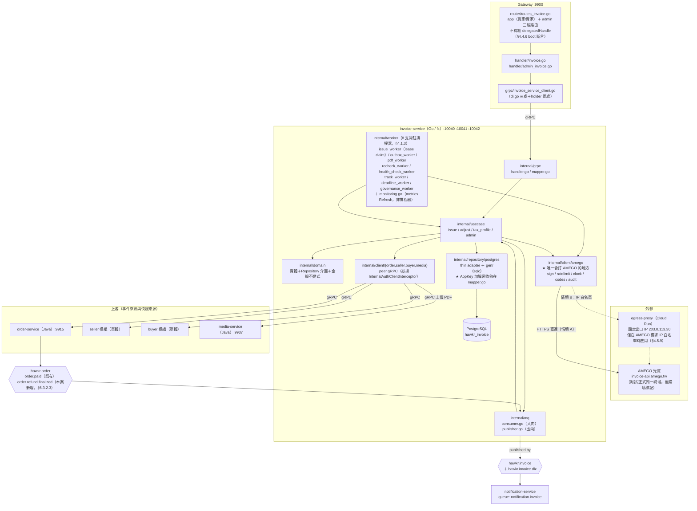

#### 4.2.1 目錄結構

照 `services/review-service`（結構最乾淨）的範本組合：

```
services/invoice-service/
├── .air.toml / Dockerfile / Makefile / go.mod   # Dockerfile 三 stage：dev / builder(FROM go-base) / prod
│                                                # go.mod: replace github.com/Will413028/hawkr/go-pkg => ../../pkg
├── cmd/invoice-service/main.go                  # 9 行，只呼叫 app.New.Run
├── db/
│   ├── atlas.hcl / sqlc.yaml                    # env "dev"/"prod"；sqlc out: ../internal/repository/postgres/gen
│   ├── schema/schema.sql                        # Atlas declarative schema（唯一手改處）
│   ├── queries/                                 # ★ 一表一檔，檔名 ＝ §5 的表名（18 表 ⇒ 18 檔）
│   └── migrations/                              # atlas migrate diff 產出 ＋ atlas.sum
└── internal/
    ├── app/app.go                               # fx.New(...)，分層順序見 §4.2.2
    ├── config/                                  # config.go（Config/Load/Validate）｜config_test.go｜di.go
    ├── domain/                                  # invoice｜operation｜adjustment｜tax_profile｜provider_account
    │                                            #   period｜errors（pkgerrors.NewBusiness）｜repository（介面）
    ├── infrastructure/di.go                     # pkgserver.NewGRPCServer ＋ NewInternalHTTPServer
    ├── repository/postgres/                     # di.go｜mapper.go｜*_repo.go｜gen/
    ├── client/                                  # amego/ ＋ order/ seller/ buyer/ media/（peer gRPC）
    ├── usecase/                                 # issue｜adjust｜tax_profile｜admin ＋ {peer}_client.go（測試 seam）
    ├── mq/                                      # di.go｜publisher.go｜consumer.go｜handler_*.go（一 key 一支）
    ├── worker/                                  # 8 支常駐排程器 ＋ di.go（scheduler wiring）＋ metrics.go
    └── grpc/                                    # di.go｜handler.go｜mapper.go
```

**目錄樹只寫到兩層，因為第三層會腐爛。** 下表是這棵樹上**所有承載規則的落點**——每一列都是「沒有它會怎樣」，不是檔案清單：

| 落點 | 硬規則（沒有它會怎樣） |
|---|---|
| `Dockerfile` | CI 靠 `services/<svc>/Dockerfile` 存在自動偵測服務；缺它 ⇒ 永遠不會 build／deploy，而 CI 全綠（§4.3.4 #3） |
| `db/queries/` **一表一檔** | 檔名 ＝ §5 的表名，1:1。這不是潔癖，是讓「§5 加了一張表卻沒人寫 query」變成一眼可數的差異。`invoice_operations.sql` 是 **12 支**不是 5 支（§4.3.3 ①~⑩ ＋ ⑪⑫ 兩支集合式前置 UPDATE，逐支清單見 §4.3.3 的支數表）；漏寫一支的失敗形狀見 §4.6 W-01 |
| `db/queries/invoice_business_day_mirror.sql` | 行事曆鏡像（§5.1.14），每日整段 DELETE+INSERT。`invoice_complaints.sla_due_at` 是 `NOT NULL` ⇒ 沒有這張表，K01 整條申訴 SLA 算不出來 |
| `db/queries/invoice_provider_accounts.sql` | ★ per-issuer AMEGO 憑證（§4.5.4） |
| `db/queries/invoice_inbox_events.sql` | ★ 入向事件：兩道去重 ＋ 亂序延後，同樣是 `Repository[T]` 形狀（但**沒有自己的排程器**，§4.1.3） |
| `internal/repository/postgres/mapper.go` | ★ **AppKey 密文↔明文的唯一收斂點**。「誰能解密 AppKey」＝「誰能部署 invoice-service」 |
| `internal/repository/postgres/gen/` | sqlc 生成碼，**禁手改** |
| `internal/repository/postgres/di.go` | `fx.Annotate` + `fx.As` 綁 domain 介面 |
| `internal/config/config_test.go` | ★ 環境 fail-closed 斷言的測試落點（§4.5.8 的**七條**鑑別力驗收） |
| `internal/domain/period.go` | ★ UTC+8 雙月期別換算（§4.5.10）——服務內部全 UTC，而期別按**台灣當地月份**分期 |
| `internal/domain/invoice.go` | 憑證實體 ＋ 金額不變式（純函式、無框架相依，§4.5.5） |
| `internal/client/amego/` | ★ **唯一會打 AMEGO 的 package**（§4.5）：`client.go`（介面＋兩種傳輸模式）｜`sign.go`（序列化一次）｜`clock.go`（校時與偏移補償）｜`ratelimit.go`（《硬上限依賴接入治理規範》的 max series）｜`codes.go`（四分類映射，§4.5.6）｜`dto.go`（四種 envelope ＋ `providerCode` 自訂 Unmarshal）｜`audit.go`（`AuditSink`，預設 no-op）｜`*_test.go`（簽章 fixture、`3040171` 雙義、分類表全覆蓋） |
| `internal/usecase/di.go` | `fx.Provide(tsid.NewGenerator)` 放這一層 |
| `internal/worker/di.go` | **每個 `outbox_name` 的 `NewMetrics` 只能 provide 一次**，重名即 boot 期 panic（`observability.go:29-31`）。九個名字的 SSOT ＝ §7.5.4 |
| `internal/worker/di.go` | `outbox.NewScheduler` 的 wiring（`Start` 必傳 `context.Background`）；斷路器 pre-claim 閘門在這一層（§4.5.6b） |
| `internal/worker/monitoring.go` | outbox metrics `Refresh` ＋ `CleanupDone`，**不是排程器** |
| `internal/mq/publisher.go` | 薄 wrapper：建不起來回 `nil` 不 panic |
| `internal/grpc/handler.go` | §4 型別邊界：`string id → int64` 在這裡轉；時間走 `timeutil.FormatISO8601`（`mapper.go`） |

**8 支 worker 的代號↔檔名對照表在 §7.0（那是 SSOT），本節不複製第二份。**

`internal/client/amego/` 放在 `client/` 而不是另闢 `provider/`，因為第三方 HTTP client 與 peer gRPC client 並列在同一層。不為單一新概念多開一層目錄。

#### 4.2.2 fx 分層與模組責任

`internal/app/app.go` 的組裝順序：

```go
func New *fx.App {
	return fx.New(
		config.Module,          // Layer 0: Config / Logger / pool / TxManager / OTel / cipher
		infrastructure.Module,  // Layer 1: gRPC server（五件套內建）、內部 HTTP（health/metrics/pprof）
		postgres.Module,        // Layer 2: Repository
		client.Module,          // Layer 3: AMEGO client ＋ 四個 peer gRPC client
		invoicemq.Module,       // Layer 3.5: MQ publisher / consumer
		usecase.Module,         // Layer 4: 業務邏輯
		worker.Module,          // Layer 4.5: outbox / recheck / track 排程
		invoicegrpc.Module,     // Layer 5: gRPC handler 註冊
	)
}
```

| 模組 | 責任 | 明確不負責 | 依賴 |
|---|---|---|---|
| `internal/domain` | 憑證與動作的實體、狀態轉移規則、**金額不變式**（表頭與明細加總必須逐位元符合 AMEGO 的官方算式，§4.5.5）、期別換算 | 任何 I/O、任何框架型別 | 無 |
| `internal/client/amego` | 把 domain 請求翻成 AMEGO 的四欄 form、簽章、限速、校時、把回應翻成 `(*Result, *APIError)` 並附上四分類 | **零重試**（重試一律在 worker 層；照 PayUni client 慣例）；**零業務判斷**（不決定該作廢還是該折讓） | `pkg/crypto` 產物（解密後的 Credential 由呼叫端傳入）、`gobreaker` |
| `internal/repository/postgres` | thin adapter；`gen.New(database.GetDBTX(ctx, pool))` 交易感知；**AppKey 密文↔明文的唯一轉換點** | 不自己 `Begin/Commit`；不在 domain 之外散布明文 AppKey | `pgxpool`、`pkg/sqlutil`、`pkg/crypto` |
| `internal/usecase` | 「該不該開票／該作廢還是該折讓／這張憑證現在能不能改」的全部判斷；快照的組裝與落庫 | 不直接打 AMEGO 的 HTTP（一律經 `ProviderClient` 介面，方便注入 fake） | domain、repository、四個 peer client、amego client |
| `internal/worker` | 排程與搶佔：claim → 呼叫 usecase → 標記結果；把 `ErrorClass` 翻成 outbox 的重試／終結行為（§4.5.6） | 不含業務規則 | `pkg/outbox`、usecase |
| `internal/mq` | 入向事件去重（`invoice_inbox_events` 的 `UNIQUE(event_id)` ＋ 業務鍵二次去重）與落 outbox；出向事件發布 | 不在 consumer 內直接打 AMEGO（consumer 只負責把工作**排進來**） | `pkg/mq`、usecase |
| `internal/grpc` | §4 型別邊界（對外 ID／金額一律 string）、domain↔proto | 不含業務邏輯 | usecase |

**一條跨模組的硬規則**：`internal/client/amego` 之外的任何檔案都不得 import `net/http` 去打 `invoice-api.amego.tw`。這條靠 code review ＋ 一支 `go test` 掃描 import 圖守（見 §13 測試策略）。

---

### 4.3 部署拓撲與 Port

#### 4.3.1 Port 分配

Port 選號規則（接在既有 10020–10039 之後、`HTTP = gRPC − 1`）：

| Port | 協定 | 用途 | 對外暴露方式 | 本列的決策／不變式 |
|---|---|---|---|---|
| **10040** | HTTP | 內部 health / metrics / pprof | ClusterIP（**不開 NodePort**） | 這個 port **永遠不承載業務 API**。業務只走 gRPC，唯一對外入口是 Gateway。`/health` **不得**把 AMEGO 可達性納入判定——第三方 4 小時維護窗會讓 k8s 反覆重啟一個其實健康的 pod |
| **10041** | gRPC | Gateway ↔ invoice-service；order/aftersales 不主動呼叫本服務 | ClusterIP | 呼叫方白名單只有 gateway。NetworkPolicy 的 `grpcAllowedCallers` 若日後放寬，必須同時說明「誰有權查詢別人的發票」 |
| **10042** | HTTP | **PDF 授權下載通道**（`INVOICE_SERVICE_FILE_PORT`，§6.1.4 定版）。Gateway 的 `proxy.CreateProxy(ServiceInvoice, …)` 反代到這裡 | ClusterIP（**不開 NodePort**） | **必須是獨立的 `http.Server`，不得掛在 10040 的共用 router 上，也不能併進 gRPC 面**（gRPC 不承載 bytes）。掛錯時 `pkg/server/http_test.go` 的 `TestNewRouter_ExposesOnlyOperationalRoutes` 會轉紅（它把共用 router 釘死在 `/health`／`/metrics`／`/debug/pprof`，backend#2219）——**本節不重複**。NetworkPolicy 只允許 gateway ingress |

選 `10040/10041/10042` 而不是 Java 頻段的 `9952/9953`：**新的 Go 服務一律接在 `10020–10039` 這段之後**（seller 10020-21／crm 10030-31／review 10032-33／notification gRPC 10037／content 10035-36／pricebook 10038-39 已連續佔滿），10040/10041/10042 是這段的下一個三個空號（10042 是 §6.1.4 的檔案串流面，**不遵守 `HTTP = gRPC − 1` 的配對慣例，它是第三個面**）。**10042 有一個 10040/10041 沒有的落地負擔**：它的位址要被 **Gateway** 讀到 ⇒ `INVOICE_SERVICE_FILE_PORT` 必須與 `INVOICE_SERVICE_HOST`／`INVOICE_SERVICE_GRPC_PORT` **四處一起加**（逐處清單見 §6.1.6(8)，失敗形狀見 §8.6 T-39）。配號理由僅止於「延續新服務的配號順序」，與技術棧無關（account／buyer／ai／im／social 五個 Go 服務都在 99xx 段）。另一條同樣要遵守的既有慣例是 **`HTTP = gRPC − 1`**（本服務 10040 HTTP／10041 gRPC 即依此）。`9928/9929` 已被**不在本 repo** 的 inventory-service 佔用（`docker-compose-local.yml:979-980` 的註解），選號時不可只看 `k8s/values/`。

#### 4.3.2 副本策略

prod 預設 `replicas: 1`（`k8s/values/overlays/prod/common.yaml`），只有 cart／gateway／order／payment／payuni-webhook 五支被各自的 overlay 覆蓋成 2。**副本數是 《多副本排程搶佔規範》的判定輸入且會變**——`docs/開發規範/多副本排程搶佔規範.md` §〇 明文要求「用前重查」，查法是 `grep -rn 'replicas' k8s/values/overlays/prod/`，且 per-service overlay 是最終值。**invoice-service 維持 1 副本**，理由：

- 它的負載是排程驅動的批次，不是使用者同步請求（唯一的同步路徑是查詢與 ADM 操作，量極小）。
- 它對外唯一的上游 AMEGO 沒有公開 rate limit（光貿 API 參考 §5.A A6），多副本只會讓我方更容易撞上 `code 21`。
- 單副本讓「開票的併發控制」退化成一個更好推理的問題。

🔴 **`replicas` 的合法值只有 1，`0` 不是「暫時停用」而是「服務不存在」。** 兩者的差別在能見度：把 `replicas` 設成 0，`Deployment` 存在、`helm upgrade` 成功、deploy job 全綠、`kubectl get deploy` 顯示 `0/0`（不是 `0/1`）⇒ **沒有任何一個部署面訊號說它壞了**，而 gateway 的每一條發票路由都回 503、成功率 0%。`ProdServiceAbsent`（§12.2.6 第 35 列）是唯一看得到它的東西，而那一列本身就是「漏做也不會有人發現」的那一組。

⚠️ **`replicas: 0` 在本服務有一個具體的誘因，要當成 anti-pattern 明文擋掉**：只要 `Config.Validate` 把某個「尚未開通的功能」列為必填（例如把 `AMEGO_PLATFORM_INVOICE` 列為必填），部署者面對一個起不來的 pod，最省事的處置就是把副本數歸零——**boot 期 fail-fast 的成本會以這種形式被轉嫁掉**。⇒ 選填與否的判準寫在 §4.5.8 第一層：**「服務已部署、但這個子功能尚未開通」必須是合法的啟動狀態**，否則 fail-fast 換來的不是正確設定，是一個沒有人在跑的服務。

#### 4.3.3 調高 replicas 之前，排程必須已有合格搶佔（《多副本排程搶佔規範》）

**單副本不是豁免理由。** `docs/開發規範/多副本排程搶佔規範.md` 規則 ⑧ 要求「調高 `replicas` 之前排程必須全數有合格搶佔」——沒有搶佔閘門的排程器是**擴容那一刻才引爆的地雷**，而擴容通常是為了應付流量、沒有人會在那時想到排程器。

**「租約欄」與「候選集合」不是一對一**——同一欄可以服務兩支 worker（狀態集合不相交），同一支 worker 也可以持有兩組租約（不同表）。所以要數的是**候選集合**，不是欄位數。**§5 的 DDL 已定義的租約欄共六欄、由它們展開的候選集合共七組**（§5.2.3 逐字同值——該節另列了 #8–#12 五組「不需要 claim」的集合式前置 UPDATE，那些不帶租約欄，不在本表），全部從第一版就走 lease claim。**但「走 lease claim」不等於「走 `pkg/outbox.Worker`」，兩者逐支不同且已定版。判準（可機械執行）：這支排程對同一列是「推進到結論就結束」（一次性、次數有上界），還是「週期性重查同一列直到某個業務條件成立」（同一列被處理多次、次數無上界）？** 前者用 `pkg/outbox.Repository[T]` 的五方法契約（`pkg/outbox/worker.go:29-35`）——`INV.op`／`INV.ob`／`INV.pdf`；後者**自寫 claim 迴圈**——`INV.rc` 的第 2、4 組與 `INV.hc`（裁決與三個理由見本節下方「`INV.rc` 不走 `pkg/outbox.Worker`」，§7.5.4 同源）；第 7 組**沒有排程器**（見下表第 7 列，由反向認領推進）。**兩種寫法都由 `pkg/outbox.Scheduler` 驅動**：panic recovery 出自 `scheduler.go` 的 `tick`（逐 tick `recover`，一次 panic 不會讓 goroutine 就地死掉），**不是** `Worker` 給的 ⇒ 自寫 claim 迴圈不會因此失去它。

| # | 租約欄 | 誰掃它 | 候選述詞（狀態集合） | 副作用 | 租約長度 |
|---|---|---|---|---|---|
| 1 | `invoice_operations.next_attempt_at` | `INV.op` | `status IN ('READY','RETRY_SCHEDULED','SENDING')` | 打 AMEGO（**寫入類**） | `120s`（下界推導見下） |
| 2 | `invoice_operations.next_attempt_at` | `INV.rc` | `status IN ('WAITING_CONFIRMATION','FAILED_UNKNOWN','CANCEL_REQUESTED','CANCEL_BLOCKED_UNKNOWN','PROVIDER_STATUS_RECHECK')` | 打 AMEGO（**唯讀對帳**） | `60s`（下界 20.3s） |
| 3 | `invoice_outbox_events.next_attempt_at` | `INV.ob` | outbox 未派送列（`pkg/outbox` 內建述詞） | 發 MQ | `30s`（下界 10.2s ＝ publisher confirm 10s ＋ stamp 0.2s） |
| 4 | `invoice_documents.upload_recheck_next_at` | `INV.rc` | `status='ISSUED'` ＋ `upload_recheck_next_at` 到期 ＋ `provider_upload_status` **正面枚舉**「還在飛」的值（`NULL`／1／2／3／31／32；`91` 與 `-1` 是終態、`99` 是完成，都**不在**候選集合內——用 `IS DISTINCT FROM 99` 會讓它們永久滯留，見 §5.2.3 第 3 組） | 打 AMEGO（唯讀查詢） | `120s`（下界 **10.3s** ＝ 一次 `invoice_status` 10s ＋ DB 0.3s） |
| 5 | `invoice_documents.pdf_fetch_next_at` | `INV.pdf` | `pdf_fetch_next_at IS NOT NULL` 且到期（索引 `idx_invdoc_pdf_fetch` 的述詞另含 `pdf_object_key IS NULL`，§5.1.5／§5.2.3 第 4 組） | 打 AMEGO ＋ 下載 ＋ MED 上傳 | `120s`（下界 50.2s ＝ `invoice_file` 10s ＋ 下載 20s ＋ MED 上傳 20s ＋ 0.2s） |
| 6 | `invoice_provider_accounts.health_check_next_at` | `INV.hc` | `status IN ('ACTIVE','DEGRADED')` 且到期（索引 `idx_ipa_health`，§5.1.3／§5.2.3 第 5 組） | 打 AMEGO（唯讀，驗憑證） | `120s`（下界 10.3s ＝ 一次唯讀呼叫 10s ＋ DB 0.3s）。**巡檢週期 15 分鐘**：一輪結束不論成敗都寫 `health_check_next_at = now() + 15min`，與 §7 provider 狀態機 P08 同值 |
| 7 | `invoice_inbox_events.next_attempt_at` | **無排程器**：由開票成功後的反向認領推進（§6.3.6） | `status='DEFERRED'` 且到期 | 純 DB | 不適用 |

**第 1、2 組共用同一個欄位，「狀態集合不相交」因此是正確性條件而不是風格問題。** 交集非空 ⇒ 同一列被兩支各 claim 一次，而兩支租約長度不同（120s vs 60s）⇒ 短的那支會在長的那支還在打 `f0401` 的途中合法搶走它 ⇒ **重複開票**。⇒ 契約測試必須**對 SQL 檔做靜態斷言**（把兩支查詢的 `status IN (...)` 解析出來取交集，非空即紅），**不是**跑一次流程看有沒有撞到——撞到是機率事件，那種測試會偶爾綠（§7.3.2 同一條）。

**`INV.rc` 一支 worker 持有兩組租約長度（60s / 120s），這是刻意的、也是安全的**：兩組落在**不同的表**（`invoice_operations` vs `invoice_documents`），沒有任何一列會同時被兩組看到 ⇒ 不存在「短租約搶走長租約」的窗口。實作上是同一支 worker 跑兩個各自獨立的 claim 迴圈（各配一個 `pkg/outbox.Scheduler` 與自己的 `ClaimLease`）——**不是**兩個 `outbox.Worker[T]` 實例，理由見下方裁決。也因此它需要**兩個不同的 `outbox_name`**（否則 `NewMetrics` 第二次註冊直接 panic，§4.2.1 `worker/di.go` 的備註；`outbox.NewMetrics` 是**獨立函式**、不隨 `Worker` 一起放棄，自寫 claim 迴圈照樣註冊它，所以 §7.4 C-10 的九個名字不因本節裁決而變）：逐字定為 `invoice_recheck`（本表第 2 組：`invoice_operations` 的結果未明集合）與 `invoice_upload_recheck`（本表第 4 組：`invoice_documents` 的上傳輪詢）。

**每支 worker 的租約常數 SSOT 是 §7.5.4 的逐支下界表**。本節只負責兩件事：① 給出推導**方法**；② 給出 `INV.op` 那一支的完整算式（下方）。**不要各自維護一份。**


**留著這段是為了擋回歸，因為它的失效不會有任何訊號。** `ClaimLease = 120s` 這個常數三處從來相同，會漂的是「**為什麼是 120s**」的論證：把 `code 51` 那 20s 從下界表拿掉，下界回到 40.3s、看起來還有 3 倍餘裕 ⇒ 有人放心把租約調小到 60s ⇒ 而真實最壞耗時是 60.4s ⇒ 持有者還在翻 `invoice_list` 就被另一個副本合法搶走 ⇒ **重複開票**。編譯、測試、`/metrics` 全部正常。⇒ 動這個數字之前先讀 §7.5.4 那張表的每一列，特別是 `deadlineList` 是 20s 不是 10s（§4.5.12 常數表）。**其餘各支（`INV.rc` 60s、`INV.ob` 30s…）仍以 §7.5.4 為準。**

**`INV.hc` 是第 8 支 worker**（§7.0 代號表為名冊 SSOT，下界 10.3s／120s 見 §7.5.4；`outbox_name` 共九個，含 `INV.hc` 的 `invoice_health_check` 與 `INV.rc` 第二組租約的 `invoice_upload_recheck`）。**兩件事不能忘**：① `INV.hc` 的租約欄是 **`health_check_next_at`**，不是 `last_health_checked_at`（後者是事實時間戳，失敗形狀見 §4.6 W-02）；② `INV.rc` 少給一個 `outbox_name` 會在 `NewMetrics` 第二次註冊時**直接 panic**（`observability.go:29-31`）。§9 的錯相位表仍只覆蓋七支，見下方「調高 `replicas` 之前的前置清單」第 5 條。

**第 5 組（`INV.pdf`）的落點：`invoice_documents.pdf_fetch_next_at` ＋ `pdf_fetch_attempts`（§5.1.5 DDL、`chk_invdoc_pdf_attempts`、`idx_invdoc_pdf_fetch`），不另建 `invoice_pdf_tasks` 表**——**全書不存在那張表**，看到那個名字指的是同一組東西。租約算式不受影響（PDF 路徑最壞耗時 50.2s < 120s）。

**`INV.trk`（字軌餘量）刻意不在本表，這是結論不是遺漏。** 它是 `pkg/outbox.NewDailyScheduler` 驅動的**唯讀**定期查詢（打 `track_status` → 推指標，§4.5.10），在 §5 的 DDL 上**沒有任何候選集合**——它掃的是 `invoice_provider_accounts` 中 `status='ACTIVE'` 的全集，不帶租約欄。§5.2.3 末段逐字採同一立場。**但 §7.5.4 給了它 `ClaimLease = 10min`**：那與本節不衝突（那個租約避免的是「同一輪掃描被重複啟動」，不承擔正確性），**但它不是本表意義下的第八組租約**，不要因為看到那個數字就回頭在 §5 加欄位。判準與 §5.2.3 對 `INV.dl`／`INV.gov` 的警語同源：**有 `ClaimLease` ≠ 有候選集合租約**。

下面以 `invoice_operations` 為樣板列出 SQL 全文：①~⑤ 是 `INV.op` 走 `pkg/outbox.Repository[T]` 五方法契約的那五支，⑥⑦ 是 `INV.rc` 在**同一張表**上的第二組述詞（第 2 組候選集合）。其餘各組（第 3~7 組）與 ①~⑤ 同形，只換表名、欄名與狀態集合。**「同形」指的是 SQL 形狀，不是驅動框架**——第 4 組（`invoice_documents` 上傳輪詢）同屬 `INV.rc`，與第 2 組一樣走自寫 claim 迴圈。

##### `INV.rc` 不走 `pkg/outbox.Worker`（定版裁決）

**`INV.rc` 不走 `pkg/outbox.Worker`：它自用一組專屬的 claim 迴圈（⑥ `FetchPendingInvoiceRechecks` ＋ ⑦ `ClaimInvoiceRecheck`），但完整沿用 《多副本排程搶佔規範》的租約規則。** 這是定版裁決，§7.5.4 逐字同源，**兩章不得再各寫一種**。三個理由：

1. **語意不合。** `pkg/outbox.Worker` 的模型是「一筆待發事件，發出去就 `MarkDone`」——**一次性**。而 `INV.rc` 是「**週期性重查同一筆**，直到 provider 給出確定結果」——同一列會被處理多次、次數無上界，終止條件是**業務條件**（查到明確結果、或 ADM 結案）而不是次數。「未知」不會因為查詢次數用完就變成「已知」；停止重查的唯一後果是把一張**可能已經開立**的發票永遠留在未知狀態。
2. **狀態會互相覆蓋。** `pkg/outbox/worker.go` 的 `processRow` 在 `err == nil` 時**立刻**呼叫 `MarkDone`，而 `INV.rc` 的「這輪查完仍未確定」在業務上**既不是失敗、也不是完成** ⇒ 硬套會讓 outbox 的 `MarkDone` 與業務狀態欄互相覆蓋。這正是 §4.5.6 為 `INV.op` 加 `AND status = 'SENDING'` 守衛所要擋的那個形狀，而 `INV.rc` 的落點有六個（J23／J24／J25／J26／J31／J17），沒有任何單一守衛擋得住。
3. **《多副本排程搶佔規範》合規不依賴 `pkg/outbox`。** 租約搶佔的硬要求是「claim 在副作用之前／租約長度 > 單筆最壞耗時／候選述詞正面列出狀態值／租約基準逐筆取」——四條用 ⑥⑦ 這組專屬 SQL 一樣做得到，而且 §7.5.4 已經逐條寫好（下界 20.3s、租約 60s、五個狀態正面列出、`sqlc.arg(lease_until)` 逐筆現算）。

**自寫不等於裸迴圈。** 兩件事必須照做，缺任一就退化成裸迴圈的失效形狀（§7.6 X34）：
- ① **迴圈由 `pkg/outbox.NewScheduler` 驅動**（panic recovery 在 `scheduler.go` 的 `tick`，逐 tick `recover`），**禁止**自己寫 `for { <-ticker.C }`；
- ② **租約基準逐筆在 claim 當下取**（`time.Now.Add(ClaimLease)` 放在處理單筆的函式內，`tickNow` 只當 CAS 上界），照抄 `pkg/outbox/worker.go:120-127` 的寫法。

**自寫換掉的，正是走 `pkg/outbox.Worker` 的那個代價**：退避階梯不必遷就 `2^attempt × BaseBackoff`，§7.5.4 那個由**事實時間戳** `unknown_since` 分桶的階梯可以直接寫出來，不需要拿 `UpdateAttempt` 去覆寫框架算好的 `next_attempt_at`。

⇒ 落地 SQL 仍然需要 ⑧⑨⑩ 三支（**理由與框架無關，是落點不同**），而且**不能直接沿用 ③④⑤**：
- ⑤ `UpdateInvoiceOperationAttempt` **無條件** `SET status='RETRY_SCHEDULED'`——那是 `INV.op` 的候選狀態。`INV.rc` 一筆「這輪查完仍未確定」的列若被寫成 `RETRY_SCHEDULED`，**下一輪就被 `INV.op` 撈走並真的重送一次 `f0401`** ⇒ 重複開票。它必須寫回自己的候選集合（`PROVIDER_STATUS_RECHECK`，＝ ⑩）。把列還給 `INV.op` 只在「確認未開立」時才對，那是 ⑧ 的 J25，不是「沒結論」的預設行為（§4.6 W-03）。
- ③ `MarkInvoiceOperationDone` 把列寫成固定的 `SUCCEEDED`——但 `INV.rc` 是唯讀對帳，落點由對帳結果決定。§7.5.4 的判別式共**六個**落點：J23 `SUCCEEDED`／J24 `CANCELLED_BY_ADMIN`／J25 `RETRY_SCHEDULED`／J26 `CANCEL_BLOCKED_UNKNOWN`／J31 `WAITING_CONFIRMATION`／J17 `FAILED_UNKNOWN`。**這六個裡沒有 `FAILED_PERMANENT`、也沒有回 `READY`**。
- ④ 同理，`MarkInvoiceOperationFailed` 的 `FAILED_PERMANENT` 對「查不到」是錯的分類：查不到代表**確認未開立、可安全補送**（J25 回 `RETRY_SCHEDULED`），判成永久失敗會讓一張補得回來的發票停在終態。

⇒ `db/queries/invoice_operations.sql` 的完整內容是 **12 支**：

| 支 | query 名 | 誰用 | 落點／作用 |
|---|---|---|---|
| ①~⑤ | `FetchDueInvoiceOperations`／`ClaimInvoiceOperation`／`MarkInvoiceOperationDone`／`MarkInvoiceOperationFailed`／`UpdateInvoiceOperationAttempt` | `INV.op` | `pkg/outbox.Repository[T]` 的五方法契約 |
| ⑥⑦ | `FetchPendingInvoiceRechecks`／`ClaimInvoiceRecheck` | `INV.rc` | 自寫 claim 迴圈的候選與搶佔（本節 SQL 全文） |
| ⑧ | `MarkInvoiceRecheckResolved` | `INV.rc` | 對帳**有確定結果**的落點：J23 `SUCCEEDED`（回填號碼）／J24 `CANCELLED_BY_ADMIN`／J25 `RETRY_SCHEDULED`（確認未開立、可安全補送） |
| ⑨ | `MarkInvoiceRecheckUnresolved` | `INV.rc` | 對帳**仍不確定**且要換狀態的落點：J26 `CANCEL_BLOCKED_UNKNOWN`／J17 `FAILED_UNKNOWN`（`unknown_since` 超過 24h） |
| ⑩ | `UpdateInvoiceRecheckAttempt` | `INV.rc` | 仍不確定且**留在重查迴圈**：J31 回 `WAITING_CONFIRMATION`／`SET status = 'PROVIDER_STATUS_RECHECK'` 自轉移，並依 `unknown_since` 重排 `next_attempt_at` |
| ⑪⑫ | `ReleaseExpiredInvoiceOperationHolds`／`PromoteDueInvoiceOperationTriggers` | `INV.op` 的 `RunOnce` **前置步驟** | 集合式、無外部副作用的單句 UPDATE ⇒ **不需要 claim**（§5.2.1／§7.5.4 註 3／註 4 有全文）。少了 ⑫，J05（`AWAITING_TRIGGER → READY`）沒有任何元件會執行 |

**⑨ 刻意不叫 `MarkInvoiceRecheckExhausted`**：`INV.rc` **沒有「次數耗盡」這條路**（上方裁決的理由 1），叫 Exhausted 會誘導實作者去接一個 `MaxAttempts`。**一表一檔，少寫一支的症狀不是編譯錯，是那條狀態邊沒有任何元件會執行。**

看到有人把 `INV.rc` 接上 `outbox.Worker[T]`，先回頭讀裁決的理由 2（`MarkDone` 會覆蓋業務狀態欄，§4.6 W-04）。

```sql
-- name: FetchDueInvoiceOperations :many
-- ① 候選。述詞必須與 ClaimInvoiceOperation 逐字鏡射（§4.6 W-05）。
-- ORDER BY statutory_deadline_at：法定期限最近的先做（逾期的代價是國稅局記點，不是使用者多等）。
-- **單表排序，不 JOIN invoice_documents**（JOIN 過去取權威值會讓這支查詢的成本隨文件表成長，
--    而排序需要的欄位本表都有）。
--    這支每 10 秒跑一次、FetchBatch=50，排序鍵在 join 的另一邊 ⇒ 索引用不上。
--    §5.1.8 因此在 invoice_operations 上放了一份**反正規化副本** statutory_deadline_at
--    （建立 operation 的同一交易內從 document 複製；來源一經寫入即不可變，
--     所以複製只發生一次、不存在漂移窗口 —— 守護者是 §5.5 I-52，
--     **不得**為它寫任何 reconciliation job，那違反 《後端服務責任邊界規範》）。
-- statutory_deadline_at 只出現在 ORDER BY，不得進 WHERE（§4.6 W-06）。
-- NULLS LAST 必須逐字寫出來，RECEIPT 的 statutory_deadline_at 是合法的 NULL（§4.6 W-07）。
SELECT * FROM invoice_operations
WHERE  status IN ('READY', 'RETRY_SCHEDULED', 'SENDING')
  AND  next_attempt_at <= sqlc.arg(now)
ORDER BY statutory_deadline_at NULLS LAST, next_attempt_at
LIMIT  sqlc.arg(row_limit);

-- name: ClaimInvoiceOperation :execrows
-- ② 搶佔 —— 把 next_attempt_at 推到未來，rows=1 的副本才做副作用。
-- 候選述詞必須「鏡射」FetchDueInvoiceOperations，且必須容納 'SENDING'（§4.6 W-05）。
-- 一律正面列出要處理的狀態值，禁 <> / NOT IN（規範 §六；失敗形狀見 §8.6 T-27）。
-- 本句不得碰 attempt_count：pkg/outbox 由 UpdateAttempt 單獨維護它（§7.6 X22）。
-- 🔴 **也不得碰 version**（§5.3「唯一例外：排程 claim 不遞增 version，四支 claim 都不碰它」）。
--    後果不是編譯錯也不是測試紅：這支每 10 秒跑一輪，ADM 從讀畫面到按下送出之間只要
--    被掃過一次，帶 expectedVersion 的 CAS 就一律 rows=0 靜默失敗 ⇒ **帶樂觀鎖的 ADM
--    操作在正常情況下永遠用不了**，而畫面上看起來只是「送出沒反應」。
UPDATE invoice_operations
SET    next_attempt_at = sqlc.arg(lease_until),
       status          = 'SENDING',
       started_at      = COALESCE(started_at, sqlc.arg(now)),
       updated_at      = sqlc.arg(now)
WHERE  id = sqlc.arg(id)
  AND  status IN ('READY', 'RETRY_SCHEDULED', 'SENDING')
  AND  next_attempt_at <= sqlc.arg(claimable_before);

-- 本句的 `status = 'SENDING'` 不是可選的：③ 的守衛、①⑥ 的「述詞必須容納 SENDING」、
--    以及 §7.3.1 的 document 轉移（`PENDING` + ISSUE operation READY→SENDING ⇒ `ISSUING`）
--    三者都依賴它。少了它的失敗形狀見 §4.6 W-08。
--    §5.2.1 與 §7.5.4 的同名 SQL 逐字同句，三處必須一起改。

-- name: MarkInvoiceOperationDone :execrows
-- ③ 完成。`AND status = 'SENDING'` 這道守衛是 §4.5.6 的 P/M 分類能成立的關鍵：
--    P/M 類的 ProcessFunc 會先在自己的交易內把 status 寫成終態（FAILED_PERMANENT /
--    SELLER_ACTION_REQUIRED / FAILED_UNKNOWN…）再回 nil，pkg/outbox 收到 nil 之後
--    一定會呼叫 MarkDone。沒有這道守衛，MarkDone 會把「永久失敗」蓋成 SUCCEEDED，
--    而且不報錯、不留痕。有守衛時它 rows=0，什麼都不做。
UPDATE invoice_operations
SET    status = 'SUCCEEDED', completed_at = sqlc.arg(now),
       updated_at = sqlc.arg(now), version = version + 1
WHERE  id = sqlc.arg(id) AND status = 'SENDING';

-- name: MarkInvoiceOperationFailed :execrows
-- ④ 終結（attempt_count 達 max_attempts 時由 pkg/outbox 呼叫）。同樣守狀態，
--    不覆蓋 ProcessFunc 已經寫定的終態。
UPDATE invoice_operations
SET    status = 'FAILED_PERMANENT', last_error = sqlc.arg(last_error),
       completed_at = sqlc.arg(now), updated_at = sqlc.arg(now), version = version + 1
WHERE  id = sqlc.arg(id) AND status IN ('SENDING', 'RETRY_SCHEDULED');

-- name: UpdateInvoiceOperationAttempt :exec
-- ⑤ 退避重排。這是租約欄 next_attempt_at 的第二個寫入者，而且是刻意的
--    （《多副本排程搶佔規範》§三 第 7 點已明文承認 backoff 寫入的正當性）：
--    它只會在本副本仍持有租約時執行，把「租約」換成「下次可執行時間」。
UPDATE invoice_operations
SET    attempt_count   = sqlc.arg(attempt_count),
       next_attempt_at = sqlc.arg(next_attempt_at),
       last_error      = sqlc.arg(last_error),
       status          = 'RETRY_SCHEDULED',
       updated_at      = sqlc.arg(now),
       version         = version + 1
WHERE  id = sqlc.arg(id);

-- name: FetchPendingInvoiceRechecks :many
-- ⑥ INV.rc 的候選（同一張表的第二組述詞）。逐字對齊 §7.5.4，改一邊就要改兩邊。
-- 狀態集合與 FetchDueInvoiceOperations 不相交 —— 那是正確性條件，見上方 。
-- 這一組刻意不含 'READY'／'RETRY_SCHEDULED'／'SENDING'（與 ① 的集合不相交，§7.6 X20）：INV.rc 是唯讀對帳，
--    它永遠不呼叫寫入類 API（f0401/f0501/g0401）。要重送一律是把列還給 INV.op
--    （轉回 RETRY_SCHEDULED），不是自己送。
-- 'CANCEL_REQUESTED' 也在集合裡，這是刻意的：ADM 的「強制最終查詢」是同步路徑，
--    那條路徑中途崩潰時該筆會停在 CANCEL_REQUESTED 而沒有任何人接手。
-- ORDER BY 逐字沿用 ① 的形狀（單表、裸欄 statutory_deadline_at、NULLS LAST）。
--    欄名定版為 statutory_deadline_at：document 上是權威值、operation 上是反正規化副本。
SELECT * FROM invoice_operations
WHERE  status IN ('WAITING_CONFIRMATION', 'PROVIDER_STATUS_RECHECK', 'FAILED_UNKNOWN',
                  'CANCEL_REQUESTED', 'CANCEL_BLOCKED_UNKNOWN')
  AND  next_attempt_at <= sqlc.arg(now)
ORDER BY statutory_deadline_at NULLS LAST, next_attempt_at
LIMIT  sqlc.arg(row_limit);

-- name: ClaimInvoiceRecheck :execrows
-- ⑦ INV.rc 的搶佔。租約 60s（≠ INV.op 的 120s，理由見上方）。
-- 候選述詞含 'PROVIDER_STATUS_RECHECK' 自己 ⇒ 持有者崩潰時租約到期即自動回收
--    （與 ① 必須容納 'SENDING' 完全同理；少了它就是「把永久旗標寫得更像 lease」）。
-- 本句不動 attempt_count（那是送出路徑的計數，不是查詢路徑的，§7.6 X22），
--    也**不動 version**（樂觀鎖留給業務寫入用）。
UPDATE invoice_operations
SET    status          = 'PROVIDER_STATUS_RECHECK',
       next_attempt_at = sqlc.arg(lease_until),
       updated_at      = sqlc.arg(now)
WHERE  id = sqlc.arg(id)
  AND  status IN ('WAITING_CONFIRMATION', 'PROVIDER_STATUS_RECHECK', 'FAILED_UNKNOWN',
                  'CANCEL_REQUESTED', 'CANCEL_BLOCKED_UNKNOWN')
  AND  next_attempt_at <= sqlc.arg(claimable_before);
```

**⑥⑦ 用到的 `PROVIDER_STATUS_RECHECK` 與 M 類落點 `SELLER_ACTION_REQUIRED` 都已在 §5.1.8 的 `chk_invop_status` 內。** §5.1.8 定版為 20 值（順序即三處逐字順序：`CREATED`／`AWAITING_TRIGGER`／`READY`／`HELD`／`SENDING`／`RETRY_SCHEDULED`／`WAITING_CONFIRMATION`／`PROVIDER_STATUS_RECHECK`／`SUCCEEDED`／`FAILED_PERMANENT`／`FAILED_RETRY_EXHAUSTED`／`FAILED_UNKNOWN`／`SELLER_ACTION_REQUIRED`／`CANCEL_REQUESTED`／`CANCEL_BLOCKED_UNKNOWN`／`CANCELLED_BY_ADMIN`／`MANUAL_PROCESS_ALLOWED`／`RESOLVED_EXTERNALLY`／`NOT_APPLICABLE`／`CANCELLED_BEFORE_ISSUE`），本節的 `PROVIDER_STATUS_RECHECK` 與 §7 的 `MANUAL_PROCESS_ALLOWED` 都在裡面。`SELLER_ACTION_REQUIRED` 是 §4.5.6 的 M 類落點、`3040111` 字軌不足的唯一去處——它與 `FAILED_PERMANENT` 語意不同（前者「賣家自己解得掉，去財政部配號」、後者「只有 ADM 能解」），混成同一個值 ⇒ 通知路徑與 ADM 佇列都分不出該找誰。

**`REVIEW_REQUIRED` 不是狀態值，這是裁決不是遺漏。它只是「對帳耗盡」這個結果的簡稱：**operation 側**的落點是 §7.3.2 的 **J17 →`FAILED_UNKNOWN`**，**document 側**要寫的是 `AWAITING_MANUAL`（§7 M1 ＋ `chk_invdoc_manual_reason`），訊號走 §6.3.3.1 的 **P7 `invoice.operation.review_required`**。理由有二：① 加成獨立狀態就會變成 《多副本排程搶佔規範》明令禁止的**永久旗標**（把 row 推出全部候選述詞、又沒有時間欄可以讓它回來）；② 它會與 J17 構成同一件事的兩套守衛。

這一類缺口的失敗形狀是「執行期才炸、然後被吞掉」（§8.6 T-14）。⇒ `InvoiceOperationStatus` 的完整值域以 **CodeMeta `業務狀態碼.md` 為唯一 SSOT**（CodeMeta SSOT），§5.1.8 的 CHECK、本節的兩組述詞、§7 的狀態機三者都必須逐字對齊它；**配一支「CHECK 的值集合 ⊇ 全書用到的值集合」的靜態測試**（掃全書的 `status = 'X'` 與 `status IN (...)` 取聯集，減去 CHECK 的值集合，非空即紅）——沒有這支，下一次加狀態還會重演，而且一樣不會有人發現。

**⑥⑦ 之後的三件事在 §7.5.4 定死，本節不重複，但少任何一件這支 worker 都不可實作**：① 退避階梯持久化在 `next_attempt_at`、階梯位置由**事實時間戳** `unknown_since` 推導（不另設計數器——計數器在「claim 成功但副本崩潰」之後會失真，時間戳不會）；② claim 之後的落點由 `cancel_requested_at`／`cancel_confirmed_at` 判別，**不新增「來源狀態」欄位**；③ **一次 claim 只做一次外部呼叫**（一次 `invoice_query` 或 `invoice_list` 的一頁），`invoice_list` 的分頁游標存在 operation 上跨輪續用。第 ③ 條就是 60s 租約唯一的成立理由——沒有它，一次 claim 內翻 N 頁的最壞耗時是 `N × 20s`，`N ≥ 4` 就超過租約。

**`invoice_operations.recheck_list_page`**（`smallint NOT NULL DEFAULT 0`，並配 `chk_invop_recheck_page CHECK (recheck_list_page >= 0)`）**非有不可**：沒有這個欄位，分頁游標無處可存，第 ③ 條就退化成「一次 claim 翻完全部頁數」，60s 租約當場失效**——而失效的形狀是重複外呼，不是報錯。

**租約長度的上下界必須算得出來，而下界的輸入是 AMEGO client 的 deadline**（《多副本排程搶佔規範》C1 的原形就是「30s 租約 < 100s deadline ⇒ 重複退款」——那個 100s 是 aftersales `CreateRefund` 的 deadline，**不是**本服務任何一支對 AMEGO 的 deadline，本服務三個值是 30s／20s／10s；發票版本的後果會是重複開票）：

```go
// internal/worker/issue_worker.go
//
// 租約下界 = 單筆最壞耗時。逐項相加，每一項都必須是有 deadline 的：
//   本地讀 document ＋ lines、寫 provider audit(REQUEST)              < 0.1s
//   AMEGO 寫入呼叫 f0401/f0501/g0401（amego.deadlineIssue）           = 30s
//     ⤷ 限速排隊（limiter.Wait）吃的是**同一個** ctx（§4.5.11），
//       所以它已經被這 30s 涵蓋，不另計一項
//   逾時分支追加的 invoice_query 對帳（amego.deadlineQuery）           = 10s
//   code 51 分支追加的 invoice_list 翻頁
//     （deadlineList × maxReconcileListPagesPerRound = 20s × 1）       = 20s
//     ⤷ invoice_list 有**自己的** deadline 20s（每頁獨立），不是 deadlineQuery
//       的 10s —— §4.5.12 的常數表與 §7.5.2 的端點表逐字同值，改一邊要改兩邊
//   結果事務（document + operation + history + outbox 同一 tx）
//     ＋ provider audit(RESPONSE)                                     < 0.3s
//                                                            小計 ≈ 60.4s
//
// 取 120s（約 2 倍餘裕），並刻意與既有的 GrantPaymentWorker.CLAIM_LEASE_SEC = 120
// 對齊 —— 同一個 repo 裡少一個要記的數字。
//
// PDF 抓取不算在這條租約裡：invoice_file(10s) ＋ 下載 file_url(20s)
//    ＋ media 上傳(20s) = 50s，加進來下界會逼近 110s、租約得放大到 4 分鐘，
//    而開票是法定期限最緊的路徑。⇒ 獨立成 INV.pdf worker，
//    它的最壞耗時 50.2s 同樣 < 120s，可共用同一組常數。
//
// 租約上界 = 該列在候選集合的剩餘壽命。候選述詞裡除了租約欄以外**沒有**任何時間
// 上界（statutory_deadline_at 只在 ORDER BY）⇒ 候選窗口寬度 = ∞，任何租約長度都合格。
// 實務上界仍算一次：B2C 法定 48h ⇒ 120s ≤ 48h/10 ✅、窗口內可重試 1440 次 ≫ 3 ✅。
//
// 這是預設值，不是寫死值：實際值來自 `INVOICE_ISSUE_LEASE_SECONDS`
//    （§8.5.1 A-3／§12.1 的 `values.config`，定版為 "120"）。之所以要可調，
//    是因為 `Validate` 的第 ⑩⑪ 條斷言拿它與 AMEGO_HTTP_TIMEOUT_ISSUE_MS
//    及 INVOICE_MQ_PUBLISH_TIMEOUT_SECONDS 做不等式比較 —— 寫死成 Go 常數
//    那兩條斷言就沒有東西可斷。⇒ 本常數只當 getEnvOrDefault 的預設。
const defaultInvoiceOperationClaimLease = 120 * time.Second

// 每一輪 claim 內允許的 invoice_list 翻頁上限（§4.5.7 的 code 51 分支）。
// AMEGO 的分頁**超界不報錯**（回 code 0 ＋ 空陣列），頁數因此沒有自然上界；
// 不設這個常數，租約下界就沒有上界 —— 那正是 《多副本排程搶佔規範》C1 要防的形狀
//（租約 < 單筆最壞耗時 ⇒ 兩個副本同時打 f0401 ⇒ 重複開票）。
// 超過上限時把游標（date_select 區間 ＋ 已掃到的 page）落進 operation，
// 轉 WAITING_CONFIRMATION 交給 INV.rc 下一輪續掃，**不在本輪硬撐**。
//
// 取 1 而不是 2：§7.5.4 對 INV.rc 定了「一次 claim 只做一次外部呼叫」，本常數
// 取 1 讓 INV.op 的逾時分支與它同一個節奏，兩支 worker 的翻頁行為不會長成兩套。
// 但 §7.5.4 那條規則本身不適用於 INV.op：INV.op 一次 claim 內本來就有
//    f0401(30s) ＋ invoice_query(10s) ＋ 本頁(20s) 三次外呼，它靠的是 120s 租約
//    把三者一起涵蓋，而 INV.rc 靠的是 60s 租約 ＋ 只做一次外呼。兩支的預算不同，
//    不要把其中一支的規則套到另一支身上。
const maxReconcileListPagesPerRound = 1
```

**租約基準必須逐筆在 claim 當下取**（違反的失敗形狀見 §7.6 X25），不可在批次迴圈外算一次——`pkg/outbox/worker.go:120-127` 已經替我們做對了（`time.Now.Add(w.cfg.ClaimLease)` 在 `processRow` 內，`tickNow` 只當 CAS 上界）。直接用 `pkg/outbox.Worker` 就自動合規；自寫迴圈就要自己守——本服務的自寫迴圈只有 `INV.rc` 的兩組租約與 `INV.hc`（§4.3.3 裁決），這條對它們是**硬要求**不是建議。

##### 調高 `replicas` 之前的前置清單（《多副本排程搶佔規範》規則 ⑧）

本服務 prod 定版 `replicas: 1`（§4.3.2）。**要調成 ≥2 之前，下列每一條都要有可指認的證據，缺一不得調**：

| # | 前置 | 為什麼 |
|---|---|---|
| 1 | 本節七組候選集合**全部**仍有租約欄，且新加的排程也登記進 §5.2.3 | 漏登記的排程是「擴容那一刻才引爆」的地雷，單副本時完全無症狀 |
| 2 | 第 1、2 組的**狀態集合仍不相交**的靜態斷言是綠的 | 交集非空 ⇒ 60s 租約合法搶走 120s 租約持有中的列 ⇒ **重複開票** |
| 3 | `INVOICE_ISSUE_LEASE_SECONDS` 仍大於 `AMEGO_HTTP_TIMEOUT_ISSUE_MS/1000`（`Validate` ⑩） | 同上形狀（#2294 C1） |
| 4 | **`InvoiceAmegoRateNearLimit` 的 expr 已從 `max(invoice_amego_client_rate_limit_qps)` 改成 `sum(...)`** | limiter 是**行程內**的：N 個副本的真實上限是 `N × QPS`，而 `max` 只取一個副本的值 ⇒ **把上限低估 N 倍**，告警在還沒逼近時就一直響（或反過來，調參後永不響）。單副本時 `max` 與 `sum` 等價，所以這個錯**只會在擴容那天才顯現**。同批要重算 §9 的連線預算與錯相位表 |
| 5 | 每支排程的 `WithInitialDelay` 相位已重算 | §9.4 的錯相位表只覆蓋了 7 支；`INV.hc` 沒有相位 ⇒ 會與別人同時醒來，而池只有 2 條連線 |

#### 4.3.4 部署順序的硬約束

| # | 順序 | 為什麼不能顛倒 |
|---|---|---|
| 1 | **topology apply 先於 consumer 上線** | 服務端已 passive declare（`MQ_PASSIVE_DECLARE=true`）：queue 不存在時**不 crash、不進 DLQ**，該訂閱靜默失效，唯一線索是連線／reconnect 當下的一行 `skipping queue X (NOT consumed)` |
| 2 | **`hawkr-amego` secret 先於首次 rollout** | `secretRef` 的 key 若標 `optional: true` 會**靜默注入空字串**。fail-closed 的是**加密那兩把**（`INVOICE_ENCRYPTION_MASTER_KEY`／`INVOICE_LOOKUP_HMAC_KEY`）：缺值 ⇒ `Validate` 列入 missing ⇒ CrashLoop，這是刻意的（不得降級成明文儲存）。⚠️ **`AMEGO_PLATFORM_APP_KEY` 不在此列**：它是選填，空值 ＝ **手機條碼 verifier 不掛載**（不是「平台開票停了」——那把 AppKey 在 DB），由 §8.2.3 M34／M35（告警 ㉙／㉘）讓那個狀態不靜默 |
| 3 | **`k8s/values/invoice-service.yaml` 與 `Dockerfile` 成對建立** | CI 靠 `services/<svc>/Dockerfile` 存在自動偵測服務；`k8s/values/<svc>.yaml` 缺席時只印 WARNING 就跳過 ⇒ 只有其中一個會造成「CI 全綠但服務從未部署」 |
| 4 | **NetworkPolicy（`invoice-service-ingress` ＋ gateway 端 egress）與服務同批** | 漏了的失敗形狀是：本機 compose 一路會通，dev／prod 被 netpol 靜默擋死，而 code、CI、boot 斷言全綠 |

---

### 4.4 命名／契約規約

#### 4.4.1 Proto

```proto
syntax = "proto3";

package hawkr.invoice;

option go_package = "github.com/Will413028/hawkr/go-pkg/proto/invoice";
option java_multiple_files = true;
option java_package = "io.github.will413028.hawkr.invoice.grpc";
```

- 檔案位置 `api/proto/invoice/invoice.proto`，**一目錄一檔**。`pkg/proto/` 與 `services/java/shared/java-proto/` 是生成／同步結果，禁手改。
- **不要照抄 `api/proto/payment/payment.proto` 的 `package` 宣告**。全 repo 23 個 proto 的 `package` 都是 `hawkr.{service}`，**只有** payment 寫成 `package io.github.will413028.hawkr.payment.grpc;`（把 Java 套件名寫進了 proto package），是唯一的歷史偏差。**要照抄的反而是它的 `java_package`**：`io.github.will413028.hawkr.payment.grpc` 與其餘全部服務同形，本節上方 snippet 的 `io.github.will413028.hawkr.invoice.grpc` 即依此。兩者差一個字都不到，抄錯邊的成本是生成碼的 Java 套件路徑整批不對。
- **RPC 的完整名冊 SSOT 是 §6.2.1 的 `api/proto/invoice/invoice.proto` 全文**（支數以該節的 `service InvoiceService` 區塊為準，**本節不複製那個數字**——複製一份就是第二份名冊）。下表的每個名字都是從 §6.2.1 逐字抄來的**範例**，新增 RPC 時改的是 §6.2.1、不是這裡。
- 命名照 §5.1 角色分離（禁止「共用 RPC ＋ 條件分流」，禁止用 `accountId=0` 或 `isAdmin` 旗標區分角色）：

| 角色 | 命名規則 | §6.2.1 的實例 |
|---|---|---|
| 買家（Web） | 動詞 ＋ 資源；歸屬鍵 `buyer_id` 由 Gateway 注入 | `ListBuyerInvoiceProfiles` / `GetOrderInvoice` / `GetInvoiceDocument`。**Phase 1 不含 App**（決策 B1：backend ＋ adm ＋ web），RPC 命名不帶端別是為了日後接 App 時零改動，不代表 Phase 1 要出 App API |
| 賣家（Web） | `{動詞}Seller{資源}`；歸屬鍵 `store_id` 由 Gateway 的 `sellerid` resolver 注入 | `ListSellerInvoiceDocuments` / `GetSellerTaxProfile` / `PutSellerProviderCredentials` |
| ADM | **後綴 `ForAdmin`** | `ListInvoiceDocumentsForAdmin` / `RetryInvoiceJobForAdmin` / `ApproveManualUnlockForAdmin` |
| 內部服務間 | 後綴 `Internal`（回結論不回原始 provider 狀態）或 `Simple`（單值查詢） | `ResolveOrderInvoiceModeInternal` / `ValidateOrderInvoiceInputInternal` / `GetSellerInvoiceCapabilitySimple` |

- **本服務不 import `common/delegation.proto`**（boot 期禁字斷言，§4.4.6）：發票是 ADM 代行禁區（§4.4.6、§6.2.0）。

- **型別邊界**：對外 JSON 與 proto 的 ID／金額／數量一律 `string`（`invoice_number` 天生就是字串，但 `store_id`／`order_no`／`total_amount` 要記得轉）。例外只有 Gateway 注入的身分欄位與 `int32 code`。
- **時間**一律 ISO 8601 UTC 帶 `Z`、截到秒（`timeutil.FormatISO8601`）。AMEGO 的 `invoice_date`（`YYYYMMDD`）與 `invoice_time`（`HH:mm:ss`）是**台灣當地**的發票日期時間，**不是** UTC 時間戳，兩者在 mapper 層必須顯式區分，禁止互相冒充（§4.5.10；失敗形狀見 §4.6 W-09）。

#### 4.4.2 MQ 命名

| 物件 | 值 | 依據 |
|---|---|---|
| Exchange | `hawkr.invoice`（topic） | `{domain}.events` 或 `hawkr.{domain}`，本 repo 新領域一律後者 |
| DLX | `hawkr.invoice.dlx`（topic） | **必須自己手寫進 topology 的 `exchanges:`**——`retry:`/`dlq:` policy 的展開規則**不會**產生它（失敗形狀見 §4.6 W-10） |
| Routing Key（出向） | `invoice.{action}` / `invoice.{subject}.{action}`，全小寫 | 例：`invoice.issued`、`invoice.issue_failed`、`invoice.voided`、`invoice.allowance.issued`、`invoice.complaint.created`。**完整 11 條清單以 §6.3.3.1 為準**，本節只定形狀 |
| Queue（入向） | `invoice.{event-source}.{action}` | Phase 1 恰好三條：`invoice.order.paid`（綁 `order.paid`，既有）、`invoice.order.refund.finalized`（綁 `order.refund.finalized`，**本案要求 order-service 新增的 producer**，§6.3.2.3）、`invoice.order.cancelled`（綁 `order.cancelled`，既有 producer 零改動，§6.3.2.4）。**沒有 `order.refunded` 這個 routing key**——`hawkr.order` 上實際存在的 key 只有 `order.paid` / `order.completed` / `order.cancelled` / `order.receipt.confirmed` / `order.sales.accumulated` / `order.shipment.create_requested` / `order.shipment.creation_failed`（`infra/mq/topology/topology.yaml`），綁一個不存在的 key ＝ 收不到任何訊息且 passive declare 不報錯，與下方 `.v1` 的失效模式完全相同 |
| Queue（出向消費者） | `notification.invoice` | notification 的慣例是**一個來源 exchange 一條 queue**（不是一個通知類型一條），以 `#` 綁定 ⇒ 之後新增發票通知模板**完全不需要動 topology** |
| Payload 類別 | `{Event}Payload` | 例：`InvoiceIssuedPayload` |
| 常數位置 | `pkg/mq/exchanges.go` 的 `ExchangeInvoice` / `ExchangeInvoiceDLX` / `RoutingKeyInvoice*` / `QueueInvoice*` | 禁止裸字串（`pkg/mq/exchanges.go:4-45` 的既有形狀） |

**MQ 有兩套 SSOT，兩邊都要改**（流程權威 `docs/開發規範/MQ 與事件管理規範.md`）：上表管的是**命名與 broker 資源**（`infra/mq/topology/topology.yaml`，Terraform，CI 是唯一 apply 路徑）；**「有哪些事件、payload 有哪些欄位」的 SSOT 是 `docs/詳細設計書/36-MQ 與事件總覽（MQ & Event Catalog）.md`**，本案要在**同一個 PR** 內回寫它的 §2.1／§2.2／§3.1／新增 §3.6k／§8／§9（逐段原文見 §6.3.11）。只改 36 號不加 topology 條目、或只加 topology 不寫 36 號，兩種漏法各自的後果見 §4.6 W-11。

三條禁止照舊：① 程式碼裡寫字面 routing key／exchange／queue ② Java 與 Go 對同一領域用不同 exchange 名 ③ **同一個 routing key 對應多個 publisher**。

**routing key 不帶 `.v1`**。需求書寫的是 `order.paid.v1`，但 broker 上實際存在的是 `order.paid`（`infra/mq/topology/topology.yaml:773` 的 `key: order.paid`），逐字用後者（寫錯的失敗形狀見 §4.6 W-12）。版本演進靠 payload 加欄與 CodeMeta `EventType`，不靠 routing key 後綴。

新增 queue 必然打破 `infra/mq/tools/test_expand.py` 的資源數 pin（CI 會紅）（一條帶 `retry:` 的 queue 展開成 6 個資源），要有意識地更新並核對增量筆數是否符合預期。

#### 4.4.3 DB 表命名

- snake_case 複數，以聚合根前綴分群：`invoice_*`（憑證領域）、`seller_*`（賣家治理領域）。
- **provider 中立**：第三方稽核表叫 `invoice_provider_audit_logs`（含 `provider VARCHAR(16)` 欄，Phase 1 恆為 `'AMEGO'`），**不叫** `amego_audit_logs`。理由：`payuni-webhook-service` 的 `webhook_inbox` 唯一鍵早就帶 provider 維度，是本 repo 對「第三方可能不只一家」的既有立場；把廠商名寫進表名，換 provider 就要 migration。**issuer 中立同理**：憑證表叫 `invoice_provider_accounts`（鍵是 `issuer_id`），**不叫** `seller_invoice_provider_accounts`。理由與 provider 中立是同一條，只是換一個軸：決策 A2／A3 明訂 issuer ＝ **賣家｜平台**，平台自身也是一個 issuer 而它**沒有 `store_id`**；把 `seller_` 寫進表名，等於在表名上宣告「只有賣家能開票」，而平台服務費發票（A2 明列的 Phase 2 情境）一來就要 migration。賣家與平台的差異由 `invoice_issuers.issuer_type` 承載，不由表名承載。**欄位全表見 §5.1.3。**
- **欄位名必須誠實**（《多媒體與圖片 URL 規範》）：存 objectKey 就叫 `*_key`（`pdf_object_key`），**禁止** `pdf_url` 名存 key 值（`banners.preview_image_url` 是既有反面教材）。
- **不得使用舊身分名**：營運鍵一律 `store_id` / `buyer_id`。⚠️ Check A 抓的是**任何帶前綴的 `account_id` 家族**（不只 seller／buyer）⇒ 稽核類的 `actorAccountId`／`requestedByAccountId`／`approvedByAccountId`／`createdByAccountId`／`acceptedByAccountId` 一樣會紅。它們**語意正確不得改名**（值就是 `accounts.id`，ADM 管理員根本沒有營運鍵），正解是登記進 `check_a` baseline 並寫明理由——本案已登記 6 條。

#### 4.4.4 錯誤碼號段：`9300~9399「Invoice 業務碼」`

`docs/代碼管理（CodeMeta）/錯誤碼.md` 的分配表中，未被佔用的整段是 `1400~2999`、`9100~9199`、`9290~9999`。候選與判定：

| 候選 | 取捨 |
|---|---|
| `9290~9299` | ❌ **禁止**。`錯誤碼.md:329` 已明文把它留給代行營運擴段（「日後若需要第 5 個碼，把本段擴成 `9260~9299`」） |
| **`9300~9399`（採用）** | 延續 2026-06 之後每個新領域接在 9xxx 尾段的慣例（IM 9201／Account 自助刪除 9203／內容審核 9210／Seller 媒體 9220／Seller 9230／賣家停權 9240／AI 修圖 9250／代行營運 9260）；段寬 99 符合「一領域一段」；避開 9290~9299 的保留區；與任何 CodeMeta Value 段不會在同一段文字裡並列 |

同一個 PR 內必須把新段登記進 `錯誤碼.md` 的「錯誤碼範圍分配」表。**禁止預先登記沒有 emitter 的碼**（`錯誤碼.md:325,329`：死碼會讓前端寫出永遠不會執行的分支）——每個碼都要在同一波實作裡指得出 emitter 的 `檔案:行號`。

兩張**不是 CodeMeta 生成**、最容易漏的表在 gateway（漏登記與登記錯的兩種失敗形狀見 §8.6 T-12／T-13）：`envelopeCodeToGRPC`（未登記的業務碼一律塌縮成 HTTP 409）與 `envelopeCodePreserveData`（要帶結構化 data 的業務碼必須登記進它，且兩張表的交集必須為空）。發票需要「查無發票 → 404」與「作廢失敗要帶回 provider 原始訊息」兩種分流，逐碼登記清單以 **§C.6.4** 為準。

**「AMEGO 上游不可用 → 503」已否決，定版為 409 ＋ 業務碼 `9332`。** `503` 只能靠 `codes.Unavailable` 產生，而那條路上**業務碼會被吃掉**（`code` 恆為 503）；端點 25 的整個設計建立在「`9331` 憑證錯 → 請賣家改 AppKey」與「`9332` 上游暫時不可用 → **不要**改 AppKey」可區分之上，兩者塌成同一個 503 就等於把那個設計刪掉。⇒ `9332` **一個字都不寫進 `envelopeCodeToGRPC`**，走 fallback 的 `FailedPrecondition` ＋ `preserveBizCode: true` 得到 409 ＋ 正確業務碼（§C.6.4 逐字）。

#### 4.4.5 CodeMeta enum 的 Value 號段：**本領域不佔號段**

**定版：發票領域的 CodeMeta enum 不佔用任何 `Value` 號段，`docs/代碼管理（CodeMeta）/README.md` 的 Value 分配表不新增任何一列。** `3801~3899` **保留但不登記**（ADR-29 的 Value 半段）。

三條機械理由（完整論證見 **§C.2.2**，本節不複製第二份）：

1. **§5 的 DDL 已經把答案定死**：本案 **16 條** `CHECK ... IN ('UPPER_SNAKE', …)`（§C.2.1「值域 SSOT」欄裡每一個 `chk_` 開頭者）存的就是 `Value`，**數字 Value 一寫進去就是 `23514`**。
2. **先例明文**：`README.md:290-292` 的 `PricebookQualityReasonCode` 逐字「不佔用值段——其 Value 即 UPPER_SNAKE 字串本身」。
3. **登記一個沒有任何 enum 使用的號段，就是 ADR-20 否決 `funded_by` 時講的同一個形狀**——沒有寫入端的東西遲早被誤讀成已處理。

**唯一帶數字 `Value` 的是 `InvoiceTaxCategory`**（`1`／`2`／`3`＝AMEGO `ProductItem.TaxType` 的線上值，同時是 `invoice_document_lines.tax_category smallint` 的存值），它落在 `README.md:272` **既有的 `0~99` 段內**，一樣不需要新增號段登記。

**本領域新增的 enum 是 30 個**（7 狀態＋**16** 類型＋7 內部技術碼，逐名清單見 §C.2.1）＋ 1 個既有 enum 修改（`OrderEventType` 加一值）。

`3801~3899` 兩個編號空間都空白這件事仍然成立（ADR-29 實跑覆核）：**日後若真的出現需要數字 `Value` 的發票 enum，直接用這一段、不要另外找**；但**現在不得**去 README 補那一列。

發票要新增的 enum 清單與逐值定義屬 §5／§6 範疇（**逐名總表 ＝ §C.2.1，本節不複製第二份**），本節只定三條規約：
- `InvoiceEventType` 走 **A 型**（`Value` ＝ `Code` ＝ UPPER_SNAKE，routing key 另寫在 `pkg/mq/exchanges.go`），照 `內部技術碼.md` 的 `DelegationEventType` 區塊——2026-06 之後的新表一律 A 型。
- 三端 UI 都要顯示的碼表（文件狀態、載具類別、作廢/折讓原因）生成時要帶 `--go` 與 `--flutter`。
- **生成 enum 只承載代碼資料**，不加業務 helper method；「這個狀態能不能作廢」這類規則放獨立 helper。

#### 4.4.6 `invoice` 是 Gateway 代行路由的 boot-time 禁字

`gateway/internal/router/seller_route_assert.go:76-79` 的 `delegatedPathForbiddenWords` 明列 10 個字，其中包含 `"invoice"`：

```go
var delegatedPathForbiddenWords = []string{
	"shipment", "fulfillment", "payment", "payout", "grant",
	"refund", "invoice", "bank", "identity", "certification",
}
```

這是**子字串比對 ＋ boot 期斷言**。任何以 `delegatedHandle` 註冊、路徑含 `invoice` 的路由 ⇒ **Gateway 啟動直接 panic、部署即炸**。

⇒ **ADM 的發票管理端點只能走一般 `/api/v1/admin/*`**（`JWTAuth` ＋ `requireAdmin`）。一般的 `admin.GET("/invoices", ...)` 不受影響——受影響的只有代行 namespace。設計書必須明寫「發票不進代行 namespace」；日後若真要代行發票，那是修改 56 號禁字清單的獨立治理決策，**不能在發票 PR 裡順手做**。

---

### 4.5 AMEGO Provider 整合

> **光貿 API 的原文**（23 支端點逐支規格、錯誤碼全表、代碼對照、時間窗、限制、實測證據）在
> `docs/第三方整合/AMEGO 電子發票 API 總覽.md`。本節只寫**我方對它的處置決策**——
> 分辨法：這一句改的是光貿的行為，還是我方的行為？

#### 4.5.1 上游形狀中會改變我方設計的四件事

| # | 事實 | 對我方設計的後果 |
|---|---|---|
| 1 | HTTP status 恆為 200（含簽章錯、統編錯、業務錯） | 判成敗只看 body 的 `code`，永不看 status、永不比對 `msg` |
| 2 | 回應有四種形狀（標準 `{code,msg,data}`／分頁型／`f0401` 業務結果攤在頂層／`GET /json/time` 無 `code`） | 不可用單一泛型 envelope；`f0401` 另立 DTO，否則拿不到發票號碼 |
| 3 | `code` 的 JSON 型別不一致（查詢類 Number、`g0401`／`g0501`／`f0701` String） | DTO 一律以 **String** 綁 `code`；用 `int` 會在折讓的錯誤路徑上 unmarshal 失敗 |
| 4 | 路徑打錯回 HTTP 200 ＋ `text/html` ＋ body 字串 `error` | 反序列化失敗必須是獨立分支（`error_kind='DECODE'`），不得吞成「未知錯誤」 |

測試與正式**共用同一網域、回應無環境標記** ⇒ 環境防呆只能由我方做，見 §4.5.8。

#### 4.5.2 Client 介面定義

```go
// Package amego is the ONLY place in this service that talks to 光貿 AMEGO.
// It performs no retries and makes no business decisions: it turns a domain
// request into AMEGO's four form fields, signs it, and turns the reply into
// either a typed result or an *APIError carrying a Class. Retry/backoff lives
// in internal/worker (pkg/outbox), the void-vs-allowance decision lives in
// internal/usecase. Mirrors the PayUni client convention (client 內零 retry).
package amego

// Credential 是一個 ISSUER 的 AMEGO 身分——issuer 不是 seller：平台自己也是
// issuer 而它沒有 store_id（§5.1.1）。AppKey 不落 log、不進 metric label、
// 不進 MQ、不進任何 error message（§4.5.4）。
type Credential struct {
	IssuerID int64  // invoice_issuers.id（TSID）；只用於稽核關聯，不參與簽章
	Invoice  string // 統編 8 碼（＝ invoice_provider_accounts.provider_tax_id）
	AppKey   string // 明文；repository 層解密後即時傳入，不快取於本 package
}

type Client interface {
	// 寫入類（有副作用，逾時必須走 §4.5.7 對帳）
	IssueInvoice(ctx context.Context, c Credential, req IssueRequest) (*IssueResult, error)           // /json/f0401
	VoidInvoice(ctx context.Context, c Credential, req VoidRequest) (*VoidAccepted, error)            // /json/f0501
	IssueAllowance(ctx context.Context, c Credential, req AllowanceRequest) (*AllowanceResult, error) // /json/g0401
	VoidAllowance(ctx context.Context, c Credential, req VoidAllowanceRequest) (*VoidAccepted, error) // /json/g0501

	// 查詢類（唯讀，可安心重試）
	QueryInvoiceByOrderID(ctx context.Context, c Credential, orderID string) (*InvoiceDetail, error)    // invoice_query type=order
	QueryInvoiceByNumber(ctx context.Context, c Credential, number string) (*InvoiceDetail, error)      // invoice_query type=invoice
	ListInvoices(ctx context.Context, c Credential, req ListRequest) (*InvoicePage, error)              // invoice_list（無 180 天限制）
	QueryAllowance(ctx context.Context, c Credential, allowanceNumber string) (*AllowanceDetail, error) // allowance_query
	FetchInvoiceFileURL(ctx context.Context, c Credential, req FileRequest) (string, error)             // invoice_file（URL 僅 10 分鐘有效）

	// 驗證類（送出前的前置檢查，§4.5.5）
	VerifyMobileBarcode(ctx context.Context, c Credential, barcode string) error                       // /json/barcode
	QueryCompanyNames(ctx context.Context, c Credential, bans []string) (map[string]string, error)      // /json/ban_query

	// 資源與健康
	ListTracks(ctx context.Context, c Credential, year, period int) ([]Track, error)                    // /json/track_all
	// ⚠️ `TrackStatus` 必須帶 year／period：`/json/track_status` 的 `Year` 與 `Period` 是必填
	//    （缺了回 `code 99`，第三方文件 §2.22），字軌餘量本來就是「某一年某一期」的量。
	TrackStatus(ctx context.Context, c Credential, year, period int, trackAPICode string) ([]TrackBalance, error) // /json/track_status
	ServerTime(ctx context.Context) (time.Time, error)                                                  // GET /json/time（免簽章）

	// 上傳狀態（recheck worker 專用）。只能回答「財政部收到了沒有」，回填
	// provider_upload_status。不可用來回答「這張開過了沒有」——超出窗口的憑證
	// 靜默回 NOT_FOUND + code 0 + status -1。冪等判斷一律走 QueryInvoiceByOrderID。
	InvoiceUploadStatus(ctx context.Context, c Credential, number string) (*UploadStatus, error)        // /json/invoice_status
	AllowanceUploadStatus(ctx context.Context, c Credential, allowanceNumber string) (*UploadStatus, error) // /json/allowance_status
}
```

| 決定 | 內容 |
|---|---|
| `Credential` 逐次傳入，client 不持有 | client 對憑證無狀態 ⇒ 連線池／斷路器／限速器全服務共用一份（AMEGO 是一個上游主機，不是 N 個） |
| `VoidInvoice` 回 `*VoidAccepted` | `f0501` 回 `code:0` 只代表受理；真正完成靠 recheck worker 看到 `invoice_type` 變 `C0501`。型別名擋掉「回 0 ＝ 已作廢」的誤解 |
| Phase 1 不提供 `f0401_custom`、`track_get` | ① `f0401_custom` 的 50+ 種錯誤共用 `code 99`，只能解析中文 msg ② `track_get` 有副作用卻無冪等鍵，逾時後無法判斷號段是否已配走 |
| 介面涵蓋的端點集合 ＝ §4.5.9 nginx 白名單 | 16 個方法打 15 支端點（兩支 query 共用 `/json/invoice_query`）。由 §13 的對拍測試守：介面註解的 `/json/...` 集合 vs `nginx.conf` 的 `location =` 集合，不一致轉紅 |

#### 4.5.3 簽章：唯一的實作鐵則是「序列化一次」

規則是 `sign = md5(data + time + AppKey)`，小寫 hex。**AMEGO 不做任何 canonicalization**——它拿「你實際送來的 data 字串」原樣算 md5（官方 Python 與 Java 兩份範例排版完全不同、兩個 sign 都是官方認可的正確值，這就是證明）。

⇒ **序列化一次，把那個字串同時用於 (a) 算 sign 與 (b) 放進 form 的 `data`。** 任何「先 marshal 算 sign、再 marshal 一次送出」的寫法都會 100% 回 `code 16`，而錯誤訊息不提示原因。

```go
// sign.go —— encodeOnce 的回傳值必須同時用於 sign 與 form 的 data 欄位，
// 呼叫之後絕對不可再 marshal 一次 payload。
func encodeOnce(payload any) (string, error) {
	var buf bytes.Buffer
	enc := json.NewEncoder(&buf)
	enc.SetEscapeHTML(false)
	if err := enc.Encode(payload); err != nil {
		return "", fmt.Errorf("amego: encode data: %w", err)
	}
	return strings.TrimSuffix(buf.String, "\n"), nil
}

func sign(dataJSON string, unixSec int64, appKey string) string {
	sum := md5.Sum([]byte(dataJSON + strconv.FormatInt(unixSec, 10) + appKey))
	return hex.EncodeToString(sum[:]) // 小寫；大寫會被拒（code 16）
}
```

Form 編碼用 `url.Values{}.Encode`（標準一次編碼，不要自己拼字串）。兩個必須釘進單元測試的 fixture（AppKey ＝ 官方測試值 `sHeq7t8G1wiQvhAuIM27`）：

| data（原樣，含所有引號） | time | 期望 sign |
|---|---|---|
| `[{"ban":"45444444"}]` | `1787577174` | `418571bfda957d168bffeb2a728f591a` |
| `{"OrderId":"A20200817105934","BuyerIdentifier":"45444444"}` | `1628136135` | `e69e42249735e2e07d76a952c33ccea4` |

**時鐘補償**：`time` 窗口是 ±60 秒，pod 偏移超過就全線 `code 15`。採**持續補償**而非啟動時 fail-closed（後者會讓一次上游校時抖動變成整個服務起不來，而法定 48 小時的時鐘還在跑）。

| 面向 | 決定 |
|---|---|
| 補償方式 | `clock.Now` ＝ `time.Now + offset`；`offset` 為 `atomic.Int64`（秒），正常時恆為 0 ⇒ 行為與沒有這層完全相同 |
| Resync 來源 | `GET /json/time`（免簽章、免 `Credential` ⇒ 校時本身不會因憑證問題失敗） |
| Resync 時機 | 啟動、每 15 分鐘、任何一次 `code 15` 之後立刻一次 |
| Resync 失敗 | **保留舊 offset**，不歸零（舊值再壞也比在無資訊下歸零好） |
| 告警 | `|offset| > 30s` 持續 10 分鐘 ⇒ NTP 問題 |

#### 4.5.4 每 issuer 憑證的取得、加密與快取

是「每 issuer」不是「每賣家」：平台自身也是一個 issuer，而它沒有 `store_id`。憑證表 `invoice_provider_accounts` 以 `issuer_id` 為鍵（欄位全表與 CHECK 見 §5.1.3）。

| 面向 | 決定 |
|---|---|
| 加密 | `pkg/crypto.New(cfg.EncryptionMasterKey)`（AES-256-GCM）。**fail-closed**：空 secret 回 `ErrEmptySecret`，永不退化成明文；`Config.Validate` 缺 key 即拒絕啟動 |
| 收斂點 | repository ↔ domain 邊界。三件必抄：密文欄位用 `text` 不猜寬度、空明文映射 `NULL`、解不開就硬錯且不回顯原值 |
| 明文 AppKey 的活動範圍 | `repository.mapper`（解密）→ `usecase` → `amego.Credential` → `sign` 的 md5 輸入。**不得出現在**任何 zap 欄位、Prometheus label、MQ payload、gRPC response、error message（含 `%w` 鏈）、Redis、稽核表 |
| `sign` 也是機敏資料 | 給定已落庫的 `data` 與 `time`，全長 `sign` 就是離線暴力破解 AppKey 的 oracle ⇒ 稽核列只留 `sign` 前 8 碼（足以與客服對單，不足以當破解目標） |
| 快取 | process 內 TTL 60 秒（`issuer_id → Credential`），**不進 Redis**。TTL 就是「賣家換 key 後最多還會用舊 key 多久」的上界 |
| 失效 | 只有兩條路：本副本寫入時就地 evict；其他副本靠 TTL 過期。**刻意不發事件**——那是本地快取一致性，不是領域事件；且 RabbitMQ 單 queue 在多副本下是 round-robin，廣播要 per-pod queue |
| 寫入原子性 | 帶 `expectedVersion` 樂觀鎖，單一事務內寫齊 `credential_ciphertext`／`credential_key_version`／`credential_fingerprint`／`credential_last4`，狀態重置為 `CREDENTIAL_VERIFYING` |
| 輪替 | 新密文先寫 `pending_*` 三欄（`ROTATION_PENDING`），驗證通過才覆蓋正式欄；失敗保留原 key 回 `ACTIVE`，**不得覆蓋**（否則產出「後台顯示已啟用、每一筆開票都失敗」） |

**憑證有效性自檢**（無副作用，用於 `CREDENTIAL_VERIFYING → ACTIVE`）：對 `/json/ban_query` 故意送**物件**而非陣列。回 `code 23` ＝ 簽章與統編都通過；`16` ＝ 簽章錯、`12` ＝ 統編錯、`15` ＝ 時鐘偏移。比開一張測試發票再作廢乾淨。

驗證項目**必須加上「至少一組可用字軌」**（`track_all` 查當期 `category=1`、`status=1`、`end - now > 0`）。字軌取號是法定前置且不在光貿的設定精靈流程內；少這一步，賣家會在「後台顯示已啟用」的狀態下收到 `3040111 字軌不足`。

#### 4.5.5 送出前必須由我方完成的驗證

**AMEGO 不驗、必須由我方驗的完整清單見** `docs/第三方整合/AMEGO 電子發票 API 總覽.md` §4.9。本節只定兩件我方的事：

1. **驗證的收斂點在 `internal/domain`，送出前算完並斷言**（fail-closed 斷言清單見 §5A.11）。理由：AMEGO 的錯誤訊息不能用來定位問題——`3040174「SalesAmount 計算錯誤」`是萬用碼，金額不平／稅額算錯／稅別放錯欄位都回它，訊息還會指向錯誤的欄位。
2. **金額一律用下表的整數式，不用官方算式的變數名**。官方算式把 `SalesAmount` 賦值兩次（先是應稅品項的**含稅**合計、後是**未稅**銷售額），照字面實作最容易「算完 `TaxAmount` 忘了改寫 `SalesAmount`」⇒ `TotalAmount` 多算一次稅 ⇒ 回萬用的 `3040174`。本書其餘各章一律稱它 `grossTaxable`（§5.3.5）／`G`（§5A）。

| 路徑 | 整數等價式（`int64`，`G` ＝ `grossTaxable`） | 送出的 `SalesAmount` |
|---|---|---|
| 含稅（`DetailVat=1`，B2C 與**全部** B2B——§5A.6.2 定版，我方永不送 `DetailVat=0`） | `TaxAmount = G - (G*20 + 10) / 21` | `G - TaxAmount` |
| 未稅（`DetailVat=0`）**本設計不使用**，列出只為說明為何不用（§5A.6.2 四個理由） | `TaxAmount = (G + 10) / 20` | `G`（未稅路徑的 `G` 本來就是未稅額，不再扣一次） |

兩條路徑的 `G` 語意不同（含稅 vs 未稅），這就是「送出的 `SalesAmount` 要不要再扣一次稅」兩邊相反的原因。§5.3.5 `splitExTax` 與 §5A.9.3 `Untax` 是同一組算式的兩個寫法，已用 `a ∈ [0, 2×10⁶]` 全量列舉驗證等價（0 筆分歧）。

**捨入模式的鑑別力只在未稅路徑上**：未稅路徑 `G/20` 在 `G ≡ 10 (mod 20)` 時恰為 `.5`，分歧樣本 `G = 10, 50, 90, 130, …`；含稅路徑取不到樣本（§4.6 W-13）。官方未載明捨入模式，處置見 §11.2。

#### 4.5.6 錯誤碼 → 四分類與處置

**分類定義**（`ErrorClass`）：

| 類 | 語意 | `INV.op` 的行為 |
|---|---|---|
| **R** `ClassRetryable` | 副作用必然未發生，或上游暫時性 | `ProcessFunc` 回 error ⇒ `pkg/outbox` 指數退避（`2^attempt × BaseBackoff`，上限 `MaxBackoff`） |
| **P** `ClassPermanent` | 請求本身錯，重送必然同樣失敗 | `ProcessFunc` **回 nil**，operation 落 `FAILED_PERMANENT`，ADM 可修資料後重排 |
| **Q** `ClassReconcile` | 結果不明，必須先對帳 | 走 §4.5.7 決策樹；對帳有結論就照結論走，對帳也失敗才回 error 退避 |
| **M** `ClassManual` | 帳號／資源／法規層面，程式無法自行恢復 | 回 nil，operation 落 `SELLER_ACTION_REQUIRED`（賣家自己能解）或 `FAILED_PERMANENT`（只有 ADM 能解）＋告警＋通知賣家。帳號層的碼同時推進 `invoice_provider_accounts.status` |

本表的「行為」欄描述 `INV.op`（走 `pkg/outbox.Worker`）。**`INV.rc` 不走它**（§4.3.3）⇒ R 類對 `INV.rc` 的意義是「這一輪沒有結論 ⇒ 依 §7.5.4 由 `unknown_since` 分桶重排 `next_attempt_at`」，沒有 `MarkFailed`／`MaxAttempts` 這條終結路徑（把重試語意套過去的後果見 §4.6 W-14）。

**P/M 回 nil 是刻意的**：outbox row 的責任是「這次副作用被推進到有結論」，一個確定的業務失敗就是結論（回 error 的後果見 §4.6 W-15）。

**「ProcessFunc 回 nil」與「operation 落終態」誰贏**——`pkg/outbox` 在 `err == nil` 時一定接著 `MarkDone`，而 P/M 類的 ProcessFunc 自己也要寫終態 ⇒ 同一欄位同一輪被寫兩次。定案：

1. 終態一律由 ProcessFunc 在**它自己的交易內**寫（與 document 轉態、`invoice_status_history` append、outbox 入列同一 tx）。
2. `MarkDone` 帶 `AND status = 'SENDING'` 守衛（SQL 全文見 §4.3.3 ③）⇒ 對已寫成終態的列 `rows=0`。
3. ⇒ **先寫的贏**，順序由 `pkg/outbox` 保證（Process 一定早於 MarkDone）。
4. 鑑別力驗收：拿掉守衛 ⇒「P 類失敗後 `status` 仍是 `FAILED_PERMANENT`」那支測試必須轉紅。沒有守衛時，一筆永久失敗會被 `MarkDone` 蓋成 `SUCCEEDED`——不報錯、不留痕、ADM 工作台看起來一切正常。

**處置表**（`描述` 欄只留辨識用的最短語意，原始定義見 `AMEGO 電子發票 API 總覽.md` §3.26）：

| 範圍 | code | 描述 | 類 | 處置 |
|---|---|---|---|---|
| 通用 | `10` | 系統停機維護中 | **R** | 退避拉長到 15 分鐘級（維護窗可達 4 小時）＋告警。維護窗吃掉的時間照算在法定 48 小時內 |
| 通用 | `11` | invoice 不可為空 | **P** | 我方 bug；Content-Type 用錯也回這個碼（寫進 runbook） |
| 通用 | `12` | invoice 錯誤 | **M** | 該 provider 帳號轉 `INVALID_CREDENTIAL`、通知賣家。**不計入斷路器**（單一賣家不得阻斷全平台） |
| 通用 | `13` | status 未啟用 | **M** | 同上（`PROVIDER_REJECTED`），無自助恢復途徑 |
| 通用 | `14` | IP 錯誤 | **R**（告警比照 M） | **全域故障**：我方出口 IP 不在白名單。**計入斷路器**、critical 告警、觸發 §4.5.9 情境 B。刻意不歸 M——M 會把故障期間每一筆 operation 都變成需人工逐筆重排的死件，而它修好後會全部自動成功 |
| 通用 | `15` | time 錯誤 | **R** | `clock.Resync` 後重送同一請求**一次**；連續發生 ⇒ NTP 告警 |
| 通用 | `16` | 簽名驗證錯誤 | **P**→**M** | 首次視為 P（多半是序列化做了兩次）；同一賣家連續 3 次 ⇒ M，轉 `INVALID_CREDENTIAL` |
| 通用 | `17`／`20`／`23` | data 為空／非 JSON／應為陣列 | **P** | 我方 bug，告警 |
| 通用 | `18` | 無法建立資料庫連線 | **R** | 指數退避 |
| 通用 | `19` | 公司停權 | **M** | 直接告警到人 |
| 通用 | `21` | 人數過多 | **R** | 指數退避 ＋ 我方限速自動降檔（§4.5.11）。無 `Retry-After`、無 `X-RateLimit-*` |
| 通用 | `22` | 尚未申請 API 串接 | **M** | 人工處理 |
| 通用 | （非 code）傳輸層失敗／ctx deadline | — | **Q** | 走 §4.5.7 對帳決策樹 |
| 通用 | （非 code）HTTP 200 但 body 非 JSON | 路徑打錯 | **P** | 我方 bug，**獨立分支**告警，不得吞成未知錯誤 |
| `f0401` | `3040111`／`3040191` | 字軌不足／無法取得下一張 | **M** | **重試多久都不會好**。停止該賣家開立、critical 告警、轉 `SELLER_ACTION_REQUIRED`（需賣家去財政部取號） |
| `f0401` | `3040112`／`3040113` | data 形狀錯 | **P** | 我方 bug。`3040113` 不在官方錯誤碼表內（實測發現） |
| `f0401` | `3040121`~`3040163` | 買方欄位／載具／捐贈碼／品項／金額格式 | **P** | §4.5.5 就該擋掉。落 `FAILED_PERMANENT`，ADM 修正後重排 |
| `f0401` | `3040171`（msg 不含「註銷重開中」） | OrderId 重複，永久衝突 | **Q** | 對帳取回既有發票號碼，**視為成功** |
| `f0401` | `3040171`（msg 含「註銷重開中」） | 暫時態 | **R** | 退避重試（見 §4.5.6a） |
| `f0401` | `3040172`~`3040184` | 金額計算錯誤／不應為負 | **P** | 我方算式與 AMEGO 不一致 ⇒ 告警（代表 §5A 的不變式有洞，是 bug 不是資料問題） |
| `f0501` | `3050121`／`3050131` | 等待開立／等待開立·作廢·註銷 | **R** | 上一個異動還在排隊，延遲 30~60 秒重試 |
| `f0501` | `3050122` | 已存在開立作廢 | **Q** | 查詢確認後**視為成功** |
| `f0501` | `3050123` | 已存在註銷 | **M** | 狀態機衝突，人工 |
| `f0501` | `3050125` | 發票不存在 | **P** | 我方資料錯，告警 |
| `f0501` | `3050126`／`3050141` | 已超過修改期限／已存在折讓單 | **P → 改走折讓** | 法定窗口已關 ⇒ usecase 自動改開全額折讓 `g0401`（§4.5.10 決策樹） |
| `f0501` | `3050113` | `CancelReason` 過長（>20 字） | **P** | 我方送出前截斷 |
| `g0401` | `4040121`~`4040145` | 折讓欄位格式／長度／`AllowanceType` | **P** | 我方送出前擋 |
| `g0401` | `4040161` | AllowanceNumber 重複 | **Q** | `allowance_query` 取回既有折讓單，**視為成功** |
| `g0401` | `4040171`／`4040173` | 折讓金額（含累計）大於原發票 | **P** | DB CHECK 就該擋掉 ⇒ 走到這裡代表不變式有洞，告警 |
| `g0501` | `4050132` | 已存在作廢折讓 | **Q** | 視為成功 |
| `g0501` | `4050135` | 折讓單已超過修改期限 | **M** | ADM 介入 |
| `g0501` | `4050141` | 等待作廢 | **R** | 退避重試 |
| 查詢類 | `51` | 超過 180 天查詢期限 | **P → 改走 `invoice_list`** | 改用無時間限制的 `invoice_list` |
| 查詢類 | `71` | 查無資料 | — | **這不是錯誤**，是「180 天內確定沒有」 |
| 查詢類 | `52` | 有等待異動的排程 | **R** | 退避 |
| 查詢類 | `34` | 分頁參數越界 | **P** | 我方 bug（`limit` 只收 20~500） |
| 查詢類 | `99` | 一碼多義，只能解析中文 msg | **M** | Phase 1 只有三支唯讀 API 會回它 ⇒ 一律告警，不自動處理 |
| `barcode` | `9000111`~`9000113` | 手機條碼 | **P** | 送出前就該用 `/json/barcode` 驗過 |

落庫必須同時記 `endpoint` ＋ `provider_code` ＋ 原文 `msg`：同一個數字跨 API 意義不同（`71` 在 `invoice_file` 是「查無資料」、`99` 在 `ban_query` 是「統一編號長度錯誤」，§4.6 W-16）。

**未知錯誤碼的 fallback**（上表不是窮舉，而且已知不是：`3040113`、`4040145` 都不在官方表內，另有 4 支 API 完全沒有錯誤碼分節，且 AMEGO 不改版號也不發 changelog）：

| default 選擇 | 後果 |
|---|---|
| `ClassRetryable` | 白燒法定 48 小時的重試，但發票最後仍開得出來 |
| `ClassPermanent` | **丟掉一張本來開得出來的發票**，而且不會再試 |
| **`ClassReconcile`（採用）** | 多打一次唯讀 `invoice_query`，由對帳結果決定真相——代價最小且會自己收斂 |

⇒ `classify(endpoint, code, msg)` **必須有 default 分支且一律回 `ClassReconcile`**。配套四件：

| 動作 | 內容 |
|---|---|
| 計數 | `invoice_amego_response_code_total{endpoint,code="other"}` +1（M3 既有 series）。**不得把原始碼當 label**——AMEGO 的碼是 7 位數且錯誤碼表不完整 ⇒ 無界基數，違反 §8.2.3 |
| 告警 | `increase(invoice_amego_response_code_total{code="other"}[1h]) > 0` 即 warning。這條目前不在 §8.2.4 的 `invoice-alerts` group，要落地必須由 §8.2.4 統一加入並同批改該節條數；本節不自行編號、不自創告警名 |
| 落庫 | `error_kind='PROVIDER_ERROR'`、`provider_code` 原樣存**字串**。這裡才是「到底是哪一個新碼」的落點；metric 只答「有沒有出現未知碼」 |
| 測試 | 餵杜撰的碼（例 `3049999`）→ 斷言 `ClassReconcile` ＋ `code="other"` 計數 +1 ＋ `provider_code` 落庫為 `'3049999'`。同時擋住「把 default 改成 panic 或 Permanent」與「把原始碼寫回 label」 |

**寫入類 API 的未知碼絕不可直接當成失敗**，一律走「結果未知」分支交給對帳（§4.6 W-17）。

##### 4.5.6a `3040171` 一碼兩義

`3040171 OrderId 重複`（永久衝突）與 `3040171 OrderId 重複，該訂單編號正在註銷重開中`（暫時態）同碼，**只能字串比對 `msg`**，而 msg 是中文且不是契約。

判別式：`msg` 含常數 `amegoReissuingMarker = "註銷重開中"` ⇒ `ClassRetryable`，**其餘一律 `ClassReconcile`**（不是 `Retryable`）。認不出來時去問 AMEGO「到底開了沒有」，對帳會給出真相 ⇒ msg 比對只是**省一次往返的最佳化，不是正確性的來源**。

必須寫的測試：① `"OrderId 重複"` → `ClassReconcile` ② `"…正在註銷重開中"` → `ClassRetryable` ③ 杜撰的第三種措辭 → `ClassReconcile`（保守）＋計數 ④ 把 `amegoReissuingMarker` 改成別的字串 ⇒ 測試 ② 必須轉紅（變異測試，證明它真的在守那個常數；還原用 `cp` 從自己的備份，不用 `git checkout`）。

##### 4.5.6b 斷路器

參數照抄 `pkg/sms/client.go:79-100`（`MaxRequests: 3`／`Interval: 30s`／`Timeout: 10s`／`ConsecutiveFailures >= 5`），差別只在 `IsExcluded`。

| 計入失敗 | 排除（`IsExcluded`） |
|---|---|
| 傳輸層錯誤、非 2xx、JSON 解析失敗、`code 10`／`18`／`21`／**`14`** | 驗證類 `304xxxx`／`404xxxx`、`11`／`16`／`17`／`20`／`23`、`3040171`、帳號層 `12`／`13`／`19`／`22` |

理由：斷路器的目的是「AMEGO 掛了就不要繼續搥它」，代價是開著的期間本地拒絕每一次開票 ⇒ 只有「AMEGO 自己的健康」可以計入。一個賣家送錯統編不該讓其他賣家開不出發票（`pkg/sms` 因 issue #2108 學到的同一課）。`14` 不排除，因為它是我方出口 IP 的**全域**問題。用 `IsExcluded` 而不是「回報成功」：後者會把 `ConsecutiveFailures` 歸零，於是真實故障期間夾雜幾筆格式錯誤就能讓斷路器永遠跳不起來。

開路時 operation **不得標成失敗**（§4.6 W-18）：`gobreaker.ErrOpenState` 一律映射 `ClassRetryable`，並讓 `invoice_provider_accounts.status` 進入 `DEGRADED`（＝斷路器 open／half-open 的持久化投影，配 `breaker_opened_at`／`breaker_probe_success` 兩欄，§5.1.3）。**不是掛在 `invoice_documents` 上**——斷路器是 provider 連線層的狀態，一張已開立憑證不會因為上游暫時不可用而改變。

**閘門必須放在 `RunOnce` 之前，不能放進 ProcessFunc**：`pkg/outbox.Worker.processRow` 是寫死的 Claim → Process、無 pre-claim hook；放進 ProcessFunc 時租約已經扣掉了，而「不消耗租約」正是這道閘門的理由。

⇒ `INV.op` 的 tick 內、`outbox.RunOnce` 之前判斷 `breaker.State == StateOpen`：是就整輪不撈、不 claim、不轉態（候選列原地維持 `READY`／`RETRY_SCHEDULED`）＋ `metricAmegoTicksSkipped` 遞增；**half-open 照跑**。

half-open 不跳過（§4.6 W-19）。
鑑別力驗收：把 `tick` 改回直接呼叫 `RunOnce` ⇒「開路期間 `invoice_operations` 不得出現 `SENDING`」那支測試必須轉紅（斷言選錯的後果見 §4.6 W-20）。

#### 4.5.7 逾時與結果未知：對帳決策樹

```
f0401「結果未知」（連線中斷 / ctx deadline / 非 JSON 回應 / 3040171 無法辨識措辭）
│
├─ ❌ 禁止：直接重送 f0401
├─ ❌ 禁止：換一個新的 OrderId 重送
│      OrderId 是我方對 AMEGO 唯一的冪等鍵（AMEGO 無 nonce、無伺服器端去重，
│      同一份簽章 60 秒內可無限重放）。換掉它＝放棄唯一的重複開票防護，
│      而重複開立自第 4 次起光貿要收費、稅務上是錯帳。
│
└─ ✅ POST /json/invoice_query {"type":"order","order_id":"<我方 OrderId>"}
     ├─ code 0  → 已開立。回填 invoice_number / invoice_date / invoice_time /
     │             random_number / invoice_status，operation 標 DONE（視為成功）
     ├─ code 71 → 180 天內確定沒開過 → 可安全重送 f0401（沿用同一個 OrderId）
     ├─ code 51 → 超出 180 天查詢窗 ⇒ 不確定
     │             → 改用 /json/invoice_list（date_select=1）逐頁比對 order_id，
     │                每輪最多 1 頁，游標（區間 + 已掃 page）落進 operation、
     │                轉 WAITING_CONFIRMATION 交給 INV.rc 續掃
     │                ├─ 找到     → 回填（list 只有主檔；超過 180 天明細取不回來，
     │                │              只能用我方落庫的快照）
     │                ├─ 掃完沒有 → 視為未開立，可重送（沿用同一個 OrderId）
     │                └─ 沒掃完   → 不得下任何結論，尤其不得視為未開立
     └─ 對帳本身也失敗（逾時 / 斷路器開路）
           → 不猜。operation 進 FAILED_UNKNOWN，走受控人工出口：ADM 向光貿查證
             → 雙人確認 → 解鎖人工處理；賣家人工開票後回報號碼，
             系統不顯示為「平台已開立」
```

**翻頁必須有硬上限**（《多副本排程搶佔規範》的直接後果，不是效能考量）：`invoice_list` 頁數無自然上界，且分頁超界不報錯（回 `code 0` ＋ 空陣列）⇒ 迴圈的終止條件只有「掃到空陣列」，而那要幾頁由該賣家的歷史發票量決定。無上限地放進租約內跑，等於讓「單筆最壞耗時」失去上界——**這正是 《多副本排程搶佔規範》C1 的原形**（租約 < 單筆最壞耗時 ⇒ 被另一副本合法搶走 ⇒ 兩副本同時打 `f0401` ⇒ 重複開票）。⇒ 每輪硬上限 1 頁（`1 × deadlineList` ＝ 20s 已計入 §4.3.3 的租約下界；是 `deadlineList` 不是 `deadlineQuery`）＋ 游標落庫跨輪續掃。

**明確不可用於冪等判斷的三個做法**（實測坐實，寫進 code review checklist）：

| 做法 | 為什麼不行 |
|---|---|
| 用 `invoice_status` 回 `NOT_FOUND` 判定「沒開過」 | 對超出窗口（約當期＋前兩期）的發票**靜默回 `NOT_FOUND` ＋ `code 0` ＋ `status: -1`**，無任何錯誤訊號。`allowance_status` 同一陷阱 |
| 只靠 `code != 0` 判失敗 | `71`（查無資料）是正常業務結果；`51` 與 `71` 語意完全不同（不確定 vs 確定沒有） |
| 依賴分頁錯誤碼終止迴圈 | 實測 page 超界回 `code 0` ＋ 空陣列，不報錯 |

**送出前必須先落庫**：`OrderId` 必須在呼叫 AMEGO 之前寫進 `invoice_operations`（與觸發它的狀態變更同一交易），否則重試時無從沿用同一個鍵。`pkg/outbox` 模式天然滿足這一點。

**作廢的「結果未知」有第二層**：`f0501` 回 `code:0` 只代表受理 ⇒ 作廢的完成判定一律靠 recheck worker 輪詢 `invoice_query`，看 `invoice_type` 變 `C0501` 或 `wait[]` 清空。Phase 1 超時取 **30 分鐘**，逾時進 ADM 人工佇列（超時值的實測依據見 §11.2）。

#### 4.5.8 環境 fail-closed 斷言

測試與正式共用同一網域、回應無環境標記 ⇒ 設定填錯會對正式公司開出真發票且**無法從回應辨識**；反向也一樣糟（prod 用測試統編開出的發票不進任何公司的帳）。做**雙向** fail-closed，分三層：啟動時擋平台自身那一組、執行期擋每一個賣家那一組（後者是 runtime 從 DB 來的，啟動時看不到）、開票當下擋「平台 issuer 根本沒啟用卻要用它開票」。

環境變數名以 §8.5.1（A）＋ §12.1 的 `values.config` 為唯一 SSOT。名字差一個字 ⇒ pod 一定啟動失敗（`missing required config`），而 CI、boot 斷言、本機 compose 全部照樣綠——只有部署到叢集那一刻才炸。

| 名字 | 型別／預設 | 歸屬 |
|---|---|---|
| `AMEGO_BASE_URL` | 字串，刻意不給預設 | `values.config` |
| `AMEGO_TEST_INVOICE` | 8 碼數字，`12345678` | `values.config`。**不是 Go 常數**——寫死成常數，光貿換公開測試帳號就要改 code 重新部署 |
| `AMEGO_ALLOW_REAL_INVOICE` | bool，dev `false`／prod `true` | `overlays/<env>/invoice-service.yaml`（兩環境值不同，不可寫在 base） |
| `AMEGO_PLATFORM_INVOICE` | 8 碼數字，**選填**（空 ＝ 平台 issuer 未啟用，見下方第一層的說明） | 同上。統編是公開登記資訊 ⇒ 不是 secret |
| `AMEGO_PLATFORM_APP_KEY` | 字串 | `values.secretRef` → `hawkr-amego` |

判定「現在准不准開真發票」的是 `AMEGO_ALLOW_REAL_INVOICE`，**不是 `Env == "prod"`**（§4.6 W-21）。`Env` 只用在**反向**斷言（`Env == "production"` 卻沒開 `ALLOW_REAL` ⇒ error，否則 prod 一張發票都開不出來）。

**第一層（啟動時，`Config.Validate`）**——`AMEGO_BASE_URL` 與 `AMEGO_TEST_INVOICE` **缺一即** `missing required config` 拒絕啟動（後者是斷言 1／2 的比對基準，**不可因為放寬平台統編而順手一起拿掉**）；**`AMEGO_PLATFORM_INVOICE` 與 `AMEGO_PLATFORM_APP_KEY` 都是選填**（見下方紅框），另加三條互斥斷言：

| # | 條件 | 錯誤訊息要說的事 |
|---|---|---|
| 1 | **`TEST_INVOICE` 與 `PLATFORM_INVOICE` 皆非空**、`ALLOW_REAL=false` 且 `PLATFORM_INVOICE != TEST_INVOICE` | 未開放真發票的環境禁止使用正式統編（會對真實公司開出無法回收的真發票） |
| 2 | **同 1 的前提**、`ALLOW_REAL=true` 且 `PLATFORM_INVOICE == TEST_INVOICE` | 這樣開出的發票不會進入任何公司的帳 |
| 3 | `Env ∈ {prod, production}` 且 `ALLOW_REAL != true` | prod 一張發票都開不出來（與 §8.5.1 (D) 第 ⑨ 條是同一份，改一邊要改兩邊） |

🔴 **`AMEGO_PLATFORM_INVOICE` 為什麼不是必填**：列為必填等於宣告「服務已部署、但平台自身的開票功能尚未開通」在 prod **不是合法狀態**——而那正是上線初期的實際狀態（平台 issuer 要等平台開始向賣家收費才會用到，#3500 E2-1）。必填的結果不會是「有人去把值補上」，而是**部署者把 `replicas` 設成 0 繞過它**：整個服務連同 §6 的 gateway 發票路由一起消失，症狀是全部 503 而不是「少了一個設定」，而且沒有任何告警在說「這個服務本來應該存在」（§12.2.6 第 35 列的 `ProdServiceAbsent` 是唯一那條，它也要記得加）。⇒ **空值是合法狀態**，代價由第三層在真的要用它的那一刻承擔。

⚠️ **放寬不等於放鬆守衛**：斷言 1／2 是「用錯統編」的雙向 fail-closed，它們的前提本來就是「有一個平台統編可以拿來比對」⇒ 值為空時整組跳過，**兩個方向的保證一個位元都沒有變**。被移走的只有「值必須存在」，而它守的根本不是同一件事。

**第二層（每一次外呼，`guardEnvironment(cred)`）**——啟動時的斷言只涵蓋平台自身那一組憑證；per-seller 憑證是 runtime 從 DB 讀出來的，那時 `Validate` 早已跑完。放行條件：`AllowRealInvoice == true` **或** `cred.Invoice == TestInvoice`；否則回 `*APIError{Code: "ENV_GUARD", Class: ClassManual}`，**不打出去**。

**第三層（開票當下，`usecase/admin_issuance.go` 的 `resolveIssuer` PLATFORM 分支）**——`issuer_tax_id_snapshot` 是**印在發票上的銷售人統編**，取不到就沒有發票可開。`PlatformTaxID == ""` 時**回錯誤、不建立任何 operation**，逐字落實該函式檔頭已宣告的契約（「兩者都必須取得到，取不到就回錯誤：用佔位字串頂替等於開出一張抬頭是 `store-123` 的發票」）。它與第一層守的是**同一件事**，差別只在時機：從「所有人都開不了機」換成「用到它的那一筆開不出來」，而後者的爆炸半徑恰好等於它真正影響的範圍。

⚠️ **「第三層靜不靜默」與「放寬有沒有製造靜默面」是兩件事，不要混成一句**：

- **第三層本身不靜默，不需要新指標**：`resolveIssuer` 走在 ADM 手動開票的**請求路徑**上，回錯誤就是當場回給操作的人；另有 M1 `invoice_issue_total{result="permanent_failed"}`（告警 ⑤）與 M32／㉕ 接住後續。
- **真正因放寬而變靜默的是另一格**：兩個 env 都空時，`usecase/di.go` 的**手機條碼 verifier 不掛載** ⇒ 買家在「常用發票資料」送一個無效的手機條碼會被 HTTP 200 接受、零錯誤零 log，而擋它的下一層在**開票前**——prod 在第一個 ACTIVE 賣家出現之前根本不會開票，**那一層永遠不會執行**。這一格由 §8.2.3 **M34** ＋ §8.2.4 **㉙** 負責（比照 `k8s/values/gateway.yaml` 對 `gateway_origin_auth_enabled == 0` 的既有處置）。**沒有那一支，放寬的淨效果就是把一個吵鬧的失敗換成一個安靜的失敗**（`06-no-small-tails.md` §3.9 第 6 種）。

🔴 **不要把這兩個 env 讀成「平台開票的憑證」**：平台自身開票用的 AppKey 來自 **DB**（`usecase/submit.go` 的 `accounts.GetByIssuer` ＋ `WithDecryptedCredential`）。`AMEGO_PLATFORM_APP_KEY` 這個 env 的**唯一**消費點是上面那個 verifier；`AMEGO_PLATFORM_INVOICE` 則有**兩個**消費點——verifier 的憑證統編，以及 `resolveIssuer` 的 `issuer_tax_id_snapshot`。

非 prod 的 seed 必須把每個賣家的統編都設成 `AMEGO_TEST_INVOICE` ⇒ dev 與 prod 走**同一條 code path**，只是資料不同（抄捷徑的後果見 §4.6 W-22）。

**鑑別力驗收**（弄壞它守的東西、實跑、看它轉紅）：

| # | 注入 | 期望 |
|---|---|---|
| 1 | `ALLOW_REAL=false` ＋ `PLATFORM_INVOICE=45444444` | `go test ./internal/config/...` 紅 |
| 2 | `ALLOW_REAL=true` ＋ `PLATFORM_INVOICE=12345678` | 紅 |
| 3 | `ENV=production` ＋ `ALLOW_REAL=false` | 紅（反向失效：prod 一張都開不出來且無錯誤訊號） |
| 4 | dev 把某賣家統編改成非測試統編 | 該賣家開票回 `ENV_GUARD`，**不打出去** |
| 5 | 把 `AMEGO_TEST_INVOICE` 設成別的值 | 上面四條至少一條轉紅（**這一條在驗前四條的鑑別力本身**） |
| 6 | `PLATFORM_INVOICE=`（空）＋ `ALLOW_REAL` 任一值 | **綠**（空值是合法狀態；斷言 1／2 的前提不成立而整組跳過）。⚠️ 這一列驗的是「放寬真的生效了」，少了它，下次有人把必填加回來會靜默回歸 |
| 7 | `PLATFORM_INVOICE=`（空）＋ 建一張 `issuer_kind=PLATFORM` 的手動開票 | **回錯誤且 `invoice_operations` 零新增列**（第三層）。⚠️ **6／7 必須成對**：只驗 6 會把「fail-closed 被拆掉」當成「放寬成功」，只驗 7 則證明不了放寬真的生效 |

#### 4.5.9 IP 白名單：兩種情境，一套程式碼

AMEGO 有 `code 14 IP 錯誤`，但白名單如何登記／是否預設啟用／能登幾組／支不支援 CIDR 全部未載明；實測測試帳號從一般網路打全部成功 ⇒ 測試帳號至少沒啟用，正式帳號未知（處置見 §11.2）。⇒ Phase 1 先走情境 A，但**兩種情境的差異壓縮到只有兩個設定值**，照抄 `pkg/sms/client.go:63-78` 的兩模式建構子：

| | 情境 A（直連） | 情境 B（走 egress-proxy） |
|---|---|---|
| `AMEGO_BASE_URL` | `https://invoice-api.amego.tw` | egress-proxy 的 Cloud Run endpoint（同時是 idtoken audience） |
| `AMEGO_PROXY_CALLER_KEY_FILE` | 留空 | `/secrets/egress-proxy-caller/key.json` |
| HTTP client | `&http.Client{}` | `idtoken.NewClient(ctx, baseURL, idtoken.WithAuthCredentialsFile(...))` |
| 程式碼差異 | **零**——同一個建構子的兩個分支 | |

`http.Client.Timeout` 設 `deadlineIssue + 5s` 當 backstop（`idtoken.NewClient` 不設 timeout，proxy 卡住會無限期掛住呼叫端）；權威仍是 per-call ctx deadline（§4.5.12）。

**情境 B 落地時要做的**（依 `docs/開發規範/Cloudflare Worker 與 Serverless 部署治理規範.md`，一律收斂進既有 egress-proxy，禁止另開 proxy／VPC／固定 IP）：

| # | 動作 | 要點 |
|---|---|---|
| 1 | `serverless/egress-proxy/nginx.conf` 加 **15 條逐支精確 location** | 禁 wildcard（避免 open relay），上游 host 用 per-location 覆蓋。15 條 ＝ §4.5.2 介面涵蓋的 15 支端點，一對一。多一條＝白名單原則被稀釋；少一條＝切換那天該路徑靜默 502。`/json/allowance_list` 刻意不開（折讓側不需要 list 當補救管道） |
| 2 | 部署走 CI（`deploy-egress-proxy.yml`） | 禁止本機 `deploy.sh` 直上 dev/prod |
| 3 | 呼叫端掛 SA key | `egress-proxy-caller-credentials` 以 **`secretVolumes`**（**複數**；寫成單數的失敗形狀見 §4.6 W-23）掛 `/secrets/egress-proxy-caller/key.json`；caller SA 追授 Cloud Run invoker |
| 4 | 向光貿登記固定出口 IP | `203.0.113.30` |
| 5 | 重新量測並提高 deadline | 多一跳 Cloud Run（含冷啟動與 ID token 簽發）⇒ 查詢類 10s 可能不夠；切換時重新量 p99 並回頭調 §4.3.3 的租約下界 |
| 6 | 補齊 egress-proxy 的 《硬上限依賴接入治理規範》三件套 | 它目前 `--max-instances=2` 且依賴登記表 R4 三件全缺。把有法定時限的開票路徑放到它後面，等於讓一個沒有容量規劃的元件成為法遵路徑的單點 ⇒ 必須同一波補齊，不能只加一段 nginx location 就上線 |

#### 4.5.10 關帳日、期別與字軌

**期別換算（UTC+8 雙月制）**：

```go
// internal/domain/period.go

// AmegoPeriod 回 AMEGO 的 Year 與 Period（0–5 的雙月制期別代碼：
// 0=01-02月 1=03-04月 2=05-06月 3=07-08月 4=09-10月 5=11-12月）。
//
// 服務內部所有時間都是 UTC，但發票期別以**台灣當地月份**分期。直接拿 UTC 的月份
// 會在每兩個月的 1 日 00:00–08:00 (UTC) 落到前一期，而那正好是跨期判定最敏感的
// 那八個小時 —— 錯誤只在每兩個月的邊界日出現，任何一次 dev 驗證都極難重現。
func AmegoPeriod(t time.Time) (year, period int) {
	lt := t.In(timeutil.LocationTaipei) // pkg/timeutil/taipei.go:11
	return lt.Year(), (int(lt.Month()) - 1) / 2   // ⚠️ Year／Month 是方法不是欄位，括號不可省
}
```

`Period` 是 **0–5 的期別代碼，不是民國年月**；送 `{"Period":"11508"}` 當場回 `{"code":99,"msg":"Period 錯誤"}`（有明確錯誤，不是靜默失敗）。

發票日期取 `COALESCE(provider_paid_at, pay_time)`（決策 D）。兩者都是 UTC，轉台灣時區後才取 `YYYYMMDD` 送給 AMEGO。

**關帳日的硬牆**：每單月 **6 日 00:00:00** 起，上期發票的開立／作廢／註銷全部被鎖，要解鎖得聯繫光貿人工開權限（規則全文見 `AMEGO 電子發票 API 總覽.md` §4.5）。對退款流程而言，正解是**開折讓單而不是作廢發票**。

**作廢 vs 折讓決策樹**：

```
退款發生時：
├─ 原發票尚未上傳完成（provider_upload_status != 99）
│     → 兩者都不能做，先等 recheck worker 看到 99（否則回 3050121 / 3050131）
├─ 原發票已有折讓單
│     → 只能再開折讓（作廢已被鎖死，會回 3050141）
├─ 全額退款 且 原發票在「當期，且今天 <= 跨期後單月 5 日 23:59:59（台北時間）」
│     → 作廢 f0501（會計慣例：當月用作廢）
├─ 全額退款 但 已跨期／已過關帳日
│     → 全額折讓 g0401
└─ 部分退款（任何時點）
      → 部分折讓 g0401（作廢無法表達部分金額）
```

| 項目 | 內容 |
|---|---|
| 判定依據 | 必須用 `provider_upload_status` ＋ **台北時間**的關帳規則，不能只看期別 |
| 兜底 | `3050126`（已超過修改期限）是這棵樹的兜底：即使我方算出「還在窗口內」，AMEGO 說不行就自動轉走折讓分支（映射表已標 `P → 改走折讓`） |
| 折讓單日期 | 不可任意回填（無統編 2 天內、有統編 7 天內，逾期回 `4040122`）。**實作上直接送「今天」最安全** |
| 作廢不可逆 | 若流程是「作廢 → 重開」（例如買家補打統編），**必須先確認新發票可開**（字軌足、載具有效、在期限內）再送作廢；否則買家手上會一張都沒有 |

**兩組告警**（皆由 `pkg/outbox.NewDailyScheduler` 驅動的唯讀檢查，不修改業務資料 ⇒ 不觸及 《後端服務責任邊界規範》的補償任務禁令）。告警名與 metric 名的 SSOT 是 §8.2.3／§8.2.4／§9.3.3，本節逐字沿用、不自創：

| 告警 | 判定 | 級別 | 為什麼需要 |
|---|---|---|---|
| `InvoiceTrackBalanceLow`（§8.2.4 ⑦） | `invoice_track_low_sellers > 0`（有賣家餘量低於 `INVOICE_TRACK_BALANCE_WARN_THRESHOLD`） | warning | 字軌是真正的硬上限，用完就是 `3040111`，重試多久都不會好 |
| `InvoiceTrackNextPeriodInsufficient` | 台北時間雙月 **16 日**，`track_all(下一期)` 查不到 `category=1 status=1` | warning | 財政部雙月 **18 號**開始下期配號、依本期最後已取用本數決定；要調整必須在 18 號前申請。上一條只答「**本期**夠不夠」，響的時候可能已來不及 ⇒ 兩條都要 |
| 字軌用盡（`remaining == 0` 或 `status ∈ {3 過期, 9 用畢}`） | operation 轉 `SELLER_ACTION_REQUIRED`，由 `InvoiceIssueFailureRateHigh`（§8.2.4 ⑤）承接 | critical | 刻意沒有獨立規則：`3040111` 一旦發生就會推高失敗率，而失敗率那條帶得出「是哪一家、卡在哪個碼」的處置資訊 |

**跨期關帳窗口的兩條告警 Phase 1 不做**（刻意取捨）：① §8.2.3 目前沒有支撐它的 metric，新增要走同一節的基數審查 ② 業務上它兜的底已經有人守（`3050126` 是決策樹的兜底，不會開出錯的東西，只會多繞一步）③ 真正不可逆的那一格已經有明確的人工出口。要做就三件一起做（補 metric ＋ 補兩條 `alert:` ＋ 補 §9 登記表），不得只在本節留兩個名字。

**字軌餘量的取得**（`/json/track_all`；排程頻率以 §7.5.3 `INV.trk` 為準：每日 UTC 01:00、單月 1–5 日改每 4 小時）：

```go
// track_all 的 data 是巢狀三層（1 財政部配給 → 2 給光貿用 → 3 發票字軌列表），
// 官方的平坦欄位表沒有表達這個結構。自動配號的字軌是 layer 3 且 category == 1。
// now 為空字串代表「尚未配過號」（實測會出現）。
func remainingNumbers(t Track) int64 {
	start, _ := strconv.ParseInt(t.Start, 10, 64)
	end, _ := strconv.ParseInt(t.End, 10, 64)
	if t.Now == "" {
		return end - start + 1
	}
	now, _ := strconv.ParseInt(t.Now, 10, 64)
	return end - now
}
```

#### 4.5.11 硬上限依賴治理：AMEGO 是 R5

AMEGO 落入 `docs/開發規範/硬上限依賴接入治理規範（配額與容量）.md` 的適用範圍（用滿了會**回錯誤**不是變慢：`code 21 人數過多`、`3040111 字軌不足`）。該規範的接入前置三件缺一不得接上**任何**環境的生產路徑，且「任何環境」逐字包含 dev。metric 名與告警名一律用 §8.2.3／§8.2.4 的，本節不自創。

| 前置 | 落法 |
|---|---|
| ① 與上限對齊的兩個 series | **(a) 速率**：`invoice_amego_response_code_total`（用量，M3）＋ `invoice_amego_client_rate_limit_qps`（上限，M5，啟動時設一次）⇒ 佔比算得出來。**(b) 字軌**：`invoice_track_remaining_min`（M9，跨所有賣家取最小值，**刻意不帶 `store_id`／`issuer_id`**）＋ `invoice_track_low_sellers`（M10）。**M9 ∧ M10 才有意義**（只有 M9 的失敗形狀見 §8.6 T-33）：一家新賣家剛配到號段就會把最小值拉低到看不出真實風險；哪一家快用完由 ADM 工作台給名單，不由 label 給 |
| ② 兩條告警（逼近、觸頂） | 逼近：`InvoiceAmegoRateNearLimit`（§8.2.4 ②，5 分鐘平均 ≥ 上限 80%）、`InvoiceTrackBalanceLow`（⑦）、`InvoiceTrackNextPeriodInsufficient`（§9.3.3）。觸頂：`InvoiceAmegoRateLimited`（①）。`invoice_amego_rate_limited_total` 的 `source` 分 `amego`／`local` 必須分開：前者代表「我方限速沒守住或對方調緊了」，後者是設計中的正常行為 |
| ③ 預算數字 | 見 §9.2。要能回答：現況日開立量、單張的 API 呼叫次數（開立 1 ＋ recheck 平均 N ＋ PDF 1）、字軌一本 50 張、當期本數、能撐多久、何時逼近。**加上與開票量無關的那一項**：`INV.hc` 每個 `ACTIVE`／`DEGRADED` 憑證每 15 分鐘一次唯讀呼叫 ＝ `4 × 24 × issuer 數`／日，它隨**賣家數**成長而非訂單數，零開票的日子也照打 |

**AMEGO 沒有公開 rate limit**（實測連打約 40 次唯讀未觸發 `code 21`，回應 header 無任何 rate-limit 欄位）⇒ 依規範「自訂上限也是上限」，我方自己設一個並把它當成 `max` series。

| 項目 | 值／規則 |
|---|---|
| 預設上限 | `defaultRateQPS = 5`（保守起點；上線後依實測 p99 與 `code 21` 出現率調整） |
| 觸發 `code 21` 時 | 自動降到一半，5 分鐘後線性回升（避免整批被擋） |
| `limiter.Wait` 的 ctx | **必須吃該次呼叫自己的 ctx**，排隊時間因此被那支 API 的 deadline 涵蓋，§4.3.3 的租約下界才不必為它另計一項。傳 `context.Background` 會讓排隊時間跑到租約外面去偷租約 ⇒「單筆最壞耗時 < 租約」在高負載時無聲失效（《多副本排程搶佔規範》C1 的形狀） |

`golang.org/x/time` 已在 module graph（`pkg/go.sum:293`），提為直接依賴不引入新的第三方。

**limiter 是行程內的，所以 `AMEGO_CLIENT_RATE_LIMIT_QPS` 是「每副本」上限不是全站上限。** 目前 `replicas: 1` 兩者相等；調成 N 副本時 §8.2.4 ② 的 expr 必須從 `max(...)` 改成 `sum(...)`，已列進 §4.3.3 的「調高 `replicas` 前置清單」第 4 條（不改的失敗形狀見 §4.6 W-24）。

**上限到達時系統的表現**（規範要求的「演練失效」，寫不出來就不得接上）：

| 上限到達時 | 表現 |
|---|---|
| 我方限速觸頂 | `limiter.Wait` 排隊 ＋ `invoice_amego_rate_limited_total{source="local"}` 遞增；排隊超過 ctx deadline ⇒ 該筆回 `ClassRetryable` 退避重排。**開票延後，不遺失** |
| AMEGO 回 `code 21` | 限速自動降檔 ＋ 退避重試 ＋ `{source="amego"}` ＋ `InvoiceAmegoRateLimited`。**開票延後，不遺失** |
| 字軌用盡（`3040111`） | 該賣家 operation 轉 `SELLER_ACTION_REQUIRED`、停止重試、通知賣家與 ADM。**開票停止，且需賣家行動**——唯一一種系統無法自行恢復的觸頂 |
| 斷路器開路 | operation 停在 `RETRY_SCHEDULED`，provider 狀態 `DEGRADED`。**開票暫停，法定時限告警照跑** |

#### 4.5.12 Deadline 與稽核

**Deadline**（AMEGO 沒有任何 SLA 或回應時間承諾；上線後量 2 週 p99 依實測回寫本表，見 §11.2）：

| 常數 | 值 | 適用 | 理由 |
|---|---|---|---|
| `deadlineIssue` | **30s** | `f0401`／`f0501`／`g0401`／`g0501` | 寫入類，逾時的代價是「結果未知 ⇒ 要走對帳」，寧可等久也不要製造不確定狀態 |
| `deadlineQuery` | **10s** | 查詢／驗證／字軌類 | 唯讀，逾時可安心重試；短 deadline 讓對帳流程本身不會拖垮 worker |
| `deadlineList` | **20s** | `invoice_list`（**每頁獨立**計時） | 全表掃描式的日期區間查詢，回應體遠大於單筆 ⇒ 比 `deadlineQuery` 寬一倍。**不可併回 `deadlineQuery`**，那會讓 §4.3.3 的租約下界少算 10s |
| `deadlineTime` | **5s** | `GET /json/time` | 校時失敗保留舊 offset 即可 |

每次外呼一律 `ctx, cancel := context.WithTimeout(parent, deadlineX)`。**禁止無 deadline 的跨服務呼叫**——這同時是 §4.3.3 租約下界能算出來的前提。

**稽核**：表 `invoice_provider_audit_logs`（append-only，BIGSERIAL；欄位全表見 §5.1.13）。本節只定 client 這一層必須餵什麼：

| 欄位 | client 餵什麼 | 不照做會怎樣 |
|---|---|---|
| `endpoint` | `/json/f0401` 這種**路徑**，不是完整 URL | 同一個數字碼跨 API 意義不同，只存 code 無法還原問題 |
| `issuer_id`／`operation_id` | `issuer_id` 取 `Credential.IssuerID`（**不是 store_id**） | 平台自身開票時沒有 store_id 可填 |
| `attempt_seq` | 本次是這個 operation 的第幾次嘗試 | 答不出「這筆到底送了幾遍」，而那是與光貿對帳的第一個問題 |
| `request_masked` | 送出的 `data` JSON（業務內容原樣，供事後重算）＋ `time` ＋ **只留前 8 碼的 `sign`** | 全長 `sign` ＋ 已落庫的 data／time ＝ 離線暴力破解 AppKey 的 oracle |
| `response_masked` | 回應原文（含 `msg`） | 稅務舉證需要原文。`msg` 是中文且會內插「第 n 筆」，長度不可預期，**永不用來做分支**（`3040171` 是唯一例外；拿它做分支的失敗形狀見 §4.6 W-25） |
| `http_status` | 恆為 200，但仍要記 | 哪天不是 200 就是重要訊號（例如上游換了反代） |
| `provider_code` | 一律以**字串**寫入 | **不可用 INTEGER**：`code` 在折讓類回 String、查詢類回 Number（§4.5.1 事實 3） |
| `error_kind` | `TIMEOUT`／`CONNECTION`／`PROVIDER_ERROR`／`DECODE` 四選一 | `DECODE` 必須與其他三者分開：打錯路徑時回 HTTP 200 ＋ `text/html` ＋ body 字串 `error`，吞成「未知錯誤」就再也查不出來 |
| `latency_ms`／`occurred_at` | 由 `defer` 統一填 | `occurred_at` 保留 **5 年**（法規），列為 PII 清理**例外** |

hook 形狀照抄 PayUni（`PayUniRequestLogger` 介面 ＋ NOOP 預設 ＋ finally 單次觸發保證）：

| 規則 | 內容 |
|---|---|
| 介面 | `AuditSink.Record(ctx, Exchange)`，預設 NOOP ⇒ client package 在無 DB 的單元測試裡可用 |
| 失敗語意 | `Record` **不得回 error、不得 panic 出去**：稽核寫入失敗永遠不可以讓一次開票失敗（發票本身已記在 `invoice_documents`，這張表是診斷與舉證用、不是稅務紀錄，為它擋住開票只會白燒法定 48 小時）。改為推 `invoice_audit_write_failed_total`（M14），由 `InvoiceAuditWriteFailing`（§8.2.4 ⑧）告警——稽核靜默缺口仍然是壞事 |
| 單次觸發保證 | 用 `defer` 包住整個 `do`：無論從哪一條 return 出去（含 panic 後的 recover 路徑）都恰好寫一次。這是 `PayUniHttpClient` 用 `finally` 達成的同一件事 |
| ctx | 稽核一律用 `context.WithoutCancel(ctx)`——外呼逾時時 `ctx` 已取消，直接沿用會讓**最需要留下證據的那一筆反而寫不進去**。同一手法見 `pkg/database/tx_manager.go` 的 rollback 路徑 |

---

### 4.6 靜默陷阱表（本章的 A 類警語集中處）

**收錄判準**：照直覺做會失敗、**而且沒有任何東西會轉紅**（不編譯錯、不測試紅、不告警、`/health` 照常綠）。會 boot panic、被 CI gate 擋下、或當場回明確錯誤碼的形狀不在此表——那些是好的失敗，已就地寫在各節的表格備註裡。本章正文只寫規則，失敗形狀寫在這裡。

| # | 陷阱 | 正確做法 | 失敗形狀（為什麼沒有東西會轉紅） | 出處 |
|---|---|---|---|---|
| W-01 | `db/queries/invoice_operations.sql` 只寫 `pkg/outbox` 五方法契約的那 5 支 | 12 支逐支寫齊（§4.3.3 ①~⑩ ＋ ⑪⑫ 兩支集合式前置 UPDATE） | 少一支不是編譯錯：那條狀態邊沒有任何元件會執行，該狀態的列永遠留在原地不動，無錯誤、無 DLQ、無告警 | §4.2.1 |
| W-02 | `INV.hc` 的租約欄用 `last_health_checked_at` | 租約欄是 `health_check_next_at`；`last_health_checked_at` 只由「真的打過 AMEGO」寫入 | 事實時間戳被 claim 推到未來 ⇒ 它從此是謊言：憑證看起來剛檢查過、實際上從未檢查，而沒有任何斷言比對這兩欄 | §4.3.3 |
| W-03 | `INV.rc` 一輪查完仍未確定時，沿用 ⑤ `UpdateInvoiceOperationAttempt`（無條件 `SET status='RETRY_SCHEDULED'`） | 寫回自己的候選集合 `PROVIDER_STATUS_RECHECK`（＝⑩）；只有「確認未開立」（J25）才把列還給 `INV.op` | `RETRY_SCHEDULED` 是 `INV.op` 的候選狀態 ⇒ 下一輪被 `INV.op` 撈走並真的重送一次 `f0401` ⇒ **重複開票**，而兩支各自的測試都綠 | §4.3.3 |
| W-04 | 把 `INV.rc` 接上 `pkg/outbox.Worker[T]`（看起來只是「統一框架」） | 自寫 claim 迴圈，仍由 `pkg/outbox.Scheduler` 驅動 | `MarkDone` 固定把列寫成 `SUCCEEDED`，蓋掉對帳算出的六個落點（J23／J24／J25／J26／J31／J17）之一 ⇒ 未確認的票被標成成功，之後再也沒有任何路徑會重查它 | §4.3.3 |
| W-05 | `FetchDueInvoiceOperations` 與 `ClaimInvoiceOperation` 的述詞各寫各的；claim 述詞不含 `'SENDING'` | 兩者的狀態集合與時間述詞逐字鏡射，且 claim 必須容納 `'SENDING'` | 不鏡射 ⇒ 撈得到但永遠 claim 不到，worker 空轉且不報錯；不含 `SENDING` ⇒ 呼叫 AMEGO 途中崩潰的那一列永久卡死（＝把永久旗標寫得更像 lease） | §4.3.3 ①② |
| W-06 | 把 `statutory_deadline_at` 一併寫進候選述詞的 `WHERE` | 它只出現在 `ORDER BY` | 逾期的列掉出候選集合並永久停止重試——那正是最需要繼續送的一批，而沒有任何告警掛在「候選集合變小」上 | §4.3.3 ① |
| W-07 | `ORDER BY statutory_deadline_at` 不寫 `NULLS LAST`（或日後改成 `DESC`） | 逐字寫出 `NULLS LAST` | `RECEIPT`（無發票義務）的該欄是合法 NULL；PostgreSQL ASC 預設已是 NULLS LAST ⇒ 當下正確，改成 `DESC` 的那天收據全部插隊到最前，真發票被法定期限壓著卻排在後面 | §4.3.3 ① |
| W-08 | `ClaimInvoiceOperation` 的 `SET` 漏寫 `status = 'SENDING'` | 逐字以 §4.3.3 ② 為準，§5.2.1／§7.5.4 三處同句 | 租約照樣生效、外呼照樣送出，但列永遠停在 `READY` ⇒ ③ 的 `AND status='SENDING'` 恆 `rows=0` ⇒ 每一筆都成功開票卻標不成 `SUCCEEDED`，下一輪當成待辦再送一次 ⇒ **重複開票** | §4.3.3 ② |
| W-09 | 把 AMEGO 的 `invoice_date`／`invoice_time` 當成 UTC 時間戳存或比較 | 兩者是**台灣當地**的發票日期時間，mapper 層顯式區分，禁止與 ISO 8601 UTC 欄位互相冒充 | 差 8 小時不會報錯：跨日那幾筆的發票日期、課稅期別、關帳窗口判定全部偏一格，而偏掉的那一格正是作廢／折讓分流的依據 | §4.4.1 |
| W-10 | 只寫 `retry:`／`dlq:` policy，等它展開出 `hawkr.invoice.dlx` | `.dlx` exchange 必須自己手寫進 topology 的 `exchanges:` 區塊 | 展開規則不產生 `.dlx` ⇒ `terraform plan` 乾淨、apply 才 404，並留下 partial apply（前半資源已建、後半沒建） | §4.4.2 |
| W-11 | 只改 `infra/mq/topology/topology.yaml`，或只改 36 號 MQ Catalog | 兩份 SSOT 同一個 PR 都改（topology 管 broker 資源、36 號管事件與 payload 契約） | 只改 36 號 ⇒ 服務端 passive declare 查不到 queue，**訂閱靜默失效**（不 crash、不進 DLQ、只在連線當下印一行 skipping）；只加 topology ⇒ payload 契約沒有 SSOT，下一個人得從程式碼反推 | §4.4.2 |
| W-12 | routing key 照需求書寫成 `order.paid.v1` | 逐字用 broker 上實際存在的 `order.paid` | 綁 `.v1` 的 queue 收不到任何訊息，而 passive declare 不報錯 ⇒ 整條自動開票鏈**靜默不啟動**，看起來就像「今天沒有訂單」 | §4.4.2 |
| W-13 | 在含稅路徑 `20G/21` 上找 `.5` 邊界值來測捨入模式 | 鑑別力只在未稅路徑 `G/20`（`G ≡ 10 (mod 20)` 時恰為 `.5`，樣本 `G = 10, 50, 90, …`） | 含稅路徑的小數部分恆不為 `.5`（需 `42 \| (40G+21)`，而 `40G+21` 必為奇數）⇒ 那支測試在兩種捨入模式下都綠，等於什麼都沒驗 | §4.5.5 |
| W-14 | 把 §4.5.6 R 類的重試語意（`MarkFailed`／`MaxAttempts`）套到 `INV.rc` | R 類對 `INV.rc` 的意義是「這輪沒有結論 ⇒ 依 `unknown_since` 分桶重排 `next_attempt_at`」，沒有終結路徑 | 查詢次數用完 ⇒ 一張**可能已經開立**的發票被判成永久失敗，之後不再對帳，也不會有人知道它其實已經開出去了 | §4.5.6 |
| W-15 | P／M 類（我方 bug／需人工）的 `ProcessFunc` 回 error | 先在自己的交易內把 status 寫成終態，再回 nil | 回 error 等於用重試次數當終止條件：`pkg/outbox` 照樣退避重排，一個確定不會好的失敗會白燒完法定 48 小時，期間沒有任何訊號說「這筆不用再試了」 | §4.5.6 |
| W-16 | AMEGO 回應只落庫 `provider_code` | `endpoint` ＋ `provider_code` ＋ 原文 `msg` 三者同時落庫 | 同一個數字跨 API 意義不同（`71` 在 `invoice_file` 是查無資料、`99` 在 `ban_query` 是統編長度錯）⇒ 事後還原不出問題，而「還原不出來」要到有爭議案件要舉證時才發現 | §4.5.6 |
| W-17 | 寫入類 API（`f0401`／`f0501`／`g0401`）回一個未登記的碼時直接當成失敗 | 未知碼一律走「結果未知」分支（`ClassUnknown`）交給對帳 | 「回了一個我不認得的碼」與「沒有開票」是兩件事，中間差一張真發票——當成失敗就會重送，而那張票已經在國稅局了 | §4.5.6 |
| W-18 | 斷路器開路時把 operation 標成失敗；或把 `DEGRADED` 掛在 `invoice_documents` 上 | `gobreaker.ErrOpenState` 一律映射 `ClassRetryable`，`DEGRADED` 落在 `invoice_provider_accounts.status` | 上游暫時不可用被記成該筆的永久失敗 ⇒ 法定期限內、完全可補救的票直接進終態；掛錯表還會讓「一張已開立憑證的狀態」隨上游連線而變 | §4.5.6 |
| W-19 | 斷路器 `DEGRADED` 期間連 half-open 探測一起跳過 | 只跳過 open，half-open 的探測必須真的打出去 | 斷路器永遠不知道上游好了沒有 ⇒ 一直開著、所有 job 停在 `RETRY_SCHEDULED`，而 `/health` 與 `/metrics` 照常綠 | §4.5.6 |
| W-20 | 用「開路期間沒有打到 AMEGO」當斷路器測試的斷言 | 斷言「開路期間 `invoice_operations` 不得出現 `SENDING`」，並變異驗證：把 `tick` 改回直接呼叫 `RunOnce` ⇒ 該測試必須轉紅 | 前者在正確與錯誤兩種寫法下都成立 ⇒ 測試恆綠、零鑑別力，而它守的正是「開路時不得消耗 attempt」這一條 | §4.5.6 |
| W-21 | 用 `Env == "prod"` 判定「現在准不准開真發票」 | 判定依據是 `AMEGO_ALLOW_REAL_INVOICE`；`Env` 只用在反向斷言（`Env == "production"` 卻沒開 `ALLOW_REAL` ⇒ error） | `Env` 有 `prod`／`production` 兩種寫法、compose 與 k8s 給的值也不一致 ⇒ 金流級守衛押在一個字串比較的拼法上；拼錯的兩邊分別是「dev 打出真發票」與「prod 一張都開不出來」，都不會在啟動時報錯 | §4.5.8 |
| W-22 | 在 dev 用「跳過憑證解析」之類的捷徑讓開票流程跑起來 | 非 prod 的 seed 把每個賣家的統編都設成 `AMEGO_TEST_INVOICE`，dev 與 prod 走**同一條 code path**、只是資料不同 | 捷徑讓憑證解析、簽章、mapper 這幾段在 dev 從未被執行過 ⇒ prod 第一張發票就是它們的首次上線，而 dev 全綠 | §4.5.8 |
| W-23 | `egress-proxy-caller-credentials` 用 `secretVolume`（單數）掛載 | 逐字 `secretVolumes`（複數） | 單數會被 helm **靜默忽略**：pod 起得來、`/health` 綠，只有 `/secrets/egress-proxy-caller/key.json` 不存在 ⇒ 到第一次要走固定 IP 出口那一刻才炸 | §4.5.9 |
| W-24 | 擴容後沿用 §8.2.4 ② 的 `max(...)` 聚合看 AMEGO 速率上限 | limiter 是**行程內**的 ⇒ `AMEGO_CLIENT_RATE_LIMIT_QPS` 是每副本上限；多副本改用 `sum(...)`（§4.3.3 擴容前置清單第 4 條） | 單副本時 `max` 與 `sum` 等價 ⇒ 這個錯只在擴容那天顯現，把真實上限低估 N 倍，而那天沒有人會去看告警 expr | §4.5.11 |
| W-25 | 用 AMEGO 回應的 `msg` 內容做程式分支 | `msg` 只落庫供稅務舉證；分支一律用 `provider_code`（`3040171` 是唯一例外，且兩個方向都要有測試釘住） | `msg` 是中文且會內插「第 n 筆」，字面與長度都不可預期 ⇒ 光貿改字之後分支靜默走錯邊，而測試用的是舊字串所以照樣綠 | §4.5.12 |


---

## 5. 資料設計 (Data Design)

本章 DDL 以 **Atlas declarative** 格式撰寫，直接貼進 `services/invoice-service/db/schema/schema.sql`（唯一手改處，§5.4.1）。跨服務變更（order-service）另列於 §5.4.3，格式為 Flyway `V{N+1}`。DB 名 **`hawkr_invoice`**。

| 面向 | 規則 |
|---|---|
| 主鍵 | 以 id 對外定址的業務表用 **TSID**（`bigint`，`pkg/tsid.NewGenerator`）；日誌／時間軸／內部佇列表用 **BIGSERIAL**。禁 UUID |
| 金額 | 一律 `bigint`，單位新台幣元整數。禁 `numeric`／浮點 |
| 時間 | 一律 `timestamptz`，值語意 UTC。需要台灣曆日語意者另存 `date` |
| FK | 跨服務不建；同 DB 內建 |
| JSONB | 每個 jsonb 欄位都要在 `db/sqlc.yaml` 加 `go_type: "encoding/json.RawMessage"` override（§5.4.2） |
| 媒體 | 只存 objectKey，欄名以 `_object_key` 結尾 |

---

### 5.1 資料模型

#### 5.1.0 模型總覽與分域

一份文件由「**誰開（issuer）→ 開給誰（recipient）**」定義，訂單只是其中一種來源（source）。Phase 1 實作「賣家 → 買家、來源＝訂單、觸發＝自動」與「ADM 手動開票」兩條線。

| 域 | 表 | PK | 對外暴露 | 一句話 |
|---|---|---|---|---|
| 開票主體 | `invoice_issuers` | TSID | 是 | 誰有資格開票（賣家 stint／平台） |
| 開票主體 | `seller_tax_profiles` | TSID | 是 | 賣家稅務資格與治理狀態（審核／期限／停權／接單上限） |
| 開票主體 | `invoice_provider_accounts` | TSID | 是 | 每個 issuer 的 AMEGO 憑證與帳戶狀態 |
| 受票方 | `buyer_invoice_preferences` | TSID | 是 | 買家常用發票資料（載具／統編／捐贈碼），append-only |
| 文件 | `invoice_documents` | TSID | 是 | 一張發票／收據的完整不可變快照 ＋ 當前狀態 |
| 文件 | `invoice_document_lines` | BIGSERIAL | 否（隨父文件） | 品項行（含運費行、折扣負數行） |
| 文件 | `invoice_adjustments` | TSID | 是 | 作廢／折讓（一筆調整＝一次稅務事件） |
| 文件 | `invoice_adjustment_lines` | BIGSERIAL | 否 | 折讓明細（**未稅**，語意與開立端相反） |
| 文件 | `invoice_correction_requests` | TSID | 是 | 買家付款後修改發票資料的請求 |
| 申訴 | `invoice_complaints` | TSID | 是 | 買家「沒收到發票」申訴 ＋ 3 工作天 SLA |
| 申訴 | `invoice_complaint_events` | BIGSERIAL | 否 | 申訴時間軸 |
| 執行 | `invoice_operations` | TSID | 是（ADM） | 對 provider 的一次操作（＝排程 job 表） |
| 執行 | `invoice_inbox_events` | BIGSERIAL | 否 | MQ 入向：去重 ＋ 亂序延後認領 ＋ 處置留證 |
| 執行 | `invoice_outbox_events` | BIGSERIAL | 否 | 出向事件可靠投遞 |
| 執行 | `invoice_business_day_mirror` | `holiday_date` | 否 | 台灣國定假日唯讀鏡像（owner ＝ shipping-service） |
| 稽核 | `invoice_provider_audit_logs` | BIGSERIAL | 否 | 遮罩後的 AMEGO request／response |
| 稽核 | `invoice_status_history` | BIGSERIAL | 否（隨父資源） | 七個 aggregate 共用的 append-only 狀態歷程 |
| 稽核 | `invoice_admin_audit_logs` | BIGSERIAL | 否 | ADM 操作稽核 |
| 執行 | `invoice_manual_unlocks` | TSID | 是（ADM） | A4 人工出口的雙人解鎖請求（端點 54／55） |
| 開票主體 | `invoice_provider_cutovers` | BIGSERIAL | 是（ADM） | 自動開立切點歷史（端點 46） |

本服務 **20 張表**，另在 order-service 側新增 1 張 `order_invoice_snapshots`（§5.4.3）⇒ 全章 `CREATE TABLE` 共 **21**。

**與需求書的差異**：

| 需求書 | 本設計 | 為什麼 |
|---|---|---|
| `id UUID PK` | TSID `bigint` | 專案主鍵規範；UUID PK 在本 repo 無先例 |
| `store_id VARCHAR UNIQUE` | `invoice_issuers.issuer_ref_id bigint` | `sellers.store_id` 實為 `bigint`。取值來源是 `orders.store_id`，**不是** `orders.cvs_store_id`（超商門市代號） |
| `seller_receipts` 獨立表 | 不建，收據＝`document_kind='RECEIPT'` 的 `invoice_documents` | 結構完全相同，拆表會讓 12 個畫面各寫兩套查詢 |
| `invoice_provider_webhook_inbox` | 不建 | AMEGO 沒有 webhook／callback；上傳結果只能自行輪詢 `/json/invoice_status` |
| `invoice_monthly_export_batches` | 不建 | 月結匯出已移出 Phase 1 |
| 折讓擴充 `document_kind` | 獨立 `invoice_adjustments` ＋ `invoice_adjustment_lines` | 折讓單價固定未稅，與開立端 `DetailVat=1` 含稅語意相反 |
| `correction_version` | `invoice_documents.issue_attempt_seq` | 需求書三張表都不存在該欄；它想表達的是「第幾張重開的發票」 |

`document_kind` 恆為三值 `B2C`／`B2B`／`RECEIPT`，**不加第四個 `ALLOWANCE`**；折讓單的作廢由 `operation_type='VOID_ALLOWANCE'` ＋ `invoice_adjustments.status` 承載。

---

#### 5.1.1 `invoice_issuers`｜開票主體

一列 ＝ 一個「可以開票的法律主體 × 一段存續期間」。**永不刪除**：已開出的文件必須永遠指得到開票人（法定保存 5 年）。賣家關店重開 ⇒ 新 `store_id` ⇒ 新 issuer 列，舊列轉 `retired`，其既有文件的作廢／折讓仍以舊列的稅籍快照執行。

```sql
CREATE TABLE "invoice_issuers" (
  "id"              bigint NOT NULL,                        -- TSID
  "issuer_type"     varchar(16) NOT NULL,                   -- CodeMeta InvoiceIssuerType：SELLER / PLATFORM
  "issuer_ref_id"   bigint NOT NULL,                        -- SELLER ⇒ sellers.store_id（非 account_id）；PLATFORM ⇒ 0
  "display_name"    varchar(120) NOT NULL,                  -- 開票時的銷售人名稱（法定名稱），非店名
  "status"          varchar(16) NOT NULL DEFAULT 'active',  -- active / retired
  "retired_at"      timestamptz,
  "version"         bigint NOT NULL DEFAULT 0,              -- 樂觀鎖：每條寫入路徑逐句 version = version + 1
  "created_at"      timestamptz NOT NULL DEFAULT NOW(),
  "updated_at"      timestamptz NOT NULL DEFAULT NOW(),
  CONSTRAINT "invoice_issuers_pkey" PRIMARY KEY ("id"),
  CONSTRAINT "chk_invoice_issuers_type"   CHECK ("issuer_type" IN ('SELLER', 'PLATFORM')),
  CONSTRAINT "chk_invoice_issuers_status" CHECK ("status" IN ('active', 'retired')),
  CONSTRAINT "chk_invoice_issuers_retired" CHECK ("status" <> 'retired' OR "retired_at" IS NOT NULL),
  CONSTRAINT "chk_invoice_issuers_ref" CHECK (("issuer_type" = 'PLATFORM' AND "issuer_ref_id" = 0) OR ("issuer_type" = 'SELLER' AND "issuer_ref_id" > 0)),
  CONSTRAINT "chk_invoice_issuers_version_nonneg" CHECK ("version" >= 0)
);

CREATE UNIQUE INDEX "uq_invoice_issuers_ref" ON "invoice_issuers" ("issuer_type", "issuer_ref_id");  -- 一個 store_id 只會有一列 issuer
```

---

#### 5.1.2 `seller_tax_profiles`｜賣家稅務資格與治理

一 issuer 一列。稅籍欄位是**核准當下的快照**，不 join `seller.kyc_applications`（被退回的申請重送沿用原列、狀態回到 `DRAFT` 再改內容，join 過去會讓已開出的發票抬頭無聲漂移）。治理參數全部落成欄位，不 hardcode。

```sql
CREATE TABLE "seller_tax_profiles" (
  "id"                        bigint NOT NULL,                       -- TSID
  "issuer_id"                 bigint NOT NULL,
  "review_status"             varchar(40) NOT NULL DEFAULT 'DRAFT',  -- CodeMeta SellerTaxReviewStatus，10 值見 chk_stp_review_status
  "claimed_obligation"        varchar(16) NOT NULL DEFAULT 'UNKNOWN',-- CodeMeta SellerTaxObligation：REQUIRED / EXEMPT / UNKNOWN（賣家自述，非判定依據）
  "entity_tax_type"           varchar(32),                           -- CodeMeta SellerTaxEntityType，Phase 1 五值
  "legal_name"                varchar(120),                          -- 發票／收據上的銷售人名稱
  "tax_id"                    varchar(8),                            -- 統一編號；EXEMPT 賣家為 NULL
  "responsible_person"        varchar(60),
  "business_address"          varchar(255),
  "default_tax_category"      smallint NOT NULL DEFAULT 1,           -- 1 應稅 / 2 零稅率 / 3 免稅，對齊 AMEGO ProductItem.TaxType。Phase 1 唯一稅別來源
  "evidence_object_keys"      jsonb NOT NULL DEFAULT '[]',           -- media objectKey 陣列
  "attestation_version"       varchar(32),                           -- 自行開票責任條款版本
  "attested_at"               timestamptz,
  "submitted_at"              timestamptz,                           -- 60 天期限的起算點：送出審核申請的時刻（單一時鐘）
  "pending_valid_until"       timestamptz,
  "extension_count"           smallint NOT NULL DEFAULT 0,           -- 延長次數（屬性，不設 EXTENDED 狀態）
  "pending_order_limit_count"  integer NOT NULL DEFAULT 50,          -- 待審期間接單上限，先到者停接新單
  "pending_order_limit_amount" bigint  NOT NULL DEFAULT 100000,
  "pending_order_count"        integer NOT NULL DEFAULT 0,           -- 口徑＝已付款訂單，只在建立 invoice_documents 的同交易內累加
  "pending_order_amount"       bigint  NOT NULL DEFAULT 0,
  "review_note"               text,                                  -- entity_tax_type 選 OTHER 時必須註明實際型態
  "approved_at"               timestamptz,                           -- 核定時點；approval_valid_until = approved_at + 365 天的左運算元
  "cooldown_until"            timestamptz,                           -- 駁回／逾期後可重申的 7 天冷卻
  "approval_valid_until"      timestamptz,                           -- 屆滿不改狀態，只餵 A03「屆期待複審」分頁與 idx_stp_recheck_due
  "recheck_reason"            text,
  -- §6.1.9 S05 免用統一發票的收據代製授權（端點 28／29）。四欄一組：
  --   receipt_authorized_at / receipt_consent_version 是**賣家**按下同意時寫的；
  --   receipt_approval_basis_* 是 **ADM** 在端點 40 核定時指名的依據文件（不另外上傳，
  --   必須是該賣家自己在 S02 上傳的稅籍文件之一 ⇒ media 的授權述詞才成立）。
  -- 🔴 **不加「只有 APPROVED_INVOICE_EXEMPT 才能有 receipt_authorized_at」的 CHECK**：
  --    review_status 之後會被複審推翻（T-C04），而那條 CHECK 會讓**之後每一次**對該列的
  --    更新都撞 23514（同 chk_ipa_cutover_requires_verified 綁 verified_at 而不綁 status
  --    的理由）。資格守衛寫在授權那一句 CAS 的 WHERE，rows=0 回 9335。
  -- 🔴 該 WHERE 的 allowed-from **含審核進行中的四個狀態**（SUBMITTED／UNDER_REVIEW／
  --    SUPPLEMENT_REQUIRED／SELF_ISSUE_PENDING）＋ APPROVED_INVOICE_EXEMPT，
  --    不是只有最後一個（2026-09-05 裁決）。只留 EXEMPT 的話，T08 要求「核定前已授權」
  --    而授權要求「已核定」——那是死結，且會讓核定後到簽署前的每一筆收據落人工。
  "receipt_authorized_at"     timestamptz,                          -- 賣家同意平台代製收據的時點
  "receipt_consent_version"   varchar(32),                          -- 同意的條款版本；開立時快照進 invoice_documents.receipt_authorization_version
  "receipt_approval_basis_key" text,                                -- §25：只存 objectKey，不存完整 URL
  "receipt_approval_basis_asset_id" bigint,                         -- 給 Gateway 組 approvalBasisDownloadPath（key 才是 SSOT）
  "violation_window_days"     smallint NOT NULL DEFAULT 90,          -- 90 天內 3 次判定違規 ⇒ 建議停權 14 天
  "violation_threshold"       smallint NOT NULL DEFAULT 3,
  "suspension_days"           smallint NOT NULL DEFAULT 14,          -- 建議值，本服務不倒數（停權權威＝seller 模組的停權措施）
  "version"                   bigint NOT NULL DEFAULT 0,
  "created_at"                timestamptz NOT NULL DEFAULT NOW(),
  "updated_at"                timestamptz NOT NULL DEFAULT NOW(),
  CONSTRAINT "seller_tax_profiles_pkey" PRIMARY KEY ("id"),
  CONSTRAINT "fk_seller_tax_profiles_issuer" FOREIGN KEY ("issuer_id") REFERENCES "invoice_issuers" ("id"),
  CONSTRAINT "chk_stp_review_status" CHECK ("review_status" IN ('DRAFT','SUBMITTED','UNDER_REVIEW','SUPPLEMENT_REQUIRED','SELF_ISSUE_PENDING','APPROVED_INVOICE_REQUIRED','APPROVED_INVOICE_EXEMPT','REJECTED','EXPIRED','REVOKED')),
  CONSTRAINT "chk_stp_obligation" CHECK ("claimed_obligation" IN ('REQUIRED','EXEMPT','UNKNOWN')),
  CONSTRAINT "chk_stp_tax_category" CHECK ("default_tax_category" IN (1, 2, 3)),
  CONSTRAINT "chk_stp_tax_id" CHECK ("tax_id" IS NULL OR "tax_id" ~ '^[0-9]{8}$'),
  CONSTRAINT "chk_stp_required_needs_taxid" CHECK ("review_status" <> 'APPROVED_INVOICE_REQUIRED' OR ("tax_id" IS NOT NULL AND "legal_name" IS NOT NULL)),
  CONSTRAINT "chk_stp_exempt_no_taxid" CHECK ("review_status" <> 'APPROVED_INVOICE_EXEMPT' OR "tax_id" IS NULL),
  CONSTRAINT "chk_stp_extension" CHECK ("extension_count" BETWEEN 0 AND 1),
  CONSTRAINT "chk_stp_extension_needs_deadline" CHECK ("extension_count" = 0 OR "pending_valid_until" IS NOT NULL),
  CONSTRAINT "chk_stp_pending_window" CHECK ("review_status" NOT IN ('SELF_ISSUE_PENDING', 'SUPPLEMENT_REQUIRED') OR ("submitted_at" IS NOT NULL AND "pending_valid_until" IS NOT NULL)),
  CONSTRAINT "chk_stp_valid_until_needs_approved" CHECK ("approval_valid_until" IS NULL OR ("approved_at" IS NOT NULL AND "approval_valid_until" > "approved_at")),
  CONSTRAINT "chk_stp_counters_nonneg" CHECK ("pending_order_count" >= 0 AND "pending_order_amount" >= 0 AND "version" >= 0),
  -- 授權與條款版本同進同出：只有時點沒有版本 ⇒ 事後不知道賣家同意的是哪一版條款，
  -- 而那正是爭議時唯一能舉證的東西；只有版本沒有時點 ⇒ 看起來像已授權但從未發生。
  CONSTRAINT "chk_stp_receipt_auth_pair" CHECK (("receipt_authorized_at" IS NULL) = ("receipt_consent_version" IS NULL)),
  -- 依據文件的 key 與 asset id 同進同出：只有 asset id 沒有 key，§25 的「objectKey 是 SSOT」
  -- 就斷了；只有 key 沒有 asset id，Gateway 組不出下載路徑而前端會拿到一個點下去 404 的連結。
  CONSTRAINT "chk_stp_receipt_basis_pair" CHECK (("receipt_approval_basis_key" IS NULL) = ("receipt_approval_basis_asset_id" IS NULL)),
  -- 條款版本不得是空字串：NULL 與 '' 在 chk_stp_receipt_auth_pair 底下判定相反，
  -- 而 Go 的零值是後者。
  CONSTRAINT "chk_stp_receipt_consent_nonblank" CHECK ("receipt_consent_version" IS NULL OR length("receipt_consent_version") >= 1),
  -- 裁決 C（§6.1.7）的不變式三條一組，形狀照抄上面 receipt_* 那一組（I-72）：
  --   ① 簽署時點與版本同進同出；② 版本不得是空字串（Go 零值就是它）；
  --   ③ 🔴 **送審成功 ⇒ 條款必已簽**。③ 是裁決 C 的核心承諾，先前只有 usecase 那一道
  --      9325 守衛，任何繞過該 usecase 的寫入（新 query、維運 SQL、未來的 ADM 代送）
  --      都能寫出「已送審而查不到簽署記錄」的列，而它不報錯、不告警。
  --      值域只有 {SUBMITTED, SELF_ISSUE_PENDING}：後者是「自行開票責任生效中」的狀態，
  --      生效中卻沒有憑據是最壞情況。⚠️ 刻意不含 UNDER_REVIEW／APPROVED_*／REJECTED／
  --      EXPIRED／REVOKED——ADM 可以從 EXPIRED／REVOKED 直接拉回 UNDER_REVIEW（T13／T15／T16），
  --      納進來等於讓與稅務審核無關的 ADM 動作被一張舊簽署記錄擋住（同 receipt_authorized_at
  --      那一段「不綁 status」的理由）。
  CONSTRAINT "chk_stp_attestation_pair" CHECK (("attested_at" IS NULL) = ("attestation_version" IS NULL)),
  CONSTRAINT "chk_stp_attestation_version_nonblank" CHECK ("attestation_version" IS NULL OR length("attestation_version") >= 1),
  CONSTRAINT "chk_stp_attested_when_committed" CHECK ("review_status" NOT IN ('SUBMITTED','SELF_ISSUE_PENDING') OR ("attestation_version" IS NOT NULL AND "attested_at" IS NOT NULL))
);

CREATE UNIQUE INDEX "uq_seller_tax_profiles_issuer" ON "seller_tax_profiles" ("issuer_id");  -- 一 issuer 一列
-- A06 ADM 稅務審核佇列
CREATE INDEX "idx_stp_review_queue" ON "seller_tax_profiles" ("review_status", "created_at")
  WHERE "review_status" IN ('SUBMITTED','UNDER_REVIEW','SUPPLEMENT_REQUIRED','SELF_ISSUE_PENDING');
-- 60 天到期掃描（T10）。SUPPLEMENT_REQUIRED 必須在述詞內，否則補件中的賣家永不逾期；
-- 因採 extension_count 屬性而非 EXTENDED 狀態，本述詞天然涵蓋被延長過的賣家（I-34）
CREATE INDEX "idx_stp_pending_expiry" ON "seller_tax_profiles" ("pending_valid_until")
  WHERE "review_status" IN ('SELF_ISSUE_PENDING','SUPPLEMENT_REQUIRED');
-- A03「屆期待複審」分頁 ＋ INV.gov 每日推 invoice_seller_approval_recheck_due 指標。
-- DB 就是 SSOT：不需要 worker 改狀態、不需要事件、更不需要「已通知」旗標（那是 《多副本排程搶佔規範》禁止的永久旗標）
CREATE INDEX "idx_stp_recheck_due" ON "seller_tax_profiles" ("approval_valid_until")
  WHERE "review_status" IN ('APPROVED_INVOICE_REQUIRED','APPROVED_INVOICE_EXEMPT');
```

| 規則 | 做錯的後果 |
|---|---|
| `SUPPLEMENT_REQUIRED` 在 `chk_stp_review_status` 與 `chk_stp_pending_window` **兩處都要列** | 漏 CHECK ⇒ T05 第一次寫入即 `23514`；漏窗口 ⇒ 補件中的賣家永不逾期 |
| **不得**新增 `reviewed_at`／`rejected_at`（I-62 同型）或 `suspended_at`／`suspended_until`／`suspension_count`（I-57） | 第二份狀態與第二個時鐘，不一致永遠不會自己發出訊號。停權權威＝seller 模組的措施（`seller.measures`），停權狀態在讀取時由生效中的措施推導，措施結束時由到期 job 恢復 |
| 「核准必寫 `approved_at`」由 APP（T07／T08）＋ TEST 守（I-63），**不寫成 CHECK**（`approvalValidUntil` 是選填，null ＝ 無期限） | 綁進同一條蘊含式 ⇒ 核准動作當場 `23514` |
| `default_tax_category` 是每賣家一個、值由 ADM 依核定函填入（`order_items` 與 `product_sku` 皆無稅別欄位；行級 `tax_category` 已保留，Phase 2 只換 resolver） | — |

---

#### 5.1.3 `invoice_provider_accounts`｜provider 憑證與帳戶狀態

每個 issuer × provider 一組憑證，Phase 1 provider 固定 `'AMEGO'`。加密沿用 `pkg/crypto`（AES-256-GCM，`EncryptToBase64`／`DecryptFromBase64`）。AppKey 是 **write-only**：API／ADM／log／trace 一律不得回傳明文。

```sql
CREATE TABLE "invoice_provider_accounts" (
  "id"                       bigint NOT NULL,                                  -- TSID
  "issuer_id"                bigint NOT NULL,
  "provider"                 varchar(16) NOT NULL DEFAULT 'AMEGO',             -- 兩個唯一索引的鍵，不進任何 DTO
  "provider_tax_id"          varchar(8) NOT NULL,                              -- 光貿帳戶綁定的統編（＝AMEGO invoice_merchant_id）
  "credential_ciphertext"    text NOT NULL,                                    -- AES-256-GCM base64。用 text 不用 varchar(n)
  "credential_key_version"   smallint NOT NULL DEFAULT 1,                      -- 對應 INVOICE_ENCRYPTION_MASTER_KEY / _PREV
  "credential_fingerprint"   varchar(64) NOT NULL,                             -- HMAC-SHA256 hex，canonical 形式見下方
  "credential_last4"         varchar(4) NOT NULL,                              -- UI 遮罩顯示
  "status"                   varchar(32) NOT NULL DEFAULT 'CREDENTIAL_SUBMITTED', -- CodeMeta InvoiceProviderAccountStatus 落 DB 的 11 值，見 chk_ipa_status
  "status_reason"            text,
  "verified_at"              timestamptz,
  "automation_cutover_at"    timestamptz,                                      -- 自動開立切點：此時間之後付款的訂單才走 AMEGO_AUTO；之前標 LEGACY_MANUAL
  "last_health_checked_at"   timestamptz,                                      -- 事實時間戳：最後一次真的打了 AMEGO
  "health_check_next_at"     timestamptz NOT NULL DEFAULT NOW(),                 -- 健康檢查的租約欄（《多副本排程搶佔規範》）。不可拿 last_health_checked_at 充當
  "breaker_opened_at"        timestamptz,                                      -- DEGRADED ＝ circuit breaker open/half-open 的持久化投影
  "breaker_probe_success"    smallint NOT NULL DEFAULT 0,
  "pending_ciphertext"       text,                                             -- 輪替：先驗證再覆蓋，失敗保留原 key ⇒ 新舊密文需同時存在一段時間
  "pending_fingerprint"      varchar(64),
  "pending_last4"            varchar(4),
  "rotation_started_at"      timestamptz,
  "version"                  bigint NOT NULL DEFAULT 0,
  "created_at"               timestamptz NOT NULL DEFAULT NOW(),
  "updated_at"               timestamptz NOT NULL DEFAULT NOW(),
  CONSTRAINT "invoice_provider_accounts_pkey" PRIMARY KEY ("id"),
  CONSTRAINT "fk_ipa_issuer" FOREIGN KEY ("issuer_id") REFERENCES "invoice_issuers" ("id"),
  CONSTRAINT "chk_ipa_provider" CHECK ("provider" IN ('AMEGO')),
  -- CodeMeta 另有 NOT_STARTED / CONFIG_ERROR 兩個投影值，只出現在 API 回應與 ADM 篩選器，不落 DB ⇒ 本 CHECK 是該 enum 的真子集
  CONSTRAINT "chk_ipa_status" CHECK ("status" IN ('NOT_CONFIGURED','CREDENTIAL_SUBMITTED','CREDENTIAL_VERIFYING','ACTIVE','INVALID_CREDENTIAL','PROVIDER_REJECTED','PROVIDER_UNAVAILABLE','ROTATION_PENDING','DEGRADED','SUSPENDED','REVOKED')),
  CONSTRAINT "chk_ipa_tax_id" CHECK ("provider_tax_id" ~ '^[0-9]{8}$'),
  CONSTRAINT "chk_ipa_cutover_requires_verified" CHECK ("automation_cutover_at" IS NULL OR "verified_at" IS NOT NULL),
  CONSTRAINT "chk_ipa_active_verified" CHECK ("status" <> 'ACTIVE' OR "verified_at" IS NOT NULL),
  CONSTRAINT "chk_ipa_rotation" CHECK (("status" = 'ROTATION_PENDING') = ("pending_ciphertext" IS NOT NULL)),
  CONSTRAINT "chk_ipa_rotation_triplet" CHECK (("pending_ciphertext" IS NULL AND "pending_fingerprint" IS NULL AND "pending_last4" IS NULL) OR ("pending_ciphertext" IS NOT NULL AND "pending_fingerprint" IS NOT NULL AND "pending_last4" IS NOT NULL)),
  CONSTRAINT "chk_ipa_version_nonneg" CHECK ("version" >= 0)
);

CREATE UNIQUE INDEX "uq_ipa_issuer_provider" ON "invoice_provider_accounts" ("issuer_id", "provider");
CREATE UNIQUE INDEX "uq_ipa_fingerprint" ON "invoice_provider_accounts" ("provider", "credential_fingerprint")
  -- partial：述詞是 9 值正面列舉。同一組統編＋AppKey 不得被兩個同時有效的 issuer 綁走（AMEGO S17：一組字軌只能由一套系統使用）
  WHERE "status" IN ('CREDENTIAL_SUBMITTED','CREDENTIAL_VERIFYING','ACTIVE','INVALID_CREDENTIAL','PROVIDER_REJECTED','PROVIDER_UNAVAILABLE','ROTATION_PENDING','DEGRADED','SUSPENDED');
-- provider 健康檢查排程（租約欄是 health_check_next_at，不是 last_health_checked_at）
CREATE INDEX "idx_ipa_health" ON "invoice_provider_accounts" ("health_check_next_at") WHERE "status" IN ('ACTIVE','DEGRADED');
```

| 規則 | 做錯的後果 |
|---|---|
| `uq_ipa_fingerprint` 是 **partial** unique（落在索引外的只有 `NOT_CONFIGURED` 與 `REVOKED`）；新增 `status` 值時必須同時決定它落在述詞內或外，由 I-37 釘住集合關係 | 無條件唯一 ⇒ 賣家關店重開後永遠設定不了憑證，錯誤訊息還會說「已被其他帳戶綁定」；漏決定 ⇒ 重複綁定不再被擋且無任何錯誤訊息 |
| 切點的 DB 不變式綁 `verified_at` 不綁 `status`；「只有 ACTIVE 才能**設定**切點」由 APP 守（端點 26 的 CAS 帶 `AND status = 'ACTIVE'`，I-61）。切點一經設定永不清空 | 改用狀態白名單 ⇒ 每一條離開白名單的邊（P14／P15／P16）都是寫入當下 `23514` |

**`credential_fingerprint` 的 plaintext canonical 形式（逐字照做）**：

```
plaintext   = provider_tax_id || "\n" || app_key        例：12345678\nAbCd1234...
fingerprint = hex(HMAC-SHA256(INVOICE_LOOKUP_HMAC_KEY, plaintext))
```

- 用「統編＋AppKey」而非只有 AppKey：只 hash AppKey 會漏掉「同一把 AppKey 綁到不同統編」這個同樣違規的組合。輪替時比 `pending_fingerprint` 與 `credential_fingerprint`，相同即代表貼了同一把 key，直接回業務碼不跑驗證。
- `app_key` **只 trim 前後空白**，不改大小寫、不做 Unicode 正規化（AppKey 是 opaque 字串，任何正規化都可能讓兩把不同的 key 撞成同一個 fingerprint）。
- fingerprint 由 `pkg/crypto.HMACLookup(secret, plaintext string) string` 計算（HMAC-SHA256 → hex）；secret 用獨立的 `INVOICE_LOOKUP_HMAC_KEY`。

---

#### 5.1.4 `buyer_invoice_preferences`｜買家常用發票資料（append-only）

**值欄位不可變**：買家「編輯」＝插入新列並把舊列 `superseded_at`／`superseded_by_id` 標起來；`is_default` 可變（不是快照的一部分）；刪除＝soft delete（列永遠留著，可能被某張已開立的發票引用）。不可變性無法用 CHECK 表達 ⇒ repository 只暴露 `Insert`／`SetDefault`／`SoftDelete`，**沒有** `UpdateValue`（I-14）。

```sql
CREATE TABLE "buyer_invoice_preferences" (
  "id"                 bigint NOT NULL,                    -- TSID（對外暴露，結帳與 B08 都用它）
  "buyer_id"           bigint NOT NULL,                    -- buyers.buyer_id，非 account_id
  "preference_kind"    varchar(20) NOT NULL,               -- CodeMeta InvoiceCarrierType 4 值（UPPER_SNAKE）。對外 JSON 名是 carrierType
  "carrier_type"       varchar(6),                         -- AMEGO CarrierType 原值 '3J0002' / 'CQ0001'；TAX_ID/DONATION 為 NULL。**不出 API**
  "carrier_value_ciphertext" text,                         -- 載具顯碼密文（AES-256-GCM base64）。AMEGO CarrierId1 上限 64 字元
  "carrier_value_hash" varchar(64),                        -- HMAC-SHA256 hex，供同買家去重與 B08 列表，避免解密全表掃描
  "carrier_value_mask" varchar(16),                        -- UI 遮罩顯示（例：/ABC***9）
  "tax_id"             varchar(8),                         -- 公司統編（公開營業登記資訊，明文）
  "tax_title"          varchar(60),                        -- 買方公司抬頭。AMEGO BuyerName 上限 60 字元（61 → 3040123）
  "donation_code"      varchar(7),                         -- 捐贈碼，3–7 碼純數字
  "label"              varchar(30),                        -- 買家自訂備註名
  "is_default"         boolean NOT NULL DEFAULT false,
  "superseded_at"      timestamptz,
  "superseded_by_id"   bigint,
  "deleted_at"         timestamptz,
  "created_at"         timestamptz NOT NULL DEFAULT NOW(),
  "updated_at"         timestamptz NOT NULL DEFAULT NOW(),
  CONSTRAINT "buyer_invoice_preferences_pkey" PRIMARY KEY ("id"),
  CONSTRAINT "fk_bip_superseded" FOREIGN KEY ("superseded_by_id") REFERENCES "buyer_invoice_preferences" ("id"),
  CONSTRAINT "chk_bip_kind" CHECK ("preference_kind" IN ('MOBILE_BARCODE','CITIZEN_CERT','TAX_ID','DONATION')),
  CONSTRAINT "chk_bip_shape" CHECK (
    ("preference_kind" = 'MOBILE_BARCODE' AND COALESCE("carrier_type", '') = '3J0002' AND "carrier_value_ciphertext" IS NOT NULL AND "tax_id" IS NULL AND "donation_code" IS NULL)
 OR ("preference_kind" = 'CITIZEN_CERT'   AND COALESCE("carrier_type", '') = 'CQ0001' AND "carrier_value_ciphertext" IS NOT NULL AND "tax_id" IS NULL AND "donation_code" IS NULL)
 OR ("preference_kind" = 'TAX_ID'         AND "carrier_type" IS NULL AND "carrier_value_ciphertext" IS NULL AND "tax_id" IS NOT NULL AND "tax_title" IS NOT NULL AND "donation_code" IS NULL)
 OR ("preference_kind" = 'DONATION'       AND "carrier_type" IS NULL AND "carrier_value_ciphertext" IS NULL AND "tax_id" IS NULL AND "donation_code" IS NOT NULL)),
  CONSTRAINT "chk_bip_tax_id"          CHECK ("tax_id" IS NULL OR "tax_id" ~ '^[0-9]{8}$'),
  CONSTRAINT "chk_bip_donation_code"   CHECK ("donation_code" IS NULL OR "donation_code" ~ '^[0-9]{3,7}$'),
  CONSTRAINT "chk_bip_hash_pair"       CHECK (("carrier_value_ciphertext" IS NULL) = ("carrier_value_hash" IS NULL)),
  CONSTRAINT "chk_bip_superseded_pair" CHECK (("superseded_at" IS NULL) = ("superseded_by_id" IS NULL)),
  CONSTRAINT "chk_bip_default_alive"   CHECK (NOT "is_default" OR ("superseded_at" IS NULL AND "deleted_at" IS NULL))
);

CREATE UNIQUE INDEX "uq_bip_default" ON "buyer_invoice_preferences" ("buyer_id")
  WHERE "is_default" AND "deleted_at" IS NULL AND "superseded_at" IS NULL;
CREATE UNIQUE INDEX "uq_bip_carrier_dedup" ON "buyer_invoice_preferences" ("buyer_id", "carrier_type", "carrier_value_hash")
  WHERE "carrier_value_hash" IS NOT NULL AND "deleted_at" IS NULL AND "superseded_at" IS NULL;
CREATE UNIQUE INDEX "uq_bip_taxid_dedup" ON "buyer_invoice_preferences" ("buyer_id", "tax_id")
  WHERE "tax_id" IS NOT NULL AND "deleted_at" IS NULL AND "superseded_at" IS NULL;
-- B08「我的發票資料」列表：上面三條 partial unique 沒有一條服務得了它
CREATE INDEX "idx_bip_buyer" ON "buyer_invoice_preferences" ("buyer_id", "created_at" DESC)
  WHERE "deleted_at" IS NULL AND "superseded_at" IS NULL;
```

| 規則 | 說明 |
|---|---|
| `preference_kind` 只有 4 值 | 平台不代配載具（D6／D7）⇒ 沒有第五種載具要落庫。買家對本表沒有任何 `is_default = true` 的存活列時 ＝ 無預設 ＝ 將開立無載具發票 |
| **三層三名**：DB `preference_kind` ↔ proto `carrier_type` ↔ JSON `carrierType`（4 值 UPPER_SNAKE） | DB 側的 `carrier_type`（AMEGO 原值）**永不出現在任何 proto 欄名或 JSON key**（I-59 第 2 組）。對映純函式在 `internal/domain/carrier.go`：`MOBILE_BARCODE`→`3J0002`／`CITIZEN_CERT`→`CQ0001`／`TAX_ID`→NULL／`DONATION`→NULL |
| `tax_id` 明文、`carrier_value` 密文 | `carrier_value` 單獨持有即可查該人全部消費紀錄 ⇒ 憑證等級。它與 `donation_code`／`carrier_value_hash` 都不得落 log，`sensitiveKeys` 必須同時餵給 `redactBody` 與 `redactQuery`（同一個值可以從 `?carrier_id=` 進來，I-39） |

---

#### 5.1.5 `invoice_documents`｜發票／收據文件（本服務的核心表）

一列 ＝ 一張稅務文件的完整不可變快照 ＋ 它當前的狀態。歷程不覆蓋原狀態：`status` 只表達當前值，歷程走 `invoice_status_history`。一列一旦進入 `ISSUED` 就是法定憑證，除 `status`／`provider_*` 回填／折讓累計欄外全部不得再改。

```sql
CREATE TABLE "invoice_documents" (
  "id"                    bigint NOT NULL,                            -- TSID
  "issuer_id"             bigint NOT NULL,
  "issuer_name_snapshot"  varchar(120) NOT NULL,                      -- 開票當下自 seller_tax_profiles 複製，之後不隨主檔變動
  "issuer_tax_id_snapshot" varchar(8),                                -- EXEMPT 賣家的收據無統編
  "source_type"           varchar(16) NOT NULL,                       -- ORDER / MANUAL
  "source_ref"            varchar(64),                                -- ORDER ⇒ orders.order_no；MANUAL ⇒ NULL
  "trigger_type"          varchar(16) NOT NULL,                       -- AUTO / ADM_MANUAL
  "recipient_type"        varchar(16) NOT NULL,                       -- BUYER / SELLER / EXTERNAL
  "recipient_ref_id"      bigint,                                     -- BUYER ⇒ buyers.buyer_id；SELLER ⇒ sellers.store_id；EXTERNAL ⇒ NULL
  "recipient_name"        varchar(60) NOT NULL,                       -- AMEGO BuyerName，上限 60 字元。取值規則見下方取值表
  "recipient_tax_id"      varchar(10) NOT NULL DEFAULT '0000000000',  -- B2C 固定 10 個 0；B2B 為 8 碼統編
  "recipient_email_ciphertext" text,                                  -- AMEGO BuyerEmailAddress（上限 312 字元）
  "recipient_email_hash"  varchar(64),
  "recipient_phone_ciphertext" text,
  "carrier_type"          varchar(6),                                 -- AMEGO 原值 '3J0002' / 'CQ0001' / 'amego'
  "carrier_id1_ciphertext" text,
  "carrier_id2_ciphertext" text,
  "carrier_value_hash"    varchar(64),
  "donation_code"         varchar(7),
  "document_kind"         varchar(16) NOT NULL,                       -- B2C / B2B / RECEIPT（恆三值）
  "fulfillment_mode"      varchar(24) NOT NULL,                       -- AMEGO_AUTO / SELLER_SELF_ISSUE / PLATFORM_RECEIPT / LEGACY_MANUAL
  "status"                varchar(24) NOT NULL DEFAULT 'PENDING',     -- CodeMeta InvoiceDocumentStatus，11 值見 chk_invdoc_status
  "not_applicable_reason" varchar(32),                                -- status=NOT_APPLICABLE 時必填。CodeMeta InvoiceNotApplicableReason（5 值）
  "manual_reason_code"    varchar(32),                                -- status=AWAITING_MANUAL 時必填。CodeMeta InvoiceManualReason，ADM 工作台直接顯示它
  "cancel_reason_code"    varchar(48),                                -- CodeMeta InvoiceCancelReason（4 值）
  "cancel_reason"         text,
  "snapshot_version"      integer NOT NULL DEFAULT 1,                 -- 內容軸，來自 order_invoice_snapshots；唯一寫入者是 order-service（I-50）
  "issue_attempt_seq"     integer NOT NULL DEFAULT 1,                 -- 實體軸：同一 snapshot_version 下第幾張實體發票（作廢重開 +1）
  "provider_account_version" bigint,                                  -- 開票當下的 invoice_provider_accounts.version 快照；對外 wire 名是 cutoverVersion
  "superseded_by_id"      bigint,                                     -- 作廢重開鏈：舊文件指向新文件
  "original_document_id"  bigint,                                     -- 重開文件指回鏈頭
  "sales_amount"          bigint NOT NULL,                            -- 應稅銷售額合計。B2C＝含稅；B2B＝已扣除 tax_amount 的未稅
  "free_tax_sales_amount" bigint NOT NULL DEFAULT 0,
  "zero_tax_sales_amount" bigint NOT NULL DEFAULT 0,
  "tax_amount"            bigint NOT NULL DEFAULT 0,                  -- B2C 一律 0
  "total_amount"          bigint NOT NULL,
  "tax_type"              smallint NOT NULL DEFAULT 1,                -- 文件級課稅別 1/2/3/9（9 僅 B2C C0401 可用），由實際輸出的行推導（§5A.6.4）
  "tax_rate_bps"          integer NOT NULL DEFAULT 500,               -- 5% = 500 bps；送 AMEGO 時轉字串 "0.05"
  "allowance_total_amount" bigint NOT NULL DEFAULT 0,                 -- 折讓／作廢累計（反正規化，與 invoice_adjustments 寫入同交易維護）
  "voided_at"             timestamptz,
  "provider"              varchar(16),                                -- AMEGO；RECEIPT 為 NULL
  "provider_request_no"   varchar(40),                                -- ＝AMEGO OrderId，可重建（§5.3.2）
  "provider_invoice_no"   varchar(10),                                -- AMEGO invoice_number
  "provider_random_code"  varchar(4),                                 -- AMEGO random_number
  "provider_issued_at"    timestamptz,                                -- AMEGO invoice_time（Unix ts → UTC）
  "external_invoice_no"   varchar(10),                                -- 賣家自行開立並回報的號碼（status=RESOLVED_EXTERNALLY 專用）
  "external_invoice_date" date,                                       -- 那張發票上印的日期（台灣曆日，UTC+8 日界）
  "external_reported_at"  timestamptz,                                -- 平台收到回報的時刻（UTC）；端點 62／56 寫同一欄
  "provider_upload_status" smallint,                                  -- AMEGO invoice_status：1/2/3/31/32/91/99，另實測會回未列舉的 -1
  "provider_upload_checked_at" timestamptz,                           -- 事實時間戳：最後一次真的查了 AMEGO 的時刻
  "upload_recheck_next_at" timestamptz,                               -- 上傳輪詢租約欄（《多副本排程搶佔規範》）。NULL ＝ 已離開候選集合
  "upload_recheck_attempts" smallint NOT NULL DEFAULT 0,
  "receipt_no"            varchar(20),                                -- 平台代製收據編號（§5.3.3）
  "receipt_authorization_version" varchar(32),                        -- 賣家授權代製的條款版本
  "pdf_object_key"        varchar(512),                               -- 只存 objectKey，禁 URL／presigned／JWT
  "pdf_fetch_next_at"     timestamptz,                                -- PDF 抓取租約欄（《多副本排程搶佔規範》）。NULL ＝ 已離開候選集合。與上傳輪詢是兩組獨立租約
  "pdf_fetch_attempts"    smallint NOT NULL DEFAULT 0,
  "invoice_date_taipei"   date,                                       -- 台灣曆日，AMEGO invoice_date 的來源
  "tax_period_code"       char(5),                                    -- 民國年 3 碼 + 期別 2 碼，例 '11504'
  "issue_not_before"      timestamptz NOT NULL,                       -- 可開立的最早時點，取值見下方取值表
  "statutory_deadline_at" timestamptz,                                -- 法定存證期限（自然日算式，見下方取值表）。權威值，invoice_operations 同名欄是它的副本
  "source_snapshot"       jsonb,                                      -- 開票判定依據的白名單快照（已遮罩）
  -- §6.1.10 端點 32／49／71 的重寄通知窗口：同一 document_id 每 10 分鐘 1 次，
  -- **三個入口共用同一個計數器**（key ＝ document_id，不是 document_id × actor）。
  -- 🔴 落在本表而不是 Redis：本服務的 fx 圖上沒有任何 redis client，而為了一個
  --    計數器接進整個 redis 相依，還要付《硬上限依賴接入治理規範》的三件前置
  --    （用量＋上限兩個 series、兩條告警、預算數字）——那與它守護的東西不成比例。
  --    窗口述詞是一句 `notification_resent_at <= now - 10min`，DB 本來就在交易裡。
  -- ⚠️ 重寄**不遞增 version**：它不是狀態轉移，沒有人拿它做樂觀鎖。跟著 +1 的話，
  --    ADM 開著 A06 頁面時只要有人按了重寄，他的重試／取消就會被回 9343，而畫面上
  --    什麼都沒變。
  "notification_resent_at"    timestamptz,                             -- 最後一次重寄的時點（窗口起算）
  "notification_resend_count" integer NOT NULL DEFAULT 0,              -- 累計重寄次數；同時是 notification_ref_id 的去重種子
  "version"               bigint NOT NULL DEFAULT 0,
  "created_at"            timestamptz NOT NULL DEFAULT NOW(),
  "updated_at"            timestamptz NOT NULL DEFAULT NOW(),
  CONSTRAINT "invoice_documents_pkey" PRIMARY KEY ("id"),
  CONSTRAINT "fk_invdoc_issuer"     FOREIGN KEY ("issuer_id")            REFERENCES "invoice_issuers" ("id"),
  CONSTRAINT "fk_invdoc_superseded" FOREIGN KEY ("superseded_by_id")     REFERENCES "invoice_documents" ("id"),
  CONSTRAINT "fk_invdoc_original"   FOREIGN KEY ("original_document_id") REFERENCES "invoice_documents" ("id"),
  CONSTRAINT "chk_invdoc_source"    CHECK ("source_type" IN ('ORDER','MANUAL')),
  CONSTRAINT "chk_invdoc_trigger"   CHECK ("trigger_type" IN ('AUTO','ADM_MANUAL')),
  CONSTRAINT "chk_invdoc_recipient" CHECK ("recipient_type" IN ('BUYER','SELLER','EXTERNAL')),
  CONSTRAINT "chk_invdoc_kind"      CHECK ("document_kind" IN ('B2C','B2B','RECEIPT')),
  CONSTRAINT "chk_invdoc_mode"      CHECK ("fulfillment_mode" IN ('AMEGO_AUTO','SELLER_SELF_ISSUE','PLATFORM_RECEIPT','LEGACY_MANUAL')),
  CONSTRAINT "chk_invdoc_status"    CHECK ("status" IN ('PENDING','ISSUING','ISSUED','ISSUE_FAILED','AWAITING_MANUAL','VOIDING','VOIDED','SUPERSEDED','CANCELLED_BEFORE_ISSUE','NOT_APPLICABLE','RESOLVED_EXTERNALLY')),
  CONSTRAINT "chk_invdoc_tax_type"  CHECK ("tax_type" IN (1,2,3,9)),
  CONSTRAINT "chk_invdoc_source_ref" CHECK (("source_type" = 'ORDER') = ("source_ref" IS NOT NULL)),
  -- AMEGO 官方算式：TotalAmount = Sales + FreeTax + ZeroTax + Tax
  CONSTRAINT "chk_invdoc_total" CHECK ("total_amount" = "sales_amount" + "free_tax_sales_amount" + "zero_tax_sales_amount" + "tax_amount"),
  CONSTRAINT "chk_invdoc_amounts_nonneg" CHECK ("sales_amount" >= 0 AND "free_tax_sales_amount" >= 0 AND "zero_tax_sales_amount" >= 0 AND "tax_amount" >= 0 AND "total_amount" >= 0),
  CONSTRAINT "chk_invdoc_b2c" CHECK ("document_kind" <> 'B2C' OR ("tax_amount" = 0 AND "recipient_tax_id" = '0000000000')),
  -- B2B 必為 8 碼統編；不可左補零成 10 碼（會被 3040122 拒）
  CONSTRAINT "chk_invdoc_b2b" CHECK ("document_kind" <> 'B2B' OR "recipient_tax_id" ~ '^[0-9]{8}$'),
  CONSTRAINT "chk_invdoc_taxid_shape" CHECK ("recipient_tax_id" ~ '^([0-9]{8}|0000000000)$'),
  -- 統編／載具／捐贈碼三選一。AMEGO 不擋（三種組合實測皆 code:0），只能我方擋
  CONSTRAINT "chk_invdoc_exclusive" CHECK (
    (CASE WHEN "recipient_tax_id" <> '0000000000' THEN 1 ELSE 0 END)
  + (CASE WHEN "carrier_type" IS NOT NULL THEN 1 ELSE 0 END)
  + (CASE WHEN "donation_code" IS NOT NULL THEN 1 ELSE 0 END) <= 1),
  CONSTRAINT "chk_invdoc_carrier_pair" CHECK (("carrier_type" IS NULL) = ("carrier_id1_ciphertext" IS NULL)),
  CONSTRAINT "chk_invdoc_donation" CHECK ("donation_code" IS NULL OR "donation_code" ~ '^[0-9]{3,7}$'),
  CONSTRAINT "chk_invdoc_issued_has_no" CHECK ("fulfillment_mode" <> 'AMEGO_AUTO' OR "status" <> 'ISSUED' OR "provider_invoice_no" IS NOT NULL),
  CONSTRAINT "chk_invdoc_receipt" CHECK (("document_kind" = 'RECEIPT') = ("receipt_no" IS NOT NULL)),
  CONSTRAINT "chk_invdoc_receipt_no_provider" CHECK ("document_kind" <> 'RECEIPT' OR ("provider_invoice_no" IS NULL AND "provider" IS NULL)),
  -- 賣家自行開票／cutover 前訂單不得顯示為「平台已開立」，也不得被平台作廢
  CONSTRAINT "chk_invdoc_self_issue" CHECK ("fulfillment_mode" NOT IN ('SELLER_SELF_ISSUE', 'LEGACY_MANUAL') OR "status" IN ('NOT_APPLICABLE', 'RESOLVED_EXTERNALLY', 'CANCELLED_BEFORE_ISSUE')),
  -- 外部三欄同進同出：只寫號碼會當場 23514
  CONSTRAINT "chk_invdoc_external_no" CHECK (
    ("status" = 'RESOLVED_EXTERNALLY') = ("external_invoice_no" IS NOT NULL)
    AND ("status" = 'RESOLVED_EXTERNALLY') = ("external_invoice_date" IS NOT NULL)
    AND ("status" = 'RESOLVED_EXTERNALLY') = ("external_reported_at" IS NOT NULL)),
  CONSTRAINT "chk_invdoc_external_reported_after" CHECK ("external_reported_at" IS NULL OR "external_reported_at" >= "issue_not_before"),
  CONSTRAINT "chk_invdoc_external_no_shape" CHECK ("external_invoice_no" IS NULL OR "external_invoice_no" ~ '^[A-Z]{2}[0-9]{8}$'),
  CONSTRAINT "chk_invdoc_external_excl" CHECK ("external_invoice_no" IS NULL OR "provider_invoice_no" IS NULL),
  CONSTRAINT "chk_invdoc_kind_mode" CHECK (("document_kind" = 'RECEIPT') = ("fulfillment_mode" = 'PLATFORM_RECEIPT')),
  CONSTRAINT "chk_invdoc_na_reason" CHECK (("status" = 'NOT_APPLICABLE') = ("not_applicable_reason" IS NOT NULL)),
  CONSTRAINT "chk_invdoc_manual_reason" CHECK ("status" <> 'AWAITING_MANUAL' OR "manual_reason_code" IS NOT NULL),
  CONSTRAINT "chk_invdoc_voided_pair" CHECK (("status" = 'VOIDED') = ("voided_at" IS NOT NULL)),
  -- 時點與次數同進同出：只有次數沒有時點 ⇒ 窗口述詞永遠放行（等於沒有限流）；
  -- 只有時點沒有次數 ⇒ notification_ref_id 的去重種子恆為 0，第二次重寄會被
  -- notification-service 依 reference_id 靜默吞掉（而按下去的人看到的是成功）。
  CONSTRAINT "chk_invdoc_resend_pair" CHECK (("notification_resent_at" IS NULL) = ("notification_resend_count" = 0)),
  CONSTRAINT "chk_invdoc_resend_count_nonneg" CHECK ("notification_resend_count" >= 0),
  CONSTRAINT "chk_invdoc_allowance_cap" CHECK ("allowance_total_amount" >= 0 AND "allowance_total_amount" <= "total_amount"),
  CONSTRAINT "chk_invdoc_request_no_len" CHECK ("provider_request_no" IS NULL OR length("provider_request_no") <= 40),
  CONSTRAINT "chk_invdoc_period" CHECK ("tax_period_code" IS NULL OR "tax_period_code" ~ '^[0-9]{5}$'),
  CONSTRAINT "chk_invdoc_versions" CHECK ("snapshot_version" >= 1 AND "issue_attempt_seq" >= 1 AND "version" >= 0),
  CONSTRAINT "chk_invdoc_deadline" CHECK ("statutory_deadline_at" IS NULL OR "statutory_deadline_at" > "issue_not_before"),
  CONSTRAINT "chk_invdoc_deadline_presence" CHECK (("document_kind" IN ('B2C','B2B')) = ("statutory_deadline_at" IS NOT NULL)),
  CONSTRAINT "chk_invdoc_pdf_attempts" CHECK ("pdf_fetch_attempts" >= 0),
  -- 還掛著輪詢租約 ⇒ 狀態必須還在在途的正面集合內（99／91／-1 都該已把租約欄清成 NULL）
  CONSTRAINT "chk_invdoc_upload_recheck" CHECK ("upload_recheck_attempts" >= 0 AND ("upload_recheck_next_at" IS NULL OR "provider_upload_status" IS NULL OR "provider_upload_status" IN (1, 2, 3, 31, 32)))
);

CREATE UNIQUE INDEX "uq_invdoc_order_identity" ON "invoice_documents" ("issuer_id", "source_ref", "document_kind", "snapshot_version", "issue_attempt_seq") WHERE "source_type" = 'ORDER';
CREATE UNIQUE INDEX "uq_invdoc_provider_request_no" ON "invoice_documents" ("provider_request_no") WHERE "provider_request_no" IS NOT NULL;
CREATE UNIQUE INDEX "uq_invdoc_provider_invoice_no" ON "invoice_documents" ("provider", "provider_invoice_no") WHERE "provider_invoice_no" IS NOT NULL;
CREATE UNIQUE INDEX "uq_invdoc_receipt_no" ON "invoice_documents" ("receipt_no") WHERE "receipt_no" IS NOT NULL;

-- 業務查詢索引
CREATE INDEX "idx_invdoc_recipient" ON "invoice_documents" ("recipient_type", "recipient_ref_id", "status", "created_at" DESC);  -- 買家發票中心列表（端點 68）＋ 賣家「進項」分頁（端點 72，recipient_type='SELLER'）。**加了 status**：兩支列表都以狀態篩選，缺它會退化成全掃該人所有文件
CREATE INDEX "idx_invdoc_issuer_status" ON "invoice_documents" ("issuer_id", "status", "created_at" DESC);             -- S02 賣家列表 ＋ ADM 依賣家＋狀態篩選
CREATE INDEX "idx_invdoc_source_ref" ON "invoice_documents" ("source_ref") WHERE "source_type" = 'ORDER';              -- 訂單詳情反查發票、退款事件用 order_no 找文件

COMMENT ON TABLE  invoice_documents IS
  '稅務文件（發票／收據）。法定保存 5 年，列為 PII 清理例外：帳號刪除不得連帶刪除本表任何一列，只關閉對外查詢（授權層）。本服務不存在任何 DELETE FROM invoice_documents 的路徑（不變式 I-40）。';
COMMENT ON COLUMN invoice_documents.recipient_name IS
  'AMEGO BuyerName。永不寫入自然人真實姓名：B2C 恆為常數「消費者」、B2B 為公司抬頭、RECEIPT／MANUAL 為 ADM 或賣家手填抬頭。因此本欄是明文且不進遮罩清單。';
COMMENT ON COLUMN invoice_documents.source_snapshot IS
  '開票判定依據的白名單快照（已遮罩）。禁存收件人姓名／電話／地址／買家 email／載具值。';
COMMENT ON COLUMN invoice_documents.statutory_deadline_at IS
  '法定存證期限（自然日）：自 invoice_date_taipei 之翌日起算，B2C 2 日、B2B 7 日，末日 23:59:59 Asia/Taipei，不因假日延長；RECEIPT 無法定期限故為 NULL。禁止以 +48h 計算。本欄是權威值，invoice_operations 上的同名欄是它的反正規化副本（I-52）。';
COMMENT ON COLUMN invoice_documents.external_invoice_no IS
  '賣家自行開立並回報的發票號碼（status=RESOLVED_EXTERNALLY 專用）。與 provider_invoice_no 互斥且永不互相 fallback：平台不冒充開立人。';
```

`uq_invdoc_order_identity` ＝ 自動線冪等鍵；`uq_invdoc_provider_request_no` ＝ AMEGO OrderId 全域唯一；`uq_invdoc_provider_invoice_no` 防查詢回填把同一號碼寫到兩列。排程候選索引（`idx_invdoc_deadline`／`idx_invdoc_upload_recheck`／`idx_invdoc_pdf_fetch`）見 §5.2.1。

**`recipient_name` 取值來源**（不可由實作者自行決定；I-45）：

| 情境 | 取值 |
|---|---|
| `document_kind='B2C'` | **固定常數 `'消費者'`**（AMEGO 對 B2C 允許填「消費者」；不存自然人真名） |
| `document_kind='B2B'` | `order_invoice_snapshots.buyer_title`（買方公司抬頭，公開營業登記資訊） |
| `document_kind='RECEIPT'` | ADM／賣家手填抬頭；未填則同 B2C 用 `'消費者'` |
| `source_type='MANUAL'`（`recipient_type='EXTERNAL'`） | ADM 手填（對象可能是非會員） |
| **`recipient_type='SELLER'`**（方向二：平台開票給賣家） | **`seller_tax_profiles.legal_name`**（該賣家核准生效中的稅籍抬頭）；ADM 可於 A11 覆寫，覆寫值落本欄快照 |

**方向二（`recipient_type='SELLER'`）的三個必填值，資料源逐項定版**（缺這張表就是端點 57 選 `PLATFORM→SELLER` 時後端拿不到資料）：

| 欄位 | 來源 | 說明 |
|---|---|---|
| `recipient_name` | `seller_tax_profiles.legal_name` | 🔴 **`seller_tax_profiles` 的定位是「賣家的稅籍資料」，開票人與受票人兩個方向共用**（不是只當開票人的稅籍檔）。同一個統一編號對應同一個抬頭，沒有分兩份的理由 |
| `recipient_tax_id` | `seller_tax_profiles.tax_id` | 8 碼，已有 `CHECK`。方向二恆為 `document_kind='B2B'`（平台對營業人開票），統編必填 |
| `recipient_email_ciphertext` | **`accounts.email`**（賣家登入帳號的 email） | 🔴 **`accounts.email` 是賣家 email 的權威來源**（`seller_tax_profiles` 與 `sellers` 逐欄皆無 email）。與買家側 D6（`buyers.email` 優先、`accounts.email` 回退）**不對稱是刻意的**：賣家沒有對應 `buyers` 的第二張表 |

⚠️ **`accounts.email` 是 nullable**（存在純手機註冊的帳號）。方向二開票時若取不到 email：**不阻擋開票**（憑證的成立不繫於通知），落 `recipient_email_ciphertext = NULL`，並在 A11 表單以 warning 提示 ADM「此賣家無 email，開立後不會收到通知信，需另行告知」。

⚠️ **A11 表單的 `SELLER` 分支不能只收 `storeId`**：選定賣家後必須**自動帶出並顯示**上表三值，且允許 ADM 覆寫（報稅抬頭可能與登記名不同、或指定不同的收件信箱）。覆寫值一律落本文件的 `recipient_*` 快照欄，**不回寫 `seller_tax_profiles`**。

**`issue_not_before`／`statutory_deadline_at` 取值表**：

| `source_type` / `document_kind` | `issue_not_before` | `statutory_deadline_at` |
|---|---|---|
| `ORDER` ＋ `B2C` | `COALESCE(provider_paid_at, pay_time)`（§5.3.4） | `invoice_date_taipei` **之翌日**起算 **2 自然日**，末日 `23:59:59 Asia/Taipei` 轉 UTC |
| `ORDER` ＋ `B2B` | 同上 | 同法，**7 自然日** |
| `ORDER` ＋ `RECEIPT` | 同上 | **NULL** |
| `MANUAL` ＋ `B2C`／`B2B` | ADM 送出建立請求的時點 | 同上，`invoice_date_taipei` 取該時點的台北曆日 |
| `MANUAL` ＋ `RECEIPT` | ADM 送出建立請求的時點 | **NULL** |

禁止寫成 `issue_not_before + 48h`／`+ 7d`：法定期限是**自然日**且末日不因週六日／國定假日延長，實際落在 48–72 小時之間，`+48h` 最多會早算約 24 小時。48 小時只能用在「重試預算的保守分母」。`chk_invdoc_deadline` 只保證它晚於 `issue_not_before`，算錯它擋不住 ⇒ 配 §5.5 的測試。

**外部開立（`RESOLVED_EXTERNALLY`）三欄的四層名稱對照**（實作時逐格映射，**不要假設同名**）：

| 值 | DB 欄 | 型別 | proto（`SellerInvoiceJob`） | P12 wire | DTO／JSON |
|---|---|---|---|---|---|
| 發票號碼 | `external_invoice_no` | `varchar(10)` | `external_invoice_no = 19` | `external_invoice_no` | `externalInvoiceNumber` |
| 發票上印的日期 | `external_invoice_date` | `date`（UTC+8 日界） | `external_invoice_date = 20` | `external_invoice_date` | `externalInvoiceDate` |
| 收到回報的時刻 | `external_reported_at` | `timestamptz`（UTC） | `reported_at = 21` | `reported_at` | `reportedAt` |

proto 三欄型別皆 `string`。**寫入路徑（同一 transaction，端點 62 賣家自報與端點 56 ADM 代錄共用同一個 transition helper）**：① `invoice_operations` CAS（`MANUAL_PROCESS_ALLOWED` → `RESOLVED_EXTERNALLY`，帶 `expectedVersion`）② `invoice_documents.status = 'RESOLVED_EXTERNALLY'` **＋ 三欄一起寫** ③ `invoice_status_history` 一列（帶 actor）④ outbox `invoice.resolved_externally`（P12）。

**三條禁令**：① **不得**用 `invoice_date_taipei` 承載外部發票日期（它是 `statutory_deadline_at` 與 `tax_period_code` 的推導來源，覆蓋後衍生值不一致且分辨不出日期是平台算的還是賣家報的）② `reported_at` **不得**由 `invoice_status_history` 推導（那依賴「該 subject 的歷程列恰好只有一列」，沒有任何約束在守；歷程仍照常寫，它承載 actor）③ 只寫 ② 的 status 而漏三欄會當場 `23514`——**這是本設計唯一一個「漏寫就立刻炸」的點，其餘漏法都靜默**。

**本表沒有 `seller_tax_profile_version` 欄位**（I-62）：`seller_tax_profiles` 是一 issuer 一列、就地更新且無歷程表 ⇒ 版本號無法 dereference。「開立當下的資格」由已複製的值承擔（`issuer_name_snapshot`／`issuer_tax_id_snapshot`／每行 `tax_category`）。`provider_account_version` 相反：它有具名讀者（端點 31 的 `cutoverVersion`）且無法推導 ⇒ 保留。

**`statutory_deadline_at` 同名存在兩處**（I-52）：本表是**權威值**（建立 document 的同一交易內算出，寫入後不可變）；`invoice_operations.statutory_deadline_at` 是**反正規化副本**（建立 operation 的同一交易內複製，不得另建 reconciliation job）。需要副本是因為 `FetchDueInvoiceOperations` 的 `ORDER BY` 必須在單表上排序（每 10 秒一輪，join 會讓索引用不上），且 §12 的 sql_exporter gauge 有**兩支**（M7 `invoice_statutory_deadline_pending`、M32 `invoice_documents_awaiting_manual`）直接讀那一欄——缺欄的症狀是 exporter 啟動即報 column 不存在、**那兩支** gauge 全掛（M7／M32；exporter 啟動失敗時同 collector 的其餘十一支也一起沒有資料）。
⚠️ `statutory_deadline_at` **只能出現在 `ORDER BY`，不得進 `WHERE`**：進 `WHERE` 會讓逾期的 row 掉出候選集合並永久停止重試。

---

#### 5.1.6 `invoice_document_lines`｜品項行

折扣用**負數品項行**表達，不調整單價：`order_items.share_discount` 已按比例分攤且尾差歸最後一筆，把折扣吃進單價會產生非整數單價；AMEGO 官方範例本身就是以負數品項明細表示折抵。⇒ 品項行 ＝ 商品行（正）＋ 運費行（正）＋ 折扣行（負），全部整數，每一行都成立 `net_amount = unit_price × quantity`。

```sql
CREATE TABLE "invoice_document_lines" (
  "id"              bigserial NOT NULL,
  "document_id"     bigint NOT NULL,
  "line_seq"        integer NOT NULL,                    -- 1-based，決定送 AMEGO 的 ProductItem 順序
  "line_type"       varchar(20) NOT NULL,                -- CodeMeta InvoiceLineType：PRODUCT / SHIPPING / DISCOUNT
  "order_item_id"   bigint,                              -- order_items.id（TSID），SHIPPING/DISCOUNT 為 NULL
  "sku_id"          bigint,
  "description"     varchar(256) NOT NULL,               -- AMEGO ProductItem.Description 上限 256 字（257 → 3040139）
  "unit"            varchar(6),                          -- AMEGO ProductItem.Unit 上限 6 字。Phase 1 恆為 NULL
  "quantity"        integer NOT NULL,
  "unit_price"      bigint NOT NULL,                     -- 含稅單價（元）。DISCOUNT 行為負值
  "net_amount"      bigint NOT NULL,                     -- ＝ unit_price × quantity，送 AMEGO 的 ProductItem.Amount
  "tax_category"    smallint NOT NULL DEFAULT 1,         -- AMEGO ProductItem.TaxType：1 應稅 / 2 零稅率 / 3 免稅
  "tax_rate_bps"    integer NOT NULL DEFAULT 500,
  "remark"          varchar(40),                         -- 開立端上限 120 字、查詢端只回 40 字 ⇒ 取保守值 40
  "allocated_discount"  bigint NOT NULL DEFAULT 0,
  "allowanceable_base"  bigint NOT NULL DEFAULT 0,       -- 折讓可用基數 ＝ net_amount − allocated_discount。DISCOUNT 行恆 0
  "allowanced_amount"   bigint NOT NULL DEFAULT 0,       -- 累計已折讓（含稅），每次部分折讓在同交易內 += 本次分攤額
  "created_at"      timestamptz NOT NULL DEFAULT NOW(),
  CONSTRAINT "invoice_document_lines_pkey" PRIMARY KEY ("id"),
  CONSTRAINT "fk_invline_document" FOREIGN KEY ("document_id") REFERENCES "invoice_documents" ("id") ON DELETE CASCADE,
  CONSTRAINT "chk_invline_type" CHECK ("line_type" IN ('PRODUCT','SHIPPING','DISCOUNT')),
  CONSTRAINT "chk_invline_tax_category" CHECK ("tax_category" IN (1,2,3)),
  CONSTRAINT "chk_invline_qty" CHECK ("quantity" > 0),
  CONSTRAINT "chk_invline_amount" CHECK ("net_amount" = "unit_price" * "quantity"),
  CONSTRAINT "chk_invline_sign" CHECK (("line_type" = 'DISCOUNT' AND "net_amount" < 0) OR ("line_type" <> 'DISCOUNT' AND "net_amount" >= 0)),
  CONSTRAINT "chk_invline_seq" CHECK ("line_seq" >= 1),
  CONSTRAINT "chk_invline_seq_max" CHECK ("line_seq" <= 9999),        -- AMEGO ProductItem 最多 9999 筆
  CONSTRAINT "chk_invline_allowance_shape" CHECK (
    ("line_type" = 'DISCOUNT' AND "allocated_discount" = 0 AND "allowanceable_base" = 0 AND "allowanced_amount" = 0)
    OR ("line_type" <> 'DISCOUNT' AND "allocated_discount" >= 0 AND "allowanceable_base" = "net_amount" - "allocated_discount")),
  CONSTRAINT "chk_invline_allowanced_cap" CHECK ("allowanced_amount" >= 0 AND "allowanced_amount" <= "allowanceable_base")
);

CREATE UNIQUE INDEX "uq_invline_doc_seq" ON "invoice_document_lines" ("document_id", "line_seq");
```

- `uq_invline_doc_seq`: (document_id, line_seq) UNIQUE

| 欄位 | Phase 1 取值 | 做錯的後果 |
|---|---|---|
| `unit` | **恆 NULL**（不送這個欄位）。`order_items` 無計價單位欄，AMEGO `Unit` 是選填 | 送一個假的「件」＝發票錯誤記載 |
| `tax_category` | `PRODUCT` 行複製 `seller_tax_profiles.default_tax_category`；**`SHIPPING` 行恆 `1`（應稅）**，不複製賣家設定 | 「免稅賣家 ＋ 買家付運費」第一天就會產生混合稅發票 |
| `invoice_documents.tax_type` | **由實際輸出的行推導**（唯一權威算式＝§5A.6.4），不得直接取賣家設定 | 把運費歸進 `FreeTaxSalesAmount` ⇒ 應稅銷售額短報，而表頭與明細各自自洽、AMEGO 不會拒絕 |

---

#### 5.1.7 `invoice_adjustments` ＋ `invoice_adjustment_lines`｜作廢與折讓

一列 ＝ 一次稅務調整事件。`VOID` 不產生新文件，把原文件打成 `VOIDED`（AMEGO `f0501`，非同步）；`ALLOWANCE` 產生一張獨立的法定憑證，有自己的單號、日期、金額與 PDF（AMEGO `g0401`）。
AMEGO 硬約束：一張折讓單只能對應**一張**原發票（實測 `4040132`）⇒ `invoice_adjustments : invoice_documents = N : 1`，不是 N : 訂單。

```sql
CREATE TABLE "invoice_adjustments" (
  "id"                  bigint NOT NULL,                          -- TSID
  "document_id"         bigint NOT NULL,                          -- 原發票（AMEGO 硬約束：一張折讓單只對一張發票）
  "adjustment_type"     varchar(16) NOT NULL,                     -- VOID / ALLOWANCE
  "status"              varchar(32) NOT NULL DEFAULT 'PENDING',   -- CodeMeta InvoiceAdjustmentStatus，9 值見 chk_invadj_status
  "trigger_kind"        varchar(24) NOT NULL,                     -- ORDER_REFUND / BUYER_CORRECTION / ADM_MANUAL，也是冪等鍵的一段
  "refund_no"           varchar(32),                              -- ORDER_REFUND ⇒ 權威退款單號（＝financial_logs.external_txn_id）
  "correction_request_id" bigint,                                 -- BUYER_CORRECTION ⇒ invoice_correction_requests.id
  "allowance_number"    varchar(16),                              -- 我方自產、送出前先落庫（AMEGO 不回傳單號，§5.3.3）
  "allowance_date_taipei" date,
  "net_amount_ex_tax"   bigint,                                   -- AMEGO TotalAmount（未稅合計）
  "tax_amount"          bigint,                                   -- AMEGO TaxAmount（整數）
  "gross_amount"        bigint,                                   -- ＝ net_amount_ex_tax + tax_amount，用於與退款金額對帳
  "void_reason_code"    varchar(32),                              -- AMEGO f0501 CancelReason 對應
  "void_reason_detail"  text,
  "blocked_reason_code" varchar(32),                              -- 「送不出去」的理由碼，值域與 invoice_documents.manual_reason_code 同源
  "cancel_reason_code"  varchar(48),                              -- 「不做了」的理由碼（§7.3.7 G05／G07）
  "provider_confirmed_at"    timestamptz,
  "provider_upload_status"   smallint,                            -- AMEGO allowance_status / invoice_status
  "provider_upload_checked_at" timestamptz,
  "pdf_object_key"      varchar(512),
  "version"             bigint NOT NULL DEFAULT 0,
  "created_at"          timestamptz NOT NULL DEFAULT NOW(),
  "updated_at"          timestamptz NOT NULL DEFAULT NOW(),
  CONSTRAINT "invoice_adjustments_pkey" PRIMARY KEY ("id"),
  CONSTRAINT "fk_invadj_document" FOREIGN KEY ("document_id") REFERENCES "invoice_documents" ("id"),
  CONSTRAINT "chk_invadj_type"   CHECK ("adjustment_type" IN ('VOID','ALLOWANCE')),
  CONSTRAINT "chk_invadj_status" CHECK ("status" IN ('PENDING','BLOCKED_UNKNOWN_DOCUMENT','BLOCKED_PENDING_CORRECTION','SENDING','WAITING_CONFIRMATION','COMPLETED','FAILED_PERMANENT','FAILED_UNKNOWN','CANCELLED')),
  CONSTRAINT "chk_invadj_blocked_reason" CHECK ("status" <> 'FAILED_PERMANENT' OR "blocked_reason_code" IS NOT NULL),
  CONSTRAINT "chk_invadj_trigger" CHECK ("trigger_kind" IN ('ORDER_REFUND','BUYER_CORRECTION','ADM_MANUAL')),
  CONSTRAINT "chk_invadj_refund_pair" CHECK (("trigger_kind" = 'ORDER_REFUND') = ("refund_no" IS NOT NULL)),
  CONSTRAINT "chk_invadj_correction_pair" CHECK (("trigger_kind" = 'BUYER_CORRECTION') = ("correction_request_id" IS NOT NULL)),
  CONSTRAINT "chk_invadj_allowance_shape" CHECK (
    ("adjustment_type" = 'ALLOWANCE' AND "allowance_number" IS NOT NULL AND "allowance_date_taipei" IS NOT NULL AND "net_amount_ex_tax" IS NOT NULL AND "tax_amount" IS NOT NULL AND "gross_amount" IS NOT NULL)
    OR ("adjustment_type" = 'VOID' AND "allowance_number" IS NULL AND "net_amount_ex_tax" IS NULL AND "tax_amount" IS NULL AND "gross_amount" IS NULL)),
  CONSTRAINT "chk_invadj_allowance_sum" CHECK ("gross_amount" IS NULL OR "gross_amount" = "net_amount_ex_tax" + "tax_amount"),
  CONSTRAINT "chk_invadj_allowance_positive" CHECK ("gross_amount" IS NULL OR ("gross_amount" > 0 AND "net_amount_ex_tax" >= 0 AND "tax_amount" >= 0)),
  CONSTRAINT "chk_invadj_allowance_no_len" CHECK ("allowance_number" IS NULL OR length("allowance_number") <= 16),   -- AMEGO AllowanceNumber 上限 16 字
  CONSTRAINT "chk_invadj_version_nonneg" CHECK ("version" >= 0)
);

CREATE UNIQUE INDEX "uq_invadj_allowance_refund" ON "invoice_adjustments" ("document_id", "refund_no")
  WHERE "adjustment_type" = 'ALLOWANCE' AND "refund_no" IS NOT NULL AND "status" <> 'CANCELLED';
CREATE UNIQUE INDEX "uq_invadj_void_once" ON "invoice_adjustments" ("document_id")
  WHERE "adjustment_type" = 'VOID' AND "status" <> 'CANCELLED';
CREATE UNIQUE INDEX "uq_invadj_allowance_number" ON "invoice_adjustments" ("allowance_number") WHERE "allowance_number" IS NOT NULL;

CREATE TABLE "invoice_adjustment_lines" (
  "id"                 bigserial NOT NULL,
  "adjustment_id"      bigint NOT NULL,
  "line_seq"           integer NOT NULL,
  "source_line_id"     bigint,                              -- 對應 invoice_document_lines.id（allocation 依據）
  "original_invoice_no"     varchar(10) NOT NULL,           -- AMEGO g0401 要求逐行回填原發票資訊
  "original_invoice_date"   date NOT NULL,
  "original_description"    varchar(256) NOT NULL,
  "quantity"           integer NOT NULL,
  "unit_price_ex_tax"  bigint NOT NULL,                     -- 未稅單價（金額語意與 invoice_document_lines 相反）
  "net_amount_ex_tax"  bigint NOT NULL,                     -- ＝ unit_price_ex_tax × quantity
  "tax_amount"         bigint NOT NULL,                     -- AMEGO ProductItem.Tax，必須整數（4040139）
  "tax_category"       smallint NOT NULL DEFAULT 1,
  "created_at"         timestamptz NOT NULL DEFAULT NOW(),
  CONSTRAINT "invoice_adjustment_lines_pkey" PRIMARY KEY ("id"),
  CONSTRAINT "fk_invadjline_adjustment" FOREIGN KEY ("adjustment_id") REFERENCES "invoice_adjustments" ("id") ON DELETE CASCADE,
  CONSTRAINT "fk_invadjline_source" FOREIGN KEY ("source_line_id") REFERENCES "invoice_document_lines" ("id"),
  CONSTRAINT "chk_invadjline_amount" CHECK ("net_amount_ex_tax" = "unit_price_ex_tax" * "quantity"),
  CONSTRAINT "chk_invadjline_qty" CHECK ("quantity" > 0),
  CONSTRAINT "chk_invadjline_tax_category" CHECK ("tax_category" IN (1,2,3)),
  CONSTRAINT "chk_invadjline_nonneg" CHECK ("net_amount_ex_tax" >= 0 AND "tax_amount" >= 0),
  CONSTRAINT "chk_invadjline_seq" CHECK ("line_seq" BETWEEN 1 AND 9999)
);

CREATE UNIQUE INDEX "uq_invadjline_seq" ON "invoice_adjustment_lines" ("adjustment_id", "line_seq");
CREATE INDEX "idx_invadj_document" ON "invoice_adjustments" ("document_id", "created_at");  -- B05 折讓連回原發票、原發票反查折讓
-- ADM 異常工作台。兩個 BLOCKED_* 必須在述詞內，漏掉等於把卡住的退款折讓藏起來
CREATE INDEX "idx_invadj_status" ON "invoice_adjustments" ("status", "created_at")
  WHERE "status" IN ('PENDING','BLOCKED_UNKNOWN_DOCUMENT','BLOCKED_PENDING_CORRECTION','SENDING','WAITING_CONFIRMATION','FAILED_UNKNOWN');
CREATE INDEX "idx_invadjline_source" ON "invoice_adjustment_lines" ("source_line_id") WHERE "source_line_id" IS NOT NULL;  -- 「這一行被折讓了多少」的反查
```

`uq_invadj_allowance_refund` ＝ 同一張發票對同一筆退款只能有一次折讓；`uq_invadj_void_once` ＝ 一張發票只能作廢一次；`uq_invadj_allowance_number` ＝ 折讓單編號全域唯一。

**建立 `invoice_adjustments` 的前置條件**（DB 表達不了，漏了會撞 `23514`；I-46）：只能掛在 `fulfillment_mode='AMEGO_AUTO'` 且 `document_kind IN ('B2C','B2B')` 的文件上。usecase 建立前必須 `SELECT ... FOR UPDATE` 該文件並斷言，不符即回明確業務碼。

其餘三種 mode 的退款處置：`SELLER_SELF_ISSUE` ⇒ 票是賣家自己開的，平台既作廢不了也折讓不了，通知賣家自行處理並記錄在 `invoice_status_history`；`PLATFORM_RECEIPT` ⇒ 收據不是統一發票、沒有折讓單這種東西，只重開／註記收據；`LEGACY_MANUAL` ⇒ cutover 前平台沒開過票，同上。

**A5「折讓合意」的存證留在 aftersales 案件時間軸，本表不複製一份**（同一份事實存兩份就會不一致，而不一致的合意證據比沒有更糟）。本表持有的是指標：`refund_no` 回答「依據哪一次退款」（拿它反查 aftersales 時間軸即得合意成立與異議期），`invoice_status_history`（`subject_type='ADJUSTMENT'`）＋ `invoice_operations` attempt 軌跡回答「平台何時決定開折讓」。日後若查核要求發票系統單獨舉證，補法是加唯讀的 `consent_evidence_ref varchar(64)` 指向 aftersales 案件編號，**不是**複製內容（#3514）。

含稅 → 未稅的整數換算與尾差分配見 §5.3.5（演算法 SSOT ＝ §5A.5）；本表只存結果三欄，守恆由 `chk_invadj_allowance_sum`（I-10）與 I-09 守。
這與 order-service 折扣分攤的「尾差歸最後一筆」**不是同一個規則**，兩者各自正確但不可互相套用。
`allowance_total_amount` 的累加值在稅基認定查證前一律以**含稅** `gross_amount` 計（保守側，寧可少折不可多折）。

---

#### 5.1.8 `invoice_operations`｜對 provider 的一次操作（＝排程 job 表）

`invoice_operations` **就是** job 表，六種 `operation_type` 共用同一組狀態值域（20 值）。
**《多副本排程搶佔規範》的落地方式：lease 用時間欄不用狀態欄。** claim 寫成 `UPDATE ... SET next_attempt_at = :lease_until WHERE id = :id AND status IN (...) AND next_attempt_at <= :claimable_before`，`status` 保持純語意、搶佔完全由時間欄承載，租約到期該列自動回到候選集合。需求書的 `FOR UPDATE SKIP LOCKED` **不採用**（《多副本排程搶佔規範》已明文否決）。

```sql
CREATE TABLE "invoice_operations" (
  "id"                  bigint NOT NULL,                        -- TSID（ADM 異常工作台會顯示它）
  "document_id"         bigint NOT NULL,
  "adjustment_id"       bigint,                                 -- VOID/ALLOWANCE/VOID_ALLOWANCE 指向它；ISSUE/QUERY/REISSUE 為 NULL
  "operation_type"      varchar(16) NOT NULL,                   -- CodeMeta InvoiceOperationType，6 值見 chk_invop_type
  "operation_key"       varchar(96) NOT NULL,                   -- 冪等鍵（§5.3.2）。全域唯一，重試不換鍵
  "provider_request_no" varchar(40) NOT NULL,                   -- 送給 AMEGO 的商家單號（＝document.provider_request_no）
  "status"              varchar(28) NOT NULL DEFAULT 'READY',   -- CodeMeta InvoiceOperationStatus，20 值見 chk_invop_status
  "request_snapshot_hash" varchar(64) NOT NULL,                 -- 送出內容的雜湊：不一樣代表有人改了快照
  "attempt_count"       integer NOT NULL DEFAULT 0,
  "max_attempts"        integer NOT NULL DEFAULT 13,
  "next_attempt_at"     timestamptz NOT NULL DEFAULT NOW(),       -- 同時是「下次執行時間」與「租約」；claim 把它推到未來即取得所有權
  "held_until"          timestamptz,                            -- HELD 的到期時間（買家送出付款後修改 ⇒ now() + 60s）
  "recheck_list_page"   smallint NOT NULL DEFAULT 0,            -- invoice_list 的分頁游標（一次 claim 只做一次外部呼叫）
  "statutory_deadline_at" timestamptz,                          -- 反正規化副本，權威值在 invoice_documents（I-52）
  "last_http_status"    integer,
  "provider_code"       varchar(16),                            -- AMEGO code（實測可能是 String，例 '3040171'）
  "provider_message"    text,
  "unknown_result"      boolean NOT NULL DEFAULT false,         -- 結果不確定（A4 受控人工出口的入口條件）
  "unknown_since"       timestamptz,
  "cancel_requested_by"     bigint,                             -- ADM 取消，雙人確認
  "cancel_requested_at"     timestamptz,
  "cancel_confirmed_by"     bigint,
  "cancel_confirmed_at"     timestamptz,
  "cancel_evidence_kind"       varchar(48),                     -- CodeMeta InvoiceCancelEvidenceKind（4 值），§6.4
  "cancel_evidence_object_key" text,                            -- §25：只存 objectKey
  "cancel_reason_code"      varchar(48),                        -- CodeMeta InvoiceCancelReason（4 值）
  "cancel_reason"           text,
  "started_at"          timestamptz,
  "completed_at"        timestamptz,
  "last_error"          text,
  "version"             bigint NOT NULL DEFAULT 0,
  "created_at"          timestamptz NOT NULL DEFAULT NOW(),
  "updated_at"          timestamptz NOT NULL DEFAULT NOW(),
  CONSTRAINT "invoice_operations_pkey" PRIMARY KEY ("id"),
  CONSTRAINT "fk_invop_document"   FOREIGN KEY ("document_id")   REFERENCES "invoice_documents" ("id"),
  CONSTRAINT "fk_invop_adjustment" FOREIGN KEY ("adjustment_id") REFERENCES "invoice_adjustments" ("id"),
  CONSTRAINT "chk_invop_type" CHECK ("operation_type" IN ('ISSUE','QUERY','VOID','ALLOWANCE','REISSUE','VOID_ALLOWANCE')),
  CONSTRAINT "chk_invop_status" CHECK ("status" IN ('CREATED','AWAITING_TRIGGER','READY','HELD','SENDING','RETRY_SCHEDULED','WAITING_CONFIRMATION','PROVIDER_STATUS_RECHECK','SUCCEEDED','FAILED_PERMANENT','FAILED_RETRY_EXHAUSTED','FAILED_UNKNOWN','SELLER_ACTION_REQUIRED','CANCEL_REQUESTED','CANCEL_BLOCKED_UNKNOWN','CANCELLED_BY_ADMIN','MANUAL_PROCESS_ALLOWED','RESOLVED_EXTERNALLY','NOT_APPLICABLE','CANCELLED_BEFORE_ISSUE')),
  -- 三種調整類 operation 都要掛 adjustment_id（漏掉 VOID_ALLOWANCE ⇒ 折讓作廢寫不進來）
  CONSTRAINT "chk_invop_adjustment_pair" CHECK (("operation_type" IN ('VOID','ALLOWANCE','VOID_ALLOWANCE')) = ("adjustment_id" IS NOT NULL)),
  CONSTRAINT "chk_invop_held_pair" CHECK (("status" = 'HELD') = ("held_until" IS NOT NULL)),   -- HELD 必有到期時間，否則它就是永久旗標
  CONSTRAINT "chk_invop_recheck_page" CHECK ("recheck_list_page" >= 0),
  CONSTRAINT "chk_invop_attempts" CHECK ("attempt_count" >= 0 AND "max_attempts" >= 1),
  CONSTRAINT "chk_invop_unknown_pair" CHECK (("unknown_result" = false) = ("unknown_since" IS NULL)),
  CONSTRAINT "chk_invop_two_person" CHECK ("cancel_confirmed_by" IS NULL OR ("cancel_requested_by" IS NOT NULL AND "cancel_confirmed_by" <> "cancel_requested_by")),
  CONSTRAINT "chk_invop_cancel_pair" CHECK (("cancel_requested_by" IS NULL) = ("cancel_requested_at" IS NULL)),
  -- CANCELLED_BY_ADMIN 有兩條合法來源，「憑什麼相信沒開出去」不同（§6.4）：J28 是兩個人，
  -- J24 是 provider 出具的證據（INV.rc 自動落地，**沒有第二個人**）。只認第一條 ⇒ J24 必定 23514，
  -- 因為它的觸發條件正是 cancel_confirmed_at IS NULL。只有 provider 直接作證的兩個 kind 能免人工：
  -- 放行賣家截圖／對帳檔等於讓賣家自己提供的證據就能取消一張票。
  CONSTRAINT "chk_invop_admin_cancel_needs_confirm" CHECK ("status" <> 'CANCELLED_BY_ADMIN' OR "cancel_confirmed_by" IS NOT NULL OR "cancel_evidence_kind" IN ('PROVIDER_QUERY_71', 'PROVIDER_LIST_ABSENT')),
  CONSTRAINT "chk_invop_evidence_object_key" CHECK ("cancel_evidence_object_key" IS NULL OR "cancel_evidence_kind" IN ('MOF_PLATFORM_SCREENSHOT', 'AMEGO_RECONCILE_FILE')),
  CONSTRAINT "chk_invop_request_no_len" CHECK (length("provider_request_no") <= 40),
  CONSTRAINT "chk_invop_version_nonneg" CHECK ("version" >= 0)
);

CREATE UNIQUE INDEX "uq_invop_operation_key" ON "invoice_operations" ("operation_key");
CREATE UNIQUE INDEX "uq_invop_open_adjustment_per_document" ON "invoice_operations" ("document_id")
  WHERE "operation_type" IN ('VOID','REISSUE','ALLOWANCE','VOID_ALLOWANCE')
    AND "status" NOT IN ('SUCCEEDED','NOT_APPLICABLE','CANCELLED_BEFORE_ISSUE','RESOLVED_EXTERNALLY','CANCELLED_BY_ADMIN');
-- PostgreSQL 不會為 FK 自動建索引，缺這兩條就是每次全表掃
CREATE INDEX "idx_invop_document" ON "invoice_operations" ("document_id", "created_at" DESC);
CREATE INDEX "idx_invop_adjustment" ON "invoice_operations" ("adjustment_id", "created_at" DESC) WHERE "adjustment_id" IS NOT NULL;
```

`uq_invop_operation_key` ＝「重送不會產生第二張發票」的第一道保證（第二道是 AMEGO 的 `3040171`）；`uq_invop_open_adjustment_per_document` ＝ 單一序列閘門的 DB 兜底。排程候選索引 `idx_invop_due`／`idx_invop_recheck_due` 見 §5.2.1。

`max_attempts` 預設 **13** 而非 8：`pkg/outbox` 的 `bumpAttempt` 語意下 13 次才涵蓋所需的重試預算窗口。

---

#### 5.1.9 `invoice_inbox_events`｜入向事件（去重 ＋ 亂序延後 ＋ 處置留證）

這張表同時解三個問題，所以做成一張**有 lease 的 worker 表**：① 去重 `UNIQUE(event_id)`；② 亂序——`refund` 早於 `paid` 抵達時（RabbitMQ 跨 queue 無序）不得丟棄，寫成 `DEFERRED` 由同一支 worker 反向認領；③ 處置留證——ADM 必須答得出「這筆退款為什麼沒有開折讓」。

```sql
CREATE TABLE "invoice_inbox_events" (
  "id"               bigserial NOT NULL,
  "event_id"         varchar(64) NOT NULL,                        -- producer 產生的 UUID v4
  "event_type"       varchar(64) NOT NULL,                        -- CodeMeta EventType（UPPER_SNAKE），非 routing key
  "routing_key"      varchar(128) NOT NULL,
  "exchange"         varchar(64) NOT NULL,
  "business_dedup_key" varchar(160) NOT NULL,                     -- 業務層去重鍵，不一定等於 event_id（上游可能每次換新 UUID）
  "aggregate_ref"    varchar(64),                                 -- order_no / refund_no，便於 ADM 反查
  "payload"          jsonb NOT NULL,
  "status"           varchar(16) NOT NULL DEFAULT 'RECEIVED',     -- RECEIVED → DEFERRED（前置條件未到）→ PROCESSED / SKIPPED / FAILED
  "disposition"      varchar(40),                                 -- 處置決定（SKIPPED 時必填）；值域＝ CodeMeta InvoiceInboxDisposition（4 值）
  "disposition_reason" text,
  "attempt_count"    integer NOT NULL DEFAULT 0,
  "next_attempt_at"  timestamptz NOT NULL DEFAULT NOW(),            -- 兼租約欄（《多副本排程搶佔規範》）
  "deferred_until"   timestamptz,
  "last_error"       text,
  "occurred_at"      timestamptz NOT NULL,                        -- 事件自帶的業務時間，不可與 received_at 混用
  "received_at"      timestamptz NOT NULL DEFAULT NOW(),
  "processed_at"     timestamptz,
  "payload_purged_at" timestamptz,                                -- payload 清理標記（§5.4.6）。本表永不刪列
  CONSTRAINT "invoice_inbox_events_pkey" PRIMARY KEY ("id"),
  CONSTRAINT "chk_invinbox_status" CHECK ("status" IN ('RECEIVED','DEFERRED','PROCESSED','SKIPPED','FAILED')),
  CONSTRAINT "chk_invinbox_skip_reason" CHECK ("status" <> 'SKIPPED' OR "disposition" IS NOT NULL),
  CONSTRAINT "chk_invinbox_attempts" CHECK ("attempt_count" >= 0)
);

CREATE UNIQUE INDEX "uq_invinbox_event_id" ON "invoice_inbox_events" ("event_id");                                   -- 傳輸層去重
CREATE UNIQUE INDEX "uq_invinbox_business_key" ON "invoice_inbox_events" ("event_type", "business_dedup_key");       -- 業務層去重
```

排程候選索引 `idx_invinbox_due`／`idx_invinbox_deferred_aggregate` 見 §5.2.1。

寫入方式**只能是 `INSERT ... ON CONFLICT DO NOTHING`，且不得指名 conflict target**（兩個唯一約束並存，指名任一個都會在另一個衝突時炸掉）。PostgreSQL 交易內任一句失敗即整個交易 aborted（`25P02`），「靠唯一鍵拋例外再 catch 繼續 SELECT」在 PG 上必定 500。

---

#### 5.1.9a `invoice_cancelled_orders`｜訂單已取消（買家面 state 的終態事實）

```sql
CREATE TABLE "invoice_cancelled_orders" (
  "order_no"      varchar(64) NOT NULL,
  "buyer_id"      bigint NOT NULL,          -- order.cancelled payload 的 buyer_id（＝ orders.buyer_id，營運鍵非 account_id）
  "cancel_reason" varchar(32),              -- OrderCancelReason.value()；買家自願取消時 producer 不寫 ⇒ 可為 NULL
  "occurred_at"   timestamptz NOT NULL,     -- 事件自帶的業務時間，不可與 created_at 混用
  "created_at"    timestamptz NOT NULL DEFAULT NOW(),
  CONSTRAINT "invoice_cancelled_orders_pkey" PRIMARY KEY ("order_no"),
  CONSTRAINT "chk_invcanord_buyer" CHECK ("buyer_id" > 0)
);
CREATE INDEX "idx_invcanord_order_buyer" ON "invoice_cancelled_orders" ("order_no", "buyer_id");
```

**為什麼需要一張表**：端點 8 在「這張訂單沒有任何 `invoice_documents` 列」時本來一律回
`AWAITING_PAYMENT` ＋「付款完成後會立即開立發票」，而那句話對已取消的訂單永遠不會成真。
「還沒付款」與「已取消」在 `invoice_documents` 上**長得一模一樣**（都是零列）⇒ 判準只能來自
另一份事實。本服務的讀路徑看不到訂單狀態，所以那份事實由 `order.cancelled` 送進來（C3，§6.3.2.4）。

🔴 **`buyer_id` 是 Tier A 的授權述詞不是裝飾欄**（§8.1.4／E21）。讀路徑必須
`WHERE order_no = $1 AND buyer_id = $2`：只用 `order_no` 查 ⇒ 任何登入買家拿別人的訂單號都會
得到「這張訂單存在且已取消」，而訂單號可枚舉 ⇒ 憑空多一個訂單存在性 oracle。同一支端點的
另一半（`ListOrderDocumentsForBuyer`）本來就雙欄過濾，這一半不跟上就是把它繞開，而症狀是
零錯誤、零 log、畫面完全正常。

🔴 **本表只記「取消」這個事實，不記「不會開發票」這個結論**：後者由讀路徑依「有沒有
document」現算。先付款開票、事後才取消的訂單有 document，它的 `state` 由 document status 決定
而**不看本表**。把結論寫進表 ⇒ 兩處各自為政，而它們只在退款／作廢那條路徑上才會分歧，
正是最難測到的那一條。

**沒有 status 欄、沒有租約欄、沒有排程欄**：本表是 append-only 的事實記錄，不是候選集合
⇒ 沒有任何 worker 掃它，也就不存在「卡在某個狀態」的形狀。《多副本排程搶佔規範》的整組判準
對它不適用——不是豁免，是它根本不是那個形狀。

**沒有 Delete／Update**：一張訂單被取消是不可逆的事實。刪掉那一列 ⇒ 該訂單靜默退回原本的
錯誤文案，而沒有任何東西會報。

寫入方式是 `INSERT ... ON CONFLICT DO NOTHING`（**不指名 conflict target**，理由同 §5.1.9：
日後多一個唯一約束時，指名任一個都會在另一個衝突時讓整個交易 aborted `25P02`——而 C3 的
handler 在同一個交易內還有 `MarkProcessed` 要下）。`rows=0` ＝ 已經記過了，是正常的去重結果。

#### 5.1.10 `invoice_outbox_events`｜出向事件

```sql
CREATE TABLE "invoice_outbox_events" (
  "id"                 bigserial NOT NULL,
  "aggregate_type"     varchar(24) NOT NULL,                              -- DOCUMENT / ADJUSTMENT / COMPLAINT / TAX_PROFILE
  "aggregate_id"       bigint NOT NULL,                                   -- 與 aggregate_type 成對，誰讀它要一起回答
  "event_type"         varchar(64) NOT NULL,                              -- CodeMeta InvoiceEventType
  "exchange"           varchar(64) NOT NULL DEFAULT 'hawkr.invoice',
  "routing_key"        varchar(128) NOT NULL,
  "payload"            jsonb NOT NULL,                                    -- 必須在 enqueue 當下（同一交易內）就快照完成
  "status"             varchar(16) NOT NULL DEFAULT 'pending',            -- pending / done / failed
  "attempt_count"      integer NOT NULL DEFAULT 0,
  "next_attempt_at"    timestamptz NOT NULL DEFAULT NOW(),                  -- 兼租約欄
  "last_error"         text,
  "created_at"         timestamptz NOT NULL DEFAULT NOW(),
  "completed_at"       timestamptz,
  CONSTRAINT "invoice_outbox_events_pkey" PRIMARY KEY ("id"),
  CONSTRAINT "chk_invoutbox_status" CHECK ("status" IN ('pending','done','failed')),
  CONSTRAINT "chk_invoutbox_attempts" CHECK ("attempt_count" >= 0)
);
```

排程候選索引 `idx_invoutbox_pending` 見 §5.2.1。

---

#### 5.1.11 `invoice_correction_requests`｜買家付款後修改發票資料

分層：**請求層**（買家看得到的處理進度）與 **provider 層**（`invoice_operations`）分開。

```sql
CREATE TABLE "invoice_correction_requests" (
  "id"                 bigint NOT NULL,                             -- TSID
  "document_id"        bigint NOT NULL,
  "requested_by_buyer_id" bigint NOT NULL,
  "expected_snapshot_version" integer NOT NULL,                     -- 樂觀鎖：買家送出時必須帶 expectedSnapshotVersion
  "before_payload"     jsonb NOT NULL,                              -- 已遮罩：密文欄位存 hash 與遮罩值，不存明文
  "after_payload"      jsonb NOT NULL,
  "status"             varchar(32) NOT NULL DEFAULT 'REQUESTED',    -- CodeMeta InvoiceCorrectionStatus，6 值見 chk_invcorr_status
  "handling_mode"      varchar(24),                                 -- UPDATE_SNAPSHOT / VOID_AND_REISSUE
  "reject_reason_code" varchar(32),                                 -- 婉拒理由碼，7 值見 chk_invcorr_reject_reason_code
  "reject_reason_detail" text,
  "void_adjustment_id" bigint,                                      -- VOID_AND_REISSUE ⇒ 對應的作廢
  "reissued_document_id" bigint,                                    -- 重開出來的新文件
  "version"            bigint NOT NULL DEFAULT 0,
  "created_at"         timestamptz NOT NULL DEFAULT NOW(),
  "updated_at"         timestamptz NOT NULL DEFAULT NOW(),
  "completed_at"       timestamptz,
  CONSTRAINT "invoice_correction_requests_pkey" PRIMARY KEY ("id"),
  CONSTRAINT "fk_invcorr_document"  FOREIGN KEY ("document_id")          REFERENCES "invoice_documents" ("id"),
  CONSTRAINT "fk_invcorr_void"      FOREIGN KEY ("void_adjustment_id")   REFERENCES "invoice_adjustments" ("id"),
  CONSTRAINT "fk_invcorr_reissued"  FOREIGN KEY ("reissued_document_id") REFERENCES "invoice_documents" ("id"),
  CONSTRAINT "chk_invcorr_status" CHECK ("status" IN ('REQUESTED','REJECTED','UPDATED_BEFORE_ISSUE','VOID_REISSUE_IN_PROGRESS','COMPLETED','REISSUE_FAILED')),
  CONSTRAINT "chk_invcorr_mode" CHECK ("handling_mode" IS NULL OR "handling_mode" IN ('UPDATE_SNAPSHOT','VOID_AND_REISSUE')),
  CONSTRAINT "chk_invcorr_reject_reason" CHECK ("status" <> 'REJECTED' OR "reject_reason_code" IS NOT NULL),
  CONSTRAINT "chk_invcorr_reject_reason_code" CHECK ("reject_reason_code" IS NULL OR "reject_reason_code" IN ('ALREADY_REPORTED','PAST_VOID_DEADLINE','ALLOWANCE_EXISTS','TRACK_INSUFFICIENT','CARRIER_INVALID','PROVIDER_UNAVAILABLE')),
  CONSTRAINT "chk_invcorr_version_nonneg" CHECK ("version" >= 0)
);

CREATE UNIQUE INDEX "uq_invcorr_open_per_document" ON "invoice_correction_requests" ("document_id")
  WHERE "status" IN ('REQUESTED','VOID_REISSUE_IN_PROGRESS');
```

`uq_invcorr_open_per_document` ＝ 同一張文件同時只能有一個未結案的修改請求（I-43）。沒有它，買家連點兩次會產生第二條作廢鏈，而**作廢實質不可逆**（AMEGO 對已作廢／已有折讓的發票會鎖住後續異動：`3050122`／`3050141`）。

---

#### 5.1.12 `invoice_complaints` ＋ `invoice_complaint_events`｜買家申訴與 3 工作天 SLA

違規計數的口徑寫死在資料層：**只計 `VIOLATION_CONFIRMED`，且以去重後的訂單數計，不以案件數計**（否則買家對同一張訂單反覆申訴就能把賣家送進停權；I-30）。

```sql
CREATE TABLE "invoice_complaints" (
  "id"                  bigint NOT NULL,                          -- TSID（對外＝案件編號）
  "document_id"         bigint NOT NULL,
  "issuer_id"           bigint NOT NULL,                          -- 反正規化：ADM 佇列與違規計數都按 issuer 篩
  "order_no"            varchar(64),                              -- 違規計數的去重鍵（同一訂單多次申訴只算一次）
  "complainant_buyer_id" bigint NOT NULL,
  "reason_code"         varchar(32) NOT NULL DEFAULT 'NOT_RECEIVED',
  "description"         text,
  "status"              varchar(32) NOT NULL DEFAULT 'OPEN',      -- CodeMeta InvoiceComplaintStatus，7 值見 chk_invcomp_status
  "sla_due_at"          timestamptz NOT NULL,                     -- 3 工作天。由 invoice_business_day_mirror ＋ pkg/bizcalendar 純函式在建案當下算好落庫
  "overdue_at"          timestamptz,                              -- 逾期時點（K05 的計時起點）。不是 claim 旗標、不是「已通知」旗標
  "buyer_review_due_at" timestamptz,                              -- 買家異議期（K02 寫 now() + 72h；K06 到期視為接受 → RESOLVED）
  "first_responded_at"  timestamptz,
  "resolved_at"         timestamptz,
  "resolution_code"     varchar(32),                              -- SELLER_ISSUED / PLATFORM_REISSUED / NO_VIOLATION / VIOLATION
  "resolution_note"     text,
  "reopen_count"        smallint NOT NULL DEFAULT 0,
  "reopen_allowed_after" timestamptz,                             -- 重開冷卻
  "decided_by_account_id" bigint,
  "decided_at"          timestamptz,
  "version"             bigint NOT NULL DEFAULT 0,
  "created_at"          timestamptz NOT NULL DEFAULT NOW(),
  "updated_at"          timestamptz NOT NULL DEFAULT NOW(),
  CONSTRAINT "invoice_complaints_pkey" PRIMARY KEY ("id"),
  CONSTRAINT "fk_invcomp_document" FOREIGN KEY ("document_id") REFERENCES "invoice_documents" ("id"),
  CONSTRAINT "fk_invcomp_issuer"   FOREIGN KEY ("issuer_id")   REFERENCES "invoice_issuers" ("id"),
  CONSTRAINT "chk_invcomp_status" CHECK ("status" IN ('OPEN','SELLER_RESPONDED','OVERDUE','ESCALATED_TO_ADM','RESOLVED','VIOLATION_CONFIRMED','WITHDRAWN')),
  CONSTRAINT "chk_invcomp_overdue_pair" CHECK ("status" <> 'OVERDUE' OR "overdue_at" IS NOT NULL),
  CONSTRAINT "chk_invcomp_reopen" CHECK ("reopen_count" BETWEEN 0 AND 2),
  CONSTRAINT "chk_invcomp_resolved_pair" CHECK (("status" IN ('RESOLVED','VIOLATION_CONFIRMED')) = ("resolved_at" IS NOT NULL)),
  CONSTRAINT "chk_invcomp_violation_needs_decider" CHECK ("status" <> 'VIOLATION_CONFIRMED' OR "decided_by_account_id" IS NOT NULL),
  CONSTRAINT "chk_invcomp_version_nonneg" CHECK ("version" >= 0)
);

CREATE UNIQUE INDEX "uq_invcomp_open_per_document" ON "invoice_complaints" ("document_id")
  WHERE "status" IN ('OPEN','OVERDUE','SELLER_RESPONDED','ESCALATED_TO_ADM','RESOLVED');

CREATE TABLE "invoice_complaint_events" (
  "id"              bigserial NOT NULL,
  "complaint_id"    bigint NOT NULL,
  "event_type"      varchar(32) NOT NULL,                         -- CodeMeta InvoiceComplaintEventType（7 值）
  "action"          varchar(24),                                  -- CodeMeta InvoiceComplaintAction 的 6 個生成常數（I-60）
  "actor_type"      varchar(16) NOT NULL,                         -- BUYER / SELLER / ADMIN / SYSTEM
  "actor_account_id" bigint,
  "message"         text,
  "attachment_object_keys" jsonb NOT NULL DEFAULT '[]',
  "occurred_at"     timestamptz NOT NULL DEFAULT NOW(),
  CONSTRAINT "invoice_complaint_events_pkey" PRIMARY KEY ("id"),
  CONSTRAINT "fk_invcompev_complaint" FOREIGN KEY ("complaint_id") REFERENCES "invoice_complaints" ("id") ON DELETE CASCADE,
  CONSTRAINT "chk_invcompev_actor" CHECK ("actor_type" IN ('BUYER','SELLER','ADMIN','SYSTEM')),
  CONSTRAINT "chk_invcompev_actor_id" CHECK ("actor_type" = 'SYSTEM' OR "actor_account_id" IS NOT NULL)
);

CREATE INDEX "idx_invcompev_complaint" ON "invoice_complaint_events" ("complaint_id", "occurred_at");
-- S09 賣家申訴分頁 ＋ A07 ADM 佇列（兩份 UI 分頁都是對狀態值域的查詢視圖，不各自維護狀態欄）
CREATE INDEX "idx_invcomp_issuer_status" ON "invoice_complaints" ("issuer_id", "status", "created_at" DESC);
CREATE INDEX "idx_invcomp_violation" ON "invoice_complaints" ("issuer_id", "resolved_at") WHERE "status" = 'VIOLATION_CONFIRMED';  -- 停權門檻計算
```

`uq_invcomp_open_per_document` ＝ 重複申訴導向既有案件，由 DB 保證不靠前端。SLA 排程候選索引 `idx_invcomp_sla_overdue`／`idx_invcomp_overdue_escalate`／`idx_invcomp_buyer_review_due` 見 §5.2.1。

**「3 個工作天」的曆法來源**：國定假日曆表已存在於 repo（shipping-service 的 `holidays`，行政院人事行政總處 CSV 匯入）⇒ **不建 `platform_holidays`、不引第三方曆法套件、不在 invoice-service 放 seed migration**，做法是 §5.1.14 的唯讀鏡像 ＋ `pkg/bizcalendar` 純函式。
既有的 `ListBusinessDays` **不能直接用**：request 只有 `account_id`、沒有日期區間，且它是 App 面 RPC ⇒ 需在 shipping-service 新增內部 RPC `GetHolidaysInternal(from_date, to_date) → repeated date`（HMAC 內部授權四 header，deadline 3s）。**這是本案對既有服務的第二項變更**，與 §5.4.3 的 order-service `order_invoice_snapshots` migration 並列。
颱風假**不排除**（逐縣市即時公告、無可靠 API）。若需要，補法是「ADM 可對個案手動延長 `sla_due_at`」而不是改曆算法。

---

#### 5.1.13 稽核三表

```sql
CREATE TABLE "invoice_status_history" (
  "id"              bigserial NOT NULL,
  "subject_type"    varchar(24) NOT NULL,                         -- 7 值見 chk_invhist_subject
  "subject_id"      bigint NOT NULL,
  "from_status"     varchar(32),                                  -- NULL ＝ 建立
  "to_status"       varchar(32) NOT NULL,
  "reason_code"     varchar(48),
  "reason_detail"   text,
  "actor_type"      varchar(16) NOT NULL,                         -- SYSTEM / ADMIN / SELLER / BUYER / PROVIDER
  "actor_account_id" bigint,
  "correlation_id"  varchar(64),                                  -- 對齊 pkg/middleware/grpc/interceptor 的 correlation_id
  "occurred_at"     timestamptz NOT NULL DEFAULT NOW(),
  CONSTRAINT "invoice_status_history_pkey" PRIMARY KEY ("id"),
  CONSTRAINT "chk_invhist_subject" CHECK ("subject_type" IN ('DOCUMENT','ADJUSTMENT','OPERATION','CORRECTION_REQUEST','TAX_PROFILE','PROVIDER_ACCOUNT','COMPLAINT')),
  CONSTRAINT "chk_invhist_actor" CHECK ("actor_type" IN ('SYSTEM','ADMIN','SELLER','BUYER','PROVIDER'))
);

CREATE INDEX "idx_invhist_subject" ON "invoice_status_history" ("subject_type", "subject_id", "occurred_at");

CREATE TABLE "invoice_provider_audit_logs" (
  "id"                bigserial NOT NULL,
  "operation_id"      bigint,
  "issuer_id"         bigint NOT NULL,
  "provider"          varchar(16) NOT NULL DEFAULT 'AMEGO',
  "endpoint"          varchar(64) NOT NULL,                       -- 例 '/json/f0401'
  "attempt_seq"       integer NOT NULL,
  "request_masked"    jsonb NOT NULL,                             -- 必須先遮罩再落庫
  "response_masked"   jsonb,
  "raw_body_hash"     varchar(64) NOT NULL,                       -- 遮罩前 canonical body 的 SHA-256（不可逆，可比對重送）
  "http_status"       integer,
  "provider_code"     varchar(16),
  "latency_ms"        integer,
  "error_kind"        varchar(32),                                -- TIMEOUT / CONNECTION / PROVIDER_ERROR / DECODE
  "correlation_id"    varchar(64),                                -- ADM 稽核 UI 要一鍵對到 Loki 與 Tempo
  "occurred_at"       timestamptz NOT NULL DEFAULT NOW(),
  CONSTRAINT "invoice_provider_audit_logs_pkey" PRIMARY KEY ("id"),
  CONSTRAINT "fk_invpaudit_operation" FOREIGN KEY ("operation_id") REFERENCES "invoice_operations" ("id"),
  CONSTRAINT "chk_invpaudit_attempt" CHECK ("attempt_seq" >= 1),
  CONSTRAINT "chk_invpaudit_latency" CHECK ("latency_ms" IS NULL OR "latency_ms" >= 0)
);

CREATE INDEX "idx_invpaudit_operation" ON "invoice_provider_audit_logs" ("operation_id", "attempt_seq");
CREATE INDEX "idx_invpaudit_issuer_time" ON "invoice_provider_audit_logs" ("issuer_id", "occurred_at" DESC);

CREATE TABLE "invoice_admin_audit_logs" (
  "id"                bigserial NOT NULL,
  "actor_account_id"  bigint NOT NULL,
  "action"            varchar(64) NOT NULL,                       -- 例 'INVOICE_OPERATION_CANCEL'
  "resource_type"     varchar(32) NOT NULL,
  "resource_id"       bigint NOT NULL,
  "before_state"      jsonb,
  "after_state"       jsonb,
  "reason_code"       varchar(48) NOT NULL,                       -- 強制填理由：NOT NULL 就是那個強制
  "reason_detail"     text NOT NULL,
  "approval_actor_account_id" bigint,                             -- 雙人確認時的第二人
  "trace_id"          varchar(64),
  "request_id"        varchar(64),
  "correlation_id"    varchar(64),
  "client_ip"         varchar(45),                                -- IPv6 最長 45 字元
  "user_agent"        varchar(512),
  "occurred_at"       timestamptz NOT NULL DEFAULT NOW(),
  CONSTRAINT "invoice_admin_audit_logs_pkey" PRIMARY KEY ("id"),
  CONSTRAINT "chk_invadmaudit_reason" CHECK (length("reason_detail") >= 1),
  CONSTRAINT "chk_invadmaudit_two_person" CHECK ("approval_actor_account_id" IS NULL OR "approval_actor_account_id" <> "actor_account_id")
);

CREATE INDEX "idx_invadmaudit_resource" ON "invoice_admin_audit_logs" ("resource_type", "resource_id", "occurred_at" DESC);
CREATE INDEX "idx_invadmaudit_actor" ON "invoice_admin_audit_logs" ("actor_account_id", "occurred_at" DESC);
CREATE UNIQUE INDEX "uq_invadmaudit_client_request" ON "invoice_admin_audit_logs" ("actor_account_id", "action", "request_id")
  WHERE "request_id" IS NOT NULL;
```

`uq_invadmaudit_client_request` 是 **ADM 寫入類端點的冪等列本體**（不另建 `invoice_admin_requests` 冪等表）：配 `INSERT ... ON CONFLICT DO NOTHING`，`rows=0` ⇒ 回既有列的結果。擋的是「ADM 連按兩次送出」，而那會開出兩張真發票（I-66）。

---

#### 5.1.14 `invoice_business_day_mirror`｜台灣國定假日唯讀鏡像

**這張表不是行事曆的 owner，是本地快取**（owner ＝ shipping-service 的 `holidays`）。每日由 `INV.gov` 呼叫 `GetHolidaysInternal(from_date, to_date)` 同步「今天 −30 天 ～ +400 天」，**整段覆蓋**。

```sql
CREATE TABLE "invoice_business_day_mirror" (
  "holiday_date"  date NOT NULL,
  "synced_at"     timestamptz NOT NULL,   -- 整段覆蓋 ⇒ 同一批的每一列 synced_at 相同
  CONSTRAINT "invoice_business_day_mirror_pkey" PRIMARY KEY ("holiday_date")
);

COMMENT ON TABLE invoice_business_day_mirror IS
  '台灣國定假日唯讀鏡像。owner 是 shipping-service 的 holidays 表；本表每日由 INV.gov 整段覆蓋。禁止人工寫入、禁止 ADM 編輯、禁止在本服務加 seed migration。';
```

不建任何索引：唯一的查詢是 `WHERE holiday_date BETWEEN ? AND ?`，PK 的 btree 就是它。

| 規則 | 做錯的後果 |
|---|---|
| 鏡像涵蓋不到的日期**一律視為假日（不計入工作天）**，以「起算日 + 14 自然日」為硬上限，同時發 `invoice_business_calendar_stale` 告警 | 算偏早 ⇒ 賣家被誤判逾期 ⇒ 違規計數 +1 ⇒ 90 天 3 次就是停權建議。人事行政總處通常前一年 8–9 月才公布次年行事曆，缺口是常態不是例外 |
| 已建案件的 `sla_due_at` **不因鏡像後續補齊而回頭改寫**；個案調整走 ADM 手動延長 | 賣家看到的期限變動 |

#### 5.1.15 `invoice_provider_cutovers`｜自動開立切點歷史

端點 46（A09）唯一的資料來源。

**為什麼是獨立表而不是靠稽核表回放**：`invoice_provider_accounts` 只存**現值**（`automation_cutover_at` ＋ `version`），改一次就把上一次抹掉；而端點 46 要回的是「這個賣家什麼時候開始／停止走自動開立」的**清單**。用 `invoice_admin_audit_logs` 回放不成立——那張表只收 ADM 動作，而切點是**賣家**在端點 26 設的。

```sql
CREATE TABLE "invoice_provider_cutovers" (
  "id"                    bigserial NOT NULL,                     -- 內部歷史表 ⇒ BIGSERIAL（§7）
  "provider_account_id"   bigint NOT NULL,
  "issuer_id"             bigint NOT NULL,                        -- 反正規化：端點 46 以 store_id 進來，避免每列回查
  "account_version"       bigint NOT NULL,                        -- 設定當下 invoice_provider_accounts.version 的新值（＝ ProviderCutoverItem.version）
  "cutover_at"            timestamptz NOT NULL,                   -- 這一次設定的切點
  "deactivated_at"        timestamptz,                            -- 被下一次切點取代／連線被撤銷的時刻；NULL ＝ 現行有效
  "mode"                  varchar(24) NOT NULL DEFAULT 'AMEGO_AUTO',
  "created_by_account_id" bigint NOT NULL,
  "reason"                text,
  "created_at"            timestamptz NOT NULL DEFAULT NOW(),
  CONSTRAINT "invoice_provider_cutovers_pkey" PRIMARY KEY ("id"),
  CONSTRAINT "fk_invpc_account" FOREIGN KEY ("provider_account_id") REFERENCES "invoice_provider_accounts" ("id"),
  CONSTRAINT "fk_invpc_issuer"  FOREIGN KEY ("issuer_id")          REFERENCES "invoice_issuers" ("id"),
  CONSTRAINT "chk_invpc_mode" CHECK ("mode" IN ('AMEGO_AUTO')),
  CONSTRAINT "chk_invpc_version_nonneg" CHECK ("account_version" >= 0),
  CONSTRAINT "chk_invpc_deactivated_after" CHECK ("deactivated_at" IS NULL OR "deactivated_at" >= "created_at")
);

-- 同一個 provider account 最多只有一列現行有效的切點。這條 partial unique 是
-- 「先關舊列、再插新列」那段順序的唯一守衛——少了它，兩位賣家分頁同時送出端點 26
-- 會留下兩列 deactivated_at IS NULL，而端點 46 的清單看起來完全正常。
CREATE UNIQUE INDEX "uq_invpc_open_per_account" ON "invoice_provider_cutovers" ("provider_account_id") WHERE "deactivated_at" IS NULL;
CREATE INDEX "idx_invpc_account_time" ON "invoice_provider_cutovers" ("provider_account_id", "created_at" DESC);
```

| 規則 | 做錯的後果 |
|---|---|
| **寫入只有兩個路徑，且都與 `invoice_provider_accounts` 的那一句 CAS 同一交易**：端點 26 ＝ `CloseOpen` ＋ `Create`；端點 67（撤銷）＝ 只 `CloseOpen`（**不新增列**） | 分兩個交易寫 ⇒ 歷史與現值不一致，而端點 46 是唯一會讀它的地方，沒有任何東西會發現 |
| `CloseOpen` 的 rows=0 **不是守衛不成立** | 把它當 CAS 失敗會讓每個賣家的**第一次**啟用都被回絕（第一次本來就沒有前一列） |
| **端點 45（停用）不關列**：`SUSPENDED` 是可逆的（P15 可恢復） | 關掉再開會在切點歷史表上造出一段假的「重新設定」，而賣家從未按過端點 26 |
| `automation_cutover_at` 欄位本身在 P16 **保留不清空**（§7.3.4）；本表關的是歷史列的 `deactivated_at` | 兩者不是同一件事；混為一談會讓歷史訂單的模式判定失去依據 |
| `mode` 的 CHECK **只有一個值**（`AMEGO_AUTO`）是刻意的 | 第二個值一旦出現就代表本表的語意變了（例如要兼記 `LEGACY_MANUAL` 回退），那是設計書層級的改動，不得靠加一個 CHECK 值順手完成 |
| `account_version` 存的是**設定之後**的版本（`SetProviderAutomationCutover` 已 `version + 1`） | 記設定前的值 ⇒ ADM 拿 `ProviderCutoverItem.version` 對不回任何一版 |

⚠️ `created_by_account_id` 在賣家發起的切點上填的是 **store surrogate**，不是登入 principal——與 `invoice_status_history.actor_account_id` 同一個既有慣例（§6 身分分離：賣家路徑的營運鍵是 `store_id`）。欄名沿用 proto `ProviderCutoverItem.created_by_account_id`。

---

#### 5.1.16 `invoice_manual_unlocks`｜A4 人工出口的雙人解鎖

端點 54（發起）／55（覆核）。**全案唯一的雙人確認機制**（§7.3.4 P16 逐字：端點 67 的撤銷「不是雙人確認」）。

**為什麼是獨立表而不是擴充 `invoice_operations` 的雙人取消四欄**：那四欄（`cancel_requested_by`／`_at`／`cancel_confirmed_by`／`_at`）表達不出 `unlock_id`（端點 55 的 path param）、24 小時 `expires_at`、`REJECTED` 與 `EXPIRED` 兩個狀態，也表達不出「同一個 job 逾期後可以再發起一次」——那需要多列，而 operation 只有一列。

```sql
CREATE TABLE "invoice_manual_unlocks" (
  "id"                      bigint NOT NULL,                      -- TSID（＝ 對外的 unlock_id，端點 55 的 path param）
  "operation_id"            bigint NOT NULL,
  "status"                  varchar(24) NOT NULL DEFAULT 'AWAITING_SECOND_APPROVAL',  -- 4 值見 chk_invmu_status
  "requested_by_account_id" bigint NOT NULL,                      -- 第一位管理員（登入 principal）
  "request_reason"          text NOT NULL,                        -- 端點 54 的 reason（必填）
  "provider_check_evidence" text NOT NULL,                        -- 1–1000 字：向光貿查證的方式與結果
  "provider_checked_at"     timestamptz NOT NULL,
  "requested_at"            timestamptz NOT NULL DEFAULT NOW(),
  "expires_at"              timestamptz NOT NULL,                 -- 定版：requested_at + 24 小時
  "approved_by_account_id"  bigint,                               -- 第二位管理員（核准或駁回的那一位）
  "decision_reason"         text,                                 -- 端點 55 的 reason
  "decided_at"              timestamptz,
  "version"                 bigint NOT NULL DEFAULT 0,
  "created_at"              timestamptz NOT NULL DEFAULT NOW(),
  "updated_at"              timestamptz NOT NULL DEFAULT NOW(),
  CONSTRAINT "invoice_manual_unlocks_pkey" PRIMARY KEY ("id"),
  CONSTRAINT "fk_invmu_operation" FOREIGN KEY ("operation_id") REFERENCES "invoice_operations" ("id"),
  CONSTRAINT "chk_invmu_status" CHECK ("status" IN ('AWAITING_SECOND_APPROVAL','APPROVED','REJECTED','EXPIRED')),
  -- 1–1000 字（§6.2.1 RequestManualUnlockForAdminRequest.provider_check_evidence 逐字）。
  -- 在 DB 擋而不是只在應用層：這是「憑什麼相信 provider 端沒開出去」的唯一書面依據，
  -- 而它會被 5 年稽核引用。
  CONSTRAINT "chk_invmu_evidence_len" CHECK (length("provider_check_evidence") BETWEEN 1 AND 1000),
  CONSTRAINT "chk_invmu_reason_len" CHECK (length("request_reason") >= 1),
  CONSTRAINT "chk_invmu_expiry_window" CHECK ("expires_at" > "requested_at"),
  CONSTRAINT "chk_invmu_two_person" CHECK ("approved_by_account_id" IS NULL OR "approved_by_account_id" <> "requested_by_account_id"),
  -- APPROVED／REJECTED ⇔ 有第二人且有決策時間。反向也要成立：AWAITING／EXPIRED 卻掛著
  -- 一個 approved_by 會讓「誰核准的」在稽核上出現兩個互相矛盾的答案。
  CONSTRAINT "chk_invmu_decided_pair" CHECK (("status" IN ('APPROVED','REJECTED')) = ("approved_by_account_id" IS NOT NULL AND "decided_at" IS NOT NULL)),
  -- 駁回一定要有理由：沒有理由的駁回在事後無法還原「為什麼不放行」。
  CONSTRAINT "chk_invmu_reject_reason" CHECK ("status" <> 'REJECTED' OR ("decision_reason" IS NOT NULL AND length("decision_reason") >= 1)),
  CONSTRAINT "chk_invmu_version_nonneg" CHECK ("version" >= 0)
);

-- 一個 job 同時只能有一個未決的解鎖請求。逾期那一列必須先被就地轉成 EXPIRED 才騰得出
-- 名額——這正是「EXPIRED 由請求路徑收斂」那條規則的機械保證。
CREATE UNIQUE INDEX "uq_invmu_open_per_operation" ON "invoice_manual_unlocks" ("operation_id") WHERE "status" = 'AWAITING_SECOND_APPROVAL';
CREATE INDEX "idx_invmu_operation" ON "invoice_manual_unlocks" ("operation_id", "created_at" DESC);
```

| 規則 | 做錯的後果 |
|---|---|
| 🔴 **雙人守衛在 SQL 的 `WHERE`**（`requested_by_account_id <> $approver`），`chk_invmu_two_person` 只是 DB 兜底 | 兩道都要：CHECK 回的是 23514（對 ADM 是一句 500），只有 CAS 的 rows=0 回得出 **9345**。實測把 CAS 述詞刪掉之後，只斷言「沒有成功」的測試仍會轉紅——但紅的是 23514，兩者對 ADM 完全不同 |
| 🔴 **第二道雙人守衛在 J29**（`invoice_operations` 的 `cancel_requested_by <> $approver`） | 「提出取消的人」與「發起解鎖的人」未必是同一位 ADM ⇒ 兩道都要，且兩道都在 SQL 裡 |
| 🔴 **`EXPIRED` 不由排程器寫入**。收斂點在**請求路徑**：端點 54 進來時同一交易內先把過期那一列就地轉 `EXPIRED`；讀取面另以投影把「仍是 `AWAITING_SECOND_APPROVAL` 但 `expires_at <= now`」顯示成 `EXPIRED` | 掃描它的 worker 要嘛是《多副本排程搶佔規範》禁止的永久旗標、要嘛是沒有搶佔的裸迴圈。而少了請求路徑那次收斂，`uq_invmu_open_per_operation` 騰不出名額 ⇒ **一個 job 逾期一次之後就永遠再也發起不了第二次解鎖**，症狀是 23505 不是任何業務碼 |
| 覆核的 CAS 必須帶 `expires_at > now` | 只靠讀取面的投影不夠：兩個分頁同時開著時 ADM 仍然按得下去 |
| 端點 54 撞到「已經有一個等待覆核的請求」⇒ **200 ＋ 9344 ＋ preserveData**（`data.unlockId` 是既有那一列的） | 回 code 0 ⇒ ADM 以為自己建立了新請求（實際什麼都沒建立）；回 4xx ⇒ 拿不到 unlockId，A4 走不下去 |
| 覆核成功時**解鎖列轉 `APPROVED` 與 job 走 J29 必須同一交易** | 只轉前者 ⇒ ADM 看到「已核准」而端點 56／62 仍回 9349，而兩邊各自都自洽、沒有人會發現 |
| `provider_check_evidence` 是自由文字，**不得複製進 `invoice_admin_audit_logs` 的 before/after** | 那張表保存 5 年；查證說明常寫進第三方客服姓名／電話 ＝ 憑空造一個五年期的 PII 倉庫 |
| 駁回（`REJECTED`）**不動 job 狀態** | job 留在 `CANCELLED_BY_ADMIN`，之後仍可重新發起 |

**狀態值域不納管進 CodeMeta（定版）**：§C.2 的 30 個新增碼表逐名清單裡沒有本表，而登記一張新碼表會連動四個前端 repo 的 verbatim 拷貝。現況與 `invoice_status_history.actor_type`（§C.4 明列的邊界案例）同一格：值域由 `chk_invmu_status` 守、常數由 `internal/domain/manual_unlock.go` 承載。**改判條件寫死**：ADM 一旦需要中文標籤（`ManualUnlockInfo` 目前沒有 `statusLabel` 欄），就必須改判納管並補登記——那正是 §C.4 對 `InvoiceDocumentTimelineEvent` 用的同一條判準。

---

---

### 5.2 索引與查詢模式

每一條索引都對應一個實際查詢，**沒有對應查詢的索引不建**。候選述詞一律**正面列出狀態值，禁用 `<>`／`NOT IN`／`IS DISTINCT FROM`**（否定述詞會讓新增的終態值自動留在候選集合，單調累積直到把 `LIMIT` 額度吃光，全程無錯誤無告警）。

#### 5.2.1 排程 worker 的候選查詢

`invoice_operations` 上有**兩組**候選集合，共用同一個租約欄 `next_attempt_at`，**兩組的狀態集合必須互斥**——交集非空 ⇒ 同一列被兩支 worker 各 claim 一次，而兩組租約長度不同 ⇒ 短的那支會在長的那支還在打 `f0401` 的途中**合法**搶走它 ⇒ 重複開票。由 I-55 做**靜態**斷言（解析兩支查詢的 `status IN (...)` 取交集，非空即紅），不是跑流程看有沒有撞到。

| 組 | 誰掃它 | 狀態集合 | 副作用 | `ClaimLease` |
|---|---|---|---|---|
| 1 | `INV.op` | `READY` / `RETRY_SCHEDULED` / `SENDING` | 打 AMEGO 寫入類（`f0401`／`f0501`／`g0401`／`g0501`） | **120s** |
| 2 | `INV.rc` | `WAITING_CONFIRMATION` / `PROVIDER_STATUS_RECHECK` / `FAILED_UNKNOWN` / `CANCEL_REQUESTED` / `CANCEL_BLOCKED_UNKNOWN` | 打 AMEGO 唯讀對帳（`invoice_query`／`invoice_list`） | **60s** |

```sql
CREATE INDEX "idx_invop_due" ON "invoice_operations" ("next_attempt_at")
  WHERE "status" IN ('READY','RETRY_SCHEDULED','SENDING');
CREATE INDEX "idx_invop_recheck_due" ON "invoice_operations" ("next_attempt_at")
  WHERE "status" IN ('WAITING_CONFIRMATION','PROVIDER_STATUS_RECHECK','FAILED_UNKNOWN','CANCEL_REQUESTED','CANCEL_BLOCKED_UNKNOWN');
CREATE INDEX "idx_invinbox_due" ON "invoice_inbox_events" ("next_attempt_at")
  WHERE "status" IN ('RECEIVED','DEFERRED','FAILED');
CREATE INDEX "idx_invinbox_deferred_aggregate" ON "invoice_inbox_events" ("aggregate_ref") WHERE "status" = 'DEFERRED';
CREATE INDEX "idx_invoutbox_pending" ON "invoice_outbox_events" ("next_attempt_at") WHERE "status" = 'pending';
CREATE INDEX "idx_invcomp_sla_overdue" ON "invoice_complaints" ("sla_due_at") WHERE "status" = 'OPEN';
CREATE INDEX "idx_invcomp_overdue_escalate" ON "invoice_complaints" ("overdue_at") WHERE "status" = 'OVERDUE';
CREATE INDEX "idx_invcomp_buyer_review_due" ON "invoice_complaints" ("buyer_review_due_at") WHERE "status" = 'SELLER_RESPONDED';
-- 法定存證期限逼近告警的資料面（《硬上限依賴接入治理規範》要求的「逼近上限」告警）
CREATE INDEX "idx_invdoc_deadline" ON "invoice_documents" ("statutory_deadline_at")
  WHERE "status" IN ('PENDING','ISSUING','ISSUE_FAILED','AWAITING_MANUAL');
-- 上傳狀態輪詢（AMEGO 無 webhook，只能自己輪詢 /json/invoice_status）
CREATE INDEX "idx_invdoc_upload_recheck" ON "invoice_documents" ("upload_recheck_next_at")
  WHERE "status" = 'ISSUED' AND "upload_recheck_next_at" IS NOT NULL
    AND ("provider_upload_status" IS NULL OR "provider_upload_status" IN (1,2,3,31,32));
-- PDF 抓取排程（INV.pdf）。述詞用 pdf_object_key IS NULL，已回填的列必須離開候選集合
CREATE INDEX "idx_invdoc_pdf_fetch" ON "invoice_documents" ("pdf_fetch_next_at")
  WHERE "pdf_fetch_next_at" IS NOT NULL AND "pdf_object_key" IS NULL;
```

**本節是下列 query body 的 SSOT**（`db/queries/*.sql` 只能有一份；§7.5.4 的鏡射與 `db/queries/*.sql` 三方正規化後必須逐字相同，由 I-25 機械比對）：

```sql
-- name: FetchDueInvoiceOperations :many
SELECT * FROM invoice_operations
WHERE status IN ('READY', 'RETRY_SCHEDULED', 'SENDING')
  AND next_attempt_at <= sqlc.arg(now)
ORDER BY statutory_deadline_at NULLS LAST, next_attempt_at
LIMIT sqlc.arg(row_limit);

-- name: ClaimInvoiceOperation :execrows
UPDATE invoice_operations
SET status = 'SENDING', next_attempt_at = sqlc.arg(lease_until),
    started_at = COALESCE(started_at, sqlc.arg(now)), updated_at = sqlc.arg(now)
WHERE id = sqlc.arg(id)
  AND status IN ('READY', 'RETRY_SCHEDULED', 'SENDING')
  AND next_attempt_at <= sqlc.arg(claimable_before);

-- name: FetchPendingInvoiceRechecks :many
SELECT * FROM invoice_operations
WHERE status IN ('WAITING_CONFIRMATION', 'PROVIDER_STATUS_RECHECK', 'FAILED_UNKNOWN',
                 'CANCEL_REQUESTED', 'CANCEL_BLOCKED_UNKNOWN')
  AND next_attempt_at <= sqlc.arg(now)
ORDER BY statutory_deadline_at NULLS LAST, next_attempt_at
LIMIT sqlc.arg(row_limit);

-- name: ClaimInvoiceRecheck :execrows
UPDATE invoice_operations
SET next_attempt_at = sqlc.arg(lease_until), status = 'PROVIDER_STATUS_RECHECK', updated_at = sqlc.arg(now)
WHERE id = sqlc.arg(id)
  AND status IN ('WAITING_CONFIRMATION', 'PROVIDER_STATUS_RECHECK', 'FAILED_UNKNOWN',
                 'CANCEL_REQUESTED', 'CANCEL_BLOCKED_UNKNOWN')
  AND next_attempt_at <= sqlc.arg(claimable_before);

-- name: ReleaseExpiredInvoiceOperationHolds :execrows
UPDATE invoice_operations
SET status = 'READY', held_until = NULL, updated_at = sqlc.arg(now)
WHERE status = 'HELD' AND held_until <= sqlc.arg(now);

-- name: PromoteDueInvoiceOperationTriggers :execrows
UPDATE invoice_operations o
SET status = 'READY', updated_at = sqlc.arg(now)
FROM invoice_documents d
WHERE d.id = o.document_id AND o.status = 'AWAITING_TRIGGER' AND d.issue_not_before <= sqlc.arg(now);

-- name: FetchDueUploadRechecks :many
SELECT * FROM invoice_documents
WHERE status = 'ISSUED'
  AND upload_recheck_next_at IS NOT NULL
  AND upload_recheck_next_at <= sqlc.arg(now)
  AND (provider_upload_status IS NULL OR provider_upload_status IN (1, 2, 3, 31, 32))
ORDER BY upload_recheck_next_at
LIMIT sqlc.arg(row_limit);

-- name: ClaimUploadRecheck :execrows
UPDATE invoice_documents
SET upload_recheck_next_at = sqlc.arg(lease_until),
    upload_recheck_attempts = upload_recheck_attempts + 1, updated_at = sqlc.arg(now)
WHERE id = sqlc.arg(id)
  AND status = 'ISSUED'
  AND upload_recheck_next_at IS NOT NULL
  AND upload_recheck_next_at <= sqlc.arg(claimable_before)
  AND (provider_upload_status IS NULL OR provider_upload_status IN (1, 2, 3, 31, 32));

-- name: FetchDuePdfFetches :many
SELECT * FROM invoice_documents
WHERE pdf_fetch_next_at IS NOT NULL
  AND pdf_object_key IS NULL
  AND pdf_fetch_next_at <= sqlc.arg(now)
ORDER BY pdf_fetch_next_at
LIMIT sqlc.arg(row_limit);

-- name: ClaimPdfFetch :execrows
-- ⚠️ **本句就地 +1，與 invoice_operations 的 ClaimInvoiceOperation「不動 attempt_count」
--    刻意相反**（§7.6 X22 只約束 invoice_operations）。兩者都對，不要「順手統一」：
--    `pkg/outbox/worker.go` 的 `newAttempt := row.OutboxAttemptCount() + 1` 取自 **claim 前**
--    讀到的那一列，且只用於 MaxAttempts 判定 ⇒ claim 就地 +1 之後，DB 的值與框架算出來的
--    值相同、不會雙重計數。差別在**行程中途死掉**時：claim 就地 +1 讓那一次算進次數
--    （crash loop 會撞到上限），不 +1 則不算（租約到期重來，次數永遠不增）。
--    ⇒ 連帶要求：`UpdatePdfFetchAttempt` **不得**再寫 pdf_fetch_attempts，
--       repository adapter 丟棄框架傳進來的 attemptCount。
UPDATE invoice_documents
SET pdf_fetch_next_at = sqlc.arg(lease_until),
    pdf_fetch_attempts = pdf_fetch_attempts + 1, updated_at = sqlc.arg(now)
WHERE id = sqlc.arg(id)
  AND pdf_fetch_next_at IS NOT NULL
  AND pdf_object_key IS NULL
  AND pdf_fetch_next_at <= sqlc.arg(claimable_before);

-- name: MarkOverdueComplaints :many
UPDATE invoice_complaints
SET status = 'OVERDUE', overdue_at = sqlc.arg(now), updated_at = sqlc.arg(now), version = version + 1
WHERE id IN (
  SELECT id FROM invoice_complaints
  WHERE status = 'OPEN' AND sla_due_at <= sqlc.arg(now)
  ORDER BY sla_due_at LIMIT sqlc.arg(row_limit))
  AND status = 'OPEN' AND sla_due_at <= sqlc.arg(now)
RETURNING *;

-- name: EscalateOverdueComplaints :many
UPDATE invoice_complaints
SET status = 'ESCALATED_TO_ADM', updated_at = sqlc.arg(now), version = version + 1
-- ⚠️ 內層 SELECT 必須 alias（AS sub）並限定欄位：overdue_at 同時出現在外層 SET 與內層
--    述詞，**sqlc 1.31.1 的分析器判成 `column reference "overdue_at" is ambiguous` 而
--    直接 exit 1**（PostgreSQL 本身解得開）。不加 alias 的 body 照抄下去是不可編譯的。
--    同一個 quirk 已記在 `pkg/outbox/query_template.sql.md` 末段。語意不變。
WHERE id IN (
  SELECT sub.id FROM invoice_complaints AS sub
  WHERE sub.status = 'OVERDUE' AND sub.overdue_at <= sqlc.arg(escalate_before)
  ORDER BY sub.overdue_at LIMIT sqlc.arg(row_limit))
  AND status = 'OVERDUE' AND overdue_at <= sqlc.arg(escalate_before)
RETURNING *;

-- name: CountConfirmedViolationOrders :one
SELECT COUNT(DISTINCT order_no)::bigint
FROM invoice_complaints
WHERE issuer_id = sqlc.arg(issuer_id)
  AND status = 'VIOLATION_CONFIRMED'
  AND resolved_at >= sqlc.arg(window_start)
  AND order_no IS NOT NULL;
```

`ReleaseExpiredInvoiceOperationHolds` 與 `PromoteDueInvoiceOperationTriggers` 放在 `INV.op` 的 `RunOnce` 前置步驟，**不另開排程、不需要 claim**：集合式單句 `UPDATE`、無外部副作用，第二個副本 `rows=0`。

**租約長度**（常數 SSOT ＝ §7.5.4 的逐支下界表，本節不維護第二份）：`invoice_operations` 第 1 組 **120s**、第 2 組 **60s**、`upload_recheck_next_at` **120s**、`pdf_fetch_next_at` **120s**、`health_check_next_at` **120s**、`invoice_outbox_events.next_attempt_at` **30s**。

| 規則 | 做錯的後果 |
|---|---|
| **下界** `ClaimLease > 單筆最壞耗時`，含**最壞分支才發生**的追加呼叫（逾時分支的 `invoice_query` 10s ＋ `code 51` 分支的 `invoice_list` 20s）⇒ `INV.op` 下界 ≈ 60.4s。AMEGO client **必須有 deadline** | 只算 `f0401` 的 30s 會得到 ≈32s，偏低一半 ⇒ 持有者還在打 AMEGO 就被合法搶走 ⇒ 重複開票。無 deadline ⇒ 最壞耗時無上界，下界根本無從建立 |
| **上界** `ClaimLease ≤ 業務可容忍的補救延遲`（本設計取 5 分鐘）。**不是**用法定期限窗口當上界——它單調遞減，deadline 前 1 分鐘被 claim 時剩餘壽命只剩 1 分鐘 | 拿初始窗口當上界會退化成 at-most-once |
| 剩餘壽命 < 租約時租約救不了它，守護者是 `idx_invdoc_deadline` 的逼近告警；過期則由同一支掃描標 `AWAITING_MANUAL` ＋ `manual_reason_code='DEADLINE_MISSED'` | 不寫出來，I-26 會被寫成一條恆真的假斷言 |
| 租約基準**逐筆在 claim 當下取**（`time.Now.Add(cfg.ClaimLease)` 放在 `processRow` 內）。PDF 不與開票共用租約（`invoice_file` 10s ＋ 下載 20s ＋ MED 上傳 20s ＝ 50s，併入會讓下界逼近 110s） | 在迴圈外算一次 ⇒ 不變式退化成「批次總耗時 < 租約」；PDF 併入 ⇒ 失敗重試會重打 `f0401`，而開票是法定期限最緊的路徑 |

**上傳輪詢查回來之後的處置**（每一種結果都要有出邊，否則候選集合出不去；I-48）：

| AMEGO 回傳 | 寫什麼 | 之後還會被撈到嗎 |
|---|---|---|
| `99`（財政部已收訖） | `provider_upload_status=99`、`provider_upload_checked_at=now`、`upload_recheck_next_at=NULL`。**不發任何事件** | 否（終態） |
| `1/2/3/31/32`（在途） | 更新 status 與 checked_at、`upload_recheck_next_at = now() + 指數退避`（上限 6 小時） | 會，這是正常輪詢 |
| `91`（錯誤） | `provider_upload_status=91`、`upload_recheck_next_at=NULL`、寫 `invoice_status_history`。**告警走 DB 不走 MQ**（辨識鍵＝`provider_upload_status` 本身） | 否（人工介入） |
| `-1`（NOT_FOUND） | `provider_upload_status=-1`、`upload_recheck_next_at=NULL`；**同時建立一列 `operation_type='QUERY'`** 走 `invoice_query` 對帳 | 否。**絕不可把 `-1` 當成「這張票沒開成功」**（實測是 false negative，照信會重複開立） |
| 次數用盡（`upload_recheck_attempts >= 48`） | `upload_recheck_next_at=NULL`，進 ADM 佇列（辨識鍵＝次數 ≥ 48 ＋ 租約欄為 NULL） | 否 |

`99` 與 `91` 都不發 MQ 事件：§6.3.3.1 的 routing key 總表沒有 `invoice.upload.completed` 這一條，而**發到沒有 binding 的 routing key 會靜默消失、不進 DLQ、不報錯** ⇒ 每張發票多寫一列 outbox 送進黑洞，沒有任何東西會轉紅。

#### 5.2.2 I-28 靜態檢查的掃描範圍

| | 掃 | **不掃** |
|---|---|---|
| 對象 | ① `db/schema/schema.sql` 裡**非唯一** `CREATE INDEX ... WHERE` 的述詞 ② `db/queries/*.sql` 裡 `-- name:` 區塊的 `WHERE` 述詞 | `CONSTRAINT ... CHECK (...)` 與 `CREATE UNIQUE INDEX ... WHERE` |
| 運算子 | `<>`／`!=`／`NOT IN`／`IS DISTINCT FROM`／`NOT (` | — |
| 欄位 | `status`／`review_status`／`provider_upload_status`／`disposition` | 其餘欄位 |

CHECK 必須排除：它表達的是不變式的蘊含式，慣用寫法就是 `status <> 'X' OR <條件>`，本章的這一類**完全正確**。⚠️ **不要把條數當 pin**——同一句話有三種讀法、三個數字，拿任一個去釘住 I-28 的靜態檢查都會誤紅：① 嚴格照上面那個形狀（四欄之一 ＋ `<>`／`!=` ＋ 字面值 ＋ 緊接 `OR`）＝ **12 條**；② 放寬到 §5.2.2 表列的全部否定運算子（再納入 `NOT IN`／`IS DISTINCT FROM`）＝ **13 條**；③ 不限定欄位、只要 CHECK 裡出現否定運算子 ＝ 15 條。⇒ **I-28 的實作要斷言「掃描範圍與運算子集合」，不要斷言條數**：條數會隨每一次加 CHECK 變動，而掃描範圍不會。（三個數字為 2026-08-29 對 `services/invoice-service/db/schema/schema.sql` 與本章 §5 實測，兩者逐名相同；2026-08-30 加入 `chk_invop_evidence_object_key` 後**三個數字皆不變**——它不含否定運算子。）

**可復現的量測式**（先用括號配對切出每一條 `CONSTRAINT "chk_…" CHECK (…)` 的完整內容，再逐條套下表；散文式的「三種讀法」讀的人復現不出來，而復現不出來的數字沒有辦法拿來驗證任何東西）：

| 讀法 | 判定式（對單條 CHECK 的內容做 regex，`re.I`） |
|---|---|---|
| ① | `"(status\|review_status\|provider_upload_status\|disposition)"\s*(<>\|!=)\s*'[^']+'\s*OR` | 12 |
| ② | 同 ① 的四欄，運算子集合放寬成 `(<>\|!=\|NOT\s+IN\|IS\s+DISTINCT\s+FROM)`，不要求緊接 `OR` | 13 |
| ③ | `(<>\|!=)[^)]*?\bOR\b`（不限定欄位） | 15 |

⚠️ 裸 `NOT` 不算否定運算子（納入它會得到 42，那是把 `NOT NULL` 語意的條件也算進來）。
UNIQUE partial index 必須排除，而且方向剛好相反：`uq_invadj_allowance_refund`／`uq_invadj_void_once` 的 `status <> 'CANCELLED'` 定義的是「誰佔用唯一名額」，否定述詞讓未來新增的任何狀態**預設都佔名額**（安全側）；候選集合則相反（危險側）。**同一個運算子在兩種索引上的安全方向是相反的**，一律禁掉會逼人把唯一索引改成正面枚舉，那才是製造漏洞。

#### 5.2.3 候選集合盤點（《多副本排程搶佔規範》規則⑧）

本表數的是**候選集合**不是 worker 支數（同一支 worker 可持有兩組租約）。worker 支數的 SSOT 是 §7.0 的八支代號表。**新增一組候選集合時必須同時在本表登記**（I-51 雙向比對），否則就是「今天單副本沒事、擴容那一刻才引爆」的地雷。

| # | 候選集合 | 誰掃 | 外部副作用 | 搶佔方式 | 出口 |
|---|---|---|---|---|---|
| 1 | `invoice_operations` 寫入類（`READY`／`RETRY_SCHEDULED`／`SENDING`） | `INV.op` | 是 | lease on `next_attempt_at`，120s | 轉終態 ⇒ 不在候選狀態集合內 |
| 2 | `invoice_operations` 對帳（第 2 組五值） | `INV.rc` | 是 | lease on `next_attempt_at`，60s。與第 1 組互斥是正確性條件 | 對帳出結果 ⇒ 轉終態或回 `READY` |
| 3 | `invoice_documents` 上傳輪詢 | `INV.rc` | 是 | lease on `upload_recheck_next_at`，120s | `99`／`91`／`-1`／次數用盡 ⇒ 租約欄 `NULL` |
| 4 | `invoice_documents` PDF 抓取 | `INV.pdf` | 是 | lease on `pdf_fetch_next_at`，120s | 回填 `pdf_object_key`／載具發票無 PDF／次數用盡 ⇒ 租約欄 `NULL` |
| 5 | `invoice_provider_accounts` 健康檢查 | `INV.hc` | 是 | lease on `health_check_next_at`，120s | 無終態（本來就該一直跑），租約保證同一時刻只有一個副本在打 |
| 6 | `invoice_outbox_events` 派送 | `INV.ob` | 是 | `pkg/outbox.Worker`（內建 lease ＋ panic recovery），30s | 轉 `done`；**耗盡重試轉「停泊」不轉 `failed`**（`Park`：status 維持 `pending`、`next_attempt_at` 推 1 小時）。`'failed'` 在本表是永久旗標（候選述詞與 `idx_invoutbox_pending` 皆為 `status='pending'`、無時間欄可讓它回來），而且會讓 ⑬ `InvoiceOutboxLag` 在事件卡死那一刻熄滅（同一個述詞也是 `CountPending`／`OldestPending` 的來源）|
| 7 | `invoice_inbox_events` 反向認領 | 無獨立排程（開票成功後推進） | 否 | lease on `next_attempt_at` | 轉 `PROCESSED`／`SKIPPED` |
| 8 | `HELD` 釋放（`held_until <= now`） | `INV.op` 的 `RunOnce` 前置 | 否 | **不需要 claim**：集合式單句 `UPDATE`，第二副本 `rows=0` | `status` 離開 `HELD` |
| 9 | `AWAITING_TRIGGER` promote（`issue_not_before <= now`） | 同上 | 否 | 同上 | `status` 離開 `AWAITING_TRIGGER` |
| 10 | 申訴 SLA 逾期／逾期 24h 升級／買家異議期到期 | `INV.dl` | 否（同交易寫 outbox） | **《多副本排程搶佔規範》例外 A**：推出候選集合的寫入就是狀態轉移本身 | `status` 離開該值 |
| 11 | 60 天待審／補件到期掃描 | `INV.gov` | 否（同交易寫 outbox） | 同上（`SET review_status='EXPIRED'`） | `review_status` 離開 `SELF_ISSUE_PENDING`／`SUPPLEMENT_REQUIRED` |
| 12 | inbox payload 清理／outbox `CleanupDone`／行事曆鏡像整段覆蓋 | `INV.gov` | 否 | 單句 `UPDATE`／`DELETE`／同交易 `DELETE+INSERT`，本身即原子 | 清理過的列不再命中述詞；鏡像每日重寫 |

第 8～12 是合法的例外 A：推出候選集合的寫入**就是業務狀態轉換本身**，副作用是同一交易內的 outbox 列，交易裡沒有任何網路呼叫、崩潰即 rollback。`INV.dl`／`INV.gov` 仍有 `ClaimLease`（5min／30min），那只避免同一輪掃描被重複啟動、**不承擔正確性**。
`INV.trk`（字軌餘量）不在本表：它掃 `status='ACTIVE'` 全集、不帶租約欄，在本章 DDL 上沒有候選集合。
帶租約欄的是**六欄七組**（＝#1–#7）；#8–#12 不帶租約欄。

#### 5.2.4 刻意不建的索引

| 不建 | 理由 |
|---|---|
| `invoice_documents (recipient_email_hash)` | Phase 1 沒有「用 email 找發票」的查詢 |
| `invoice_provider_audit_logs (raw_body_hash)` | 給人工比對用，不是查詢入口；建了只拖慢每一次 provider 呼叫的寫入 |
| `invoice_documents (tax_period_code)` | 月結匯出已移出 Phase 1 |
| `invoice_documents (external_invoice_no)` / `(external_invoice_date)` | Phase 1 沒有用外部發票號碼或日期找文件的入口（S07／S08 走 `job_id`、ADM 走 `document_id`、買家走 `recipient_ref_id`）。它**不是**唯一鍵——號碼是賣家自開的，平台無字軌所有權，無從保證跨賣家不重號 |

---

### 5.3 序號／排序／一致性

#### 5.3.1 TSID 用法

Go 服務**沒有 node-id 概念**（不同於 Java 的 `node-id-base`）。接線照抄 `services/review-service`：`fx.Provide(tsid.NewGenerator)`，usecase struct 持 `tsid func() int64` 欄位（方便測試注入固定序列）。對外一律 `strconv.FormatInt(id, 10)` 轉字串。
同毫秒序列滿（4,194,304/ms）時 `pkg/tsid` 會忙等到下一毫秒且刻意不加 timeout；發票不會有那個量級的批次寫入，無需額外處理。

#### 5.3.2 冪等鍵組成規則

需求書建議的 `issue:{store_id}:{order_no}:{snapshot_version}` 在**作廢重開**情境會撞鍵：買家改的是「通知 Email」這種不影響金額與快照的欄位，`snapshot_version` 不變 ⇒ 重開時算出同一個 AMEGO `OrderId` ⇒ AMEGO 回 `3040171` 而我方以為「已成功」⇒ **買家手上一張發票都沒有**（原票已作廢、新票沒開出來）。

**解法：兩個正交的版本軸。**

| 軸 | 欄位 | 什麼時候 +1 | 誰決定 |
|---|---|---|---|
| **內容軸** | `invoice_documents.snapshot_version` | 買家發票資料**或**訂單金額實質變更時 | **order-service**（`order_invoice_snapshots` 的 `UNIQUE(order_no, snapshot_version)` 就是那個序列），invoice-service 只複製（I-50） |
| **實體軸** | `invoice_documents.issue_attempt_seq` | 每產生一張新的實體發票時（作廢重開必 +1，即使內容軸不變） | **invoice-service** |

| 觸發來源 | 誰寫新的 snapshot 列 | invoice-service 做什麼 |
|---|---|---|
| 訂單側變更（部分退款、ADM 改單） | order-service 自己的交易內插一列（`snapshot_version+1`） | 收到 `order.refund.finalized` 後重讀，複製新版號 |
| 發票側變更（買家 correction 改載具／統編／抬頭） | **仍然是 order-service**：invoice-service 呼叫 `ORD.UpsertOrderInvoiceSnapshotInternal(order_no, newPreference, expectedSnapshotVersion)`，由它判定＋插列＋回傳新版號 | 拿回傳的版號寫進 `snapshot_version` |
| 只改通知 Email | 不寫新列 | 只更新 `recipient_email_ciphertext`，版號不動 |

「實質變更」的判定寫在 **order-service（Java）**，invoice-service 不實作第二份（判定必須與「插不插新列」在同一交易內，而那個交易在 order-service）。判定＝比較下列欄位的正規化雜湊，相等即回傳原版號、不插列：

```
{ invoice_kind, buyer_tax_id, buyer_title, carrier_selection_mode,
  buyer_invoice_preference_id, donation_code,
  total_actual_amount, Σ item(sku_id, quantity, unit_price, actual_pay_amount) }
```

上表列的是 **order 端**欄名：order 端叫 `order_invoice_snapshots.invoice_kind`（`B2C`／`B2B`），invoice 端叫 `invoice_documents.document_kind`（`B2C`／`B2B`／`RECEIPT`）。`B2C`／`B2B` 逐字相同可直接複製；`RECEIPT` 是 invoice 端獨有（由賣家的免用發票資格決定，不由買家選）。通知 Email **不列入**判定。

**衍生識別字（全部可重建，timeout 重試不得換號）**：

```
provider_request_no（＝AMEGO OrderId，≤40 字）
  ORDER 來源 : "{order_no}-{snapshot_version}-{issue_attempt_seq}"   例：O000123456-1-2
  MANUAL 來源: "MAN-{document_id}"                                   例：MAN-7381920374651238401

operation_key（invoice_operations.operation_key，全域 UNIQUE）
  ISSUE          : "issue:{document_id}:{issue_attempt_seq}"
  REISSUE        : "reissue:{document_id}:{issue_attempt_seq}"
  QUERY          : "query:{document_id}:{issue_attempt_seq}:{query_round}"
  VOID           : "void:{adjustment_id}"
  ALLOWANCE      : "allowance:{adjustment_id}"
  VOID_ALLOWANCE : "void_allowance:{adjustment_id}"
```

- ORDER 形態長度上界：`order_no` ＝ `"O" + %09d` ＝ 10 字，加 `-999-999` ＝ 18 字 ≪ 40；`chk_invdoc_request_no_len` 兜底。用帶訂單編號的單號而非純 TSID，是因為 ADM 向光貿查證時是人在 AMEGO 後台用 `OrderId` 找。
- **六種 `operation_type` 各有一條推導規則，一條都不能少**：少一條的症狀不是編譯錯，是那一類 operation 沒有 `operation_key` 可寫（`NOT NULL`）⇒ 第一次建立就 500。`VOID_ALLOWANCE` 與 `VOID`／`ALLOWANCE` 用同一個 `adjustment_id` 但**前綴不同**，三者可並存（先開折讓、後作廢折讓是合法時間序）。`query_round` 讓「同一張發票查第 N 次」各自有列可稽核，它不進 AMEGO。

**「重送不會產生第二張發票」的三道防線**（三道都要有，每一道都會單獨失效）：

| # | 防線 | 擋什麼 | 單獨失效的情境 |
|---|---|---|---|
| 1 | `uq_invop_operation_key` | 同 pod 重試、多副本同時建 operation | operation 被 ADM 取消後重建，鍵會不同 |
| 2 | `provider_invoice_no IS NOT NULL` 的 resume checkpoint | 「已拿到發票號碼」之後的任何重試 | 只擋得住本地已知結果的情況 |
| 3 | AMEGO `OrderId` 唯一（回 `3040171`） | 我方完全不知道自己送過的情況（timeout） | `3040171` **一碼兩義**：既可能是「重複」也可能是「正在註銷重開中」 |

⇒ 收到 `3040171` **一律不得直接視為成功**，必須改走 `invoice_query(type=order, order_id=provider_request_no)` 把真實結果拉回來。資料面落點＝`invoice_operations.status = 'WAITING_CONFIRMATION'` ＋ 一列 `operation_type='QUERY'`。

**多子步驟的 resume checkpoint**（checkpoint 放在 row 上，`ProcessFunc` 自己檢查再決定跳過哪一步）：

| 子步驟 | checkpoint 欄位 | 重試時的判定 |
|---|---|---|
| 打 AMEGO 開立 | `provider_invoice_no` | 非 NULL ⇒ 跳過，不再打 |
| 回填發票號／隨機碼／時間 | `provider_issued_at` | 非 NULL ⇒ 跳過 |
| 確認上傳財政部完成 | `provider_upload_status = 99` | 已 99 ⇒ 跳過輪詢 |
| 取 PDF | `pdf_object_key` | 非 NULL ⇒ 跳過 |
| 發出 `invoice.issued` 事件 | `invoice_outbox_events` 有對應列 | 由 outbox 自身冪等 |

#### 5.3.3 序號生成（折讓單號與收據號）

AMEGO 開立折讓成功後**不回傳任何識別碼**（只有 code / msg），且 `AllowanceNumber` 上限 16 字 ⇒ 單號必須我方自產、**送出前先落庫**（否則「送出成功但回應遺失」就永遠查不回來，唯一救回路徑是拿我方自己產的單號打 `allowance_query`）。TSID 十進位 19 碼加前綴就爆 16 字 ⇒ 用 Postgres SEQUENCE。

```sql
CREATE SEQUENCE "invoice_allowance_number_seq" AS bigint START WITH 1 INCREMENT BY 1 NO CYCLE;
CREATE SEQUENCE "invoice_receipt_number_seq"   AS bigint START WITH 1 INCREMENT BY 1 NO CYCLE;
```

```
allowance_number = 'A' || lpad(nextval('invoice_allowance_number_seq')::text, 12, '0')   例：A000000000173（13 字 ≤ 16）
receipt_no       = 'R' || lpad(nextval('invoice_receipt_number_seq')::text,   12, '0')   例：R000000000042
```

SEQUENCE 在多副本下天然安全（`nextval` 不受交易回滾影響）；跳號可接受（法規只要求不可重複，無連號義務）。SEQUENCE 是全域的、跨 issuer 共用——AMEGO 只要求帳戶內唯一，全域唯一是安全的超集。

#### 5.3.4 時間、曆日與課稅期別

**發票日期取值**：`COALESCE(payment.provider_paid_at, payment.pay_time)`。`pay_time` 是我方 server 的 `nowUtc`，`provider_paid_at` 才是 PayUni 端的真實付款時間；後者**可為 NULL**（ATM webhook 通常無時間欄位）⇒ 必須 `COALESCE`，不能只取前者。

```go
// services/invoice-service/internal/domain/period.go（§4.2.1 落點表為檔名 SSOT）
// 台北時區一律用共用的 pkg/timeutil.LocationTaipei，禁止 time.FixedZone("Asia/Taipei", 8*3600)。

// InvoiceDateTaipei 把 UTC 時刻轉成發票上的曆日。
func InvoiceDateTaipei(paidAtUTC time.Time) time.Time {
    return timeutil.Date(paidAtUTC.In(timeutil.LocationTaipei))
}

// TaxPeriodCode 回傳財政部期別碼：民國年 3 碼 + 期別 2 碼（01=1-2月 … 06=11-12月）。
// 例：2026-08-15（台北）→ 民國 115 年、第 4 期 → "11504"
func TaxPeriodCode(dateTaipei time.Time) string {
    rocYear := dateTaipei.Year() - 1911
    period := (int(dateTaipei.Month()) + 1) / 2      // 1–6
    return fmt.Sprintf("%03d%02d", rocYear, period)
}
```

**期別有兩套編碼，差 1 且互不轉換**：

| 用途 | 函式 | 期別值域 | 算式 |
|---|---|---|---|
| 存庫（`invoice_documents.tax_period_code`） | `TaxPeriodCode` | **1–6** | `(month + 1) / 2`，年用**民國** |
| 送 AMEGO（`Period` 參數） | `AmegoPeriod` | **0–5** | `(month − 1) / 2`，年用**西元** |

要送 AMEGO 就呼叫 `AmegoPeriod(t)`，**不要拿 `tax_period_code[3:5]` 減一**——兩者的 year 基準也不同，只換期別那一半會產生一個「看起來對、每次都錯一期」的值。

兩個值都由 application 算好後寫進 `invoice_date_taipei`／`tax_period_code`，**不使用 Postgres generated column**（`AT TIME ZONE` 在 PG 內是 STABLE 而非 IMMUTABLE，進不了 generated column 的運算式；繞開要寫自訂 IMMUTABLE 函式，而本 repo 的 Go 服務 Atlas schema 沒有任何自訂函式或 trigger 的先例）。

**時間欄位的語意分離**（`occurred_at`、業務狀態時間、DB audit time 不可互相冒充）：`invoice_inbox_events.occurred_at` ＝ 事件自帶的業務時間、`received_at` ＝ 我方收到的時間，兩者都要且不得互相 fallback；`provider_issued_at` ＝ AMEGO 回的 `invoice_time`、`created_at` ＝ 我方建列時間，ADM 對帳看前者。

**`reported_status` 沒有 DB 落點**（I-58）：它是「該筆銷售額是否已申報」的法律界線，**與申訴無關**、**也不是** AMEGO 的上傳狀態。全服務沒有任何一欄叫 `reported_status`，它是純函式：

```go
// ReportedStatus 三態的方向刻意不對稱：只有 NOT_REPORTED 會讓決策樹往「作廢」走，
// 另外兩態一律走折讓——折讓在任何情況下都合法，作廢不是。
// 只吃 tax_period_code 與 now，不吃 provider_upload_status（那一欄答的是傳輸）。
func ReportedStatus(taxPeriodCode string, now time.Time) string {
    end := PeriodEndTaipei(taxPeriodCode)        // 該期末月最後一日 23:59:59 Asia/Taipei
    due := PeriodFilingDueTaipei(taxPeriodCode)  // 次期首月 15 日 23:59:59 Asia/Taipei（營業稅法 §35 I）
    nowTaipei := now.In(timeutil.LocationTaipei)
    switch {
    case nowTaipei.Before(end):
        return "NOT_REPORTED" // 期別尚未終結 ⇒ 法律上無從申報
    case nowTaipei.After(due):
        return "REPORTED"     // 法定申報期限已過
    default:
        return "UNKNOWN"      // 期已結、限未到 ⇒ fail-closed
    }
}
```

落成欄位的後果：本服務沒有任何寫入路徑會產生這個值 ⇒ 它恆為 NULL ⇒ 決策樹的 D 節點恆走 `UNKNOWN` ⇒ 整條 VOID operation 路徑永遠走不到，而且**不編譯錯、不測試紅**：每一筆全額退款都安靜地改開折讓。日後若真的出現寫入者，本節要重新裁決，不得直接加欄。
**`reported_at` 不新增第二個意思**：這個識別字在本服務只有一個——wire 契約的 `reported_at` ＝ DB `external_reported_at`（I-59 第 1 組）。要「最後一次查 AMEGO 上傳狀態的時刻」用 `provider_upload_checked_at`；要「賣家回報外部開立的時刻」用 `external_reported_at`。

#### 5.3.5 金額守恆（資料模型這一側）

演算法 SSOT ＝ **§5A**（分桶、`DetailVat` 取值、最大餘數法尾差分配、捨入模式全在那裡），本章不複製第二份，只落三條：

| # | 守恆式 | 守護者 |
|---|---|---|
| 1 | `total_amount = sales_amount + free_tax_sales_amount + zero_tax_sales_amount + tax_amount`（AMEGO 官方算式） | DB `chk_invdoc_total`（I-01） |
| 2 | `total_amount` 恆等於 `Σ line.net_amount`（B2C／B2B 兩種情況都成立） | TEST I-06 ＋ APP（`CreateDocumentWithLines` 同交易先算後寫，不符即 rollback） |
| 3 | 折讓單 `gross_amount = net_amount_ex_tax + tax_amount`，且 `Σ lines = header` | DB `chk_invadj_allowance_sum`（I-10）＋ TEST I-09 |

全程 `int64`、零浮點。兩支換算純函式：

```go
// roundDiv1_05 ＝ Round(x / 1.05)，整數表達：round(20x/21)
func roundDiv1_05(x int64) int64 { return (x*20 + 10) / 21 }

// splitExTax：gross 含稅 → (net 未稅, tax 稅額)，兩者相加恆等於 gross
func splitExTax(gross int64) (net, tax int64) {
    tax = (gross*5 + 52) / 105   // ＝ round(gross × 5 / 105)
    net = gross - tax
    return
}
```

⚠️ **含稅路徑（`DetailVat=1`）的捨入模式不影響結果**——`gross/1.05` 的小數部分恆不為 `.5`，`G ∈ [0, 2,000,000]` 全量列舉零筆分歧。**「用 `.5` 邊界值開一張 B2B 發票驗捨入」是一個永遠找不到樣本的驗證**，不要做。鑑別力在**未稅路徑**（`DetailVat=0`，僅限打統編），`S ≡ 10 (mod 40)` 時兩模式差 1 元（上線前必須完成）。

**品項行的組成**（`total_amount = orders.total_actual_amount`）：

| 來源 | line_type | quantity | unit_price | net_amount |
|---|---|---|---|---|
| 每一列 `order_items` | `PRODUCT` | `quantity` | `unit_price` | `unit_price × quantity` |
| `orders.shipping_fee > 0` | `SHIPPING` | 1 | `shipping_fee` | `shipping_fee` |
| `orders.discount_amount > 0` | `DISCOUNT` | 1 | `-discount_amount` | `-discount_amount` |

加總 ＝ `total_original_amount + shipping_fee − discount_amount` ＝ `total_actual_amount`。

**平台補貼券的 fail-closed 檢查**（I-41）：優惠券一律視為賣家負擔、發票開折扣後金額，**不新增 `funded_by` 欄位**。但 ADMIN 全平台券是「契約層存在、營運層目前沒有發行」⇒ 建立文件時若偵測到該訂單的券由 ADMIN 建立，**不得靜默當成賣家負擔**，而是建成 `status='AWAITING_MANUAL'` ＋ `manual_reason_code='PLATFORM_FUNDED_DISCOUNT'` 轉 ADM 佇列（平台補貼的券以折扣後金額開票 ⇒ 賣家銷項稅額低於他實際收到的錢，是稅務錯誤而非顯示錯誤）。
⚠️ **資料源缺口**：判別欄是 `coupon_templates.issuer_type`（`'1'` ＝ ADMIN），但 `CouponValidateResult` 只有五欄、**不帶 `issuer_type`** ⇒ 從結帳既有回傳判不出來。要嘛擴 `CouponValidateResult`，要嘛以 `template_id` 反查 coupon-service。**判不出來時的預設值是「擋下來」，不是「當成賣家負擔」。**

#### 5.3.6 樂觀鎖與寫入順序

- **`version` 欄位**：Go 端無框架級樂觀鎖 ⇒ 每條業務寫入路徑逐句手寫 `version = version + 1`；ADM 寫入另帶 `AND version = @expected` 的 CAS 述詞，`rows = 0` 即版本衝突（回 409）。
- **唯一例外：排程 claim 不遞增 `version`**。四支 claim（`ClaimInvoiceOperation`／`ClaimInvoiceRecheck`／`ClaimPdfFetch`／`ClaimUploadRecheck`）都不碰 `version`。判準是**「這次 UPDATE 是不是純粹的 claim」**——只宣告所有權、不帶使用者送出的內容，且同一列會因重試與租約回收被反覆 claim、次數無上界。若 claim 也遞增，ADM 讀畫面到按下送出之間只要被 worker 掃過一次（`INV.op` 每 10 秒一輪）`expectedVersion` 就失效 ⇒ 帶 CAS 的 ADM 操作在正常情況下**永遠用不了**。
  判準**不能**寫成「有沒有改變任何會被 API 回傳的欄位」（`ClaimInvoiceOperation` 寫的 `status='SENDING'` 正是 API 回傳欄位，那條判準會對同一支 SQL 給出相反答案）；也**不能**推廣成「排程寫入一律不 +1」（`MarkOverdueComplaints`／`EscalateOverdueComplaints` 同樣由排程執行，但它們是**一次性**的業務狀態轉移，照常 +1）。要害是「同一列被寫的次數有沒有上界」，不是「誰觸發的」。
- **credential 寫入原子性**：seller 端與 ADM 端的 credential PUT **都**必須帶 `expectedVersion`，且在單一交易內寫齊 `credential_ciphertext`／`credential_key_version`／`credential_fingerprint`／`credential_last4`，狀態一律重置為 `CREDENTIAL_VERIFYING`（AppKey 不可回顯，寫壞了無人能診斷）。
- **單一序列閘門**：文件只要有任何非終態的 VOID／REISSUE／ALLOWANCE／**VOID_ALLOWANCE** operation，就拒絕新的 correction／adjustment。DB 面由四個 partial unique 兜底（`uq_invop_open_adjustment_per_document`／`uq_invadj_void_once`／`uq_invadj_allowance_refund`／`uq_invcorr_open_per_document`）；application 面在同一交易內先 `SELECT ... FOR UPDATE` 鎖 `invoice_documents` 該列再判定。
  被閘門擋下的調整**不是拒絕建立**，而是建成 `BLOCKED_PENDING_CORRECTION`／`BLOCKED_UNKNOWN_DOCUMENT`，喚醒發生在閘門釋放的**同一個事務**內、不靠掃描器。「先不建列、之後補建」那條路徑沒有唯一鍵保護，會在重試時建出第二筆折讓。
- **`allowance_total_amount` 的維護**：與 `invoice_adjustments` 的 `status → COMPLETED` 轉換在**同一交易內** `UPDATE invoice_documents SET allowance_total_amount = allowance_total_amount + :gross`，上限由單列 CHECK `chk_invdoc_allowance_cap` 守。**不用 trigger**：本 repo 所有 Go 服務的 Atlas schema 零 trigger、零自訂函式，為一條約束開先例會讓 `atlas migrate diff` 的行為變成新的未知。

---

### 5.4 Schema 演進與遷移

#### 5.4.1 invoice-service 側：Atlas declarative

invoice-service 是 greenfield，**第一個 migration 就是整份 schema**。檔案佈局照抄 `services/review-service/db/`：

```
services/invoice-service/db/
├── atlas.hcl                # env "dev" / env "prod"
├── sqlc.yaml
├── schema/schema.sql        # ← 唯一手改處（§5.1 的全部 DDL 貼這裡）
├── queries/*.sql            # sqlc 查詢（§5.2.1 的 SQL 貼這裡）
└── migrations/              # atlas migrate diff 產出 + atlas.sum，禁止手改
```

`db/atlas.hcl` **逐字沿用 `services/review-service/db/atlas.hcl`（seller／crm／content 三支同形）**，只把 DB 名換成 `hawkr_invoice`。四個細節寫錯任何一個都會擋下**全部**服務的 deploy job（不只發票）：

| # | 細節 | 做錯的後果 |
|---|---|---|
| 1 | 屬性一行一個，**不能用逗號**（HCL2 block 內屬性必須以換行分隔） | `variable "X" { type = string, default = ... }` parse 不過 |
| 2 | prod 的帳號必須是 `${var.DB_USER}`，**不能硬編 `dbadmin`** | CI 是現場向 k8s secret 撈帳密再 export 給 atlas；硬編的那一刻，prod 帳號一改就連不上 |
| 3 | prod 是 `sslmode=require`，dev 才是 `disable` | prod 寫 `disable` 會是全 repo 唯一一支這樣做的服務 |
| 4 | prod 的 `migration` block 必須有 `revisions_schema = "atlas_schema_revisions"` | 漏了 atlas 用預設 schema 記版本 ⇒ 同一個 DB 上兩份 revisions 記錄，`atlas migrate status` 從此不可信 |

prod 的 `DB_HOST` 同理**不得硬編**，由 CI 從 k8s prod overlay 讀出後 export。

每次改 schema 都是這四步，缺一即 CI 紅：

```bash
$EDITOR services/invoice-service/db/schema/schema.sql          # 1. 改 declarative schema
cd services/invoice-service && make migrate-diff               # 2. 產 migration（＝cd db && atlas migrate diff <name> --env dev）
cd services/invoice-service/db && atlas migrate hash           # 3. 重算 checksum（漏了 CI 直接擋）
./scripts/gen-sqlc.sh invoice-service                          # 4. 重生 sqlc（漏了 sqlc-generated-diff.yml 擋 PR）
```

本地驗證 `make migrate-apply`（打 dev DB）。遠端 apply **由 CI 做**，不手跑（atlas 版本 pin 在 `deploy-k8s.yml` 的 `ATLAS_VERSION`）。
⚠️ **migration 檔名的時間戳是全域排序的**：merge 進 `dev` 之前，拿自己的最大時間戳與**遠端已套用的**最大值比（不是與 repo 內的比）。`added out of order` 會擋掉**全部**服務的部署。

#### 5.4.2 sqlc 設定

```yaml
version: "2"
sql:
  - engine: "postgresql"
    queries: "queries/"
    schema: "schema/"
    gen:
      go:
        package: "gen"
        out: "../internal/repository/postgres/gen"
        sql_package: "pgx/v5"
        emit_json_tags: true
        emit_db_tags: true
        emit_empty_slices: true
        emit_pointers_for_null_types: true    # 見下方 ⚠️②
        overrides:
          # ② 兩條 nullable timestamptz → *time.Time（形狀照抄 review-service）
          - db_type: "timestamptz"
            nullable: true
            go_type: { import: "time", type: "Time", pointer: true }
          - db_type: "pg_catalog.timestamptz"
            nullable: true
            go_type: { import: "time", type: "Time", pointer: true }
          # ① 每一個 jsonb 欄位一條，go_type 皆 "encoding/json.RawMessage"
          - column: "seller_tax_profiles.evidence_object_keys"
          - column: "invoice_documents.source_snapshot"
          - column: "invoice_inbox_events.payload"
          - column: "invoice_outbox_events.payload"
          - column: "invoice_correction_requests.before_payload"
          - column: "invoice_correction_requests.after_payload"
          - column: "invoice_complaint_events.attachment_object_keys"
          - column: "invoice_provider_audit_logs.request_masked"
          - column: "invoice_provider_audit_logs.response_masked"
          - column: "invoice_admin_audit_logs.before_state"
          - column: "invoice_admin_audit_logs.after_state"
```

⚠️① 上面 11 條 jsonb 的 `go_type` 在實際檔案中每條都要逐條寫出（本表為節省篇幅合併說明）。

⚠️② **`emit_pointers_for_null_types: true` 與兩條 nullable `timestamptz` override 是必要的，不是風格**：全 repo 既有 Go 服務逐支都有，而 `scripts/check-pgx-nullable-boundary.py` 的 docstring 直接把它當前提——「generators use `emit_pointers_for_null_types` for ordinary nullable columns，所以 application 與 repository 不得重建舊的 generic `pgtype` nullable 值」。少了它，本服務大量 nullable `timestamptz`（六個租約欄、`voided_at`、`approved_at`…）會生成 `pgtype.Timestamptz`，repository 只能寫 `pgtype.Timestamptz{...}` 字面值——**那正是那支 gate 會擋下的形狀**，症狀是 PR 紅在一個看起來與本次邏輯無關的地方。

**新增任何 jsonb 欄位時同步加一條 override**：漏了不會編譯錯、不會測試紅，只會在寫入時 runtime `22P02`（pgx v5 `QueryExecModeExec` 跳過 server-side Describe，裸 `[]byte` 會被推成 `bytea` 而非 `jsonb`）。守護者 ＝ I-44。

#### 5.4.3 order-service 側：唯一一個必要的既有服務 schema 變更

**只有一項**：`V12__add_order_invoice_snapshots.sql` 建立 `order_invoice_snapshots`。**`orders` 與 `order_items` 一欄都不動。**

```sql
-- V12__add_order_invoice_snapshots.sql
CREATE TABLE order_invoice_snapshots (
    id                          BIGINT       PRIMARY KEY,       -- TSID（@TableId(type = IdType.INPUT)）
    order_no                    VARCHAR(64)  NOT NULL,
    snapshot_version            INTEGER      NOT NULL DEFAULT 1,
    invoice_kind                VARCHAR(16)  NOT NULL,          -- B2C / B2B
    carrier_selection_mode      VARCHAR(24)  NOT NULL,          -- USE_BUYER_DEFAULT / EXPLICIT_PREFERENCE / NONE / DONATION
    buyer_invoice_preference_id BIGINT       NULL,              -- invoice-service buyer_invoice_preferences.id（跨服務不建 FK）
    buyer_tax_id                VARCHAR(8)   NULL,              -- 公司統編（公開營業登記資訊，非 PII）
    buyer_title                 VARCHAR(60)  NULL,              -- 買方抬頭。AMEGO BuyerName 上限 60 字元
    donation_code               VARCHAR(7)   NULL,              -- 捐贈碼（公告代碼，非 PII）
    created_at                  TIMESTAMPTZ  NOT NULL DEFAULT NOW(),
    CONSTRAINT uk_order_invoice_snapshots UNIQUE (order_no, snapshot_version),
    CONSTRAINT chk_ois_kind CHECK (invoice_kind IN ('B2C', 'B2B')),
    CONSTRAINT chk_ois_mode CHECK (carrier_selection_mode IN ('USE_BUYER_DEFAULT', 'EXPLICIT_PREFERENCE', 'NONE', 'DONATION')),
    CONSTRAINT chk_ois_b2b CHECK (invoice_kind <> 'B2B' OR (COALESCE(buyer_tax_id, '') ~ '^[0-9]{8}$' AND buyer_title IS NOT NULL AND carrier_selection_mode = 'NONE')),
    CONSTRAINT chk_ois_b2c_no_taxid CHECK (invoice_kind <> 'B2C' OR buyer_tax_id IS NULL),
    CONSTRAINT chk_ois_pref_pair CHECK ((carrier_selection_mode = 'EXPLICIT_PREFERENCE') = (buyer_invoice_preference_id IS NOT NULL)),
    CONSTRAINT chk_ois_donation_pair CHECK ((carrier_selection_mode = 'DONATION') = (donation_code IS NOT NULL)),
    CONSTRAINT chk_ois_donation_fmt CHECK (donation_code IS NULL OR donation_code ~ '^[0-9]{3,7}$'),
    -- 統編／載具／捐贈三選一，在採集端就擋住（AMEGO 不擋）
    CONSTRAINT chk_ois_exclusive CHECK (
        (CASE WHEN buyer_tax_id IS NOT NULL THEN 1 ELSE 0 END)
      + (CASE WHEN buyer_invoice_preference_id IS NOT NULL THEN 1 ELSE 0 END)
      + (CASE WHEN donation_code IS NOT NULL THEN 1 ELSE 0 END) <= 1),
    CONSTRAINT chk_ois_version CHECK (snapshot_version >= 1)
);

-- ⚠️ **刻意不建 `(order_no)` 的單欄索引**：`uk_order_invoice_snapshots (order_no, snapshot_version)`
-- 已經是以 order_no 起首的 btree，PostgreSQL 對 `WHERE order_no = ?` 直接用得上它的前綴。
-- 再建一個窄索引只是每次結帳多一次寫入放大（這張表在結帳 hot path 上），讀取零收益。

COMMENT ON TABLE  order_invoice_snapshots IS '訂單的發票開立選擇快照；零 PII，密文一律留在 invoice-service';
COMMENT ON COLUMN order_invoice_snapshots.buyer_invoice_preference_id IS 'invoice-service buyer_invoice_preferences.id；該表 append-only，故此 id 恆指向下單當下的值';
COMMENT ON COLUMN order_invoice_snapshots.carrier_selection_mode IS 'USE_BUYER_DEFAULT 由 invoice-service 在建立文件時解析預設，不在結帳同步呼叫';
```

`USE_BUYER_DEFAULT` **不在結帳當下解析**（解析要打 invoice-service 一次 gRPC，而那是結帳 hot path）。改由 invoice-service 在建立文件時解析，結果當場快照進 `invoice_documents`，從此不可變。

🔴 **只有兩步**：`買家指定的預設（isDefault=true）→ 無載具發票`。**中間不得插入「拿買家手機／email 去開光貿 `amego` 載具」的步驟**（D6／D7），權威是 §6.1.2(b) 的紅字方框（理由：買家不是光貿會員 ⇒ 那個載具他找不到、中獎無人通知，且載具發票中獎前拿不到 PDF ⇒ 等於用「可能拿不到的中獎通知」換掉「確定拿得到的發票檔案」）。⚠️ `InvoiceCarrierType` 只有 4 值，**沒有能承載 amego 載具的第 5 值** —— 照四段鏈施工做不出來，也會做出 ADR-22 明確否決的東西。（本句原寫四段鏈，是移除前的殘留；2026-08-30 回灌。）

**`buyer_invoice_preference_id` 是跨服務、前端可控、無 FK 的 id ⇒ 解析時必驗歸屬（IDOR，I-47）**：讀到 `EXPLICIT_PREFERENCE` 時第一件事是 `SELECT ... FROM buyer_invoice_preferences WHERE id = :pref_id AND buyer_id = :order.buyer_id AND deleted_at IS NULL`，**條件不成立就拒絕開票並轉 `AWAITING_MANUAL`**，不是「找不到就 fallback 成無載具」（後者會把攻擊靜默吞掉）。`buyer_id` **只能取自訂單**（`orders.buyer_id`），不得取自請求。order-service 側的採集端也驗一次，但那只是 fail-fast，**收斂點在 invoice-service**（它是唯一一條寫進發票的路徑）。

**結帳 hot path smoke**：`CheckoutConfirm` 加 `invoice` 區塊、`order.paid` payload 加 `invoice_snapshot_id`、新增 `GetOrderInvoiceSnapshot` gRPC 三項都動到 order-service 的 service／MQ／gRPC 層 ⇒ **必跑 `infra/smoke-checkout.sh`，push 前與 merge+deploy 後各一次**（push 前那次只證明基線沒壞）。純 DDL 的 V12 本身不觸發。

**expand-contract 相容窗口**（surge 滾動，新舊 pod 並存）：① V12 建表（無 NOT NULL 新欄位、無 backfill）⇒ 舊 pod 完全不知道這張表 ② 部署新版 order-service（寫該表、payload 加欄位）⇒ 新欄位是加不是改，consumer 端 `@JsonIgnoreProperties(ignoreUnknown = true)` 保證舊 consumer 忽略 ③ 部署 invoice-service ＋ 開啟 `automation_cutover_at` ⇒ cutover 之前的訂單標 `LEGACY_MANUAL`，不回頭補開。
`--atomic` **只回滾 image 不回滾 schema** ⇒ 含 schema 變更的 release 必須在 PR body 明寫 roll-forward 步驟。本案的 roll-forward 很簡單：V12 是純新增表，回滾 image 後那張表只是沒人寫。

#### 5.4.4 其他既有服務：確認「不動」的清單

| 服務／表 | 需求書曾要求 | 本設計 | 理由 |
|---|---|---|---|
| `orders`（加「是否已開票」欄） | 隱含 | **不動** | 發票狀態不屬於訂單狀態機；訂單詳情由 gateway 聚合 invoice-service 查詢 |
| `order_items`（加 `unit`／`tax_category`） | §5.3【新增】 | **不動** | AMEGO `Unit` 是選填、稅別 Phase 1 由賣家層決定；動它＝改建單 hot path |
| `product_sku`（加 `tax_category` 等三欄） | §5.3【新增】 | **Phase 2** | 不得依商品名稱自動判定免稅 ⇒ 就算加了欄位值也只能人工填 |
| Campaign `created_by`／`funded_by` 分離 | §5.3【新增】 | **不動** | 一律賣家負擔、不新增 `funded_by`；fail-closed 檢查的資料源缺口見 §5.3.5 |
| `payment_transactions` | — | **不動** | 對帳靠 `invoice_documents.source_ref` ↔ `orders.order_no` |
| `sellers` | — | **不動** | 稅籍快照存在 `seller_tax_profiles` |

#### 5.4.5 新服務必須手動登記的位置（DB 相關）

**每一個漏掉都不會編譯錯、不會測試紅**：

1. `scripts/init-databases.sh` 的 DB 名陣列加 `"hawkr_invoice"` — 漏了本地 `./dev.sh up` 起不來、CI integration test 連不上。
2. `dev.sh` 的 `GO_SERVICES`、`GO_SEED_SERVICES` 與 DB 名對照 `case`。
3. repo root `Makefile` 的 `GO_SERVICES` — `atlas-validate-all` 靠它。

**自動涵蓋、不需登記**（不要重複勞動）：Atlas migration apply（有 `db/atlas.hcl` 就掃到）、sqlc diff gate、sqlc 生成腳本。

#### 5.4.6 資料保存與 PII 清理（資料層落點；政策 owner ＝ §9.5）

逐表保存期、media GC 與買家 PII 的衝突處理在 §9.5，本節只寫資料層這一側。定案：**發票文件保存 5 年、列為 PII 清理例外；帳號刪除不連帶刪除，僅關閉對外查詢（授權層）。**

- invoice-service **不實作** PII 清理 cron。buyer 模組的 PII 清理 job 清的是 `buyer.buyers`，不會也不得跨庫碰 invoice 表。
- 「不刪」已寫進 `invoice_documents` 的表註解（§5.1.5），不是只寫在本節。
- **只有兩張表會被清理**，且性質不同：

| 表 | 清理方式 | 條件 |
|---|---|---|
| `invoice_outbox_events` | 整列刪（`pkg/outbox.CleanupDone` 批次） | `status='done'` 且 `completed_at < now() - 30d` |
| `invoice_inbox_events` | **只清 `payload`，去重鍵永久保留**：`payload` 覆寫成 `'{}'::jsonb` 並 stamp `payload_purged_at`；`(event_type, business_dedup_key)`／`event_id`／`disposition` 一列都不刪不改 | `status IN ('PROCESSED','SKIPPED')` 且 `processed_at < now() - 90d` |

⚠️ **`invoice_inbox_events` 整列 DELETE 會把唯一一條防線拆掉**（I-49）：`RefundSyncWorker` 的候選述詞是 `status = DONE AND updated_at < NOW - 1h`，而 `DONE` 是**終態**——沒有任何後續寫入會把它推出候選集合，且它每次換一個新的 UUID `event_id` ⇒ **重發沒有時間上界**。鍵被刪掉的那一刻，下一輪重發就是一個「全新的事件」⇒ 對同一筆退款開出第二張折讓單，而折讓單是法定憑證、AMEGO `3050141` 明定已有折讓單的發票不得作廢。一列鍵的成本是 160 bytes；一張錯開的折讓單的成本是稅務更正。

```sql
-- name: PurgeProcessedInboxPayloads :execrows
UPDATE invoice_inbox_events
SET payload = '{}'::jsonb, payload_purged_at = sqlc.arg(now)
-- ⚠️ 內層 SELECT 必須 alias（AS sub）並限定欄位：processed_at 同時出現在外層與內層，
--    **sqlc 1.31.1 判成 `column reference "processed_at" is ambiguous` 並 exit 1**
--    （PostgreSQL 本身解得開）。與 EscalateOverdueComplaints 同一個 quirk。
WHERE id IN (
  SELECT sub.id FROM invoice_inbox_events AS sub
  WHERE sub.status IN ('PROCESSED', 'SKIPPED') AND sub.processed_at < sqlc.arg(cutoff) AND sub.payload_purged_at IS NULL
  ORDER BY sub.id LIMIT sqlc.arg(row_limit))
  AND status IN ('PROCESSED', 'SKIPPED') AND processed_at < sqlc.arg(cutoff) AND payload_purged_at IS NULL;
```

認領（stamp）與副作用（覆寫 payload）是**同一句 UPDATE**，天然冪等、不需要租約。Postgres 無 `DELETE ... LIMIT`，用子查詢。
`invoice_provider_audit_logs` **沒有較短的保留期**：它是「我方到底送了什麼給光貿」的唯一證據，在 A4 受控人工出口與買家申訴中都是舉證材料 ⇒ 跟著發票一起留 5 年（`INVOICE_AUDIT_RETENTION_DAYS = 1826`）。

---

### 5.5 不變式清單

`守護者` 欄決定它壞掉時在哪一層被擋下：**DB** ＝ CHECK／UNIQUE／FK 強制，違反即寫入失敗（唯一不依賴任何人記得的層）；**APP** ＝ 單一寫入路徑維護，必須指名路徑；**TEST** ＝ 只有跨表／跨服務、DB 表達不了的才允許只落這一層，且必須指名測試檔。

> **寫 CHECK 的通則**：PostgreSQL 的 CHECK 在運算式結果為 **NULL 時放行**（只有 FALSE 才拒絕）。任何牽涉 nullable 欄位的等值／正規式比較都必須用 `COALESCE(col, '')` 或改寫成 `IS NULL`／`IS NOT NULL`，否則會寫出一條**看起來在擋、實際對最該擋的那一組輸入永遠放行**的約束（`chk_bip_shape` 與 `chk_ois_b2b` 即為此改過）。每一條新增的 CHECK 都要有一筆「應該被擋下」的 INSERT 測試，且該測試要真的看到 `23514`。

| # | 不變式 | 守護者 | 落點 |
|---|---|---|---|
| I-01 | `total_amount = sales + free_tax + zero_tax + tax`（AMEGO 官方算式） | DB | `chk_invdoc_total` |
| I-02 | B2C `tax_amount = 0` 且 `recipient_tax_id = '0000000000'` | DB | `chk_invdoc_b2c` |
| I-03 | B2B `recipient_tax_id` 為 8 碼數字（禁左補零成 10 碼） | DB | `chk_invdoc_b2b` ＋ `chk_invdoc_taxid_shape` |
| I-04 | 統編／載具／捐贈碼最多只有一個成立（AMEGO 不擋，三種組合實測皆 `code:0`） | DB | `chk_invdoc_exclusive`／`chk_bip_shape`／`chk_ois_exclusive` |
| I-05 | 每行 `net_amount = unit_price × quantity`；`DISCOUNT` 行為負、其餘非負 | DB | `chk_invline_amount` ＋ `chk_invline_sign` |
| I-06 | `Σ lines.net_amount = document.total_amount` | TEST ＋ APP | `internal/domain/amount_test.go` 對每種文件形態斷言；`CreateDocumentWithLines` 同交易先算後寫、不符即 rollback |
| I-07 | `allowance_total_amount ∈ [0, total_amount]` | DB | `chk_invdoc_allowance_cap` |
| I-08 | `allowance_total_amount` ＝ 該文件所有 `COMPLETED` 折讓的 `gross_amount` 加總 | APP ＋ TEST | `usecase/adjustment.go` 單一寫入路徑；`repository/postgres/allowance_total_test.go`。**禁止**寫 reconciliation job |
| I-09 | 折讓單 `Σ lines.tax_amount = header.tax_amount` 且 `Σ lines.net_amount_ex_tax = header.net_amount_ex_tax` | TEST | `internal/domain/allowance_split_test.go`，含最大餘數法尾差案例 |
| I-10 | `gross_amount = net_amount_ex_tax + tax_amount` | DB | `chk_invadj_allowance_sum` |
| I-11 | 一張發票最多一次作廢；對同一 `refund_no` 最多一次折讓 | DB | `uq_invadj_void_once`／`uq_invadj_allowance_refund` |
| I-12 | 一張折讓單只對應一張原發票（AMEGO 硬約束 `4040132`） | DB | `invoice_adjustments.document_id` 是單值欄位 |
| I-13 | 同一 `(issuer, order_no, kind, snapshot_version, issue_attempt_seq)` 最多一份文件 | DB | `uq_invdoc_order_identity` |
| I-14 | `buyer_invoice_preferences` 的值欄位一旦寫入不再變更 | APP ＋ TEST | repository 只暴露 `Insert`／`SetDefault`／`SoftDelete`；`preference_immutability_test.go` 雙向驗 |
| I-15 | 一個買家最多一筆預設發票資料 | DB | `uq_bip_default` |
| I-16 | `AMEGO_AUTO` ＋ `ISSUED` ⇒ `provider_invoice_no` 非空 | DB | `chk_invdoc_issued_has_no` |
| I-17 | `RECEIPT` 不得有發票號碼且必有收據編號 | DB | `chk_invdoc_receipt` ＋ `chk_invdoc_receipt_no_provider` |
| I-18 | `SELLER_SELF_ISSUE`／`LEGACY_MANUAL` 永不顯示為「平台已開立」，也不得被平台作廢 | DB | `chk_invdoc_self_issue`（值域不含 `ISSUED`，也不含 `VOIDED`） |
| I-19 | 進入 `AWAITING_MANUAL` 一定說得出原因 | DB | `chk_invdoc_manual_reason` |
| I-20 | ADM 取消 operation 必經雙人確認，確認人 ≠ 申請人。⚠️ **唯一例外是 J24**：provider 直接作證（`PROVIDER_QUERY_71`／`PROVIDER_LIST_ABSENT`）時由 `INV.rc` 自動落地、無第二人——**不變式的正確表述是「人做的取消必經雙人」而不是「所有 CANCELLED_BY_ADMIN 都經過雙人」**，測試要同時驗這兩件事的分界 | DB | `chk_invop_two_person` ＋ `chk_invop_admin_cancel_needs_confirm`（後者的第三個 disjunct 就是這個例外） |
| I-21 | ADM 每一筆操作都有理由與 actor | DB | `reason_code`／`reason_detail` NOT NULL ＋ `chk_invadmaudit_reason` |
| I-22 | `operation_key` 全域唯一，且重試不換鍵 | DB ＋ APP | `uq_invop_operation_key`；`usecase/operation.go` 的 key 由純函式從 row 推導，沒有任何路徑產生新 key |
| I-23 | `provider_request_no` 可由 row 重建、長度 ≤ 40 | DB ＋ TEST | `chk_invdoc_request_no_len`；`request_no_test.go` 斷言 `Rebuild(row) == row.ProviderRequestNo` |
| I-24 | 同一 `event_id`／同一 `business_dedup_key` 只處理一次 | DB | `uq_invinbox_event_id`／`uq_invinbox_business_key`。寫入必用 `ON CONFLICT DO NOTHING` **且不指名 target** |
| I-25 | 排程 query 三方一致：① claim 的 CAS 述詞逐字鏡射候選 SELECT ② 每支 `Claim*` 的 SET 都寫 `updated_at` ③ 同名 query 在 §5.2.1／§7.5.4／`db/queries/*.sql` 正規化後逐字相同 | TEST | 三支守護者，缺一則對應那類差異無人看管 |
| I-26 | 租約長度 > 單筆最壞耗時（含逾時分支追加的對帳呼叫）且 ≤ 可容忍補救延遲；剩餘壽命 < 租約的列必定已被逼近告警覆蓋 | TEST | `internal/worker/lease_bounds_test.go` 對每一組租約各驗一次 |
| I-27 | 租約基準逐筆在 claim 當下取，不在批次迴圈外算一次 | APP ＋ TEST | 走 `pkg/outbox.Worker` 的幾組由框架保證；`INV.rc` 兩組與 `INV.hc` 不走它，需自驗 |
| I-28 | 候選述詞正面列出狀態值、不使用任何否定述詞；CHECK 與 UNIQUE partial index 不在此列 | TEST | 靜態檢查測試，掃描範圍見 §5.2.2 |
| I-29 | `sla_due_at` 在建案當下算好落庫，逾期掃描是純時間比較 | DB ＋ APP | `invoice_complaints.sla_due_at NOT NULL` |
| I-30 | 停權違規計數只計 `VIOLATION_CONFIRMED`，且以去重訂單數計 | APP ＋ TEST | `CountConfirmedViolationOrders`（SQL 內寫死 `COUNT(DISTINCT order_no)`）；`governance_test.go` 雙向驗 |
| I-31 | `APPROVED_INVOICE_REQUIRED` 的賣家必有統編與法定名稱 | DB | `chk_stp_required_needs_taxid` |
| I-32 | `APPROVED_INVOICE_EXEMPT` 的賣家不得帶統編 | DB | `chk_stp_exempt_no_taxid` |
| I-33 | 60 天待審期最多延長一次，且延長後必有到期日 | DB | `chk_stp_extension` ＋ `chk_stp_extension_needs_deadline` |
| I-34 | 到期掃描抓得到「已被延長過」的賣家 | DB ＋ TEST | 採 `extension_count` 屬性 ⇒ `idx_stp_pending_expiry` 天然涵蓋；`expiry_scan_test.go` 放一筆 `extension_count=1` |
| I-35 | `ACTIVE` 的 provider account 必定驗證成功過 | DB | `chk_ipa_active_verified` |
| I-36 | 憑證輪替先驗證再覆蓋，失敗保留原 key | DB ＋ APP | `pending_*` 三欄 ＋ `chk_ipa_rotation`／`chk_ipa_rotation_triplet` |
| I-37 | 同一組憑證不得被兩個同時有效的 issuer 綁走；同一實體賣家關店重開綁得回同一組 | DB ＋ TEST | `uq_ipa_fingerprint`（partial）。測試要釘住述詞值集合 ＝ `chk_ipa_status` ∖ {`NOT_CONFIGURED`,`REVOKED`} |
| I-38 | AppKey 明文永不出現在 API 回應、log、trace、稽核表 | APP ＋ TEST | 加解密收斂在 repository↔domain 邊界的單一 choke point |
| I-39 | 載具值、通知 Email 不落 log（body／query 兩條路徑都要遮） | APP | `sensitiveKeys` 同時餵給 `redactBody` 與 `redactQuery` |
| I-40 | 發票文件永不因帳號刪除而刪除 | APP ＋ TEST | 無任何 `DELETE FROM invoice_documents` 的 query；`db/queries` 靜態檢查斷言 |
| I-41 | 平台補貼券不得靜默以折扣後金額開票 | APP | 建立文件時 fail-closed ⇒ `AWAITING_MANUAL` ＋ `PLATFORM_FUNDED_DISCOUNT` |
| I-42 | 零元訂單不開票，且訂單詳情說得出原因 | DB ＋ APP | `status='NOT_APPLICABLE'` ＋ `not_applicable_reason='ZERO_AMOUNT'`，由 `chk_invdoc_na_reason` 保證非空 |
| I-43 | 一張文件同時只能有一個未結案的修改請求 | DB | `uq_invcorr_open_per_document` |
| I-44 | 每個 jsonb 欄位都在 `sqlc.yaml` 有 override | TEST | `internal/repository/postgres/candidate_disjoint_test.go` 的 `TestEveryJsonbColumnHasSqlcOverride`：解析 `schema.sql` 取出所有 jsonb 欄位與 overrides 比對，缺一即 fail。
| I-45 | `recipient_name` 永不含自然人真實姓名 | APP ＋ TEST | 取值由 §5.1.5 取值表決定；`recipient_name_test.go` 對每種組合斷言，並斷言 B2C 路徑不讀取任何買家姓名欄位 |
| I-46 | `invoice_adjustments` 只掛在 `AMEGO_AUTO` ＋ `B2C`／`B2B` 的文件上 | APP ＋ TEST ＋ DB（兜底） | `usecase/adjustment.go` 建立前 `SELECT ... FOR UPDATE` 斷言；`chk_invdoc_self_issue` 兜底 |
| I-47 | 解析 `buyer_invoice_preference_id` 時必驗它屬於本訂單的買家 | APP ＋ TEST | 解析查詢帶 `AND buyer_id = :order.buyer_id`（取自訂單、不取自請求） |
| I-48 | 上傳輪詢的候選集合**進得去也出得來** | TEST | `upload_recheck_exit_test.go` 兩向：轉 `ISSUED` 時撈得到；四種終局都清成 `NULL` |
| I-49 | `invoice_inbox_events` 的去重鍵永不刪除 | APP ＋ TEST | 清理只走 `PurgeProcessedInboxPayloads`；靜態檢查斷言全服務不存在 `DELETE FROM invoice_inbox_events` |
| I-50 | `snapshot_version` 只有一個寫入者（order-service） | APP ＋ TEST | repository 不暴露任何遞增 `snapshot_version` 的方法，只有「從 gRPC 回傳值複製」一條路。⚠️ **order-service 側有兩條寫入路徑**：CheckoutConfirm 建單時 INSERT v1、B06／R03 經 `ReviseOrderInvoiceSnapshotInternal`（§6.2.5）INSERT v(n+1)——**兩條都是 INSERT，該表 append-only 永無 UPDATE**。「唯一寫入者」講的是**服務**不是**路徑**，不要把它讀成「只能寫一次」 |
| I-51 | 每一組候選集合都登記在 §5.2.3 盤點表且有合格搶佔 | TEST | `schedule_inventory_test.go` 列舉 fx 註冊的排程 job 與盤點表**雙向**比對 |
| I-52 | `invoice_operations.statutory_deadline_at` ＝ 其 document 的同名欄 | APP ＋ TEST | 建立 operation 的 usecase 在同交易內複製；document 該欄不可變，故不存在漂移窗口 |
| I-53 | 平台不冒充開立人：`RESOLVED_EXTERNALLY` ⇔ 外部三欄同時非空；且與 `provider_invoice_no` 不同時非空 | DB | `chk_invdoc_external_no` ＋ `chk_invdoc_external_excl` ＋ `chk_invdoc_external_reported_after` |
| I-54 | `business_dedup_key` 欄長恆 ≥ 業務鍵的推導上界 | DB ＋ TEST | `varchar(160)` ≥ `len('REFUND:') + 128`；`dedup_key_test.go` 由來源欄長常數算出上界 |
| I-55 | `invoice_operations` 上兩組候選集合的狀態集合**互斥** | TEST（靜態） | `internal/repository/postgres/candidate_disjoint_test.go` 的 `TestOperationCandidateSetsAreDisjoint`：解析兩支查詢的 `status IN (...)` 取交集。交集非空的後果是重複開票（§4.6 W-03），而在那之前只有 SQL 檔頭的一句註解在守 |
| I-56 | PDF 抓取的候選集合**進得去也出得來** | TEST | `pdf_fetch_exit_test.go` 兩向 |
| I-57 | 本服務**不持有**賣家停權狀態，也不對停權倒數 | APP ＋ TEST | `seller_tax_profiles` 結構上沒有那些欄位；靜態檢查斷言無任何 `suspend` 相關 UPDATE |
| I-58 | `reported_status` 沒有 DB 落點，只有 `domain.ReportedStatus(taxPeriodCode, now)` 一個產生者 | TEST（靜態） | `schema.sql` 不得出現名為 `reported_status` 的欄位 |
| I-59 | 跨層同名不同義的識別字只有兩組，每組只准一個意思 | APP ＋ TEST | 第 1 組 `reported_at` ⇔ DB `external_reported_at`；第 2 組 `carrier_type`（proto／JSON 側恆對應 DB `preference_kind`） |
| I-60 | `invoice_complaint_events.action` 只寫 `InvoiceComplaintAction` 的 6 個生成常數 | APP ＋ TEST | 寫入端一律用 `GO_REGISTRY` 生成的常數，不寫 ADM 端點的 request 動詞 |
| I-61 | `automation_cutover_at` 只能在 `status='ACTIVE'` 當下被設定，且一經設定永不清空 | APP ＋ DB（兜底）＋ TEST | 端點 26 的 CAS 帶 `AND status = 'ACTIVE'`；`chk_ipa_cutover_requires_verified` 兜底 |
| I-62 | `invoice_documents` 沒有 `seller_tax_profile_version` 欄位 | TEST（靜態） | `schema.sql` 不得出現該欄名 |
| I-63 | 核准（T07／T08）必寫 `approved_at`，`approval_valid_until` 恆由它算出 | APP ＋ DB（部分）＋ TEST | 端點 40 的 `APPROVE_*` 分支同交易內寫；`chk_stp_valid_until_needs_approved` 守右半 |
| I-65 | `Σ allowanceable_base`（只計 `PRODUCT` ＋ `SHIPPING` 行）`= document.total_amount` | TEST ＋ APP | 建立文件同交易內先算後寫、不符即 rollback（違反碼 `ALLOWANCE_BASE_MISMATCH`） |
| I-66 | 同一個 ADM 送出重送兩次，只產生一次業務寫入 | DB | `uq_invadmaudit_client_request` ＋ `ON CONFLICT DO NOTHING`，`rows=0` ⇒ 回既有列 |
| I-67 | 一件 job 同時最多只有一列未決的解鎖請求，且逾期那一列必須先被就地轉 `EXPIRED` 才騰得出名額 | DB ＋ APP ＋ TEST | `uq_invmu_open_per_operation`（partial，述詞不能寫 `now()`）＋ 端點 54 同交易內先呼叫 `ExpireStale`。**測試必須實跑「逾期 → 重新發起」全程**：只驗索引存在會漏掉「名額永遠不釋放」那一格，而症狀是 23505 不是任何業務碼 |
| I-68 | 解鎖的覆核人 ≠ 發起人，且 ≠ 提出取消的人 | DB（兜底）＋ SQL CAS ＋ TEST | 兩道獨立述詞：`invoice_manual_unlocks` 的 `requested_by_account_id <> $approver`（回 rows=0 ⇒ 9345）與 J29 的 `cancel_requested_by <> $approver`；`chk_invmu_two_person` 是 DB 兜底。**測試必須把 CHECK 卸掉再驗一次 CAS**——只斷言「沒有成功」時，CAS 被刪掉仍會因 CHECK 轉紅（23514），而 23514 對 ADM 是一句 500 不是 9345 |
| I-69 | 同一個 provider account 最多只有一列現行有效的切點（`deactivated_at IS NULL`） | DB ＋ APP | `uq_invpc_open_per_account`；端點 26 必須「先 `CloseOpen` 再 `Create`」且與帳戶 CAS 同一交易。`CloseOpen` 的 rows=0 是第一次啟用的正常情形，不得當成守衛不成立 |
| I-70 | 收據代製授權的時點與條款版本同進同出；資格守衛不寫成綁 `review_status` 的 CHECK | DB ＋ SQL CAS ＋ TEST | `chk_stp_receipt_auth_pair`；資格在端點 29 那一句 CAS 的 `WHERE review_status IN (...)`（rows=0 ⇒ 9335）。**allowed-from 含四個「審核進行中」狀態 ＋ `APPROVED_INVOICE_EXEMPT`**（2026-09-05 裁決）：賣家要能在核定**之前**就簽，否則 T08 的守衛條件（§7.3.3／狀態機 T08 列）與本句互為前提 ⇒ 一個免用發票賣家都核定不了。Go 側 `receiptAuthEligibleStatuses` 是同一份清單的第二份拷貝，`TestReceiptAuthEligibleStatusesMatchSQL` 直接解析 SQL 對拍，禁止手寫第三份。**測試必須實跑「授權後撤銷資格」**：綁 `review_status` 的 CHECK 會讓那之後對該列的每一次更新都撞 23514，而那條路徑只有真 SQL 走得到 |
| I-71 | 同一 `document_id` 每 10 分鐘只能重寄一次，三個入口共用同一個計數器 | DB ＋ SQL CAS ＋ TEST | `ClaimInvoiceNotificationResend` 的 `WHERE notification_resent_at <= now − 10min`（rows=0 ⇒ 9352）＋ `chk_invdoc_resend_pair`。**本句不得遞增 `version`**——重寄不是狀態轉移，跟著 +1 會讓 ADM 的重試／取消被誤回 9343 |

| I-72 | 送審成功 ⇒ 自行開票責任條款必已簽（`review_status ∈ {SUBMITTED, SELF_ISSUE_PENDING}` ⇒ 兩個 attestation 欄非空），且兩欄同進同出、版本非空字串 | DB ＋ APP ＋ TEST | `chk_stp_attested_when_committed`／`chk_stp_attestation_pair`／`chk_stp_attestation_version_nonblank`；APP 側是端點 19 進交易前的 9325。**測試必須繞過 repository 直接下裸 SQL**（`TestIntegration_TaxProfile_AttestationInvariantsAreEnforcedBySchema`）——只走 repository 驗不出「別人另外寫一句」那一格，而那正是本條要防的 |
| I-73 | 「自行開票責任生效中」只有一個判準：`review_status = 'SELF_ISSUE_PENDING'`，且它與 `ResolveFulfillmentMode` 判出 `SELLER_SELF_ISSUE` 的值域**逐值相同** | APP ＋ TEST | 唯一 owner ＝ `domain.SellerTaxProfile.SelfIssueEffective`（端點 16 的 `selfIssueEffective` 與端點 21 的 `effective` 都讀它）；`TestSelfIssueEffectiveMatchesFulfillmentDecision` 枚舉 `SellerTaxReviewStatus` 全值域對拍兩者。**不得改讀 `attested_at`**——裁決 C 之後那是「條款簽過沒」，兩者在 `SUBMITTED` 上分岔，而分岔的症狀是畫面對賣家做出與後端行為相反的法律告知（§7.3.3 的副作用段），零錯誤零告警 |

本表 **72 條，`I-64` 是空號、不重用也不重編後續**（`I-65`／`I-66` 在 §13 有逐字引用，重編會讓每一處位移一位）。

**I-25／I-26／I-28／I-48／I-55／I-56 這六條只有 TEST 守護者，且守的是靜默失效**（掃到搶不到、租約被搶走、狀態滯留候選集合、兩組候選集合重疊）——沒有例外、沒有錯誤訊息、沒有告警。這六支測試**必須做變異驗證，而變異驗證是兩件事不是一件**：

① 弄壞修復 → 轉紅 → 還原 → 轉綠（變異要注入真的會發生的那種錯，例：把 claim 述詞裡的 `'SENDING'` 拿掉、把 `'WAITING_CONFIRMATION'` 也加進 `FetchDueInvoiceOperations`）——這只證明腳本跑得動。② 人為造一個它本來就該抓到的真問題 → 仍然轉紅（I-28 要驗它對 `chk_invdoc_manual_reason` 這種合法 CHECK 保持**綠**；I-55 要餵一組確實重疊的假述詞，斷言它 fail）——這才證明它抓得對。
⚠️ 特別注意**恆真斷言**：若兩邊都取到同一個零值（兩組述詞都解析失敗回空集合 ⇒ 交集當然為空 ⇒ I-55 恆綠），第 ① 件照樣通過。
⚠️ **還原一律用 `cp` 從自己的備份還原，禁止 `git checkout <file>`**：後者還原的是 HEAD 而不是「你動手前的狀態」，會把同檔案裡未 commit 的修復連同變異一起抹掉，而測試會轉綠、看起來完全正常。

---

### 5.6 本章的幾條保守取值

以下取值在未取得外部確認之前一律取**保守側**，取值本身即是規格；答案回來時要重新評估的是取值，不是表結構。

| # | 規則 | 落點 |
|---|---|---|
| 1 | `entity_tax_type` 值域為五值：`FARMER`／`SOLE_PROPRIETOR`／`PARTNERSHIP`／`COMPANY`／`OTHER` | §5.1.2 |
| 2 | B2C 發票**不帶** `ProductItem.Unit`（`order_items` 沒有計價單位欄位，硬填「件」在秤重生鮮上是印在法定憑證上的錯資訊） | §5.1.6 |
| 3 | 我方一律走含稅路徑（`DetailVat=1`），**不使用未稅路徑** ⇒ `Round` 在未稅路徑的行為不影響本設計 | §5.3.5 |
| 4 | 折讓上限的比較基準**一律以含稅 `gross_amount` 累加**（保守側） | §5.1.7 |
| 5 | 折讓單編號**不保證連號**（SEQUENCE 會跳號），任何對帳邏輯不得依賴連續性 | §5.3.3 |
| 6 | 「3 個工作天」排除週六日與國定假日，**不扣颱風假**；個案由 ADM 手動延長 `sla_due_at` | §5.1.12／§5.1.14 |
| 7 | 平台出資券的判別欄是 `coupon_templates.issuer_type`，而 `CouponValidateResult` **不帶它** ⇒ 結帳既有回傳判不出「誰建的券」，需擴欄或以 `template_id` 反查；判不出來時一律 fail-closed（D9a） | §5.3.5 |
| 8 | 合意存證落在 aftersales 案件時間軸，`invoice_adjustments` 只存 `refund_no` 指標、不複製內容 | §5.1.7 |

## 5A. 發票金額、稅額與明細行計算規則

> 本節是「一張發票開多少錢、拆成哪幾行、每行什麼稅別」的唯一定義處。§5 定這些數字存在哪個欄位、§4.5 定怎麼送給 AMEGO、§7 定什麼時候送，三者都不重複本節算式。
> 本節引用的 `[AMEGO]` ＝ `docs/第三方整合/AMEGO 電子發票 API 總覽.md`，`[AMEGO]:603` 即該檔第 603 行。
>
> AMEGO 對金額不平一律回 `3040174「SalesAmount 計算錯誤」`：金額不平、稅額算錯、稅別放錯欄位都回它，訊息還會指向錯誤的欄位（`[AMEGO]:603-610`，實測）⇒ 我方無法靠 provider 的錯誤訊息定位金額問題，所有不變式必須在送出前於 `internal/domain` 算完並斷言（A1–A23）。
>
> **本節的四條硬規則**：
>
> 1. 全程 `int64`、單位「新台幣元」整數；禁止 `float64` / `math.Round` / `big.Rat` / `decimal`（`docs/開發規範/Java 微服務開發規範.md` §2；需求書逐字「不得用浮點數」）。
> 2. 尾差一律用最大餘數法。
> 3. 分攤結果必須落庫並版本化；退款、折讓、重開一律沿用原快照，不得重算。
> 4. 計算函式全部是純函式（無 DB、無時鐘、無 config 讀取），輸入輸出皆為值型別。

---

### 5A.1 三條不變式

| # | 不變式 | 守護者 | 違反時 |
|---|---|---|---|
| **I1** | `Σ 明細行 gross_amount == invoice_documents.total_amount == orders.total_actual_amount` | APP（`CreateDocumentWithLines` 同交易先算後寫，不符即 rollback）＋ A1 ＋ TEST | 不送 AMEGO，理由碼 `AMOUNT_MISMATCH` |
| **I2** | `SalesAmount + FreeTaxSalesAmount + ZeroTaxSalesAmount + TaxAmount == TotalAmount`，且四者皆 `>= 0` | DB（`chk_invdoc_total` ＋ `chk_invdoc_amounts_nonneg`，§5.1.5）＋ A2／A3 | 不送 AMEGO，理由碼 `TAX_SPLIT_MISMATCH` |
| **I3** | `Σ 該發票所有生效調整金額 <= invoice_documents.total_amount` | DB（`chk_invdoc_allowance_cap`，比較同一列的 `allowance_total_amount` 與 `total_amount`）＋ A17 | 不送 AMEGO，理由碼 `ALLOWANCE_EXCEEDS_INVOICE` |

**判準：凡是寫「DB CHECK」的地方都必須指得出它比較的是哪一列的哪兩個欄位；指不出來就只能是 APP ＋ TEST。** PostgreSQL 的 `CHECK` 只能引用同一列的欄位、子查詢也被禁止 ⇒ I1 這種跨列加總（`Σ lines.…` 對上表頭）表達不出來，寫進 DDL 只會得到一條恆真的假約束（與 §5 的 I-06 判定一致）。I3 之所以可以是 DB CHECK，正是因為 §5 把累計值反正規化成同列的 `allowance_total_amount`。

**I3 不能只靠 AMEGO 擋**：AMEGO 端確有 `4040171`（本張折讓 > 原發票）與 `4040173`（累計 > 原發票）兩個檢查（`[AMEGO]:1447`），但那是送出後才知道，而 `404xxxx` 被 §4.5.6 分類為 `P`（永久失敗）⇒ 一張在跑的折讓 job 直接死掉。而超額輸入在上游是合法且會發生的：`aftersales` 每開一張新售後單都拿 `orders.total_actual_amount` 當可退上限、**不扣既退金額**（`AfterSaleCaseService.java:121-123`）。

**「不送 AMEGO」的落地形式**（欄位 SSOT 在 §5）：

| 側 | 落地 | 保證非空的 CHECK |
|---|---|---|
| 開立 | `invoice_documents.status='AWAITING_MANUAL'` ＋ `manual_reason_code=<理由碼>` | `chk_invdoc_manual_reason` |
| 調整 | adjustment 不送出、轉 ADM 佇列，理由碼落 `invoice_adjustments.blocked_reason_code` | `chk_invadj_blocked_reason`（僅 `FAILED_PERMANENT` 時強制，見 5A.11.1） |

本節多處寫的 `REVIEW_REQUIRED` 是這個結果的簡稱，**不是任何欄位的合法值**（`chk_invdoc_status` 的值域沒有它）；實作一律寫 `AWAITING_MANUAL`。

---

### 5A.2 金額守恆式與既有欄位對照

需求書的守恆式（逐字）：

```
商品實付小計 ＋ 買家端獨立列示的應稅運費 － 買家實際享有的優惠 ＝ 賣家開給買家的發票／收據總額
```

落到本平台真實存在的欄位（order-service 側）：

| 守恆式項 | 權威欄位 | 型別 | 計算來源 | 陷阱 |
|---|---|---|---|---|
| 商品實付小計 | `orders.total_original_amount` | `BIGINT` | `CheckoutService.java:918-921` ＝ `Σ unit_price × quantity` | 欄名誤導：叫 `original` 但存的是**成交價**小計（`unit_price` 已是特價後的價）。原價在 `order_items.list_price`，僅供前端刪除線 |
| 商品實付小計（行層） | `order_items.unit_price × quantity` | `BIGINT × INT` | `V1__init_order_tables.sql:99-124` | `UNIQUE (order_no, sku_id)`（`V1:115`）⇒ 一 SKU 一行，行數＝distinct SKU 數 |
| 買家端應稅運費 | `orders.shipping_fee` | `BIGINT DEFAULT 0` | `CheckoutService.java:378`／`:570`（`finalFsr.eligible ? 0 : option.rawFee`） | 已是「買家實際被收的金額」，免運成立時自己就是 0。`shipping_fee_payer`（3101/3102）不參與發票計算 |
| 買家實際享有的優惠 | `orders.discount_amount` | `BIGINT DEFAULT 0` | coupon-service gRPC `validateCoupon`（`CheckoutService.java:361-364`） | 一律視為賣家負擔（決策 B5），故開折扣後金額、不新增 `funded_by` 欄；但必須先過 A22 的 fail-closed（5A.2.2） |
| 發票總額 | `orders.total_actual_amount` | `BIGINT` | `CheckoutService.java:423`／`:572`：`max(0, subtotal + finalShippingFee − discount)` | ＝PayUni 實收 `payment_transactions.trade_amt`，也＝售後 `refundable_amount` |

**發票總額的唯一權威是 `orders.total_actual_amount`，不是明細加總。** 折讓累計上限、退款可退上限、PayUni 實收是同一個數（`AfterSaleCaseService.java:121-123`；09 號設計書 `:531-541` 明令「嚴禁再加 `shipping_fee`」）。差 1 元，折讓累計就會在最後一筆卡在 `4040171`，而那時錢已經退給買家、無法回頭。

**`shipping_fee_payer` 不參與計算的理由不是「賣家吸收的運費買家沒付」**——照那個說法推論的人會去排除 `payer=SELLER` 的運費行，直接打破 I1。`CheckoutValidator` 裡 `feePayer=SELLER` 只是免運資格的前提條件，資格還要過 `freeThreshold`；門檻未達時 `finalShippingFee = option.rawFee > 0`，買家照樣付錢並計入 `total_actual_amount`。⇒ 通則：**上游已算完並落庫的最終金額，發票端直接讀；上游的中間分攤結果，發票端自己重算。**

#### 5A.2.1 明細行從原始欄位重建，不讀 `share_discount` / `actual_pay_amount`

既有分攤器 `CheckoutService.allocateShareDiscount`（`CheckoutService.java:992-1016`）有三個特性讓它不能當發票輸入：

```java
share = Math.round((double) discountAmount * itemSubtotal / totalSubtotal); // :1011 浮點
share = discountAmount - allocated;                                         // :1008 尾差歸最後一筆，不是最大餘數
result.put(r.skuId, Math.max(0, share));                                    // :1014 負值夾成 0，破壞加總不變式
```

實測反例（以該演算法逐行重放）：小計 `[750, 156, 198, 10]`、`discount_amount = 26` ⇒ 前三筆四捨五入後 `allocated = 27 > 26` ⇒ 最後一筆 `share = −1` 被夾成 `0` ⇒ `Σ share_discount = 27 ≠ 26` ⇒ `Σ actual_pay_amount + shipping_fee = total_actual_amount − 1`。其他重現樣本：`[147,350,150,20]/d=3`、`[398,398,19,1]/d=237`、`[396,398,1198,10]/d=18`。

⇒ **明細行一律從 `unit_price × quantity`、`shipping_fee`、`discount_amount` 三個原始欄位重建。** I1 因此由構造保證成立（`Σ PRODUCT gross + F − D ≡ S + F − D ≡ total_actual_amount`），不依賴上游演算法的正確性。

差額 `ItemSumDelta = Σ actual_pay_amount + shipping_fee − total_actual_amount` 仍要留痕跡（非 0 ＝這筆訂單踩到上游缺陷），但**不阻擋開票、不新增欄位、不配告警**：

| 用途 | 落點（皆為 §5 既有欄位） | 做法 |
|---|---|---|
| 可重算（對帳權威） | `invoice_documents.source_snapshot`（`jsonb`） | §5.1.5 的准存白名單已含逐項 `actual_pay_amount` 與金額三件 ⇒ 差額是這份快照的純函式，一句 SQL 算得回來，不需要第二個欄位存同一個事實 |
| 可查詢（非 0 時才寫） | `invoice_status_history` | `subject_type='DOCUMENT'`、`subject_id=<document.id>`、`reason_code='ITEM_SUM_DELTA'`、`reason_detail=` 三個組成數字的 JSON、`actor_type='SYSTEM'`（該欄 `NOT NULL`，漏填即 `23502`）。與 document 建立寫在同一交易內；ADM 稽核台一句 `WHERE reason_code='ITEM_SUM_DELTA'` 即可彙總 |

`ITEM_SUM_DELTA` **不進 CodeMeta**：`InvoiceManualReason` 的語意是「轉人工」，而本項不轉人工也不擋開票，塞進去會污染 ADM 的篩選器；`invoice_status_history.reason_code` 在 §5 是 7 個 aggregate 共用的多型欄位（`varchar(48)`、無 CHECK）。宣告為服務內部常數 `HistoryReasonItemSumDelta = "ITEM_SUM_DELTA"`。日後 ADM 要對它做中文標籤或篩選器時再改判納管（非破壞性變更）。

**不配專屬告警**：這是 order-service 的既有缺陷訊號、不是發票異常。一條收到之後沒有任何處置動作的告警只會稀釋真正要處理的告警；可觀測性止於「查得到」。

**算這個值的是建立快照的 usecase**（收到 `GetOrderInvoiceSnapshotInternal` 回應時當場算好），不是 `BuildIssueDraft`——後者的輸入型別刻意不收 `actual_pay_amount` / `share_discount`，收了就會有人拿去算金額。

上游 `allocateShareDiscount` 的修復不在本設計範圍。在它修好之前，訂單詳情的逐品項折扣與發票的逐行折扣可能差 1 元；Phase 1 的 DISCOUNT 行以稅別聚合呈現（5A.3.3），買家只看到一行總折扣，差異不外露。

#### 5A.2.2 平台出資券的 fail-closed

ADMIN 全平台券是**契約層存在、營運層不存在**（§E4）⇒ 決策 B5「折扣一律視為賣家負擔」只在「這張券不是平台出資」時成立。靜默把平台補貼的那一段從賣家銷售額扣掉 ＝ 賣家**短漏報銷售額**，那是稅務錯誤，要等國稅局查帳才浮現。

```
IF DiscountAmount > 0 AND DiscountFunding != Seller THEN
    不開票；status='AWAITING_MANUAL'、manual_reason_code='PLATFORM_FUNDED_DISCOUNT'，轉 ADM 佇列
```

`DiscountFunding` 值域 `0 Unknown / 1 Seller / 2 Platform`，**零值必須是 `Unknown`（＝擋下來）而不是 `Seller`**：未來新增一條建構快照的路徑而忘了填時，行為是 fail-closed 而不是 fail-open。判定資料來源見 §3 的 D9a 與 §5.3.5；斷言是 A22，極端值處置見 5A.10 第 17 列。

---

### 5A.3 明細行組成規則

三類行，**產生順序即 `line_seq`（1-based），決定性、不得依賴 map 迭代序**：

| 順序 | `line_type`（CodeMeta `InvoiceLineType`） | 產生規則 | AMEGO `ProductItem` 映射 |
|---|---|---|---|
| 1..N | `PRODUCT` | 每列 `order_items` 一行，依 `order_items.id` 升冪（TSID 單調 ＝ 建立順序） | `Description`／`Quantity`／`UnitPrice`／`Amount`／`TaxType` |
| N+1 | `SHIPPING` | `orders.shipping_fee > 0` 時**恰好一行；`== 0` 時完全不產生該列**（`shipping_fee == 0` 時**不落庫**，不是「落庫但不輸出」——兩種寫法對 A23 的結果相同，但落庫行數不同） | `Description="運費"`、`Quantity=1`、`UnitPrice=Amount=shipping_fee`、`TaxType=1` |
| N+2.. | `DISCOUNT` | 依稅別聚合：每個「分到折扣 > 0」的稅別一行，稅別碼升冪 | `Description="優惠折抵"`、`Quantity=1`、`UnitPrice=Amount=−該稅別折扣`、`TaxType=該稅別` |

**`gross_amount == 0` 的行一律不輸出**（T-F02）：包含 `unit_price × quantity == 0` 的 PRODUCT 行、`shipping_fee == 0` 的 SHIPPING 行、分攤後為 0 的 DISCOUNT 行。它們仍落庫供對帳。

#### 5A.3.1 PRODUCT 行的欄位組裝

```
Description = truncateRunes(product_name + " " + sku_name, 256)   // sku_name 為空或等於 product_name 時只取 product_name
Quantity    = order_items.quantity          // INT，現況恆為正整數（V1:106）
UnitPrice   = order_items.unit_price        // BIGINT，含稅
Amount      = unit_price × quantity         // BIGINT，含稅、恆 >= 0
TaxType     = 5A.4 的 resolver 結果
Unit        = 不帶（欄位 optional）
Remark      = 不帶
```

| 決定 | 規則 | 依據／做錯的後果 |
|---|---|---|
| 用 gross ＋ 獨立折扣行，不把折扣併進 `UnitPrice` | PRODUCT 行送未扣折扣的小計，折扣另開負數行 | 官方範例即此形（`[AMEGO]:507-508`：`UnitPrice:170 / Amount:170` ＋ `會員折抵 −2` ⇒ `SalesAmount 168` 同）。併進單價會讓 `UnitPrice` 變非整數（3 件 100 元折 10 元 ⇒ 96.6667），而 AMEGO 對 `Quantity × UnitPrice` 與 `Amount` 的一致性檢查行為**文件未載明**；gross 行也是折讓時指認「折的是哪一行」的穩定基數 |
| 不帶 `Unit` | Phase 1 恆不帶 | `order_items` 沒有計價單位欄位（checkout 的 `ResolvedItem` 只帶 `weightGram`／材積）。一律帶「件」在秤重生鮮上是**印在法定憑證上的錯資訊**，留空是誠實的。Phase 2 product-service 補上 SKU 計價單位後再帶 |
| `Description` 截斷 | `truncateRunes(s, 256)`，以 **rune** 計（中文一字算一個） | `product_name`＋`sku_name` 串接最長 511（`V1:103-105`），AMEGO 上限 256（實測 256 PASS／257 → `3040139`，`[AMEGO]:452`）。**禁止 `s[:n]`**：以 byte 切會把中文切成半個字產生無效 UTF-8，而 AMEGO 回的仍是 `3040139`，訊息不會告訴你是編碼壞了。長度判斷用 `utf8.RuneCountInString`。`invoice_document_lines.description` 存截斷後的值，原始全名留在 order 快照 JSONB 供對帳 |

#### 5A.3.2 SHIPPING 行

**`TaxType` 恆為 `1`（應稅），不隨賣家的商品稅別變動。** 運費屬勞務，不在《加值型及非加值型營業稅法》第 8 條免稅列舉範圍 逐字「買家端運費以獨立應稅明細列入該賣家發票；**免稅商品加上運費時，發票成為混合稅發票**」（並註明與 SHOPLINE、CYBERBIZ 一致），「運費是獨立應稅行」。

⇒ **Phase 1 第一天就會出現混合稅發票（表頭 `TaxType=9`）。** 「一張文件內 `tax_category` 必然同值」只涵蓋 PRODUCT 行；SHIPPING 行不複製賣家預設值。這也是表頭 `TaxType` 必須「由實際輸出的行推導」而非「取賣家設定」的原因（5A.6.4）。把運費歸進 `FreeTaxSalesAmount` ⇒ **應稅銷售額短報**，而且表頭與明細自洽、AMEGO 不會拒絕，要等國稅局查帳才浮現。

🔴 **專營免稅（`default_tax_category=3`）的賣家不得啟用「買家付運費」的運費設定**（由 `seller_tax_profiles` 核准時的 ADM 檢查清單擋，**不改 schema**）。該類營業人可能未辦營業稅稅籍、無應稅銷售額可申報，而本例正是「免稅商品 ＋ 應稅運費」的組合。

#### 5A.3.3 DISCOUNT 行

- **依稅別聚合，一個稅別最多一行。** Phase 1 最多兩行：商品稅別一行（Phase 1 全部 PRODUCT 行同一個 `default_tax_category`）＋ 運費吸收溢出時的應稅一行；兩者同為 `1` 時合併成一行。「Phase 1 單一稅別」指的是「所有 PRODUCT 行同稅別」，**不是「整張發票同稅別」**。
- **`Amount` 為負數。** AMEGO 允許單一品項為負（官方範例 `−2`），但合計欄位不可為負（`3040152`／`3040181`~`3040184`，`[AMEGO]:2586-2589`）⇒ **每個稅別桶的 `Σ Amount` 必須 `>= 0`**，由 5A.5 的演算法保證（分攤額不超過該桶 gross）。
- **改寫需求書 的「折扣分攤後不得產生負數品項」（T-B09）**：該字面約束會擋掉 自己定義的 `DISCOUNT` 行類型。正確寫法：

  ```
  line_type ∈ {PRODUCT, SHIPPING}  ⇒  gross_amount >= 0
  line_type = DISCOUNT             ⇒  gross_amount <  0
  每個稅別桶：Σ gross_amount >= 0
  ```

#### 5A.3.4 欄名與術語對照（欄名 SSOT 是 §5.1.6 的 DDL）

| 本章術語 | §5.1.6 欄名（權威） | 型別 | AMEGO | 語意 |
|---|---|---|---|---|
| `line_seq` | `line_seq` | `integer NOT NULL` | — | 落庫行的 1-based 決定性序號。送出的 `ProductItem` 陣列只含 `gross_amount != 0` 的行 ⇒ **有 0 元行時 `line_seq` 與陣列索引必然錯開，兩者不得互相推導**（折讓端用 `invoice_document_lines` 逐行對應、不用索引；測試不得寫成 `line_seq == index+1`） |
| `line_type` | `line_type` | `varchar(20) NOT NULL` | — | `PRODUCT`／`SHIPPING`／`DISCOUNT`；Phase 1 不產生 `BUNDLE_COMPONENT` |
| `source_order_item_id` | `order_item_id` | `bigint`（NULL-able） | — | `order_items.id`；SHIPPING／DISCOUNT 為 NULL |
| `sku_id` | `sku_id` | `bigint` | — | 同上 |
| `name_snapshot` | `description` | `varchar(256) NOT NULL` | `Description` | 截斷後的品名 |
| — | `unit` | `varchar(6)` | `Unit` | Phase 1 恆 NULL |
| `quantity` | `quantity` | `integer NOT NULL` | `Quantity` | SHIPPING／DISCOUNT 恆為 1 |
| `unit_price` | `unit_price` | `bigint NOT NULL` | `UnitPrice` | 含稅；DISCOUNT 行為負 |
| **`gross_amount`** | **`net_amount`** | `bigint NOT NULL` | `Amount` | ＝`quantity × unit_price`。**同一個欄位、同一個值**：本章正文用 `gross_amount`（讀起來就是毛額），寫 SQL／sqlc query／struct tag 時一律 `net_amount`；不得在 DDL 另開一個叫 `gross_amount` 的欄 |
| — | `remark` | `varchar(40)` | `Remark` | Phase 1 不使用（官方對長度自相矛盾：開立端 120 字 vs 查詢端 40 字，`[AMEGO]:457`） |
| `tax_category` | `tax_category` | `smallint NOT NULL` | `ProductItem.TaxType` | `1` 應稅／`2` 零稅率／`3` 免稅（CodeMeta `InvoiceTaxCategory`）。**行級值域只有 1/2/3**（`chk_invline_tax_category`），`9` 只能出現在表頭（`chk_invdoc_tax_type`） |
| `tax_rate_bps` | `tax_rate_bps` | `integer NOT NULL DEFAULT 500` | — | 只作紀錄，算式不讀它 |

**§5 的 `net_amount` 不是需求書的 `net_amount`。** 需求書的讀起來像「淨額（gross − 分攤折扣）」，那樣掛不變式恆不成立——折扣會被算兩次（一次在 PRODUCT 行的分攤、一次在 DISCOUNT 行的負 `Amount`）。§5.1.6 已把它定義成「＝`unit_price × quantity`、送 AMEGO 的 `ProductItem.Amount`」並用 `chk_invline_amount` 釘住 ⇒ §5 的 I-06 與本章 I1 是同一條不變式。AMEGO 的三個表頭銷售額欄位就是逐行 `Amount` 依稅別加總（官方算式 `[AMEGO]:627-629`），掛在這個值上才對得起來。

**折讓三欄**（欄位本體與 `chk_invline_allowance_shape`／`chk_invline_allowanced_cap` 在 §5.1.6 的 I-65）：`allocated_discount` ＝分攤到本行的折扣、`allowanceable_base = net_amount − allocated_discount`、`allowanced_amount` ＝已折讓累計。`allowanced_amount` 是多次部分折讓的基礎——沒有它就只能每次拿原始基數當權重，已折完的行會被再折一次（5A.9.2）。

**`chk_invline_allowance_shape` 擋不住漏賦值**：忘了把 `shippingDiscount` 寫進 SHIPPING 行的 `allocated_discount` 時，`base = net − 0` 仍成立、CHECK 照過 ⇒ 只有 A23 擋得住。兩道都要有。

**需求書命名對照**：`allocation_sequence`→`line_seq`；`name_snapshot`→`description`（§5 選用 AMEGO 欄名）；`gross_amount`→`net_amount`；`discount_amount`→`allocated_discount`（避免與 `orders.discount_amount` 混淆）；需求書的 `net_amount`（淨額語意）→`allowanceable_base`（用途名比「淨額」誠實）；`allowanced_amount` 為需求書所缺、本設計新增。其餘欄名相同。

---

### 5A.4 稅別（`TaxType`）從哪裡來

#### 5A.4.1 現實：平台沒有任何稅別資料

| 位置 | 有無稅別欄位 | 佐證 |
|---|---|---|
| `order_items` | 無 | `V1__init_order_tables.sql:99-124` 全欄列出，無 `tax_*` |
| `orders` | 無 | `V1:20-82` ＋ V3/V5/V7/V8/V10/V11，無 `tax_*` |
| `product_sku` | 無 | 搜 `tax_category\|tax_rate\|稅別`（`--include=*.sql --include=*.java` 於 product-service）零命中 |
| 全 repo | `amego` 零命中 | `backend/00-CAPABILITY-MAP.md`、`backend/order.md` §7 |

法規同時明令**不得靠商品名稱自動判定**：「禮盒、加工品、代收購商品不得由系統僅依商品名稱自動判定免稅」（《營業稅法施行細則》第 16-3 條）；`:1948`「是否適用仍以主管稽徵機關核定及實際營業內容為準」。

#### 5A.4.2 Phase 1：賣家層級單一稅別 ＋ 可抽換 resolver

唯一合法來源 ＝ ADM 審核賣家稅務資格時依核定函所填的 `seller_tax_profiles.default_tax_category`（`smallint NOT NULL DEFAULT 1`，值域 `1/2/3`，§5.1.2）。

```
PRODUCT 行 tax_category  = seller_tax_profiles.default_tax_category（付款當下的快照值）
SHIPPING 行 tax_category = 1（恆定）
DISCOUNT 行 tax_category = 所屬桶的稅別
```

**必須在建立 `invoice_documents` 的交易內快照，不得在開票時回查**：`default_tax_category` 可被 ADM 複審修改（T-C04），而開票與付款之間有窗口、失敗還會重試數小時（：「付款時建立不可變快照…不回查現在的商品設定」）。**快照的承載者是複製過來的值，不是版本號**：每行帶 `tax_category`，表頭帶 `issuer_name_snapshot`／`issuer_tax_id_snapshot`。`invoice_documents` 因此沒有也不會有 `seller_tax_profile_version` 欄（§5.1.5 定版裁決，守門測試 I-62）——`seller_tax_profiles` 是一 issuer 一列、就地更新且無歷史表，版本號記下來也 dereference 不了，而讀的人會以為查得到。（`provider_account_version` 是相反的判定：有具名讀者 `cutoverVersion`、不可由現有欄位推導，所以它在 `invoice_documents` 上。）

```go
// services/invoice-service/internal/domain/tax_category.go
package domain

// TaxCategory 對齊 AMEGO ProductItem.TaxType（[AMEGO]:2122）。
// 值域刻意與 AMEGO 一致，避免在 provider adapter 再做一次映射。
type TaxCategory int16

const (
	TaxCategoryTaxable  TaxCategory = 1 // 應稅
	TaxCategoryZeroRate TaxCategory = 2 // 零稅率
	TaxCategoryExempt   TaxCategory = 3 // 免稅

	// TaxCategoryMixed 只允許出現在表頭（IssueHeader.TaxType）。行級（IssueLine.TaxCategory）
	// 值域只有 1/2/3，對應 §5 的兩條不同 CHECK：
	//   chk_invline_tax_category IN (1,2,3) vs chk_invdoc_tax_type IN (1,2,3,9)。
	// 同一個 Go 型別承載兩種值域是刻意的，代價是「行級不得為 9」只能由 A9 守住。
	TaxCategoryMixed TaxCategory = 9
)

// TaxCategoryResolver 決定每一列 order_items 的課稅別。
// Phase 1: SellerDefaultTaxResolver（每賣家一個值）
// Phase 2: SkuTaxResolver（讀 order_invoice_line_snapshots.tax_category）
type TaxCategoryResolver interface {
	// ResolveProduct 必須是純函式：所有外部資料在建構 resolver 時就已快照完畢，
	// Resolve 期間不得再查 DB／gRPC。
	ResolveProduct(skuID int64) TaxCategory
}

// SellerDefaultTaxResolver 是 Phase 1 唯一實作：整張訂單同一個課稅別。
type SellerDefaultTaxResolver struct{ Default TaxCategory }

func (r SellerDefaultTaxResolver) ResolveProduct(int64) TaxCategory { return r.Default }
```

#### 5A.4.3 Phase 1 不接受零稅率

**resolver 回傳任何 `TaxCategoryZeroRate(2)` ⇒ 拒絕開票，落 `AWAITING_MANUAL` ＋ `ZERO_RATE_NOT_SUPPORTED`（A10）。**

AMEGO 對零稅率額外要求兩個必填欄位：`CustomsClearanceMark`（1 非經海關出口／2 經海關出口）與 `ZeroTaxRateReason`（71–79 的原因代碼），見 `[AMEGO]:467`／`:2238`。兩者是出口報關事實、無法從訂單推導，而 Phase 1 沒有任何採集點；硬送會回 `3040173`，落 `P` 分類（永久失敗）且無自助修復途徑。

實作位置：`seller_tax_profiles` 的 `CHECK (default_tax_category IN (1,2,3))` **不改**（值域是對的），改在 **ADM 審核 UI 的可選項** ＋ **invoice-service 的建立前置檢查** 兩層擋。兩層都擋是刻意的：UI 擋是不讓人選錯，服務端擋是資料從別的路徑（DB 手改、未來的 API）進來時仍 fail-closed。

#### 5A.4.4 Phase 2 的 migration 影響

| 服務 | 變更 | 相容性 |
|---|---|---|
| product-service | `V{N+1}__add_sku_tax_category.sql`：`product_sku` 加 `tax_category smallint NOT NULL DEFAULT 1`、`tax_effective_from timestamptz` | 既有列全填 `1`（應稅）**正是要的語意** ⇒ 不需回填 `UPDATE`。這與 `docs/開發規範/DB Migration 相容性規範（expand-contract）.md` §三 的教訓不衝突：那條的前提是「新欄位可由既有欄位推導」，而稅別不可推導。**這句判斷要寫進 migration 註解**，否則後人會以為漏了回填 |
| order-service | `V{N+1}__add_order_item_tax_category.sql`（版號現讀 `db/migration/` 再 +1）：`order_items` 加 `tax_category smallint`（**允許 NULL**） | NULL ＝「建單時系統還沒有 SKU 稅別」⇒ 發票端 fallback 回賣家層級預設。給 `NOT NULL DEFAULT 1` 會把歷史訂單謊報成應稅。動到建單 hot path ⇒ push 前必跑 `infra/smoke-checkout.sh` |
| invoice-service | **零 schema 變更**，只換 `TaxCategoryResolver` 的實作與 fx 綁定 | 這正是把 resolver 抽成介面的目的 |

---

### 5A.5 折扣分攤演算法（最大餘數法，全整數）

#### 5A.5.1 分攤基數：只分攤到商品行，運費只吸收溢出

```
S  = Σ (PRODUCT 行 gross_amount)          // ＝ orders.total_original_amount
D  = orders.discount_amount               // >= 0
F  = orders.shipping_fee                  // >= 0

productDiscount  = min(D, S)
shippingDiscount = D - productDiscount    // 必然 0 <= shippingDiscount <= F
```

| 規則 | 依據／做錯的後果 |
|---|---|
| 折扣**不**按比例分攤到運費 | 平台現況的分攤基數就是商品小計（`CheckoutService.java:998` 的 `totalSubtotal` 不含運費），發票端改成含運費會讓發票折扣分佈與訂單詳情不一致（SHOPLINE 一手案例）「被折抵的運費與附加費不參與商品折扣攤提」「折扣按符合優惠的商品…金額比例分攤」 |
| 溢出時運費**要**吸收 | `total_actual_amount = max(0, S + F − D)`。`S < D < S + F` 時商品側已全部折光（每行 net 為 0），但總額還要再減 `D − S`，而運費行是唯一剩下的正額行。不讓它吸收 ⇒ `Σ Amount ≠ total_actual_amount`（違反 I1）；讓某個商品行變負 ⇒ 該稅別桶合計可能為負（違反 `3040181`~`3040184`） |

`shippingDiscount <= F` 是**證明不是假設**：本函式只在 `total_actual_amount > 0` 時被呼叫（`== 0` 走 5A.10 第 1 列），即 `S + F − D > 0` ⇒ `D − S < F` ⇒ `shippingDiscount = max(0, D − S) < F`。∎

#### 5A.5.2 兩層分攤

```
第一層（桶層）：productDiscount 按「各稅別桶的 gross 合計」比例分攤
    buckets     = 依 tax_category 分組的 PRODUCT 行 gross 合計，只取 > 0 的桶，依稅別碼升冪
    bucketAlloc = AllocateLargestRemainder(bucketGross[], productDiscount)

第二層（行層）：每個桶的 bucketAlloc 再按「該桶內各行 gross」比例分攤
    lineAlloc = AllocateLargestRemainder(lineGross[], bucketAlloc[c])
    只取 gross > 0 的行參與

輸出（三類行都要賦值，缺一不可）：

  PRODUCT 行 i：
      allocated_discount = lineAlloc[i]
      allowanceable_base = gross_amount - allocated_discount

  SHIPPING 行（若存在）：
      allocated_discount = shippingDiscount          ← 不可省略
      allowanceable_base = F - shippingDiscount

  DISCOUNT 行（依稅別聚合，每個 > 0 的稅別一行）：
      discountByCategory[c] = bucketAlloc[c] + (c == 1 ? shippingDiscount : 0)
      allocated_discount = 0
      allowanceable_base = 0
```

**SHIPPING 行的 `allocated_discount` 為什麼不可省略。** 溢出額 `shippingDiscount` 已被算進 DISCOUNT 行的負數（`c == 1` 那一項），若不同時從 SHIPPING 行的基數扣掉，同一筆折扣就被兩處各自認帳：`Σ allowanceable_base` 會比 `total_amount` 多出 `shippingDiscount`（例 3：`0 + 0 + 150 = 150 ≠ 100`）。而折讓守衛 I3／A17 用的**正是同一組 base** ⇒ 它擋不住自己算錯的數；折讓累計會超過發票金額，直到送出才被 AMEGO 以 `4040171`／`4040173` 拒絕，而那是 `P` 分類、且錢通常已經退給買家了。這條錯誤沒有任何 DB CHECK 擋得住（跨列加總）⇒ **唯一攔截點是 A23**。

**為什麼是兩層而不是一次分攤**：一次分攤後再依稅別加總，桶層的加總會隨行的排列抖動（每個桶各自吃到不同數量的 +1）。兩層讓桶層金額先被鎖定、行層只在桶內分配 ⇒ 表頭三個銷售額欄位（`SalesAmount`／`FreeTaxSalesAmount`／`ZeroTaxSalesAmount`，都是**申報數字**）不受行順序影響。行層分佈只影響折讓時的逐行基數，容忍度高得多。

#### 5A.5.3 演算法虛擬碼

```
FUNCTION AllocateLargestRemainder(weights[0..n-1], total) -> out[0..n-1]
  前置條件：total >= 0；∀i weights[i] >= 0；total <= Σweights
  護欄（三個檢查對應三個 sentinel error，順序即實作順序）：
      total < 0 或任一 weights[i] < 0        -> ErrAllocateNegative
      total >= 2^31 或 Σweights >= 2^31      -> ErrAllocateOperandTooLarge（累加時逐步檢查，不等全部加完）
      total > Σweights                        -> ErrAllocateTooLarge（呼叫端必須先夾住）
  後置條件：Σ out == total；∀i 0 <= out[i] <= weights[i]；同輸入必得同輸出（決定性）

  S := Σ weights
  IF total == 0 OR S == 0 THEN RETURN [0, 0, ..., 0]
  IF total == S           THEN RETURN weights            // 全額吃滿，跳過除法

  FOR i IN 0..n-1:
      num[i] := total * weights[i]                       // int64；上界證明見 5A.5.5
      q[i]   := num[i] / S                               // 整數除法（皆非負 ⇒ 等同 floor）
      rem[i] := num[i] - q[i] * S                        // ∈ [0, S)

  R := total - Σ q                                       // 待分配的剩餘單位，0 <= R < n
  order := indices sorted by (rem DESC, weights DESC, index ASC)
  FOR k IN 0..R-1:  q[order[k]] += 1

  RETURN q
```

**排序鍵三段皆為必要**：`rem DESC` 是最大餘數法本體；`weights DESC` 在餘數相同時讓金額大的先拿（例 2 兩個桶餘數都是 1000，不定序則結果依賴 Go map／slice 迭代順序，同一筆訂單重跑兩次會得到不同的**申報**金額）；`index ASC` 是前兩者都相同時的最終決勝，保證同輸入必得同輸出（「固定、可重現的最大餘數或指定序列規則」）。

**`0 <= out[i] <= weights[i]` 的證明**：`total < S` 時 `q[i] = floor(total·w_i/S) <= w_i`（因 `total/S < 1`）。若 `q[i] == w_i` 需 `total·w_i/S >= w_i` ⇒ `total >= S`，矛盾 ⇒ `q[i] < w_i` ⇒ 加 1 後仍 `<= w_i`。零權重的行不會被選中：`Σ rem = S·R` 且每個 `rem < S` ⇒ 餘數為正的項目數 `> R` ⇒ 排序後前 R 個必定都是 `rem > 0` 的，而 `w_i = 0 ⇒ rem_i = 0`。∎

#### 5A.5.4 實作宣告（`services/invoice-service/internal/domain/allocate.go`）

演算法本體見 5A.5.3。本表釘住識別字、常數值與簽章——改名或改值會讓引用它們的斷言與測試失去對象。

| 識別字 | 值／簽章 | 語意 |
|---|---|---|
| `MaxAmount` | `int64 = 199_999` | **業務上限**，與結帳側 `PaymentMethodLimitRules.ORDER_MAX_AMOUNT` 對齊（`services/java/shared/common-core/.../helper/PaymentMethodLimitRules.java:36`）。由 A20 檢查，**不是本函式的護欄** |
| `maxSafeOperand` | `int64 = 1 << 31`（unexported） | **溢位護欄**，與業務上限無關。`total < 2³¹` ∧ `Σweights < 2³¹` ⇒ `total × weights[i] < 2⁶²`，永不溢位 |
| `ErrAllocateNegative` | `errors.New("invoice: allocate: negative input")` | 權重或總額為負 |
| `ErrAllocateOperandTooLarge` | `errors.New("invoice: allocate: operand exceeds overflow guard")` | 總額或權重合計 `>= 2³¹`。**全章沒有 `ErrAllocateOverflow` 這個識別字** |
| `ErrAllocateTooLarge` | `errors.New("invoice: allocate: total exceeds sum of weights")` | 總額大於權重合計 |
| 函式簽章 | `func AllocateLargestRemainder(weights []int64, total int64) ([]int64, error)` | 排序用 `sort.SliceStable` 排**索引陣列**，不是就地排 `weights`——就地排會破壞回傳值與輸入的位置對應 |

**全程 `int64`，禁止改用 `float64`**：`CheckoutService.allocateShareDiscount` 就是因為 `Math.round((double)...)` ＋ `Math.max(0, ...)` 而在特定金額組合下讓加總不等於折扣總額（實測反例見 5A.2.1）。

`pkg/` 內沒有既有的金額分攤／稅額換算共用元件（`grep -rn "func.*[Rr]ound\|LargestRemainder\|allocate" --include="*.go" pkg/` 實跑 9 筆全數無關）⇒ 在 `internal/domain` 新建是正確層級。**Phase 1 只有一個消費者，不預先抽到 `pkg/`**；第二個 Go 服務也需要時再依重複實作防護（跨服務 ≥2 處重複必抽取）抽成 `pkg/moneyalloc`。

#### 5A.5.5 溢位護欄與業務上限是兩件事

護欄是 `maxSafeOperand = 2³¹`：`total < 2³¹` ∧ `Σweights < 2³¹` ⇒ `total × weights[i] < 2⁶² < 2⁶³ − 1` ⇒ **永不溢位**。函式頭部的兩個檢查把這個證明變成執行期保證（金額尺度日後改變時會炸出明確 error，而不是靜默溢位成負數）。

**護欄刻意不用業務常數 `MaxAmount`（199,999）**：`Σweights` 是商品小計（`orders.total_original_amount`），而結帳只對 `total_actual_amount` 設上限（`CheckoutService.java:577`）、**沒有對小計設上限** ⇒「小計 300,000 − 折扣 150,000 ＝ 實付 150,000」是完全合法的訂單，但它的 `Σweights` 超過 `MaxAmount`。拿業務常數當護欄會把這種訂單以 `ErrAllocateOperandTooLarge` 誤擋，錯誤訊息還指向「金額超過上限」這個假原因。⇒ 兩個常數、兩個檢查點，業務上限由 A20 負責。

---

### 5A.6 含稅／未稅換算與表頭四欄

#### 5A.6.1 本平台的價格都是含稅價

`orders` 與 `order_items` 的所有金額欄位是「新台幣元整數」且沒有任何未稅欄位（`V1:118-121` 的 `COMMENT ON COLUMN` 明載單位為元）；台灣 B2C 標價一律含稅（《營業稅法》第 32 條第 2 項）⇒ **明細一律以含稅價送出：`DetailVat = 1`。**

#### 5A.6.2 一律 `DetailVat=1`，連 B2B 也是

🔴 **我方永不送 `DetailVat=0`**（AMEGO 允許打統編的發票用未稅明細，本設計不用）。B2C 與 B2B 都走含稅明細 ＋ 表頭拆稅。

兩條落在 runtime 的後果，是這條規則不能被繞過的原因：

1. **`DetailVat=0` 會讓 `UnitPrice` 變小數**（官方未稅範例即 `161.9`，`[AMEGO]:556`），與「金額一律整數元、禁止浮點」正面衝突。
2. **未稅路徑的捨入模式在 `.5` 上沒有定義**：`TaxAmount = Round(SalesAmount × 0.05)` 在 `SalesAmount ≡ 10 (mod 20)` 時小數部分恰為 `.5`，HALF_UP 與 HALF_EVEN 差 1 元，而官方沒說是哪一種。含稅路徑不受影響——§4.5.5 已用全量列舉證明捨入模式在含稅路徑上無鑑別力。

⚠️ 因此「未稅路徑的 `Round` 捨入模式」在本設計下**沒有任何 caller**；要改用未稅明細，必須先把它查證清楚。
⚠️ `TaxAdjustment`（營業稅額減 1）只在 `DetailVat=0` 時可用，本設計用不到。

#### 5A.6.3 先分攤再算稅（不是先算稅再分攤）

全程以含稅整數做完分攤，**只在表頭做唯一一次除法**。

三條落在 runtime 的性質：**除法只有 1 次（表頭）**；**與 AMEGO 重算逐位元一致**——官方算式就是「先把 `Amount` 依稅別加總，再拆稅」（`[AMEGO]:627-639`）；**尾差只有一處**，且由 AMEGO 用同一條式子復現。

先算稅再分攤會讓每行各產生一個尾差，而且會被 AMEGO 的表頭重算否決。具體反例（以官方算式逐位元推演）：三行各 10 元、全應稅、打統編。
- 先分攤再算稅（`DetailVat=1`）：`G = 30` ⇒ `TaxAmount = 30 − (30×20+10)/21 = 30 − 29 = 1`、`SalesAmount = 29`、`TotalAmount = 30` ✓
- 先算稅再分攤（`DetailVat=0`）：每行未稅 `(10×20+10)/21 = 10`、稅 `0` ⇒ 送出 `SalesAmount = 30` ⇒ AMEGO 用未稅公式重算 `TaxAmount = Round(30 × 0.05) = Round(1.5) = 2` ⇒ `TotalAmount = 32 ≠ 30` ⇒ 回 `3040177`／`3040178`。

#### 5A.6.4 表頭四欄的計算（唯一權威實作）

```go
// services/invoice-service/internal/domain/money.go
package domain

// Untax 把含稅金額換成未稅金額，等價於官方算式的 Round(gross / 1.05)。
//
// 推導：gross / 1.05 == gross * 20 / 21。整數四捨五入 ⇒ (gross*20 + 21/2) / 21，
// 取 21/2 的上整數 10（21 為奇數，+10 與 +10.5 在整數除法下等價）⇒ (gross*20 + 10) / 21。
//
// 捨入模式（HALF_UP vs HALF_EVEN）在這條式子上沒有鑑別力：20·G/21 的小數部分恆不為 0.5
// （需 42 | (40G+21)，而 40G 必為偶數、40G+21 必為奇數 ⇒ 永不被偶數 42 整除）。
// 這是 §4.5.5 用 G ∈ [0, 2_000_000] 全量列舉覆核過的結論，不是推測。
// ⇒ 不要「找 .5 邊界值去測」——那個樣本不存在，測出來的「兩種模式一致」是假訊號。
//
// gross 必須 >= 0。負數（DISCOUNT 行）不會單獨呼叫本函式：折扣已在稅別桶內被吸收，
// 進到這裡的一律是桶層加總後的非負值。
func Untax(gross int64) int64 {
	if gross <= 0 {
		return 0
	}
	return (gross*20 + 10) / 21
}

// TaxOf 回傳含稅金額中的營業稅額，等價於 gross - Round(gross/1.05)。
func TaxOf(gross int64) int64 { return gross - Untax(gross) }
```

表頭組裝：

```
G    = Σ (tax_category == 1 的所有行 gross_amount)     // 含稅、恆 >= 0（DISCOUNT 行為負，已相抵）
Z    = Σ (tax_category == 2 的所有行 gross_amount)
Fx   = Σ (tax_category == 3 的所有行 gross_amount)

打統編（BuyerIdentifier != "0000000000"）：
    TaxAmount   = TaxOf(G)
    SalesAmount = G - TaxAmount
不打統編：
    TaxAmount   = 0
    SalesAmount = G

FreeTaxSalesAmount = Fx
ZeroTaxSalesAmount = Z
TotalAmount        = SalesAmount + FreeTaxSalesAmount + ZeroTaxSalesAmount + TaxAmount

TaxRate = "0.05"（String，恆帶）
TaxType（表頭）= 由「實際輸出的行」的稅別集合推導：
    集合大小 == 1  ⇒ 該稅別（1 / 2 / 3）
    集合大小 >= 2  ⇒ 9（混合）
DetailVat          = 1
DetailAmountRound  = 1
```

| 欄位 | 規則 | 做錯的後果 |
|---|---|---|
| `TaxAmount`（B2C） | 一律 `0`（`[AMEGO]:464` 逐字「有打統編才需計算 5% 稅額，沒打統編發票一律帶 0」） | 誤帶 `5` 會回 `3040174「SalesAmount 計算錯誤」`——**訊息指向錯誤的欄位**（`[AMEGO]:605`），所以一定要在我方擋（A7） |
| 表頭 `TaxType` | 由**實際輸出的行**推導，不是由賣家設定推導（T-F02）。例：免稅賣家＋免運（無 SHIPPING 行）⇒ 集合 `{3}` ⇒ 表頭 `3`，不是 `9` | 取賣家設定會讓「免稅商品＋應稅運費」的發票標成純免稅 ⇒ 應稅銷售額短報 |
| `DetailAmountRound` | 恆 `1`。我方 `Amount` 本來就都是整數，此旗標是恆等操作 | 零成本的未來保險：導入秤重小數數量後，它把 AMEGO 的重算鎖在整數，避免「表頭整數、明細帶小數」的加總分歧 |

🔴 **純免稅發票（表頭 `TaxType=3`）的 `TaxRate` 恆帶 `"0.05"`**：該欄標「必填」而官方沒有免稅範例，跟隨所有官方範例的寫法是唯一有依據的取值。免稅賣家是本專案主要客群（生鮮農產），這一格錯會打到最多張發票。

🔴 **`TaxType=9` 用於 B2B（打統編）發票一律 fail-closed。** 官方逐字寫「`9`：混合應稅與免稅或零稅率（**限訊息 C0401 使用**）」（`[AMEGO]:462`），而 `C0401` 是 B2C 存證、打統編的發票查詢回的是 `A0401`／`A0101`（`[AMEGO]:1003`）⇒「免稅商品 ＋ 應稅運費 ＋ 買家打統編」可能整張開不出來。處置：偵測到「打統編 ＋ 稅別集合大小 >= 2」即不送，落 `AWAITING_MANUAL` ＋ `B2B_MIXED_TAX_UNVERIFIED`（A11）並告警——寧可讓 ADM 人工處理少數幾張，也不要讓 job 撞 `P` 分類後死在那裡。

---

### 5A.7 算例

> 例 1（尾差）與例 4（混合稅，同時是 5A.8 request 範例的輸入）逐行完整列出；其餘四組只給「輸入 → 關鍵中間值 → 期望輸出」，全部都是必測向量。
> **編號一經指派就不重排。**

#### 例 1：尾差（同一稅別、三行、B2C）

輸入：`items = [(A,1,333), (B,1,333), (C,1,334)]`（全應稅）、`shipping_fee = 0`、`discount_amount = 100`
⇒ `S = 1000`、`total_actual_amount = 900`

桶層：只有一個桶（稅別 1，gross 1000）⇒ `bucketAlloc[1] = 100`
行層：`AllocateLargestRemainder([333,333,334], 100)`

| i | `weights` | `num = 100×w` | `q = num/1000` | `rem` | +1？ |
|---|---|---|---|---|---|
| A | 333 | 33300 | 33 | 300 | |
| B | 333 | 33300 | 33 | 300 | |
| C | 334 | 33400 | 33 | 400 | ✅（rem 最大） |

`Σq = 99`、`R = 1` ⇒ `alloc = [33, 33, 34]`，`Σ = 100` ✓

| `line_seq` | `line_type` | `Description` | `Qty` | `UnitPrice` | `Amount` | `TaxType` | `allocated_discount` | `allowanceable_base` |
|---|---|---|---|---|---|---|---|---|
| 1 | PRODUCT | A | 1 | 333 | 333 | 1 | 33 | 300 |
| 2 | PRODUCT | B | 1 | 333 | 333 | 1 | 33 | 300 |
| 3 | PRODUCT | C | 1 | 334 | 334 | 1 | 34 | 300 |
| 4 | DISCOUNT | 優惠折抵 | 1 | −100 | −100 | 1 | 0 | 0 |

表頭：`G = 900`；B2C ⇒ `TaxAmount = 0`、`SalesAmount = 900`、`Free = 0`、`Zero = 0`、`TotalAmount = 900`、表頭 `TaxType = 1`。`Σ Amount = 900 == total_actual_amount` ✓

#### 例 4：免稅生鮮 ＋ 應稅運費 ⇒ 混合稅

⚠️ **本例會被 §7.1.3 的 FC「混合稅別」擋成 `AWAITING_MANUAL`，這不是矛盾**——§5A.12 **U1** 已裁決「`default_tax_category=3` 的賣家在 U1 兩項查證通過前**不得啟用買家付運費**」，所以這個組合在 Phase 1 依規範不會出現，FC 是那道 ADM 檢查清單被繞過時的第二道防線。本例保留是為了把金額分攤算清楚（U1 放行後就是實際形態），🔴 **但不要據此以為它是常態路徑**——把它當成「Phase 1 的典型形態」，照字面實作的人會以為混合稅該自動開出去。

⚠️ **U1 的把關是人工檢查清單、沒有機械保證**：ADM 若核准了一個「免稅 ＋ 買家付運費」的賣家，該賣家的**每一單**都會落 `AWAITING_MANUAL`，而那不會有任何告警（它在資料上與其他人工案件無法分辨）。⇒ 若 U1 長期未定案，正解是在 `seller_tax_profiles` 核准路徑加一條 fail-closed 檢查，不是靠清單。

輸入：`[(生鮮A,2,380), (生鮮B,1,450), (生鮮C,1,290)]`（`default_tax_category = 3`）、`shipping_fee = 150`、`discount_amount = 100`
⇒ `S = 1500`、`total_actual = 1550`、`productDiscount = 100`、`shippingDiscount = 0`

桶層：唯一桶（3）⇒ `bucketAlloc[3] = 100`
行層：`AllocateLargestRemainder([760,450,290], 100)`

| i | `w` | `num = 100×w` | `q = num/1500` | `rem` | +1？ |
|---|---|---|---|---|---|
| 生鮮A | 760 | 76000 | 50 | 1000 | ✅ |
| 生鮮B | 450 | 45000 | 30 | 0 | |
| 生鮮C | 290 | 29000 | 19 | 500 | |

`Σq = 99`、`R = 1` ⇒ `[51, 30, 19]`，`Σ = 100` ✓

| `line_seq` | `line_type` | `Description` | `Qty` | `UnitPrice` | `Amount` | `TaxType` | `allocated_discount` | `allowanceable_base` |
|---|---|---|---|---|---|---|---|---|
| 1 | PRODUCT | 生鮮A | 2 | 380 | 760 | 3 | 51 | 709 |
| 2 | PRODUCT | 生鮮B | 1 | 450 | 450 | 3 | 30 | 420 |
| 3 | PRODUCT | 生鮮C | 1 | 290 | 290 | 3 | 19 | 271 |
| 4 | SHIPPING | 運費 | 1 | 150 | 150 | 1 | 0 | 150 |
| 5 | DISCOUNT | 優惠折抵 | 1 | −100 | −100 | 3 | 0 | 0 |

表頭（B2C）：`G = 150`、`Fx = 1400` ⇒ `SalesAmount = 150`、`FreeTaxSalesAmount = 1400`、`TaxAmount = 0`、`TotalAmount = 1550`、表頭 `TaxType = 9`。`150 + 1400 = 1550 == total_actual_amount` ✓

#### 其他必測向量

| 例 | 輸入 | 關鍵中間值 | 期望輸出 |
|---|---|---|---|
| **2**（混合稅＋桶層平手） | `[(免稅A,3,250,稅別3), (加工B,2,180,稅別1), (禮盒C,1,890,稅別1)]`、`F=120`、`D=300` | 桶層 `[1250, 750]` 分 300：`q=[187,112]`、**兩桶 `rem` 都是 1000（完全平手）** ⇒ 由排序鍵第二段 `weights DESC` 決勝 ⇒ `{1:188, 3:112}`。行層桶 1：`B=54`／`C=134`；桶 3：`A=112` | 六行（含**兩個** DISCOUNT 行 `−188`／`−112`）、`Sales=1182`／`Free=638`／`Total=1820`、表頭 `9`。⚠️ **這組其實不是「排序鍵第二段非要不可」的證據**（2026-08-29 實測推翻）：桶依稅別碼升冪排列後恰好也是金額降冪（`cat1=1250` 在前、`cat3=750` 在後），`sort.SliceStable` 的 `index ASC` 會得到同一個答案 ⇒ 把 `weights DESC` 整段刪掉，本例照樣綠。**結論沒錯、證據指錯了**。真正有鑑別力的是「小額在前」的輸入：`weights=[750,1250]` 分 300，正確 `[112,188]`／失效 `[113,187]`。落點 `TestAllocateLargestRemainder_WeightDescTiebreakIsLoadBearing`。**這一格本身就是「證據要驗鑑別力、不能只看它有沒有通過」的實例** |
| **3**（折扣溢出到運費，全應稅） | `[(A,1,200), (B,1,50)]`（稅別 1）、`F=150`、`D=300` | `S=250`、`productDiscount=250`、`shippingDiscount=50`；兩層都走 `total == S` 快捷；DISCOUNT 同稅別合併成一行 `−300` | 四行、`Total=100`、表頭 `1`。**SHIPPING 行 `allocated_discount = 50`、`allowanceable_base = 100`；兩個 PRODUCT 行 base 皆 0**（買家在這兩個品項上實際沒付錢，後續折讓不參與分攤）。`Σ base = 0+0+100 = 100` ✓ —— 這就是 A23 守的那一格 |
| **3b**（同上但商品免稅） | 同例 3，商品稅別改 `3` | `productDiscount=250` 落桶 3、`shippingDiscount=50` 落桶 1 ⇒ **兩個 DISCOUNT 行** | 五行、`Sales=100`／`Free=0`／`Total=100`、表頭 `9`。⚠️ **表頭 `9` 但 `FreeTaxSalesAmount=0`（宣告混合稅卻只有一種稅別有金額）照送**；若被 AMEGO 判 `3040173`，**應改落 `AWAITING_MANUAL` 而非自動 fallback 成表頭 `1`**——後者會讓免稅商品出現在發票上卻不在任何銷售額欄位裡 |
| **5**（B2B 官方範例） | `[(測試商品1,1,170)]`（稅別 1）、`F=0`、`D=2`、`BuyerIdentifier="45444444"` | `G=168` ⇒ `Untax(168) = 3370/21 = 160` | 兩行、`Sales=160`／`Tax=8`／`Total=168`、`DetailVat=1`。**與 `[AMEGO]:538-548` 的官方範例逐位元相同** ⇒ 本節算式與官方算式一致性的現成回歸基準 |

---

### 5A.8 混合稅發票的完整 request（可直接送）

以**例 4** 的數字組成，B2C ＋ 手機條碼載具。`data` 的 JSON **序列化一次**，同一個字串同時拿去算 `sign` 與送出（`[AMEGO]:409` 的序列化鐵則）：

```json
{
  "OrderId": "O000012345",
  "BuyerIdentifier": "0000000000",
  "BuyerName": "消費者",
  "BuyerAddress": "",
  "BuyerTelephoneNumber": "",
  "BuyerEmailAddress": "buyer@example.com",
  "MainRemark": "",
  "CarrierType": "3J0002",
  "CarrierId1": "/TRM+O+P",
  "CarrierId2": "/TRM+O+P",
  "NPOBAN": "",
  "ProductItem": [
    { "Description": "有機小松菜 300g", "Quantity": "2", "UnitPrice": "380", "Amount": "760", "Remark": "", "TaxType": "3" },
    { "Description": "溫室玉女番茄 一斤裝", "Quantity": "1", "UnitPrice": "450", "Amount": "450", "Remark": "", "TaxType": "3" },
    { "Description": "履歷雞蛋 10入", "Quantity": "1", "UnitPrice": "290", "Amount": "290", "Remark": "", "TaxType": "3" },
    { "Description": "運費", "Quantity": "1", "UnitPrice": "150", "Amount": "150", "Remark": "", "TaxType": "1" },
    { "Description": "優惠折抵", "Quantity": "1", "UnitPrice": "-100", "Amount": "-100", "Remark": "", "TaxType": "3" }
  ],
  "SalesAmount": "150",
  "FreeTaxSalesAmount": "1400",
  "ZeroTaxSalesAmount": "0",
  "TaxType": "9",
  "TaxRate": "0.05",
  "TaxAmount": "0",
  "TotalAmount": "1550",
  "DetailVat": 1,
  "DetailAmountRound": 1
}
```

| 欄位 | 值 | 為什麼是這個值 |
|---|---|---|
| `OrderId` | `orders.order_no`（`"O" + %09d`，`OrderNoGenerator.java:22-27`） | ≤40 字且天然唯一。**重開發票時不能重用**（`3040171` 永久衝突）⇒ 重開用 `{order_no}-R{issue_attempt_seq}`（§5.3.2） |
| `BuyerIdentifier` | `0000000000`（10 個 0） | B2C 固定值。**8 碼統編絕不可左補零成 10 碼**，會被 `3040122` 拒（§4.5.5） |
| `BuyerName` | `消費者` | 官方允許「客人／消費者」（`[AMEGO]:442`）。**不用買家真名**——`orders.recipient_name` 是收件人不是買受人，且是 PII |
| `CarrierType`／`CarrierId1`／`CarrierId2` | 手機條碼 | 統編／載具／捐贈**三選一互斥**，AMEGO 不擋（實測三者並存照樣開票成功）⇒ 我方必須擋（A15） |
| `TaxAmount` | `"0"` | B2C 一律 0；誤帶非 0 會回指向錯誤欄位的 `3040174`（`[AMEGO]:605`） |
| 表頭 `TaxType` | `"9"` | 明細稅別集合 `{1, 3}`，大小 ≥ 2 |
| `Amount == 0` 的行 | 不出現 | T-F02 |
| `Remark` | `""` | 不使用：官方對長度自相矛盾（開立端 120 字 vs 查詢端 40 字，`[AMEGO]:457`） |

---

### 5A.9 退款的逐行 allocation 與折讓金額

#### 5A.9.1 輸入與三個必須先接受的上游事實

觸發來源是 `aftersales.refund.completed`（`refund_no` / `refund_amount` / `refund_outcome`）。以下是 aftersales 側的既有行為：

| # | 上游事實 | 佐證 | 對本節的影響 |
|---|---|---|---|
| 1 | **沒有「部分品項退貨」**：`CreateAfterSaleCaseRequest` 無 item／quantity 欄位，建單時把訂單**所有** items 原樣複製進 `aftersale_case_items` | `api/proto/aftersales/aftersales.proto:104-110`；`AfterSaleCaseService.java:156-170` | **折讓是金額折讓，不是品項折讓**。逐行 allocation 是我方為了填 AMEGO 必填欄位而做的分攤，不是「買家退了哪幾件」的事實。**這句要寫進程式碼註解**，否則後人會把它當成品項級退貨的證據 |
| 2 | `refund_outcome = FULL_REFUND` **不等於**「訂單金額全退了」：每張新售後單都拿 `orders.total_actual_amount` 當可退上限、不扣既退 | `AfterSaleCaseService.java:121-123` | 「先部分退 200、再開一張單 FULL 退全額」是合法路徑 ⇒ **判斷是否全額必須自己對帳**：`Σ 已生效調整 + refund_amount == invoice_documents.total_amount` |
| 3 | `orders.refund_total_amount` **不可信**：只有 PARTIAL 路徑維護，FULL 路徑不維護 | `OrderRepository.java:707-711` | FULL 場景拿它算會得到 0 ⇒ 發票端一律用自己的 `invoice_adjustments` 累計，不讀這個欄位 |

#### 5A.9.2 金額分攤（沿用原快照，base 是「剩餘」不是「原始」）

```
base[i] = invoice_document_lines[i].allowanceable_base - invoice_document_lines[i].allowanced_amount
          （只取 line_type ∈ {PRODUCT, SHIPPING}；DISCOUNT 行的 base 恆為 0）

守衛 I3：refund_amount <= Σ base[i]
        違反 ⇒ 不送 AMEGO，adjustment 轉 ADM 佇列，blocked_reason_code = ALLOWANCE_EXCEEDS_INVOICE

alloc = AllocateLargestRemainder(base, refund_amount)

寫回（同一交易內）：invoice_document_lines[i].allowanced_amount += alloc[i]
```

**`base` 必須是剩餘額而不是原始額**——這是多次部分退款會踩的坑：第二次仍用原始 `allowanceable_base` 當權重時，一個已經折完的行會被再折一次，於是 `allowanced_amount > allowanceable_base`，而 AMEGO 端的累計檢查（`4040173`）要到很後面才會發現。用剩餘額當權重，`0 <= alloc[i] <= base[i]` 由 `AllocateLargestRemainder` 的後置條件直接保證（5A.5.3 的證明），不需要額外夾值。

**為什麼用 `allowanceable_base`（＝gross − 分攤折扣）而不是 `gross`**：`Σ gross`（含 DISCOUNT 行的負數）才等於發票金額，但 DISCOUNT 行不能被折讓（它不是一個「賣出去的東西」，AMEGO 折讓的 `OriginalDescription` 必須對得上原發票品項）⇒ 分攤基數只能用正額行的淨貢獻。而它恆等於發票金額：

```
Σ allowanceable_base = Σ(PRODUCT gross) + F − Σ allocated_discount
                     = S + F − (productDiscount + shippingDiscount)
                     = S + F − D
                     = total_actual_amount                              ∎
```

第二個等號成立的**前提是 SHIPPING 行也被賦值 `allocated_discount = shippingDiscount`**（5A.5.2）——漏掉那一行，恆等式就會多出 `shippingDiscount`，而 I3 守衛用的正是同一組 base。這個恆等式是跨列加總、寫不成 DB `CHECK`（見 5A.1）⇒ 守護者是 APP（`CreateDocumentWithLines` 同交易先算後寫，不符即 rollback）＋ A23 ＋ TEST。單列 CHECK 守得住的只有每一行自己的形狀（`chk_invline_allowance_shape`／`chk_invline_allowanced_cap`）。

#### 5A.9.3 折讓明細的含稅 → 未稅換算

**AMEGO 折讓的 `UnitPrice` / `Amount` 固定是未稅**，與開立端 `DetailVat=1` 的含稅語意**相反**（`[AMEGO]:1372`／原文 `:1435` 逐字：「注意折讓單單價固定以未稅輸入，若您是要折讓 100(含稅)，則單價需填入未稅的 $95」）⇒ 兩套 DTO **不可共用金額欄位**。

```
對每一行 i（含稅折讓額 a_i = alloc[i]，稅別 t_i）：
  IF a_i == 0 THEN 跳過（不輸出該行）
  IF t_i == 1 (應稅):
      Amount_i = Untax(a_i)
      Tax_i    = a_i - Amount_i
  ELSE (t_i ∈ {2, 3}):
      Amount_i = a_i
      Tax_i    = 0
  Quantity_i               = 1
  UnitPrice_i              = Amount_i
  OriginalDescription_i    = invoice_document_lines[i].description        // 必須逐字照抄原發票品名
  OriginalInvoiceNumber_i  = invoice_documents.provider_invoice_no
  OriginalInvoiceDate_i    = invoice_documents.invoice_date_taipei（Ymd）  // date，台灣曆日
  TaxType_i                = t_i

表頭：TaxAmount = Σ Tax_i ；TotalAmount = Σ Amount_i（未稅合計）
不變式：TaxAmount + TotalAmount == refund_amount
```

**`Quantity` 一律 1、`UnitPrice = Amount`**：本平台的退款是金額退款（5A.9.1 第 1 點），逐行折讓額與原品項數量沒有比例關係。硬填原數量會讓 `UnitPrice = Amount / Quantity` 變小數（折讓 229 元、原數量 3 ⇒ 76.3333），而折讓端**沒有 `DetailAmountRound` 可以鎖整數**（該欄位只有 `f0401` 有；`g0401` 的欄位表 `[AMEGO]:1349-1369` 沒有這一欄）。`OriginalDescription` 照抄原品名已足以讓 AMEGO 與國稅局把折讓單綁回原發票品項。

#### 5A.9.4 全額折讓的尾差吸收

`[AMEGO]:1448-1449` 記載的實務坑：全額折讓時逐品項 `Tax` 四捨五入後加總 **≠** 原發票 `TaxAmount`，AMEGO 後台會跳「折讓單的營業稅額已大於原發票的營業稅額」，官方解法叫「彙整明細」。

**我方作法（只在「全額折讓」且「原發票 `TaxAmount > 0`」時執行；B2C 原發票 `tax_amount = 0`、沒有基準可對，不做吸收）**：

```
delta = invoice_documents.tax_amount - Σ Tax_i
IF delta != 0:
    target = 應稅行（t_i == 1）中 a_i 最大者；a_i 相同時取 line_seq 最大者
    // 護欄：吸收後不得讓任一欄位變負（Amount 為負會撞 3040152／4040141；Tax 為負無合法語意）
    IF target.Amount - delta < 0 OR target.Tax + delta < 0 THEN
        不送 AMEGO，adjustment 轉 ADM，blocked_reason_code = ALLOWANCE_TAX_MISMATCH
    target.Tax    += delta
    target.Amount -= delta        // 維持 Amount + Tax == a_i 不變
重新計算表頭 TaxAmount / TotalAmount
斷言（A18）：TaxAmount == invoice_documents.tax_amount，且 TaxAmount + TotalAmount == refund_amount
```

**護欄為什麼要有**：`|delta| <= 應稅行數`（每行四捨五入誤差 < 1 元），而 `target` 是應稅行中 `a_i` 最大者 ⇒ 正常情況恆安全。但「恆安全」是**推論不是保證**——它依賴「行數遠小於單行金額」這個沒有任何約束在守的前提（極端組合：9999 行、每行折讓 1 元）。護欄成本是兩個比較，寫出來就變成保證。

實例（三行各 300 元、全應稅、B2B）：原發票 `G = 900` ⇒ `TaxAmount = 900 − 857 = 43`。全額折讓逐行 `Untax(300) = 286`、`Tax = 14` ⇒ `Σ Tax = 42`，比原發票少 1 ⇒ `delta = +1` 吸收到 `line_seq` 最大的那一行：`Tax = 15`、`Amount = 285`。最終 `TaxAmount = 43`（＝原發票）、`TotalAmount = 857`、`43 + 857 = 900` ✓

🔴 **B2C 折讓單走 A 版（逐行拆稅），以 `INVOICE_ALLOWANCE_B2C_SPLIT_TAX` 保留 B 版（不拆稅）。** 官方折讓範例的 `BuyerIdentifier` 是 `0000000000`（B2C）卻仍帶 `Tax: 218` / `TaxAmount: "218"`（`[AMEGO]:1394-1410`）⇒ 文件的意思是「折讓單一律拆稅，不論 B2C/B2B」，但那與 `f0401` 的「不打統編一律 `TaxAmount=0`」語意矛盾 ⇒ 開關是為了在 A 版被拒時能一鍵切換，**不是永久分支**。

**未查證前的實作**：預設走 A 版（依官方範例），B 版寫成 config 開關 `INVOICE_ALLOWANCE_B2C_SPLIT_TAX`（預設 `true`）而不是寫死——這個答案只會是二選一，留開關比上線後改 code 重新部署快一個數量級，且切換不影響任何已開出的憑證。

**這個開關必須在同一批進五處登記**，漏登記**不會轉紅**：Go 讀到零值 ⇒ `false` ⇒ B2C 折讓改走未經查證的 B 版，與本節定的預設相反。

| # | 登記位置 |
|---|---|
| 1 | `.env.template` |
| 2 | `docker-compose-local.yml` |
| 3 | `k8s/values/` 的 service config |
| 4 | Go `Config` struct ＋ `Validate` |
| 5 | §12.1.2 的環境變數表 |

#### 5A.9.5 作廢（VOID）vs 折讓（ALLOWANCE）的金額判準

走哪一條由 §4.5.10 的決策樹（`reported_status` ＋ 關帳日 ＋ 是否已有折讓）決定；本節只負責金額。

| 路徑 | 金額規則 |
|---|---|
| VOID（作廢） | 只在 `Σ 已生效調整 + refund_amount == invoice_documents.total_amount` **且該發票尚無任何生效折讓**時可用。AMEGO 對已折讓的發票拒絕作廢（`3050141`）⇒ 送出前先查（T-F07 的 fail-fast 前置查詢） |
| ALLOWANCE（折讓） | 金額 ＝ `refund_amount`，逐行分攤如 5A.9.2。可對同一張發票分多次，直到累計等於發票金額（AMEGO 自己也累計檢查，`4040173`） |

**「退款發生在開票之前」的金額判準**（走哪個分支由 §7 決定，這裡只給數字）：

| 條件 | 處置 |
|---|---|
| `total_actual_amount − Σ 已完成退款 == 0` | 開票 job 取消，document 落 **`CANCELLED_BEFORE_ISSUE`**（不是 `CANCELLED`），`cancel_reason_code = FULLY_REFUNDED_BEFORE_ISSUE`（`varchar(48)`，CodeMeta `InvoiceCancelReason`）；`cancel_reason`（`text`）只放人類補充說明 |
| `> 0` | **仍以原金額（毛額）開票，再走折讓**。T-B07 已定案「毛額開立 ＋ 退款走折讓」；需求書 的「剩餘快照重開淨額」不採用——法定開票時點是**收款時**（／），收多少開多少，開淨額等於承認收款時沒開票 |

---

### 5A.10 零元與極端值

| # | 情境 | 判定 | 處置 | 依據 |
|---|---|---|---|---|
| 1 | `total_actual_amount == 0`（全額折抵） | `orders.total_actual_amount == 0` | **不開票**。仍建 `invoice_documents` 一列，`status='NOT_APPLICABLE'`、`not_applicable_reason='ZERO_AMOUNT'`（`chk_invdoc_na_reason` 保證非空），訂單詳情顯示原因。domain 層以 sentinel error `ErrZeroAmount` 回報（**正常分支不是失敗**，不走 `InvariantError`） | D 節裁決（同業 SHOPLINE 同做法）。另見5A.12 第 6 格 |
| 2 | 某 PRODUCT 行 `gross == 0`（單價 0 的贈品） | `unit_price × quantity == 0` | **不輸出該行**，仍寫進 `invoice_document_lines`（`net_amount = 0`）供對帳 | T-F02。`order_items.unit_price` 沒有 `CHECK > 0`（`V1:99-124`）⇒ 0 元行在資料層是可能的 |
| 3 | 全部 PRODUCT 行都是 0、但有運費 | `S == 0 且 F > 0` | 正常開票，只有 SHIPPING 行（＋可能的折扣行）。`productDiscount = 0`、`shippingDiscount = D` | 演算法天然支援（`Σweights == 0` 回全 0） |
| 4 | 折扣後某行 `allowanceable_base == 0` | 見例 3 | PRODUCT gross 行照常輸出（折扣在聚合 DISCOUNT 行）；該行折讓時 base ＝ 0 ⇒ 不參與分攤 | 買家確實買了這個品項，抽掉它就是謊報品項 |
| 5 | 某稅別桶 net ＝ 0 | `bucket gross − bucket discount == 0` | 行照出、表頭該欄位為 0 | 例 3b |
| 6 | 折扣 ≥ 商品小計 | `D >= S` | `productDiscount = S`、`shippingDiscount = D − S` | 5A.5.1 |
| 7 | 折扣 ≥ 商品小計 ＋ 運費 | `D >= S + F` | 落回第 1 列（零元） | `total_actual = max(0, …)` |
| 8 | `shipping_fee == 0`（免運或賣家吸收） | | 不輸出 SHIPPING 行 | T-F02 |
| 9 | 數量為小數（生鮮秤重） | **現況不可能** | 不設計小數路徑；Phase 1 的 DTO 必須用 `int64` 而非 `string` | `order_items.quantity INT NOT NULL`（`V1:106`）、checkout 走 `parseIntPositive`（`CheckoutService.java:924-928`）。AMEGO 側支援小數 7 位（`[AMEGO]:453`）⇒ 未來導入秤重計價時變的是 `order_items.quantity` 型別，**金額仍為整數元、本節算式不變**。這是設計預留不是承諾，先做等於留下一條沒人測過的路徑 |
| 10 | 行數 > 9999 | AMEGO 上限（`[AMEGO]:451`） | 送出前斷言 **A12**（`LINE_COUNT_INVALID`） | 實務不可能（`UNIQUE(order_no, sku_id)` ＋ 購物車上限），但斷言成本為零 |
| 11 | `total_amount > MaxAmount` | `> 199_999` | 送出前斷言 **A20**（`AMOUNT_EXCEEDS_LIMIT`） | AMEGO 金額上限文件未載明（`[AMEGO]:459-461`／`:464-465` 五個金額欄位長度限制皆標「未載明」）⇒ 用我方已知的訂單上限當代理 |
| 12 | `orders.total_original_amount != Σ (unit_price × quantity)` | order 資料自相矛盾 | 送出前斷言 **A21**（`SUBTOTAL_MISMATCH`） | 不猜、不修正 |
| 13 | `Σ actual_pay_amount + shipping_fee != total_actual_amount` | 上游分攤器缺陷 | **不阻擋開票**，同交易寫一列 `invoice_status_history`（`reason_code='ITEM_SUM_DELTA'`），不發專屬告警 | 本設計不讀 `actual_pay_amount` ⇒ 發票本身是對的（5A.2.1） |
| 14 | 明細稅別集合含 `2`（零稅率） | | 不開票，`ZERO_RATE_NOT_SUPPORTED`（A10） | 5A.4.3 |
| 15 | 打統編 ＋ 稅別集合大小 ≥ 2 | | 不開票，`B2B_MIXED_TAX_UNVERIFIED`（A11） | 5A.6.4 的 `TaxType=9` 規則，fail-closed |
| 16 | `refund_amount > Σ base` | 累計超額 | 不送折讓，`ALLOWANCE_EXCEEDS_INVOICE`（I3／A17） | 上游確實會產生（5A.9.1 第 2 點） |
| 17 | 訂單套用的券可能由平台出資 | `discount_amount > 0` 且 `DiscountFunding != Seller`（**含判不出來的 `Unknown`**） | 不開票，斷言 **A22**，落 `AWAITING_MANUAL` ＋ `PLATFORM_FUNDED_DISCOUNT`，轉 ADM | 靜默扣掉平台補貼＝賣家短漏報銷售額（5A.2.2）。判不出來的預設是**擋下來**不是放行 |
| 18 | 全額折讓尾差吸收後某行金額會變負 | `target.Amount − delta < 0` 或 `target.Tax + delta < 0` | 不送折讓，`ALLOWANCE_TAX_MISMATCH`（A18） | 5A.9.4 的護欄 |

---

### 5A.11 送出前不變式斷言清單（fail-closed）

實作位置：`internal/domain` 的 `(IssueDraft).Validate`（開立側 A1–A15、A20–A23）與 `(AllowanceDraft).Validate`（折讓側 A16–A19），在 **usecase 組完 draft、落庫之前**呼叫。provider adapter（`internal/client/amego`）不重複驗，但 debug 模式下再跑一次同一個 `Validate` 做交叉檢查。

| # | 斷言 | 失敗理由碼 | 擋在前面的 AMEGO 錯誤碼 |
|---|---|---|---|
| A1 | `Σ line.gross_amount == total_amount == orders.total_actual_amount` | `AMOUNT_MISMATCH` | `3040174` / `3040178` |
| A2 | `SalesAmount + Free + Zero + TaxAmount == TotalAmount` | `TAX_SPLIT_MISMATCH` | `3040178` |
| A3 | `SalesAmount >= 0 && Free >= 0 && Zero >= 0 && TotalAmount > 0` | `NEGATIVE_HEADER_AMOUNT` | `3040181`~`3040184`、`3040152` |
| A4 | 每個稅別桶 `Σ gross >= 0` | `NEGATIVE_BUCKET` | `3040174` |
| A5 | `PRODUCT`/`SHIPPING` 行 `gross >= 0`；`DISCOUNT` 行 `gross < 0` | `LINE_SIGN_INVALID` | — |
| A6 | 無 `gross == 0` 的輸出行 | `ZERO_LINE_EMITTED` | — |
| A7 | B2C（`BuyerIdentifier == "0000000000"`）⇒ `TaxAmount == 0` | `B2C_TAX_NOT_ZERO` | `3040174`（訊息誤導） |
| A8 | B2B ⇒ `TaxAmount == TaxOf(G)` 且 `SalesAmount == G − TaxAmount` | `B2B_TAX_MISCALC` | `3040177` |
| A9 | 表頭 `TaxType` ＝ 實際輸出行的稅別集合推導值；**且每一行的 `TaxCategory ∈ {1,2,3}`**（`9` 只允許在表頭） | `HEADER_TAXTYPE_MISMATCH` | `3040173` |
| A10 | 稅別集合不含 `2` | `ZERO_RATE_NOT_SUPPORTED` | `3040173`（零稅率缺 `CustomsClearanceMark`／`ZeroTaxRateReason`） |
| A11 | 打統編 ⇒ 稅別集合大小 == 1 | `B2B_MIXED_TAX_UNVERIFIED` | `3040173`（U3 未查證，fail-closed） |
| A12 | `len(ProductItem) >= 1 && <= 9999` | `LINE_COUNT_INVALID` | `3040113` |
| A13 | 每行 `Description` rune 數 `<= 256` 且非空 | `DESCRIPTION_INVALID` | `3040139` |
| A14 | `DetailVat == 1` | `DETAIL_VAT_INVALID` | `3040162` |
| A15 | 統編／載具／捐贈碼**三選一**（`f0401` 不擋，§4.5.5） | `BUYER_INFO_CONFLICT` | 無（AMEGO 通過但憑證是錯的） |
| A16（折讓） | `TaxAmount + TotalAmount == refund_amount` | `ALLOWANCE_SPLIT_MISMATCH` | `4040141` / `4040142` |
| A17（折讓） | `Σ 已生效調整 + refund_amount <= invoice_documents.total_amount` | `ALLOWANCE_EXCEEDS_INVOICE` | `4040171` / `4040173` |
| A18（折讓） | 全額折讓且原發票 `tax_amount > 0` ⇒ `TaxAmount == invoice_documents.tax_amount`；**且尾差吸收後 `target.Amount >= 0 && target.Tax >= 0`** | `ALLOWANCE_TAX_MISMATCH` | 後台「營業稅額已大於原發票」；`3040152` / `4040141` |
| A19（折讓） | 一張折讓單只綁一張原發票 | `ALLOWANCE_MULTI_INVOICE` | `4040132`（實測） |
| A20 | `total_amount <= MaxAmount`（199,999） | `AMOUNT_EXCEEDS_LIMIT` | 無（AMEGO 上限未載明，用我方訂單上限當代理） |
| A21 | `TotalOriginalAmount == Σ(unit_price × quantity)` | `SUBTOTAL_MISMATCH` | 無（order 資料本身壞了） |
| A22 | `DiscountAmount > 0 ⇒ DiscountFunding == Seller` | `PLATFORM_FUNDED_DISCOUNT` | 無（是稅務申報錯誤不是 provider 錯誤） |
| A23 | `Σ allowanceable_base`（`PRODUCT` ＋ `SHIPPING` 行）`== total_amount` | `ALLOWANCE_BASE_MISMATCH` | `4040171` / `4040173`（漏賦值會讓折讓基數被高估，見 5A.5.2） |

**編號一經指派就不再重排**（`A11` 曾被兩處註解各自當成「B2B 混合稅」與「金額上限」用，同一編號在同一章有兩種意思）。要作廢某條就把該列標 `(retired)` 保留編號，不要把後面的往前遞補。

**5A.10 與本表必須逐列對得上**：凡是 5A.10 寫「送出前斷言」的列，本表一定要有對應編號；反之本表每一條也要能指回它在防哪一種真實輸入。A20／A21／A22 就是 5A.10 第 11／12／17 列已承諾要擋、卻一度沒進本表的三條——照缺漏的表寫 `Validate`，不會有任何東西報錯。

**這 23 條全部必須有變異測試**：不是「送對的輸入看它回 nil」，而是**把每一條各弄壞一次、斷言它回對應的理由碼**；只驗正例的斷言測試等於沒有斷言。測試本身要斷言「變異數 ＝ 斷言數」，否則之後新增斷言時會靜默少測一條。逐條測試清單見 §13.1。

#### 5A.11.1 理由碼的歸屬、型別與登記

本表 23 個理由碼（`ZERO_RATE_NOT_SUPPORTED` **就是 A10**，不是第 24 個）加上 5A.9.5 的 `FULLY_REFUNDED_BEFORE_ISSUE`（**取消理由，屬另一個值域**）全部是跨層共享語意值——它們會離開 `internal/domain`，落進 DB 欄位、進 ADM 工作台篩選器、出現在 gRPC 回應（`manual_reason_code`，§6.1.10）。⇒ 一律先改 CodeMeta `.md` 再 `generate.sh`，Go 側只引用生成常數，**不得自己寫字串字面值**。

| 碼的用途 | 落地欄位（§5 的 DDL） | 值域 | 伴隨的 CHECK |
|---|---|---|---|
| 開立側斷言失敗（A1–A15、A20–A23）⇒ 轉人工 | `invoice_documents.manual_reason_code varchar(32)` | `InvoiceManualReason` | `chk_invdoc_manual_reason`（`status='AWAITING_MANUAL'` ⇒ 非空） |
| 折讓側斷言失敗（A16–A19）⇒ 不送出、轉人工 | `invoice_adjustments.blocked_reason_code varchar(32)` | 同上（**共用同一個 enum，不新建第二個**） | `chk_invadj_blocked_reason`（`status='FAILED_PERMANENT'` ⇒ 非空） |
| 不開票 | `invoice_documents.not_applicable_reason varchar(32)` | `InvoiceNotApplicableReason`（5 值）。本章只 emit `ZERO_AMOUNT`，其餘四個的 emitter 在 §7.1.3 | `chk_invdoc_na_reason` |
| 開票前已全額退款 | `invoice_documents.cancel_reason_code varchar(48)` | `InvoiceCancelReason`。本章 emit `FULLY_REFUNDED_BEFORE_ISSUE`。**不屬 `InvoiceManualReason`**：那個值域答的是「為什麼轉人工」，本值域答的是「這件事不做了」，ADM 篩選器不同 | 無（同一 enum 另有 `invoice_operations` 與 `invoice_adjustments` 兩個落點，三處皆 `varchar(48)`、皆無值域 CHECK ⇒ 打錯字不會撞 `23514`，寫入端一律走生成常數） |
| 上游分攤器缺陷訊號（不擋開票、不轉人工） | `invoice_status_history.reason_code varchar(48)` | **不進 CodeMeta**，服務內部常數 `HistoryReasonItemSumDelta` | 無（7 個 aggregate 共用的多型欄位） |

Go 側型別（`internal/domain/invariant.go`）：

```go
// InvariantCode 是斷言失敗的理由碼。值一律引用 CodeMeta 生成的常數，
// 不在本檔硬寫字串字面值（生成檔是 SSOT，手寫副本會漂移）。
type InvariantCode string

// InvariantError 讓呼叫端用 errors.As 取出理由碼，決定落哪個 status。
type InvariantError struct {
	Code   InvariantCode // 落進 manual_reason_code / blocked_reason_code
	Detail string        // 給 log 與 ADM 卡片用的人類說明，不落 DB 欄位
}

func (e *InvariantError) Error() string { return string(e.Code) + ": " + e.Detail }
```

**登記前的三道機械檢查**：

| # | 檢查 | 現況 |
|---|---|---|
| 1 | **長度**：每個碼 `<= 32` 字元（兩個承載欄位都是 `varchar(32)`，取較嚴者） | 本值域最長 `PREFERENCE_OWNERSHIP_MISMATCH`（29）過關；`InvoiceCancelReason` 走 `varchar(48)`，最長 `FULLY_REFUNDED_BEFORE_ISSUE`（27）過關。新增碼時**先數字元再登記**，超長會在寫入時才炸 |
| 2 | **每個碼都要指得出 emitter 的 `檔案:行號`**（§3 的 E6：禁止預先登記沒有 emitter 的碼） | 本節 23 條的 emitter 全部在 `invoice_lines.go` / `allowance_lines.go` 的 `Validate` |
| 3 | **承載欄位必須先存在** | 三個都已在 §5 定版 ⇒ **實作時直接用，不要再開 migration 去加** |

**`InvoiceManualReason` 是單向包含，不是集合相等**：CodeMeta 的該區塊必須**包含** A 表的 23 條（A22 與決策層共用同一個值），但該區塊還有決策層值、`PREFERENCE_OWNERSHIP_MISMATCH` 與 P7 專用值不在 A 表內。寫成雙向差集的自查會對一份正確的碼表報紅。兩邊漏一邊都不會編譯錯、不會測試紅，只會在 ADM 看到一個沒有標籤的碼 ⇒ 變異測試要順帶斷言「每個回傳的理由碼都能在生成的 enum 裡查到」。

**`chk_invadj_blocked_reason` 只在 `FAILED_PERMANENT` 時強制非空**，而折讓側斷言（A16–A19）是在送出之前擋下來的、那些列的 `status` 未必是 `FAILED_PERMANENT` ⇒ CHECK 擋不住「擋下來了卻沒寫理由」。這一條由 usecase 保證：**寫 `blocked_reason_code` 與轉狀態必須是同一句 UPDATE**，並由折讓側測試斷言「回傳理由碼 ⇒ 該列的 `blocked_reason_code` 非空」。

---

### 5A.12 本節的六條 fail-closed 取值

以下六格的共同形狀是「AMEGO 官方文件沒有正面敘述」⇒ 一律取保守側，且**保守處置本身就是規格**。

| # | 情境 | 規則 | 落點 |
|---|---|---|---|
| 1 | 專營免稅營業人（`default_tax_category=3`）在同一張發票開立應稅運費行 | ADM 核准該賣家時必須檢查其運費設定；未經確認前**不得啟用「買家付運費」** | 5A.3.2（例 4） |
| 2 | 純免稅發票（表頭 `TaxType=3`）的 `TaxRate` | **恆帶 `"0.05"`**（跟隨所有官方範例） | 5A.6.4 |
| 3 | `TaxType=9` 用於 B2B（打統編）發票 | **fail-closed**：偵測到即落 `AWAITING_MANUAL` ＋ `B2B_MIXED_TAX_UNVERIFIED`（A11） | 5A.6.4 |
| 4 | 表頭 `9` 但某一銷售額欄位為 0 | 照送；被拒則改落 `AWAITING_MANUAL`，**不自動 fallback 成別的表頭稅別** | 例 3b |
| 5 | B2C 折讓單是否逐行拆稅（原發票 `TaxAmount=0`） | 走 A 版（拆稅），以 `INVOICE_ALLOWANCE_B2C_SPLIT_TAX` 保留 B 版；**定案後移除該開關** | 5A.9.4 |
| 6 | 零元訂單 | **不開票**，訂單詳情標示原因 | 5A.10 第 1 列 |

⚠️ **fail-closed 不是查證的替代品**：它只是把未確認的成本從「job 死在 `P` 分類」壓到「ADM 手動處理少數幾張」。

---

## 6. API 與介面契約 (API & Interface Contracts)

### 6.1 對外 REST（經 Gateway）

#### 6.1.0 共通規約（先讀完，端點總表不再重複）

##### (1)–(3) Namespace、掛載與路徑常數
| 面向 | 路徑前綴 | 掛載點 | 中介層 | 身分解析 |
|---|---|---|---|---|
| 買家 | `/api/v1/app/buyers/me/invoice_profiles`、`/api/v1/app/orders/{order_no}/invoice*` | `app` group | `middleware.JWTAuth`（本 domain 的 register 函式自掛；`app` group 本身沒有 auth） | `h.resolveBuyerIDFor(c, accountID)` → `identity.BuyerID` |
| 賣家 | `/api/v1/app/seller/invoices/**` | `app` group | `sellerHandle(g, method, path, cap, h)`（內含 `requireSeller(cap)`） | `h.resolveStoreID(c)` → `identity.StoreID` |
| ADM | `/api/v1/admin/invoices/**` | `admin` group | `routes.go:24` 已掛 `JWTAuth + requireAdmin`，子路由不再掛 | `getAccountID(c)`（僅供稽核 actor） |
| 結帳（既有端點擴充） | `/api/v1/app/checkout/preview`、`/confirm` | 既有 `routes_order.go` 群組 | 不變 | 不變 |

URL 片段一律進 `gateway/internal/router/constants.go`（發票區塊接在售後區塊 `:369-383` 之後），禁止字面值散落。值 ＝ (15) 端點總表的 Path 去掉群組前綴後剩下的片段，只有下表末五列不可機械推導、必須逐字照抄。

| 常數 | 值 |
|---|---|
| `BuyerInvoiceProfilesPath` | `/buyers/me/invoice_profiles`（`app` group，端點 1–5） |
| `SellerInvoicesPath` | `/seller/invoices`（`app` group，端點 16–36、62 ＋ `62R`） |
| `AdminInvoicesPath` | `/invoices`（`admin` group，端點 37–61、66–67） |
| （端點 8–15、63–65） | 掛在既有 `OrdersPath` 群組下，值一律以 `/:order_no` 起頭 |
| `InvoiceProfileID` ／ `InvoiceProfileDefault` | `/:profile_id` ／ `/:profile_id/default`（**不帶 `Buyer` 前綴**） |
| `OrderInvoiceDocumentContent` | `/:order_no/invoice_documents/:document_id/file/content` |
| `SellerInvoiceDocumentFileContent` | `/documents/:document_id/file/content` |
| `AdminInvoiceDocumentContent` | `/documents/:document_id/file/content` |
| `SellerInvoiceOrderExternalIssues` | `/orders/:order_no/external_issuances`（是 `orders` 不是 `jobs`：停權賣家手上唯一的鍵是 `order_no`） |

| 規約 | 適用範圍 | 違反的後果 |
|---|---|---|
| 三個檔一起改：新建 `router/routes_invoice.go`（唯一函式 `registerInvoiceRoutes(app, admin *gin.RouterGroup, h *handler.Holder)`）、`router/routes.go` 的 `SetupRoutes` 加呼叫（置於 `registerGovernanceRoutes` 之後）、`router/constants.go` 加發票常數區塊 | 全部 72 支 | 缺任一個，路由根本不存在 |
| 買家面自己掛 `middleware.JWTAuth` | 端點 1–15、63–65 | 不轉紅：`getAccountID` 回 false、handler 回 401，症狀長得像「使用者沒登入」 |
| `/api/v1/public/**` 一支都不開 | 全部 72 支 | 發票含買受人統編、載具識別碼、抬頭、金額；開一支即憑空造一個 PII 出口 |
| ADM 端點一律掛 `admin` group，**禁止 `delegatedHandle`** | 端點 37–61、66–67 | `invoice` 是 56 號代行的 boot-time 路徑禁字（`seller_route_assert.go:76-79` 的 `delegatedPathForbiddenWords`）⇒ `assertRouteCoverage(r)` 直接 panic、Gateway 起不來。禁字只作用於 `delegatedHandle` 掛出來的 `authz.RegisteredAdmin`，一般 `admin.GET("/invoices", ...)` 不受影響——本設計書 72 支全部是後者 |
| 前端禁區同步登記 `hawkr-website/features/delegated-operations/nav-policy.ts:13-26` 的排除清單 | ADM 全部 | 不編譯錯、不測試紅；代行人員進得了 AppKey 設定頁 |
| 路徑與 path param 一律 snake_case（`invoice_profiles`、`:order_no`、`:store_id`、`:document_id`） | 全部 | gin tree 同層不允許不同名 wildcard，`:storeId` 與既有 `:store_id` 同段註冊即 panic；metric 的 `path` label 取自 `c.FullPath`，寫錯名字 PromQL 恆零命中 |
| static 路徑一律先於 `:param` 註冊（`/documents` 先於 `/documents/:document_id`；`/jobs`、`/tax_reviews` 同理） | 全部 | 路由被 `:param` 吃掉 |
| 資源形狀：買家常用發票資料是複數集合 `invoice_profiles`（不是單數 `invoice-preference`）；ADM 單一資源根 `/admin/invoices/...` 子資源平鋪；賣家面 `/app/seller/invoices`（單數 `seller/`，沿用 `SellerAfterSalesPath` 分層） | 全部 | 單數 `PUT` 表達不了「多筆＋可設預設＋可增刪」；雙根會讓前端 API client 分裂成兩份；`/app/sellers/me/**` 的語意是「賣家自身 profile」，塞進去會與 capability 粒度打架 |

##### (4) 賣家能力層：新增 2 個 capability
**capability 的命名、語意與停權裁決 SSOT ＝ §8.1.6(b)**，逐支照抄該表、不自訂第二套命名（`authz.Register` 對未知 token **boot panic**）。本節只負責「加在哪裡」。

| capability | token 字面值 | 支數 | 端點 | 停權 |
|---|---|---|---|---|
| `CapInvoiceTaxRemedy`（新增） | `"CAP_INVOICE_TAX_REMEDY"` | 8 | 17–22、62、`62R` | **白名單放行**——停權賣家仍須能補稅務件，鎖住即死結 |
| `CapInvoiceManage`（新增） | `"CAP_INVOICE_MANAGE"` | 12 | 16、23–31、33 ＋ 賣家 PDF 反代子路由 | **BLOCK**——不進 `suspendedWhitelist` |
| `CapOrderFulfill`（既有，**不新增第三個 token**） | — | 4 | 32、34–36（重寄通知與買家申訴處理＝履行既有已付款訂單的後續義務） | 放行 |
| 合計 | — | **24** | 22 支 JSON 端點 ＋ 賣家 PDF 反代子路由 ＋ `62R` | 與 §8.1.6(b) 必須恆等，對不上就是有路由沒判 |

| 規約（四處同步登記，缺一即失效） | 適用範圍 | 違反的後果 |
|---|---|---|
| `authz/capability.go`：兩個 token 追加於既有 12 個之後（12 → 14），並加進 `AllCapabilities` | 兩個新 token | boot panic（好的失敗） |
| `authz/policy.go` 的 `suspendedWhitelist` **只**加 `CapInvoiceTaxRemedy` | 同上 | 不轉紅；停權賣家被鎖在補件路徑外 |
| `router/seller_capability_test.go` 的 `expectedSellerRoutes` 逐條加 **25** 支，格式 `{"GET", "/api/v1/app/seller/invoices/overview", authz.CapInvoiceManage},` | **25** 條賣家路由 | 完全相等比對，多了少了都 CI 紅 |
| `router/seller_route_assert.go:23-34` 的 `strictSellerPrefixes` 加 `appPrefix + "/seller/invoices"` | 賣家前綴 | 不轉紅；日後在該前綴下掛裸 `JWTAuth` 路由不會 panic，deny-by-default 破一個洞 |

##### (5) Tier A：越權回應必須與「不存在」完全一致
判準、述詞寫法與 SQL 範例的 SSOT ＝ §8.1.4；本節只定「哪一面回什麼」。

| 適用範圍 | 越權判斷 | 回應 |
|---|---|---|
| 買家面全部 16 支（含 63–65） | `buyer_id` mismatch | HTTP 404 ＋ `9301`（文件類）／`9302`（profile 類），message 與資源不存在完全相同 |
| 賣家面單筆資源（端點 31／32／33／35／36／62） | `store_id` mismatch | HTTP 404 ＋ `9301`／`9309`／`9340` |
| 賣家面 order-scoped 清單（`62R`） | `store_id` mismatch | `code 0` ＋ 空 `records`，**不是 404**（清單端點回 404 反而讓「訂單存在但不是你的」可被枚舉區分）。它沒有任何業務碼 |
| ADM 面 | 不適用（admin 本來就跨店） | 資源不存在回 404 ＋ 對應 not-found 碼 |

| 規約 | 適用範圍 | 違反的後果 |
|---|---|---|
| 純認證／角色門檻**不**適用：未登入 401、非賣家 403、停權 409 `9240` 維持原樣 | 全部 | 一起改成 404 會讓前端分不出「要登入」與「查無」 |
| 同 PR 把發票端點加進 `docs/開發規範/API 設計規範.md` §14.1 的「Tier A 強制清單」表 | 全部 | 該表無機械 gate；漏登記後下一個 reviewer 會把越權「順手」改成 403 |

##### (6)–(12) 請求與回應的共通形狀
| # | 面向 | 定版 | 違反的後果 |
|---|---|---|---|
| (6) | 認證 header | `Authorization: Bearer <jwt>`（App／原生 client，帶 Bearer 者 CSRF 自動豁免）／`Cookie: <session>`（web，CSRF 生效）；有 body 時 `Content-Type: application/json` | — |
| (6) | CSRF header | web 端**所有非 GET** 必帶 `Origin` ＋ `X-Requested-With: XMLHttpRequest` | `Origin` 不在 CORS allowlist ⇒ 403 `CSRF: origin not allowed`，症狀看起來像權限問題 |
| (6) | `Idempotency-Key` | **35 支 mutation**（例外只有端點 6／7），`^[A-Za-z0-9._:-]{8,128}$` | 違反 → 400（執行點與去重責任見 (10)） |
| (7) | Envelope | 一律 `{code, message, data, traceId?}`；成功恆為 `{"code":0,"message":"success","data":{...}}` | `message` 由 `pkg/envelope` 寫死改不了；要傳語意就在 `data` 開具名欄位，塞進 `message` 前端讀不到 |
| (7) | `data` key 必須存在 | 無內容的 mutation 也要回結構（例 `{"resent":true}`）；列表一律 `response.Page` | `Envelope.Data` 帶 `omitempty` ⇒ 傳 `nil`／`[]T{}` 整個 key 消失，前端拿 `undefined` |
| (7) | 出口只有 `gateway/internal/response` 的 helper | 禁止 proto struct 直接進 `data`、禁止 handler 直接 `c.JSON` | ruleguard `banDirectProtoPayload`／`banDirectJSON` 機械擋住（好的失敗） |
| (8) | 對外 JSON 型別 | ID、金額（單位元的整數）、計數、版本、頁碼一律 **string**（`"2701445588392017"`／`"4300"`／`"3"`）；時間 string 且 ISO 8601 UTC 秒精度（`"2026-08-25T04:12:30Z"`）；布林用 boolean；狀態／類型碼 string，值域由 CodeMeta 決定 | 數字直出 ⇒ 前端 JavaScript 精度截斷 |
| (8) | 欄名 | 營運鍵一律 `storeId`／`buyerId`。**稽核／操作者欄位例外**：它們承載的是登入 principal，Check A 會命中但不得改名，登記 `check_a` baseline | `gateway-json-contract.yml` Check A blocking；Check B 另對拍 `@Success` 宣告與 handler 實際輸出的 key |
| (9) | 分頁 query | `page` 數字字串 ≥ 1（預設 `1`）；`page_size` 數字字串 1–50（沿用既有 `maxPageSize = 50`，不另立），預設 `10`（買賣家面）／`20`（ADM 佇列類：`tax_reviews`／`jobs`／`complaints`／`audit_logs`／`documents`） | **超過上限一律 400，不夾住**——夾住後回應的 `pageSize` 與請求不符，前端算總頁數會算錯且無訊號 |
| (9) | 分頁回應 | 恆為 `data:{records,total,page,pageSize}`，一律走 `response.Page` | handler 自組 `gin.H` 必然漂移出 `page_size` snake 變體，前端讀 `data.pageSize` 拿 `undefined` |
| (11) | 快取 | 全部端點 `Cache-Control: private, no-store`，用 `response.CacheControlPrivateNoStore` 不寫字面值；該中介層必須排在認證／能力門檻**之前** | 排在之後 ⇒ 401／403 的回應漏掉它 |
| (12) | 限流 | 不新增任何層級與 per-endpoint 額度：路徑不在 `/api/v1/public/` 下，`classifyTier` 一律回 `tierDefault`，自動被既有限流涵蓋 | 前端對發票狀態做 `setInterval` 輪詢會吃掉該使用者共用的 `tierDefault` 桶 ⇒ B03／B04 與 ADM A05 一律走主動重整或既有 SSE |

##### (10) 冪等與樂觀鎖
| 機制 | 位置 | 適用 | 值域與失敗碼 |
|---|---|---|---|
| `Idempotency-Key` | header | 所有 POST／PUT／DELETE（除端點 6／7） | `^[A-Za-z0-9._:-]{8,128}$`；Gateway 原樣透傳至 gRPC `idempotency_key` |
| `expectedVersion` | body | 所有會改變狀態機的 mutation | 數字字串 `^\d{1,19}$`；不符 → 對應 `*_VERSION_CONFLICT` 碼 |
| `expectedSnapshotVersion` | body | 僅端點 11（買家付款後修改發票資料） | 數字字串；不符 → `9308` |

| 規約 | 適用範圍 | 違反的後果 |
|---|---|---|
| 版本走 body 不走 `If-Match` | 全部帶版本的 mutation | CDN／BFF 轉送不保證帶得到自訂 header |
| 格式驗證只有一個執行點：新建 `gateway/internal/middleware/idempotency.go` 的 `RequireIdempotencyKey()` —— 對 `POST`／`PUT`／`DELETE` 比對上表正則，不符即 `response.BadRequest(c, "Idempotency-Key 格式不符 ^[A-Za-z0-9._:-]{8,128}$")` ＋ `c.Abort()`，其餘 method 直接 `c.Next()`。照 `middleware/csrf.go:43-46` 的「寫回應 ＋ `c.Abort`」兩行寫法，**沒有 `response.AbortBadRequest` 這支 helper，不要自創第三支** | 全部 mutation | 散落各 handler ⇒ 漏一支就是一個無格式保護的寫入口 |
| 中介層**只驗格式不做去重**；去重是 invoice-service 的 usecase 責任 | 全部 mutation | `idempotency_key` 淪為第二個死欄位（`product_import.proto:135-145` 的前例） |

**重放語意三態（必須寫死）**

| 情況 | 回應 |
|---|---|
| 同 key、同 body、該操作已成功 | 回原本那次的成功回應（含相同 `documentId`／`jobId`），HTTP 200 ＋ `code 0` |
| 同 key、**不同 body** | HTTP 409 ＋ `9350`（**不是 400**：400 那條路會把業務碼吃掉） |
| 同 key、原操作仍在進行中 | HTTP 409 ＋ `9351`，前端顯示進度並鎖定重複送出 |

**每個 `expectedVersion` 都必須有取得端點，且同一角色打得到**（新增帶版本欄的端點必須補一列；對不上就是前端組不出請求）。DTO 名稱取自 (15) 的 Success `data` 欄 ＝ proto payload message。

| 寫入端點 | 版本欄位 | 取得端點 | 回版本的 DTO 欄位 |
|---|---|---|---|
| 11 | `expectedSnapshotVersion` | 8 | `OrderInvoiceData.snapshotVersion` |
| 18／19／20 | `expectedVersion` | 17 | `SellerTaxProfileData.version`（同為 `CapInvoiceTaxRemedy`，停權可用） |
| 24／25／26／27 | `expectedVersion` | 23 | `SellerProviderAccountData.version` |
| 29 | `expectedVersion` | 28 | `SellerReceiptAuthorizationData.version` |
| 36 | `expectedVersion` | 35 | `InvoiceComplaintInfo.version` |
| 62 | `expectedVersion` | 33（未停權）／**`62R`**（停權） | `InvoiceJobInfo.version` — 唯一「取得端點與寫入端點 capability 不同」的一列 |
| 63／64／65 | `expectedVersion` | 15 | `InvoiceComplaintInfo.version` |
| 40／41 | `expectedVersion` | 39 | `SellerTaxProfileData.version` |
| 45／66／67 | `expectedVersion` | 43 | `SellerProviderAccountData.version` |
| 52／53／54／56 | `expectedVersion` | 51 | `AdminInvoiceJobDetail.job.version` |
| 55 | `expectedVersion` | 51，**必須重取** | 端點 54 的 `data` 不含新版本、但會把 job 版本推進一格 |
| 60 | `expectedVersion` | 59 | `InvoiceComplaintInfo.version` |

##### (13) 錯誤碼段：**9300~9399「Invoice 業務碼」**
「邊界」欄三值：`G` ＝ 登記 `envelopeCodeToGRPC`；`D` ＝ 登記 `envelopeCodePreserveData`；`—` ＝ 兩張都不登記（走 fallback）。

| Code | Name | HTTP | 邊界 | Emitter |
|---|---|---|---|---|
| 9301 | `INVOICE_DOCUMENT_NOT_FOUND` | 404 | G | 端點 9／10／31／48：越權與查無（Tier A 共用出口） |
| 9302 | `INVOICE_PROFILE_NOT_FOUND` | 404 | G | 端點 3／4／5／7 |
| 9303 | `INVOICE_PROFILE_LIMIT_EXCEEDED` | 409 | — | 端點 2：超過 20 筆 |
| 9304 | `INVOICE_PROFILE_DEFAULT_REQUIRED` | 409 | — | 端點 4：刪除預設前未指定新預設 |
| 9305 | `INVOICE_CARRIER_INVALID` | 409 | — | 端點 2／3／7／11：載具／捐贈碼／統編**格式**驗證失敗 |
| 9306 | `INVOICE_TARGET_CONFLICT` | 409 | — | 端點 2／3／7／11：統編／載具／捐贈三者互斥違反 |
| 9307 | `INVOICE_CORRECTION_NOT_ALLOWED` | 409 | — | 端點 11：已作廢／已折讓／已跨期別 |
| 9308 | `INVOICE_SNAPSHOT_VERSION_CONFLICT` | 409 | — | 端點 11 |
| 9309 | `INVOICE_COMPLAINT_NOT_FOUND` | 404 | G | 端點 15／35／59／63／64／65 |
| 9310 | `INVOICE_COMPLAINT_DUPLICATE` | 200 | D | 端點 13：已有進行中案件，`data.complaintId` 導向既有案件 |
| 9311 | `INVOICE_COMPLAINT_NOT_OPEN_YET` | 409 | — | 端點 13：未達申訴開放時點 |
| 9312 | `INVOICE_PDF_UNAVAILABLE_CARRIER` | 409 | — | 端點 10：載具發票中獎前無 PDF（AMEGO `code 53`） |
| 9313 | `INVOICE_PDF_EXPIRED` | 409 | — | 端點 10：超過 provider 查詢期限（AMEGO `code 51`，180 天） |
| 9314 | `INVOICE_DISCLOSURE_NOT_ACCEPTED` | 409 | — | 🔴 **本碼目前零 emitter**（法定告知改為只顯示、不強制勾選）。碼**保留不刪**——刪碼會讓舊 App 拿到未登錄碼而塌縮成 409（見速查 `reference_gateway_bizcode_collapses_to_409`）；但**任何新的檢查都不得復用它**，那會讓「這個碼代表什麼」在兩個時期不同 |
| 9320 | `SELLER_TAX_PROFILE_NOT_FOUND` | 404 | G | 端點 39 |
| 9321 | `SELLER_TAX_PROFILE_STATE_INVALID` | 409 | — | 端點 18／19／24 |
| 9322 | `SELLER_TAX_PROFILE_VERSION_CONFLICT` | 409 | — | 全部帶 `expectedVersion` 的賣家／ADM mutation |
| 9323 | `SELLER_TAX_EXTENSION_ALREADY_USED` | 409 | — | 端點 20／41 |
| 9324 | `SELLER_TAX_REAPPLY_COOLDOWN` | 200 | D | 端點 19：7 天冷卻期內重申，`data.cooldownUntil` |
| 9325 | `SELLER_SELF_ISSUE_TERMS_NOT_ACCEPTED` | 409 | — | 端點 19：request 的 `acceptedTerms` 不為 true（裁決 C；**不是**「先去端點 22 簽過」的前置檢查） |
| 9326 | `SELLER_INVOICE_INTAKE_LIMIT_REACHED` | 200 | D | 端點 7：待審期間接單上限已達，`data.intakeLimit` |
| 9327 | `SELLER_INVOICE_CONSOLIDATED_NOT_SUPPORTED` | 409 | — | 端點 7：和單 fail-closed（`consolidated=true` 且賣家快照為 `AMEGO_AUTO`） |
| 9330 | `INVOICE_PROVIDER_ACCOUNT_NOT_FOUND` | 404 | G | 端點 43／44／45／66／67 |
| 9331 | `INVOICE_PROVIDER_CREDENTIAL_INVALID` | 200 | D | 端點 25／27／66：驗證失敗，`data.providerRequestId` |
| 9332 | `INVOICE_PROVIDER_UNAVAILABLE` | 409 | — | 端點 25／44／57／66：provider 暫時無法連線或 circuit open |
| 9333 | `INVOICE_PROVIDER_STATE_INVALID` | 409 | — | 端點 25／26／27：未通過驗證就要求啟用／輪替 |
| 9334 | `INVOICE_PROVIDER_TAXID_MISMATCH` | 409 | — | 端點 24：送出統編與已核定稅籍不符 |
| 9335 | `INVOICE_RECEIPT_AUTH_NOT_ELIGIBLE` | 409 | — | 端點 29：`review_status` 不在 allowed-from（草稿／被駁回／逾期／已撤銷／核定為「應開發票」） |
| 9336 | `INVOICE_COMPLAINT_ACTION_NOT_ALLOWED` | 409 | — | 端點 13／36／45／60／63／64／65／66／67：當前狀態或守衛不允許此動作。message 必須逐情境可分辨，碼本身不攜帶語意 |
| 9340 | `INVOICE_JOB_NOT_FOUND` | 404 | G | 端點 33／51／52／53／54／55／56／62 |
| 9341 | `INVOICE_JOB_NOT_RETRYABLE` | 409 | — | 端點 52（含 `fundingDecision = PLATFORM_FUNDED`） |
| 9342 | `INVOICE_JOB_CANCEL_BLOCKED_UNKNOWN` | 200 | D | 端點 53：provider 結果不明，拒絕取消，`data` 帶最後查證時間與 requestId |
| 9343 | `INVOICE_JOB_VERSION_CONFLICT` | 409 | — | 端點 52／53／54／55／56／62 |
| 9344 | `INVOICE_MANUAL_UNLOCK_NEEDS_SECOND_APPROVAL` | 200 | D | 端點 53／56：尚缺第二位管理員確認，`data.unlockId` |
| 9345 | `INVOICE_MANUAL_UNLOCK_SAME_ACTOR` | 409 | — | 端點 55：雙人確認不得同一人 |
| 9346 | `INVOICE_ISSUANCE_TARGET_INVALID` | 409 | — | 端點 57：issuer／recipient 組合不合法 |
| 9347 | `INVOICE_DUPLICATE` | 200 | D | 端點 57：同冪等鍵已有文件，`data.documentId` |
| 9348 | `INVOICE_TAX_DECISION_INVALID` | 409 | — | 端點 40／41：決策值與當前狀態不相容 |
| 9349 | `INVOICE_EXTERNAL_ISSUANCE_NOT_ALLOWED` | 409 | — | 端點 62：job 尚未進入 `MANUAL_PROCESS_ALLOWED` |
| 9354 | `INVOICE_TAX_APPROVAL_RECEIPT_AUTH_MISSING` | 409 | — | 端點 40：核定「免用統一發票」而賣家尚未完成收據代製授權（S05）＝ T08 的守衛本體 |
| 9350 | `INVOICE_IDEMPOTENCY_PAYLOAD_MISMATCH` | 409 | — | 全部 mutation |
| 9351 | `INVOICE_OPERATION_IN_PROGRESS` | 409 | — | 全部 mutation |
| 9352 | `INVOICE_NOTIFICATION_RESEND_TOO_FREQUENT` | 429 | G | 端點 32／49：同一 `document_id` 每 10 分鐘 1 次 |


| 處置 | 條件 | 結果 |
|---|---|---|
| 登記 `envelopeCodeToGRPC` ＋ `preserveBizCode: true` | 需要非預設 HTTP status（404／429）的碼 | HTTP 404／429 ＋ 業務碼 ＋ message 去前綴 |
| 登記 `envelopeCodePreserveData` | 回應要帶 `data` 的碼 | **HTTP 恆為 200**，handler 走 `response.Biz`；不得同時登記 `envelopeCodeToGRPC`（走不到） |
| 兩張表都不登記 | 其餘全部 | fallback `{FailedPrecondition, preserveBizCode: true}` ⇒ HTTP 409 ＋ 正確業務碼。**這是多數碼的正解，不是遺漏** |

```go
// gateway/internal/grpc/envelope_guard_interceptor.go — envelopeCodeToGRPC 追加七列
	9301: {grpcCode: codes.NotFound, preserveBizCode: true},
	9302: {grpcCode: codes.NotFound, preserveBizCode: true},
	9309: {grpcCode: codes.NotFound, preserveBizCode: true},
	9320: {grpcCode: codes.NotFound, preserveBizCode: true},
	9330: {grpcCode: codes.NotFound, preserveBizCode: true},
	9340: {grpcCode: codes.NotFound, preserveBizCode: true},
	9352: {grpcCode: codes.ResourceExhausted, preserveBizCode: true},
// envelopeCodePreserveData 追加七列（值皆 true）
	9310, 9324, 9326, 9331, 9342, 9344, 9347
```

**要點③｜兩張登記清單**：逐碼歸屬見 §C.6.4；**兩張清單交集必須為空**（同時登記時 `preserveData` 先命中並 `return nil`，另一列永不執行）。

| 寫法 | 結果 |
|---|---|
| 不登記 404 類 | HTTP 409 ＋ 碼還在，但 409 與 not-found 可區分 ⇒ Tier A 失效 |
| 登記但 `preserveBizCode` 用零值 `false` | HTTP 404 但 envelope 的 `code` 是 404，業務碼永遠不存在 |
| 漏登記 `preserveData` | `data` 整包在 gRPC 邊界被丟掉；前端拿不到 `complaintId`／`documentId`／`cooldownUntil`，症狀是按鈕點了沒反應 |

**要點②｜`preserveData` 的碼 HTTP 恆為 200**，所以需要 404／429 的碼帶不了 `data`——`9352` 走 429 時 `data` 恆空，前端拿不到倒數，倒數要另外算。以上三種寫法都不會讓任何測試轉紅。既有正解 `3021`／`3022`／`3023` 三列即此形狀。**本設計書一個碼都不進 `gateway/internal/response/bizhttp.go` 的登錄表**（那張表是代行專用，且有測試守住「登錄值一律 4xx」）。

**要點①｜業務碼能活著到前端的 HTTP 出口只有三個**

| gRPC status | HTTP | 還原業務碼 |
|---|---|---|
| `codes.NotFound` | 404 | 是 |
| `codes.FailedPrecondition` | 409 | 是（未登記碼的 fallback 走這條） |
| `codes.ResourceExhausted` | 429 | 是 |
| `codes.InvalidArgument` | 400 | **否**，`code` 恆為 400 |
| `codes.Unavailable` / `DeadlineExceeded` | 503 | **否**，`code` 恆為 503 |
| `codes.AlreadyExists` / `Aborted` | 409 | **否**，`code` 恆為 409 |

⇒ `9332`（provider 不可用）不得走 `codes.Unavailable`、`9350`（冪等鍵 payload 不符）不得走 `codes.InvalidArgument`，兩者一律不登記走 fallback。503 只保留給「我方 invoice-service 不可達／逾時」。

##### (14) 共通失敗列（各端點的失敗表不再重複）
| 情境 | code | HTTP | 適用 |
|---|---|---|---|
| 未登入／JWT 無效 | 401 | 401 | 全部 `/app` 與 `/admin` |
| 非賣家身分 | 403 | 403 | 全部 `/app/seller/**` |
| 賣家停權且該 capability 非白名單 | 9240 | 409 | 掛 `CapInvoiceManage` 的 12 支；掛 `CapInvoiceTaxRemedy`／`CapOrderFulfill` 的 12 支任何情況都不會回 9240 |
| 非 admin 身分 | 403 | 403 | 全部 `/admin/**` |
| 參數格式錯（含 `page_size` 逾越、`Idempotency-Key` 格式） | 400 | 400 | 全部 |
| 下游 invoice-service 不可用／逾時 | 503 | 503 | 全部（`response.GrpcErr` 依 gRPC status 映射） |

##### (15) 端點總表（72 支 ＋ 4 條同源子路由）
| 讀法 | 說明 |
|---|---|
| `Page[X]` | ＝ `object{records=[]X,total=string,page=string,pageSize=string}` |
| DTO 名 | 「Request」欄 ＝ §6.2.1 該 RPC 的 Request message；「Success `data`」欄 ＝ 該 RPC Response 的 `data` 欄位型別（proto payload message，**不是 Response envelope**）。兩欄都已逐支對齊 proto，可直接照抄，規約見 (17) |
| `@Failure` | 共通四條（401／403／429／503）見 (17)、共通失敗列見 (14)，本表只列**額外**的 |
| 四條同源子路由 | 三條 PDF 二進位子路由（買家／賣家／ADM 各一，定版見 §6.1.4）＋ `62R`（定版見 §6.1.10，單獨列在本表最後一列）。**不計入 72 支**（沒有自己的 DTO／業務碼／新 capability），但**計入 `sellerHandle`／`expectedSellerRoutes` 的路由條數**（賣家面佔兩條） |
| `#` 欄 | 排序鍵。端點 62–67 接在 61 之後而不在各自角色區塊內是刻意的——1–61 的編號已被 §D.1、§13 測試編號、`58A` 畫面對照表逐一引用，插號會讓那三份文件的每個引用整體位移一位 ⇒ **新端點一律接在尾號之後**，加了就要同批把那三份與本章的每個計數改齊 |
| 「畫面」欄 | 引用欄不是 SSOT：畫面清冊的權威是 `58A` 目錄「31 個畫面」的三份總表（ADM 側另見 `58A` §B-3.0），端點↔畫面兩向對照以 §D.1 為準。capability 欄的 ✅／❌ ＝「停權賣家可否使用」，裁決理由以 §8.1.6(b) 為準 |

| # | Method | Path（`/api/v1` 之後） | 路由常數 | Handler ／ gRPC RPC | 畫面 · 認證／capability | Request（`IK`＝Idempotency-Key，`PG`＝page/page_size） | Success `data` | 額外 `@Failure` |
|---|---|---|---|---|---|---|---|---|
| 1 | GET | `/app/buyers/me/invoice_profiles` | `BuyerInvoiceProfilesPath` ＋ `""` | `h.ListBuyerInvoiceProfiles` ／ `ListBuyerInvoiceProfiles` | B08 · JWTAuth | PG | `Page[InvoiceProfileInfo]` | — |
| 2 | POST | `/app/buyers/me/invoice_profiles` | `BuyerInvoiceProfilesPath` ＋ `""` | `h.CreateBuyerInvoiceProfile` ／ `CreateBuyerInvoiceProfile` | B08 · JWTAuth | IK；`request body CreateBuyerInvoiceProfileRequest true` | `InvoiceProfileInfo` | 400；409「9303 筆數上限 / 9305 格式 / 9306 互斥」 |
| 3 | PUT | `/app/buyers/me/invoice_profiles/{profile_id}` | `InvoiceProfileID` | `h.UpdateBuyerInvoiceProfile` ／ `UpdateBuyerInvoiceProfile` | B08 · JWTAuth | IK；`profile_id path string true`；`request body UpdateBuyerInvoiceProfileRequest true` | `InvoiceProfileInfo` | 400；404「9302（Tier A）」；409「9305 / 9306」 |
| 4 | DELETE | `/app/buyers/me/invoice_profiles/{profile_id}` | `InvoiceProfileID` | `h.DeleteBuyerInvoiceProfile` ／ `DeleteBuyerInvoiceProfile` | B08 · JWTAuth | IK；`profile_id path string true` | `object{deleted=bool}` | 404「9302（Tier A）」；409「9304 須先指定新預設」 |
| 5 | POST | `/app/buyers/me/invoice_profiles/{profile_id}/default` | `InvoiceProfileDefault` | `h.SetDefaultBuyerInvoiceProfile` ／ `SetDefaultBuyerInvoiceProfile` | B08 · JWTAuth | IK；`profile_id path string true` | `InvoiceProfileInfo` | 404「9302（Tier A）」 |
| 6 | POST | `/app/checkout/preview`（既有端點擴充） | 既有 | `h.CheckoutPreview`（既有） ／ （order-service，見 §6.2.4） | B01 · JWTAuth | — | 見 §6.1.2 | 見 §6.1.2 |
| 7 | POST | `/app/checkout/confirm`（既有端點擴充） | 既有 | `h.CheckoutConfirm`（既有） ／ （order-service） | B01/B02 · JWTAuth | — | 見 §6.1.2 | 見 §6.1.2 |
| 8 | GET | `/app/orders/{order_no}/invoice` | `OrderInvoice` | `h.GetOrderInvoice` ／ `GetOrderInvoice` | B04 ＋ **B03** 🔺 · JWTAuth | `order_no path string true` | `OrderInvoiceData` | 404「9301（Tier A）」 |
| 9 | GET | `/app/orders/{order_no}/invoice_documents/{document_id}` | `OrderInvoiceDocument` | `h.GetOrderInvoiceDocument` ／ `GetInvoiceDocument` | B05 · JWTAuth | `order_no path string true`；`document_id path string true` | `InvoiceDocumentDetail` | 404「9301（Tier A）」 |
| 10 | GET | `/app/orders/{order_no}/invoice_documents/{document_id}/file` | `OrderInvoiceDocumentFile` | `h.GetOrderInvoiceDocumentFile` ／ `GetInvoiceDocumentFile` | B04/B05 · JWTAuth | `order_no`、`document_id` path；`style query string false "0/1/2/3/5"` | `InvoiceFileData` | 404「9301（Tier A）」；409「9312 載具未中獎 / 9313 逾查詢期限」 |
| **68** | GET | `/app/invoices/documents` | `BuyerInvoiceDocuments` | `h.ListBuyerInvoiceDocuments` ／ `ListBuyerInvoiceDocuments` | **B09（買家發票中心列表）** · JWTAuth | `date_from`、`date_to` `query string false "YYYY-MM-DD"`；`status`、`document_kind` `query string false`；PG | `Page[BuyerInvoiceDocumentItem]` | 400（日期格式） |
| **69** | GET | `/app/invoices/documents/{document_id}` | `BuyerInvoiceDocumentID` | `h.GetBuyerInvoiceDocument` ／ `GetBuyerInvoiceDocument` | **B05（改為 document-scoped）** · JWTAuth | `document_id path string true` | `InvoiceDocumentDetail` | 404「9301（Tier A）」 |
| **70** | GET | `/app/invoices/documents/{document_id}/file` | `BuyerInvoiceDocumentFile` | `h.GetBuyerInvoiceDocumentFile` ／ `GetInvoiceDocumentFile` | B05 · JWTAuth | `document_id path`；`style query string false "0/1/2/3/5"`；`disposition query string false "inline/attachment"` | `InvoiceFileData` | 404「9301」；409「9312 / 9313」 |
| **71** | POST | `/app/invoices/documents/{document_id}/notification_resends` | `BuyerInvoiceDocumentResend` | `h.ResendBuyerInvoiceNotification` ／ **`ResendBuyerInvoiceNotification`**（⚠️ **不得指向賣家版 `ResendInvoiceNotification`**：該 request 只有 `store_id`、沒有買家欄位 ⇒ Gateway 送不出買家身分，§8.1.4 的 Tier A 擁有者述詞在服務端建不起來。§5.1 角色分離要求獨立 RPC） | B05 · JWTAuth | IK；`document_id path string true` | `ResendInvoiceNotificationData` | 404「9301」；429「9352 十分鐘內已寄送過」 |
| 11 | POST | `/app/orders/{order_no}/invoice_corrections` | `OrderInvoiceCorrections` | `h.CreateInvoiceCorrection` ／ `CreateInvoiceCorrection` | B06 · JWTAuth | IK；`order_no path string true`；`request body CreateInvoiceCorrectionRequest true` | `InvoiceCorrectionData` | 400；404「9301」；409「9305 / 9306 / 9307 / 9308 / 9351」 |
| 12 | GET | `/app/orders/{order_no}/invoice_corrections/{correction_id}` | `OrderInvoiceCorrectionID` | `h.GetInvoiceCorrection` ／ `GetInvoiceCorrection` | B06 · JWTAuth | `order_no`、`correction_id` path | `InvoiceCorrectionData` | 404「9301」 |
| 13 | POST | `/app/orders/{order_no}/invoice_complaints` | `OrderInvoiceComplaints` | `h.CreateInvoiceComplaint` ／ `CreateInvoiceComplaint` | B07 · JWTAuth | IK；`order_no path string true`；`request body CreateInvoiceComplaintRequest true` | `InvoiceComplaintInfo` | 400；404「9301」；409「9311 尚未開放」。9310 走 200 ＋ `data.complaintId`，**不寫進 @Failure** |
| 14 | GET | `/app/orders/{order_no}/invoice_complaints` | `OrderInvoiceComplaints` | `h.ListOrderInvoiceComplaints` ／ `ListOrderInvoiceComplaints` | B07 · JWTAuth | `order_no path string true`；PG | `Page[InvoiceComplaintInfo]` | 404「9301」 |
| 15 | GET | `/app/orders/{order_no}/invoice_complaints/{complaint_id}` | `OrderInvoiceComplaintID` | `h.GetInvoiceComplaint` ／ `GetInvoiceComplaint` | B07 · JWTAuth | `order_no`、`complaint_id` path | `InvoiceComplaintInfo` | 404「9309（Tier A）」 |
| 16 | GET | `/app/seller/invoices/overview` | `SellerInvoiceOverview` | `h.GetSellerInvoiceOverview` ／ `GetSellerInvoiceOverview` | S01 · `CapInvoiceManage` ❌ | — | `SellerInvoiceOverviewData` | 409「9240 賣家停權」 |
| 17 | GET | `/app/seller/invoices/tax_profile` | `SellerInvoiceTaxProfile` | `h.GetSellerTaxProfile` ／ `GetSellerTaxProfile` | S02 · `CapInvoiceTaxRemedy` ✅ | — | `SellerTaxProfileData` | 404「9320」 |
| 18 | PUT | `/app/seller/invoices/tax_profile/draft` | `SellerInvoiceTaxProfileDraft` | `h.SaveSellerTaxProfileDraft` ／ `SaveSellerTaxProfileDraft` | S02 · `CapInvoiceTaxRemedy` ✅ | IK；`request body SaveSellerTaxProfileDraftRequest true` | `SellerTaxProfileData` | 400；409「9321 狀態不允許 / 9322 版本衝突」 |
| 19 | POST | `/app/seller/invoices/tax_profile/submissions` | `SellerInvoiceTaxSubmissions` | `h.SubmitSellerTaxProfile` ／ `SubmitSellerTaxProfile` | S02 · `CapInvoiceTaxRemedy` ✅ | IK；`request body SubmitSellerTaxProfileRequest true`（含 **`acceptedTerms` bool，必須為 true**）。⚠️ Gateway 另注入 `accepted_by_account_id`（登入 principal，**不在 body**）——條款簽署要留下自然人（§6.1.7） | `SellerTaxProfileData` | 400；409「9321 / 9322 / 9325 `acceptedTerms` 非 true」。9324 走 200 ＋ `data.cooldownUntil` |
| 20 | POST | `/app/seller/invoices/tax_profile/extension_requests` | `SellerInvoiceTaxExtensions` | `h.RequestSellerTaxExtension` ／ `RequestSellerTaxExtension` | S02 · `CapInvoiceTaxRemedy` ✅ | IK；`request body RequestSellerTaxExtensionRequest true` | `SellerTaxProfileData` | 400；409「9321 / 9322 / 9323 已延長過」 |
| 21 | GET | `/app/seller/invoices/self_issue_attestations` | `SellerInvoiceAttestations` | `h.GetSelfIssueAttestation` ／ `GetSelfIssueAttestation` | S04 · `CapInvoiceTaxRemedy` ✅ | — | `SelfIssueAttestationInfo` | — |
| 22 | POST | `/app/seller/invoices/self_issue_attestations` | `SellerInvoiceAttestations` | `h.AcceptSelfIssueAttestation` ／ `AcceptSelfIssueAttestation` | S04 · `CapInvoiceTaxRemedy` ✅ | IK；`request body AcceptSelfIssueAttestationRequest true` | `SelfIssueAttestationInfo` | 400 |
| 23 | GET | `/app/seller/invoices/provider_account` | `SellerInvoiceProviderAccount` | `h.GetSellerProviderAccount` ／ `GetSellerProviderAccount` | S03 · `CapInvoiceManage` ❌ | — | `SellerProviderAccountData` | 404「9330」；409「9240 賣家停權」 |
| 24 | PUT | `/app/seller/invoices/provider_account/credentials` | `SellerInvoiceProviderCreds` | `h.PutSellerProviderCredentials` ／ `PutSellerProviderCredentials` | S03 · `CapInvoiceManage` ❌ | IK；`request body PutSellerProviderCredentialsRequest true` | `SellerProviderAccountData` | 400；409「9240 / 9321 稅籍未核准 / 9322 / 9334 統編不符」 |
| 25 | POST | `/app/seller/invoices/provider_account/verifications` | `SellerInvoiceProviderVerify` | `h.VerifySellerProviderAccount` ／ `VerifySellerProviderAccount` | S03 · `CapInvoiceManage` ❌ | IK；`request body VerifySellerProviderAccountRequest true` | `SellerProviderAccountData` | 400；409「9240 / 9332 provider 不可用 / 9333 狀態不允許」。9331 走 200 ＋ `data.providerRequestId` |
| 26 | POST | `/app/seller/invoices/provider_account/activations` | `SellerInvoiceProviderActivate` | `h.ActivateSellerProviderAccount` ／ `ActivateSellerProviderAccount` | S03 · `CapInvoiceManage` ❌ | IK；`request body ActivateSellerProviderAccountRequest true` | `SellerProviderAccountData` | 400（含 `cutoverAt < now`）；409「9240 / 9322 / 9333 未先驗證」 |
| 27 | POST | `/app/seller/invoices/provider_account/rotations` | `SellerInvoiceProviderRotate` | `h.RotateSellerProviderCredentials` ／ `RotateSellerProviderCredentials` | S03 · `CapInvoiceManage` ❌ | IK；`request body RotateSellerProviderCredentialsRequest true` | `SellerProviderAccountData` | 400；409「9240 / 9322 / 9333」。9331 走 200，且**原 key 保留** |
| 28 | GET | `/app/seller/invoices/receipt_authorization` | `SellerInvoiceReceiptAuth` | `h.GetSellerReceiptAuthorization` ／ `GetSellerReceiptAuthorization` | S05 · `CapInvoiceManage` ❌ | — | `SellerReceiptAuthorizationData` | 409「9240」 |
| 29 | POST | `/app/seller/invoices/receipt_authorization/confirmations` | `SellerInvoiceReceiptAuthConfirm` | `h.ConfirmSellerReceiptAuthorization` ／ `ConfirmSellerReceiptAuthorization` | S05 · `CapInvoiceManage` ❌ | IK；`request body ConfirmSellerReceiptAuthorizationRequest true` | `SellerReceiptAuthorizationData` | 400；409「9240 / 9322 / 9335 稅籍審核狀態不在 allowed-from」 |
| 30 | GET | `/app/seller/invoices/documents` | `SellerInvoiceDocuments` | `h.ListSellerInvoiceDocuments` ／ `ListSellerInvoiceDocuments` | S06 · `CapInvoiceManage` ❌ | `date_from`、`date_to` `query string false "YYYY-MM-DD"`；`mode`、`status`、`order_no` `query string false`；`abnormal_only query string false "true/false"`；PG | `Page[SellerInvoiceDocumentItem]` | 400（日期格式）；409「9240」 |
| 31 | GET | `/app/seller/invoices/documents/{document_id}` | `SellerInvoiceDocumentID` | `h.GetSellerInvoiceDocument` ／ `GetSellerInvoiceDocument` | S07 · `CapInvoiceManage` ❌ | `document_id path string true` | `SellerInvoiceDocumentDetail` | 404「9301（Tier A）」；409「9240」 |
| **72** | GET | `/app/seller/invoices/received_documents` | `SellerReceivedInvoiceDocuments` | `h.ListSellerReceivedInvoiceDocuments` ／ `ListSellerReceivedInvoiceDocuments` | **S12（發票中心·進項分頁）** · `CapInvoiceManage` ❌ | `date_from`、`date_to`、`status` `query string false`；PG | `Page[SellerReceivedInvoiceItem]` | 400（日期格式） |
| 32 | POST | `/app/seller/invoices/documents/{document_id}/notification_resends` | `SellerInvoiceDocumentResend` | `h.ResendSellerInvoiceNotification` ／ `ResendInvoiceNotification` | S07 · `CapOrderFulfill` ✅ | IK；`document_id path string true` | `ResendInvoiceNotificationData` | 404「9301（Tier A）」；429「9352 十分鐘內已寄送過」 |
| 33 | GET | `/app/seller/invoices/jobs/{job_id}` | `SellerInvoiceJobID` | `h.GetSellerInvoiceJob` ／ `GetSellerInvoiceJob` | S08 · `CapInvoiceManage` ❌ | `job_id path string true` | `InvoiceJobInfo` | 404「9340（Tier A）」；409「9240」 |
| 34 | GET | `/app/seller/invoices/complaints` | `SellerInvoiceComplaints` | `h.ListSellerInvoiceComplaints` ／ `ListSellerInvoiceComplaints` | S09 · `CapOrderFulfill` ✅ | `status query string false "AWAITING_SELLER/SELLER_RESPONDED/CLOSED"`；`sort query string false "due_at_asc/created_at_desc"`；PG | `Page[InvoiceComplaintInfo]` | 400 |
| 35 | GET | `/app/seller/invoices/complaints/{complaint_id}` | `SellerInvoiceComplaintID` | `h.GetSellerInvoiceComplaint` ／ `GetSellerInvoiceComplaint` | S10 · `CapOrderFulfill` ✅ | `complaint_id path string true` | `InvoiceComplaintInfo` | 404「9309（Tier A）」 |
| 36 | POST | `/app/seller/invoices/complaints/{complaint_id}/responses` | `SellerInvoiceComplaintResponses` | `h.RespondSellerInvoiceComplaint` ／ `RespondSellerInvoiceComplaint` | S10 · `CapOrderFulfill` ✅ | IK；`complaint_id path string true`；`request body RespondSellerInvoiceComplaintRequest true` | `InvoiceComplaintInfo` | 400；404「9309（Tier A）」；409「9322 / 9336 案件當前狀態不允許」 |
| 37 | GET | `/admin/invoices/overview` | `AdminInvoiceOverview` | `h.GetInvoiceOverviewForAdmin` ／ `GetInvoiceOverviewForAdmin` | A01 · requireAdmin | — | `GetInvoiceOverviewForAdminData` | — |
| 38 | GET | `/admin/invoices/tax_reviews` | `AdminInvoiceTaxReviews` | `h.ListTaxReviewsForAdmin` ／ `ListTaxReviewsForAdmin` | A02 · requireAdmin | `filter query string false "NEW/SUPPLEMENT_REQUIRED/UNDER_REVIEW/NEAR_DEADLINE/EXTENDED/EXPIRED"`；`keyword query string false`；PG | `Page[TaxReviewItem]` | 400 |
| 39 | GET | `/admin/invoices/tax_reviews/{store_id}` | `AdminInvoiceTaxReviewID` | `h.GetTaxReviewForAdmin` ／ `GetTaxReviewForAdmin` | A03 · requireAdmin | `store_id path string true` | `SellerTaxProfileData` | 404「9320」 |
| 40 | POST | `/admin/invoices/tax_reviews/{store_id}/decisions` | `AdminInvoiceTaxDecisions` | `h.DecideTaxReviewForAdmin` ／ `DecideTaxReviewForAdmin` | A03 · requireAdmin | IK；`store_id path string true`；`request body DecideTaxReviewForAdminRequest true` | `DecideTaxReviewForAdminData` | 400（含缺 `confirmed`）；404「9320」；409「9322 / 9348 決策與狀態不相容 / 9353 核定應開發票但缺統編 / 9354 核定免用發票但賣家尚未授權代製收據」 |
| 41 | POST | `/admin/invoices/tax_reviews/{store_id}/extensions` | `AdminInvoiceTaxExtensions` | `h.DecideTaxExtensionForAdmin` ／ `DecideTaxExtensionForAdmin` | A03 · requireAdmin | IK；`store_id path string true`；`request body DecideTaxExtensionForAdminRequest true` | `DecideTaxReviewForAdminData` | 400；404「9320」；409「9322 / 9323」 |
| 42 | GET | `/admin/invoices/provider_accounts` | `AdminInvoiceProviderAccounts` | `h.ListProviderAccountsForAdmin` ／ `ListProviderAccountsForAdmin` | A04 · requireAdmin | `status query string false`；`keyword query string false`；PG | `Page[ProviderAccountItem]` | 400 |
| 43 | GET | `/admin/invoices/provider_accounts/{store_id}` | `AdminInvoiceProviderAccountID` | `h.GetProviderAccountForAdmin` ／ `GetProviderAccountForAdmin` | A04 · requireAdmin | `store_id path string true` | `SellerProviderAccountData` | 404「9330」 |
| 44 | POST | `/admin/invoices/provider_accounts/{store_id}/health_checks` | `AdminInvoiceProviderHealth` | `h.HealthCheckProviderAccountForAdmin` ／ `HealthCheckProviderAccountForAdmin` | A04 · requireAdmin | IK；`store_id path string true` | `SellerProviderAccountData` | 404「9330」；409「9332 provider 不可用」 |
| 45 | POST | `/admin/invoices/provider_accounts/{store_id}/deactivations` | `AdminInvoiceProviderDeactivate` | `h.DeactivateProviderAccountForAdmin` ／ `DeactivateProviderAccountForAdmin` | A04 · requireAdmin | IK；`store_id path string true`；`request body DeactivateProviderAccountForAdminRequest true` | `DeactivateProviderAccountForAdminData` | 400；404「9330」；409「9322」 |
| 46 | GET | `/admin/invoices/provider_accounts/{store_id}/cutovers` | `AdminInvoiceProviderCutovers` | `h.ListProviderCutoversForAdmin` ／ `ListProviderCutoversForAdmin` | A09 · requireAdmin | `store_id path string true`；PG | `Page[ProviderCutoverItem]` | 404「9330」 |
| 47 | GET | `/admin/invoices/documents` | `AdminInvoiceDocuments` | `h.ListInvoiceDocumentsForAdmin` ／ `ListInvoiceDocumentsForAdmin` | A12 · requireAdmin | `store_id`、`order_no`、`status`、`mode` `query string false`；`date_from`、`date_to` `query string false "YYYY-MM-DD"`；PG | `Page[SellerInvoiceDocumentItem]` | 400（日期格式） |
| 48 | GET | `/admin/invoices/documents/{document_id}` | `AdminInvoiceDocumentID` | `h.GetInvoiceDocumentForAdmin` ／ `GetInvoiceDocumentForAdmin` | A13 · requireAdmin | `document_id path string true` | `AdminInvoiceDocumentDetail` | 404「9301」 |
| 49 | POST | `/admin/invoices/documents/{document_id}/notification_resends` | `AdminInvoiceDocumentResend` | `h.ResendInvoiceNotificationForAdmin` ／ `ResendInvoiceNotificationForAdmin` | A06 ＋ A13 · requireAdmin | IK；`document_id path string true`；`request body ResendInvoiceNotificationForAdminRequest true` | `ResendInvoiceNotificationData` | 400；404「9301」；429「9352」 |
| 50 | GET | `/admin/invoices/jobs` | `AdminInvoiceJobs` | `h.ListInvoiceJobsForAdmin` ／ `ListInvoiceJobsForAdmin` | A05 · requireAdmin | `tab query string false "PENDING/RETRYING/NEEDS_ATTENTION/NEEDS_MANUAL/COMPLETED/CANCELLED"`；`upload_status query string false "PENDING/UPLOADED/NOT_FOUND/FAILED"`；`manual_reason`、`store_id`、`order_no`、`operation_type` `query string false`；PG | `Page[InvoiceJobInfo]` | 400 |
| 51 | GET | `/admin/invoices/jobs/{job_id}` | `AdminInvoiceJobID` | `h.GetInvoiceJobForAdmin` ／ `GetInvoiceJobForAdmin` | A06 · requireAdmin | `job_id path string true` | `AdminInvoiceJobDetail` | 404「9340」 |
| 52 | POST | `/admin/invoices/jobs/{job_id}/retries` | `AdminInvoiceJobRetries` | `h.RetryInvoiceJobForAdmin` ／ `RetryInvoiceJobForAdmin` | A06 · requireAdmin | IK；`job_id path string true`；`request body RetryInvoiceJobForAdminRequest true` | `InvoiceJobMutationData` | 400（含缺 `fundingDecision`）；404「9340」；409「9341 不可安全重試 / 9343 版本衝突」 |
| 53 | POST | `/admin/invoices/jobs/{job_id}/cancellations` | `AdminInvoiceJobCancellations` | `h.CancelInvoiceJobForAdmin` ／ `CancelInvoiceJobForAdmin` | A06 · requireAdmin | IK；`job_id path string true`；`request body CancelInvoiceJobForAdminRequest true` | `InvoiceJobMutationData` | 400；404「9340」；409「9343」。9342 走 200 ＋ `data.lastProviderCheckAt` |
| 54 | POST | `/admin/invoices/jobs/{job_id}/manual_unlocks` | `AdminInvoiceJobManualUnlocks` | `h.RequestManualUnlockForAdmin` ／ `RequestManualUnlockForAdmin` | A06 · requireAdmin | IK；`job_id path string true`；`request body RequestManualUnlockForAdminRequest true` | `ManualUnlockInfo` | 400；404「9340」；409「9343」 |
| 55 | POST | `/admin/invoices/jobs/{job_id}/manual_unlocks/{unlock_id}/approvals` | `AdminInvoiceJobUnlockApproval` | `h.ApproveManualUnlockForAdmin` ／ `ApproveManualUnlockForAdmin` | A06 · requireAdmin | IK；`job_id`、`unlock_id` path；`request body ApproveManualUnlockForAdminRequest true` | `ManualUnlockInfo` | 400；404「9340」；409「9343 / 9345 不得同一人」。9344 走 200 ＋ `data.unlockId` |
| 56 | POST | `/admin/invoices/jobs/{job_id}/manual_results` | `AdminInvoiceJobManualResults` | `h.ReportManualResultForAdmin` ／ `ReportManualResultForAdmin` | A06 · requireAdmin | IK；`job_id path string true`；`request body ReportManualResultForAdminRequest true` | `InvoiceJobMutationData` | 400；404「9340」；409「9343」 |
| 57 | POST | `/admin/invoices/issuances` | `AdminInvoiceIssuances` | `h.CreateManualIssuanceForAdmin` ／ `CreateManualIssuanceForAdmin` | **A11** · requireAdmin | IK；`request body CreateManualIssuanceForAdminRequest true` | `CreateManualIssuanceForAdminData` | 400（含缺 `confirmed`）；409「9332 / 9346 issuer/recipient 組合不合法」。9347 走 200 ＋ `data.documentId` |
| 58 | GET | `/admin/invoices/complaints` | `AdminInvoiceComplaints` | `h.ListInvoiceComplaintsForAdmin` ／ `ListInvoiceComplaintsForAdmin` | A07 · requireAdmin | `tab query string false "AWAITING_SELLER/SELLER_RESPONDED/ADM_REVIEW/OVERDUE/CLOSED"`；`store_id`、`order_no` `query string false`；`sort query string false`；PG | `Page[InvoiceComplaintInfo]` | 400 |
| 59 | GET | `/admin/invoices/complaints/{complaint_id}` | `AdminInvoiceComplaintID` | `h.GetInvoiceComplaintForAdmin` ／ `GetInvoiceComplaintForAdmin` | A08 · requireAdmin | `complaint_id path string true` | `InvoiceComplaintInfo` | 404「9309」 |
| 60 | POST | `/admin/invoices/complaints/{complaint_id}/actions` | `AdminInvoiceComplaintActions` | `h.ActOnInvoiceComplaintForAdmin` ／ `ActOnInvoiceComplaintForAdmin` | A08 · requireAdmin | IK；`complaint_id path string true`；`request body ActOnInvoiceComplaintForAdminRequest true` | `ActOnInvoiceComplaintForAdminData` | 400（含缺 `confirmed`）；404「9309」；409「9322 / 9336」 |
| 61 | GET | `/admin/invoices/audit_logs` | `AdminInvoiceAuditLogs` | `h.ListInvoiceAuditLogsForAdmin` ／ `ListInvoiceAuditLogsForAdmin` | A10 · requireAdmin | `actor_account_id`、`store_id`、`order_no`、`document_id`、`job_id`、`operation_type` `query string false`；`date_from`、`date_to` `query string false "YYYY-MM-DD"`；PG | `Page[InvoiceAuditLogItem]` | 400（日期格式） |
| 62 | POST | `/app/seller/invoices/jobs/{job_id}/external_issuances` | `SellerInvoiceJobExternalIssues` | `h.ReportExternalIssuance` ／ `ReportExternalIssuance` | S07 · `CapInvoiceTaxRemedy` ✅ | IK；`job_id path string true`；`request body ReportExternalIssuanceRequest true` | `InvoiceJobInfo` | 400（號碼／日期格式、`invoiceDate` 早於付款日）；404「9340（Tier A）」；409「9343 版本衝突 / 9349 尚未解鎖人工處理 / 9350 冪等鍵 payload 不符」 |
| 63 | POST | `/app/orders/{order_no}/invoice_complaints/{complaint_id}/rejections` | `OrderInvoiceComplaintRejections` | `h.RejectInvoiceComplaintResponse` ／ `RejectInvoiceComplaintResponse` | B07 · JWTAuth | IK；`order_no`、`complaint_id` path；`request body RejectInvoiceComplaintResponseRequest true` | `InvoiceComplaintInfo` | 400（`reason` 缺或超長）；404「9309（Tier A）」；409「9322 / 9336 案件當前狀態不允許」 |
| 64 | POST | `/app/orders/{order_no}/invoice_complaints/{complaint_id}/withdrawals` | `OrderInvoiceComplaintWithdrawals` | `h.WithdrawInvoiceComplaint` ／ `WithdrawInvoiceComplaint` | B07 · JWTAuth | IK；`order_no`、`complaint_id` path；`request body WithdrawInvoiceComplaintRequest true` | `InvoiceComplaintInfo` | 404「9309（Tier A）」；409「9322 / 9336 案件當前狀態不允許」 |
| 65 | POST | `/app/orders/{order_no}/invoice_complaints/{complaint_id}/reopenings` | `OrderInvoiceComplaintReopenings` | `h.ReopenInvoiceComplaint` ／ `ReopenInvoiceComplaint` | B07 · JWTAuth | IK；`order_no`、`complaint_id` path；`request body ReopenInvoiceComplaintRequest true` | `InvoiceComplaintInfo` | 400（`reason` 超長）；404「9309（Tier A）」；409「9322 / 9336 非 `RESOLVED`／已達 2 次上限／冷卻未到」 |
| 66 | POST | `/admin/invoices/provider_accounts/{store_id}/reactivations` | `AdminInvoiceProviderReactivations` | `h.ReactivateProviderAccountForAdmin` ／ `ReactivateProviderAccountForAdmin` | A04 · requireAdmin | IK；`store_id path string true`；`request body ReactivateProviderAccountForAdminRequest true` | `SellerProviderAccountData` | 400；404「9330」；409「9322 / 9332 / 9336 非 `SUSPENDED`」；200「9331 憑證驗證失敗（preserveData）」 |
| 67 | POST | `/admin/invoices/provider_accounts/{store_id}/revocations` | `AdminInvoiceProviderRevocations` | `h.RevokeProviderAccountForAdmin` ／ `RevokeProviderAccountForAdmin` | A04 · requireAdmin | IK；`store_id path string true`；`request body RevokeProviderAccountForAdminRequest true` | `RevokeProviderAccountForAdminData` | 400；404「9330」；409「9322 / 9336 當前狀態不允許」 |
| `62R` | GET | `/app/seller/invoices/orders/{order_no}/external_issuances` | `SellerInvoiceOrderExternalIssues` | `h.ListOrderExternalIssuances` ／ `ListOrderExternalIssuances` | S07 · `CapInvoiceTaxRemedy` ✅ | `order_no path string true`；PG | `Page[InvoiceJobInfo]` | 無（Tier A 以空 `records` 表達查無與越權，不回 404） |

##### (16) 路由註冊骨架
檔案 `gateway/internal/router/routes_invoice.go`，唯一函式 `registerInvoiceRoutes(app, admin *gin.RouterGroup, h *handler.Holder)`；method／路由常數／handler／capability 逐支照 (15) 端點總表。函式的 doc comment 要寫出四條路徑前綴與「ADM 不走代行」那句。

| 群組 | 建法 | `.Use` | 端點 |
|---|---|---|---|
| 買家常用發票資料 | `app.Group(BuyerInvoiceProfilesPath)` | `middleware.JWTAuth`, `middleware.RequireIdempotencyKey` | 1–5 |
| 買家訂單層級 | `app.Group(OrdersPath)`（掛回既有群組，比照 `routes_aftersales.go:51`） | **只掛** `middleware.JWTAuth` | 8–15、63–65 ＋ PDF 子路由 |
| 賣家 | `app.Group(SellerInvoicesPath)` | `middleware.JWTAuth`, `middleware.RequireIdempotencyKey` | 16–36、62、`62R` ＋ PDF 子路由 |
| ADM | `admin.Group(AdminInvoicesPath)` | **只掛** `middleware.RequireIdempotencyKey` | 37–61、66–67 ＋ PDF 子路由 |

| 規約 | 適用範圍 | 違反的後果 |
|---|---|---|
| 賣家群組每一條（含 PDF 反代子路由）都用 `sellerHandle(sellerInvoices, method, path, cap, handler)`，第五個參數可直接收 `proxy.CreateProxy(...)` | **25** 條賣家路由 | 裸掛 `sellerInvoices.GET(...)` ⇒ boot 斷言 (c) panic |
| 賣家那條 PDF 子路由與端點 31 掛同一個 `CapInvoiceManage` | 賣家 PDF 子路由 | 會出現「看不到明細卻下載得到 PDF」 |
| 買家訂單群組**不可**整組 `.Use(RequireIdempotencyKey)`，端點 11／13／63／64／65 逐條掛 | 買家訂單群組 | 整組掛等於改了訂單／售後既有路由的契約，它們會全部 400 |
| 三條 PDF 二進位子路由一律 `proxy.CreateProxy(ServiceInvoice, proxy.FailClientFacing)`，且 `router/proxy_failure_status_test.go` 的 `expected` 表同 PR 加一列 | 三條 PDF 子路由 | 該測試完全相等比對，漏了紅、多了也紅 |

##### (17) Swagger 註解與 Gateway DTO
`gateway/docs/` 不在版控，handler 註解就是契約 SSOT；`gateway-json-contract.yml` 的 Check B 源碼對源碼比對 `@Success` 宣告與 handler 實際輸出的 key ⇒ **註解寫錯就是 CI 紅**。

```go
// 【HandlerFuncName】 【一句話說明】
// @Summary/@Description 【後者沒特別要說的就重複前者】
// @Tags   【/app/** 一律「電子發票 (Invoice)」；/admin/** 一律「管理員 (Admin)」】
// @Accept json / @Produce json / @Security BearerAuth
// @Param  Idempotency-Key header string true "冪等鍵，^[A-Za-z0-9._:-]{8,128}$"   ← POST/PUT/DELETE 才有
// 【(15) 的 Request 欄逐行展開；PG ⇒ page / page_size 兩行 query string false】
// @Success 200 {object} object{code=int,message=string,data=【(15) 的 Success data 欄】}
// @Failure 400/401/403/429/503 {object} object{code=int,message=string}
// 【(15) 的「額外 @Failure」欄，例：@Failure 409 {object} object{...} "9303 筆數上限 / 9305 格式錯誤"】
// @Router 【/api/v1 之後的路徑】 [【method 小寫】]
```

| 規約 | 適用範圍 | 違反的後果 |
|---|---|---|
| 共通 `@Failure` 恆寫 `401`（全部 72 支）、`403`（全部 `/app/seller/**` 與 `/admin/**`）、`429`、`503`；(15) 只列**額外**的 | 全部 | 前端 API client 產不出錯誤分支 |
| `Page[X]` 的 `@Success data` 寫成 `object{records=[]X,total=string,page=string,pageSize=string}`，**不可寫成 `[]X`** | 分頁端點 | 產出的型別少一層，前端拿 `data.records` 得到 `undefined` |
| `@Param` 的數字參數一律宣告 `string`（`page`／`page_size`／`store_id`／`document_id`／`job_id`…） | 全部 | 宣告 `int` 與 (8) 型別規則衝突，並讓 Apidog 產錯的範例值 |
| 三條 PDF 二進位子路由改寫 `@Produce application/pdf` ＋ `@Success 200 {file} binary "發票 PDF"` ＋ `@Failure 404/409`。它們是反代路由沒有 Go handler、`swag init` 掃不到 ⇒ 註解掛在 `routes_invoice.go` 的空 doc-only 函式上，或在 Apidog 手動維護，**二選一必須寫在 PR 說明** | 三條 PDF 子路由 | 契約在 Apidog 上整支消失 |
| `62R` 照一般端點寫（它**有**真正的 handler `h.ListOrderExternalIssuances` 且回 JSON envelope） | `62R` | 漏寫即 Check B 紅 |

**Gateway DTO 的名稱與欄位來源**

| 規約 | 適用範圍 | 違反的後果 |
|---|---|---|
| **Request DTO ＝ §6.2.1 該 RPC 的 Request message 同名**；**Success `data` 的 DTO ＝ 該 RPC Response 的 `data` 欄位型別（proto payload message），不是 Response envelope 本身**。(15) 的兩欄已逐支對齊 proto，直接照抄 | 全部 72 支 | 拿 envelope 當 payload 會多包一層 `{code,message,data}`；自創第三個名字則 Check B 對不上宣告。兩者都不會編譯錯 |
| 欄位語意、值域與註解一律回查 §6.2.1，本章不複寫第二份欄位表；snake_case → camelCase 的轉換規則見 §6.2.3 | 全部 | 兩份欄位表必然漂移，而 Check B 只比對「宣告 vs handler 輸出」、兩邊一起漏它抓不到 |
| 列表 item DTO ＝ 另一個 DTO ＋ 幾個欄位時用 Go struct embedding **不複製欄位**；Request DTO 一律各自獨立即使欄位相同（例：端點 3 不共用 `CreateBuyerInvoiceProfileRequest`——`setDefault` 語意不同且 `carrierType` 不可變更） | 端點 30／47／50 等清單端點；全部 mutation | 複製的那份會在原 DTO 加欄時靜默落後；共用的那份會被任一邊加欄污染 |
| 三條 PDF 二進位子路由無 DTO（回 bytes） | 三條 PDF 子路由 | — |

#### 6.1.1 買家：常用發票資料 CRUD（B08，端點 1–5）

**逐欄驗證表**（Gateway 只做形狀檢查，語意驗證在 invoice-service，兩層都要有）

| `carrierType` | `value` 規則 | 其他必填 | 失敗 |
|---|---|---|---|
| `MOBILE_BARCODE` | `^/[0-9A-Z+\-.]{7}$`（8 碼，`/` 開頭） | — | 9305 |
| `CITIZEN_CERT` | `^[A-Z]{2}[0-9]{14}$`（16 碼） | — | 9305 |
| `DONATION` | `^[0-9]{3,7}$`（3–7 碼純數字） | — | 9305 |
| `TAX_ID` | 必須為空 | `buyerTaxId` 8 碼數字（含檢查碼驗證）、`buyerName` 1–60 字 | 9305 |

上限來自 AMEGO 實測：`CarrierId1`／`CarrierId2` 64 字元、`CarrierType` 6 碼、`NPOBAN` 3–7 碼純數字。上表比 AMEGO 更緊，因為財政部對這三種載具本來就是固定長度。

**`9306` 必須由我方強制**：AMEGO 不擋「統編＋載具」「統編＋捐贈碼」「載具＋捐贈碼」，三種組合實測全部通過。單一 profile 內靠 `carrierType` 天然互斥，真正的風險點是結帳時的組合（見 §6.1.2）。

**「無預設載具」定版：不合成任何列，`profileId = "0"` 只保留給「清除預設」這個動作**

> 🔴 **本設計不提供 `MEMBER` 載具，也不代買家配任何載具**（D6／D7／ADR-22）。端點 1 **不得**合成 `carrierType="MEMBER"` 之類的列，也不得有「拿買家手機或 email 去開光貿 `amego` 載具」的 fallback 鏈。買家沒有主動選載具時就是**無載具發票**，發票在發票中心（B09／B05）查看與下載。

| 面向 | 定版 |
|---|---|
| DB | `chk_bip_kind` 維持 4 值（`MOBILE_BARCODE`／`CITIZEN_CERT`／`TAX_ID`／`DONATION`），本次不變 |
| CodeMeta | `InvoiceCarrierType` 仍是 4 值。**沒有第 5 個值**，前端也不需要任何「平台載具」的中文標籤 |
| 端點 1 | **只回買家自己建立的 profile**，不合成任何列。買家一筆都沒有時回空陣列、`total = 0` |
| 「無預設」的判定 | `buyer_invoice_preferences` 沒有任何 `is_default = true` 的存活列 ⇒ `defaultProfile = null` ⇒ **將開立無載具發票** |
| 端點 5 | 仍接受 `profile_id = "0"`：語意 ＝ 同一事務內把該買家所有存活列的 `is_default` 清為 false，回 `{"profileId":"0","isDefault":false}`。這是買家「我不要任何預設載具」的入口 |
| 端點 2／3／4 | `profile_id = "0"` 一律 **400**（它不是一筆資料，不可增刪改） |
| 結帳 | 買家沒動過發票方式 ⇒ 整包省略 `invoice` ⇒ 走缺省行為（見 §6.1.2） |

`"0"` 是安全哨兵：`pkg/tsid` 的 time-based 高位恆非零，不會產生 `0`；用數字字串是為了讓「`profileId` 是數字字串」不出現例外分支。**清除預設必須是後端動作**，不可由前端自行判斷何時清 —— 那是真正的 mutation。

**端點 3**：`carrierType` 不可變更（送不同值 → 400；要換類型＝刪除後新增）。**端點 4**：刪除預設一律擋（9304），不自動改指——自動改指會讓下一次結帳靜默換成另一種載具，而發票開錯載具只能作廢重開。

**遮罩**：`displayValue` 恆為遮罩後的值，任何端點都不吐明碼；DB 存密文 ＋ HMAC lookup hash，Gateway 這一層拿不到明碼。編輯時前端重新輸入完整值，不做「帶回原值」。

#### 6.1.2 買家：結帳帶入發票資料（B01/B02，端點 6–7）

修改位置：`gateway/internal/handler/checkout.go:163-189`（DTO）＋ `:476-548`（handler）＋ `api/proto/order/order.proto` 的 `CheckoutPreviewResponse` / `CheckoutConfirmRequest`。

**(a) preview response 新增具名區塊 `invoice`（不是把欄位平鋪到頂層）**

| DTO | 欄位 |
|---|---|
| `CheckoutInvoicePreviewResponse` | `invoiceMode`（`AMEGO_AUTO`/`SELLER_SELF_ISSUE`/`PLATFORM_RECEIPT`/`LEGACY_MANUAL`）、`snapshotVersion`、`previewExpiresAt`、`amount`、`disclosure`、`defaultProfile`、`intakeLimit` |
| `CheckoutInvoiceAmountResponse` | `productAmount`、`shippingAmount`、`discountAmount`（正數表折抵）、`invoiceAmount`（＝product＋shipping−discount，含稅）、`taxCategory` |
| `CheckoutInvoiceDisclosureResp` | `required`、`termsVersion`、`title`、`body` |
| `SellerIntakeLimitResponse` | `orderCountUsed`、`orderCountLimit`、`amountUsed`、`amountLimit`、`blocked` |

`defaultProfile`：買家沒有任何 `is_default = true` 的存活列時一律回 `null`（＝將開立無載具發票，前端據此顯示「發票將保留在你的帳戶」）。**不再有合成列**。`intakeLimit` 非待審期間為 `null`。

**B01 的四個狀態由這個區塊唯一驅動**

| B01 狀態 | 判定 | 前端行為 |
|---|---|---|
| `loading` | 尚未取得 preview 回應 | 卡片 skeleton，付款 CTA 暫不可用 |
| `ready` | `invoiceMode` ∈ 四值 | 顯示 badge 與金額拆解 |
| `invalid` | `invoiceMode` 缺席或非四值 | **阻擋付款**（硬規則）：免用統一發票的法定告知與自行開票提示只有這一個觸發點 |
| `stale` | `now > previewExpiresAt` | 提示重新計算，不沿用舊金額 |

`previewExpiresAt` 必須由後端給（前端自算 TTL 會與 checkout lock 過期時間漂移）。`blocked=true` 時 preview 仍回 `code 0`（是狀態不是錯誤），閘門在 confirm。

**C5 待審接單上限（三條硬規則）**

| 參數 | 初值 | 語意 |
|---|---|---|
| `INVOICE_TAX_REVIEW_PENDING_MAX_ORDERS` | 50（筆） | 只決定 `seller_tax_profiles` 新列的 DB 預設值 |
| `INVOICE_TAX_REVIEW_PENDING_MAX_AMOUNT` | 100000（元） | 同上 |

1. **判準一律讀該賣家那一列**（`pending_order_limit_count` / `pending_order_limit_amount`），不是讀 env——讀 env 會讓一次調參回溯改變所有既有賣家的上限。
2. 兩個上限是 **OR**：`blocked = orderCountUsed >= orderCountLimit || amountUsed >= amountLimit`。
3. `orderCountUsed` / `amountUsed` 在建立訂單的同一交易內累加。

**(b) confirm request 加選填 `invoice` 區塊**

`CheckoutInvoiceRequest`：`profileId`（與手動輸入二擇一）、`carrierType`（值域 4 值）、`value`、`buyerTaxId`、`buyerName`、`email`（覆寫通知信箱，不影響載具）、`saveAsDefault`〔⚠️ **不得有 `disclosureAccepted`／`disclosureVersion`**：告知只顯示不強制勾選，沒有回填對象，加了就是「收集永遠不會被讀的欄位」〕、`disclosureAccepted`、`disclosureVersion`。

**必須是選填，缺省行為寫死**（`hawkr_buyer` 已上架 App 直接呼叫這支端點，改成必填會立刻打爛線上結帳）：

1. 買家有 `isDefault = true` 的 profile → 用它
2. 否則 → **無載具發票**（`CarrierType=""`）

⚠️ **前端對應**：58A 的 B02 有一個叫「不使用載具」的 radio，它**不是一個 `carrierType` 值**（值域只有 4 值），而是「整包省略 `invoice`」的 UI 表達 ⇒ 落到本節第 2 步。前端不得為它自造任何 wire 值。

> 🔴 **解析鏈只有兩步，不得在中間插入任何載具代配步驟**（D6／D7）：買家不是光貿會員 ⇒ 代配的載具他找不到、中獎無人通知，而且**載具發票中獎前拿不到 PDF**（P9）⇒ 等於用「可能拿不到的中獎通知」換掉「確定拿得到的發票檔案」。<br>無載具發票的買家**照樣拿得到 PDF**，在發票中心（B09／B05）看得到、下載得了，通知信也夾帶得了。代價是中獎要自己對 —— 這正是「沒設定載具就是自行保管」的正常語意。

**confirm 新增失敗分支**

| 情境 | code | HTTP | 說明 |
|---|---|---|---|
| `carrierType` / `value` 格式錯 | 9305 | 409 | 同 §6.1.1 驗證表（只管格式） |
| 同時給統編與載具／捐贈碼 | 9306 | 409 | 我方強制（AMEGO 不擋） |
| 和單（`consolidated=true`）且該賣家付款當下快照為 `AMEGO_AUTO` | 9327 | 409 | fail-closed：和單會把收款方換成代理商 MerID，開票法源前提不成立 ⇒ 拒絕成單。**第二道防線在 invoice-service**：建 `invoice_documents` 時若快照顯示 `consolidated=true`，一律 `AWAITING_MANUAL` ＋ `manual_reason_code='CONSOLIDATED_ORDER'` |
| 賣家待審接單上限已達 | 9326 | **200** ＋ preserveData | `data.intakeLimit` 帶現況 |
| `profileId` 不屬於此買家 | 9302 | 404 | Tier A |

9326／9327 的判定必須在 `CheckoutConfirm` 的既有交易內完成，不能事後補償；與 `can_accept_orders` 是**兩個獨立 flag、AND 才放行**。

#### 6.1.3 買家：查訂單發票與文件詳情（B04/B05，端點 8–9）

`OrderInvoiceData.documents[]` **只裝發票與收據三個 kind，不裝折讓**（折讓沒有 `document_kind`，它是獨立的 `invoice_adjustments`）。作廢**會**在列且不覆蓋原文件；作廢後重開的新發票以 `relatedDocumentId` 指回舊發票。前端不得為折讓渲染第四種文件卡。

**`state`（買家可見投影）↔ `invoice_documents.status`（DB 值）—— 兩套字串不可互相代入**

| `state` | 對應 DB `status` | `stateNotice` 範例 |
|---|---|---|
| `AWAITING_PAYMENT` | （尚無 document 列）**且該訂單未被取消** | 付款完成後會立即開立發票 |
| `ORDER_CANCELLED` | （尚無 document 列）**且 `invoice_cancelled_orders` 有這位買家的這張訂單**（§5.1.9a） | 訂單已取消，不會開立發票 |
| `PROCESSING` | `PENDING`, `ISSUING`, `VOIDING`, `AWAITING_MANUAL` | 系統正在處理，完成後會寄送 Email |
| `ISSUED` | `ISSUED` | 發票已開立，已寄送至您的電子信箱 |
| `VOIDED` | `VOIDED`, `SUPERSEDED` | 原發票已作廢 |
| `ALLOWANCE_APPLIED` | `ISSUED` **且**該發票有已完成的 `invoice_adjustments` | 已開立折讓單 |
| `FAILED` | `ISSUE_FAILED` | 發票開立遇到問題，平台處理中 |
| `SELLER_WILL_ISSUE` | `NOT_APPLICABLE`，或 job 在 `MANUAL_PROCESS_ALLOWED` | 本筆由賣家自行開立發票 |
| `SELLER_SELF_ISSUED` | `RESOLVED_EXTERNALLY` | 賣家已自行開立發票，號碼 XXXX，如未收到請聯繫賣家 |

`state` 恆取該訂單**最新一份主文件**的狀態（作廢重開鏈取最後一份）。

**`latestCorrectionId`**：這張訂單**最近一次**修改申請的 id，沒申請過為空字串。它是買家端取得 `correction_id` 的**唯一管道**（本 message 之外沒有 list 端點）⇒ 少了它，端點 12 對買家而言結構上不可達：買家送出修改申請、重新載入頁面之後，申請進度與婉拒理由三處都看不到，而 `rejectReasonCode` 決定他該改走折讓還是申訴。

🔴 **查詢範圍是「這張訂單」不是「最新那份 document」**：修改申請掛在**被作廢的那張** document 上，而作廢重開完成之後訂單的最新 document 是**重開的新那張**、身上沒有任何 correction 列 ⇒ 以最新 document 為範圍查，每一次**成功**的作廢重開都會讓本欄立刻變回空字串。被婉拒那條路徑不受影響（拒絕不產生新 document），所以缺陷剛好只落在成功的那一半。dev 實測 O323007025：correction `7501682805546418176` 是 `COMPLETED`、`reissued_document_id` 指向現行文件，端點 8 仍回空字串。⇒ SQL 必須 join `invoice_documents` 以 `(source_type='ORDER', source_ref)` 取整條鏈，並保留 `requested_by_buyer_id` 的擁有者述詞。

⚠️ **不分狀態取最新一筆**，與 `existingComplaintId`（只給進行中案件，因為它的用途是擋重複申訴）語意不同，兩者不可互相照抄：被婉拒的那一筆才是買家最需要看到的，而它不在「進行中」的述詞裡。SQL 側必須明寫 `ORDER BY id DESC LIMIT 1` —— 同一張 document 上「一筆 REJECTED ＋ 一筆新的 REQUESTED」完全合法，而 sqlc 的 `:one` 對多列是取任意一列、零錯誤零 log。

🔴 **前兩列的判準不在 `invoice_documents` 上**（那張表對兩者都是零列，長得一模一樣），
而在 `invoice_cancelled_orders`（由 `order.cancelled` 落地，§6.3.2.4）。在補上這一列
之前，已取消的訂單一律回 `AWAITING_PAYMENT` ＋「付款完成後會立即開立發票」——**那句話對它
永遠不會成真**，而買家在同一個畫面上方看到的是紅色的「已取消」時間軸。

⚠️ 查 `invoice_cancelled_orders` 只在「零 document」時才做。**先付款開票、事後才取消**的訂單
有 document ⇒ `state` 必須由 document status 決定（作廢／折讓要看得到），拿「訂單取消了」蓋過去
會讓買家看不到自己那張已經開出來的發票。

🔴 **C3 只修得到它上線之後發生的取消。** 在它部署之前就已經取消的訂單，`invoice_cancelled_orders`
沒有那一列 ⇒ 那些訂單的發票區**仍然顯示修復前那句錯話**，症狀與修復前完全一樣（零錯誤、零 log、
畫面正常）。存量回填是**一次性維運 SQL**，不進 application code（§22 禁止 backfill CLI／
reconciliation job），資料在 `hawkr_order`、要寫進 `hawkr_invoice` ⇒ 跨 DB、也放不進
migration。步驟、對帳查詢與部署順序見
[docs/runbooks/invoice-cancelled-orders-backfill.md](../runbooks/invoice-cancelled-orders-backfill.md)。
⚠️ 不得以「讓 order-service 重發 `order.cancelled`」代替：同一個 routing key 還綁著
`product.order.cancelled`（庫存歸還），重放會把幾個月前的訂單再歸還一次庫存。

🔴 該查詢的述詞是 `(order_no, buyer_id)` 兩欄，`buyer_id` 是 **Tier A 的授權述詞不是效能過濾**
（§8.1.4／E21）。只用 `order_no` 查 ⇒ 任何登入買家拿別人的訂單號都能確認「這張訂單存在且已
取消」，而訂單號可枚舉 ⇒ 憑空多一個訂單存在性 oracle。同一支端點的另一半
（`ListOrderDocumentsForBuyer`）本來就雙欄過濾，這一半不跟上就是把它繞開。

| 陷阱 | 做錯的後果 |
|---|---|
| `ALLOWANCE_APPLIED` 的判準不在 `status` 欄，要 join `invoice_adjustments` | 只讀 status 的實作會讓「已折讓」永遠不出現，且不報錯 |
| 投影值用 `SELLER_WILL_ISSUE`，不是 `SELF_ISSUE_PENDING` | 後者是 `SellerTaxReviewStatus` 的值；共用同一字串會讓 `codeLabel` 查錯表 |
| `SELLER_SELF_ISSUED` 的文案不得寫成「平台已開立」 | 責任歸屬在爭議時是法律問題 |
| 投影值用 `ORDER_CANCELLED`，**不是** `NOT_APPLICABLE_CANCELLED` | 後者以 `NOT_APPLICABLE`（`InvoiceDocumentStatus` 的值，映到 `SELLER_WILL_ISSUE`）為前綴。兩套字串本來就規定不可互相代入，讓其中一個成為另一個的前綴等於在每一次 `HasPrefix`／`startsWith` 上放一顆地雷 |
| `documentId` 必須驗證屬於 `order_no`，不只屬於這個買家；不匹配一律 404 ＋ 9301 | 稽核 log 會出現不存在的組合 |

**`timeline[].event` 的 5 值投影**（值域 SSOT ＝ CodeMeta `InvoiceDocumentTimelineEvent`；**不是 `InvoiceEventType`**，後者是 MQ 事件型別、前端不可見、兩者交集為空）

| `event` | 投影述詞（`invoice_status_history`） |
|---|---|
| `ISSUED` | `subject_type='DOCUMENT'` ＋ `to_status='ISSUED'` |
| `UPDATED` | `subject_type='CORRECTION_REQUEST'` ＋ `to_status='UPDATED_BEFORE_ISSUE'` |
| `VOIDED` | `subject_type='DOCUMENT'` ＋ `to_status='VOIDED'` |
| `REISSUED` | `subject_type='DOCUMENT'` ＋ `to_status='SUPERSEDED'`（落在**舊**文件的時間軸上） |
| `ALLOWANCE_APPLIED` | `subject_type='ADJUSTMENT'` ＋ `to_status='COMPLETED'` ＋ 該 `invoice_adjustments.adjustment_type='ALLOWANCE'` ＋ `document_id=<本文件>` |

`ALLOWANCE_APPLIED` 不在 `DOCUMENT` 那一軸上（折讓不改原件 status，只累加 `allowance_total_amount`）⇒ 只投影 `subject_type='DOCUMENT'` 的實作會讓它永遠不出現且不報錯。時間軸**沒有**「處理中」與「失敗」的值（那些由 `state` ＋ `stateNotice` 承擔），所以它不是文件狀態的完整歷程，不要拿它反推當前狀態。

#### 6.1.4 買家：下載 PDF（端點 10 ＋ 三條二進位子路由）

端點 10 **不吐 bytes、不回任何可直接取檔的 URL**，只回 `invoiceFileKey`（media objectKey，SSOT）＋ `downloadPath`（我方授權路由的相對路徑）＋ `fileName` ＋ `style`。

**四條 AMEGO 實作鐵則（全部來自端到端實測）**

| # | 規則 | 做錯的後果 |
|---|---|---|
| 1 | AMEGO 的 `file_url` 絕不回傳前端、不寫 log、不存 DB；invoice-service 即時取得後轉存我方 media | 該 token（`{unix_timestamp}_{32位hex}`）**不需認證即可下載且可重複使用**，本身就是一張 bearer 憑證 |
| 2 | 下載端必須檢查 `Content-Type == application/pdf` 或 magic bytes `%PDF-` | token 竄改時 AMEGO 回 **HTTP 200 ＋ 純文字錯誤頁**（39 bytes）；只看 status 會把錯誤頁當 PDF 存進 storage，症狀是「買家下載到一個打不開的 PDF」 |
| 3 | `style` 以白名單 `{0,1,2,3,5}` 驗證；沒打統編的發票只有 `0`，其餘值一律降為 `0` | AMEGO 對 `download_style` 無值域驗證，傳 `9` 仍回 `code:0` 並產出 URL |
| 4 | `9312` 是正常業務分支不是錯誤；`fileAvailable=false` 時前端不渲染下載按鈕 | 載具發票中獎前我方拿不到 PDF（AMEGO 回 `code 53`）。`53` 在官方錯誤表出現兩次且語意不同，**不可只靠 code 分支，必須同時記錄 `msg`** |

**儲存**：objectKey 前綴恆為 `secure/invoice/{store_id}/{yyyymm}/{document_id}.pdf`。image-gateway 對非 `public/` 前綴一律 404（fail-closed），且**沒有任何簽章機制** ⇒ 不存在「對 `invoice/` 前綴要求簽章 URL」這個選項。**絕不可把 key 改成 `public/invoice/…`**：命中 `public/` 會回 `Cache-Control: public, max-age=31536000, immutable` ＋ `ACAO: *`，發票 PDF 變成永久公開、任意站可嵌、edge 快取一年。

**對外 DTO 一律不出現「拿了就能下載」的字串**——不得用 `pkg/mediaurl.BuildURL`（它組的是零授權的公開 CDN URL）。此條適用本章每一個機敏檔欄位；唯二例外是平台自己的、全平台同一份、無 PII 的 `termsUrl`／`receiptTemplateUrl`。

**三類機敏檔的落點不同，不要互相代用**

| 機敏檔 | 上傳者 | 賣家下載 | ADM 下載 |
|---|---|---|---|
| 發票／收據 PDF（`invoiceFileKey`） | invoice-service（服務身分） | 本節的賣家子路由 | 本節的 ADM 子路由 |
| 稅籍證明（`TaxDocumentResponse.fileKey`） | 賣家本人（secure 兩段式，見 §6.1.7） | 既有 `GET /api/v1/app/media/secure_download/:asset_id` | `GET /api/v1/admin/invoices/tax_reviews/:store_id/documents/:document_id/content`（invoice 授權；`document_id` ＝ 端點 39 的 `documents[].documentId`，`evidence_object_keys` 的 1 起算位置；以 `ServerReadSecureAsset`、RefType `CERTIFICATION`、ref_id ＝ 稅務資格 id 讀） |
| 免用統一發票核定依據（`approvalBasisKey`） | 必須是賣家自己上傳的稅籍文件之一（ADM 在端點 40 指名） | 同上 | 同上 |

media 的授權述詞等價於「只有上傳者本人」（`hasAccessByAccount` 的 SQL 第二個分支同樣要求 uploader 相符）⇒ 發票 PDF 由 invoice-service 以服務身分上傳、合法讀者卻有三個 ⇒ **不能走 media 的 `secure_download`**；同理，若核定依據由 ADM 上傳，賣家一律 404。

**授權下載通道：Gateway 反向代理到 invoice-service**

| 面向 | 路由 | 掛載 |
|---|---|---|
| 買家 | `GET /api/v1/app/orders/:order_no/invoice_documents/:document_id/file/content` | `orders` group（已 `.Use(JWTAuth)`）＋ `middleware.InjectBuyerIDHeader` ＋ `proxy.CreateProxy(ServiceInvoice, proxy.FailClientFacing)` |
| 賣家 | `GET /api/v1/app/seller/invoices/documents/:document_id/file/content` | `sellerHandle(..., authz.CapInvoiceManage, ...)` ＋ `middleware.InjectStoreIDHeader` ＋ 同一個 proxy |
| ADM | `GET /api/v1/admin/invoices/documents/:document_id/file/content` | `adminInvoices` group ＋ 同一個 proxy（不注入營運鍵，admin 無 ownership 概念） |

**反代路徑拿不到營運鍵，必須在 proxy 之前補注入**：`proxy.CreateProxy` 只注入 `x-account-id` 與 `x-account-type`；`x-buyer-id`／`x-store-id` 只存在於 gRPC 路徑的 `metadata_interceptor`，HTTP 反代不經過它。

```go
// gateway/internal/middleware/domain_id_header.go（新檔）
// 只在反代路徑上使用：把 44 號的營運鍵解析結果寫進 c.Request.Header，
// 讓下游服務拿得到與 gRPC 路徑相同的 x-buyer-id / x-store-id。
// 走 gRPC 的端點不要掛（那條已由 metadata_interceptor 帶，重複注入會有兩個真實來源）。
func InjectBuyerIDHeader(r *buyerid.Resolver) gin.HandlerFunc // 失敗 → response.BadRequest + c.Abort
func InjectStoreIDHeader(r *storeid.Resolver) gin.HandlerFunc // 失敗 → response.Forbidden + c.Abort
```

不補注入的後果：invoice-service 只收得到 `account_id`，只剩兩條路——自己去 seller／buyer service 反解營運鍵（違反 44 號「Gateway 解析、服務端不猜」），或做不出 `order_no × buyer_id × document_id` 這個述詞（Tier A 破功）。header 必須先清乾淨再注入。**invoice-service 的檔案 server 必須 fail-closed**：缺 `x-buyer-id`／`x-store-id` 直接回 404（Tier A 的 not-found 路徑，不是 400／403）。

**落地清單四處**

| # | 位置 | 內容 | 漏了會怎樣 |
|---|---|---|---|
| 1 | `router/constants.go` | `ServiceInvoice = "invoice"`（接在 `ServiceCoupon` 之後） | 不編譯錯 |
| 2 | `proxy/reverse_proxy.go` 的 `services` map | `{Name:"invoice-service", Host:INVOICE_SERVICE_HOST(127.0.0.1), Port:INVOICE_SERVICE_FILE_PORT(10042), Prefix:""}` | 不編譯錯；`CreateProxy` 查不到就回一個恆 `service not found` 的 handler，症狀是「下載按鈕點了說找不到」 |
| 3 | `router/proxy_failure_status_test.go` 的 `expected` | `"routes_invoice.go:CreateProxy:ServiceInvoice": "proxy.FailClientFacing"`（三條路由同檔同常數 ⇒ 只需一列） | CI 紅（完全相等比對） |
| 4 | invoice-service 側獨立檔案串流 server，port **10042** | **不可掛在 `pkg/server.NewInternalHTTPServer`**（共用 router 被 `TestNewRouter_ExposesOnlyOperationalRoutes` 釘死在 health/metrics/pprof，加業務路由即紅，而那支測試守的東西是對的）；NetworkPolicy 只允許 gateway ingress | 測試紅或內部埠裸露業務路由 |

這是「微服務不暴露 HTTP」的第二個明列例外（第一個是 media 的 secure 通道），理由相同：bytes 不該經 gRPC，而 owner 述詞不在 media。新增第三個例外前必須先回來改這一節。

**這條通道上必做的四件事**

| # | 要求 | 漏了會怎樣 |
|---|---|---|
| 1 | ownership 判定在 invoice-service，且與 not-found 走同一行程式碼 | 越權變成可枚舉 oracle |
| 2 | 回應恆帶 `Cache-Control: private, no-store`；`Content-Disposition` 由 `?disposition=` 決定：預設 `attachment; filename="invoice-AB10000316.pdf"`，值為 `inline` 時回 `inline; filename="..."` | 中間層快取住別人的發票。⚠️ **`inline` 是頁內 PDF 檢視器的前提**：`<iframe src>` 指向回 `attachment` 的 URL，瀏覽器會觸發下載而不是顯示 ⇒ 前端做了也看不到東西，而且不會有任何錯誤訊息。`Cache-Control` 與 disposition 無關，兩者都必須帶 |
| 3 | `style` 白名單驗證後才往下傳 | 見鐵則 3 |
| 4 | `fileAvailable=false` 的文件在這條路由直接回 409 ＋ 9312/9313 的 envelope JSON，不回 bytes | 前端拿到 0 bytes 的「PDF」 |

#### 6.1.5 買家：付款後修改發票資料（B06，端點 11–12）

`handlingMode` 與 `status` 是兩個不同的問題，值域刻意零交集，兩欄各自直傳、不需要（也不存在）DTO↔DB 映射層。

| 欄 | 問的問題 | 值域（逐字＝§5） |
|---|---|---|
| `handlingMode` | 這次修改**要怎麼處理** | `UPDATE_SNAPSHOT` / `VOID_AND_REISSUE`（`chk_invcorr_mode`） |
| `status` | 這次修改**處理到哪一步** | `REQUESTED` / `REJECTED` / `UPDATED_BEFORE_ISSUE` / `VOID_REISSUE_IN_PROGRESS` / `COMPLETED` / `REISSUE_FAILED`（`chk_invcorr_status` 6 值，**沒有 `VOID_FAILED`**：作廢被拒直接落 `REJECTED` ＋ `rejectReasonCode`） |
| `rejectReasonCode` | 為什麼被拒（`status=REJECTED` 時必填，其餘回空字串） | `ALREADY_REPORTED` / `PAST_VOID_DEADLINE` / `ALLOWANCE_EXISTS` / `TRACK_INSUFFICIENT` / `CARRIER_INVALID` / `PROVIDER_UNAVAILABLE` |

`UPDATE_SNAPSHOT` 與 `UPDATED_BEFORE_ISSUE` 是同一條路徑的兩端（前者是選定的做法，後者是做完停下的終態），放同一欄就是把「要做什麼」和「做完了沒」混成一格。前端據 `rejectReasonCode` 選文案，**不解析 `statusNotice` 字串**。

**`handlingMode` 由後端決定，前端不得猜**

| 當前狀態 | `handlingMode` | 買家看到的文案 |
|---|---|---|
| 尚未送出 provider（job 在 `AWAITING_TRIGGER` / `READY`） | `UPDATE_SNAPSHOT` | 發票資料已更新 |
| 已開立、同一期別內、未折讓 | `VOID_AND_REISSUE` | 原發票將作廢，系統正在重新開立 |
| 已開立但已跨期別 | → **9307** | 顯示後端理由（跨期別不可作廢，需走折讓） |
| 已折讓／已作廢 | → **9307** | 同上 |

跨期別要擋在入口：AMEGO 的作廢有關帳日限制（期別以 UTC+8 雙月制計算），跨期別作廢在 provider 端會失敗，而失敗時點在買家已看到「正在重新開立」之後，那時原發票已被作廢請求打過一次、狀態不明。

**`REISSUE_FAILED` 是必須存在的狀態**：作廢在 provider 端不可逆，重開失敗＝買家手上一張發票都沒有。它必須觸發 ADM 告警並落進 A05 的「需人工」分頁，不能只在買家端顯示「處理中」。

端點 12 回同一個 DTO 供 B06 確認結果，由使用者主動重整觸發、**不做 setInterval**。

#### 6.1.6 買家：未收到發票申訴（B07，端點 13–15、63–65）

**`status` 是 DB 狀態值，`tab`／`status` query 是視圖名——兩套字串不可互相代入**

| 層 | 值 |
|---|---|
| DB 狀態值（回應的 `status` 欄，`chk_invcomp_status` 7 值） | `OPEN`, `SELLER_RESPONDED`, `OVERDUE`, `ESCALATED_TO_ADM`, `RESOLVED`, `VIOLATION_CONFIRMED`, `WITHDRAWN` |
| 視圖名（端點 34 的 `status` query、端點 58 的 `tab`） | 見 §6.1.11 與 §6.1.16 各自的對照表 |

`AWAITING_SELLER`／`ADM_REVIEW`／`REOPENED` 在 §5 與 §7 皆零命中，不可出現在 `status` 欄：`AWAITING_SELLER` 是 `OPEN ∪ OVERDUE` 的聯集（只能當視圖名）、`ADM_REVIEW` → `ESCALATED_TO_ADM`、**`REOPENED` 不存在這個狀態**（重開是把案件推回 `OPEN` 並 `reopen_count += 1`；重開次數是**屬性不是狀態**，前端顯示「已重開」就讀 `reopenCount > 0`）。

**端點 13 的三條定版**

1. **`dueAt` 與 `remainingBusinessDays` 一律由後端計算，前端禁止自算。** 工作天曆的唯一來源是既有的 `HolidayService`（shipping-service），禁止複製第二份假日邏輯。起算點 ＝ 申訴建立時間的**次一個工作天 00:00**（UTC+8）。行事曆資料耗盡時 `dueAt` 與 `remainingBusinessDays` 回空字串、UI 顯示「處理期限計算中」，**不得退化成日曆天**（退化會讓賣家在連假期間被誤判違規 → 累積到 C1 的 3 次門檻 → 停權）。
2. **重複申訴回 9310 並帶既有 `complaintId`**（DB 層用 partial unique index `UNIQUE(order_no) WHERE status NOT IN (已結案狀態)` 兜底）。9310 必須進 `envelopeCodePreserveData`，否則 `data.complaintId` 在 gRPC 邊界被丟掉，前端導不了頁；它的 HTTP status 是 **200 不是 409**。
   **第二條守衛**：同一 document 已 `WITHDRAWN` 的案件數必須 < 2，否則 409 ＋ 9336。理由是機械的：`WITHDRAWN` 不在 `uq_invcomp_open_per_document` 的述詞內（撤回後可重新申訴），而那條路同時繞得過 `reopen_count ≤ 2` 上限——撤回→重提可以無限循環。**不要改成「把 `WITHDRAWN` 補進唯一索引」**：那會讓撤回等於永久封鎖該文件的申訴管道，而且唯一索引只回 `23505`，前端分不出「已有進行中案件」與「撤回額度用盡」。
3. **`9311` 的時間閘**：申訴入口在「開票觸發時點 ＋ N」之後才開放，`N` 定版 **24 小時**（`INVOICE_COMPLAINT_OPEN_DELAY_HOURS`）。不設這個閘的後果是連鎖的：大量無效申訴 → 灌爆賣家 3 工作天 SLA → A07 誤判違規 → 觸發 C1 停權門檻。

端點 14 是「拿到 9310 之後要看得到既有案件」的落點（回 `response.Page`）。端點 15 回單筆，越權 → 404 ＋ 9309。

**買家視角投影（六支端點一律套用）**：① `responses[]` 內 `actor = ADMIN` 的列，`action = DECIDED_VIOLATION` 投影成 `DECIDED_RESOLVED` ② 同樣那些列的 `note` 一律不下發 ③ **案件本身的 `status = VIOLATION_CONFIRMED` 投影成 `RESOLVED`**。落點是 invoice-service 型別邊界的 `toBuyerComplaintInfo`（賣家面 34／35／36 與 ADM 面 58／59 不套，仍讀得到真實裁定、理由與真實狀態）。

三項的共同理由是 58A §0.4 ⑤「中文由後端下發，前端只寫『值 → 顏色』」：CodeMeta 裡含「違規」的 label 有**兩個**（`InvoiceComplaintAction.DECIDED_VIOLATION`、`InvoiceComplaintStatus.VIOLATION_CONFIRMED`），前端照規矩查表就會把它們印出來，沒有合法手段擋 ⇒ 可見性只能是後端的責任。③ 是覆核時才補上的：第一版只投影 ①②，而買家畫面上那四個字實際來自狀態 `<Chip>`（58A §B07 版面結構逐字要求的那一顆）。

⚠️ **投影必須在 `toComplaintInfo` 之後**：該 mapper 用**真實** status 決定 `buyer_review_due_at`／`reopen_allowed_after` 該不該填。先投影再組裝會讓終態案件被填上一個不存在的重開時間，而前端的重開鍵正是靠那一欄判斷「還有沒有重開邊」（K13 述詞含 `reopen_allowed_after IS NOT NULL`）。

⚠️ 陰性測試的標的**從 CodeMeta 推導、不列舉**（`complaint_buyer_view_test.go`）：掃 payload 裡的「違規」二字對 ASCII 的 enum 值完全失明，而列舉字面值必然漏掉下一個。判準是「所有 label 含『違規』的 (enum, value)」，後端新增第三個時測試自動跟上。

- **為什麼在後端**：58A §B07／§E3 要求「買家面不出現『違規』二字」，而 §0.4 ⑤ 又禁止前端持有第二份碼表 ⇒ `InvoiceComplaintAction` 的 label 逐字是「平台判定賣家違規」，前端沒有合法手段達成那條保證。可見性是後端責任。
- **為什麼是投影不是整列不下發**：§B07 版面結構逐字寫「角色（賣家／**平台**）」，平台的列是買家畫面的一部分；整列刪掉會讓案件從 `ESCALATED_TO_ADM`（「案件已交由平台客服處理，有結果會通知你」）直接跳到「申訴已完成」而歷程上沒有任何平台紀錄。
- **`note` 也要處理**：端點 60 的 `reason` 是**必填**且原樣落進 `invoice_complaint_events.message`，而 `DECIDE_VIOLATION` 的理由就是「為什麼判違規」⇒ 只投影 `action` 的保證會退化成「取決於 ADM 怎麼打字」。買家該讀到的兩句由 §B07 的狀態橫幅文案負責。
- **`status` 不投影**：`VIOLATION_CONFIRMED` 是 §B07 狀態表列出的 7 個買家可見值之一（值本身是 ASCII），改寫它會讓前端的橫幅分支與重開鍵同時失準。

**買家三個動作端點（63–65）：既有機制的入口，不是新功能**

共通形狀：掛在既有端點 15 路徑之下（不另開第二根）、`JWTAuth`、Tier A（404 ＋ 9309，與端點 15 同一行程式碼）、`Idempotency-Key` 與 `expectedVersion` 皆必填（來源唯一是端點 15 的 `version`，不符 → 9322）、一律回**轉移後**的單筆（前端不必再打一次端點 15）、守衛不成立一律 **9336**、各 append 一列 `invoice_complaint_events` 且 **`action` 一律 NULL**（`InvoiceComplaintAction` 是「賣家／ADM 點了哪一顆」，買家動作不進那個軸）。

| 端點 | §7 轉移 | 允許的來源狀態 | 轉移後 | 額外守衛 |
|---|---|---|---|---|
| 63 拒絕回覆 | K07 | `SELLER_RESPONDED` | `ESCALATED_TO_ADM`，`event_type=ESCALATED` | `reason` 必填 1–500 字。**不檢查 `buyer_review_due_at`**：K06 到期時案件已被 `INV.dl` 轉成 `RESOLVED`，狀態守衛本身就擋住了；再加時間守衛會出現「狀態還在 `SELLER_RESPONDED` 卻說你來不及了」 |
| 64 撤回 | K11 | `OPEN` / `OVERDUE` / `SELLER_RESPONDED` | `WITHDRAWN`（終態），`event_type=WITHDRAWN` | **沒有 `reason` 欄**（§7 K11 無此守衛，強制寫理由只會逼出一堆 `.`）。不計入違規計數、不寫 `resolved_at`。撤回不是免費的重來鍵——端點 13 仍受「已 `WITHDRAWN` < 2」守衛 |
| 65 重開 | K13 | `RESOLVED` | `OPEN`、`reopen_count += 1`、`resolved_at = NULL`、重置 `sla_due_at`、`overdue_at = NULL`，`event_type=REOPENED` | 三條守衛全部不成立即 9336：① 來源狀態 ② `reopen_count < 2` ③ `now >= reopen_allowed_after`。**②③ 讀轉移前的舊值且必須與轉移寫在同一句 UPDATE 的 WHERE**，否則兩個分頁同時按下會各自讀到 0 再各自寫 1。`reason` 選填 ≤500 字 |

**為什麼是三支而不是四支**：K06 的主動半條（買家確認結案）Phase 1 不做——自動半條（`buyer_review_due_at <= now`）已讓流程閉環，有了端點 63 之後 72 小時窗口內的選項是「不接受」或「沉默＝接受」，主動確認只省下最多 72 小時等待。`buyer_review_due_at` 不因此變成死欄（63 的窗口、B07 倒數文案都讀它）。

三種 9336 的 `message` 必須逐情境可分辨；但 **UI 不得只靠 message 判斷**——`reopenCount` 與 `reopenAllowedAfter` 都在 DTO 裡，按鈕可按與否由那兩欄決定，9336 只是競態時的兜底。

**這三支若被否決，必須同批把 `WITHDRAWN`、`reopen_count`／`reopen_allowed_after`、`InvoiceComplaintEventType` 的 `WITHDRAWN`／`REOPENED` 兩值全部刪掉**——不能兩邊都留（否則它們是不可達的死碼）。

#### 6.1.7 賣家：稅務資格（S02/S04，端點 16–22）

端點 16 與 17–22 分屬不同 capability，不要因為同節就一起掛：16 是純唯讀 dashboard ⇒ `CapInvoiceManage`（BLOCK）；17–22 是救濟管道 ⇒ `CapInvoiceTaxRemedy`（白名單）。

**端點 16（S01 總覽）三條定版**：① 唯讀聚合、不做任何寫入 ② `recentDocuments` 固定 5 筆、不接受 query 調整（要更多去端點 30） ③ `providerStatus` 用 (12) 的三態。**稅務身分尚未建立不是錯誤**——回 `taxReviewStatus = "NOT_STARTED"` 並把計數欄全給 `"0"`；回 9320 會讓前端把新賣家當成異常。

**`reviewStatus` 的 11 個值 ＝ 10 個 DB 值 ＋ 1 個合成值**（值域 SSOT ＝ `chk_stp_review_status`；轉移的 allowed-from ＝ §7.3.3）

| 值 | 來源 | 語意 |
|---|---|---|
| `NOT_STARTED` | **合成**（查無該 `store_id` 的列） | 從未開始填。**上線當天全體賣家都是這個值** ⇒ 端點 17 回它而不是 404 |
| `DRAFT` / `SUBMITTED` / `UNDER_REVIEW` | DB | 填寫中／已送出待受理／審核中 |
| `SUPPLEMENT_REQUIRED` | DB | ADM 要求補件。**不重置 60 天** |
| `SELF_ISSUE_PENDING` | DB | **已具結待審**：已走過 T04（端點 22），待 ADM 決策。⚠️ **裁決 C 之後「已接受條款」不再是本狀態的鑑別特徵**——`SUBMITTED` 的列同樣已簽（端點 19 在同一句 UPDATE 寫入 `attested_at`）。本狀態真正獨有的是**待審期間可接單 ＋ 自行開票責任生效中**：`intakeLimitOf`（`usecase/checkout.go`）認 `SELF_ISSUE_PENDING`／`SUPPLEMENT_REQUIRED` 兩者，而 `ResolveFulfillmentMode`（`domain/fulfillment.go`）判出 `SELLER_SELF_ISSUE` 的**只有本狀態**（`SUBMITTED` 與 `SUPPLEMENT_REQUIRED` 都落 `LEGACY_MANUAL`／`TAX_PROFILE_NOT_APPROVED`）。「自行開票責任生效中」的唯一判準因此是本狀態值，owner ＝ `domain.SellerTaxProfile.SelfIssueEffective()`（I-73） |
| `APPROVED_INVOICE_REQUIRED` / `APPROVED_INVOICE_EXEMPT` | DB | 核定應開／免用統一發票 |
| `REJECTED` / `EXPIRED` | DB | 資料不符／60 天屆滿，各 7 天冷卻 |
| `REVOKED` | DB | ADM 撤銷已核定資格 |

`NEED_MORE_INFO`／`APPROVED_TAXABLE`／`APPROVED_EXEMPT` 三個名字在 §5 與 §7 皆零命中，一律用上表的名字。`NOT_STARTED` 不進 DB、不進 `chk_stp_review_status`（寫成 DB 值就得為「還沒填」建一列空資料，那一列會立刻與 `chk_stp_required_needs_taxid` 這類蘊含式約束打架），但 CodeMeta 的生成清單要包含它並註明「合成值，DB 不存在」。

**`claimedStatus` 與 `reviewStatus` 是兩個欄位**：賣家自述「我免用統一發票」與 ADM 核定「確認免用統一發票」必須分開存、分開顯示；合成一欄會讓「自稱＝已核定」，而免用統一發票直接決定買家結帳頁看到的法定告知。DB 欄名是 `claimed_obligation`、wire 欄名是 `claimedStatus`，**兩者刻意不同名，不要順手統一**（前端四處已用 `claimedStatus`）。

**稅籍證明上傳通道：走既有 secure 兩段式（KYC 級），不新增任何上傳端點**

`POST /api/v1/app/media/upload_sessions`（body `isSecure: true`）→ `PUT /api/v1/app/media/secure_upload/{sessionId}` → 回應 `data.stagedToken`。secure 流程**沒有 `/complete` 這一步**；而公開流程也拿不到 objectKey（`CompleteUploadSessionResponse` 回的同樣是 `staged_token`，`object_key` 早已 `reserved`）⇒ 兩條流程的終點都是 stagedToken，改走 secure 不會讓前端多做一步。

**絕不可改走公開 upload session**：objectKey 前綴由 session 的 `isSecure` 二選一，公開流程落 `public/`，而 image-gateway 對 `public/` 一律回永久公開快取 ＋ `ACAO: *` ⇒ 稅籍登記證明與國稅局核定函（含負責人姓名、統編、營業地址）變成任何人拿到 key 就下得到。

**staged token → objectKey 的換發**

| 問題 | 定版 |
|---|---|
| 誰換 | **invoice-service**（`seller_tax_profiles` 的 owner）。stagedToken 不落 DB、不進任何回應，用完即棄 |
| 什麼時候換 | **端點 18 的請求處理過程中、寫 `seller_tax_profiles` 之前**。不是送審（端點 19）當下——§7.3.3 T02 的守衛讀的是已落庫的 `evidence_object_keys`，草稿階段不換發就永遠送不出去 |
| 怎麼換 | `pkg/media` 的 `FinalizeImages(stagedTokens, refType)` 取回 `{assetId, objectKey}` → `LinkImages(refType, refId, assetIds)`。**兩步都是致命錯誤**，任一步失敗即中止整個請求、不寫 DB |
| `refType` | 既有的 `AssetReferenceType.CERTIFICATION`（Value `"7111"`），`refId` ＝ `seller_tax_profiles.id`（TSID 字串）。**不新增 refType 碼值**。副作用：objectKey 因此是 `secure/certification/{accountId}/{yyyyMMdd}/{filename}`，前綴仍是 `secure/`，下載通道不受影響。**`refId` 必須是 `seller_tax_profiles.id`，不可寫成 `store_id`**：`7111` 的 `ref_id` 空間與 seller 模組的商家認證共用，而 `ReleaseReferences` 依 `(ref_type, ref_id)` 批次釋放，用一個兩張表都可能命中的鍵會把別人的引用一起打掉 |
| 換完寫哪裡 | `seller_tax_profiles.evidence_object_keys`（jsonb）。寫入值 ＝ request 的 `evidenceObjectKeys[]`（保留清單）∪ 本次換發出的新 objectKey，去重後 ≤ 10 筆。存的是 **objectKey 不是 assetId** |
| 被移除的檔怎麼回收 | 業務列寫入**之後**呼叫 `ReleaseReferences("7111", [taxProfileId], keepAssetIds=最終清單)`。順序契約：① Link（致命）→ ② 業務列寫入（致命）→ ③ ReleaseReferences（best-effort）。**顛倒順序會讓正在被引用的檔案被 GC 連同 R2 物件實體刪除** |
| 漏了會怎樣 | 不呼叫 `LinkImages` ⇒ 資產沒有 `asset_reference` ⇒ media GC 第 2 階段在 7 天後連同 R2 物件刪除，而 `evidence_object_keys` 還在、ADM 複審點下去才 404 |

**三個 `evidence*` 名字各有其義，不得互相取代**：`evidenceStagedTokens[]`（端點 18 request，一次性 token）／`evidenceObjectKeys[]`（端點 18 request 的**保留清單** ＋ DB 欄）／`evidenceAssetKeys[]`（端點 62 的佐證截圖，走**公開** upload session）。`evidenceObjectKeys` 是保留清單不是新增清單：後端以「保留清單 ∪ 新 key」**覆蓋** DB 欄 ⇒ 不帶它（或空陣列）＝ 清空既有佐證。後端必須驗 `保留清單 ⊆ 該賣家當前的 evidence_object_keys`，否則賣家可以把別人的 objectKey 塞進自己的佐證列（IDOR）。

需求書的「掃描狀態」欄位平台無此能力（無病毒掃描服務），**從 UI 移除**，不要留一個永遠顯示「掃描中」的欄位。

**端點 19 收 `acceptedTerms`（bool），送審與簽署條款是同一個動作**（定版）

🔴 **這一條是拆環用的，不要改成「先簽再送」。** 「未接受條款不得送審」＋ T04 的 allowed-from 是 `SUBMITTED`，兩者合起來會要求「送審要先簽、簽要先送審」——而新賣家的初始狀態是 `DRAFT`，**永遠走不進那個環**。

定版行為：

| `acceptedTerms` | 行為 |
|---|---|
| `true` | T02 的**同一句 UPDATE** 裡一起寫 `review_status='SUBMITTED'`、`submitted_at`、`pending_valid_until`、`attestation_version`、`attested_at`。不變式：**送審成功 ⇒ 條款必已簽**，由 SQL 保證而不是呼叫順序 |
| `false`／缺席 | **9325**，且**一筆都不寫**——判定在交易之外，`REJECTED`／`EXPIRED` 入邊的 T01 `ResetToDraft` 也不執行 |

`attestation_version` 的值取**服務端當期常數**（`usecase.SelfIssueTermsVersion`），**不是** request 帶進來的：`acceptedTerms` 只表達「我同意」，簽的是哪一版由平台認定。前端可控的版本字串等於讓賣家簽下一份平台從未發布過的條款，而那份記錄正是「審核期間發票由賣家自行開立、責任在賣家」的唯一書面憑據。

**T04（端點 22）保留給補簽等例外路徑**，狀態機一格未動：端點 19 之後的列仍是 `SUBMITTED`，正是 `AttestSellerSelfIssue` 的 allowed-from ⇒ 補簽走得通，而且它仍是唯一能把賣家推進 `SELF_ISSUE_PENDING` 的邊。

🔴 **`attested_at` 不等價於「已走過 T04」，兩者必須分開讀。** 它在 T02（端點 19 送審）就寫入，而「自行開票責任生效中」的判準是狀態值 —— 同一個欄位承載兩個意思，讀錯就會對賣家做出與後端行為相反的法律告知：

| 位置 | **不得**用的判準 | 用錯的後果 | 定版判準 |
|---|---|---|---|
| `SelfIssueAttestationInfo.effective`（端點 21／17，`grpc/query.go` 的 `toSelfIssueAttestation`） | `attested_at != nil` | 送審當下即 `true`。① S02 的琥珀 pill 立刻亮起 ② ADM 詳情頁的「已接受」與「生效中」兩列變成恆等價，而它們就是為了分辨這兩件事才並排的 | **改讀狀態值**：`SelfIssueEffective()` |
| `overview.selfIssueEffective`（端點 16，`usecase/query_read.go`） | `attested_at != nil` | 送審當下 S01 就亮起琥珀 pill「自行開票責任生效中」，而同一時刻後端 `fulfillment_mode` 仍是 `LEGACY_MANUAL`／`TAX_PROFILE_NOT_APPROVED`、接單上限不適用 ⇒ **對賣家做出與後端行為相反的法律告知** | **改讀狀態值**：`SelfIssueEffective()` |
| `TaxReviewItem.self_issue_accepted`（端點 39 ADM 佇列，`grpc/query_read.go`） | `attested_at != nil` | 無 —— 它問的本來就是「**簽過沒**」（A02 的 badge 逐字是「已接受／未接受」） | **維持** `attested_at != nil` |

**判準的唯一 owner ＝ `domain.SellerTaxProfile.SelfIssueEffective()`**（`internal/domain/fulfillment.go`，就放在 `ResolveFulfillmentMode` 旁邊）：

```
自行開票責任生效中  ⟺  review_status = 'SELF_ISSUE_PENDING'
條款簽過沒          ⟺  attested_at IS NOT NULL（＝ terms_version／accepted_at 非空）
```

理由是**它與系統實際行為同源**：`ResolveFulfillmentMode`（§7.1.3）判出 `SELLER_SELF_ISSUE` 的唯一入口就是這個狀態值，`intakeLimitOf` 認得的待審接單窗口也以它為主。⚠️ **不含 `SUPPLEMENT_REQUIRED`**：它同樣適用待審接單上限，但發票模式是 `LEGACY_MANUAL` ——「可以接單」與「責任在賣家」是兩件事。兩者逐值一致由 I-73 的測試守。前端側的對應修正見 58A §S01（pill 來源）與 §S04（CTA 條件）。

🔴 **主路徑的條款簽署必須記下自然人。** 端點 19 是絕大多數賣家**唯一**的簽署動作 ⇒ 少了它，那份「審核期間發票由賣家自行開立、責任在賣家」的書面憑據查不到是誰簽的。`SubmitSellerTaxProfileRequest` 帶 `int64 accepted_by_account_id = 5`（§4 例外①，Gateway 注入，與端點 22 同一形狀），usecase 兩條路徑共用 `actorAccountIDPtr` 折出 actor。⚠️ 缺席時記 `NULL`（誠實記成「查不到人」）而**不以 `store_id` 頂替**——賣家換手後 `store_id` 指向新任賣家，而條款是前任那個自然人簽的。
⚠️ **`SelfIssueAttestationInfo.accepted_by_account_id` 仍恆為空字串**（`seller_tax_profiles` 沒有存簽署人的欄位，只有 `attestation_version` ＋ `attested_at`）：簽署人的落點是 `invoice_status_history.actor_account_id`，ADM 要查是誰簽的走稽核主控台的狀態歷程，不是這個回應欄。

**端點 19 其餘失敗分支**：狀態不允許送審 → 9321；版本不符 → 9322；7 天冷卻期內重申 → **9324（200 ＋ preserveData，`data.cooldownUntil`）**；必填欄缺或 `evidence_object_keys` 為空 → 400（message 用賣家看得懂的「請至少上傳一份稅籍證明文件」）。

**60 天期限自「送出審核申請」起算（不是自「接受條款」起算）**，這是單一時鐘，堵住「拖著不走完流程以規避期限」的漏洞（⚠️ **不要把這個漏洞描述成「停在未接受條款」**——`SUBMITTED` 必已簽，那個狀態不存在；能拖的是「遲遲不呼叫端點 22 推進 `SELF_ISSUE_PENDING`」，而 T04 不重算 `pending_valid_until` 正是擋這個） ⇒ `deadlineAt` 只在首次進入 `UNDER_REVIEW` 時寫入，**不因補件而重算**（否則 ADM 每要一次補件就等於送賣家一次延期）。端點 20 已延長過一次 → 9323（UI 不渲染 CTA，但後端仍必須擋——UI 隱藏不是授權）。

**端點 21 必須給得出「當期」條款版本**：`SelfIssueAttestationInfo` 有兩個版本欄，**不可合併**——`termsVersion` 是「這個賣家簽了哪一版」（未簽為空字串），`currentTermsVersion` 是「現在要簽的是哪一版」（恆非空，＝ 服務端常數）。端點 22 要求前端把當期版本**原樣回送**（不符即 400），只給前者的話未簽過的賣家送出的是空字串，S04 的「同意」對新賣家從來按不成功。

**端點 21/22**：`acceptedByAccountId` 用 `accountId` 而不是 `storeId`——接受條款是**自然人的意思表示**，稽核要能回答「是誰按的」。它是回應欄位所以必須是 string，且**不得改名成 `sellerAccountId`**。⚠️ **它自己也會被 Check A 擋紅**——Check A 抓的是任何帶前綴的 `account_id` 家族，不是只抓 seller／buyer ⇒ 需登記進 `check_a` baseline（已登記，理由＝賣家換手後 `store_id` 會指向新任賣家，而條款是前任那個自然人簽的）。`termsUrl` 是刻意的例外（全平台同一份、無 PII，可公開 CDN）。

#### 6.1.8 賣家：AMEGO 憑證與啟用切點（S03，端點 23–27）

五支全 BLOCK，`GET` 也不例外：它是設定頁的讀取面，不是救濟流程。

**回應永遠不包含 AppKey，任何角色都不行。** 這不是遮罩而是**根本不讀**：AppKey 以 AES-GCM 加密存於 `invoice_provider_accounts`，解密只在 invoice-service 的 AMEGO client 呼叫路徑上發生，沒有任何 RPC 回傳明文。

| 端點 | 規則 | 失敗 |
|---|---|---|
| 24 憑證寫入（write-only） | 寫入後 `status = CREDENTIAL_VERIFYING` | 統編與已核定稅籍不符 → **9334**（發票開錯抬頭不能改只能作廢重開）；稅務身分未核准 → 9321；版本不符 → 9322 |
| 25 測試連線 | 呼叫 AMEGO **唯讀端點**驗憑證有效，不得產生任何發票 | AppKey 錯／被拒 → **9331（200 ＋ preserveData，`data.providerRequestId`）**；暫時無法連線／circuit open → **9332（409）**；狀態不允許（`NOT_CONFIGURED`）→ 9333 |
| 26 確認啟用切點 | 見下方三條硬規則 | 未先驗證 → 9333；`cutoverAt < now` → 400；版本不符 → 9322 |
| 27 憑證輪替 | `ACTIVE → ROTATION_PENDING →`（成功）`ACTIVE`（新 key）／（失敗）`ACTIVE`（**原 key**）＋ 9331 | 同 25。**必須先驗證新憑證再覆蓋**：覆蓋後驗證失敗＝該賣家從那一刻起每一筆開票都失敗，而 UI 上 `status` 仍是 `ACTIVE` |

三種錯誤要分開的理由是下一步不同：格式錯 → 改輸入；驗證失敗 → 回光貿後台確認 AppKey；服務不可用 → **等一下再試，不要改 AppKey**。混成一種會讓賣家在服務暫時不可用時把正確的 AppKey 刪掉重打。

**端點 26 的三條硬規則**

1. 必須先驗證通過才能啟用（`status ∈ ACTIVE / DEGRADED`），否則 9333。**沒有「測試成功待啟用」的中間態**：§7.3.4 P03 是 `CREDENTIAL_VERIFYING` 三項全過**直接進 `ACTIVE`** ⇒ 步驟 4 與 5 的分界是 `automationCutoverAt` 有沒有值，不是 `status`（DB 兜底 `chk_ipa_cutover_requires_verified` 綁的是 `verified_at`，不綁 `status`）。
2. `cutoverAt` 以 `paid_at` 判定適用範圍：切點之後付款的訂單走 `AMEGO_AUTO`，之前的維持原開票方式。
3. 不允許把新設定套用到歷史訂單 ⇒ **沒有任何端點接受回溯 `cutoverAt`**（`cutoverAt < now` 一律 400）。

🔴 **AMEGO 沒有官方的「憑證驗證」端點**（無 `verify`／`ping` 類）⇒ 端點 25／44／66 共用的憑證測試只能借用既有唯讀端點。可用的是 `POST /json/invoice_list`（`date_start=date_end=今天`）或 `POST /json/barcode`（帶已知合法手機條碼），**未實測**。查證方法：以 sandbox 憑證分別呼叫兩者，確認 ① 憑證錯誤時回可辨識的錯誤碼 ② 呼叫本身不建立任何資料。**在確認之前，S03 的「測試連線」不能宣稱已驗證憑證有效。**

#### 6.1.9 賣家：免用統一發票與收據授權（S05，端點 28–29）

擴張型操作（授權平台代製收據＝新增一種對外出具憑證的能力）⇒ 兩支皆 BLOCK。端點 29 失敗：`eligible = false` → 9335。

`approvalBasisKey` **必須是該賣家自己在 S02 上傳的稅籍文件之一**，由 ADM 在端點 40 的核定決策中指名（不另外上傳）。原因是 media 的授權述詞等價於「只有上傳者本人」⇒ 若依據文件由 ADM 上傳，賣家點下載一律 404。

**fail-closed 三態（不得只有兩態）**

| 情況 | `approvalBasisAvailable` | `approvalBasisUnavailableReason` | `approvalBasisDownloadPath` |
|---|---|---|---|
| ADM 已指名且該 asset 的 `uploader_account_id` ＝ 本賣家 | `true` | 省略 | 有值 |
| ADM 未指名依據文件 | `false` | `NOT_DESIGNATED` | **省略** |
| 已指名但上傳者不是本賣家（舊資料／ADM 誤上傳） | `false` | `UPLOADER_NOT_SELLER` | **省略** |

不要回一個點下去必定 404 的路徑（賣家會以為系統壞了而發客服單，而真正的問題沒有人看得到）。UI 對後兩態顯示「依據文件尚未提供，請洽平台客服」。

**承載與寫入路徑**

| 面向 | 定版 |
|---|---|
| 資料承載 | `seller_tax_profiles` 新增四欄（§5.1.2）：`receipt_authorized_at`／`receipt_consent_version`（**賣家**按下同意時寫）＋ `receipt_approval_basis_key`／`receipt_approval_basis_asset_id`（**ADM** 指名）。兩組各自同進同出，由 `chk_stp_receipt_auth_pair`／`chk_stp_receipt_basis_pair` 守 |
| ADM 指名的入口 | **端點 40 的 request 新增 `approvalBasisKey` ＋ `approvalBasisAssetId` 兩欄**（proto `DecideTaxReviewForAdminRequest` field 9／10），與核定寫在**同一句 CAS**。不另開一支端點、也不另開一句 UPDATE：兩句 CAS 放同一交易的話，第二句的 `expectedVersion` 必須是「第一句 +1」——那是在 Go 端重建一份 SQL 已經算過的算式 |
| 指名的三條驗證（都在寫入時擋，回 400） | ① 兩欄同進同出 ② 只有 `APPROVE_INVOICE_EXEMPT` 收（核定為「應開發票」的賣家不走收據流程） ③ 🔴 **key 必須在該賣家的 `evidence_object_keys` 裡**——指名一份 ADM 自己上傳的檔案，賣家點下載一律 404，而端點 28 的三態只看得出 `UPLOADER_NOT_SELLER`、看不出是誰指錯的 |
| `UPLOADER_NOT_SELLER` 為什麼仍要留著 | 寫入時擋的是**新的**指名；舊資料與「賣家事後刪掉那份文件」這兩種情形仍會落到這一態 |
| 「上傳者是不是本賣家」怎麼判 | 用同一列的 `evidence_object_keys`（就是這位賣家在 S02 上傳的清單），**不打 media**：讀取端點多一次跨服務呼叫，而 media 暫時不可用時整頁打不開 |
| `receiptTemplateKey` | **恆為空字串**：平台自己的收據樣式範本還沒有這個 asset，§6.1.9 只定義了它的語意與待遇、沒有指定 objectKey。§25 要求只回 objectKey，而現在沒有 key 可回 ⇒ 空字串是誠實值不是佔位。有了範本之後唯一要改的是它的來源，形狀不動 |
| 授權是可取消的開關 | 端點 29 的 `authorized=false` 把兩欄一起清成 NULL（`code 0`，不是錯誤）。條款版本另記進 `invoice_status_history` 的 `reason_detail`——`seller_tax_profiles` 就地更新、沒有歷程表，取消之後那個版本字串只剩歷程表留得住，而它是爭議時唯一能舉證「他同意的是哪一版」的東西 |

欄名不可寫成 `approvalBasisDoc` 或 `approvalBasisUrl`：它存的是 objectKey，欄名必須誠實（`banners.preview_image_url` 的教訓——名為 url、實存 key 的欄位後來混進了五種型態）。`receiptTemplateUrl` 是平台自己的樣式範本（無 PII，可公開 CDN），`approvalBasisKey` 是該賣家的國稅局核定文件（機敏檔，走授權通道）；**兩者不同待遇是刻意的**。

**不提供「自行切換成免發票」**：免用統一發票的資格是國稅局核定 ＋ ADM 審核的結果。API 層的落實是——沒有任何端點接受賣家寫入 `claimedStatus` 以外的東西，`APPROVED_INVOICE_EXEMPT` 只能由 (11) 的 ADM 決策端點寫入。

#### 6.1.10 賣家：發票紀錄、異常詳情、重新寄送、回報自行開立（S06/S07/S08，端點 30–33、62、`62R`）

本節是三個 token 交界處，最容易掛錯：30／31／33 與 PDF 子路由是**唯讀查看 ⇒ 一律 BLOCK**；只有 32 走既有白名單 `CapOrderFulfill`（它不擴大賣家能做的事，只是把已開立的發票重寄給買家，而它正是 S09／S10 申訴最常見的結案手段——鎖住它，賣家回覆得了申訴卻解決不了問題）。

**端點 30 query**：`date_from`／`date_to`（`YYYY-MM-DD`，依 `issued_at` 的 UTC+8 日界，**格式必須嚴格驗證**，不合法 400）、`mode`、`status`、`abnormal_only`、`order_no`（精確比對）、`PG`。

日期嚴格驗證是實測出來的坑：AMEGO 的 `invoice_list` 對 `date_start="2026-08-01"`（帶連字號）回 `code:0` 且回**全部歷史**，對空字串同樣回全部歷史，文件宣稱的 `code:32` 從未觸發。同一個查詢參數會沿用到 ADM 的對帳路徑，格式驗證要放在最上游一次做對。

**`latestJobId`（可為空字串，不用 `omitempty`）**：這份文件最近一次 operation 的 id，是 S06／S07「查看異常 → S08」唯一的 href 來源；沒有它那條 CTA 就組不出連結，症狀是「看得到異常，點不進去」。不用 `omitempty` 是因為前端要靠「有這個 key 但值是空字串」與「後端還沒部署這一欄」區分開。它**不是**端點 62 的入口來源（那條走 `62R`）。

**`shipmentStatus` 必須與發票狀態分開顯示**：禁止在後端合成一個「綜合狀態」——合成之後前端就無法履行「出貨不受影響」這句話。

**`shipmentStatus` 的來源與降級**：invoice-service 逐頁向 shipping-service 打一次 `GetShipmentsByOrderNos`（批次，上限 100 ＝ 本端點的最大 `page_size`），取 `ShipmentDetailView.status`（`ShippingStatus` CodeMeta 的 value，數字字串）。位址走既有的 `SHIPPING_SERVICE_ADDR`、NetworkPolicy 的 `shipping-service-ingress` 早已列入 invoice-service ⇒ 無新 env、無新 netpol。per-call deadline **2 s**（比一般讀寫的 3 s 短：它掛在列表的請求路徑上而取的只是一個顯示欄位）。

🔴 **空字串有兩個意思，必須由 `shipmentStatusDegraded` 分開**：

| `shipmentStatusDegraded` | `shipmentStatus` | 意思 |
|---|---|---|
| `false` | `""` | 這張訂單**還沒有物流單**（合法且常見：付款後尚未出貨） |
| `false` | `"210"` 等 | 實際物流狀態 |
| `true` | 一律 `""` | **我們沒查到**（shipping-service 不可用／逾時）——不是「還沒出貨」 |

降級訊號放在分頁 `data` 而不是逐列，因為它是**整批**的性質（一次 RPC 涵蓋整頁）；也因此不必往 `shipment_status` 的值域裡塞 `ShippingStatus` 以外的哨兵值（§8 禁止硬編碼）。**前端讀這一欄之前必須先看這個布林**——空白會被讀成「還沒出貨」，而那正是這個布林存在的理由（ADM 的 A12 頁面尤其不能畫）。

⚠️ **失敗不中止列表**：shipping-service 抖動不該把整個發票紀錄頁打不開，而發票資料本身完全健康。降級留痕在 `invoice.query.shipment_status_unavailable`（WARN）。

**`paidAt` 的來源**：`invoice_documents.paid_at`（開票當下落下的收款時點，**不是** `issue_not_before`；兩者在自動開票路徑上同值，在 ADM 手動開票與作廢重開的新票上不同）。早期建立的列該欄可能為 NULL ⇒ 回空字串，那是誠實的「不知道」；回填屬一次性維運 SQL（§22），不進 application code。

**端點 31 的 `fundedBy` 有三個值，不是一個常數**

| 值 | 何時出現 | 契約意義 |
|---|---|---|
| `SELLER` | 該訂單套用的券 `created_by` 全部是 `SELLER`（Phase 1 絕大多數） | 發票開折扣後金額，賣家負擔 |
| `UNDETERMINED` | 偵測到該訂單有 `created_by = ADMIN` 的券 | **fail-closed**：不得自動開票；文件建成 `AWAITING_MANUAL` ＋ `manualReasonCode = PLATFORM_FUNDED_DISCOUNT`，轉 ADM 佇列由人判定 |
| `PLATFORM` | ADM 判定為平台出資後回寫 | Phase 1 不會由自動線產生，只會是 ADM 在端點 52 明示裁決後的結果 |

資料層不新增 `funded_by` 欄（B5 定案），API 層以推導值回傳。**把 `fundedBy` 寫成恆為 `"SELLER"` 的常數，等於在契約層宣告 ADMIN 券不可能出現**——真的出現時系統會靜默以折扣後金額開票，賣家的銷項稅額會低於他實際收到的錢。那是稅務錯誤不是顯示錯誤，而且要等國稅局查帳才會浮現。

**端點 31 另有 `nextResendAvailableAt`（ISO 8601 UTC，`omitempty`）**：端點 32 的 429 回應**帶不出 `data`**（`9352` 走 `envelopeCodeToGRPC` 不是 `preserveData`，而 `writeBizCodeEnvelopeIfPrefixed` 寫出的 Envelope 沒有 `Data` 欄），前端只能靠這一欄在進畫面時就把按鈕停用並顯示倒數。**列表端點 30 刻意不帶此欄**（每列都要算一次重寄窗口＝N+1）。

**端點 32 限流**：同一 `document_id` 每 10 分鐘最多 1 次，超過 → 429 ＋ `9352`。這一層在 invoice-service 做（Gateway 的 `tierDefault` 是 per-IP，擋不住針對單一文件的重送）：invoice-service 回 `codes.ResourceExhausted` ＋ message 前綴 `[9352] `，並登記 `envelopeCodeToGRPC`。**429 的 `data` 一定是空的，不要把倒數秒數放進去**（寫了也到不了前端，且不會有任何測試轉紅）。日後若真要在 429 當下給秒數，唯一合法落點是 `Retry-After` header，且必須在 handler 內、呼叫 `response.GrpcErr` 之前自己設——`GrpcErr` 的 ResourceExhausted 分支刻意不帶這組 header。**Phase 1 不做。**
**同一個窗口對 ADM 的端點 49 同樣生效，兩個入口共用同一個計數器**（key ＝ `document_id`，不是 `document_id × actor`），否則 ADM 幫忙點一次、賣家再點一次，買家會在十分鐘內收到兩封。

**窗口的承載與實作**

| 面向 | 定版 |
|---|---|
| 承載 | `invoice_documents.notification_resent_at` ＋ `notification_resend_count`（§5.1.5），兩欄同進同出（`chk_invdoc_resend_pair`） |
| 為什麼是 DB 不是 Redis | 本服務的 fx 圖上沒有任何 redis client；為一個計數器接進整個 redis 相依，還要付《硬上限依賴接入治理規範》的三件前置（用量＋上限兩個 series、兩條告警、預算數字），與它守護的東西不成比例。窗口述詞是一句 `notification_resent_at <= now − 10min`，而 DB 本來就在同一個交易裡 |
| 守衛位置 | **SQL 的 `WHERE`**（`ClaimInvoiceNotificationResend`），`rows=0` ⇒ 9352。應用層先讀再判擋不住「賣家與 ADM 同時按下」——那正是這個計數器要防的情境 |
| 🔴 **不遞增 `version`** | 重寄不是狀態轉移，沒有人拿它做樂觀鎖。跟著 +1 的話，ADM 開著 A06 頁面時只要有人按了重寄，他的重試／取消就會被回 9343 而畫面上什麼都沒變 |
| 三個入口的歸屬鍵 | 賣家 `GetForSeller(store_id)`／買家 `GetForBuyerByID(buyer_id)`／ADM 無述詞；越權與查無同回 **9301**（Tier A，§8.1.4） |
| 沒有東西可寄的文件 | **先擋再 claim**：只有 `ISSUED`／`RESOLVED_EXTERNALLY`／`VOIDED` 有內容可寄，其餘回 9301。順序反過來的話，按一次就把十分鐘的額度用掉了而什麼都沒發生 |
| 🔴 事件 | 沿用 P1／P6 的 routing key（`invoice.issued`／`invoice.receipt.issued`），但 **`notification_ref_id` 必須換新**：`INVRS:{documentId}:{seq}`，`seq` 取自 DB 遞增後的 `notification_resend_count`。notification-service 的冪等鍵含 `reference_id` ⇒ 沿用開立當下那個 `INV:{id}` 的第二封信會被**靜默吞掉**，而按下去的人看到的是成功 |
| 為什麼不開一個專屬 routing key | `hawkr.invoice` 目前只有 `notification.invoice` 這一個綁定（`#`）⇒ 重放 P1 只會走到通知這一條路，不會讓別的 consumer 重跑業務。新增專屬 key 要連動 36 號 catalog、CodeMeta `InvoiceEventType` 與 notification 的模板對照——那是跨服務的一整波 |
| 🔴 模板與 publisher 的耦合 | invoice 事件模板已落地於 notification-service，其中對應「publisher 尚未實作」的 routing key 一律 `enabled=false`（解除條件寫在該 migration 檔頭）。⇒ 重寄會正確發出事件，但只有 `enabled=true` 的那些模板會真的寄出信；新增 publisher 時必須同批把對應模板改為 enabled，否則事件發得出去而買家收不到信 |
| 端點 31 的 `nextResendAvailableAt` | ＝ `notification_resent_at + 10min`（已過則空字串）。它是前端唯一的倒數來源：端點 32 的 429 帶不出 `data` |


**賣家端沒有「重新嘗試」端點**（推翻需求書）：重試會實際打 provider，而賣家側無法判斷 `WAITING_CONFIRMATION` 下重送是否安全——結果不明時重送可能開出第二張發票。S08 的 CTA 改為「通知平台處理」，走既有客服入口。安全重試只在 ADM 側（端點 52）。**「賣家沒有重試端點」與「賣家有回報端點（62）」不衝突**：差別是有沒有打 provider——回報完全不碰 AMEGO，只記錄一件已經發生在平台之外的事實。

**`62R` 的述詞寫死，不接受任何 query 條件**：只回這張訂單底下 `MANUAL_PROCESS_ALLOWED` 或 `RESOLVED_EXTERNALLY` 的 operation，一筆都沒有就回空清單，看不到任何其他 job。

| 面向 | 定版 |
|---|---|
| 為什麼非有不可 | 端點 62 的 `job_id` 與 `expectedVersion` 原本只有端點 33 給得出來，而 33 是 `CapInvoiceManage`（停權 BLOCK）⇒ 被明文放行給停權賣家的端點 62 實際上組不出請求。而停權賣家手上唯一的鍵是 `order_no`（P7 通知的深連結也只帶得出 `order_no`） |
| 為什麼不違反「唯讀查看也鎖」 | 那條鎖的是**觀看型**畫面（S06／S07／S08），`62R` 回的是**救濟流程自身的狀態**。**把述詞放寬成「這張訂單的所有 job」就會變成 S08 的等價物**——述詞是這條路由的安全邊界，不是效能優化 |
| SQL 形狀 | `invoice_operations` **沒有 `store_id`／`order_no` 欄**（兩者掛在 `document_id` 上）⇒ 一定是三表 join，寫成 `op.order_no = ...` 會編不過。歸屬鍵是 `invoice_issuers.issuer_ref_id`（`issuer_type='SELLER'` 時 ＝ `store_id`），訂單鍵是 `invoice_documents.source_ref`。`statutory_deadline_at` 可為 NULL ⇒ 排序要 `NULLS LAST` 並補一個穩定的第二鍵 |
| 回清單不回單筆 | 一張訂單可以同時有兩筆 operation 落到 `MANUAL_PROCESS_ALLOWED`（例：ISSUE 結果不明、其後的 VOID 也結果不明），且兩筆的法定期限不同。靜默挑一筆的後果是賣家回報了 A 卻以為 B 也結案了 |
| 查無／越權／訂單不存在 | 一律 `code 0` ＋ 空 `records`，不回 404（清單端點上的 Tier A 正確形狀）⇒ 它沒有任何業務碼 |
| 回應 DTO | `response.Page` ＋ `[]InvoiceJobInfo`（端點 33 的同一個 DTO，不複製） |
| 測試 | 要斷言「同一張訂單有一筆 `FAILED_PERMANENT` 的 operation 時，它不出現在回應裡」——只驗 happy path 抓不到述詞被放寬 |

端點 62 是 §7.4 A4「受控人工出口」的最後一步，也是 `RESOLVED_EXTERNALLY` 的唯一入口。它與 `62R` 不取代端點 33：未停權賣家從 S08 進來仍走 33，兩條路徑最後打的是同一支端點 62。

#### 6.1.11 賣家：買家申訴列表／詳情／回覆（S09/S10，端點 34–36）

三支全放行且沿用既有 `CapOrderFulfill`（已在白名單），不新增 token。**不放行會製造死結**：申訴有 3 工作天 SLA，逾期即計違規、90 天內達 3 次時建議停權（由管理員建立處分） ⇒ 鎖住等於「因為停權所以無法回覆，因為無法回覆所以繼續累積違規」。**兩支 `GET` 必須一起放行**——看不到案件內容就寫不出回覆，只放行 `POST` 等於沒放行。

**端點 34 query**：`status`（S09 三分頁，**視圖名不是 DB 狀態值**）、`sort`（`due_at_asc` **預設**，最接近逾期者優先／`created_at_desc`）、`PG`。

| `status` query | 述詞 | 為什麼這樣切 |
|---|---|---|
| `AWAITING_SELLER` | `status IN ('OPEN','OVERDUE')` | 兩者對賣家的手勢完全相同：**該你回了**。`OVERDUE` 只是多一個「已逾期 X 個工作天」的紅字，不是另一件事要做。做成第四個分頁會讓逾期件從「待回覆」消失，而那正是最該被看到的那幾件 |
| `SELLER_RESPONDED` | `status IN ('SELLER_RESPONDED','ESCALATED_TO_ADM')` | 賣家已經做完他該做的（回覆／請求平台協助）。`ESCALATED_TO_ADM` 對賣家而言就是「已回覆、等平台」 |
| `CLOSED` | `status IN ('RESOLVED','VIOLATION_CONFIRMED','WITHDRAWN')` | 三個**已結案**狀態，**不是「三個終態」**：終態只有後兩個，`RESOLVED` 有重開邊（端點 65）⇒ 一件案子可以從本分頁**離開**，S09 的分頁計數不是單調遞增的 |

**三個視圖互斥且窮盡**（7 個 DB 值全部落在且只落在一個視圖）——**這一點與 ADM 側的端點 58 不同**（那裡的 `OVERDUE` 刻意是交集視圖）。差別的理由：賣家只有「待辦／已辦／結案」三種手勢，ADM 有「先掃逾期的」這個第四種。

`overdueBusinessDays` 是「已逾期 X 個工作天」的數字、由後端算：逾期必須顯示這句話，**不能只有紅點**（紅點不能被螢幕閱讀器朗讀）。端點 35 另帶 `expectedDocKind` 與該訂單的發票文件摘要，供賣家判斷「到底開了沒」。

**端點 36 三條定版**：① 回覆採**追加事件**不覆蓋原回覆 ⇒ 它是 `POST .../responses`（建立子資源）**不是** `PUT .../response` ② `NEED_PLATFORM_HELP` 必須是合法選項，它把案件推進 `ESCALATED_TO_ADM`，在賣家側歸入「已回覆」分頁 ③ **不提供逐單證明附件上傳** ⇒ request **沒有**任何佐證檔欄位，這是刻意的不是遺漏。失敗：狀態不允許回覆 → 9336；越權 → 404 ＋ 9309。

#### 6.1.11a ADM：營運總覽（A01，端點 37）

**8 個 KPI 是封閉列舉，每一個都必須寫死口徑**——沒有口徑的儀表板數字會讓兩個人看同一個畫面得到不同結論，而 A01 是排班決定「今天先處理什麼」的依據。

| `key` | 口徑（＝`definition` 欄的內容） |
|---|---|
| `pending_tax_reviews` | `reviewStatus ∈ {SUBMITTED, UNDER_REVIEW, SUPPLEMENT_REQUIRED, SELF_ISSUE_PENDING}` 的賣家數（＝A02 佇列全集） |
| `near_deadline` | 上述之中 `deadlineAt − now ≤ 7 天` 的賣家數 |
| `provider_errors` | `providerStatus ∈ {INVALID_CREDENTIAL, PROVIDER_REJECTED, DEGRADED, CONFIG_ERROR}` 的賣家數 |
| `pending_jobs` | A05 `PENDING` ＋ `RETRYING` 兩個分頁的 job 數 |
| `needs_manual` | A05 `NEEDS_MANUAL` 分頁的 job 數（含 `AWAITING_MANUAL`） |
| `open_complaints` | `status ∈ {OPEN, OVERDUE, SELLER_RESPONDED, ESCALATED_TO_ADM}` 的申訴數（＝7 值扣掉三個已結案狀態） |
| `overdue_complaints` | 上述之中 `status = 'OVERDUE'` **或** `remainingBusinessDays < 0` 的件數。**兩個條件要 OR 不是只取前者**：`OVERDUE` 由 `INV.dl` 掃描寫入，掃描到期之間有一段窗口，此時 `due_at` 已過但狀態還是 `OPEN` |
| `suspended_sellers` | 因發票違規而停權中的賣家數（**讀既有治理狀態，不自建**，見 §6.1.16） |

`priorityJobs` 的排序鍵是 `statutoryDeadlineAt`（法定上傳期限）**不是 `createdAt`**：B2C 48 小時、B2B 7 天的期限一旦錯過就無法補救，而建立時間早不代表期限近（作廢重開的 job 建得晚、期限卻繼承原發票）。

**本端點不做任何 query**（無篩選、無分頁）：要篩選就去 A02／A04／A05／A07 的對應列表端點——總覽頁長出一套平行的篩選語意是儀表板腐化的第一步。**沒有任何業務碼**：所有計數在無資料時回 `"0"`，不回 404。

#### 6.1.12 ADM：稅務身分審核（A02/A03，端點 38–41）

**端點 38 的 `filter` ↔ `review_status` 對照**

| `filter` | 述詞 |
|---|---|
| `NEW` | `review_status = 'SUBMITTED'` |
| `SUPPLEMENT_REQUIRED` | `review_status = 'SUPPLEMENT_REQUIRED'` |
| `UNDER_REVIEW` | `review_status IN ('UNDER_REVIEW','SELF_ISSUE_PENDING')`（都是待 ADM 決策，A02 的手勢不需要分開） |
| `NEAR_DEADLINE` | 前四狀態之一 AND `pending_valid_until - now <= interval '7 days'` |
| `EXTENDED` | `extension_count = 1` AND 前四狀態之一 |
| `EXPIRED` | `review_status = 'EXPIRED'` |

`NEAR_DEADLINE` 與 `EXTENDED` 與前四者是**交集不是互斥**（ADM 的手勢是「先掃快到期的」，做成互斥會讓案件從原分頁消失）⇒ **六個 filter 的筆數加總不等於總筆數，A02 的 UI 不得顯示「合計」**。

`riskFlags[]` 口徑定版三值：`TAX_ID_MISMATCH_KYC`（申請統編與認證單統編不符）、`REPEAT_APPLICATION`（90 天內第 3 次以上送審）、`OPEN_COMPLAINTS`（有未結案的未收到發票申訴）。**不留「其他」**——沒有定義的風險標記等於沒有標記。

**端點 38 必須回 `receiptAuthorized`**：T08「核定免用統一發票」的前置條件是收據代製授權已簽（未授權 ⇒ 9354），而佇列上看不到它時 ADM 只能逐一點進 A03 才知道哪一列現在核定得了 —— **那正是佇列存在的理由被抵銷的地方**。語意與端點 39 的同名欄逐字相同（`receipt_authorized_at` 是否非空）。⚠️ 它與 `selfIssueAccepted` 是**兩份不同的簽署**（後者是自行開票責任條款），同一位賣家可以只簽其中一份。

**端點 39 三條定版**：① `kycTaxId` 與 `taxIdentity.taxId` 分兩欄呈現，後端不做自動比對判斷（`TAX_ID_MISMATCH_KYC` 只是提醒有差異，不是駁回理由；A03 的決策是人工的） ② `decisionHistory` 是追加事件不是當前狀態（`REVOKE → REOPEN_REVIEW → APPROVE_INVOICE_REQUIRED` 是合法路徑，只留最後一筆會讓稽核看不出中間發生過什麼） ③ 文件下載走 `documents[].fileDownloadPath`（gateway 填入 `/api/v1/admin/invoices/tax_reviews/{storeId}/documents/{documentId}/content`；invoice 持有授權述詞並每次讀取留 `INVOICE_PII_REVEAL` 稽核、先記錄再回 bytes、稽核寫不進去就不回；後台沒有通用的 media 機敏下載），**不可寫成發票 PDF 那條**（那條的 path param 是 `invoice_documents` 的鍵、述詞是 `order_no × buyer_id × document_id`，拿稅籍證明的 id 去打它是參數語意混用）。

**`SellerTaxReviewDecision` 定版 8 值：端點 40 收 7 個、端點 41 收第 8 個**（decision 是**動詞**、`reviewStatus` 是**名詞**，兩者刻意不同名）

| decision | 端點 | §7 轉移 | 狀態副作用 |
|---|---|---|---|
| `APPROVE_INVOICE_REQUIRED` | 40 | T07 | → `APPROVED_INVOICE_REQUIRED`；寫 `approved_at`、`approval_valid_until` |
| `APPROVE_INVOICE_EXEMPT` | 40 | T08 | → `APPROVED_INVOICE_EXEMPT`；需已取得收據代製授權 |
| `REQUEST_SUPPLEMENT` | 40 | T05 | → `SUPPLEMENT_REQUIRED`；**不重算 60 天** |
| `KEEP_UNDER_REVIEW` | 40 | T16 | **狀態不變**，只寫一筆稽核與 `decisionHistory` |
| `REJECT` | 40 | T09 | → `REJECTED`；`cooldown_until = now() + 7 天` |
| `REVOKE` | 40 | T14 | → `REVOKED`；需 `confirmed=true`；回應帶 `revokedEffectiveAt` |
| `REOPEN_REVIEW` | 40 | T13／T15／T12 | → `UNDER_REVIEW`；必填 `recheck_reason`；自 `EXPIRED` 進來時免冷卻並同步解除接單限制 |
| `EXTEND` | **41** | T11 | 狀態不變，就地改寫 `pending_valid_until`、`extension_count = 1` |

🔴 **`SellerTaxProfileData` 必須回 `pendingExtensionRequest`**：端點 20 只寫一列 `invoice_status_history`（`reason_code='SELLER_TAX_EXTENSION_REQUESTED'`）、**不碰 `seller_tax_profiles` 的任何一欄**、不發事件 ⇒ 在這一欄出現之前，「賣家申請了展延」沒有任何讀取面出口：A02 的 `filter=UNDER_REVIEW` 把申請過與沒申請過的混在同一頁（那是刻意的，見上文），A03 只有 `extensionCount`（准了幾次）與 `canRequestExtension`（賣家還能不能按），兩者都答不出「現在有沒有人在等」。ADM 因此不知道該按哪一顆「核准展延」，賣家按下去 `extensionCount` 與 `deadlineAt` 也都不變、無從判斷送出去了沒。dev 實測（store 2605743425）：一筆 2026-09-03 送出的申請掛了兩天，六個 filter 沒有一個標示得出來。判定「還在等」用 `extension_count = 0`（`chk_stp_extension` 一生只准一次 ⇒ count 為 1 即代表最新那次已被准），**放寬那條 CHECK 時必須回來改這個判準**。資料源是既有的 append-only 歷程，**不反正規化到 `seller_tax_profiles`**——申請是事件不是狀態，多存一份就是多一個要與歷程對齊的真相。

`EXTEND` 不收在端點 40（需要 `extendDays`、守衛與失敗碼都不同），但**它仍是同一個 enum 的值**：端點 41 成功時要往 `decisionHistory` 寫一筆 `decision = "EXTEND"`，否則決策歷程會漏掉「誰在什麼時候、用什麼理由准了延長」（`extensionCount` 只說得出**有沒有**）。⇒ `TaxDecisionItemResponse.Decision` 的值域是完整 8 值。端點 41 自己的 `Decision` 欄（`APPROVE`／`REJECT`）是另一組值域；`REJECT` 不寫 `decisionHistory` 但仍要寫 `invoice_admin_audit_logs`。

**決策 × 當前狀態相容表**（不相容 → 9348）。**每一列必須逐字等於 §7.3.3 對應轉移的來源狀態欄（＝CAS 的 allowed-from）**：多一個值 ⇒ 該狀態下 CAS `rows=0`，**靜默失敗**（ADM 按下去沒反應，稽核也沒有紀錄）；少一個值 ⇒ 合法決策被 9348 擋掉。

| Decision | 允許的 `reviewStatus` |
|---|---|
| `APPROVE_INVOICE_REQUIRED` / `APPROVE_INVOICE_EXEMPT` / `REJECT` | `UNDER_REVIEW`, `SELF_ISSUE_PENDING` |
| `REQUEST_SUPPLEMENT` / `KEEP_UNDER_REVIEW` | `UNDER_REVIEW` |
| `REVOKE` | `APPROVED_INVOICE_REQUIRED`, `APPROVED_INVOICE_EXEMPT` |
| `REOPEN_REVIEW` | `APPROVED_INVOICE_REQUIRED`, `APPROVED_INVOICE_EXEMPT`, `REVOKED`, `EXPIRED` |
| `EXTEND`（端點 41） | `SELF_ISSUE_PENDING` |

`SUPPLEMENT_REQUIRED` 不在任何一列的 allowed-from（賣家補齊後由 T06 先推回 `UNDER_REVIEW`）⇒ **A03 對該狀態的案件不顯示決策按鈕**（顯示「等待賣家補件中」），否則 ADM 按下去會拿到 9348 而不知道為什麼。

**`reason` 必填 ＋ `APPROVE_INVOICE_EXEMPT`／`REVOKE` 二次確認是授權設計的一部分，不是 UX**：Phase 1 沿用既有 `requireAdmin`、不做細粒度 capability，以「強制填理由 ＋ 二次確認 ＋ 完整稽核」補足。`confirmed` 缺席或為 false 且 decision ∈ 那兩者 → **400**（訊息明確說「需要二次確認」），**不得用 9348**（那是狀態不相容，語意不同）。

**`REVOKE` 是二次確認不是雙人確認**：全案唯一真正的雙人機制是端點 54／55。**UI 不得暗示已有雙人把關**——那是後端不會執行的承諾。`REVOKE` 之後已代製的收據不追溯，但必須留分界時點（回應的 `revokedEffectiveAt`，A09 的版本歷程據此顯示）。

#### 6.1.13 ADM：AMEGO 串接監控（A04/A09，端點 42–46、66–67）

**`status` 空值的三態判定（上線當天最容易炸的一條）**：需求書寫「狀態空值視為配置錯誤」，照字面實作會讓上線當天每一個既有賣家都被標成配置錯誤。

| 情況 | 對外 `status` | 語意 |
|---|---|---|
| 查無 provider account 列 | `NOT_STARTED` | 尚未開始設定（上線當天的全體） |
| 有列且 `status = NOT_CONFIGURED` | `NOT_CONFIGURED` | 已建立但未填憑證 |
| 有列且 `status` 為空字串／未知值 | `CONFIG_ERROR` | 真正的配置錯誤，進 A01 KPI |

端點 43（單筆）查無一律 404 ＋ 9330——與列表的 `NOT_STARTED` 不衝突：列表是全平台掃一遍所以要有一個代表「還沒開始」的值，單筆查一個不存在的資源就是 404。**回應永遠不包含 AppKey，ADM 也不行。**

**端點 44（主動連線檢查）四條定版**：① 同步等 AMEGO ⇒ gateway deadline 走 `INVOICE_GRPC_DEADLINE_CREDENTIAL_TEST_MS`（**15 s**，§0.1／§6.2.0／§12.1.2 F 同值），前端必須顯示進行中並鎖定重複送出 ② 用唯讀端點，不得產生任何發票 ③ **檢查失敗不改 `status` 成終態**——`CREDENTIAL_INVALID` ⇒ `status = INVALID_CREDENTIAL`（賣家可重新輸入修復）；`PROVIDER_UNAVAILABLE` ⇒ **`status` 完全不動**，只寫一筆 health check 紀錄（把「AMEGO 現在連不上」寫成該賣家的帳號狀態，會在 AMEGO 恢復後留下一個假的錯誤狀態，而沒有人會回來清） ④ provider 不可用 → 409 ＋ 9332（不是 503）。

**端點 45（停用連線）**：`affectedScopeNotice` 由後端產生，內容固定為「只影響 `deactivatedAt` 之後付款的訂單；較早付款的訂單維持原開票方式」。

**停用必須在同一交易內把該 issuer 的未終態 operation 全部轉 `FAILED_PERMANENT`**（`cancel_reason_code=PROVIDER_SUSPENDED_BY_ADMIN`）並各發一則 `invoice.operation.review_required`。放著不動的病是：憑證停用後 job 仍在重試，每次拿 `code 13`（商戶未啟用），反覆重試到 `FAILED_RETRY_EXHAUSTED`，而法定期限持續倒數、賣家與 ADM 都看不出根因是自己按的那顆停用鈕。這是可逆的——`FAILED_PERMANENT` 不是終態，ADM 走端點 66 恢復後在 A06 逐筆按端點 52 安全重試即可。

`pendingOrderCount` 是**事後值不是 preflight**：必須與判定同一交易讀出（分開查有 TOCTOU 窗口）⇒ 端點 43 沒有這個欄位，A04 的停用 dialog 內也不顯示任何受影響訂單數。端點 46 的版本歷程同理由端點 26／45 的**回應**帶出。

**端點 66／67 是既有狀態值的入口，不是新功能**：§7.3.4 M4 的兩條離開 `SUSPENDED` 的邊（P15 恢復／P16 撤銷）在此之前沒有任何端點、排程或 consumer 走得到 ⇒ `SUSPENDED` 是陷阱狀態、`REVOKED` 不可達、`uq_ipa_fingerprint` 的第二向（舊 issuer 轉 `REVOKED` 後新 issuer 綁同一 fingerprint ⇒ 成功）永遠構造不出，而缺這一向時「索引寫成無條件唯一」也會綠——症狀是賣家關店重開後永遠設定不了憑證。

| 端點 | 允許的來源狀態 | 轉移後 | 其他 |
|---|---|---|---|
| 66 恢復（P15） | 只有 `SUSPENDED` | `CREDENTIAL_VERIFYING`（**不是 `ACTIVE`**：恢復前強制重驗），走 P03–P06 分流 | 同步等 AMEGO ⇒ deadline 走 `INVOICE_GRPC_DEADLINE_CREDENTIAL_TEST_MS`（15 s），與端點 25／44 是同一個值。**被端點 45 打成 `FAILED_PERMANENT` 的那批 operation 不自動復活**（自動復活會在憑證其實仍不對時再打一輪，而那一輪的失敗會被算進 `attempt_count`），由 ADM 逐筆按端點 52 |
| 67 撤銷（P16） | `ACTIVE` / `DEGRADED` / `SUSPENDED` | `REVOKED`（M4 唯一終態，不可逆） | 來源若非 `SUSPENDED`，同一交易內比照端點 45 把未終態 operation 轉 `FAILED_PERMANENT`。`automation_cutover_at` 保留不清空（歷史訂單的模式判定要用它），但新訂單一律 `LEGACY_MANUAL`。**不是雙人確認**，UI 不得暗示 |

兩支與端點 45 共用同一組守衛形狀（必填理由 ＋ `expectedVersion` ＋ `Idempotency-Key`），語意分路徑而不是一支帶 `action`。

#### 6.1.14 ADM：發票文件、工作佇列、安全重試、受控取消、人工出口（A05/A06/A12/A13，端點 47–56）

**端點 47 query**：`store_id`（不給＝全平台）、`order_no`（精確）、`status`、`mode`、`date_from`／`date_to`（`YYYY-MM-DD`，**格式嚴格驗證**，理由同 §6.1.10）、`PG`（ADM 預設 20）。**本端點不做跨賣家的金額加總**——加總是對帳語意，而月結匯出已移出 Phase 1；給一個沒有匯出、也沒有對帳定義的總和只會被當成帳用。

**端點 48／61 的遮罩在 invoice-service 寫入時完成，不是查詢時**：查詢時遮罩表示 DB 裡存著明文，而稽核表保存 **5 年** ⇒ 等於造一個五年期的明文 PII 倉庫。遮罩清單至少含 `appKey`、`carrierId1`／`carrierId2`／`carrierValue`、`email`、`buyerName`／`recipientName`、本人統編。**`providerCode` 與 `providerMessage` 必須成對顯示**（AMEGO 的 `53` 在官方錯誤表出現兩次且語意不同，只看 code 會導向錯誤的下一步）。

**端點 50 的六個分頁（不是五個：需求書的 5 個分頁蓋不住 20 個 job 狀態）**

值域 SSOT ＝ `chk_invop_status`（**20 值**）；每個值的語意與 allowed-from ＝ §7.3.2 的 J01–J34。**本表不得出現 `COMPLETED`／`CANCELLED`／`REISSUE_FAILED` 當 job 狀態**——前兩者是分頁名、第三個屬 `InvoiceCorrectionStatus`；拿分頁名當狀態去寫 `WHERE status = 'COMPLETED'` 查出來的恆為空集合，而空集合看起來就像「今天沒有已完成的工作」。

| `tab` | 對應的 `InvoiceOperationStatus` 集合 | 說明 |
|---|---|---|
| `PENDING` | `CREATED`, `AWAITING_TRIGGER`, `READY`, `HELD` | 待處理 |
| `RETRYING` | `RETRY_SCHEDULED`, `SENDING` | 重試中 |
| `NEEDS_ATTENTION` | `FAILED_PERMANENT`, `FAILED_RETRY_EXHAUSTED`, `SELLER_ACTION_REQUIRED` | 需關注 |
| `NEEDS_MANUAL` | `WAITING_CONFIRMATION`, `PROVIDER_STATUS_RECHECK`, `FAILED_UNKNOWN`, `CANCEL_REQUESTED`, `CANCEL_BLOCKED_UNKNOWN`, `CANCELLED_BY_ADMIN`, `MANUAL_PROCESS_ALLOWED` **OR** 該 job 所屬 document 的 `status = 'AWAITING_MANUAL'` | 需人工（獨立分頁 ＋ A01 對應 KPI） |
| `COMPLETED` | `SUCCEEDED`, `RESOLVED_EXTERNALLY` | 已完成 |
| `CANCELLED` | `CANCELLED_BEFORE_ISSUE`, `NOT_APPLICABLE` | 已取消／不適用 |

**兩條機械驗算（同 PR 的契約測試要跑）**

1. 六個集合的**聯集 ＝ 20 值、兩兩交集 ＝ 空**。分割計數 `4＋2＋3＋7＋2＋2＝20`。少一個值 ⇒ 那個狀態的 job 在六個分頁裡都看不到（不是報錯，是消失）；多算一個 ⇒ 同一筆出現在兩頁、ADM 處理兩次。兩種失敗都不會有任何測試轉紅，除非這條驗算被寫成測試。
2. 本表與 `58A` §A05 的同名表，**六個資料列必須 byte 相同**（表頭列除外，兩章各自帶自己的 SSOT 指標，逐字對拍表頭會恆紅）。必須是 byte 比對：半形空白與全形 U+3000 肉眼不可分辨，人工複核看不出來。

**分頁歸屬的四條判準**

| 值 | 歸屬 | 理由 |
|---|---|---|
| `WAITING_CONFIRMATION` | `NEEDS_MANUAL` | 它不是在重試，是「送出去了但不知道結果」。歸 `RETRYING` 會讓 ADM 以為系統正在自己處理 |
| `PROVIDER_STATUS_RECHECK`、`CANCEL_REQUESTED`、`CANCELLED_BY_ADMIN` | `NEEDS_MANUAL` | 都還沒有結論（重查中／可能被 J23 回絕／A4 出口的中途站）。放進 `CANCELLED` 會讓 ADM 以為案件已了結 |
| `SELLER_ACTION_REQUIRED` | `NEEDS_ATTENTION` | 要動手的是**賣家**（去財政部申請丁種字軌），賣家配到字軌後系統會自己接回自動線（J33）。歸 `NEEDS_MANUAL` 會讓 ADM 以為在等自己；歸 `RETRYING` 會讓人以為系統還在試（它已經停止重試了）。**這一頁同時裝「ADM 要動手」與「賣家要動手」兩類，`status` badge 的中文是唯一區分依據 ⇒ 不得只用顏色分級** |
| `AWAITING_MANUAL` | `NEEDS_MANUAL` | 它是 fail-closed 的落點，系統已經決定不自己處理了 |

**`REVIEW_REQUIRED` 不是 job 狀態，不要為它開分頁也不要加進任何集合**：它是「不送出、轉人工」這個**結果**的簡稱，實作時一律寫 `AWAITING_MANUAL`；加成獨立狀態會變成永久旗標（把 row 推出全部候選述詞而沒有時間欄讓它回來），且與 J17 構成同一件事的兩套守衛。要通知的訊號走 routing key `invoice.operation.review_required`——**routing key 與狀態值是兩個 namespace，同名不代表同物**。

**`AWAITING_MANUAL` 屬於文件不屬於 job**（它是 `invoice_documents` 的欄位）⇒ `NEEDS_MANUAL` 分頁的述詞是兩者的**聯集**：

```
job.status ∈ {WAITING_CONFIRMATION, PROVIDER_STATUS_RECHECK, FAILED_UNKNOWN,
              CANCEL_REQUESTED, CANCEL_BLOCKED_UNKNOWN, CANCELLED_BY_ADMIN, MANUAL_PROCESS_ALLOWED}
  OR  該 job 所屬 document.status = 'AWAITING_MANUAL'
```

不要為此在 job 上新增一個平行的 `AWAITING_MANUAL` 狀態——那會製造兩個真相（document 說要人工、job 說在排隊），而它們之間沒有任何約束在維護一致性。回應的 `status` 欄仍吐 job 自己的狀態，`manualReasonCode` 由 document 帶上來。

**端點 50 的兩個額外 query**

| Query | 值域 | 說明 |
|---|---|---|
| `manual_reason`（`NEEDS_MANUAL` 專用） | CodeMeta `InvoiceManualReason`（32 值，全文在 `內部技術碼.md`） | ADM 要能只看「平台出資券待判定」這一類，否則會被淹在 provider 結果不明的案件裡 |
| `upload_status`（全分頁適用） | `PENDING` / `UPLOADED` / `NOT_FOUND` / `FAILED`（＝`provider_upload_status` 的四個投影值；DB 存 AMEGO 原始整數，投影由後端做、前端不看數字） | **「發票開出來了，但財政部端沒收到」這一類的唯一入口**：那些 job 落 `COMPLETED`，與真正完成的混在同一頁。它與 `tab` **正交、不是第七個分頁**（做成分頁會破壞上面那條聯集／交集驗算） |

**端點 51 三條定版**：① `canRetry` / `canCancel` 是後端算好的布林，不是前端從 `status` 推導——「可安全重試」的定義包含一個 provider 端事實（該冪等鍵在 AMEGO 端已確認未產生文件），前端看不到；前端推導必然在 `WAITING_CONFIRMATION` 上推錯，而推錯的後果是開出第二張發票 ② `orderSnapshotJson` 是字串不是結構化物件（它是**當時**那份快照的原文，解析成 DTO 等於讓 API 契約綁死一個歷史結構） ③ `manualUnlock.expiresAt` 過期後 `status` 自動變 `EXPIRED`，且 `job.status` **不回退**。

**端點 52「可安全重試」的定義（後端唯一判定）**：`status ∈ {FAILED_PERMANENT, RETRY_SCHEDULED, READY}` **且**該 job 的冪等鍵在 provider 端已確認未產生任何文件。`WAITING_CONFIRMATION` / `FAILED_UNKNOWN` **一律不可重試**——那正是「結果不明」的定義。

**`AWAITING_MANUAL` ＋ `PLATFORM_FUNDED_DISCOUNT` 的裁決路徑（`fundingDecision`，與重試同一交易、同一次稽核）**

| `fundingDecision` | 後端行為 |
|---|---|
| `SELLER_FUNDED` | 把 `funded_by` 定為 `SELLER`、解除 fail-closed、走一般開票（發票開折扣後金額）；稽核列記錄是誰用什麼理由裁決 |
| `PLATFORM_FUNDED` | **拒絕重試，回 9341**。平台補貼的金額性質與金流回沖 Phase 1 都不存在，自動線算不出正確的銷售額。正確出口是端點 53 取消 ＋ 端點 57 手動開票，回應的 message 要直接寫出這條路 |

該填未填或值不合法 → 400（訊息明確說「此案件需先裁決折扣資金來源」）。**不要為這件事另開一支端點**（拆成兩支會多一個 TOCTOU 窗口）。

**端點 53（受控取消）**：`reasonCode` 的值域就是 CodeMeta `InvoiceCancelReason` 的 4 值（`FULLY_REFUNDED_BEFORE_ISSUE`／`PROVIDER_SUSPENDED_BY_ADMIN`／`NO_DOCUMENT_TO_ADJUST`／`ADM_MANUAL`）。收一套、寫另一套的後果是 A05 的「依取消原因分類統計」查出空集合，而空集合看起來就像今天沒有這類案件。⇒ **ADM 從 A06 手動取消時一律送 `ADM_MANUAL`**，細分類寫進必填的 `reasonDetail`；其餘三值由系統路徑寫入同一欄。前端**不渲染任何選單**（給一個沒有選擇餘地的下拉是假的互動）。

**provider 狀態仍不確定時必須回絕取消**：`status ∈ {WAITING_CONFIRMATION, FAILED_UNKNOWN}` 且未經 ADM 向光貿查證 ⇒ **HTTP 200 ＋ 9342 ＋ preserveData**（`data.lastProviderCheckAt` / `providerRequestId` / `nextStep`）；ADM 前端一律讀 `code` 判斷是否被回絕，不看 status。已查證確認未開立才允許取消。

**端點 54–56（決策 A4 的三個步驟）**：ADM 向光貿查證未開立 → 雙人確認 → 解鎖人工處理 → 賣家人工開票後回報號碼。

| 情境 | 回應 |
|---|---|
| 第二位與第一位是同一個 `accountId` | 409 ＋ 9345 |
| 尚未有第二人確認就試圖取消／回報 | **200 ＋ 9344 ＋ preserveData**（`data.unlockId`） |

雙人確認用「兩支端點 ＋ 一個 `unlockId`」而不是一支帶兩個簽名：兩位管理員是不同的 HTTP session、不同的時間點，一支端點做不到，除非讓第一位代填第二位的身分——那就不是雙人確認了。`expiresAt` 定版為發起後 **24 小時**，逾期未確認自動失效。

**端點 56 回報後**：`fulfillment_mode` 記為 `SELLER_SELF_ISSUE`、文件狀態記為 **`RESOLVED_EXTERNALLY`**（不是 `SELF_ISSUED_REPORTED`——該名字在 §5／§7 皆零命中，寫進 `invoice_documents.status` 會當場 `23514`），`documentKind` 不變，買家端與賣家端一律標示「由賣家自行開立」，**絕不顯示為「平台已開立」**。同時 `provider_invoice_no` 必須留空、號碼寫進 `external_invoice_no`（`chk_invdoc_issued_has_no` 因此不被違反，且平台不冒充開立人）。`job.status` 走向 `RESOLVED_EXTERNALLY` 不是 `SUCCEEDED`（後者的語意是「provider 明確回報開立成功」，而這裡 provider 從頭到尾沒有開出任何東西）。

這一條要寫進 API 契約而不只是 UI：一旦回應裡把它標成 `ISSUED` 且 `invoiceMode = AMEGO_AUTO`，前端沒有任何辦法分辨。責任歸屬（誰是開票人）在爭議時是法律問題。

#### 6.1.15 ADM：手動開票（通用 issuer→recipient，端點 57）

A2 通用模型在 Phase 1 的唯一可操作入口：issuer ∈ {賣家, 平台}、recipient ∈ {買家, 賣家, ADM 手填任意對象（含非會員）}、觸發＝ADM 手動、品項＝訂單快照 或 ADM 手填。

**`9346` 的合法組合矩陣**

| issuer | recipient | source | 允許 | 用途 |
|---|---|---|---|---|
| `SELLER` | `BUYER` | `ORDER_SNAPSHOT` | ✅ | 補開一筆漏開的訂單發票 |
| `SELLER` | `EXTERNAL` | `MANUAL_LINES` | ✅ | 賣家對非會員買家開票（線下交易） |
| `PLATFORM` | `SELLER` | `MANUAL_LINES` | ✅ | 平台服務費（Phase 1 不接自動線，但模型與端點已容納） |
| `PLATFORM` | `EXTERNAL` | `MANUAL_LINES` | ✅ | 平台對外部對象開票 |
| `SELLER` | `SELLER` | 任意 | ❌ 9346 | 自己開給自己無業務語意 |
| `PLATFORM` | `BUYER` | 任意 | ❌ 9346 | 平台不是買家訂單的銷售方 |
| 任意 | 任意 | `ORDER_SNAPSHOT` 但 `orderNo` 的賣家 ≠ `issuer.storeId` | ❌ 9346 | 快照與開票人不一致 |

Phase 1 就把矩陣寫死，日後接自動線時只需新增觸發器、不需改資料模型與 API 形狀；現在留白的話，日後補上時會發現 `invoice_documents` 的 issuer 欄位只存得下 `store_id`。

**冪等鍵**：`Idempotency-Key` 必填；invoice-service 內部再組一層業務冪等鍵 `manual:{issuerKind}:{issuerId}:{sourceHash}`，與自動線的 `invoice:{store_id}:{order_no}:{document_kind}:{snapshot_version}` **共用同一張 UNIQUE**。重複 → 200 ＋ 9347 ＋ `data.documentId`。

#### 6.1.16 ADM：申訴處理與接單限制（A07/A08，端點 58–60）

**端點 58 的 `tab`（視圖名）↔ `invoice_complaints.status`（DB 值）**

| `tab` | 述詞 | 互斥 |
|---|---|---|
| `AWAITING_SELLER` | `status IN ('OPEN','OVERDUE')` | 與 `OVERDUE` 交集 |
| `SELLER_RESPONDED` | `status = 'SELLER_RESPONDED'` | 互斥 |
| `ADM_REVIEW` | `status = 'ESCALATED_TO_ADM'` | 互斥 |
| `OVERDUE` | `status = 'OVERDUE' OR (status IN ('OPEN','SELLER_RESPONDED','ESCALATED_TO_ADM') AND due_at <= now)` | **橫切視圖，與前三者交集** |
| `CLOSED` | `status IN ('RESOLVED','VIOLATION_CONFIRMED','WITHDRAWN')` | 互斥。`RESOLVED` 不是終態（端點 65 可重開回 `OPEN`）⇒ 案件會從本分頁回到 `AWAITING_SELLER` |

`OVERDUE` 的述詞是 OR 不是單純 `status = 'OVERDUE'`：`OVERDUE` 狀態由 `INV.dl` 掃描寫入（只從 `OPEN` 進入）⇒ ① `due_at` 已過但掃描還沒跑到 ② 賣家逾期後才回覆（狀態已到 `SELLER_RESPONDED`） ③ 已升級到 ADM 的逾期件，這三類在單純述詞下都會從 `OVERDUE` 分頁消失，而它們正是 ADM 最該看到的。

**五個 tab 的筆數加總 ≠ 總筆數**，A07 的 UI 不得顯示「合計」，也不得用「總數 − 其他四頁」去算任何一頁。這與端點 50 的 job 六分頁**規則相反**（那六個互斥且窮盡、有機械驗算），兩處不可互相套用。`REOPENED` 不是分頁也不是狀態（重開後回到 `OPEN`），要標示「這是重開案」就讀 `reopenCount > 0`。

**`violationCountIn90Days` 在列表就要給**：A07 的判斷是「這家店是不是慣犯」，要 ADM 逐筆點進詳情才看得到累計次數，等於逼他用眼睛做 group by。

**端點 59 的 `notificationHistory` 是 A08 能不能裁決的關鍵**：申訴內容是「我沒收到發票」，而「有沒有開」與「有沒有寄到」是兩件事；只給 `invoiceSnapshot`，ADM 判不出來是賣家沒開還是信被退回。`result = SENT` **不等於買家收到**，裁決文案不得寫「已確認送達」。

**端點 60 的 action ↔ 落點**：`REMIND_SELLER`／`REQUEST_REWORK`／`DECIDE_RESOLVED`／`DECIDE_VIOLATION` 在本端點（**只有 `DECIDE_VIOLATION` 計入違規計數**）；**暫停接單／提前恢復／14 天自動恢復不在本端點，也不在發票模組**。

| A08 的操作 | 落在哪 |
|---|---|
| 暫停接單 | 賣家治理模組的 `CreateMeasure`（`SellerGovernanceAdminService`，停權措施；依據認定的停權必填結束時間）。A08 建議卡的「依建議建立措施」與右欄的「建立措施」在同一頁開啟建立措施對話框，管理員選類別與嚴重度、填結束時間與給賣家的理由後送出 |
| 提前恢復接單 | 賣家治理模組的措施：撤銷（`RevokeMeasure`）；賣家申覆走 `SubmitAppeal`，後台以 `DecideAppeal` 裁定。在措施詳情（`/admin/measures/[id]`）操作，不在 A08 |
| 到期自動恢復 | **沒有端點，也不需要有人按**：停權措施的結束時間到了，賣家治理模組的 job 自動結束它並重算停權狀態 |

**停權的期間由措施的結束時間限定**：`CreateMeasure` 的停權措施帶結束時間，到期自動結束，所以不需要另一套倒數，也不需要有人記得回來解除；發票模組不持有停權狀態（§5.5 **I-57**）。

**發票模組只提建議、不執行**：`RECOMMEND_SUSPENSION` 只寫一筆建議與稽核。建議物件帶賣家（`storeId`）、建議天數與建議理由；管理員在 A08 開啟建立措施對話框、確認後，由 `CreateMeasure` 建立措施。

| CreateMeasure 的輸入 | 值從哪來 | 備註 |
|---|---|---|
| `store_id`（必填） | `recommendation.storeId`；沒有時用申訴案件的 `storeId` | store surrogate |
| 種類、類別、嚴重度（必填） | 種類：從建議卡的「依建議建立措施」開啟時預填停權；類別與嚴重度由管理員在對話框選 | 種類是警告或停權，預填的停權可以改；類別沒有發票相關的值，由管理員選 |
| `statement`（給賣家的理由，必填） | 從「依建議建立措施」開啟時預填 `recommendation.suggestedReason` 原文（建議卡同時顯示）；管理員可以改 | **建議理由已把 `complaintId` 寫進文字**：來源通報只能是通報（`reports`），發票申訴接不上 ⇒ 從措施回查「這是哪一件申訴造成的」的唯一線索就是這段文字 |
| 結束時間（停權必填） | 從「依建議建立措施」開啟時預填「現在 ＋ `suggestedSuspendDays` × 24 小時」（台北時間，建議卡同時顯示建議天數）；天數是空字串、0 或不是正整數時不預填，由送出前的「請填寫結束時間。」擋下 | 發票模組只給建議天數，不代算也不代送；換算與預填由 admin 的建立措施對話框做（`measureInitialFromSuggestion`），管理員可以改，右欄常駐的「建立措施」不預填 |
| `note`（第一則內部註記，必填） | 管理員填 | 賣家看不到 |

**發票模組沒有治理端點**：建議物件只帶賣家、建議天數與建議理由；措施的建立、撤銷與到期都在賣家治理模組。

**違規計數口徑（必須寫死）**：只計 `DECIDE_VIOLATION`；窗口 90 天（沿用申訴佇列既有窗口，不另造第二個時間窗）；**以去重後的訂單數計，不以案件數計**；門檻 3 次；停權建議固定 14 天（建議值，實際結束時間由管理員在建立措施對話框決定），到期由賣家治理模組自動結束，期間可提前申請解除。`suggestedSuspendDays = "14"` 只是建議值——發票模組不寫入停權狀態、不對停權倒數、不排恢復 job。

#### 6.1.17 ADM：稽核查詢（A10，端點 61）

Query：`actor_account_id`／`store_id`／`order_no`／`document_id`／`job_id`／`operation_type`（`InvoiceOperationType` 值）／`date_from`／`date_to`（嚴格驗證）／`PG`（預設 20）。`beforeJson` / `afterJson` 的遮罩在寫入時就做（理由同 §6.1.14）。

**Phase 1 沒有 `GET /admin/invoices/audit_logs/exports`**（月結匯出已移出 Phase 1），A10 的下載按鈕從 UI 移除。

#### 6.1.18 明確**不存在**的端點（防止實作者照需求書補出來）

| 需求書寫的 | 為什麼不做 |
|---|---|
| `POST /webhooks/amego` | **AMEGO 完全沒有 webhook／callback／回調機制**（對官方全 24 支 API 定義 ＋ 15 個補充頁掃 `webhook\|callback\|回調\|回呼\|推播\|通知網址\|notify_url` 兩邊皆 0 命中）。開票結果、上傳財政部狀態、中獎結果只能自己輪詢（`invoice_status` / `allowance_status` / `lottery_status`）⇒ 建這支端點等於建一個永遠收不到請求的攻擊面 |
| `POST /app/seller/invoices/jobs/{job_id}/retries` | 賣家側無法判斷 `WAITING_CONFIRMATION` 的重送安全性（見 §6.1.10）。**不要與端點 62 `.../external_issuances` 搞混**：那一支存在且必須做，差別是它不打 provider |
| 賣家「申請作廢／折讓」入口 | 已全自動（退款走折讓、售後終態自動判定），異常走 ADM 手動介面 |
| `POST /admin/invoices/monthly_exports`、`GET /admin/invoices/audit_logs/exports` | 月結匯出移出 Phase 1 |
| 任何 `/api/v1/public/**` 發票端點 | Tier A ＋ PII，無匿名可見需求 |
| 任何經 `delegatedHandle` 掛載的發票端點 | `invoice` 是代行路徑禁字，boot panic |

### 6.2 gRPC 介面

#### 6.2.0 契約規約（先讀完，再看 proto）

**唯一修改位置：`api/proto/invoice/invoice.proto`**；`pkg/proto/invoice/` 與 `services/java/shared/java-proto/src/main/proto/invoice/` 都是生成／同步結果，禁止手改。檔頭五件套：`syntax="proto3"`、`package hawkr.invoice`、`option go_package`、`option java_package="io.github.will413028.hawkr.invoice.grpc"`、`option java_multiple_files=true`。（`api/proto/payment/payment.proto:4` 的 `package io.github.will413028.hawkr.payment.grpc` 是全 repo 唯一的歷史偏差，不要照抄。）

**三條硬慣例（違反會靜默壞掉，不是編譯錯）**

| # | 規則 | 做錯的後果 |
|---|---|---|
| 1 | 每個 Response 的欄位 1、2 恆為 `int32 code = 1; string message = 2;` | Gateway 的 `EnvelopeGuardInterceptor` 靠 `GetCode() int32` 這個 duck type 判定業務錯誤 ⇒ 漏掉 `code` 的 Response，所有失敗都被當成 200 成功 |
| 2 | 數字一律 `string`；例外只有三種：① Request 內由 Gateway 注入的身分欄位（`int64 buyer_id`／`store_id`／`actor_account_id`）② Response `int32 code` ③ 純服務間欄位（**本設計書不使用**） | 前端 JavaScript 精度截斷。**同一個語意在 Request 是 `int64`、在 Response 必須是 `string`**。機械保證是 `make proto-lint-numeric`（blocking），它只走「從任一 RPC OUTPUT type 可遞移到達」的 message ⇒ 例外①③自動成立、不需登記；**`scripts/proto/numeric-allowlist.txt` 是收縮中的存量清單，本設計書一個新條目都不得加入** |
| 3 | 時間一律 `string`，內容 ISO 8601 UTC 秒精度，註解標「ISO 8601 UTC」；**不要 import `google/protobuf/timestamp.proto`** | 全 repo 唯一使用 `Timestamp` 的是 `account.proto`，不是主流慣例。Go 端 parse／format 走 `pkg/timeutil.ParseISO8601` / `FormatISO8601` |

**角色分離 RPC 命名（強制，禁止「共用 RPC ＋ boolean flag／特殊值分流」）**

| 角色 | 命名模式 | 本設計書 |
|---|---|---|
| 公開匿名 | `GetPublic{Resource}` | **無**（不開 public） |
| App（買家／賣家） | `Get{Resource}` / `List{Resource}` | `GetOrderInvoice`、`ListSellerInvoiceDocuments` |
| Admin | `{Action}{Resource}ForAdmin` | `ListInvoiceJobsForAdmin`、`RetryInvoiceJobForAdmin` |
| 內部服務間 | `{Action}{Resource}Internal` **或** `Get{Resource}Simple` | `ResolveOrderInvoiceModeInternal`、`ValidateOrderInvoiceInputInternal`、`GetSellerInvoiceCapabilitySimple` |

⚠️ **內部 RPC 有兩種合法後綴，不是只有 `Internal`**：`.claude/rules/10-engineering-contracts.md` §5.1 的角色分離表把內部服務間列為 `Get{Resource}Simple` / `Get{Resource}Internal` 兩者皆可（既有實例：`GetProductSimple`）。§6.2.1 實際交付的 `GetSellerInvoiceCapabilitySimple` 走的是前者——它是**薄查詢**（回一組布林與狀態字串供其他服務判斷），語意正是 `Simple` 那一支所指；而 `ResolveOrderInvoiceModeInternal` / `ValidateOrderInvoiceInputInternal` 帶業務判定與快照回傳，用 `Internal`。**兩者都合規，以 §6.2.1 的實際命名為準**；本表舊版只列 `Internal`，會讓照表施工的人把 `GetSellerInvoiceCapabilitySimple` 誤判成違規而去改名，那才會製造真正的契約漂移。

買家與賣家看同一份文件也必須是兩支 RPC（ownership 判定鍵不同、可見欄位也不同）。**ADM 不走 `DelegationContext delegation = 100`，也不得 import `common/delegation.proto`**（發票是代行禁區；這是本服務與 product／order／seller 的刻意差異）。

**其他契約規則**

| 項目 | 定版 |
|---|---|
| `idempotency_key` | 所有 mutation RPC 都帶，值由 Gateway 原樣透傳。**每一支都必須在 usecase 層真的用它去重**，否則就是第二個死欄位（`product_import.proto:135-145` 的 `idempotency_key` 已 `reserved`，註解說明 Gateway 照收照送卻沒人用） |
| 分頁 | 逐 message 手寫，**沒有共用 Pagination message**：Request `string page; string page_size;`，Response `repeated X records; string total; string page; string page_size;` |
| gRPC port | **10041** |
| HTTP port（`/metrics` + `/health`） | **10040**（Go 慣例 HTTP = gRPC − 1）。這是 `pkg/server.NewInternalHTTPServer` 的共用 router，只有 health/metrics/pprof，**不得加業務路由** |
| 檔案串流 port | **10042**（`INVOICE_SERVICE_FILE_PORT`），獨立 `http.Server`，見 §6.1.2 (4) |
| Gateway env | `INVOICE_SERVICE_HOST` / `INVOICE_SERVICE_GRPC_PORT` / `INVOICE_SERVICE_FILE_PORT` |
| TSID | `pkg/tsid.NewGenerator`，Go 服務無 node-id-base 概念，不需挑號 |

`services/social-service/internal/config/config.go` 的 `GRPC_PORT` 預設值是 `9917` 而 gateway 那側是 `9918`——那是既存的不一致，**不要照抄成新的不一致**：invoice-service 的 `config.go` 與 gateway 的 `invoice_service_client.go` 必須都是 `10041`。

**生成與 CI gate**

| Gate | 內容 |
|---|---|
| `proto-generated-diff.yml` | Step 1 在權威 image 內重新生成 `pkg/proto` 並逐位元組 `diff -ru`；**Step 2（`if: always()`）無條件 `diff -r api/proto services/java/shared/java-proto/src/main/proto`** ⇒ 即使 invoice-service 是純 Go，Java 副本仍必須同步 |
| `static-gates.yml` | `make proto-lint-numeric` |

**不要把「`buf lint` 全綠」寫成驗收條件**：實跑 `buf lint api/proto` 有 438 行既存違規（含 24× `PACKAGE_DIRECTORY_MATCH`），且它不在任何 CI 或 hook 中。正確的 proto 驗收條件是：`make proto-lint-numeric` 綠 ＋ `proto-generated-diff.yml` 綠 ＋ 相關 Go/Java consumer 編譯與測試綠。

**Gateway 新增 client：四處 wiring**

| # | 位置 | 內容 |
|---|---|---|
| 1 | `gateway/internal/grpc/invoice_service_client.go`（新檔；型別 `InvoiceServiceClient`） | 照 `aftersales_client.go` 的形狀（struct 持 `conn` ＋ stub ＋ `Close()` ＋ 每個 RPC 一個自帶 deadline 的薄 wrapper）。target 由 env 組出、stub 用 `pb.NewInvoiceServiceClient(conn)`；撥號一律 `grpcclient.Dial(target, DefaultDialOpts...)`，不要自己組 dial options。🔴 **deadline 不照抄**：`aftersales_client.go` 的 30 s 是硬編碼且沒有配套的 p99 預算 ⇒ 本 client 用兩個值——一般端點 `INVOICE_GRPC_DEADLINE_MS`（預設 3000），端點 25／44／66（全書唯一在請求路徑上同步等 AMEGO 的三支）用 `INVOICE_GRPC_DEADLINE_CREDENTIAL_TEST_MS`（預設 15000）。用 3 s 會讓「測試連線」在 AMEGO 稍慢時固定失敗，而賣家看到的訊息會說成是他的 AppKey 有問題。⚠️ 只包裝 Gateway 會用到的 RPC；三支純服務間 RPC（`ResolveOrderInvoiceModeInternal`／`ValidateOrderInvoiceInputInternal`／`GetSellerInvoiceCapabilitySimple`）呼叫端是 order-service 與結帳鏈、不經 Gateway，包進來會造出沒有 HTTP 入口也沒有 Go 呼叫端的死方法 |
| 2 | `gateway/internal/grpc/di.go` | 三處各加一行：`fx.Provide`、`clientClosers` struct、closers slice。**漏 closers 不會編譯錯，只是連線不會關** |
| 3 | `gateway/internal/handler/holder.go` | 加欄位 `Invoice *grpcclient.InvoiceClient` |
| 4 | `gateway/internal/handler/di.go` 的 `NewHolder` | 加參數與賦值 |

env 同步四處（比照 aftersales）：`.env.template`、`docker-compose-local.yml`（gateway block 與 invoice block 各一處）、`k8s/values/gateway.yaml` 的 `config`。三個 env 都要一起加——漏了 `INVOICE_SERVICE_FILE_PORT`，gateway 的 proxy 會打到預設值而連不上，症狀是「發票查得到、PDF 下載不了」。

**deadline 定版（唯一需要決策的數字，不可照抄慣例了事）**

| RPC | gateway deadline | 理由 |
|---|---|---|
| 一般讀寫（不打 AMEGO） | `INVOICE_GRPC_DEADLINE_MS` ＝ **3 s** | 同步端點都不在請求路徑上打 AMEGO（開票一律非同步）⇒ 不必大於任何 AMEGO deadline，p99 預算 ≤ 300 ms（§9.4.3）。**不照抄 `aftersales_client.go` 的 30 s 硬編碼**：那個數字沒有配套的 p99 預算，用它等於讓一個純 DB 查詢卡住十倍於預算的時間 |
| `VerifySellerProviderAccount`（端點 25）／`HealthCheckProviderAccountForAdmin`（44）／`ReactivateProviderAccountForAdmin`（66） | `INVOICE_GRPC_DEADLINE_CREDENTIAL_TEST_MS` ＝ **15 s** | 全書唯一在請求路徑上同步等 AMEGO 的三支，走查詢類 `deadlineQuery`（10 s，§4.5.12）⇒ 必須 **> 10 s**，否則 gateway 先斷、下游仍在打 provider ⇒ 前端顯示失敗、憑證其實驗過了。餘裕 5 s 給一次 DB 讀 ＋ 憑證解密 |
| `GetInvoiceDocumentFile`（端點 10）／`CreateManualIssuanceForAdmin`（57） | 同一般 **3 s** | 這兩支看起來像會等 AMEGO，實際**不打**：端點 10 只回我方 media objectKey，PDF 由 `INV.pdf` 非同步抓好（§7.5.4 第 5 組）；端點 57 只落一列 `invoice_operations` 交給 `INV.op`。把它們放進「同步等 AMEGO」那一格 ⇒ 前端為了一個純 DB 交易等上兩分鐘，而下游真的 panic 時也要等滿才看得到 |

**三個 deadline 是一條鏈，改任一格都要整條重看**（對照表在 §0.1）：`INVOICE_GRPC_DEADLINE_CREDENTIAL_TEST_MS`（15 s）＞ invoice → AMEGO 的**單次**查詢類 deadline `deadlineQuery`（10 s）＞ 該端點的 p99 預算。**invoice-service 對 AMEGO 沒有任何超過 30 s 的 per-call deadline**：三個值就是 `deadlineIssue` 30 s（`f0401`／`f0501`／`g0401`／`g0501`）、`deadlineQuery` 10 s、`deadlineList` 20 s（每頁獨立），SSOT 在 §4.5.12。⚠ §7.5.4 的 **60.4 s** 是另一回事——那是**排程 worker 一次 claim 內串起三次外呼**的總和，它的用途是當 `INVOICE_ISSUE_LEASE_SECONDS`（120 s）的下界，**不是任何 gateway 端點會等的時間**。拿租約算式去推 gateway deadline，會得出一個沒有任何端點需要、卻讓前端等兩分鐘的數字。

**Gateway 不掛也不得掛 `InternalAuthClientInterceptor`**；一律 `DefaultDialOpts`（內含 `AuthMetadataInterceptor` ＋ `EnvelopeGuardInterceptor` ＋ `CircuitBreakerInterceptor`）。

🔴 **`CircuitBreakerInterceptor` 是第二個斷路器，與 §8.3.3 的 `amego-invoice` 不是同一個。** 兩者守的東西相反：§8.3.3 守「AMEGO 掛了不要繼續搥它」，這一支守「某個內部服務掛了不要讓 gateway 每個請求都等滿 deadline」。**它的失敗分類（`gateway/internal/grpc/circuit_breaker_interceptor.go` 的 `breakerIsSuccessful`）必須與 §8.3.3 遵守同一條原則：只有「該服務不健康」的訊號可以計入，業務語意一律不計。**

| gRPC code | 計入斷路器？ | 理由 |
|---|---|---|
| `Unavailable` | ✅ | 連不上／連線被拒／circuit 已開，是 transport 層的不健康訊號 |
| `DeadlineExceeded` | ✅ | 下游沒在 deadline 內回應，同上 |
| **`ResourceExhausted`** | ❌ **不計入** | 它承載的是**業務語意**（節流、配額、上限），不是「該服務不健康」的證據——一個正確地拒絕超量請求的服務是**健康**的。計入它會讓「有人打太快」升級成「所有人都打不到」，而斷路器開路期間 gateway 回的是 `Unavailable`（`cc.Target()+": circuit open"`），從錯誤訊息完全看不出真因是配額 |
| `Internal`／業務碼（`InvalidArgument`／`NotFound`／`FailedPrecondition`…） | ❌ | application 層錯誤，同 §8.3.3 「一個賣家送錯統編不該讓其他賣家開不出發票」（`pkg/sms` 因 issue #2108 學到的同一課） |

⚠️ 這條分類是**全 gateway 共用**的，不是 invoice 專屬：改它會同時影響每一個 gateway → 微服務的 channel ⇒ 動之前先列出所有回 `ResourceExhausted` 的下游端點，確認沒有任何一個是把它當「服務不健康」在用。

**§52 內部授權（HMAC）wiring**

- **invoice-service 作為 server：什麼都不用做。** `InternalAuthServerInterceptor` 已內建在 `pkg/server/grpc.go` 的共用 unary chain。服務只要 ① `infrastructure/di.go` 用 `fx.Provide` 給出 `pkgserver.ServerConfig`（`EnableStreamInterceptors: false`，本服務無 stream RPC）與 `pkgserver.NewGRPCServer` ② `grpc/di.go` 用 `fx.Invoke` 呼叫 `pb.RegisterInvoiceServiceServer`。照抄 `services/review-service/internal/infrastructure/di.go:13-26`，**不要自建 server**（自建＝繞過整條 chain，驗簽、trace、recovery 一起消失，且不會編譯錯）。
- **invoice-service 作為 client：每一條出站連線都必須自己掛兩個 interceptor**，缺一不可：`InternalAuthClientInterceptor("invoice-service", forwardAccountHeaders)`（缺它 ⇒ 對端在 `INTERNAL_AUTH_MODE=enforcing` 下每次呼叫都回 `UNAUTHENTICATED`，而 permissive 期間完全看不出來）＋ `OTelClientStatsHandler`（缺它這一跳從 trace 上消失），另加 `lc.Append(fx.Hook{OnStop: ...conn.Close})`。**repo 內有漏掛的先例，不要照抄**：`services/review-service/internal/client/order/client.go:22` 只掛了 OTel stats handler。

| invoice-service 的出站 client | `forwardAccountHeaders` |
|---|---|
| → order／aftersales／seller／buyer／payment／notification／shipping | **`false`**（由 MQ／排程觸發的系統呼叫，或以服務身分授權的批次查詢，incoming context 沒有使用者身分） |

**`buyer_masked_name` 的來源與遮罩**：申訴列表／詳情逐頁向 buyer 模組打一次 `BatchGetBuyerDisplayByBuyerIDs`（批次，key ＝ **`buyer_id`**）。

🔴 **鍵是 `buyer_id` 不是 `account_id`**（§6 買賣家身分分離）：`invoice_complaints` 存的是 `complainant_buyer_id`。buyer 模組另有一支 `GetBuyerProfileBatch(account_ids)`，拿它來用會在 `buyer_id ≠ account_id` 的買家身上**靜默回不到東西**，而首任買家（grandfather，兩者相等）身上完全看不出來。

🔴 **遮罩在出向面完成**（`resolveBuyerNames` 回的已經是遮罩後的值）：讓「拿到名字」與「遮罩」在型別上無法拆開，呼叫端拿不到明碼 ⇒ 不可能有人忘了遮。規則見 `usecase.MaskDisplayName`：保留第 1 個字元 ＋ 固定 3 個 `•`（不隨長度變化——暱稱長度沒有業務用途）。

⚠️ **值是 `buyers.display_name`（暱稱）不是自然人真名**：本服務從不持有買家真名（§5.1.5：B2C 的 `recipient_name` 恆為常數「消費者」，I-45 有測試守著）。但暱稱是使用者自選的可辨識字串，而讀它的是**賣家與平台管理員**，不是資料主體本人 ⇒ 依 58A §0.4 ③ 遮罩。

⚠️ **已註銷 stint 的墓碑字串原樣回傳、不遮罩**：那是 buyer 模組的 legacy server 產生的固定文案（`已刪除帳號`）（不是個資），遮了會變成讀不懂的東西，而它存在的唯一理由就是要讓人讀懂。判斷「是不是墓碑」讀 `BuyerDisplay.deleted`，**不得拿 display_name 去跟墓碑字串做字串比對**（proto 註解明令禁止）。

⚠️ **買家自己的視角（端點 13／14／15）刻意不補這一欄**：那是他自己的名字，58A 只在賣家面（S09／S10）與 ADM 面（A06／A07）消費它。

⚠️ 失敗降級成空字串、不中止列表。與 `shipment_status` 不同的是，**這一欄的空字串沒有歧義**（就是「顯示不出名字」，不會被讀成別的意思）⇒ 不需要 degraded 旗標。留痕在 `invoice.query.buyer_names_unavailable`（WARN）。
| → media（上傳發票 PDF、取稅務證明） | **`true`**（使用者面代打：稅務證明上傳是賣家的動作，media 端要看得到是誰） |

**order-service（Java）作為 caller**：Java 側零手動 interceptor wiring（channel 由 `GrpcChannelRegistry` 統一建立、透過 `GrpcStubFactory` 取 stub 即自動加簽），但 **target 必須登記**（`application.yml` 的 `hawkr.obs.grpc.targets.invoice`），否則 `GrpcChannelRegistry` 啟動時直接拋例外；同步 `k8s/values/order-service.yaml` 的 `config`。

**契約同步責任**：「微服務有接口但 Gateway 無對應入口」＝孤兒 RPC，明令禁止。新增／修改 RPC 必須同步更新 gateway handler test 的 mock struct，否則 `go test ./internal/handler/` 編譯失敗；驗證 `cd gateway && go test -count=1 ./internal/handler/`。

#### 6.2.1 `api/proto/invoice/invoice.proto`

**全文的唯一權威是 `api/proto/invoice/invoice.proto`，本節不複製第二份。**
`REMOVE-WHEN` 標記換成指針。

⚠️ **不要把全文貼回來。** 兩份「可直接照抄」的 proto 必然漂移，而這一節已經被它咬過一次：
🔴 **新增 RPC 必須同時進 §6.1 端點表與 proto，漏一邊即孤兒端點**（有 RPC 而 Gateway 沒有入口，前端拿不到也測不到）。
要改契約一律改 `api/proto/`，再跑 `scripts/gen-go-proto.sh` 與 `scripts/gen-java-proto.sh`
（後者必跑：`proto-generated-diff.yml` 的 Step 2 無條件 `diff -r api/proto java-proto`，不同步就是 blocking 紅）。

本章其餘小節（§6.2.0 的硬慣例、§6.2.2 的六個決定、§6.2.4 的 caller 盤點）仍是設計決策的 SSOT，
**那些不在 `.proto` 檔裡**，不要一併刪掉。

#### 6.2.2 proto 設計的六個決定

| # | 決定 | 理由 |
|---|---|---|
| 1 | 買家與賣家看同一份文件仍是兩支 RPC | 角色分離是強制規範；ownership 鍵不同（`buyer_id` vs `store_id`）、可見欄位不同（`funded_by` / `provider_request_id` 只給賣家） |
| 2 | **Request 頂層 message 一律各自獨立；Response 頂層 message 在 payload 形狀完全相同時允許共用**（子 message 一律可共用） | 見下方三個條件。本設計書實際共用了 13 個頂層 Response |
| 3 | `app_key` 只出現在兩個 Request（`PutSellerProviderCredentials` / `RotateSellerProviderCredentials`），任何 Response 都沒有 | 在 proto 層就不給出口，比在每個 handler 記得遮罩可靠 |
| 4 | `IssuanceRecipient.buyer_id` 是 `string` 而不是 `int64` | 例外①的條件是「Gateway 注入、前端不可控」，而手動開票的 `buyer_id` 是 ADM 在表單裡手填的。**同一個欄位名在不同 message 裡型別不同是刻意的**，不是不一致 |
| 5 | 內部 RPC 的欄位也全部走 `string`，不用例外③ | `SellerIntakeLimit` / `InvoiceAmountBreakdown` **同時**被內部 RPC 與對外 RPC 使用；統一 string 讓子 message 可自由共用，代價只是幾次 `strconv` |
| 6 | 不定義任何 proto `enum` | 全 repo 只有 11 個 proto enum，狀態碼一律走 CodeMeta 的字串值。發票新增的 30 個 enum 全部在 CodeMeta，proto 再定一份就是第二個 SSOT |

**Request 一律獨立、沒有例外**：Request 承載授權語意（`GetInvoiceDocumentRequest` 帶 `buyer_id`、`GetSellerInvoiceDocumentRequest` 帶 `store_id`），共用會逼出「兩個 id 欄位、依 RPC 決定哪個有效」的形狀，那正是「共用 RPC ＋ 特殊值分流」的變體。

**Response 允許共用的三個條件（缺一即必須拆開）**

1. **`data` 的型別完全相同**——不是「差不多」。`GetSellerTaxProfile` 與 `SubmitSellerTaxProfile` 都回整份 `SellerTaxProfileData`（含最新 `version`）所以共用；若其中一支只需要回 `{version}`，就必須是自己的 message。
2. **語意上是「同一種東西的不同取得方式」**（查一份、改一份、送審一份，回的都是那一份）。**跨資源不共用**。
3. **共用者全部是同一個角色面，或欄位對所有角色都可見。** 唯一要小心的是 `InvoiceComplaintResponse`（買家 3 支 ＋ 賣家 1 支 ＋ ADM 1 支共用）：它的 `InvoiceComplaintInfo` 只放三個角色都能看的欄位，賣家專屬的 `overdue_business_days`、ADM 專屬的裁決欄位都在各自的 list item message 裡。**新增欄位進 `InvoiceComplaintInfo` 之前必須先問「這一欄買家可以看嗎」**——答案是否就要拆 message，不是加一個 `omitempty`。

不全部拆開的理由：38 支 mutation RPC 各自一個 Response 會產出 38 個逐欄相同的 message，改一個欄位要改 38 處，而漏改的那幾處**不會編譯錯**（proto 沒有結構相等檢查），只會讓某幾支 RPC 的回應少一欄。共用的波及面是**看得見的**，漏改是看不見的。

`buf lint` 的 `RPC_RESPONSE_STANDARD_NAME` 會對這些共用報違規，但它不在任何 CI 或 hook 中；**不要為了讓 `buf lint` 變乾淨而拆 message**。

#### 6.2.3 Go 端邊界轉換

| 方向 | 工具 |
|---|---|
| string → int64 | `strconv.ParseInt` |
| int64 → string | `strconv.FormatInt(v, 10)` |
| ISO 8601 → `time.Time` | `pkg/timeutil.ParseISO8601` |
| `time.Time` → ISO 8601 | `pkg/timeutil.FormatISO8601`（先 `.Truncate(time.Second)`） |
| `time.Time` ↔ `pgtype.Timestamptz` | `pkg/sqlutil.Timestamptz(t)` |

**金額全程 `int64`（單位元），禁止 `float64` / `decimal`**。DB 是 `BIGINT`、proto 是 string，只在這兩個邊界轉換。handler 形狀取自 `services/review-service/internal/grpc/handler.go:16-21`。

#### 6.2.3.9 checkout 兩支 internal RPC 的四項約束

這兩支 RPC 有四項約束在本書內沒有第二個落點，各自的處置即是規格：

| # | 約束 | 規格 | 呼叫端必須知道的事 |
|---|---|---|---|
| 1 | **`ResolveOrderInvoiceModeInternalData.snapshot_version` 無來源** | 回**空字串**。I-50 明訂唯一寫入者是 order-service，而 request 沒有可回聲的值 ⇒ 填任何數字都是憑空造第二個寫入者 | order-service 併進 `CheckoutPreviewResponse` 時**必須用自己的值覆蓋**，否則前端拿到空字串 |
| 2 | **法定告知的 `terms_version`／`title`／`body` 無 SSOT** | 落成 usecase 的常數（`terms_version = "2026-08-30"`）。全 repo 無 env、無 CodeMeta、無 config 欄位承載它 | 它是**對外契約**：改版會擋住停在結帳頁的買家（9314）⇒ 改版必須與前端同批 |
| 3 | **`preview_expires_at` 的 TTL 無共用 SSOT** | 常數 2 分鐘，對齊 `CartService.LOCK_TTL_MINUTES`，註解已指名來源 | 🔴 那一邊改了這一邊**不會有訊號** ⇒ 改 `CartService.LOCK_TTL_MINUTES` 時必須同批確認這一處 |
| 4 | 🔴 **手動輸入一次性載具無處可存** | `MOBILE_BARCODE`／`CITIZEN_CERT` 純手動輸入 **fail-closed**，回 9305 ＋ 專屬訊息「請先將此載具儲存為常用發票資料後再結帳」 | 見下 |

**第 4 項的完整推導**（這是三條路兩條錯的情況）：§6.1.2(b) 允許結帳時帶
`carrierType` ＋ `value`，而 §5.4.3 的 `order_invoice_snapshots` 是**零 PII 表**、
只有 `buyer_invoice_preference_id` 一個指標欄，且 `chk_ois_mode` 的四值裡
**沒有一個代表「這一單自己填的載具」**：

- 落 `USE_BUYER_DEFAULT` ⇒ 買家剛輸入的載具**被靜默吞掉**，發票開成他的預設或無載具
- 落 `EXPLICIT_PREFERENCE` ＋ 空 id ⇒ `chk_ois_pref_pair` 是雙向等式 ⇒ order-service 的
  INSERT 直接 500
- ⇒ 只剩 fail-closed 一條路

⚠️ 現行處置**借用 9305**（碼表訊息是「格式不正確」，而值其實合法）。訊息已分開但碼相同。
`TAX_ID`／`DONATION` 純手動輸入**完全支援**（分別落 `NONE`／`DONATION`，兩者可完整表達）。

⚠️ **要改成正式支援手動載具，兩條路都會動到本節的前提**：① 給 `carrier_selection_mode` 補一個值
會連帶動 CodeMeta ＋ `chk_ois_mode` ＋ 一個能承載密文的欄位，而那會打破 `order_invoice_snapshots`
的「零 PII」不變式；② 讓 confirm 順手建一列 `buyer_invoice_preferences` 保持零 PII，但 confirm
會多一次跨服務寫入（結帳 hot path）。**在其中一條被裁決之前，fail-closed 回 9305 是唯一的合法行為。**

---

#### 6.2.4 對其他服務的契約影響（同 PR 必須一起做）

| 服務 | 要做什麼 | 漏了會怎樣 |
|---|---|---|
| **order-service（Java）** | ⓪ **`InvoiceGrpcClient` 的兩支 RPC 各自 `withDeadlineAfter(INTERNAL_READ_DEADLINE_SEC, SECONDS)`**（10 s，逐字沿用該服務五支既有 client 的同名常數；⚠️ `withDeadlineAfter` 換算的是**絕對**時間 ⇒ 必須**每次呼叫時**套用，不可在建構子上套一次） ① `application.yml` 加 `hawkr.obs.grpc.targets.invoice` ② checkout preview 呼叫 `ResolveOrderInvoiceModeInternal` 並把結果併入 `CheckoutPreviewResponse` ③ checkout confirm 呼叫 `ValidateOrderInvoiceInputInternal` 並在**付款前**保存發票快照 ④ **新增 `order_invoice_snapshots` 表（Flyway `V12`，DDL 見 §5.4.3）** ⑤ **結帳流程採集買家發票資料**（統編／載具／捐贈碼／通知 email）並寫入該表 ⑥ **新增 `GetOrderInvoiceSnapshotInternal`（52 號 HMAC）** ⑦ **新增 `ReviseOrderInvoiceSnapshotInternal`（§6.2.5；B06／R03 的執行面，52 號 HMAC）＋ Flyway `V13` 加 `order_invoice_snapshots.revision_idempotency_key`（該 RPC 的冪等落點，DDL 見 §6.2.5）** | ⓪→**它會是結帳鏈上唯一沒有 deadline 的 client**：兩支都在 `try/catch` 內 fail-open（拿不到就略過檢查／不帶發票區），而 fail-open 的前提是「失敗會在有界時間內發生」——沒有 deadline 時 invoice-service 半死不活（TCP 通、不回應）會讓每一次 preview／confirm 掛在那裡直到 channel 自己放棄，**症狀是結帳變慢而不是發票功能失效**，歸因會指向錯的服務。⚠️ 這一格**不會被任何測試或 CI 抓到**（fail-open 路徑跑起來一切正常，見 `10-engineering-contracts.md` §14.5.0c）；①→`GrpcChannelRegistry` 啟動拋例外；②→B01 進 `invalid` ⇒ **全站不能結帳**；③→付款後才發現發票資料無效，而發票必須在付款成功即開立；**④⑤⑥ 任一漏掉 ⇒ invoice-service 的 `order.paid` consumer 拿不到品項與買家發票資料，每一則事件重試三次後進 DLQ ⇒「買家付款 → 開出一張發票」完全不成立**（2026-08-30 order.proto 的既有 RPC 全部不碰 invoice、`order_invoice_snapshots` 在 order-service 不存在、買家的統編／載具／捐贈碼在整個系統裡沒有任何欄位承載） |
| **payment-service（Java）** | **新增唯讀 internal RPC `GetPaymentFactsInternal(order_no)`** → `trade_no`／`provider_paid_at`／`pay_time`／`trade_amt`／`payment_type`／`is_duplicate`（52 號 HMAC，client deadline 3s）。**除此之外不改支付服務任何狀態機**，發票側只讀不寫 | `provider_paid_at` 決定 `invoice_date`（＝法定存證期限與所有告警的基準）。🔴 漏掉它**不會報錯**：消費端的 `ProviderPaidAt` 是 `*time.Time` 而 nil 是**設計上的合法值**（ATM webhook 常為 NULL）⇒「RPC 拿不到」與「本來就沒有」在 runtime 完全分不開，`PaidAt()` 會靜默改用我方 webhook 收單時間。現行 proto 只有 admin 面的 `AdminPaymentTransactionDetail` 帶這一欄，服務間直用違反角色分離（§5.1） |
| **gateway** | §6.2.0 的四處 wiring ＋ `routes_invoice.go` ＋ `constants.go`（路由常數 ＋ `ServiceInvoice`）＋ `authz/capability.go` 兩個新 capability ＋ `authz/policy.go` 的 `suspendedWhitelist` ＋ `expectedSellerRoutes`（逐條加列）＋ `strictSellerPrefixes` ＋ `envelope_guard_interceptor.go` 的 7＋7 列 ＋ `middleware/idempotency.go` ＋ `middleware/domain_id_header.go` ＋ `proxy/reverse_proxy.go` 的 `services` map ＋ `proxy_failure_status_test.go` | 漏 `AllCapabilities` → **boot panic**（好的失敗）；漏 `expectedSellerRoutes`／`proxy_failure_status_test.go` → CI 紅（完全相等比對）；漏 `suspendedWhitelist` → **不會紅**，停權賣家被鎖在補件路徑外；漏 `strictSellerPrefixes` → **不會紅**，deny-by-default 破一個洞；漏 `services` map → **不會編譯錯**，「下載按鈕點了說找不到」；漏 `domain_id_header.go` → **不會紅**，Tier A 述詞做不出來 |
| **seller 模組（單體）** | **新增 `GetSellerTaxIdentitySnapshotInternal(store_id) → {tax_id, company_name, responsible_name, address_*, source_application_no, approved_at}`**，由 seller 模組在**認證核准的那個交易內**把值快照回寫到一張穩定來源（`seller.stores` 新欄位或獨立 snapshot 表，由 seller 模組決定），介面只讀快照、不 join 申請單 | `tax_id`／`company_name` **只存在於 `seller.kyc_applications`**，`seller.stores` 逐欄沒有這兩欄。直接 join 申請單會踩兩個問題：① 被退回的申請重送沿用原列、狀態回到 `DRAFT`，賣家就會改動那兩欄 ⇒ **已開立發票的抬頭依據會漂** ② 申請單可以有多筆、狀態各異，沒有「哪一筆是現行有效稅籍」的語意。invoice-service 在建立發票快照當下再抄一份進 `invoice_documents` ⇒ 兩層快照 |
| **aftersales-service（Java）** | 提供「申訴期是否已屆滿」的判定 | 現況 `HasActiveCase` 只答 `isActive`，公式在 `AfterSaleAppealService.java:241-256` 但沒有任何欄位或 API 直接給答案。**開票不需要這個訊號**（採付款成功即開票），但折讓／作廢的觸發需要，屬 §7 範圍 |
| **CodeMeta** | 逐名清單 ＝ §C.2.1（30 個新增 ＋ 1 個既有修改）：`業務狀態碼.md` 7 個、`業務類型碼.md` **16** 個、`內部技術碼.md` 7 個、`錯誤碼.md` 新增 9300–9399 段與 **43** 個碼。跑 `generate.sh --java --go --go-errors --flutter` | 生成檔被手改會在下次 generate 被覆蓋（曾致執行期 crash） |
| **API 設計規範** | §14.1 的 Tier A 強制清單加一列 invoice | 該表無機械 gate |


#### 6.2.5 `ReviseOrderInvoiceSnapshotInternal`（order-service，B06 更正的執行面）

**為什麼需要它**：§7.3.5 的 **R03**（開立前直接改）副作用寫著 `snapshot_version += 1`，而 **I-50** 明訂該欄唯一寫入者是 order-service、invoice-service 只有「從 gRPC 回傳值複製」一條路。🔴 **R03 需要一支寫入面 RPC**：只有讀取用的 `GetOrderInvoiceSnapshotInternal` 的話，`invoice_documents` 這側沒有任何改寫收件人快照的 query、order-service 這側沒有任何遞增版本的入口。兩邊都不做，B06 就停在 `REQUESTED` 且**沒有任何東西能推它離開**（`uq_invcorr_open_per_document` 的述詞含 `REQUESTED` ⇒ 該 document 從此再也提不出任何修改請求，而且不報錯）。

```protobuf
// 買家在開立前更正發票資料（B06／R03）。order-service 是 snapshot_version 的唯一寫入者。
rpc ReviseOrderInvoiceSnapshotInternal(ReviseOrderInvoiceSnapshotInternalRequest)
    returns (ReviseOrderInvoiceSnapshotInternalResponse);

message ReviseOrderInvoiceSnapshotInternalRequest {
  string order_no = 1;
  // 樂觀鎖：呼叫端讀到的版本（十進位數字字串）。與 DB 最新版不符 ⇒ 回 **9308**（`INVOICE_SNAPSHOT_VERSION_CONFLICT`，既有碼）、不寫入。
  string expected_snapshot_version = 2;

  // ---- 更正後的買家發票選擇；逐欄語意同 OrderInvoiceSnapshotData ----
  string invoice_kind = 3;               // B2C / B2B
  string carrier_selection_mode = 4;     // USE_BUYER_DEFAULT / EXPLICIT_PREFERENCE / NONE / DONATION
  string buyer_invoice_preference_id = 5;// 數字字串；空字串＝NULL
  string buyer_tax_id = 6;
  string buyer_title = 7;
  string donation_code = 8;
  // 🔴 **刻意沒有 notify_email**，理由見下方定版 7。

  // 冪等鍵＝invoice-service 的 correction_id。重送必須回**同一個** snapshot_version。
  string idempotency_key = 9;
}

message ReviseOrderInvoiceSnapshotInternalResponse {
  int32 code = 1;
  string message = 2;
  // 新版本。invoice-service 只能從這裡複製，不得自行 +1（I-50）。
  string snapshot_version = 3;
}
```

**六條定版**

| # | 規則 | 做錯的後果 |
|---|---|---|
| 1 | **INSERT 新列，永不 UPDATE**（`uk_order_invoice_snapshots (order_no, snapshot_version)` 是 append-only 的形狀，讀端 `ORDER BY snapshot_version DESC LIMIT 1`） | 原地改會讓「下單當下宣告了什麼」這個事實消失，而那是爭議發生時唯一的憑據 |
| 2 | **樂觀鎖用 `expected_snapshot_version`**，不用 `SELECT ... FOR UPDATE` | 兩筆更正並行時後寫的靜默覆蓋前者，而兩筆的 correction 都會顯示成功 |
| 3 | **冪等以 `idempotency_key` 為鍵**：同鍵重送回既有版本，不新增列 | invoice-service 的重試（gRPC deadline 後重打）會每次 +1，版本號與實際更正次數脫鉤 |
| 4 | **order-service 不做發票業務驗證**——它是純寫入端。三選一由 `chk_ois_exclusive` 在 DB 擋、email 格式由 `chk_ois_notify_email` 擋 | 兩邊各驗一次必然漂移；權威驗證在 invoice-service 的 `ValidateOrderInvoiceInputInternal` |
| 5 | **不重新採集品項**：`OrderInvoiceSnapshotItem` 來自 `order_items`，B06 只改買家發票選擇 | 把品項一起重取會讓「發票金額 ＝ 下單當下的金額」這個不變式破掉（訂單可能已部分退款） |
| 6 | **52 號 HMAC**（同 `GetOrderInvoiceSnapshotInternal`）；`x-internal-service` 字面值不是信任依據 | 同 ns 任一 pod 可偽造更正，改掉任意訂單的發票抬頭 |
| 7 | 🔴 **本 RPC 不收 `notify_email`，改它一律不走這裡** | `snapshot_version` 是**內容軸**——只承載「發票上會印出來的東西」。`notify_email` 只決定通知寄到哪，**不在發票上** ⇒ 讓它遞增內容軸，會使「同一份內容重開一張票」與「內容真的變了」在鍵上無法區分，而那正是 `issue_attempt_seq` 實體軸存在的理由（§11 兩軸表、§3205 的 `3040171` 情境）。**買家只改通知 Email 時的正解**：invoice-service 就地改自己的 `invoice_documents.recipient_email`，不呼叫本 RPC、不動版本。`order_invoice_snapshots.notify_email` 保持下單當下的值不變（該表是不可變快照，本來就不該追著後續變更跑） |

**order-service 側的 schema 變更（Flyway `V13`）**

定版 3 的冪等鍵需要一個落點，而 `order_invoice_snapshots`（`V12`）沒有這一欄：

```sql
ALTER TABLE order_invoice_snapshots
    ADD COLUMN revision_idempotency_key VARCHAR(64) NULL;

CREATE UNIQUE INDEX uk_ois_revision_idem
    ON order_invoice_snapshots (order_no, revision_idempotency_key)
    WHERE revision_idempotency_key IS NOT NULL;
```

🔴 **partial index 的 `WHERE ... IS NOT NULL` 不能省**：CheckoutConfirm 寫的 v1 不帶這把鑰匙（它的冪等由結帳流程自己的機制保證）⇒ 讓 NULL 參與唯一性，第二筆 v1 就會撞鍵、**全站不能結帳**。

expand-contract：純新增 nullable 欄 ＋ partial index，無 backfill、無既有欄位變更 ⇒ 舊 pod 不知道這一欄，回滾 image 之後它只是恆為 NULL。

**三道防線方向一致（都是「寧可失敗不要覆蓋」）**：① 冪等鍵命中回同版本 ② `expected_snapshot_version` 不符回 9308 ③ 並行時兩邊算出同一個 v(n+1)，由 `uk_order_invoice_snapshots` 擋下，`DuplicateKeyException` 轉 9308 讓呼叫端重讀重試。

⚠️ **第 ③ 道的實作不得包在 `@Transactional` 裡**：PostgreSQL 交易內任一句失敗會讓整個交易 aborted（`25P02`），包起來再 catch，後面任何一句 SQL 都會炸成 500。auto-commit 下捕捉才安全（`10-engineering-contracts.md` §11.1）。

⚠️ **這支不是「bump 版本號」而是「寫入一份新的買家發票選擇」**。命名刻意用 `Revise` 不用 `Bump`：後者會讓人以為可以只帶 `order_no` 呼叫它，而那會寫出一列**內容與前一版完全相同、版本卻 +1** 的快照 —— 冪等鍵撞不到、對帳時看起來像「買家改了但什麼都沒變」。

## 6.3 非同步事件（MQ）

事件契約寫進 36 號；流程規範看 `docs/開發規範/MQ 與事件管理規範.md`；**broker 上實際有沒有這個 queue，唯一 owner 是 `infra/mq/topology/topology.yaml`（Terraform）**。三者缺一，後果不是報錯而是**靜默失效**：dev/prod 服務端已切 passive declare，查不到 queue 不 crash、不進 DLQ，該訂閱直接被 skip，唯一線索是啟動時一行 `skipping queue X (NOT consumed)`。對電子發票而言，這個失效模式的代價是：**發票沒開沒有人會發現，直到賣家要報稅。**

### 6.3.1 觸發模型

**consumer 只做兩件事**——寫 inbox（去重＋保存 payload）、在同一交易內建立／更新 `invoice_operations` 列。**consumer 絕不呼叫 AMEGO**；真正打 AMEGO 的是 `pkg/outbox` 的 lease worker。

| 理由 | 內容 |
|---|---|
| 重試沒有退避 | `pkg/mq` 的重試是「失敗 → republish 到 `{queue}.retry` fanout → 立刻回到原 queue」。把外部 HTTP 放進 handler 等於在 broker 上做無退避的重打，而每一次重打都可能真的開出一張發票 |
| 搶佔規範 | 「批次讀候選 → 逐筆做副作用」必須用 lease claim；consumer 不是排程器、拿不到 lease |
| 純 event-driven 必然漏 | 付款時 stamp `issue_not_before` / `issue_deadline_at`，由 due-date worker 掃描推進。事件只是時鐘的起跑槍——broker 丟一則訊息，worker 仍救得回來；反過來只靠事件則救不回 |

⇒ consumer handler 一律是「DB-only」，重試沒有外部副作用，`max_attempts: 3` 即足夠。

### 6.3.2 消費的事件（只有兩條）

#### 6.3.2.1 總表

| # | Queue | 來源 Exchange | Routing key | Producer | 用途 | 冪等鍵 | policy |
|---|---|---|---|---|---|---|---|
| C1 | `invoice.order.paid` | `hawkr.order` | `order.paid` | order-service（`order_outbox`） | 付款成功 → 建立開票 operation | `ORDER_PAID:{order_no}` | `retry: max_attempts: 3` |
| C2 | `invoice.order.refund.finalized` | `hawkr.order` | `order.refund.finalized` | order-service（`order_outbox`，**本案新增**） | 退款落定 → 判定作廢／折讓 | `REFUND:{refund_ref}` | `retry: max_attempts: 3` |
| C3 | `invoice.order.cancelled` | `hawkr.order` | `order.cancelled` | order-service（`order_outbox`，**既有 producer 零改動**） | 訂單取消 → 落終態事實，讓端點 8 不再承諾開票（§6.3.2.4） | `ORDER_CANCELLED:{order_no}` | `retry: max_attempts: 3` |

🔴 **兩條 payload 都必須帶 `correlation_id`（order-service 側新增，屬 §6.2.4 的 order 那列）。**

`OrderPaidPayload` 的既有欄位不含 `correlation_id` ⇒ 需 order-service 加欄；
該欄在本 repo 的既有事件裡是少數（大多只有 Go 服務的事件帶它），**不得假設上游已經有**。

為什麼不能就這樣算了：`invoice_status_history.correlation_id` 與 `invoice_admin_audit_logs.correlation_id`
的存在理由逐字是「ADM 稽核 UI 要一鍵對到 Loki 與 Tempo」（§5.1.13）。開票是**主路徑**，
它的 correlation 若恆為空，那兩欄在最常查的那條鏈上就是死的——而且**不會有任何訊號**：
欄位可為空、寫入不報錯、測試不紅，只有真的有人去查一筆發票的來龍去脈時才會發現查不到。

⚠️ **不能改用 AMQP header 取代**：`pkg/mq` 的 consumer **不從 header 取 correlation**
（`grep -n correlation pkg/mq/*.go` 只命中出向 `BaseEvent` 的欄位定義）⇒ 讀 payload
是目前唯一可行的機制。要改成走 header 就得先改 `pkg/mq` 的 consumer 契約，那是另一件事。

⇒ order-service 在這兩個 payload 各加一欄，並同步 `tests/contract/golden/event_payload_keys.json`
的 `emitted_keys`（`order.paid` 現行只登記 4 個 key，本身就已經與實發的 12 欄不符——
那個 gate 只驗「template 讀的 ⊆ golden」，**不驗「golden ⊆ publisher 實發」**，
所以 golden 少列不會紅，見 §6.3.17 第四組）。

#### 6.3.2.2 C1：`order.paid`

**routing key 是 `order.paid`，不是需求書寫的 `order.paid.v1`**（後者在 broker 上不存在；全 repo 無任何版本後綴的先例）。照需求書寫的後果：綁 `order.paid.v1` 的 queue 在 topic exchange 上永遠比對不到訊息；服務啟動正常、`consumers = 1`、`/metrics` 乾淨、DLQ 空的——**整條自動開票鏈靜默不啟動**。版本演進靠 ① CodeMeta EventType 值 ② payload 加欄（consumer 側忽略未知欄位），不靠 routing key 後綴。

**payload 用得到的欄位**（wire 為 snake_case，全欄定義見 `OrderPaidPayload.java:37-50`）

| key | 型別 | 發票用途 |
|---|---|---|
| `order_no` | String | 開票的聚合鍵 |
| `occurred_at` | String（**不是 ISO 8601**，見下） | `issue_not_before` 的計算基準之一 |
| `buyer_id` / `store_id` | Long | 受票人／開票人業務鍵（**不是 account_id**） |
| `notify_buyer_account_id` | Long | 通知路由用；解析失敗時為 `0` |
| `total_actual_amount` | Long | 開票金額基準（元整數，含運費、已扣優惠券） |
| `event_id` | String(UUID) | metadata，**不當冪等鍵** |

| 陷阱 | 內容 |
|---|---|
| 三條 queue 的 `occurred_at` 格式不是同一種 | C1 **與 C3** 走 `LocalDateTime.toString()`：**無 `Z`、無時區**，且秒與奈秒同時為 0 時連秒都省略（`2026-08-25T09:41`）⇒ `time.Parse(time.RFC3339, …)` **會失敗**。C2 走 `formatIso8601` 帶 `Z`、RFC3339 可解。C1／C3 的時間解析必須用共用 helper 多帶幾個 layout。解析失敗要 **fail-loud**（`return error` 走 retry → DLQ），不得吞成零值——`occurred_at` 是期限的計算基準，吞成零值 ⇒ 期限落在 1970 ⇒ due-date worker 立刻判定逾期 |
| 不要順手把 order-service 改成 `formatIso8601` | `order.paid` 已有 notification-service 等消費端在讀，改格式屬破壞性契約變更，要另開票走 expand-contract |
| payload **沒有** `event_type` 欄位 | 它是由 `ObsRabbitPublisher` 寫進 **AMQP header** 的。handler 要分支就用 `routingKey`（`pkgmq.HandlerFunc` 的第二個參數），**不得從 payload 讀 `event_type`** |
| 以 `int64` 承接 TSID 沒有精度問題 | `encoding/json` 只有在解進 `map[string]any` / `any` 時才用 `float64`。目標欄位是 typed `int64` 時走精確解析 ⇒ C1 用 `int64` 是安全的；而本案**自己發出去**的事件仍一律用 string，因為下游 notification-service 是 generic-map 消費端 |
| payload 沒有品項、稅別、買家發票偏好 | 刻意的：品項走內部 gRPC 讀不可變快照；發票偏好與 AppKey 屬敏感資料，**禁止上 MQ** |
| 零元訂單也會發 `order.paid` | 依決策 D 不開票，但**不是丟棄**：寫 inbox → 建立 `invoice_documents` ＋ `invoice_operations` 兩列，operation 直接落 `NOT_APPLICABLE` 終態，理由寫在 **`invoice_documents.not_applicable_reason = 'ZERO_AMOUNT'`**（`invoice_operations` 上沒有 `skip_reason` 欄）。訂單詳情要顯示「不開立＋原因」 |

#### 6.3.2.3 C2：`order.refund.finalized`（本案要求 order-service 新增的權威退款事件）

**發票調整的權威退款事件只有一顆，producer 只有 order-service。** 既有三條維持原用途不動、不新增 consumer。

| 既有事件 | 為什麼不能當發票觸發源 |
|---|---|
| `aftersales.refund.completed` | ① `event_id` 每小時換一次（`RefundSyncWorker` 每小時把 1 小時前的 DONE task 無限重發，每次新 UUID） ② `refund_outcome=FULL_REFUND` **不等於**「訂單總額都退了」（第二張售後單的 `refundable_amount` 仍取自 `orders.total_actual_amount`、不扣既退） ③ 覆蓋不全（賣家取消出貨走 `cancel_id` path，發的是不含金額的 `aftersales.cancel.completed`） |
| `refund.succeeded` / `refund.failed` | **支付管道層**事實，不知道退款屬於哪張售後單、是全額還是部分、訂單累計退了多少 |
| `payment.rescue.refund_completed` | 被退的是重複付款那一筆，`DuplicatePaymentService` 已斷言兩筆金額相等 ⇒ 那一筆從來沒有被開過發票 |

producer 必須是 order-service：`financial_logs` 是這個平台唯一的訂單資金流水收斂點，append-only ＋ `UNIQUE (type, external_txn_id)` 天生就是「這筆退款是否已記過帳」的答案；全 repo 4 個 call site 全在 order-service。

**三個發布點（全部在既有交易內落 `order_outbox`）**

| # | 位置 | 觸發情境 | `refund_source` | `refund_ref`（＝`financial_logs.external_txn_id`） |
|---|---|---|---|---|
| E1 | `AfterSalesRefundEventHandler.java:53-88`（已是 `@Transactional`） | 售後退款完成（FULL / PARTIAL） | `AFTERSALE_CASE` | `externalRefId` 非空則用之，否則 `"AS_REFUND_" + caseNo`（沿用該檔既有算式） |
| E2 | `AutoRefundTxHandler.java:33-45`（已是 `@Transactional`） | 訂單已取消卻收到付款 → 自動退款 | `AUTO_REFUND` | `externalRefId` |
| E3 | `AfterSalesEventConsumer.java:138-164`（`onCancelCompleted`，**需新抽一個 `@Transactional` handler bean**） | 賣家取消出貨（未出貨整單取消 ＋ 全額退款） | `SELLER_CANCEL` | `"AS_CANCEL_" + cancel_id` |

E3 要新寫：`onCancelCompleted` 的 JavaDoc 寫「冪等寫入 financial_log」，但方法本體只做了 `updateNeedRefundPage`，**從來沒有寫過 financial_log** ⇒ 賣家取消出貨的退款目前完全不在資金流水裡。金額由 order-service 自己讀 `orders.total_actual_amount`（`seller_cancel_requests` 語意是「未出貨前整單取消 ＋ 全額退款」且 `uk_seller_cancel_order_no` 保證一訂單一筆），**不改 aftersales 的 payload**。`@Transactional` 內不做 gRPC。

| 規則 | 做錯的後果 |
|---|---|
| **E1 的 emit 必須在 `duplicate == false` 分支內**（`logRows == 0` 代表重複投遞） | `RefundSyncWorker` 每小時重發一次，就每小時多開一張折讓單。**這是本章最貴的一個實作細節** |
| E2／E3 不需要同樣的守衛，這個不對稱是刻意的 | E2 的入口是 `auto_refund_tasks` 的租約／狀態 CAS；E3 沒有無限重發的 producer 且有 `uk_seller_cancel_order_no`。只有 E1 的來源事件會被每小時重發 |
| 兜底仍在下游 | invoice-service 的 inbox 以 `REFUND:{refund_ref}` 去重；上面三條講的是「不要讓 outbox 白白長胖」，不是唯一防線 |

**payload 欄位**（全部 snake_case；金額與 TSID 一律 **string**——`OrderPaidPayload` 用 `Long` 是既有債，新事件不跟進）：`event_id`、`order_no`、`occurred_at`、`store_id`、`buyer_id`、`refund_ref`（≤128）、`refund_source`（`AFTERSALE_CASE`/`SELLER_CANCEL`/`AUTO_REFUND`）、`refund_outcome`（`FULL_REFUND`/`PARTIAL_REFUND`，僅 E1 有值）、`refund_amount`、`order_total_actual_amount`、`cumulative_refund_amount`、`case_no`／`cancel_id`（可 null）、`payment_method`、`refunded_at`。

| 欄位 | 規則 |
|---|---|
| `cumulative_refund_amount` | **同一交易內、`insertIdempotent` 之後**由 `FinancialLogRepository` 新增的 `sumAmountByType(orderNo, REFUND_ORIGINAL)` 算出。**不能用 `orders.refund_total_amount`**——那個欄位只有 PARTIAL 路徑維護，全額退款場景讀它會拿到 `0`，發票端就會判成「沒退過」而不作廢 |
| 只加總 `REFUND_ORIGINAL`，不含 `REFUND_COUPON` | 後者全 repo 零寫入點。若日後真的開始寫，必須回頭判斷「退成優惠券」算不算折讓基準——**那是稅務判斷不是加總判斷** |
| `cumulative_refund_amount` 可能 > `order_total_actual_amount` | 先做一次 PARTIAL 後，第二張售後單的 `refundable_amount` 仍是整張訂單金額。**invoice-service 的處置**：折讓累計一律 `min(cumulative, invoiced_total)`（法定不變式：累計折讓 ≤ 已開立發票金額），並遞增 metric `invoice_refund_exceeds_invoiced_total`（**無 label**）觸發告警，但**不得因此擋住折讓**。<br>落點 `usecase/refund_clamp.go` 的 `clampAllowanceToRemaining`：取**文件層**（`total_amount − allowance_total_amount`）與**明細層**（Σ 剩餘 `allowanceable_base`）兩個上限的**最小值**——兩者是獨立維護的累計欄，只 clamp 一邊時另一邊的守衛（I3／`chk_invdoc_allowance_cap`）仍會擋下來。<br>🔴 **餘額為 0 時走 `SKIPPED` ＋ disposition `ALLOWANCE_CAP_REACHED`**（不是 error）：金額永遠不會變小，回 error 等於讓這則事件無限重試。<br>⚠️ 這一段在 2026-09-05 之前**完全沒有實作**：超額直接回 error ⇒ inbox 標 FAILED ⇒ 訊息進 DLQ ⇒ 買家一張折讓單都拿不到，而 ADM 對 inbox 零可見性 |

metric 不帶 `store_id`／`order_no`（label 基數紅線）⇒ **「是哪一家、哪一張」必須由另外兩條回答，兩條都是必做的**：① 同一時刻的 Error log，event 名 `invoice.allowance.refund_exceeds_invoiced`，額外帶 `cumulative_refund_amount`／`invoiced_total`／`clamped_to`（L1 約定本來就要求每則發票 log 帶 `order_no`／`store_id`／`operation_id`／`correlation_id`）② 事後盤點用 DB 述詞重算（`invoice_documents ⋈ invoice_adjustments ⋈ invoice_issuers`，`HAVING SUM(gross_amount) > invoiced_total`；**`invoice_issuers.issuer_ref_id` 才是 `store_id`，`invoice_documents.issuer_id` 不是**）。**只刪 label 不補 log ＝ 告警響了卻查不到主體，比帶著 label 更糟。**

**E2 明明沒有發票也要發**：該路徑走 `handleCancelledOrderPayment`、從未發出 `order.paid` ⇒ 沒有發票。仍然發，是因為「每一筆落定的退款恰好發出一則 `order.refund.finalized`」比「除了這一種以外都發」容易驗證得多。invoice-service 收到後查不到該 `order_no` 的發票 ⇒ 寫 inbox、記 `INFO`、ACK；**handler 不得回 error**（回 error 會送進 DLQ，製造假警報）。

#### 6.3.2.4 C3：`order.cancelled`（買家面文案的終態事實）

**它的目的不是開票，是不要說錯話。** 端點 8 在「這張訂單沒有任何 `invoice_documents` 列」時
本來一律回 `AWAITING_PAYMENT` ＋「付款完成後會立即開立發票」，而那句話對**已取消**的訂單永遠
不會成真。invoice-service 的讀路徑看不到訂單狀態 ⇒ 那個事實必須由這條 queue 送進來、落一列
`invoice_cancelled_orders`（§5.1.9a）。

> 🔴 **C3 訂閱的理由只成立於「付款前取消」**：付款**後**被取消一定伴隨退款，那條路走 C2；
> 而**付款前**取消（付款逾時自動取消、買家取消未付款訂單）沒有付款就沒有退款，C2 從頭到尾
> 不會被觸發，該訂單也永遠不會有 document。
> C3 **不碰** `invoice_documents`／`invoice_adjustments` ⇒ 它不構成第二套作廢／折讓判準。

**payload 型別的陷阱（🔴 與 C2 相反）**

| 欄位 | producer（`OrderCancelledPayload`） | wire | consumer |
|---|---|---|---|
| `buyer_id` | `Long` | **JSON 數字** | `int64` |
| `store_id` / `notify_*_account_id` | `Long` | JSON 數字 | 不宣告（見下） |
| `order_no` / `event_id` / `occurred_at` / `cancel_reason` / `stock_tx_id` / `seller_*` | `String` | 字串 | `string` |
| `items` | `List<StockItemPayload>` | 陣列 | 不宣告 |

`OrderRefundFinalizedPayload` 的 16 個 component **全是 `String`**（§6.3.2.3），而本 record 的
`buyerId` 是 `Long`。**同一個 producer 服務、同一個欄名、相反的答案** ⇒ 照著 C2 抄，consumer 會對
每一則訊息 `json.Unmarshal` 失敗。判別方式只有一個：讀 producer 的原始碼，並把它寫成測試
（`internal/mq/producer_contract_test.go`）。

`occurred_at` 的格式與 **C1 同一種**：producer 寫的是 `DateTimeUtils.nowUtc().toString()`
（`LocalDateTime.toString()`）⇒ **無 `Z`、無時區**，秒與奈秒同為 0 時連秒都省略。
`cancel_reason` 可能是 JSON `null`（買家自願取消未付款訂單），**空值是正常值不是錯誤**。

**🔴 handler 全程在一個交易內——這是 C3 與 C1／C2 唯一的結構差異**

C1／C2 是「先寫 inbox 去重列、再做業務」，因為它們的業務要打 gRPC，不能放進交易。那個順序有
一個已知代價：重投的第二次會被去重擋掉並 `return nil` ⇒ `mq_consume_total{result="dlq"}` 對它們
**結構上恆為 0**，失敗的歸宿是 inbox 兜底掃描而不是 DLQ。

C3 的業務只有一次本地 `INSERT`，沒有任何外部呼叫 ⇒ 去重列與業務寫入放進同一個交易，換到三件事：

1. 失敗時 inbox 列一起 rollback ⇒ 重投會真的重跑，而不是被自己剛寫下的去重鍵擋住
2. ⇒ 打滿 `MaxRetries` 之後訊息**真的會進 DLQ**（原文留在 broker 可查可重放）
3. ⇒ 這條 queue **不可能**留下非終態的 inbox 列。這一點是必要的而不只是好看：
   INV.dl 的兜底掃描（`FetchDueByType`）**只撈 `ORDER_PAID`**，所以一列卡住的 `ORDER_CANCELLED`
   會是**沒有任何執行者**的孤兒，而 M30 `invoice_inbox_stranded_rows` 要 7 天後才看得到它

⚠️ 第 3 點是本設計的關鍵不變式，由 `TestIntegration_OrderCancelledLeavesNoNonTerminalInboxRow`
（真 DB、真 `TxManager`）守住。改成「先寫 inbox 再另起交易寫終態」會靜默破壞它。

**🔴 producer 端的已知缺口（不在本服務可修範圍）**

`OrderService.insertCancelledOutbox` 的第一件事是：

```java
StockTxRecordEntity deductRecord = stockTxRecordRepository.findDeductByOrderNo(orderNo);
if (deductRecord == null || !STOCK_TX_STATUS_SUCCESS.equals(deductRecord.getStatus())) {
    return;   // ← 不落 outbox
}
```

也就是說 `order.cancelled` 的**實際語意是「有庫存要歸還的訂單取消了」**，不是「訂單取消了」。
三個取消入口（買家取消／售後內部取消 `cancelOrderInternalInTx`／逾時・停權取消
`cancelExpiredOrderInTx`）全部經過它，所以三者一律受這個守衛拘束。

對本服務的後果：**沒有成功扣減紀錄的取消訂單收不到事件**，它的 B04 仍會顯示舊的錯誤文案。

⚠️ **這個缺口的實際範圍比它看起來窄。** `OrderCreationTxHandler` 的兩條建單路徑
（`createOrderInTx`／`createOrderInTxExtended`）都在**建單交易內**把該筆 `stock_tx_record`
更新成 `DEDUCT` ＋ `SUCCESS`，而 `StockCompensationWorker` 只新增 `RESTORE` 列、不改 `DEDUCT` 列
⇒ 一張成功建立的訂單必然有那筆紀錄，守衛必然通過。付款逾時自動取消走的正是這條主線。

⇒ 這裡登記的是**契約風險不是已知漏修**：`order.cancelled` 的語意與它的名字不一致，日後有人新增
一條不扣庫存的建單路徑（零元訂單、贈品單、純服務單…）時，那條路徑的取消會**靜默**收不到事件，
而沒有任何東西會報——症狀是那批訂單的發票區又開始說「付款完成後會立即開立發票」。
要根治得改 producer 的守衛，而那個守衛的存在理由是庫存歸還 ⇒ 屬 order-service 擁有者的裁決，
不在本節範圍。

#### 6.3.2.5 明列「不訂閱」的事件與理由

| 事件 | 理由 |
|---|---|
| `aftersales.refund.completed` / `aftersales.cancel.completed` | 由 C2 取代（見上表） |
| `refund.succeeded` / `refund.failed` / `payment.rescue.refund_completed` | 同上 |
| `order.completed` | 開票時點定在**付款成功**，訂單完成與開票無關 |
| `seller.suspended` / `seller.unsuspended` | 停權管的是「能不能**接單**」，不改變「已收款訂單依法必須開票」。停權判定的唯一問答點是 `GrantedCapabilities(SellerContext)`，發票模組不得複製一份 |
| `seller.deleted` / `buyer.deleted` / `account.deleted` | 發票憑證法定保存 5 年、列為 PII 清理例外。刪帳號不刪發票，只關閉對外查詢 |
| `seller.invoice_profile.changed`（需求書） | **這個 producer 不存在也不該存在**：賣家稅務身分的 owner 就是 invoice-service 自己 ⇒ 是本地狀態變更不是跨服務事件。該條 queue 刪除 |
| `admin.invoice.anomaly`（需求書） | **刪除**：backend-payuni 沒有 admin 微服務，該 queue 零消費者；而帶 `retry:` 的 queue 若無任何 Go 檔案出現其名字字面值，登記 gate 會直接把 PR 擋掉。ADM 異常工作台改讀 `GET /admin/invoices/jobs?tab=NEEDS_MANUAL` |

#### 6.3.2.6 不走 MQ 的跨服務通道

品項快照、買家發票偏好、賣家稅籍一律走 gRPC（敏感資料禁止上 MQ；快照必須是「開票當下」的不可變版本，而 MQ 的 at-least-once 重送會讓「當前的 X」在重試時漂掉），且必須走 §52 HMAC 內部授權四 header。

### 6.3.3 發布的事件

#### 6.3.3.1 Routing key 總表與 exchange

**Exchange**：`hawkr.invoice`（Topic）＋ `hawkr.invoice.dlx`（Topic）。

開新 exchange 而不是掛在 `hawkr.order` 上：後者目前唯一 publisher 是 order-service，加入第二個 publisher 之後「這個 exchange 上有什麼」不再能從一個地方讀出來；且發票的出向死信會混進別人的 DLX。代價是三項（notification map 一列 ＋ topology 一條 queue ＋ **一次服務重啟**），缺一則發票通知永遠不會送出。
**這條理由只對「出向」成立**：三條入向 queue 綁的都是 `hawkr.order`，而 `retry:` 展開的鏡射規則使它們的 `.dlq` **必然**掛在 `hawkr.order.dlx` 上，無法也不該迴避。

| # | Routing key | 何時發 | 通知對象 |
|---|---|---|---|
| P1 | `invoice.issued` | 發票開立成功（取得發票號碼） | 買家 `visible` ＋ 賣家 `silent` |
| P2 | `invoice.issue_failed` | 開立失敗且已達重試上限 / 永久性錯誤 | 賣家 `visible` |
| P3 | `invoice.voided` | 作廢成功 | 買家 `visible` |
| P4 | `invoice.allowance.issued` | 折讓單開立成功 | 買家 `visible` |
| P5 | `invoice.reissued` | 作廢後重開成功 | 買家 `visible` |
| P6 | `invoice.receipt.issued` | 免用統一發票賣家的收據代製完成 | 買家 `visible` |
| P7 | `invoice.operation.review_required` | 進入受控人工出口（決策 A4） | 賣家 `visible`（ADM 看工作台） |
| P8 | `invoice.complaint.created` | 買家提出發票申訴 | 賣家 `visible` |
| P9 | `invoice.complaint.responded` | 賣家回覆申訴 | 買家 `visible` |
| P10 | `invoice.complaint.overdue` | 申訴超過 3 個工作天 SLA 未回覆 | 賣家 `visible` |
| P11 | `invoice.seller_tax_profile.status_changed` | 稅務身分審核狀態變更 | 賣家 `visible` |
| P12 | `invoice.resolved_externally` | 賣家自行開立的號碼回報成功（端點 62 與端點 56 共用同一段 domain 邏輯、發同一則） | 買家 `visible`（賣家**不發**，他是動作發起人） |

P8/P9/P10 是本案新增：需求書只有 `overdue`，代表賣家從申訴建立到逾期之間完全沒有被通知過，而 3 個工作天 SLA 從第一天就在流失。

**明列不發布的 routing key**

| key | 處置 | 理由 |
|---|---|---|
| `invoice.upload.completed` | 不發 | 「財政部已收訖」沒有通知對象（買家在此之前就已因 P1 收過通知並拿得到號碼與 PDF）。該欄是判定的**輸入**不是要廣播的狀態變更，消費面全部走 DB |
| `invoice.notification.delivered` / `.failed` | Phase 1 不做 | 投遞成敗的 SSOT 在 notification-service 自己的表；訂閱它等於把別人的內部狀態複製一份。要做也得先加 routing key 列 ＋ 模板列 ＋ golden 條目（**不需要**補 binding，`notification.invoice` 以 `'#'` 綁定） |
| `invoice.monthly_export.completed` | 不做 | 月結匯出移出 Phase 1；留一個沒有 consumer 的 routing key 只會變成孤兒 |

**`REVIEW_REQUIRED` 是 routing key 的一段，不是狀態值**：「AMEGO 結果不明／對帳耗盡」在 `invoice_operations.status` 上的落點是 `FAILED_UNKNOWN`，`chk_invop_status` 的 20 值裡沒有 `REVIEW_REQUIRED`。**routing key 與狀態值是兩個 namespace，同名不代表同物。** `ObsLogger` 的 log event 名（`ClassName.action.result`）與 routing key 刻意同構，但那是第三個 namespace，不需要 topology 條目。

#### 6.3.3.2 共同 envelope

Go 端 embed `pkg/mq.BaseEvent`（已提供 `event_id`／`event_type`／`version`／`timestamp`／`source`／`correlation_id`／`metadata`）並額外補 `occurred_at`；`source` 一律 `"invoice-service"`。

**三條 payload 邊界**

| # | 禁止放入 | 理由 |
|---|---|---|
| 1 | 載具識別碼、買受人統編、email、電話 | 只放 `has_carrier` / `has_buyer_tax_id` 兩個布林。MQ payload 會進 broker、進 DLQ、進 log |
| 2 | `random_code`（發票隨機碼） | 判準不是「是不是 PII」而是「**拿到它能做什麼**」：`invoice_no + random_code` 就能在財政部平台查到該張發票的全部內容 ⇒ 它是**憑證**不是資料 |
| 3 | AMEGO AppKey／任何 provider credential | — |

**識別欄位雙軌**：買家向通知的 `target_user_field` 填 `buyer_id`（買家收件匣以 buyer_id 讀）；本次 6 支 seller templates 改填 raw `store_id`（賣家收件匣以 store_id 讀）。payload 仍可保留 `notify_seller_account_id` 作為相容用的 account key，但它不再是這 6 支 template 的收件人欄位。填錯**不報錯、契約 gate 也擋不住**（兩欄都在 `emitted_keys` 內），而首任賣家 `store_id == account_id` 會讓 dev 全綠 ⇒ **驗收必須用 re-key 過的帳號**。`notify_*_account_id` 的解析在 **outbox 派送時**做、不在業務交易內做（失敗帶 `"0"` 讓下游 skip、不阻斷派送）。

#### 6.3.3.3 逐事件 payload（差異欄位）

共同欄位在 P2–P10 與 P12 全部一致。

| 事件 | 差異欄位 |
|---|---|
| P2 | `failure_class ∈ {RETRYABLE, PERMANENT, UNKNOWN}`、`failure_reason_code`（我方 CodeMeta 值，給前端顯示人話）、`provider_error_code`（AMEGO 原碼，給稽核）。**不放 provider 回傳的原始訊息字串**——那可能含賣家憑證片段 |
| P3 | `voided_invoice_no`、`void_reason_code`、`voided_at` 等作廢欄 |
| P4 | 折讓欄 ＋ `cumulative_allowance_amount ≤ invoiced_total_amount`（不變式，即上面的 clamp） |
| P5 | `voided_invoice_no`、`new_invoice_no`、`new_invoice_document_id`、`reissue_reason_code` |
| P6 | `receipt_id`、`receipt_no`、`total_amount`、`issued_on_behalf_of_store_id` |
| P7 | `review_reason_code`（見下）。**`requires_dual_confirmation` 與 `severity` 都不放進 payload**——那是 ADM 端的處置政策不是事件事實，放進來會讓政策變更需要改事件契約 |
| P8/P9/P10 | 申訴識別欄；**不放買家填寫的自由文字**（可能含個資與情緒性內容；通知只需要「有一則新申訴，去看」）。P10 額外帶 `overdue_hours` |
| P12 | `invoice_document_id`、`invoice_operation_id`、`external_invoice_no`、`external_invoice_date`、`reported_at` |
| P11 | **全欄位列出而非差異**（見下） |

**P7 的 `review_reason_code`**：欄名 snake_case（camelCase 的 `reviewReason` 一律作廢），值域 ＝ CodeMeta `InvoiceManualReason`（32 值，全文在 `內部技術碼.md`），**不新開 enum**。

| §7 產生點 | `review_reason_code` | ADM 處置優先序 |
|---|---|---|
| J17／`unknown_since > 6h`／G15 | `PROVIDER_RESULT_UNKNOWN` | HIGH |
| J29（雙人覆核解鎖，授權賣家自行開立） | `SELF_ISSUE_AUTHORIZED`（新） | HIGH |
| M1 `→ AWAITING_MANUAL`（不變式斷言失敗／fail-closed） | 該 document 的 `manual_reason_code` **原值**（不另造碼） | 依該碼 |
| 作廢等待逾限，自動改走折讓 | `VOID_WINDOW_EXPIRED`（新） | MEDIUM |
| 法定存證期限剩 6 小時 | `DEADLINE_APPROACHING`（新） | HIGH |
| G10／R05（ISSUE 以外的 operation 永久失敗） | 該 operation 的失敗理由碼 | MEDIUM |

`MANUAL_PROCESS_ALLOWED` 不得填進這一欄（它是 `InvoiceOperationStatus` 的**狀態值**；同一字串同時當狀態值與理由碼 ⇒ `codeLabel` 查錯表不報錯、只顯示錯的中文）。**這一欄填錯不會被任何 gate 攔到**（golden 契約 gate 不驗 value）⇒ 值域正確性只能靠 `CodeMetaValidator.validate(InvoiceManualReason.class, code, "review_reason_code")` 在發事件前擋。

**P11 是唯一沒有 `order_no` 與買家身分欄的事件**

| 欄位 | P2–P10／P12 | P11 |
|---|---|---|
| `order_no`、`buyer_id`、`notify_buyer_account_id` | 有 | **沒有** |
| `store_id`、`notify_seller_account_id`、共同 envelope 欄 | 有 | 有 |

照 P2–P10 的規則給 P11 填 `refId.field = "order_no"` 會撞契約 gate 第 3 條（`data_fields[*].field ∈ emitted_keys`）⇒ CI 紅；硬塞空值則 `BuildDataMap` 產出空 refId、gateway 整組降級成 `null`，賣家點通知導向不存在的訂單。P11 的正確配置見 §6.3.9。

P11 的 `to_status ∈ SellerTaxReviewStatus`（值域 SSOT ＝ `chk_stp_review_status` 的 10 值；**沒有 `APPROVED` 這個值**——核准分成應開與免用兩種，寫 `APPROVED` 的 payload 在下游對不到任何一格）。**P11 不會自動停權任何賣家**：能力層的 `SellerContext` 只有 `Status` 與 `Tier` 兩欄、讀不到也不該讀發票狀態；稅務逾期的執行機構是「invoice-service 發 P11 ＋ 進 ADM 佇列 → ADM 經 seller 的 `CreateMeasure` 建立停權處分」，待審接單上限則是結帳鏈的 9326。**這是設計不是缺口。**

#### 6.3.3.4 通知冪等：`notification_ref_id` 的組成

notification-service 的冪等鍵是 `(event_type, reference_id, user_id, user_type)` UNIQUE 且與投遞成敗解耦 ⇒ **若 `reference_id` 只填 `order_no`，「開立 → 作廢 → 重開」的第二、三次通知會被靜默吞掉**。每個事件自帶 `notification_ref_id`，`reference_id_template` 一律填 `#{notification_ref_id}`。

| 事件 | 組成 |
|---|---|
| P1 / P5 / P6 | `INV:{invoice_document_id}`（重開會產生新 document ⇒ 天然不同） |
| P2 / P7 | `INVOP:{invoice_operation_id}:{attempt_count}` |
| P3 | `INVVOID:{invoice_document_id}` |
| P4 | `INVALW:{allowance_no}` |
| P8 / P9 / P10 | `INVCPL:{complaint_id}:{created\|responded\|overdue}` |
| P11 | `INVTAX:{store_id}:{to_status}:{yyyymmdd}` |
| P12 | `INVEXT:{invoice_document_id}` |

`reference_id_template` **是冪等 key 不是 URL**（有前例把它填成完整網址，那個欄位同時被拿去當 dedup key）。URL 走 `schema_url`。

**P12 的 wire 欄名是 `external_invoice_no` 不是 `invoice_no`**：wire 上這兩個名字對應 §5 的兩個**永不互相 fallback** 的欄位（`external_invoice_no` vs `provider_invoice_no`，`chk_invdoc_external_excl` 擋住兩者同時非空）。共用一個 wire 名的後果不是欄位錯，是**平台冒充開立人**——下游只要照 P1 的習慣讀 `invoice_no`，就會把賣家自行開立的號碼當成平台開的。

| P12 payload（wire） | `invoice_documents` 欄 | 型別 |
|---|---|---|
| `external_invoice_no` | `external_invoice_no` | `varchar(10)` |
| `external_invoice_date` | `external_invoice_date` | `date`（UTC+8 曆日 `YYYY-MM-DD`） |
| `reported_at` | **`external_reported_at`** | `timestamptz`（ISO 8601 UTC） |

最後一列 wire 名與欄名刻意不同（DB 端要在一張有十個時間欄的表裡說得出「回報的是什麼」）；publisher 端做這一次映射，不要為了對齊而改任何一邊。三欄在 §5 是同進同出的，只寫號碼、另兩欄留空會在寫入當下 `23514`。P12 **不帶 actor**（端點 62 與 56 共用同一個 domain 函式、發同一則事件；對買家而言兩種情形是同一個事實，actor 留在 `invoice_status_history` 供稽核）、**不帶 `random_code`**。

### 6.3.4 Event envelope 契約（本章對 36 §7.4 的遵循聲明）

| 要求（36 §7.4.1） | 本案作法 |
|---|---|
| `event_id` UUID v4，publisher 生成，不可空 | Go：`pkgmq.NewBaseEvent()` 自動；Java（`order.refund.finalized`）：record compact ctor 補 `UUID.randomUUID()` |
| `event_type` 對齊 CodeMeta EventType **value** | invoice 出向：`InvoiceEventType`（UPPER_SNAKE，Code == Value）。**不是 routing key**（需求書把 `eventType` 寫成 `order.paid.v1`，錯兩次） |
| `occurred_at` ISO 8601 UTC 帶 `Z` | Go `timeutil.FormatISO8601(time.Now().UTC())`；Java `DateTimeUtils.formatIso8601(DateTimeUtils.nowUtc())` |
| 業務欄位一律 snake_case | Java 端 record 掛 class-level `@JsonNaming(PropertyNamingStrategies.SnakeCaseStrategy.class)`；反序列化端一律 `@JsonIgnoreProperties(ignoreUnknown = true)` |
| 金額以「元」的整數，對外以 string 傳 | 禁止 BigDecimal / Double |
| TSID 一律 string | int64 進 generic-map consumer 會 float64 截斷 |

需求書的 `schemaVersion` / `producer` / `aggregateId` / `causationId` / `idempotencyKey` **不採用**：`BaseEvent` 已有 `version` / `source` / `correlation_id`；`aggregateId` 由 `order_no` 承擔；`idempotencyKey` 由下面的鍵組成規則承擔（放進 payload 等於讓 publisher 決定 consumer 的去重策略，方向反了）。

### 6.3.5 冪等策略

#### 6.3.5.1 策略選擇

**集中 inbox 表、業務鍵去重**（表 ＝ §5.1.9 的 `invoice_inbox_events`，業務鍵欄 `business_dedup_key`，唯一鍵 `(event_type, business_dedup_key)`）。

| 沒選的策略 | 為什麼不選 |
|---|---|
| dedup 表 PK=event_id | §6.3.6 的亂序處理需要 inbox 保留完整 payload 供日後反向認領，dedup 表只存 key 做不到。既然一定要有 inbox，就不需要第二張表 |
| 業務表 UNIQUE | `invoice_documents` 的 UNIQUE 保護的是「同一張發票不會開兩次」，保護不到「同一則退款事件不會產生兩張折讓單」（那是 `invoice_operations` 層，且折讓可以合法地有多筆） |
| best-effort | 發票是金流類事件，沒有這個資格 |

#### 6.3.5.2 冪等鍵組成（本章最容易踩死的一格）

| 事件 | `event_type`（CodeMeta **Name**，UPPER_SNAKE） | `business_dedup_key` | 為什麼是這個 |
|---|---|---|---|
| `order.paid` | `ORDER_PAID` | `ORDER_PAID:{order_no}` | 一張訂單只會發一次 paid（`0 → 10` CAS 守門）。用 `order_no` 讓「同一訂單無論從哪條路徑再收到 paid 訊號都只開一次票」，比 `event_id` 多一層保護且成本為零 |
| `order.refund.finalized` | `ORDER_REFUND_FINALIZED` | `REFUND:{refund_ref}` | `refund_ref` ＝ `financial_logs.external_txn_id`，而該表有 `UNIQUE (type, external_txn_id)` ⇒ 天生是「這筆退款」的全域唯一識別 |

**絕對不要用 `event_id` 當退款事件的冪等鍵**：aftersales 的 `RefundSyncWorker`（每小時）把任何 1 小時前的 DONE refund task 無限重發、**每次換一個新 UUID**。用錯的後果不是「多一筆記錄」，是**每小時對同一筆退款開出一張新的折讓單**——真金白銀的稅務錯誤，且折讓單一旦開出無法撤回、只能再開一張反向的（而 AMEGO `3050141` 明定已存在折讓單則不得作廢）。這條同時要以 code 形式落地：handler 內對 `refund_ref` 做 fail-loud 檢查，空值直接回 error 走 DLQ，**禁止退回 `event_id`**。

**`event_type` 傳的是 `Name` 不是 routing key**：`OrderEventType` 的 `Value` 欄是點分式（`order.refund.finalized`），兩者都存在、用錯那一欄不會報錯，只會讓唯一鍵落在另一個命名空間 ⇒ 去重失效。

#### 6.3.5.3 Inbox 表：DDL 的唯一落點是 §5.1.9

Atlas declarative schema 只能有一份；兩份互斥的 DDL 會讓「照哪一章施工」變成擲骰子。本章只負責 MQ 這一側怎麼用它。

| 本章的語意 | §5.1.9 欄名 | 備註 |
|---|---|---|
| 傳輸層去重 | `event_id` ＋ `uq_invinbox_event_id` | 擋 RabbitMQ 重投 |
| 業務層冪等鍵 | `business_dedup_key`（`varchar(160)`）＋ `uq_invinbox_business_key`（`(event_type, business_dedup_key)`） | 唯一鍵是**複合的** ⇒ 每次 `INSERT` 都必須帶 `event_type` |
| 聚合鍵（反向認領） | `aggregate_ref`（`varchar(64)`） | 本案一律填 `order_no` |
| 事件自帶業務時間 | `occurred_at`（NOT NULL） | 與 `received_at` **不得互相 fallback** |
| 收下了但還沒套用／已套用／決定不套用 | `status = 'DEFERRED'` / `'PROCESSED'` ＋ `processed_at` / `'SKIPPED'` ＋ `disposition`（`chk_invinbox_skip_reason` 保證非空）＋ `disposition_reason` | ADM 異常工作台必須答得出「這筆退款為什麼沒開折讓」 |
| 反向認領的租約欄 | `next_attempt_at`（兼租約）＋ `deferred_until` | 索引 `idx_invinbox_due` |

`business_dedup_key` 開 `varchar(160)`：`"REFUND:"`(7) ＋ `refund_ref` 上界 128（＝`financial_logs.external_txn_id` 的 `VARCHAR(128)`）＝ 最壞 135；另一條 `"ORDER_PAID:"`(11) ＋ `order_no`(≤64) ＝ 75，不是上界。開 96 或 128 的症狀：最長的那批退款在 handler 的長度守衛上 fail-loud → 重試 → DLQ ⇒ **該筆退款永遠不產生折讓單**（不是 CHECK violation，是靜默進 DLQ）。

**保留規則**：`status IN ('PROCESSED','SKIPPED')` 且 `processed_at < now() - 90d` 的列，**只把 `payload` 覆寫成 `'{}'::jsonb` 並 stamp `payload_purged_at`**，鍵、`event_id`、`disposition` 一列都不刪。理由正是上面那件事：`RefundSyncWorker` 的候選述詞是 `status = DONE AND updated_at < NOW() - 1h`，而 `DONE` 是終態、沒有任何後續寫入會把它推出候選集合 ⇒ **重發沒有時間上界**；鍵被刪掉的那一刻，下一輪重發就是一個「全新的事件」。一列鍵的成本是 160 bytes ＋ 一個索引項；一張錯開的折讓單的成本是稅務更正。這是 cleanup 不是 reconciliation——它不比對、不回填、不修正任何業務資料。

#### 6.3.5.4 handler 骨架與三條慣例

**三條慣例**：① 反序列化失敗 → `return error`（走 retry → DLQ） ② 業務欄位解析失敗／冪等鍵缺失 → `return error`（走 retry → DLQ），**禁止吞成零值** ③ 只有真的寫入了才記 `Info`。

🔴 **① 反序列化失敗一律 `return error`（走 retry → DLQ），絕不 `return nil`（ACK 丟棄）。** 型別違約（例如 producer 端是 `String` 而 consumer 宣告成 `int64`）會讓**每一則**都 unmarshal 失敗；ACK 丟棄的話 `invoice_inbox_events` 零列、`mq_consume_total{result="dlq"}` 為 0、M8 的基準是「inbox 裡有這一列」也看不到 ⇒ **payload 原文永久消失、無法重放**，而且沒有任何訊號。

取捨逐條：

- 「毒訊息無限重投」的風險只存在於 `MaxRetries == 0`（`pkg/mq` 的 legacy infinite-requeue 路徑）。本服務三條 queue 的 `MaxRetries` 都是 3（`internal/mq/di.go` 的 `ConsumerMaxRetries`，與 `topology.yaml` 的 `retry.max_attempts` 由 `topology_contract_test.go` 對拍）⇒ 三次之後 `deadLetterToOwnDLQ` 直投 `{queue}.dlq`，重投次數有上界。
- 一則解不開的入向事件在業務上是「一筆真實退款永遠不產生折讓單」或「一張已收款訂單永遠不開發票」，兩者都是稅務／法定層級的錯誤 ⇒ 丟棄的代價遠大於三次重投。
- 被引用為出處的 `services/crm-service/internal/worker/consumer.go` **本身就是兩種寫法並存**：`order.completed` 走 `return nil`，而 `aftersales.refund.completed`（金流事件，形狀最接近本服務）走 `return fmt.Errorf("unmarshal aftersales.refund.completed: %w", err)`。本節取後者，不是脫離既有慣例。
- M30 `invoice_event_dropped_total` 保留：它守的是「這則事件在 `invoice_inbox_events` 沒有留下任何一列」，而那件事在 DLQ 路徑下依然成立，且 inbox 是 ADM 異常工作台唯一會看的地方。

**`ApplyRefundFinalized` 的順序**（`pkg/database.TxManager.WithTx`）

1. 先查該 `order_no`（＝`aggregate_ref`）的 `invoice_documents`，**用查詢結果決定 `status` 再寫 inbox**：查得到 ⇒ `RECEIVED`；查不到（尚未開票／不開票／亂序）⇒ `DEFERRED`。**`status` 在 `INSERT` 時就要決定**，不是先寫 `RECEIVED` 再更新——handler 在同一個交易內已經知道前置條件到了沒有，兩段寫入只會多一次 round-trip 與一個中間態。
2. `InsertInboxEvent(...)`（`:many` ＋ **`RETURNING id`**）→ 回 **0 列** ⇒ 已處理過，**直接 return nil**（不是 error，這是正常的重複投遞）；回 **1 列** ⇒ 新事件，`id` 拿在手上。
   🔴 **那個 `id` 是必要的**：所有 `Mark*` 都以它為鍵。原設計是 `:execrows` 只回筆數 ⇒ consumer 拿不到 id、**沒有任何路徑能把該列推進 `PROCESSED`** ⇒ 它永遠停在 `RECEIVED` ＋ `next_attempt_at = now`，也就是永久留在 `idx_invinbox_due` 的兜底候選集合裡，`INV.dl` 每一輪都白撈它一次（`Prepare` 冪等所以不會出錯，也不會有任何測試轉紅——這是純粹的靜默浪費）。
   用 `:many` 而不是 `:one`：衝突時回 0 列是**正常的去重結果**，不該表現成 `ErrNoRows` 這種錯誤。
   ⚠️ `RETURNING` 不影響 `ON CONFLICT DO NOTHING` **不得指名 conflict target** 那條（§7.6 X05）。
3. 業務處理成功之後**必須** `MarkInboxEventProcessed(id)`。失敗時 `MarkInboxEventFailed(id, err)`——`FAILED` 仍在兜底候選集合的述詞內，且 `last_error` 讓 ADM 異常工作台答得出「這筆退款為什麼沒開折讓」。
   標記本身失敗時**不要回 error**：業務已經完成，重投會在去重那一步 return nil、什麼都不重做，該列照樣停在原狀態 ⇒ 正確歸宿是記成 Error log，由兜底掃描重試。
3. `DEFERRED` ⇒ 就此結束；`RECEIVED` ⇒ 依 `cumulative_refund_amount` vs `invoiced_total` 決定 VOID 或 ALLOWANCE、建立 `invoice_operations` 列、`MarkInboxEventProcessed`；判定為「不需要任何發票調整」⇒ `MarkInboxEventSkipped(id, disposition, reason, now)`，**`disposition` 不得為空**。

**「衝突就跳過」在 PostgreSQL 上只有 `ON CONFLICT DO NOTHING` 一條路**：交易內任一句 SQL 失敗 → 整個交易 aborted（`25P02`），之後所有指令一律被拒直到 ROLLBACK ⇒ 「讓 DB 拋唯一鍵錯、程式碼 catch 之後繼續查」必定失敗。

**不要用 `InsertEventInbox` / `ListPendingInboxByOrderNo` / `MarkInboxApplied` 這三個名字**（`idempotency_key`→`business_dedup_key`、`consumed_at`→`received_at`、`applied_at IS NULL`→`status='DEFERRED'`、`order_no`→`aggregate_ref`；該表**沒有** `store_id` 欄）。

### 6.3.6 亂序與遲到

C1 與 C2 是兩條獨立的 queue，RabbitMQ 只保證單一 queue 內的順序、**跨 queue 完全無序**。退款事件先於付款事件抵達 ⇒ 查不到 `invoice_documents` ⇒ 若此時丟棄，**那筆退款永遠不會產生折讓單，而且不會有任何錯誤**。

1. C2 handler 查不到發票時，**inbox 列照寫、`status` 落 `DEFERRED`、return nil（ACK）**。訊息本身不重要了，事實已經落在 DB 裡。
2. 開票流程成功寫入 `invoice_documents` 之後，呼叫 `ListDeferredInboxEventsByAggregateRef(order_no)` **反向認領**所有 `DEFERRED` 列，依 `received_at` 序套用，逐列 `MarkInboxEventProcessed`（判定不需調整者走 `MarkInboxEventSkipped` ＋ `disposition`）。
3. 兜底掃描**沒有獨立排程器**：候選集合由 `idx_invinbox_due`（`next_attempt_at`）承載，租約欄即 `next_attempt_at`，那一輪由 `INV.dl` 順帶跑，不新增第 N 支排程器。

`ListDeferredInboxEventsByAggregateRef` 吃的索引是 `idx_invinbox_deferred_aggregate`（`aggregate_ref`，partial `WHERE status = 'DEFERRED'`）——同表另外三個索引都吃不下這個述詞。**要改動或移除它之前先回來讀這一句**：反向認領是每一次開票成功都會跑一次的熱路徑，而本表永不刪列、單調長大 ⇒ 缺了它就是一條會隨時間變慢、但永遠不會報錯的路徑。

不用「重試到有為止」：C2 的 `max_attempts: 3` 是立刻重投（無延遲），三次會在毫秒內用完然後進 DLQ，而開票可能要幾秒到幾分鐘。不用延遲 queue：那需要猜一個延遲值，而開票耗時取決於 AMEGO ⇒ 猜錯就退化成前一種。

這不是被禁止的 drift scanner：drift scanner 是「比對兩份資料、找出不一致、回填修正」；這裡掃的是本服務自己 inbox 中尚未套用的事實，那些列從落庫的那一刻起就是待辦事項。**判準：它不讀第二份資料源、不做任何比對、不修正任何既有列。**

### 6.3.7 `infra/mq/topology/topology.yaml` 條目

#### 6.3.7.1 `exchanges:` 區塊 —— 新增兩條

（依名稱字典序插在 `hawkr.im.dlx` 之後、`hawkr.marketing` 之前）：`hawkr.invoice`（topic）與 `hawkr.invoice.dlx`（topic）。

**`{exchange}.dlx` 必須自己手寫**：`retry:` policy 的展開只產生 `{queue}.retry` 與 `{queue}.dlq`，**不產生 DLX exchange 本身** ⇒ 漏了的後果是 **plan 乾淨、apply 才炸 404 並留下 partial apply**。

#### 6.3.7.2 `queues:` 區塊 —— 新增三條

：`invoice.order.paid` 與 `invoice.order.refund.finalized`（綁 `hawkr.order`，key 分別 `order.paid` / `order.refund.finalized`，皆 `retry: {max_attempts: 3}`，插在 `im.seller.suspended` 之後）；`notification.invoice`（綁 `hawkr.invoice`，`key: '#'`，形狀照抄 `notification.delegation`，插在 `notification.im` 之後）。

#### 6.3.7.3 寫這三條時的鐵則

| 鐵則 | 踩到的後果 |
|---|---|
| `retry:` 與 `dlq:` 互斥 | `validate.py` 擋下，PR 紅 |
| `.retry` / `.dlq` queue 與其 binding 一律不要手寫 | 展開會再產生一次 → terraform 重複資源 |
| routing key 是 `#` / `*` 必須加引號 | YAML 解析成 `null`，binding key 變空 |
| Go `Subscription.MaxRetries > 0` 的 queue，topology 條目必須帶 `retry:` | framework passive 檢查 `{queue}.retry` exchange 存在，而它只由 `retry:` policy 產生 ⇒ **本機綠、CI 綠、上線整條 subscription 被 skip**。CI gate 不驗這層耦合 |
| 改 queue `arguments` ＝ `must be replaced`（先刪後建） | 未消費訊息全部消失 |
| base queue 的 `arguments: x-dead-letter-exchange` **照 repo 現況寫（要寫）** | 《MQ Topology 管理》文件字面寫「base queue 不帶 dead-letter 參數」與 repo 實況牴觸。**不要在 review 時把它當成多寫的刪掉**——刪掉會與全 repo 其他 `retry:` queue 形狀不一致，而 `arguments` 屬 `must be replaced` 類欄位，事後補回要重建 queue |

**P12 不需要動 topology**：`notification.invoice` 綁 `key: '#'`，topic exchange 的 `#` 匹配零個以上的 word ⇒ `hawkr.invoice` 上任何 routing key 都會落進這條 queue。**真正會靜默吃掉 P12 的不是 binding，是模板列缺席**——既有 handler 找不到模板時走 `logger.Debug` ＋ `return nil`（**ACK**）⇒ 不進 DLQ、不重試、直接消失。

> 🔴 **本案必須改掉這個行為，範圍限 `notification.invoice` 這條 queue 的 handler**（其他 queue 不動，避免影響既有事件）。理由：模板缺席在發票線是**部署配置遺漏**（新增一條 routing key 卻忘了同批加模板列），而它的後果是「買家該收到的發票通知就這樣消失、沒有任何訊號」。方向二／三／四上線時新增的 routing key 尤其會踩——它們的模板本來就不在既有 13 列裡。
>
> | 項目 | 改成 |
> |---|---|
> | log 等級 | `logger.Error`，帶 `routing_key`／`data_type`／`document_id`／`correlation_id` |
> | 指標 | `notification_template_missing_total{routing_key}` counter（新增） |
> | 告警 | `NotificationTemplateMissing`：`increase(notification_template_missing_total[15m]) > 0`，severity `warning`（配置問題，補一列模板即解，不是 critical） |
> | ack 行為 | **Nack 進 DLQ**（不 requeue），補完模板列後從 DLQ 重放。這才是「訊息不遺失」——只有告警是「被發現」，不是「被解決」 |
> | 例外 | 若某條 routing key **刻意**不發通知，登記進 `known_no_template.json` 白名單並在 handler 內明確跳過。**不得靠「找不到就吞掉」當成隱性白名單** |

#### 6.3.7.4 展開後的資源數 pin 必須同步更新

（`infra/mq/tools/test_expand.py` 把總數釘死，新增 queue 必然讓它變紅——那是刻意的「過度產生」防線）。一條 `retry:` queue 展開成 6 個資源：queue 本身、`{Q}.dlq`、`{Q}.retry`（fanout exchange）、3 條 binding。

🔴 **基準值一律現讀 `infra/mq/tools/test_expand.py`，本節不寫任何基準數字**——寫進來的那一刻它就開始腐化。**增量才是本表的內容**，它由展開規則決定、不隨基準漂移。

| 項目 | 增量 |
|---|---|
| `exchanges` | ＋2（手寫）＋3（`{Q}.retry`） |
| `queues` | ＋3（本體）＋3（`{Q}.dlq`） |
| `queues_json_args` | 0 |
| `bindings` | 3 × 3 |
| 總計 | ＋20 |

查證方式：改好 topology 後在 `infra/mq/tools` 執行 `python3 -m unittest discover -p 'test_*.py'`，失敗訊息會印出實際值；**必須先對帳增減量再改 pin，不得只為了讓測試變綠而抄實際值**——若增量不符預期，代表展開沒照預期跑（漏了 `retry:`？binding 數不對？），那時要修的是 topology 不是 pin。

### 6.3.8 Go／Java 常數

**queue 常數必須以 `Queue` 開頭且定義在 `pkg/mq/exchanges.go`**——CI gate 的抽取器是正則 `^\s*(Queue\w+)\s*=\s*"([^"]+)"` 且只掃這一個檔；放在服務目錄下或改名，gate 就看不見它。

| 檔案 | 新增 |
|---|---|
| `pkg/mq/exchanges.go` | `ExchangeInvoice` / `ExchangeInvoiceDLX`；12 個 `RoutingKeyInvoice*`（P1–P12）＋ `RoutingKeyOrderRefundFinalized`；2 個 `QueueInvoice*` |
| `pkg/mq/events.go` | 12 個 `EventTypeInvoice*`（UPPER_SNAKE，對齊 CodeMeta） |
| `services/java/shared/common-core/.../mq/MqConstants.java`（手寫，非 generate.sh 產出） | `order.refund.finalized` 的 exchange／routing key 常數 |
| `services/java/order-service/.../mq/dto/OrderRefundFinalizedPayload.java` | 形狀照抄 `RefundCompletedPayload.java:29-60` |

`notification.invoice` **不需要** `Queue*` 常數（它由 notification-service 的 map value 提供字面值，gate 的第三個抽取器會取到；多定義一個不會壞，但會有兩個真相）。事件 struct 放 `services/invoice-service/internal/mq/events.go`，**不放 `pkg/mq`**（`pkg/mq` 只放被兩個以上服務共用的東西，而 notification-service 走 generic map、不反序列化成 typed struct）。

### 6.3.9 notification-service 接線（三項缺一不可）

| # | 動作 | 檔案 | 漏了會怎樣 |
|---|---|---|---|
| 1 | map 加一列 `"hawkr.invoice": "notification.invoice"` | `internal/worker/consumer.go:41-55` | template 指向未登記的 exchange ⇒ 永遠不會被消費，唯一訊號是啟動時一行 ERROR log |
| 2 | topology 加 `notification.invoice` queue | §6.3.7.2 | 訂閱靜默失效 |
| 3 | **服務重啟**（deploy 即含） | — | 訂閱集合在啟動時由 map 推導，不重啟不生效 |

**`notification_templates.event_type` 不是 CodeMeta 的 UPPER_SNAKE，是 `{routing_key}.{role}`**；UPPER_SNAKE 的正確去處是 `data_type`（FCM `data.type` 值）。兩欄長得都像「事件名」，填反了 `contract-tests.yml` 直接紅（golden 的 key 就是 `event_type`）。既有雙重先例：`delegation.operation.completed.seller` / `DELEGATION_OPERATION_COMPLETED`。

**定版 13 列**（`exchange` 一律 `'hawkr.invoice'`；唯一鍵 `(event_type, target_user_type)`）

| # | routing_key | event_type | target_user_type | target_user_field | data_type | push_mode | category |
|---|---|---|---|---|---|---|---|
| 1 | `invoice.issued` | `invoice.issued.buyer` | `buyer` | `buyer_id` | `INVOICE_ISSUED` | `visible` | `order_update` |
| 2 | `invoice.issued` | `invoice.issued.seller` | `seller` | `store_id` | `INVOICE_ISSUED` | `silent` | `order_update` |
| 3 | `invoice.issue_failed` | `invoice.issue_failed.seller` | `seller` | `store_id` | `INVOICE_ISSUE_FAILED` | `visible` | `system` |
| 4 | `invoice.voided` | `invoice.voided.buyer` | `buyer` | `buyer_id` | `INVOICE_VOIDED` | `visible` | `order_update` |
| 5 | `invoice.allowance.issued` | `invoice.allowance.issued.buyer` | `buyer` | `buyer_id` | `INVOICE_ALLOWANCE_ISSUED` | `visible` | `order_update` |
| 6 | `invoice.reissued` | `invoice.reissued.buyer` | `buyer` | `buyer_id` | `INVOICE_REISSUED` | `visible` | `order_update` |
| 7 | `invoice.receipt.issued` | `invoice.receipt.issued.buyer` | `buyer` | `buyer_id` | `INVOICE_RECEIPT_ISSUED` | `visible` | `order_update` |
| 8 | `invoice.operation.review_required` | `invoice.operation.review_required.seller` | `seller` | `store_id` | `INVOICE_OPERATION_REVIEW_REQUIRED` | `visible` | `system` |
| 9 | `invoice.complaint.created` | `invoice.complaint.created.seller` | `seller` | `store_id` | `INVOICE_COMPLAINT_CREATED` | `visible` | `system` |
| 10 | `invoice.complaint.responded` | `invoice.complaint.responded.buyer` | `buyer` | `buyer_id` | `INVOICE_COMPLAINT_RESPONDED` | `visible` | `order_update` |
| 11 | `invoice.complaint.overdue` | `invoice.complaint.overdue.seller` | `seller` | `store_id` | `INVOICE_COMPLAINT_OVERDUE` | `visible` | `system` |
| 12 | `invoice.seller_tax_profile.status_changed` | `invoice.seller_tax_profile.status_changed.seller` | `seller` | `store_id` | `INVOICE_SELLER_TAX_PROFILE_STATUS_CHANGED` | `visible` | `system` |
| 13 | `invoice.resolved_externally` | `invoice.resolved_externally.buyer` | `buyer` | `buyer_id` | `INVOICE_RESOLVED_EXTERNALLY` | `visible` | `order_update` |

**「壞消息」用 `system` 而不是 `order_update`**：後者是可關閉的偏好類別，賣家關掉之後「開票失敗」「申訴逾期」就靜默消失，而那兩件事有法定期限。**不新增 `invoice` category**：那要同步改四份清單（`internal/domain/notification_preference.go` 的 `AllCategories`／`SellerCategories`／`BuyerCategories` ＋ `internal/usecase/notification_preference.go` 的 `categoryMetaByUserType`，漏了最後一個前端偏好頁會出現沒有文案的開關）再乘上三個前端。

**第 13 列（P12）的文案是硬約束**：標題與內文都不得寫成「平台已開立」或任何讀起來像平台開的話，措辭與 `58A` B04 的 `SELLER_SELF_ISSUED` banner 同源（「賣家已自行開立發票／發票號碼 {invoiceNumber}，由賣家開立與寄送」）——同一件事在推播與頁面上講成兩種說法，買家會以為是兩件事。`#{external_invoice_no}` 必須在 `emitted_keys` 內（填成 `invoice_no` 的症狀是 CI 直接紅，這是本列唯一會早期報錯的地方，其餘錯法都靜默）。

**`refType` / `refId`**：**文件類八列（1、2、4、5、6、7、8、10）＝ `refType = INVOICE`、`refId` 取 payload 的 `invoice_document_id`**；第 3 列（開票失敗，文件尚未建立）與第 9、11 列（申訴列表）＝ 靜態無 ref；第 12 列（賣家稅務身分）＝ `data_fields` 為 `NULL`；**第 13 列（賣家站外自行開立，我方無文件）＝ `refType = ORDER`、`refId = order_no`**。兩者必須成對出現。⚠️ `INVOICE` 是 `refTypeDomain` 的**新增成員**，連鎖要求見 §D.4。

**第 12 列（P11）是唯一例外**：payload 沒有 `order_no`。

| 欄位 | 值 | 理由 |
|---|---|---|
| `data_fields` | **`NULL`**（refType 與 refId 都不給） | 賣家稅務身分不是 `refTypeDomain` 裡任何一個值描述得了的資源；新增值域成員要先動 13 號 §5.2 ＋ 評估四個前端消費者。先例：`delegation.operation.completed.seller` 同樣是 `NULL` |
| `schema_url` | 賣家中心稅務資格頁的**靜態**網址 | 不含 `{}` 佔位符 ⇒ `assertSchemaURLRenders` 自動通過。日後要帶參數的話 brace 鍵名必須是 `data_fields` 已有的鍵，而它是 NULL ⇒ **只能是靜態網址** |
| `reference_id_template` | `#{notification_ref_id}`（同其餘 12 列） | 冪等鍵，與 deep link 無關 |

同一波要登記進 `template_contract_test.go` 的 `deliberatelyNoRefContract`，理由欄寫「賣家稅務身分不對應任何 refTypeDomain 資源，payload 無 order_no」——登記之後，下一個做 sweep 的人若替它硬挑一個「看起來最接近」的 refType，測試會直接紅。

**golden 契約 gate（`tests/contract/golden/event_payload_keys.json`，同一 PR 必補）**

gate 斷言分兩組，**分組判準是「吃不吃 `if !tmpl.Enabled { t.Skip() }` 這道 skip」，不是「需不需要 golden」**。

| 組 | 代號 | 斷言 | 需要 golden |
|---|---|---|---|
| A（全表，含 `enabled=false`） | 值域 | `data_fields.refType.const` ∈ `refTypeDomain` | 否 |
| A | K | refType / refId **成對**，只給一個就紅 | 否 |
| A | 8 | 列在 `deliberatelyNoRefContract` 的模板不得出現 refType/refId | 否 |
| A | M | `schema_url` 渲染後不得殘留 `{` | 否 |
| A | **9** | `target_user_field` 裝的值必須落在 `target_user_type` 對應的身分空間（`seller → identity_migrated=true` 時為 `store_id`、未遷移時為 `account_id`；`buyer → buyer_id`） | **是**（`identity_spaces` 沒宣告就是紅，不是「沒宣告＝不檢查」；唯一豁免是登記進 `known_pending_identity.json`） |
| B（僅 `enabled=true`） | 1／2／3／4／6 | `target_user_field` ∈ `emitted_keys`；無 default 的 `#{placeholder}` ∈ `emitted_keys`；`data_fields[*].field` ∈ `emitted_keys`；`payload_filter` key ∈ `emitted_keys`；`requiredRefContract` 的 refType 為 const 且值相符、refId 取自 payload 欄位，並實跑 `BuildDataMap` 斷言產出非空 | 是 |
| 反向 | P | golden 每個條目都必須有 template 消費 ⇒ **不能先寫 golden 再慢慢補模板** | — |
| 反向 | — | golden 的 `publisher` 不得為空或 `"unknown"`，本案一律 `"invoice-service"` | — |

**`emitted_keys` 必須是 publisher 真的會發的 key。** gate 的已知盲區是「只驗 template 讀的 key ⊆ golden，不驗 golden ⊆ publisher 實發」——golden 手寫錯不會被抓（曾因此讓賣家送達通知靜默 0 投遞）。**驗收方式：實際發一則事件，從 Loki 或 RabbitMQ management 撈出 raw body 逐 key 比對**，不要憑 struct 定義推斷。

若 publisher 與模板落在不同 PR：走既有的 `enabled=false` ＋ `known_pending.json` 模式，並在 migration 檔頭寫死解除條件。A 組五條對 `disabled` row 一樣生效，**第 9 條在 `enabled=false` 也要 golden 或 `known_pending_identity.json`**，這是走 fallback 路線時最容易漏的一格。

**email 通道（決策 B3）在 MQ 這一層只有三件事**

| # | 事情 | 定案 |
|---|---|---|
| 1 | routing key / exchange / payload / 冪等鍵 | **一律不變**：email 與站內是同一則事件的兩個投遞通道，不是兩則事件。發票模組不直接呼叫 email 服務 |
| 2 | `notification_templates` 現在沒有 `channel` 欄 | 加通道是 13 號的 expand-contract（加欄 → 回填既有列為站內 → 才寫 email 列），不是本章模板 migration 順手多插幾列。**`channel` 必須進 `notifications` 的冪等唯一鍵**（現況 `(user_id, user_type, event_type, reference_id)`）——不進去的話 email 與站內共用同一把鍵，先送達的那個會把另一個靜默吞掉。⇒ 本章的 13 列只寫站內＋FCM 那一組 |
| 3 | 收件地址不上 MQ | payload 只帶 `buyer_id` / `notify_buyer_account_id`，email 位址由 notification-service 在投遞當下取（來源見 U5：identity 的 `accounts.email`）。**這需要新接線**：現有的 `BuyerClient` 介面只有 `ListIDsByAccount`，拿不到 email |

建議走 email 的是買家向且屬「法定憑證送達」語意的 P1 / P3 / P4 / P5 / P6，加上 P9 與 P12。賣家向的 P2 / P7 / P8 / P10 / P11 Phase 1 維持站內＋FCM。**「AMEGO 會寄開立通知信」不能拿來抵這一條**：那條路徑由 `BuyerEmailAddress` 觸發、測試環境不寄、重寄只能人工登入後台，且完全蓋不到收據模式、賣家自行開票模式、開票失敗告知與申訴回覆。

### 6.3.10 CodeMeta 條目

先改 `.md` 再 `generate.sh`，嚴禁直接改生成檔。指令：`cd "docs/代碼管理（CodeMeta）/scripts" && ./generate.sh --java --go`（`InvoiceManualReason` 標「前端可見: Yes」⇒ 另需 `--flutter`／`--web`）。**設計書不得複製 Enum 完整表格**，值域全文一律在 CodeMeta 的 `.md`。

| Enum | 本章 owner 的判斷 |
|---|---|
| `InvoiceEventType`（**12 值**，P1–P12） | Code == Value == UPPER_SNAKE，**與 routing key 不同**（`invoice.issued` vs `INVOICE_ISSUED`）：consumer 用 routing key 分支，event_type 只是 envelope 的 metadata。DB 落點是 `notification_templates.data_type`，**不是**同表的 `event_type` |
| `OrderEventType` 新增一列 `ORDER_REFUND_FINALIZED` | 該 enum 的 `Value` 欄是點分式 routing key（既有列即 `order.paid`），與 `InvoiceEventType` 的 UPPER_SNAKE 慣例不同——**新增列跟該 enum 自己的慣例，不要跟 invoice 的**。而 `invoice_inbox_events.event_type` 存的是 `Name` |
| `RefundSource`（3 值：`AFTERSALE_CASE`／`SELLER_CANCEL`／`AUTO_REFUND`） | 供 `order.refund.finalized` 的 `refund_source`。無 DB 儲存欄位（只在 MQ payload），但**不得在程式碼寫字面字串**：order 用 `--java` 生成的 enum、invoice 用 `--go` 生成的常數 |
| `InvoiceManualReason` 加三值（29 → 32） | 供 P7 的 `review_reason_code`。三值皆有 emitter（`SELF_ISSUE_AUTHORIZED`＝J29／`VOID_WINDOW_EXPIRED`／`DEADLINE_APPROACHING`），不是預留碼。**沿用既有 enum、不新開碼表**。三值字元數 21／19／20 ≤ 32（欄寬），最長值仍是既有的 `PREFERENCE_OWNERSHIP_MISMATCH`（29）⇒ 欄寬不需要動 |
| 其餘發票碼表 | `SellerTaxReviewStatus` / `InvoiceProviderAccountStatus` / `InvoiceOperationStatus`（**20 值**，舊名 `InvoiceJobStatus` 已作廢）/ `InvoiceDocumentStatus` / `InvoiceComplaintStatus` 進 `業務狀態碼.md`；`InvoiceDocumentKind` / `InvoiceFulfillmentMode` / `InvoiceLineType` / `InvoiceTaxCategory` / `InvoiceOperationType` / `InvoiceCarrierType` 進 `業務類型碼.md`。號段先在 CodeMeta `README.md` 登記 |

### 6.3.11 36 號 MQ Catalog 的落點

那五段（§2.1／§2.2／§3.1／§3.6k／§八）的原文在 36 號本文，**本章不重寫第二份**。三層分工：36 號 §3.6k 是那五段原文的所在；§C.10 是落點與連帶數字的 owner；**本章 §6.3.2–§6.3.9 是事件契約本身的 SSOT**。任兩者不一致以本章為準，並同波把另外兩份改回來。

### 6.3.12 CI gate 與本機驗證

#### 6.3.12.1 會被哪些 gate 檢查

| Gate | 觸發 | 檢查什麼 | 本案會不會被擋 |
|---|---|---|---|
| `static-gates.yml`「MQ consumer ↔ topology 登記一致性」（blocking，**每個 PR 都跑、刻意不設 paths filter**） | 全部 PR | **方向 ①** code → topology：`pkg/mq/exchanges.go` 的 `Queue*` 常數、任何 `.go` 的 `Queue: "..."` 字面值、`map[string]string` 的 value 必須存在於 `queues:`。**方向 ②** topology → code：帶 `retry:` 的 queue 名必須以字面值出現在某個非測試 `.go` | 會。三條 queue 都必須雙向對上。**方向 ② 直接決定了 PR 怎麼切** |
| `mq-topology.yml`（`infra/mq/**`） | 改 topology | `validate.py` → `unittest` → dev/prod 各跑一次 `plan` → apply | 會（資源數 pin） |
| `contract-tests.yml` | 改 golden／模板 | testcontainers 起真 Postgres → 套用全部 notification migrations → 逐 row 跑 A 組 5 條 ＋ B 組 5 條 ＋ 兩條反向 | 會。**模板列與 golden 條目必須同一個 PR**（互為前置，拆開兩邊都紅） |
| `proto-generated-diff.yml` | 改 `api/proto/**` | 權威 image 內重新生成並對拍 | 會 |
| `go-tests.yml` | 改 `.go` | **`gofmt -l` 是第一個 step**（不是編譯器的一部分：欄位對齊不整齊照樣 build 綠、test 綠，然後 CI 紅在一個與邏輯無關的地方）→ build → test | 會 |

**兩個盲區**：① 登記 gate **只掃 Go**——本案的三個發布點在 Java（order-service），但它是 publisher 不是 consumer、不需要登記；日後若有人在 Java 側加 invoice consumer，**沒有任何 CI 攔得住漏登記**，只能人工 review ② gate **不驗 `MaxRetries` ↔ `retry:` 的耦合**：本案三條 queue 都是 `MaxRetries: 3` ＋ `retry: {max_attempts: 3}`，**這兩個數字必須一致且必須是人工核對的 PR checklist 項**。

#### 6.3.12.2 本機三道閘門（兩支 cwd 不同）

：`infra/mq/tools/validate.py`、`cd infra/mq/tools && python3 -m unittest discover -p 'test_*.py'`、repo root 的 `scripts/mq-consumer-registration-check.py`。`validate.py` 擋三類：形狀／互斥（`retry:` vs `dlq:`）／**參照完整性**（binding 的 exchange 必須已宣告；`retry:` queue 的每條 binding 其 `{exchange}.dlx` 必須已宣告）——第三類是它存在的主因，那是唯一「plan 綠燈但 apply 會壞」的情境，也正是本案容易踩的。

### 6.3.13 `shared/events/events.json` 的邊界

🔴 **發票事件不得在 `shared/events/events.json` 另立宣告。** 該檔沒有任何機制保證它與 `topology.yaml` 一致，寫進去的宣告若 exchange 或欄位型別有誤（例如指向零 binding 的 exchange、或金額欄寫成 `decimal`），下一個人會照它施工而錯誤完全無聲。發票事件的唯一契約來源是本章 §6.3.2–§6.3.9 ＋ `topology.yaml`。

### 6.3.14 部署順序（topology apply 必須先於 consumer 上線）

**分兩個階段交付，切線是「宣告 vs 訂閱」，不是「YAML vs code」。**

`mq-topology.yml` 與 `deploy-k8s.yml` 是兩支獨立 workflow，同一次 push 平行跑、順序不保證：pod 先起來而 queue 還不存在 ⇒ passive declare 查不到 ⇒ 靜默 skip，服務健康、`/metrics` 正常、DLQ 空的，而發票一張都不會開。但「階段 1 只放 topology」行不通——登記 gate 的方向 ② 要求 queue 名必須以字面值出現在某個非測試 `.go`，而它是不能用 paths filter 跳過的 required check。

| 步驟 | 內容 | 完成判準（不是「CI 綠」而是可指認的證據） |
|---|---|---|
| **階段 1**（宣告） | ① topology 三條 queue ＋ 兩條 exchange ② `test_expand.py` 資源數 pin ③ `pkg/mq/exchanges.go` 的 exchange／12 個 routing key／2 個 `QueueInvoice*` ④ `pkg/mq/events.go` 的 12 個 `EventTypeInvoice*` ⑤ notification-service consumer map 加一列。**這些宣告一行都不會啟動訂閱、也不會發出任何事件**（Go 的未使用常數不會編譯錯） | ① 本機三道閘門全綠 ② `gofmt -l` 無輸出、build 與各 module test 綠 ③ **自己讀 PR 上 dev ＋ prod 兩份 plan 的 Step Summary**（plan 含 destroy **不會**讓 CI 變紅） ④ merge 後 apply job 綠 |
| **A′**（人工驗證） | — | `rabbitmqctl list_queues name consumers \| grep -E '^invoice\.\|^notification\.invoice'` ⇒ 三條都在；`notification.invoice` 的 `consumers ≥ 1`（為 0 就 `kubectl rollout restart deployment/notification-service`），另兩條 `consumers = 0`（預期） |
| **階段 2**（訂閱與發布） | invoice-service 全部程式碼（含兩條 `Subscription`）、模板 migration、golden、CodeMeta `.md` ＋ 生成物、order-service 三個發布點與 `MqConstants`、36 號 catalog | ① `deploy-k8s.yml` 綠 ② `invoice.*` 兩條 `consumers ≥ 1` |
| **B′**（端到端） | dev 實際跑一筆訂單付款 | `invoice_documents` 與 `notifications` 各一筆 SELECT 結果 |

階段 1 內部仍有一個平行競態但它是良性的：若 notification-service 先重啟而 queue 還沒建好 ⇒ 靜默 skip，**但此時 `hawkr.invoice` 上零 publisher、不會有任何訊息遺失**，步驟 A′ 就是專門抓這個。**不得用 SSH `kubectl rollout restart` 取代部署**（不 rebuild image ＝ 假部署）；上面兩處 restart 是「資源已存在但訂閱沒接上」的補救。

**回滾**：階段 2 回滾不需要回滾階段 1。留著三條沒有 consumer 的 queue 是安全的（訊息堆積、不丟失）；而刪 queue 是破壞性操作——必須先確認 `consumers = 0` 再 apply，且該次 push 會讓 `MQ Topology` 變紅（destructive gate 擋 destroy），**那是預期行為不要去修**。

### 6.3.15 監控與告警（本章範圍內）

| 指標 | 來源 | 告警條件 | 為什麼需要 |
|---|---|---|---|
| `mq_consume_total{queue,result}` | `pkg/mq/resilient.go` 內建 | `result="dlq"` 5 分鐘內 > 0 | 發票事件進 DLQ ＝ 有訂單沒開票 |
| `invoice_paid_orders_without_operation{age_bucket}` | invoice-service 自行 export | 存在 age > 30 分鐘的訂單 | **「事件靜默失效」的唯一偵測手段**——queue 沒建、binding key 打錯、consumer 被 skip，全部只會在這裡現形。它是 **metric ＋ Alertmanager，不是 application code 裡的掃描 job** |
| `invoice_refund_exceeds_invoiced_total` | invoice-service | > 0 | 累計退款超過開票金額（clamp 觸發）。**無 label**，「是哪一家、哪一張」看 §6.3.2.3 的替代路徑 |
| `outbox_pending_rows{outbox_name="invoice_issue"}` 等 | `pkg/outbox/observability.go` 內建四指標 | pending > N 分鐘 | 事件發不出去 |

`pkg/outbox` 的 `NewMetrics(name)` 在同一 process 內同名呼叫兩次會 promauto **重複註冊 panic** ⇒ 每張 outbox 表各自 `NewMetrics("invoice_issue")` / `("invoice_void")` / `("invoice_allowance")`，且各自只 provide 一次。

### 6.3.16 本章的兩條已知邊界

| # | 邊界 | 現行處置 |
|---|---|---|
| 1 | `payment.rescue.refund_completed` 的 `flip` 分支會讓 `orders.transaction_id` 換成另一筆交易號，使發票記錄的 provider 交易參照變舊 | **不影響金額與稅務正確性**，Phase 1 不對它做任何補償；發票側記錄的是開票當下的交易參照，事後不改寫 |
| 2 | Java consumer 漏登記 topology **沒有任何 CI 攔得住**（登記 gate 只掃 Go） | 本案 Java 側只當 publisher；日後要加 Java consumer，登記一致性必須由人工 review 守 |

### 6.3.17 本章的交付項：五組「漏了不會有任何東西轉紅」的成對登記

| 成對的兩邊 | 漏一邊的症狀 |
|---|---|
| `topology.yaml` 的 queue ↔ 非測試 `.go` 檔內的字面值 | **唯一有機械保證的一組**（雙向、blocking、每個 PR 都跑）。只掃 Go |
| Go `Subscription.MaxRetries` ↔ topology 的 `retry.max_attempts` | **無 CI**。兩個數字都必須是 3。不一致 ⇒ 本機綠、CI 綠、上線整條 subscription 被 skip |
| notification 模板列（13 列）↔ golden `event_payload_keys.json` | 互為前置，**必須同一個 PR**；拆開兩邊都紅 |
| golden 的 `emitted_keys` ↔ publisher **實發**的 key | **無 CI**。驗收方式：從 Loki／RabbitMQ management 撈 raw body 逐 key 比對 |
| CodeMeta `InvoiceEventType`（12 值）↔ `pkg/mq/events.go` 的 12 個 `EventTypeInvoice*` | 手寫兩份。漏改的症狀是 `data_type` 對不上模板 ⇒ `logger.Debug` ＋ ack ⇒ 訊息直接消失 |


### 6.3.18 MQ wire 的四個靜默失效（實作陷阱表）

本節是**判準**。四項失效的共同點是**在所有既有訊號上都看不見**：DB 無痕跡、`mq_consume_total{result="dlq"}` 為 0、log 只有 `Debug`、CI 全綠。共同形狀只有一句——

> 🔴 **每一個都是「把失敗轉成 ACK」**。MQ 這一層沒有使用者會抱怨（買家只是「沒收到通知」），所以一旦失敗被 ACK 吃掉，它可以活很久而沒有任何人知道。

| # | 形狀 | 為什麼所有訊號都看不見 | 判準（可機械執行） |
|---|---|---|---|
| **W1** | **去重表變成吞掉重試的閘門**：consumer 先寫 inbox（`RECEIVED`）、再做業務效果；業務效果失敗 → 訊息重投 → 去重述詞命中既有 inbox 列 → 短路 ACK ⇒ 該事件**永久停在 `RECEIVED`**，業務效果一次都沒發生 | 重投被去重「正確地」擋掉了，所以沒有重試、沒有 DLQ、沒有錯誤 log。inbox 表看起來很健康（有列） | ① 「寫 inbox」與「業務效果」若**不在同一個交易**，就必須有一支掃描「`RECEIVED` 且超齡」的兜底 worker。② **查詢存在不等於保護存在**——對每一支 inbox 查詢函式 grep 呼叫端，**零呼叫端＝這道保護不存在**（`FetchDueInboxEvents` 曾寫好卻沒有任何人叫它） |
| **W2** | **跨語言 wire 型別不一致**：Java producer 的 record component 全是 `String`，Go consumer 的 struct 卻宣告 `int64` ⇒ `json.Unmarshal` **每一則**都失敗。⚠️ **§6.3.2.3 早就寫明「金額與 TSID 一律 string」——規格是對的，錯的是沒有任何東西強制 consumer 遵守它** | handler 對 unmarshal 失敗 `return nil` ＝ **ACK 丟棄**。實測 dev 上 5.4 秒內 40 則退款事件消失，DB 零痕跡、DLQ 為 0 | ① **三方對照**：producer struct ↔ consumer struct ↔ §6.3.3 與 36 號 catalog／`event_payload_keys.json`。🔴 **手寫 fixture 等於自己跟自己對，必然全綠**——這四個缺陷能活下來正是因為兩邊由同一份想像產生 ⇒ fixture 的欄名與型別要**從對方的原始碼讀出來**（Java record header／Go struct tag），不從註解、不從記憶；對方檔案搬家或改名時測試要 fail-loud。② 欄位數也要對：consumer 只宣告 9 欄而 producer 發 16 欄**不會報錯**，但漏掉的那幾欄可能正是下游的鍵。③ **unmarshal 失敗不得 `return nil`**——至少要有一個 `result="drop"` 的 metric，能進 DLQ 就進 DLQ |
| **W3** | **同一 routing key 的兩個 publisher 對同一欄填了相反語意**：`store_id` 一邊填 `invoice_issuers.id`（TSID PK）、一邊填 `issuer_ref_id`（＝`sellers.store_id`）。下游 `withNotifyRouting` 拿它去 `ResolveSellerAccountID` ⇒ 解析必失敗 ⇒ `notify_seller_account_id` 恆 `"0"` ⇒ 該則通知被 skip | 「解析不到就填 0」是下游的既有行為，不拋錯、不重試。賣家向通知投遞率 0，而系統從頭到尾零錯誤 | ① 凡是**下游會拿去查別張表**的識別欄，必須只有**一個** helper 產得出來（本案＝`storeIDWire(issuer)`），並用 AST／靜態規則禁止其他運算式寫入該欄。② 🔴 **測試 fixture 必須讓 PK ≠ business key**——本平台「首任賣家 grandfather 恆等」（`store_id == account_id`、issuer 首任 `id == issuer_ref_id`）會讓填錯的 fixture **照樣全綠**，這是本 repo 特有的系統性失明。③ 驗收要斷言的是 `notify_seller_account_id ≠ "0"`，不是「publish 成功」 |
| **W4** | **一個事件的 payload 用 camelCase，其餘十一個用 snake_case**（§6.3.4 明訂業務欄位一律 snake_case） | 下游按 snake_case 找鍵，找不到就走預設值 ⇒ 後果與 W3 完全相同（`notify_seller_account_id` 恆 `"0"`），而 JSON 本身完全合法 | 命名規約要有 **AST 規則**守（掃事件 payload struct 的 json tag），不能靠 review：**「11 個對、1 個錯」正是 review 最容易滑過去的分布**，而它與「11 個全錯」的後果一樣嚴重 |

**四項共同的驗收判準**（寫測試之前先回答，**答案要寫下來再驗**——邊驗邊想會讓驗收條件被「已經做過的事」塑形，那正是這四項活下來的原因）：

| # | 問題 | 這四項答錯時長什麼樣 |
|---|---|---|
| 1 | 這個改動的**保證**是什麼？（不是「我改了什麼」） | 「struct 欄位改成 string」不是保證；保證是「order-service 發出的每一則退款事件都會被 invoice-service 消化」 |
| 2 | 誰會因為它壞掉而受害？**挑受害最重的那一面驗** | W3／W4 的受害者是**賣家收不到通知**，但驗的人只會看到「事件發出去了」——publisher 側的斷言對這件事零鑑別力 |
| 3 | 這個保證的**反面**怎麼驗？ | 把修復改回去，測試必須轉紅。**只驗「修好之後是綠的」＝零鑑別力**——這四項在修復之前也全是綠的 |

⚠️ **「讓失敗看得見」不等於「讓失敗不發生」**。補一個 `observeEventDropped` 指標是好事，但它只是把 W2 從「靜默」變成「有一條線在動」；型別對不上這件事仍然每一則都在發生。判準是：**問這個機制在哪個時間點發出訊號**——在寫 code 時（編譯錯／CI 紅）＝真的關閉了；在執行時（metric 動一下、告警響）＝只是把成本搬到更貴的地方。

⚠️ **本表與 §6.3.17（五組「漏了不會有任何東西轉紅」的成對登記）互補**：§6.3.17 講的是**登記漏掉**，本表講的是**登記齊全但內容互相矛盾**。後者更難發現，因為每一份單獨看都是對的。

---

## 7. 執行時視圖 (Runtime View)

> 四句總綱，後面每一張圖都是它們的展開。
>
> 1. **開票是 due-date driven，不是 event driven。** `order.paid` 只負責**建立**發票文件與 ISSUE operation 並蓋上兩個時間戳（`issue_not_before` / `statutory_deadline_at`）；真正打 AMEGO 的是掃到期日的 lease worker。⇒ **事件是狀態的輸入，不是執行的驅動力**，同樣適用 S-2（退款事件只建立 VOID／ALLOWANCE operation）與 S-3（買家送出修改只建立 correction request）。
> 2. **一次自動開票碰兩個資料庫、兩個 exchange、一個第三方。** invoice DB、order DB（唯讀，經 gRPC）、`hawkr.order`（入）、`hawkr.invoice`（出）、AMEGO HTTPS。**兩個庫之間沒有分散式交易**，一致性由「enqueue 當下快照 ＋ 同 tx outbox ＋ operation 冪等鍵」承擔（§8.4）。
> 3. **所有副作用都在 lease 之後。** 打 AMEGO、發 MQ、上傳 media 一律只在 `Claim` 回 `rows=1` 的那個副本上發生（`pkg/outbox/worker.go:126-149`）——《多副本排程搶佔規範》規則 ① 的直接落實。
> 4. **法定期限是本章所有數字的上界。** B2C「自開立之翌日起算**二日內**」傳輸存證、B2B 七日內，且「末日為星期六、星期日、國定假日或其他休息日者，**不予延長**」（財政部 113.12.12 台財稅字第 11304654280 號公告）⇒ 重試退避、租約長度、強制升級門檻**全部以自然日／小時計**。

### 7.0 元件代號與排程器名冊

| 代號 | 元件 | 本章要用到的事實 |
|---|---|---|
| `WEB` | hawkr-website | 買家 Web ＋ `app/(seller)/seller-center/*`（Seller Web 不是獨立 repo） |
| `ADM` | hawkr-admin | Next.js BFF，**不是 MQ consumer** |
| `GW` | gateway（Go/Gin，`:9900`） | 唯一對外 HTTP 入口 |
| `ORD` | order-service（Java） | 訂單與快照的權威 |
| `PAY` | payment-service（Java） | 付款事實（`provider_paid_at`／`trade_no`）的權威 |
| `AS` | aftersales-service（Java） | 售後案件與退款 |
| `SEL` | seller 模組（單體） | 賣家 store-stint 事實；**同時是停權處分的唯一執行者**（M5「違規計數與停權」） |
| `SHIP` | shipping-service（Java） | 台灣國定假日表 `holidays` 的 owner；申訴「3 個工作天」的曆制唯一資料源 |
| `BUY` | buyer 模組（單體） | 買家 profile 與手機 |
| `MED` | media-service（Java） | PDF 落 R2，回 objectKey |
| `NOTI` | notification-service（Go） | template-driven 通知；本案要新增 channel 維度（`services/notification-service/db/schema/schema.sql:49-74` 現無該欄） |
| `MAIL` | 寄信通道 | Phase 1 走 `LogMailSender`（只寫 log，買家實際收不到）；Phase 2 換成雲端供應商。**通道存在與否不影響上游**：模板、組裝、附件、紀錄全部照跑（D12） |
| `MQ` | RabbitMQ | 資源唯一 owner ＝ `infra/mq/topology/topology.yaml` |
| `AMG` | AMEGO `https://invoice-api.amego.tw` | 第三方，**測試與正式同一網域** |

`INV`（invoice-service，Go）內部元件——**常駐排程器恰好八支（`INV.op`／`.rc`／`.pdf`／`.ob`／`.dl`／`.gov`／`.trk`／`.hc`），本表是這個名冊的 SSOT**；`INV.mq`／`INV.uc`／`INV.amg` 不是排程器、不計入：

| 代號 | 套件路徑 | 職責與租約欄 |
|---|---|---|
| `INV.mq` | `internal/mq/` | **兩支** consumer（`invoice.order.paid`／`invoice.order.refund.finalized`）＋ 一支 publisher wrapper |
| `INV.uc` | `internal/usecase/{issuance,correction,complaint,governance}` | 業務判定，**唯一允許呼叫狀態轉移 helper 的層** |
| `INV.op` | `internal/worker/issue_worker.go` | 六種 operation（`ISSUE`／`QUERY`／`VOID`／`ALLOWANCE`／`REISSUE`／`VOID_ALLOWANCE`）的 lease worker，租約欄 `invoice_operations.next_attempt_at`（120s）。`RunOnce` 另有兩個**集合式前置步驟**（無外部副作用、不需 claim）：`ReleaseExpiredInvoiceOperationHolds`、`PromoteDueInvoiceOperationTriggers`（7.5.4 註 3／註 4） |
| `INV.rc` | `internal/worker/recheck_worker.go` | ① `invoice_operations` 五個狀態的週期重查（同欄第 2 組租約，60s）② `invoice_documents.upload_recheck_next_at` 的上傳狀態輪詢（AMEGO 無 webhook，只能自己輪詢 `invoice_status`；120s）。**一支 worker 兩組租約，落在不同的表**，需要兩個 `outbox_name`（C-10） |
| `INV.pdf` | `internal/worker/pdf_worker.go` | 取 AMEGO PDF → 上傳 `MED` → 回填 `pdf_object_key`。租約欄 `invoice_documents.pdf_fetch_next_at`（§5.1.5，**不是**另一張 `invoice_pdf_tasks` 表） |
| `INV.ob` | `internal/worker/outbox_worker.go` | `invoice_outbox_events` → `hawkr.invoice` |
| `INV.dl` | `internal/worker/deadline_worker.go` | 法定期限告警 ＋ 申訴 SLA 逾期偵測（K04／K05）＋ 買家異議期到期自動結案（K06）＋ `REISSUE_FAILED` 的 I8 唯讀不變式掃描（5 分鐘週期） |
| `INV.gov` | `internal/worker/governance_worker.go` | 60 天資格逾期、7 天冷卻到期、`invoice_inbox_events` payload 清理（90 天覆寫成 `'{}'`，**不刪列**）、行事曆鏡像每日同步、跨期關帳窗口掃描（產出 M20 `invoice_cross_period_pending{window}`，唯讀）。**不含違規停權的執行與恢復**（那兩件都在 `SEL`） |
| `INV.trk` | `internal/worker/track_worker.go` | 字軌餘量定期查詢。`RunOnce` 另有一個集合式前置步驟 `PromoteSellerActionRequiredOnTrackRestored`：字軌餘量恢復後把該 issuer 卡在 `SELLER_ACTION_REQUIRED` 的 operation 一句 `UPDATE` 推回 `READY`（J33） |
| `INV.hc` | `internal/worker/health_check_worker.go` | provider 帳戶健康檢查（P08）。租約欄 `invoice_provider_accounts.health_check_next_at`（§5.1.3），120s |
| `INV.amg` | `internal/client/amego/` | AMEGO HTTP client。**client 內零 retry**（沿用 `services/java/shared/payuni-java-client/http/PayUniHttpClient.java:33-132`：重試一律放 task worker） |

**三個口徑要分清楚**：常駐排程器 **8** 支（本表）／DDL 支撐的候選集合 **12** 組（§5.2.3，同一支 worker 可持有兩組租約）／`pkg/outbox` 的 `outbox_name` **9** 個（C-10，每組註冊 metrics 的租約各要一個唯一名字，重名即 boot 期 panic）。新增第 9 支排程器時，本表名冊、7.5.3 參數表、§9.4.1 相位表與連線預算、§9 M25／M26 的 `worker` 封閉值域**必須同批改**。

---

### 7.1 主要場景（happy path）

#### 7.1.1 場景清單

| # | 場景 | 觸發者 | 入口 | 時序圖 |
|---|---|---|---|---|
| **S-1** | 付款成功 → 自動開立統一發票 | `order.paid` 事件 | `INV.mq` → `INV.op` | **7.2.1** |
| **S-2** | 售後退款終態 → 自動作廢或折讓 | `order.refund.finalized` 事件 | `INV.mq` → `INV.op` | **7.2.2** |
| **S-3** | 買家付款後修改發票資料 | 買家於 B06 送出 | `WEB` → `GW` → `INV` | **7.2.3** |
| **S-4** | AMEGO 結果不明 → ADM 受控人工出口 | ADM 於 A06 操作 | `ADM` → `GW` → `INV` | **7.2.4** |
| **S-5** | 退款事件早於付款事件抵達（亂序） | MQ 投遞順序 | `INV.mq` | **7.2.5** |
| S-6 | 平台代製收據（`PLATFORM_RECEIPT`） | 同 S-1，但 `fulfillment_mode=PLATFORM_RECEIPT` | `INV.op` 不打 AMEGO，改走本地 PDF 產生 | 與 S-1 同形；差別只在 7.1.3 決策樹的落點與「不呼叫 `AMG`」 |
| S-7 | 賣家自行開票／切點前訂單（`SELLER_SELF_ISSUE`／`LEGACY_MANUAL`） | 同 S-1 | `INV.uc` 建 document 後 operation 直接進 `NOT_APPLICABLE` | 無 provider 互動、無重試、無失敗分支；唯一非顯然行為是「**仍建 document 列**」 |
| S-8 | ADM 手動開票（任意 issuer→recipient） | ADM 於 A11 填單 | `ADM` → `GW` → `INV` | 建立 document 與 ISSUE operation 之後**與 S-1 完全同路**（同一個 `INV.op`、同一組狀態機、同一組重試）；差別只在 `trigger_source=ADM_MANUAL`、品項來源是手填 |

#### 7.1.2 S-1 自動開票的逐步流程

> 每一步標明「哪個元件做、寫哪張表、發哪個事件」。步驟 1–3 是既有系統的行為（不改），步驟 4 起才是本服務。

| # | 元件 | 動作 | 寫入 | 發出 |
|---|---|---|---|---|
| 1 | `WEB`/App → `GW` → `ORD` | 結帳時收集發票偏好（載具／統編／捐贈碼／通知 email），**法定義務、非選配**（〈電子發票實施作業要點〉第 21 點） | `order_invoice_snapshots`（`snapshot_version=1`，密文欄位） | — |
| 2 | PayUni → `PAY` → `MQ` → `ORD` | 付款成功 webhook | `payment_transactions`（`pay_time` ＝我方 now、`provider_paid_at` ＝ PayUni 時間，**ATM 常為 NULL**，`PaymentNotifyHandler.java:73-82,212`） | `payment.success` |
| 3 | `ORD` | `0 → 10` CAS（`PaymentEventHandler.java:152-162`），**同事務**寫 outbox | `orders`、`order_outbox` | `order.paid`（`OrderPaidPayload`：`event_id/order_no/shipping_method/occurred_at/buyer_id/notify_buyer_account_id/store_id/total_actual_amount/…`） |
| 4 | `INV.mq` | consumer 收 `order.paid`。業務冪等鍵 ＝ `business_dedup_key` ＝ `'ORDER_PAID:'` 串接 `order_no`（註 1；逐字對齊 §5.1.9 與 §6.3.5.2），`INSERT ... ON CONFLICT DO NOTHING`（**不得指名 conflict target**）；`rows=0` ⇒ 已處理過，直接 ACK | `invoice_inbox_events`（`UNIQUE(event_id)` ＋ `UNIQUE(event_type, business_dedup_key)`；`status='RECEIVED'`） | — |
| 5 | `INV.uc` | 讀三份事實：① `ORD.GetOrderInvoiceSnapshotInternal(order_no)`（品項、金額、買家發票偏好、`snapshot_version`）② `PAY.GetPaymentFactsInternal(order_no)`（`trade_no`／`provider_paid_at`／`pay_time`／`is_duplicate`，註 2）③ **本地** `seller_tax_profiles` ＋ `invoice_provider_accounts` | — | — |
| 6 | `INV.uc` | 查 `invoice_inbox_events` 中 `status='DEFERRED' AND aggregate_ref = order_no`：付款事件之前是否已有該訂單的退款／取消事件（7.2.5）。有 ⇒ 以扣除後金額建立，或直接建 `CANCELLED_BEFORE_ISSUE`，並在**同一事務內**把那幾列推進 `PROCESSED` | `invoice_inbox_events.status`／`processed_at` | — |
| 7 | `INV.uc` | 跑 7.1.3 的**履約模式決策樹**，得出 `fulfillment_mode` ∈ {`AMEGO_AUTO`, `SELLER_SELF_ISSUE`, `PLATFORM_RECEIPT`, `LEGACY_MANUAL`} 與 `document_kind` ∈ {`B2C`, `B2B`, `RECEIPT`} | — | — |
| 8 | `INV.uc` | **單一事務**建立四件事：document（`status=PENDING`）＋ lines（品項快照）＋ ISSUE operation（`status=CREATED`，`operation_key=issue:{store_id}:{order_no}:{snapshot_version}`）＋ outbox 列 | `invoice_documents`／`invoice_document_lines`／`invoice_operations`／`invoice_outbox_events`／`invoice_status_history` | （落 outbox，尚未發） |
| 9 | `INV.uc` | 同一事務內把 operation 推到 `AWAITING_TRIGGER` 或 `READY`：蓋 `issue_not_before`（Phase 1 ＝ `invoice_date`，即刻）與 `statutory_deadline_at`（自 **`invoice_date` 之翌日**起算：`B2C` ⇒ **+2 自然日**、`B2B` ⇒ **+7 自然日**，末日 23:59:59 Asia/Taipei，**假日不予延長**）。`fulfillment_mode ∉ {AMEGO_AUTO}` ⇒ 直接 `NOT_APPLICABLE` ＋ 理由碼 | 同上 | — |
| 10 | —（Phase 1 無此步驟） | **建立 document 時不發任何事件。** §6.3.3.1 的 12 條 key 沒有 `invoice.document.created`／`.cancelled`，且該節已裁定不做 order read model 訂閱。買家在 B04 看到的「處理中」由 `WEB`／`ADM` 讀 invoice-service gRPC 取得（§6.1.3 的 `state` 投影） | — | — |
| 11 | `INV.op` | scheduler 每 **10 秒**跑一次 `RunOnce`：`FetchDueInvoiceOperations` 撈候選（述詞見 7.5.4）→ 逐筆 `Claim`（`rows=1` 才繼續，狀態轉 `SENDING`、租約推到 `now()+120s`） | `invoice_operations.status`／`next_attempt_at` | — |
| 12 | `INV.amg` | 組 `f0401` payload（金額映射見 §5A）→ `POST /json/f0401`，deadline **30s**。**送出前**先寫一列 provider audit（`direction=REQUEST`），回應到達後補 `direction=RESPONSE` | `invoice_provider_audit_logs`（遮罩後原文，保存 **5 年**） | — |
| 13 | `INV.op` | 判成敗**只看 body 的 `code`，永不看 HTTP status**（AMEGO 一律回 200）。`code=0` ⇒ 取回 `invoice_number`（`CHAR(10)`）／`random_number`（`CHAR(4)`，**必須存字串**）／`invoice_time`（Unix 秒）／`barcode`／`qrcode_left`／`qrcode_right` | — | — |
| 14 | `INV.op` | **單一事務**：document `PENDING→ISSUED`（回填 `provider_invoice_no` 等）＋ operation `SENDING→SUCCEEDED` ＋ history ＋ 一列 outbox（通知）＋ 蓋 `pdf_fetch_next_at = now` | `invoice_documents`（含 `pdf_fetch_next_at = now`）／`invoice_operations`／`invoice_status_history`／`invoice_outbox_events` | （落 outbox） |
| 15 | `INV.ob` | 派送 | `invoice_outbox_events.completed_at` | **`invoice.issued`**（P1；`document_kind='RECEIPT'` 走 **`invoice.receipt.issued`** ＝ P6） |
| 16 | `INV.pdf` | 獨立 lease worker：`invoice_file` 取 `file_url`（**只有 10 分鐘有效**）→ 立即下載 → `MED` 上傳 → 回填 objectKey。**載具發票沒有 PDF 可下載**，此類任務直接 `NOT_APPLICABLE` | `invoice_documents.pdf_object_key`（欄名必須是 `*_key`，49 號 §6.1） | — |
| 17 | `NOTI` | `notification.invoice` queue（binding `#`）收 `invoice.issued` → 讀 `notification_templates` → 經 `MAIL` 寄出 | `notification_records` | — |
| 18 | —（Phase 1 不做） | **投遞結果不回寫發票模組。** 它需要 `invoice.notification.delivered`／`.failed` 兩個 routing key ＋ 一張 `invoice_notification_attempts` 表，而 §6.3.3.1 的 P1–P12 兩個都沒有、§5.1 也沒有那張表。投遞成敗的觀測落點是 notification-service 自己的 `notification_records` ＋ §8.2 的 notification 類告警。要做就是「§6.3.3.1 加列 ＋ §6.3.9 補模板列與 golden 條目 ＋ §5 補表」三件一起，**不含補 topology binding**（綁 `hawkr.invoice` 的 queue 已是 `key: '#'`） | — | — |
| 19 | `ORD` read model ／ `WEB` | 買家在訂單詳情（B04）看到發票號碼、隨機碼、開立時間、載具遮罩；有 PDF 者顯示下載 CTA | — | — |

**註 1｜冪等鍵是 `order_no`，不是 `event_id`，也不含 `payment_trade_no`。** `order.paid` 只在 `0→10` 的 CAS 成功分支內落 outbox（`PaymentEventHandler.java:152-162`）⇒ 一張訂單最多產生一則；outbox 重送是同一列、同一個 `event_id`。用 `order_no` 更強（連「未來多加一個 publisher」都擋得住）。`OrderPaidPayload` 本來就不帶 `payment_trade_no`（`mq/dto/OrderPaidPayload.java:37-50`）。**折讓側的鍵絕對不能用 `event_id`**，理由見 C-1。

**註 2｜`PAY.GetPaymentFactsInternal` 是新 RPC。** 發票日期取 `COALESCE(provider_paid_at, pay_time)`，而現行 `api/proto/payment/payment.proto` 只在 `AdminPaymentTransactionDetail`（`:564`）有 `provider_paid_at`，那是 admin 面 DTO、不該給服務間用。正式簽章由 §6.2 定義，回傳至少 `trade_no / provider_paid_at / pay_time / trade_amt / payment_type / is_duplicate`，走 52 號 HMAC 內部授權四 header。

**註 3｜重複付款不產生第二張發票，也不產生折讓。** 一張訂單可有第二筆 `is_duplicate=TRUE` 的 PAID（`V1__init_payment_tables.sql:51-53,94-98`），但它不觸發第二則 `order.paid`；那筆錢由 payment 側 rescue 自動退還，退的是**從未被開票的金額**。⇒ 每日對帳斷言「`invoice_documents.total_amount` ＝ 該訂單 `is_duplicate=FALSE` 那筆交易的 `trade_amt`」，不是「＝所有交易金額加總」。

**註 4｜履約模式在 `order.paid` 消費當下解析一次，之後永不重算。** 具體 race 是 `automation_cutover_at`：MQ 積壓 5 分鐘 ＋ 賣家在這 5 分鐘內設了 cutover ⇒ 同一批訂單被判成與付款當下不同的模式（consume 時查「當前的 X」會 race）。`invoice_documents` 保存 `provider_account_version` **這一個**快照版本；**沒有、也不會有 `seller_tax_profile_version` 欄**（§5.1.5 裁決 ＋ §5.5 I-62 靜態守門）——`seller_tax_profiles` 一 issuer 一列、就地更新、無歷史表 ⇒ 版本號 dereference 不了，「開立當下的稅籍資格」改由已複製的值承擔（`issuer_name_snapshot`／`issuer_tax_id_snapshot`／每行 `tax_category`）。

**註 5｜`f0401`（自動配號）沒有 `InvoiceDate` 參數——發票日期由 AMEGO 開立當下決定，我方指定不了。** 三個後果必須寫進實作：① `invoice_documents` 同時保存 `invoice_date`（我方認定的**應**開立日 ＝ 收款日的 Asia/Taipei 日期，document 建立當下固定、**不隨重試移動**）與 `provider_issue_at`（AMEGO 回的 `invoice_time`，Unix 秒）；② `statutory_deadline_at` **以 `invoice_date` 計**——法定義務的起點是收款日，用 `provider_issue_at` 計會讓「拖越久期限越晚」；③ 必須有一條對帳告警「`provider_issue_at` 的台北日期 ≠ `invoice_date`」，命中代表開票延遲到跨日，跨期別（雙月制）更嚴重。唯一能指定日期的是 `f0401_custom`（API 配號），但換過去要自己管字軌號碼（`track_get`），而 `track_get` 沒有冪等鍵、逾時後無法判斷號段是否已被配走 ⇒ **維持自動配號**，用告警而不是換 API 處理跨日。

**註 6｜零元訂單。** `PaymentMethod.ZERO_AMOUNT(2900)` 完全不經 PayUni、`amount` 恆為 0，但**照發 `order.paid`**（`PaymentTransaction.java:201-220`）⇒ 決策樹必須有一格判成 `NOT_APPLICABLE` ＋ 理由碼 `ZERO_AMOUNT`，訂單詳情顯示「本訂單金額為 0，未開立發票」。

⚠️ **`document_kind` 仍必須填**：這一格**有**建立 `invoice_documents` 列（`status = NOT_APPLICABLE`），而 `chk_invdoc_kind` 是 NOT NULL 的三值域（`B2C`／`B2B`／`RECEIPT`）⇒ 不能留空。**規則：由 `BuyerHasTaxID` 推導**（帶有效統編 ⇒ `B2B`，否則 `B2C`；`PLATFORM_RECEIPT` 路徑固定 `RECEIPT`），語意是「如果有開，它會是哪一種」。其餘不開票的葉節點（`SELLER_SELF_ISSUE`／`LEGACY_MANUAL` 等）同一條規則。

#### 7.1.3 履約模式與可開票性決策樹

> 這棵樹只在 `order.paid` 消費當下跑一次（註 4），輸出寫進 `invoice_documents` 的 `fulfillment_mode`／`document_kind`／`status`／`not_applicable_reason`／`manual_reason_code`（後兩者各由 `chk_invdoc_na_reason`、`chk_invdoc_manual_reason` 綁定）。

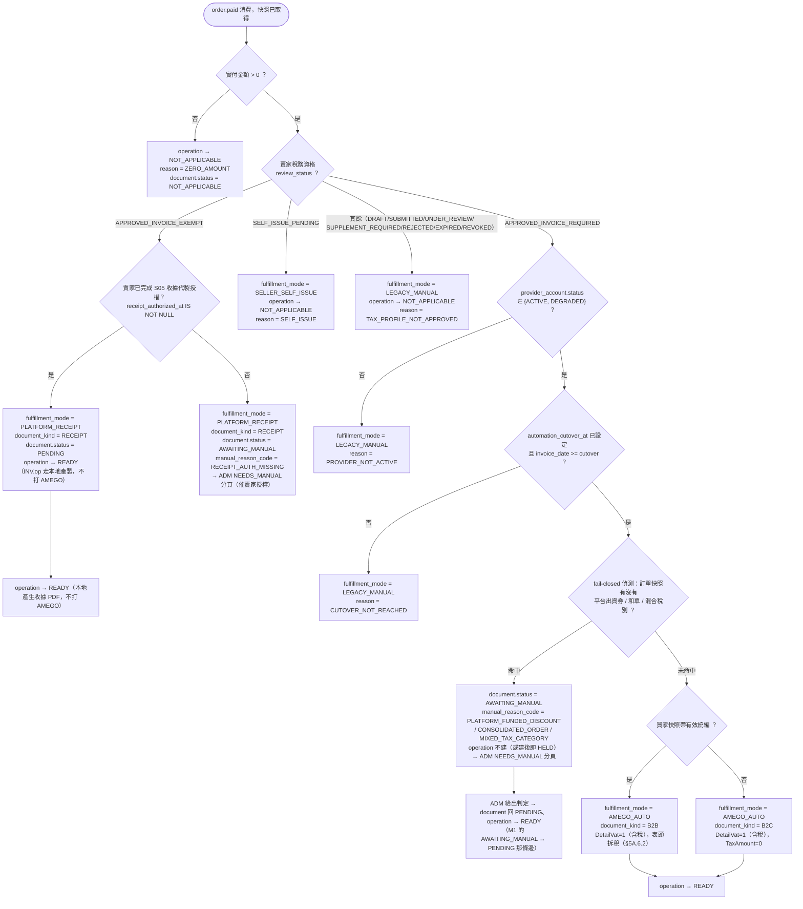

**fail-closed 偵測的三格（`FC` 節點）——三格都必須在「建立 document 的同一事務內」判定並落 `manual_reason_code`**（不是先建成 `PENDING` 再靠掃描器改過去）：

| 偵測 | 述詞（讀 `order.paid` 當下取到的訂單快照） | `manual_reason_code` | 為什麼不能自動開 |
|---|---|---|---|
| **平台出資券**（決策 §E4） | 該訂單套用的優惠券中存在 `created_by = ADMIN` 者 | `PLATFORM_FUNDED_DISCOUNT` | 平台出資的折扣**不減少賣家的銷售額**，當成賣家負擔折下去 ⇒ 發票金額少報，而少報的是**稅**。誰出的錢是業務事實，系統推不出來 ⇒ ADM 重試時必須帶 `funding_decision`（§6.1.10） |
| **和單訂單**（`9327`，§R10） | 訂單快照 `consolidated = true` | `CONSOLIDATED_ORDER` | 和單把收款方換成代理商 MerID，而開票的法源前提是「賣家在買家付款當下即已收款」⇒ 前提不成立。第一道防線在結帳鏈（`CheckoutConfirm` 以 `9327` 拒絕成單），本格是第二道 |
| **混合稅別** | 同一張發票的品項橫跨兩種以上 `tax_category`（1 應稅／2 零稅率／3 免稅）。⚠️ **運費行恆為應稅**（`invoice_lines.go` 的 `TaxCategoryTaxable` 硬編碼，理由：運費屬勞務、不在營業稅法第 8 條免稅列舉範圍）⇒ **免稅賣家只要收運費就必然命中本格**。這在 Phase 1 依規範不會發生，因為 §5A.12 **U1** 明訂該類賣家不得啟用買家付運費；本格是那道 ADM 檢查清單被繞過時的第二道防線。**判定用的是 `draft.Items`（＝含運費的送出行），不是商品行** | `MIXED_TAX_CATEGORY` | AMEGO 的 `TaxType=9`（混合稅率）對金額欄位另有一套分攤規則，錯了回萬用碼 `3040174` ⇒ 送出去試錯的成本遠高於轉人工 |

`manual_reason_code` 的完整值域是 CodeMeta `InvoiceManualReason`（**32 值**），本表只列本決策樹產生的三個；`PROVIDER_RESULT_UNKNOWN`（J17 之後由 ADM 標記）、`ISSUER_RETIRED`、`DEADLINE_MISSED`（§5.2.1 逼近告警掃描標記）由其他路徑產生。

**四個判定點的實作要求**：① 模式判定是**雙條件**（賣家資格 ＋ provider 狀態），不能只比 `paid_at` vs `cutover`——只比時間會在連線被 `SUSPENDED`／`REVOKED` 之後仍判成 `AMEGO_AUTO`，每一筆都開不出來；② `LEGACY_MANUAL` 是 `fulfillment_mode` 的第四個合法值（切點前訂單標它）；③ `SELLER_SELF_ISSUE` 與 `LEGACY_MANUAL` **仍要建 `invoice_documents` 列**（否則買家訂單詳情沒有東西可顯示、沒有申訴對象、每日對帳把它們全列成異常），建了之後 document 恆為 `NOT_APPLICABLE`、對帳條件排除該狀態即可；④ 這兩種模式必須逐單向賣家明示「平台不會代開」——S06 列表會把 `LEGACY_MANUAL` 訂單混在自動開票訂單中，賣家極可能誤以為平台會開而漏開票，**而發票人是賣家、罰的是賣家**（營業稅法 §2 第 1 款；行為罰 2%~5%，每一營業人上限 100 萬）。

---

### 7.2 時序圖

#### 7.2.1 S-1 自動開票（含 timeout 分支與查詢對帳）

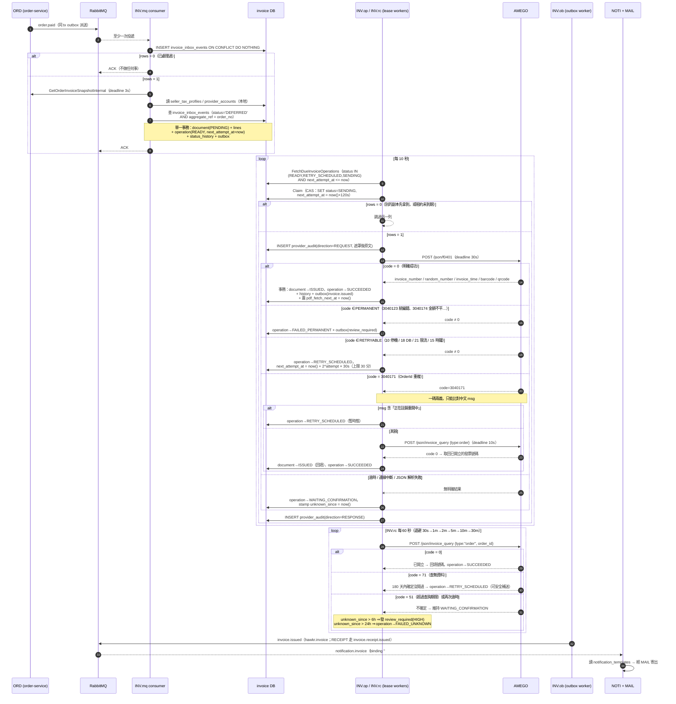

#### 7.2.2 S-2 售後終態 → 自動作廢或折讓

> 前提：**「已開立發票之後才發生退款」是常態，不是例外分支。** 訂單自動完成是 `delivered_at + 60h`，而買家申訴期是 72h 且 `submitAppeal` 全段沒有訂單狀態守門（`AfterSaleAppealService.java:72-92`）⇒ 已 `COMPLETED(50)` 甚至已撥款的訂單仍可被判 `FULL_REFUND`。

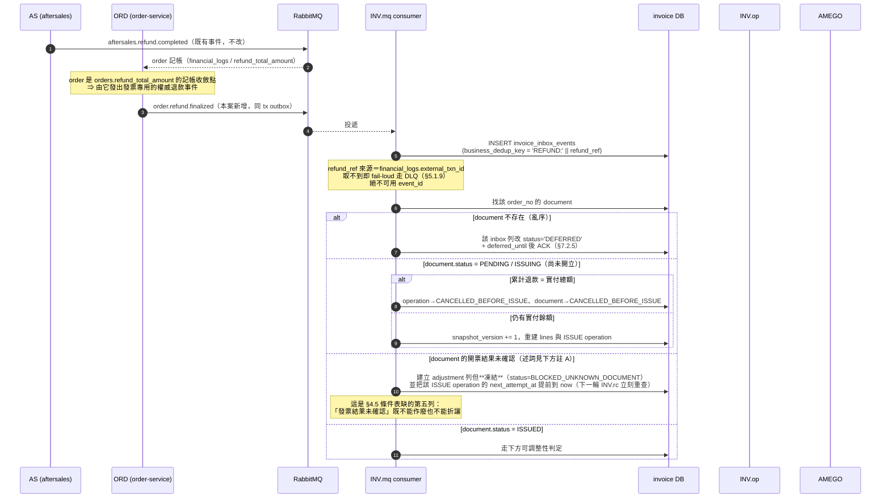

**註 A｜「開票結果未確認」的述詞寫在 operation 上，不寫在 document 上**（M1 沒有 `WAITING` 這個值）。**兩個 document 狀態都要列**：operation 進 `WAITING_CONFIRMATION` 時 document 還是 `ISSUING`，但 operation 一轉 `FAILED_UNKNOWN`，M1 的「`ISSUING` → `ISSUE_FAILED`」那條邊就把 document 推到 `ISSUE_FAILED`。

```sql
-- 該 document 是否處於「開票結果未確認」——兩張表一起看
SELECT EXISTS (
  SELECT 1
  FROM invoice_documents d
  JOIN invoice_operations o ON o.document_id = d.id AND o.operation_type = 'ISSUE'
  WHERE d.id = sqlc.arg(document_id)
    AND d.status IN ('ISSUING', 'ISSUE_FAILED')
    AND o.status IN ('WAITING_CONFIRMATION', 'PROVIDER_STATUS_RECHECK',
                     'FAILED_UNKNOWN', 'CANCEL_BLOCKED_UNKNOWN')
);
```

**可調整性判定（作廢 vs 折讓）**——分界是「銷售額是否已申報」，不是日曆上的同一期：

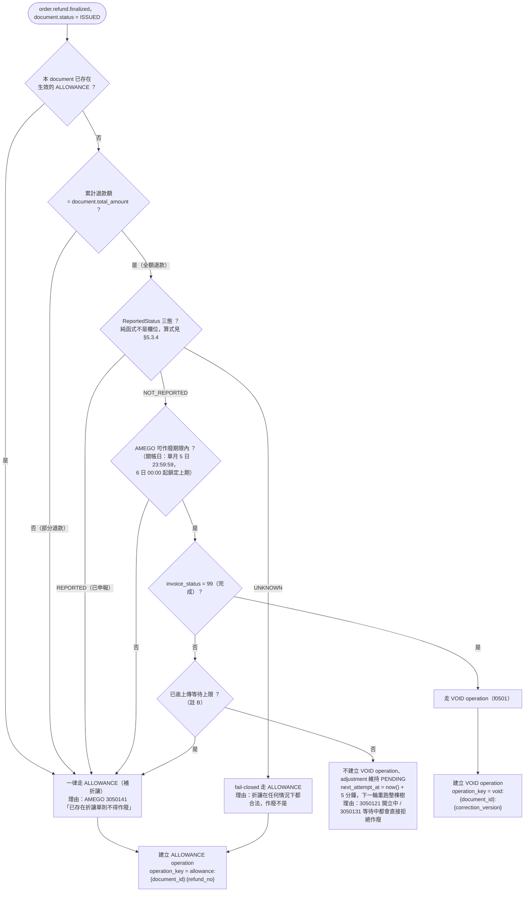

**註 B｜上傳等待上限（`WAIT` 不是懸空終點）。** AMEGO 官方 FAQ 逐字說上傳確認「有時候快的話可能幾分鐘就上傳確認，但也有幾小時才被確認的」⇒ 這個等待**必須有界**；沒有界的話，一筆在關帳日傍晚要作廢的發票會安靜地等過關帳日變成只能折讓。

| 項目 | 規則 |
|---|---|
| 等待怎麼表達 | **不建立 VOID operation**，adjustment 維持 `PENDING`（G01 之前），`next_attempt_at = now() + 5 分鐘`；下一輪**重跑整棵決策樹**，不是重跑「等待」。等待期間的狀態查詢走 `invoice_status`（**只用來判 `status=99`**） |
| 上限 | `wait_deadline = MIN(該發票所屬期別的 AMEGO 關帳鎖定時刻 − 30 分鐘, invoice_adjustments.created_at + 24 小時)`；關帳鎖定時刻 ＝ 該期別結束後單月 5 日 23:59:59（6 日 00:00 起鎖定上期） |
| 逾限出邊 | `now >= wait_deadline` ⇒ **自動改走 `ALLOWANCE`** ＋ outbox `invoice.operation.review_required`（P7，ADM 處置優先序 MEDIUM）。方向與整棵樹的 fail-closed 一致：折讓在任何情況下都合法，作廢不是 |
| 機械保證 | `invoice_adjustments` 停在 `PENDING` 且 `created_at < now() - interval '24 hours'` 的列數 > 0 ⇒ 告警。**與 C-5 的 30 分鐘 `BLOCKED_*` 告警是兩條不同的述詞**，不可合併 |

**六個必須寫進實作的細節**

| # | 規則 | 做錯的後果 |
|---|---|---|
| 1 | `reported_status` **不是欄位，是純函式** `ReportedStatus(taxPeriodCode, now)`（`services/invoice-service/internal/domain/period.go`）；三態由「期別是否已終結」與「法定申報期限（營業稅法 §35 I）是否已過」推導，本服務**沒有任何寫入路徑**。算式見 §5.3.4，機械保證見 §5.5 I-58。同理 `reported_at` 也不新增——該識別字在本服務只有一個意思：P12 payload／`SellerInvoiceJob`（proto 欄號 21）的 wire 名，對應 DB `external_reported_at` | 落成欄位就恆為 NULL（沒有寫入者）⇒ 決策樹 D 節點恆走 `UNKNOWN` ⇒ E／F 與整條 VOID operation 路徑成為死碼，**不編譯錯、不測試紅** |
| 2 | 不得拿 `invoice_status` 的 `status=99` 或 `provider_upload_status` 當 `reported_status` 的來源——那一欄答的是「AMEGO 傳輸是否完成」；查不到（`UNKNOWN`）一律 fail-closed 走折讓 | D（已申報？）與 F（上傳完成？）在問同一件事，樹塌成兩個節點 |
| 3 | `f0501` 回 `code 0` **≠ 已作廢**（作廢是非同步的，排進 `invoice_query` 的 `wait[]`）。成功判準是「`invoice_query` 的 `invoice_type` 變成 `C0501`」或「`wait[]` 清空」 | 立刻重送會回 `3050131`「等待作廢」 |
| 4 | `3050122`「已存在開立作廢」代表**已達成目標**，重試邏輯視同成功；折讓側的 `4050132` 同型 | 當成失敗 ⇒ 明明已作廢卻一路重試到 FAILED 的假異常 |
| 5 | 折讓的單價與小計**固定是未稅**，而開立時預設含稅（`DetailVat=1`）⇒ 從訂單金額推導折讓明細必須做含稅→未稅換算（折讓 100 含稅 ⇒ 單價填未稅 95）。全額折讓時逐品項 `Tax` 四捨五入後加總 ≠ 原發票 `TaxAmount`，**必須把尾差吸收到某一品項** | 回 `4040171`／`4040173` |
| 6 | `AllowanceNumber` 由我方指定、≤16 字、AMEGO 成功後**不回傳任何識別碼** ⇒ **送出前必須先落庫**；格式 `{order_no}A{nn}`（10 碼 ＋ `A` ＋ 2 位序號 ＝ 13 碼）。金額型退款的分攤 fallback：按原 `invoice_document_lines` 的 `net_amount` 比例攤到各稅別行，尾差歸 `allocation_sequence` 最大的那一行（沿用 `CheckoutService.java:1008` 的既有慣例），仍無法分攤才進 ADM | 「送出成功但回應遺失」只能靠 `allowance_query` 回查我方自己產的單號來判定 |

#### 7.2.3 S-3 買家付款後修改發票資料

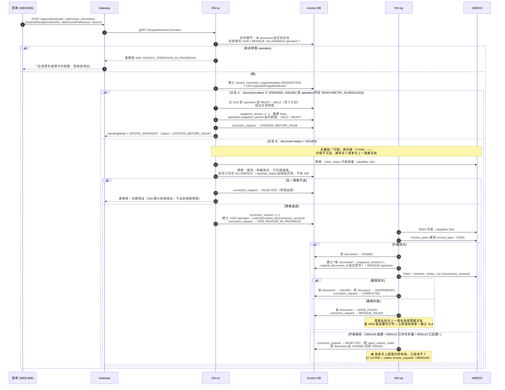

**註｜分支 A 必須先把 operation CAS 到 `HELD` 才能改快照。** `expectedSnapshotVersion` 只是**樂觀鎖**，不阻止 worker 在同一瞬間把 operation claim 走並用**舊快照**打 AMEGO。⇒ 先跑 `UPDATE invoice_operations SET status='HELD' WHERE id=? AND status IN ('READY','RETRY_SCHEDULED')`，`rows=0`（表示已在 `SENDING`）就退回分支 B。`HELD` 是候選述詞以外的狀態，但**不是永久旗標**：它有 `held_until`（＝ `now() + 60s`）與到期自動回 `READY` 的邊（J09）。

#### 7.2.4 S-4 ADM 受控人工出口

> 人工出口的法源是《統一發票使用辦法》§24-1「營業人遇有機器故障，致不能開立…應以人工依照規定開立」。本節要補完的是四樣紀律：門檻（雙人確認）、證據（`evidence_kind`）、出口（`RESOLVED_EXTERNALLY`）與回頭路（自動重查仍在跑）。

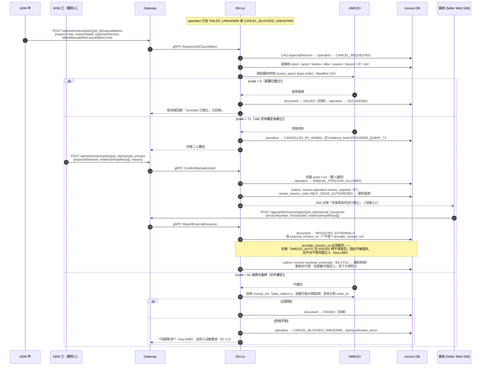

**五個必須釘死的規則**

1. **證據要落庫，兩個 `account_id` 都要記。** `evidence_kind` ∈ {`PROVIDER_QUERY_71`（AMEGO 查無）, `PROVIDER_LIST_ABSENT`（列表比對後仍無）, `MOF_PLATFORM_SCREENSHOT`（賣家提供的財政部平台查詢結果）, `AMEGO_RECONCILE_FILE`（對帳檔）}。截圖類走 media 私有資產、**只存 objectKey**，並列為 5 年保存例外。
2. **買家端文案必須能分辨三件事**：平台已開立／賣家已自行開立／尚在處理。`RESOLVED_EXTERNALLY` 對買家顯示「賣家已自行開立發票，號碼 XXXX，如未收到請聯繫賣家」，**不得**顯示為平台已開立。
3. **本章出現的所有路徑一律以 §6 為準**，三條慣例：ADM 面 `/admin/invoices/...`（**複數**）、賣家面 `/app/seller/invoices/...`（**單數 `seller/`**，不是 `/app/sellers/me/**`）、path segment 一律 **snake_case**。`POST /app/seller/invoices/jobs/{job_id}/external_issuances` 是 §6 端點 62（`CapInvoiceTaxRemedy`，畫面 S07，業務碼 `9349`），也是 J30／M1 `RESOLVED_EXTERNALLY` 的唯一入口；§6 端點 **56**（ADM 代錄）與它守衛、目標狀態、寫入欄位完全相同，只差 actor 與稽核欄——**兩支都要走同一個 transition helper**，不得各寫一份 CAS。
4. **`invoice.resolved_externally` ＝ P12，只發買家向。** 買家必須被告知「這張票由賣家自行開立、不是平台開的」，而那是一則**通知**（notification-service 消費），不是靠 B04 讀 gRPC 補得上的——買家不會主動回去看訂單。賣家向不發（他是動作發起人）。端點 62 與端點 56 共用同一段 domain 邏輯、**發同一則**，不得自創第二個 key。

#### 7.2.5 S-5 亂序：退款事件早於付款事件

> `invoice.order.paid` 與 `invoice.order.refund.finalized` 是**兩條獨立 queue**，RabbitMQ 對跨 queue 無任何順序保證。ATM 逾時取消、快速全額退款、或 invoice consumer 落後時，refund 會先到。

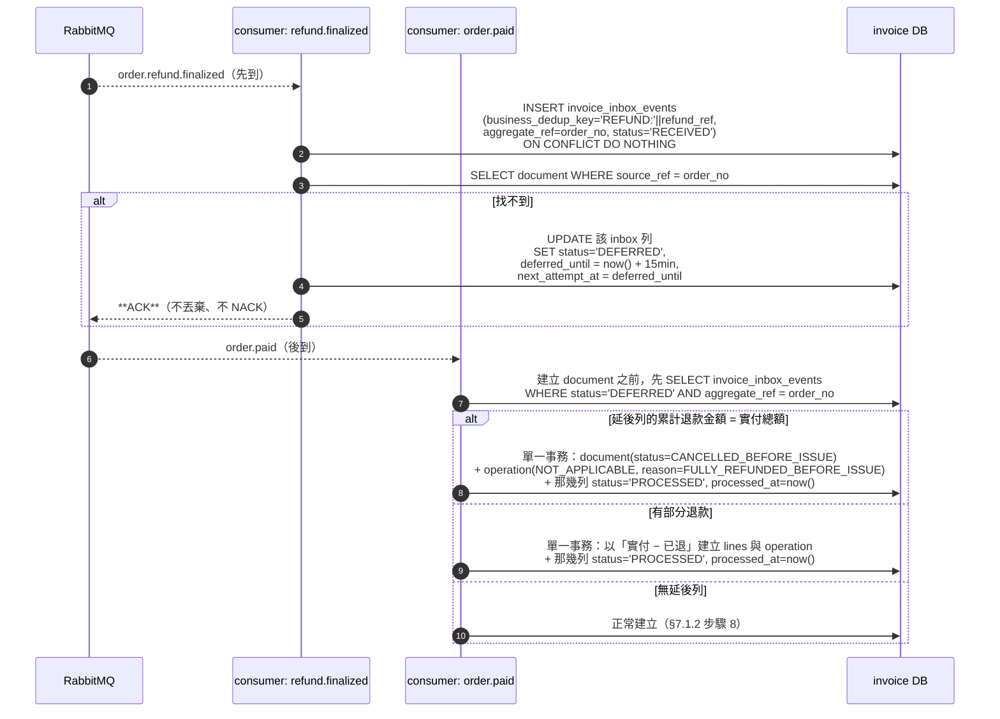

**不另建抑制表——亂序承載在 `invoice_inbox_events`（§5.1.9）上。** 該表本來就是「去重 ＋ 亂序延後 ＋ 處置留證」三合一：`status='DEFERRED'` ＋ `deferred_until` 表達「前置條件未到」，`aggregate_ref`（＝`order_no`）是反向認領的查找鍵，`disposition`／`disposition_reason` 回答 ADM 的「這筆退款為什麼沒有開折讓」。**「兩條 queue 描述同一個聚合，而其中一條的處理以另一條已經處理完為前提」的設計都必須有一個延後狀態，這是它存在的唯一理由。**

⚠️ 述詞是「**有前置依賴**」不是「描述同一個聚合」。C3（`order.cancelled`，§6.3.2.4）同樣描述訂單這個聚合，卻**不需要** `DEFERRED`：它寫的是一列與 `invoice_documents` 無關的獨立事實，沒有「document 還不存在」這個前置條件可以未達成。⚠️ 把述詞寫成後者，照字面讀會得出「C3 也要做延後狀態」——那會造出一個永遠不會被進入的狀態，以及一批沒有執行者的 DEFERRED 列。

| 認領路徑 | 誰執行 | 述詞 | 出口 |
|---|---|---|---|
| **反向認領（主路徑）** | `order.paid` 的 consumer，在建立 document 的**同一事務內** | `status='DEFERRED' AND aggregate_ref = order_no` | 該列轉 `PROCESSED`（`processed_at=now`） |
| **到期重試（兜底）** | §5.2.1 ② 的 `idx_invinbox_due` 候選集合（`status IN ('RECEIVED','DEFERRED','FAILED')` ＋ `next_attempt_at <= now`），lease on `next_attempt_at` | 重跑一次 7.2.2 的判定 | 找到 document ⇒ 正常處理轉 `PROCESSED`；仍找不到 ⇒ 再延後一次 |

**清理與告警**（皆以 `invoice_inbox_events` 為對象，`INV.gov` 每日執行）：**本表永不刪列**（去重鍵是「同一筆退款不會被開第二張折讓單」的唯一防線，而上游 aftersales `RefundSyncWorker` 的重發沒有時間上界），90 天後只把 `payload` 覆寫成 `'{}'` 並蓋 `payload_purged_at`；`status='DEFERRED' AND received_at < now() - 7 days` ⇒ **告警**（M30 `invoice_inbox_stranded_rows` ＋ §8.2.4 ㉓ `InvoiceInboxStranded`，2026-08-31 實作；⚠️ 實作述詞比本句**寬**：狀態取 `('RECEIVED','DEFERRED','FAILED')` 而不只 `DEFERRED`，因為「沒有執行者」在 `FAILED` 上同樣成立——§7.2.2 落地前 `ORDER_REFUND_FINALIZED` 的 FAILED 列就是這一格）；判定為「不需要開折讓」時（例：重複付款的退款）⇒ `status='SKIPPED'` ＋ `disposition='IGNORED_DUPLICATE_PAYMENT'`，`chk_invinbox_skip_reason` 保證 `SKIPPED` 一定說得出理由。

---

### 7.3 狀態機

#### 7.3.0 七個 aggregate 與四條全域規則

| # | Aggregate | 狀態欄位 | CodeMeta enum |
|---|---|---|---|
| M1 | 發票文件 | `invoice_documents.status` | `InvoiceDocumentStatus` |
| M2 | provider 操作（＝ job） | `invoice_operations.status` | `InvoiceOperationStatus` |
| M3 | 賣家稅務資格 | `seller_tax_profiles.review_status` | `SellerTaxReviewStatus` |
| M4 | AMEGO 帳戶 | `invoice_provider_accounts.status` | `InvoiceProviderAccountStatus` |
| M5 | 買家申訴 | `invoice_complaints.status` | `InvoiceComplaintStatus` |
| M6 | 付款後修改請求 | `invoice_correction_requests.status` | `InvoiceCorrectionStatus` |
| M7 | 稅務調整（作廢／折讓） | `invoice_adjustments.status` | `InvoiceAdjustmentStatus` |

**轉移總數 123**：M1 **17**（表列無編號）／M2 **34**（`J01–J34`）／M3 **16**（`T01–T16`）／M4 **16**（`P01–P16`）／M5 **13**（`K01–K13`）／M6 **8**（`R01–R05`、`R08–R10`）／M7 **19**（`G01–G19`）。**編號一經定版即凍結、不因日後增刪而重編**（新編號一律接在尾號之後）——§5／§6／58A／§11 都有逐字引用。

**「有具名觸發者」是本節的驗收條件，不是文風要求。** 每一條轉移的「事件」欄必須指得出一個**實際存在的**執行者：端點號（§6 主表有那一列）、worker 代號（7.0 有那一列）、MQ consumer（§6.3 有那一列），或「某條轉移的同一事務內連動」（並寫出是哪一條）。寫成「重試」「恢復」「ADM 取消」這種無主詞的動詞 ⇒ 那條邊沒有人走得到，而狀態值在 CHECK 裡、mermaid 上畫得出來、DTO 值域列得出來，唯獨沒有路徑抵達它。

**四條全域規則**

1. **`invoice_operations` 就是 job 表**，`operation_type` 值域固定六種：`ISSUE`／`QUERY`／`VOID`／`ALLOWANCE`／`REISSUE`／`VOID_ALLOWANCE`（`VOID_ALLOWANCE` ＝ 作廢折讓單 `g0501`，本案新增），六種**全部共用 M2 這一套 `status` 值域**。這六個值是唯一的 SSOT，7.0 的 `INV.op` 職責欄、§5 `chk_invop_type` 與 I5 索引述詞都必須逐字對齊它。**`QUERY` 的建立者只有兩個，都在 §5 而不在本章**：① 上傳狀態輪詢拿到 `provider_upload_status = -1`（NOT_FOUND）時建一列 `QUERY` 走 `invoice_query` 對帳；② 收到 `3040171` 時 `status='WAITING_CONFIRMATION'` ＋ 一列 `QUERY`。7.2.4 的 ADM「強制最終查詢」與自動重查**不建 `QUERY` 列**，它們就地跑在原 operation 上（`CANCEL_REQUESTED → PROVIDER_STATUS_RECHECK`）。
   **DDL 欄名以 §5.1.8 為準**：`next_attempt_at`／`cancel_requested_by`／`cancel_confirmed_by`。`next_retry_at` 只是 DTO／proto 的 **wire 名**（與 `reported_at` 同型）；`admin_cancelled_by`／`admin_confirmed_by` 全書沒有這兩個欄。
2. **`status` 是當前狀態，歷程由 `invoice_status_history` 承載。** 作廢後 `status` 就是 `VOIDED`，「不覆蓋歷程」由 append-only 的 history 保證，UI 的 DocumentTimeline **讀 history 不讀 status**。
3. **`invoice_status_history` 一張表承載七個 aggregate**，schema 以 §5.1.12 為準：`(id BIGSERIAL, subject_type, subject_id BIGINT, from_status, to_status, reason_code, reason_detail, actor_type, actor_account_id, correlation_id, occurred_at)`；`chk_invhist_subject` 七值逐字為 `DOCUMENT`／`ADJUSTMENT`／`OPERATION`／`CORRECTION_REQUEST`／`TAX_PROFILE`／`PROVIDER_ACCOUNT`／`COMPLAINT`。**所有轉移一律經同一個 transition helper 寫入**（`internal/domain/fsm/transition.go`）——不集中的後果是 A10 稽核紀錄與 AuditTrailDrawer 有一塊看不到。
4. **每一條轉移都是 CAS**，述詞形如 `WHERE id=? AND status IN (<allowed_from>) AND version=?`。⇒ **allowed-from 漏一個起點 ＝ `rows=0` 靜默失敗**：不拋例外、不進 DLQ、不告警，該筆永遠留在原狀態。本節每張轉換表的「來源狀態」欄就是 allowed-from 的 SSOT。

#### 7.3.1 M1 發票文件狀態（`InvoiceDocumentStatus`）

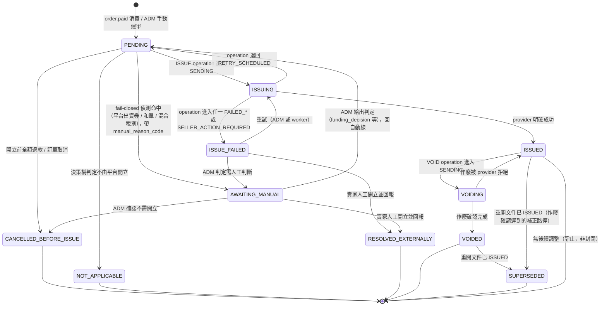

| 來源狀態 | 事件 | 目標狀態 | 守衛條件 | 副作用 |
|---|---|---|---|---|
| `[*]` | `order.paid` 消費 / ADM 手動建單 | `PENDING` | 通過 §7.1.3 決策樹且 `fulfillment_mode = AMEGO_AUTO` 或 `PLATFORM_RECEIPT` | 建 lines、建 ISSUE operation。**不發事件**（§6.3 無 `invoice.document.created`，理由見 §7.1.2 步驟 10） |
| `[*]` | 同上 | `NOT_APPLICABLE` | `fulfillment_mode ∈ {SELLER_SELF_ISSUE, LEGACY_MANUAL}` 或 `not_applicable_reason = ZERO_AMOUNT` | 買家端顯示對應文案；**每日對帳把此狀態排除** |
| `PENDING` | ISSUE operation `READY→SENDING` | `ISSUING` | — | — |
| `PENDING` | 累計退款 = 實付總額 | `CANCELLED_BEFORE_ISSUE` | operation 仍在 `{READY, RETRY_SCHEDULED, HELD, AWAITING_TRIGGER}` | operation → `CANCELLED_BEFORE_ISSUE`。**不發事件**（§6.3 無 `invoice.document.cancelled`；買家端由 B04 讀 gRPC 呈現） |
| `ISSUING` | `f0401` `code=0`／`invoice_query` 回填 | `ISSUED` | `provider_invoice_no` 非空（**DB CHECK** `chk_invdoc_issued_has_no`：`fulfillment_mode='AMEGO_AUTO' AND status='ISSUED'` ⇒ 不得為空） | 蓋 `pdf_fetch_next_at = now`；outbox **`invoice.issued`**（`document_kind='RECEIPT'` ⇒ **`invoice.receipt.issued`**） |
| `ISSUING` | operation 進入 `FAILED_PERMANENT` / `FAILED_RETRY_EXHAUSTED` / `FAILED_UNKNOWN` / **`SELLER_ACTION_REQUIRED`** | `ISSUE_FAILED` | — | **document 不自己發事件**——事件由對應的 operation 轉移發（J11／J14／**J32** ⇒ §6.3 P2 `invoice.issue_failed`；J17 ⇒ P7 `invoice.operation.review_required`）。同一件事只有一個 producer。⚠️ **`SELLER_ACTION_REQUIRED` 不叫 `FAILED_*`，所以「任一 `FAILED_*`」這種寫法會漏掉它**——漏掉的後果是 document 永遠停在 `ISSUING`，賣家 S08 看到「開立中」而實際上系統已經停手在等他去財政部配字軌 |
| `ISSUING` | operation 退回 `RETRY_SCHEDULED` | `PENDING` | — | — |
| `ISSUE_FAILED` | ADM 重試 / worker 重試 | `ISSUING` | operation 已回 `READY`（見 §7.3.2 的三種 FAILED 各自的守衛） | 稽核 |
| `PENDING` / `ISSUE_FAILED` | **fail-closed 偵測命中**（§7.1.3 決策樹的 `AWAITING_MANUAL` 分支，或 ADM 判定需人工） | **`AWAITING_MANUAL`** | **必填 `manual_reason_code`**（DB CHECK `chk_invdoc_manual_reason`：`status='AWAITING_MANUAL'` ⇒ 不得為空）；對應 operation 不得在 `SENDING` | operation 轉 `HELD`／不建；進 ADM `NEEDS_MANUAL` 分頁（§6.1.14 該分頁的述詞是「job 狀態 ∪ **本狀態**」）；outbox `invoice.operation.review_required` |
| `AWAITING_MANUAL` | ADM 給出判定（例：`funding_decision`） | `PENDING` | `expectedVersion` CAS ＋ 必填理由 | 清空 `manual_reason_code`；operation 回 `READY`、`next_attempt_at = now`；稽核 |
| `AWAITING_MANUAL` | 賣家回報自行開立號碼 | `RESOLVED_EXTERNALLY` | 同下方 `ISSUE_FAILED` 那一列 | 同下方那一列 |
| `AWAITING_MANUAL` | ADM 確認本單不需開立 | `CANCELLED_BEFORE_ISSUE` | 雙人確認 ＋ 必填理由 | operation → `CANCELLED_BEFORE_ISSUE`；稽核 |
| `ISSUE_FAILED` | 賣家回報自行開立號碼 | `RESOLVED_EXTERNALLY` | operation 在 `MANUAL_PROCESS_ALLOWED`；`external_invoice_no` 格式合法（2 英文 + 8 數字） | `provider_invoice_no` 保持 NULL；outbox `invoice.resolved_externally`（§6.3 **P12**，只發買家向；見 §7.2.4 規則 5） |
| `ISSUED` | VOID operation `READY→SENDING` | `VOIDING` | 本 document 無生效 ALLOWANCE；`invoice_status = 99` | — |
| `VOIDING` | `invoice_query` 確認 `invoice_type = C0501` | `VOIDED` | — | outbox **`invoice.voided`**（§6.3 P3） |
| `VOIDING` | `f0501` 回 `3050121/3050123/3050126/3050141` | `ISSUED` | — | correction_request → **`REJECTED`** ＋ 寫 `reject_reason_code`（§7.3.6 R05）；outbox `review_required` |
| `VOIDED` / `ISSUED` | 重開文件轉 `ISSUED` | `SUPERSEDED` | `superseded_by` 非空且該列 `status='ISSUED'` | outbox `invoice.reissued` |

**值域 11 值，逐字等於 §5 `chk_invdoc_status`。終態**：`CANCELLED_BEFORE_ISSUE`、`NOT_APPLICABLE`、`RESOLVED_EXTERNALLY`、`SUPERSEDED`。⚠️ **`VOIDED` 不是終態**：轉換表最後一列與圖上都有 `VOIDED → SUPERSEDED`（作廢後重開，舊票成為歷史版本）。**轉換表是 allowed-from 的 SSOT**，以它為準；實作端的 `TestDocumentTerminalStates` 把這一格寫成具名 `continue` ＋ 註解，而不是靜默放過。**非終態**：`PENDING`／`ISSUING`／`ISSUE_FAILED`／`AWAITING_MANUAL`／`VOIDING`，以及靜止態 `ISSUED`。
`ISSUED` 是**靜止態而非封閉終態**——大多數發票會永遠停在這裡，但它隨時可以再走 `VOIDING`、`SUPERSEDED`，或被折讓（折讓不改原件 `status`，只改 `allowance_total_amount`）。⇒ 任何「document 已到終態就可以停止追蹤／可以清理」的實作假設都是錯的：法定保存 5 年，且第 5 年仍可能有折讓。
`ISSUE_FAILED` 的文件要收掉是**兩步**：`ISSUE_FAILED → AWAITING_MANUAL`（ADM 判定需人工判斷）→ `AWAITING_MANUAL → CANCELLED_BEFORE_ISSUE`（ADM 確認不需開立，雙人確認 ＋ 必填理由），兩步各有 ADM 入口、各自留稽核。

**`document_kind` 維持三值 `B2C`／`B2B`／`RECEIPT`，折讓證明單不做成 `invoice_documents` 的一列。** 折讓的單號／開立時間／PDF／狀態歷程全部已在 `invoice_adjustments`（`allowance_number`／`allowance_date_taipei`／`pdf_object_key`／`status`／`provider_upload_status` ＋ `invoice_status_history` 的 `subject_type='ADJUSTMENT'`）。**不能加第四個值的實質理由**：AMEGO 折讓單的單價／小計**固定未稅**而開立端 `DetailVat=1` 是含稅 ⇒ 同一個 `unit_price` 欄要承載兩種相反的稅別語意；且 `chk_invdoc_kind_mode`／`chk_invdoc_deadline_presence`／`chk_invdoc_b2c`／`chk_invdoc_b2b`／`chk_invdoc_receipt` 五條 CHECK 全要為它重寫。⇒ 折讓單被 `g0501` 作廢時，改由 `operation_type='VOID_ALLOWANCE'` ＋ `invoice_adjustments.status` 走 `COMPLETED → CANCELLED`（G18 形態）承載，**與 M1 無關**；原發票的 `allowance_total_amount` 在同一事務內回沖（I4 的單句 CAS）。

**三種 `fulfillment_mode` 各有自己的合法 status 子集**（用 DB CHECK 表達，不靠應用層自律）：

| `fulfillment_mode` | 合法 status |
|---|---|
| `AMEGO_AUTO` | 全集（含 `AWAITING_MANUAL`） |
| `PLATFORM_RECEIPT` | `PENDING → ISSUING → ISSUED → VOIDED/SUPERSEDED`，另可經 `AWAITING_MANUAL`（**不經 provider**；收據沒有作廢期限限制 ⇒ 退款一律「作廢舊收據 ＋ 依剩餘金額重製新收據」）。`chk_invdoc_deadline_presence` 只對 `B2C`／`B2B` 要求法定期限 ⇒ RECEIPT 的 `statutory_deadline_at` 為 NULL，候選 SQL 的 `ORDER BY` 必須帶 `NULLS LAST` |
| `SELLER_SELF_ISSUE` / `LEGACY_MANUAL` | `NOT_APPLICABLE`（常態）／`RESOLVED_EXTERNALLY`（賣家回報號碼後）／`CANCELLED_BEFORE_ISSUE`（開票前全額退款或訂單取消）**三值**，逐字等於 §5 `chk_invdoc_self_issue` |

#### 7.3.2 M2 provider 操作狀態（`InvoiceOperationStatus`）

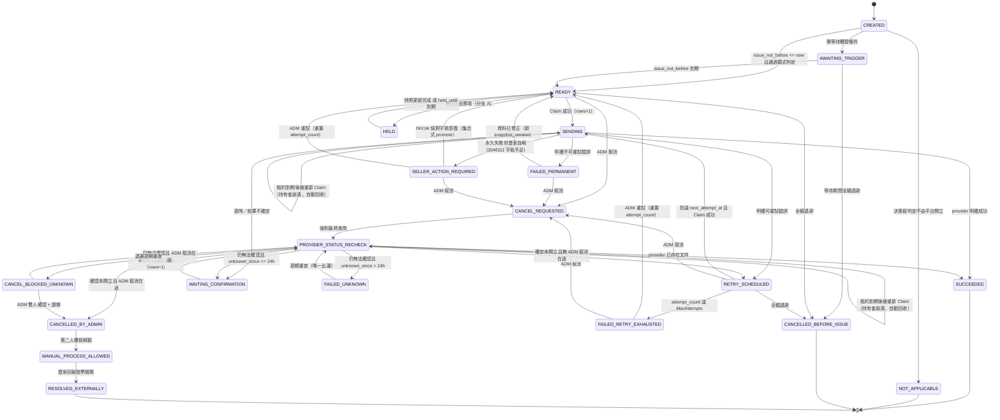

**轉換表**（來源狀態欄即 CAS 的 allowed-from）

| # | 來源狀態 | 事件 | 目標狀態 | 守衛條件 | 副作用 |
|---|---|---|---|---|---|
| J01 | `[*]` | 建立 operation | `CREATED` | `operation_key` 未存在（UNIQUE） | — |
| J02 | `CREATED` | 同一事務內判定 | `READY` | `issue_not_before <= now` | `next_attempt_at = now` |
| J03 | `CREATED` | 同上 | `AWAITING_TRIGGER` | `issue_not_before > now` | `next_attempt_at = issue_not_before` |
| J04 | `CREATED` | 同上 | `NOT_APPLICABLE` | 決策樹落在四個 reason 之一 | 寫 `not_applicable_reason` |
| J05 | `AWAITING_TRIGGER` | `issue_not_before` 到期 | `READY` | **無**（理由與執行者見 §7.5.4 註 4） | — |
| J06 | `CREATED` / `AWAITING_TRIGGER` / `READY` / `RETRY_SCHEDULED` / `HELD` | 累計退款 = 實付總額 | `CANCELLED_BEFORE_ISSUE` | — | document 同步轉 `CANCELLED_BEFORE_ISSUE`。⚠️ `CREATED` 必須在 allowed-from 內：重開票的 REISSUE operation 會停在 `CREATED`，那時全額退款一樣要取消得掉。本表與 SQL 的一致性由 `TestOperationFSMMatchesSQL` 對帳 |
| J07 | `READY` / `RETRY_SCHEDULED` / `SENDING` | `Claim` CAS `rows=1` | `SENDING` | `next_attempt_at <= tickNow` | `next_attempt_at = now() + 120s`（租約）；**候選述詞必須含 `SENDING`**，否則崩潰的租約永遠回不來 |
| J08 | `READY` / `RETRY_SCHEDULED` | 買家送出修改 | `HELD` | — | `held_until = now() + 60s` |
| J09 | `HELD` | 快照更新完成 或 `held_until <= now` | `READY` | — | — |
| J10 | `SENDING` | `code = 0`（或 `3050122`／`4050132` 視同成功） | `SUCCEEDED` | 回應欄位齊全 | document 轉態；建 pdf task；outbox |
| J11 | `SENDING` / `RETRY_SCHEDULED` | 錯誤碼分類 = `PERMANENT`，或重試預算用完（`pkg/outbox` 的 `bumpAttempt` 達 `max_attempts` 時呼叫 `MarkFailed`，而那個時點的 status 是 `RETRY_SCHEDULED`） | `FAILED_PERMANENT` | — | outbox **`invoice.issue_failed`**（§6.3 P2，`failureClass=PERMANENT`；ISSUE 以外的 `operation_type` 改發 P7） |
| J12 | `SENDING` | 錯誤碼分類 = `RETRYABLE` 且 `attempt_count < MaxAttempts` | `RETRY_SCHEDULED` | — | `next_attempt_at = now() + backoff(attempt)` |
| J13 | `SENDING` | 逾時／連線中斷／JSON 解析失敗／`code` 分類 = `UNKNOWN` | `WAITING_CONFIRMATION` | — | `unknown_since = now`。**不發 MQ**——`invoice.issue.pending_confirmation` 不在 §6.3 的 P1–P12 內，而「結果未明」是純內部觀測面，落點是 §8.2 的 `invoice_operation_unknown` 指標與告警階梯（§7.5.3）。真正需要通知賣家時走 J17 的 `invoice.operation.review_required` |
| J14 | `RETRY_SCHEDULED` | `attempt_count` 達 `MaxAttempts` | `FAILED_RETRY_EXHAUSTED` | — | outbox **`invoice.issue_failed`**（§6.3 P2，`failureClass=RETRY_EXHAUSTED`；ISSUE 以外的 `operation_type` 改發 P7） |
| J15 | `WAITING_CONFIRMATION` | `INV.rc` `Claim` CAS `rows=1` | `PROVIDER_STATUS_RECHECK` | `next_attempt_at <= tickNow` | `next_attempt_at = now() + 60s`（租約）。**結果落地不在這一列**：查到已開立走 J23、確定未開立走 J25 |
| J16 | `PROVIDER_STATUS_RECHECK` | 租約到期後被重新 `Claim`（持有者崩潰） | `PROVIDER_STATUS_RECHECK` | 同上 | 同上；**候選述詞必須含 `PROVIDER_STATUS_RECHECK`**，否則崩潰的租約永遠回不來（與 J07 的 `SENDING` 同理） |
| J17 | `PROVIDER_STATUS_RECHECK` | 重查後仍不確定，且 `now − unknown_since > 24h`，且**無** ADM 取消在途 | `FAILED_UNKNOWN` | — | outbox **`invoice.operation.review_required`**（§6.3 P7，`review_reason_code=PROVIDER_RESULT_UNKNOWN`；ADM 處置優先序 HIGH，**不是 payload 欄**）；`next_attempt_at = now() + 6h`。⚠️ **不發 P2**——「結果不明」與「確定失敗」對賣家的行動指引完全相反（前者不能自己補開，後者可以） |
| J18 | `FAILED_PERMANENT` | ADM 修正資料後重試 | `READY` | **必須帶新的 `snapshot_version`**；`expectedVersion` CAS | 稽核（before/after/reason） |
| J19 | `FAILED_RETRY_EXHAUSTED` | ADM 重試 | `READY` | `expectedVersion` CAS | `attempt_count = 0`；稽核 |
| J20 | `FAILED_UNKNOWN` | 週期重查 | `PROVIDER_STATUS_RECHECK` | **唯一出邊**——禁止直接重試 | — |
| J21 | `READY` / `RETRY_SCHEDULED` / `FAILED_PERMANENT` / `FAILED_RETRY_EXHAUSTED` / **`SELLER_ACTION_REQUIRED`** | ADM 取消 | `CANCEL_REQUESTED` | `expectedVersion` CAS ＋ 必填 `reasonCode`／`reasonDetail` | 稽核 intent；**同一句 UPDATE 內 `next_attempt_at = now`** ⇒ ADM 同步路徑若在強制最終查詢途中崩潰，`INV.rc` 下一輪立刻接手（不設這一句，從 `RETRY_SCHEDULED` 取消的那筆會沿用舊退避、最壞延遲一整個 30 分鐘週期才被接手） |
| J22 | `CANCEL_REQUESTED` / `FAILED_UNKNOWN` / `CANCEL_BLOCKED_UNKNOWN` | 強制最終查詢 | `PROVIDER_STATUS_RECHECK` | — | — |
| J23 | `PROVIDER_STATUS_RECHECK` | `invoice_query` `code=0` 或 `invoice_list` 比對到 | `SUCCEEDED` | — | 回填；**取消請求被回絕** |
| J24 | `PROVIDER_STATUS_RECHECK` | `code=71` 且**有** ADM 取消在途 | `CANCELLED_BY_ADMIN` | 判別式見下方 🔷 | **同一句 UPDATE 內必寫兩欄**：`cancel_evidence_kind = PROVIDER_QUERY_71`（`chk_invop_admin_cancel_needs_confirm` 放行本條的唯一依據——J24 沒有第二個人，不寫就是 `23514`）＋ `cancel_confirmed_at = now`（不寫的話「取消在途」判別式永遠成立，資料上這筆會一直像沒處理完） |
| J25 | `PROVIDER_STATUS_RECHECK` | `code=71` 且**無** ADM 取消在途 | `RETRY_SCHEDULED` | 同上；發票日期在 180 天內（否則 `71` 不可信） | 可安全補送 |
| J26 | `PROVIDER_STATUS_RECHECK` | `code=51` 或再次逾時，且**有** ADM 取消在途 | `CANCEL_BLOCKED_UNKNOWN` | 同上 | `unknown_since` 保留；排入退避重查 |
| J27 | `CANCEL_BLOCKED_UNKNOWN` | 退避週期到期 | `PROVIDER_STATUS_RECHECK` | 重查週期見 §7.5.3 | — |
| J28 | `CANCEL_BLOCKED_UNKNOWN` | ADM 雙人確認 ＋ 證據 | `CANCELLED_BY_ADMIN` | 兩個 actor 不同；`cancel_evidence_kind` **必填**（Phase 1 恰好一項，見 CodeMeta `InvoiceCancelEvidenceKind`）；截圖／對帳檔另存 `cancel_evidence_object_key` | 稽核（兩個 account_id 都記） |
| J29 | `CANCELLED_BY_ADMIN` | 第二人覆核解鎖 | `MANUAL_PROCESS_ALLOWED` | actor ≠ 取消者 | outbox **`invoice.operation.review_required`**（§6.3 P7，payload 帶 **`review_reason_code=SELF_ISSUE_AUTHORIZED`** ＋ `jobId`／`orderNo`／應開金額；通知賣家）。⚠️ **理由碼不可填 `MANUAL_PROCESS_ALLOWED`**——那是本列的目標**狀態值**，不是 `InvoiceManualReason` 的值（§6.3.3.3）|
| J30 | `MANUAL_PROCESS_ALLOWED` | 賣家回報號碼 | `RESOLVED_EXTERNALLY` | 號碼格式合法；`provider_invoice_no` 必須留空 | document 轉態；outbox 通知買家 |
| J31 | `PROVIDER_STATUS_RECHECK` | 重查後仍不確定，且 `now − unknown_since <= 24h`，且**無** ADM 取消在途 | `WAITING_CONFIRMATION` | — | `next_attempt_at = now() + 重查階梯(now − unknown_since)`（§7.5.4 第 1 條）；`unknown_since` **不重寫** |
| **J32** | `SENDING` | 錯誤碼分類 = `PERMANENT` **且屬「賣家法定前置未完成」子類**（`3040111` 字軌不足；§4.5.6 的 `ClassManual` 中「賣家自己能解」那一支） | **`SELLER_ACTION_REQUIRED`** | 該碼在 §8.3.1 逐碼表被標為「賣家問題」 | outbox **`invoice.issue_failed`**（§6.3 P2，`failure_class=PERMANENT`、`failure_reason_code=TRACK_EXHAUSTED`、`requires_manual_action=true` —— 該 payload 的範例本來就是這一則）；document 依 §7.3.1 轉 `ISSUE_FAILED`；`InvoiceTrackExhausted` critical 告警（§8.2.4 ㉒）。⚠️ **與 J11 分開列是刻意的**：兩者的錯誤分類同為 `PERMANENT`，但一個要通知賣家去財政部、一個要通知 ADM 改資料 |
| **J33** | `SELLER_ACTION_REQUIRED` | `INV.trk` 查到該 `issuer_id` 字軌餘量恢復（`remaining > 0` 且當期字軌 `status` 正常） | `READY` | — | `next_attempt_at = now`；`attempt_count = 0`。**集合式 `UPDATE`、無外部副作用、不需 claim**（外部呼叫是 `INV.trk` 本職的字軌查詢，已在前一步做完），形態同 `ReleaseExpiredInvoiceOperationHolds`／`PromoteDueInvoiceOperationTriggers`。⚠️ **這條邊是 `SELLER_ACTION_REQUIRED` 不是永久旗標的唯一理由**（《多副本排程搶佔規範》通則 0 第 3 步）——刪掉它，卡住的票就再也回不來，而且無告警 |
| **J34** | `SELLER_ACTION_REQUIRED` | ADM 手動重試 | `READY` | `expectedVersion` CAS ＋ 必填 `reason`。**不要求新的 `snapshot_version`**（資料沒問題，是外部前置沒到位）⇒ 守衛與 J19 同形、與 J18 不同 | `attempt_count = 0`；`next_attempt_at = now`；稽核 |

**終態只有四個**：`SUCCEEDED`、`NOT_APPLICABLE`、`CANCELLED_BEFORE_ISSUE`、`RESOLVED_EXTERNALLY`。`CANCEL_BLOCKED_UNKNOWN` 與 `MANUAL_PROCESS_ALLOWED` 各有出邊（J27／J28、J30）。

⚠️ **`NOT_APPLICABLE` 有一個例外**：`fulfillment_mode ∈ {SELLER_SELF_ISSUE, LEGACY_MANUAL}` 時它**不是**終態 —— 賣家回報自行開立的號碼可以把它推到 `RESOLVED_EXTERNALLY`，那是 §7.3.1「這兩個 mode 的合法 status 三值」在 operation 側的對應邊。在此之前三處 allowed-from（`admin_job.go` 的守衛、兩句 `Mark*ResolvedExternally`）都不含它 ⇒ **設計說得到而實作到不了**：稅務資格尚未核准的賣家自行開了票卻回報不了，端點 62 回 `9349`「請等待平台通知」而沒有任何東西會產生那個通知。dev 實測 13 筆全停在 `NOT_APPLICABLE`。

⚠️ 本例外**不影響**兩處 `FailOpenInvoiceOperationsForIssuer` 的正面清單（那份列的是「provider 停用時該被打成 `FAILED_PERMANENT` 的狀態」，這兩個 mode 的 operation 從來不打 provider），也不影響 `CountUnsettledAdjustmentOps` 那句用 `NOT IN` 列終態的統計（回報之前它確實沒有待辦）。**這兩處的清單都不含本例外，且不得因為本例外而修改** —— 否則會以為「終態定義變了」就得把所有列舉清單重算一遍。**

🔷 **「ADM 取消在途」的判別式（J17／J24／J25／J26／J31 共用，零新欄位）**：`cancel_requested_at IS NOT NULL AND cancel_confirmed_at IS NULL`。claim（J15／J16／J20／J22／J27）會把原狀態蓋成 `PROVIDER_STATUS_RECHECK`，所以**落點不能靠「來源狀態」判**，只能靠這兩個時間欄。三條「仍不確定」的出邊互斥且窮盡：有取消在途 ⇒ J26；無取消在途且 `unknown_since ≤ 24h` ⇒ J31；無取消在途且 `> 24h` ⇒ J17。

**`INV.rc` 的 claim 本身就是一條狀態轉移**：J15／J16／J20／J22／J27 是**同一支** `ClaimInvoiceRecheck` CAS（7.5.4）的五個來源，它的 `status IN (...)` 必須**逐字等於**這五列來源狀態的聯集。契約測試對 SQL 檔做靜態斷言：把轉換表中目標為 `PROVIDER_STATUS_RECHECK` 的來源狀態集合與該述詞的集合對拍，不相等即 fail。**`WAITING_CONFIRMATION` 也因此刻意沒有直接到 `SUCCEEDED`／`RETRY_SCHEDULED`／`FAILED_UNKNOWN` 的邊**（重查一定先經過 claim 才會打 AMEGO，結果落地時該列已經在 `PROVIDER_STATUS_RECHECK`）——那三條邊的語意由 J23／J25／J17 承接，留著它們會讓 I7 不可能全綠。

**`REVIEW_REQUIRED` 不是本值域的值**——它是「不送出、轉人工」這個**結果**的簡稱，落地形式為：開立側 `invoice_documents.status='AWAITING_MANUAL'` ＋ `manual_reason_code`，調整側 `invoice_adjustments.blocked_reason_code`；ADM 的可見性由 §6.1.14 的 `NEEDS_MANUAL` 分頁承接（**分頁是狀態的分組，不是狀態**）。它同時是 `InvoiceEventType.INVOICE_OPERATION_REVIEW_REQUIRED`、routing key `invoice.operation.review_required` 與 P7 payload `review_reason_code` 三處已用的名字。

**分工**：值域的 SSOT 是 §5 `chk_invop_status`（**20 值**）；語意與每一條轉移的 allowed-from 的 SSOT 是本節 J01–J34；§6.1.14 的六個 ADM 分頁是這 20 值的**分割**（聯集 ＝ 20、兩兩交集 ＝ 空）。三處改任一處都要同批改另外兩處。

**lease 欄位語意（`next_attempt_at`）**

| 情境 | `status` | `next_attempt_at` | 是否在候選集合 |
|---|---|---|---|
| 剛建立、可立即執行 | `READY` | `now` | ✅（`INV.op`） |
| 等待觸發條件 | `AWAITING_TRIGGER` | `issue_not_before` | ❌ 兩支都不撈；靠 `INV.op` 的 RunOnce 前置步驟 promote 成 `READY`（7.5.4 註 4） |
| 某副本持有中 | `SENDING` | `claim 當下 + 120s` | ❌（租約未到期） |
| 持有者崩潰 | `SENDING` | 已過期 | ✅（**這就是租約回收**） |
| 可重試失敗，等退避 | `RETRY_SCHEDULED` | `now() + 2^attempt × 30s` | 到期才 ✅ |
| 買家修改中 | `HELD` | 不變 | ❌ 兩支都不撈；靠 `held_until` 與 `INV.op` 的 RunOnce 前置步驟掃回（7.5.4 註 3） |
| 賣家法定前置未完成（字軌不足） | `SELLER_ACTION_REQUIRED` | 不變 | ❌ 兩支都不撈（它在等賣家去財政部配號，撈起來只會空轉並燒掉 attempt）；靠 `INV.trk` 的 RunOnce 前置步驟推回 `READY`（J33） |
| 結果未明，等重查 | `WAITING_CONFIRMATION` | `now() + 重查階梯(now − unknown_since)` | 到期才 ✅——落在 **`INV.rc`** 的候選集合 |
| 重查仍未明、已升級 | `FAILED_UNKNOWN` | `now() + 6h` | 同上 |
| ADM 取消在途（同步路徑崩潰後的接手） | `CANCEL_REQUESTED` | ADM 路徑在**同一事務內**寫 `now`（J21 副作用） | 同上 |
| ADM 取消被擋 | `CANCEL_BLOCKED_UNKNOWN` | `now() + 重查階梯(now − unknown_since)` | 同上 |
| `INV.rc` 某副本持有中／崩潰 | `PROVIDER_STATUS_RECHECK` | `claim 當下 + 60s` | ❌ 未到期／✅ 已過期（租約回收） |

**兩支 worker 的狀態集合必須不相交**：`INV.op` 撈 `{READY, RETRY_SCHEDULED, SENDING}`、`INV.rc` 撈另外五個（兩支 SQL 見 7.5.4），契約測試對 SQL 檔做靜態斷言（枚舉兩支的 `status IN (...)` 取交集為空）。**租約與退避共用 `next_attempt_at` 一個欄**：`pkg/outbox` 的 `Repository.Claim(ctx, id, leaseUntil, claimableBefore)` 介面只寫一個時間欄（`pkg/outbox/worker.go:17-35`），且《多副本排程搶佔規範》明文承認它在定義上就是租約欄、允許「backoff 寫入是同一欄的第二個寫入者」；兩欄反而製造規範要防的風險（claim 之後的 `UpdateAttempt` 不知情地覆蓋租約）。

**`FAILED_*` 拆成三個而不是兩個**，判準是「ADM 按下重試安不安全」必須由狀態本身回答：

| 狀態 | ADM 重試的後果 | 因此出邊是 |
|---|---|---|
| `FAILED_PERMANENT` | 重試必然再失敗（統編錯、金額不平） | `→ READY` 但**要求先修正資料**（新 `snapshot_version`，J18） |
| `FAILED_RETRY_EXHAUSTED` | 重試是安全的（暫時性錯誤，只是預算用完） | `→ READY`（重置 `attempt_count`，J19） |
| `FAILED_UNKNOWN` | 重試**可能開出第二張發票**（AMEGO 未承諾重送可取回原結果） | 只能 `→ PROVIDER_STATUS_RECHECK`（J20） |

#### 7.3.3 M3 賣家稅務資格（`SellerTaxReviewStatus`）

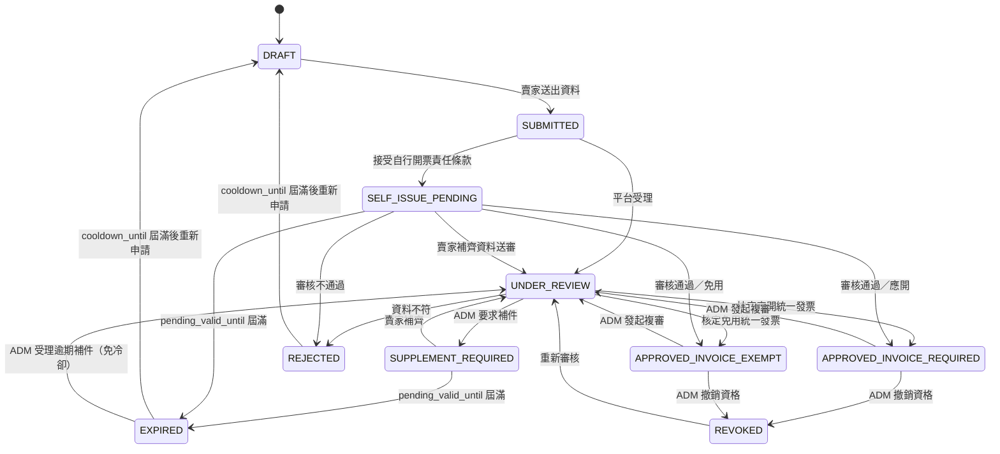

| # | 來源狀態 | 事件 | 目標狀態 | 守衛條件 | 副作用 |
|---|---|---|---|---|---|
| T01 | `[*]` / `REJECTED` / `EXPIRED` | 賣家開啟 S02 | `DRAFT` | `cooldown_until IS NULL OR cooldown_until <= now`（**7 天冷卻**，決策 C3） | — |
| T02 | `DRAFT` | 送出 | `SUBMITTED` | 必填欄位齊全；`seller_tax_profiles.evidence_object_keys` 至少一項。**不是**端點 62 回報自行開立的 `evidenceAssetKeys`——不同流程、不同上傳通道：本項走 KYC 級 secure 兩段式（§6.1.7 定版），端點 62 走公開 upload session。⚠️ **守衛讀的是已換發、已落庫的 objectKey**：端點 18 在寫 `seller_tax_profiles` **之前**就把 `evidenceStagedTokens[]` 換成 objectKey（§6.1.7「換發」表），所以草稿存檔完成的那一刻本欄就有值；**送審端點（19）不做換發、body 也不收 token** ⇒ 只上傳沒存草稿就直接送審，本守衛必然不成立。守衛不成立回 **400**，message 用賣家看得懂的動作「**請至少上傳一份稅籍證明文件**」——**不要回 `9321`**（那是「當前狀態不允許送審」，賣家的下一步完全不同：一個要補檔、一個要等審核） | **`submitted_at = now`；`pending_valid_until = submitted_at + 60 天`**（決策 C4：自送出審核申請起算）；**＋ `attestation_version = 當期常數`、`attested_at = now`**（裁決 C：條款簽署與狀態轉移同一句 UPDATE，不變式「送審成功 ⇒ 條款必已簽」，DB 側由 I-72 的三條 CHECK 兜底）。⚠️ **那兩欄無條件寫，不留 `COALESCE`／`CASE` 的退化分支**：退化分支原意是「參數傳空就保留舊值」，實測的後果卻是**列被寫成 `SUBMITTED` 而兩欄留 `NULL`、呼叫端還收到 `ok=true`** —— 一次靜默的、沒有簽署記錄的送審。現在空字串一律 23514、一列不寫。守衛③：request 的 `acceptedTerms` 必須為 true，否則 **9325 且一筆都不寫**（判定在交易之外）；`accepted_by_account_id` 一併寫進狀態歷程的 actor |
| T03 | `SUBMITTED` | ADM 受理 | `UNDER_REVIEW` | — | 稽核 |
| T04 | `SUBMITTED` | 賣家接受自行開票責任條款（端點 22） | `SELF_ISSUE_PENDING` | `attestation_version` 非空、`attested_at` 已寫（本句自己寫入）；回送的 `termsVersion` 必須等於當期版本，否則 400 | **不重算 `pending_valid_until`**（單一時鐘；擋的是「遲遲不呼叫端點 22」，不再是「停在未接受條款」——後 `SUBMITTED` 必已簽）。⚠️ **本邊在裁決 C 之後仍然活著**：端點 19 只把列推到 `SUBMITTED`（狀態值不變），所以 allowed-from 仍成立。它的角色從「取得簽署」變成「**補簽 ＋ 推進到 `SELF_ISSUE_PENDING`**」——後者是它獨有的，端點 19 做不到。⚠️ **S04 的 CTA 判準必須是 `taxReviewStatus === "SUBMITTED"`（＝本列的 allowed-from），不得用 `effective`**：`effective` 錨在 `SELF_ISSUE_PENDING`，對還沒送審的賣家也可能成立 ⇒ 會渲染一顆必定回 `9321` 的鍵（見 §6.1.7 與 58A §S04） |
| T05 | `UNDER_REVIEW` | ADM 決策 `REQUEST_SUPPLEMENT` | `SUPPLEMENT_REQUIRED` | `expectedVersion` CAS；必填理由 | outbox 通知賣家；S02 顯示「補齊資料」CTA |
| T06 | `SUPPLEMENT_REQUIRED` | 賣家補齊 | `UNDER_REVIEW` | — | — |
| T07 | `UNDER_REVIEW` / `SELF_ISSUE_PENDING` | ADM 決策 `APPROVE_INVOICE_REQUIRED` | `APPROVED_INVOICE_REQUIRED` | `expectedVersion` CAS | `approved_at`；`approval_valid_until = approved_at + 365 天`（**屆滿不改狀態**，讀者見下方） ；outbox `seller.invoice_profile.changed` |
| T08 | 同上 | ADM 決策 `APPROVE_INVOICE_EXEMPT` | `APPROVED_INVOICE_EXEMPT` | 同上 ＋ 已取得收據代製授權（S05） | 同上 |
| T09 | `UNDER_REVIEW` / `SELF_ISSUE_PENDING` | ADM 決策 `REJECT` | `REJECTED` | `expectedVersion` CAS；必填理由 | **`cooldown_until = now() + 7 天`**；outbox 通知 |
| T10 | `SELF_ISSUE_PENDING` / `SUPPLEMENT_REQUIRED` | `pending_valid_until <= now`（每日掃描） | `EXPIRED` | — | **`cooldown_until = now() + 7 天`**；發布 **P11 `invoice.seller_tax_profile.status_changed`**（§6.3.3.3 已登記的唯一稅務身分事件）＋ 進 ADM 佇列。⚠️ **本轉移不執行任何接單限制**——與 §7.3.5「違規計數與停權」同一裁決：發票模組只發訊號，處分走 seller 模組的治理流程 |
| T11 | `SELF_ISSUE_PENDING` | ADM 延長 | （狀態不變） | **`extension_count = 0`**（只能延一次）；必填原到期日／新到期日／理由／操作者 | **就地改寫 `pending_valid_until`**、`extension_count = 1` |
| T12 | `EXPIRED` | ADM 受理逾期補件 | `UNDER_REVIEW` | ADM 明示且必填理由 | 免冷卻；同步解除接單限制 |
| T13 | `APPROVED_*` | ADM 發起複審 | `UNDER_REVIEW` | `expectedVersion` CAS；必填 `recheck_reason` | **已代製收據不追溯**，但複審記錄要留分界時點 |
| T14 | `APPROVED_*` | ADM 撤銷 | `REVOKED` | `expectedVersion` CAS ＋ 必填理由 ＋ `confirmed=true` 二次確認 ＋ 完整稽核。**不是「雙人確認」**：全案唯一真正的雙人機制是 §6 端點 54／55 的人工解鎖（request → approval 兩步、兩個不同 `actor_account_id`），而 `REVOKE` 走的是端點 40 的單一決策端點。要做成雙人就得多開兩支端點（發起 ＋ 覆核），而 `REVOKE` 只是端點 40 的一個 decision 值；且 B4 定案逐字是「Phase 1 沿用既有 `requireAdmin`、不做細粒度 capability，**以強制填理由＋二次確認＋完整稽核補足**」——雙人正是該定案明說不做的方向。⚠️ **UI 不得暗示已有雙人把關**（58A §A03）：那是後端不會執行的承諾，假的保證比沒有保證更危險。 | 新訂單改走 `LEGACY_MANUAL`；已付款未開票訂單**維持付款當下的快照模式**（註 4 的不回溯原則）；回應帶 `revokedEffectiveAt` |
| T15 | `REVOKED` | 重新審核 | `UNDER_REVIEW` | — | — |
| T16 | `UNDER_REVIEW` | ADM 決策 `KEEP_UNDER_REVIEW`（暫不裁決，留在佇列） | `UNDER_REVIEW`（**自轉移**） | `expectedVersion` CAS ＋ 必填理由 | **只寫稽核**（`invoice_status_history`，`from_status = to_status`）；不改任何時鐘欄位（`pending_valid_until` 不重算、`extension_count` 不動）。存在理由：ADM 需要一個「我看過了、但還不能決定」的可稽核動作，否則那件案子會被反覆重看而沒有任何痕跡，而唯一能留痕的做法會是誤用 `REQUEST_SUPPLEMENT`（那會真的去催賣家補件） |

**終態：無。** `REJECTED`／`EXPIRED`／`REVOKED` 都有出邊——一次審核失誤不應等於永久逐出平台。值域 SSOT ＝ §5 `chk_stp_review_status`（**10 值**，含 `SUPPLEMENT_REQUIRED`）；`chk_stp_pending_window` 把 `SUPPLEMENT_REQUIRED` 與 `SELF_ISSUE_PENDING` 一起納入「必須有 `submitted_at` ＋ `pending_valid_until`」。

**`approval_valid_until` 的讀者是查詢述詞，不是狀態轉移。** 它是「該複審了」的到期日，**不是資格失效日**，本表沒有任何一條邊會因為它屆滿而改變 `review_status`：
- **唯一讀它的地方**：A03 的「屆期待複審」分頁，述詞 `review_status IN ('APPROVED_INVOICE_REQUIRED','APPROVED_INVOICE_EXEMPT') AND approval_valid_until <= now`。DB 就是 SSOT ⇒ 不需要 worker、不需要事件、更不需要「已通知」旗標。
- **`INV.gov` 只做唯讀的一件事**：每日把上述述詞的命中筆數推成指標 `invoice_seller_approval_recheck_due`，命中且逾 30 天未處理 ⇒ 告警。**不改任何狀態**（《後端服務責任邊界規範》：偵測告警可以，補償任務不行）。
- 自動 `→ EXPIRED` 或自動 `→ UNDER_REVIEW` 都會讓賣家在**毫無操作**的情況下，於核准滿一年那天起全部新訂單靜默改判 `LEGACY_MANUAL`——而發票人是賣家、罰的是賣家。資格的取消只有 ADM 的 T13／T14 兩條邊。

**不設 `EXTENDED` 狀態（T11 改用屬性）。** 若採狀態，到期掃描述詞就得寫成 `review_status IN ('SELF_ISSUE_PENDING','EXTENDED')`，漏寫任一個 ⇒ 被延長過的賣家永不逾期。改用 `extension_count` 屬性 ＋ 就地改寫 `pending_valid_until`，掃描述詞只有一個狀態值。

**狀態值（名詞）與 ADM decision 值（動詞）是兩張碼表。** decision 值域定版為 **8 值**：`{APPROVE_INVOICE_REQUIRED, APPROVE_INVOICE_EXEMPT, REJECT, REQUEST_SUPPLEMENT, EXTEND, REVOKE, REOPEN_REVIEW, KEEP_UNDER_REVIEW}`，§6.1.12 的端點請求體與本表必須同時列這 8 個值；`APPROVE_TAXABLE`／`APPROVE_EXEMPT`／`REQUEST_MORE_INFO`／`NEED_MORE_INFO`／`APPROVED_TAXABLE`／`APPROVED_EXEMPT` 都不是合法值。

#### 7.3.4 M4 AMEGO 帳戶（`InvoiceProviderAccountStatus`）

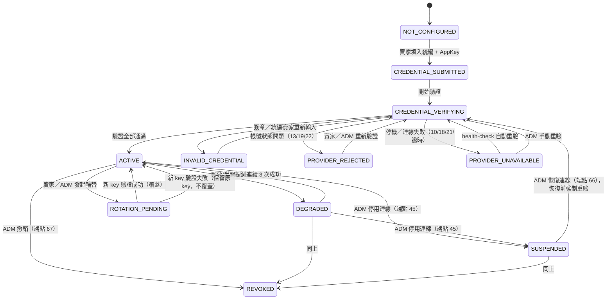

| # | 來源狀態 | 事件 | 目標狀態 | 守衛條件 | 副作用 |
|---|---|---|---|---|---|
| P01 | `NOT_CONFIGURED` | 賣家 `PUT /app/seller/invoices/provider_account/credentials` | `CREDENTIAL_SUBMITTED` | **必帶 `expectedVersion`**（見 §7.4 C-9）；**單一事務內寫齊** ciphertext／key_id／fingerprint／last4 | 稽核（不記明文） |
| P02 | `CREDENTIAL_SUBMITTED` | 驗證開始 | `CREDENTIAL_VERIFYING` | — | — |
| P03 | `CREDENTIAL_VERIFYING` | 三項全過 | `ACTIVE` | ① 簽章驗證通過（打 `ban_query` 故意傳物件，回 `code 23` 即證明簽章已過——最省成本的做法，§1.6）② 統編與 `sellerTaxId` 相符 ③ **`track_all`／`track_status` 至少一組可用字軌**（見下方註） | outbox `seller.invoice_provider.status_changed`；S03 允許設定 `automation_cutover_at` |
| P04 | `CREDENTIAL_VERIFYING` | `code 16`（簽章）／`code 12`（統編） | `INVALID_CREDENTIAL` | — | S03 顯示「憑證格式或內容錯誤」＋重新輸入 CTA |
| P05 | `CREDENTIAL_VERIFYING` | `code 13/19/22`（未啟用／停權／未申請 API） | `PROVIDER_REJECTED` | — | S03 顯示「請先於光貿後台完成開通」 |
| P06 | `CREDENTIAL_VERIFYING` | `code 10/18/21` 或逾時 | `PROVIDER_UNAVAILABLE` | — | 排入 health-check 自動重驗：`health_check_next_at = now() + 15min`，最多 24 小時 |
| P07 | `INVALID_CREDENTIAL` / `PROVIDER_REJECTED` / **`PROVIDER_UNAVAILABLE`** | 賣家於 S03 重新提交（端點 24／25）或 **ADM 於 A04 按「重新測試」（端點 44）** | `CREDENTIAL_VERIFYING` | `expectedVersion` CAS | 🔴 **這條邊不可省**：缺它 ⇒ CAS `rows=0` 靜默失敗、前端顯示成功而狀態沒變、賣家永遠串不上。⚠️ 端點 44 是一次**同步**驗證：P07 先推到 `CREDENTIAL_VERIFYING`，結果落地時走 P03／P04／P05／P06 其中一條。結果若仍是 `PROVIDER_UNAVAILABLE`，P06 把它推回原狀並重排 `health_check_next_at` ⇒ **淨效果就是 §6.1.13 定版 3 所說的「`status` 完全不動」**（那不是該賣家的設定問題，不可留下假的錯誤狀態），中間態不對外呈現 |
| P08 | `PROVIDER_UNAVAILABLE` | `INV.hc` health-check 排程 | `CREDENTIAL_VERIFYING` | **`health_check_next_at <= now`** 的 lease CAS（claim 當下推到 `now() + 120s`） | — |
| P09 | `ACTIVE` | 斷路器 open | `DEGRADED` | 見下方定義 | **job 停在 `RETRY_SCHEDULED` 不進 `SENDING`**；ADM A04 顯示「降級中」 |
| P10 | `DEGRADED` | 半開探測連續 3 次成功 | `ACTIVE` | — | — |
| P11 | `ACTIVE` | 發起輪替 | `ROTATION_PENDING` | 舊 key 仍保留 | — |
| P12 | `ROTATION_PENDING` | 新 key 驗證**成功** | `ACTIVE` | — | 覆蓋 ciphertext，舊 key 存入 `credential_history` |
| P13 | `ROTATION_PENDING` | 新 key 驗證**失敗** | `ACTIVE` | — | **保留原 key、不覆蓋**；S03 顯示輪替失敗原因 |
| P14 | `ACTIVE` / `DEGRADED` | ADM 停用連線（**端點 45**） | `SUSPENDED` | 必填 `reason` ＋ `confirmed=true` ＋ `expectedVersion` CAS；回應必須帶當下的未終態 job 數（`pendingOrderCount`，與判定同一交易讀出，見 §7.4 C-8） | 該 issuer 全部未終態 operation 轉 `FAILED_PERMANENT`（`cancel_reason_code=PROVIDER_SUSPENDED_BY_ADMIN`）＋ 各發一則 outbox `invoice.operation.review_required`；稽核；outbox `seller.invoice_provider.status_changed` |
| P15 | `SUSPENDED` | ADM 恢復連線（**端點 66**） | `CREDENTIAL_VERIFYING` | **恢復前強制重驗**，不得直接回 `ACTIVE`；必填 `reason`；`expectedVersion` CAS | 清空 `status_reason`；稽核；接著由 P03–P06 的驗證結果分流。**被 P14 打成 `FAILED_PERMANENT` 的那批 operation 不自動復活**——它們是 M2 的非終態，恢復後由 ADM 在 A06 逐筆按端點 52 安全重試（J18／J19）。自動復活會在憑證仍不對時再打一輪 AMEGO |
| P16 | `ACTIVE` / `DEGRADED` / `SUSPENDED` | ADM 撤銷（**端點 67**）：金鑰永久作廢／賣家離場 | `REVOKED` | 必填 `reason` ＋ `confirmed=true` ＋ 完整稽核 ＋ `expectedVersion` CAS。**不是雙人確認**——全案唯一的雙人機制是 §6 端點 54／55 的人工解鎖，理由與 M3 T14 逐字相同（多開兩支端點才做得出雙人，而 B4 定案是「強制填理由＋二次確認＋完整稽核」） | 來源若非 `SUSPENDED`，該 issuer 全部未終態 operation 一併按 P14 的處置轉 `FAILED_PERMANENT`；`automation_cutover_at` **保留不清空**（歷史訂單的模式判定要用它），新訂單一律 `LEGACY_MANUAL`；**釋放 `uq_ipa_fingerprint` 的名額**（該 partial 述詞不含 `REVOKED`）⇒ 同一組統編＋AppKey 可被新的 store-stint 重新綁定，這正是 §5 I-37 要求測到的第二向 |

**租約欄是 `health_check_next_at`，不是 `last_health_checked_at`。** 後者是**事實時間戳**（最後一次真的打了 AMEGO，§5.1.3 欄位註解逐字寫明），被 claim 推到未來就變成謊言——而它同時是「這個帳戶多久沒被檢查過」這條告警的來源。

**終態：`REVOKED`（唯一）。** `SUSPENDED` 有兩條出邊：**P15**（ADM 恢復連線 → `CREDENTIAL_VERIFYING`，端點 66）與 **P16**（ADM 撤銷 → `REVOKED`，端點 67）。「停用」可逆、「撤銷」不可逆，這個區分必須由狀態本身回答，因為 ADM 在 A04 按的是兩顆語意不同的按鈕。`REVOKED` 可達也是 `uq_ipa_fingerprint`（partial 述詞不含 `REVOKED`）的前提——賣家關店重開要靠它綁回同一組憑證（§5 I-37 第二向）。

**Phase 1 的停用只有一種處置（立即停用）**，沒有 `SUSPENDING` 狀態、沒有 `drain_started_at`／`drain_deadline`、沒有 `PROVIDER_DRAIN_TIMEOUT` 與 `SettleDrainedProviderAccounts`：① §6 端點 45 的 request 是 `{reason, confirmed, expectedVersion}`、58A A04 的五顆 CTA 都沒有「等既有 job 跑完再停用」的二選一；② 在途 job 被打成 `FAILED_PERMANENT` 之後不是終態（J18 有 ADM 出邊），DRAIN 只買到「不必按重試」；③ drain 期間憑證仍然可用，而按下停用最常見的兩個理由是「AppKey 外洩」與「賣家離場」。
**`automation_cutover_at` 的 CHECK 不綁 `status`**（§5.1.3 的 `chk_ipa_cutover_requires_verified` 綁 `verified_at` ＋ 不變式 I-61）：P16 明訂它**保留不清空**（歷史訂單的模式判定要用），而 P15 與其下游 P04／P05／P06 會把狀態帶到任何白名單之外 ⇒ 綁狀態的版本在那幾條邊上一律 23514。表名以 §5 為準：**`invoice_provider_accounts`**（以 `issuer_id` 為鍵，不綁 `store_id`）。

**`DEGRADED` 的三個條件（一起寫才有意義）**

| 項目 | 定義 |
|---|---|
| 進入 | **per-store 斷路器**：該 `store_id` 連續 5 次 AMEGO 呼叫失敗（分類為 `RETRYABLE` 或逾時）⇒ open。**全域斷路器**另計：全服務 60 秒滾動窗口內失敗率 ≥ 50% 且樣本 ≥ 20 ⇒ 全域 open（對應 `code 10 停機維護` 這種所有賣家一起壞的情況） |
| 離開 | open 持續 60 秒 → half-open；half-open 連續 3 次成功 → closed 並回 `ACTIVE`；half-open 任一失敗 → 回 open 且冷卻加倍（上限 15 分鐘） |
| 期間行為 | operation **停在 `RETRY_SCHEDULED`，不進 `SENDING`**（worker 在 `Claim` 之前先問斷路器）。**不影響賣家出貨**；全域 open 時 ADM A04 顯示「AMEGO 服務降級中，已暫停 N 筆開票」 |

參數形態沿用 `pkg/sms` 的 gobreaker 慣例（連 5 敗開路／冷卻／半開 3 探測），但**冷卻期從 10 秒放寬到 60 秒**：`pkg/sms` 面對的是人在等的簡訊，發票是背景批次，且 AMEGO 已公告過長達 4 小時的維護窗。

**「至少一組可用字軌」是 `ACTIVE` 的必要條件（P03 第三項）。** 財政部平台授權光貿 ＋ 自有字軌是**法定前置**。少了這一項檢查，賣家會通過 S03 的全部檢查、S03 顯示綠色「已啟用」、然後每一筆開票都回 `3040111` 字軌不足——那是重試多久都不會好的錯誤，而失敗高峰正好落在期初。

#### 7.3.5 M5 買家申訴（`InvoiceComplaintStatus`）

> 兩份 UI 分頁（S09「待處理／已回覆／已結案」vs A07「等待賣家／賣家已回覆／ADM 待判斷／逾期／已結案」）是**對本組狀態的查詢視圖**，不是狀態本身。

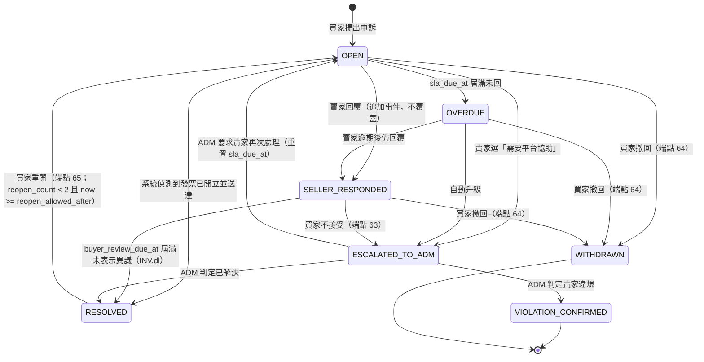

| # | 來源狀態 | 事件 | 目標狀態 | 守衛條件 | 副作用 |
|---|---|---|---|---|---|
| K01 | `[*]` | 買家提出申訴 | `OPEN` | ① 該 `order_no` 無非終態申訴（**重複申訴導向既有案件**，`UNIQUE(order_no) WHERE status NOT IN (終態)`）② **同一 document 已 `WITHDRAWN` 的案件數 < 2**（見 K11 下方的紅字；不成立回 9336） | `sla_due_at = 建立時刻起算 3 個工作天`（見下）；outbox **`invoice.complaint.created`（→ 通知賣家）** |
| K02 | `OPEN` / `OVERDUE` | 賣家回覆 | `SELLER_RESPONDED` | 回覆採**追加事件**寫 `invoice_complaint_events`，不覆蓋前次 | outbox **`invoice.complaint.responded`（→ 通知買家）**；`buyer_review_due_at = now() + 72h` |
| K03 | `OPEN` | 賣家選「需要平台協助」 | `ESCALATED_TO_ADM` | 必填說明 | outbox；ADM A07「ADM 待判斷」分頁 |
| K04 | `OPEN` | `sla_due_at <= now`（`INV.dl` 掃描） | `OVERDUE` | — | `overdue_at = now`；outbox `invoice.complaint.overdue`；**只發一次**（由 `overdue_at IS NULL` 守衛，**不是**靠旗標——`OVERDUE` 是狀態轉移本身，天然只發生一次） |
| K05 | `OVERDUE` | `INV.dl` 二次掃描 | `ESCALATED_TO_ADM` | `now >= overdue_at + 24h` | 自動升級 |
| K06 | `SELLER_RESPONDED` | `buyer_review_due_at <= now`（`INV.dl` 掃 `idx_invcomp_buyer_review_due`，5 分鐘週期） | `RESOLVED` | 集合式 UPDATE、無外部副作用 ⇒ **不需要 claim**（第二個副本 `rows=0`），形態同 `ReleaseExpiredInvoiceOperationHolds` | `resolved_at = now`；`reopen_allowed_after = now() + 24h`。⚠️ **這是 K06 唯一的觸發者**——「買家主動確認」那半條 Phase 1 不開端點，裁決見下方逐條表 |
| K07 | `SELLER_RESPONDED` | **買家不接受（端點 63 `POST .../rejections`）** | `ESCALATED_TO_ADM` | 必填理由；狀態 CAS 即隱含 `buyer_review_due_at > now`（逾期後該列已被 K06 推走） | — |
| K08 | `ESCALATED_TO_ADM` | ADM「判定已解決」 | `RESOLVED` | `expectedVersion` CAS；必填理由 | **`resolved_at = now`**；`reopen_allowed_after = now() + 24h`；稽核 |
| K09 | `ESCALATED_TO_ADM` | ADM「判定賣家違規」 | `VIOLATION_CONFIRMED` | 同上 | **`resolved_at = now`**（見下方）；**同一事務內**跑下方「違規計數與停權」的門檻判定（即時 `COUNT`，**不維護計數器欄位**）；命中門檻 ⇒ 回應帶 `recommendation` 物件 ＋ 寫稽核，**不寫任何停權狀態** |
| K10 | `ESCALATED_TO_ADM` | ADM「要求賣家再次處理」 | `OPEN` | 同上 | **重置 `sla_due_at`**；`overdue_at = NULL` |
| K11 | `OPEN` / `OVERDUE` / `SELLER_RESPONDED` | **買家撤回（端點 64 `POST .../withdrawals`）** | `WITHDRAWN` | `expectedVersion` CAS。**無必填理由**——強制買家為「我開錯單了」寫一段話只會逼出一堆 `.`（同 §6 端點 64 的定版） | **不寫 `resolved_at`**（`chk_invcomp_resolved_pair` 只綁 `RESOLVED`／`VIOLATION_CONFIRMED` 兩值，撤回不在其中）；**不計入 C1 違規計數**；append 一列 `invoice_complaint_events`（`event_type='WITHDRAWN'`、`action` 為 NULL） |
| K12 | `OPEN` | 系統偵測到該訂單發票已 `ISSUED` 且通知已送達 | `RESOLVED` | — | **`resolved_at = now`**；`reopen_allowed_after = now() + 24h`；自動結案並通知買家 |
| K13 | `RESOLVED` | **買家重開（端點 65 `POST .../reopenings`）** | `OPEN` | `reopen_count < 2` **且** `now >= reopen_allowed_after`（§5.1.13 的欄位；值 ＝ 進 `RESOLVED` 當下的 `now() + 24h`） | **`resolved_at = NULL`**（守衛讀的是轉移前的舊值，同一句 UPDATE 內清空）；`reopen_count += 1`；重置 `sla_due_at` |

**終態兩個**：`VIOLATION_CONFIRMED`、`WITHDRAWN`。`RESOLVED` **不是終態**（有 K13 重開邊）。買家發起的三條轉移各有專屬端點：K07 ＝ 端點 63（`rejections`）、K11 ＝ 端點 64（`withdrawals`）、K13 ＝ 端點 65（`reopenings`）；**K06 只有自動半條**（`buyer_review_due_at <= now`），Phase 1 不開「買家主動確認結案」端點。三支端點的守衛不成立一律回 **9336**，越權與查無 **9309**，版本不符 **9322**，碼表不新增。

**K11 的配額：撤回不是免費的重來鍵。** `WITHDRAWN` 不在 `uq_invcomp_open_per_document` 的述詞內 ⇒ 撤回之後可以對同一份 document 重新申訴（這正是「誤開案」要的行為），但它同時是一條繞過 `reopen_count ≤ 2` 上限的路。⇒ 守衛放在 **K01 的守衛②**：同一 document 已 `WITHDRAWN` 的案件數 **< 2**，不成立回 9336。守衛放在建案端（可數、可回明確業務碼），**不放在唯一索引**（只回 23505，前端分不出是重複申訴還是撤回額度用盡）；也不把 `WITHDRAWN` 補進唯一索引述詞（那會讓撤回等於永久封鎖該文件的申訴管道）。

**欄位對應**（§5.1.13）：`sla_due_at`（NOT NULL，K01 當場算出）／`overdue_at`（K04 寫、K10 清空）／`buyer_review_due_at`（K02 寫 `now()+72h`）／`reopen_allowed_after`（K06／K08／K12 進 `RESOLVED` 時一併寫 `now() + 24h`，K13 的守衛讀它）／`reopen_count`（`chk_invcomp_reopen` 限 0–2）。`InvoiceComplaintEventType` 為 **7 值**（無 `BUYER_REPLY`）：端點 63 ⇒ `ESCALATED`、64 ⇒ `WITHDRAWN`、65 ⇒ `REOPENED`，三者的 `action` 欄一律 NULL（`InvoiceComplaintAction` 6 值是「賣家／ADM 在畫面上點了哪一顆」，買家的動作不進那個軸）。

**`resolved_at` 是 CHECK 的一半**：`chk_invcomp_resolved_pair` 逐字要求 `("status" IN ('RESOLVED','VIOLATION_CONFIRMED')) = ("resolved_at" IS NOT NULL)` ⇒ **進出這兩個狀態的四條邊都必須在同一句 UPDATE 內寫它**：K06／K08／K12（進 `RESOLVED`，`= now`）、K09（進 `VIOLATION_CONFIRMED`，`= now`）、K13（離開 `RESOLVED`，`= NULL`）。
**不設 `REOPENED` 狀態**（它與 `OPEN` 的行為完全相同，`reopen_count > 0` 已足以在 UI 標示「二次申訴」）；**但 `OVERDUE` 必須是狀態而不是衍生屬性**——它要承載 `overdue_at`、要觸發 `invoice.complaint.overdue`、要當 K05 自動升級的計時起點；做成 `sla_due_at < now` 的衍生述詞，事件會每次掃描都重發一次，而修法多半是加一個 `overdue_notified = true` 旗標，那正是《多副本排程搶佔規範》禁止的永久旗標。

**違規計數與停權（決策 C1／C2 的落點分在兩個服務）**

**發票模組不寫入任何停權狀態。** 《賣家能力權限層規範》要求「這個賣家能不能做這件事」只有一個問答點，而停權狀態的權威是 seller 模組的措施；發票模組另開一套倒數 ⇒ 兩份狀態、兩個時鐘，ADM 在一邊解除另一邊還鎖著。invoice-service 只負責判定與建議：

| 項目 | 規則 |
|---|---|
| **計數口徑** | 只計 `status='VIOLATION_CONFIRMED'`，且**以去重後的訂單數計、不以案件數計**（否則買家自己就能把賣家送進停權）。查詢 ＝ §5 的 `CountConfirmedViolationOrders`（`COUNT(DISTINCT order_no)` **寫死在 SQL 裡**） |
| **窗口** | **滑動窗，查詢當下即時算**：`resolved_at >= now() - (violation_window_days \|\| ' days')::interval`。**不得**維護 `violation_count` 計數器欄位——計數器需要有人在窗口滑出時遞減（那就是禁止的 reconciliation job），而不遞減的計數器會讓賣家一輩子累積 |
| **判定時點** | 只在 K09 的**同一事務內**判定一次。**不另設掃描器**：沒有新的違規就不可能新跨過門檻 |
| **參數來源** | `seller_tax_profiles` 的 `violation_window_days`（90）／`violation_threshold`（3）／`suspension_days`（14）三欄，逐賣家可調；`suspension_days` 只是**建議值**（餵給 `suggestedSuspendDays`），本服務不對它倒數 |

K09 命中門檻時**只做兩件事**（同一事務、全部只寫本地）：① 寫一列稽核（`invoice_status_history`，`subject_type='COMPLAINT'`），`reason_detail` 帶上當下的窗口計數與門檻值——滑動窗即時算 ⇒ 一個月後重跑同一句 SQL 會得到不同答案，這是事後重建「當時為什麼建議停權」的唯一依據；② A08 的 `DECIDE_VIOLATION` 回應帶 `recommendation` 物件（形狀由 §6.1.16 定死）。**沒有第三件**：不蓋 `suspended_at`、不發停權事件、不排恢復 job。

| 決策 | 執行者（全在 `SEL`） | 為什麼是它 |
|---|---|---|
| **停權（C1）** | 賣家治理模組的 `CreateMeasure`（停權措施）：A08 的建立措施對話框送出，依據認定的停權必填結束時間（管理員依 `suggestedSuspendDays` 決定） | 結束時間由措施本身持有 ⇒ 14 天在措施層就被守住 |
| **14 天自動恢復（C2 前半）** | 賣家治理模組停權措施的到期 job：結束時間到了自動結束措施並重算停權狀態 | 已經有人在做這件事，invoice-service 不得再寫一支 |
| **期間可提前申請（C2 後半）** | 賣家治理模組既有的申覆與撤銷：賣家 `SubmitAppeal`（每個措施一次）→ 後台 `DecideAppeal`／`RevokeMeasure` | 申覆、限一次的守衛、ADM 裁定與提前解除全部已存在 |

兩件事都不在 invoice-service：① 認定的類別是平台共用的政策分類 `PolicyCategory`（十三個值，認定可用 12 個、沒有「其他」），**沒有發票相關的值** ⇒ A08 的建立措施對話框不預填類別，由管理員選最接近、有賣家條款依據的類別，ADM 清單分不出發票類違規；要加值是賣家治理模組的決策（見 58A 的 X-a）；② 停權通知由賣家治理模組的措施事件（`MeasureCreated` 等）觸發，送達是 notification 的工作 ⇒ `seller.invoice_capability.suspended`／`.restored` 兩個事件**不建立**。

**停權不影響既有訂單的履約與開票。** `INV.op` 的候選述詞完全不看賣家有沒有被停權（它根本不讀賣家的停權措施）——停權只擋「接新單」。讓被停權的賣家開不出票，等於把對賣家的懲罰轉嫁給無辜的買家。同理，違規判定與停權都**不是 M3 的狀態轉移**：`review_status` 全程不變（被停權的賣家仍然是 `APPROVED_INVOICE_REQUIRED`），否則 7.1.3 決策樹只認 `APPROVED_*` 走 `AMEGO_AUTO`，停權賣家的既有訂單會在停權當下全部變成開不出票。§5.5 **I-57** 把「本服務不持有賣家停權狀態、也不對停權倒數」寫成有測試守護的不變式。

**「3 個工作天」的定義（本節唯一的計算點）**

| 項目 | 規則 |
|---|---|
| 曆制 | 中華民國政府行政機關辦公日曆表：扣週六、週日與國定假日；**不扣颱風假**（颱風假逐縣市即時公告、無可靠 API，且會讓 SLA 在不同縣市的賣家之間不一致）。個案由 **ADM 手動延長 `sla_due_at`**，不改曆算法 |
| 起算 | 申訴建立時刻的**次一個工作日 00:00（Asia/Taipei）** |
| 產出 | 後端算出 `sla_due_at`（絕對 UTC 時刻）與 `remaining_business_days`，**一起回給前端；前端禁止自行推算**。`SlaCountdown` 是三個 repo 共用的元件：前端若自己算（扣週末）、後端用行事曆表（扣國定假日），同一張案件會在 Seller Web 顯示「剩 1 天」、在 ADM 顯示「已逾期」——而逾期會觸發違規計數，違規計數會導致停權 |
| 資料源 owner | **shipping-service 的 `holidays`**（`services/java/shipping-service/src/main/resources/db/migration/V1__init_shipping_tables.sql:403-418`，表註解逐字「行政院人事行政總處 CSV 匯入」；程式 `HolidayEntity`／`HolidayMapper`／`HolidayService`），**不新建第二份行事曆**——兩份不一致的那一天就是上一列描述的事故 |

**接法三件，缺一不可**：① 資料源 owner 不搬，invoice-service 不建立自己的 seed migration；② 新增內部 RPC `GetHolidaysInternal(from_date, to_date) → repeated date`（既有的 `ListBusinessDays` 是 App 面的，`ListBusinessDaysRequest` 只有 `account_id`、**沒有日期區間**，`api/proto/shipping/shipping.proto:844-846`），走 52 號 HMAC 內部授權四 header、deadline 3s；③ 算式放共用純函式 `pkg/bizcalendar.AddBusinessDays(start, n, holidays)`（不碰 DB、不碰網路），資料放本地**唯讀鏡像** `invoice_business_day_mirror`（§5.1.14，兩欄 `holiday_date date PRIMARY KEY`／`synced_at timestamptz NOT NULL`），由 `INV.gov` 每日同步「今天 −30 天 ~ +400 天」、**同一交易內整段 `DELETE + INSERT`**、失敗即整段不覆蓋。要鏡像而不是每次現打的理由：K01 建案是買家的**同步 HTTP 路徑**，`sla_due_at` 必須當場算出來（§5 該欄 `NOT NULL`），掛在 shipping-service 的可用性上 ⇒ shipping 一抖買家就送不出申訴。
**鏡像缺口的方向必須是「偏晚」**：人事行政總處通常在前一年 8–9 月才公布次年行事曆 ⇒ 涵蓋不到的區間是常態不是例外。**未涵蓋的日期一律視為假日（不計入工作天）**，並以「起算日 + 14 自然日」為硬上限，同時發 `invoice_business_calendar_stale` 告警（來源 ＝ `max(synced_at)`）。已建案件的 `sla_due_at` **不因鏡像後續補齊而回頭改寫**，個案調整一律走 ADM 手動延長。

#### 7.3.6 M6 付款後修改請求（`InvoiceCorrectionStatus`）

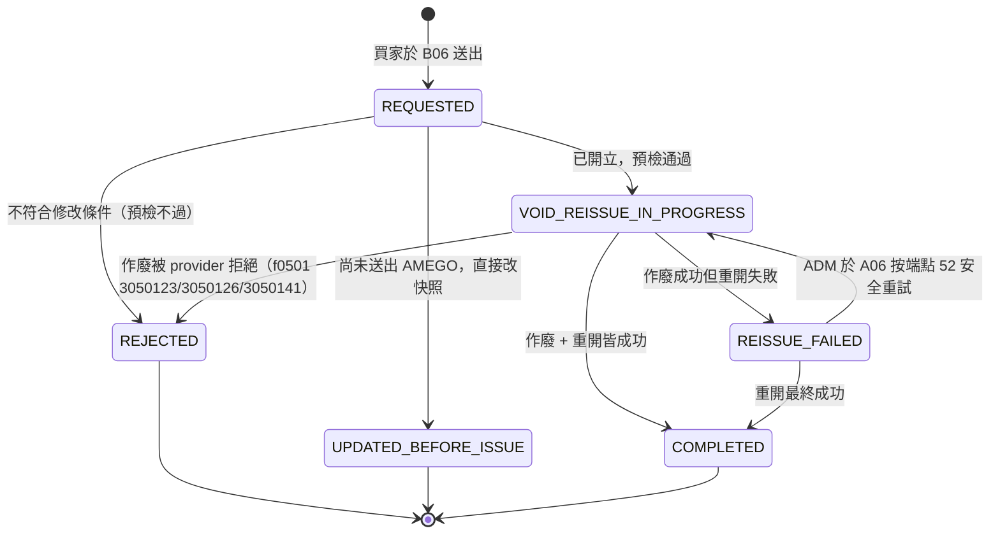

| # | 來源狀態 | 事件 | 目標狀態 | 守衛條件 | 副作用 |
|---|---|---|---|---|---|
| R01 | `[*]` | 買家送出 | `REQUESTED` | **序列閘門**：本 document 無任何非終態的 VOID／REISSUE／ALLOWANCE operation；`expectedSnapshotVersion` CAS | 寫前後快照 |
| R02 | `REQUESTED` | 預檢不過 | `REJECTED` | 理由碼 ∈ {`ALREADY_REPORTED`, `PAST_VOID_DEADLINE`, `ALLOWANCE_EXISTS`, `TRACK_INSUFFICIENT`, `CARRIER_INVALID`, `PROVIDER_UNAVAILABLE`} | B06 顯示**後端給的具體理由**，不由前端猜期限 |
| R03 | `REQUESTED` | operation 仍可被 `HELD` | `UPDATED_BEFORE_ISSUE` | `HELD` CAS `rows=1` | 呼叫 **`ORD.ReviseOrderInvoiceSnapshotInternal`（§6.2.5）取得新的 `snapshot_version`**（本服務不得自行 +1，見 I-50）；重建 lines；operation 指向新版 |
| R04 | `REQUESTED` | 預檢通過且 document 已 `ISSUED` | `VOID_REISSUE_IN_PROGRESS` | **先確保可開再作廢**（字軌餘量 ＋ 載具有效 ＋ 期限內 ＋ 無既存折讓） | `correction_version += 1`；建 VOID operation |
| R05 | `VOID_REISSUE_IN_PROGRESS` | `f0501` 回 `3050123`／`3050126`／`3050141`（作廢被 provider 拒絕） | **`REJECTED`** | — | 寫 `reject_reason_code`（三碼一一對映，見下方）；原 document 由 M1 的 `VOIDING → ISSUED` 回到 `ISSUED`（**買家手上那張仍然有效**）；outbox `review_required`（severity=MEDIUM）；**釋放 `uq_invcorr_open_per_document` 的名額** ⇒ 買家可另提一次修改請求 |
| R08 | `VOID_REISSUE_IN_PROGRESS` | 作廢成功、重開 operation 進入任一 FAILED_* | **`REISSUE_FAILED`** | — | 見下方 |
| R09 | `REISSUE_FAILED` | **ADM 於 A06 對該 correction 的 REISSUE operation 按端點 52 安全重試**（M2 的 J18／J19），operation 回 `READY` 的**同一事務內**連動本列 | 該 operation 通過端點 52 的「可安全重試」判定（`status ∈ {FAILED_PERMANENT, RETRY_SCHEDULED, READY}` 且冪等鍵在 provider 端已確認未產生任何文件） | 稽核。⚠️ **沒有第二個觸發者**——本狀態不設自動重試排程：`REISSUE_FAILED` 代表「原票已作廢、新票不存在」，自動重送可能開出第二張 |
| R10 | `VOID_REISSUE_IN_PROGRESS` / `REISSUE_FAILED` | 新 document 轉 `ISSUED` | `COMPLETED` | 原 document 已轉 `SUPERSEDED` | **`completed_at = now`**（§5 `invoice_correction_requests.completed_at`；**本列是它唯一的寫入者**——本表只有 R10 以 `COMPLETED` 為目標）；outbox `invoice.reissued`（→ 通知買家） |

**終態**：`REJECTED`、`UPDATED_BEFORE_ISSUE`、`COMPLETED`。**共 8 條 live 轉移（R01–R05、R08–R10）**，值域無 `VOID_FAILED`——作廢被拒是一個**可自動判定的終局**，R05 直接落 `REJECTED` 並寫 `reject_reason_code`，AMEGO 回的三個碼各自對應一個已存在的拒絕理由：

| `f0501` 回應碼 | 意義 | `reject_reason_code`（§5 7 值之一） |
|---|---|---|
| `3050123` | 指定發票號碼**已存在註銷**（AMEGO 官方碼表逐字；註銷 ≠ 作廢，後者是 `3050122`，我方視為成功等價） | **`PROVIDER_STATE_CONFLICT`** |
| `3050126` | 已逾可作廢期限 | **`PAST_VOID_DEADLINE`** |
| `3050141` | 該張發票已存在折讓 | **`ALLOWANCE_EXISTS`** |

R05 寫的三個值與 R02（送出當下的預檢）**不完全重疊**：`PAST_VOID_DEADLINE` 與 `ALLOWANCE_EXISTS` 兩邊都寫，差別只在**發現的時點**（預檢時 vs 送出後 AMEGO 才說），買家看到的答案是同一句；而 `ALREADY_REPORTED` **只有 R02 寫**（`ReportedStatus` 是純函式，我方依期別自己算得出來，沒有對應的 AMEGO 錯誤碼），`PROVIDER_STATE_CONFLICT` **只有 R05 寫**。⚠️ **`3050123` 的碼義是「已存在註銷」不是「已申報」**（AMEGO 官方碼表與 `amego/codes.go` 皆然）——碼義不是我方能定義的，對應到第 7 值，**不得改對應 `ALREADY_REPORTED`**。買家看得到理由：`InvoiceCorrectionResponse` 帶 `rejectReasonCode`（§6.1.5），少了那一欄則 `reject_reason_code` 的 6 值全是只寫不讀的死欄、B06 只能顯示「已拒絕」四個字。R05 的同一事務內，M1 由 `VOIDING` 回到 `ISSUED`——**買家手上那張憑證仍然有效**，只是內容改不了。
`completed_at`（R10 是它唯一的寫入者）**不進任何 DTO、也不是查詢入口**，它是結案時間的稽核欄；買家面的進度一律讀 `status` ＋ §6.1.5 的 `statusNotice`。要拿它做畫面欄或篩選軸，得先在 §6 開 DTO 欄。「改走折讓 ＋ 重開」不是 Phase 1 的功能（真的需要折讓時走 G01 的既有路徑，不是把 correction 掛上去）。

**`REISSUE_FAILED` 是本設計書中最嚴重的單一狀態。** 事實是：**買家原本持有的合法發票已經作廢，新發票不存在，而這是平台的操作造成的**——買家的公司報帳因此少一張進項憑證。處置四件事，缺一不可：① **獨立的最高優先佇列**（A06 需要一個獨立的「無憑證」分頁，不與一般 `review_required` 混同）；② **獨立 SLA**：進入該狀態後 **15 分鐘**觸發告警（一般 `review_required` 是 1 小時），並直接推 Discord／PagerDuty 等級；③ **立即通知買家**，文案必須明說「原發票已作廢、新發票開立中，預計 X 前完成」，不得沿用「處理中」的通用文案；④ **機械保證**：`INV.dl` 每 5 分鐘掃一次 I8。它**不設自動重試排程**（R09 只有 ADM 端點 52 這一個觸發者）——自動重送可能開出第二張。

**順序必須是「先確保可開再作廢」。** 作廢不可逆（且明令不可用 DB restore 把 `ISSUED` 回復為未開立）。預檢把「字軌不足」「載具失效」「已過修改期限」「已存在折讓」四類**可預先判定**的失敗擋在作廢之前，`REISSUE_FAILED` 就只剩「預檢通過後 AMEGO 才壞掉」這一種殘餘機率；預檢不過就整個請求 `REJECTED`、原發票留著。

#### 7.3.7 M7 稅務調整（`InvoiceAdjustmentStatus`）

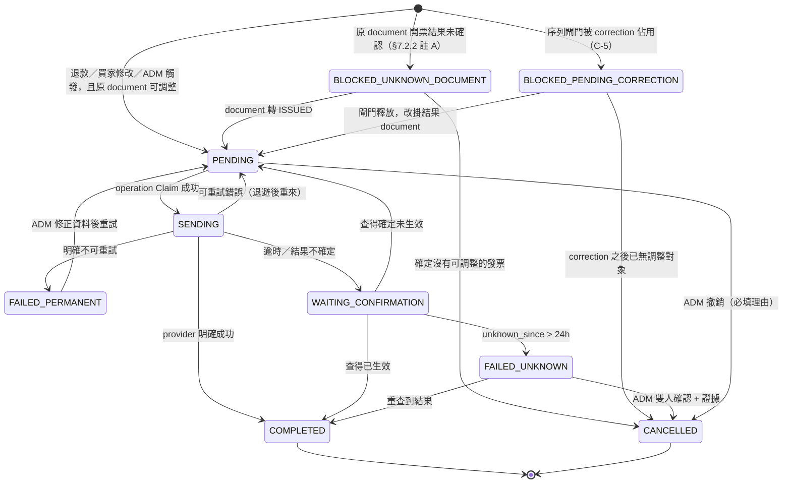

| # | 來源狀態 | 事件 | 目標狀態 | 守衛條件 | 副作用 |
|---|---|---|---|---|---|
| G01 | `[*]` | 退款終態（`refund.completed` 消費）／買家修改（M6 R04）／**ADM 於 A13 文件詳情按「作廢」或「折讓」**（端點 48 的動作列，走端點 53 的反向：建 adjustment ＋ operation） | `PENDING` | §7.2.2 可調整性判定通過；`(document_id, refund_no)` 唯一鍵未被佔用 | 建 `invoice_adjustment_lines`；建對應 operation（`VOID`／`ALLOWANCE`／`VOID_ALLOWANCE`）並在**同一交易內 Promote 到 `READY`** —— 🔴 `Create` 落在 `CREATED`，而 INV.op 的候選述詞是 `status IN ('READY','RETRY_SCHEDULED','SENDING')`，漏了這一步該筆調整**沒有任何執行者**且完全無聲 |
| G02 | `[*]` | 同上，但原 document 開票結果未確認 | `BLOCKED_UNKNOWN_DOCUMENT` | §7.2.2 註 A 的述詞為真 | **不建 operation**；把該 ISSUE operation 的 `next_attempt_at` 提前到 `now`。🔴 **這一格的 `BLOCKED_UNKNOWN_DOCUMENT` 建不出來，退款路徑一律走退避重試**：`chk_invadj_allowance_shape` 要求 ALLOWANCE 一律帶齊 `allowance_number`／`allowance_date_taipei` ＋ 三個金額欄，而本格的觸發條件正是「原發票還沒開出來 ⇒ 那六欄算不出來」⇒ 該列撞 CHECK。實作走 **inbox FAILED ＋ INV.dl 的 3 次 ＋ 6 小時停泊**（`usecase/refund_adjustment.go` 的 `refundPlanRetryLater`）。`BLOCKED_UNKNOWN_DOCUMENT`／`BLOCKED_PENDING_CORRECTION` 兩值**留在 `chk_invadj_status` 值域內（保留、目前無寫入路徑）**，G04–G07／G19 的 query 一併保留——刪值會讓那些 query 指向不存在的狀態。另：「把 ISSUE operation 的 next_attempt_at 提前」對註 A 的四個狀態**沒有效果**——它們都不在 INV.op 的候選集合裡 |
| G03 | `[*]` | 同上，但序列閘門（I5）已被 correction 佔用 | `BLOCKED_PENDING_CORRECTION` | 該 document 存在非終態且來源為 correction 的 `VOID`／`REISSUE` operation | **不建 operation**；B06 顯示「此訂單有處理中的調整」。🔴 **與 G02 同因**（同一個 CHECK 擋住）：本列不建 adjustment，退款路徑走退避重試 |
| G04 | `BLOCKED_UNKNOWN_DOCUMENT` | document 轉 `ISSUED` | `PENDING` | **在 document 轉態的同一事務內執行**（不是掃描器，見下方 ⚠️） | 建 operation |
| G05 | `BLOCKED_UNKNOWN_DOCUMENT` | document 轉 `CANCELLED_BEFORE_ISSUE`／`NOT_APPLICABLE`／`RESOLVED_EXTERNALLY` | `CANCELLED` | 同上（同一事務） | `cancel_reason_code = NO_DOCUMENT_TO_ADJUST`；**退款本身不受影響**（錢已經退了，只是沒有發票要調整）；outbox 通知 ADM |
| G06 | `BLOCKED_PENDING_CORRECTION` | correction 進終態（`COMPLETED`／`REJECTED`／`UPDATED_BEFORE_ISSUE`） | `PENDING` | 同一事務內；**`document_id` 改指向 correction 之後真正生效的那張 document**（重開成功 ⇒ 新件；`REJECTED` ⇒ 原件） | 建 operation。折讓必須掛在**生效中**的發票上——掛在即將作廢的舊件上是無效憑證 |
| G07 | `BLOCKED_PENDING_CORRECTION` | correction 之後已無可調整的發票 | `CANCELLED` | 同一事務內 | 同 G05 |
| G08 | `PENDING` | operation `Claim` 成功 | `SENDING` | — | — |
| G09 | `SENDING` | `code=0`（或 `3050122`／`4050132` 視同成功） | `COMPLETED` | 折讓 ⇒ `allowance_number` 送出前已落庫 | 同一事務累加 `invoice_documents.allowance_total_amount`（I4 的單句 CAS）；作廢 ⇒ document → `VOIDED`；outbox |
| G10 | `SENDING` | 錯誤分類 = `PERMANENT` | `FAILED_PERMANENT` | — | outbox `review_required`（severity=MEDIUM） |
| G11 | `SENDING` | 錯誤分類 = `RETRYABLE` | `PENDING` | — | 退避表達在 operation 的 `next_attempt_at` 上，adjustment 只回到 `PENDING` |
| G12 | `SENDING` | 逾時／結果不確定 | `WAITING_CONFIRMATION` | — | `unknown_since = now`（記在 operation 上） |
| G13 | `WAITING_CONFIRMATION` | `allowance_query`／`invoice_query` 查得已生效 | `COMPLETED` | — | 同 G09 |
| G14 | `WAITING_CONFIRMATION` | 查得確定未生效 | `PENDING` | — | 可安全補送，**單號不換**（§7.2.2 細節 5） |
| G15 | `WAITING_CONFIRMATION` | `now − unknown_since > 24h` | `FAILED_UNKNOWN` | — | outbox `review_required`（severity=HIGH） |
| G16 | `FAILED_PERMANENT` | **ADM 於 A06 對該 adjustment 的 operation 按端點 52 安全重試**（M2 J18），operation 回 `READY` 的同一事務內連動 | `PENDING` | `expectedVersion` CAS ＋ 必填理由 | 稽核 |
| G17 | `FAILED_UNKNOWN` | 重查到結果 | `COMPLETED` | — | 同 G09 |
| G18 | `FAILED_UNKNOWN` | **ADM 雙人確認 ＋ 證據（端點 54 發起 → 端點 55 覆核）**，該 operation 走 M2 J28 的同一事務內連動 | `CANCELLED` | 兩個 actor 不同；至少一項 `evidence_kind` | 稽核（兩個 account_id 都記） |
| G19 | `PENDING` / `BLOCKED_UNKNOWN_DOCUMENT` / `BLOCKED_PENDING_CORRECTION` | **ADM 於 A06 按端點 53 受控取消**（`reasonCode=ADM_MANUAL`），該 operation 走 M2 J21 的同一事務內連動；`BLOCKED_*` 兩態尚未建 operation ⇒ 直接改 adjustment | `CANCELLED` | `expectedVersion` CAS ＋ 必填理由 | 稽核；§5 的 `uq_invadj_*` 都排除 `CANCELLED` ⇒ 唯一鍵同時被釋放 |

**終態**：`COMPLETED`、`CANCELLED`。`FAILED_PERMANENT` 與 `FAILED_UNKNOWN` 不是終態（各有 ADM 出邊），理由與 M2 的三個 `FAILED_*` 相同。值域 SSOT ＝ §5 `chk_invadj_status`（**9 值**），另有 `chk_invadj_blocked_reason`（`FAILED_PERMANENT` ⇒ `blocked_reason_code` 非空）；`idx_invadj_status` 的部分索引述詞必須含 `BLOCKED_UNKNOWN_DOCUMENT`／`BLOCKED_PENDING_CORRECTION` 兩值——少了索引不會報錯，只會讓 ADM 的在途／異常清單永遠看不到被凍結的那些。

**喚醒（G04／G06）發生在「閘門釋放的那個事務」裡，不是靠掃描器。** 正解：`document → ISSUED` 與 `correction → 終態` 這兩個轉移的 transition helper，在**同一事務內**把該 document 底下 `status LIKE 'BLOCKED_%'` 的 adjustment 一併推進。`INV.dl` 只保留唯讀偵測——命中即代表同事務喚醒漏了，那是 bug 不是待辦：

```sql
-- 只偵測、不修復（《後端服務責任邊界規範》）。命中即代表上面那兩條同事務喚醒漏了 —— 那是 bug，不是待辦。
SELECT count(*) FROM invoice_adjustments
WHERE status IN ('BLOCKED_UNKNOWN_DOCUMENT', 'BLOCKED_PENDING_CORRECTION')
  AND updated_at < now() - interval '30 minutes';
```

#### 7.3.8 跨狀態機的不變式（每一條都要有機械保證）

| # | 不變式 | 保證方式 |
|---|---|---|
| I1 | `fulfillment_mode='AMEGO_AUTO' AND status='ISSUED'` ⇒ `provider_invoice_no` 非空 | DB CHECK `chk_invdoc_issued_has_no` |
| I2 | `fulfillment_mode IN ('SELLER_SELF_ISSUE','LEGACY_MANUAL')` ⇒ `status IN ('NOT_APPLICABLE','RESOLVED_EXTERNALLY','CANCELLED_BEFORE_ISSUE')` 且 `provider_invoice_no IS NULL` | DB CHECK `chk_invdoc_self_issue`。**第三個值不可省**：這兩種模式的訂單一樣會被全額退款／取消。刻意**不**放行 `VOIDED`／`ISSUED`——平台沒開過的票，平台也作廢不了 |
| I3 | `status='RESOLVED_EXTERNALLY'` ⇒ `external_invoice_no` 非空 **且** `provider_invoice_no IS NULL` | DB CHECK（同時是「平台不冒充開立人」的技術落實） |
| I4 | 同一 document 的累計 ALLOWANCE 金額 ≤ `total_amount` | 累計欄 ＋ 單句 CAS（**不可用「先查再寫」**）＋ BEFORE trigger 兜底，形態照抄 `services/java/payment-service/.../V2__add_refund_total_amount_guard.sql:15-73` |
| I5 | 一個 document 同時最多一個非終態的 `VOID`／`REISSUE`／`ALLOWANCE`／`VOID_ALLOWANCE` operation | partial UNIQUE `uq_invop_open_adjustment_per_document`（§5.1.8）：`UNIQUE(document_id) WHERE operation_type IN ('VOID','REISSUE','ALLOWANCE','VOID_ALLOWANCE') AND status NOT IN ('SUCCEEDED','NOT_APPLICABLE','CANCELLED_BEFORE_ISSUE','RESOLVED_EXTERNALLY','CANCELLED_BY_ADMIN')`。排除清單五值，`CANCELLED_BY_ADMIN` 不可漏（ADM 取消的語意正是「這一筆不算了」）；`operation_type` 清單必須逐字等於 7.3.0 規則 1 的六值減掉 `ISSUE`／`QUERY`。**否定述詞是刻意的**（未來新增的任何狀態預設都佔名額 ＝ 安全側）。契約測試：對每一個非 `ISSUE`／`QUERY` 的 `operation_type` 各插兩列，斷言第二列**都**被 DB 拒絕 |
| I6 | `operation.status='SUCCEEDED'` ⇒ 對應 document 已離開 `PENDING`／`ISSUING` | 契約測試（跨表，DB 約束表達不了） |
| I7 | 每一次 status 轉移都有一列 `invoice_status_history` | transition helper 是唯一寫入點 ＋ 契約測試斷言「七個 aggregate 的每一條轉換表列都至少被一支測試走過」 |
| I8 | 不存在「`VOIDED` 且 correction chain 無 `ISSUED` 後繼且 `voided_at < now()-15min`」的 document | `INV.dl` 每 5 分鐘掃描告警（唯讀，不自動補償） |
| I9 | `review_status='SELF_ISSUE_PENDING'` ⇒ `pending_valid_until` 非空 | DB CHECK（缺它 ⇒ 到期掃描永遠掃不到這一列） |
| I10 | 非終態的 `invoice_complaints` 對同一 `order_no` 最多一列 | partial UNIQUE index |

---

### 7.4 並發與順序

> 格式：**情境（為什麼會發生，不是假想）→ 處置 → 機械保證**。

| # | 情境與成因 | 處置 | 機械保證 |
|---|---|---|---|
| **C-1** | **MQ 亂序**：`invoice.order.paid` 與 `invoice.order.refund.finalized` 是兩條獨立 queue，RabbitMQ 跨 queue 零順序保證（ATM 逾時取消、快速全額退款、consumer 落後） | 7.2.5 的延後機制：refund consumer 找不到 document ⇒ 該 inbox 列改 `status='DEFERRED'` ＋ `deferred_until` 後 **ACK**；paid consumer 建立 document **之前**先查 `status='DEFERRED' AND aggregate_ref = order_no` 並在同一事務內推進 `PROCESSED`。**不另建抑制表** | `UNIQUE(event_type, business_dedup_key)` 擋住同一筆退款被處理兩次；`DEFERRED AND received_at < now() - 7 days` ⇒ 告警（M30 ＋ ㉓）。契約測試：兩則事件反序投遞，斷言最終 document 金額正確**且那一列 inbox 已轉 `PROCESSED`**（只斷言金額的測試，對「金額對了但 inbox 停在 DEFERRED」是綠的） |
| **C-2** | **worker 與 ADM 同時重試**：ADM 在 A06 按下「安全重試」的同一瞬間 `next_attempt_at` 剛好到期 | **ADM 重試與 worker 走同一把 lease**：`POST /admin/invoices/jobs/{job_id}/retries` 不直接呼叫 AMEGO，只 CAS 把 `status` 改回 `READY`、`attempt_count = 0`、`next_attempt_at = now`。真正的執行永遠只發生在 `Claim` 成功的那個副本上 | handler 層禁止呼叫 `INV.amg`：`internal/` package 邊界 ＋ 一支 architecture test 斷言 `internal/grpc/**` 不 import `internal/client/amego` |
| **C-3** | **多副本同時取到同一 job**：今天是 `replicas: 1`，但《多副本排程搶佔規範》規則 ⑧ 要求「調高 replicas 之前排程必須全數有合格搶佔」——沒有搶佔的排程器是擴容那一刻才引爆的地雷 | `Claim` CAS（7.5.4）。`FetchDueInvoiceOperations` **刻意不帶 `FOR UPDATE SKIP LOCKED`**——它在自動提交下跑，SELECT 一回傳鎖就釋放，零保護 | 測試起兩個 goroutine 對同一列並發 `Claim`，斷言**恰好一個**回 `rows=1` |
| **C-4** | **買家連續兩次修改**：第二次送出時 `expectedSnapshotVersion` 仍是舊值（snapshot 尚未更新）⇒ CAS 通過 ⇒ 產生第二條作廢鏈 | R01 的**序列閘門**——document 只要有任何非終態的 `VOID`／`REISSUE`／`ALLOWANCE` operation 就拒絕新的 correction，回 **`9351 INVOICE_OPERATION_IN_PROGRESS`**。`expectedSnapshotVersion` 只是樂觀鎖不是閘門：修改走 `correction_version`、退款走 `refund_no`，兩軸不共用 | 不變式 I5 的 partial UNIQUE——就算應用層忘了檢查，DB 也插不進第二列 |
| **C-5** | **修改與退款同時發生**：買家申請改統編的同時，賣家同意退貨、退款完成事件抵達 | 同一把序列閘門（I5）。退款先到 ⇒ 修改請求回 `9351`；修改先到 ⇒ 退款事件**不丟棄**，寫入 `invoice_adjustments`（`status=BLOCKED_PENDING_CORRECTION`，G03），**喚醒（G06）發生在「correction 進終態的那個事務」裡**——折讓要掛在重開後的新發票上，不能掛在即將作廢的舊發票上 | `INV.dl` 保留**唯讀偵測**：`status=BLOCKED_*` 且 `updated_at` 停留超過 30 分鐘 ⇒ 告警（述詞見 7.3.7）。命中即代表同事務喚醒漏了，那是 bug 不是待辦，告警不觸發任何自動修復 |
| **C-6** | **部分退款後又全額退款**：買家先退一件（已開折讓）、後續整單退 | 7.2.2 決策樹的**第一個判斷點**就是它——已存在生效 ALLOWANCE ⇒ 一律走折讓（補折讓至全額），不走 VOID。這不是選擇，是 AMEGO `3050141`「已存在折讓單則不得作廢」直接規定的 | VOID operation 的建立點有守衛「該 document 的 `allowance_total_amount = 0`」；違反時**建立失敗**而非送出後被拒 |
| **C-7** | **多次部分退款累加超過發票金額**：`refundable_amount` 每次建案都取 `orders.total_actual_amount`、**不扣已退**（`AfterSaleCaseService.java:121-123`）；`orders.refund_total_amount` 只有 PARTIAL 路徑維護（`OrderRepository.java:707-711` 的 javadoc 自標 known unreliable）⇒ **上游的累計數字不可信** | I4 的三層防護。超出時**不硬拒**（退款確實發生了是既成事實）：該筆 adjustment 不送出，落 `status='FAILED_PERMANENT'` ＋ `blocked_reason_code='ALLOWANCE_EXCEEDS_INVOICE'`（`InvoiceManualReason` 的 A17），依 G10 發 **P7**（`review_reason_code=ALLOWANCE_EXCEEDS_INVOICE`）轉 ADM | `allowance_total_amount` 用 `UPDATE ... SET allowance_total_amount = allowance_total_amount + ? WHERE id=? AND allowance_total_amount + ? <= total_amount` 的單句 CAS，`rows=0` 即超額。**禁止「先 SELECT 再判斷再 UPDATE」** |
| **C-8** | **賣家在有未開立 job 時停用連線或關店**：憑證撤銷後 job 仍在重試，每次都拿到「商戶未啟用」（`code 13`），反覆重試至 FAILED，而法定期限持續倒數 | 停用（P14，端點 45）與撤銷（P16，端點 67）**必填理由 ＋ `confirmed=true` ＋ `expectedVersion`**，並在**同一交易內**把該 issuer 全部未終態 operation 轉 `FAILED_PERMANENT`（`cancel_reason_code=PROVIDER_SUSPENDED_BY_ADMIN`）、各發一則 P7，回應帶當下的未終態 job 數 `pendingOrderCount`。**停用是可逆的**：`FAILED_PERMANENT` 不是終態，ADM 恢復連線（P15）後在 A06 逐筆按端點 52 安全重試 | `pendingOrderCount` 是**事後值不是 preflight**——必須與判定同一交易讀出，分開查會有 TOCTOU 窗口（dialog 開啟到按下之間又付款了一筆）⇒ A04 的停用 dialog **不顯示任何受影響訂單數**，這是刻意的取捨 |
| **C-9** | **ADM 兩人同時審核**：A03 的稅務資格審核佇列是共享視圖 | 所有 ADM mutation 必帶 `expectedVersion`；CAS 失敗時**不回泛用錯誤**，回一個帶資訊的業務碼讓 A03 顯示「此案件已由 {actor} 於 {time} 做出 {decision}，請重新載入」。**賣家端的憑證更新也必須帶 `expectedVersion`**（P01）：兩次 PUT 交錯 ⇒ `credential_ciphertext` 來自 A、`fingerprint`／`last4` 來自 B ⇒ 後續驗證永遠失敗，而 AppKey 不可回顯 ⇒ 賣家與 ADM 都無法診斷 | 契約測試對每一支帶 `expectedVersion` 的端點斷言「舊 version 送出 ⇒ 回專屬業務碼而非 500」 |

**C-8 的另外三層**：① **關店（store-stint 結束）**——賣家關店重開會拿到**新的 `store_id`**，舊 stint 尚未處理完的發票（含之後才發生的折讓／作廢）必須繼續用舊 `store_id` 的憑證處理 ⇒ `invoice_documents.issuer_id` 綁的就是開票當下的那個 store-stint、**永不改寫**（§5.1.5 該表無 `store_id` 欄），`invoice_provider_accounts` 的那一列關店後**保留為 `SUSPENDED` 而非刪除**（保存 5 年）；② **與賣家能力層的接法**——發票側的「暫停接單」必須表達為 capability policy，判定與收斂仍在 Gateway 的 `authz` package，invoice-service 只提供**事實**（`tax_qualification_expired`／`invoice_complaint_suspended`），疊加語意採**多來源獨立 flag ＋ AND 才放行**、UI 必須顯示「目前有哪幾個限制、各自的恢復條件」、**禁止用單一 boolean**（否則 ADM 在 A08 點「恢復接單」時，要嘛只解除其一而賣家仍不能接單，要嘛覆蓋式寫入把稅務逾期的停權意外解除）；③ **待審期間的接單上限**（決策 C5）——筆數 50 **或** 金額 NT$100,000、**先到者停接新單**、既有訂單仍可履約，兩個門檻都是可調參數（`INVOICE_TAX_REVIEW_PENDING_MAX_ORDERS`／`INVOICE_TAX_REVIEW_PENDING_MAX_AMOUNT`，名稱以 §12.1 為準），計數以 `store_id` ＋ `submitted_at` 之後的已付款訂單為準。

**C-10 outbox 與 MQ 的順序**

`invoice.issued` 卡在 outbox ⇒ 買家永遠收不到 email、`ORD` read model 永遠顯示處理中，而四類每日對帳（已付款但無處理模式／重複文件／金額不一致／長時間未知）**一類都不會命中**。⇒ 對帳必須加**第五類**：`invoice_outbox_events` 中 `status = 'pending' AND created_at < now() - 10 分鐘` 的列數 > 0（該表的欄位是 `status`／`completed_at`，**沒有** `sent_at`）。這正是 `pkg/outbox/observability.go:43-67` 已提供的 `outbox_oldest_pending_age_seconds`，掛一條告警規則即可、不需要寫新程式。

同一個 process 內對同一個 `outboxName` 呼叫兩次 `NewMetrics` 會 panic（`observability.go:29-31`）。八支排程器 ＋ `INV.rc` 的第二組租約 ⇒ **`outbox_name` 恰好九個**，逐字定為：

| # | `outbox_name` | 持有者／租約欄 |
|---|---|---|
| 1 | `invoice_operation` | `INV.op`／`invoice_operations.next_attempt_at`（第 1 組） |
| 2 | `invoice_recheck` | `INV.rc`／`invoice_operations.next_attempt_at`（第 2 組） |
| 3 | `invoice_upload_recheck` | `INV.rc`／`invoice_documents.upload_recheck_next_at` |
| 4 | `invoice_pdf` | `INV.pdf`／`invoice_documents.pdf_fetch_next_at` |
| 5 | `invoice_outbox` | `INV.ob`／`invoice_outbox_events.next_attempt_at` |
| 6 | `invoice_deadline` | `INV.dl` |
| 7 | `invoice_governance` | `INV.gov` |
| 8 | `invoice_track` | `INV.trk` |
| 9 | `invoice_health_check` | `INV.hc`／`invoice_provider_accounts.health_check_next_at` |

`INV.rc` 的兩組**不能**共用一個名字；啟動測試必須把**九組一起** wire 起來跑一次。

---

### 7.5 失效與重試

#### 7.5.1 AMEGO 錯誤碼三分類

> 判成敗**只看 body 的 `code`**（HTTP 一律 200）。**`code → 類` 的 SSOT 是 §4.5.6 的四分類（`R`／`P`／`Q`／`M`）**，本表是那份映射在執行時視圖上的投影，只回答一個 §4 不答的問題：**每一類最後落在哪一個 operation 狀態**；兩處不一致時改本表。對照：`RETRYABLE`＝`R`｜`PERMANENT`＝`P` ＋ `M` 的「只有 ADM 能解」那一支｜`UNKNOWN`＝`Q`。**`M` 的「賣家自己能解」那一支落 `SELLER_ACTION_REQUIRED`（J32）而非 `FAILED_PERMANENT`**——這是本表與 §4 唯一有語意差的一格。

| 分類（落點） | code | 處置 |
|---|---|---|
| **RETRYABLE**（J12 → `RETRY_SCHEDULED`） | `10` 系統停機維護 | 指數退避重試，**拉長間隔**（維護窗可達 4 小時）＋ 全域斷路器 open ＋ 告警 |
| | `18` 無法建立資料庫連線／`21` 人數過多（限流） | 指數退避重試。AMEGO **完全沒有 rate-limit header**（無 `X-RateLimit-*`、無 `Retry-After`），退避曲線只能自己拍 |
| | `15` Time 錯誤 | 重算 `time`＋`sign` 後可重試；**連續發生 ＝ NTP 問題**，要有獨立告警 |
| | `3050131`／`4050141` 等待開立/作廢/註銷、`52` 有等待異動的排程 | 上一個異動還在排隊，延遲數秒~數分後再試 |
| | `3040171` **且 msg 含「正在註銷重開中」** | 暫時態，退避重試 |
| | `14` IP 未在白名單 | **歸 RETRYABLE 不歸 PERMANENT**：它是全平台一起壞、白名單登記完就全部會成功的故障，歸永久失敗會把故障期間的每一筆都變成需人工逐筆重排的死件。⇒ 退避重試 ＋ **計入斷路器**（跳閘後直接拿 `ErrOpenState`，停止搥打）＋ critical 告警 |
| **PERMANENT**（J11 → `FAILED_PERMANENT`） | `11`~`13`、`16`、`17`、`19`、`20`、`22`、`23` | 請求錯或帳號問題，**不進自動重試佇列**，直接告警到人。`11` 也可能是 Content-Type 用錯造成的（寫進 runbook）。逐碼的 P／M 細分見 §4.5.6 |
| | 全部 `304xxxx` 驗證類、`4040xxx` | 我方 payload 錯。**`3040174` 是萬用碼**（金額不平／稅額算錯／稅別放錯欄位都回它，訊息還會指向錯誤的欄位）⇒ **必須在送出前自己做完整的金額不變式檢核**（§5A.11） |
| | `3050121`~`3050141`、`4040151`~`4040163`、`4050131`~`4050141` | 狀態機不允許 ⇒ 先查狀態再決定分支（7.2.2 決策樹）。`3050122`「已存在開立作廢」與 `4050132` **代表已達成目標，視同成功**。🔴 **解讀原則：精確碼勝過區間**——本表自己就這樣用（`3050131` 列進 RETRYABLE，同時把含它的 `3050121~3050141` 列進本行）。⚠️ **`4050131` 判 RETRYABLE**：第三方文件明文寫「`4050131` ＋ `4050141` ⇒ 剛開立的折讓單不能立刻作廢，必須等 `allowance_status` 的 `status` 走到 `99`」——兩碼是同一個暫時狀態的兩半，本表原本只把 `4050141` 列進 RETRYABLE。代價不對稱：判 P ⇒ 一個本來會自己成功的作廢落進 `FAILED_PERMANENT` 要 ADM 手動重排；判 R ⇒ 真的永久錯時也只是走完退避階梯（`MaxAttempts=13`，約 4 小時）後落 `FAILED_RETRY_EXHAUSTED`，同樣看得見。⚠️ 第三方文件自己的兩張摘要表對這一碼互相矛盾 ⇒ 以「代價不對稱」為判準取 RETRYABLE |
| | `3040171` **且 msg 不含「正在註銷重開中」** | 永久衝突 ⇒ 改走 `invoice_query` 取回號碼（**不是失敗，是已成功**） |
| | HTTP 200 但 body 非 JSON（反序列化失敗） | **歸 PERMANENT 不歸 UNKNOWN**：打錯路徑時 AMEGO 回 HTTP 200 ＋ `Content-Type: text/html` ＋ body 是字串 `error`，不是 404。那是**開機就全錯**的我方 bug，要的是立刻告警，不是每一筆都 fail-closed 停在 `WAITING_CONFIRMATION` 等一個永遠不會有結論的重查 |
| **SELLER_ACTION_REQUIRED**（J32） | `3040111` 字軌不足、`3040191` 無法取得下一張發票 | **資源耗盡**：告警 ＋ 停止該 store 的開立 ＋ 賣家端顯示「請至財政部平台配置字軌」。重試多久都不會好，而每天上千次無效請求可能因限流連累同一 IP 上其他賣家。落錯桶到 `FAILED_PERMANENT` 的票再也回不來——`INV.trk` 的 J33 promote 只掃 `SELLER_ACTION_REQUIRED` |
| **UNKNOWN**（J13 → `WAITING_CONFIRMATION`） | 逾時／連線中斷／無回應 | **必須先 `invoice_query(type=order)` 反查**，確認是否已開立，再決定補送 |
| | 未列在上表的任何 code | fail-closed 走 `WAITING_CONFIRMATION` |

**`msg` 只能原樣落庫與原樣顯示，不得用於分支判斷**（實測 `15` 表列「Time 錯誤」實回「time(時間戳記)錯誤」）。唯二例外——`3040171` 的兩種語意、`f0401_custom`／`track_get` 全回 `99`——必須寫測試釘住中文字串，並在不符預期時走**保守路徑**（當成永久衝突並告警）。

#### 7.5.2 每個外部呼叫的 deadline、重試與降級

| 呼叫 | deadline | 重試位置 | 冪等保護 | 失敗時的降級行為 |
|---|---|---|---|---|
| `AMG` `f0401` 開立 | **30s**（保守推定） | `INV.op`（client 內零 retry） | `OrderId` ＝ `{order_no}` 或 `{order_no}-V{n}` | `WAITING_CONFIRMATION` → 查詢對帳 |
| `AMG` `f0501` 作廢 | **30s**（保守推定） | 同上 | `CancelInvoiceNumber` 天然冪等（`3050122` 視同成功） | 同上 |
| `AMG` `g0401` 折讓 | **30s**（保守推定） | 同上 | `AllowanceNumber`（我方指定，送出前先落庫） | 同上 |
| `AMG` `g0501` 作廢折讓 | **30s**（保守推定） | 同上 | `4050132` 視同成功 | 同上 |
| `AMG` `invoice_query` | **10s**（保守推定） | `INV.rc` | 唯讀 | 維持 `WAITING_CONFIRMATION`，退避重查 |
| `AMG` `invoice_list`（超過 180 天時的 fallback） | **20s**（分頁，每頁獨立 deadline） | `INV.rc` | 唯讀 | 同上。page 超界回 `code 0` ＋ 空陣列，**不可依賴分頁錯誤碼終止迴圈** |
| `AMG` `invoice_status` | **10s** | `INV.rc` | 唯讀 | **只用於判「上傳是否完成（`status=99`）」，絕不用於判「有沒有開過」** |
| `AMG` `invoice_file` 取 PDF | **10s** ＋ 下載 `file_url` **20s** | `INV.pdf` | 唯讀 | PDF 缺席不阻擋任何流程；`pdf_object_key` 留空、UI 不顯示下載 CTA。`file_url` **只有 10 分鐘有效**，取得後必須立即下載；過期是否同樣回 HTTP 200 未實測 ⇒ 一律以 `Content-Type`／magic bytes 判斷而非狀態碼 |
| `AMG` `track_status` 字軌餘量 | **10s** | `INV.trk` | 唯讀 | 查不到 ⇒ 該 store 的字軌餘量指標記為 stale，**不影響開票**（`3040111` 才是權威訊號） |
| `ORD` `GetOrderInvoiceSnapshotInternal` | **3s** | consumer 重試（MQ retry，最多 3 次） | 唯讀 | 三次皆失敗 ⇒ **NACK 進 DLQ ＋ 告警**。這是唯一「不建 document 就 ACK」會造成訂單靜默無發票的路徑，禁止吞例外 |
| `PAY` `GetPaymentFactsInternal` | **3s** | 同上 | 唯讀 | 同上。`provider_paid_at` 為 NULL 時 fallback 到 `pay_time`（ATM webhook 通常無時間欄位） |
| `SHIP` `GetHolidaysInternal(from_date, to_date)` | **3s** | `INV.gov`（每日鏡像同步；失敗即整段不覆蓋） | 唯讀（整段覆蓋，天然冪等） | **不影響任何同步路徑**——`sla_due_at` 一律讀本地鏡像。同步連續失敗 ⇒ 鏡像變舊 ⇒ 未涵蓋日期一律視為假日（偏晚）＋ `invoice_business_calendar_stale` 告警 |
| `BUY` `GetBuyerProfileByBuyerID` | **3s** | 同上 | 唯讀 | email 取不到 ⇒ 開**無 email 通知**的發票（`BuyerEmailAddress` 留空），document 標 `notification_channel=NONE`，訂單詳情仍可查看 |
| `MED` 上傳 PDF | **20s** | `INV.pdf` | media 側 objectKey 冪等 | 同 PDF 缺席 |
| MQ publisher confirm | **10s**（`INVOICE_MQ_PUBLISH_TIMEOUT_SECONDS`） | `INV.ob` | outbox 列的 `status='done'` ＋ `completed_at` | 退避重試；達上限進 `FAILED` 並告警 |

**三個共通規則**：① **重試一律放 task worker，不放 client**（client 內重試會讓 lease 的「單筆最壞耗時」變成 `deadline × retries`，租約下界跟著翻倍，而且重試次數對 ADM 不可見）；② **每次呼叫前後各寫一列 provider audit**（`direction=REQUEST`／`RESPONSE`，遮罩後原文、HTTP status、`code`、duration、attempt），發票是稅務憑證、**保存 5 年**（與通知的 30/90 天清理是兩件事）；③ **所有外部呼叫必須有明確 deadline**——沒有 deadline ⇒ 最壞耗時無上界 ⇒ 租約下界無從建立。上表的 AMEGO deadline 全部**未決**（AMEGO 官方文件完全沒有 SLA 或回應時間承諾）：上線後以 `invoice_provider_audit_logs.latency_ms` 的 p99 為準每季覆核一次並在 §9 的 SLO 表登記；初值取「開票類 30s／查詢類 10s」是為了讓 30s 明顯大於一般 HTTP 往返、又明顯小於 lease 的 120s。

#### 7.5.3 重試策略與退避曲線

`pkg/outbox` 的退避是 `2^attempt × BaseBackoff`，上限 `MaxBackoff`（`pkg/outbox/worker.go:192-201`）。

| Worker | interval | `FetchBatch` | `ClaimLease` | `MaxAttempts` | `BaseBackoff` | `MaxBackoff` | 覆蓋時長 |
|---|---|---|---|---|---|---|---|
| `INV.op`（ISSUE/VOID/ALLOWANCE/REISSUE/VOID_ALLOWANCE） | **10s** | 50 | **120s** | **13** | 30s | 30min | **≈ 4.02 小時** |
| `INV.pdf` | 60s | 20 | 120s | 8 | 60s | 30min | ≈ 2.0 小時 |
| `INV.ob`（outbox → MQ） | 10s | 100 | 30s | 10 | 5s | 5min | ≈ 25 分鐘 |
| `INV.rc`（未知結果重查） | 60s | 50 | **60s** | **不適用**（自寫 claim 迴圈、無 `MarkFailed`） | 30s | 30min | — |
| `INV.dl`（法定期限 ＋ SLA 掃描） | 5min | 200 | 5min | 3 | 60s | 10min | — |
| `INV.gov`（治理到期掃描 ＋ 跨期關帳窗口唯讀掃描，產出 M20 `invoice_cross_period_pending{window}`，`window` 由產生端依台北時間的日決定） | 每日 UTC 16:00（＝台灣次日 00:00） | 500 | 30min | 3 | 5min | 30min | — |
| `INV.trk`（字軌餘量） | 每日 `INVOICE_TRACK_BALANCE_CHECK_HOUR_UTC`（dev/prod 皆 `1`）；**單月 1–5 日改為每 4 小時**——期初加頻**刻意不設第二個 env**（雙月制的期初日由財政部定、不隨環境變，設成可調參數只會多一個沒有人會去對的漂移點）。§9.4.1 的連線預算已按「每 4 小時 6 次」計 | 全部 ACTIVE store | 10min | 3 | 60s | 10min | — |
| `INV.hc`（provider 健康檢查） | 60s | 50 | **120s** | **不適用**（終止條件是業務條件「帳戶恢復可用」，不是次數） | 15min | 60min | — |

標「不適用」的兩支（`INV.rc`／`INV.hc`）**不走 `pkg/outbox.Worker`** ⇒ 它們兩列的 `BaseBackoff`／`MaxBackoff` 不是 `pkg/outbox.Config` 的欄位，而是**自寫階梯**的起點與上限（`INV.rc` 的階梯另由事實時間戳 `unknown_since` 分桶，見 7.5.4 第 1 條）；其餘各支才是 `Config` 的欄位值。

**`INV.op` 的退避明細與為什麼 `MaxAttempts = 13`**：`pkg/outbox` 的 `bumpAttempt` 是 `if newAttempt >= w.cfg.MaxAttempts { MarkFailed }`（`pkg/outbox/worker.go:166`）⇒ **第 `MaxAttempts` 次失敗直接終結、不再排退避** ⇒ 覆蓋時長 ＝ `Σ backoffFor(1 .. MaxAttempts−1)`。

| 第 n 次失敗之後 | 退避 | 累計 |
|---|---|---|
| 1 / 2 / 3 | 60s / 120s / 240s | 1min / 3min / 7min |
| 4 / 5 | 480s / 960s | 15min / 31min |
| 6 | 1800s（觸頂） | 61min |
| 7–12 | 1800s × 6 | **14,460s ≈ 4.02h** |
| 13 | **無退避 ⇒ `MarkFailed`** | — |

AMEGO 官網曾公告過長達 **4 小時**的停機維護窗（2024-12-21 02:00–06:00），且沒有 RSS／API／訂閱可以預先避開 ⇒ 重試預算必須能吸收 4 小時級的中斷；`MaxAttempts = 12` 的真實覆蓋只有 12,660s ≈ 3.52h、吸收不了，取 **13**。`invoice_operations.max_attempts` 是**逐列**的欄位、worker 讀的是列上的值不是 config 常數 ⇒ DB 預設值與本表必須同值（§5.1.8 定版為 13）。同規則套用到其他 worker：`INV.pdf` 的 8 ⇒ 7 段 ＝ 2.0h；`INV.ob` 的 10 ⇒ 9 段 ≈ 25 分鐘。
**預算的分母不是「48 小時」**：B2C 的存證期限實際落在 **48–72 小時**之間（取決於收款發生在當日幾點），48 小時是最保守的那一端（收款在 `invoice_date` 23:59:59），預算論證一律用最保守值 ⇒ 自動重試吃掉 4.02 小時後仍留 **≥ 43.9 小時**給人工處理。**不得把「48 小時」寫成期限本身**——寫成 `statutory_deadline_at = invoice_date + 48h` 最多會早算約 24 小時，而這個欄位同時是候選 SQL 的 `ORDER BY` 與 7.5.6 告警階梯的依據。

**`INV.rc` 為什麼不用 `pkg/outbox.Worker`**（§4.3.3 逐字同源，**兩章不得再各寫一種**）：① **語意不合**——`Worker` 的模型是「一筆待發事件，發出去就 `MarkDone`」（一次性），而重查是「週期性重查同一筆直到 provider 給出確定結果」，終止條件是**業務條件**不是次數；② **狀態會互相覆蓋**——`processRow` 在 `err == nil` 時立刻 `MarkDone`，而「這輪查完仍未確定」既不是失敗也不是完成，`INV.rc` 的落點有六個（J23／J24／J25／J26／J31／J17），沒有任何單一守衛擋得住；③ **合規不依賴 `pkg/outbox`**——《多副本排程搶佔規範》要的四條（claim 在副作用之前／租約長度 > 單筆最壞耗時／候選述詞正面列出狀態值／租約基準逐筆取）用專屬 SQL 一樣做得到。
**自寫不等於裸迴圈**：① 迴圈必須由 `pkg/outbox.NewScheduler` 驅動（panic recovery 在 `scheduler.go` 的 `tick`，逐 tick `recover`），**禁止**自己寫 `for { <-ticker.C }`；② 租約基準逐筆在 claim 當下取。`outbox_name` 與 metrics 不受影響（`outbox.NewMetrics` 是獨立函式）⇒ `INV.rc` 兩組租約仍各註冊一個，C-10 的九個名字不變。**它也不能沿用 `INV.op` 的那支 claim SQL**：`FetchDueInvoiceOperations` 的述詞是 `status IN ('READY','RETRY_SCHEDULED','SENDING')`，`INV.rc` 的五個職責狀態一個都不在裡面 ⇒ `rows=0` 恆成立、worker 安靜空轉。

**`INV.rc` 的退避階梯**

| 來源狀態（claim 之前的狀態，也是階梯的分桶依據） | 重查週期 | 升級動作 |
|---|---|---|
| `WAITING_CONFIRMATION` | 30s → 1m → 2m → 5m → 10m → 30m（觸頂） | `unknown_since > 6h` ⇒ P7（ADM 處置優先序 HIGH）＋ ADM「需關注」分頁；`unknown_since > 24h` ⇒ 轉 `FAILED_UNKNOWN`（24h ＜ 最保守剩餘期限 48h ⇒ 至少還留 24h 給人工） |
| `FAILED_UNKNOWN` | 每 6 小時 | 每 24 小時提醒 ADM 一次 |
| `CANCEL_BLOCKED_UNKNOWN` | 前 7 天每 6 小時；第 8–30 天每 24 小時；30 天後每 7 天並改走 `invoice_list` 日期區間比對 | 跨過每個門檻升一次告警等級；**永不自動終結**，唯一出邊是 ADM 雙人確認（J28） |

本表是運維視角的週期速查：真正執行時該列在 claim 當下就已經是 `PROVIDER_STATUS_RECHECK`，所以「轉 `FAILED_UNKNOWN`」在轉換表上是 **J17**、「回到 30s 起點」是 **J31**，**allowed-from 的 SSOT 仍是 7.3.2 的轉換表**。

#### 7.5.4 lease 租約的上下界推導

**候選 SQL 與 claim CAS**（query 名逐字對齊 §5.2.1，該節的 I-25 契約測試按名字配對 fetch↔claim；**query body 的 SSOT 是 §5.2.1**，本節六支同名 query 與該節正規化後逐字相同，比對由 I-25 的第 3 支守護者機械執行。只有 SQL 本文受「逐字」拘束，`--` 註解不受）：

```sql
-- name: FetchDueInvoiceOperations :many
-- 不帶 FOR UPDATE SKIP LOCKED：本查詢在自動提交下跑，SELECT 一回傳鎖就釋放 ⇒ 零保護。
-- 搶佔改由 ClaimInvoiceOperation 的 lease CAS 負責（多副本排程搶佔規範 §一 規則 ②）。
SELECT * FROM invoice_operations
WHERE status IN ('READY', 'RETRY_SCHEDULED', 'SENDING')
  AND next_attempt_at <= sqlc.arg(now)
ORDER BY statutory_deadline_at NULLS LAST, next_attempt_at
LIMIT sqlc.arg(row_limit);
```

```sql
-- name: ClaimInvoiceOperation :execrows
UPDATE invoice_operations
SET status          = 'SENDING',
    next_attempt_at = sqlc.arg(lease_until),
    started_at      = COALESCE(started_at, sqlc.arg(now)),
    updated_at      = sqlc.arg(now)
WHERE id = sqlc.arg(id)
  AND status IN ('READY', 'RETRY_SCHEDULED', 'SENDING')
  AND next_attempt_at <= sqlc.arg(claimable_before);
```

三件不可省：`SET status = 'SENDING'`（J10–J13 的 allowed-from 全是 `SENDING`）；**Claim 不動 `attempt_count` 也不動 `version`**（前者由 `pkg/outbox` 的 `bumpAttempt` → `UpdateAttempt` 統一維護，`worker.go:156-183`；後者是 ADM `expectedVersion` 樂觀鎖的欄位，只在業務語意的轉移時 +1）；`sqlc.arg(lease_until)` 由呼叫端在 `processRow` 內以 `time.Now.Add(ClaimLease)` **逐筆現算**（`worker.go:120-127` 已是此寫法，自寫 claim 迴圈的 `INV.rc`／`INV.hc` 必須照抄）。

**註 1｜候選述詞必須容納 `SENDING`**，否則租約到期的 row 永遠回不來。**也因此「租約回收」在 FSM 上是一條自轉移（`SENDING → SENDING`）而不是 `SENDING → READY`**：沒有任何人會去把崩潰者留下的 `SENDING` 改回 `READY`（那個人本身就已經死了），回收完全靠「租約到期 ⇒ 重新落入候選述詞 ⇒ 被下一個 Claim 拿走」。不要為了讓狀態圖好看而多寫一支清理排程——那支排程自己就是一個沒有搶佔的副作用來源。
**註 2｜`ORDER BY statutory_deadline_at`**：法定期限最近的先做。這是本服務與一般 outbox 唯一的排序差異，因為逾期的代價是國稅局記點或罰款。

**註 3｜`HELD` 的釋放放在 `INV.op` 的 `RunOnce` 前置步驟**，不是另開排程：

```sql
-- name: ReleaseExpiredInvoiceOperationHolds :execrows
-- `held_until = NULL` 不可省：§5.1.8 的 `chk_invop_held_pair`
--    CHECK (("status" = 'HELD') = ("held_until" IS NOT NULL)) 是雙向等式 ⇒ 只改 `status`
--    不清 `held_until`，這一句**每一輪都以 23514 整批失敗**（不是靜默，是 RunOnce 前置步驟直接炸，
--    而它跑在候選查詢之前 ⇒ 連帶讓整支 INV.op 該輪一筆都送不出去）。
UPDATE invoice_operations
SET status = 'READY', held_until = NULL, updated_at = sqlc.arg(now)
WHERE status = 'HELD' AND held_until <= sqlc.arg(now);
```

它是**集合式、無外部副作用**的一句 UPDATE（只改 DB 狀態、不打 AMEGO、不發 MQ），多副本同時執行是安全的——第二個副本會 `rows=0` ⇒ 不需要 claim。放在 10 秒週期內，`held_until = now() + 60s` 最壞在 70 秒後回到候選集合。

**註 4｜`AWAITING_TRIGGER` 的 promote 同樣放在 `INV.op` 的 `RunOnce` 前置步驟**（與註 3 同形態）：

```sql
-- name: PromoteDueInvoiceOperationTriggers :execrows
-- AWAITING_TRIGGER ＝ issue_not_before 還沒到，刻意不在任何 worker 的候選述詞內。
-- 述詞讀 `invoice_documents.issue_not_before`（**權威值**，§5.1.5），不讀 operation 自己的
--    `next_attempt_at`：後者只是 J03 建列當下複製過去的一份副本。拿副本當觸發條件，任何一條未來
--    會寫 `next_attempt_at` 的路徑（延後開票的 ADM 改期、人工調整）都會讓它**提早開票**——而提早
--    開票在稅務上不可回復。讀權威欄則最壞只是晚一輪（10 秒）。
-- ⚠️ 這一句 join 不牴觸 §5.1.5「候選 SQL 必須在單表上排序」：那條講的是每 10 秒跑一次、
--    帶 ORDER BY 的 `FetchDueInvoiceOperations`（排序鍵在 join 另一邊 ⇒ 索引用不上）。本句無 ORDER BY，
--    且 `AWAITING_TRIGGER` 在 Phase 1 恆為空集合。
UPDATE invoice_operations o
SET status = 'READY', updated_at = sqlc.arg(now)
FROM invoice_documents d
WHERE d.id = o.document_id
  AND o.status = 'AWAITING_TRIGGER'
  AND d.issue_not_before <= sqlc.arg(now);
```

沒有這一句，**J05 沒有任何元件會執行**。Phase 1 因 `issue_not_before` 恆為即刻而不會顯現 ⇒ 這是**潛伏缺陷**：本章明確保留了「延後開票」這個維度，一旦啟用，整批訂單靜默不開票。**J05 的守衛條件是「無」**——寫成「provider 狀態仍 ∈ {ACTIVE, DEGRADED}」會與註 4 的「模式永不重算」直接矛盾；停用連線當下既有 operation 的處置由 C-8 定版（P14 在同一交易內轉 `FAILED_PERMANENT`）。

**`INV.rc` 的候選與 claim**（第二組述詞，與 `INV.op` 共用 `next_attempt_at` 這一欄，但狀態集合**不相交**）：

```sql
-- name: FetchPendingInvoiceRechecks :many
-- 狀態集合與 FetchDueInvoiceOperations 不相交（見 §7.3.2 lease 語意表的 ⚠️）。
-- 同樣刻意不帶 FOR UPDATE SKIP LOCKED，理由同上方註解。
SELECT * FROM invoice_operations
WHERE status IN ('WAITING_CONFIRMATION', 'PROVIDER_STATUS_RECHECK', 'FAILED_UNKNOWN',
                 'CANCEL_REQUESTED', 'CANCEL_BLOCKED_UNKNOWN')
  AND next_attempt_at <= sqlc.arg(now)
ORDER BY statutory_deadline_at NULLS LAST, next_attempt_at
LIMIT sqlc.arg(row_limit);

-- name: ClaimInvoiceRecheck :execrows
-- 述詞鏡射候選 SELECT；租約 60s；同樣不動 attempt_count（那是送出路徑的計數）也不動 version。
-- 候選述詞含 PROVIDER_STATUS_RECHECK 本身 ⇒ 持有者崩潰時租約到期即自動回收（與 SENDING 同理）。
-- 這一句 UPDATE 本身就是 M2 的狀態轉移，五個來源狀態逐字對應轉換表的
--    J15 / J20 / J22 / J27（CANCEL_REQUESTED 與 CANCEL_BLOCKED_UNKNOWN 兩列都在 J22/J27）與 J16（自轉移）。
--    ⇒ 它必須走同一個 transition helper（§7.3.0 規則 3），不能繞過去直接 UPDATE。
UPDATE invoice_operations
SET next_attempt_at = sqlc.arg(lease_until),
    status          = 'PROVIDER_STATUS_RECHECK',
    updated_at      = sqlc.arg(now)
WHERE id = sqlc.arg(id)
  AND status IN ('WAITING_CONFIRMATION', 'PROVIDER_STATUS_RECHECK', 'FAILED_UNKNOWN',
                 'CANCEL_REQUESTED', 'CANCEL_BLOCKED_UNKNOWN')
  AND next_attempt_at <= sqlc.arg(claimable_before);
```

`CANCEL_REQUESTED` 也在候選集合裡是刻意的：J22 的「強制最終查詢」由 ADM 請求路徑**同步**執行，該路徑若中途崩潰就停在 `CANCEL_REQUESTED` 而無人接手。納入候選 ⇒ ADM 路徑只要在同一事務內把 `next_attempt_at` 設為 `now`，最壞也只是由 `INV.rc` 接手跑完同一支查詢；兩條路徑靠同一個 claim CAS 互斥，不會同時打 AMEGO。

**三條必須一起寫死的規則，否則這支 worker 仍然不可實作**

1. **退避階梯持久化在 `next_attempt_at`，階梯位置由 `unknown_since` 推導，不另設計數器。** 每次重查結束（不論結果）都要寫一次 `next_attempt_at = now() + step(now − unknown_since)`。用推導而不用計數器的理由：計數器必須在「claim 成功但副本崩潰」之後仍然正確，那就得再長出一條補償路徑；而 `unknown_since` 是**事實時間戳**，崩潰重來也不會變。

   | `now − unknown_since` | 下一次重查 | 對應 7.5.3 的哪一段 |
   |---|---|---|
   | < 1min / < 3min / < 7min | +30s / +1m / +2m | `WAITING_CONFIRMATION` |
   | < 15min / < 30min / < 24h | +5m / +10m / +30m（觸頂） | 同上 |
   | ≥ 24h，且無 ADM 取消在途 | +6h | `FAILED_UNKNOWN` |
   | ≥ 24h，有 ADM 取消在途，未滿 7 天 | +6h | `CANCEL_BLOCKED_UNKNOWN` |
   | 同上，7–30 天 ／ > 30 天 | +24h ／ +7d 且改走 `invoice_list` 比對 | 同上 |

2. **claim 之後的落點由既有欄位判定，不需要另存「來源狀態」**（`PROVIDER_STATUS_RECHECK` 會蓋掉原本的狀態）：`cancel_requested_at IS NOT NULL AND cancel_confirmed_at IS NULL` ⇒ **ADM 取消在途**，查無資料走 J24、仍不確定走 J26；否則查無資料走 J25（可安全補送），仍不確定則 `now − unknown_since ≤ 24h` 走 **J31**、超過走 **J17**。兩種來源查到已開立都走 J23。
3. **一次 claim 只做一次外部呼叫。** 要嘛一次 `invoice_query`（10s），要嘛 `invoice_list` 的**一頁**（20s），**永不在同一次 claim 內做兩件**。`invoice_list` 的分頁游標存 `invoice_operations.recheck_list_page`（§5.1.8，`smallint NOT NULL DEFAULT 0` ＋ `chk_invop_recheck_page` 非負）：每翻一頁 `+1`，命中或翻到空頁即重設為 `0`。**這是 `INV.rc` 的 60s 租約唯一的成立理由**：`invoice_list` 的頁數沒有上界 ⇒ 一次 claim 內翻完 N 頁的最壞耗時是 `N × 20s`，`N ≥ 4` 就超過租約。「翻到空頁即終止」必須寫成**顯式判定**並配一支測試（餵一個「3 頁有資料 ＋ 第 4 頁空」的 fake）。

**下界推導（租約必須 > 單筆最壞耗時）**——`INV.op` 一次 claim 內走的是「`f0401` 逾時 → `invoice_query` 對帳 → `code 51` 再翻一頁 `invoice_list`」這條**序列**，三段相加：

| 子步驟 | 最壞耗時 | 來源 |
|---|---|---|
| 本地讀 document ＋ lines ／ 寫 provider audit（REQUEST） | 50ms ／ 50ms | 單表 + 一次 index scan ／ 單筆 INSERT |
| `AMG` `f0401`（或 `f0501`／`g0401`） | **30 000ms** | 7.5.2 的 client deadline |
| 逾時分支追加的 `invoice_query` 對帳 | **10 000ms** | `deadlineQuery` |
| `code 51` 分支追加的 `invoice_list` 翻頁（`deadlineList` × `maxReconcileListPagesPerRound` ＝ 20s × 1） | **20 000ms** | `deadlineList`——`invoice_list` **每頁獨立計時、而且是 20s**，不是 `deadlineQuery` 的 10s（§4.5.12 常數表同值）。這一列漏掉，下界就少算 20s |
| 寫 provider audit（RESPONSE）＋ 結果事務 | **< 300ms** | 結果事務（document ＋ operation ＋ history ＋ outbox 同一 tx）200ms ＋ audit 50ms |
| **合計** | **≈ 60.4 秒** | 取 `ClaimLease = 120s`（1.99×），並刻意與既有的 `GrantPaymentWorker.CLAIM_LEASE_SEC = 120` 對齊 |

> **PDF 抓取刻意不算在這條租約裡。** `invoice_file`(10s) ＋ 下載 `file_url`(20s) ＋ `MED` 上傳(20s) ＝ 50s，加進來會讓下界逼近 110s、租約得放大到 4 分鐘，而**開票是法定期限最緊的路徑**。⇒ PDF 抓取獨立成自己的候選集合與租約欄（`invoice_documents.pdf_fetch_next_at` ＋ `pdf_fetch_attempts`，§5.1.5 定版，**不另建 `invoice_pdf_tasks` 表**），失敗重試不會重打 `f0401`。候選述詞是 `pdf_fetch_next_at IS NOT NULL AND pdf_object_key IS NULL`（`idx_invdoc_pdf_fetch`）——用「已回填 objectKey」而不是狀態否定式，已完成的列必須離開候選集合。離開的三種方式：回填 `pdf_object_key`／載具發票無 PDF 可下載／次數用盡 ⇒ 一律 `pdf_fetch_next_at = NULL`。

**其餘八組租約的下界**（要算的是「租約」不是「worker」：常駐排程器 8 支，但 `INV.rc` 持有兩組租約、落在**不同的表**，所以連同上面的 `INV.op` 共 **9 組**）：

| Worker（租約欄） | 單筆最壞耗時 | 組成 | `ClaimLease` | 餘裕 |
|---|---|---|---|---|
| `INV.rc` 第 2 組（`invoice_operations`） | **20.3s** | 一次 `invoice_query`(10s) **或** `invoice_list` 一頁(20s) 取大者 ＋ DB 0.3s。**成立條件 ＝ 上面第 3 條**；不設那條規則時最壞耗時是 `N × 20s`、無上界 | **60s** | 2.96× |
| `INV.rc` 附加組（`invoice_documents.upload_recheck_next_at`） | **10.3s** | 一次 `invoice_status`(10s) ＋ DB 0.3s | **120s** | 11.7× |
| `INV.pdf`（`invoice_documents.pdf_fetch_next_at`） | **50.2s** | `invoice_file`(10s) ＋ 下載(20s) ＋ `MED` 上傳(20s) ＋ DB 0.2s | **120s** | 2.39× |
| `INV.hc`（`invoice_provider_accounts.health_check_next_at`） | **10.3s** | 一次 `ban_query` 簽章探測(10s) ＋ 狀態轉移 0.3s；若同時打 `track_status`（P03 第三項）則為 20.3s | **120s** | 11.7×／5.9× |
| `INV.ob` | **10.2s** | MQ publisher confirm 10s ＋ 標記 `status='done'`／`completed_at` 0.2s | **30s** | 2.94× |
| `INV.dl` | **1.5s** | 純本地：一次掃描述詞 ＋ 每列一句 outbox INSERT，**零外部呼叫** | **5min** | 200× |
| `INV.gov` | **3.5s** | 純本地 UPDATE ＋ outbox；行事曆鏡像同步走 shipping gRPC（deadline 3s） | **30min** | 514× |
| `INV.trk` | **10.3s** | 一次 `track_status`(10s) ＋ 指標寫入 0.3s | **10min** | 58× |

**餘裕大不等於更安全**（另一面是「持有者崩潰後要等更久才會被接手」）：`INV.dl`／`INV.gov`／`INV.trk` 的巨大餘裕可以接受，因為這三支的工作本身就是週期性的、晚一個租約期不改變結果；`INV.op`／`INV.rc` 不行——它們的每一輪都在跟法定期限賽跑。調 `ClaimLease` 的判準是「錯過一個租約期的代價」，不是倍數好不好看。另外 `INV.dl`／`INV.gov` 的多數工作**根本不需要 claim**（`ReleaseExpiredInvoiceOperationHolds`、`PromoteDueInvoiceOperationTriggers`、K06 到期結案、§5.2.1 的 `MarkOverdueComplaints`／`EscalateOverdueComplaints` 全是集合式、無外部副作用的單句 UPDATE），它們的 `ClaimLease` 只避免「同一輪掃描被重複啟動」、**不承擔正確性**。

**上界推導（租約必須 < 候選窗口的剩餘壽命）**

候選 SQL 裡除了租約欄以外的**時間上界：沒有**——`statutory_deadline_at` 只出現在 `ORDER BY`、不出現在 `WHERE`，這是刻意的（放進 `WHERE` 會讓逾期的 row 掉出候選集合並永久停止重試）⇒ **候選窗口寬度 ＝ ∞**（row 唯一離開候選集合的方式是轉進終態），任何租約長度都合格；interval 10s ≪ 窗口寬度 ⇒ 每個 row 一生會落在多個 tick 內。實務上界仍要算一次，分母取 B2C 存證期限最保守的一端 48 小時：`120s ≤ 48h / 10` ✅、窗口內可重試 `48h / 120s = 1440 次 ≫ 3` ✅。
**合起來，`INV.op` 的合法租約帶是 `(60.4s, 5min]`**：下界是上表的 60.4s，上界取形式上界（∞，不設限）與 §5.2.1 的**業務上界「可容忍補救延遲 5 分鐘」**的較嚴者。這條帶只有不到 5 倍寬，而下界會**隨 AMEGO 的三個 deadline 一起動**（`deadlineIssue` 30s／`deadlineQuery` 10s／`deadlineList` 20s）⇒ 改 AMEGO deadline 與改 `INVOICE_ISSUE_LEASE_SECONDS` 是**同一件事**，§8.5.1 的 `Validate` ⑩⑪ 兩條不等式斷言在 boot 時把這條帶重算一次。

**租約欄的寫入者盤點**（claim 之後的任何 UPDATE 若碰到租約欄，必須帶著 claim 當下寫進去的值）

| 寫入者 | 寫什麼 | 是否安全 |
|---|---|---|
| `ClaimInvoiceOperation` | `now() + 120s` | 租約本身 |
| `UpdateAttempt`（退避） | `now() + backoff(attempt)` | ✅ 刻意的第二個寫入者——「這一輪已經有結論了，租約可以被更長的退避取代」 |
| `MarkDone` / `MarkFailed` | 轉終態，**不碰** `next_attempt_at` | ✅ |
| ADM 重試（J19） | `now`，且**同時**把 `status` 改回 `READY` | ✅ 兩者同一句 UPDATE，不會出現「狀態是 SENDING 但租約是 now」的中間態 |
| `HELD` 轉移（J08／J09） | **不碰** `next_attempt_at`，改用獨立的 `held_until` | ✅ `HELD` 不在候選述詞內 |
| `invoice_documents.status` 的更新 | **絕對不可以碰** `invoice_operations.next_attempt_at` | 契約測試要有一支**同時經過 claim 與 document 轉態**的案例，斷言 claim 之後 document 轉態不會讓該 operation 回到候選集合 |

**批次大小不受 `batchSize × 單筆最壞耗時 > 租約長度` 這條判定式拘束**：該判定式針對的是「在批次迴圈外算一次租約」的實作，而本服務的租約基準逐筆在 `Claim` 當下取。這個保證要一支測試釘住：讓第一筆的副作用耗掉一段可觀測時間（注入 fake clock 或 sleep），再斷言**第二筆寫進 DB 的租約嚴格晚於第一筆**（把基準改成批次外的 `tickNow` ⇒ 該測試必須轉紅），且**框架驅動與自寫迴圈各跑一次**。

#### 7.5.5 MQ 的 retry / DLQ

| queue | 來源 exchange / routing key | `MaxRetries` | DLQ | 冪等策略 |
|---|---|---|---|---|
| `invoice.order.paid` | `hawkr.order` / `order.paid` | 3 | `invoice.order.paid.dlq` | `invoice_inbox_events` 的 `UNIQUE(event_type, business_dedup_key)`，key ＝ `ORDER_PAID:{order_no}` |
| `invoice.order.refund.finalized` | `hawkr.order` / `order.refund.finalized`（**本案新增的 producer 在 order-service**） | 3 | `invoice.order.refund.finalized.dlq` | 同表，key ＝ **`REFUND:{refund_ref}`**（`refund_ref` ＝ `financial_logs.external_txn_id`）。**取不到 `refund_ref` 時 fail-loud 回 error 走 retry→DLQ，禁止退回 `event_id`、也禁止自造替代鍵** |
| `invoice.order.cancelled` | `hawkr.order` / `order.cancelled`（**既有 producer 零改動**） | 3 | `invoice.order.cancelled.dlq` | 同表，key ＝ `ORDER_CANCELLED:{order_no}`。⚠️ **本條的 DLQ 是真的會有東西的**——它的 handler 全程單交易，失敗時去重列一起 rollback ⇒ 重投真的會重跑、打滿 3 次真的進 DLQ。C1／C2 不是（見 §6.3.2.4） |
| `notification.invoice` | `hawkr.invoice` / `#` | 3 | 既有 notification DLQ | notification 側 `reference_id` UNIQUE |

**入向 queue 恰好四條**（三條 invoice-service 消費、一條 notification-service 消費），與 §6.3.2.1／§6.3.7.2 逐字一致。**不要加第四條 `invoice.seller.profile`**（綁 `hawkr.seller` / `seller.invoice_profile.changed`）：賣家稅務身分是**本服務自己寫的**（M3），不需要再訂閱回來；§1.4 另逐字寫「invoice-service 一條都不訂閱 seller lifecycle 事件」。

**出向 routing key ↔ §6.3.3.1 對照（只准用 P1–P12，本表就是全部）**

| 本章的落點 | routing key | §6.3 | 備註 |
|---|---|---|---|
| M1 `ISSUING → ISSUED`（`B2C`／`B2B`） | `invoice.issued` | **P1** | 買家 `visible` ＋ 賣家 `silent` |
| M1 同上（`document_kind='RECEIPT'`） | `invoice.receipt.issued` | **P6** | 免用統一發票賣家的收據代製完成 |
| M2 J11／J14／J17；M1 `ISSUING → ISSUE_FAILED` | `invoice.issue_failed` | **P2** | 已達重試上限／永久性錯誤時發（賣家 `visible`） |
| M1 `VOIDING → VOIDED` | `invoice.voided` | **P3** | |
| M7 G09（`adjustment_type='ALLOWANCE'` 成功） | `invoice.allowance.issued` | **P4** | |
| M6 R10；M1 `→ SUPERSEDED` | `invoice.reissued` | **P5** | |
| M2 J17／J29、M1 `→ AWAITING_MANUAL`、M7 G10／G15、M6 R05、M4 P14／P16（被打成 `FAILED_PERMANENT` 的每一筆各發一則）、7.2.2 註 B 逾限改折讓、7.5.4、7.5.6 T−6h | `invoice.operation.review_required` | **P7** | payload 帶 **`review_reason_code`**（值域 ＝ `InvoiceManualReason`）區分子情境。**`severity` 不是 payload 欄位**，本章各處寫的 severity 是 ADM 處置優先序 |
| M5 K01 ／ K02 ／ K04 | `invoice.complaint.created` ／ `.responded` ／ `.overdue` | **P8／P9／P10** | |
| M3 T07／T08／T09／T10 | `invoice.seller_tax_profile.status_changed` | **P11** | **唯一沒有 `order_no` 的 payload** |
| M1／M2 J30（`RESOLVED_EXTERNALLY`）；§6 端點 62（賣家自報）與端點 56（ADM 代錄）**發同一則** | `invoice.resolved_externally` | **P12** | **只發買家向**；不需要 topology binding、pin 不變（`notification.invoice` 綁 `key: '#'`，topic exchange 的 `#` 匹配零個以上 word） |

**六條硬規則**

1. **routing key 不帶 `.v1`。** broker 上實際存在的是 `order.paid`（`infra/mq/topology/topology.yaml:773`）；綁 `order.paid.v1` 的 queue 收不到任何訊息，且 passive declare 不報錯 ⇒ 整條自動開票鏈靜默不啟動。版本演進靠 CodeMeta EventType 與 payload 加欄。
2. **`hawkr.invoice` 與 `hawkr.invoice.dlx` 兩個 exchange 都要手寫進 `exchanges:`。** `retry:` policy 只展開 `.retry`／`.dlq`，**不產生 `{exchange}.dlx`**；漏了 plan 乾淨、apply 才 404。
3. **`MaxRetries > 0` 的 queue，topology 條目就必須帶 `retry:`。** 漏了的後果是「本機綠、CI 綠、上線整條 subscription 被 skip」，而 CI gate 不驗這層耦合。
4. **不做 `admin.invoice.anomaly` queue。** backend-payuni 沒有 admin 服務，`hawkr-admin` 是 Next.js BFF 不是 MQ consumer ⇒ 那條 queue 零消費者，帶 `retry:` 會被登記一致性 gate 擋下。ADM 的異常工作台直接讀 `GET /admin/invoices/jobs?status=...`。
5. **`notification.invoice` 要在 notification-service 的 Go map 加一列**：`"hawkr.invoice": "notification.invoice"`（`services/notification-service/internal/worker/consumer.go:41-55`）。那份 map 是寫死的；template 指向一個沒登記在 map 裡的 exchange ⇒ 永遠不會被消費，唯一訊號是啟動時一行 ERROR log。
6. **consumer 的三條錯誤處理慣例**（沿用 `services/crm-service/internal/worker/consumer.go` 的`aftersales.refund.completed` 那一支——同檔的 `order.completed` 走 `return nil`，兩種寫法並存，本服務取金流事件那一種）：① 反序列化失敗 → `return error`（走 retry → DLQ；**不得 ACK 丟棄**，理由與實際事故見 §6.3.5.4）② 業務欄位解析失敗／冪等鍵缺失 → `return error`（走 retry → DLQ），**禁止吞成零值** ③ 只有真的寫入了才記 Info log。

#### 7.5.6 法定期限告警階梯

> 這一節存在的理由：`statutory_deadline_at` 逾期的代價不是「使用者多等一會」，是**國稅局記點或罰款**，而受罰主體是賣家。

| 剩餘時間（相對 `statutory_deadline_at`） | 動作 |
|---|---|
| T−24h | ADM「需關注」分頁出現該筆；`invoice_statutory_deadline_approaching` 指標 +1 |
| T−6h | P7 `invoice.operation.review_required`（ADM 處置優先序 HIGH）；ADM 收到彙總通知 |
| T−1h | 升級為即時告警（Discord），並在 ADM A05 置頂 |
| T+0 | `invoice_statutory_deadline_breached_total` +1；**該筆進入獨立的逾期清單**，且**不停止重試**（逾期補傳仍有法定價值） |
| T+0 之後 | 依《稅務違章案件減免處罰標準》§16-3，「**未經通知前已據實傳輸存證**」可免罰 ⇒ 系統要繼續嘗試補傳，並在 ADM 顯示「逾期補傳中」而非「已失敗」 |

**「防止漏未上傳的檢核功能」是法定必備功能，不是加分項**——〈電子發票實施作業要點〉第四點第一項第三款明定電子發票系統「應具備防止統一發票字軌號碼開立錯誤、重複及**漏未上傳**加值服務中心或整合服務平台之檢核功能」。上表 ＋ 7.5.3 的重查階梯 ＋ I8 合起來就是這個檢核功能的落實。

**`statutory_deadline_at` 用自然日，申訴 SLA 用工作天，兩套曆制共存於同一個服務。** 存證期間「末日為星期六、星期日、國定假日或其他休息日者，不予延長」；申訴的「3 個工作天」扣週末與國定假日（7.3.5）。⇒ 必須是兩個不同的函式，且函式名要能讓人一眼分辨（`AddNaturalDays` vs `AddBusinessDays`）。

### 7.6 靜默陷阱表

> 本表收錄「照直覺做會失敗、而且沒有任何東西會轉紅」的每一條。正文只寫規則，失敗形狀寫在這裡。

| # | 陷阱 | 正確做法 | 失敗形狀（為什麼沒有東西會轉紅） | 出處 |
|---|---|---|---|---|
| X01 | 用 `invoice_status` 判「這張發票開過沒有」 | 對帳一律走 `invoice_query`（超限有明確 `code 51`），必要時走 `invoice_list` 按日期區間比對 | 對超過「當期＋前兩期」的發票，`invoice_status` **靜默回 `NOT_FOUND` ＋ `code 0`** ⇒ 判成「沒開過」而重複開立 | 7.2.1 |
| X02 | 重試 ＝ 重送同一份 request body | 每次重試都重算 `time` 與 `sign` | AMEGO 的 `time` 容忍窗是 **±60 秒（含）**，沿用舊值必定回 `code 15`；pod 時鐘偏移超過 1 分鐘會全線失敗 | 7.2.1 |
| X03 | Go DTO 的 `Code` 宣告成 `int` | 用 `json.Number` 或自訂 `UnmarshalJSON` | AMEGO 的 `code` **JSON 型別不一致**（`f0501`／查詢類回 Number，`g0401`／`g0501`／`f0701` 回 String）⇒ **折讓的錯誤路徑** unmarshal 失敗，而那正是最需要讀到錯誤碼的路徑 | 7.2.1 |
| X04 | 折讓的冪等鍵用 `event_id` | 用 `REFUND:{refund_ref}`（`financial_logs.external_txn_id`） | `aftersales.refund.completed` 的 `event_id` 每次重發都換新 UUID（`RefundSyncWorker` 把 `status=DONE` 的退款任務無限期週期重發，`services/crm-service/internal/worker/consumer.go:87-114`）⇒ 同一筆退款每 3 小時開一張折讓單 | 7.1.2 註 1、C-1 |
| X05 | `INSERT invoice_inbox_events ... ON CONFLICT (event_id) DO NOTHING` | `ON CONFLICT DO NOTHING`，**不指名 conflict target** | 該表有**兩個**唯一約束（`event_id` 與 `(event_type, business_dedup_key)`）；指名其一 ⇒ 另一個衝突時直接拋 23505 | 7.1.2 步驟 4 |
| X06 | `random_number` 用數值型別存 | `CHAR(4)`，**存字串** | 前導 0 會被吃掉，`0012` 變成 `12`，而發票隨機碼比對是字串比對 | 7.1.2 步驟 13 |
| X07 | `statutory_deadline_at` 以 AMEGO 回傳的 `provider_issue_at` 計 | 一律以 `invoice_date`（收款日）計 | 用 `provider_issue_at` 會讓「拖越久期限越晚」，把自己的延遲當成合法的展延 —— 而所有告警都讀這個欄位 | 7.1.2 註 5 |
| X08 | 先把 document 建成 `PENDING`，再靠掃描器把 fail-closed 命中的改成 `AWAITING_MANUAL` | 三格 fail-closed 偵測在**建立 document 的同一事務內**判定並落 `manual_reason_code` | 中間那段窗口 `INV.op` 已經可以把它 claim 走並**真的打出去**；而掃描器本身是明令禁止的 drift job | 7.1.3 |
| X09 | 「開票結果未確認」只判 `document.status = 'ISSUING'` | 述詞要跨兩張表，且 document 端要列 `ISSUING` **與** `ISSUE_FAILED` | operation 一轉 `FAILED_UNKNOWN`，M1 就把 document 推到 `ISSUE_FAILED` ⇒ 只寫 `ISSUING` 時，卡超過 24 小時的未知案件會掉進 `ISSUED` 分支被當成「可以折讓」，而它連有沒有發票都還不知道 | 7.2.2 註 A |
| X10 | 折讓明細沿用開立時的含稅單價 | 做含稅→未稅換算，並把尾差吸收到某一品項 | 折讓單價／小計**固定未稅**而開立端 `DetailVat=1` 是含稅；逐品項 `Tax` 四捨五入後加總 ≠ 原發票 `TaxAmount` ⇒ 回 `4040171`／`4040173` | 7.2.2 細節 5 |
| X11 | `AllowanceNumber` 等 AMEGO 回傳 | 我方指定、**送出前先落庫**（`{order_no}A{nn}`） | AMEGO 折讓開立成功後**不回傳任何識別碼** ⇒ 「送出成功但回應遺失」永遠無法判定 | 7.2.2 細節 6 |
| X12 | 買家送出修改時只靠 `expectedSnapshotVersion` 就改快照 | 先 CAS 把 operation 打到 `HELD`（`rows=0` 就退回分支 B），成功才改快照 | 樂觀鎖不阻止 worker 在同一瞬間 claim 走並用**舊快照**打 AMEGO | 7.2.3 |
| X13 | 路徑寫成 `/admin/invoice/...`、`manual-unlocks`、`/app/sellers/me/invoices/...` | ADM `/admin/invoices/...`（複數）、賣家 `/app/seller/invoices/...`（單數）、segment 一律 snake_case | Gateway 的 route 是字面字串 ⇒ 兩者是**兩條不同的路由**，前端打不到，而且沒有任何編譯期或測試期訊號，只有 404 | 7.2.4 規則 4 |
| X14 | 為 P12 補 topology binding，並重算 §6.3.7.4 的 pin | 什麼都不必補；要補的是 `notification_templates` 的模板列 ＋ golden 條目 | `notification.invoice` 綁 `key: '#'`（匹配零個以上 word）⇒ 新 key 不需 binding；而模板缺席時 consumer 只印一行 debug log 就 `return nil`，**無錯誤、無 DLQ、無告警** | 7.2.4 規則 5 |
| X15 | refund consumer 找不到 document 時 ACK 丟棄，或 NACK 重試 | 改 `status='DEFERRED'` ＋ `deferred_until` 後 **ACK** | 前者 ⇒ 該退款永遠不會產生折讓或取消，之後 paid 事件照常開一張全額發票；後者 ⇒ 打滿 `MaxRetries` 後直投 DLQ，該筆退款靜默消失 | 7.2.5 |
| X16 | CAS 的 allowed-from 少列一個來源狀態 | 每張轉換表的「來源狀態」欄就是 allowed-from 的 SSOT，逐字對齊 | `rows=0`：不拋例外、不進 DLQ、不告警，該筆永遠留在原狀態而法定期限照常倒數 | 7.3.0 規則 4 |
| X17 | 照需求書字面用 `next_retry_at`／`admin_cancelled_by` 寫 query 或測試 | DDL 欄名以 §5.1.8 為準（`next_attempt_at`／`cancel_requested_by`／`cancel_confirmed_by`） | 會拋 `42703 UndefinedColumn` 而不是它本來要驗的那個錯，而最省事的修法（把斷言放寬成「有錯就算過」）對「CHECK 被刪掉」保持綠 | 7.3.0 規則 1 |
| X18 | M1 的 `ISSUING → ISSUE_FAILED` 寫成「operation 進入任一 `FAILED_*`」 | 條件必須逐字含 **`SELLER_ACTION_REQUIRED`** | 它不叫 `FAILED_*` ⇒ 漏掉之後 document 永遠停在 `ISSUING`，賣家 S08 看到「開立中」，而系統其實已經停手在等他去財政部配字軌 | M1 轉換表 |
| X19 | 刪掉 J33（`INV.trk` 的 promote 前置步驟） | 保留它——`SELLER_ACTION_REQUIRED` 不在任何一支候選述詞內 | 沒有它就是一個永久旗標：卡住的票再也回不來，而且無告警 | J33、7.0 |
| X20 | 兩支 worker 的候選狀態集合出現交集 | 契約測試對 SQL 檔做**靜態斷言**（枚舉兩支 `status IN (...)` 取交集為空） | 交集非空 ⇒ 同一列被兩支各 claim 一次，而租約長度不同（120s vs 60s）⇒ 短的那支在長的那支還在打 AMEGO 時合法搶走它。跑一次流程看有沒有撞到是機率事件，測試會偶爾綠 | 7.3.2、7.5.4 |
| X21 | `ClaimInvoiceRecheck` 的 `status IN (...)` 少列一個 | 五個來源狀態逐字齊全（`WAITING_CONFIRMATION`／`FAILED_UNKNOWN`／`CANCEL_REQUESTED`／`CANCEL_BLOCKED_UNKNOWN`／`PROVIDER_STATUS_RECHECK`） | 該狀態的重查**永遠不發生**；J20 明訂 `FAILED_UNKNOWN` 的唯一出邊就是它 | 7.3.2、7.5.4 |
| X22 | Claim 時順手 `attempt_count + 1` 或 `version + 1` | Claim **兩者都不動** | `attempt_count` 加一 ⇒ 每次重試計成兩次，`MaxAttempts` 實際砍半；`version` 加一 ⇒ ADM 開著頁面 30 秒再按重試必定衝突，**這個功能在正常情況下永遠用不了**。兩者都不會被「最後有沒有進 FAILED」這種測試抓到 | 7.5.4 |
| X23 | `ReleaseExpiredInvoiceOperationHolds` 只改 `status` 不清 `held_until` | 同一句 UPDATE 內 `held_until = NULL` | `chk_invop_held_pair` 是雙向等式 ⇒ 這一句**每一輪都以 23514 整批失敗**，而它跑在候選查詢之前 ⇒ 連帶讓整支 `INV.op` 該輪一筆都送不出去 | 7.5.4 註 3 |
| X24 | `PromoteDueInvoiceOperationTriggers` 讀 operation 自己的 `next_attempt_at` | 讀權威欄 `invoice_documents.issue_not_before` | `next_attempt_at` 只是 J03 建列當下複製過去的副本；任何未來會寫它的路徑（ADM 改期、人工調整）都會讓它**提早開票**，而提早開票在稅務上不可回復。讀權威欄最壞只是晚一輪（10 秒） | 7.5.4 註 4 |
| X25 | `sqlc.arg(lease_until)` 用批次開始的 `tickNow` 加租約 | 在 `processRow` 內以 `time.Now.Add(ClaimLease)` 逐筆現算 | 第 k 筆的有效租約 ＝ 租約長度 − 前 k−1 筆的耗時，批次夠長就變成負數。一般 lease 測試抓不到——「租約是未來時間」對第一筆都成立 | 7.5.4 |
| X26 | `invoice_list` 用 `for { if err != nil { break } }` 翻頁 | 「翻到空頁即終止」寫成**顯式判定**並配測試 | page 超界回 `code 0` ＋ 空陣列、**不回錯誤** ⇒ 那個迴圈永遠不會結束 | 7.5.2、7.5.4 |
| X27 | PDF 候選述詞用狀態否定式（例如 `status <> 'DONE'`） | 用 `pdf_fetch_next_at IS NOT NULL AND pdf_object_key IS NULL` | 已完成的列不離開候選集合 ⇒ 單調累積，把 `FetchBatch` 額度吃光，新的 PDF 任務永遠排不進來 | 7.5.4 |
| X28 | `invoice_documents.status` 的成功路徑順手把 operation 的 `next_attempt_at` 重置 | 絕對不碰；契約測試要有一支同時經過 claim 與 document 轉態的案例 | 兩個改動各自都對，組合起來讓已 claim 的 operation 回到候選集合被重送 | 7.5.4 |
| X29 | 漏一個 `outbox_name`（尤其 `INV.rc` 的兩組共用一個名字） | 九個名字逐字登記，啟動測試把九組一起 wire 起來跑一次 | `NewMetrics` 對同名第二次註冊直接 panic ⇒ **整個 process 起不來**，而只 wire 其中幾組的測試永遠是綠的 | C-10 |
| X30 | 把 `resolved_at` 當純紀錄欄；或為了讓它跑起來放寬 `chk_invcomp_resolved_pair` | 進出 `RESOLVED`／`VIOLATION_CONFIRMED` 的四條邊（K06／K08／K12／K09／K13）都在同一句 UPDATE 內寫它 | 不寫 ⇒ 第一次被走到就是 CHECK violation／500；放寬 CHECK ⇒ `CountConfirmedViolationOrders` 的窗口述詞 `resolved_at >= window_start` 把 NULL 列默默排除，**C1 的停權建議永不觸發且無任何錯誤訊號** | 7.3.5 |
| X31 | 行事曆鏡像未涵蓋的日期算成工作天 | 未涵蓋一律視為**假日**（偏晚），並以「起算日 + 14 自然日」為硬上限 ＋ `invoice_business_calendar_stale` 告警 | 算偏早 ⇒ 賣家被誤判逾期 ⇒ 違規計數 +1 ⇒ 90 天 3 次就是停權；而人事行政總處要到前一年 8–9 月才公布次年行事曆，缺口是常態不是例外 | 7.3.5 |
| X32 | I5 的 `operation_type` 清單漏 `VOID_ALLOWANCE`，或排除清單漏 `CANCELLED_BY_ADMIN` | 兩份清單都逐字對齊（六值減 `ISSUE`／`QUERY`；排除五值） | 漏前者 ⇒ 同一 document 可同時存在兩筆非終態的作廢折讓，C-4／C-5 整個序列閘門對那一類不成立；漏後者 ⇒ ADM 取消掉的那一筆仍佔名額，該 document 再也建不出第二筆調整 | I5 |
| X33 | I7 的測試只驗「有寫 history」 | 變異驗證：刪掉 transition helper 裡的 history 寫入 ⇒ 該測試必須轉紅 | 只驗「有寫」的測試，在有人繞過 helper 直接 `UPDATE` 時完全無聲 | I7 |
| X34 | 自寫 claim 迴圈寫成 `for { <-ticker.C }` | 由 `pkg/outbox.NewScheduler` 驅動（逐 tick `recover`） | 一次 panic 讓 goroutine 就地死掉、之後所有排程永不執行，而服務健康與 `/metrics` 照常——**沒有任何訊號** | 7.5.3 |

---

## 8. 跨切面關注點 (Crosscutting Concerns)

> 四類「每條路徑都會遇到、但不屬於任何單一路徑」的問題。凡是只能靠 review 把關的規則，本章一律標明「無 gate」。
> 章末 §8.6 是本章全部「照直覺做會靜默失敗、且沒有任何東西會轉紅」的集中清單，實作前先讀它。

---

### 8.1 安全與授權 (Security & AuthZ)

#### 8.1.0 本節要守住的三件事

| # | 不變式 | 破掉的具體形狀 |
|---|---|---|
| S1 | AMEGO AppKey 明文只在「賣家貼上它的那一次 HTTP 請求」與「算 md5 簽章的那一瞬間」存在；DB／log／trace／API 回應／稽核表／錯誤訊息／備份一律不得出現 | AppKey ＋ 賣家統編即可以該賣家名義開立與作廢真發票（AMEGO 認證只有 `invoice`／`sign` 兩要素），且我方無法撤銷（撤銷要打光貿客服） |
| S2 | 發票資料的越權讀取一律回 404，且與「不存在」不可區分 | 發票綁訂單，訂單／付款／退款屬 Tier A（`docs/開發規範/API 設計規範.md:451-477`）。回 403 等於確認「這張訂單存在」，可用來枚舉他人訂單號 |
| S3 | 停權賣家不得取得任何「擴張自己開票能力」的操作，但必須保有「補件申請」與「履行既有義務」的路徑 | 能力層生效的停權只來自申訴違規計數（決策 C1：90 天內 3 次）。的「逾期停止接受新單」是另一件事（決策 C5 的結帳閘門，見 §8.1.6(f)），能力層在那個情境不介入。兩者會同時發生：因違規停權、又在補稅務件的賣家若補件路徑也鎖住＝死結 |

---

#### 8.1.1 AMEGO AppKey 的儲存：單層多版本 master key

##### (a) 方案定案

| 項 | 定案 |
|---|---|
| 保管方式 | **k8s Secret 一把 master key → `pkg/crypto` AES-256-GCM → Base64 存 `text`**，沿用既有 at-rest 欄位加密（既有案例 `seller.kyc_applications.rep_id_card_no_enc`） |
| key 版本 | current／previous 兩版本並存，支援無停機輪替（見 (e)） |

被否決的方案（KMS、per-record DEK、不加密）與理由見 `docs/adr/2026-09-18-invoice-service-architecture.md`（ADR-18）。

##### (b) 欄位語意（DDL、CHECK、註解的 SSOT 是 §5.1.3，本節不重複）

表名 `invoice_provider_accounts`、鍵 `issuer_id`（不是 `store_id`：平台自身也是 issuer 而它沒有 store）、唯一約束 `uq_ipa_issuer_provider ("issuer_id","provider")`。

| §5.1.3 欄位 | 型別 | 本章用它做什麼 |
|---|---|---|
| `issuer_id` | `bigint` | 帳戶歸屬。賣家 issuer 由 `invoice_issuers` 對到 `sellers.store_id` |
| `provider_tax_id` | `varchar(8)` | 賣家統編（AMEGO form 的 `invoice` 欄），明文；`chk_ipa_tax_id` 保證 8 碼數字 |
| `credential_ciphertext` | `text` | AppKey 密文（`pkg/crypto.EncryptToBase64`），見 (c) |
| `credential_key_version` | `smallint` | 加密它的 master key **版本號**（不是字串標籤），見 (d) |
| `credential_fingerprint` | `varchar(64)` | HMAC 指紋，見 (f)。**有 DB 級唯一約束**，不是純標籤 |
| `credential_last4` | `varchar(4)` | UI 遮罩顯示（§8.1.3） |
| `pending_ciphertext` / `pending_fingerprint` / `pending_last4` | `text` / `varchar(64)` / `varchar(4)` | 輪替期間的新 key（見 (e)）。這三欄是 T-C06「不覆蓋既有可用憑證」在資料層唯一的落點 |
| `status` | `varchar(32)` | `chk_ipa_status` 的 11 值（值域 SSOT ＝ §5.1.3）。輪替期間 ＝ `ROTATION_PENDING` |
| `version` | `bigint` | 樂觀鎖（§8.4 I12） |

**兩條衍生要求**：① `credential_ciphertext` 用 `text` 不用 `varchar(n)`，讓「AppKey 有多長」不再是 schema 風險（`varchar(n)` 只是把 `22001 value too long` 往後推）；程式端也**不得**自行加長度驗證（`len(appKey)==20` 之類）——那會把同一個炸點從 DB 搬到 handler，唯一合法的長度檢查是「非空」。② 密文四欄的完整性由 §5.1.3 的 `NOT NULL` 保證（比 CHECK 更強：寫一半在 DB 層就插不進去）；三個 `pending_*` 由 `chk_ipa_rotation_triplet`（三者同時有或同時無）＋ `chk_ipa_rotation`（`status='ROTATION_PENDING'` ⟺ `pending_ciphertext IS NOT NULL`）成對守住。

⚠️ `NOT_CONFIGURED` 在四個 `NOT NULL` 之下**寫不進來**（沒有憑證就沒有這一列）。本章一律以「查無列」表達未設定，**不得為了寫一個 `NOT_CONFIGURED` 列而放寬那四個 `NOT NULL`**；§6 的 `ProviderAccountItem` 也把它當成「查無列」的顯示態推導值。

##### (c) 加解密的 choke point 在 repository↔domain 邊界，不在 usecase

放 mapper ⇒「任何讀路徑必經解密、任何寫路徑必經加密」由唯一的映射函式保證；放 usecase 則每新增一個 usecase 就多一次「這次記得加密了嗎」。

```go
// services/invoice-service/internal/repository/postgres/mapper.go

// encryptCredential 加密 AMEGO AppKey。
// 空明文一律硬錯，不映射成 NULL：§5.1.3 的 credential_ciphertext 是 NOT NULL，
// 「尚未設定憑證」在資料層的表達是「這一列不存在」。讓空字串走進來會在 DB 端撞 23502，
// 而那個錯誤看起來像 schema 壞掉而不是「呼叫端傳了空字串」。
func encryptCredential(enc *crypto.Cipher, plaintext string) (string, error) {
	if plaintext == "" {
		return "", errors.New("refusing to encrypt an empty app_key (no credential ⇒ no row)")
	}
	return enc.EncryptToBase64(plaintext)
}

// decryptCredential 解不開一律硬錯，且錯誤訊息刻意不回顯 stored——它要嘛是密文、
// 要嘛是一把還沒加密的真 AppKey，兩者都不該進 log。
// 三種成因（未加密的殘列／損毀／key 版本錯）沒有一種可以「當作沒事繼續」：
// 拿錯的字串去算 md5 sign，AMEGO 回 code 16，看起來像賣家貼錯 key。
// enc 由 KeyRing.cipherFor(row.CredentialKeyVersion) 決定，見 (d)。
func decryptCredential(enc *crypto.Cipher, stored string) (string, error) {
	plaintext, err := enc.DecryptFromBase64(stored)
	if err != nil {
		return "", errors.New("credential did not decrypt (unencrypted row, corrupted value, or wrong key version)")
	}
	return plaintext, nil
}
```

##### (d) key 來源、fail-closed 與 master key 輪替

來源：k8s Secret `hawkr-amego`（§8.5.2）→ env → `Config` → fx provider。

```go
// services/invoice-service/internal/config/di.go
func newCipher(cfg *Config) (*crypto.Cipher, error) {
	return crypto.New(cfg.EncryptionMasterKey)   // 空 secret 回 ErrEmptySecret（pkg/crypto/crypto.go:42-46）
}

// prev cipher 用 fx 具名結果避免與 current 撞型別。
// 回 nil,nil 讓解密端據此判斷「沒有 fallback 可試」。
fx.Provide(fx.Annotate(
	func(cfg *Config) (*crypto.Cipher, error) {
		if cfg.EncryptionMasterKeyPrev == "" {
			return nil, nil
		}
		return crypto.New(cfg.EncryptionMasterKeyPrev)
	},
	fx.ResultTags(`name:"prev_cipher"`),
))

// KeyRing 統一持有兩把，依列上的 credential_key_version（smallint，不是字串標籤）選擇。
// 不要寫成 fx.In struct：兩個 Version 是裸 int16，fx 會去圖裡找一個沒有人 provide 的
// int16，啟動即 missing type: int16；而 Prev 的 optional:"true" 也名不副實（上面那個
// provider 已在圖裡）。⇒ 用一般 constructor ＋ fx.ParamTags（services/ai-service/internal/usecase/di.go:10）。
type KeyRing struct {
	Current        *crypto.Cipher // 一定非 nil（Validate ① 保證 key 非空）
	Prev           *crypto.Cipher // 可能為 nil：非輪替期間就是 nil，解密端必須自己判
	CurrentVersion int16
	PrevVersion    int16          // 0 ＝ 沒有前一版（版本號從 1 起算）
}

fx.Provide(fx.Annotate(
	func(cfg *Config, current *crypto.Cipher, prev *crypto.Cipher) *KeyRing {
		return &KeyRing{Current: current, Prev: prev,
			CurrentVersion: cfg.EncryptionMasterKeyVersion,
			PrevVersion:    cfg.EncryptionMasterKeyPrevVersion}
	},
	fx.ParamTags(``, ``, `name:"prev_cipher"`),
))

// cipherFor 依版本選 cipher；對不上就硬錯，不做 try-and-fallback——AES-GCM 的認證標籤讓
// fallback 在安全上沒問題，但它會把「這一列真的損毀了」與「這一列是舊 key 加密的」壓成
// 同一條路徑 ⇒ 輪替步驟 3 的驗證述詞失去意義，而輪替最容易出錯的正是「以為換完了其實沒換完」。
func (k *KeyRing) cipherFor(v int16) (*crypto.Cipher, error) {
	switch v {
	case k.CurrentVersion:
		return k.Current, nil
	case k.PrevVersion:
		if k.Prev == nil { // _PREV 已在輪替步驟 4 移除，卻還有殘列
			return nil, fmt.Errorf("row encrypted with retired key version %d", v)
		}
		return k.Prev, nil
	default:
		return nil, fmt.Errorf("unknown credential_key_version %d", v)
	}
}

// 寫入端一律用 current：pending_ciphertext 與 credential_ciphertext 都是「寫的當下」加密的，
// 所以永遠同版本。憑證輪替把 pending 扶正時一併把 credential_key_version 設成 CurrentVersion
// ——§5.1.3 刻意沒有 pending_key_version 欄，正是因為這個不變式成立。
```

`Config.Validate` 必須 fail-closed（完整 12 條在 §8.5.1(D)，加密相關的是 ①–⑦）。

**master key 輪替（無停機，四步）**：

| 步 | 動作 | 系統行為 |
|---|---|---|
| 1 | 現行 key 複製到 `_PREV`／`_PREV_VERSION`，`INVOICE_ENCRYPTION_MASTER_KEY` 換新值、`_VERSION` 換新號，重跑 `create-secrets.sh` ＋ `kubectl rollout restart` | 讀：依每列的 `credential_key_version` 選 cipher；寫：一律新 key ＋ 新版本號 |
| 2 | 執行一次性重新加密 SQL／腳本（**不寫進 codebase**，§8.4a(e)） | 每列讀舊寫新，逐列 `UPDATE ... WHERE id = $1 AND credential_key_version = $2`（帶舊版本號當守衛，重跑冪等）。`pending_ciphertext` 非空的列要一起重新加密——它與 `credential_ciphertext` 共用同一個版本欄 |
| 3 | 確認 `SELECT count(*) FROM invoice_provider_accounts WHERE credential_key_version <> <新版本號>` 回 0 | — |
| 4 | 移除 `_PREV`／`_PREV_VERSION` 兩個 env，重新部署 | 舊 key 從此不存在於任何執行中的 process |

##### (e) 憑證輪替（賣家換 AppKey）：`pending_*` 雙欄模型，不直接覆蓋

**與 (d) 是兩件不同的事**：(d) 換的是我方加密金鑰（`credential_key_version` 全表推進、我方維運觸發）；本節換的是密文的明文本身（`pending_*` ＋ `ROTATION_PENDING`、賣家經 `RotateSellerProviderCredentials`（§6.1.8 端點 27）觸發）。

🔴 **新憑證一律先落 `pending_*`，驗證通過才生效，絕不直接覆蓋現用值**。三條落在 runtime 的後果：① 驗證要打一次 AMEGO，而那次呼叫會因為與 key 無關的原因失敗（`code 10` 維護、`code 14` IP 白名單、transport timeout ⇒ `UNKNOWN`）⇒ 直接覆蓋時，一次光貿維護就會把一把正在正常開票的憑證換成未驗證的；② AppKey 是 write-only，覆蓋掉的值**沒有任何人讀得回來**；③ `pending_*` 的回退是純 DB 操作（三欄清空 ＋ 轉 `ACTIVE`），必須放進失敗路徑而不是 runbook。

**狀態轉移（三條邊，全部 CAS ＋ `version` 樂觀鎖）**：

| 邊 | 前置 | 動作 | 備註 |
|---|---|---|---|
| 提交新 key | `status='ACTIVE'` | 寫三個 `pending_*`（用 **current** master key 加密）＋ `rotation_started_at=now` ＋ `status='ROTATION_PENDING'` | 新舊 fingerprint 相同 ⇒ 直接回「這與現行憑證相同」的業務碼，**不寫任何欄位、不打 AMEGO**（(f) U3） |
| 驗證成功 → 扶正 | `status='ROTATION_PENDING'` | `credential_*` 四欄 ← `pending_*` ＋ `credential_key_version ← <current>`、三個 `pending_*` 清空、`verified_at=now`、`status='ACTIVE'` | — |
| 驗證失敗／逾時 → 回退 | `status='ROTATION_PENDING'` | 三個 `pending_*` 清空、`status='ACTIVE'`、`status_reason` 記失敗原因 | 舊憑證一個位元都沒動，開票不中斷。逾時＝`rotation_started_at` 超過 `INVOICE_ROTATION_TIMEOUT_MINUTES`（§8.5.1 A-3），由憑證驗證 worker 自動走這條邊（§8.6 T-05） |

`ROTATION_PENDING` 期間開票用 `credential_ciphertext`（舊的、已驗證的那一把），`chk_ipa_cutover_requires_active` 把它列入可開票狀態正是為此。「輪替期間新舊 key 都可能有效」是光貿端的事實，不是我方的實作依據——我方只用一把，就不需要處理「這張票是用哪一把開的」。

##### (f) fingerprint：組成、函式落點、三個用途

| 項 | 定案 |
|---|---|
| 輸入組成 | `provider_tax_id` ＋ 換行字元 ＋ `app_key`（canonical 形式逐字取自 §5.1.3，組裝碼見下方 code block）；`app_key` 只 trim 前後空白，不改大小寫、不做 Unicode 正規化 |
| 函式落點 | 共用層 `pkg/crypto.HMACLookup`（`pkg/crypto` 目前只有 AES-GCM，這是新增） |
| secret | `INVOICE_LOOKUP_HMAC_KEY`，必須與 master key 不同（`Validate` ⑤） |

```go
// pkg/crypto/hmac.go（新增）
// HMACLookup 回傳 HMAC-SHA256(secret, plaintext) 的小寫 hex（64 字元）。
// 用途是「不解密即可比對」的查找鍵，不是訊息驗證碼。
func HMACLookup(secret string, plaintext string) string {
	m := hmac.New(sha256.New, []byte(secret))
	m.Write([]byte(plaintext))
	return hex.EncodeToString(m.Sum(nil))
}

// 呼叫端（invoice-service）唯一的組裝方式：
// plaintext   = provider_tax_id + "\n" + app_key
// fingerprint = crypto.HMACLookup(cfg.LookupHMACKey, plaintext)
```

🔴 **fingerprint 的輸入必須是「統編 ＋ AppKey」的組合，不是裸 `app_key`**：會造成稅務錯誤的形狀是「B 把 A 的統編＋A 的 AppKey 一起貼進來」（B 開的票掛在 A 的統編下），含統編時 fingerprint 必然相同、被 `uq_ipa_fingerprint` 擋住。另一形狀「B 用自己的統編＋A 的 AppKey」不需要靠 fingerprint 擋：統編與 AppKey 不配對時 AMEGO 直接回 `code 16`，連線測試當場失敗、狀態進 `INVALID_CREDENTIAL`，開不出任何一張票（自動 fail-closed）。`uq_ipa_fingerprint` 是 DB 級唯一約束、語意由輸入組成定義，而 §5 是 schema SSOT。

🔴 **必須是 HMAC，不得用裸 SHA-256**：AppKey 是 20 碼英數、字典空間有限且格式已知，裸 hash 外流即可離線窮舉還原。HMAC 把重算能力綁在一把只存在於 Secret 的 key 上。
🔴 **lookup key 必須與 master key 是兩把獨立的 key**（獨立 key purpose）：兩者生命週期不同——master key 可隨時輪替，lookup key **一旦輪替全表 fingerprint 同時失效**（重算需要明文＝把全表解密一次）⇒ 實務上不可輪替。綁在一起等於讓常規的 master key 輪替連帶引爆全表重算。

**三個用途**（缺了 fingerprint 這三件事都做不到：GCM 每次 nonce 隨機 ⇒ 同一把 key 的密文每次都不同）：

| # | 用途 | 具體行為 |
|---|---|---|
| U1 | 跨 issuer 重複偵測 | **由 DB 的 `uq_ipa_fingerprint ("provider","credential_fingerprint")` 承擔，不是應用層先查再寫**（先查再寫在併發下擋不住）。寫入一律 `INSERT … ON CONFLICT DO NOTHING`／`UPDATE`，`rows=0` ⇒ 回「這組統編＋金鑰已被其他帳戶綁定」的業務碼。它擋的是 AMEGO S17「一組字軌只能由一套系統使用」 |
| U2 | 賣家自我確認 | S03 精靈與 A04 工作台顯示 `credential_last4` ＋ `credential_updated_at`。**fingerprint 含前 8 碼在 Phase 1 一律不外露到任何 API、DTO、畫面或 log**：它屬 §8.1.3 的 C 類憑證衍生值，而 `uq_ipa_fingerprint` 的語意讓「兩個帳戶用同一把 key」變成任何拿到兩段前綴的人都可自行驗證的事實。⇒ §6 的 `SellerProviderAccountData` 沒有 fingerprint 欄位是符合裁決，不是缺口 |
| U3 | 輪替真的換了 key | 賣家送出新 AppKey 時比對 `pending_fingerprint` 與 `credential_fingerprint`，相同即回「這與現行憑證相同」而不打 AMEGO、不寫任何欄位（見 (e) 第一條邊）——否則賣家以為換過了，實際上外洩的那一把還在用 |

##### (g) store incarnation（T-K03③）：`uq_ipa_fingerprint` 必須是 partial unique

`sellers` 是「序列不是並存」的 store incarnation 模型（44 號 §5.1）：同一個實體賣家關店重開會拿到新的 `store_id` ⇒ 新的 `issuer_id`，而統編與 AMEGO 帳戶不變 ⇒ fingerprint 必然與舊列相同 ⇒ 無條件唯一索引之下新列插不進去，症狀是「賣家關店重開後永遠設定不了憑證」，而錯誤訊息會說「這組金鑰已被其他帳戶綁定」。

在應用層述詞加「同統編視為同一實體」**不成立**：① 索引不看應用層述詞，程式放行、`INSERT` 照樣撞 `23505`；② 語意上剛好放行了 S17 要禁的那件事（同一組統編＋字軌被兩個**同時有效**的 issuer 綁著）。正解是把索引的值域收斂到「這個綁定還在用」的狀態（§5.1.3 已改為 partial unique，不變式 I-37 要求兩向測試）：

```sql
CREATE UNIQUE INDEX "uq_ipa_fingerprint" ON "invoice_provider_accounts" ("provider", "credential_fingerprint")
  WHERE "status" IN ('CREDENTIAL_SUBMITTED','CREDENTIAL_VERIFYING','ACTIVE',
                     'INVALID_CREDENTIAL','PROVIDER_REJECTED','PROVIDER_UNAVAILABLE',
                     'ROTATION_PENDING','DEGRADED','SUSPENDED');
-- 不在此列＝綁定已解除：NOT_CONFIGURED（從未綁）、REVOKED（已撤銷）
```

⇒ store incarnation 的流程變成**明示**的：舊 store 退場時把該 issuer 的 provider account 轉 `REVOKED`（與 `invoice_documents` 的 `ISSUER_RETIRED` 是同一事件的兩個面），新 store 才綁得上同一組憑證。`SUSPENDED` 刻意留在索引內：停權是暫時的，那組字軌仍歸他，不該讓別人在停權期間搶走。述詞是**正面列舉**（§5.2.1 同一條規則），配一支測試釘住「`chk_ipa_status` 的值集合 ＝ 索引述詞值集合 ∪ {`NOT_CONFIGURED`,`REVOKED`}」（動手前重跑一次 `grep` 取當下值數，不要照抄本節寫死的數字）。

##### (h) AppKey 明文的完整生命週期

| 段 | 明文位置 | 保護措施 |
|---|---|---|
| 1 | 賣家瀏覽器 → Gateway 的 HTTPS request body（`PUT /api/v1/app/seller/invoices/provider_account/credentials` 的 `appKey`，§6.1.8 端點 24） | TLS；Gateway access log 由 `sensitiveKeys` 遮罩（§8.1.2 層 2）；前端 input `type="password"`、`autocomplete="off"`、不寫進任何 client-side store |
| 2 | Gateway handler → invoice-service 的 gRPC request（欄位 `app_key`） | 叢集內；gRPC logging interceptor 不印 request body。**禁止**在 handler 內 `zap.Any("req", req)` |
| 3 | invoice-service usecase → repository mapper | 只在 stack 上；**禁止**寫進任何 struct 欄位以外的地方 |
| 4 | mapper 加密 → DB | 密文 |
| 5 | 開票時：DB → mapper 解密 → AMEGO client 算 `sign = md5(data + time + AppKey)` | 明文只存在於 `AmegoClient.sign` 的區域變數。**AppKey 不出現在送出的 HTTP body 裡**（AMEGO 只有 `invoice`／`data`／`time`／`sign` 四欄）⇒ provider 稽核表存 request 原文並不會存到 AppKey |

`sign` 可以原樣入庫：它是 `md5(data + time + AppKey)` 的輸出，本處需要的是**原像抗性**（已知 data 與 time 反推 20 碼 AppKey ＝ 暴力破解 20 碼英數空間），與 md5 早已被破的碰撞抗性是兩件事。

---

#### 8.1.2 write-only 語意的實作：四層，每層各有一個機械保證

要求 AppKey 是 write-only、「API、ADM、log 及 trace 不得回傳明文」。**「不回傳」不是一條紀律，是四個各自獨立的落點**——任一層漏掉，明文就從那一層流出去，而其他三層全綠。

##### 層 1｜API 契約層：回應型別裡沒有這個欄位

不是「有欄位但填空字串」，是型別上不存在。proto 與 DTO 兩處（message 名稱與欄位以 §6.2 為 SSOT，本節只加 `reserved`）：

```protobuf
// api/proto/invoice/invoice.proto
message SellerProviderAccountData {
  string provider              = 1;   // 固定 "AMEGO"
  string status                = 2;   // InvoiceProviderAccountStatus
  string status_notice         = 3;
  string version               = 4;   // 樂觀鎖，字串
  string seller_tax_id         = 5;   // 完整 8 碼（O 類）
  string credential_last4      = 6;   // 例 "wIM2"
  string credential_updated_at = 7;   // ISO 8601 UTC
  string last_verified_at      = 8;
  string automation_cutover_at = 9;
  string consent_version       = 10;
  string last_request_id       = 11;
  string pending_order_count   = 12;
  // 這裡沒有、也永遠不會有 app_key 欄位（§8.1.2 層 1）。
  reserved 90;
  reserved "app_key";                 // 佔住名字，讓「不小心加回來」變成編譯錯誤
}
```

`reserved "app_key"` 是這一層唯一的機械保證：任何人試圖加回這個欄位，`buf build api/proto` 直接失敗。request 端則是獨立 message（`PutSellerProviderCredentialsRequest`／`RotateSellerProviderCredentialsRequest`，§6.2）持有 `app_key`，兩者不共用型別。fingerprint 的 U1／U3 全在後端內部、不需要任何 DTO 出口，U2 只用 `credential_last4` ＋ `credential_updated_at` ⇒ **不要為它開 `credential_fingerprint_prefix`**。

##### 層 2｜Gateway access log：加進 `sensitiveKeys`

`gateway/internal/middleware/logger.go:26` 起的 `sensitiveKeys` 有 `"apikey"`（`:42`）但**沒有 `"appkey"`**，而 `normalizeKey`（`:274-280`）只做 `ToLower` ＋ 去 `_`／`-`，不會把 `appKey` 收斂成 `apikey`（少一個 `p`）⇒ 必須新增：

```go
// gateway/internal/middleware/logger.go 的 sensitiveKeys 內新增
	// AMEGO 開票憑證（58 號 §8.1.2 層 2）。判準與 guestId／operationCredential 同一條：
	// 問「拿到它能做什麼」而不是「它含不含個資」——AppKey ＋ 賣家統編即可以該賣家名義
	// 開立與作廢真發票，而我方無法撤銷它。
	// normalizeKey 去底線與大小寫後同時涵蓋 appKey / app_key / APP_KEY。
	"appkey": {},
```

**即使已有 default-deny allowlist 也要加**：`shouldRedact`（`:228-248`）確實是「不在 `allowedKeys` 就遮」，但 `isSensitiveKey` 是 belt-and-suspenders 且優先於 allowlist——列進強制清單，是為了讓「未來某人為了 debug 把 `appKey` 加進 `allowedKeys`」不會生效（56 號 §8.2.2 對 `operationCredential` 同一條判準）。

**本層要新增的是兩條不是一條**：`"appkey"`（上方 code block）**＋ `"carrierid"`**。後者的判準與理由在 §8.1.3 (b) 矩陣的「載具識別碼」那一列與 §5.5 I-39，兩處都明文要求它進 `sensitiveKeys`；只加 `appkey` 就會漏掉買受人識別資訊那一半。

**同一個值的每條進入路徑都要遮**，逐條回答：① query string：`appKey` **不會**（只走 PUT body），但 `carrier_id` **會**（I-39 逐字寫明「同一個值可以從 `?carrier_id=` 進來」）⇒ 兩者都必須走 `isSensitiveKey` 這個唯一入口，`redactQuery` 與 `redactBody` 才會套到同一份清單；② 回應：不會，層 1 已從型別移除（這是本案與 56 號代行 credential 最大的差異，後者的 credential 唯一合法出口就是回應 body）；③ 微服務側自己記一份：見層 3。

⚠️ **層 2 的驗收測試要測 forced-redact，不要測「值有沒有被遮」**：default-deny 之下，把 `sensitiveKeys` 的那兩行整個刪掉，「送一段 JSON 進 `redactBody` 看它被遮掉」的測試**照樣全綠**——它驗的是 allowlist 的預設行為，不是本次新增的那兩條規則。有鑑別力的斷言只有一個形狀：`shouldRedact(k, escapeHatch)` 在 `escapeHatch` 明確放行該 key 時**仍然回 true**。落點 `gateway/internal/middleware/logger_invoice_redact_test.go`。

##### 層 3｜invoice-service 自身的 log 與稽核表

| 落點 | 規則 |
|---|---|
| 應用 log（`pkg/logger` 的 zap） | **禁止** `zap.Any("req", req)`／`zap.Any("account", entity)` 這類整包傾印。憑證相關的 log 只准帶 `store_id`／`key_version`／`last4`；**fingerprint 連前 8 碼都不准進 log**（理由同 §8.1.1(f) U2）。**無 CI gate**，靠 review ＋ 下方鑑別力測試 |
| gRPC logging interceptor | `interceptor.LoggingInterceptor` 預設不印 request payload；**禁止**為了 debug 打開它 |
| `invoice_provider_audit_logs` | 存 AMEGO request／response **原文**。這在 AppKey 上是安全的（form body 只有 `invoice`／`data`／`time`／`sign` 四欄，不含 AppKey）。但 `data` 含買受人 email／載具／統編 ⇒ 它是 PII 儲存，存取控制見 §8.1.3 |
| 錯誤訊息 | `decryptCredential` 的錯誤刻意不回顯 stored（§8.1.1(c)） |

**裁定：provider 稽核表儲存原文、遮罩只發生在顯示層**，不採用「遮罩後儲存」的字面。這張表存在的唯一理由是對外舉證我方送出了什麼、收到了什麼（向賣家、向光貿、必要時向國稅局）；儲存時就遮罩等於永久刪除這個能力且沒有補救（沒有第二份原文）。顯示層遮罩（ADM 詳情頁預設收合＋敏感欄遮蔽）達成同樣的日常保護且可逆。代價是這張表成為 5 年期的 PII 儲存 ⇒ 由 §8.1.3 的存取控制與 §8.1.7 的保存政策承擔。

##### 層 4｜OTel trace

span 由 gRPC stats handler 自動建立、預設不帶 request payload。AMEGO client 自建的 span 只准帶這五個 attribute：

```
amego.endpoint        = "/json/f0401"        // 路徑，不是完整 URL
amego.code            = "0" | "3040171" | …  // AMEGO 回的業務碼（字串）
amego.store_id        = "2685914682"
amego.operation_id    = "<TSID>"
amego.attempt         = "2"
```

**禁止** `amego.sign`／`amego.data`／`amego.request_body`／`amego.app_key`：Tempo 的存取控制與 Loki 是兩套，加一個欄位就多一個要獨立管的洩漏面；而 debug 需要的資訊上面五個已經齊了。

##### 鑑別力測試（沒有這一支，上面四層全是宣稱）

```go
// services/invoice-service/internal/grpc/credential_writeonly_test.go
// 要證明的是「明文不會出現在回應裡」，不是「欄位名叫 app_key 的欄位是空的」。
// 用固定常數當 AppKey 會讓測試在「回應剛好不含那個常數」時假綠——隨機值才有鑑別力。
func TestUpsertCredential_ResponseNeverEchoesPlaintext(t *testing.T) {
	plaintext := "AK" + randHex(t, 18)            // 20 碼，形狀與真 AppKey 一致
	resp := mustUpsert(t, storeID, plaintext)
	blob, _ := protojson.Marshal(resp)
	require.NotContains(t, string(blob), plaintext)
	// 反向斷言不是裝飾：只有第一條時，「寫入根本失敗、回應是空的」也會綠。
	require.Equal(t, plaintext[len(plaintext)-4:], resp.CredentialLast4)
}
```

同一支測試檔另加兩條：`TestUpsertCredential_AccessLogRedacted`（以 `redactBody([]byte(reqJSON))` 直接斷言輸出不含 plaintext，呼叫 gateway 既有純函式、不需跑起 server）；`TestProviderAuditLog_NeverContainsAppKey`（跑一次完整開票對 AMEGO stub，斷言落庫的 `request_body` 不含 plaintext——**它守的是「AMEGO 的請求格式哪天改成要帶 key」**，那不是我們能控制的事）。

---

#### 8.1.3 遮罩矩陣（逐值 × 逐端裁定）

##### (a) 判準：三分類，先分類再查表

| 類 | 定義 | 遮罩規則 |
|---|---|---|
| **C｜憑證** | 單獨持有即可對外執行操作 | 任何端、任何情況都不回顯。只給 `credential_last4`；fingerprint 亦不外露（§8.1.1(f) U2） |
| **P｜他人個資** | 可識別特定自然人、且觀看者不是資料主體 | 資料主體本人看完整；非本人看遮罩；ADM 看完整但**留稽核** |
| **O｜公開／法定應記載資訊** | 已印在發票上、或可由公開登記查得 | 不遮（三端皆完整） |

##### (b) 矩陣

| 值 | 類 | Buyer web（本人訂單） | Seller web（自己的訂單） | ADM | Gateway access log／trace |
|---|---|---|---|---|---|
| AMEGO AppKey | **C** | 不可見（無此畫面） | 永不回顯；顯示 `credential_last4`（`••••••••wIM2`）＋ `credential_updated_at` | 永不回顯；同賣家端 | 強制遮罩（§8.1.2 層 2） |
| 賣家統編 `provider_tax_id`（proto `seller_tax_id`；**欄名不得帶 `masked`**，該欄回的是完整值） | **O** | 完整 8 碼 | 完整 | 完整 | 遮罩（`taxid` 已在 `sensitiveKeys`，`logger.go:56`） |
| 買受人統編 `buyer_tax_id` | **O** | 完整 8 碼 | 完整 | 完整 | 遮罩（同上） |
| 發票號碼 `invoice_number` | **O** | 完整（例 `AB10000316`） | 完整 | 完整 | 不遮（追查錨點，且非機密） |
| 隨機碼 `random_number` | **P** | 完整（本人對獎需要） | 遮罩 `••••` | 完整（申訴查證） | 不遮 |
| 載具識別碼 `carrier_id` | **P** | 完整（本人） | 遮罩（例 `/T••••+P`，規則見 (d)） | 完整＋留稽核 | 遮罩（`carrierid` 要新增進 `sensitiveKeys`，見 (d)） |
| 發票通知 email | **P** | 完整（本人） | 遮罩 `acme***@example.com` | 完整＋留稽核 | 遮罩（既有 default-deny allowlist 已涵蓋） |
| 買家手機（載具來源） | **P** | 完整（本人） | 遮罩 `09••••1234` | 完整＋留稽核 | 遮罩（同上） |
| provider 稽核 request／response 原文 | **P** | 不可見 | 不可見 | 可見（預設收合）＋留稽核 | 不進 log（只在 DB） |

##### (c) 三個與需求書 mockup 不同的裁定

| # | 裁定 | 理由 |
|---|---|---|
| 1 | **買家端的統編與發票號碼一律不遮，推翻 img-05**（`img-analysis/img-05.md:105-106` 把發票號碼畫成 `DH-•••••-4321`、統編畫成 `1234****` 且無「顯示完整」切換） | 遮罩在這裡會直接消滅這張卡片的功能：同一張圖第 4 步 stepper 就是「開立後 3 天內可申請修改」，買家看這張卡的唯一目的就是核對「統編有沒有打錯一碼」，遮掉後四碼他永遠發現不了 `12345678` 被打成 `12345687`。發票號碼是對獎／報帳／申訴的唯一憑據，而它同時印在發票上、寄在通知 email、存在載具裡——遮它保護不到任何人。統編屬公開登記資訊，本 repo 早有同一裁定（18 號設計書 `:320`：「`tax_id` 屬公開登記資訊，加密買不到安全性」）；同一個值不能在 DB 裡判定為公開、在 UI 上判定為機密 |
| 2 | **ADM 端一律不遮罩，但每次揭露 P 類資料都要留稽核** | ADM 的工作就是查證（申訴案要判「賣家是不是真的沒開票」「載具是不是打錯」），遮罩後判不了。代價由稽核承擔，照抄 56 號 §6.1.11／§8.2.4：讀取任何含 P 類欄位的發票詳情（`GET /api/v1/admin/invoices/documents/{document_id}`、`.../complaints/{complaint_id}`；§6.1.14／§6.1.16 端點 48／59）時於 `invoice_admin_audit_logs` 追加一列 `action='INVOICE_PII_REVEAL'`，記 `actor_account_id`／`resource_type`＋`resource_id`（`INVOICE_DOCUMENT`／`INVOICE_COMPLAINT` ＋ 該筆 id）／`correlation_id`／`occurred_at`，對應告警 `InvoicePiiRevealSpike`（§8.2.4 ⑩）。**稽核不是節流**：它偵測不到「ADM 用其他既有端點（例如訂單詳情）看同一個 email」，告警文案與 runbook 都不得寫成「沒有人看過買家資料」 |
| 3 | **遮罩由後端產出，前端不做遮罩**，DTO 直接輸出遮罩後的字串 | 前端遮罩時完整值仍在 response body 裡 ⇒ 會出現在 devtools、Gateway access log 的 `resp_body`（dev／staging 路徑，`logger.go:522`）與前端 Sentry 的 breadcrumb。欄名帶 `Masked` 後綴讓「這個值是遮罩態」在型別上可見：前端拿到 `notifyEmail` 卻是遮罩值，遲早有人拿它去做 `mailto:` 或比對 |

```jsonc
// GET /api/v1/app/seller/invoices/documents/{document_id} 的 data（賣家視角，§6.1.10 端點 31）
{
  "invoiceNumber": "AB10000316",          // O 類，完整
  "buyerTaxId": "45444444",               // O 類，完整
  "randomNumberMasked": "••••",           // P 類，賣家視角
  "carrierIdMasked": "/T••••+P",
  "notifyEmailMasked": "acme***@example.com"
}
```

##### (d) 遮罩函式的落點與規則

放 `services/invoice-service/internal/domain/masking.go`（純函式、無 IO），由 gRPC mapper 在組回應時呼叫。**不要放 Gateway**：Gateway 沒有「這個 viewer 是不是資料主體」的判斷依據，那個判斷在 invoice-service 的 usecase（它才知道 `buyer_id` 與 `store_id`）。

| 函式 | 規則 | 例 |
|---|---|---|
| `MaskEmail(s)` | 保留 local part 前 4 碼（不足 4 碼保留 1 碼）＋ 完整 domain，遮罩字元**固定 3 個 `*`**、不隨長度變化 | `acmestore@example.com` → `acme***@example.com`；`ab@example.com` → `a***@example.com` |
| `MaskPhone(s)` | 保留前 2 與後 4（repo 既有慣例） | `0912341234` → `09••••1234` |
| `MaskCarrierID(carrierType, value)` | **依 `carrier_type` 分派，兩個參數，禁止只傳值後靠長度猜型別**。遮罩字元數 ＝ `len(value)-4`，刻意隨長度變化 | 見下表 |

| `carrier_type` | 原值形狀 | 規則 | 例 |
|---|---|---|---|
| `3J0002` | 手機條碼：`/` + 7 碼（共 8） | 前 2 ＋ 後 2 | `/T7R3U+P` → `/T••••+P` |
| `CQ0001` | 自然人憑證：2 英文 + 14 數字（共 16） | 前 2 ＋ 後 2 | `AB12345678901234` → `AB••••••••••••34` |
| 其他／未知，或 `len(value) < 6` | — | **全遮**：回固定 4 個 `•`，不得回顯任何一碼 | — |

**兩條規則不同源，不要「順手統一」**：載具長度由 `carrier_type` 決定、是公開資訊，露出長度沒有代價，而固定字元數反而會讓 16 碼的憑證條碼看起來像 8 碼的手機條碼；email local part 長度是 1~64 任意值、它本身就是可辨識資訊，而 `len-4` 套上去會產生 60 個 `*` 的荒謬輸出且長度照樣洩漏。
⚠️ **本服務不存在 `amego` 載具分支，也不得新增**：`InvoiceCarrierType` 的 4 值裡沒有它（D6／D7）。
**新增載具型別 ＝ 在上表加一列並補測試**，不是讓函式去猜；(b) 矩陣把 `carrier_id` 當成單一列只是為了表的可讀性。

```go
// gateway/internal/middleware/logger.go 的 sensitiveKeys 內新增
	// 發票載具識別碼（58 號 §8.1.3）。P 類個資：手機條碼可反查財政部載具歸戶、
	// 自然人憑證條碼更是身分憑證的投影。它會出現在 checkout confirm 與發票偏好設定的
	// request body，今天只靠 default-deny allowlist 擋住。normalizeKey 後涵蓋 carrierId / carrier_id。
	"carrierid": {},
```

---

#### 8.1.4 Tier A 越權：回 404，且與「不存在」不可區分

##### (a) 適用範圍與端點

發票資源**不是**全部掛在訂單之下（§2.3 的方向二／三／四沒有訂單），但越權語意一律沿用訂單／付款／退款的 Tier A 規則（`docs/開發規範/API 設計規範.md:451-477`）：**越權必須回 404，`code` ＋ `message` 與「不存在」完全一致，寫入型 RPC 同樣適用。**

**兩套授權述詞並存，依端點的 scope 選用**（不是二選一，是各管各的）：

| scope | 端點 | 授權述詞 |
|---|---|---|
| **order-scoped**（既有） | 8／9／10 | 該 `order_no` 的 `orders.buyer_id` ＝ 當前買家 ⇒ 才回該訂單底下的文件 |
| **document-scoped**（本次新增） | 68／69／70／71 | `invoice_documents.recipient_type = 'BUYER' AND recipient_ref_id` ＝ 當前買家。**與訂單無關**，方向三（平台→買家訂閱）就是靠這條 |

> 🔴 **買家關閉（帳號刪除）之後，新帳號的買家看不到舊發票，是定版的預期行為**（ADR 見 `docs/adr/2026-09-18-invoice-service-architecture.md`）。
>
> `recipient_ref_id` 存的是**開票當下**的 `buyer_id`。一個帳號一生只有一個買家；帳號刪除時買家關閉，使用者之後以新帳號註冊會得到新的 `buyer_id`。上表的述詞用的是**當前**買家 ⇒ 舊買家開的那些發票對不上。
>
> 依「帳號刪除後以新帳號註冊 ＝ **完全全新開始**」，發票比照 `order／review／social／im／notification／coupon／cart／aftersales` 這 8 個下游辦理，**不做跨買家的可見性**。
>
> 裁決時明確評估過而仍選 A 的三個理由：① 買家原本收到的那封發票 email 仍在他信箱，憑證沒有真的消失；② 做例外會讓發票成為唯一跨買家可見的資料，而那正是 notification-service 當初刻意避開的不一致（見 `SoftDeleteRetiredBuyerStintInbox` 的註解）；③ 真的有人來調閱，資料沒有被刪，客服從後台撈得到。
>
> ⚠️ **不要用 `ListBuyerIDsByAccount` 去「修」這件事**：`api/proto/buyer/buyer.proto` 的註解逐字寫著 "Do not call this from any caller-facing feature, authorization check, or display path."（它只給個資清除用）。
>
> ⚠️ **反轉條件**：若查證出台灣法規對「平台須讓買家長期調閱電子發票」有明文義務，本裁決立即失效——那會讓正確性反轉，A 出局。裁決當下**未查證該法規**，這是已知的未驗證項。
>
> 同形狀的其他四處一併適用：`buyer_invoice_preferences.buyer_id`、`invoice_complaints.complainant_buyer_id`、`invoice_correction_requests.requested_by_buyer_id`、`invoice_cancelled_orders.buyer_id`。
| 賣家 issuer 側（既有） | 30／31／32 | `invoice_issuers.issuer_ref_id` ＝ 當前 `store_id` 且 `issuer_type='SELLER'` |
| 賣家 recipient 側（本次新增） | 72 | `recipient_type = 'SELLER' AND recipient_ref_id` ＝ 當前 `store_id` |

⚠️ **兩套述詞不得互相回退**：document-scoped 端點若查不到，回 404，**不得改用 order 述詞再查一次**——那會讓「訂單是我的但發票的買受人不是我」（例如 ADM 手動改過買受人）的情況變成可讀。

⚠️ 連結欄名不是 `order_no`：`invoice_documents.source_ref`（`source_type='ORDER'` 時 ＝ `orders.order_no`，§5.1.5）才是那條連結；`invoice_operations` **完全沒有訂單欄**，它掛在 `document_id` 上（§5.1.8）⇒ operation 的擁有者判定一律經 `invoice_documents` join，**不得自行反正規化一個 `order_no`**。

| 端點（路由字串一律 snake_case，完整表以 §6.1.0(15) 為準） | 越權情境 | 回應 |
|---|---|---|
| `GET /api/v1/app/orders/{order_no}/invoice` | `order_no` 屬於別的買家 | 404，`{"code":404,"message":"resource not found"}` |
| `POST /api/v1/app/orders/{order_no}/invoice_complaints` | 同上（寫入型也適用） | 404，同上 |
| `POST /api/v1/app/orders/{order_no}/invoice_corrections` | 同上 | 404，同上 |
| `GET /api/v1/app/seller/invoices/documents/{document_id}` | 該發票屬於別的 `store_id` | 404，同上 |
| `POST /api/v1/app/seller/invoices/complaints/{complaint_id}/responses` | 同上 | 404，同上 |

##### (b) 實作方式：述詞裡帶擁有者，不是「先查再比對」

```sql
-- services/invoice-service/db/queries/invoice_documents.sql
-- name: GetInvoiceDocumentForBuyer :one
-- buyer_id 是查詢述詞的一部分，不是查回來之後才比對的欄位。
-- 「先 SELECT 再 if doc.BuyerID != caller { return Forbidden }」有兩個問題：
--   ① 很容易在中途某個錯誤分支回出不同的 code／message，越權與不存在就可分辨了
--   ② 兩者的回應時間不同（查得到 vs 查不到），構成時間側信道
-- 三個欄名全部取自 §5.1.5：
--   ① 訂單編號在 source_ref（且必須同時限定 source_type='ORDER'，MANUAL 文件的 source_ref 是 NULL）
--   ② 買家在 (recipient_type, recipient_ref_id) 這一對上；BUYER ⇒ recipient_ref_id = buyers.buyer_id
--   ③ invoice_documents 沒有 deleted_at（全書只有 buyer_invoice_preferences 有 soft delete）
SELECT * FROM invoice_documents
WHERE source_type = 'ORDER' AND source_ref = $1
  AND recipient_type = 'BUYER' AND recipient_ref_id = $2;
```

```go
// services/invoice-service/internal/usecase/invoice_query.go
// ErrInvoiceNotFound 同時代表「這張發票不存在」與「它不屬於你」。
// 這兩者刻意不可分辨（Tier A 防枚舉）。usecase 對 pgx.ErrNoRows 一律回它。
var ErrInvoiceNotFound = pkgerrors.NewNotFound("resource not found")
```

##### (c) 不可分辨由「同一行程式碼、同一個碼、同一段 message」保證

發票的 not-found 類業務碼（`9301`／`9302`／`9309`／`9320`／`9330`／`9340`）走 `envelopeCodeToGRPC` 的 `preserveBizCode: true`（§6.1.0(13) 是發票業務碼的 SSOT），與 Tier A 不衝突，前提是：**同一個碼必須同時代表「這張發票不存在」與「它不屬於你」，而且由同一行程式碼產生。** 只要兩個分支各自回不同的碼／message，防枚舉當場失效而所有測試照樣綠——這正是 (b) 把擁有者放進查詢述詞的理由：**根本沒有第二個分支可以回不同的東西**。

本節的裁定只有一條：**不得為「越權」單獨開第二個碼**（例如 `INVOICE_FORBIDDEN`／`INVOICE_NOT_YOURS`），那等於在回應裡放一個可以區分兩者的旗標。登記本身的兩種錯法見 §8.6 T-12。沒有專用碼的 not-found（例如訂單層級路徑打錯）仍走既有通用映射（`404: {grpcCode: codes.NotFound}`，`envelope_guard_interceptor.go:31`）。

##### (d) 契約測試

```go
// gateway/internal/handler/invoice_tier_a_test.go
// 判準不是「回 404」，是「兩條路徑的回應位元組相同」。
// 只斷言 status code 的測試擋不住「404 但 message 不同」這個最常見的洩漏形狀。
// traceId 必然不同，故比對前剝除。
func TestInvoiceTierA_UnauthorizedIndistinguishableFromMissing(t *testing.T) {
	missing := doGET(t, tokenBuyerA, "/api/v1/app/orders/O-DOES-NOT-EXIST/invoice")
	others  := doGET(t, tokenBuyerA, "/api/v1/app/orders/"+orderOfBuyerB+"/invoice")
	require.Equal(t, 404, missing.Code)
	require.Equal(t, 404, others.Code)
	require.JSONEq(t, stripTraceID(missing.Body), stripTraceID(others.Body))
}
```

---

#### 8.1.5 發票 PDF：objectKey ＋ 授權下載，不用公開 CDN URL

##### (a) 三條硬約束

| # | 約束 | 來源 |
|---|---|---|
| K1 | DB 只存 objectKey，欄位名必須是 `*_key` 不可叫 `*_url` | 49 號 §6.1；`docs/開發規範/多媒體與圖片 URL 規範.md`（反面教材 `banners.preview_image_url`） |
| K2 | AMEGO 的 `file_url` 只有 10 分鐘有效，且 `invoice_file`／`invoice_query` 只能查 180 天內的發票 | `docs/第三方整合/AMEGO 電子發票 API 總覽.md`:49／:421／§1.9 |
| K3 | 法定保存 5 年 | 決策 D |

K2 ∧ K3 ⇒ `file_url` 絕對不能是我方的儲存方式，開立成功後必須**立即**把 PDF 抓回來落到平台自有儲存。

##### (b) 上傳：既有的「後端直傳」RPC 不能用，media 側必須新增機敏版

shipping-service 的託運單 PDF 走 `mediaGrpcClient.serverUploadAndFinalize(...)`（`ShipmentLabelService.java:95-96`），但那支 RPC 的實作（`MediaAssetService.java:411-432`）硬寫三件事：

| 它硬寫了什麼 | 對發票 PDF 的後果 |
|---|---|
| `objectKey = "public/{category}/{yyyyMMdd}/{uuid}/{filename}"` | 落在 image-gateway Worker 唯一放行的 `public/` 前綴下（`workers/image-gateway/src/index.ts:62-64`）⇒ 知道 objectKey 就下得到，**沒有任何授權** |
| `asset.setIsSecure(false)` | 不加密落 R2；且 `secure_download` 對非機敏資產直接回「此資產不是機敏檔案」（`SecureMediaController.java:283-286`）⇒ 授權下載路徑對它根本不成立 |
| `uploaderAccountId` 不設（NULL） | media 的授權述詞兩個分支都比對 uploader（見 (c)）⇒ **沒有任何帳號能通過** |

發票 PDF 上有買受人統編、載具、品項明細 ⇒ **media-service 必須新增一支機敏版後端直傳 RPC**（本案跨服務前置，登記在 §12）：

```protobuf
// api/proto/media/media.proto —— 新增（與既有 ServerUploadAndFinalize 並存，不改既有簽章）
// 後端直傳（機敏）：AesStreamCipher 加密落 R2、is_secure=true、objectKey 落 secure/ 前綴，
// 並在同一次呼叫內建立 asset_reference（否則 7 天後被 GC 刪，見 (e)）。
rpc ServerUploadSecureAndFinalize(ServerUploadSecureAndFinalizeRequest)
    returns (ServerUploadSecureAndFinalizeResponse);

message ServerUploadSecureAndFinalizeRequest {
  bytes  file_data    = 1;
  string filename     = 2;   // 例 "AB10000316.pdf"
  string content_type = 3;   // "application/pdf"
  string ref_type     = 4;   // AssetReferenceType 的 Value（數字碼字串），本案 "7120"
  string ref_id       = 5;   // invoice_documents.id（TSID 字串）：資產與引用同時建立
  string path_scope   = 6;   // 路徑第二段（本案 store_id）。組成
                             //   secure/invoice/{path_scope}/{yyyymm}/{ref_id}.pdf
                             // 前綴恆為 secure/（見 (c)：public/ 前綴 = 公開可下載）
}

message ServerUploadSecureAndFinalizeResponse {
  int32  code       = 1;
  string message    = 2;
  string asset_id   = 3;     // 下載端點要用
  string object_key = 4;     // 落 invoice_documents.pdf_object_key
}
```

**`ref_type` 要先有值可用**：`AssetReferenceType`（`services/java/shared/common-core/.../utils/code/AssetReferenceType.java:13-34`）現行連號最大是 `7119 RECIPE`（`:33`）；該 enum 的最大值是哨兵 `OTHER(…,"7199",…)`（`:34`），刻意留在號段末端當「未分類」。取 `7120` 是連號的下一個、離哨兵還有 79 個空位。新增 `INVOICE_DOCUMENT("INVOICE_DOCUMENT","7120",…)` **必須走 CodeMeta 流程**：改 `docs/代碼管理（CodeMeta）/業務類型碼.md` 的 `AssetReferenceType` 表 → `generate.sh --java --go-media`（後者直寫 `pkg/media/ref_type.go`，Go 服務從那裡取值）→ 兩份生成檔一起 commit，**禁止手改生成檔**。`ref_type` 一律送 Value（數字碼字串），送 `"PRODUCT"` 這種字面值會被 `isValidValue` 拒（`media.proto` 的 `LinkImagesRequest` 已明寫同一約定）。

**流程（invoice-service 側）**：

```
f0401 開立成功（取得 invoice_number）
  → POST /json/invoice_file 取 file_url（10 分鐘）
  → HTTP GET file_url 下載 bytes
      · 必須驗 Content-Type ＋ PDF magic bytes（%PDF-）：AMEGO 下載失敗時仍回 HTTP 200
        （`docs/第三方整合/AMEGO 電子發票 API 總覽.md`:3427），不驗就會把一頁 HTML 錯誤頁當成發票存 5 年
      · 同時驗大小 ≤ INVOICE_PDF_MAX_BYTES（§8.5.1 A-2）：上傳前就擋，不要等取檔時撞上
        gRPC 訊息上限——那個錯誤訊息完全看不出成因
  → media gRPC ServerUploadSecureAndFinalize(bytes, "<invoice_number>.pdf", "application/pdf",
        ref_type="7120", ref_id=<invoice_documents.id>, path_scope=<store_id>)
  → 取得 asset_id ＋ object_key，以 I15 的守衛式 UPDATE 寫入 invoice_documents 的
    objectKey 欄 ＋ asset_id 欄（欄名以 §5 為準；asset_id 欄要一起補，下載通道要用它向 media 取檔）
```

##### (c) 下載：三個面一律經 invoice-service 授權後串流

兩條看起來現成的路都不成立：

| 路 | 為什麼不成立 |
|---|---|
| `pkg/mediaurl.BuildURL` | 它組出的是 Image Gateway 的**公開 CDN URL**（`{base}/i/{preset}/{key}`，`pkg/mediaurl/url.go:19-36`），沒有任何授權；而那個 Worker ① 只服務 `public/` 前綴 ② **完全沒有簽章機制**（全檔 `rg -i "sign\|signature\|hmac\|token"` 零命中）③ 會把回應寫進 Cloudflare cache（`index.ts:66-79`）——就算日後加簽章，快取也會把授權結果共享給下一個人 |
| `GET /api/v1/app/media/secure_download/:asset_id` | media 的授權述詞是 `accountId.equals(asset.getUploaderAccountId) \|\| assetReferenceRepository.hasAccessByAccount(...)`（`SecureMediaController.java:290-292`），而第二個分支的 SQL（`AssetReferenceRepository.java:136-142`）也是 `... AND ma.uploader_account_id = #{accountId}` ⇒ **兩個分支都要求 caller ＝ uploader**。發票 PDF 由 invoice-service 直傳、`uploader_account_id` 為 NULL ⇒ 買賣家一律 404，而 §8.1.4 又規定 404 不可分辨 ⇒ 連「為什麼拿不到」都查不出來 |

✅ 定案：**三個面（買家／賣家／ADM）一律走 invoice-service 授權後的檔案串流通道**。路由、掛載方式與 Gateway 反向代理落地清單以 §6.1.4「PDF 的儲存與下載通道（定版）」為準（含 `ServiceInvoice` 常數、`reverse_proxy.go` 的 services map、`proxy_failure_status_test.go` 的相等比對表、獨立檔案串流 port 的理由）。本章只補三件裁定：

| # | 裁定 | 理由 |
|---|---|---|
| A1 | **後台沒有通用的 media 機敏下載**（plan 8f-1 已刪除：它只驗 `accountType == ADMIN`、不做歸屬驗證，任何管理員以連號 asset ID 讀任何機敏檔）；ADM 讀機敏檔一律走擁有者自己的 admin 端點 | 三個面走同一條通道才不會出現「ADM 看得到、當事人看不到」；而且 ADM 每次讀取要落 `INVOICE_PII_REVEAL` 稽核（§8.1.3(c) 裁定 2），走 media 那條就繞過了稽核 |
| A2 | **授權判定必須在 invoice-service，且與 not-found 走同一行程式碼** | 「誰是這張發票的合法讀者」有三個答案且會隨 store incarnation 換手（44 號 §5.1）——那是 invoice 的業務知識。述詞形態同 §8.1.4(b) |
| A3 | 回應必須帶 `Cache-Control: private, no-store`；`Content-Disposition` 依 `?disposition=` 給 `attachment`（預設）或 `inline` | 這條通道回的是 bytes 不是 JSON，Gateway 的 envelope 保護在此不適用；漏了 `Cache-Control` 就可能被瀏覽器或中間層快取住**別人的發票**。disposition 是顯示方式、與快取安全無關 |

**bytes 從哪裡來**：invoice-service 不能碰儲存 SDK（《多媒體與圖片 URL 規範》：SDK 只准在 media-service／product-import-service）⇒ media 再提供一支內部專用取檔 RPC（本案第二支跨服務前置）：

```protobuf
// api/proto/media/media.proto —— 新增第二支（內部專用）
// 取回機敏資產的解密內容。只接受帶 x-internal-service 簽章的內部呼叫（52 號），
// 且 server 端必須斷言 asset 的 ref_type == expected_ref_type ——
// 這一支繞過了 secure_download 的 owner 驗證，那個斷言是它唯一的邊界：
// 漏掉就是「任何內部服務可取任何機敏檔（含 KYC 身分證影本）」。
rpc GetSecureAssetInternal(GetSecureAssetInternalRequest) returns (GetSecureAssetInternalResponse);

message GetSecureAssetInternalRequest {
  string asset_id          = 1;
  string expected_ref_type = 2;   // 本案固定 "7120"；與 asset 實際 ref_type 不符即拒絕
}

message GetSecureAssetInternalResponse {
  int32  code         = 1;
  string message      = 2;
  bytes  file_data    = 3;
  string content_type = 4;
}
```

成功回應不是 JSON envelope（回的是 PDF bytes），它與 media 既有的 `secure_download` 反向代理、`apple.go:24` 的 `c.Data`、`payuni_redirect.go` 的 HTML、`docs.go` 的 `c.File`、SSE 同類 ⇒ **必須登記進 `docs/開發規範/API 設計規範.md` 的「非 JSON 端點」清單**（新增一項涵蓋三條路由）。失敗仍走統一 envelope（404／9312／9313），與 media `secure_download` 既有行為一致。invoice-service 為此暴露 HTTP 是「微服務不暴露 HTTP」的明列例外（第一個是 media 的 secure_* 三支），例外邊界與 port 由 §6.1.4 定版。

✅ DTO 只回 key 與**我方授權路由的相對路徑**，不回任何「拿了就能下載」的字串（欄名以 §6 為 SSOT）：

```jsonc
{
  "invoiceFileKey": "secure/invoice/2685914682/202608/1234567890123456789.pdf",  // K1：欄名 *_key
  "downloadPath":   "/api/v1/app/orders/O.../invoice_documents/123.../file/content",
  "fileAvailable":  true                                 // 見 (d)
}
```

**objectKey 前綴恆為 `secure/`**：那是本設計唯一依賴的 Worker 行為——image-gateway 只放行 `public/` 前綴（`index.ts:16,62`），所以 `secure/` 在公開 CDN 面是 fail-closed 的。**絕不可為了「讓它動」把 key 改成 `public/invoice/…`**：命中 `public/` 的物件會拿到 `Cache-Control: public, max-age=31536000, immutable` ＋ `Access-Control-Allow-Origin: *` ⇒ 發票 PDF 變成永久公開、任意站可嵌、edge 快取一年。

**大小上限**：gRPC 單則訊息預設上限 4MB，發票 PDF 實測級距是數十 KB。`INVOICE_PDF_MAX_BYTES`（預設 `4194304`）在**上傳前**檢查，超過即拒絕並告警。

##### (d) 載具發票沒有 PDF（T-F10①）

AMEGO 的規則是「載具發票要中獎後才可下載」。`fileAvailable`（欄名以 §6 為 SSOT）必須由 `document_kind` ＋ `carrier_type` 推導，前端 CTA 依它分流（B04／B05 明示「已存入載具，不提供 PDF」）。**不要讓前端呼叫下載端點才發現拿不到**——那會產生一個沒有正確錯誤語意的 404。

##### (e) media GC 例外

media-service 的 GC 第 2 階段會刪除「無 `asset_reference` 且建立超過 7 天」的 `media_asset` 連同 R2 物件（08 號 `:684` `cleanOrphanedAssets`）⇒ `asset_reference` **必須與資產在同一次呼叫內建立**，這正是 (b) 的 RPC 帶 `ref_type`／`ref_id` 的理由：把「建資產」與「建引用」壓成一個原子動作，呼叫端沒有機會只做一半。

**`ref_id` 用 `invoice_documents.id` 而不是 `order_no`**：一張訂單可以有多份文件（原發票＋作廢後重開＋多張折讓），而 `ReleaseReferences` 是依 `(ref_type, ref_id)` **批次**釋放的——用 `order_no` 當 ref_id，日後任何一份文件要釋放引用時會把整批一起打掉。

這是**寫入路徑的義務**，不是「事後掃描補建 reference」（那會踩《後端服務責任邊界規範》，見 §8.4a）。對應偵測是 §8.2.3 的 `invoice_documents_pdf_missing_total`（讀取時發現物件不存在即遞增），不是掃描 job。

---

#### 8.1.6 §46 賣家能力層必答題（強制，逐條裁決）

`docs/開發規範/賣家能力權限層規範.md:46-57` 要求新賣家機能的設計書必須明載「停權賣家可否使用 ＋ capability 歸屬」。

##### (a) 分工與 token 定案

| 項目 | SSOT | 另一章的角色 |
|---|---|---|
| capability token 的命名、語意、停權裁決 | **本節（§8.1.6）** | §6 回指本節，不自訂第二套命名 |
| 路由清單、掛載形狀、`expectedSellerRoutes`／`strictSellerPrefixes`／`proxy_failure_status_test.go` 的加列指示 | **§6.1.0(15)** | 本節不重抄路由表，只用它的端點編號指名 |

**全 repo 只有兩個新 token**：`CapInvoiceManage`（BLOCK）與 `CapInvoiceTaxRemedy`（白名單），外加既有的 `CapOrderFulfill`（白名單）承接四支訂單後續義務類路由。

**為什麼需要兩個而不是一個或零個**：白名單成員資格由**集合成員關係**編碼（`suspendedWhitelist`，`gateway/internal/authz/policy.go:57-61`）⇒ **同一個 token 不可能既 BLOCK 又放行**，而發票模組確實同時需要兩類（救濟路徑必須放行、擴張型操作必須鎖住）⇒ 兩個 token 是機械上的必然，不是設計偏好。

不能沿用既有 12 個的理由——**兩半各有各的理由，不可混講**：

- **BLOCK 那一半不能借用白名單內的 token**：`CapOrderFulfill` 等白名單內的 token 都在 `suspendedWhitelist` 裡 ⇒ 掛上去就等於放行，做不出 BLOCK 那一半。
- **放行那一半要有自己的 token**：稅務身分申請／補件是**主動取得資格**，語意不同於履約（`CapOrderFulfill`）或其他白名單成員；`expectedSellerRoutes`（`seller_capability_test.go:33-149`）是逐條對照 46 號 §3.4 分類的人工表，塞錯分類會讓日後讀它的人對不上；而且各能力的白名單資格會分家——某一類功能日後在停權期間不可用時，不該連帶把「稅務補件」一起鎖住。（歷史：設計當時另有一個查違規與申訴的能力在白名單內，已於 A3b 步驟 10c 第 4 刀刪除：違規與申訴改為帳號範圍，不要求店家能力。）
- `CapMarketing`／`CapStorefrontWrite` 不在白名單，但語意上「行銷經營」「店面設定」都不是稅務憑證管理，借用會讓 `expectedSellerRoutes` 那張表日後讀起來對不上。

```go
// gateway/internal/authz/capability.go —— 新增兩個 const（12 → 14），接在既有 12 個之後
	// CapInvoiceManage — 發票／稅務憑證的「查詢與設定」：S01 總覽、S03 AMEGO 憑證、
	// S05 收據代製授權、S06/S07 發票紀錄與明細（含 PDF 反代子路由）、S08 異常詳情。
	// BLOCK：不在 suspendedWhitelist。唯讀查詢也 BLOCK 的依據是 46 號 2026-07-10 裁決
	// 「純唯讀查看也鎖」（規範 §五 第 2 點）。
	CapInvoiceManage Capability = "CAP_INVOICE_MANAGE"
	// CapInvoiceTaxRemedy — 稅務身分申請／補件／延長申請／自行開票責任條款同意（S02、S04）。
	// 白名單：停權賣家仍必須能補稅務件——鎖住即死結（§8.1.0 S3、決策 C4）。
	CapInvoiceTaxRemedy Capability = "CAP_INVOICE_TAX_REMEDY"
```

##### (b) 逐條裁決表（本節即 §46 必答題的答案）

`#` 欄是 §6.1.0(15) 路由表的端點編號，路由字串逐字取自該表（一律 snake_case）。賣家面的 `sellerHandle` 路由涵蓋 JSON 端點（#16–#36 ＋ #62 ＋ #72）、PDF 反代子路由與救濟前置讀取子路由（`62R`），下表逐支都有歸屬。

🔴 **本節不寫死路由總數。** 賣家路由的權威清單是 `gateway/internal/router/seller_capability_test.go` 的 `expectedSellerRoutes`（雙向斷言：多了紅、少了也紅）——「有沒有漏判」由跑那支測試回答，不是由數本表的列數回答。手寫的數字會在下一次新增路由時靜默變成假的，而假的驗算法比沒有驗算法更糟。

⚠️ 兩個計數算的是不同的東西，不要互相代入：§6.1.0(15) 的**端點支數**不含子路由（PDF ×3 與 `62R` 皆不計入），而能力層看的是 **Gateway 實際掛載的賣家路由條數、含子路由**——能力層是逐條路由生效的，沒掛 capability 的子路由就是一個沒有停權裁決的洞。

| # | 賣家機能（S 碼） | 路由（`/api/v1` 前綴省略） | capability | 停權 | 判準與理由 |
|---|---|---|---|---|---|
| 16 | 發票總覽（S01） | `GET /app/seller/invoices/overview` | `CapInvoiceManage` | ❌ BLOCK | 純唯讀 dashboard。「唯讀 ≠ 放行」在本 repo 已對 dashboard／CRM 查詢／報表適用（2026-07-10 裁決） |
| 17–20 | 稅務身分申請／補件／申請延長（S02） | `GET .../invoices/tax_profile`、`PUT .../tax_profile/draft`、`POST .../tax_profile/submissions`、`POST .../tax_profile/extension_requests` | `CapInvoiceTaxRemedy` | ✅ 放行（4 支） | 救濟管道（規範 §五 第 2 點第 3 款）＋ T-I05 明文。**`GET` 一起放行不是例外**：補件表單要先讀得到現況才填得出來，只放行 POST 會讓救濟管道實際上不可用——「純唯讀也鎖」的對象是**觀看型**畫面，不是救濟流程的自身狀態 |
| 21–22 | 自行開票責任條款（S04） | `GET .../invoices/self_issue_attestations`、`POST .../self_issue_attestations` | `CapInvoiceTaxRemedy` | ✅ 放行（2 支） | T-I05 明文。⚠️ **放行的理由**：條款簽署已併入端點 19（送審 body 的 `acceptedTerms`），S04 **不再是 S02 的前置**——原本那個說法本身就是死環（送審要先簽、而 T04 只能從 `SUBMITTED` 簽）。放行的理由改為：① 端點 21 是 S02 送審勾選框顯示條款版本的資料源，鎖住它勾選框沒有版本可顯示 ② 端點 22 是**補簽**與推進 `SELF_ISSUE_PENDING` 的唯一路徑。白名單真正保護的交集不變：「因申訴違規（C1）被停權、同時又需要補稅務件」的賣家——鎖住這兩支，他連決策 C4 的 60 天時鐘都啟動不了（該時鐘自「送出審核申請」起算），而審核不完成，停權恢復後依然接不了單 |
| 23–27 | AMEGO 憑證設定／驗證／啟用／輪替（S03） | `GET .../invoices/provider_account`、`PUT .../provider_account/credentials`、`POST .../provider_account/verifications`、`POST .../provider_account/activations`、`POST .../provider_account/rotations` | `CapInvoiceManage` | ❌ BLOCK（5 支） | 擴張型操作（讓自己重新具備開票能力＝恢復營運能力），非收縮型。T-I05 明文。`GET` 同樣 BLOCK：它是設定頁的讀取面，不是救濟流程 |
| 28–29 | 免用統一發票收據代製授權（S05） | `GET .../invoices/receipt_authorization`、`POST .../receipt_authorization/confirmations` | `CapInvoiceManage` | ❌ BLOCK（2 支） | 擴張型（授權平台代製＝新增一種對外出具憑證的能力）。T-I05 明文 |
| 30–31 ＋ PDF | 發票紀錄與明細（S06／S07，含 PDF 反代子路由） | `GET .../invoices/documents`、`GET .../invoices/documents/{document_id}`、`GET .../invoices/documents/{document_id}/file/content` | `CapInvoiceManage` | ❌ BLOCK（3 支） | 純唯讀查看也鎖（§3 D16 逐字：「查詢發票屬唯讀查看 ⇒ 預設 BLOCK」）。**PDF 子路由必須用 `sellerHandle` 掛同一個 cap**：該前綴在 `strictSellerPrefixes` 內，裸掛會 boot 斷言 panic；掛成別的 cap 則會出現「看不到明細卻下載得到 PDF」 |
| 32 | 重新寄送發票通知（S07） | `POST .../invoices/documents/{document_id}/notification_resends` | `CapOrderFulfill`（既有，白名單） | ✅ 放行 | 通知類＋履行既有訂單義務。它不擴大賣家能做的事（不能開新票、不改金額），只是把已開立的發票重寄給買家；而它正是 S09／S10 申訴最常見的結案手段——鎖住它，賣家回覆得了申訴卻解決不了問題，SLA 照樣逾期 |
| 33 | 發票異常詳情（S08） | `GET .../invoices/jobs/{job_id}` | `CapInvoiceManage` | ❌ BLOCK | 純唯讀。S08 的「通知平台處理」CTA 走既有客服入口、不是新端點（§6.1.10 定版，T-H06 推翻 的「重新嘗試」）⇒ 能力層對它沒有裁決對象。**不要為它發明 `POST .../assistance_requests` 之類的新端點**：路由表裡沒有這一支，憑空加會同時撞 `expectedSellerRoutes` 的雙向斷言與 §6 的端點總數 |
| `62R` | 本訂單可回報／已回報的自行開立案件（S07；端點 62 的前置讀取子路由） | `GET .../invoices/orders/{order_no}/external_issuances` | `CapInvoiceTaxRemedy` | ✅ 放行 | **這一列是 #62 能不能用的前提，不是便利性**：#62 的 `job_id`（path）與 `expectedVersion`（body 必填）原本只有 #33 給得出來，而 #33 是 BLOCK ⇒ 放行 #62 等於沒放行（兩個各自正確的裁決互相抵銷）。停權賣家手上唯一的鍵是 `order_no`（§6.3.9 定版第 1–11 列與第 13 列的 `data_fields` 一律 `{refType: ORDER, refId: order_no}`，A4 解鎖通知 P7 也在其中 ⇒ 深連結帶不出 `job_id`）。**它不是 D16 的例外**：述詞被寫死成「只回這張訂單底下 `MANUAL_PROCESS_ALLOWED`／`RESOLVED_EXTERNALLY` 的 operation」，看不到任何其他 job，屬「救濟流程自身的狀態」——與 #17 已定版的判準逐字同源。**述詞放寬就等於把 S08 放行了**，§6.1.10 已把「不得放寬」寫成定版 3 並要求測試斷言 |
| 62 | 回報自行開立的發票號碼（S07；§7.4 A4 受控人工出口的最後一步） | `POST .../invoices/jobs/{job_id}/external_issuances` | `CapInvoiceTaxRemedy` | ✅ 放行 | 救濟管道，且是 `RESOLVED_EXTERNALLY` 的唯一入口（§7 J30）。不放行會製造與 #34–36 同形的死結：落到 A4 的賣家正是「發票一直開不出來」那一群，因違規停權的機率遠高於平均 ⇒ 回報不了 ⇒ job 永遠停在 `MANUAL_PROCESS_ALLOWED` ⇒ 買家繼續申訴 ⇒ 繼續累積違規。而放行它不擴大賣家能做的事：不打 AMEGO、不建憑證、不改金額，只是把一個**已經發生在平台之外**的事實記錄下來（收縮型操作）。同路徑的 `GET /jobs/{job_id}`（#33）仍 BLOCK 是刻意的，缺口由 `62R` 補 |
| 34–36 | 買家「未收到發票」申訴：列表／詳情／回覆（S09／S10） | `GET .../invoices/complaints`、`GET .../complaints/{complaint_id}`、`POST .../complaints/{complaint_id}/responses` | `CapOrderFulfill`（既有，白名單） | ✅ 放行（3 支） | 屬「處理既有已付款訂單」類（規範 §五 第 2 點第 1 款）。**不放行會製造死結**：申訴有 3 個工作天 SLA（決策 B2），逾期即計違規、90 天內達 3 次時建議停權（由管理員建立處分）（C1）——鎖住等於「因為停權所以無法回覆，因為無法回覆所以繼續累積違規」。兩支 `GET` 一起放行：看不到案件內容就寫不出回覆。沿用 `CapOrderFulfill` 而不新增，是因為語意完全吻合且它已在白名單、無需改 `policy.go` |

**歸屬驗算**：`CapInvoiceTaxRemedy` 收 #17–#22、#62、`62R`；`CapInvoiceManage` 收 #16、#23–#31、#33、#72 與 PDF 子路由；`CapOrderFulfill` 收 #32、#34–#36。**每一支 `sellerHandle` 路由都必須落在這三組之一**，驗算方式是跑 `seller_capability_test.go`——它會同時指出多判與漏判的那一條。

**與 T-I05 的關係**：T-I05 逐字寫的是「只放行 S02 ＋ S04」，比對對象是 S01–S05 這組**賣家設定頁**，沒有涵蓋 S06–S10 這組訂單後續義務。本節對 S06–S10 逐條再判（四支走既有白名單 token `CapOrderFulfill`、其餘 BLOCK），這不是推翻 T-I05 而是把它沒問到的部分補完；T-I05 有明文的四項（S02／S04 放行、S03／S05 鎖）本節逐字照辦。

##### (c) 買家端與 ADM 端不走能力層

- **買家端**（`/app/orders/{order_no}/invoice*`、`/app/buyers/me/invoice_profiles`；端點 1–15）：能力層是賣家專用，買家路由掛 `middleware.JWTAuth` ＋ Tier A 擁有者述詞即可。
- **ADM 端**（`/api/v1/admin/invoices/**`）：Phase 1 沿用既有 `requireAdmin`（決策 B4），不做細粒度 capability。**禁止**把 `ADMIN_INVOICE_*` 塞進代行的封閉九值（T-K01：56 號 K7 已明文作廢那組命名，且會撞兩個 DB CHECK ＋ G2 gate）。授權強度不足的部分由 §7 的「強制填理由 ＋ 二次確認 ＋ 完整稽核」補。

##### (d) 五處必須同一個 PR 動

| 落點 | 內容 | 漏掉的症狀 |
|---|---|---|
| `gateway/internal/authz/capability.go:29-52`（const 區塊）＋ `:56-61`（`AllCapabilities`） | 兩個 const ＋ 加進 `AllCapabilities` | **boot panic**：`authz.Register` 對未知 token 直接 panic（`registry.go:29-31`）。這是好的失敗 |
| `gateway/internal/authz/policy.go:57-61` | `CapInvoiceTaxRemedy` 加進 `suspendedWhitelist`（`CapInvoiceManage` **不加**） | 靜默：停權賣家被鎖在補件路徑外，只有停權的人才會遇到，測不到 |
| `gateway/internal/router/routes_invoice.go` | 賣家路由全用 `sellerHandle(g, method, path, cap, h)` 掛載（`seller_capability.go:246-251`，宣告＝掛載合一），**含 PDF 反代子路由**（第五個參數就是 `gin.HandlerFunc`，可直接收 proxy） | 用裸 `JWTAuth` 掛 ⇒ 完全沒有停權判定，**任何測試都不會紅**（除非落在 `strictSellerPrefixes` 內，見下一列） |
| `gateway/internal/router/seller_route_assert.go:23-34` | `strictSellerPrefixes` 加入 `appPrefix + "/seller/invoices"`（指示原文在 §6.1.0(4)） | 少了它，裸掛的賣家路由不會 boot panic ⇒ 上一列那個「任何測試都不會紅」的洞就真的存在 |
| `gateway/internal/router/seller_capability_test.go` | `expectedSellerRoutes` 逐條加列每一支賣家路由 | CI 紅（雙向斷言：多了紅、少了也紅）。**這是唯一會自己叫的那一處** |

##### (e) 兩個容易誤判的既有機制

| 機制 | 實際行為 |
|---|---|
| `invoice` 是 gateway 的 boot-time 禁字——**但只對代行路由** | `seller_route_assert.go:76-79` 的 `delegatedPathForbiddenWords` 含 `"invoice"`，但檢查函式 `checkAdminPathForbiddenWords`（`:145-155`）的輸入是 `authz.RegisteredAdminRoute`（**代行路由註冊表**）不是路徑前綴（同檔 `:128-131` 明寫「作用域是註冊表，不是路徑前綴」）⇒ 走 `requireAdmin` 掛載的 `/api/v1/admin/invoices/**` 不受影響，不會 boot panic |
| 代行工作區必須把「發票與稅籍」列入禁區（T-I04） | `hawkr-website/features/delegated-operations/nav-policy.ts:13-26` 是**排除清單**（其餘一律渲染）⇒ 漏登記＝代行人員進得去 AppKey 設定頁，而且不會編譯錯、不會測試紅。依據要說準：沒有直接寫代行禁區，本條是由那兩句 ＋ T-I04 **推導**出來的（推導成立：代行人員以平台身分進入賣家工作區，若能開啟 AppKey 設定頁，`:716` 的「每個賣家只能操作自己的統編與 AppKey」就被繞過）。屬前端交付（§附錄 D），但根因在後端的能力邊界 |

##### (f) 收斂點不可繞（規範 §六）

本設計**不新增**第三個收斂點，也不得移除或繞過既有兩個（`CheckoutValidate` 與 product ACTIVE transition 的 `can_accept_orders` fail-closed）。

**決策 C5「待審期間接單上限（50 筆／NT$100,000 先到者）」的執行機構不是 `can_accept_orders`**：

| 問 | 答 |
|---|---|
| `can_accept_orders` 讀什麼？ | seller 模組的 `Exposable`（可公開曝光；規則只在 SQL `seller.pub_exposable_stores`，條件含店家營運中、KYC 核准，見 `docs/modules/seller.md` §12；legacy `internal/legacy/sellerserver` 的 `sellerMeta` 以它填 `can_accept_orders`） |
| 它吃得到 invoice-service 的稅務狀態嗎？ | **吃不到**。輸入都是 seller 模組自己的資料。invoice-service 唯一能影響它的途徑是讓措施使店家進入停權——那是**停權**，不是「停止接單」 |
| 那 C5 由誰執行？ | **結帳鏈的既有收斂點**：`CheckoutPreview` 回 `intakeLimit` 現況、`CheckoutConfirm` 在既有交易內判定並回 `9326 SELLER_INVOICE_INTAKE_LIMIT_REACHED`（§6.1.2；計數欄位在 `seller_tax_profiles`，§5.1.2）。它與 `can_accept_orders` 是兩個獨立 flag，AND 才放行（T-I03） |
| C4 的 60 天到期呢？ | 到期＝「停止接受新單」，走**同一個 `9326` 閘門**（上限視為 0），不是把賣家停權。停權只來自 C1 的違規計數 |

⇒ 這與 §8.3.0「invoice-service 永遠不是訂單的閘門」不衝突：擋的是**賣家的稅務資格**（開票的前置條件），不是**某一張發票的開立結果**。前者本來就該在下單前擋，後者永遠不得回頭影響已成立的訂單。

**不要改走治理停權路徑**（T-I03 已否決自建暫停接單機制，這裡補第二個理由）：決策 C2 的「停權 14 天自動恢復」會讓賣家在尚未完成稅務審核的情況下重新接單，門檻形同虛設；要走那條路就得先讓停權帶「解除條件」而不是固定天數——那是對 seller／治理側的破壞性改動。本設計走結帳閘門正是為了不必動 C2。

##### (g) 前端同步（§3 D16 已列）

`hawkr-website/features/seller-center/components/suspensionWhitelist.ts:4-11` 的 `SUSPENSION_WHITELIST_PREFIXES` 要加入 S02／S04 與申訴的路徑前綴。該檔檔頭自陳只是主動導頁的 UX 捷徑、不是安全邊界 ⇒ 只改前端等於沒鎖、只改後端則賣家會被導去 `/seller-center/suspended` 而看不到頁面，**兩邊都要改**。

---

#### 8.1.7 5 年保存 vs 既有 GC／PII 清理：兩個必須登記的例外

| 衝突 | 現況行為 | 本案例外 |
|---|---|---|
| media GC | 無 `asset_reference` 且建立超過 7 天的 `media_asset` 連同 R2 物件一起刪（08 號 `:684`） | 由**寫入路徑建立 reference** 解決（§8.1.5(e)），不需要修改 GC 規則 |
| 買家 PII 清理 | 買家關帳號後清 PII（`docs/modules/buyer.md` §2） | **發票文件、折讓證明、稅務證明列為 PII 清理例外**：帳號刪除不連帶刪除，僅關閉對外查詢（決策 D） |

**落實方式（三件，缺一即形同未做）**：

1. `invoice_documents`／`invoice_adjustments`／`invoice_provider_audit_logs`／`seller_tax_profiles` 的文件與證明**不在**任何 PII 清理路徑的表清單內——invoice-service 不訂閱買家刪除事件做清理，只在買家 `closed` 後把對外查詢端點回 404（讀取閘門，不是刪資料）。
2. 保存期到期後的清理是**維運 SQL** 不是排程任務（§8.4a(e)）；由 §8.2.4 ⑨ `InvoiceRetentionOverdue` 告警提醒「該跑而沒跑」。

**保存年限 5 年**（決策 D），env 為 `INVOICE_DOCUMENT_RETENTION_DAYS`／`INVOICE_AUDIT_RETENTION_DAYS`，預設 `1826`（5 × 365 + 1 閏日）。⚠️ 與既有金流稽核的 2555 天（7 年，`DataCleanupScheduler.java:43-45`）**不同**，兩者不要互相對齊——那是兩套法規來源。

> 🔴 **起算點一律取「發票開立日」，且不執行任何刪除。** 「5 年」的起算點在「發票開立日」「所屬申報期別結束日」「當年度營所稅申報期限屆滿日」三者之間最多差 1 年多 ⇒ 取最早的那個當起算點是唯一保守側。
> 不刪的成本是儲存費用，刪錯的成本是法定憑證滅失。

---

#### 8.1.8 服務間授權與網路隔離

| 項 | 規則 |
|---|---|
| 內部 gRPC | invoice-service ↔ order／seller／media／shipping 一律走 52 號 HMAC 內部授權四 header，client 用 `pkg/middleware/grpc/interceptor` 的 `InternalAuthClientInterceptor`、server 裝 `InternalAuthServerInterceptor`。`INTERNAL_AUTH_MODE` 依既有 rollout `off → permissive → enforcing`，observe `internal.auth.unsigned` 歸零才切 |
| 禁止事項 | 禁止 Gateway 帶／簽 `x-internal-service`（52 號）；禁止以字面值作授權依據 |
| 對外出口 | invoice-service 需要打 `https://invoice-api.amego.tw`。**若 AMEGO 啟用來源 IP 白名單**（`docs/第三方整合/AMEGO 電子發票 API 總覽.md` §5.B1，錯誤碼 `14 IP 錯誤`），必須收斂到既有 `egress-proxy`（固定出口 `203.0.113.30`），**不得自建第二個 proxy 或第二個固定 IP** |

**NetworkPolicy**：新增 `invoice-service-ingress`，**四條 ingress 缺一不可**（形狀照抄 `k8s/external-services/networkpolicy.yaml:1061-1107` 的 `pricebook-service-ingress`）。caller 端服務的 egress 也要加（gateway／order／seller 的 `networkPolicy` 清單，gateway 要同時放行 `10041` 與 `10042`）。同一物件不得同時由 Helm chart 與 external-services 宣告，gate 在 `scripts/check-networkpolicy-single-owner.py`。

| 條 | from → port | 漏掉的症狀 |
|---|---|---|
| (a) | gRPC callers 白名單（gateway／order／seller…）→ `10041` | 服務間呼叫全斷 |
| (b) | `prometheus-agent` → `10040` | 指標抓不到 |
| (c) | **node/VPC ＋ pod-CIDR 的 `ipBlock`**（`172.17.0.0/18` ＋ `10.42.0.0/24`）→ `10040` | 放行的是 kubelet readiness probe 與中央 Prometheus，它們的 source 是 node/host IP、`podSelector` 抓不到 ⇒ **每次部署都 helm `--atomic` rollback**，而且幾乎無症狀 |
| (d) | **gateway → `10042`（PDF 檔案串流）** | deny-by-default ⇒ 封包被丟棄 ⇒ gateway 看到 proxy 逾時 ⇒ `proxy.FailClientFacing` 回 424 ⇒ **買家、賣家、ADM 三個面都下載不到 PDF**（發票查得到、狀態 `ISSUED`、`pdf_object_key` 也有值，只有最後一哩壞掉） |

```yaml
# k8s/external-services/networkpolicy.yaml 的 invoice-service-ingress，第四條
  - from:
      - podSelector:
          matchLabels:
            app: gateway
    ports:
      - protocol: TCP
        port: 10042
```

**本服務有三個 port，不是兩個**（§6.1.6(6) 的 port 總表逐字定版）：

| port | 面 | 誰連得到 | 為什麼不能合併 |
|---|---|---|---|
| `10041` | gRPC | gateway／order／seller… 的白名單 | — |
| `10040` | `/health` + `/metrics`（`pkg/server.NewInternalHTTPServer`） | prometheus-agent ＋ node/pod-CIDR `ipBlock` | — |
| `10042` | PDF 檔案串流（獨立 `http.Server`） | **只有 gateway** | `pkg/server/http_test.go` 的 `TestNewRouter_ExposesOnlyOperationalRoutes` 把共用 router 釘死在 `/health`／`/metrics`／`/debug/pprof`（backend#2219），**在 `10040` 上加任何業務路由都會讓那支測試紅，而它守的東西是對的** ⇒ 只能另開一個 server（§6.1.4 ④第 4 點） |

`10042` 不對其他微服務開，也不進 Service 的對外 port。它是 §3.5 E1「微服務不暴露 HTTP」的第二個明列例外（第一個是 media 的 secure_*），新增第三個例外前要先回去改 §6.1.4。§12.2.4 那份 YAML 與 `k8s/external-services/` 那份必須同批回寫——**實際套用的是後者**，而前者會讓人以為已經檢查過了。

> 🔴 **來源 IP 白名單：依 ADR-33 一律用兩模式建構子施工。**
> 測試帳號從一般網路可打通；正式帳號是否啟用白名單在取得正式 App Key 之前無從得知，而 k8s pod 的出口 IP 是浮動的 ⇒ **這件事會在「切正式的當下」才炸**。
> 因此 client 必須同時具備「直連」與「走 egress-proxy」兩種建構方式，切換是 config 變更、不是改 code。
> 若確認有白名單，egress-proxy 接入（`nginx.conf` 加精確 location ＋ 呼叫端仿 `pkg/sms`）是一條額外的交付路徑，須列入部署前置。

---
### 8.2 可觀測性 (Observability)

#### 8.2.1 三種紀錄的責任邊界（不可互相代替）

| | `invoice_provider_audit_logs` | `invoice_admin_audit_logs` | 一般 log（Loki／Tempo） |
|---|---|---|---|
| 目的 | 對光貿／賣家／國稅局可舉證的第三方交互事實 | ADM 操作的可歸責紀錄（誰、何時、為什麼、對哪一筆） | 可觀測性：排查、量測、告警 |
| 內容 | AMEGO request／response **原文** ＋ HTTP status ＋ provider code ＋ duration ＋ attempt | `actor_account_id`／`action`／`reason_code`＋`reason_detail`（`NOT NULL`）／`resource_type`＋`resource_id`／`before_state`＋`after_state`／`correlation_id`（欄名逐字取自 §5.1.13） | 任意 |
| 完整性 | **不可漏記**：由 AMEGO client 的 `defer` 單次觸發保證 | 不可漏記：intent 先行 | 允許遺失／取樣／截斷 |
| 保留期 | 5 年（`INVOICE_AUDIT_RETENTION_DAYS`） | 5 年 | Loki retention（遠短於 5 年） |
| 能否作為稽核來源 | **是（唯一）** | **是（唯一）** | 否 |

**provider 稽核的「不可漏記」怎麼保證**：照抄 payment-service 的既成形態——介面 `PayUniRequestLogger`（NOOP 預設、實作端例外必吞）＋ 累加器 `PayUniExchangeContext` ＋ `finally` 單次觸發（`services/java/shared/payuni-java-client/.../http/PayUniHttpClient.java:20-21,128-131`）。Go 版：

```go
// services/invoice-service/internal/client/amego/client.go
func (c *Client) do(ctx context.Context, endpoint string, data string) (raw []byte, err error) {
	ex := newExchange(endpoint, data)          // 累加器：req/resp/status/duration/attempt
	defer func() {
		// 單次觸發、例外必吞：稽核寫入失敗絕不可以把一次已經送出的 AMEGO 呼叫變成失敗。
		// 但它必須被看見 —— 遞增 invoice_audit_write_failed_total（M14）並 Error log，
		// 否則「例外必吞」就等於「例外消失」。
		// context.WithoutCancel：稽核寫入不可以因為呼叫端的 deadline 到期而被取消，
		// 那正是最需要留下紀錄的情況（逾時 ⇒ 結果未知 ⇒ 見 §8.3.2）。
		if e := c.auditor.Record(context.WithoutCancel(ctx), ex.finish(raw, err)); e != nil {
			c.metrics.AuditWriteFailed.Inc()
			c.log.Error("provider audit write failed", zap.Error(e), zap.String("endpoint", endpoint))
		}
	}()
	…
}
```

本服務不接 Sentry（後端沒有 Sentry）。對應要求由本章的 metrics ＋ 告警 ＋ 稽核三件承擔。

---

#### 8.2.2 log 慣例（Go）

沿用 `docs/開發規範/Java 微服務開發規範.md` §8：`pkg/logger.NewLogger(env)`（zap JSON）＋ fx 注入，**禁止**裸 `log.Printf`／`fmt.Println`；gRPC server 裝五件套 interceptor（Correlation＋Logging＋Recovery＋Metrics＋Error）＋ `OTelServerStatsHandler`，client 端 wire `OTelClientStatsHandler`（範本 `services/review-service/internal/client/order/client.go:21-27`）。

| # | 本服務額外的約定 | 理由 |
|---|---|---|
| L1 | 每一則與某張發票有關的 log **必帶** `order_no`／`store_id`／`operation_id`／`correlation_id` 四欄 | 發票的排查一定是「這一張怎麼了」，缺任一個都要多跳一次查詢。`correlation_id` 由 MQ envelope 或 Gateway 帶入、貫穿到 `invoice_provider_audit_logs.correlation_id` ⇒ ADM 稽核 UI 的一列能一鍵對到 Loki 與 Tempo |
| L2 | event 命名 `invoice.<動作>.<結果>`（例 `invoice.issue.succeeded`／`invoice.issue.permanent_failed`／`invoice.void.blocked`） | 與 Java 側 `ObsLogger` 的 `ClassName.action.result` 同構，跨語言的 LogQL 查詢可共用形狀 |
| L3 | **禁止** `zap.Any` 整包傾印 request／entity | §8.1.2 層 3。**無 CI gate**，靠 review ＋ `TestProviderAuditLog_NeverContainsAppKey` 的間接保護 |

---

#### 8.2.3 指標

生產者三類：① invoice-service 自己 `promauto`（counter／histogram）② `pkg/outbox.NewMetrics(name)` 內建四支 ③ sql_exporter 對 invoice DB 查述詞（gauge，需新建 job，見 §8.2.5）。

| # | metric | 型別 | 生產者 | label | 用途與判準 |
|---|---|---|---|---|---|
| M1 | `invoice_issue_total` | counter | invoice-service | `result`（**7 值**：`succeeded`／`permanent_failed`／`retry_exhausted`／`unknown_terminal`／`cancelled`／`not_applicable`／`resolved_externally`）、`fulfillment_mode` | 開票成功率的分子分母。語意是「一個 operation 離開自動推進迴圈時恰好 +1」（一輩子一次），**不是嘗試級計數**；落點守衛＝寫 `invoice_operations.completed_at` 的那一次 UPDATE 帶 `WHERE completed_at IS NULL`，**用欄位守衛不用狀態列舉**（A4 受控人工出口走 `MANUAL_PROCESS_ALLOWED`→`RESOLVED_EXTERNALLY` 兩步，兩步都像「離開迴圈」，靠狀態列舉必然雙數）。逐值對映見 §9.1.2 SLO-1 |
| M2 | `invoice_amego_request_duration_seconds` | histogram | invoice-service（`client/amego/metrics.go`，觀測點 `do()` 的 defer；`/json/time` 走自己的路徑**不在窗內**） | `endpoint`（`/json/f0401`… 封閉小基數）、`outcome`（`ok`／`biz_error`／`transport_error`／`timeout`） | AMEGO 延遲。bucket `.1 .25 .5 1 2 5 10 20 30`（上界對齊開票類 30s deadline）。`outcome` 必須把 `biz_error` 與 `transport_error` 分開——AMEGO 一律回 HTTP 200，用 status 分不出來 |
| M3 | `invoice_amego_response_code_total` | counter | invoice-service（`client/amego/metrics.go`，觀測點同 M2） | `endpoint`、`code`（封閉白名單） | 逐碼分佈。`code` **必須是白名單映射**：AMEGO 的碼是 7 位數且不完全公開，直接當 label 是無界基數。規則：已知碼原樣、未知碼一律 `"other"` |
| M4 | `invoice_amego_rate_limited_total` | counter | invoice-service（`client/amego/metrics.go`；`amego` ＝ `do()` 收到 code 21、`local` ＝ limiter 排隊逾時） | `source`（`amego`／`local`） | rate limit 命中率。`amego` ＝ 收到 `code 21`；`local` ＝ 被我方 client-side limiter 擋下。**兩者必須分開**：前者代表「我方限速沒守住或對方調緊了」，後者是設計中的正常行為 |
| M5 | `invoice_amego_client_rate_limit_qps` | gauge | invoice-service（啟動時設一次） | — | 《硬上限依賴接入治理規範》三件套的「上限」series，值＝`AMEGO_CLIENT_RATE_LIMIT_QPS`。**存在的唯一理由是讓佔比算得出來**——只有用量沒有上限，`docs/開發規範/硬上限依賴接入治理規範（配額與容量）.md:34-38` 明列為不合格 |
| M6 | `invoice_pending_operations` | gauge | sql_exporter | `age_bucket`（`lt15m`／`15m_1h`／`1h_6h`／`gt6h`） | 待開票積壓。述詞見 §8.2.5 |
| M7 | `invoice_statutory_deadline_pending` | gauge | sql_exporter | `bucket`（`lt6h`／`lt2h`／`overdue`） | 逼近法定期限的張數（讀 `invoice_documents.statutory_deadline_at`，**不是 operation 上那個反正規化副本**，理由見 §8.2.5）。法定上傳時限：B2C 開立日**次日起 2 日**、B2B **7 日**，起算點是「翌日」且末日**不因假日延長**。**罰則的唯一預警**——逾期是行為罰 2%／2.5%／3%（一年內第 1／2／3 次），上限 100 萬，**罰的是賣家** |
| M8 | `invoice_paid_orders_without_operation` | gauge | sql_exporter | `age_bucket` | 「事件靜默失效」的唯一偵測手段（queue 沒建、binding key 打錯、consumer 被 skip 全部只在這裡現形）。指標名沿用歷史，實際述詞是「收過 `ORDER_PAID` 但沒有任何 `invoice_documents` 列」。依 《後端服務責任邊界規範》 這是 metric＋Alertmanager，不是掃描 job |
| M9 | `invoice_track_remaining_min` | gauge | invoice-service（定期查 `/json/track_all`） | — | 字軌餘量最小值（跨所有賣家）。**不帶 `store_id`**（無界基數）。只進儀表板，**不進告警**（見 M10） |
| M10 | `invoice_track_low_sellers` | gauge | invoice-service | — | 餘量低於 `INVOICE_TRACK_BALANCE_WARN_THRESHOLD` 的賣家家數。**M9 單獨會被「剛配到號段但本期尚未取用」的新賣家拉低而長期紅**，門檻判定在產生指標時就做完 ⇒ 告警只用 M10 |
| M11 | `outbox_pending_rows{outbox_name}` 等四支 | gauge/counter | `pkg/outbox.NewMetrics`（`pkg/outbox/observability.go:43-67`） | `outbox_name` | 事件發不出去。四支：`outbox_pending_rows`／`outbox_oldest_pending_age_seconds`／`outbox_failed_total`／`outbox_attempt_failed_total{cause}` |
| M12 | `mq_consume_total{queue,result}` | counter | `pkg/mq/resilient.go` 內建 | `queue`,`result` | `result="dlq"` ＝ 有訂單沒開票 |
| M13 | `invoice_admin_pii_reveal_total` | counter | invoice-service（`usecase/metrics.go`，觀測點 `recordPIIReveal` **成功之後**） | — | §8.1.3(c) 裁定 2 的告警來源。🔴 **生產者只有 invoice-service 一側**（有稽核列的那一側）；寫成「Gateway 或 invoice-service」會讓兩邊都不做，而告警 ⑩ 沒有遞增點就只是擺設 |
| M14 | `invoice_audit_write_failed_total` | counter | invoice-service（`client/amego/metrics.go` 的 `ObserveAuditWriteFailed`，觀測點 `repoAuditSink.logFail`） | — | provider 稽核寫入失敗（§8.2.1 的 `defer` 吞掉例外之後的唯一可見形式）。**沒有這支，「例外必吞」就等於「例外消失」** |
| M15 | `invoice_documents_pdf_missing_total` | counter | invoice-service（`usecase/metrics.go`，觀測點 `DocumentFile.Read`） | — | 讀取時發現 `pdf_object_key` 對應的物件不存在（§8.1.5(e) 的 media GC 保護是否真的生效）。🔴 **只在 media 明確回 NOT_FOUND 時遞增**（`media.ErrAssetNotFound`），不是任何讀取失敗都算：把 media 當機一起算進去，這條線索會被雜訊蓋掉 |
| M16 | `invoice_refund_exceeds_invoiced_total` | counter | invoice-service | — | 累計退款超過已開票金額（§6.3.2.3 的 clamp 觸發），**真實業務異常**。**無 label**；「是哪一家、哪一張」由同時刻的 Error log（event `invoice.allowance.refund_exceeds_invoiced`，帶 L1 四欄 ＋ `cumulative_refund_amount`／`invoiced_total`／`clamped_to`）與 DB 述詞重算提供，兩條的取法在 §6.3.2.3。**那則 Error log 不是選配**：只刪 label 不補 log 比帶著 label 更糟 |
| M17 | `invoice_audit_oldest_row_age_days` | gauge | sql_exporter | — | 最舊稽核列年齡。守「保留期清理該跑而沒跑」（清理是維運 SQL，沒有程式會自動跑它） |
| M18 **（Phase 2）** | `notification_email_sent_total` | counter | notification-service | `result`（`sent`／`rejected`／`quota_exceeded`／`transport_error`） | 雲端 email 供應商（決策 B3）的「用量」series。**刻意不加 `invoice_` 前綴**：email 通道是全平台共用的新依賴，發票只是第一個使用者 |
| M19 | `notification_email_quota_limit` | gauge | notification-service（啟動時設一次） | `window`（`daily`／`monthly`） | 同上的「上限」那一半，值＝`MAIL_QUOTA_DAILY`／`MAIL_QUOTA_MONTHLY`。兩支缺一就算不出佔比 |
| M20 | `invoice_cross_period_pending` | gauge | invoice-service 的每日治理掃描 `INV.gov`（`pkg/outbox.NewDailyScheduler`；§7.5.3 已登記此職責，**不新增第 N+1 支排程**，§4.5.10 明訂它是唯讀檢查） | `window`（`open`／`closing`／`closed`） | 跨期關帳窗口（§4.5.10）。值＝「發票日期屬**已結束期別**、且仍有非終態 `VOID`／`ALLOWANCE`／`VOID_ALLOWANCE` operation」的筆數。**窗口判定放在產生指標的那一端，不放進 PromQL**：條件是「台北時間的日」（單月 3–5 日 ⇒ `closing`、6 日起至下一期開始 ⇒ `closed`、1–2 日 ⇒ `open`），而 PromQL 沒有時區安全的日曆函式，寫成 `hour`／`day_of_month` 會用 UTC 算、**每兩個月的邊界日剛好錯 8 小時**——而那正是本指標唯一有意義的那幾天。**不加 `store_id`** |
| M21 | `invoice_track_exhausted_sellers` | gauge | invoice-service（與 M9／M10 同一次 `/json/track_all`） | — | 字軌**已用盡**的賣家家數：`remaining == 0`，或當期字軌 `status ∈ {3 過期, 9 用畢}`。是「家數」不是「最小值」，理由同 M10 |
| M22 | `invoice_issue_e2e_duration_seconds` | histogram | invoice-service（在 operation 轉 `SUCCEEDED` 的**同一個函式**內 observe 一次） | `document_kind`（`B2C`／`B2B`／`RECEIPT`，封閉三值） | 開票端到端延遲，§9.1.2 SLO-2 的唯一資料源。起點＝`COALESCE(provider_paid_at, pay_time)`，終點＝**`provider_issued_at`**（AMEGO 回的 `invoice_time`，**不是我方 `now`**——時鐘偏移會算出負延遲，而時鐘偏移正是本服務的已知風險，見 §8.3.1 `code 15`）。buckets `5 10 30 60 120 300 600 1800 3600 7200 21600 86400 172800`：**上界必須到 172800（48 小時）**，逾期案件若全擠進 `+Inf`，p99 回的是沒有意義的數字。**不加 `store_id`** |
| M24 | `invoice_track_next_period_insufficient_sellers` | gauge | invoice-service（`INV.trk` 每日算一次） | — | **下期**字軌配額不足的賣家家數（下期本數 × 50 < 本期實際開立 × (1＋`INVOICE_TRACK_GROWTH_HEADROOM`)）。告警 ⑱ 的**唯一**資料源 ⇒ 缺它 ⑱ 的 PromQL 回 no data，而 no data 的告警恆不觸發。與 M10／M21 是三件事：M10 ＝本期快用完、M21 ＝本期已用盡、M24 ＝下期配到的不夠（財政部依「本期最後已取用本數」決定下期配號，成長中的賣家必然短缺）。**不加 `store_id`**，名單走 ADM 工作台 |
| M25 | `invoice_worker_tick_duration_seconds` | histogram | invoice-service（`Scheduler` 的 `tick` 外包一層） | `worker`（`op`／`rc`／`pdf`／`ob`／`dl`／`gov`／`trk`／`hc`，**封閉八值**） | 告警 ⑲ 的分子。守一個結構性盲區：`pkg/outbox.Worker` 是**嚴格序列**的，真正的吞吐上界是 `min(FetchBatch/interval, 1/單筆耗時)`，遠低於 `AMEGO_CLIENT_RATE_LIMIT_QPS` ⇒ 單副本時告警 ② 幾乎不可能先觸發，會先撞到這一條。八值逐字對齊 §7.0 的常駐排程器名冊（那是名冊的 SSOT）；新增第 9 支排程器時，本值域與 M26、§9.4.1 的相位表與連線預算**必須同批改** |
| M26 | `invoice_worker_tick_interval_seconds` | gauge | invoice-service（啟動時每個 worker 設一次） | `worker`（同 M25） | 告警 ⑲ 的分母。與 M5／M19 同一種東西：只有耗時沒有 interval 就算不出飽和度。⑲ 的比對標籤**必須含 `env`**：同一台 Prometheus 同時抓 dev 與 prod，只 `on(worker)` 會讓 dev 的耗時去除以 prod 的 interval ⇒ many-to-many 直接查詢失敗 |
| M27 | `invoice_db_pool_acquire_wait_seconds` | histogram | invoice-service（讀 `pgxpool.Pool.Stat` 的 `AcquireCount`／`AcquireDuration`／`EmptyAcquireCount`） | —（無 label） | 連線池等待時間。`pkg/database` 不匯出任何 pool 指標 ⇒ 「池不夠用」在現行指標上**完全看不見**，只會表現為所有查詢一起變慢，而那**看起來像 DB 慢不像池小**。它同時是 §9.4.1 把 `DB_POOL_MAX_CONNS` 調到 4 的驗收工具。**放在 invoice-service 自己，不放進 `pkg/database`**（後者會波及 11 個 Go 服務，要上收是另一張票） |
| M30 | `invoice_inbox_stranded_rows` | gauge | sql_exporter | `event_type`、`status`（皆為封閉小基數） | `invoice_inbox_events` 裡**非終態且超過 7 天沒進終態**的列數 ＝「沒有任何自動執行者會處理它們」。⚠️ 述詞刻意**不列舉「誰有掃描器」**：那份名單隨 code 而變（今天 INV.dl 只掃 `ORDER_PAID`，因為 §7.2.2 的作廢／折讓 usecase 尚未落地），寫進 YAML 就必然漂移 ⇒ 改用與執行者無關的「非終態 ＋ 7 天」，§7.2.2 落地後 refund 列開始推進、本指標自己降下來。7 天門檻取自 §7.2.5 與 §14 C-1 早已載明、而在 2026-08-31 之前**從未被實作**的那條告警。`SKIPPED`／`PROCESSED` 是終態不列入 —— cutover 歷史積壓走維運 SQL 標 `SKIPPED`（`docs/runbooks/invoice-inbox-stranded-runbook.md`），不是靠放寬述詞讓它消失 |
| M31 | `invoice_outbox_stranded_rows` | gauge | sql_exporter | `event_type`、`status`（皆為封閉小基數） | `invoice_outbox_events` 裡**沒有任何執行者會完成它**的列數 —— M30 的 outbox 對照。🔴 **為什麼要單獨一支**：M30 的 `FROM` 只有 `invoice_inbox_events`，對 outbox 表**結構性全盲**，而兩張表的失效形狀相反：inbox 沒有真正的終態（候選述詞含 `FAILED`）⇒ 危險的是「久久沒推進」；outbox 的 `'failed'` 曾是**永久旗標**（`FetchPending`／`Claim`／`idx_invoutbox_pending` 全是 `status='pending'`，沒有任何時間欄能讓它回來，`DeleteDoneBefore` 只刪 `'done'`）⇒ 危險的是**落到 `failed` 這件事本身**，而且**告警方向是反的**：`CountPending`／`OldestPendingCreatedAt` 的述詞同樣是 `'pending'`，所以一列落到 `'failed'` 的同時就退出 `outbox_oldest_pending_age_seconds` ⇒ ⑬ `InvoiceOutboxLag` 會在事件**真正卡死的那一刻**由 firing 轉 resolved。2026-08-31 起程式面改成**停泊不終結**（`internal/worker/outbox_worker.go` 的 `outboxRepo.MarkFailed` → `domain.OutboxRepository.Park`，停泊間隔 1 小時 ＞ 整條退避梯子 ≈20.5 分鐘），`'failed'` 從此**不再由任何程式路徑寫入**，剩下的唯一來源是維運 SQL 的隔離。述詞兩條並聯且**正面列舉**：`status='failed'`（結構上沒有執行者，出現即計數、不等 7 天）或 `status='pending' AND created_at < now() - 7 days`（停泊了一整週還沒好）。刻意不用 `attempt_count >= MaxAttempts`：那是 Go 常數，複製進 SQL 的那份不會有人跟著改（同 M30）。⚠️ 這支查詢**會被 `internal/repository/postgres/outbox_park_integration_test.go` 直接執行**（讀 `sql_exporter.yml` 原文，不抄一份）：手寫在 YAML 裡的 SQL 打錯一個欄名的下場是該 metric 永久缺席，而 `sum(...) > 0` 對缺席的 metric 永遠是 false ⇒ 告警看起來安安靜靜 |
| M32 | `invoice_documents_awaiting_manual` | gauge | sql_exporter | `bucket`（`overdue`／`lt2h`／`lt6h`／`later`，四值恆存在） | `invoice_documents` 裡停在 `AWAITING_MANUAL` 的列數，依**法定上傳期限**分桶 —— 「等人」這一類的唯一能見度。🔴 **為什麼要單獨一支**：這一類在其他指標裡一支都數不到，而它的法定期限照樣在倒數 —— M6 看不到（`AWAITING_MANUAL` 的建立邊**不建 operation**，`usecase/issuance.go` 的 `plan.makeOp = false`，§7.1.3 AM 節點明文）、M7 的述詞是 `('PENDING','ISSUING','ISSUE_FAILED')` 不含它、M8 的 `NOT EXISTS` 對象是 `invoice_documents`（只要「有一份文件」就出桶，不問那份文件是不是還需要人）、M30／M31 是另外兩張表、`invoice_issue_total`（M1，⑤與⑰的來源）只由 `internal/worker/issue_worker.go` 遞增而那支走的是 **operation** ⇒ 一次都不會加。🔴 **告警方向本來是反的**（同 M31 的失效形狀）：`ISSUE_FAILED → AWAITING_MANUAL` 是合法轉換（`MarkInvoiceDocumentAwaitingManual` 的 allowed-from 逐字含 `ISSUE_FAILED`），翻過去的那一刻該列同時退出 M7 的 `overdue` 桶 ⇒ ③ `InvoiceStatutoryDeadlineOverdue`（critical、**唯一與罰款直接相關**）由 firing 轉 resolved，而那張票一張都還沒開出去。⚠️ **正解是「交棒」不是「併進 M7」**：M7 的 ③ 已寫明併進去會讓那條 critical 永久觸發（逾期無法「補救成功」）；兩者 runbook 也不同（M7 查 AMEGO，M32 去 ADM 工作台做判定）。⚠️ 本指標的 `overdue` 桶**長期紅著是正確的**：排空路徑是三個真實的 ADM 動作（`ResumeFromManual`／`MarkResolvedExternally`／`CancelBeforeIssue`），與 M7 的差別正在於 M7 沒有人工排空路徑。⚠️ 刻意**不把 `manual_reason_code` 當 label**：`InvoiceManualReason` 有 32 值 × 4 bucket ＝ 128 條恆存在序列，而它的用途是查名單不是告警分流（名單走端點 50 的 NEEDS_MANUAL 分頁，同 M7 把逐筆處置指向端點 52 的慣例）。⚠️ 這支查詢**會被 `internal/repository/postgres/awaiting_manual_blindspot_integration_test.go` 直接執行**（讀 `sql_exporter.yml` 原文），且「M7 ∪ M32 覆蓋 `chk_invdoc_status` 每一個未結案狀態」由 `exporter_contract_test.go` 的 `TestDocumentStatusCoverageHasNoSilentTerminal`（值域從 schema 推導，新增狀態即轉紅）與 `TestStatutoryDeadlineHandoverIsLossless` 守 |
| M33 | `invoice_complaints_unresolved` | gauge | sql_exporter | `status`、`age_bucket`（`lt3d`／`3d_7d`／`gt7d`；4×3 ＝ 最多 12 條序列） | `invoice_complaints` 裡**非終態**的申訴列數，依建案年齡分桶 —— 與 M32 是**同一個 root cause 的第二張表**。🔴 **為什麼要單獨一支**：少了它，整張 `invoice_complaints` 在 `sql_exporter.yml` 與 `business-alerts.yml` 都沒有任何述詞看得到，而它的四個非終態全是「在等某個人」：`OPEN` 等賣家回覆（`sla_due_at`，3 個工作天）、`SELLER_RESPONDED` 等買家異議期屆滿（`buyer_review_due_at`，72h）、`OVERDUE` 等 K05 升級（`overdue_at`）、`ESCALATED_TO_ADM` 等 ADM 裁決 —— **而最後這個連一個到期時間欄都沒有**，所以連「寫一支掃描器來撈它」都無從下手，它是 AWAITING_MANUAL 在申訴軸上的同構體。⚠️ 述詞用**建案年齡**而不是那三個各不相同的到期欄：判準必須與「今天哪支掃描器活著」無關（M30／M31／M32 的同一條原則），而且三個到期欄分屬三個狀態，寫成 `CASE` 會讓 `ESCALATED_TO_ADM` 落進「沒有到期欄」的空隙 —— 那正是本指標要照亮的地方。⚠️ K04／K05／K06 的 SLA 掃描器今天**都還沒落地**（`internal/worker/deadline_worker.go` 檔頭列了這件事）⇒ 本指標今天同時是那三支的缺席偵測。⚠️ 正面列舉四個非終態；`RESOLVED`／`VIOLATION_CONFIRMED`／`WITHDRAWN` 是終態。值域覆蓋由 `exporter_contract_test.go` 的 `TestComplaintStatusCoverageHasNoSilentTerminal` 守（值域從 `chk_invcomp_status` 推導） |
| M34 | `invoice_mobile_barcode_verifier_enabled` | gauge | invoice-service（`usecase/di.go` 的 `newPreference`，啟動時設一次） | —（無 label） | **買家入口層的手機條碼存在性驗證掛上了沒**：`AMEGO_PLATFORM_INVOICE` 與 `AMEGO_PLATFORM_APP_KEY` **兩者皆非空** ⇒ 1，否則 0。這個述詞**逐字等於 `usecase/di.go` 掛載 verifier 的那個 `case`**——指標與它守的那個分支是同一個條件，不是各寫一份。🔴 **為什麼非有不可**：§4.5.8 把平台統編放寬成選填之後，「兩半都缺」成為合法的啟動狀態，而它的後果是靜默的——買家在「常用發票資料」送一個無效的手機條碼會被接受（HTTP 200、零錯誤、零 log，2026-09-08 dev 實測），擋它的下一層在**開票前**，而 prod 在第一個 ACTIVE 賣家出現之前根本不會開票 ⇒ **那一層永遠不會執行，錯的載具可以無限期躺在 DB 裡**。🔴 **不要把它讀成「平台 issuer 啟用了沒」**（本指標曾一度叫 `invoice_platform_issuer_enabled`，那個名字是錯的）：平台自身開票用的 AppKey 來自 **DB**（`usecase/submit.go` 的 `accounts.GetByIssuer` ＋ `WithDecryptedCredential`），**不是這兩個 env** ⇒ 本指標＝0 時平台開票可能仍然完全正常。⚠️ **不能靠 M35 代替**：M35 守的是「配對缺一半」，「兩半都缺」在它眼中是 0（＝正常）⇒ 放寬後 prod 正好落在那一格，儀表板會顯示一切正常 |
| M35 | `invoice_platform_credential_incomplete` | gauge | invoice-service（`usecase/metrics.go`，觀測點同 M34） | —（無 label） | **平台憑證只配到一半**（統編有、AppKey 沒有，或反之）⇒ 1。⚠️ 它與 M34 是**三分支不是兩分支**：兩半都在 ⇒ `M34=1, M35=0`（正常）／兩半都缺 ⇒ `M34=0, M35=0`（功能未啟用，合法）／**只有一半** ⇒ `M34=0, M35=1`（配置錯誤）。**告警照這三格切且互斥**：`M35=1` 走 ㉘、「兩半都缺」走 ㉙（§8.2.4）。把這三格寫成一個 `if` 的後果是「未啟用」與「配錯」走同一條路，而兩者的正確處置完全相反。⚠️ 它守的是「配對缺一半」**不是「憑證正確」**：AppKey 填錯字兩支都是綠的，那要等第一次呼叫 `/json/barcode` 才知道（M3） |
| M36 | `invoice_void_without_reissue` | gauge | sql_exporter | — | 已作廢但 correction chain 上沒有 ISSUED 後繼的張數（§7 不變式 I8）。買家手上那張已經失效，而替代品不存在 |
| M37 | `invoice_documents_voiding_orphaned` | gauge | sql_exporter | — | 停在 `VOIDING` 且**任何排程器候選集合裡都沒有對應 VOID operation** 的張數 ⇒ 沒有任何執行者會推它。與 M31 同一個形狀（結構上沒有出口），差別是這裡的載體是 document 不是 outbox |
| M38 | `invoice_adjustment_stuck_rows` | gauge | sql_exporter | `adjustment_type`、`status` | `invoice_adjustments` 裡沒有自動執行者的列：`FAILED_*` 不論年齡、`PENDING`／`WAITING_CONFIRMATION` 超過 24h（§7.3.7）。⚠️ 折讓軸的 adjustment 是**主體**不是稽核側寫（單號與金額都掛在它身上），卡住等於錢對不上 |
| M39 | `invoice_business_day_mirror_age_seconds` | gauge | sql_exporter | — | 營業日鏡像距上次同步的秒數；**鏡像為空時回 `-1`**（§5.1.14）。空鏡像 ⇒ `BusinessCalendar` 零涵蓋 ⇒ 每筆新申訴的 `sla_due_at` 落「起算日＋14 自然日」硬上限而非 §7.3.5 的 3 個工作天，**且沒有任何錯誤**。`-1` 這個哨兵值是刻意的：用 `absent()` 抓不到「表在但沒有列」 |
| M40 | `invoice_correction_stuck_rows` | gauge | sql_exporter | `status` | `invoice_correction_requests` 停在 `REISSUE_FAILED` 超過 15 分鐘 SLA 的列數（§7.3.6）。🔴 **設計書自稱這是最嚴重的單一狀態**：買家原本持有的合法發票已作廢、新發票不存在，而那是平台的操作造成的。⚠️ 這張表在 `monitoring/` 只有這一支指標看得到；少了它，卡住的列不會有任何人知道 |
> `M23`／`M28`／`M29` 是**保留編號，不重用**（形同 proto 的 `reserved`；M25／M26 已被 §7.0 與 §11 以代號引用，重編會讓那兩處指到別的東西）。
> ⚠️ **`M29` 封存的理由要記住**：`invoice_inbox_stuck` **不存在**（不在本表、不在 `sql_exporter.yml`、不在 `business-alerts.yml`），任何 code 註解都不得引用它當第二道防線。inbox 滯留的那一條是 **M30**。
> ⇒ §8.2.5 的 `invoice` collector 為**十三支**（M6／M7／M8／M17／M30／M31／M32／M33／M36／M37／M38／M39／M40）。
> ⚠️ 改這個數字時**不能全域把「四支」換成新值**：§8.2.2 講 `pkg/outbox.NewMetrics` 的那兩處「四支」是對的，與本 collector 無關。

##### label 基數紅線

**禁止**把 `store_id`／`issuer_id`／`order_no`／`invoice_number`／`buyer_id`／`carrier_id`／**AMEGO 回的原始錯誤碼**當成 metric label（`issuer_id` 與 `store_id` 同一條理由：per-issuer 的無界鍵；原始錯誤碼的處理見 M3）。沿用 `gateway/internal/middleware/ratelimit_subject.go:33-34` 的既有裁決（「never derive a label from the subject itself, whose cardinality is unbounded」）。**「是哪一家賣家、哪一張訂單」是稽核問題與 ADM 工作台問題，不是 metric 問題。**

---

#### 8.2.4 告警規則（落點 `monitoring/prometheus/rules/business-alerts.yml`）

新增 group `invoice-alerts`（`interval: 300s`；既有形狀見同檔 `atm-refund-alerts`／`delegation-alerts`）。每條的 `labels` 固定兩個：`severity`（下表）＋ `channel: business`（→ dev-警報／prod-警報）。`annotations.summary`／`description` 一律以 `env={{ $labels.env }}：` 開頭，內容取「判準與處置」欄。**這些是 observability 偵測，回復歸維運**（runbook 在 §12）。

**所有聚合一律 `sum by (env) (...)`／`max by (env) (...)`，禁用裸 `sum`／`max`，`by` 子句也不得把 `env` 丟掉**：`env` 是 file_sd 的 target label，而同一台 Prometheus 同時抓 dev 與 prod ⇒ 丟掉它會把兩個環境加成一個數字（dev 的開票失敗計進 prod 的分子），且 annotation 裡的 `env={{ $labels.env }}` 會渲染成空字串。既有 repo 告警多為裸 `sum`（`business-alerts.yml:74,93,95,113`），那是 pre-existing 形態，**本 group 不複製它**。

本表列出 ①–⑯ ＋ ⑳㉑㉒㉓㉔㉕㉖㉗㉘㉙（③ 之下是兩條），**⑰⑱⑲ 由 §9.3.3 交付進同一個 group**（`InvoiceManualBacklogExceedsCapacity`／`InvoiceTrackNextPeriodInsufficient`／`InvoiceWorkerTickSaturated`）。

🔴 **條數的權威是 `business-alerts.yml`，本書不寫任何條數。** 手寫的數字會彼此對帳而不與那個檔案對帳，於是三份拷貝一起漂走。判準是一句可執行的命令：

```bash
python3 - <<'EOF'
import re
L=open('monitoring/prometheus/rules/business-alerts.yml',encoding='utf-8').read().split('\n')
g=None; n=0
for l in L:
    m=re.match(r'\s*- name:\s*(\S+)',l)
    if m: g=m.group(1)
    if g=='invoice-alerts' and re.match(r'\s*- alert:',l): n+=1
print('invoice-alerts =',n)
EOF
```

🔴 **本表目前不含下列 7 條已部署的告警**：`InvoiceAdjustmentStuck`／`InvoiceCorrectionReissueFailed`／`InvoiceBusinessDayMirrorEmpty`／`InvoiceBusinessDayMirrorStale`／`InvoiceVoidWithoutReissue`／`InvoiceVoidingOrphaned`／`InvoiceSellerApprovalRecheckDue`。**改 `business-alerts.yml` 之前先跑上面那條命令對名冊**，否則會把它們當成孤兒刪掉——下一個維護者會以為它們不存在而重複發明，或以為某個風險沒有人在看。補登記它們是獨立的一輪工作（每一條要回填 M 編號與資料源），**在補完之前，任何「本組共 N 條」的宣稱都必須同時附上這個實測數字**。

| # | alert 名 | `expr`（閾值即在其中） | `for` | severity | 判準與處置 |
|---|---|---|---|---|---|
| ① | `InvoiceAmegoRateLimited` | `increase(invoice_amego_rate_limited_total{source="amego"}[10m]) > 0` | `10m` | warning | 《硬上限依賴接入治理規範》「已觸上限的副作用」。AMEGO 未公開 QPS 上限、回應無 `Retry-After` ⇒ `code 21` 是我方唯一能觀測到的觸頂訊號。**只看 `source="amego"`**：`local` 是我方 limiter 的正常行為，混在一起會讓這條在尖峰長期紅著而被忽略。處置：比對 M5 與實際 `rate(invoice_amego_response_code_total[1m])`，必要時調降 `AMEGO_CLIENT_RATE_LIMIT_QPS` 並向光貿**書面**確認上限。我方與其他串接者共用對方配額，無限重試會連累同 IP 的其他請求 |
| ② | `InvoiceAmegoRateNearLimit` | `sum by (env) (rate(invoice_amego_response_code_total[1m])) / clamp_min(max by (env) (invoice_amego_client_rate_limit_qps), 1e-9) > 0.8` | `15m` | warning | 《硬上限依賴接入治理規範》「逼近上限」＝用量／上限，兩個 series 缺一算不出來。這是容量問題不是故障：先看 `invoice_pending_operations` 是否同時上升（積壓被限速壓住），再決定調高上限（需先向光貿確認）或分散批次。**不得以「調大額度」當唯一修法** |
| ③ | `InvoiceStatutoryDeadlineApproaching` | `invoice_statutory_deadline_pending{bucket=~"lt6h\|lt2h"} > 0` | `30m` | **critical** | 本組唯一與**罰款**直接相關。**門檻是「還剩不到 6 小時」而不是「已逾期」**——逾期之後才響就只剩通報功能。處置：先看 M2 與 M3 判定是我方卡住還是光貿卡住；若是字軌不足（`3040111`）則重試無效，必須走 ADM 通知賣家補字軌 |
| ③ | `InvoiceStatutoryDeadlineOverdue` | `invoice_statutory_deadline_pending{bucket="overdue"} > 0` | `5m` | **critical** | 已經逾期，**不會自己好**——補開仍屬違章。處置：立即人工介入並保留完整 `invoice_provider_audit_logs` 作為佐證，同時通知該賣家 |
| ④ | `InvoicePaidOrdersWithoutOperation` | `sum by (env) (invoice_paid_orders_without_operation{age_bucket!="lt15m"}) > 0` | `30m` | **critical** | 守「**MQ 這一整條鏈沒接上**」——passive declare 下查不到 queue 是靜默跳過，不會產生任何錯誤 log。處置：① `rabbitmqctl list_queues` 確認 `invoice.order.paid` 的 `consumers ≥ 1` ② 確認 binding key 是 `order.paid`（不是 `order.paid.v1`）③ 查啟動 log 有無 `skipping queue` |
| ⑤ | `InvoiceIssueFailureRateHigh` | `sum by (env) (rate(invoice_issue_total{result=~"permanent_failed\|retry_exhausted\|unknown_terminal"}[10m])) / clamp_min(sum by (env) (rate(invoice_issue_total[10m])), 1e-9) > 0.1` | `15m` | warning | 分子分母都用 `rate` 避免剛啟動時分母為 0；**分母另包 `clamp_min`**，因為 Prometheus 的 `0/0` 回 `NaN` 而 `NaN > 0.1` 為 false ⇒ 零流量時這條會靜默不響。**selector 必須逐字照抄**：值域裡沒有 `unknown`（是 `unknown_terminal`），漏了 `retry_exhausted` 則對**兩個主要失敗類別永遠 match 不到**。處置：看 M3 的 code 分佈——`3040111`（字軌不足 ⇒ 通知賣家）與 `3040174`／`3040177`（稅額計算錯誤 ⇒ **我方** bug）是兩種完全不同的處置 |
| ⑥ | `InvoicePendingBacklog` | `invoice_pending_operations{age_bucket="gt6h"} > 0` | `1h` | warning | **門檻取 `gt6h` 而非 `gt1h`**：`INV.op` 的完整退避序列（`MaxAttempts=13`、封頂 30 min）覆蓋 ≈4.02 小時，`gt6h` 才能確保「本來會自己成功」的列已走完全程才亮燈。**這兩個數字綁在一起**：調大 `INVOICE_ISSUE_MAX_RETRY` 或 `INVOICE_BACKOFF_MAX_SECONDS` 而不動門檻，這條就開始誤報。處置：查 worker pod 存活、斷路器狀態（provider account 是否 `DEGRADED`）與 AMEGO 可用性 |
| ⑦ | `InvoiceTrackBalanceLow` | `invoice_track_low_sellers > 0` | `1h` | warning | **expr 只用 M10 不用 M9**（理由見 M10）。處置：字軌不足重試多久都不會好，且失敗高峰落在期初 ⇒ ADM 工作台查名單（不在 metric label 裡）→ 通知賣家到財政部平台配號並匯入光貿。這是賣家的法定前置作業，平台無法代辦 |
| ⑧ | `InvoiceAuditWriteFailing` | `increase(invoice_audit_write_failed_total[15m]) > 0` | `15m` | warning | §8.2.1「`defer` 例外必吞」設計的唯一可見形式。呼叫本身照常進行（刻意的），但那些呼叫**沒有留下可舉證的紀錄** ⇒ 若其中有爭議案件，我方無法證明送出了什麼。查 DB 可用性與 `invoice_provider_audit_logs` 的寫入權限 |
| ⑨ | `InvoiceRetentionOverdue` | `invoice_audit_oldest_row_age_days > 1826` | `6h` | warning | 清理是維運 SQL、沒有任何程式會自動執行它 ⇒ 這條就是「有沒有人記得跑」的唯一機械檢查。**閾值必須與 `INVOICE_AUDIT_RETENTION_DAYS` 同值**，改了 env 沒改這裡＝保留期變成兩個數字。清理前先確認 §8.1.7 的未決項已由會計師確認起算點 |
| ⑩ | `InvoicePiiRevealSpike` | `increase(invoice_admin_pii_reveal_total[15m]) > 20` | `15m` | info | 閾值上線首月以實測 P99 校準，**校準前不得因為它吵而關掉**。處置：撈同一時窗的 `invoice_admin_audit_logs`（`action='INVOICE_PII_REVEAL'`），依 `actor_account_id` 分組，逐列核對 `reason_code`／`reason_detail` 是否對得上一個真實的申訴／查證情境（三個都是 §5.1.13 的實際欄名）。它偵測不到走既有訂單端點看同一份資料的旁路 ⇒ **不得據此宣稱「沒有人大量看過買家資料」** |
| ⑪ | `InvoicePdfMissing` | `increase(invoice_documents_pdf_missing_total[1h]) > 0` | `1h` | warning | 守 §8.1.5(e) 的 `asset_reference` 是否真的建立了。最可能的成因是上傳時沒建 reference、7 天後被 media GC 連同 R2 物件刪除。**AMEGO 的 `invoice_file` 只能查 180 天內，超過就再也抓不回來** ⇒ 時效性很硬。處置：立即確認上傳路徑有無建立 reference，並對近 180 天內的缺件重新抓檔 |
| ⑫ | `InvoiceRefundExceedsInvoiced` | `increase(invoice_refund_exceeds_invoiced_total[1h]) > 0` | `1h` | warning | **真實業務異常，不是技術故障**。折讓累計已被 clamp 到 `invoiced_total`（法定不變式），折讓本身沒有被擋；成因通常是同一張訂單開了兩張售後單而 `refundable_amount` 沒有互扣。處置：查該訂單的 `after_sale_cases` 與 `financial_logs`。哪一筆在同時刻的 Error log 裡（M16），不在 metric label 裡 |
| ⑬ | `InvoiceOutboxLag` | `max by (env, outbox_name) (outbox_oldest_pending_age_seconds{outbox_name=~"invoice_.*"}) > 600` | `15m` | warning | 發票事件發不出去 ⇒ 下游通知不會送達。分兩種：① 還在正常退避（`outbox_failed_total` 無增量）⇒ 一般不需人工解鎖，lease 到期即回到候選集合 ② 已耗盡重試而**停泊**（`outbox_failed_total` 同步上升）⇒ 那一列每小時重試一次、**修好成因之後會自己排空**，要做的是修成因不是動資料（看 `last_error`）。🔴 本條的鑑別力依賴一個程式面的不變式：耗盡重試走停泊而**不是** `SET status='failed'` —— 本 gauge 的來源述詞是 `status='pending'`，把終態旗標改回去會讓那一列在真正卡死那一刻退出 gauge，本告警**由 firing 轉 resolved**（方向完全相反）。守它的是 `TestOutboxWorker_RetryExhaustionParksInsteadOfFlaggingTerminal`。久留不去的存量看 ㉔。本服務只有一張 outbox 表（`invoice_outbox_events`），expr 仍保留 `by (outbox_name)` 因為 `pkg/outbox` 的該 label 是 **worker 名不是表名** |
| ⑭ | `InvoiceEventDeadLettered` | `increase(mq_consume_total{queue=~"invoice\\..*",result="dlq"}[5m]) > 0` | `5m` | **critical** | 一則訂單付款或退款事件耗盡重試後進 DLQ ＝ **那張訂單沒有開票**（或那筆退款沒有折讓）。處置：從 DLQ 取出 payload、判定失敗原因、修正後由 RMQ management API 重放（重放安全性由 `invoice_inbox_events.uq_invinbox_business_key` 保證） |
| ⑮ | `NotificationEmailQuotaNearLimit` | `sum by (env) (increase(notification_email_sent_total[24h])) / clamp_min(max by (env) (notification_email_quota_limit{window="daily"}), 1e-9) > 0.8` | `30m` | warning | 《硬上限依賴接入治理規範》「逼近上限」——雲端 email 供應商，**與 ①② 是不同的依賴**。先確認是不是重試風暴（`result="transport_error"` 是否同步上升），再看 §12 的預算表決定處置。**不得以「升級付費方案」當唯一修法** |
| ⑯ | `NotificationEmailRejected` | `increase(notification_email_sent_total{result=~"quota_exceeded\|rejected"}[15m]) > 0` | `15m` | **critical** | 《硬上限依賴接入治理規範》「已觸上限的副作用」。配額用盡時供應商直接拒收，而那個失敗**不會**讓開票失敗（發票已經開出去了）⇒ 沒有這條就完全靜默。症狀會以「未收到發票」申訴的形式落到賣家身上（3 個工作天 SLA、逾期計違規、90 天 3 次停權）——**這就是它 severity 是 critical 的理由**。處置：查供應商後台的 rejection reason、確認 `MAIL_QUOTA_*` 與實際方案一致 |
| ⑳ | `InvoiceCrossPeriodWindowClosing` | `invoice_cross_period_pending{window="closing"} > 0` | `1h` | warning | 發票日期屬上一期、且仍有非終態 `VOID`／`ALLOWANCE` operation，關帳剩不到 3 天（關帳日是台北時間跨期後單月 5 日 23:59:59）。**窗口判定在 M20 產生端做，PromQL 不做日曆運算**。過了就只能走折讓或聯繫光貿人工開權限，作廢會被 `3050126` 擋掉。處置：逐筆看是卡在我方（查 M6 與 ⑤）還是卡在賣家（字軌不足） |
| ㉑ | `InvoiceCrossPeriodWindowClosed` | `invoice_cross_period_pending{window="closed"} > 0` | `1h` | **critical** | 窗口已關（台北時間單月 6 日起），**不會自己好**：作廢已不可行，出路是全額折讓 `g0401` 或聯繫光貿人工開權限。處置：ADM 逐筆改走折讓；改完 operation 進終態本 series 才歸零。**長期紅著代表「有人一直沒去處理」，不是誤報**——若判定該批確實無法處理，正確做法是把那些 operation 推進終態並在 `invoice_admin_audit_logs` 留理由，不是把告警靜音 |
| ㉒ | `InvoiceTrackExhausted` | `invoice_track_exhausted_sellers > 0` | `15m` | **critical** | 與 ⑦ 是兩件事：⑦ 是「快用完了，去配號」，㉒ 是「**已經完全開不出票了**」。expr 用 M21 不用 M9，理由同 ⑦。AMEGO 回的 `3040111` 重試多久都不會好 ⇒ operation 轉 `SELLER_ACTION_REQUIRED`。處置同 ⑦。**同時看 ③**——字軌用盡期間累積的未開立發票，法定期限照樣在倒數 |
| ㉓ | `InvoiceInboxStranded` | `sum by (env, event_type, status) (invoice_inbox_stranded_rows) > 0` | `6h` | warning | 它說的是「這些列沒有任何自動執行者」，**不是**「還在重試」——正常重試的列 `next_attempt_at` 持續推進、幾分鐘內就進終態，撐過 7 天只有兩種可能：沒有執行者，或執行者每次都失敗。先看 `event_type` **加上 `status`** 分類：`ORDER_PAID` ⇒ INV.dl 應該在動，是執行者壞了；`ORDER_REFUND_FINALIZED` 且 `RECEIVED`／`FAILED` ⇒ 有執行者了（走 `FetchDueActionableByType`），撐過 7 天代表**每一輪都失敗**，讀 `last_error` 找業務原因；`ORDER_REFUND_FINALIZED` 且 `DEFERRED` ⇒ 它的出口是反向認領不是掃描，INV.dl 刻意不碰（碰了會在失敗時翻成 `FAILED`，永久退出反向認領述詞），撐過 7 天代表對應的 `ORDER_PAID` 永遠不會來（cutover 積壓）。🔴 **禁止**寫 reconciliation job／backfill CLI 清它（§22）：`DEFERRED` 的歷史積壓走一次性維運 SQL 標 `SKIPPED` ＋ `disposition`。處置全文 `docs/runbooks/invoice-inbox-stranded-runbook.md` |
| ㉔ | `InvoiceOutboxStranded` | `sum by (env, event_type, status) (invoice_outbox_stranded_rows) > 0` | `6h` | warning | M31 的告警面；與 ⑬ `InvoiceOutboxLag` 的分工是**時效 vs 存量**：⑬ 15 分鐘就響、成因多半可自癒（停泊到期會自己重試），㉔ 說的是「有幾列已經沒救」、不會因為重試而自己消失。🔴 兩者缺一都會留下一個洞：只有 ⑬ 的話，一列被維運 SQL 隔離成 `'failed'` 之後**完全無聲**（它同時退出 `'pending'` 述詞，而 ⑬ 的資料源正是那個述詞）；只有 ㉔ 的話，broker 短暫不可用要等 7 天才看得到。處置：`status='failed'` ⇒ 只可能是維運 SQL 隔離出來的（程式已不再寫這個值，見 M31），確認隔離理由已排除後把它改回 `'pending'`、`next_attempt_at` 設成 `now()`，下一輪 5 秒內重發；`status='pending'` 超過 7 天 ⇒ 看 `last_error`（publish 失敗查 broker 與 `infra/mq/topology` 的 exchange／routing key 是否存在；`notifyrouting` 解不開 payload 代表落庫時就壞了，走 §12 的重置 SQL）。🔴 **禁止**寫 reconciliation job／backfill CLI 清它（§22）——能自動化的部分已經是停泊重試本身 |
| ㉕ | `InvoiceAwaitingManualDeadlineAtRisk` | `invoice_documents_awaiting_manual{bucket=~"overdue\|lt2h\|lt6h"} > 0` | `15m` | critical | M32 的告警面。與 ③ 的關係是**交棒不是重疊**：`ISSUE_FAILED → AWAITING_MANUAL` 是合法轉換，該列在翻過去的那一刻退出 `invoice_statutory_deadline_pending` ⇒ **沒有這一條的話 ③ 會在票還沒開出去的情況下由 firing 轉 resolved**（2026-08-31 於真 DB 上以 exporter 查詢原文前後對照坐實）。🔴 它同時是這一整類的**唯一**訊號：`AWAITING_MANUAL` 不建 operation ⇒ ⑥ 看不到；`invoice_issue_total` 一次都不會加 ⇒ ⑤ 與 ⑰ 也看不到。⚠️ **長期紅著代表「有人一直沒去做判定」，不是誤報**（同 ㉑）——排空路徑是三個真實的 ADM 動作（`ResumeFromManual`／`MarkResolvedExternally`／`CancelBeforeIssue`），靜音它等於把一張沒開的稅務憑證藏起來。處置：依 `manual_reason_code` 分流 —— `TAX_SPLIT_MISMATCH`／`B2B_TAX_MISCALC`／`NEGATIVE_*` 是**我方 code bug**（修完可批次 `ResumeFromManual` 回自動線）、`CONSOLIDATED_ORDER`／`PLATFORM_FUNDED_DISCOUNT` 是業務規則未定需裁決、`ISSUER_RETIRED` 只能走賣家自行開立回報。逾期是行為罰 2%／2.5%／3%（一年內第 1／2／3 次，上限 100 萬），罰的是賣家 ⇒ 處置同 ③ 第三點：主動通知他 |
| ㉖ | `InvoiceAwaitingManualBacklog` | `sum by (env) (invoice_documents_awaiting_manual) > 20` | `6h` | warning | 待人工判定的**存量**。與 ㉕ 的分工同 ㉔／⑬：㉕ 是時效（快來不及了），㉖ 是存量（積了多少沒人處理）。門檻與 ⑰ 的 `INVOICE_MANUAL_CAPACITY_PER_DAY`（20）同值，兩者一起看才分得出「今天進來太多」（⑰ 是 counter 的 24h increase，會隨時間衰減回 0）與「一直沒人清」（㉖ 是 gauge，不會）。⚠️ 不得以調高門檻作為處置（同 ⑰）；也**不得把它們推進終態來讓數字降下來** —— `CancelBeforeIssue` 是「確認本單不需開立」不是「清佇列」，用錯會變成漏開發票 |
| ㉗ | `InvoiceComplaintUnresolvedAging` | `sum by (env, status) (invoice_complaints_unresolved{age_bucket="gt7d"}) > 0` | `6h` | warning | M33 的告警面；與 ㉕／㉖ 是**同一個 root cause 的第二張表**（「在等某個人」的狀態沒有任何指標數得到）。⚠️ 門檻取「建案超過 7 天」而不是各狀態自己的到期欄：SLA 是 3 個工作天，7 天已涵蓋連假；更重要的是 `ESCALATED_TO_ADM` **連一個到期時間欄都沒有**，用到期欄當判準會讓最需要看見的那一格落進空隙。處置依 `status` 分流：`OPEN` 超過 7 天 ⇒ 賣家沒回覆而 K04／K05 掃描器尚未落地，需人工推進 `OVERDUE` 並計違規；`SELLER_RESPONDED` ⇒ 買家 72h 異議期早已屆滿而 K06 的自動 `RESOLVED` 尚未落地；`OVERDUE` ⇒ 已逾期但沒人升級；`ESCALATED_TO_ADM` ⇒ 在等 ADM 裁決，除本告警外沒有任何東西看得到它。⚠️ **不得以「把它們推進終態」讓數字降下來**：`RESOLVED` 與 `VIOLATION_CONFIRMED` 都會寫進賣家的 90 天 3 次停權計數，隨手結案等於替賣家做了裁決 |
| ㉘ | `InvoicePlatformCredentialIncomplete` | `invoice_platform_credential_incomplete > 0` | `15m` | warning | M35 的告警面。⚠️ `for: 15m` 不是更短：這是**配置狀態**，只在服務重啟後才會變，短視窗只會在每次 rollout 抖一下。⚠️ severity 是 warning 不是 critical：它不會讓任何一張發票開錯，只是把「載具打錯」的發現時點從輸入當下推遲到付款之後。處置：把缺的那一半補進 `hawkr-amego` 後重跑 `create-secrets.sh`。⚠️ **不得**把 AppKey 改成必填來讓它消失——prod 現在就缺，改必填會讓 prod 一部署就 boot 失敗，那是把靜默失效換成全服務中斷（§4.3.2 `replicas: 0` 的成因） |
| ㉙ | `InvoiceMobileBarcodeVerifierDisabled` | `max by (env) (invoice_mobile_barcode_verifier_enabled) == 0 and max by (env) (invoice_platform_credential_incomplete) == 0` | `1h` | warning | M34 的告警面，也是 §4.5.8 把 `AMEGO_PLATFORM_INVOICE` 放寬成選填的**配套條件**——沒有它，放寬的淨效果只是把一個吵鬧的失敗（boot 起不來）換成一個安靜的失敗（`06-no-small-tails.md` §3.9 第 6 種）。🔴 **`and ... == 0` 那一段是刻意的**：M34＝0 有兩個成因，而「只有一半」已由 ㉘ 以更精確的處置接走 ⇒ 加上這一段讓 ㉘／㉙ **互斥**，同一個配置錯誤不會同時點亮兩條（兩條都響時人會只看其中一條，而那一條不一定是對的）。剩給 ㉙ 的就是**兩半都沒設**這一格。**它說的是「買家送的手機條碼沒有被驗過存在性」，不是「平台開票停了」**（平台開票的憑證在 DB，見 M34）。比照既有的 `GatewayOriginAuthDisabled`（`monitoring/prometheus/rules/service-alerts.yml` 的 `- alert:` 本體，`gateway_origin_auth_enabled == 0`／`for: 10m`／critical；`k8s/values/gateway.yaml` 只是在 secretRef 註解裡提到它，不是規則落點）。⚠️ **憑證補齊之前它會持續紅著，那是正確的**（同 ㉑／㉕／㉖）：它說的是「有一件事一直沒做」不是誤報 ⇒ **不得靜音**。🔴 **但「不得靜音」不等於「用 30 分鐘去催一個要等數週的外部申請」**（2026-09-12）：本條的處置起點是向光貿申請正式 App Key，而 `channel=business` ＋ `env=prod` 的預設 `repeat_interval` 是 30m ⇒ **48 則/天**，把同一個頻道裡的 `InvoiceEventDeadLettered` 這類 critical 整個蓋掉——那比本條沒掛更危險（`02-judgment.md` §2.1.2：假的保證排擠真的警覺）。⇒ 本條的 labels 帶 `cadence: daily`，Alertmanager 以子 route 把重投間隔放寬到一天一則（`monitoring/alertmanager/config.yml`）。**這是降頻不是靜音**：告警照樣 firing、Grafana 照樣看得到、resolved 照樣即時通知（`send_resolved` 走 `group_interval`，不受 `repeat_interval` 影響）。⚠️ 貼 `cadence` 的門檻由 `scripts/check-alert-cadence.py` 守（必須有 open issue 追蹤、不得貼在 critical 上、不得改用 alertname 白名單繞過）——**㉑／㉕ 是 critical，依門檻 3 不得降頻**，而它們的處置本來就在我方手上（ADM 逐筆處理），與本條「等外部申請」性質不同。⚠️ 它偵測不到「AppKey 填錯字」（兩支指標都是綠的）⇒ **不得據此宣稱平台憑證是對的**，那要看 M3 |

**`ProdServiceAbsent` 要手動加一行**：`monitoring/prometheus/rules/service-alerts.yml:22-23` 用 `absent` 對預期存在的 prod 服務**逐一列舉**，新服務不加就永遠不會有「服務不見了」的告警。

**告警名的唯一權威是 `business-alerts.yml`**，設計書內出現的名字純屬散文、不會被任何東西載入。§4.5.10 逐字沿用上表（對照供追溯：`AmegoTrackRunningLow`＝⑦、`AmegoNextPeriodTrackMissing`＝⑱、`AmegoTrackExhausted`＝㉒），不自創第二套——兩套名字並存的後果不是「命名不一致」，是**兩邊都以為對方有做**。

---

#### 8.2.5 sql_exporter：新增 `invoice` job 與 collector

> **每一個表名、欄名、狀態值都取自 §5（DDL 的 SSOT）。** 修改任一句 SQL 之前，先在 §5 找到那張表的 `CREATE TABLE` 與 `CHECK` 逐字對過——用錯表名或用一個不在 `CHECK` 值域內的值，貼上去 collector 直接起不來，而 **sql_exporter 起不來會連帶打掉既有四個 job**。

**① `jobs:` 區塊**（`monitoring/sql-exporter/sql_exporter.yml`）：`job_name: invoice`／`collectors: [invoice]`／`targets: {invoice: '${INVOICE_DSN}'}`。
**順序不可顛倒**：**先**在該主機的 `infra/.env` 補上 `INVOICE_DSN`，**再**部署新 config。每個 DSN 都是 `${VAR}` 寫法，**缺變數時整個容器起不來** ⇒ 做反會連帶打掉既有四個 job。

**② `collectors:` 區塊**（`collector_name: invoice`）：M6／M7／M8／M17／M30–M33／M36–M40 十三支的唯一資料源。該 job **不在 k8s deploy 流程內**（監控 stack co-located 於 dev-infra／prod-infra 兩台主機），**沒有任何 CI 會發現它漏做**。⇒ **驗收判準是「series 存在」，不是「值為 0」**；建立步驟與順序約束定在 §12。

| metric_name | type | `key_labels` | `values` | help |
|---|---|---|---|---|
| `invoice_pending_operations` | gauge | `[age_bucket]` | `[cnt]` | Invoice operations not yet in a terminal state, bucketed by age（M6） |
| `invoice_statutory_deadline_pending` | gauge | `[bucket]` | `[cnt]` | Invoice documents approaching or past the statutory upload deadline（M7） |
| `invoice_paid_orders_without_operation` | gauge | `[age_bucket]` | `[cnt]` | Orders whose order.paid event was received but produced no invoice document（M8） |
| `invoice_audit_oldest_row_age_days` | gauge | —（無 label） | `[age_days]` | Age in days of the oldest invoice_provider_audit_logs row（M17） |
| `invoice_inbox_stranded_rows` | gauge | `[event_type, status]` | `[cnt]` | Non-terminal invoice_inbox_events rows older than 7 days, i.e. nothing is going to process them（M30） |
| `invoice_outbox_stranded_rows` | gauge | `[event_type, status]` | `[cnt]` | invoice_outbox_events rows nothing will ever complete: quarantined (failed) or parked over 7 days（M31） |
| `invoice_documents_awaiting_manual` | gauge | `[bucket]` | `[cnt]` | Invoice documents parked in AWAITING_MANUAL, bucketed by statutory deadline（M32） |
| `invoice_complaints_unresolved` | gauge | `[status, age_bucket]` | `[cnt]` | Invoice complaints not in a terminal state, bucketed by age since filing（M33） |

**M36–M40 的 metric_name、label 與語意見 §8.2.3 同名列**，其 SQL 與下列八支同一套規則（正面列舉、值域對帳、排得空）；十三支的權威清單是 `sql_exporter.yml` 的 `collector_name: invoice` 區塊。

**十三支的述詞一律「正面列舉」狀態值，不用 `NOT IN`／`<>`**（《多副本排程搶佔規範》、§5.2.1 同一條規則）：用 `NOT IN` 時，日後新增一個終態會讓那些列永遠留在桶子裡 ⇒ 一條 `severity: critical` 的告警永久紅著 ⇒ 被靜音 ⇒ 等於沒有。

```sql
-- M6：待開票積壓，依年齡分桶（四個桶是封閉列舉）。
--   述詞只看「未進終態」，不看租約欄——next_attempt_at 是租約兼下次執行時間，
--   拿它當偵測依據會讓讀數只在租約被持有的那幾秒成立。
SELECT CASE WHEN now() - created_at < interval '15 minutes' THEN 'lt15m'
            WHEN now() - created_at < interval '1 hour'     THEN '15m_1h'
            WHEN now() - created_at < interval '6 hours'    THEN '1h_6h'
            ELSE 'gt6h' END AS age_bucket,
       count(*)::float8 AS cnt
FROM invoice_operations
WHERE status IN ('CREATED','AWAITING_TRIGGER','READY','HELD','SENDING',
                 'RETRY_SCHEDULED','WAITING_CONFIRMATION','PROVIDER_STATUS_RECHECK',
                 'FAILED_RETRY_EXHAUSTED','FAILED_UNKNOWN','SELLER_ACTION_REQUIRED',
                 'CANCEL_REQUESTED','CANCEL_BLOCKED_UNKNOWN','MANUAL_PROCESS_ALLOWED')
GROUP BY 1;

-- M7：逼近法定上傳期限（掛在**文件**上）。
SELECT CASE WHEN statutory_deadline_at <= now()                      THEN 'overdue'
            WHEN statutory_deadline_at <= now() + interval '2 hours' THEN 'lt2h'
            ELSE 'lt6h' END AS bucket,
       count(*)::float8 AS cnt
FROM invoice_documents
WHERE status IN ('PENDING','ISSUING','ISSUE_FAILED')
  AND statutory_deadline_at IS NOT NULL
  AND statutory_deadline_at <= now() + interval '6 hours'
GROUP BY 1;

-- M8：收過 ORDER_PAID 卻沒有發票文件。跨庫問題只能寫在 invoice 側（一個 job 只連一個 DSN）。
SELECT CASE WHEN now() - i.received_at < interval '15 minutes' THEN 'lt15m'
            WHEN now() - i.received_at < interval '1 hour'     THEN '15m_1h'
            ELSE 'gt1h' END AS age_bucket,
       count(*)::float8 AS cnt
FROM invoice_inbox_events i
WHERE i.event_type = 'ORDER_PAID'
  -- ⚠️ 篩的是 event_type **不是** `business_dedup_key LIKE 'ORDER_PAID:%'`
  --    理由是機械的：`uq_invinbox_business_key` 是 (event_type, business_dedup_key)
  --    的複合唯一索引，**前導欄是 event_type** ⇒ 單獨對 business_dedup_key 做前綴
  --    LIKE 走不到它，會隨 inbox 表成長變成全表掃描並撞上 scrape_timeout: 10s。
  --    語意也更直接：invoice_inbox_events.event_type 存的就是 CodeMeta 的 Name
  --    （§6.3.10），不需要靠 dedup key 的字串前綴去推斷事件種類。
  AND i.status IN ('RECEIVED','DEFERRED','FAILED','PROCESSED')
  AND i.aggregate_ref IS NOT NULL
  AND NOT EXISTS (SELECT 1 FROM invoice_documents d
                  WHERE d.source_type = 'ORDER' AND d.source_ref = i.aggregate_ref)
GROUP BY 1;

-- M17：最舊稽核列年齡。守「保留期清理該跑而沒跑」。時間欄是 occurred_at（本表沒有 created_at）。
SELECT COALESCE(EXTRACT(day FROM now() - min(occurred_at)), 0)::float8 AS age_days
FROM invoice_provider_audit_logs;
```

**每一句述詞的「為什麼是這樣寫」**（改任一句之前先讀完）：

| 述詞決定 | 理由 |
|---|---|
| M6 列舉 14 值 ＝ `chk_invop_status` 20 值扣掉 6 個 | **排除依據是「還需不需要有人推進」，不是 §7.3.2 的 FSM 終態集合**（那只有 4 個）。`FAILED_PERMANENT` 與 `CANCELLED_BY_ADMIN` 在 FSM 上仍有出邊（J21／J29），但那兩條都由**人**發動 ⇒ 屬 ADM 佇列的問題。**兩個集合刻意不同，不要「順手統一」** |
| M6 用 `CANCELLED_BY_ADMIN` | 寫 `'CANCELLED'` **不在值域內**，等於沒有排除任何東西 ⇒ ADM 取消掉的 operation 會永遠留在積壓桶 |
| M6 刻意留在桶內的四個「等人」值：`FAILED_UNKNOWN`／`FAILED_RETRY_EXHAUSTED`／`MANUAL_PROCESS_ALLOWED`／`SELLER_ACTION_REQUIRED` | 它們是「等人」而不是「結案」，正是最需要有人看見的一類。`SELLER_ACTION_REQUIRED` **不進候選述詞但要進積壓桶**：「不該被 worker 撈」與「不該被人看見」是兩件事 |
| M6 的 `AWAITING_TRIGGER`／`HELD` 也留在桶內 | Phase 1 的 `issue_not_before` 恆為即刻、`held_until` 恆為 `now()+60s` ⇒ 正常情況下不可能待滿 6 小時；真的待滿了就是 §7.5.4 註 3／註 4 那兩支 promote 前置步驟沒被執行，而那是「整批訂單靜默不開票」的潛伏缺陷 |
| M7 欄名是 `statutory_deadline_at` | 定版名。舊名 `issue_deadline_at` 在 §5 建不出來 |
| M7 掛文件不掛 operation | 理由**不是**「operation 沒有這一欄」（§5.1.8 確實有反正規化副本，權威值在 document、I-52 守同步），是**計數**：一張文件對應多個 operation（`ISSUE`→`QUERY`→`VOID`…），掛 operation 會把同一張票數很多次 |
| M7 刻意不含 `AWAITING_MANUAL` | 逾期的票由掃描標成 `AWAITING_MANUAL` ＋ `manual_reason_code='DEADLINE_MISSED'` 推進 ADM 佇列（§5.2.1），那一刻就該離開本指標。**這是 `overdue` 桶唯一的排空路徑**——沒有它，一張逾期的票會讓 critical 告警永久觸發。述詞與 `idx_invdoc_deadline` 相容（該索引的 `WHERE` 是本清單 ∪ {`AWAITING_MANUAL`}，走得到索引） |
| M8 以「收到過 `order.paid`」為基準 | 收到了卻沒有文件 ⇒ handler 的問題；連事件都沒收到 ⇒ 由 M12 與 order 側 outbox 指標承擔。把 invoice 的 exporter 連上 order DB 會製造一條新的跨服務 DB 依賴 |
| M8 的 `NOT EXISTS` 對象是 `invoice_documents` 不是 `invoice_operations` | 合法的「不開票」路徑（零元訂單、免用發票賣家、切點前訂單）**也會建文件**（`status=NOT_APPLICABLE`）但**不會建 operation** ⇒ 掛 operation 會讓那些訂單永遠留在桶裡 ⇒ 又一條永久紅 |
| M8 排除 `SKIPPED` | 那是「已決定不處理並留下 `disposition`」（例如 `IGNORED_DUPLICATE_PAYMENT`），本來就不該產生文件 |

##### 這十三支「不會永久紅」怎麼驗（三步，缺一不算驗過）

一條 critical 告警永久紅著**比沒有這條告警更糟**——它會被靜音，而靜音之後真的事故也不會有人看。所以驗收不只是「貼上去起得來」，還要證明**每一個桶都排得空**。

**① 值域對帳（靜態，可寫成測試）**：拿 §5 的 `CHECK` 值集合與述詞值集合對減，補集必須恰好是刻意排除的那幾個。

| 指標 | §5 的值域 | 述詞列舉 | 補集（＝刻意排除，必須逐一說得出理由） |
|---|---|---|---|
| M6 | `chk_invop_status` 20 值 | 14 值 | 6 值：`SUCCEEDED`（成功）／`NOT_APPLICABLE`（依決策不開票）／`CANCELLED_BEFORE_ISSUE`（開票前全額退款）／`RESOLVED_EXTERNALLY`（賣家自行開立）／`FAILED_PERMANENT`（已結案，改由 M7 的文件軸看）／`CANCELLED_BY_ADMIN`（ADM 已處置） |
| M7 | `chk_invdoc_status` 11 值 | 3 值 | 8 值：`ISSUED`／`VOIDING`／`VOIDED`／`SUPERSEDED`（四者皆已開立完成，法定上傳期限這條軸已不適用）／`CANCELLED_BEFORE_ISSUE`／`NOT_APPLICABLE`／`RESOLVED_EXTERNALLY`（三者已定案）＋ `AWAITING_MANUAL`（已推進 ADM 佇列） |
| M8 | `chk_invinbox_status` 5 值 | 4 值 | `SKIPPED`（已決定不處理並留下 `disposition`） |

⇒ 落成一支靜態測試：**解析 `db/schema/schema.sql` 的三條 `CHECK` ＋ `sql_exporter.yml` 的三段 `query`，斷言「值域 ＝ 列舉 ∪ 補集」逐字相等**。新增任何一個狀態值時它會紅，逼人當場決定新值落在桶內或桶外。

**② 排空路徑逐桶推演**：

| 桶 | 進來的條件 | 出去的條件 | 若無出路 |
|---|---|---|---|
| M6 `gt6h` | operation 卡在 14 個狀態超過 6 小時 | 自動線：成功轉 `SUCCEEDED`／永久失敗轉 `FAILED_PERMANENT`。人工線四條：`FAILED_RETRY_EXHAUSTED`→ADM 按重試（J19 回 `READY`）或取消（J21）；`MANUAL_PROCESS_ALLOWED`→賣家回報號碼（J30 轉 `RESOLVED_EXTERNALLY`）；`FAILED_UNKNOWN`→對帳有結論後轉 `SUCCEEDED`／`FAILED_PERMANENT`（J17／J23／J25）；`SELLER_ACTION_REQUIRED`→賣家配到字軌後由 `INV.trk` 集合式 promote 回 `READY`（J33），或 ADM 重試（J34） | 四個「等人」值刻意留在桶內，代價是這條 warning 在有人待辦時會亮著——那是它的用途不是誤報；**真正不可接受的是沒有出邊** |
| M7 `overdue` | 文件在 3 個未開立態且已過 `statutory_deadline_at` | 標 `AWAITING_MANUAL` ＋ `DEADLINE_MISSED`（掃描自動做）／補開成功轉 `ISSUED`／賣家自行開立轉 `RESOLVED_EXTERNALLY` | 逾期無法「補救成功」⇒ 沒有 `AWAITING_MANUAL` 這條出路，這個桶永遠不歸零 |
| M8 `gt1h` | 收過 `ORDER_PAID` 但無文件 | handler 補建文件（任何 status，含 `NOT_APPLICABLE`）／該 inbox 列轉 `SKIPPED` | 掛 operation ⇒ 零元訂單永遠留著 |
| M17 | 最舊稽核列 > 1826 天 | 執行保留期清理維運 SQL | 這一支**本來就該紅到有人去跑**，是刻意的（§8.4a(e) 第 1 項） |

**③ dev 變異測試（實跑，兩個方向都要）**：造一列符合條件的資料 → 等一次抓取 → series **出現且值 ≥1**；把它推進上表「出去的條件」→ 等一次抓取 → series **回到 0**。**只做第一個方向不算驗過**——「桶進得去」與「桶出得來」是兩件事，而永久紅的成因永遠是第二件。同時要驗鑑別力：把某一列改成一個**應該被算進來**的狀態（例如從 `SUCCEEDED` 改回 `RETRY_SCHEDULED`），確認 series 真的跟著動——否則「值恆為 0」既可能是一切正常，也可能是述詞根本沒命中任何列。

⚠️ **M8 的觀測邊界**：它以「invoice-service 收到過 `order.paid`」為基準，因此**偵測不到「事件根本沒送達」**。那一段由 M12 與 order 側 outbox 指標承擔。這是本 collector 已知且有界的盲區，寫在這裡是為了讓下一個人不要把 M8 當成「漏開票」的完整偵測。

---

#### 8.2.6 追蹤（trace）

`correlation_id` 由 Gateway 產生（`gateway/internal/grpc/metadata_interceptor.go:129` 寫入 gRPC metadata `x-request-id`）或由 MQ envelope 帶入（`pkg/mq/events.go:86-106` 的 `BaseEvent`）。它必須同時出現在三個地方，使「ADM 稽核 UI 上的一列」能一鍵對到 Loki 與 Tempo：① `invoice_provider_audit_logs.correlation_id` ② `invoice_admin_audit_logs.correlation_id` ③ 每一則應用 log 的 `correlation_id` 欄位（L1）。AMEGO client 的 span attribute 白名單見 §8.1.2 層 4。

---
### 8.3 錯誤處理與降級 (Failure Modes & Degradation)

#### 8.3.0 兩個方向的耦合必須並排寫死（T-L03）

的「文件狀態與出貨狀態分離」與使用者追加的「履約與售後未結束就不開票」是**方向相反**的兩條規則。只讀 `168` 的實作者會做出「兩者完全獨立」而漏掉反向依賴；只讀後者的會做出「發票沒開好就擋出貨」。兩條都要寫在同一處：

| 方向 | 規則 | 具體行為 |
|---|---|---|
| **正向解耦（硬）** | 發票的任何狀態都不得阻擋出貨、退款、售後或訂單完成 | 出貨相關端點不查 invoice；`invoice_operations` 的失敗**不**寫回 `orders`；賣家中心的出貨按鈕在發票卡顯示紅色異常時仍必須全部可用（`img-analysis/img-09.md`：三顆按鈕零 disabled、零灰化，且沒有「轉人工開票」捷徑） |
| **反向耦合（軟）** | 售後／退款的**結果**會改變發票的後續動作（作廢／折讓） | invoice-service **訂閱** `order.refund.finalized` 決定要開折讓還是作廢。這是單向的：invoice 讀 order 的事實，order 不讀 invoice 的狀態 |

⇒ 一句話：**invoice-service 是訂單生命週期的下游讀者，永遠不是它的閘門。**

---

#### 8.3.1 AMEGO 錯誤三分類（這張表是重試行為的唯一依據）

**判成敗只看 body 的 `code`，永不看 HTTP status**（AMEGO 一律回 200，含簽章錯誤與業務錯誤）。

| 分類 | 定義 | 重試行為 | operation 目標狀態 |
|---|---|---|---|
| `RETRYABLE` | 再送一次有機會成功 | 指數退避重試至 `INVOICE_ISSUE_MAX_RETRY` | `RETRY_SCHEDULED` → 上限後 **`FAILED_RETRY_EXHAUSTED`**（§7 J14）。**不是 `FAILED_PERMANENT`**——後者代表「重試不安全」，而預算用完的那些**重試是安全的**，ADM 按重試即回 `READY` |
| `PERMANENT` | 再送幾次都一樣 | **不重試** | `FAILED_PERMANENT`（我方問題）或 `SELLER_ACTION_REQUIRED`（賣家問題） |
| `UNKNOWN` | **不知道對方有沒有收到／有沒有生效** | **不得盲目重試**，先對帳 | `WAITING_CONFIRMATION` |

##### 值域：20 值，`SELLER_ACTION_REQUIRED` 在裡面，`REVIEW_REQUIRED` 不是狀態值

`chk_invop_status` 定版 **20 值**（值域 SSOT ＝ §5 那一行 `CHECK`，語意與每條轉移的 allowed-from 的 SSOT ＝ §7.3.2 的 J01–J34，碼表 ＝ CodeMeta `業務狀態碼.md` 的 `InvoiceOperationStatus`，三處逐字相同）：

`CREATED`／`AWAITING_TRIGGER`／`READY`／`HELD`／`SENDING`／`RETRY_SCHEDULED`／`WAITING_CONFIRMATION`／`PROVIDER_STATUS_RECHECK`／`SUCCEEDED`／`FAILED_PERMANENT`／`FAILED_RETRY_EXHAUSTED`／`FAILED_UNKNOWN`／`SELLER_ACTION_REQUIRED`／`CANCEL_REQUESTED`／`CANCEL_BLOCKED_UNKNOWN`／`CANCELLED_BY_ADMIN`／`MANUAL_PROCESS_ALLOWED`／`RESOLVED_EXTERNALLY`／`NOT_APPLICABLE`／`CANCELLED_BEFORE_ISSUE`。

**`SELLER_ACTION_REQUIRED`** 是 `PERMANENT` 的第二個目標狀態——「永久失敗，**但賣家自己解得掉**」（字軌不足去財政部配號）。與 `FAILED_PERMANENT`（語意是「只有 ADM 能解」）刻意分開：混成同一個值 ⇒ 通知路徑與 ADM 佇列都分不出該找誰，而這兩者的處置完全不同。

| 面向 | 定版內容 |
|---|---|
| 入出邊 | §7.3.2 **J32**（`SENDING` →）／**J33**（`INV.trk` 偵測到字軌恢復 → `READY`，集合式 promote）／**J34**（ADM 重試 → `READY`），另併入 **J21** 的 allowed-from |
| 候選述詞 | **兩支都不撈**（`idx_invop_due`／`FetchDueInvoiceOperations`／`ClaimInvoiceOperation`／`ClaimInvoiceRecheck` 皆不含它）——它在等賣家去財政部配號，撈起來只會空轉並燒掉 attempt。回到候選集合的路徑是 J33／J34，不是租約到期 |
| §8.2.5 M6 積壓桶 | **要算進去**（14 值之一）。它正是「需要有人看見」的那一類 |
| ADM 分頁 | §6.1.14 的 `NEEDS_ATTENTION`（不是 `NEEDS_MANUAL`——後者的語意是「**平台**已決定不自己處理」，而這個值要動手的是**賣家**） |

**`REVIEW_REQUIRED` 不是 `invoice_operations.status` 的合法值——這是裁決，不是遺漏。** 它是「對帳耗盡仍無結論」這個**結果的簡稱**（§5A 開宗明義：實作時一律寫 `AWAITING_MANUAL`）。逐項落點：

| 本章講的那件事 | 實際落點（實作照這一欄寫） |
|---|---|
| 對帳耗盡 ⇒ 受控人工出口（決策 A4） | **§7 J17**：`PROVIDER_STATUS_RECHECK` → **`FAILED_UNKNOWN`**（判準是 `unknown_since > 24h` 的時間軸） |
| fail-closed、不送出而轉人工 | `invoice_documents.status='AWAITING_MANUAL'` ＋ `manual_reason_code`（`InvoiceManualReason`）；調整側 `invoice_adjustments.blocked_reason_code`。兩個承載欄位都已存在 |
| 要發出去的訊號 | outbox `invoice.operation.review_required`（§6.3 P7，`review_reason_code=PROVIDER_RESULT_UNKNOWN`；ADM 處置優先序 HIGH，`severity` **不是** payload 欄位）——**routing key 存在、狀態值不存在，兩者不是同一件事** |
| ADM 要看得見 | §6.1.14 的 `NEEDS_MANUAL` 分頁（`FAILED_UNKNOWN` 本來就在那一頁）。**分頁是狀態的分組，不是狀態** |

**為什麼不能把它加成第 21 個值**（完整五條理由在 §7.3.2，此處只留可機械執行的判準）：**它的出邊不可以是「不該再被撈」**——一個被推出全部候選述詞、又沒有時間欄可以回來的狀態，就是《多副本排程搶佔規範》定義的**永久旗標**（§7.2.4 規則 3 對 `CANCEL_BLOCKED_UNKNOWN` 已逐字否決同形：「卡住期間法定期限照樣倒數、買家永遠看到『處理中』」）。AMEGO **無 webhook**，停止查詢就等於永遠不會知道那張票開了沒。而且它與 J17 會構成同一件事的兩套守衛（本章走 `INVOICE_RECHECK_MAX_ATTEMPTS` 計數、§7 走 `unknown_since` 時間軸，而 §7.5.4 的重查階梯沒有 attempt 計數器——`attempt_count` 已被 `INV.op` 的 `max_attempts=13` 佔用）。

⚠️ 這個名字已被佔用三次：`InvoiceEventType.INVOICE_OPERATION_REVIEW_REQUIRED`（事件型別）＋ §6.3 P7 的 routing key ＋ P7 payload 的 `review_reason_code` 欄。再拿去當 `status` ⇒ 同一份碼表裡三種不同 kind 同名，`codeLabel` 查錯表**不會報錯，只會顯示錯的中文**。

**新增狀態值的流程**：一律先改 CodeMeta `業務狀態碼.md` → `generate.sh` → 同步 §5 的 `CHECK` 與 §7 的 FSM，三處缺一即靜默失效（失效形狀見 §8.6 T-14）。

##### 逐碼對照（節錄；完整表在 §5 AMEGO 整合章）

| code | 語意 | 分類 | 處置 |
|---|---|---|---|
| `0` | 成功 | — | — |
| `10` | 系統維護／停機 | `RETRYABLE` | 退避重試；同時告警（AMEGO 無停機公告 API） |
| `14` | **IP 錯誤** | `PERMANENT`（環境設定問題） | **立即告警**，不重試。它代表 AMEGO 啟用了來源 IP 白名單而我方沒有固定出口（§8.1.8） |
| `15` | `time` 時間戳記錯誤（±60 秒窗） | `RETRYABLE`（**每次重試必重算 `time` 與 `sign`**） | 大量 `15` ⇒ **pod 時鐘偏移**，處置是查 NTP 不是查程式 |
| `16` | 簽章驗證錯誤 | `PERMANENT`（**賣家憑證問題**） | provider account → `INVALID_CREDENTIAL`，通知賣家重設。**不計入斷路器**（§8.3.3） |
| `21` | 限流 | `RETRYABLE` | 退避重試 ＋ `invoice_amego_rate_limited_total{source="amego"}` ＋ 告警 |
| `3040111` | **字軌不足** | `PERMANENT`（**賣家法定前置未完成**） | → `SELLER_ACTION_REQUIRED`。**最容易被誤分類的一個**：它長得像一般業務錯誤，但重試多久都不會好，而失敗高峰落在期初（T-F03） |
| `3040171` | **OrderId 重複** | **一碼兩義**（§5.A4） | `msg` 含「正在註銷重開中」→ `RETRYABLE`（退避）；否則 → 走冪等對帳：`invoice_query(type=order)` 取回已開立的發票號碼並落庫，**視為成功**。只能靠中文 msg 字串比對分辨，見下 |
| `3040174`／`3040177` | 稅額／金額計算錯誤 | `PERMANENT`（**我方 bug**） | `FAILED_PERMANENT` ＋ 告警。處置是修正稅額映射（§5），不是重試 |
| `3050121`／`3050123`／`3050126`／`3050141` | 作廢／折讓的前置條件不成立（開立中／已註銷／超過期限／已存在折讓） | `PERMANENT` | **fail-fast 前置查詢**（T-F07）：送出前先查文件狀態，直接改走折讓，或把**文件**標成 `AWAITING_MANUAL` ＋ `manual_reason_code` 轉 ADM 佇列，並在 B06 給具體理由碼 |
| transport timeout／連線失敗／非 JSON 回應 | — | **`UNKNOWN`** | 見 §8.3.2 |

```go
// services/invoice-service/internal/client/amego/errors.go
// AMEGO 的 3040171 一碼兩義：
//   「OrderId 重複」                       → 永久衝突，改走查詢取回號碼
//   「OrderId 重複，該訂單編號正在註銷重開中」 → 暫時態，應退避重試
// 兩者無法用 code 分辨，只能比對中文 msg —— 而 msg 不是契約、光貿隨時可能改字。
// ⇒ 保守原則：不符預期即當成永久衝突並告警，不要當成可重試
//    （後者會在對方改字之後變成無限重試一個永遠不會好的東西）。
const amegoReissuingMarker = "正在註銷重開中"

func classifyDuplicateOrderID(msg string) Classification {
	if strings.Contains(msg, amegoReissuingMarker) {
		return Retryable
	}
	return PermanentConflict
}
```

配套測試 `TestClassifyDuplicateOrderID_MarkerPinned` 直接釘住這兩個字串，**並在 marker 不命中時斷言走 `PermanentConflict`**——這支測試的價值不在「現在對」，在於光貿改字時它會紅。

---

#### 8.3.2 `UNKNOWN`（結果不明）的處置：先對帳，永不盲目重試

**`f0401` 逾時的盲目重試會開出第二張發票。** AMEGO 沒有 nonce、沒有 request-id、沒有伺服器端去重（【實測】同一份簽章 60 秒內可無限重放），唯一的保護是 `OrderId` 的唯一性。

```
f0401 逾時 / 連線中斷 / 回應無法解析
  → operation → WAITING_CONFIRMATION（不是 RETRY_SCHEDULED）
  → 由 InvoiceOperationRecheckWorker 認領（lease，《多副本排程搶佔規範》）
      → POST /json/invoice_query {"type":"order","order_id":"<我方 order_no>"}
          ├ code 0   → 已開立：回填 invoice_number/invoice_date/random_number，operation → SUCCEEDED
          ├ code 71  → 180 天內確定沒開過 → 可安全重送 f0401
          └ code 51  → 超過查詢期限（不確定）→ 改用 /json/invoice_list 逐頁比對 order_id
                        → 仍找不到才視為未開立
      → 連續 N 次（INVOICE_RECHECK_MAX_ATTEMPTS）仍無結論
          → §7 J17：PROVIDER_STATUS_RECHECK → FAILED_UNKNOWN（unknown_since > 24h）
          → 副作用：outbox invoice.operation.review_required（§6.3 P7）
          → ADM 在 NEEDS_MANUAL 分頁看到它 ＝ 受控人工出口（決策 A4）
```

**明確不可用於冪等判斷的三件事**（§1.9 實測）：① 用 `invoice_status` 回 `NOT_FOUND` 判定「沒開過」——對超出窗口的發票會**靜默回 NOT_FOUND + code 0**，直接造成重複開立（有 9 筆實證）；② 只靠 `code != 0` 判失敗——`71`（查無資料）是正常業務結果不是錯誤，`51` 與 `71` 語意完全不同；③ 依賴分頁錯誤碼終止迴圈——page 超界回 `code 0` ＋ 空陣列，不報錯。

**受控人工出口**（決策 A4）：ADM 向光貿查證未開立 → **雙人確認** → 解鎖人工處理；賣家人工開票後回報發票號碼，系統記為 `fulfillment_mode = SELLER_SELF_ISSUE` 的補登，**不顯示為「平台已開立」**。

---

#### 8.3.3 斷路器：全域一個，且業務錯誤不得計入

參數照抄 `pkg/sms/client.go:79-101` 的既有形態（`serverless/egress-proxy/README.md` 對第三方呼叫端的要求）：

```go
// services/invoice-service/internal/client/amego/client.go
cb := gobreaker.NewCircuitBreaker[struct{}](gobreaker.Settings{
	Name:        "amego-invoice",
	MaxRequests: 3,                 // 半開時允許的探測數（AMEGO_CB_MAX_REQUESTS）
	Interval:    30 * time.Second,  // 閉合狀態的計數重置週期
	Timeout:     10 * time.Second,  // 開路後多久轉半開（AMEGO_CB_TIMEOUT_SECONDS）
	ReadyToTrip: func(c gobreaker.Counts) bool {
		return c.ConsecutiveFailures >= 5   // AMEGO_CB_FAILURE_THRESHOLD
	},
	// 這一條是本斷路器與 pkg/sms 唯一的實質差異，也是最容易寫錯的地方。
	// 斷路器的目的是「AMEGO 掛了的時候別再狂打它」，代價是開路期間所有賣家都開不了票。
	// 而「賣家 A 的 AppKey 貼錯（code 16）」「賣家 B 的字軌用完（3040111）」
	// 對 AMEGO 的健康度完全沒有證據力 —— 五個賣家設定錯誤就能讓第六個開不了票。
	// 必須是「排除」而不是「報成成功」：報成成功會把 ConsecutiveFailures 歸零，
	// 於是真的斷線期間夾雜幾筆設定錯誤就永遠 trip 不了，半開狀態下三筆設定錯誤
	// 還會把它關回去。排除則讓所有計數器保持不動。
	IsExcluded: isSellerScopedFault,
})

// isSellerScopedFault 回報這次失敗是否只屬於單一賣家（因此不構成 AMEGO 不健康的證據）。
// 封閉清單，新增前必須問：「這個碼在 AMEGO 完全健康時會不會出現？」會 ⇒ 排除。
func isSellerScopedFault(err error) bool {
	var ae *AmegoError
	if !errors.As(err, &ae) {
		return false                    // transport 層錯誤一律計入
	}
	switch ae.Code {
	case "16",        // 簽章錯誤 ＝ 賣家 AppKey 不對
		"12",         // invoice(統編)錯誤 ＝ 賣家統編不對
		"3040111",    // 字軌不足 ＝ 賣家未完成法定配號
		"3040171":    // OrderId 重複 ＝ 我方冪等問題，與對方健康無關
		return true
	}
	return ae.Classification == Permanent   // 其餘 PERMANENT 皆為資料問題，非可用性問題
}
```

| # | 邊界 | 理由 |
|---|---|---|
| B1 | **斷路器是全域一個**（對 `invoice-api.amego.tw` 這個 host），不是 per-seller | 它保護的是「對方的可用性」，而所有賣家共用同一個 host。per-seller 要 N 個獨立失敗計數，而單一賣家的樣本數少到統計上沒有意義 |
| B2 | **per-seller 的失敗走 provider account FSM，不走斷路器** | 帳號層的碼推進 `invoice_provider_accounts.status`（`INVALID_CREDENTIAL`／`PROVIDER_REJECTED`／`PROVIDER_UNAVAILABLE`，皆在 `chk_ipa_status` 內；值域與基數的 SSOT ＝ §5.1.3，本處刻意不複述基數）；**operation 層**另外落 `SELLER_ACTION_REQUIRED`（T-C05／T-F04）。**這是兩張表的兩個 FSM**：`SELLER_ACTION_REQUIRED` 是 operation 的狀態、**不是** provider account 的狀態（`chk_ipa_status` 沒有這個值，寫進去會撞 `23514`） |
| B3 | `DEGRADED` ＝ 斷路器 open／half-open 的**持久化投影**（T-C07） | 三件一起寫：進入條件（斷路器 open）、離開條件（半開探測連續成功 `MaxRequests` 次而閉合）、**期間行為（job 停在 `RETRY_SCHEDULED` 不進 `SENDING`，不消耗 attempt 次數）**。期間行為漏寫的後果是「斷路器開著，但每個 job 照樣把重試次數燒光」，等 AMEGO 回來時全部已經 `FAILED_PERMANENT` |

**降級時的對外行為（不得阻擋出貨）**：

| 面向 | AMEGO 不可用時的行為 |
|---|---|
| 買家結帳 | **照常完成**。發票是付款成功後的非同步動作，不在結帳的關鍵路徑上 |
| 賣家出貨／退款／售後 | **照常**，零阻擋（§8.3.0 正向解耦） |
| 買家端訂單詳情的發票卡 | 顯示「發票開立中」＋預計時間，**不顯示錯誤**（買家沒有任何可做的事，讓他看到 provider 錯誤只會產生無效客訴） |
| 賣家端 | 異常 badge ＋ 橘色警示框 ＋ 藍色資訊列界定「不受影響的範圍」（`img-analysis/img-09.md` 的三段式配色），**唯一 CTA 是「通知平台處理」**（T-H06 已把「重新嘗試」移除） |
| ADM | A05 異常工作台可見全部細節（含 provider code／msg／attempt／稽核原文） |

---

#### 8.3.4 「不對買家暴露 provider code」的實作位置

**位置是 invoice-service 的 gRPC mapper，不是 Gateway、不是前端。** Gateway 只做 envelope 轉換，它拿到什麼就轉什麼；前端過濾等於完整值已經在 response body 裡（與 §8.1.3(c) 裁定 3 同一條理由）。唯一能保證「買家永遠拿不到」的位置，是**買家視角的 DTO 型別裡沒有那個欄位**。

```protobuf
// api/proto/invoice/invoice.proto

// 買家視角：只有狀態與可讀文案鍵，沒有任何 provider 細節。
message BuyerInvoiceView {
  string order_no        = 1;
  string status          = 2;   // CodeMeta InvoiceDocumentStatus
  string status_hint_key = 3;   // 前端文案鍵，例 "invoice.pending.retrying"
  string estimated_at    = 4;   // ISO 8601 UTC，開立中時給預計時間
  reserved 90, 91, 92;
  reserved "provider_code", "provider_message", "attempt_count";
}

// ADM 視角：完整細節。與 BuyerInvoiceView 是兩個 message，不共用、不繼承。
message AdminInvoiceOperationView {
  string operation_id     = 1;
  string status           = 2;
  string provider_code    = 3;   // AMEGO code，字串（Number 與 String 都出現過）
  string provider_message = 4;
  string attempt_count    = 5;
  string next_retry_at    = 6;
  string classification   = 7;   // RETRYABLE / PERMANENT / UNKNOWN
}
```

**賣家視角介於兩者之間**：給 `classification` 與**我方定義的**理由碼（CodeMeta），不給 AMEGO 原始 code／msg。賣家需要知道「這是我要處理的（字軌不足）還是平台要處理的（系統異常）」，而 AMEGO 的七位數碼對他沒有意義，反而會出現在客服對話裡被當成我方的錯誤代號。

**錯誤碼號段**：發票的業務碼取 `9300~9399`（現行最大碼 9288，代行段是 9260~9289，`錯誤碼.md:329` 已明文說 9289 之後擴段整段給代行）。同一 PR 內把新段登記進 `docs/代碼管理（CodeMeta）/錯誤碼.md:405-428` 的分配表。**不預先登記沒有 emitter 的碼**（`錯誤碼.md:325`／`:329`）。

**envelope guard 登記**：非零業務碼若需要非 409 的 HTTP status，必須逐碼登記進 `gateway/internal/grpc/envelope_guard_interceptor.go` 的 `envelopeCodeToGRPC`；**未登記的業務碼一律塌縮成 HTTP 409**，而那兩張表**不是 CodeMeta 生成的，最容易漏**。要登記哪些碼以 §6.1.0(13) 為準，本章不重抄：

| 清單 | 個數 | 碼 |
|---|---|---|
| `envelopeCodeToGRPC` | 7 | 6 個 404 類（`9301`／`9302`／`9309`／`9320`／`9330`／`9340`，見 §8.1.4(c)）＋ 1 個 429 類（`9352`） |
| `envelopeCodePreserveData` | 7 | `9310`／`9324`／`9326`／`9331`／`9342`／`9344`／`9347`（HTTP 恆 200） |
| 兩張都不登記 | 26 | 其餘全部，fallback ⇒ 409 ＋ 保留碼。**刻意，不是待辦** |

兩張表的**交集必須為空**（`preserveData` 命中會 `return nil`，同碼在 `envelopeCodeToGRPC` 的那一列永遠不執行）⇒ 是 7 ＋ 7 兩組**互斥**的碼，不是「7 個裡有 7 個要再登記一次」。7 ＋ 7 ＋ 26 ＝ 40，與 §6 碼表列數相符。

```go
// gateway/internal/grpc/envelope_guard_interceptor.go 的 envelopeCodeToGRPC 內
// key 是 int32 數字碼（同檔 :27 map[int32]envelopeMapping），寫數字不寫 CodeMeta 名稱（寫名稱編不過）。
// 形狀示意，逐碼清單以 §6 為準。
	9301: {grpcCode: codes.NotFound, preserveBizCode: true},          // INVOICE_DOCUMENT_NOT_FOUND（404 類共 6 個）
	9352: {grpcCode: codes.ResourceExhausted, preserveBizCode: true}, // INVOICE_NOTIFICATION_RESEND_TOO_FREQUENT
	// 不要寫 9332：見下，它必須走 fallback 才拿得到業務碼
```

**本章對這兩張表的裁定只有兩條**：

| # | 裁定 | 機制理由 |
|---|---|---|
| 1 | **`9332 INVOICE_PROVIDER_UNAVAILABLE` 一個字都不寫進 `envelopeCodeToGRPC`**（不是登記成 `codes.Unavailable`） | `pkg/envelope/envelope.go` 的 `GrpcErr` **只有 `NotFound`／`FailedPrecondition`／`ResourceExhausted` 三個分支會還原業務碼**；`codes.Unavailable` 走 `Err(c, 503, 503, msg)` ⇒ envelope 的 `code` 恆為 503、業務碼被吃掉，若還帶了 `[9332] ` 前綴使用者會在 message 開頭看到那一段。⇒ 登記成 503 會讓 §6.1.8 端點 25 賴以區分「**9331** 憑證驗證失敗 → 回光貿後台改 AppKey」與「**9332** 服務暫時不可用 → 等一下再試、**不要**改 AppKey」的整個設計失效。走 interceptor 的 fallback（`codes.FailedPrecondition`，該路徑硬給 `preserveBizCode: true`）就會得到 **HTTP 409 ＋ 正確業務碼 9332** |
| 2 | **不得為「越權」單獨開第二個碼** | §8.1.4(c) |

⚠️ 這與「AMEGO 掛了應該回 503」不衝突：503 保留給「**我方** invoice-service 不可達／逾時」（由 `response.GrpcErr` 依 gRPC status 自動映射，不需要業務碼）。AMEGO 不可用是一個**健康的 invoice-service 回報的業務結果**，依 repo 既定原則（業務碼不走 HTTP status 分流）走 409 ＋ 碼。
⚠️ **本設計書一個碼都不進 `gateway/internal/response/bizhttp.go` 的登錄表**——那張表是代行專用，且被 `TestBizHTTPStatus_NoServerErrorStatuses` 機械守住「登錄值一律 4xx」。40 個碼的 HTTP status 全部由上面兩張清單或 fallback 決定。

---

#### 8.3.5 依賴失效矩陣

| 依賴掛掉 | 自動開票 | 買家查詢發票 | 賣家設定憑證 | ADM 工作台 | 出貨／退款 |
|---|---|---|---|---|---|
| **AMEGO** | 停在 `RETRY_SCHEDULED`／`WAITING_CONFIRMATION`，斷路器開路後不再嘗試 | 正常（讀本地 DB） | 連線測試失敗。首次設定 ⇒ 停在 `CREDENTIAL_VERIFYING`；輪替 ⇒ 三個 `pending_*` 清空、回 `ACTIVE`，**既有憑證一個位元都沒動**（T-C06 的落點是 §8.1.1(e) 的 `pending_*` 模型，不是「小心不要覆蓋」的紀律） | 正常，可見全部細節 | **完全不受影響** |
| **order-service**（讀訂單快照） | operation 停在 `READY`，**不進 `SENDING`**（沒有品項就開不出正確的發票，寧可不開也不能開錯） | 正常 | 正常 | 正常 | 不受影響 |
| **media-service** | 開票**照常成功**，PDF 抓檔失敗 → `pdf_object_key` 為空、M15 遞增、排入下一輪重抓。**不得因為 PDF 抓不到就把開票判成失敗**——發票已經開出去了 | 正常；PDF 下載端點回 **424**（invoice-service 向 media 取 bytes 失敗）。**不是 404**（那是 Tier A 的「不存在／不屬於你」，不可拿來表達暫時性故障）；**也不是 503**（503 保留給我方不可達，而這裡 invoice-service 是健康的、掛的是它的下游；且 origin 回 5xx 時 Cloudflare 會把 body 整個換掉，前端拿不到 envelope，`proxy_envelope_check_test.go:109-114` 逐字守住「client-facing 失敗一律 4xx」）。424 `Failed Dependency` 正是這個語意，且與反代層失敗時的 `proxy.FailClientFacing` 同碼 | 正常（稅務證明上傳失敗） | 正常 | 不受影響 |
| **shipping-service**（`HolidayService` 算工作天，T-I09） | 不受影響 | 不受影響 | 不受影響 | **申訴 SLA 的 `sla_due_at` 算不出來** → fail-closed：不建立申訴案件並回明確業務碼，**不得**用「自然日」當替代（那會產生一個比實際寬鬆的期限，而 SLA 逾期會導致賣家違規計數） | 不受影響 |
| **MQ** | 收不到 `order.paid` ⇒ 開票不會啟動 ⇒ **M8 是唯一偵測手段** | 正常 | 正常 | 正常 | 不受影響 |
| **notification-service** | 開票成功但通知未送達；outbox 列累積、M11 上升 | 正常 | 正常 | 正常 | 不受影響 |
| **雲端 email 供應商（Phase 2；Phase 1 為 `LogMailSender` 不會失效）** | 開票**照常成功**；通知寄不出去 ⇒ `notification_email_sent_total{result!="sent"}` 上升、告警 ⑮⑯ 響。**不得因為寄信失敗把開票判成失敗** | 正常 | 正常 | 正常 | 不受影響 |
| **Redis** | **不受影響——本服務不使用 Redis 存任何狀態**（§8.4.2） | 不受影響 | 不受影響 | 不受影響 | 不受影響 |

**整體降級方向**：對「會產生對外憑證的動作」一律 **fail-closed**（寧可不開，不可開錯——發票開錯只能作廢重開，而作廢不可逆且可能被 `3050141` 擋住）；對「查詢與履約」一律 **fail-open**（發票的任何問題都不得擴散成訂單問題）。這與 App 版本閘門（`docs/modules/content.md` §5）刻意全 fail-open 的選擇不同，理由是失敗代價不對稱。

---

### 8.4 一致性與冪等 (Consistency & Idempotency)

#### 8.4.0 三個容易混為一談的機制

| 機制 | 回答的問題 | 本案的落點 |
|---|---|---|
| **冪等鍵** | 「這件事是不是已經做過了？」 | DB 的 UNIQUE 約束 ＋ `ON CONFLICT DO NOTHING` |
| **樂觀鎖（`version`）** | 「我讀到的那一版，還是不是最新的？」 | `invoice_provider_accounts.version`、`invoice_documents.version`（§5 每張業務表都有一個 `version bigint`）。**`invoice_documents.snapshot_version` 不是樂觀鎖**，它是內容軸（由 order-service 寫），與 `issue_attempt_seq`（實體軸）並列——三者是三個不同的東西（§5.3.2） |
| **租約（lease）** | 「這一筆現在歸誰處理？」 | `invoice_operations.next_attempt_at`（§5.1.8 刻意讓**時間欄兼租約**：`status` 保持純語意，永久旗標的風險從結構上消失。**沒有 `lease_until` 欄**，《多副本排程搶佔規範》／§14 N4） |

三者互相**不可代替**。最常見的錯誤是拿樂觀鎖當冪等鍵：`expectedVersion` 能擋住「兩個人同時改」，擋不住「同一個人的同一個請求送達兩次」（第二次讀到的就是新版本，比對會通過）。

---

#### 8.4.1 冪等鍵總表

> 第四欄的座標一律取自 §5（DDL 的 SSOT）。修改任何一列之前，先在 §5 找到那個 `CREATE UNIQUE INDEX`／`CONSTRAINT` 並逐字抄過來。

| # | 操作 | 冪等鍵組成 | 落在哪張表的哪個約束（§5 逐字） | 衝突時的行為 |
|---|---|---|---|---|
| I1 | 消費 `order.paid` | `business_dedup_key` ＝ `ORDER_PAID:{order_no}`（§5.1.9 推導表逐字） | `invoice_inbox_events` 的 `uq_invinbox_business_key ("event_type","business_dedup_key")`（另有 `uq_invinbox_event_id ("event_id")` 擋傳輸層重投） | `INSERT ... ON CONFLICT DO NOTHING`；`rows=0` ⇒ 已處理過 ⇒ **直接 ACK 不再走業務邏輯**。用 `order_no` 而不用 `event_id`：讓「同一訂單無論從哪條路徑再收到 paid 訊號都只開一次票」。**本表有兩個唯一約束 ⇒ `DO NOTHING` 不得指名 conflict target** |
| I2 | 消費 `order.refund.finalized` | `business_dedup_key` ＝ `REFUND:{refund_ref}`，`refund_ref` ＝ `financial_logs.external_txn_id`（該表有 `UNIQUE (type, external_txn_id)`，`V1:159`） | 同 I1 | 同 I1。**絕對不可用 `event_id`**：aftersales 的 `RefundSyncWorker`（`@Scheduled` 每小時）會把 1 小時前的 DONE refund task 無限重發、**每次換一個新 UUID**（`services/crm-service/internal/worker/consumer.go:87-99`）⇒ 用 `event_id` 的後果是**每小時對同一筆退款開出一張新的折讓單** |
| I3 | 建立開票 operation | **`operation_key`**（單一字串欄，不是欄位組合）：`issue:{document_id}:{issue_attempt_seq}`／`reissue:…`／`query:{document_id}:{issue_attempt_seq}:{query_round}`／`void:{adjustment_id}`／`allowance:{adjustment_id}`（§5.3.2 逐字） | `invoice_operations` 的 `uq_invop_operation_key ("operation_key")` | `ON CONFLICT DO NOTHING`；`rows=0` ⇒ 回既有列的 id，視為成功。**不要用 `(store_id, order_no, operation_type, correction_version)`**：`invoice_operations` 沒有 `store_id`／`order_no` 欄（它掛在 `document_id` 上），而 `correction_version` 是**幽靈欄位**（需求書 `:1711` 用它，三張表都沒有） |
| I4 | 建立發票文件 | `(issuer_id, source_ref, document_kind, snapshot_version, issue_attempt_seq)`，`source_ref` ＝ `orders.order_no` | `invoice_documents` 的 `uq_invdoc_order_identity` partial unique（`WHERE "source_type"='ORDER'`）。MANUAL 文件不進這個索引，其重複防護走 `uq_invdoc_provider_request_no`（`provider_request_no` ＝ `MAN-{document_id}`） | `ON CONFLICT DO NOTHING` ＋ `SELECT` 回既有列。**這個 UNIQUE 保護的是「同一張發票不會開兩次」，保護不到「同一則退款事件不會產生兩張折讓單」**（折讓可以合法地有多筆）——後者由 I5 承擔。鍵是 `issuer_id` 不是 `store_id`。**`issue_attempt_seq` 必須在鍵裡**：作廢重開時內容軸（`snapshot_version`）可能一個字都沒變，少了實體軸就會撞鍵，而撞鍵的結果是「原票已作廢、新票沒開出來」 |
| I5 | 建立折讓／作廢 adjustment | 三條軸各一把鍵 | `invoice_adjustments` 的**三道 partial unique**：`uq_invadj_allowance_refund`（`("document_id","refund_no") WHERE adjustment_type='ALLOWANCE' AND refund_no IS NOT NULL AND status<>'CANCELLED'`）／`uq_invadj_void_once`（`("document_id") WHERE adjustment_type='VOID' AND status<>'CANCELLED'`）／`uq_invadj_allowance_number`（`("allowance_number") WHERE allowance_number IS NOT NULL`） | `ON CONFLICT DO NOTHING`。**單一 `(document_id, refund_no)` 少擋兩件事**：「一張發票被作廢兩次」與「折讓單號撞號」 |
| I6 | **AMEGO 開立** `f0401` | `OrderId` ＝ `provider_request_no` ＝ `{order_no}-{snapshot_version}-{issue_attempt_seq}`（§5.3.2） | AMEGO 端（我方無法查詢它的約束）；我方側由 `uq_invdoc_provider_request_no` 保證同一個 `OrderId` 不會對到兩列 | 回 `3040171` ⇒ 依 §8.3.1 的 msg 分辨：暫時態退避重試；永久衝突走 `invoice_query(type=order)` 取回號碼並落庫，**視為成功**。**`OrderId` 必須在送出前先落庫**（同一交易內），重試才有同一個鍵可沿用 |
| I7 | **AMEGO 折讓** `g0401` | `AllowanceNumber`（≤16 字，D3 取保守值；我方自產，送出前先落庫，§5.3.3） | AMEGO 端 ＋ 我方 `uq_invadj_allowance_number` | 回 `4040161`（重複）⇒ 視為成功，回填號碼 |
| I8 | **AMEGO 作廢** `f0501` | `CancelInvoiceNumber` 本身即為鍵（一張發票只能作廢一次） | AMEGO 端 ＋ 我方 `uq_invadj_void_once` | 回 `3050123`（已存在註銷）⇒ 視為成功 |
| I9 | ADM 手動開票／手動補登 | `(actor_account_id, action, request_id)`，`request_id` 由 ADM 前端每次開啟表單時產生一次並原樣帶到 `Idempotency-Key` header | `invoice_admin_audit_logs` 的 `uq_invadmaudit_client_request`（`WHERE "request_id" IS NOT NULL`），由 §5.5 **I-66** 守「ADM 重送兩次只寫一次」（I-66 明文要求不可只驗索引存在，要真的送兩次） | `ON CONFLICT DO NOTHING`；`rows=0` ⇒ 讀既有那一列的 `resource_id`／`after_state` 回既有結果。**這一條擋的是「ADM 連按兩次送出」，而那會開出兩張真發票。** 不要另建 `invoice_admin_requests` 表：稽核列本來就與業務寫入在同一交易內（W8），再多一張表只是多一份要保持同步的東西 |
| I10 | ADM 手動重試某個 operation | **不用冪等鍵**：與 worker 走**同一把 lease**（T-D04） | `invoice_operations.next_attempt_at` 的 CAS：`UPDATE … SET next_attempt_at=:lease_until WHERE id=:id AND status IN (…) AND next_attempt_at <= :claimable_before` | 搶不到租約 ⇒ 回「處理中，請稍候」的業務碼。另開一條旁路等於製造第二個 `SENDING` 持有者。**絕對不要另建 `lease_until` 欄**：那會讓候選集合有**兩個述詞**，claim 與掃描各讀一個 ⇒ **重複開票**（§14 N4 逐字） |
| I11 | 買家建立申訴 | **`document_id`**（同一張發票同時只能有一個未結案案件），不是 `order_no` | `invoice_complaints` 的 `uq_invcomp_open_per_document`（`WHERE "status" IN ('OPEN','OVERDUE','SELLER_RESPONDED','ESCALATED_TO_ADM','RESOLVED')`） | 衝突 ⇒ **回既有案件 id**（要求重複申訴導向既有案件），不是報錯。述詞是**正面列舉**（§5.2.1／《多副本排程搶佔規範》）：`RESOLVED` 與 `WITHDRAWN` 都在 `chk_invcomp_status` 的 7 值內，只有 `CLOSED` 不存在 |
| I12 | 賣家寫入／輪替 AMEGO 憑證 | **不是冪等而是樂觀鎖**：`expectedVersion`（T-D07，seller 端也必須帶，不只 ADM） | `invoice_provider_accounts.version` 的 CAS（跨帳戶重複另由 `uq_ipa_fingerprint` 擋，§8.1.1(g)） | 版本不符 ⇒ 409 ＋ 版本衝突業務碼。**首次寫入**：四個 `credential_*` 欄同一事務寫齊（DB 的四個 `NOT NULL` 兜底），狀態 `CREDENTIAL_VERIFYING`。**輪替**：只寫三個 `pending_*` ＋ `status='ROTATION_PENDING'`，**絕不覆蓋既有四欄**（§8.1.1(e)） |
| I13 | 通知投遞 | `notification_ref_id`（組成見 §6.3.3.4） | notification-service 側 | 由 notification-service 去重 |
| I14 | outbox 派送 | 列上的 `completed_at`／`status='done'` checkpoint（**不是**外層的 attempt 計數） | **`invoice_outbox_events`（一張表，不是三張）**——§5.1.10 逐字：形狀照抄 `seller_deleted_outbox`，`aggregate_type` 欄（`DOCUMENT`／`ADJUSTMENT`／`COMPLAINT`／`TAX_PROFILE`）承擔區分 | 已 stamp ⇒ 跳過 publish 直接進下一步（部分完成後的重試不得重發，形態照抄 `seller_deleted_outbox_worker.go:102-146`） |
| I15 | PDF 抓檔上傳 | 守衛式：`UPDATE invoice_documents SET pdf_object_key=$1 WHERE id=$2 AND pdf_object_key IS NULL` | 無新約束，靠述詞 | `rows=0` ⇒ 已經有人抓過了 ⇒ 刪除本次剛上傳的 media asset（避免孤兒）並視為成功 |

**沒有 provider webhook inbox 這一條**：§6.1.18 明確裁定 `POST /webhooks/amego` **不存在**（AMEGO 完全無 webhook 機制，兩邊窮舉皆 0 命中），§5 的表清單也沒有 `invoice_provider_webhook_inbox`。「AMEGO 日後若提供 webhook」不是先蓋一張空表等它的理由——那一天要改的是 §6 的路由裁定。

##### PostgreSQL 的硬約束

**「衝突就跳過」只能用 `ON CONFLICT DO NOTHING`。** 交易內任一句 SQL 失敗 ⇒ 整個交易 aborted（SQLSTATE `25P02`），之後所有指令一律被拒直到 ROLLBACK ⇒「讓 DB 拋唯一鍵錯、Go 端 catch 之後再 SELECT」在 PostgreSQL 上**必定失敗**：catch 得到，但下一句 SELECT 會炸。
`DO NOTHING` **可以不指名 conflict target**（只有 `DO UPDATE` 必須指名）。不指名時對**任何**唯一約束衝突都靜默跳過——這正是「一張表同時存在兩個唯一約束」時唯一安全的寫法。

##### 單一序列閘門（T-D06）

`invoice_documents` 只要有**任何非終態**的 `VOID`／`REISSUE`／`ALLOWANCE` operation，就拒絕新的 correction／adjustment，回明確業務碼。理由：`snapshot_version`（內容軸，由 order-service 寫）、`issue_attempt_seq`（實體軸，作廢重開 +1）與 `refund_no`（退款軸）是**三個不同的軸、不共用**（§5.3.2），不設閘門會產生第二條作廢鏈——而作廢不可逆。

**這道閘門在 DB 也有一半**：`invoice_correction_requests` 的 `uq_invcorr_open_per_document`（`WHERE "status" IN ('REQUESTED','VOID_REISSUE_IN_PROGRESS')`，§5.1.11）保證「同一張文件同時只能有一個未結案的修改請求」。應用層那一半（operation 非終態就擋）是它的超集，**兩者都要**——DB 那道擋的是買家連點兩次，應用層那道擋的是「correction 已結案但 operation 還在跑」。更正軸的承載者是 `issue_attempt_seq`，**不是 `correction_version`**（幽靈欄位）。

---

#### 8.4.2 冪等記錄不得只放 Redis，必須落 PostgreSQL

**本服務不使用 Redis 存任何冪等記錄、鎖或 session。** 理由是機械的，不是偏好：

| # | 理由 |
|---|---|
| 1 | 《硬上限依賴接入治理規範》明文禁止「把 session／分散式鎖／**冪等記錄**放在沒有預算數字的依賴上」（`docs/開發規範/硬上限依賴接入治理規範（配額與容量）.md:116-122`） |
| 2 | 本 repo 的 Redis 是 `allkeys-*` 逐出結構：冪等記錄與無成長上限的快取共用同一個逐出預算（容量契約見 `docs/速查參考/Redis 快取管理.md` §5）⇒ **記錄會在毫無徵兆的情況下被逐出**，而被逐出的那一刻與「這件事沒做過」完全無法區分 |
| 3 | 本案被逐出的具體代價是真金白銀：一則重複的 `order.refund.finalized` ⇒ 第二張折讓單，而折讓單**開出去無法撤回**（只能再開一張反向的，且 AMEGO `3050141` 明定「已存在折讓單則不得作廢」） |
| 4 | 有前例：#2014（2026-07-29 dev 全站登不進去數小時）的 root cause 不是配額太小，而是**不能失敗的狀態被放在一個沒有容量規劃、也沒有量測的地方**——「負載從來不是問題，位置才是」 |

**替代方案就是 DB**：`invoice_inbox_events` 的兩道唯一索引是唯一的去重依據（I1／I2），它與業務資料在**同一個 PostgreSQL 交易**內，因此「事件已收下」與「業務效果已套用」不可能不一致——這是 Redis 方案在原理上就做不到的（跨兩個儲存沒有交易）。

**Redis 唯一被允許的用途**是純讀取加速的快取，且必須滿足「快取整個消失時行為仍然正確、只是變慢」。Phase 1 沒有這樣的需求 ⇒ invoice-service 的 values 不宣告任何 Redis 設定（且 `hawkr-common` 禁止宣告 `REDIS_URL`，CI gate `scripts/check-redis-single-source.sh` 在 `static-gates.yml:151` 擋）。

---

#### 8.4a 責任邊界（[後端服務責任邊界規範](../開發規範/後端服務責任邊界規範.md) 必寫）

> **單一寫入路徑為唯一真實來源；不引入補償任務基礎設施。**

##### (a) 寫入路徑全列（每個寫入點在同一事務內維護該路徑的所有不變式）

| # | 寫入點 | 觸發 | 同事務內維護的東西 |
|---|---|---|---|
| W1 | `order.paid` consumer | MQ | `invoice_inbox_events` 去重列 ＋ `invoice_documents` 建立 ＋ `invoice_operations`（`ISSUE`）建立 ＋ **兩個**時間軸 stamp：`invoice_documents.issue_not_before` 與 `invoice_documents.statutory_deadline_at`（**只有兩個時間軸，不是三個**；`issue_deadline_at` 是不存在的名字）。同一交易內還要把 `statutory_deadline_at` 複製一份到 `invoice_operations`（§5.1.8 的反正規化副本，不變式 I-52），它讓 `INV.op` 的候選 SQL 在單表上排得出序；document 端的值一經寫入即不可變，所以複製只發生一次、**不得為此另建任何對帳任務**。**consumer 絕不呼叫 AMEGO**（§6.3.1） |
| W2 | `order.refund.finalized` consumer | MQ | inbox 去重列 ＋ `invoice_operations`（`VOID` 或 `ALLOWANCE`，由 §7 的決策樹判定）。查不到該 `order_no` 的發票 ⇒ 寫 inbox、記 INFO、**ACK**（預期行為，回 error 會製造假 DLQ 警報） |
| W3 | issue worker（`pkg/outbox` lease） | 排程 | AMEGO 呼叫結果落庫：`invoice_documents` 建立（I4）＋ operation 轉態 ＋ `invoice_status_history` append ＋ provider 稽核列，**四者同一事務**（AMEGO 呼叫本身在事務外，見 (c)） |
| W4 | recheck worker（lease） | 排程 | `WAITING_CONFIRMATION` 的對帳結果落庫（§8.3.2） |
| W5 | 賣家憑證 upsert | HTTP | ciphertext／key_version／fingerprint／last4 四欄 ＋ `version` CAS ＋ 狀態重置為 `CREDENTIAL_VERIFYING`（I12） |
| W6 | 稅務身分申請／審核 | HTTP | `seller_tax_profiles` 轉態 ＋ append-only 審核紀錄 ＋ 60 天時鐘 stamp（決策 C4） |
| W7 | 申訴建立／回覆／裁決 | HTTP | `invoice_complaints` 轉態 ＋ `sla_due_at`（欄名以 §5.1.12 為準；由 shipping-service 的 `HolidayService` 算，**禁止複製第二份假日邏輯**，T-I09）＋ 違規計數 |
| W8 | ADM 手動操作 | HTTP | `invoice_admin_audit_logs` 一列（**它同時是冪等列**，I9）＋ 業務寫入，**同一事務** |
| W9 | outbox dispatcher | 排程 | publish ＋ `event_published_at` stamp（checkpoint，I14） |

##### (b) 規範明列的例外，逐條標明

| 機制 | 是不是例外？ | 理由 |
|---|---|---|
| `invoice_outbox_events`（一張表；`aggregate_type` 區分 `DOCUMENT`／`ADJUSTMENT`／`COMPLAINT`／`TAX_PROFILE`） | ✅ **是**——規範「七、例外（罕見）」第 2 項：Outbox 模式 | 發票開立成功後必須通知買家與賣家。若 publish 在業務交易之外，一次 MQ 抖動就是「發票開了但沒有人知道」，而買家沒收到通知正是 3 個工作天 SLA 申訴的最大來源 ⇒ 這是**業務可靠性**理由，不是資料對齊理由 |
| `invoice_inbox_events` | ✅ 是——純 application 級去重表，不是補償基礎設施 | 它不比對、不回填、不修正任何業務資料；它只回答「這則事件收過了嗎」（`MQ 與事件管理規範.md:102` 的策略 2） |
| `invoice_provider_audit_logs` | ✅ 是——法定 5 年保存的稽核紀錄 | 它是稅務憑證交互的舉證來源（§8.2.1），不是對帳工具 |
| `InvoiceOperationRecheckWorker` | ✅ 是——但**條件嚴格** | 它推進的是 `WAITING_CONFIRMATION` 這個**業務狀態**（結果未知 ⇒ 不知道該不該重送），不是在偵測漂移。**命名與註解禁止出現 `reconciliation`／`drift`／`對帳`／`resync`／`backfill`**（T-J01）；claim 一律用 lease（《多副本排程搶佔規範》） |
| `invoice_inbox_events` 的 payload 清理 | ✅ 是——cleanup 不是 reconciliation | **本表永不刪列**（§5.1.9 逐字）：去重鍵是「同一筆退款不會被開第二張折讓單」的唯一防線，而上游 `RefundSyncWorker` 的重發**沒有時間上界** ⇒ 刪掉鍵就等於解除那道防線。清理對象只有 **payload**：90 天後把 `payload` 覆寫成 `'{}'` 並 stamp `payload_purged_at`，鍵與兩道唯一索引原封不動 |

##### (c) 三件「看起來像補償任務、但不是」的東西

| 東西 | 為什麼不是 | 它真正的性質 |
|---|---|---|
| AMEGO 呼叫在**事務外** | 不是「補償」是**不得已**：對外部系統的呼叫不能被包在 DB 事務裡（事務會被網路 RTT 撐長、且 rollback 撤不回已送出的 HTTP） | 兩階段：事務內落 `OrderId` 與 operation 列（取得冪等鍵）→ 提交 → 呼叫 AMEGO → 結果在第二個事務落庫。中斷窗口由 `WAITING_CONFIRMATION` ＋ recheck 承擔，那是**業務狀態機的一部分**，不是掃描器 |
| PDF 抓檔失敗後的重抓 | 不是掃描全表找缺件，是**同一個 operation 的下一次嘗試**（operation 尚未進終態） | 狀態機推進 |
| `pdf_object_key IS NULL` 的守衛式 UPDATE（I15） | 它是**寫入時的併發保護**，不是事後偵測 | 冪等 |

##### (d) 明確不做的四件事，以及它們改用什麼

| 需求書要的 | 判定 | 改用 |
|---|---|---|
| 「每日 reconciliation」整包 | ❌ **踩紅線**，整包不進 codebase | 逐項分流，見本表其餘三列 ＋ (b) |
| 「已付款但無處理模式」的偵測 | ❌ 不寫 job | **metric ＋ Alertmanager**：M8 ＋ `InvoicePaidOrdersWithoutOperation` 告警。WBS 的 `BE-INV-12` 改寫為「metrics／alert／runbook（含維運 SQL 範本）」，**Reconciliation 一詞從 WBS 移除**（T-J01） |
| 「重複文件」偵測 | ❌ 不寫掃描 | **既有 UNIQUE 擋**（I4／I5）。偵測一個「DB 已經不允許發生」的東西是純粹的浪費 |
| 「金額不一致」偵測 | ❌ 不寫掃描 | **CHECK 約束 ＋ 寫入路徑同事務驗證**（T-B08）：`total_amount = sales_amount + tax_amount`、明細 `net_amount` 加總 ＝ `total_amount`、折讓累加 ≤ 發票金額 |

##### (e) 需要人做的事，用維運 SQL，不寫進 codebase

以下全部是**開發者戴維運帽子主動做**（規範第三類），SQL 範本放 §12 Runbook，**不放 `services/` 底下**：

1. **保留期清理**：刪除超過 `INVOICE_AUDIT_RETENTION_DAYS` 的稽核列。由告警 ⑨ 提醒。
2. **加密金鑰輪替的重新加密**：§8.1.1(d) 步驟 2。一次性、逐列、帶舊版本號守衛。
3. **outbox dead-letter 重置**：確認外部原因已排除後重置 `retry_count` 與 `next_attempt_at`。
4. **DLQ 重放**：由 dev/prod RMQ management API 重放（安全性由 `uq_invinbox_business_key` 保證）。
5. **`LEGACY_MANUAL` 訂單的一次性歸類**（T-G05）：切換上線時把 `paid_at` 早於切點的訂單標記為人工開立。用 migration SQL 或審核過的維運 SQL，**不寫 backfill CLI**。

⚠️ **一次性腳本用完即丟，不留 codebase**。repo 內既有的 `cmd/backfill*` 目錄是反例形態，本案不複製那個做法。

---
### 8.5 設定與機密 (Config & Secrets)

#### 8.5.1 環境變數

分兩組：**(A) invoice-service 側**（Go，`services/invoice-service/internal/config/config.go`，沿用既有 `pkgconfig.GetEnvOrDefault` ＋ `Config` struct ＋ `Load` ＋ `Validate` 慣例）與 **(B) Gateway 側**。落點不同、擁有者不同，不可混為一表。

##### (A) invoice-service

「secret？」欄的 ✅ 表示值走 k8s Secret（`secretRef`）、值不進 git；空白表示**不是機密、值進 git**。

🔴 **「不是機密」不等於「寫在 base」——這一欄只答「進不進 git」，不答「寫在哪個檔」。** 後者的唯一 SSOT 是 §12.1.2 F 表的「讀取位置」欄。本節目前有**兩個** env 逐環境取不同值、因而**必須寫在 `overlays/<env>/invoice-service.yaml` 而不得寫在 base**：`AMEGO_ALLOW_REAL_INVOICE`（dev `false`／prod `true`）與 `AMEGO_PLATFORM_INVOICE`（dev `"12345678"`／prod `""`）。**把它們寫進 base 的後果不是「重複宣告」而是「靜默錯誤」**：base 是所有未顯式宣告的環境共同吃到的預設，一個在 dev 正確的值到了 prod 就是 §4.5.8 第一層斷言 1／2 的觸發條件（§12.2.3 該列全文）。

**A-1｜加密與憑證**

| 環境變數 | 預設 | 值域 | secret？ | 說明 |
|---|---|---|---|---|
| `INVOICE_ENCRYPTION_MASTER_KEY` | 無（**必填**） | ≥32 字元 | ✅ | AppKey 的 at-rest 加密 master key。`crypto.New` 對空值回 `ErrEmptySecret` ⇒ `Validate` 列入 missing、**服務拒絕啟動**（fail-closed，不得降級成明文儲存） |
| `INVOICE_ENCRYPTION_MASTER_KEY_VERSION` | 無（**必填**） | `^([1-9][0-9]{0,3}|[12][0-9]{4}|3[01][0-9]{3}|32[0-6][0-9]{2}|327[0-5][0-9]|3276[0-7])$`（**1~32767**，`smallint` 上限；上限若放寬到 99999，落在 (32767, 99999] 的值 boot 期會通過卻在寫入第一列憑證時才撞 `22003`），例 `1` | | 現行 key 的**版本號**，寫進每一列的 `credential_key_version`（§5.1.3 是 `smallint`，不是字串標籤）。**它不是機密**，刻意放 config 讓人看得到「現在是第幾版」 |
| `INVOICE_ENCRYPTION_MASTER_KEY_PREV` | 空 | ≥32 字元 | ✅（optional） | 平時為空，只在輪替期間有值 |
| `INVOICE_ENCRYPTION_MASTER_KEY_PREV_VERSION` | 空 | 同 `_VERSION` | | 與上一列**成對**（`Validate` ④），且不得等於 `_VERSION`（⑦） |
| `INVOICE_LOOKUP_HMAC_KEY` | 無（**必填**） | ≥32 字元 | ✅ | `credential_fingerprint` 的 HMAC-SHA256 key（§8.1.1(f)）。**必須與 master key 不同**（`Validate` ⑤）。它的生命週期遠長於 master key：輪替它等於讓全表 fingerprint 失效而重算需要明文 ⇒ 實務上**不可輪替** |

**A-2｜AMEGO 連線**

| 環境變數 | 預設 | 值域 | secret？ | 說明 |
|---|---|---|---|---|
| `AMEGO_BASE_URL` | 無（**必填**） | URL | | **測試與正式共用同一個網域 `https://invoice-api.amego.tw`，且回應中沒有任何環境標記**（§5.B3 逐字）⇒ 打錯環境無法從回應辨識。刻意**不給預設值**，比照 `.env.template:104-118` 的 `PAYUNI_API_URL`（#1798 事故）：預填會讓「照抄 template 的 prod .env」看起來已填好 |
| `AMEGO_TEST_INVOICE` | `12345678` | 8 碼數字 | | 光貿公開測試統編。非 prod 環境的執行期斷言依據，見 (C) |
| `AMEGO_ALLOW_REAL_INVOICE` | `false`（dev／local）／`true`（prod） | bool | | (C) 的總開關 |
| `AMEGO_PLATFORM_INVOICE` | 空（**選填**） | 8 碼數字或空 | | 🔴 **落點：`overlays/<env>/invoice-service.yaml`，不得寫在 base**（兩環境值不同，同 `AMEGO_ALLOW_REAL_INVOICE`；見上方圖例的紅字與 §12.1.2 F 表）。平台自身作為 issuer 的統編。統編屬公開登記資訊 ⇒ 不是 secret。**它有兩個消費點，不是一個**：① `usecase/admin_issuance.go` 的 `resolveIssuer`——`issuer_kind=PLATFORM` 時它是 `issuer_tax_id_snapshot`（＝印在發票上的銷售人統編）的**唯一來源**（這個「唯一」講的是那一欄的來源，不是這個 env 的唯一用途）② `usecase/di.go` 的手機條碼 verifier——與 `AMEGO_PLATFORM_APP_KEY` 成對當作查 `/json/barcode` 的憑證。⚠️ 兩個消費點的失效形狀完全不同：① 是同步錯誤（看得見），② 是靜默停用（要靠 M34／㉙）。⚠️ **不用於 `PLATFORM_RECEIPT`**：Q-B7 定案「收據以賣家為出據人、不以平台名義開立」⇒ 收據上印的是賣家的法定名稱／統編／營業地址，平台只是代製方。⚠️ **空值是合法狀態**（＝平台 issuer 未啟用，理由見 §4.5.8 第一層）：`Validate` 不列 missing，代價由 §4.5.8 第三層在真的要開平台票的那一刻承擔，能見度由 M34／㉙ 提供（那一格守的是 verifier 未掛載；`resolveIssuer` 拿不到值是同步錯誤，不需要指標） |
| `AMEGO_PLATFORM_APP_KEY` | 空（**選填**） | — | ✅ | 平台自身的 AppKey。**唯一不存在 DB 的一把**（它不屬於任何賣家）。與上一列**成對**：兩者皆非空 ＝ **手機條碼 verifier 已掛載**（M34＝1）、兩者皆空 ＝ 未掛載但合法、**只有一半才是配置錯誤**（M35＝1，見 §8.2.3）。🔴 **它不是平台開票的憑證**——平台開票的 AppKey 來自 DB（`usecase/submit.go`），這個 env 的**唯一**消費點就是那個 verifier。⚠️ 三分支不是兩分支——寫成一個 `if` 會把「未啟用」與「配錯」混成同一格，而兩者的正確處置完全相反 |
| `AMEGO_HTTP_TIMEOUT_ISSUE_MS` | `30000` | 5000–60000 | | 開票／作廢／折讓類的 client deadline。**必須設**：無 deadline ⇒ 最壞耗時無上界 ⇒ 租約下界建立不起來（《多副本排程搶佔規範》）。**AMEGO 沒有任何 SLA 或回應時間承諾**（§5.A5）⇒ 本值是保守推定，依 M2 的實測 p99 校準；**調整時必須同步重算 (E) 的租約下界** |
| `AMEGO_HTTP_TIMEOUT_QUERY_MS` | `10000` | 2000–30000 | | 查詢類（`invoice_query`／`invoice_status`／`track_all`…） |
| `AMEGO_CLIENT_RATE_LIMIT_QPS` | `5` | 1–50 | | 我方自訂的速率上限，同時是 《硬上限依賴接入治理規範》的「上限」series（M5）。AMEGO 的真實上限未公開、回應無 `X-RateLimit-*` 也無 `Retry-After` ⇒ **自訂上限也是上限**，不必等對方給。我方與其他串接者共用對方配額，保守取值 |
| `AMEGO_CB_FAILURE_THRESHOLD` | `5` | 3–20 | | 斷路器連續失敗門檻（§8.3.3） |
| `AMEGO_CB_TIMEOUT_SECONDS` | `10` | 5–120 | | 開路後轉半開的等待 |
| `AMEGO_CB_MAX_REQUESTS` | `3` | 1–10 | | 半開時的探測數 |
| `AMEGO_PROXY_CALLER_KEY_FILE` | 空（情境 A） | 檔案路徑，例 `/secrets/egress-proxy-caller/key.json` | | 情境 B（egress proxy＋`idtoken`）才填，見 §4.5.9：**非空即切 proxy 分支**，空字串就是直連。它是分支開關不是選填美化——填錯路徑的症狀是 `idtoken.NewClient` 拿不到憑證而整條 AMEGO 呼叫失敗，**不是 fallback 回直連** |
| `INVOICE_PDF_MAX_BYTES` | `4194304` | 65536–8388608 | | 發票 PDF 的大小上限（4 MiB）。**在抓檔完成、送進 media 之前就檢查**（§8.1.5(b)）：`GetSecureAssetInternal` 回的是 gRPC 訊息內的 bytes，超過單則訊息上限會在**取檔時**才炸而那個錯誤看不出成因。實測級距是數十 KB，這是護欄不是預期值 |

**A-3｜排程與租約**

> `INVOICE_ISSUE_*` 六個值 ＋ `INVOICE_MQ_PUBLISH_TIMEOUT_SECONDS` 是 §7.5.3 那張 worker 常數表的 env 投影，**逐格必須同值**。§7 是排程常數的 SSOT，本節只是「它們用哪個環境變數注入」。兩處不同值時實際生效的是 env ⇒ §7 的所有推導（覆蓋時長、租約上下界、錯相位）**全部失效而且不會有任何徵兆**。

| 環境變數 | 預設 | 值域 | secret？ | 說明 |
|---|---|---|---|---|
| `INVOICE_ISSUE_POLL_INTERVAL_SECONDS` | `10` | 5–60 | | issue worker 掃描間隔 |
| `INVOICE_ISSUE_BATCH_SIZE` | `50` | 1–500 | | 每輪 claim 筆數。**租約基準逐筆在 claim 當下取**，此值不影響租約不變式（《多副本排程搶佔規範》§三） |
| `INVOICE_ISSUE_LEASE_SECONDS` | `120` | 見 (E) 算式 | | operation 的租約長度，與 §4.3.3 的 `invoiceOperationClaimLease` 同值 |
| `INVOICE_ISSUE_MAX_RETRY` | `13` | 3–20 | | 重試上限（＝ `pkg/outbox` 的 `MaxAttempts`，也是 §5.1.8 `max_attempts` 的 `DEFAULT`）。達上限即 `FAILED_RETRY_EXHAUSTED`。**13 不是拍的**：`MaxAttempts` 比退避段數多 1（`pkg/outbox/worker.go:166` 是 `if newAttempt >= MaxAttempts { MarkFailed }`），12 段封頂退避 ≈ **4.02 小時**，剛好吸收 AMEGO 曾公告過的 4 小時維護窗；取 12 只有 3.52 小時 ⇒ **一次例行維護就會把當天所有開票打成永久失敗** |
| `INVOICE_BACKOFF_BASE_SECONDS` | `30` | 5–300 | | 退避基數（§7.5.3 `INV.op` 的 `BaseBackoff`）。序列 60s／120s／240s／480s／960s／1800s 觸頂後持平 |
| `INVOICE_BACKOFF_MAX_SECONDS` | `1800` | 60–3600 | | 單次退避封頂（30 min）。**它與告警 ⑥ 的 6 小時門檻是同一組數字的兩端**：整條退避序列（≈4.02h）必須在門檻內走完，否則「本來會自己成功」的列也會先把告警打亮 |
| `INVOICE_RECHECK_LEASE_SECONDS` | `60` | 見 (E) | | recheck worker 的租約 |
| `INVOICE_RECHECK_MAX_ATTEMPTS` | `12` | 3–48 | | 連續 N 次對帳仍無結論 ⇒ 走 §7 J17 → `FAILED_UNKNOWN` ＋ 發 `invoice.operation.review_required`（§6.3 P7）＝ 決策 A4 的受控人工出口 |
| `INVOICE_ROTATION_TIMEOUT_MINUTES` | `30` | 5–1440 | | 憑證輪替卡在 `ROTATION_PENDING` 多久後自動回退（§8.1.1(e) 第三條邊） |
| `INVOICE_MQ_PUBLISH_TIMEOUT_SECONDS` | `10` | 1–30 | | 單次 publish（含 confirm）的 deadline，**它是租約下界的來源**。**落地方式只有一種**：傳給 `mq.WithConfirmTimeout(...)` 作為 publisher 建構參數（`pkg/mq/publisher.go:51-59`）。**在呼叫端包 `context.WithTimeout` 無效**——`pkg/mq` 的 confirm 等待刻意用 `context.Background`（`publisher.go:233`），未傳 Option 時實際上界是套件預設的 30s，(E) 的算式會建立在一個假數字上 |
| `INVOICE_TRACK_BALANCE_CHECK_HOUR_UTC` | `1` | 0–23 | | 字軌餘量查詢的每日執行時刻（UTC 01:00 ＝ 台北 09:00），用 `outbox.NewDailyScheduler`（`pkg/outbox/daily_scheduler.go:48`）。**只決定「平日那一次」的時刻**；§7.5.3 的「單月 1–5 日改每 4 小時」是 `INV.trk` 內部的日曆規則、刻意不另立 env（期初加頻沒有 per-env 調整的需求，而多一個參數就要多付 §8.5.3 的五處同步） |
| `INVOICE_TRACK_BALANCE_WARN_THRESHOLD` | `200` | ≥1 | | M10 的門檻。本值是保守推定，校準基準＝單一賣家的日均開票量，取「足夠撐過一個關帳週期」的量 |
| `INVOICE_TRACK_GROWTH_HEADROOM` | `0.5` | 0–3 | | 下期字軌需求的成長頭寸（0.5 ＝ 預留 50%），M24 的算式參數、告警 ⑱ 的靈敏度。訂太低會在成長期天天響、訂太高會來不及在**雙月 18 號前**向財政部申請調整配號——過了 18 號就只能等下下期，中間那一期會在期中撞 `3040111` 而重試無效 |

**A-4｜業務治理參數（決策 C 的落地）**

| 環境變數 | 預設 | 值域 | secret？ | 說明 |
|---|---|---|---|---|
| `INVOICE_TAX_REVIEW_GRACE_DAYS` | `60` | 1–180 | | 稅務身分審核寬限期，**自賣家送出審核申請起算**（決策 C4，單一時鐘；理由與裁決 C 之後的正確表述見 §6.1.7「60 天期限」段） |
| `INVOICE_TAX_REVIEW_PENDING_MAX_ORDERS` | `50` | ≥1 | | 待審期間累計訂單數上限（決策 C5） |
| `INVOICE_TAX_REVIEW_PENDING_MAX_AMOUNT` | `100000` | ≥1 | | 待審期間累計金額上限（新臺幣**元**，整數）。**先到者停接新單**；既有訂單仍可履約 |
| `INVOICE_REAPPLY_COOLDOWN_DAYS` | `7` | 0–90 | | 資格駁回／逾期後重新申請的冷卻期（決策 C3） |
| `INVOICE_COMPLAINT_SLA_WORKING_DAYS` | `3` | 1–10 | | 申訴回覆 SLA（**工作天**，由 shipping-service `HolidayService` 算，禁止自算，T-I09）。起算點＝申訴建立時間的**次一個工作天 00:00** |
| `INVOICE_VIOLATION_WINDOW_DAYS` | `90` | 30–365 | | 違規計數窗口（決策 C1，沿用申訴佇列既有的 90 天，不另造第二個時間窗） |
| `INVOICE_VIOLATION_SUSPEND_THRESHOLD` | `3` | 1–10 | | 窗口內達此次數即建議停權。停權**由既有治理流程執行**，invoice-service 只提建議（T-I03） |
| `INVOICE_SUSPENSION_DAYS` | `14` | 1–90 | | 停權自動恢復天數（決策 C2） |
| `INVOICE_MANUAL_CAPACITY_PER_DAY` | `20` | ≥1 | | **人力參數不是技術參數**：ADM 一天能查證＋處理幾筆終態失敗。它同時是 §9.1.1 SLO-1 的絕對值那一半與告警 ⑰ 的門檻 ⇒ **改這個值必須同批改 ⑰ 的 `> 20`**。本值是保守推定，校準基準＝「當日進入需人工終態的筆數 vs 當日實際結案數」。**不得以調高本值作為 ⑰ 的處置**——那是把量測改成符合現況 |
| `INVOICE_ALLOWANCE_B2C_SPLIT_TAX` | `true` | bool | | B2C 折讓單是否逐行拆稅（§5A.9.4 的 A 版）。**這是暫時開關**：A 版與 B 版何者為 AMEGO 接受的形式尚未經實送驗證，定案後必須移除本開關（留著等於多一條永久分支） |
| `INVOICE_DOCUMENT_RETENTION_DAYS` | `1826` | ≥365 | | 發票文件保存天數（5 年，決策 D） |
| `INVOICE_AUDIT_RETENTION_DAYS` | `1826` | ≥365 | | provider／admin 稽核保存天數。**必須與告警 ⑨ 的閾值同值**，改了 env 沒改告警等於把保留期改成兩個數字 |

**A-6｜平台代製收據產製（#3026）**

| 環境變數 | 預設 | 值域 | secret？ | 說明 |
|---|---|---|---|---|
| `RECEIPT_FONT_PATH` | `/app/fonts/NotoSansTC.ttf` | 檔案路徑 | | 收據 PDF 的中文字型。🔴 **fail-closed**：讀不起來或載不了就讓 pod 起不來（`usecase.newReceiptRenderer` 回 error ⇒ fx 啟動失敗）。理由是失敗形狀無聲——字型缺席時 `go-pdf/fpdf` 產出的是一份**合法但整頁空白**的 PDF：`%PDF-` magic bytes 對、HTTP 200、下載得到，只有內容不見了，沒有任何下游 gate 攔得住 |

🔴 **字型必須是 TTF，不能是 TTC。** `fpdf` 的 `AddUTF8FontFromBytes` 對 `.ttc` 回
`get metrics Error: not supported`，而 **alpine 的 CJK 套件全部都是 TTC**
（`font-noto-cjk` 的四個檔、`font-wqy-zenhei` 皆是；實測 `apk` 上沒有 TTF 的 CJK 套件）
⇒ **不得用 `apk add font-noto-cjk`**（而且它多 88.8 MB 還不能用）。
`services/invoice-service/Dockerfile` 有一個獨立的 `font` stage 抓 **Noto Sans TC**
的 variable TTF 並以 `sha256sum -c` 釘住（`864727d2…6bd44f`，11.9 MB），
**dev 與 prod 兩個 stage 各 `COPY` 一份**（本機 compose 走 `target: dev`，而啟動檢查
是 fail-closed ⇒ dev stage 沒有字型的話本機一律起不來）。字型授權為 SIL OFL 1.1，可自由內嵌與散布。

⚠️ 進到每一份 PDF 的只有**用到的字**（fpdf 自動子集化）：一張兩品項的收據實測約 7.5 KB。

**A-5｜下游連線**

> **這些名字的權威是 CI gate 的白名單，不是本節。** `scripts/check-compose-k8s-align.sh:66-71` 的 `WHITELIST_SUFFIXES` 只有 `_SERVICE_HOST`／`_SERVICE_PORT`／`_SERVICE_GRPC_PORT`／`_SERVICE_ADDR` 四個後綴，比對方式是 `k.endswith(wl_suffixes)`（同檔 `:191`）⇒ **`_GRPC_ADDR` 結尾不匹配任何一個**，除非在 compose 也各配一份否則 PR 必紅。

| 環境變數 | 預設 | secret？ | 說明 |
|---|---|---|---|
| `ORDER_SERVICE_ADDR` | 無（**必填**） | | 讀訂單不可變快照（`GetOrderInvoiceSnapshotInternal`，T-E09）。既有形狀 `k8s/values/review-service.yaml:25` |
| `SELLER_SERVICE_ADDR` | 無（**必填**） | | 讀店家狀態與 store incarnation。既有形狀 `k8s/values/im-service.yaml:63` |
| `BUYER_SERVICE_ADDR` | 無（**必填**） | | 讀買家聯絡資料。既有形狀 `k8s/values/im-service.yaml:62` |
| `MEDIA_SERVICE_HOST` ＋ `MEDIA_SERVICE_GRPC_PORT` | 無（**必填**）／`9937` | | PDF 與稅務證明。**media 是兩個變數不是一個 addr**，照抄 `k8s/values/review-service.yaml:26-27` |
| `SHIPPING_SERVICE_ADDR` | 無（**必填**） | | `HolidayService` 算工作天（T-I09） |
| `MEDIA_BASE_URL` | 無（**必填**） | | 既有共用（49 號 §8.5）；缺值 fail-fast |
| `INTERNAL_AUTH_MODE` | `permissive` | | 52 號 rollout：`off → permissive → enforcing` |
| `INTERNAL_SERVICE_HMAC_SECRET` ／ `INTERNAL_SERVICE_HMAC_SECRET_PREV` | — | ✅ | 既有 `hawkr-internal-auth`，兩 key 皆 optional。**不是** `INTERNAL_AUTH_SECRET`／`_PREV`——那個名字沒有建立來源，會被 `check-secret-declarations.sh` 規則 2 擋死（權威：`create-secrets.sh:318-322` 建立處、`review-service.yaml:44-45` 引用處） |
| `DB_HOST` / `DB_PORT` / `DB_NAME` | — | | Postgres 連線走 `config:` 不進 secret（`review-service.yaml:21-23`） |
| `DB_USER` / `DB_PASSWORD` | — | ✅ | 既有 `hawkr-db`，該 secret **只有這兩個 key**（`create-secrets.sh:179-183`） |
| `RABBITMQ_URL` | — | ✅ | 既有 `hawkr-common`。`--live` 檢查會驗它指向叢集內 `rabbitmq` Service |
| `MQ_PASSIVE_DECLARE` | `true`（dev／prod） | | 服務端不自建 topology（`docs/基礎建設/MQ Topology 管理（Terraform）.md`） |

ℹ️ 本節只列 invoice-service 新增或需要判斷的變數；既有骨架 env（`ENV`／`HTTP_PORT`／`GRPC_PORT`／`REDIS_*`／`OTEL_EXPORTER_OTLP_ENDPOINT`／`NACOS_ENABLED`／`TRACING_ENABLED`／`GOPROXY`／`GONOSUMDB`）逐字照抄 `k8s/values/review-service.yaml`，完整清單的 owner 是 §12.1.2 E。

##### (B) Gateway 側

| 環境變數 | 預設 | secret？ | 說明 |
|---|---|---|---|
| `INVOICE_SERVICE_HOST` | `invoice-service` | | 加進 `k8s/values/gateway.yaml` 的 `config:` 段 ＋ `.env.template` 的 service discovery 區塊（`.env.template:122-153`） |
| `INVOICE_SERVICE_GRPC_PORT` | `10041` | | port 取 HTTP `10040` / gRPC `10041` / 檔案串流 `10042`：實測 `k8s/values/*.yaml` 的 `containerPort` 全集最高是 pricebook 的 10038/10039。T-A04 寫的 9952/9953 是**在「Java 服務」前提下**選的，決策 3 改為 Go 之後不適用——Go 服務落在 100xx 區段 |
| `INVOICE_SERVICE_FILE_PORT` | `10042` | | **PDF 反向代理的目標 port**（`gateway/internal/proxy/reverse_proxy.go` 的 `services` map 逐字用 `getEnvOrDefault("INVOICE_SERVICE_FILE_PORT", "10042")`）。**它與上一列是兩個不同的 port，不可共用一個變數**——gRPC 面不能承載 bytes，而 `10040` 的共用 router 加業務路由會讓 `TestNewRouter_ExposesOnlyOperationalRoutes` 紅（§8.1.8）。§6.1.6(8) 逐字：**四處都要一起加**（`.env.template`、compose 的 gateway block 與 invoice block、`k8s/values/gateway.yaml`） |
| `INVOICE_GRPC_DEADLINE_MS` | `3000` | | Gateway → invoice-service 的 per-hop deadline。**不需要**大於 invoice-service 對 AMEGO 的 deadline：Gateway 的同步端點（查詢、設定憑證）都不會在請求路徑上呼叫 AMEGO（開票是非同步的）。唯一例外是「連線測試」端點，它另設 `INVOICE_GRPC_DEADLINE_CREDENTIAL_TEST_MS`（預設 `15000`） |

##### (C) 非 prod 環境的「不得開出真發票」執行期斷言

測試與正式共用同一個 base URL、回應無環境標記（§5.B3）⇒ config 打錯就會**在 dev 用 prod 統編開出真發票，而且無法從回應辨識**。測試統編 `12345678` 是所有串接者共用的公開帳號（【實測】有 7 萬+ 筆他人資料，§5.B8）。

```go
// services/invoice-service/internal/client/amego/guard.go
// 非 prod 環境一律只准對測試統編開票。這條守衛擋的是「dev 誤用 prod 憑證」——
// 那會在光貿的正式環境開出一張真發票，而且回應與測試環境長得一模一樣，
// 沒有任何事後訊號能發現它。
// 為什麼是執行期守衛而不是 Config.Validate：統編是逐賣家存在 DB 的、不是設定值，
// 啟動時根本還不知道會用到哪些統編。
func (c *Client) guardEnvironment(ban string) error {
	if c.cfg.AllowRealInvoice {
		return nil                      // prod
	}
	if ban != c.cfg.TestInvoiceBan {    // AMEGO_TEST_INVOICE，預設 12345678
		return fmt.Errorf("refusing to call AMEGO with non-test BAN %q in env=%s "+
			"(set AMEGO_ALLOW_REAL_INVOICE=true only in production)", ban, c.cfg.Env)
	}
	return nil
}
```

配套：`Validate` 斷言 **`Env == "production"` 時 `AMEGO_ALLOW_REAL_INVOICE` 必須為 `true`**，否則 prod 會靜默開不出任何一張發票（反向的失效同樣要擋）。

##### (D) `Validate` 必須 fail-fast 的斷言清單（實作以本清單為準）

```
① INVOICE_ENCRYPTION_MASTER_KEY 為空                                 → missing
② INVOICE_ENCRYPTION_MASTER_KEY_VERSION 不是 ≥1 的整數                → missing（欄位是 smallint，不是字串標籤）
③ INVOICE_LOOKUP_HMAC_KEY 為空                                       → missing
④ _PREV 與 _PREV_VERSION 只設一半                                     → error（成對必備）
⑤ MASTER_KEY == LOOKUP_HMAC_KEY                                       → error（key separation，§8.1.1(f)）
⑥ _PREV 有值且 _PREV == MASTER_KEY                                    → error（假輪替：看起來在輪替，實際兩版同一把）
⑦ _PREV_VERSION == VERSION                                            → error（同上，版本號也不得相同）
⑧ AMEGO_BASE_URL 為空                                                 → missing（刻意不給預設，見 A-2）
⑧b AMEGO_TEST_INVOICE 為空                                            → missing（斷言 1／2 的比對基準；**編號用 ⑧b 不是插進去重排**——④–⑫ 已被五處以編號引用：§0.1（⑨⑩⑪）、§4.5.8（⑨）、§8.6 T-43（④⑤⑥⑦⑨⑩⑪⑫）、#3534 交付清單（①–⑫）、§12.6 輪替 runbook（④⑤⑥）；重排會讓這五處全部指到別的斷言）
⑨ Env == "production" 且 AMEGO_ALLOW_REAL_INVOICE != true             → error（見 (C)）
⑩ INVOICE_ISSUE_LEASE_SECONDS <= AMEGO_HTTP_TIMEOUT_ISSUE_MS/1000     → error（見 (E)）
⑪ INVOICE_ISSUE_LEASE_SECONDS <= INVOICE_MQ_PUBLISH_TIMEOUT_SECONDS   → error
⑫ Σ 退避序列 >= 告警 ⑥ 的 6h 門檻                                     → error（告警鑑別力歸零）
```

🔴 **`AMEGO_PLATFORM_INVOICE` 與 `AMEGO_PLATFORM_APP_KEY` 刻意不在這張清單裡。** 兩者皆為選填，空值 ＝ 平台 issuer 未啟用（合法狀態）。把它們列為必填的實際後果不是「有人補上值」，而是 prod 部署者把 `replicas` 設成 0 繞過 boot 失敗 ⇒ 整個服務與所有發票路由一起消失。fail-closed 沒有被拿掉，只是移到 §4.5.8 第三層（`resolveIssuer` 的 `PLATFORM` 分支）與 §4.5.8 第二層（`guardEnvironment`），並由 §8.2.3 M34／M35（告警 ㉙／㉘）讓「verifier 沒掛上」這個**唯一真正靜默的後果**不靜默——`resolveIssuer` 那一層是同步錯誤，看得見，不需要指標。**這條與 §4.5.8 第一層是同一份，改一邊要改兩邊。** ⚠️ **`AMEGO_TEST_INVOICE` 不在放寬範圍內**（⑧b）：它是斷言 1／2 的比對基準，拿掉它等於讓兩條斷言的前提永遠不成立、守衛靜默失效——放寬平台統編時最容易連坐拿掉的就是它。

⑩ 的斷言**只比較兩個環境變數，證明不了 timeout 真的接到 HTTP client 上**。補足它的是 §13 的鑑別力測試：斷言 client 實際生效的 `http.Client.Timeout` 等於該環境變數。兩者缺一即為假的保護。

##### (E) 租約長度的上下界（《多副本排程搶佔規範》硬性要求，兩邊都要成立）

> 逐項數字與 §4.3.3 的 `invoiceOperationClaimLease` 推導同一份（§4 是 worker 常數的落點，本節是 env 的落點；兩處若不同值，實際生效的是 env，而下界就不再成立）。

```
下界：lease > 單筆最壞耗時（每一段都必須有明確 deadline，否則最壞耗時無上界）
      本地讀 document + lines、寫 provider audit(REQUEST)            < 0.1s
      AMEGO 寫入 f0401/f0501/g0401（AMEGO_HTTP_TIMEOUT_ISSUE_MS）     = 30s
        ⤷ client-side limiter 的排隊吃同一個 ctx，已被這 30s 涵蓋
      逾時分支追加的 invoice_query 對帳（AMEGO_HTTP_TIMEOUT_QUERY_MS） = 10s
      code 51 分支追加的 invoice_list 翻頁（20s × 每輪頁數上限 1）     = 20s
      結果事務（document + operation + history + outbox）+ audit(RESP) < 0.3s
                                                        小計 ≈ 60.4s
      → 取 120s（約 2 倍餘裕），並與既有的 GrantPaymentWorker.CLAIM_LEASE_SEC = 120 對齊 ✔
      ⚠ PDF 抓檔不算在這條租約裡：invoice_file(10s) + 下載 file_url(20s) + media 上傳(20s) = 50s，
        加進來下界會逼近 110s、租約得放大到 4 分鐘，而開票是法定期限最緊的路徑。
        ⇒ 獨立成 INV.pdf worker（§7.5.4），它的最壞耗時 50.2s 同樣 < 120s，可共用同一組常數。

上界：lease < 候選窗口的剩餘壽命
      → operation 的候選窗口是「未進終態即永遠是候選」，無時間上限
        （statutory_deadline_at 只出現在 ORDER BY，不進 WHERE，§5.1.8）
      → 上界實際由「可接受的恢復延遲」決定：pod 崩潰後最多 120 秒該列回到候選集合 ✔
      ⚠ 但 invoice_documents.statutory_deadline_at 是真實的時間壓力：B2C 只有「開立日次日起 2 日」。
        120 秒 × 13 次重試的退避序列 ≪ 2 日，成立。
```

##### (F) notification-service 側：寄信介面與 Phase 1 的 log 實作（決策 D12）

**Phase 1 不接任何外部 email 供應商。** 只定義介面並提供一個把整封信寫進結構化 log 的實作，讓「組裝一封發票信」的整條鏈路（收件人解析 → 模板 → 內容組裝 → PDF 附件 → 失敗處理 → 紀錄）在 Phase 1 就完整跑起來、可驗證；Phase 2 只換傳輸層。`MailSender` 介面與 `LogMailSender` 落在 notification-service（invoice 只發事件，不自己寄信），`MAIL_PROVIDER=log` 是 Phase 1 唯一合法值。

**介面（唯一替換點）**：`services/notification-service/internal/domain/mail.go`

```go
// Mail 是一封已經組裝完成的信；MailSender 只負責把它送出去。
// 收件人解析、模板套用、內容組裝、附件抓取都在呼叫端完成 —— 換 provider 不得動到那些。
type Mail struct {
    To          string       // 完整 email，未遮罩
    Subject     string
    TextBody    string       // 純文字版（必填）
    HTMLBody    string       // HTML 版（必填；發票內容的正式呈現）
    Attachments []Attachment // 可為空（載具發票沒有 PDF）
    TemplateID  string       // 對應 notification_templates.id，供 log 與追查用
}

type Attachment struct {
    Filename    string
    ContentType string // 恆為 "application/pdf"
    Bytes       []byte
}

type MailSender interface {
    Send(ctx context.Context, m Mail) error
}
```

**實作註冊**（fx，`internal/di/mail.go`）：依 `MAIL_PROVIDER` 選一個實作綁定到 `MailSender`。Phase 1 只有 `log` 一個合法值；Phase 2 新增供應商時在此加分支，**呼叫端零改動**。

| `MAIL_PROVIDER` | 實作 | 階段 |
|---|---|---|
| `log`（預設） | `LogMailSender` | Phase 1 |
| 供應商代號 | 該供應商的 HTTP client | Phase 2 |

**`LogMailSender` 的輸出規格**（不是「印一行已送出」，是**把整封信印出來**，否則驗不了內容對不對）：

| 欄位 | 內容 | 遮罩 |
|---|---|---|
| `event` | 恆為 `mail.send.logged` | — |
| `to` | 收件地址 | ✅ **遮罩**（`a***@example.com`）。log 落 Loki，email 是 PII |
| `subject` | 主旨全文 | — |
| `text_body` | 純文字本文**全文** | 內含的統編、載具號碼、手機遮罩；品項與金額不遮（Loki 本來就有這些） |
| `html_body_bytes` | HTML 本文長度 | 不印全文（雜訊過大），要看內容看 `text_body` |
| `attachments` | 每個附件的 `filename`／`bytes`／`sha256` | 不印 bytes 內容 |
| `template_id`／`correlation_id` | 追查用 | — |

⚠️ **`LogMailSender` 恆回 `nil`**（不模擬失敗）。要驗失敗路徑用 §13 的變異測試注入一個恆錯的 stub，不要在 `LogMailSender` 裡加隨機失敗——那會讓 Phase 1 的每一次驗證都不可重現。

| 環境變數 | 預設 | 值域 | secret？ | 說明 |
|---|---|---|---|---|
| `MAIL_PROVIDER` | `log` | `log`（Phase 1 唯一合法值）／供應商代號（Phase 2） | | Phase 1 預設 `log` 是**刻意的**：它不是「還沒選」，是「這一期就決定不接」 |
| `MAIL_FROM_ADDRESS` | `no-reply@example.com` | email | | 寄件人。`LogMailSender` 也要填，讓 log 裡看得到將來會用哪個位址 |
| `MAIL_HTTP_TIMEOUT_MS` | `10000` | 2000–30000 | | 單次寄送 deadline。`log` 實作用不到，但**保留在 env 契約裡**：Phase 2 加供應商時不必再動 values／secret 宣告 |

**Phase 2 才啟用的（現在不要建，建了就是沒人用的設定）**：`MAIL_API_BASE_URL`、`MAIL_API_KEY`（secret 群組 `hawkr-mail`）、`MAIL_QUOTA_DAILY`、`MAIL_QUOTA_MONTHLY`。

**《硬上限依賴接入治理規範》三件套：Phase 1 不適用，Phase 2 接 provider 的同一個 PR 內必須補齊。**

> 判準逐字是「這個依賴用滿了會回錯誤／拒絕服務／丟資料」。`LogMailSender` 沒有配額、不會被拒收、不會丟資料 ⇒ 不是硬上限依賴。**不得因此以為「email 已經接好了」** —— Phase 1 的買家實際上收不到信，這是已知且刻意的降級，代償是 web 發票中心（§2.2）。

| 件 | Phase 2 的落點 |
|---|---|
| ① 指標（用量 ＋ 上限**兩個** series） | `notification_email_sent_total`（M18）＋ `notification_email_quota_limit`（M19）。只有用量沒有上限＝算不出佔比＝不合格 |
| ② 告警（逼近上限 ＋ 觸頂副作用各一條） | `NotificationEmailQuotaNearLimit`（⑮）＋ `NotificationEmailRejected`（⑯） |
| ③ 預算數字 | 每月封數 ＝（月訂單數 × 開票通知 1 封）＋（作廢／折讓 × 1 封）＋（申訴往返 × 2 封），對上所選方案的免費額度與單價。**供需差 < 3 倍即視為不合格選型** |
| ④ 依賴登記表 | `docs/開發規範/硬上限依賴接入治理規範（配額與容量）.md` §5 新增 email 供應商一列（M18＋M19／告警 ⑮⑯）。**AMEGO 那一列 Phase 1 就要登記**，不隨 email 延後 |

**Phase 2 的選型鐵則**（先寫在這裡，免得屆時重新踩）：規範明列「**按次計費的服務連監控都要收錢，因此不適合放需要被監控的東西**」。比價時把「有沒有可抓取的用量 API／webhook」列入比價項——便宜但看不到用量的方案會讓 ① 永遠做不到。

**Phase 2 的失效模型**（規範 §6 第 5 點，寫不出來就不得接上）：配額用盡 ⇒ 供應商拒收 ⇒ **開票不受影響、通知靜默不送達** ⇒ 買家以「未收到發票」提申訴（3 個工作天 SLA）⇒ 逾期未回覆即計違規 ⇒ 90 天內 3 次停權（C1）。所以 ⑯ 的 severity 是 critical 而不是 warning。

---

#### 8.5.2 機密：新建 `hawkr-amego` secret

**不塞進 `hawkr-common`**：既有慣例是每個第三方一個獨立 secret 群組（PayUni `k8s/scripts/create-secrets.sh:297-312`、三竹 `:362-368`）。`create-secrets.sh` 那段「可直接貼」的 bash 的 owner 是 §12.1.3（含 `--namespace="$NAMESPACE"`／尾巴走 helper `apply_ssa`／`optional_literal` 的三個參數且必須用陣列接，以及編號取 `# 8.8` 的理由與兩件同批動作）。本章只回答「這個 secret 裡有哪四個 key、缺了會怎樣」：

| key | 必填？ | 缺了的症狀 |
|---|---|---|
| `INVOICE_ENCRYPTION_MASTER_KEY` | ✅ | `crypto.New` 回 `ErrEmptySecret` ⇒ `Validate` fail-closed、服務拒絕啟動（**刻意的**，不得降級成明文儲存） |
| `INVOICE_LOOKUP_HMAC_KEY` | ✅ | 同上。名字就是這一個；`INVOICE_CREDENTIAL_FINGERPRINT_KEY` 不是合法名 |
| `INVOICE_ENCRYPTION_MASTER_KEY_PREV` | optional | 非輪替期間為空是正常的；**輪替期間缺它 ＝ 舊 key 加密的賣家憑證全部解不開，該賣家開票立刻停止** |
| `AMEGO_PLATFORM_APP_KEY` | optional | 平台自身 issuer（`PLATFORM_RECEIPT` 收據）開不了票；賣家線不受影響 |

⚠️ **略過一個 optional key 不等於保留叢集上的既有值**：SSA 只保留本次送出的 key ⇒ `.env` 必須是完整的。
⚠️ **`AMEGO_BASE_URL` 不在這個 secret 裡**：它不是機密（見 A-2 的 secret 欄），走 `k8s/values/invoice-service.yaml` 的 `config:` 段，且 `.env.template` 刻意留空。不要因為「PayUni 的 endpoint 在 secret 裡」就跟著放——那是 PayUni 段的歷史成因，不是慣例。email 供應商的 key 另開群組 `hawkr-mail`（owner 是 notification-service）。

**`secretRef:` 全文 owner 是 §12.2.3**，invoice-service 共四塊：`hawkr-internal-auth`（兩個 optional）／`hawkr-db`（**只有 `DB_USER`／`DB_PASSWORD` 兩個 key**，`DB_HOST`／`DB_PORT` 走 `config:`）／`hawkr-common`／`hawkr-amego`（上表四個 key）。抄錯這兩個名字會被 `k8s/scripts/check-secret-declarations.sh` 規則 2 擋死 PR（引用一個沒有建立來源的 key）。

**key 名進 git、值不進 git** 是既有硬規則（違反它的後果實測過兩次：`WEB_REVALIDATE_SECRET` 讓 revalidate 靜默停用、`PAYUNI_API_URL` 讓 prod 金流全打 sandbox）。本案的具體要求：

1. **每一個 key 都必須在 `create-secrets.sh` 有建立來源**（`check-secret-declarations.sh` 規則 2 會擋，路徑在 `k8s/scripts/` 不是 repo root），**含 optional**（腳本自述：「optional 也算：pod 照樣起得來，但功能靜默失能，正是最難發現的那種壞」）。
2. **不加進 `MANUAL_SECRETS` 白名單**——加了就等於把「不可重建」正式化。本案所有 key 都可以由 `.env` 產生 ⇒ 沒有理由進白名單。
3. **`SCRIPT_REVISION` 必須遞增**（`create-secrets.sh:14`）。忘記 +1 的後果是**守門靜默失效**（VM 上的舊副本會被拒跑）。
4. **一律 server-side apply**（`check-secret-declarations.sh:214-232`）：client-side apply 會把 base64 值寫進 `last-applied-configuration` 註解（#2116）。
5. **`_PREV` 與 `_PREV_VERSION` 登記成 companion 組**：`check-secret-declarations.sh:142-149` 的 `COMPANION_ENV_GROUPS` 目前只有 `WEB_REVALIDATE` 一組。本案兩者**分散在 secret 側與 configmap 側且「兩者皆備才啟用」**，正符合該檔 `:139-141` 的新增門檻 ⇒ 加進去，讓「只設一半」在 CI 就被擋，而不是等到輪替那天。

**為什麼 AppKey 不走 `secretVolumes`**：`secretVolumes` 是給憑證檔用的（PEM／P8／SA key，例 `k8s/values/payment-service.yaml:94-98`）。AMEGO AppKey 是每賣家一把、存在 DB，根本不會出現在 k8s Secret 裡——Secret 裡只有**保護它的那把 master key**。

---

#### 8.5.3 新增 env var 的五處同步（缺一即部署失敗或靜默失能）

| # | 位置 | 內容 | 漏掉的症狀 |
|---|---|---|---|
| 1 | `.env.template` | 每個第三方段落**必寫「取得方式」**（慣例：`.env.template:40`／`:97`／`:78`）；值一律填假值佔位；**prod/dev 有差異的 endpoint 刻意留空**並註明理由 | 新人建不起本地環境；或照抄 template 覆蓋掉正確的 prod 值（#1798） |
| 2 | `docker-compose-local.yml` | invoice-service 的 service block（build/target dev、ports `10040`/`10041`/`10042`、volumes `./services/invoice-service` ＋ `./pkg`、env、healthcheck、networks）＋ gateway 的 `INVOICE_SERVICE_HOST`／`INVOICE_SERVICE_GRPC_PORT`／`INVOICE_SERVICE_FILE_PORT`（三個一起） | **PR 一定紅**：`scripts/check-compose-k8s-align.sh` 要求 compose 服務集合與 `k8s/values/*.yaml` 全等，且 k8s 宣告的每個 config/secret key 必須被 compose environment 覆蓋（`:10-14`）。註解明寫「新增服務引入的新 k8s key 預設【不在】白名單」（`:59-63`）⇒ **所有 `AMEGO_*`／`INVOICE_*` env 都要在 compose 各配一份**（機敏值用 `${VAR:-}` 空 default，**禁止寫死明文**） |
| 3 | `k8s/values/invoice-service.yaml` | `image.repository`／`ports.http:10040`+`grpc:10041`+`file:10042`／`probes.healthPath: /health`／`config:`／`secretRef:`／`networkPolicy` | **CI 全綠但服務從未部署**：`deploy-k8s.yml` 靠 `services/<name>/Dockerfile` 自動偵測服務（`:255-268`），但 `k8s/values/<svc>.yaml` 缺席時只印 WARNING 跳過（`:1009-1013`）⇒ Dockerfile 與 values 必須列為**同一個交付項** |
| 4 | `k8s/scripts/create-secrets.sh` | §8.5.2 的段落 ＋ `SCRIPT_REVISION` +1 | `check-secret-declarations.sh` 規則 2 擋 PR |
| 5 | 讀值處 ＋ 實際驗證 | `internal/config/config.go` 的 `Load` ＋ `Validate`；部署後以 `kubectl exec ... env \| grep INVOICE_` 核對 | 設定了但沒人讀，或讀了但名字打錯 |

**另外三處**（不是 env 但同批必做，完整 16 處登記清單見 §12）：`go.work`（`use ./services/invoice-service`）、`dev.sh` 的三處手寫清單、`k8s/external-services/networkpolicy.yaml` 的 `invoice-service-ingress`（四條 ingress，形狀見 §8.1.8）＋ caller 端服務的 egress（gateway 的 egress 要同時放行 `10041` 與 `10042`）。

---

#### 8.5.4 本章的交付清單

全書唯一的交付清單在 #3534，本章不自持第二份摘要（多份各自維護必然漂移，而漂移的症狀不是「命名不一致」，是**兩邊都以為對方有做**）。env 與機密的登記位置在 §12.1，本章只負責「值是多少、為什麼是這個值」。


---

### 8.6 靜默陷阱表（本章的 A 類警語集中處）

**收錄判準**：照直覺做會失敗、**而且沒有任何東西會轉紅**（不編譯錯、不測試紅、不告警、`/health` 照常綠）。會 boot panic 或被 CI 擋下的形狀不在此表——那些是好的失敗，已就地寫在各節的表格備註裡。

| # | 照直覺會這樣做 | 實際會發生什麼（全部靜默） | 正確做法 | 落點 |
|---|---|---|---|---|
| T-01 | 沿用既有的 `ServerUploadAndFinalize` 上傳發票 PDF | objectKey 落 `public/` 前綴 ⇒ 知道 key 就下得到、無授權；`is_secure=false` ⇒ 授權下載路徑對它不成立；`uploader_account_id` 為 NULL ⇒ 買賣家皆 404。三件事都不會報錯 | media 新增 `ServerUploadSecureAndFinalize`，前綴恆為 `secure/` | §8.1.5(b) |
| T-02 | 為了「讓它動」把 objectKey 改成 `public/invoice/…` | 命中 `public/` 的物件拿到 `Cache-Control: public, max-age=31536000, immutable` ＋ `Access-Control-Allow-Origin: *` ⇒ 發票 PDF **永久公開、任意站可嵌、edge 快取一年** | 前綴恆為 `secure/`；下載一律走 invoice-service 授權串流 | §8.1.5(c) |
| T-03 | 上傳資產後再另建 `asset_reference`（或事後掃描補建） | media GC 第 2 階段在第 8 天把 `media_asset` 連同 R2 物件刪除。發票文件列還在、`pdf_object_key` 還在，**下載時才 404**；而 AMEGO 的 `invoice_file` 只能查 180 天內，超過就再也抓不回來 | `ref_type`／`ref_id` 由同一次 RPC 帶入，建資產與建引用是一個原子動作 | §8.1.5(e) |
| T-04 | `ref_id` 用 `order_no` | `ReleaseReferences` 依 `(ref_type, ref_id)` **批次**釋放 ⇒ 一張訂單的任一份文件要釋放時，把原發票＋重開票＋所有折讓的引用一起打掉 | `ref_id` 用 `invoice_documents.id` | §8.1.5(e) |
| T-05 | 憑證輪替不設逾時回退 | 一次 pod 崩潰就讓該賣家永遠停在 `ROTATION_PENDING`，而那個狀態**照樣開得出票**（用舊憑證）⇒ 看起來完全正常，只有下次輪替才會發現 | `rotation_started_at` 超過 `INVOICE_ROTATION_TIMEOUT_MINUTES` 由 worker 自動走回退邊 | §8.1.1(e) |
| T-06 | 直接覆蓋 `credential_*` 四欄來換 AppKey | 驗證那次呼叫可能因為與 key 無關的原因失敗（維護／IP／逾時）⇒ 一把正在正常開票的憑證被換成未驗證的，而 AppKey 是 write-only ⇒ **沒有任何人讀得回舊值**，回退只能請賣家再抄一次 | 走 `pending_*` 三欄 ＋ `ROTATION_PENDING` | §8.1.1(e) |
| T-07 | 以為 `sensitiveKeys` 既有的 `"apikey"` 涵蓋 `appKey` | `normalizeKey` 只做 `ToLower` ＋ 去 `_`／`-`，不會把 `appkey` 收斂成 `apikey`（少一個 `p`）⇒ 今天靠 default-deny allowlist 擋著，但有人為了 debug 把 `appKey` 加進 `allowedKeys` 的那天就流出去了 | 明確新增 `"appkey"`（以及 `"carrierid"`） | §8.1.2 層 2、§8.1.3(d) |
| T-08 | 讓前端做遮罩 | 完整值仍在 response body 裡 ⇒ 出現在 devtools、Gateway 的 `resp_body` log、前端 Sentry breadcrumb。畫面上看起來完全正確 | 後端輸出遮罩後的字串，欄名帶 `Masked` 後綴 | §8.1.3(c) |
| T-09 | `MaskCarrierID` 只收一個參數、靠長度猜載具型別 | 手機條碼（8 碼）與自然人憑證（16 碼）規則不同 ⇒ 猜錯時要嘛遮過頭要嘛露太多，兩者都不會報錯 | 一律傳 `(carrierType, value)`，兩種型別各有測試釘住 | §8.1.3(d) |
| T-10 | 越權時「先 SELECT 再比對擁有者」 | 很容易在某個錯誤分支回出不同的 code／message ⇒ 越權與不存在可分辨 ⇒ Tier A 防枚舉失效，**而所有測試照樣綠**；兩者回應時間不同也構成側信道 | 擁有者放進查詢述詞，`pgx.ErrNoRows` 一律回同一個 domain error | §8.1.4(b) |
| T-11 | 為「越權」單獨開一個業務碼 | 回應裡就有一個可以區分兩者的旗標，防枚舉當場失效 | not-found 與越權共用同一個碼、同一段 message、同一行程式碼 | §8.1.4(c) |
| T-12 | 漏登記業務碼，或登記了但 `preserveBizCode` 用零值 | 漏登記 ⇒ 塌縮成 HTTP **409** ⇒「越權 409 vs 真的不存在 404」可分辨 ⇒ Tier A 失效。登記了但 `preserveBizCode: false` ⇒ HTTP 404 對，但 envelope 的 `code` 變成 404、**業務碼永遠不出現** | 6 個 404 類逐碼登記且 `preserveBizCode: true` | §8.1.4(c) |
| T-13 | 把 `9332` 登記成 `codes.Unavailable` | `GrpcErr` 只有三個分支會還原業務碼，`Unavailable` 走 `Err(c,503,503,msg)` ⇒ envelope 的 `code` 恆為 503、業務碼被吃掉 ⇒ 前端分不出「憑證錯，去改 AppKey」與「服務暫時不可用，不要改 AppKey」 | `9332` 一個字都不寫進 `envelopeCodeToGRPC`，走 fallback 拿 409 ＋ 碼 | §8.3.4 |
| T-14 | 新增一個不在 `chk_invop_status` 的狀態值 | CAS 的 `UPDATE` 回 `23514 check_violation`，`pkg/outbox` 把它當成一次普通處理失敗吞掉並退避重排 ⇒ 那條轉移**永遠成功不了**：不拋例外、不進 DLQ、不告警 | 先改 CodeMeta `業務狀態碼.md` → `generate.sh` → 同步 §5 的 `CHECK` 與 §7 的 FSM，三處缺一即靜默失效 | §8.3.1 |
| T-15 | 用 `event_id` 對 `order.refund.finalized` 去重 | aftersales 的 `RefundSyncWorker`（每小時）把 1 小時前的 DONE refund task 無限重發，**每次換一個新 UUID** ⇒ 每小時對同一筆退款開出一張新的折讓單，而折讓開出去無法撤回 | `business_dedup_key` ＝ `REFUND:{refund_ref}`（`financial_logs.external_txn_id`） | §8.4.1 I2 |
| T-16 | `ON CONFLICT DO NOTHING` 指名 conflict target | `invoice_inbox_events` 有兩個唯一約束，指名任一個都會在另一個衝突時炸掉整個交易（`25P02` 之後所有指令被拒） | `DO NOTHING` 不指名 target（只有 `DO UPDATE` 必須指名） | §8.4.1 |
| T-17 | 另建 `lease_until` 欄當租約 | 候選集合出現**兩個述詞**（`next_attempt_at` 與 `lease_until`），claim 與掃描各讀一個 ⇒ **重複開票** | 時間欄兼租約，只有 `next_attempt_at` | §8.4.0、I10 |
| T-18 | 把 `INVOICE_ISSUE_LEASE_SECONDS` 調到小於 AMEGO 的 timeout | 持有者還在打 AMEGO 就被合法搶走 ⇒ **重複開票**（#2294 C1 同型） | `Validate` ⑩ 在啟動時斷言；且要有測試證明 timeout 真的接到 `http.Client` 上 | §8.5.1(D)(E) |
| T-19 | 在呼叫端用 `context.WithTimeout` 控制 MQ publish 的 confirm | `pkg/mq` 的 confirm 等待刻意用 `context.Background`（`publisher.go:233`）⇒ 呼叫端的 ctx 完全不生效，實際上界是套件預設的 30s ⇒ (E) 的租約下界建立在一個假數字上 | 傳 `mq.WithConfirmTimeout(...)` 給 publisher 建構子 | §8.5.1 A-3 |
| T-20 | 斷路器把賣家層失敗「報成成功」而不是「排除」 | `ConsecutiveFailures` 被歸零 ⇒ 真的斷線期間夾雜幾筆設定錯誤就永遠 trip 不了；半開狀態下三筆設定錯誤還會把它關回去 | 用 `IsExcluded`，讓所有計數器保持不動 | §8.3.3 |
| T-21 | `DEGRADED` 期間只記狀態、不改 job 行為 | 斷路器開著但每個 job 照樣進 `SENDING` 燒重試次數 ⇒ AMEGO 回來時全部已經是終態失敗 | 期間 job 停在 `RETRY_SCHEDULED`，不消耗 attempt | §8.3.3 B3 |
| T-22 | 不驗 PDF 的 magic bytes 就落庫 | AMEGO 下載失敗時仍回 HTTP 200 ⇒ 把一頁 HTML 錯誤頁當成發票存 5 年，直到有人去下載才發現 | 驗 Content-Type ＋ `%PDF-` ＋ 大小上限 | §8.1.5(b) |
| T-23 | 稽核寫入用呼叫端原本的 ctx | 呼叫端 deadline 到期時稽核一併被取消——而**那正是最需要留下紀錄的情況**（逾時 ⇒ 結果未知） | `context.WithoutCancel(ctx)`，且失敗要遞增 M14 並 Error log | §8.2.1 |
| T-24 | 只做「例外必吞」而不加 M14 | 「例外必吞」等於「例外消失」：稽核從此漏記而沒有任何人知道，直到有爭議案件要舉證 | M14 ＋ 告警 ⑧ | §8.2.3、§8.2.4 ⑧ |
| T-25 | 忘了建 sql_exporter 的 `invoice` job／collector | **十三支** gauge 無資料 ⇒ 對應告警的 PromQL 回 no data ⇒ **永不觸發**，與「一切正常」在儀表板上完全一樣。它不在 k8s deploy 流程內，**沒有任何 CI 會發現** | 驗收判準是「series 存在」，不是「值為 0」 | §8.2.5 |
| T-26 | 先部署 sql_exporter 新 config、再補 `INVOICE_DSN` | 每個 DSN 都是 `${VAR}` 寫法，缺變數時**整個容器起不來** ⇒ 連帶打掉既有四個 job | 先補 `infra/.env` 的 `INVOICE_DSN`，再部署 config | §8.2.5 |
| T-27 | 述詞用 `NOT IN`／`<>` 列舉狀態 | 日後新增一個終態，那些列永遠留在桶子裡 ⇒ 一條 critical 告警永久紅著 ⇒ 被靜音 ⇒ 等於沒有 | 一律正面列舉，並用值域對帳測試釘住 | §8.2.5 |
| T-28 | M7／M8 掛在 `invoice_operations` 上 | M7 掛 operation ⇒ 同一張票被數很多次；M8 掛 operation ⇒ 零元訂單、免用發票賣家等**合法不開票**的路徑（有文件、無 operation）永遠留在桶裡 ⇒ 又一條永久紅 | M7 掛 `invoice_documents`、M8 的 `NOT EXISTS` 對象是 `invoice_documents` | §8.2.5 |
| T-29 | 告警聚合用裸 `sum`／`max`，或 `by` 子句丟掉 `env` | 同一台 Prometheus 同時抓 dev 與 prod ⇒ 兩個環境被加成一個數字（dev 的失敗計進 prod 的分子），且 annotation 的 `env={{ $labels.env }}` 渲染成空字串 | 一律 `sum by (env)`／`max by (env)`；⑲ 的比對標籤也必須含 `env` | §8.2.4 |
| T-30 | 失敗率告警的分母不包 `clamp_min` | Prometheus 的 `0/0` 回 `NaN` 而 `NaN > 0.1` 為 false ⇒ **零流量時完全不響**，看起來與一切正常一模一樣 | 分母包 `clamp_min(..., 1e-9)` | §8.2.4 ⑤ |
| T-31 | 失敗率告警的 selector 憑印象寫 `result=~"...\|unknown"` | 值域裡沒有 `unknown`（是 `unknown_terminal`），漏 `retry_exhausted` 則對**兩個主要失敗類別永遠 match 不到** ⇒ 開票失敗率告警靜默，且不會有任何錯誤 | selector 逐字照抄 M1 的 7 值 | §8.2.4 ⑤ |
| T-32 | 把窗口判定（單月幾號）寫進 PromQL | PromQL 沒有時區安全的日曆函式，`hour`／`day_of_month` 用 UTC 算 ⇒ **每兩個月的邊界日剛好錯 8 小時**，而那正是本指標唯一有意義的那幾天 | 窗口由 M20 的產生端依台北時間的日決定，PromQL 只判 `> 0` | §8.2.3 M20、§8.2.4 ⑳㉑ |
| T-33 | 字軌告警用 M9（最小值） | 「剛配到號段但本期尚未取用」的新賣家會把最小值拉低 ⇒ 告警長期紅著 ⇒ 被忽略 | ⑦ 用 M10（家數）、㉒ 用 M21（家數）；M9 只進儀表板 | §8.2.4 ⑦㉒ |
| T-34 | `policy.go` 漏把 `CapInvoiceTaxRemedy` 加進 `suspendedWhitelist` | 停權賣家被鎖在補件路徑外，**只有停權的人才會遇到，一般測試測不到** ⇒ 死結（補不了件 ⇒ 審核不完成 ⇒ 恢復後依然接不了單） | 兩個 token 一個加白名單、一個不加，同一 PR 完成 | §8.1.6(d) |
| T-35 | 賣家路由用裸 `JWTAuth` 掛載 | 完全沒有停權判定，**任何測試都不會紅**——除非該前綴已列進 `strictSellerPrefixes`（那時才 boot panic），而那一列本身也是要記得加的 | 賣家路由全走 `sellerHandle(...)`，且 `strictSellerPrefixes` 加入 `/seller/invoices` | §8.1.6(d) |
| T-36 | 只改後端能力層、不改前端 `suspensionWhitelist.ts` | 該檔自陳只是導頁的 UX 捷徑、不是安全邊界 ⇒ 只改前端等於沒鎖；只改後端則賣家被導去 `/seller-center/suspended` 而看不到頁面 | 兩邊都改 | §8.1.6(g) |
| T-37 | 代行工作區忘了把「發票與稅籍」加進 `nav-policy.ts` | 那是**排除清單**（其餘一律渲染）⇒ 漏登記 ＝ 代行人員進得去 AppKey 設定頁，**不會編譯錯、不會測試紅** | 明確登記禁區 | §8.1.6(e) |
| T-38 | NetworkPolicy 漏第三條 `ipBlock` 或第四條 gateway→`10042` | 漏 (c) ⇒ kubelet readiness probe 被丟棄 ⇒ **每次部署都 helm `--atomic` rollback**，而且幾乎無症狀；漏 (d) ⇒ 三個面都下載不到 PDF（發票查得到、狀態 `ISSUED`、key 也有值，只有最後一哩壞） | 四條缺一不可，且 `k8s/external-services/` 與 §12.2.4 兩份同批回寫 | §8.1.8 |
| T-39 | `INVOICE_SERVICE_FILE_PORT` 沒有四處一起加 | gateway 打到 `getEnvOrDefault` 的預設值 ⇒ 症狀與 T-38 漏 (d) **一模一樣**（發票查得到、PDF 下載不了）⇒ 排查時兩邊都要看，不能查了一邊就下結論 | `.env.template`、compose 的 gateway block 與 invoice block、`k8s/values/gateway.yaml` 四處 | §8.5.1(B)、§8.5.3 |
| T-40 | 只交 `Dockerfile` 沒交 `k8s/values/invoice-service.yaml` | `deploy-k8s.yml` 靠 Dockerfile 偵測服務，但 values 缺席時只印 WARNING 跳過 ⇒ **CI 全綠但服務從未部署** | 兩者列為同一個交付項 | §8.5.3 |
| T-41 | 建 secret 時略過一個 optional key，以為叢集上的舊值會保留 | server-side apply 只保留本次送出的 key ⇒ 舊值消失。`AMEGO_PLATFORM_APP_KEY` 消失 ＝ 平台收據開不出來；`_PREV` 在輪替期間消失 ＝ 舊 key 加密的憑證全部解不開 | `.env` 必須是完整的 | §8.5.2 |
| T-42 | 改 `create-secrets.sh` 忘記 `SCRIPT_REVISION` +1 | 守門靜默失效（VM 上的舊副本會被拒跑） | 同批 +1 | §8.5.2 |
| T-43 | `Validate` 少寫 ④⑤⑥⑦⑨⑩⑪⑫ 任一條（missing 類另有 ①②③⑧⑧b） | 設定錯誤時服務**照常啟動、`/health` 照常綠、開票照常成功**，只有輪替那天／零流量那天／重複偵測那天才會發現機制從未生效 | 13 條全寫（含 ⑧b），fx 啟動時就炸 | §8.5.1(D) |
| T-44 | 把冪等記錄放 Redis | `allkeys-*` 逐出結構下記錄會在毫無徵兆的情況下被逐出，而**被逐出的那一刻與「這件事沒做過」完全無法區分** ⇒ 一則重複的退款事件 ＝ 第二張無法撤回的折讓單 | 冪等記錄一律落 `invoice_inbox_events`，與業務資料同交易 | §8.4.2 |
| T-45 | 用 `invoice_status` 回 `NOT_FOUND` 判定「這張票沒開過」 | 對超出窗口的發票會**靜默回 `NOT_FOUND` + code 0** ⇒ 直接造成重複開立（有 9 筆實證） | 走 `invoice_query(type=order)` 的三分支決策樹（`code 0`／`71`／`51`） | §8.3.2 |
| T-46 | `3040171` 的 msg 不符預期時當成可重試 | 光貿改字之後就變成**無限重試一個永遠不會好的東西** | 不符預期即當成永久衝突並告警；測試同時釘住兩個方向 | §8.3.1 |
| T-47 | 把 `store_id`／`issuer_id`／原始錯誤碼加進 metric label | 無界基數把 Prometheus 撐爆，而在資料量小的 dev 上完全看不出來 | 一律不加；「是哪一家、哪一張」走 ADM 工作台與 Error log | §8.2.3 |

---

## 9. 品質需求與 NFR (Quality Requirements)

metric 代號（逐支見 §8.2.3，含保留號 M23／M28／M29）、label、告警 YAML、sql_exporter collector、環境變數預設值的定義在 §8；本章只定目標值、計算式與數字。

### 9.1 SLO / SLI

窗口一律 28 天滾動（SLO-4／SLO-5 為 7 天）。

| # | SLO | 目標 | 資料源 | 訂成這樣的理由 |
|---|---|---|---|---|
| SLO-1 | 開票終態成功率 | ≥ **99.5%** **且**每日終態失敗 ≤ `INVOICE_MANUAL_CAPACITY_PER_DAY`（20） | M1 | 只設比率：D=50 時只允許 0.25 張/日（太嚴）、D=5000 時允許 25 張/日（人工補不完） |
| SLO-2 | 開票端到端延遲（`invoice_date` → `provider_issued_at`） | p95 ≤ **5 min**、p99 ≤ **30 min** | M22 | 是重試預算的入口：最保守剩餘期限 48h |
| SLO-3 | 事件→工作建立完整率 | `invoice_paid_orders_without_operation{age_bucket!="lt15m"}` 恆 **0** | M8 | 非零即 bug 不是預算。它偵測不到「事件根本沒送達」，不得據此宣稱「沒有訂單漏開票」 |
| SLO-4 | AMEGO 呼叫成功率（傳輸層，7d） | ≥ **99%** | M2 | 分子含 `biz_error`：對方回業務錯誤代表往返成功，混進去會把我方 bug 記在對方帳上 |
| SLO-5 | AMEGO 開票類 p99 延遲（7d） | ≤ **10 s** | M2 | ＝ `AMEGO_HTTP_TIMEOUT_ISSUE_MS` 的 1/3；p99 逼近 deadline ＝ deadline 設錯 |
| SLO-6 | 逾法定上傳期限筆數 | 恆 **0**（量測為零逾期的時間佔比 ≥ 99.9%） | M7 | **無錯誤預算**：逾期罰的是賣家（漏報銷售額 2%／2.5%／3%，上限 100 萬） |
| SLO-7 | 待開票積壓 | `invoice_pending_operations{age_bucket="gt6h"}` 恆 **0** | M6 | 6h 門檻與 `Validate` ⑪（Σ 退避 < 6h）是同一組數字的兩端 |
| SLO-8 | 發票通知供應商接受率 | ≥ **99%** | M18 | `result="sent"` 只代表供應商接受；真正的訊號是 bounce webhook 與申訴量 |
| SLO-9 | 申訴 3 工作天 SLA 達成率 | ≥ **95%** | DB（無 metric） | 逾期觸發賣家違規計數，平台必須量得到 |

兩條通用約定，違反即靜默失效：

| 約定 | 不遵守的後果 |
|---|---|
| 分母一律 `clamp_min(..., 1)` 或 `1e-9` | `0/0` 回 `NaN`、`NaN > 0.1` 為 false ⇒ **零流量時比率型告警不響**，與一切正常長得一樣 |
| 聚合一律 `sum by (env)` / `max by (env)`，禁裸 `sum` | 同一台 Prometheus 同時抓 dev 與 prod ⇒ 裸 `sum` 把兩環境加成一個數字，annotation 的 `{{ $labels.env }}` 渲染成空字串 |

```promql
# SLO-1 比率
sum by (env) (increase(invoice_issue_total{result="succeeded"}[28d]))
/ clamp_min(sum by (env) (increase(invoice_issue_total[28d])), 1)
# SLO-1 絕對值（僅供告警；月報與對帳一律用下方 SQL）
sum by (env) (increase(invoice_issue_total{result=~"permanent_failed|retry_exhausted|unknown_terminal"}[24h]))
# SLO-2
histogram_quantile(0.95, sum by (env, le) (rate(invoice_issue_e2e_duration_seconds_bucket[28d])))
histogram_quantile(0.99, sum by (env, le) (rate(invoice_issue_e2e_duration_seconds_bucket[28d])))
# SLO-3
max by (env) (invoice_paid_orders_without_operation{age_bucket!="lt15m"})
# SLO-4（分子刻意含 biz_error）
sum by (env) (rate(invoice_amego_request_duration_seconds_count{outcome=~"ok|biz_error"}[7d]))
/ clamp_min(sum by (env) (rate(invoice_amego_request_duration_seconds_count[7d])), 1e-9)
# SLO-5
histogram_quantile(0.99, sum by (env, le) (rate(invoice_amego_request_duration_seconds_bucket{
  endpoint=~"/json/f0401|/json/f0501|/json/g0401|/json/g0501"}[7d])))
# SLO-6（== bool 0 在值為 0 時回 1）
avg_over_time((max by (env) (invoice_statutory_deadline_pending{bucket="overdue"}) == bool 0)[28d:5m])
# SLO-8
sum by (env) (rate(notification_email_sent_total{result="sent"}[28d]))
/ clamp_min(sum by (env) (rate(notification_email_sent_total[28d])), 1e-9)
```

```sql
-- SLO-1 的絕對筆數以 DB 為權威。六個值＝chk_invop_status 20 值裡「不會自己往前走」的那六個。
-- 述詞正面列舉，禁 NOT IN。它與 M1 的 result 值域刻意不等價：M1 數「離開迴圈」，這句數「今天桌上有幾張」。
SELECT count(*) FROM invoice_operations
WHERE status IN ('FAILED_PERMANENT','FAILED_RETRY_EXHAUSTED','FAILED_UNKNOWN',
                 'CANCEL_BLOCKED_UNKNOWN','MANUAL_PROCESS_ALLOWED','SELLER_ACTION_REQUIRED')
  AND updated_at >= now() - interval '24 hours';

-- SLO-9 以 DB 為權威，不設 metric（gauge 算不出窗口比率，且無告警消費者）。三個地方不能改：
--   ① 欄名是 sla_due_at（NOT NULL、建案當下 stamp）；寫成 due_at ⇒ 42703；禁止在 SQL 裡重算工作天
--   ② first_responded_at 是述詞的一半：只看 status 分不出 K03（沒回覆就升級）與 K07（回覆過但買家不接受）
--   ③ 分母的 OR 條件排除在途案件；少了它，達成率會被新案量稀釋
SELECT count(*) FILTER (WHERE first_responded_at IS NOT NULL AND first_responded_at <= sla_due_at)::float8
       / GREATEST(count(*), 1) AS sla_hit_ratio
FROM invoice_complaints
WHERE created_at >= now() - interval '28 days'
  AND (first_responded_at IS NOT NULL OR sla_due_at <= now);

-- M7（SLO-6 資料源）必須讓三個 bucket 恆存在：零逾期時 series 不存在 ⇒ no data 與 100% 在儀表板上
-- 一樣、在告警上不一樣。四個不能改的地方：
--   ① 掛 invoice_documents 不是 invoice_operations（一文件多 operation ⇒ 同一張票被數很多次）
--   ② 欄位是 invoice_documents.statutory_deadline_at（operation 上的同名欄是反正規化副本）
--   ③ 狀態列舉不含 AWAITING_MANUAL（那是 overdue 桶唯一的排空路徑；含它 ⇒ 告警永久觸發）
--   ④ (VALUES …) 必須在 LEFT JOIN 左邊（寫成 RIGHT JOIN 或子查詢在左，零筆時結果集是空的）
SELECT b.bucket, COALESCE(c.cnt, 0)::float8 AS cnt
FROM (VALUES ('lt6h'), ('lt2h'), ('overdue')) AS b(bucket)
LEFT JOIN (
  SELECT CASE WHEN statutory_deadline_at <= now()                    THEN 'overdue'
              WHEN statutory_deadline_at <= now() + interval '2 hours' THEN 'lt2h'
              ELSE 'lt6h' END AS bucket,
         count(*)::float8 AS cnt
  FROM invoice_documents
  WHERE status IN ('PENDING','ISSUING','ISSUE_FAILED')
    AND statutory_deadline_at IS NOT NULL
    AND statutory_deadline_at <= now() + interval '6 hours'
  GROUP BY 1
) c ON c.bucket = b.bucket
```

#### 9.1.1 錯誤預算與 recording rules

新檔 `monitoring/prometheus/rules/invoice-slo.rules.yml`。**副檔名必須是 `.yml`**（`rule_files` glob 是 `.../rules/*.yml`，寫成 `.yaml` 不報錯、只是不載入）。單一 group `invoice-slo-recording`，`interval: 300s`。

| `record` | `expr` | 備註 |
|---|---|---|
| `invoice:issue_terminal:increase5m` | `sum by (env) (increase(invoice_issue_total[5m]))` | 分母 |
| `invoice:issue_bad:increase5m` | `sum by (env) (increase(invoice_issue_total{result=~"permanent_failed\|retry_exhausted\|unknown_terminal"}[5m]))` | 分子；selector 與告警 ⑤／⑰ 逐字相同 |
| `invoice:issue_success_ratio:28d` | `1 - ( sum_over_time(invoice:issue_bad:increase5m[28d]) / clamp_min(sum_over_time(invoice:issue_terminal:increase5m[28d]), 1) )` | SLO-1 比率 |
| `invoice:issue_error_budget_remaining:28d` | `(invoice:issue_success_ratio:28d - 0.995) / (1 - 0.995)` | `0.995` 必須與 SLO-1 目標同值 |
| `invoice:amego_success_ratio:7d` | 同 SLO-4 式子 | — |
| `invoice:amego_rate_utilization:ratio` | `sum by (env) (rate(invoice_amego_response_code_total[5m])) / clamp_min(sum by (env) (invoice_amego_client_rate_limit_qps), 1)` | limiter 是行程內的 ⇒ 分母用 `sum`（`replicas=N` 時實際上限＝`N × QPS`） |
| `notification:email_daily_quota_utilization:ratio` | `sum by (env) (increase(notification_email_sent_total[24h])) / clamp_min(max by (env) (notification_email_quota_limit{window="daily"}), 1)` | 配額是帳戶層級的一個數字 ⇒ 分母用 `max`。**與上一列方向相反，不可互相照抄** |

| 設計約束 | 不遵守的後果 |
|---|---|
| `interval` 與 `increase` 窗口同為 300s／`[5m]`，使相鄰評估窗口不重疊 | 比率不受影響，但**絕對筆數會錯 N 倍** |
| 禁止改成「先算比率再 `avg_over_time`」 | 會把「一小時 2 張錯 1 張」與「一小時 2000 張錯 1000 張」算成同值，而起步期長期處於前者 |

| `invoice:issue_error_budget_remaining:28d` | 動作 |
|---|---|
| > 0.5 | 正常，可照常上功能 |
| 0.2 – 0.5 | 每週檢視 `invoice_amego_response_code_total` 的 code 分佈 |
| 0 – 0.2 | **停止對 invoice-service 上非修復性變更**，直到回到 0.5 以上 |
| < 0 | 同時代表有一批發票需人工處理 ⇒ 走 §12.5 R3／R4，不是調低 SLO |

錯誤預算**不適用於 SLO-6**：那一條的代價落在賣家身上，平台沒有立場花用賣家的罰款額度。

**刻意不設 SLO**：AMEGO 從 `code:0` 到 `status:99` 的時間（官方逐字「幾分鐘到幾小時都不一定」，改為量分佈並用它反推 recheck 退避階梯）／PDF 取得成功率（缺席不阻擋任何流程，有告警 ⑪ 但列進 SLO 會讓它與「發票沒開」看起來一樣嚴重）／Gateway 端點可用率／`/health` 可用率（它刻意不把 AMEGO 可達性納入判定）。

**每一條 SLI 的鑑別力驗證（注入它該抓到的真問題，看它是否有反應）逐條列在 §13.4 的變異矩陣**——跑得出數字不等於量得準。

---

### 9.2 容量與規模

本節是「參數 → 後果」的對照，不是預測。

| 符號 | 意義 | 起步期 | 成長期 | 目標期 |
|---|---|---|---|---|
| **D** | 每日應開票訂單數（已扣零元訂單與免用統一發票賣家） | 50 | 500 | 5,000 |
| **S** | 已啟用自動開票的賣家數（`fulfillment_mode = AMEGO_AUTO`） | 5 | 50 | 300 |

固定係數：平均品項行數 **7**（5 品項＋1 運費＋1 折扣）／退款率 `r` **5%**／尖峰小時佔全日 **25%**／上傳輪詢 **平均 6 次/張**（推定值，上線後以 M2／M5 實測校準）。

#### 9.2.1 每張發票的工作量

| 資源 | 每張發票 |
|---|---|
| AMEGO 寫入類 | `f0401` × 1 |
| AMEGO 查詢類 | `invoice_status` × 6 ＋ `invoice_file` × 1 ＝ **7** |
| **AMEGO 合計** | **8**（不含檔案下載；`file_url` 的 host 未定，是否計入 limiter 見 §11.2.5 Q9） |
| 退款路徑加成 | (`g0401` × 1 ＋ `allowance_status` × 6) × `r` ⇒ **+0.35** |
| **含退款合計** | **8.35** |
| DB 列 | ≈ **28.6 列 / 16 KB**（§9.2.3） |
| MQ 出向事件 | **2.1 則**；email **1.10 封** |

**每日固定成本（只與 S 有關，零開票的日子照打）**：`INV.trk` 字軌餘量查詢 **1.83** 次/日/賣家（平日每日 1 次 × 25 天 ＋ 單月 1–5 日每 4 小時 × 6 次 × 5 天，÷30）＋ `INV.hc` per-issuer 憑證健康檢查 **96** 次（15 分鐘巡檢 ⇒ 4 × 24，對象＝`status IN ('ACTIVE','DEGRADED')`）＝ **97.83**。兩者打的是同一支 `/json/track_all`。

`INV.hc` 的 96 次比開票本身的 8.35 次大一個數量級，且掛在 S 不是 D 上。§7 一旦改巡檢週期，本節與 §9.2.2 三檔呼叫量、W3 位置要同批重算。

#### 9.2.2 AMEGO 呼叫量 vs 四面牆

```
A（開票驅動）= D × 8.35            ← 25% 落在尖峰小時
B（賣家驅動）= S × 97.83           ← 全日均勻
平均 QPS     = (A + B) ÷ 86,400
尖峰小時 QPS = (A × 25% + B ÷ 24) ÷ 3,600     ← A 與 B 都要算；只算 A 會得到錯的答案
```

| 情境 | D | S | A | B | 每日呼叫 | 平均 QPS | 尖峰小時 QPS |
|---|---|---|---|---|---|---|---|
| 起步期 | 50 | 5 | 418 | **489** | 907 | 0.011 | 0.035 |
| 成長期 | 500 | 50 | 4,175 | **4,892** | 9,066 | 0.105 | 0.347 |
| 目標期 | 5,000 | 300 | 41,750 | 29,349 | 71,099 | 0.823 | 2.939 |

起步期與成長期 **B > A**：多數流量不是開票。⇒「還沒開始開票所以流量是零」為假；把巡檢週期從 15 分鐘縮到 5 分鐘會讓總量接近三倍，那是一個看起來只是「更即時」的參數，實際上是容量決策。

| # | 牆 | 位置 | 撞到時的 D |
|---|---|---|---|
| **W1** | `INV.rc` 的批次形狀 | `FetchBatch=50 / interval=60s` | **≈ 2,000** |
| **W2** | `INV.op` 的序列吞吐 | `pkg/outbox.Worker` 嚴格序列（`RunOnce` 無 goroutine、`time.Ticker` 丟掉錯過的 tick ⇒ 兩次 tick 不重疊） | **≈ 5,000（p99）／≈ 24,000（p50）** |
| **W3** | 我方自訂 `AMEGO_CLIENT_RATE_LIMIT_QPS = 5` | 尖峰 QPS 公式，S ≈ 0.06 D | **≈ 7,700**（賣家越多越早撞——巡檢是 per-seller 的） |
| **W4** | AMEGO 真實上限 | 未知（`code 21` 存在但無數字） | 未知 |

```
單一 worker 吞吐上界 = min( FetchBatch / interval , 1 / 單筆處理耗時 )
W1: 尖峰 recheck 需求 = (D × 25%) × 6 ÷ 3,600；INV.rc 上界 0.83/s
    ⇒ D_max = 0.83 × 3,600 × 4 ÷ 6 ≈ 1,992          （用日均算會得 12,000，是把尖峰平均掉的錯誤答案）
W2: INV.op 要處理 1.05D ops/日，安全水位取 30%（序列 worker 的吞吐與延遲成反比，
    而 AMEGO 沒有 SLA ⇒ 水位訂在 80% 等於「對方變慢 25% 我方就開始積壓」）
    p50：86,400 × 30% ÷ 1.05 ≈ 24,700 ⇒ D ≈ 24,000
    p99：17,280 × 30% ÷ 1.05 ≈  4,940 ⇒ D ≈  5,000
```

| worker | FetchBatch/interval | 單筆耗時 | 吞吐上界 | 每日上界 |
|---|---|---|---|---|
| `INV.op` | 50 / 10s | AMEGO p50 ≈ 1.0s、p99 ≈ 5.0s | 1.0/s ／ 0.2/s | 86,400 ／ 17,280 |
| `INV.rc` | 50 / 60s | 查詢類 ≈ 0.5s | **0.83/s**（被批次形狀綁死） | 72,000 |
| `INV.pdf` | 20 / 60s | 取 link＋下載＋上傳 ≈ 5s | 0.2/s | 17,280 |
| `INV.ob` | 100 / 10s | publish＋confirm ≈ 0.05s | 10/s | 864,000 |

撞到 W1 的症狀是延遲不是錯誤：due 的列排隊等下一個 tick，最終打亮 `InvoicePendingBacklog`，**沒有任何 error log**。

**要往上抬時照順序改，不要跳**：

| 步驟 | 動作 | 抬到 | 同批必做 |
|---|---|---|---|
| 1 | `INV.rc` 的 `FetchBatch` 50 → 200 | D ≈ 8,000 | W3（≈7,700）變成新的第一面牆 ⇒ 同一輪要重看 `AMEGO_CLIENT_RATE_LIMIT_QPS` 與巡檢週期 |
| 2 | `INV.op` 加 worker 內併發 | 由 latency 解耦 | `pkg/outbox` 沒有這個能力；先確認租約下界仍成立、DB 連線需求 ×N、記憶體上界同步放大（§9.4.4） |
| 3 | `replicas: 1 → 2` | ×2 | limiter 是行程內的 ⇒ 兩個 pod ＝ 實際 10 QPS；M5 的 PromQL 必須用 `sum` 不是 `max`，否則實際上限被系統性低估 N 倍 |

#### 9.2.3 DB 成長

單列大小取自實測（`orders` 424 B/64 欄、`order_items` 159 B、`order_outbox` 483 B）：

| 表 | 列數/張 | heap B/列 | 小計 B |
|---|---|---|---|
| `invoice_documents` | 1 | 600 | 600 |
| `invoice_document_lines` | 7 | 170 | 1,190 |
| `invoice_operations` | 1.05 | 420 | 441 |
| `invoice_status_history` | 8 | 150 | 1,200 |
| `invoice_provider_audit_logs` | **8** | 750 | **6,000** |
| `invoice_inbox_events` | 1.05 | 480 | 504 |
| `invoice_outbox_events` | 2.1 | 480 | 1,008 |
| `invoice_adjustments` ／ `_lines` | 0.05 ／ 0.35 | 420 ／ 170 | 21 ／ 60 |
| `invoice_correction_requests` | 0.01 | 400 | 4 |
| **合計** | **28.6 列** | | **11,028 B ≈ 10.8 KB**；含索引 ×1.5 ⇒ **≈ 16 KB / 張** |

`invoice_provider_audit_logs` 佔 55%，而它正是保存 5 年那一張、內容是法定舉證來源 ⇒ 不能刪內容。**一次往返寫一列**（同列同時有 `request_masked` 與 `response_masked`）。失敗會放大它：一列 operation 重試到 `MaxAttempts=13` 就寫同樣次數的稽核列 ⇒ 容量規劃要用失敗時的數字。

| 情境 | D | 年增（D × 365 × 16 KB） | 5 年累計 |
|---|---|---|---|
| 起步期 | 50 | 292 MB | ≈ 1.3 GB |
| 成長期 | 500 | 2.9 GB | ≈ 13 GB |
| 目標期 | 5,000 | 29 GB | ≈ 130 GB |

本表只涵蓋 `hawkr_invoice`。order 側的 `order_invoice_snapshots` 落在 `hawkr_order`（一訂單一列約 500 B，目標期 ≈ 0.9 GB/年），容量預算不歸本服務管但要在上線清單對 order 側點名。

```sql
-- 上線後校準（dev 累積滿 10,000 張時跑一次，把實測值回寫上表）
ANALYZE;   -- 不先 ANALYZE：n_live_tup 為 0，GREATEST(...,1) 會把「每列大小」算成整表大小
SELECT relname, n_live_tup, pg_total_relation_size(relid) AS total_bytes,
       pg_total_relation_size(relid) / GREATEST(n_live_tup, 1) AS bytes_per_row
FROM pg_stat_user_tables WHERE relname LIKE 'invoice%' ORDER BY total_bytes DESC;
```

#### 9.2.4 字軌：唯一「用完就完全不能開票、且重試無效」的資源

| 事實 | 內容 |
|---|---|
| 一本 | **50 張發票** |
| 取用範圍 | 僅本期及下期；財政部**雙月 18 號**開始下期配號、**依本期最後已取用本數決定下期**；調整須在 18 號前申請 |
| 過期 | 單月 9 日凌晨，前期字軌轉為過期狀態 |
| 用盡 | 回 `3040111`，歸類為資源耗盡（非可重試）；處置是通知賣家去財政部平台配號，**平台無法代辦** |
| 每期需求 | 日開 `d` 張的賣家每期（62 天）需 `ceil(62d/50)` 本：d=1 → 2、d=5 → 7、d=20 → 25、d=50 → 62、d=100 → 124 |

**結構性風險**：配號依「本期已用量」決定下期 ⇒ 成長率 `g` 的賣家下期必然短缺約 `g` 比例。這是規則本身的形狀，不是意外。

| 告警 | 答的問題 | 為什麼不夠 |
|---|---|---|
| `InvoiceTrackBalanceLow`（⑦） | 本期餘量夠不夠 | 期中才響，可能已來不及在 18 號前申請 |
| `InvoiceTrackExhausted`（㉒） | 已經用盡了幾家 | 事後 |
| `InvoiceTrackNextPeriodInsufficient`（⑱，本章新增） | 下期配到的夠不夠 | 雙月 **16 日**檢查，留兩天給 ADM 在 18 日截止前通知賣家 |

「有沒有配到號」與「配到的夠不夠」合併成同一條是刻意的：處置相同，而「配到 0 本」只是「本數不足」的極端值。

#### 9.2.5 觸發本節重算的門檻

任一條成立即代表本節數字不再可用，必須重跑而不是繼續引用：

| # | 門檻 | 觀測點 |
|---|---|---|
| T1／T2 | 日開票量 > **1,000**（W1 的一半）／`invoice_pending_operations{age_bucket="1h_6h"}` 連續 3 天非零 | M6。T2 是唯一的早期訊號——它還沒到 `gt6h` 告警門檻 |
| T3 | AMEGO p99（M2）> **10 s** | M2（SLO-5 破線 ⇒ W2 直接往下掉） |
| T4／T7 | `S` > **500**／> **750** | ADM 工作台的啟用賣家數。T7 是 `INV.hc` 巡檢吃不下的點（`FetchBatch 50 × 15` ＝ 750 筆上界；症狀是憑證失效比預期晚被發現，而 ⑲ 看平均值不會響）；T4 必然先觸發，兩者共用觀測點 |
| T5／T6 | `hawkr_invoice` > **20 GB**／任一賣家單期開票 > **2,500 張**（50 本） | T5 走 §12.5 的季度人工檢查（`SELECT pg_database_size(current_database)`）；T6 走 M9／M10 |

---

### 9.3 硬上限依賴治理（本案新增 R5、R6）

權威：[硬上限依賴接入治理規範（配額與容量）](../開發規範/硬上限依賴接入治理規範（配額與容量）.md)。三件套（指標／告警／預算數字）缺任一項即不得接上任何環境的生產路徑，dev 亦然。

#### 9.3.1 適用判準與逐項處置

「用滿了會怎樣」回錯誤／拒絕服務／丟資料 ⇒ 適用；只是變慢 ⇒ 不適用。

| 依賴 | 用滿了會怎樣 | 處置 |
|---|---|---|
| AMEGO API 速率 | `code 21` ⇒ 回錯誤 | **R5** |
| AMEGO 字軌 | `3040111` ⇒ 回錯誤且重試無效 | R5 的第二個上限 |
| AMEGO 重複開立額度 | 第 1–3 次免費、第 4 次起收費 | R5 的成本上限（保護見 §9.3.4） |
| 雲端 email 額度（**Phase 2 才存在**） | 供應商拒收 ⇒ 丟通知 | **R6** |
| PostgreSQL 連線數 | 連線耗盡 ⇒ 回錯誤 | 既有 R3；本服務只需確認自己的份額（§9.4.1） |
| PostgreSQL 儲存 | 用滿是否拒寫未知 | 若確認為硬上限須補成 R7（依《硬上限依賴接入治理規範》補三件套） |
| Cloudflare R2（發票 PDF） | 容量上限未知、量級小 | 掛在既有 media 容量治理下，但要登記數字（§9.4.4） |
| RabbitMQ | disk watermark ⇒ 阻塞 publisher | 既有；本服務貢獻量見 §9.4.3 |
| `egress-proxy` Cloud Run | `--max-instances=2` 滿載 ⇒ 排隊／拒絕 | 只有 AMEGO 啟用 IP 白名單時才用到。它是既有 **R4 且三件全缺**，規範禁止把缺口複製到新依賴上 ⇒ **走 egress-proxy 就得先補齊 R4**（隱藏成本，列入 §12.0 P0-1） |
| Redis | — | **不適用**：本服務不使用 Redis（冪等記錄一律落 PostgreSQL） |

#### 9.3.2 登記表新增兩列（可直接貼進規範 §5）

```markdown
| R5 | AMEGO 電子發票 API（`invoice-api.amego.tw`，58 號設計書） | ① 速率：官方未載明（`code 21` 存在但無數字、回應無 `X-RateLimit-*` 與 `Retry-After`）⇒ 以我方自訂 `AMEGO_CLIENT_RATE_LIMIT_QPS`（預設 5）為代理上限；② 字軌：per-issuer 每期配號本數（1 本＝50 張），用盡回 `3040111` 且重試無效；③ 重複開立：前 3 次免費，第 4 次起另行報價 | 速率：`invoice_amego_response_code_total`（M3）÷ `invoice_amego_client_rate_limit_qps`（M5）；觸頂：`invoice_amego_rate_limited_total{source="amego"}`（M4）。字軌：`invoice_track_remaining_min`（M9）＋ `invoice_track_low_sellers`（M10） | `InvoiceAmegoRateNearLimit`、`InvoiceAmegoRateLimited`、`InvoiceTrackBalanceLow`、`InvoiceTrackExhausted`、`InvoiceTrackNextPeriodInsufficient` | 58 號 §9.2、§9.3.4 |
| R6 **（Phase 2）** | 雲端 email 供應商（`MAIL_PROVIDER`；**Phase 1 為 `log`，不是外部依賴、不適用本表**） | 方案的日／月寄送額度（`MAIL_QUOTA_DAILY` / `MAIL_QUOTA_MONTHLY`）。用盡 ⇒ 供應商拒收 ⇒ 通知靜默不送達 | `notification_email_sent_total`（M18）÷ `notification_email_quota_limit`（M19） | `NotificationEmailQuotaNearLimit`、`NotificationEmailRejected` | 58 號 §9.3.4 |
```

R6 在供應商選定之前不得標為已完成：`MAIL_QUOTA_*` 是方案給的上限，沒選就沒有這個數字 ⇒ M19 無值 ⇒ 佔比算不出來。**選型是 R6 三件套的前置，不是之後補的細節。**

#### 9.3.3 兩個 series 與告警

| series | 角色 | 來源 |
|---|---|---|
| `invoice_amego_response_code_total`（M3） | 用量（每次呼叫 +1，`rate` 即 QPS） | invoice-service `promauto` |
| `invoice_amego_client_rate_limit_qps`（M5） | 上限 | 啟動時把 `AMEGO_CLIENT_RATE_LIMIT_QPS` 設進 gauge |
| `invoice_amego_rate_limited_total{source}`（M4） | 逼近真實上限的訊號 | `source="local"`＝被我方 limiter 擋下（**設計中的正常行為，長期非零完全正常**）；`source="amego"`＝收到 `code 21`（**我方自訂上限訂得比對方真實上限高的唯一證據**） |

兩個 `source` 值混在一起 ⇒ 告警在尖峰時段長期紅著 ⇒ 被忽略 ⇒ 真的觸頂那天沒有人看。

```
上限未知的補救迴圈（要跑下去的流程，不是一次性設定）
初值 AMEGO_CLIENT_RATE_LIMIT_QPS = 5（保守：我方與其他串接者共用對方配額）
  ↓ 觀察 invoice_amego_rate_limited_total{source="amego"}
  ├─ 持續為 0 且 invoice:amego_rate_utilization:ratio 長期 > 0.8
  │    → 我方上限訂太低（在限自己），可調高。調高前先向客服書面確認
  └─ 出現非 0
       → 真實上限 < 我方自訂上限。立刻調降到觸發時實測 QPS 的一半，
         並把「觸發當下的 rate(M3)」記進本節 —— 那是我方唯一量到過的真實上限下界
```

| 依賴 | 逼近上限 | 已觸上限的副作用 |
|---|---|---|
| R5 速率 | `InvoiceAmegoRateNearLimit`（②） | `InvoiceAmegoRateLimited`（①） |
| R5 字軌 | `InvoiceTrackBalanceLow`（⑦，本期）＋ `InvoiceTrackNextPeriodInsufficient`（⑱，下期） | `InvoiceTrackExhausted`（㉒） |
| R6 email | `NotificationEmailQuotaNearLimit`（⑮） | `NotificationEmailRejected`（⑯） |

字軌的觸頂副作用必須有自己的告警，不能掛在比率型的 `InvoiceIssueFailureRateHigh`（⑤）身上：一家小賣家字軌用盡在平台總量裡是個位數佔比、打不亮 ⑤，而該賣家會安靜地一張票都開不出來；且 ⑤ 的處置指引是「看 code 分佈判斷是不是我方 bug」，而字軌用盡的處置對象是賣家。

⑰⑱⑲ 的定義由本章持有，落點是 §8.2.4 的 `invoice-alerts` group（同一個 group，不另開第二個 rules 檔）：

```yaml
      # ⑰ 人工處理量超出負荷。門檻必須與 INVOICE_MANUAL_CAPACITY_PER_DAY 同值。
      - alert: InvoiceManualBacklogExceedsCapacity
        expr: |
          sum by (env) (increase(invoice_issue_total{
            result=~"permanent_failed|retry_exhausted|unknown_terminal"}[24h])) > 20
        for: 1h
        labels: { severity: critical, channel: business }
        annotations:
          summary: "env={{ $labels.env }}：24 小時內有 {{ $value }} 張發票進入需人工處理的終態"
          description: "超過 INVOICE_MANUAL_CAPACITY_PER_DAY（20）。每一筆都是一張沒開出去的稅務憑證，B2C 法定期限最保守只有 48 小時。處置見 58 號 §12.5 R3／R4：先看 invoice_amego_response_code_total 的 code 分佈判斷是不是單一成因（3040111 ⇒ 通知賣家；3040174/3040177 ⇒ 我方稅額映射 bug，修完可批次重試）。不得以調高門檻作為處置。"

      # ⑱ 下期字軌配額不足。只在雙月的 16 日成立（財政部 18 號開始配號、依本期已取用本數決定，
      #    調整須在 18 號前申請 ⇒ 留兩天給 ADM 通知賣家）。PromQL 時間函式以 UTC 計，+28800 校正為 UTC+8。
      - alert: InvoiceTrackNextPeriodInsufficient
        # (a) 指標放最左邊：and 保留左手邊的 label 與值，$value 才會是賣家家數
        # (b) 用 == 不用 == bool：== bool 回 0/1 而樣本仍存在 ⇒ and 只看「有沒有樣本」⇒ 條件永遠成立
        expr: |
          invoice_track_next_period_insufficient_sellers > 0
          and on() (day_of_month(timestamp(vector(0)) + 28800) == 16)
          # ⚠️ `on()` 的括號**不可省**：`on (` 後面接的是
          #    **label 名清單**不是述詞，寫成 `and on (day_of_month(...) == 16)` 會
          #    `parse error: unexpected "(" in grouping opts, expected "," or ")"`。
          #    後果不是這一條不生效，是**整個 business-alerts.yml 載入失敗**
          #    ⇒ 連帶打掉檔內既有的全部告警。
          and on (month(timestamp(vector(0)) + 28800) % 2 == 0)
        for: 30m
        labels: { severity: warning, channel: business }
        annotations:
          summary: "env={{ $labels.env }}：{{ $value }} 家賣家的下期字軌配額不足以支撐目前開票量"
          description: "下期配到的本數 × 50 < 本期實際開立張數 × (1 + INVOICE_TRACK_GROWTH_HEADROOM)。處置：ADM 工作台取出名單（不在 metric label 內），通知賣家在雙月 18 號前向財政部申請調整配號。過了 18 號只能等下下期，中間那一期會在期中撞 3040111 而重試無效。"

      # ⑲ 排程 worker 飽和。pkg/outbox.Worker 是嚴格序列的，真正的吞吐上界是
      #    min(FetchBatch/interval, 1/單筆耗時)，遠低於 AMEGO_CLIENT_RATE_LIMIT_QPS
      #    ⇒ ② 的「速率逼近上限」在單副本時幾乎不可能觸發，先撞到的是這一條。
      - alert: InvoiceWorkerTickSaturated
        # 比對標籤必須含 env：只 on(worker) 會讓 dev 的耗時去除以 prod 的 interval ⇒ many-to-many 查詢失敗
        expr: |
          (
            rate(invoice_worker_tick_duration_seconds_sum[15m])
            / clamp_min(rate(invoice_worker_tick_duration_seconds_count[15m]), 1e-9)
          )
          / on(env, job, instance, worker) invoice_worker_tick_interval_seconds
          > 0.8
        for: 30m
        labels: { severity: warning, channel: business }
        annotations:
          summary: "env={{ $labels.env }}：worker={{ $labels.worker }} 的 tick 耗時已達 interval 的 {{ $value | humanizePercentage }}"
          description: "tick 耗時逼近 interval 代表已接近吞吐上界，due 的列開始排隊（症狀是延遲不是錯誤，沒有 error log）。處置見 58 號 §9.2.2：先調 FetchBatch，再考慮併發，最後才是 replicas；調 replicas 前必須先處理 limiter 是 per-pod 的問題。"
```

⑱⑲ 的資料源是 M24／M25／M26，⑰ 用既有 M1。**M25／M26 的 `worker` 是封閉八值**，逐字對齊 §7.0 的常駐排程器名冊：新增第 9 支排程器時，那個值域與 §9.4.1 的相位表、連線預算必須同批改。

| 新增環境變數 | 預設 | 值域 | 說明 |
|---|---|---|---|
| `INVOICE_MANUAL_CAPACITY_PER_DAY` | `20` | 1–200 | **人力參數不是技術參數**：由「ADM 一天實際能查證＋處理幾筆」決定。同時是告警 ⑰ 的門檻，改一邊沒改另一邊 ＝ 兩個數字 |
| `INVOICE_TRACK_GROWTH_HEADROOM` | `0.5` | 0–3 | 下期字軌需求的成長頭寸。訂太低成長期天天響、訂太高來不及在 18 號前申請 |

#### 9.3.4 預算數字

| R5 項目 | 數字 |
|---|---|
| 現況用量 | 以 M3／M5 的現值為準（Grafana） |
| 速率上限 | 我方自訂 **5 QPS**；AMEGO 真實上限未知 |
| 速率用量 | 平均 0.005 / 0.049 / 0.490 QPS；尖峰小時 0.030 / 0.296 / **2.937** QPS |
| 速率佔比 | 起步 0.6% ／ 成長 5.9% ／ **目標 58.7%（尖峰小時）** |
| 能撐多少 | 5 QPS 可支撐 D ≈ 8,500，但 W1／W2 在 D ≈ 2,000／5,000 先擋住 |
| 金錢成本 | 首次申請免費 3 個月（每推薦一家加 3 個月，可累加）；之後**終身月費 199 元（含稅），無張數或設定費限制** |
| 成本隨規模 | 199 × 帳戶數：S=5 ⇒ 995／S=50 ⇒ 9,950／S=300 ⇒ **59,700 元/月** |
| 重複開立成本 | 前 3 次免費，第 4 次起依實際重複張數另行報價 |
| 字軌上限／用量 | per-issuer 每期本數 × 50 張／該賣家該期實際開立張數；逐家佔比在 ADM 工作台不在 metric（基數紅線） |
| 字軌成本 | 財政部配號**免費**，成本是賣家的作業時間與「忘了申請」的風險 |

AMEGO **不是按次計費**（月費吃到飽、無張數限制）⇒ 監控成本不吃配額，不存在「要監控就得多付錢」的取捨，因此沒有任何理由少接指標。

| 什麼情況會逼近 | 為什麼 |
|---|---|
| 單日大促 | 尖峰小時佔比從 25% 拉到 50% ⇒ 目標期尖峰 QPS 從 2.94 跳到 5.87，直接超過自訂上限 |
| 期初（單月 1–5 日） | 跨期作廢／折讓補件湧入 ＋ `INV.trk` 從每日 1 次改成每 4 小時 6 次 |
| AMEGO 4 小時停機後的恢復 | 積壓的量在恢復瞬間同時 due；退避曲線把它們攤開，但 `INV.op` 的序列吞吐是硬上界 |

**重複開立額度（3 次免費）的三層保護**：`uq_ipa_fingerprint` 唯一索引（同一組統編＋AppKey 不得被兩個 issuer 綁走，HMAC 不解密即可偵測）／上線流程必須明問「這組字軌是否已用於其他系統」並在條款寫明後果／AMEGO `3040171` 的永久衝突語意出現即為訊號。⚠️ 唯一索引擋不住「賣家把同一組字軌也設在自己的 POS 上」——那在我方 DB 裡完全看不見，這一格的實質保護是條款與告知，不是程式碼。

**R6 email**：每張發票 1.10 封（開票通知 1.00 ＋ 作廢／折讓 0.05 ＋ 申訴往返 0.01 ＋ 賣家側 0.04）。

| 情境 | D | 日均封數 | 月封數 | 方案月額度須 ≥（3 倍供需差） |
|---|---|---|---|---|
| 起步期 | 50 | 55 | 1,650 | **4,950** |
| 成長期 | 500 | 550 | 16,500 | **49,500** |
| 目標期 | 5,000 | 5,500 | 165,000 | **495,000** |

`MAIL_QUOTA_DAILY` 填的是**方案給的日上限**（不是我們打算寄多少）；方案只有月額度時填 `月額度 ÷ 30`，並在 values 註解寫明它是導出值。**起步期就需要 ≥ 4,950 封/月，這排除掉大多數供應商的免費層** ⇒ 「選最便宜方案」要理解成「在滿足三件套的方案中選最便宜的」。

#### 9.3.5 失效模型

| 依賴 | 上限到達 | 系統表現 | 資料會不會丟 |
|---|---|---|---|
| R5 速率（我方 limiter） | `limiter.Wait` 排隊 | 排隊時間由該次呼叫自己的 ctx deadline 涵蓋 ⇒ 超時即 `RETRYABLE`、退避重排 | 否 |
| R5 速率（AMEGO `code 21`） | 對方拒絕 | 限速降檔一半、5 分鐘線性回升；退避重試；告警 ① | 否 |
| R5 字軌用盡（`3040111`） | 對方拒絕，重試無效 | operation 停止重試 → `SELLER_ACTION_REQUIRED`（暫停態不是終態，不寫 `completed_at`、不計入 M1）；通知賣家與 ADM；告警 ㉒ critical | 否（工作留著），但**唯一系統無法自行恢復的觸頂**——法定期限照常倒數，SLO-6 仍會被它打破 |
| R5 重複開立 > 3 次 | 開始計費 | 系統行為完全不變 | 否，但**唯一靜默的觸頂**（只在帳單上看到） |
| R6 email 配額用盡 | 供應商拒收 | 開票不受影響；通知靜默不送達；告警 ⑯ critical | **會丟通知**，見下方失效鏈 |
| R3 DB 連線耗盡 | `pgxpool` 等待逾時 | worker 該次 tick 回 error → 下一個 tick 重來；gRPC handler 回 `UNAVAILABLE` | 否（前提：§9.4.1 的連線預算成立） |
| egress-proxy 滿載（若啟用） | Cloud Run 排隊／429 | 呼叫端 gobreaker 開路 ⇒ 退避重排 | 否（前提：R4 三件套補齊） |

```
R6 的失效鏈（終點不在技術面）
email 配額用盡 → 供應商拒收 → 買家沒收到發票通知（而發票其實開成功了）
→ 買家以「未收到發票」提申訴 → 賣家 3 個工作天 SLA → 逾期未回覆即計違規
→ 90 天內 3 次 → 停權 14 天
```

一個外部配額用完，最後由賣家承擔停權——這是 `NotificationEmailRejected` 是 critical 而非 warning 的理由。**R6 觸頂時開票的所有指標都是綠的**（SLO-1／2／6 全綠），只有 SLO-8 會紅 ⇒ 不要用「發票系統健康」這種聚合儀表板，它會把一個正在製造賣家違規的故障顯示成正常。

#### 9.3.6 email 選型比價項

逐家填：① 月／日額度（`MAIL_QUOTA_*` 的值）② **可抓取的用量 API 或 webhook**（沒有它，用量只能去後台看，而後台不是可告警的東西——**不合格即淘汰，不論多便宜**）③ bounce／complaint 回報方式（SLO-8 只量到「供應商接受了」）④ 拒收回應可否區分「配額用盡」與「內容問題」（分不出 ⇒ 告警 ⑯ 的處置指引失效）⑤ 超額後每封單價 ⑥ 是否按次計費且監控也計費（若是直接淘汰）⑦ SPF／DKIM／DMARC 支援（否則寄出成功但進垃圾桶，`result="sent"` 偵測不到）⑧ 資料落地區域／DPA。**填不出來的欄位就是淘汰理由。**

#### 9.3.7 三件套的驗收（做完 ≠ 有效）

上線前逐條實跑，看到它變紅才算數（逐條列在 §13.4 的變異矩陣 G 群）：① 兩個「上限」series 在 dev 的 `/metrics` 查得到且值等於 env ② 把 `AMEGO_CLIENT_RATE_LIMIT_QPS`／`MAIL_QUOTA_DAILY` 暫改成 1，對應的 NearLimit 告警轉紅 ③ 供應商 sandbox 的必拒地址寄一封，`{result="rejected"}` +1 且 `NotificationEmailRejected` 轉紅 ④ 拿掉注入後告警自己轉綠 ⑤ 規範 §5 登記表確實有 R5、R6 兩列 ⑥ dev 把一家賣家的字軌餘量塞成 0，`invoice_track_exhausted_sellers` **從 0 變 1**（不是從 no data 變 1）。

②③⑥ 是「注入真問題看它響」不是「弄壞修復看它紅」。⑥ 不能用「把門檻改成 0 看它響」代替：那只證明 expr 語法對，證明不了述詞抓得到 `status ∈ {3, 9}` 那一半（只判 `remaining == 0` 會漏掉「還有餘量但字軌已過期」）。

---

### 9.4 效能預算

本節每一格是**不得超過**的上界。超過了不是「有點慢」，是設計出了問題，要回頭改結構而不是調參數。

#### 9.4.1 DB 連線預算

prod 每 pod `DB_POOL_MAX_CONNS: "2"`（`max_connections=50` 之下的保守值）；app 執行期走 6432 PgBouncer transaction pooling，5432 直連只給 migration；`pkg/database.DefaultPoolConfig` 預設 `MaxConns=10`／`MinConns=0`；dev overlay 未設 ⇒ 走預設 10。

invoice-service 有 **8 支常駐排程器**（`INV.op`／`INV.rc`／`INV.pdf`／`INV.ob`／`INV.dl`／`INV.gov`／`INV.trk`／`INV.hc`）＋ gRPC server ＋ 10042 檔案串流 server，共用同一個池。

| # | 規則 | 不遵守會怎樣 |
|---|---|---|
| **P1** | **禁止在持有 DB 連線（交易）期間呼叫 AMEGO、media 或任何外部服務。** AMEGO 呼叫一律在交易之外，結果回來才開交易落庫 | 開票類 deadline 30s ⇒ 一次呼叫霸佔 2 條連線的其中 1 條長達 30 秒；兩支 worker 同時做就是全服務停擺 30 秒，而症狀是「偶爾很慢」、查不到成因 |
| **P2** | **8 支排程器必須用 `outbox.WithInitialDelay` 錯相位** | `INV.op`(10s) 與 `INV.ob`(10s) 同週期永遠同相位；`rc`／`pdf`／`hc`(60s) 每 60 秒與前兩者對齊 ⇒ 每分鐘有一個 5 支同時醒來的瞬間，而池只有 2 條。啟動時更糟：全部在 `OnStart` 同時起跑 |

| worker | interval | `WithInitialDelay` | 為什麼 |
|---|---|---|---|
| `INV.op` | 10s | **0s** | 法定期限最緊，優先 |
| `INV.ob` | 10s | **3s** | 與 `INV.op` 錯開 |
| `INV.rc` | 60s | **7s** | 與 10s 週期的最小公倍數錯開 |
| `INV.pdf` | 60s | **17s** | 同上，且它單筆最久（≈5s） |
| `INV.hc` | 60s | **29s** | 質數秒，與同為 60s 週期的 `rc`(7s)／`pdf`(17s) 兩兩不同秒 |
| `INV.dl` | 5min | **41s** | 質數秒，避免與任何週期共振 |
| `INV.gov`／`INV.trk` | 每日 | — | `NewDailyScheduler`，本來就錯開 |

唯一的要求是兩兩不落在同一秒；改動時保持這個性質即可，但不要全部設 0。

```
INV.hc 的參數（interval 60s / FetchBatch 50 / ClaimLease 120s / 巡檢週期 15 分鐘）與本章兩條預算相容：
  每 15 分鐘全部 S 個 ACTIVE|DEGRADED 帳號整批到期，單筆 ≈ 1.0s（一次唯讀 track_all）
  interval 60s × FetchBatch 50 ⇒ 每 15 分鐘可處理 750 筆 ⇒ 撐得住 S ≤ 750
  滿批 tick 耗時 50s（< 60s interval ⇒ 不重疊）
  S=300 時 15 分鐘內 6 個滿批 tick ＋ 9 個空 tick ⇒ 平均 20s ⇒ 33% ⇒ 不觸發 ⑲
```

| 想這樣改 | 為什麼不行 |
|---|---|
| 為了讓滿批 tick 落在 48s 以內而調小 `FetchBatch` | 一輪巡檢跨更多 tick，S 上界跟著下降（上界＝`FetchBatch × 15`）。⑲ 看的是 15 分鐘平均不是單一 tick |
| 改成 `interval = 15min`、`FetchBatch = S` 一次做完 | 單次 tick 耗時隨 S 線性成長（S=300 ⇒ 300s），而 120s 租約會在 tick 沒跑完時過期 ⇒ 第二個副本合法搶走同一列 |

| 使用者 | 穩態 | 峰值 |
|---|---|---|
| 8 支排程器（錯相位後） | 1 | **2** |
| gRPC handlers ／ 10042 檔案串流 | 0–1 ／ 0 | 1 ／ 1 |
| `sql_exporter`（從監控主機連入，不佔 pod 的池） | 1 | 1 |
| **pod 內合計** | **1–2** | **4** |

峰值 2（而非「同時醒來的支數」）**完全依賴 P1**：`INV.hc` 打 AMEGO 在交易之外、回來才開交易寫 `health_check_next_at`，持有連線是毫秒級。P1 一旦被破壞，`DB_POOL_MAX_CONNS: "4"` 也不夠，而症狀是所有查詢一起變慢、看起來像 DB 慢不像池小。

```yaml
# k8s/values/overlays/prod/invoice-service.yaml（既有，eef214e2a 建立；本次修改見 §12.2.2 第 14 列）
# 本服務有 8 支常駐排程器 ＋ gRPC ＋ 10042 檔案串流，共用 overlays/prod/common.yaml 的
# DB_POOL_MAX_CONNS=2 會在相位重疊時互相排隊。4 是 §9.4.1 連線預算表的峰值需求。
# 走 6432 PgBouncer transaction pooling，調到 4 對 DB 端 max_connections 幾乎沒有影響。
config:
  DB_POOL_MAX_CONNS: "4"
```

這個 key 不受 `guard-dev-db-values` 限制（該 job 只掃 `psdb\.cloud`／`DB_POOL_PORT`／`DB_SSLMODE`），但**不得寫進 base values**：base 會同時套到 dev 與 local，而 dev 是自架 postgres、連線預算完全不同。per-service overlay 是唯一正確的落點。

驗收工具是 **M27 `invoice_db_pool_acquire_wait_seconds`**（histogram，資料源 `pgxpool.Pool.Stat`）。`pkg/database` 沒有匯出任何 pool 指標，所以「連線不夠」在現行指標上完全看不見；沒有 M27，`DB_POOL_MAX_CONNS = 4` 永遠是一個拍出來的數字。

#### 9.4.2 DB 查詢預算

| 項 | 預算 | 超過的意義 |
|---|---|---|
| 單一 SQL p99 | ≤ **50 ms** | 缺索引。每一條索引都要對應一個實際查詢，反過來也成立 |
| 排程候選查詢（`FetchDue*`）p99 | ≤ **20 ms** | 它每 10 秒跑一次，且是每一支 worker 都要付的固定成本 |
| 每個 gateway 同步請求的 DB round trip | ≤ **3 次** | 要問「是不是該用一次 join 或 `ANY($1)`」 |
| 每個 worker per-row 的 round trip | ≤ **4 次**（claim 1 ＋ 業務 tx 1 ＋ history 1 ＋ 稽核 1） | 稽核那次是 `defer` 觸發的，很容易被忘記 |
| 列表端點的 N+1 | **禁止** | 品項行一律 `WHERE document_id = ANY($1)` 一次取回 |
| `EXPLAIN` 出現 `Seq Scan` 於任何 `invoice_*` 表 | **禁止**（`invoice_issuers` 這類小表除外） | dev 資料量小時 planner 本來就會選 Seq Scan ⇒ 驗證索引要在有量的資料上做，或 `SET enable_seqscan = off` |

候選查詢另有兩條同時是正確性與效能的要求：述詞**正面列出狀態值**（`NOT IN` 讓 partial index 用不上、變成全表掃）；claim 的 CAS 述詞必須**逐字鏡射**候選述詞（不鏡射 ⇒「掃得到但搶不到」，每個 tick 白跑一輪且沒有任何錯誤）。

#### 9.4.3 gRPC、Gateway 與 MQ 預算

| 通道 | deadline | p99 預算 | 說明 |
|---|---|---|---|
| Gateway → invoice（一般查詢） | `INVOICE_GRPC_DEADLINE_MS = 3000` | ≤ **300 ms** | 預算取 deadline 的 1/10；p99 逼近 deadline ＝ deadline 設錯或查詢沒索引 |
| Gateway → invoice（憑證連線測試） | `INVOICE_GRPC_DEADLINE_CREDENTIAL_TEST_MS = 15000` | ≤ **10 s** | 唯一會在請求路徑上打 AMEGO 的通道（端點 25／44／66 共用同一個值），p99 由 AMEGO 決定；預算＝`deadlineQuery` |
| invoice → order／seller／media／shipping | 3 s | ≤ **500 ms** | 全部唯讀查詢 |
| invoice → media（`ServerUploadSecureAndFinalize`，4 MiB） | 20 s | ≤ **5 s** | 見 §9.4.4 的訊息大小不變式 |
| Gateway → invoice 10042（PDF 串流） | 反向代理，無 gRPC deadline | TTFB ≤ **500 ms** | 之後是串流，不設總時長預算 |
| MQ publish ＋ confirm | `INVOICE_MQ_PUBLISH_TIMEOUT_SECONDS = 10` | ≤ **50 ms** | 落地方式只有一種：傳給 `mq.WithConfirmTimeout(...)`。在呼叫端包 `context.WithTimeout` **無效**（confirm 等待用 `context.Background`） |

MQ 量：起步期 105 則/日（0.001 QPS）／成長期 1,050（0.012）／目標期 10,500（0.122）。

#### 9.4.4 排程器 tick 預算與檔案／記憶體

tick 預算 ＝ interval 的 80%（超過即由 ⑲ 告警）：

| worker | interval | FetchBatch | 單筆耗時 | 滿載 tick | 預算 | 判定 |
|---|---|---|---|---|---|---|
| `INV.op` | 10s | 50 | ≈ 1.0 s | 50 s | 8 s | 滿批時必然超（見下） |
| `INV.rc` | 60s | 50 | ≈ 0.5 s | 25 s | 48 s | ✅ |
| `INV.pdf` | 60s | 20 | ≈ 5.0 s | 100 s | 48 s | 滿批時超 |
| `INV.ob` | 10s | 100 | ≈ 0.05 s | 5 s | 8 s | ✅ |
| `INV.hc` | 60s | 50 | ≈ 1.0 s | 50 s | 48 s | 滿批時略超，15 分鐘平均 33%（S=300）⇒ 不觸發 ⑲ |
| `INV.dl` | 5min | 200 | ≈ 0.01 s | 2 s | 240 s | ✅ |

`INV.gov`／`INV.trk` 是每日排程，不套用 80% 預算，但一樣要送 M25／M26（`worker="gov"`／`"trk"`），否則 ⑲ 的 `on(env, job, instance, worker)` 對這兩支沒有右手邊可比對，它們的飽和永遠不會被偵測到。M26 對每日排程填 `86400`。

`INV.op` 與 `INV.pdf` 在滿批時一定超過 interval，**這是設計上可接受的**：超過 interval 不會造成重疊執行（tick 同步呼叫、`time.Ticker` 丟掉錯過的 tick）；它的意義是「這一分鐘的吞吐上界是 `FetchBatch ÷ 實際 tick 耗時`」而不是 `FetchBatch ÷ interval`。⇒ **`FetchBatch` 在序列 worker 上不是吞吐旋鈕，是單次 tick 的延遲上界**：調大不會讓總吞吐變快（吞吐由單筆耗時決定），只會讓「一批做完要多久」變長；提高吞吐只能縮短單筆耗時、加併發、或加副本。⇒ ⑲ 的 `for` 是 30m 而不是 5m：滿批時的超載是預期的，**長期維持在 80% 以上才是訊號**。

| 檔案（Cloudflare R2）預算 | 值 |
|---|---|
| 單張發票 PDF | ≈ **60 KB**（`INVOICE_PDF_MAX_BYTES = 4 MiB` 是護欄不是預期值） |
| 有 PDF 的比例 | ≈ **50%**（載具發票在中獎前拿不到 PDF ⇒ 載具使用率決定它） |
| 年增（D × 365 × 60 KB × 50%） | 起步 0.55 GB／成長 5.5 GB／目標 **55 GB** |
| 5 年累計 | 起步 2.7 GB／成長 27 GB／**目標 274 GB**（保存 5 年，不刪） |

目標期的 PDF 佔用（274 GB）是 DB 佔用（130 GB）的兩倍，且是不同的儲存與不同的計費——容量討論不能只看 DB。

```
一條跨服務的隱性不變式（今天成立，但它是另一個服務的設定）
INVOICE_PDF_MAX_BYTES (4,194,304)  <  media-service 的 GRPC_MAX_INBOUND_MSG_SIZE (10,485,760)
media 若把該值調回 gRPC 預設的 4 MiB，一張 4 MiB 的 PDF 加上 protobuf framing 就會剛好超過，
症狀是 ResourceExhausted ⇒ 落地時加一支跨服務契約測試：用 INVOICE_PDF_MAX_BYTES 大小的假 PDF
打一次 ServerUploadSecureAndFinalize，斷言成功。
```

| 記憶體預算 | 值 |
|---|---|
| k8s `resources.limits.memory` | dev 512Mi／base 預設 256Mi |
| PDF 路徑瞬時記憶體 | ≈ `INVOICE_PDF_MAX_BYTES × 3`（下載緩衝＋驗證＋gRPC marshal 副本）＝ 12 MiB / 併發 |
| **不變式** | `INVOICE_PDF_MAX_BYTES × 3 × (INV.pdf 併發數) < limits.memory × 50%`。目前 12 MiB ≪ 128 MiB，成立且有大量餘裕 |

§9.2.2 步驟 2「加 worker 內併發」會同時放大它：併發 10 ⇒ 120 MiB，已逼近 base 的 256Mi ⇒ **調併發時必須同時調 memory limits**，兩者是同一個決定的兩半。

---

### 9.5 資料保存與清理

#### 9.5.1 保存義務表

「全部保存 5 年」是錯的：inbox／outbox 這種純技術表一個字都不是憑證，那樣會讓它們無限成長。

| 資料 | 保存期 | 為什麼 | 清理方式 |
|---|---|---|---|
| `invoice_documents` ＋ `invoice_document_lines` | **5 年** | 法定憑證本體 | 維運 SQL（§9.5.4） |
| `invoice_adjustments` ＋ `invoice_adjustment_lines` | 5 年 | 作廢／折讓也是憑證 | 同上 |
| `invoice_provider_audit_logs` | 5 年（`INVOICE_AUDIT_RETENTION_DAYS = 1826`） | 對光貿／賣家／國稅局可舉證的第三方交互事實 | 同上 |
| `invoice_admin_audit_logs` | 5 年（同上） | ADM 操作的可歸責紀錄 | 同上 |
| `seller_tax_profiles` 的核定依據與證明文件 | 5 年 | 賣家稅務狀態應保存核定依據，不能只由賣家自行勾選 | 同上 |
| 發票 PDF（R2 物件） | 5 年（`INVOICE_DOCUMENT_RETENTION_DAYS = 1826`） | 憑證本體的另一種形式；AMEGO 的 `invoice_file` **只能查 180 天內** ⇒ 抓不回來 | §9.5.4 的順序敏感流程 |
| `invoice_status_history` | 5 年 | 「這張票經歷過什麼」的唯一紀錄，爭議案件會用到 | 隨父文件 |
| `invoice_complaints` ＋ `invoice_complaint_events` | 5 年 | 折讓合意的證據鏈 | 同上 |
| `invoice_operations` | 5 年 | 送過幾次、送成什麼樣的證據；稽核表的 FK 掛在它身上，先刪它就刪不掉稽核列 | 隨父文件 |
| `invoice_correction_requests` | 5 年 | 買家付款後修改發票資料的合意紀錄 | 隨父文件 |
| `invoice_issuers` | **不刪** | 開票主體名冊；刪掉它，歷史文件的 `issuer_id` 指不到任何東西 | — |
| `invoice_provider_accounts` | **不刪**（憑證欄可清空） | 賣家離開時清空 `credential_ciphertext` 而不是刪列——刪列會讓稽核列查不到是哪個帳號送的 | 維運 SQL（清欄） |
| `buyer_invoice_preferences` | 隨買家 PII 政策（不是 5 年） | 它是買家的偏好設定不是憑證；憑證上的載具值已快照在 `invoice_documents` 的密文欄 | §9.5.3 |
| `invoice_business_day_mirror` | 每日整段覆蓋 | 假日表鏡像，純推導資料、可隨時重建 | `INV.gov` 每日 `DELETE+INSERT` |
| `invoice_inbox_events` | **400 天** | 純去重表。400 天 > 任何合理的 MQ 重投窗口 | 可以是 cleanup worker |
| `invoice_outbox_events` | **派送成功後 30 天** | 留 30 天是為了排查「這則事件到底發了沒」 | 同上 |

本表涵蓋 §5.1 的全部 18 張表＋R2 上的 PDF；§9.5.4 的刪除清單是從本表推導的，**表上沒有的那一張，清理時沒有人知道該不該刪**。order 側的 `order_invoice_snapshots` 不在本表：它屬 `hawkr_order`，保存期隨訂單政策走。

| 不要做的對齊 | 為什麼 |
|---|---|
| 把發票的 5 年對齊既有金流稽核的 2555 天（7 年） | 兩套法規來源，各自正確，強行統一就會有一個變成錯的 |
| 把 notification 的保存期拉長 | `push_notifications`（failed/skipped）30 天、已刪除 inbox 90 天。**發票通知的通知紀錄不是憑證**（憑證在 `hawkr_invoice`）；改成 5 年只會讓一個跟法規無關的表膨脹 60 倍 |

#### 9.5.2 衝突一：media GC 會刪掉發票 PDF

現況：GC 每日 03:00 跑；第 2 階段把**無引用且建立超過 7 天**的 `media_asset` **先 `deleteObject` 刪 R2 物件、再刪 DB 列**；第 3 階段「清理孤立引用」只刪「asset 已經不存在」的殘留 reference（對發票安全）。

⇒ **第 2 階段是真實威脅**：`asset_reference` 沒建 ⇒ 7 天後 R2 物件與 DB 列一起消失，而 AMEGO 的 `invoice_file` 只能查 180 天內 ⇒ 超過就再也抓不回來，法定憑證滅失。

| # | 落實方式（四件，缺一即形同未做） | 為什麼是它 |
|---|---|---|
| 1 | 上傳與建立 reference 在**同一次 RPC** 內完成（`ServerUploadSecureAndFinalize` 的 `ref_type`／`ref_id` 必填） | 分兩次呼叫 ⇒ 中間崩潰就是一個 7 天後會被刪的孤兒。這不是「記得呼叫第二支」的紀律問題，是把它變成不可能發生 |
| 2 | `ref_id` 一律填 `invoice_documents.id` | 讓「R2 上有物件但 DB 指不到它」這個殘餘狀態可反查（§9.5.5） |
| 3 | 指標 M15 ＋ 告警 ⑪ `InvoicePdfMissing` | 「reference 到底有沒有真的建立」的唯一事後檢查；時效性很硬（180 天內發現才補得回來） |
| 4 | 一支斷言測試：呼叫 RPC → 斷言 `asset_reference` 有對應列（`ref_type='7120'` ＋ `ref_id=document_id`） | 只斷言「RPC 回 code=0」的測試對「reference 沒建」是綠的 |

**殘餘風險**：worker 在「RPC 成功」與「`pdf_object_key` 寫回」之間崩潰 ⇒ reference 已建（物件不會被 GC 刪），但我方 DB 指不到它 ⇒ 永久孤兒物件。這正是做法 2 存在的理由；歸宿是 §12.5 runbook ＋ §9.5.5 的反查 SQL，**不需要補償任務**。

#### 9.5.3 衝突二：買家 PII 清理

跨服務 PII 清理靠 MQ fan-out（`buyer.deleted` 目前 4 個 consumer、`account.deleted` 5 個）。⇒ **保護 invoice 的機制不是例外清單，是「invoice-service 不訂閱這兩個事件」——缺席即保證。** 清單要靠人維護，缺席只要沒人去加就成立。

因此真正的風險是「日後有人為了一致性去補一個 consumer」，而「消費帳號刪除事件來**釋放 media 引用**」正是最危險的樣板：照抄到 invoice-service ⇒ 釋放發票 PDF 的 `asset_reference` ⇒ 7 天後 media GC 連 R2 物件一起刪 ⇒ 而那時 AMEGO 可能已超過 180 天查詢期 ⇒ **法定憑證永久滅失，且沒有任何錯誤訊息**。

| # | 做法 | 落點 |
|---|---|---|
| 1 | invoice-service **不訂閱** `buyer.deleted` / `account.deleted`；`topology.yaml` 不得出現對應 queue | 入向清單是三條（`invoice.order.paid`／`invoice.order.refund.finalized`／`invoice.order.cancelled`），**全部綁 `hawkr.order`**。本條的規則不是「總共只能有 N 條」而是「**一條都不准綁 `hawkr.buyer`／`hawkr.account`**」——#2904 新增第三條時原本寫成前者，而那個寫法會讓每一次合法的新增都看起來像違規，於是規則被磨掉。要防的是身分刪除事件，不是數量 |
| 2 | 36 號的兩列各加一句「invoice-service 刻意不消費：稅務憑證為法定 5 年保存例外」 | 36 號。**寫在事件那一側**，因為下一個人是從事件的 consumer 清單去看「還有誰該加」 |
| 3 | 買家 `closed` 之後**關閉對外查詢（回 404），不刪資料** | invoice-service 的買家面端點 |

第 3 點的閘門靠 `BUY GetBuyerProfileByBuyerID`（deadline 3s）。**`BuyerInfo` 沒有任何 status／closed／deleted 欄位**（15 個欄位全不是狀態欄）⇒ 判定不是讀欄位，而是**讀 RPC 的結果種類**（`ProfileByBuyerID` 對已關閉的買家回 NotFound）。因此判定規則是三分不是二分：

| RPC 結果 | 判定 | 回應 | 為什麼 |
|---|---|---|---|
| 成功且有 data | 買家仍在 | 正常回發票資料 | — |
| 業務層 NOT_FOUND（`code ≠ 0` 或 `data` 為空） | 買家已 closed | **404** | 這是「查詢已關閉」的正常結果 |
| 傳輸層失敗（`UNAVAILABLE`／`DEADLINE_EXCEEDED`／連線錯誤） | 判定不出來 | **503，不是 404** | fail-closed（不放行），但不謊稱資源不存在：404 會讓前端／CDN 快取成「這筆沒了」 |

合成一句「失敗就回 404」在兩個方向都出錯：往鬆——「查不到就當作正常買家」會讓 buyer 模組一次抖動就使已刪帳號的發票資料重新可讀；往緊——一律 404 會把暫時性故障寫進快取。這與寫入路徑對同一支 RPC 的寬容（開票時取不到 email ⇒ 開無 email 通知的發票，不停止開票）**方向相反是刻意的**：寫入路徑的法定期限在倒數，讀取路徑涉及 PII 外露。兩處都要在程式碼註解寫明它是刻意的，否則下一個做韌性改善或一致性重構的人會把其中一邊改成另一邊。

#### 9.5.4 5 年到期後怎麼清（維運 SQL，不是排程任務）

提醒機制是告警 ⑨ `InvoiceRetentionOverdue`（`invoice_audit_oldest_row_age_days > 1826`）。**在會計師確認起算點之前一律不執行任何刪除**（開立日／所屬申報期別結束日／營所稅申報期限屆滿日三者最多差一年多）。不刪的成本是儲存費用，刪錯的成本是法定憑證滅失 ⇒ ⑨ 響了的正確處置是去問會計師。

```
① 先確認沒有未結案的爭議 —— 必須是第一步、結果要人看過，不得包在 shell 的 || 後面
     SELECT count(*) FROM invoice_complaints
     WHERE status IN ('OPEN','OVERDUE','SELLER_RESPONDED','ESCALATED_TO_ADM');
     非 0 就停下來逐案確認。四個值＝chk_invcomp_status 的 7 值扣掉三個已結案值；
     排除 RESOLVED 是刻意的（重開窗口是 resolved_at + 24h，而本流程的對象是 1826 天前的文件）

② 取出要刪的 document_id 清單並落檔存證（這份清單本身要保留）
     SELECT id, source_ref, provider_invoice_no, pdf_object_key
     FROM invoice_documents WHERE created_at < now() - (:retention_days || ' days')::interval;

③ 先刪 R2 物件，再刪 DB 列 —— 順序不可顛倒
     對 ② 的每一個 pdf_object_key：(a) 呼叫 media 刪除該 asset（或刪 asset_reference 讓 GC 7 天後回收）
                                   (b) 確認物件已消失
     反過來做 ⇒ objectKey 只存在於已刪除的那一列 ⇒ R2 留下永久孤兒物件，且再也查不出它是誰的

④ 依 FK 順序刪 DB（逐條對過 §5.1 的 19 條 FOREIGN KEY）：
     1. invoice_provider_audit_logs      -- fk_invpaudit_operation → invoice_operations
     2. invoice_complaint_events         -- fk_invcompev_complaint → invoice_complaints
     3. invoice_complaints               -- fk_invcomp_document    → invoice_documents
     4. invoice_correction_requests      -- fk_invcorr_document / _reissued / _void
     5. invoice_status_history           -- 無 FK，依 subject_id 關聯
     6. invoice_operations               -- fk_invop_document / _adjustment
     7. invoice_adjustments              -- 連帶 CASCADE 掉 invoice_adjustment_lines
     8. invoice_documents                -- 連帶 CASCADE 掉 invoice_document_lines

   第 2/3/4 步最容易漏，漏掉必定 foreign_key_violation，而且是跑到第 6/7 步才炸
     —— 此時 ③ 的 R2 物件已經刪掉了，那是最糟的中途失敗點。
   第 7、8 步不必個別刪 *_lines（兩條 FK 都是 ON DELETE CASCADE），但
     fk_invadjline_source → invoice_document_lines 不是 CASCADE ⇒ 順序不可對調。
   invoice_documents 有自我 FK（superseded_by_id / original_document_id）⇒ 同一條重開鏈
     必須整條在同一批裡刪：先用 original_document_id 分群，以群為單位分批。
   分批刪（每批 ≤ 1,000 列）：prod 走 PgBouncer transaction pooling，長交易會佔住 pooler 的後端連線。
   不刪 invoice_issuers / invoice_provider_accounts / buyer_invoice_preferences /
     invoice_business_day_mirror（§9.5.1 已宣告它們不走這條路）

⑤ 刪完重跑 M17 的查詢確認 invoice_audit_oldest_row_age_days 已下降
```

`invoice_inbox_events` / `invoice_outbox_events` 是例外——它們**可以**是 cleanup worker（形態照抄 `services/notification-service/internal/worker/cleanup.go`：`cleanupInterval = 6h`、`cleanupBatch = 1000`）。判準：只刪技術性去重／派送紀錄，不碰任何業務資料。**outbox 的清理述詞必須帶「已派送」條件**；只看 `created_at` 會把還沒派送的舊列一起刪掉＝事件蒸發，症狀是「有些發票的通知就是沒發」。

#### 9.5.5 三句反查 SQL（放進 §12.5 runbook）

```sql
-- ① 有 PDF 物件但 DB 指不到（§9.5.2 的殘餘風險）：在 media 的 DB 跑
--    ref_type='7120' 是 AssetReferenceType.INVOICE_DOCUMENT；ref_id 是 invoice_documents.id 的字串形式
SELECT ar.ref_id, ma.object_key, ma.created_at
FROM asset_reference ar JOIN media_asset ma ON ma.id = ar.asset_id
WHERE ar.ref_type = '7120' ORDER BY ma.created_at DESC;
-- 把結果的 ref_id 拿到 invoice DB 比對，差集 ＝ 需要補寫回 pdf_object_key 的文件：
--   SELECT id FROM invoice_documents WHERE id = ANY(:ids) AND pdf_object_key IS NOT NULL;

-- ② DB 說有 PDF 但物件不在（告警 ⑪ 觸發後的第一步）
SELECT id, provider_invoice_no, pdf_object_key, provider_issued_at
FROM invoice_documents
WHERE pdf_object_key IS NOT NULL
  AND provider_issued_at > now() - interval '180 days'   -- AMEGO 還抓得回來的窗口
ORDER BY provider_issued_at DESC;

-- ③ 保存期到期但仍有未結爭議的文件（§9.5.4 ① 的落實）
--    四個值取自 chk_invcomp_status 的 7 值。AWAITING_SELLER／ESCALATED 不是合法狀態值，
--    寫錯不會報錯、只會永遠回 0 列 —— 而一個回 0 的 SQL 與一個沒有爭議的資料庫在腳本裡長得一模一樣
SELECT d.id, d.created_at, c.id AS complaint_id, c.status
FROM invoice_documents d JOIN invoice_complaints c ON c.document_id = d.id
WHERE d.created_at < now() - interval '1826 days'
  AND c.status IN ('OPEN','OVERDUE','SELLER_RESPONDED','ESCALATED_TO_ADM');
```

---

### 9.6 本章新增的觀測物件

| 類別 | 項目 |
|---|---|
| metric（定義落 §8.2.3） | **M22** `invoice_issue_e2e_duration_seconds`（histogram，label `document_kind`）／**M24** `invoice_track_next_period_insufficient_sellers`（gauge）／**M25** `invoice_worker_tick_duration_seconds`（histogram，`worker` 封閉八值）／**M26** `invoice_worker_tick_interval_seconds`（gauge，同八值）／**M27** `invoice_db_pool_acquire_wait_seconds`（histogram，無 label） |
| 告警（落 §8.2.4 的 `invoice-alerts` group） | **⑰⑱⑲**，只有這三條；①–⑯ 與 ⑳㉑㉒㉓㉔㉕㉖㉗㉘㉙ 由 §8.2.4 交付（條數以 `business-alerts.yml` 為準，見 §8.2.4 末的對帳命令）。⑤ 的 `result=~` selector 必須與 M1 的值域逐值對齊——selector 寫進 M1 不存在的值不會報錯，那條告警只會永遠不響 |
| sql_exporter | M7 的 query 改成三個 bucket 恆存在版；collector 現為**十三支**（M6／M7／M8／M17／M30–M33／M36–M40） |
| 新檔 | `monitoring/prometheus/rules/invoice-slo.rules.yml`（recording rules，副檔名必須 `.yml`） |
| env | `INVOICE_MANUAL_CAPACITY_PER_DAY`（20）／`INVOICE_TRACK_GROWTH_HEADROOM`（0.5） |
| k8s | `k8s/values/overlays/prod/invoice-service.yaml`（`DB_POOL_MAX_CONNS: "4"`） |
| 規範 | 硬上限依賴登記表新增 R5、R6 |

---

## 11. 風險、技術債與未決問題

### 11.1 已知風險與技術債

嚴重度＝不緩解時的後果；殘餘＝照緩解措施做完之後**還剩下什麼**。

| # | 風險 | 嚴重度／殘餘 | 緩解措施 | 緩解之後還剩下什麼 |
|---|---|---|---|---|
| **R1** | AMEGO 為單一 provider，無備援、無可攜性 | 高／中 | provider 抽象（`Client` 介面 ＋ 錯誤四分類）；對外契約不洩漏 provider 語彙（用我方 `9300~9399` 碼）；送件原文落稽核表存 5 年；PDF 開立後立即抓檔落 R2；受控人工出口是全滅時唯一出路 | 工程成本可控，**行政成本沒有降**：換家要每位賣家各自去財政部重新授權、重新配字軌，以「週」計 ⇒ 短期中斷只能靠人工出口吸收 |
| **R2** | AMEGO 無 SLA、無 rate limit 數字、無 webhook、文件無版本 | 高／中 | 自訂上限當上限 series；三件套完整落地；client deadline 一律明設；**寬鬆 DTO**（`code` 同時吃 number 與 string、未知欄位不炸、未知錯誤碼有 fallback 分類）；自建輪詢 recheck worker；一律一次一張不用批次 API | 寬鬆 DTO 擋得住「多了欄位」，擋不住「同一欄位改語意」（`invoice_lottery` 值域從 11~23 變成實測 80~88 即為一例）⇒ 需要定期跑的關鍵行為 smoke，而它只在跑的時候才發現漂移 |
| **R3** | 關帳日造成的期末壓力（單月 1–5 日尖峰 ＋ 6 日硬牆） | 高／中 | 判定樹用台北時間的關帳規則 ＋ `provider_upload_status`，不看期別；期別換算固定 UTC+8；法定期限告警階梯 T−24h／T−6h／T−1h／T+0，逾期後不停止重試；`3050126` 兜底自動轉折讓 | 單張發票的路徑安全；剩下的是系統性尖峰，量級待實測（§11.2.5 Q10） |
| **R4** | 字軌用盡：系統無法自癒，只有賣家能解 | 高／中 | `3040111` 歸類為資源耗盡（非可重試）；operation 轉 `SELLER_ACTION_REQUIRED`（語意＝永久失敗但**賣家自己解得掉**，與 `FAILED_PERMANENT`＝只有 ADM 能解必須分開，否則通知路徑與 ADM 佇列都分不出該找誰）；M9／M10／M21 ＋ 告警 ⑦／㉒／⑱ | 解決動作在賣家手上，從告警到實際取號之間法定期限照跑。`SELLER_ACTION_REQUIRED` 靠 J33（`INV.trk` 查到餘量恢復）回到迴圈——**刪掉那條邊它就是永久旗標，而且無告警** |
| **R5** | 測試與正式共用同一網域，且測試池所有串接者共用 | 極高／**低** | 三層：① 啟動時 `Validate` fail-fast（只涵蓋平台自身那組憑證，且**兩個統編皆非空時**才比對——空 ＝ 平台 issuer 未啟用，是合法狀態）② per-seller 憑證的**執行期守衛** `guardEnvironment`（不能寫成 `Validate`——統編逐賣家存在 DB，啟動時還不知道會用到哪些）③ **開票當下**的 `resolveIssuer`：`PLATFORM` 分支拿不到平台統編就回錯誤、不建 operation（接住 ① 因為選填而放過去的那一格；**這一層是同步錯誤、不靜默**，需要指標的是另一格——verifier 未掛載，走 M34／㉙）。非 prod seed 一律把 `amego_invoice` 設成 `AMEGO_TEST_INVOICE`；QA fixture 不含真實個資；測試發票逐張作廢 | 兩個方向都被擋且都是「拒絕」不是「記錄警告」。剩下的是測試池對他人可見，我方只能不放真資料 |
| **R6** | 每賣家 AppKey 代管：平台成為多租戶密鑰保管人 | 高／中 | 欄位級加密 ＋ `key_version` ＋ fingerprint；write-only 四層（proto `reserved`、DTO 無明文欄、log `sensitiveKeys` 加 `appkey`、稽核表斷言測試）；前端零回顯（只顯示 last4，不做「顯示完整值」切換）；ADM 也看不到且不做 AppKey 寫入介面；「issuer → 憑證」解析是單一 choke point ＋ fail-fast 斷言；先驗證再覆蓋 | master key 在 k8s secret 裡，能讀 secret 的人就能解全部賣家的 key；且正式 AppKey 只能由客服人工更換 ⇒ **外洩後的應變 RTO 等於客服上班時間**。這條的殘餘是應變速度不是加密強度 |
| **R7** | ADM 授權粗粒度（所有 admin 等權） | 高／**高** | 強制填理由 ＋ 二次確認 ＋ 完整稽核（`actor_kind` ＋ `actor_admin_id`／`actor_account_id` 三個獨立欄位）；人工出口另加雙人確認；ADM 不做 AppKey 寫入介面 ⇒ 破壞上界不含冒名開票，只到「讓某賣家開不出票」 | **本書刻意不假裝它被解決了**：稽核是事後的，查得出誰做的但擋不住他做。正解是 E2-8 |
| **R8** | 平台首次自建 email 能力 | 高／中 | 三件套完整落地；七個 `MAIL_*` 全部不給預設值（預設值會讓「還沒選」看起來像「已經接好」）；「有沒有可抓取的用量 API／webhook」列入比價項；寄信失敗不得把開票判成失敗；落點在 notification-service | 三件套擋得住配額用盡，擋不住**寄出成功但進垃圾桶**（`result="sent"` 也偵測不到）⇒ 申訴 SLA 的違規判定必須容納「平台通知未送達」這個免責事由 |
| **R9** | 跨語言邊界：Go 服務依賴 Java 服務的資料與 migration 節奏 | 中／中 | 開 PR 當下重查 Flyway 版號；MQ 登記 gate 只掃 Go ⇒ Java 側本案只當 publisher、不新增 Java consumer；`orders.store_id` 是**超商門市代號**的陷阱在設計書與 DB 欄位註解各寫一次；稅別走可抽換 resolver；結帳 hot path smoke 必跑兩次 | 全部是人工紀律，沒有一項是「漏了會轉紅」。`orders.store_id` 的誤用沒有機械保證 ⇒ 在 order client 層把回來的欄位映射成 `SellerStoreID` 與 `CvsStoreID` 兩個誠實命名的 Go 欄位，讓拿錯在型別層就長得不一樣 |
| **R10** | 和單（`consolidated=true`）的 fail-closed | 高／中 | 兩道獨立防線：① `CheckoutConfirm` 同交易內拒絕（業務碼 `9327`）② invoice-service 建 document 時若快照顯示 `consolidated=true` 一律 `AWAITING_MANUAL` ＋ `CONSOLIDATED_ORDER`（**別賭 checkout 是唯一入口**）。測試 IT-80 ＋ U-96 各守一道 | `PAYUNI_AGENT_MER_ID` 是一個改了不必過 review 的 env var；兩支測試要真的被實作出來才會轉紅——規格到位不等於閘門到位 |
| **R11** | 平台完全沒有稅別資料 | 高／中 | 賣家層級單一稅別由賣家自己填，系統不依商品名稱自動判定免稅；resolver 介面化（Phase 2 換 SKU 層不改契約）；`TaxType=9`（B2B ＋ 免稅）偵測到即 fail-closed 落 `AWAITING_MANUAL` ＋ `B2B_MIXED_TAX_UNVERIFIED` | **賣家填錯 `default_tax_category` 沒有任何機械偵測**——系統只能相信他填的。收斂點是 E2-3 |
| **R12** | 5 年保存 vs 兩個既有的自動刪除機制 | 極高／**低** | 決策在本書就定版、不等外部確認（GC 是不可逆的刪除，等確認回來資料已經沒了）；兩個登記例外（media GC ＋ PII 清理）；CodeMeta 新增 `AssetReferenceType.INVOICE_DOCUMENT`（7120）；帳號刪除不連帶刪除、僅關閉對外查詢 | 保護機制在同一次 RPC 內完成 ⇒ 沒有窗口。殘餘是**這條保護沒有變異測試**（E1-4） |
| **R13** | 四份「漏登記不會轉紅」的手寫清單 | 中／中 | push 前跑三道閘門（`infra/mq/tools/validate.py`、`infra/mq/tools` 的 unittest、repo root 的 `scripts/mq-consumer-registration-check.py`；**兩支 cwd 不同**）；四份清單逐條列進 §12.2 當人工 review checklist；`{exchange}.dlx` 要自己列進 `exchanges:`；Go `MaxRetries > 0` 的 queue 條目必須帶 `retry:` | 三道閘門依賴人記得跑；四份中只有 topology 那一份有 CI（且只掃 Go） |
| **R14** | lease 租約的上下界建立在未實測的 deadline 上 | 中／中 | `Validate` ⑩ 斷言 `INVOICE_ISSUE_LEASE_SECONDS × 1000 > AMEGO_HTTP_TIMEOUT_ISSUE_MS`；`Validate` ⑪ 斷言它 > `INVOICE_MQ_PUBLISH_TIMEOUT_SECONDS`（只顧 ⑩ 不顧 ⑪，租約一樣會在 outbox publish 途中被搶走）；一支測試斷言 `http.Client.Timeout` **實際生效的值**等於該環境變數；limiter 的 `Wait` 必須吃該次呼叫自己的 ctx；租約基準在 claim 當下逐筆取 | 三道保護保的是「不變式不被破壞」不是「數字是對的」⇒ 上線後量 2 週 p99 回寫，且調 timeout 時必須同步重算租約下界。這件事沒有 gate |
| **R15** | App 端 Phase 1 不做造成的買家可見損害 | 高／**高** | 申訴頁本來就在 web 範圍內；申訴頁必須支援「從外部連結進入 → 登入後直達」；代償通道＝本案新增的 email，通知信內含指向 web 的深連結 | 三件：**(a)** 站內訊息**承載不了**申訴頁連結——Buyer App 的 `NotificationDestinationKind` 是封閉九值、無外部 URL 目的地，Seller App 的 inbox 是沒有 default 分支的 `switch (refType)` ⇒ 送一則 `refType='INVOICE'` 點下去靜默無反應 ⇒ **唯一可用的是 email，單通道**。**(b)** `accounts.email` 是 nullable、有純手機登入帳號、Apple 登入可能拿到 private relay ⇒ 沒有 email 的 App 買家代償是零，而 R8 的送達率問題疊在同一條通道上。**(c)** 曝險量級今天量不出來（`orders` 無 channel／source／platform 欄位）⇒ 代理指標見 E1-6 |
| **R16** | 三端 design token 衝突與跨 repo promote 不同步 | 中／**低** | ADM 一律以 `--admin-*` 為準（需求書的 token 表在 ADM 只當語意角色對照讀，不當色值讀）；WEB 側 48px 控制項逐個傳 `size="lg"` 明寫；圓角跟隨宿主容器；ADM 有 color ratchet gate 擋裸 hex；部署順序寫進 §12.3，每個新端點都要指名消費者 | ratchet 只掃 `.css` 不掃 tsx 的 inline style ⇒ tsx 裡的裸 hex 沒有機械保證。那是既有債，本案只要不擴大它 |
| **R17** | 折讓合意採「申請即合意 ＋ 異議期」，未經法務背書 | 高／中 | `consent_source` 與 `consent_evidence_ref` 欄位化並納入 5 年保存；合意存證留在 aftersales，發票表只存指標 | 「逾期視為同意」的法律強度沒有法務背書（Q-B9）；另一項是 **aftersales 的案件與事件表是否真的保存滿 5 年**——若不足，`consent_evidence_ref` 指向的東西會先消失 |
| **R18** | 捐贈碼清單無官方自動化取得管道 | 中／中 | 自建捐贈碼清單 ＋ `^[0-9]{3,7}$` 格式驗證（AMEGO 完全不驗存在性，`"999"`／`"000"` 一律通過）；三選一互斥由我方擋；Phase 1 清單以**版控中的靜態資料檔**承載，更新＝一次 PR | 格式驗證擋得住亂打，擋不住「格式對但已停用的代碼」。ADM 上傳介面 ＋ 季更新 ＋ 120 天告警移到 E2-13 |
| **R19** | 個人賣家在 Phase 1 沒有開票路徑 | 中／中 | 個人賣家一律不得進入 `AMEGO_AUTO`（PayUni 送的 `UBN` 是身分證字號，拿它去開發票在稅法上不成立），只能是 `SELLER_SELF_ISSUE` 或 `PLATFORM_RECEIPT` 並在 UI 明示；`PLATFORM_RECEIPT` 是完全不同的一條線、不可混入同一條發票狀態機 | fail-closed 讓系統不會做錯事，但沒有回答「個人賣家怎麼給買家憑證」（Q-B7）。要在賣家 onboarding 文案講清楚 |

---

### 11.2 未決前提與外部窗口

`阻擋層級` 三種值：`不阻擋`（照工程預設值上線，答案回來再校正）／`阻擋 <X>`（可先做，但不得在 X 發生前仍未定案，X 必須是可觀測事件）／`blocking`（不能用預設值先行；只有「涉及不可逆刪除」與「涉及法律責任歸屬且錯誤方向不可回復」兩類進得來）。

#### 11.2.1 須向光貿（AMEGO）書面確認

客服只在平日 10:00–12:00、14:00–18:00 回覆，正式 AppKey 只能由客服人工發放 ⇒ **這些問題必須在寫第一行 code 的同一天就寄出。**

| # | 問題 | 工程預設值（先照這個做） | 阻擋層級 |
|---|---|---|---|
| Q-A1 | 正式帳號是否啟用來源 IP 白名單（`code 14`）？如需登記，怎麼登記／可登幾組／支不支援 CIDR | 假設沒有。`AMEGO_HTTP_PROXY_URL` 為空＝直連、有值＝走 proxy，切換是 config 變更不是 code 變更 | **阻擋 prod** |
| Q-A2 | 正式 AppKey 如何取得／輪替／撤銷？可否雙 Key 並行 | 假設不支援雙 Key ⇒ Runbook 寫「輪替需停機窗口 ＋ 受限於客服上班時間」 | **阻擋 prod** |
| Q-A3 | QPS／每分鐘上限？`code 21` 的冷卻時間？回應有無可判斷的 header | 自訂 ≤5 QPS 當上限 series ＋ 監控 `code 21` 出現率 | 不阻擋 |
| Q-A4 | 「打統編／載具／捐贈」三者並存送進 `f0401` 實際怎麼處理 | 我方在後端強制三選一（`chk_ois_exclusive`）⇒ 這組合根本送不出去 | 不阻擋 |
| Q-A5 | 是否支援由平台代管各賣家的 AppKey？月費與帳務歸屬 | 照決策做（每賣家獨立統編＋AppKey、平台代管） | **阻擋 prod**（契約面） |
| Q-A6 | 賣家已在別的系統使用同一組字軌時如何切割字軌分段 | 開通精靈與憑證設定頁必須問賣家這件事，不假設賣家只用 Hawkr | 不阻擋 |
| Q-A7 | `status = 91 錯誤` 之後的標準處置？可以重送嗎？發票號碼會被回收嗎 | 落庫 ＋ 直接告警到人，人工聯絡客服；狀態機保留該終態，不自動重送 | 不阻擋 |
| Q-A8 | 發票修改期限（`3050126`）與折讓修改期限（`4050135`）各是多少天 | UI 不顯示剩餘天數；一律先查狀態再決定，兩個錯誤碼當終態並自動轉折讓分支 | 不阻擋 |
| Q-A9 | 測試環境的發票會不會真的上傳財政部 | 確認前，QA 開的每一張測試發票都要作廢 | **阻擋 dev 開始批量測試** |
| Q-A10 | `invoice_lottery` 的 80~88 與 0 各代表什麼 | 存原始整數、禁止 enum 嚴格解析、顯示層 fallback | 不阻擋 |
| Q-A11 | 各欄位精確長度上限；索取 MIG 4.0 欄位規格 | 取實測值再打折並在我方先擋（`BuyerName` 60、`Remark` 40、`AllowanceNumber` 16）。**寬度只准放寬不准縮窄** | 不阻擋 |
| Q-A12 | 折讓 `g0401` 的 `BuyerEmailAddress` 會不會觸發光貿寄信 | 假設不寄 ⇒ 我方自己寄。若實際會寄，買家收到兩封是可接受的降級；反過來（都不寄）才是損害 | 不阻擋 |
| Q-A13 | 從 `code:0` 到 `status:99` 的時間分佈 | 用法定上傳時限反推，不用對方的 SLA：B2C 是「開立之翌日起算二日」且末日遇假日不予延長 ⇒ 排程用自然日、告警設在小時級 | 不阻擋 |

#### 11.2.2 須由會計師／稅務顧問／法務確認

| # | 問題 | 工程預設值 | 阻擋層級 |
|---|---|---|---|
| Q-B1 | 本平台的法律交易模型是純媒合、受託代銷還是買斷轉售 | 🔴 **定版：全平台一律「純媒合」，由賣家作為銷售人對買家開立。** **五種履約方式全部 `SELLER_DIRECT`**，`PLATFORM_CONSIGNMENT`（平台就全額對買家開票、再向賣家取得進項憑證）**目前無任何履約方式採用**，成為值域內零寫入路徑的保留值。⚠️ 依 `commerce_model` 分流的機制**仍然存在且仍是正解**（資料模型用通用 `issuer → recipient`，不需改表），只是**目前只有一條分支有流量**。與本書 §14.4.4 的 M1 論證一致：在 PayUni 帳上這筆錢從一開始就掛在賣家名下。 | **不再 blocking 58 本身**。🔴 **新增的阻擋點在別處**：平台向賣家收 Uber 物流服務費要開**方向二**的發票，其**品項名稱與稅務科目由會計師認定**，未取得認定前不得自動開立 |
| Q-B2 | 運費是賣家向買家提供的應稅服務，還是代收轉付 | **應稅服務**：運費以獨立應稅明細列入該賣家發票；免稅商品＋運費 ⇒ 混合稅發票 | **阻擋 prod** |
| Q-B3 | 禮盒／加工品／混合稅別的稅別與分攤方式 | SKU 層 `tax_category` 由賣家填寫，系統不依商品名稱自動判定免稅；付款成功當下鎖不可變更的稅務快照 | **阻擋 prod** |
| Q-B4 | 折扣分攤基礎、處理順序、進位規則、尾差承擔品項 | 依適用商品的折扣前金額比例分攤；尾差採最大餘數法、所有差額歸零；退款沿用原分攤不重算 | **阻擋 prod** |
| Q-B5 | 實付 0 元訂單要不要開發票 | **不開票**，訂單詳情標示原因。若日後判定要開，補開會落在別的課稅期別，補救成本高 | **阻擋 prod** |
| Q-B6 | 5 年保存的起算點 | 開立日 + 1826 天，**且在確認前不執行任何刪除** | 不阻擋（因為預設是「不刪」） |
| Q-B7 | 個人賣家／免用統一發票賣家的資格證明、代理授權形式、收據格式 | 授權採線上勾選＋版本化紀錄（S05，端點 28／29）；收據以賣家為出據人、不以平台名義開立；個人賣家 Phase 1 不得進 `AMEGO_AUTO`。**收據格式定版**：最小必要欄位＝出據人（賣家法定名稱／統編／營業地址）、買受人恆為「消費者」、收據編號、訂單編號、開立日期、品項明細與金額、以及兩行聲明（「本收據非統一發票」＋「由平台依授權代為產製」）。版面版本常數 `domain.ReceiptLayoutVersion`，且寫進 PDF metadata 的 Subject（不印在紙面上） | **個人賣家資格證明**仍 blocking（開放個人賣家前）；收據格式已解 |
| Q-B8 | 60 天過渡接單在法遵上可否接受 | 60 天定義為**平台內部資料補正期限，不是稅法上的免責或緩衝期**；條款明載賣家自第一筆交易起仍須履行原有開票義務 | **blocking**（開放給真實賣家前） |
| Q-B9 | 折讓合意採「申請即合意 ＋ 異議期」是否足以舉證 | 照決策做，`consent_source` ＋ `consent_evidence_ref` 欄位化並納入 5 年保存 | **阻擋 prod 第一筆單方下修的折讓** |
| Q-B10 | 已申報後買家要求更正統編怎麼處理 | Phase 1 拒絕受理並在 UI 明示原因 | 不阻擋 |
| Q-B11 | 平台券折扣的性質是銷售折讓還是平台代付 | 一律視為賣家負擔、開折扣後金額、不新增 `funded_by`；但偵測到 `created_by = ADMIN` 的券一律不自動開票、轉 ADM 佇列（`PLATFORM_FUNDED_DISCOUNT`）。**判不出來時的預設值是擋下來** | 不阻擋（fail-closed 已兜住） |
| Q-B12 | 稅籍核定的有效期與複審觸發 | 年度複審 ＋ 賣家上架應稅類目時自動告警給 ADM；已代製的收據不追溯處理 | 不阻擋 |
| Q-B13 | 免用發票收據的書面／電子簽章形式要求 | 線上勾選 ＋ 版本化紀錄 | 不阻擋 |

**一條不屬於開票但必須有人接的獨立議題**：本平台 60 小時售後窗口 vs《消保法》§19 七日解除權——生鮮可能落在《通訊交易解除權合理例外情事適用準則》§2 第 1 款，但須「並經企業經營者告知消費者」。**獨立開票追蹤，不在發票方案裡順帶處理。**

#### 11.2.3 我方內部尚未決定

| # | 問題 | 工程預設值 | 阻擋層級 |
|---|---|---|---|
| Q-C1 **（Phase 2）** | 雲端 email 供應商選型與配額數字 | Phase 1 `MAIL_PROVIDER` 預設 `log`，三個 env 都有預設值、啟動不會失敗；Phase 2 新增的 `MAIL_API_*`／`MAIL_QUOTA_*` 才恢復「不給預設、未填即啟動失敗」 | **Phase 1 不阻擋任何東西**；Phase 2 阻擋真實寄信上線，兩階段都不阻擋開票 |
| Q-C2 | 捐贈碼清單的取得與更新方式（財政部 CSV 下載需圖形驗證碼） | Phase 1 ＝版控靜態資料檔（隨 PR 更新）；ADM 上傳介面／季更新／120 天告警整組移到 #3500（E2-13） | 不阻擋 |
| Q-C3 | 賣家的光貿月費（199 元／月／統編）由誰負擔 | 文案先寫「由賣家自行向光貿承擔」，與 Q-A5 的答案一起定版 | 不阻擋 |

#### 11.2.4 現在就打得出來的實驗（阻礙是「還沒去做」，不是「答案在別人手上」）

| # | 實驗 | 做法 | 沒做的代價 |
|---|---|---|---|
| X1 | 純免稅發票（表頭 `TaxType=3`）是否仍須帶 `TaxRate="0.05"` | 測試環境送兩張（`"0.05"` vs `"0"`），看哪張回 `3040149`／`3040173` | 免稅賣家（Phase 1 最常見形態）開不出票 |
| X2 | `TaxType=9` 是否可用於 B2B（打統編）發票 | 送 `BuyerIdentifier=45444444` ＋ 混合稅明細 ＋ 表頭 `9` | fail-closed 會把免稅賣家的 B2B 訂單全部推進 ADM 人工 |
| X3 | 表頭 `TaxType=9` 但某一銷售額欄位為 0 是否可被接受 | 照 §5A 例 3b 原樣送一張 | 折扣溢出跨稅別的案例落 `AWAITING_MANUAL` |
| X4 | B2C 折讓單是否仍須逐行拆稅 | A/B 雙送（需先有一張已開立的 B2C 測試發票） | 所有 B2C 退款走保守版，若錯就是全部折讓單被拒 |
| X5 | AMEGO 技術上開不開得出 0 元發票 | 送一張 `TotalAmount=0` 的 `f0401` | 決策不受影響（零元不開票），但寫成事實會讓後人以為驗過了 |
| X6 | `Round` 的捨入模式（只影響未稅 `DetailVat=0` 的 B2B） | 用未稅 `SalesAmount ∈ {10, 50, 90, 130}`（`S ≡ 10 mod 40`）各送兩張，看哪種不回 `3040177` | 未稅 B2B 發票整張開不出來 |
| X7 | `f0501` 作廢從受理到完成的時間分佈 | 測試環境作廢 20 張，量 p99 × 3 | recheck worker 的超時值（暫取 30 分鐘）沒有依據 |
| X8 | `file_url` 真正過期後的行為 | 取得 URL 後等 10 分鐘再抓，記錄 status ＋ Content-Type ＋ magic bytes | 重試邏輯若只看 HTTP status，會把錯誤頁存成 PDF |
| X9 | 光貿商戶後台逐頁盤點（字軌類型設定、關帳日、API 指定代碼、多公司管理） | 登入後逐頁截圖 | 「哪些事只能在後台做、沒有 API」目前全部是文件推論 |
| X10 | `notification_templates` 的現況欄位 | 落筆前直接 `SELECT` dev 現況 | 模板 migration 建立在過期的欄位假設上 ⇒ 通知靜默不發 |
| X11 | order-service 的 Flyway 版號是否已被其他 PR 占用 | 開 PR 當下 `gh pr list --search "V12__" --state open` ＋ `git log origin/dev -- .../db/migration/` | 版號衝突擋部署。**這是會變的事實，不能用今天的答案** |
| X12 | `seller.kyc_applications.seller_type` 的寫入路徑 | 逐一 grep 兩處欄位的寫入點 | 賣家稅務身分的權威來源選錯；被退回的認證單重送會回到草稿再改 ⇒ 開票依據會漂且無告警 |
| X13 | `/json/barcode` 對手機條碼的存在性驗證行為 | 以測試統編實打一個格式合法但不存在的手機條碼 | 我方 validator 不知道該擋到什麼程度。若 AMEGO 也不驗，載具打錯就是成功開票 ＋ 載具落空 ＋ 不可逆 |
| X14 | M8 的述詞能不能覆蓋「事件根本沒送達」 | dev 把 `invoice.order.paid` 的 binding key 打錯成 `order.paid.v1`，下一筆付款後看 M8／M12／order 側 outbox 哪一支會動 | 三支都不動 ⇒ M8 是一道恆綠的假 gate，而它守的正是「訂單付了款但發票流程完全沒起跑」 |

#### 11.2.5 量體與參數（全部影響 §9 的容量表與預算數字）

| # | 假設 | 查證方法／期限 |
|---|---|---|
| Q1 | prod 交易量仍為 0（§9.2 三檔情境的起點） | `SELECT count(*) FROM orders WHERE status >= '10'`；`SELECT count(*) FROM sellers WHERE status='active'`｜上線前。任一非零 ⇒ 起步期情境要換成實測值重算 |
| Q2 | 四個發生率：退貨退款率 5%／尖峰小時佔全日 25%／申訴率 0.5%／付款後改發票資料 1% | 依序：`after_sale_cases` ÷ `orders`；28 天內 `date_trunc('hour', pay_time)` 的最大小時 ÷ 當日總量（**用日均算會低估 4 倍**，三面牆的位置就掛在這個數字上）；上線後統計；`count(invoice_correction_requests) ÷ count(invoice_documents)`｜上線後首月～三個月 |
| Q3 | 上傳輪詢平均 6 次/張（＝ AMEGO 呼叫量的 75%） | dev 開 20 張，量 `provider_upload_checked_at` 的次數分佈｜上線前 |
| Q4 | AMEGO p50 ≈ 1.0s／p99 ≈ 5.0s（W2 位置與 SLO-5 目標值） | 上線後量 M2 兩週回寫｜上線後 2 週 |
| Q5 | 發票 PDF ≈ 60 KB、有 PDF 比例 ≈ 50% | `avg(octet_length)`；`count(*) FILTER (WHERE carrier_type IS NOT NULL)`｜上線後首月 |
| Q6 | PlanetScale 的儲存上限與計費級距 ⇒ 決定它要不要登記成第三個硬上限依賴 | 主控台 plan 頁 ＋ `SELECT pg_database_size(datname) FROM pg_database`｜上線前。目標期 130 GB 不是可以「應該還好」帶過的量級 |
| Q7 | `INV.hc` 單筆耗時 ≈ 1.0s（tick 預算與 T7 上界 S≤750） | dev 對 20 個帳號跑一輪，量 M25 `worker="hc"` 的 p50／p99。§7.5.4 的 10.3s 是**最壞值**（給租約下界用），不可拿來算 tick 預算｜上線前 |
| Q8 | `INVOICE_MANUAL_CAPACITY_PER_DAY = 20`、`INVOICE_TRACK_BALANCE_WARN_THRESHOLD = 200`、`INVOICE_TRACK_GROWTH_HEADROOM = 0.5` 三個拍值 | 上線首月統計實際處理量／單一賣家日均開票量／⑱ 觸發次數 ÷ 實際短缺次數｜上線後 1 個月～2 個關帳期 |
| Q9 | `file_url` 的下載 host 是否與 API 同網域 ⇒ 決定它要不要計入我方 limiter | dev 開一張票、呼叫 `invoice_file`、看回傳 URL 的 host｜上線前 |
| Q10 | 期末尖峰的實際量級 | 上線後統計「每兩個月最後 3 個自然日的日開票量 ÷ 全期日均」，把倍數寫回 §9｜上線後首個關帳期 |

#### 11.2.6 工程與測試基礎設施

| # | 假設 | 查證方法 |
|---|---|---|
| E1 | `infra/mq/tools/test_expand.py` 的資源數新值（83 / 167 / 6 / 213 / 469）是依展開規則推算、未實跑 | 改好 topology 後 `cd infra/mq/tools && python3 -m unittest discover -p 'test_*.py'`，失敗訊息會印出實際值。**不符時先找出差異原因（漏 `retry:`？binding 數不對？），不要直接把數字改成實際值了事** |
| E2 | Java consumer 漏登記 topology 的 runtime 症狀未坐實 | 本案 Java 側只當 publisher、不受影響；日後若加 Java consumer 必須先坐實再上線——Java 側漏登記無任何 CI 攔得住 |
| E3 | Grafana 的 `services.json`／`overview.json` 是否以 label 泛化 | 部署後開 dashboard 看 invoice-service 有沒有自動出現在服務下拉；沒有才需要加 panel |
| E4 | `integration-tests.yml` 多一個 job 之後，`backend-vm-cold-go-build` 這個共用 concurrency group 仍容得下 | 加完後觀察一週的 queue 時間 |
| E5 | 統編檢查碼在 backend 無既有 Go 實作可沿用 | 🔴 **這是平台明確決定不做，不是「沒人做過」**：`certification_validator.go` 只驗 `^\d{8}$`，同檔註解逐字「We deliberately drop the local checksum: GCIS is the source of truth, and re-implementing the government rule only ever false-negatives valid IDs — it already drifted once (mod-10 → mod-5 in 2023)」。⇒ §4.5.5 決定自寫檢查碼是**推翻一個因線上事故而刻意移除的東西**：實作時 ① 只准實作 112 年新規 ② **不得 fail-closed 到擋住送件**（AMEGO 自己也驗並回 `3040122`，我方這道的價值是早失敗與好訊息，不是唯一防線） |
| E6 | AMEGO stub server 需要模擬的端點就是 `Client` 介面的 15 支 | 以介面為準；新增端點時同步擴 stub，並由對拍測試守住集合相等 |
| E7 | dev 叢集可以製造「跨期」的發票資料 | 試著用 ADM 手動開票指定發票日期；不行就標為人工構造並在報告註明 |
| E8 | 改 `AMEGO_BASE_URL` 的窗口乾淨（沒有其他人同時跑 E2E） | 開跑前先確認；`kubectl patch cm` ＋ `rollout restart` 後跑一輪、**立刻改回** |
| E9 | `f0701`（註銷）的請求形狀／成功回應／可註銷條件全部未知 | 向客服索取正式文件。**拿到之前不得把註銷納入任何流程**；我方狀態機已容納 `C0701` 過渡態，屆時不必改狀態機 |
| E10 | 其他加值中心（關貿、綠界、數位果核）的 API 形狀是否容得下 `Client` 介面 | 真要做 E2-5 時取兩家 API 文件逐方法對照，特別看「有沒有 webhook」「冪等鍵機制」「配號模式」三項——這三項不同就不是換 implementation 而是換設計 |

#### 11.2.7 前端實作（58A）的未決前提

58A 全篇不另設未決登記表，前端側查不出答案的三項一律登記在此。

| # | 假設 | 影響 | 查證方法 | 阻擋層級 |
|---|---|---|---|---|
| F1 | P2 `invoice.issue_failed` 的**賣家 email 內文可以放完整 URL** | S08（發票異常詳情）做成獨立路由的第一個理由。站內通知那條已查實不成立——`item.data` 只有 `refType`／`refId`（§6.3.9 migration 骨架逐字） | dev 觸發一次 P2，收信確認內文含 `/seller-center/invoices/jobs/{jobId}` 完整連結 | 不阻擋。**若信件模板也只吃那兩把 key**，S08 仍要做（`dynamic-route-catalog` 登記不變），但它在 Phase 1 的可達入口取決於信件模板是否吃得到深連結 |
| F2 | ADM（`hawkr-admin`）的 `deploy.yml` 同時掛 `push` 與 `pull_request`，代表「兩條路都可用」而非「已定為直接 push」 | 決定發票在 ADM 走 PR 還是直接 push `dev`（58A §0.5.2） | 問使用者一句「ADM 要走 PR 還是直接 push dev」 | 不阻擋。答覆前一律走 PR（較保守，且與 WEB 側同一波一致） |
| F3 | A03 的兩欄版型（主內容 ＋ 右側 sticky 決策卡 360px）在 1024–1280px 仍夠寬 | 可能過擠 | 實作後在 1024／1280／1440 三個寬度各截圖一次，由使用者過目 | 不阻擋。**品味判斷，設計書不代為裁定** |

---


## 12. 部署與維運 (Deployment & Operations)

§8.5 定義「有哪些設定、值域是什麼」；本章定義「照什麼順序做、每一步的完成判準、壞掉時怎麼救」。§12.2 的每一列都是一個獨立勾選項並寫了「漏掉會怎樣」——本案要動的 40 個登記位置裡**只有 12 個漏掉會讓 CI 轉紅**，其餘 28 個全部是靜默失效（服務不部署、訂閱不生效、告警永不觸發、pod 起不來但看不出原因）。

### 12.0 Phase 0：三個阻斷項（在寫任何一行 code 之前就要啟動）

這三件不是工程能自己解決的，前置時間以「天」計。它們不擋開發，但擋 dev 之外的任何一次真實開票。

| # | 阻斷項 | 動作 | 卡住的後果 |
|---|---|---|---|
| **P0-1** | 向光貿書面確認正式帳號是否啟用來源 IP 白名單（`code 14`） | 申請正式 App Key 的**同一封信**裡問：有沒有白名單／如何登記／能登幾組／支不支援 CIDR／以哪個 IP 為準 | 切 prod 當天才發現 ⇒ 全部發票 `code 14`，而 k8s pod 的出口 IP 是浮動的、臨時登記也救不了。答案是「有」⇒ 必須先做 egress-proxy 接入，**並同時補齊 R4 的三件套**（規範明令已知缺口不得複製到新依賴上） |
| **P0-2（已降級為 Phase 2，不阻擋 Phase 1 上線）** | 雲端 email 供應商選型定案 | 比價時把「有沒有可抓取的用量 API／webhook」列入比價項——沒有它，M18／M19 兩個 series 做不出來 ⇒ 三件套的 ① 永遠不合格 ⇒ 依規範不得接上任何環境（含 dev） | 發票開出來但買家收不到通知 ⇒ 申訴 ⇒ 賣家逾期計違規 ⇒ 90 天 3 次停權 |
| **P0-3** | 正式 App Key 的申請／輪替／撤銷流程 | 同 P0-1 一封信問完（能否自助？能否雙 key 並存？撤銷要多久生效？） | 憑證外洩時無法即時撤銷；§12.5 R2 的處置時間要照客服上班時間寫 |

P0-1 的答案會改變 §12.2 的登記清單與 §12.3 的步驟數。答覆回來之前**照直連情境施工**——兩種情境已壓縮成兩個設定值，切換是 config 變更不是 code 變更，先做直連不會白做。

---

### 12.1 環境與設定

#### 12.1.1 新增／修改任一環境變數的五處同步

| # | 位置 | 本案落點 | 有 CI 攔嗎 |
|---|---|---|---|
| 1 | `.env.template` | `AMEGO_*`／`INVOICE_*` 全組 ＋ 三個 `INVOICE_SERVICE_*`（service discovery 區塊） | ❌。既有缺口的實證：`MITAKE_*` 至今不在 `.env.template`，而 `create-secrets.sh` 會去 `get_env MITAKE_*` ⇒ 新環境重建時那組值只存在於某台機器的 `.env`。**不要照抄這個做法** |
| 2 | `docker-compose-local.yml` | invoice-service 的 service block ＋ **gateway 的 `INVOICE_SERVICE_HOST`** | ✅ `scripts/check-compose-k8s-align.sh`，**兩層都會擋**（§12.1.4） |
| 3 | `k8s/values/invoice-service.yaml`（＋ `gateway.yaml`）**或該服務的 `overlays/<env>/` 檔** | 非機密走 `config:`（值進 git）；機密走 `secretRef:` 引用 `hawkr-amego`。⚠️ **「非機密」只決定進不進 git，不決定寫在哪個檔**：dev 與 prod 取值不同的 key（本服務是 `AMEGO_ALLOW_REAL_INVOICE` 與 `AMEGO_PLATFORM_INVOICE`）**必須寫在 overlay 而不是 base**，寫錯地方是靜默錯誤不是重複宣告（§8.5.1 A 圖例紅字） | 部分：secret key 有 gate，config key 沒有 |
| 4 | `k8s/scripts/create-secrets.sh` ＋ `SCRIPT_REVISION` **7 → 8** | §12.1.3 的段落 | ✅ `check-secret-declarations.sh` ＋「SCRIPT_REVISION 必須遞增」（**只在 PR 事件跑**） |
| 5 | 讀值處 ＋ 部署後核對 | `internal/config/config.go` 的 `Load` ＋ `Validate`；部署後 `kubectl exec deploy/invoice-service -n hawkr -- env \| grep -E '^(AMEGO_\|INVOICE_)'` | ❌。**這一步是唯一會抓到「設定了但沒人讀」與「讀了但名字打錯」的地方** |

`SCRIPT_REVISION` 忘記 +1 的後果不是 PR 紅，是**守門靜默失效**：VM 上的舊副本會被 `guard_check` 拒跑，於是「有人用舊腳本蓋掉新 secret」再也擋不住。而該 gate 只在 PR 事件跑，直接 push 到 `dev` 不會被抓。

#### 12.1.2 完整環境變數表

值域、預設與「為什麼是這個值」見 §8.5.1；本表給**部署時要填什麼、填在哪個檔**。「讀取位置」三種值：`values.config`＝`k8s/values/invoice-service.yaml` 的 `config:` 段（渲染成 ConfigMap，**值進 git**）／`values.secretRef`＝同檔 `secretRef:` 段（**值不進 git、key 名進 git**）／`overlays/<env>`＝`k8s/values/overlays/{dev,prod}/common.yaml` 已提供，服務側不要再寫一份。

**A. 加密與憑證（全部 secret，群組 `hawkr-amego`）**

| 環境變數 | 用途 | dev 值 | prod 值 | secret | 讀取位置 |
|---|---|---|---|---|---|
| `INVOICE_ENCRYPTION_MASTER_KEY` | AppKey at-rest 加密 | dev 專用 32B 亂數 | prod 專用 32B 亂數（**與 dev 不同把**） | ✅ 必填 | `values.secretRef` |
| `INVOICE_ENCRYPTION_MASTER_KEY_VERSION` | 現行 key 版本號，寫進每列的 `credential_key_version` | `1` | `1` | ❌ | `values.config` |
| `INVOICE_ENCRYPTION_MASTER_KEY_PREV` | 輪替期間的舊 key | 空 | 空 | ✅ optional | `values.secretRef` |
| `INVOICE_ENCRYPTION_MASTER_KEY_PREV_VERSION` | 與上一列**成對**，且不得等於 `_VERSION` | **整個 key 不出現**（不是 `""`） | 同左 | ❌ | `values.config` |

🔴 **「空」在 configmap 有兩種編碼，而成對組 gate 只認得其中一種**：`k8s/scripts/check-secret-declarations.sh` 的 `COMPANION_ENV_GROUPS` 判的是 `spec["env"] not in svc_env[service]`——**key 在不在，不看值**。把 `INVOICE_ENCRYPTION_MASTER_KEY_PREV_VERSION` 寫成 `: ""` 等於告訴它 configmap 那半邊已經設好，於是它要求 secret 側的 `INVOICE_ENCRYPTION_MASTER_KEY_PREV` 必須存在；而那個 key 是 `optional`、非輪替期間本來就不會被 `create-secrets.sh` 建出來 ⇒ **deploy job 在 `--live` 比對那一步 exit 1，而且是整批服務都不部署，不只本服務**。服務端對兩種編碼一視同仁（`config.go` 的 `prevVersionPresent` 用 `TrimSpace != ""`），所以不宣告是零行為變化。⇒ **非輪替期間 values 不寫這一行；輪替時兩個一起加**（本檔加真實版本號 ＋ 該環境 `.env` 補 `_PREV` 後重跑 `create-secrets.sh`）。

| `INVOICE_LOOKUP_HMAC_KEY` | `credential_fingerprint` 的 HMAC-SHA256 key（**必須 ≠ master key**） | dev 專用 32B | prod 專用 32B | ✅ 必填 | `values.secretRef` |

版本欄是**整數不是字串標籤**（`credential_key_version` 是 `smallint`，值域 `^([1-9][0-9]{0,3}|[12][0-9]{4}|3[01][0-9]{3}|32[0-6][0-9]{2}|327[0-5][0-9]|3276[0-7])$`（**1~32767**，`smallint` 上限；上限若放寬到 99999，落在 (32767, 99999] 的值 boot 期會通過卻在寫入第一列憑證時才撞 `22003`））。**沒有 `INVOICE_ENCRYPTION_MASTER_KEY_ID` 這個變數**（字串標籤存不進 `smallint`，後果二選一：`Validate` 判 missing 起不來，或寫入時 runtime `22P02`）。**指紋 HMAC 的 key 名是 `INVOICE_LOOKUP_HMAC_KEY`，沒有 `INVOICE_CREDENTIAL_FINGERPRINT_KEY`**：照它建 secret ⇒ 群組裡有一個沒人讀的 key、服務要的那個不存在 ⇒ `Validate` fail-closed CrashLoop。**dev 與 prod 必須是不同的 master key**——共用的話，任何拿得到 dev secret 的人就能解開 prod DB 裡的所有賣家 AppKey。

**B. AMEGO 連線**

| 環境變數 | 用途 | dev 值 | prod 值 | secret | 讀取位置 |
|---|---|---|---|---|---|
| `AMEGO_BASE_URL` | API 根位址 | `https://invoice-api.amego.tw` | 同左（**同一個**） | ❌ | `values.config`；`.env.template` **刻意留空** |
| `AMEGO_ALLOW_REAL_INVOICE` | 環境 fail-closed 總開關 | `false` | `true` | ❌ | `overlays/<env>/invoice-service.yaml`（**dev 與 prod 值不同，不要寫在 base**） |
| `AMEGO_TEST_INVOICE` | 光貿公開測試統編 | `12345678` | `12345678`（`ALLOW_REAL=true` 時不被使用） | ❌ | `values.config` |
| `AMEGO_PLATFORM_INVOICE` | 平台自身 issuer 的統編（**選填**＝空值合法，**不等於可以不寫**） | `12345678` | **顯式 `""`**（平台 issuer 未啟用時，＝上線初期的實際值）／平台真實統編（#3500 E2-1 觸發後） | ❌ | **`overlays/<env>/invoice-service.yaml`**（🔴 **不得寫在 base**，與上上列的 `AMEGO_ALLOW_REAL_INVOICE` 同一條理由：dev 與 prod 值不同）。**兩個環境都要顯式寫出來**——dev 寫 `"12345678"`、prod 寫 `""`；理由與「省略會怎樣」見 §12.2.3 該列與 §12.2.2 第 14 列 |
| `AMEGO_PLATFORM_APP_KEY` | 平台自身 AppKey（**唯一不在 DB 的一把**） | 光貿測試 AppKey | prod AppKey | ✅ optional | `values.secretRef` |
| `AMEGO_PROXY_CALLER_KEY_FILE` | egress-proxy 情境才填 | 空 | 空（P0-1 答「有」才改） | ❌ | `values.config` |
| `AMEGO_HTTP_TIMEOUT_ISSUE_MS` / `_QUERY_MS` | 寫入類／查詢類 deadline | `30000` / `10000` | 同 | ❌ | `values.config` |
| `AMEGO_CLIENT_RATE_LIMIT_QPS` | 我方自訂速率上限（**同時是 M5**） | `5` | `5` | ❌ | `values.config` |
| `AMEGO_CB_FAILURE_THRESHOLD` / `_TIMEOUT_SECONDS` / `_MAX_REQUESTS` | 斷路器 | `5` / `10` / `3` | 同 | ❌ | `values.config` |

`AMEGO_BASE_URL` 放 `values.config`（值進 git）而不是 secret：它不是機密。但 **`.env.template` 必須留空不預填**——預填會讓「照抄 template 的 prod `.env`」看起來已填好，重跑 `create-secrets.sh` 時把正確值覆蓋掉。本案的變體更惡劣一層：AMEGO 測試與正式**共用同一個網域且回應無環境標記**，所以覆蓋掉的後果不是「連不上」（那看得見），而是**在 prod 用測試統編靜默開出不進任何公司帳的發票**。

**C. 排程與租約**

| 環境變數 | 用途 | 值 | 讀取位置 |
|---|---|---|---|
| `INVOICE_ISSUE_POLL_INTERVAL_SECONDS` / `_BATCH_SIZE` | `INV.op` 掃描間隔／每輪 claim 筆數 | `10` / `50` | `values.config` |
| `INVOICE_ISSUE_LEASE_SECONDS` | operation 租約 | **`120`** | `values.config` |
| `INVOICE_ISSUE_MAX_RETRY` | 重試上限（＝`pkg/outbox` 的 `MaxAttempts`） | **`13`** | `values.config` |
| `INVOICE_BACKOFF_BASE_SECONDS` / `_MAX_SECONDS` | 退避 | **`30` / `1800`** | `values.config` |
| `INVOICE_RECHECK_LEASE_SECONDS` / `_MAX_ATTEMPTS` | `INV.rc` 租約／對帳上限（耗盡 → `FAILED_UNKNOWN`，§7 J17） | `60` / `12` | `values.config` |
| `INVOICE_ROTATION_TIMEOUT_MINUTES` | 憑證輪替卡在 `ROTATION_PENDING` 多久後自動回退 | `30` | `values.config` |
| `INVOICE_PDF_MAX_BYTES` | PDF 串流單檔上限 | `4194304` | `values.config` |
| `INVOICE_TRACK_BALANCE_CHECK_HOUR_UTC` / `_WARN_THRESHOLD` | 字軌餘量查詢時刻（`1` ＝台北 09:00）／M10 門檻 | `1` / `200` | `values.config`。單月 1–5 日改每 4 小時的期初加頻**沒有第二個 env**，那是行事曆驅動的常數 |
| `INVOICE_MQ_PUBLISH_TIMEOUT_SECONDS` | publish＋confirm deadline | `10` | `values.config` |

```
重試三個值（13 / 30 / 1800）是 §7.5.3 INV.op 常數表的 env 投影，逐格必須同值：
  MaxAttempts 比退避段數多 1（worker 的判定是 if newAttempt >= MaxAttempts { MarkFailed }）
  ⇒ 覆蓋時長 = Σ backoff(1..12) = 30/60/120/240/480/960/1800×6 ≈ 4.02 小時
  剛好吸收 AMEGO 曾公告過的 4 小時維護窗 —— 一次例行維護就會把當天所有開票打成
  FAILED_RETRY_EXHAUSTED，而法定期限照樣倒數。
  _MAX_SECONDS=1800 與 InvoicePendingBacklog 的 6 小時門檻是同一組數字的兩端：整條退避序列
  必須在門檻內走完，否則「本來會自己成功」的列也會先把告警打亮。改任一邊都要回頭重算另一邊。

INVOICE_ISSUE_LEASE_SECONDS = 120 是唯一同時滿足兩章算式的值：
  §8.5.1(E) 的下界推導含 PDF 抓檔 10s ＋ media 上傳 10s，而 §4.3.3 列的 PDF 路徑最壞耗時 50.2s。
  90s 對「AMEGO 30s + PDF 10s + media 10s」成立，但對 50.2s 只剩 40s 餘裕。
  它由 Validate ⑨⑩ 在啟動時斷言，但那只比較兩個環境變數、證明不了 timeout 真的接到 HTTP client 上
  ⇒ 補足它的是 §13 那支斷言 http.Client.Timeout 實際值的測試。兩者缺一即為假的保護。
```

**對帳耗盡的去處是 `FAILED_UNKNOWN`，不是一個叫 `REVIEW_REQUIRED` 的狀態值**——後者只是口語簡稱，**不在 `chk_invop_status` 的 20 值內**；實作一律寫 `AWAITING_MANUAL`（訊號走 §6.3 P7）。把它加成獨立狀態會變成永久旗標（推出全部候選述詞、又沒有時間欄可以讓它回來）。

**D. 業務治理參數**（全部走 `values.config`、非 secret、dev 與 prod 同值）

| 環境變數 | 值 | 說明 |
|---|---|---|
| `INVOICE_TAX_REVIEW_GRACE_DAYS` | `60` | 自送審起算的寬限期 |
| `INVOICE_TAX_REVIEW_PENDING_MAX_ORDERS` / `_MAX_AMOUNT` | `50` / `100000` | 待審期間的接單筆數與金額上限（元） |
| `INVOICE_REAPPLY_COOLDOWN_DAYS` | `7` | 重申冷卻 |
| `INVOICE_COMPLAINT_SLA_WORKING_DAYS` | `3` | 申訴回覆 SLA（工作天） |
| `INVOICE_VIOLATION_WINDOW_DAYS` / `_SUSPEND_THRESHOLD` | `90` / `3` | 違規計數窗口／窗口內達第 N 次時建議停權 |
| `INVOICE_SUSPENSION_DAYS` | `14` | 停權天數（到期自動恢復） |
| `INVOICE_DOCUMENT_RETENTION_DAYS` / `INVOICE_AUDIT_RETENTION_DAYS` | `1826` / `1826` | 文件／稽核保留期。**與告警 ⑨ 的閾值是同一組數字的兩端**，改 env 沒改告警規則等於把保留期改成兩個互不知情的數字，而錯的那一邊不會有任何訊號 ⇒ 兩處要寫在同一個 PR |
| `INVOICE_MANUAL_CAPACITY_PER_DAY` | `20` | 人力參數；同時是告警 ⑰ 的門檻 |
| `INVOICE_TRACK_GROWTH_HEADROOM` | `0.5` | 下期字軌成長頭寸；決定告警 ⑱ 的靈敏度 |
| `INVOICE_ALLOWANCE_B2C_SPLIT_TAX` | `true` | B2C 折讓單是否逐行拆稅；經 AMEGO 實送驗證定案後移除本開關 |

**E. 下游連線與既有共用**

| 環境變數 | 值 | 讀取位置 |
|---|---|---|
| `ORDER_SERVICE_ADDR` / `SELLER_SERVICE_ADDR` / `BUYER_SERVICE_ADDR` / `SHIPPING_SERVICE_ADDR` | `order-service:9915` / 單體 / 單體 / `shipping-service:9931` | `values.config` |
| `MEDIA_SERVICE_HOST` ＋ `MEDIA_SERVICE_GRPC_PORT` | `media-service` ＋ `9937`（media 的既有例外形狀） | `values.config` |
| `MEDIA_BASE_URL` | dev `https://test-media.example.com`；prod 由 `overlays/prod/common.yaml` 提供 | `values.config`（dev）／`overlays/prod` |
| `DB_HOST` / `DB_PORT` / `DB_NAME` | `postgresql` / `5432` / `hawkr_invoice`（**只寫 dev 的 host/port**） | `values.config` |
| `DB_USER` / `DB_PASSWORD` | — | `values.secretRef` → `hawkr-db` |
| `REDIS_HOST` / `REDIS_PORT` / `REDIS_PASSWORD` | `redis` / `6379`（**不放冪等記錄**） | `values.config` ／ `secretRef` → `hawkr-common` |
| `RABBITMQ_URL` | — | `values.secretRef` → `hawkr-common` |
| `INTERNAL_SERVICE_HMAC_SECRET` ＋ `_PREV` | — | `values.secretRef` → `hawkr-internal-auth` |
| `INTERNAL_AUTH_MODE` | dev/prod `enforcing`（overlay 提供）；**base values 寫 `permissive` 當保險絲** | `overlays/<env>` |
| `MQ_PASSIVE_DECLARE` | `true`（overlay 提供） | `overlays/<env>` |
| `HTTP_PORT` / `GRPC_PORT` / **`INVOICE_SERVICE_FILE_PORT`** | `10040` / `10041` / **`10042`** | `values.config`（invoice **與** gateway 兩側各一份）。**三個不同的 port，不可共用一個變數** |
| `ENV` / `TRACING_ENABLED` / `NACOS_ENABLED` / `GOPROXY` / `GONOSUMDB` / `OTEL_EXPORTER_OTLP_ENDPOINT` | 照抄 `k8s/values/review-service.yaml` 的既有骨架 | `values.config` ＋ `overlays` |

| 三個容易寫錯的名字 | 寫錯的後果 |
|---|---|
| `{PEER}_SERVICE_ADDR`（**不是 `_GRPC_ADDR`**） | compose-align 的白名單是**後綴**比對，只有 `_SERVICE_HOST`／`_SERVICE_PORT`／`_SERVICE_GRPC_PORT`／`_SERVICE_ADDR` 四個 ⇒ `_GRPC_ADDR` 不匹配任何一個，PR 必紅 |
| `DB_HOST` / `DB_PORT` **不得寫進 `secretRef`** | `hawkr-db` 只有 `DB_USER` 與 `DB_PASSWORD` 兩個 key，引用沒有建立來源的 key ⇒ 規則 2 擋死 |
| `INTERNAL_SERVICE_HMAC_SECRET` / `_PREV`（**不是 `INTERNAL_AUTH_SECRET`**） | 同上，規則 2 擋死 |

`DB_HOST: db.example.com` / `DB_POOL_PORT` / `DB_SSLMODE` 三個字串**絕對不能出現在** `k8s/values/invoice-service.yaml` 或 dev overlay：`guard-dev-db-values` job 掃 `k8s/values`（跳過 `overlays/prod/`、`overlays/local/`），命中即 fail。prod 的連線值一律由 `overlays/prod/common.yaml` 提供。

**F. Gateway 側（寫在 `k8s/values/gateway.yaml` 的 `config:`，不是 invoice-service 的 values）**

| 環境變數 | 值 | 漏掉的後果 |
|---|---|---|
| `INVOICE_SERVICE_HOST` / `INVOICE_SERVICE_GRPC_PORT` | `invoice-service` / `10041` | Gateway 用 fallback 位址或空字串連線 ⇒ 所有發票端點 503 |
| **`INVOICE_SERVICE_FILE_PORT`** | `10042` | proxy 退回 `getEnvOrDefault` 的預設值 ⇒ **發票查得到、PDF 下載不了**。這個症狀與 §12.2.4 (d) NetworkPolicy 漏掉**一模一樣**，排查時兩邊都要看 |
| `INVOICE_GRPC_DEADLINE_MS` | `3000` | — |
| `INVOICE_GRPC_DEADLINE_CREDENTIAL_TEST_MS` | `15000` | 用 3000 會讓「測試連線」在 AMEGO 稍慢時**固定失敗**，而賣家看到的是「你的 AppKey 有問題」——一個把我方逾時說成對方憑證錯誤的錯誤訊息 |

三個 `INVOICE_SERVICE_*` 要一起加，**四處都要**：`.env.template`、compose 的 gateway block 與 invoice block、`k8s/values/gateway.yaml`。

#### 12.1.3 機密：`hawkr-amego`

新開一個群組，不塞 `hawkr-common`（既有慣例是每個第三方一個獨立 secret 群組）。

```bash
# 8.8 電子發票（光貿 AMEGO）。編號取 8.8：# 8. 已是 Address Proxy，且已有 # 8.5 三竹 / # 8.6 product
#     / # 8.7 gateway demo；# 9. 是 GHCR。
# 三個既有慣例一個都不能少（形狀照抄 PayUni 那一段）：
#   ① --namespace="$NAMESPACE"：沒帶就建到 kubectl context 的預設 namespace，
#      values 的 secretRef 解析不到 ⇒ pod 起不來或 key 靜默缺失
#   ② 尾巴走 helper apply_ssa（= --server-side --force-conflicts --field-manager=create-secrets.sh）。
#      裸 kubectl apply --server-side 少了 field-manager，重跑時會撞 SSA 所有權
#   ③ optional_literal 有三個參數（key／value／hint），且必須用陣列接
# 略過一個 optional key 不等於保留叢集既有值：SSA 只保留本次送出的 key ⇒ .env 必須是完整的。
AMEGO_OPT=()   # ⚠️ 必須是空陣列賦值，不是 `AMEGO_OPT=`（純量）——後者會讓陣列第 0 個
               #    元素變成空字串。repo 既有慣例即此（`COMMON_OPT=()`）
while IFS= read -r arg; do [ -n "$arg" ] && AMEGO_OPT+=("$arg"); done < <(
    optional_literal INVOICE_ENCRYPTION_MASTER_KEY_PREV "$(get_env INVOICE_ENCRYPTION_MASTER_KEY_PREV)" \
        "非輪替期間為空是正常的；輪替期間缺此 key＝舊 key 加密的賣家憑證全部解不開，該賣家開票立刻停止。"
    optional_literal AMEGO_PLATFORM_APP_KEY "$(get_env AMEGO_PLATFORM_APP_KEY)" \
        "缺此 key＝平台自身 issuer（PLATFORM_RECEIPT 收據）開不了；賣家線不受影響。"
)
kubectl create secret generic hawkr-amego \
    --namespace="$NAMESPACE" \
    "${AMEGO_OPT[@]+"${AMEGO_OPT[@]}"}" \
    --from-literal=INVOICE_ENCRYPTION_MASTER_KEY="$(get_env INVOICE_ENCRYPTION_MASTER_KEY)" \
    --from-literal=INVOICE_LOOKUP_HMAC_KEY="$(get_env INVOICE_LOOKUP_HMAC_KEY)" \
    --dry-run=client -o yaml | apply_ssa
echo "  hawkr-amego"
```

同批要做的兩件事：① **`SCRIPT_REVISION` 遞增**——🔴 **本書不寫任何 revision 數字**：那個 gate 比的是「有沒有比 PR base 大」，照字面抄一個已經被用掉的值會讓它在 PR 事件轉紅。**動手前先 `grep -n SCRIPT_REVISION k8s/scripts/create-secrets.sh` 讀現值再 +1**；② 把 `INVOICE_ENCRYPTION_MASTER_KEY_PREV`（secret 側）與 `INVOICE_ENCRYPTION_MASTER_KEY_PREV_VERSION`（configmap 側）登記成 `COMPANION_ENV_GROUPS` 的一組——登記了，「只設一半」會在 CI 就被擋；不登記，它會在**輪替那一天**才炸。**不加進 `MANUAL_SECRETS` 白名單**（本案所有 key 都可由 `.env` 產生，加了就等於把「不可重建」正式化）。email 供應商的 key **另開 `hawkr-mail`**（owner 是 notification-service）。

#### 12.1.4 `check-compose-k8s-align.sh` 兩層都會擋

| 層 | 檢查 | 本案要做什麼 |
|---|---|---|
| 第一層 | compose 的業務服務集合**必須全等** `k8s/values/*.yaml` 的檔名集合 | 建 `k8s/values/invoice-service.yaml` 的**同一個 PR** 必須建 compose 的 `invoice-service:` block。少任一邊都紅 |
| 第二層 | 每服務 k8s 的 `config:` key ＋ `secretRef:` key（**含 optional**）必須 ⊆ compose 的 `environment:` key，扣掉白名單 | **所有 `AMEGO_*` 與 `INVOICE_*` 都不在白名單** ⇒ 每一個都要在 compose 各配一份 |

機敏值在 compose 一律寫 `${VAR:-}`（空 default），禁止寫死明文。`secretRef:` 段的解析是「抓所有 3 字元以上的全大寫 token」而不是逐 key 解析 YAML ⇒ **該段的行內註解一律另起一行**，否則含大寫詞的註解會被當成 key 名而要求 compose 覆蓋。

---

### 12.2 新增服務的完整登記清單

`docs/開發規範/新增微服務指南.md` 沒有涵蓋六類：CI workflow 的手寫服務清單、NetworkPolicy、`init-databases.sh`、`atlas.hcl`、監控、硬上限依賴治理。本節是那份指南的超集；做完請回頭把缺的補進去。

#### 12.2.0 哪些是自動的（別重複勞動）

| 機制 | 判定依據 |
|---|---|
| CI **build** 的 image 清單 | **`services/<name>/Dockerfile` 存在即入列**（`content-addressed-tag.sh` 以原始碼目錄為鍵算 image tag） |
| CI **deploy** 的 release 清單 | **`k8s/values/<release>.yaml` 存在即入列**（`release-set.sh` 讀該檔的 `image.repository` 決定跑哪個 image） |
| 部署集 | 每次 run 對全部宣告的 release 跑 helm upgrade（內容定址 tag，沒變就跳過） |
| Atlas migration apply | 有 `services/<svc>/db/atlas.hcl` 且本次有變更就 apply |
| sqlc diff gate ／ sqlc 生成 | 逐 service 掃 `sqlc.yaml`，非硬編清單 |
| Prometheus 抓 `/metrics` | chart 自動打 `prometheus.io/scrape` annotation ＋ kubernetes_sd 發現 |
| go-base builder image | extractor stage 用 `find -delete` 自動篩依賴宣告檔，不列舉服務名 |
| Alertmanager 路由 | 告警規則帶 `channel: business` ＋ `env` label 即自動分流，**不需要新增 receiver** |

**build 與 deploy 是兩個不同的集合，鍵也不同**：一個 image 可以有多個 release（2026-09 的 `social-media-reconciler` 與 `social-service` 就共用同一個 image），所以 release 名不得靠「與 image 同名」推論，唯一的對應是 values 檔的 `image.repository`。目前每個 release 名恰好等於它的 image 名，那是巧合不是規則。

兩邊各漏一個方向都曾經是靜默的（Dockerfile 有、values 沒有 ⇒ CI 全綠而服務從未部署；values 有、Dockerfile 沒有 ⇒ 整個 release 從部署管線消失），現在由 `test-content-addressed-tag.sh` 性質 8 雙向守住，兩者仍必須列為同一個交付項。

#### 12.2.1 服務本體（新建檔案）

| # | 檔案 | 內容／照抄來源 | 漏掉的後果 |
|---|---|---|---|
| 1 | `go.mod` | `module github.com/Will413028/hawkr/invoice-service` ＋ `replace github.com/Will413028/hawkr/go-pkg => ../../pkg` | 編譯不過（會被發現） |
| 2 | `Dockerfile` | 三 stage 照抄 review-service，換服務名與 port（`ENV HTTP_PORT=10040`／`GRPC_PORT=10041`／`INVOICE_SERVICE_FILE_PORT=10042`／`EXPOSE 10040 10041 10042`） | **服務不會被 CI 偵測到 ⇒ 從不 build、從不部署，且不轉紅** |
| 3 | `.air.toml` ／ 4 `Makefile` | 照抄 review-service（`migrate-diff`／`migrate-apply`／`migrate-status`／`sqlc-generate`） | 只是不方便 |
| 5 | `cmd/invoice-service/main.go` | 9 行，只呼叫 `app.New.Run` | — |
| 6 | `internal/**` | 分層見 §4.2.1；**`infrastructure/di.go` 用共用版 `pkgserver.NewInternalHTTPServer`**，不要照抄 review-service 那份自寫 HTTP server（它只是尚未遷移） | 自寫一份要自己維護 `/health`／`/metrics`／pprof |
| 7 | `db/atlas.hcl` | §5.4.1 全文（四個細節寫錯任一個會擋下**全部**服務的 deploy job） | deploy job 全紅 |
| 8 | `db/{sqlc.yaml,schema/schema.sql,queries/*.sql}` | §5.4.2（**每個 jsonb 欄位一條 override**）＋ §5.1 全部 DDL | jsonb override 漏掉 ⇒ 不會編譯錯、不會測試紅，**寫入時 runtime `22P02`** |

#### 12.2.2 必須手動登記的 22 個位置

「CI 攔」欄：✅＝漏掉會讓某支 workflow 轉紅；❌＝完全靜默。**本表 22 列裡 ❌ 有 17 個，那才是本表存在的理由。**（全章 40 個登記位置：本節 22 ＋ §12.2.5 契約層 11 ＋ §12.2.6 監控 7；CI 攔得住的合計 12——本節 5 7、**§12.2.6 一個都沒有**。）

| # | 檔案 | 要加什麼 | 漏掉的後果 | CI |
|---|---|---|---|---|
| 1 | `go.work` | `go work use ./services/invoice-service` | 本機 `go test ./...` 不涵蓋它 | ❌ |
| 2 | `Makefile`（repo root）的 `GO_SERVICES` | 加一行 | `build-all`／`test-all`／`vet-all`／**`atlas-validate-all`** 全部跳過它 | ❌ |
| 3 | `k8s/Makefile` 的 `GO_SERVICES` | 加 `invoice-service` | `make deploy-all` 漏它 | ❌ |
| 4／5 | `dev.sh` 的 `GO_SERVICES` ／ `GO_SEED_SERVICES` | 加 `invoice-service` | `./dev.sh up` 不起容器／`seed` 不建 schema | ❌ |
| 6 | `dev.sh` 的 `go_seed_db_for` case | `invoice-service)   echo "hawkr_invoice" ;;` | `err "未知服務"` ＋ `exit 1` ⇒ seed 整個中止 | ❌（本機立刻爆） |
| 7 | `scripts/init-databases.sh` 的 `DATABASES` | `"hawkr_invoice"` | DB 不存在 ⇒ pod CrashLoop（`database does not exist`） | ❌ |
| 8 | `scripts/README.md` 的 service ↔ DB 對照表 | 加一列 | 文件過期（那張表是別人查 DB 名的入口） | ❌ |
| 9 | `docker-compose-local.yml` | invoice-service block（範本＝review-service）：`build.target: dev`／**`ports: 10040,10041,10042`**／volumes／`environment:`（**所有 `AMEGO_*`／`INVOICE_*` 各一份，機敏值 `${VAR:-}`**）／healthcheck 打 `http://localhost:10040/health`／`networks: hawkr-network`。`GOPROXY` 在 compose 是 `https://proxy.golang.org,direct`（**dev 嚴禁 `off`**），與 k8s values 的 `off` 不同 | **PR 一定紅**（compose-align 兩層） | ✅ |
| 10 | compose 的 **gateway** `environment:` | 三個 `INVOICE_SERVICE_*` **一起** | 本地 gateway 連不到；只漏第三個 ⇒ **PDF 下載不了而其餘全正常** | ✅ |
| 11 | `.env.template` | 三個 `INVOICE_SERVICE_*` ＋ 新增 `# ==== 電子發票（光貿 AMEGO）====` 區塊，**每個第三方段落必寫「取得方式」**，值填假值佔位，`AMEGO_BASE_URL` 留空並註明理由 | 新人建不起本地環境；或照抄 template 覆蓋掉正確的 prod 值 | ❌ |
| 12 | `k8s/values/invoice-service.yaml`（base） | 🔴 **base 不得出現 `AMEGO_PLATFORM_INVOICE`**（§12.2.3）——base 是每個沒有顯式宣告的環境都會吃到的地方 | **CI 全綠但服務從未部署** | ❌ |
| 13 | `overlays/dev/invoice-service.yaml` |  `config: { AMEGO_ALLOW_REAL_INVOICE: "false", AMEGO_PLATFORM_INVOICE: "12345678" }` | dev 用 prod 統編開真發票（不可逆）——不過 `Validate` 與 `guardEnvironment` 會擋下 | ❌（有 fail-closed 兜底） |
| 14 | `overlays/prod/invoice-service.yaml` | `config: { AMEGO_ALLOW_REAL_INVOICE: "true", DB_POOL_MAX_CONNS: "4" }` ＋ `replicas: 1` ＋ **顯式** `AMEGO_PLATFORM_INVOICE: ""`（不可省略，理由見下格）。🔴 **檔頭註解不得寫「先設 `replicas: 0` 再改回 1」的開通步驟**——`Validate` 不把空值判成 missing，那個前提不成立，留著會讓下一個人照著設一次 `0`；也不得把「留空會 fail-closed」歸因到 `guardEnvironment`（擋下 missing 的是 `Validate`） | 🔴 **`AMEGO_PLATFORM_INVOICE` 必須顯式寫 `""`，理由是「防止它再次有預設值」而不是「現在省略會炸」**——這兩件事很容易混，寫錯了會讓下一個人驗一次就把這條要求丟掉。逐項說清楚：① base 沒有這一行 ⇒ 省略不寫的結果是空值、**合法、不會 CrashLoop**，拿「省略會炸」去驗會得到一顆健康的 pod ② 但 base 是**每個沒有顯式宣告的環境都會吃到**的地方，`deploy-k8s.yml` 的疊法 `-f base -f overlays/<env>/common -f overlays/<env>/<svc>` 讓「overlay 沒宣告的 key 保留 base 值」成為預設行為 ⇒ 只要有人日後在 base 補回一個「看起來無害」的預設（最容易被補回去的值正是測試統編 `12345678`），prod 會靜默繼承它、撞 §4.5.8 第一層斷言 2、pod 起不來，而部署者最省事的處置就是 `replicas: 0`——**一字不差地回到 §4.3.2 寫的那個誘因** ③ 顯式寫出來同時讓 §12.1.2 F 表的「prod 值＝空」有一個**可指認的落點**，而不是一個要靠「base 剛好沒有這一行」才成立的推論。⚠️ **「選填」講的是 `Validate` 不把空值判成 missing，不是「這一行可以不存在」。**`AMEGO_ALLOW_REAL_INVOICE` 漏掉則由 `Validate` ⑨ 擋下、pod 起不來（**這是刻意的**）。🔴 **`replicas: 0` 是本列最危險的一格**：deploy job 全綠、`kubectl get deploy` 顯示 `0/0`、沒有任何部署面訊號，而 gateway 的每一條發票路由回 503、成功率 0% | ❌（`replicas: 0` **連 fail-closed 都沒有**，唯一偵測是 §12.2.6 第 35 列的 `ProdServiceAbsent`） |
| 15 | `k8s/values/gateway.yaml` 的 `config:` | **五個 key**（§12.1.2 F 全表） | 漏 host/grpc port ⇒ 所有發票端點 503；**漏 `_FILE_PORT` ⇒ 只有 PDF 下載壞掉**；漏 `_CREDENTIAL_TEST_MS` ⇒ 憑證測試在 AMEGO 稍慢時固定失敗 | ❌ |
| 16 | `k8s/scripts/create-secrets.sh` | §12.1.3 ＋ `SCRIPT_REVISION` 7 → 8 | secret 不存在 ⇒ `Validate` fail-closed ⇒ CrashLoop（**這是刻意的**） | ✅ |
| 17 | `k8s/external-services/networkpolicy.yaml` 新增 `invoice-service-ingress` | **四條 ingress 缺一不可**（§12.2.4） | 四種都不轉紅 | ❌ |
| 18 | **上游五服務的 ingress caller 白名單加 `invoice-service`** | `order-service-ingress`／`media-service-ingress`／`shipping-service-ingress` 走 `k8s/external-services/networkpolicy.yaml`；**seller／buyer 兩支走 chart-level values** 的 `networkPolicy.grpcAllowedCallers`。**全 repo 只有這兩支是 chart 宣告** | peer 呼叫被 netpol 靜默擋成 gRPC `Unavailable` ⇒ 重試永遠不會成功。寫錯地方會撞單一來源 gate，症狀是**該服務每次部署都失敗、永遠卡舊版** | ✅（單一來源 gate 只擋「兩邊都宣告」，**擋不住「兩邊都沒加 caller」**） |
| 19 | `go-checks.yml` 的 module 清單 | 加 `services/invoice-service` | `go mod tidy` 全模組檢查跳過它 ⇒ tidy drift 從不被偵測 | ❌ |
| 20 | `code-quality.yml` 的 `for svc in` 清單 | 加一行 | golangci-lint 從不掃它 | ❌ |
| 21 | `integration-tests.yml` paths filter ＋ 每服務一個 job | 只有做 testcontainers 整合測試才需要。該 workflow `on: pull_request: branches: [main]` ⇒ **base 是 `dev` 的 PR 不會跑**，要驗就本機跑 `make test-integration` | 整合測試從不執行 | ❌ |
| 22 | `infra/mq/topology/topology.yaml` ＋ `infra/mq/tools/test_expand.py` 資源數 pin | 2 exchange ＋ 3 queue（§6.3.7） | **訂閱靜默失效**：passive declare 查不到 queue 不 crash、不進 DLQ，唯一線索是啟動時一行 `skipping queue X (NOT consumed)` | ✅（雙向 gate，**但只掃 Go**） |

#### 12.2.3 `k8s/values/invoice-service.yaml`：非預設值 ＋ 為什麼

`config:` 的 key 集合 ＝ §12.1.2 表中「讀取位置」標 `values.config` 的每一列，一個不漏、值逐格照抄。其餘一律用 chart 預設，**不要為了「看起來完整」把預設值抄一份進來**——抄進來的那份會在 chart 改預設時變成第二個真相。

| 欄位 | 值 | 為什麼／漏了的後果 |
|---|---|---|
| `image.repository` | `<org>/backend-payuni/invoice-service` | 與 Dockerfile 的存在互為前提（只有一邊 ⇒ CI 全綠但服務從未部署） |
| `ports.http` | container/service **10040** | `/health` ＋ `/metrics` ＋ pprof，走 `pkg/server` 的共用 router。**永不承載業務 API**（有測試把它釘死在那三條） |
| `ports.grpc.enabled` | `true`，**10041** | 唯一 caller 是 gateway |
| **`ports.extra`** | `- {name: file, containerPort: 10042, servicePort: 10042}` | **本節最容易靜默失效的一格**：chart 的 `ports:` 只有 `http`／`grpc` 兩個具名欄位，第三個以上一律走 `extra`（範本＝im-service 的 WebSocket port）。寫成 `ports.file` ⇒ Helm **靜默忽略** ⇒ Service 不開 10042、Deployment 不宣告 containerPort ⇒ gateway 反代連不上，**而 NetworkPolicy 看起來完全正確——它放行了一個沒有人監聽的 port** |
| `probes.healthPath` | `/health` | 雖是 chart 預設，仍明寫一次以免預設值日後改動 |
| `config.INTERNAL_AUTH_MODE` | **`permissive`**（base） | 保險絲；dev/prod 由 overlay 覆蓋成 `enforcing` |
| `config.GOPROXY` | **`off`** | 與 compose 的 `https://proxy.golang.org,direct` **刻意不同**。兩處都要寫，值不一樣 |
| `config.DB_HOST` / `DB_PORT` / `DB_NAME` | `postgresql` / `"5432"` / `hawkr_invoice` | **只寫 dev 的 host/port**；prod 由 `overlays/prod/common.yaml` 提供 |
| **`config.AMEGO_PLATFORM_INVOICE`** | 🔴 **不寫**（本次一併移除 base 既有的 `AMEGO_PLATFORM_INVOICE: "12345678"`） | **base 預設值對「所有沒有顯式宣告的環境」生效**，而這個值是測試統編 ⇒ 它是「靜默地在 prod 用測試統編開出不進任何公司帳的發票」的**唯一來路**，而那正是 prod overlay 自己的註解逐字要防的東西（現況只是碰巧被 overlay 的顯式 `""` 救下來）。移除是安全的：dev overlay 顯式 `"12345678"`、prod overlay 顯式 `""`、local 走 `docker-compose-local.yml` 不讀 k8s values、`overlays/local/` 沒有本服務的檔、`.env.template` 零命中 ⇒ **三個環境全都有自己的顯式值，沒有任何消費者依賴 base 這一行**。⚠️ **`AMEGO_TEST_INVOICE` 不要一起動**：它是斷言 1／2 的比對基準，三個環境都需要，且它在必填清單裡（§8.5.1(D) ⑧b） |
| `replicas` | **1**（不覆寫） | 調高之前排程必須全數有合格搶佔。本服務八支排程器全走 lease，但那是 `replicas` 提高時才會被真正檢驗的東西 |
| **`networkPolicy`** | **不寫**（連 `enabled: false` 都不寫） | chart 的 template 會渲染出同名的 `invoice-service-ingress`，而 external-services 的物件**沒有 Helm ownership metadata** ⇒ `helm upgrade` 直接中止 ⇒ `--atomic` 回滾 ⇒ **該服務每次部署都失敗、永遠卡舊版** |
| `ingress` | **不開** | 全 repo 只有 gateway 開；對外 HTTP 唯一入口是 Gateway |
| `pdb` / `strategy` | **不設／不改** | chart 預設 `maxUnavailable: 0 / maxSurge: 1` 已是零停機；`pdb` 只在 `replicas ≥ 2` 才有意義 |

`secretRef:` 四組（key 名進 git、值不進 git）。**每一個 key（含 `optional`）都必須在 `create-secrets.sh` 有建立來源**，否則規則 2 擋 PR：`hawkr-internal-auth`（`INTERNAL_SERVICE_HMAC_SECRET`、`_PREV`，兩者 optional）／`hawkr-db`（**只有** `DB_USER`、`DB_PASSWORD`）／`hawkr-common`（`RABBITMQ_URL`、`REDIS_PASSWORD`）／`hawkr-amego`（`INVOICE_ENCRYPTION_MASTER_KEY`、`INVOICE_LOOKUP_HMAC_KEY`、`INVOICE_ENCRYPTION_MASTER_KEY_PREV`（optional）、`AMEGO_PLATFORM_APP_KEY`（optional））。

#### 12.2.4 `invoice-service-ingress`（新增到 `k8s/external-services/networkpolicy.yaml`）

形狀逐字照抄 `pricebook-service-ingress`，只換服務名與 port。四條缺一不可，**四種都不轉紅**：

| # | from | port | 漏掉的後果 |
|---|---|---|---|
| (a) | `podSelector` → gateway | 10041 | gRPC 全斷，但 pod 仍 Ready |
| (b) | `podSelector` → `prometheus-agent` | 10040 | 沒有 metrics ⇒ §12.2.6 那一組告警全部 no data |
| (c) | `ipBlock` `172.17.0.0/18` ＋ `10.42.0.0/24` | 10040 | kubelet readiness probe 與中央 Prometheus 的 source 是 node/host IP、`podSelector` 抓不到 ⇒ probe 被丟棄 ⇒ helm `--atomic` rollback ⇒ **每次部署都失敗，且幾乎無症狀**（rollout 檢查全綠、健康檢查全綠，只有 deploy job log 深處一行 `UPGRADE FAILED`） |
| (d) | `podSelector` → gateway | **10042** | deny-by-default ⇒ 封包被丟棄 ⇒ gateway 側 proxy 逾時 ⇒ 回 424 ⇒ **買家／賣家／ADM 三個面都下載不到 PDF**，而發票查得到、狀態 `ISSUED`、`pdf_object_key` 也有值——壞掉的只有最後一哩 |

**`podSelector` 的 label key 是 `app.kubernetes.io/name`，不是 `app`。** 寫成 `app: gateway` 不會有任何錯誤——NetworkPolicy 照樣 apply 成功，只是那條 `from` 匹配到零個 pod，效果等同沒寫。(d) 的症狀有第二個獨立成因（gateway 的 `INVOICE_SERVICE_FILE_PORT` 沒同步）⇒ 排查時兩邊都要看。

**invoice-service 不需要新增任何 egress policy**：全 repo 只有兩個 Egress policy（media-service 與 product-import，兩者都是 SSRF 縱深防禦），其餘服務只有 Ingress policy、egress 預設全開。要加的不是 caller 的 egress，是**被呼叫方（order／seller／buyer／media／shipping）的 ingress 白名單**（＝ §12.2.2 第 18 列）。兩者搞混的後果是「照設計書做完，peer 呼叫還是全部被擋」。

#### 12.2.5 契約層（proto／gateway／CodeMeta／MQ／文件）

| # | 位置 | 要加什麼 | 漏掉的後果 | CI |
|---|---|---|---|---|
| 23 | `api/proto/invoice/invoice.proto`（新檔） | §6.2.1 全文 → `./scripts/gen-go-proto.sh`（**只需要 docker**）→ commit `pkg/proto/invoice/*.pb.go` | 對拍失敗 | ✅ |
| 24 | `gateway/internal/grpc/invoice_service_client.go`（新檔）＋ `grpc/di.go` **三處** | `fx.Provide(NewInvoiceServiceClient)` ＋ `clientClosers` struct 欄位 ＋ `registerLifecycle` 的關閉列 | Gateway 起不來或連線不關 | ✅（編譯） |
| 25 | `gateway/internal/handler/holder.go` ＋ `handler/di.go` | handler holder 欄位與注入參數 | 同上 | ✅（編譯） |
| 26 | `gateway/internal/router/routes_invoice.go`（新檔） | §6.1 的路由全表 ＋ **3 條 PDF 二進位子路由**（不計入端點支數）。**不得經 `delegatedHandle`**（`invoice` 是代行路由的 boot-time 禁字） | boot 斷言 panic（**這是刻意的**） | ✅（boot） |
| 27 | `pkg/mq/exchanges.go` ＋ `events.go` | §6.3.8 的常數。**queue 常數必須以 `Queue` 開頭且定義在 `exchanges.go`**——登記 gate 的抽取器是正則 `^\s*(Queue\w+)\s*=\s*"([^"]+)"` 且**只掃這一個檔** | 登記 gate 看不見它 | ✅ |
| 28 | CodeMeta 四份 `.md` → `./generate.sh --all` | §6.3.10 條目 ＋ 錯誤碼 `9300~9399`。**不動 README 的 Value 分配表**（本領域不佔 Value 號段）。**生成檔一併 commit、嚴禁手改** | 手改的生成檔下次 generate 被覆蓋 ⇒ 執行期 crash | ✅ |
| 29 | 36 號 MQ Catalog | §6.3.11 的 A–E 五段 | catalog 與實況漂移 | ❌ |
| 30 | `shared/events/events.json` | **刪除** `InvoiceIssuedEvent` 與 `BuyerInvoiceNotifyEvent` 兩個死宣告 | 兩套發票事件命名並存，且那份宣告的 exchange 錯（零 binding，訊息靜默消失）、欄位型別違反 §4 ⇒ 下一個人照它施工 | ❌ |
| 31 | `docs/詳細設計書/00-總覽.md` ＋ `docs/_sidebar.md` | 新增第 58 列 | 文件索引缺口 | ❌ |
| 32 | `docs/開發規範/新增微服務指南.md` | 把本節查出的六類缺漏補進去 | 下一個開新服務的人重踩一次 | ❌ |
| **33** | **反向代理三處登記**（與 gRPC client 完全無關） | ① `router/constants.go` 的服務名常數加 `ServiceInvoice = "invoice"` ② `proxy/reverse_proxy.go` 的 `services` map 加一列 `"invoice": {Name: "invoice-service", Host: getEnvOrDefault("INVOICE_SERVICE_HOST","127.0.0.1"), Port: getEnvOrDefault("INVOICE_SERVICE_FILE_PORT","10042"), Prefix: ""}` ③ `router/proxy_failure_status_test.go` 的 `expected` 表加一列（三條 PDF 子路由同檔同常數 ⇒ 只需要一列） | ①② 漏了**不會編譯錯**：`CreateProxy` 查不到 service name 就回一個永遠 `response.NotFound` 的 handler，症狀是「下載按鈕點了說找不到」 | ✅（只有 ③，完全相等比對，漏了紅、多了也紅） |

#### 12.2.6 監控（**這一組全部靜默，而且不在 k8s 部署流程內**）

監控 stack co-located 於 dev-infra／prod-infra 兩台主機，`deploy-k8s.yml` 完全不碰它。**沒有任何 CI 會發現這一組漏做**，而漏做的後果全部是「告警 PromQL 回 no data ⇒ 永不觸發 ⇒ 與一切正常在儀表板上完全一樣」。

| # | 位置 | 要加什麼 | 漏掉的後果 |
|---|---|---|---|
| 34 | `monitoring/prometheus/rules/business-alerts.yml` | 補齊 `invoice-alerts` group：§8.2.4 的 ①–⑯ ＋ ⑳㉑㉒㉓㉔㉕㉖㉗㉘㉙（③ 之下是兩條）＋ §9.3.3 的 ⑰⑱⑲；🔴 **條數以 `business-alerts.yml` 實際的 `- alert:` 行數為準**（對帳命令在 §8.2.4 末；實測檔案 36 條、本書登記 29 ⇒ 另有 7 條已部署而本書失明，名單同該節）。**貼完數一次 `- alert:` 的行數**（⚠️ **本書三處都不得寫死條數**——§8.2.4 的條數句、本列、#3534 的可觀測性驗收項，三處一律「以檔案為準」＋對帳命令） | 全部發票告警不存在；**只貼一半更糟**——group 存在會讓人以為已經接好 |
| 35 | `monitoring/prometheus/rules/service-alerts.yml` 的 `ProdServiceAbsent` | 加 `or absent(up{job="invoice-service", env="prod"})` | **服務整個消失時沒有告警**（`ServiceDown` 抓的是 `up == 0`，pod 全滅時 series 是 absent 不是 0） |
| 36 | `monitoring/sql-exporter/sql_exporter.yml` | `jobs:` 加 `invoice` job ＋ `collectors:` 加 `invoice` collector（**十三支** gauge：M6／M7／M8／M17／M30–M33／M36–M40） | **十三支 gauge 無資料 ⇒ 對應告警永不觸發**：待開票積壓、逼近法定期限、事件靜默失效、保留期沒人跑，全部無聲 |
| 37／38 | `infra/docker-compose.yml` 的 `sql-exporter.environment`／`monitoring/docker-compose.yml` 的 `prod-sql-exporter.environment` | `INVOICE_DSN: "${SQL_EXPORTER_INVOICE_DSN:?…}"`／`"${PROD_SQL_EXPORTER_INVOICE_DSN:?…}"` | 容器起不來（見下方順序） |
| 39 | `monitoring/.env.example` | `PROD_SQL_EXPORTER_INVOICE_DSN=postgresql://exporter_readonly:xxx@…/hawkr_invoice?sslmode=require` ＋ 註解寫 dev 對應行 | 重建環境時少一個值 |
| **41** | `monitoring/prometheus/rules/invoice-slo.rules.yml`（**新檔**） | §9.1.1 的 7 條 recording rule。⚠️ **副檔名必須 `.yml`**——`rule_files` 的 glob 是 `rules/*.yml`，寫成 `.yaml` 不報錯、只是不載入 | 7 條 recording rule 靜默不存在 ⇒ `invoice:issue_error_budget_remaining:28d` 這個「停止上非修復性變更」的判準永遠算不出來。🔴 **本列容易漏**：§9.1.1 與 §9.6 都指定它是必交付的新檔，而它不在任何告警表內 |
| 40 | **兩台主機的 `infra/.env` / `monitoring/.env`（不在 git）** | 實際 DSN 值 | 見下方順序 |

> 現況（作品集轉 public 步驟 2，D7）：公司時期的部署環境設定已刪除，`monitoring/` 的 prod exporter 與 `prod-infra.json` 都已不在 repo。上表第 37／38／39 列提到它們的部分是公司時期的歷史紀錄，不是現行設定。

**順序不可顛倒：先在該主機的 `.env` 補上 DSN，再部署新的 `sql_exporter.yml`。** 每個 DSN 都是 `${VAR:?…}` 寫法，**缺變數時整個容器起不來** ⇒ 做反會連帶打掉既有的 aftersales／shipping／payment／account 四個 job。

```bash
# 驗收判準是「series 存在」，不是「值為 0」
curl -s 'http://<prometheus>:9090/api/v1/query?query=invoice_pending_operations' | jq '.data.result | length'
# 期望 ≥ 1（就算全部是 0 也會有 series）；回 0 代表 collector 沒接上，四條告警等於不存在
```

Alertmanager 不需要新增 receiver（`channel: business` × `env` 的兩條 route 已存在）。Grafana dashboard 非必要（多半以 label 泛化，查證見 §11.2.6 E3）。

#### 12.2.7 交付順序與驗收

§12.2.1–§12.2.6 是**登記位置**（動哪個檔）。**交付順序與逐項驗收證據**屬 issue 不屬規格，
見 #3534。

🔴 **順序的硬約束（這一條是規格，不隨交付進度改變）**：
CodeMeta 的四份 `.md` 是 `generate.sh` 的**輸入** ⇒ 碼值必須先落 SSOT 並生成，
後續任何引用該碼值的實作才有東西可指；跳過這一步會讓後面每一批都建立在不存在的碼值上。

### 12.3 遷移步驟

#### 12.3.0 全域約束

| # | 約束 | 為什麼 |
|---|---|---|
| **G1** | **topology apply 必須先於 consumer 上線** | 服務端 passive declare：queue 不存在時**不 crash、不進 DLQ**，該訂閱靜默失效，唯一線索是連線／reconnect 當下一行 `skipping queue X (NOT consumed)` |
| **G2** | **`hawkr-amego` secret 必須先於首次 rollout** | 缺 `INVOICE_ENCRYPTION_MASTER_KEY`／`INVOICE_LOOKUP_HMAC_KEY` ⇒ `Validate` fail-closed、CrashLoop。**這是刻意的**（不得降級成明文儲存）。⚠️ **`AMEGO_PLATFORM_APP_KEY` 是選填、空值合法**（§4.5.8 第一層）——它缺席不會 CrashLoop，而是讓手機條碼驗證靜默停用 ⇒ 靠 M34／㉙ 現形（只配一半則是 M35／㉘），**不要為了「讓它一定被填」而把它改回必填**（那正是 §4.3.2 `replicas: 0` 的成因） |
| **G3** | **`Dockerfile` 與 `k8s/values/invoice-service.yaml` 必須同一個 PR** | 只有其中一個 ⇒ CI 全綠但服務從未部署 |
| **G4** | **NetworkPolicy（本服務四條 ingress ＋ 上游五服務的 caller 白名單）必須與服務同批** | 失敗形狀是：本機 compose 一路會通，dev／prod 被 netpol 靜默擋死，而 code、CI、boot 斷言全綠 |
| **G5** | **含 schema 變更的 release，rollback 必須是 roll-forward** | `helm --atomic` **只回滾 image，不回滾 schema**。PR body 必須明寫 roll-forward 步驟 |
| **G6** | **migration 檔名的時間戳是全域排序的** | merge 進 `dev` 之前，拿自己的最大時間戳與**遠端已套用的**最大值比（不是與 repo 內的比）。`added out of order` 會擋掉**全部**服務的部署 |
| **G7** | **改 queue `arguments` ＝ `must be replaced`（先刪後建）⇒ 未消費訊息全部消失** | 上線後才想改 `x-dead-letter-exchange` 會吃掉堆積中的發票事件 ⇒ topology 條目要在 Phase 1 一次寫對 |
| **G8** | **`0` 不是合法的 `replicas` 值，禁止用它繞過任何啟動失敗**（調高到 ≥2 是另一回事，另受 §4.3.3 的前置清單約束——本條只論證 `0`） | `0` 不是「暫時停用」是「服務不存在」：deploy job 綠、`0/0` 而不是 `0/1`、零部署面訊號，而 gateway 的每一條發票路由回 503。啟動失敗的正解是修設定或把該設定改成選填（§4.5.8 第一層的判準），不是把副本數歸零。唯一偵測是 §12.2.6 第 35 列的 `ProdServiceAbsent` ⇒ 那一列**不是選配** |

#### 12.3.1 為什麼不需要 `INVOICE_ENABLED` 總開關

灰度的閘門已經內建在資料模型裡：自動開票的前提是該賣家有一個 `status='ACTIVE'` 且 `automation_cutover_at` 已設定的 `invoice_provider_accounts` 列。上線初期一家都沒有 ⇒ invoice-service 就算已經在消費 `order.paid`，也只會產生 `status='NOT_APPLICABLE'` 的文件列，**不會打 AMEGO、不會開出任何發票**。理由碼是三個不是一個（看訂單在 §7.1.3 決策樹的哪個節點被擋下）：`TAX_PROFILE_NOT_APPROVED`／`PROVIDER_NOT_ACTIVE`／`CUTOVER_NOT_REACHED`。⇒ 再加一個 env flag 只會多一個「兩個開關要一起對」的失效面。**灰度單位是「賣家」不是「環境」。** 但這件事必須在 PR-B 的驗收條件裡**實測**（步驟 2.6）——「照設計應該不會開票」與「實測沒有開票」是兩件事。

#### 12.3.2 階段表

每一步的完成判準都是**可指認的證據**（SELECT 結果／命令輸出／series 存在），不是「CI 綠」。

| 步 | Phase 1：宣告（topology ＋ 讓雙向 gate 對得上的最小 Go 常數） | 完成判準 |
|---|---|---|
| 1.1 | `topology.yaml`：2 exchange ＋ 3 queue | `cd infra/mq/tools && python3 validate.py --topology ../topology/topology.yaml` ⇒ `OK` |
| 1.2 | `test_expand.py` 資源數 pin 更新 | `python3 -m unittest discover -p 'test_*.py'` 全綠，**且增量與推算一致**（不符先找原因） |
| 1.3／1.4 | `pkg/mq/exchanges.go`／`events.go` 的常數；notification-service consumer map 加 `"hawkr.invoice": "notification.invoice"` | `python3 scripts/mq-consumer-registration-check.py` 雙向皆過 |
| 1.5 | push → PR → **自己讀 dev ＋ prod 兩份 plan 的 Step Summary** | **plan 含 destroy 不會讓 CI 變紅** ⇒ 確認兩份都是純新增 |
| 1.6 | merge → apply job 綠 | `rabbitmqctl list_queues name consumers \| grep -E '^invoice\.\|^notification\.invoice'` ⇒ **三條都在**；`notification.invoice` 的 `consumers ≥ 1`（為 0 就 `rollout restart`），另兩條為 0（invoice-service 還不存在，**這是預期**） |

切線是「**宣告 vs 訂閱**」不是「YAML vs code」：登記 gate 是 required check、刻意不設 paths filter，方向 ② 要求「帶 `retry:` 的 queue 名必須以字面值出現在某個非測試 `.go`」⇒ 純 YAML 的 PR 必定被擋死。Phase 1 內部有一個**良性競態**（動到 `pkg/mq/**` ＋ notification-service，deploy 會與 topology apply 平行跑）：若 notification-service 先重啟、queue 還沒建好 ⇒ 靜默 skip，但此時 `hawkr.invoice` 上零 publisher、不會有訊息遺失，步驟 1.6 就是專門抓這個。**回頭成本低**，但真要刪 queue 是破壞性操作：必須先確認 `consumers = 0` 再 apply，且該次 push 會讓 `MQ Topology` 變紅（destructive gate 擋 destroy），**那是預期行為不要去修**。

| 步 | Phase 2：invoice-service 本體上線（**不含 Gateway 路由**） | 完成判準 |
|---|---|---|
| **2.0** | **先建 secret**（G2）：`.env` 補齊四個 key → 在 dev VM 跑 `create-secrets.sh` | `kubectl get secret hawkr-amego -n hawkr -o jsonpath='{.data}' \| jq 'keys'` ⇒ 至少含兩個必填 key。**不要 `-o yaml` 印全文**（值會落進 transcript） |
| **2.1** | **再建 DB**：`init-databases.sh` 加 `hawkr_invoice` 並在 dev 執行 | `psql … -lqt \| cut -d'\|' -f1 \| grep -w hawkr_invoice` 有輸出。Infra VM 沒有 psql 時走 `docker exec -i <postgres 容器> psql -U dbadmin …` |
| 2.2 | push → PR。CI 會跑 `go-tests.yml`（**第一個 step 是 `gofmt -l`**）、`sqlc-generated-diff`、`static-gates`、`proto-generated-diff`、`contract-tests`（模板＋golden 必須同 PR） | 全綠。**本機先跑等價命令**（§12.3.3） |
| 2.3 | merge → 自動偵測 Dockerfile → build → **migrate job 先跑 atlas** → helm upgrade | deploy job 綠；`atlas migrate status --env dev` ⇒ `Migration Status: OK` |
| 2.4 | 確認 pod 起來且設定讀到了 | `kubectl get deploy invoice-service -o wide` ⇒ READY 1/1；`kubectl exec … -- env \| grep -cE '^(AMEGO_\|INVOICE_)'` ⇒ 數量對得上 §12.1.2 |
| 2.5 | **確認訂閱真的接上**（G1 的驗收） | `rabbitmqctl list_queues name consumers \| grep '^invoice\.'` ⇒ **兩條都 `consumers ≥ 1`**。仍為 0 ⇒ `rollout restart`（純配置生效，**不是**繞過 CI/CD）；再為 0 ⇒ 查啟動 log 有無 `skipping queue` |
| **2.6** | **實測「無 ACTIVE 賣家時不會開票」** | dev 跑一筆真實訂單付款 → `SELECT status, not_applicable_reason FROM invoice_documents WHERE source_ref='<order_no>'` ⇒ **恰好一列、`NOT_APPLICABLE` ＋ reason ∈ 三值**（**期待值要先寫下來再跑**：跑之前看 `seller_tax_profiles.review_status` 與 `invoice_provider_accounts.status` 就知道該期待哪一個）；且 `SELECT count(*) FROM invoice_provider_audit_logs` ⇒ **0**。只看第一條不夠——文件列是我方寫的，**稽核列為 0 才是「沒有打出去」的證據** |

**不包含 Gateway 路由**的理由：Gateway 是唯一對外入口，路由不上線就沒有任何人能觸發同步路徑 ⇒ Phase 2 的爆炸半徑只剩「MQ consumer ＋ 排程」，而那兩條在無 ACTIVE 賣家時是無副作用的。**不可回頭點：無**（DB 是新建的，可整包 revert）。

| 步 | Phase 3：order-service 側（**唯一動結帳 hot path 的階段**） | 完成判準 |
|---|---|---|
| 3.1 | Flyway `V{N}__add_order_invoice_snapshots.sql`。**開 PR 當下再查一次版號有沒有被別的 PR 占用** | `./dev.sh restart order-service` 看 Flyway log；`\d order_invoice_snapshots` 對得上 DDL |
| 3.2 | `CheckoutConfirm` request 加 `invoice` 區塊、confirm 交易內多插一列；`order.paid` payload 加 `invoice_snapshot_id`；新增 `GetOrderInvoiceSnapshot` gRPC；`order.refund.finalized` 三個發布點 ＋ `MqConstants` | `cd services/java && ./mvnw -pl order-service -am test` 綠 |
| **3.3** | **`infra/smoke-checkout.sh --env=dev` 全綠**（本 PR 動到 order-service 的 service 層／建單交易／MQ publisher／gRPC 層，**四項都命中**） | push 前跑一次（**只證明基線沒壞**）；**merge＋deploy 完成後再跑一次**（那才是唯一有鑑別力的時點） |
| 3.4 | merge → deploy → 驗證 expand-contract 窗口 | 部署期間新舊 pod 並存：新表舊 pod 不知道它；`order.paid` 新欄位由 consumer 端 `@JsonIgnoreProperties(ignoreUnknown = true)` 忽略——**確認那個 annotation 仍在** |

**不可回頭點 1｜Flyway migration 套用之後**：V1 永久凍結、migration append-only，回滾 image 不會回滾 schema。roll-forward 步驟寫進 PR body（本次是純新增表，回滾 image 後那張表只是沒人寫）。

| 步 | Phase 4：Gateway 路由 ＋ 前端 | 完成判準 |
|---|---|---|
| 4.1 | `routes_invoice.go` ＋ handler ＋ client **＋ 反向代理三處登記** | `(cd gateway && go build ./...)` 綠；`go test ./internal/router/ -run TestProxyFailureStatus` 綠（**完全相等比對**）；boot 斷言通過（誤掛 `delegatedHandle` 會 panic，**那是刻意的**） |
| 4.2 | `k8s/values/gateway.yaml` 的**五個** key | 部署後 `kubectl exec deploy/gateway -- env \| grep -E 'INVOICE_SERVICE\|INVOICE_GRPC_DEADLINE'` ⇒ **五行都有**。只查前兩行就收手，正是「發票查得到、PDF 下載不了」的來源 |
| 4.3 | Swagger 註解；`cd gateway && make swagger` 本地驗證（輸出被 gitignore，不進版控） | `gateway-json-contract.yml` Check B 綠 |
| 4.4 | **PDF 下載端到端**（唯一會把 `ports.extra`／netpol (d)／`INVOICE_SERVICE_FILE_PORT` 三處是否都做對一次驗完的步驟） | 用一張已 `ISSUED` 的 dev 發票，以買家、賣家、ADM **三個身分各打一次** `GET …/file/content` ⇒ 三次都拿到 PDF bytes ＋ `Content-Disposition: attachment`。**回 424 就是那三處其中之一沒做對，要各查一次** |
| 4.5 | adm／web 前端 | **每個端點都要能答出「哪個畫面、哪顆按鈕」**（拿路由字串去兩個前端 repo grep，**零命中＝未交付**） |

| 步 | Phase 5｜監控接線（**主機操作，不是 PR；必須在 Phase 6 之前**） | 完成判準 |
|---|---|---|
| **5.1** | **先**在兩台主機的 `.env` 補 DSN | `grep -c INVOICE_DSN <該檔>` ⇒ 1 |
| **5.2** | **再**部署新的 `sql_exporter.yml` | `docker ps \| grep sql-exporter` ⇒ 容器 Up（**做反的話容器起不來，並連帶打掉既有四個 job**） |
| 5.3 | `business-alerts.yml` 的 group ＋ `ProdServiceAbsent` 加一行 | Prometheus `/api/v1/rules` 查得到規則名 |
| **5.4** | **驗收：series 存在，不是值為 0** | **十三支** gauge 逐一 `curl … \| jq '.data.result \| length'` ⇒ **≥ 1** |
| **5.5** | **鑑別力驗證** | dev 手動 `UPDATE invoice_operations SET created_at = now() - interval '7 hours' WHERE id = <某筆未終態>` ⇒ 5 分鐘內 `{age_bucket="gt6h"}` ≥ 1 ⇒ 1 小時後 `InvoicePendingBacklog` firing ⇒ **還原**。只驗「規則存在」不算 |

**這一階段沒有任何 CI 會發現漏做**，而漏做的後果全部靜默。

| # | Phase 6｜dev 端到端驗證 | 完成判準 |
|---|---|---|
| 6.1 | 建 dev 賣家稅務資格 → ADM 核准 → 上傳憑證（**統編必須是 `12345678`**）→ 驗證 → 啟用 ＋ 設 `automation_cutover_at` | `SELECT status, automation_cutover_at FROM invoice_provider_accounts` ⇒ `ACTIVE` ＋ 非 NULL |
| 6.2 | **自動開票**：下單 → 付款 → 等 | `invoice_documents` ⇒ `ISSUED` ＋ 發票號碼非空；`invoice_provider_audit_logs` ≥ 1 且 `request_masked` 的 `sign` **只有前 8 碼** |
| 6.3／6.4 | 通知送達 ／ 售後終態 → 折讓／作廢 | `notifications` 出現對應列 ／ `invoice_adjustments` 出現對應列且金額守恆 |
| 6.5 | **重複訊息**：同一個 `refund_ref` 送兩次 | **只產生一張折讓單**，且 `invoice_inbox_events` **恰好一列**（不是「兩列、第二列標重複」——唯一鍵 ＋ `ON CONFLICT DO NOTHING` ⇒ 第二則不會產生第二列） |
| 6.6／6.7 | **亂序**：退款事件早於付款事件 ／ 上傳狀態輪詢的入口有人寫 | 第一則進 `DEFERRED`，付款到達後被反向認領 ／ 文件轉 `ISSUED` 之後 `FetchDueUploadRechecks` 撈得到它 |
| 6.8 | **環境守衛的鑑別力** | 把某賣家的 `provider_tax_id` 改成非測試統編 ⇒ 該賣家開票必須回 `ENV_GUARD` 而**不是**打出去 ⇒ **還原** |
| 6.9／6.10 | 測試發票是否真的上傳財政部（Q-A9）／清理測試資料 | 確認之前每張測試發票都必須作廢。⚠️ **刪 `invoice_outbox_events` 之前先驗它已派送**（判準是 `status = 'done'`，本表沒有 `event_published_at` 那一欄）；未派送就刪＝**事件蒸發**。**`invoice_inbox_events` 一列都不能刪**——刪了等於把「同一筆退款不會被開第二張折讓單」的唯一防線拆掉 |

| 步 | Phase 7｜prod 切換（逐賣家灰度） | 不可回頭 |
|---|---|---|
| 7.1 | prod secret 建立（**與 dev 不同把 master key**）；prod overlay 的 `AMEGO_ALLOW_REAL_INVOICE: "true"`；**確認 `replicas: 1`**（G8：`0` 不是合法值）；🔴 **`AMEGO_PLATFORM_INVOICE` 必須顯式寫在 overlay**——平台 issuer 未啟用時寫 `""`，啟用時寫真實統編。**理由不是「省略現在會炸」**（§12.2.3 已移除 base 那一行 ⇒ 省略只會得到空值、合法），而是「不留任何靠 base 缺席才成立的推論」：base 是所有未宣告環境的預設來源，日後任何人在那裡補一個值，prod 就會靜默繼承（§12.2.2 第 14 列全文） | 否。完成判準：`kubectl get deploy invoice-service -n hawkr -o jsonpath='{.spec.replicas}/{.status.readyReplicas}'` ⇒ **`1/1`**（`0/` 開頭代表服務根本沒跑，而 deploy job 會是綠的）；再打一支 gateway 發票端點確認**不是 503** |
| 7.2 | P0-1 答「有 IP 白名單」⇒ 先完成 egress-proxy 接入 ＋ **補齊 R4 的三件套** | 否 |
| 7.3 | **一次性歸類 `LEGACY_MANUAL`**：把 `paid_at` 早於切點的訂單標為人工開立（維運 SQL，§12.6） | 否（述詞冪等，可重跑） |
| 7.4 | **第一家試點賣家**：稅務資格 → 憑證 → 啟用 → 設切點 | 否（可轉回 `SUSPENDED`） |
| **7.5** | **第一張真發票開出** | **是。不可回頭。** |
| 7.6–7.8 | 觀察 24 小時（`invoice_issue_total{result}`／M2 的 p99／`invoice_statutory_deadline_pending`）→ 依實測 p99 調整 `AMEGO_HTTP_TIMEOUT_*` **並同步重算租約下界** → 逐批擴大賣家 | — |

**不可回頭點 2｜第一張真發票開出之後**：發票是法定憑證，開錯只能作廢或折讓，而**作廢有期限**（B2C 開立日次日起 2 日、B2B 7 日，末日不因假日延長），且 AMEGO 明定**已有折讓單的發票不得作廢**。⇒ 在 7.5 之前 Phase 6 的每一項都要有證據；**7.5 之後「回滾」不存在，只有「補救」。**

#### 12.3.3 push 前的本機閘門（用 CI 那支的原命令）

```bash
# 全部於 backend-payuni 的 repo root 執行（除 ④⑤ 另行標註）

# ① gofmt（go-tests.yml 的第一個 step，不是編譯器的一部分 —— 欄位對齊不整齊照樣 build 綠、test 綠）
git ls-files -z '*.go' | xargs -0 gofmt -l          # 有輸出＝未過，跑 gofmt -w 修

# ② build + 逐模組 test（禁 for + $VAR：換行會被吃掉導致只跑一次而回報全綠）
(cd gateway && go build ./...)
go work edit -json | python3 -c "import json,sys;[print(u['DiskPath']) for u in json.load(sys.stdin)['Use']]" > /tmp/mods.txt
N=0; while IFS= read -r d; do N=$((N+1)); (cd "$d" && go test ./... 2>&1 | grep -E '^FAIL'); done < /tmp/mods.txt; echo "跑過 $N 個模組"

# ③ 靜態閘門（各自對應一支 static-gates step）
bash scripts/check-compose-k8s-align.sh
bash k8s/scripts/check-secret-declarations.sh
python3 scripts/check-networkpolicy-single-owner.py
python3 scripts/mq-consumer-registration-check.py

# ④ MQ topology（cwd 不同，不能接在上面跑）
cd infra/mq/tools                                   # 相對 repo root
python3 validate.py --topology ../topology/topology.yaml
python3 -m unittest discover -p 'test_*.py'

# ⑤ 動到 order-service 時（Phase 3）
cd services/java && ./mvnw -pl order-service -am test   # 相對 repo root
./infra/smoke-checkout.sh --env=dev
```

`echo "跑過 $N 個模組"` 不是裝飾：不印計數的話，「無輸出」既可能是全綠、也可能是迴圈根本沒跑。

---

### 12.4 健康檢查與優雅關閉

| 項 | 規則 |
|---|---|
| `/health` | `GET`（`HEAD` 同時支援）於 **10040**，走共用版 `pkgserver.NewInternalHTTPServer`（需額外 provide 一個帶 tag 的服務名）。**不要照抄 review-service 自寫的那份**（它只是尚未遷移） |
| `/health` 的判定內容 | **不得把 AMEGO 可達性納入**：光貿有 4 小時維護窗，把它算進 readiness 會讓 k8s 反覆重啟一個其實健康的 pod，而重啟正好會**中斷正在飛的開票**、把一批 operation 丟進「結果未知」——用一個看得見的假故障，製造一批看不見的真問題。DB 同理不納入 |
| AMEGO 不可用怎麼被看見 | 由 `invoice_provider_accounts.status='DEGRADED'`（斷路器）＋ 告警 ①／⑤／⑥ 承擔。**健康檢查回答「這個 pod 能不能收流量」，告警回答「這個依賴壞了沒」——兩個問題，兩套機制** |
| `/metrics` | `GET` 於 10040（promhttp）。**零登記**（chart 自動打 annotation ＋ `kubernetes_sd` 過濾），但 **NetworkPolicy 的 (b)(c) 兩條要有**，否則抓不到 |
| pprof | 非 production 才掛 `/debug/pprof/*`；prod 不暴露 |

**優雅關閉：租約不釋放，靠到期自然回收。這是刻意的設計，不是偷懶。**

| 元件 | 關閉行為 |
|---|---|
| gRPC server | `GracefulStop`（fx.Lifecycle `OnStop`） |
| 六支週期排程（`op`／`rc`／`pdf`／`ob`／`dl`／`hc`） | `outbox.Scheduler.Stop` **同步**：cancel 之後等 goroutine 收尾 |
| 兩支每日排程（`trk`／`gov`） | `DailyScheduler.Stop` —— **不等 fn 收尾，這是刻意的** |
| MQ consumer | resilient consumer 在 `OnStop` 關連線；manual ack ⇒ 未 ack 的訊息會被 broker 重投 |
| DB pool | `pool.Close`（`newPool` 的 OnStop hook） |
| **租約** | **不做任何釋放動作** |

不在 shutdown 時把 `SENDING` 改回 `READY` 的四個理由：① **它治不好真正的問題**——需要回收的情境是非優雅終止（OOMKill、節點失聯、`SIGKILL`），而那時候沒有任何 shutdown hook 會跑；② **它會製造重複開票**——pod 收到 `SIGTERM` 時可能正有 goroutine 卡在 AMEGO 的 30 秒 deadline 裡，此時改回 `READY`，另一個副本立刻撈到它並再送一次，而第一次那個請求還在飛；③ 回收已經設計成 FSM 上的**自轉移**（候選述詞含 `SENDING`，租約到期該列自動重新落入候選集合）；④ **同理禁止另開一支「把過期 `SENDING` 改回 `READY`」的清理排程**——那支排程自己就是一個沒有搶佔的副作用來源。

⇒ **最大恢復延遲 ＝ 該筆所屬候選集合的租約長度**（`INV.op` 是 120 秒，最長的是 `INV.gov` 的 30 分鐘）。「最大恢復延遲 ＝ 120 秒」**只對 `INV.op` 成立**，不要當成全服務的數字。`terminationGracePeriodSeconds` 與 `preStopSleepSeconds` 用 chart 預設（30／5），**不要為了「等 AMEGO 呼叫做完」調到 35 秒以上**：那會讓每一次部署都多等半分鐘，換到的只是「少數幾筆不必等 120 秒重來」。

**`pkg/outbox.Scheduler.Start` 必須傳 `context.Background`，不可傳 fx `OnStart` 收到的 ctx**：那是 fx 的 start-timeout ctx，`OnStart` 一返回就取消，**迴圈會無聲結束** ⇒ 服務健康、`/metrics` 正常、一張發票都不會開。

**`outbox_name` 是 9 個不是 8 個**（`INV.rc` 一支 worker 持有**兩組**租約，落在不同的表），且**每個名稱只在 di 層 provide 一次共享**——`NewMetrics(name)` 在同一 process 內同名呼叫兩次會 promauto 重複註冊 **panic**：

| # | `outbox_name` | 持有者／租約欄 |
|---|---|---|
| 1／2 | `invoice_operation`／`invoice_recheck` | `INV.op`／`INV.rc`，同為 `invoice_operations.next_attempt_at` 的兩組候選集合 |
| 3 | `invoice_upload_recheck` | `INV.rc`／`invoice_documents.upload_recheck_next_at` |
| 4 | `invoice_pdf` | `INV.pdf`／`invoice_documents.pdf_fetch_next_at` |
| 5 | `invoice_outbox` | `INV.ob`／`invoice_outbox_events.next_attempt_at` |
| 6／7／8 | `invoice_deadline`／`invoice_governance`／`invoice_track` | `INV.dl`／`INV.gov`／`INV.trk` |
| 9 | `invoice_health_check` | `INV.hc`／`invoice_provider_accounts.health_check_next_at` |

**漏一個名字是 boot 期 panic，不是漏一個指標**：它不等流量、不只影響那一支 worker，**整個 process 起不來** ⇒ 啟動測試必須把**九組一起** wire 起來跑一次。最容易踩的是 `INV.rc`（同一支 worker 很容易被寫成同一個名字）。`invoice_issue`／`invoice_void`／`invoice_allowance` **不是合法名**——開票／作廢／折讓是同一支 `INV.op` 的三種 `operation_type`，共用同一組租約與同一個 `outbox_name`。

---

### 12.5 Runbook

```bash
# 共用前置。環境代號：dev / prod。主機連線細節不在版控，向維護者索取。
NS=hawkr
kexec  { kubectl exec -n "$NS" deploy/invoice-service -- "$@"; }
klog   { kubectl logs -n "$NS" deploy/invoice-service --since="${1:-30m}" --tail=500; }
# 連 invoice DB：Infra VM 上沒有 psql，要走容器
#   docker exec -i <postgres 容器> psql -U dbadmin -d hawkr_invoice -c "…"
```

```sql
-- 「待處理 operation」的權威述詞（本節所有 SQL 共用；與 §8.2.5 M6 逐字同一份，改一邊就要改另一邊）
-- chk_invop_status 是 20 值，其中 6 個算已結案／已有人處置
--   （SUCCEEDED / NOT_APPLICABLE / CANCELLED_BEFORE_ISSUE / RESOLVED_EXTERNALLY
--     / FAILED_PERMANENT / CANCELLED_BY_ADMIN），剩下 14 值才是「還需要有人推進」。
-- SELLER_ACTION_REQUIRED 必須在這一側：它推不動不是因為已結案，而是在等賣家；
--   漏掉它 ⇒ 積壓桶與法定期限曝險雙雙低估。
status IN ('CREATED','AWAITING_TRIGGER','READY','HELD','SENDING',
           'RETRY_SCHEDULED','WAITING_CONFIRMATION','PROVIDER_STATUS_RECHECK',
           'FAILED_RETRY_EXHAUSTED','FAILED_UNKNOWN','SELLER_ACTION_REQUIRED',
           'CANCEL_REQUESTED','CANCEL_BLOCKED_UNKNOWN','MANUAL_PROCESS_ALLOWED')
```

**為什麼不能寫 `NOT IN ('SUCCEEDED','CANCELLED')`**：① `'CANCELLED'` 根本不在值域內 ⇒ 它等於沒有排除任何東西 ⇒ ADM 取消掉的 operation 永遠留在積壓桶、法定期限曝險被高估，而**這類 SQL 不會報錯，只會安靜給錯答案**；② 就算值寫對了，`NOT IN` 在**日後新增一個終態**時會讓那批列永遠留在桶子裡 ⇒ 一條 critical 告警永久紅著 ⇒ 被靜音 ⇒ 等於沒有。

**dev 一律直接做。prod 的任何寫入型 SQL 需明確授權**，且必須：先跑 `SELECT` 對數 → 包在交易裡 → 對完數才 `COMMIT`（範本見 §12.6）。

| # | 情境 | 症狀 | 先判什麼 | 處置 | 驗證 |
|---|---|---|---|---|---|
| **R1** | AMEGO 全面不可用 | `InvoiceIssueFailureRateHigh` firing ＋ `{outcome="timeout"\|"transport_error"}` 同步上升；多個賣家轉 `DEGRADED`；`InvoicePendingBacklog` 跟著亮 | 三分：**(a) 光貿真的掛了**＝`transport_error` 佔絕大多數且 `curl https://invoice-api.amego.tw/json/time` 不通；**(b) 我方被限流**＝`{source="amego"}` 上升；**(c) 我方出不去**＝`transport_error` 但光貿從辦公網路打得通（查 netpol／DNS）。`kubectl exec … wget -qO- https://invoice-api.amego.tw/json/time` 是 (a)／(c) 的分水嶺。**AMEGO 一律回 HTTP 200，用 status code 分不出來，只能看 `outcome` label** | ① **不要動任何東西，先確認退避正在生效**——斷路器＋指數退避（30s base、封頂 1800s、上限 13 次，整條序列 ≈4.02 小時）本來就是為這個情境設計的，AMEGO 恢復後會自己追上 ② **不要手動重試整批**（端點 52 是單筆用的；全面故障時逐筆重試只會把 `attempt_count` 燒到上限 ⇒ 提早轉 `FAILED_PERMANENT`，反而讓「本來會自己成功」的那些永久失敗）③ 只有 `statutory_deadline_at` 已進 6 小時窗才升級：聯絡客服；短期無望恢復 ⇒ 走**受控人工出口**（端點 54 → 55 雙人確認 → 賣家自行開票 → 回報號碼走端點 62 或 ADM 代錄端點 56）④ (b) 限流 ⇒ 調降 `AMEGO_CLIENT_RATE_LIMIT_QPS`（**走 PR 改 values，不要 SSH 改 configmap**） | 成功率回升 ＋ 積壓降到 0 ＋ `DEGRADED` 回到 `ACTIVE`。**「告警 resolved」不算完成**：要回頭確認沒有任何一筆在故障期間被燒到 `FAILED_PERMANENT`（`SELECT … WHERE status='FAILED_PERMANENT' AND updated_at >= now() - interval '1 day'`），有的話逐筆判定是否值得由 ADM **重建 operation**——**不是**改 `status` 回 `READY`（那會繞過 `attempt_count` 的語意） |
| **R2** | 單一賣家憑證失效 | 單一賣家 `status ∈ {INVALID_CREDENTIAL, PROVIDER_REJECTED}`；該賣家 operation 連續失敗、`provider_code` 為憑證類錯誤（`16` 等）。**整體成功率不一定會掉** ⇒ 多半是賣家自己來反映，或由 ADM 工作台發現 | 查 `invoice_provider_accounts` JOIN `invoice_issuers`（`store_id` 在 `issuer_ref_id`）的 `status`／`status_reason`／`credential_last4`／`verified_at`／`last_health_checked_at`／`breaker_opened_at`；再看該 issuer 最近的稽核列（`provider_code` 是字串不是整數） | ① ADM 主動觸發一次健康檢查（端點 44）——用**現存的密文**打一次 AMEGO ⇒ 分辨「憑證真的被撤銷」vs「上次是暫時性錯誤」② 真失效 ⇒ 通知賣家自行重新設定（端點 24 → 25 → 26）。**平台不代填 AppKey**（write-only 語意，ADM 看不到明文也不該看得到）③ 賣家長期不處理 ⇒ 端點 45 停用。**Phase 1 的停用只有一種語意：立即停用**——同交易內把該 issuer 全部未終態 operation 轉 `FAILED_PERMANENT`、各發一則 review_required、回應帶當下的未終態 job 數。**停用是可逆的**：恢復連線（端點 66）後由 ADM 逐筆按端點 52 安全重試 ④ 法定期限逼近而仍未修好 ⇒ 走 R1 的受控人工出口 | 帳戶回 `ACTIVE` 且卡住的 operation 開始推進。**`last_health_checked_at` 是「最後一次真的打了 AMEGO」的事實時間戳**，不是「最後一次排程掃到」——看它才知道健康檢查是不是真的跑了 |
| **R3** | 發票積壓超過閾值 | `InvoicePendingBacklog` firing（`gt6h > 0` 持續 1 小時） | **這是「卡住」還是「來不及」？兩者處置相反。** 卡住＝`invoice_amego_request_duration_seconds_count` 完全不增加（**排程迴圈無聲結束的最常見成因是 `Scheduler.Start` 傳錯 ctx**，症狀是服務健康、`/metrics` 正常、一張發票都不會開，log 也沒有錯誤）；來不及＝`rate(M3)/max(M5)` 佔比高。再看積壓的形狀（卡在哪個狀態、重試幾次、什麼 `provider_code`）與租約是否被長期持有（`status='SENDING' AND next_attempt_at > now`） | **worker 沒跑** ⇒ `rollout restart`；重啟後仍不增加 ⇒ 是 code bug，走修復流程不是維運。**`3040111` 字軌不足** ⇒ 重試多久都不會好，走 R4。**`3040174`／`3040177` 稅額計算錯誤** ⇒ 我方金額映射的 bug，停止重試、開 issue，修好後由 ADM 逐筆重試。**被限速壓住** ⇒ 容量問題不是故障，先確認不是重試風暴（**不得以「調大額度」當唯一修法**）。**租約被長期持有且持有者已死** ⇒ **什麼都不用做**（120 秒到期自動回到候選集合）；**禁止手動把 `SENDING` 改回 `READY`**——那個副本可能還在打 AMEGO，改了就是重複開票 | `gt6h` 桶歸零且成功率恢復 |
| **R4** | 期末關帳日逼近，仍有未開立 | `InvoiceStatutoryDeadlineApproaching`（`lt6h`／`lt2h`）或 `Overdue` firing。**本組唯一與罰款直接相關的告警**：逾期上傳的行為罰是漏報銷售額的 2%／2.5%／3%（一年內第 1／2／3 次），上限 100 萬，**罰的是賣家不是平台** | 三段查詢：① 誰快逾期、離期限多久、卡在什麼狀態（JOIN document ＋ issuer，`statutory_deadline_at <= now() + interval '6 hours'`，`ORDER BY` 期限）② 是不是同一家、同一個原因（決定逐筆還是整批）③ 字軌餘量（期初最常見的成因；M9／M10 刻意不帶 `store_id`，名單只能從 DB 查，再逐家用端點 43 看餘量） | 依剩餘時間分三檔：**> 2 小時** ⇒ 判成因；**可自癒的那類不能只「等退避跑完」**——整條退避序列 ≈4.02 小時，比這一格還長 ⇒ 剩餘 < 4 小時就必須把「等它自己好」與「人工介入」並行（判準：`attempt_count ≥ 6` 代表已進入 1800s 觸頂段，之後每次重試都要等半小時，而法定期限不會等）。**< 2 小時** ⇒ 立即人工介入，ADM 逐筆端點 52；字軌不足則重試無效，直接跳下一格。**已 overdue** ⇒ 不會自己好，補開仍屬違章：① 立即把票開出來（少開一天少一天）② **保留完整稽核列作為佐證**（唯一可舉證的來源，且它保存 5 年）③ **主動通知該賣家**——罰的是他，他有權知道。字軌不足的專屬處置：ADM 查名單 → 通知賣家到財政部平台配號 → 匯入光貿 → 逐筆重試（**平台無法代辦**） | `invoice_statutory_deadline_pending` 三個桶都要看：`overdue` 必須為 0；`lt2h`／`lt6h` 允許有值但要能對上正在處理的名單 |
| **R5** | 發現重複開立 | **本 Runbook 最嚴重的一條**（發票是法定憑證，重複開立無法刪除，只能作廢或折讓，而作廢有期限且已有折讓單的發票不得作廢）。三個入口：賣家或買家反映收到兩張／同一 `source_ref` 有兩列 `ISSUED`／對帳時我方 `provider_request_no` 對到兩個發票號碼 | **先排除合法的多張**：作廢重開會產生第二列（`issue_attempt_seq +1`），但舊那列必須是 `VOIDED` 且 `superseded_by_id` 指向新列——**兩列都是 `ISSUED` 才是真重複**。再判四種成因：**(a) 合法作廢重開**（不是 bug，結案）／**(b) 同一 `operation_key` 送兩次而 AMEGO 都接受了**（稽核有兩筆 `attempt_seq` 不同、`provider_request_no` 相同、回了兩個不同號碼 ⇒ 向光貿反映，同時檢查我方是不是在重試時換了 `provider_request_no`）／**(c) 產生了兩個不同的 `operation_key`**（**我方冪等鍵組成的 bug，不是維運問題**）／**(d) 租約被違規釋放**（查 `invoice_status_history` 與 `invoice_admin_audit_logs`） | ① **先止血**：端點 45 停用該賣家的自動開票（**沒有處置參數可選**，在途 operation 會在同交易內全部轉 `FAILED_PERMANENT`，那正是止血要的效果）② **判定要作廢哪一張**：保留**先開立的那一張**（買家手上多半是先收到的，且後開的載具歸戶較晚）；**例外**：若後開的已經有 `COMPLETED` 的折讓單，它不能作廢 ⇒ 改為作廢前一張並在 `cancel_reason` 寫明理由 ③ **作廢走系統不要走光貿後台**——走系統才會留下兩張稽核表，而那是 5 年後被稽核時唯一的證據 ④ 超過作廢期限 ⇒ 只能開折讓單沖銷（會計事實不是技術選擇）⑤ 通知賣家與買家（端點 49）⑥ (c) 的話：開 issue → 建立能穩定重現的失敗測試 → 最小修正 → 掃全 repo 同 root cause 一次全修 | 同一訂單只剩一張 `ISSUED`；兩張稽核表都有作廢紀錄。**欄名照 §5.1.11 逐字**（本表**沒有** `created_at`／`reason`／`actor_admin_id` 三個欄名，查下去就是 `column does not exist`）。**作廢是雙人操作** ⇒ `approval_actor_account_id` 必須非空且 `<> actor_account_id`，**它為空就代表雙人確認被繞過了** |
| **R6** | 已付款訂單沒有開票工作（事件靜默失效） | `InvoicePaidOrdersWithoutOperation` firing。**這一條守的是「MQ 這一整條鏈沒接上」**，而那類失效**不會產生任何錯誤 log** | 照順序，每一步都能單獨定案：① `rabbitmqctl list_queues name consumers messages \| grep '^invoice\.'`（期望兩條、`consumers >= 1`）② `list_bindings`（打錯成 `order.paid.v1` 是最常見的一種）③ `kubectl logs … \| grep -i 'skipping queue'`（唯一的線索）④ `mq_consume_total{queue=~"invoice\\..*"}` 有沒有進來 ⑤ 收到了但沒產生 operation ⇒ 查 `invoice_inbox_events` 的 `disposition`／`disposition_reason`（**時間欄是 `received_at` 不是 `created_at`**；`occurred_at` 是事件自帶的業務時間、`processed_at` 是處理完成時間，三者不可互相冒充）⑥ 連事件都沒收到 ⇒ 去 order DB 對帳（**篩的是 `event_type` 欄，不要對 `business_dedup_key` 做 LIKE**——那一欄有索引是為了唯一性不是前綴掃描） | queue 不存在 ⇒ 補 `topology.yaml` 走 CI apply（**禁止本機 `terraform apply`**）；`consumers = 0` ⇒ `rollout restart`，仍為 0 多半是 `MaxRetries > 0` 但條目沒帶 `retry:`（`{queue}.retry` exchange 不存在 ⇒ 整條 subscription 被 skip，**本機綠、CI 綠**）；binding key 錯 ⇒ 改 `bindings.key` 再 apply（改 binding 不是 `arguments`，堆積的訊息不會消失）；`disposition` 顯示被跳過 ⇒ 讀 `disposition_reason`；連事件都沒收到 ⇒ 問題在 order-service 側。**補救已經漏掉的那些：不寫 backfill CLI**，走 DLQ／事件重放（R7）或 ADM 逐筆手動開票（端點 57）；量大就用一次性維運 SQL | 下一筆真實付款要在 15 分鐘內出現 operation（非 `lt15m` 的桶回到 0） |
| **R7** | 發票事件進 DLQ | `InvoiceEventDeadLettered` firing。意義：一則訂單付款或退款事件耗盡重試後進了 DLQ ⇒ **那張訂單沒有開票工作，或那筆退款沒有折讓** | ① 哪一條 queue、幾則（`list_queues \| grep '\.dlq$'`）② 取出 payload 看（management API，**`ackmode=reject_requeue_true` 才不會消耗掉**）③ 失敗原因在 consumer 的 log 裡（DLQ 本身不記原因） | ① **先判定失敗原因，修好之後才重放**（直接重放一個必然失敗的訊息只會再進一次 DLQ）② 修正後由 management API 重放。**重放的安全性由 `invoice_inbox_events` 的 `business_dedup_key` 保證**（該表有**兩個**唯一約束：`event_id` 與 `(event_type, business_dedup_key)`；守住「同一筆退款不被開第二張折讓單」的是**後者**——前者擋不住上游每小時換新 UUID 的重發）⇒ **重放前必須確認去重鍵沒有被清掉**（去重鍵永久保留、只清 `payload`；有人把整列刪了，重放就會被當成全新事件 ⇒ 對同一筆退款開出第二張折讓單）③ 量大且原因單一 ⇒ 修好後讓它們自然重投，不要逐則手動 | 重放後 operation 沒有重複。**期望不是「inbox 有新列」**——同一筆退款重放時唯一鍵會讓 `ON CONFLICT DO NOTHING` 靜默跳過，**不會產生第二列**；真正該看的是「同一個 `business_dedup_key` 恆為一列」 |
| **R8** | email 通知送不出去（配額用盡） | `NotificationEmailRejected`（critical）或 `QuotaNearLimit`。**發票本身開成功了**——失效鏈是買家收不到 → 申訴 → 賣家逾期計違規 → 90 天 3 次停權 | `sum by (result) (increase(notification_email_sent_total[24h]))` 與 `notification_email_quota_limit`；供應商後台看 rejection reason | ① 先確認**不是重試風暴**（`transport_error` 是否同步上升）② 對照 §9.3.4 的 R6 預算表——**若實際量已超出當初的估算，那是預算錯了不是配額小了**，要回頭改預算表，不是直接升方案 ③ **短期止血**：改走站內通知並在 ADM 公告。**那不是修復**——法規要求的是發票送達 ④ **同時看申訴佇列**（端點 58）：配額事故期間進來的申訴**不應計入賣家的違規計數**，這需要 ADM 在裁決時明確標註，因為系統無法自己知道那批申訴的根因在平台 | 配額佔比回落且 `result="sent"` 恢復 |

---

### 12.6 一次性資料處理的分界

本節只回答一件事：**同一件事，什麼時候寫進 codebase、什麼時候是維運 SQL。**

```
問 1：目的是「業務正確性」還是「資料完整性監測」？
      業務正確性  → 可能屬 application code（繼續問 2）
      完整性監測  → 一律 observability（metric + Alertmanager），不寫 job
問 2：是不是「原寫入路徑在同一交易內就該維護好」的東西？
      是 → 修那條寫入路徑，不要另建補償
      否 → 才考慮排程／worker，且必須落在規範明列的例外內
```

本案用到四個例外：Outbox（保 MQ 必發）／inbox 去重表／法定 5 年稽核紀錄／`InvoiceOperationRecheckWorker`（推進 `WAITING_CONFIRMATION` 這個**業務狀態**，不是偵測漂移）。

**命名紅線**：invoice-service 的任何 package／型別／函式／註解，**禁止出現 `reconciliation`／`drift`／`resync`／`backfill`／「對帳」**。理由不是政治正確，是**命名會決定下一個人往哪個方向擴充**：一支叫 `InvoiceReconciler` 的東西，三個月後一定會長出「順便掃一下金額對不對」的分支。

| 屬於 application code（不得改用維運 SQL 代替） | 為什麼 |
|---|---|
| `invoice_operations` 的 lease claim ＋ 重試退避 | 那是**業務狀態機**不是資料修補 |
| `InvoiceOperationRecheckWorker` | 它推進的是「結果未知 ⇒ 不知道該不該重送」這個業務狀態（但命名禁用 `reconcile`） |
| 上傳狀態輪詢（`upload_recheck_next_at`） | 同上，且它有**明確的出邊**（99／91／-1／次數用盡 ⇒ `NULL`），不是無限掃描 |
| 60 天待審到期、停權 14 天自動恢復 | 狀態轉換本身 ＋ 同交易 outbox，無網路呼叫 |
| 申訴 SLA 逾期通知 | 認領與 outbox 寫入同一短交易 |
| inbox payload 清理 / outbox `CleanupDone` | 單句 UPDATE／DELETE，本身即原子。**cleanup 不是 reconciliation** |

| 屬於維運 SQL（**不進 `services/` 底下，用完即丟**） | 觸發 | 為什麼不寫進 codebase |
|---|---|---|
| **O1** 稽核／文件保留期清理（**順序與逐表刪除清單見 §9.5.4**） | 告警 ⑨ | 一支五年才跑一次的 `@Scheduled`，在需要它的那天沒有人記得它存在、也沒有人驗證過它還能跑。**告警 ＋ 人 ＋ SQL** 的組合反而可靠 |
| **O2** 加密金鑰輪替的重新加密 | 人工決定輪替時 | 一次性、逐列、帶舊 `key_version` 守衛。寫成常駐 code 等於留一支「能大量改寫密文」的程式在生產環境 |
| **O3** outbox dead-letter 重置 | `InvoiceOutboxLag` ＋ `outbox_failed_total` 同步上升 | 自動重置 ＝ 無限重試已知會失敗的東西 |
| **O4** DLQ 重放 | `InvoiceEventDeadLettered` | 重放前必須有人判定原因（R7 步驟 1） |
| **O5** `LEGACY_MANUAL` 一次性歸類 | 切換上線當下 | 定義上就是一次性 |

**prod 執行授權要求**（dev 一律直接做、不問）：① 先送審（SQL 全文 ＋ 預期影響列數 ＋ 回退方式）② 先用**與 UPDATE/DELETE 完全相同的 WHERE** 跑一次 `SELECT count(*)` 對數 ③ 包在交易裡、對完數才 `COMMIT` ④ **禁止在遠端 DB 手跑 DDL**（schema 變更一律走 Atlas／Flyway；一次性資料處理與 schema migration 要分清楚）⑤ 大量刪除用子查詢分批（Postgres 無 `DELETE ... LIMIT`）⑥ **用完即丟**，不要把腳本留在 repo。

```sql
-- O2 前置（順序不可顛倒）：
--   1. 新 key 進 INVOICE_ENCRYPTION_MASTER_KEY，舊 key 移到 _PREV，兩個 _VERSION 同步更新
--      （成對，Validate ④ 會擋；且兩者不得相同，⑦ 會擋。版本號是整數不是 k1 這種字串標籤）
--   2. 跑 create-secrets.sh（SCRIPT_REVISION +1）＋ 部署 values
--   3. 確認服務起得來且新舊兩把都載入（Validate ⑤⑥ 擋 key separation 與假輪替）
--   4. 這時系統已經可以用新 key 寫、用新舊兩把讀 ⇒ 才開始重新加密
-- 逐列重新加密只能由「持有兩把 key 的程式」做，SQL 本身不能解密 ⇒ 那一步是一次性 Go 程式
-- 或 ADM 端點，不是純 SQL。這裡只給盤點與驗證：
SELECT credential_key_version, count(*) FROM invoice_provider_accounts GROUP BY 1 ORDER BY 1;
-- 輪替完成的判準是「舊版本歸零」。歸零之前不得把 _PREV 從 secret 移除 ——
-- 移早了 ＝ 剩下那幾列的 AppKey 永遠解不開 ＝ 那些賣家的開票立刻停止，而且沒有備份可以救。
-- INVOICE_LOOKUP_HMAC_KEY 的生命週期遠長於 master key：輪替它會讓所有歷史 fingerprint 失效，
-- 而重算需要明文 ⇒ 實務上不可輪替，除非它本身外洩。

-- O3：前置＝外部原因已排除。不要重置「因為 payload 本身有問題」而失敗的列。
SELECT last_error, count(*) FROM invoice_outbox_events WHERE status = 'failed' GROUP BY 1 ORDER BY 2 DESC;
BEGIN;
  SELECT count(*) FROM invoice_outbox_events
   WHERE status='failed' AND last_error LIKE '%<已排除的那個原因>%';
  UPDATE invoice_outbox_events
     SET status = 'pending', attempt_count = 0, next_attempt_at = now, last_error = NULL
   WHERE status='failed' AND last_error LIKE '%<已排除的那個原因>%';
COMMIT;
-- 刪 outbox 列之前先驗它已派送：判準是 status = 'done'（等價 completed_at IS NOT NULL），
-- 不是 event_published_at —— 本表沒有那一欄。規則本身是對的，但判準指向一個不存在的欄位時，
-- 這道保護實際上並不存在（查詢直接 column does not exist，而人在事故現場最容易做的事
-- 就是把那一句拿掉繼續刪）。

-- O5：切換上線當下執行一次。述詞冪等（只動 status='PENDING' 的列），可重複執行。
--   not_applicable_reason 的 5 值值域只由 CodeMeta 與 application 守，chk_invdoc_na_reason
--   只驗「status='NOT_APPLICABLE' ⇔ 非空」⇒ 這句 SQL 值打錯不會報錯，只會在 ADM 與每日彙總
--   長出一個查不到 label 的孤兒碼。定版值是 CUTOVER_NOT_REACHED。
BEGIN;
  SELECT count(*) FROM invoice_documents d
    JOIN invoice_provider_accounts a ON a.issuer_id = d.issuer_id
   WHERE d.status = 'PENDING' AND d.source_type = 'ORDER'
     AND a.automation_cutover_at IS NOT NULL AND d.created_at < a.automation_cutover_at;
  UPDATE invoice_documents d
     SET fulfillment_mode = 'LEGACY_MANUAL', status = 'NOT_APPLICABLE',
         not_applicable_reason = 'CUTOVER_NOT_REACHED', updated_at = now,
         version = version + 1          -- 樂觀鎖：每條寫入路徑逐句 +1
    FROM invoice_provider_accounts a
   WHERE a.issuer_id = d.issuer_id AND d.status = 'PENDING' AND d.source_type = 'ORDER'
     AND a.automation_cutover_at IS NOT NULL AND d.created_at < a.automation_cutover_at;
COMMIT;
```

**明確不做的四件事**：

| 需求書要的 | 判定 | 改用 |
|---|---|---|
| 「每日 reconciliation」整包 | ❌ 整包不進 codebase | 逐項分流（下三列） |
| 「已付款但無處理模式」偵測 | ❌ 不寫 job | **metric ＋ Alertmanager**：M8 ＋ `InvoicePaidOrdersWithoutOperation` |
| 「重複文件」偵測 | ❌ 不寫掃描 | **既有 UNIQUE 擋**。偵測一個「DB 已經不允許發生」的東西是純粹的浪費 |
| 「金額不一致」偵測 | ❌ 不寫掃描 | **CHECK 約束 ＋ 寫入路徑同事務驗證** |

---

## 13. 測試策略 (Test Strategy)

發票是稅務憑證，錯誤有三個特徵讓一般的測試策略不夠用：**不可逆**（開出去只能作廢重開，而已存在折讓單則不得作廢）、**靜默**（`invoice_query` 的 `-1` 是 false negative、租約搶佔失敗是 `rows=0`、topology 漏登記是 passive declare 靜默跳過——全部沒有錯誤訊息）、**延遲曝光**（開錯的稅額要等國稅局查帳才浮現）。⇒ 本章的重心不在測試數量，而在 §13.4 的鑑別力驗證。

### 13.1 分層與落點

| 層 | 跑在哪 | 依賴 | 觸發 | 編號 |
|---|---|---|---|---|
| **L1 單元** | `go test ./internal/...`（無 build tag） | 零外部依賴，秒級 | 每個 PR ＋ PR 上的每次 push（`go-checks.yml` 只掛 `pull_request`／`workflow_dispatch` ⇒ 推 `dev-alexis` 但還沒開 PR 時**不跑**） | `U-nn` |
| **L2 整合／契約** | `go test -tags=integration ./...` | testcontainers 真 PostgreSQL（`pkg/testutil/dbtest`）＋ AMEGO **stub server** | `make test-integration`；CI 需手動登記 | `IT-nn` |
| **L3 E2E** | dev 叢集，打真 Gateway HTTP ＋ **AMEGO 測試統編** | 真 MQ、真 DB、真 AMEGO 測試帳號 | 人工（場景清單＝§12.3 Phase 6） | `E2E-nn` |
| **L4 靜態 gate** | CI ＋ 本服務內的靜態檢查型測試 | 檔案系統 | 每次 PR | §13.5 |
| **橫切：鑑別力** | 上述每一層 | — | 每一道 gate 落地時各跑一次 | `M-nn` |

**L2 為什麼用 stub 而不是真打 AMEGO**：測試統編 `12345678` 是**所有串接者共用的公開帳號**（實測有 7 萬＋筆他人資料），而且「測試環境的發票是否真的上傳財政部」官方沒有答案 ⇒ 把它放進「每次 PR 都跑」的迴圈裡，等於每次 PR 都在一個共用池裡產生可能是真發票的資料。**L2 只准打 stub；只有 L3 才准打真 AMEGO，且必須逐張作廢。**

| 目錄 | 放什麼 | build tag |
|---|---|---|
| `internal/domain/*_test.go` | 純函式：金額、稅額、分攤、期別、識別字、格式驗證 | 無 |
| `internal/domain/fsm/*_test.go` | 七個 aggregate 的轉移表（table-driven，合法／非法**雙向全笛卡兒積**） | 無 |
| `internal/usecase/*_test.go` | 決策樹、閘門、治理參數、request 動詞 → 落庫值映射；repository 用介面 fake | 無 |
| `internal/worker/*_test.go` | 租約上下界、排程盤點、**九個 `outbox_name` 唯一** | 無 |
| `internal/repository/postgres/*_integration_test.go` | CHECK／UNIQUE／CAS／claim 述詞鏡射（真 PG） | `integration` |
| `internal/client/amego/*_test.go` | 簽章、錯誤碼分類、環境守衛（stub server） | 無 |
| `internal/grpc/*_test.go` | DTO 反射掃描（AppKey／PII 不外流）、Tier A 越權回 404 | 無 |
| `db/*_test.go` | 靜態檢查：sqlc override、候選述詞禁否定、無 `DELETE FROM invoice_documents`、識別字禁令 | 無 |
| `gateway/internal/handler/invoice_*_test.go` | Gateway envelope、分頁、遮罩、`@Success` 對拍 | 無 |
| `tests/contract/golden/event_payload_keys.json` | 通知模板 ↔ publisher payload key 契約 | —（由 `contract-tests.yml` 消費） |

### 13.2 「這一項測完了」的定義

| 宣稱 | 可接受的證據 | **不可**接受的證據 |
|---|---|---|
| 單元測試通過 | `go test` 的輸出（含 `ok` 行與測試數） | 「編譯過了」 |
| DB 約束生效 | 一筆「應該被擋下」的 INSERT 實際看到 SQLSTATE `23514`／`23505` | 「schema.sql 裡有寫那條 CHECK」 |
| 租約搶佔正確 | 兩個 goroutine 並發 claim，斷言**恰好一個** `rows=1` | 「跑了一次沒撞到」（撞到是機率事件） |
| AMEGO 分支處理正確 | stub 回該碼，斷言 operation 落在指定 status ＋ 落庫的稽核列 | 「HTTP 200 了」 |
| gate 有效 | §13.4 的變異驗證：弄壞 → 轉紅 → 還原 → 轉綠 | 「CI 是綠的」 |
| **AMEGO 寄的**開立通知信已送達 | **dev 無法驗**（AMEGO 測試環境不主動寄信）⇒ 只能宣稱「AMEGO 回 `code:0` 且 `BuyerEmailAddress` 已送出」；要看信只能人工登入測試後台按「補發發票開立通知」 | 「買家收到信了」 |
| **平台自己寄的**通知已送達 | **這一條 dev 驗得了，不得比照上一列宣告「無法驗」**：MQ 收到 → 模板算出 → SMTP 送出 → 收件匣有信，**四段各有證據**。上下兩列是兩條完全不同的鏈，只是都叫「通知」 | 「事件發出去了」（publish ≠ 投遞） |

**全章禁止事項**：

| 禁止 | 為什麼 |
|---|---|
| 用 `t.Skip` 讓「環境不符」的測試靜默跳過 | 未宣告的 skip 由 `scripts/check-test-skips.py`（跑在 `go-checks.yml`）擋；要 skip 必須登記並寫理由。**環境不符多半代表這支測試從來沒真的跑過** |
| 用 mock 取代 DB 驗 CHECK／UNIQUE／partial index | mock 不會拋 `23514`。所有 DB 層不變式一律走 `integration` tag ＋ 真 PG |
| 用固定字串當「不該外流的祕密」去斷言 | 回應剛好不含那個常數時會假綠。一律用**當次隨機值** |
| 性質測試用非固定 seed | CI 紅燈不可重現 ⇒ 下一輪就會被當成 flaky 忽略 |
| 為了讓測試通過而放寬 production 契約、關閉斷言、永久 skip | — |
| 變異測試用 `git checkout <file>` 還原 | 見 §13.4 |

**編號規則**：編號只增不重編，刪掉的留空號（空號不重用、也不重編後續——重編會讓別章每一處交叉引用整體位移一位）；新項目一律接在尾號之後，群組以**所在小節**為準、不以編號連續為準。**條數只在該節的「本節小結」維護一份且必須附上重數的命令**，別處一律指回去、不寫死數字——`≥ <字面數字>` 的門檻在表格增刪一列時不會讓任何東西轉紅，接著只有兩種下場：數字偏低 ⇒ 缺席的那幾條照樣「通過」；數字偏高 ⇒ 永遠達不到 ⇒ 被改鬆。計數一律**數列數**（空號沒有列 ⇒ 天然扣除；子編號如 `11b`／`31a` **有列、要計入**），且必須先用 `awk` 圈出該節範圍再數——同一個前綴會跨節命中。

### 13.3 覆蓋要求（哪些 class 必須有測試，個別案例寫在測試碼裡）

| 群 | 覆蓋要求 | 壞掉的症狀 |
|---|---|---|
| A 金額跨章一致性 | 表頭四欄不變式、明細加總 ＝ 文件總額、B2C 恆零稅額 ＋ 統編佔位值、B2B 統編恆 8 碼不補零、`roundDiv1_05` 與官方式子全域一致、稅別 → AMEGO `TaxType` 映射（未知稅別回 error 不回預設值） | 稅額錯 ⇒ 稅務錯誤不是顯示錯誤，要等國稅局查帳才浮現 |
| B 曆日、期別與時區 | UTC → 台北曆日跨日、期別碼六期、期別／民國年邊界、兩套期別編碼差 1 且**互不轉換**、發票日期 `COALESCE(provider_paid_at, pay_time)`（兩者皆 NULL 回 error 不取 `now`）、`occurred_at` 不得退回 `received_at` | 錯誤只在每兩個月的邊界日出現 |
| C 冪等鍵與衍生識別字 | 五種 `operation_key` 組成、`provider_request_no` 可重建且重試不換號、長度上界、去重鍵用**業務鍵不用 `event_id`**、缺欄位 fail-loud 走 DLQ、`snapshot_version` 在 **invoice-service 側**沒有遞增路徑（唯一入口是 `ORD.ReviseOrderInvoiceSnapshotInternal` 的回傳值，§6.2.5） | 組成錯了的症狀是「重複開一張真發票」 |
| D 狀態機轉移 | 七個 aggregate 各一支**全笛卡兒積**測試：對 `(from, event)` 的每一組合斷言結果落在合法目標或明確拒絕，**沒有第三種**；並斷言**表格總格數 ＝ 狀態數 × 事件數**（新增狀態時會轉紅，逼人補格）。終態無出邊；`ISSUED` 是**靜止態不是終態** | allowed-from 漏一個起點 ⇒ CAS `rows=0` **靜默失敗**（不拋例外、不進 DLQ、不告警）。只測 happy path 的轉移表測試抓不到 |
| E 租約與排程 | 租約上下界斷言（`> AMEGO_HTTP_TIMEOUT_ISSUE_MS` 且 `> INVOICE_MQ_PUBLISH_TIMEOUT_SECONDS`）、`http.Client.Timeout` **實際生效值**等於環境變數、候選述詞含 `SENDING`、**不存在**「把過期 `SENDING` 改回 `READY`」的 query、九個 `outbox_name` 一起 wire 起來跑一次 | 壞掉的症狀全部是靜默空轉；`outbox_name` 漏一個是 boot 期 panic |
| F 格式驗證 | AMEGO **不驗**的部分全部由我方驗：捐贈碼存在性、載具格式、三選一互斥、統編檢查碼 | 成功開票 ＋ 載具或捐贈落空 ＋ 不可逆 |
| G 治理參數 | 60 天單一時鐘不重算、待審接單雙上限、冷卻期、違規計數窗口 | 賣家可規避 |
| H 祕密、PII 與遮罩 | 每一層各自獨立斷言：回應不回顯、access log 已遮罩、稽核表不含 AppKey、DTO 反射掃描 | 任一層漏掉明文就從那一層流出 |
| I 靜態檢查與識別字禁令 | 守「平行清單只更新一部分」與「同名不同義」兩類缺口 | 漏了不會編譯錯、不會 runtime 錯 |
| L2 DB 不變式 | 每一條 `chk_*`／`uq_*` 各一支，**約束名逐字寫死**、斷言看到 SQLSTATE。**禁止寬鬆比對**（例如「約束名含 `taxid` 即可」） | 約束被改鬆時測試照樣綠 |
| L2 事件、冪等與亂序 | 重複訊息只產生一列 inbox、退款早於付款進 `DEFERRED`、AMEGO 六種回應 ＋ query-before-retry、憑證隔離與環境守衛、併發與樂觀鎖、跨服務降級 | — |

### 13.4 鑑別力驗證

一支從未見過紅燈的測試，與一支永遠回 `true` 的測試，在 CI 上**完全無法區分**。⇒ 本專案把「弄壞它會轉紅」當成**交付條件**：沒有做過變異驗證的 gate，在驗收時視同**未交付**。

```bash
# 執行協議：對每一列變異
#   1. cp <target> <target>.mut-backup            # 禁止 git checkout
#   2. 注入變異
#   3. 跑「預期轉紅」欄指名的那一支（不是整包）  → 記錄 exit code 與失敗訊息
#   4. cp <target>.mut-backup <target>            # 還原
#   5. 再跑同一支                                  → 必須綠
#   6. rm <target>.mut-backup
```

**為什麼不能用 `git checkout <file>` 還原**：它還原的是 **HEAD**，不是「你動手前的狀態」。變異測試的場景裡，那個檔案裡通常**正躺著還沒 commit 的修復**——一句 `git checkout` 就把修復連同變異一起抹掉，而測試會轉綠、看起來完全正常。同一條的衍生禁令：變異測試期間**禁止**任何寫入性 git 操作（`reset`／`restore`／`clean`／`stash`）。

**變異矩陣要涵蓋的 gate 類別**（逐列清單與注入內容維護在測試碼旁的矩陣檔）：A DB 約束（金額守恆與冪等）／B 租約與排程搶佔／C topology 登記 gate／D CodeMeta 生成檔對拍／E Gateway 契約 gate／F 祕密與 PII（層層獨立）／G 環境守衛（本整合最大的環境風險，六層防線見下）／H 識別字禁令與落庫值域（DB 這一層完全不擋，測試是唯一防線）／**I SLI 與告警**（§9.1 每條 SLI ＋ §9.3.7 三件套的六項驗收）。

**兩件事不是一件**：① 弄壞修復 → 轉紅（矩陣每一列的主體）② **人為造一個它本來就該抓到的真問題 → 仍然轉紅**。只做 ① 會漏掉最危險的那一類退化：**把 gate 關掉，長得跟修好一模一樣。** 矩陣中屬於 ② 的格子必須另附「注入真問題後仍轉紅」的輸出。

**證據格式**：每一列在 PR body 或驗收報告留三行——變異內容、失敗訊息的關鍵行、還原後的綠燈輸出。**禁止**寫「已驗證鑑別力」而不附輸出。

**不做變異驗證的四項與理由**：AMEGO 真實 API 的錯誤碼分類（我方無法讓它回指定錯誤碼 ⇒ 用 stub 覆蓋，分類表本身由「未列表者一律 `UNKNOWN`」的窮舉測試守）／財政部上傳結果（不在我方控制範圍 ⇒ 只驗我方對每一種回傳值的處置有出邊）／AMEGO 寄的通知信實際送達（測試環境不寄信）／`code 14` IP 白名單（測試帳號未啟用，無法重現）。

### 13.5 測試資料與環境防線

| 硬規則 | 落實方式 |
|---|---|
| **Deterministic** | fixture 由固定輸入產生；TSID 在測試中注入固定序列；時間注入 clock provider，**禁止 `time.Now` 直接出現在被測邏輯**；性質測試用**固定 seed** |
| **可重跑** | 每個整合測試用 `dbtest` 的 `Clone` 拿自己的 database，跑完 `drop`（**禁止每個測試起一個 container**）；E2E 造出的資料在同一次執行內清理 |
| **不含真實個資** | 見下 |

**「不含真實個資」在本案是硬要求而不是良好習慣**：測試統編 `12345678` 是所有串接者共用的公開帳號、帳密與 AppKey 都是公開文件寫的 ⇒ **我方送進去的每一筆測試資料，對其他所有串接者可見，而且我方無法刪除或控制保留期。**

| 欄位 | 允許 | 禁止 |
|---|---|---|
| 買受人統編 | `45444444`／`96999966`（範例統編） | 任何真實客戶統編 |
| 買受人抬頭／品名 | `測試股份有限公司`、`QA測試商品-<runID>` | 真實公司名／真實商品名（會洩漏未上架品項） |
| `BuyerEmailAddress` | **留空**，或 `qa+<runID>@hawkr.invalid` | 任何真實信箱（含團隊成員自己的） |
| 手機條碼／自然人憑證載具 | 固定假值 `/QATEST1`／`TP00000000000001` | 真實買家的載具 |

`recipient_name` 本來就恆為常數 `'消費者'`，所以買家姓名**在設計上就不會進 AMEGO**——這是「用不存取代加密」的直接好處。所有 E2E 造出的資料帶 `QA-<runID>` 前綴（`runID` ＝ `yyyyMMddHHmmss`），讓「哪些是我方造的」在共用測試後台一眼可辨、也讓清理腳本能精確比對而不誤刪他人資料。

**六層環境防線**（測試與正式共用同一 base URL、回應無環境標記 ⇒ 填錯的後果是「非 prod 對真實公司開出真發票」或「prod 開進公用測試池」，而且**打錯了無法從回應辨識，事後補救的窗口是零**）：

| 層 | 機制 | 落點 | 失效時下一層還在嗎 |
|---|---|---|---|
| 1 啟動斷言 | **判準是 `AMEGO_ALLOW_REAL_INVOICE` 不是 `Env == "prod"`**（`Env` 有 `prod`／`production` 兩種寫法，把金流級守衛押在字串拼法上不可接受）。三向：**平台統編與測試統編皆非空時**——`ALLOW_REAL=false` ＋ 兩者不等 ⇒ 錯／`ALLOW_REAL=true` ＋ 兩者相等 ⇒ 錯；另加 `Env==production` ＋ `ALLOW_REAL != true` ⇒ 錯。不符合就**服務起不來** | `internal/config` 的 `validateAmego` | 只涵蓋平台自身那組憑證 ⇒ 需要層 2。⚠️ **平台統編為空時前兩向自動跳過**（空 ＝ 平台 issuer 未啟用，是合法狀態，§4.5.8）⇒ 需要層 1b |
| 1b 開票當下的 issuer 解析 | `resolveIssuer` 的 `PLATFORM` 分支：`PlatformTaxID == ""` ⇒ **回錯誤、不建立任何 operation**。它接住的正是層 1 放過去的那一格（未啟用卻要開平台票），而 `issuer_tax_id_snapshot` 是印在發票上的統編、沒有第二個來源 | `usecase/admin_issuance.go` 的 `resolveIssuer` | 這一層之後就直接送出去了 ⇒ **不可省**。⚠️ **它本身不靜默**（同步回錯誤給 ADM 操作者，另有 M1／⑤ 與 M32／㉕ 接住）——因放寬而變靜默的是**手機條碼 verifier 未掛載**那一格，由 M34／㉙ 負責，兩者不要混為一談 |
| 2 每次外呼守衛 | `guardEnvironment(cred)`：非 prod 且 `cred.Invoice != AMEGO_TEST_INVOICE` ⇒ 回 `ENV_GUARD`、**不送出** | `client/amego` 的 `Do` 入口（**不是** `NewClient`） | per-seller 憑證是 runtime 從 DB 讀的，層 1 看不到 ⇒ 這一層不可省 |
| 3 seed 資料 | 非 prod 的 seed **一律**把每個賣家的 `amego_invoice` 設成 `AMEGO_TEST_INVOICE`（**讀設定值不要寫死常數**）。dev 與 prod 走**同一條 code path**，只是資料不同 | `infra/seed-data/` ＋ `dev.sh seed` | 有人手動改 dev DB 時失效 ⇒ 層 2 兜住 |
| 4 L2 不打真 AMEGO | 整合測試一律 stub。**CI 沒有任何一步會對 `invoice-api.amego.tw` 發出請求** | §13.1 | 若有人在整合測試裡硬寫 base URL ⇒ 層 5 |
| 5 出站白名單 | 走 egress-proxy 時 nginx 只開精確 location 且只有本服務的 SA 有 invoker 權限；直連時靠 netpol | `nginx.conf`／`networkpolicy.yaml` | — |

**一條容易被忽略的反向風險**：`AMEGO_PLATFORM_INVOICE` 填對了但 `AMEGO_PLATFORM_APP_KEY` 填成正式的（或反之）⇒ AMEGO 回 `code=12`。**它是安全的失敗**，所以不為它另設一層，但 runbook 要寫明「`code 12` 的第一嫌疑是憑證配錯環境，不是帳號被停用」。⚠️ **與它相鄰但完全不同的一種**：兩把只**填了一把**（另一把是空的）。那不會打到 AMEGO、拿不到任何錯誤碼，症狀是手機條碼存在性驗證靜默停用（無效條碼 HTTP 200 被接受）⇒ 它由 §8.2.3 **M35** `invoice_platform_credential_incomplete` ＝ 1 現形，告警走 ㉘。兩者的判準是「有沒有東西打出去」：打出去了 ⇒ `code 12`；沒打出去 ⇒ M35。

**E2E 產生的真實發票必須逐張作廢**（在拿到「測試發票會不會上傳財政部」的書面答覆之前，一律假設會）：

```
每一輪 E2E 結束時：
  1. 撈出該次測試造出的所有 invoice_documents（用 QA-<runID> 前綴或該次的 order_no 清單精確比對）
  2. 對 status='ISSUED' 者逐張走 f0501 作廢
  3. 對已開折讓者，先確認折讓已作廢（g0501）再作廢原發票 —— 順序反了會被 3050141 擋
  4. 以 invoice_query 逐張確認 invoice_type = C0501
  5. 清掉我方 DB 的測試訂單與付款交易（只依本次 orderNo 精確比對）
證據檔不清（截圖、invoice_query 回應、audit log 匯出留著）。
未全綠的那一次保留資料供 root cause，但要在報告裡標明「資料刻意保留、待查明後再清」。
```

**dev 環境的任何操作一律直接做**（改資料、刪資料、重啟服務、改 configmap、把 `suspended_until` 調到過去、把某賣家的 `amego_invoice` 改成非測試統編來驗 `ENV_GUARD`）。唯一例外是**打真 AMEGO 的次數**——那不是 dev 的成本，是共用測試池的成本 ⇒ 不要用 E2E 當 debug 迴圈，debug 用 L2 的 stub。

### 13.6 與既有 CI gate 的關係

| Workflow | 觸發原因 | 本案要注意什麼 |
|---|---|---|
| `go-checks.yml` | 新增 Go 服務 ＋ 改 gateway | 三道合一：**gofmt** → go vet/test → go mod tidy。**gofmt 不是編譯器的一部分**：欄位對齊不整齊照樣編譯過、測試全綠，然後 CI 紅在與邏輯無關的地方 |
| `sqlc-generated-diff.yml` | 新增 `db/queries` 與 `db/schema` | 自動偵測、不需登記。生成前它會清空 `out:` 目錄再重生成 ⇒ 孤兒生成檔也會被抓到 |
| `proto-generated-diff.yml` | 新增 `invoice.proto` ＋ 改 `media.proto` | 在權威 image 內重新生成並對拍；另比對 `api/proto` 與 java-proto 副本 ⇒ 改完必須 rsync ＋ `mvn clean install` |
| `mq-topology.yml` | 新增 2 exchange ＋ 3 queue | PR 階段只有 plan；**plan 含 destroy 不會讓 CI 變紅**，自己讀 Step Summary。apply 只走 CI |
| `contract-tests.yml` | 新增 `InvoiceEventType` 常數 ＋ golden 條目 ＋ 通知模板 migration | 已知盲區：只驗「template 讀的 key ⊆ golden」，**不驗** 「golden ⊆ publisher 實發」⇒ golden 手寫錯不會被抓。驗收方式是**實際發一則事件、從 Loki 或 RabbitMQ management 撈 raw body 逐 key 比對**，不要憑 struct 定義推斷 |
| `gateway-json-contract.yml` | 新增發票 handler | Check A（角色前綴舊名棘輪）＋ Check B（`@Success` ↔ 實吐 key） |
| `static-gates.yml` | 多項 | compose ↔ values 對齊／服務 env 契約／`SCRIPT_REVISION` 遞增／Secret 宣告完整性／Proto numeric／**MQ consumer ↔ topology 雙向登記**（只掃 Go）／identity ratchet（發票端一律 `store_id`／`buyer_id`）／**帶 build tag 的測試必須有 CI 執行路徑**／K8s 物件單一宣告來源／CodeMeta 重新生成對拍 |
| ~~`code-quality.yml`~~ | **不會自動觸發**（`workflow_dispatch` only ＋ step 以 `\|\| true` 收尾） | 服務清單仍要登記（為了哪天恢復自動觸發），但**不得把任何驗收掛在它身上**——golangci-lint／ruleguard 在本 repo 沒有 blocking 路徑 |

**`integration-tests.yml` 的兩個限制**（不處理＝§13 的 L2 等於不存在）：它只在 `base: main` 的 PR 觸發，而本 repo 一般 PR 的 base 是 `dev` ⇒ **日常 PR 完全不會跑整合測試**（這是刻意的設計，避免 cold build 佔用共用 concurrency slot）。⇒ 本服務的整合測試**必須主動跑起來**：`gh workflow run integration-tests.yml`（先確認 deploy job 的 `if` 不會連帶觸發部署），或本機 `make test-integration`。判準：改動大到會動共用層時主動把這些 gate 跑起來，不要等 merge——而發票 PR **必然**動到 `pkg/mq`、`api/proto`、gateway 路由表、order-service schema。

**結帳 hot path smoke**：觸發條件是「動到 product / order / cart / payment / shipping 任一服務的 service / repository / gRPC / MQ Consumer 層」。本案唯一命中的是 **order-service 那一批**（新增快照表 ＋ migration ＋ gRPC ＋ `order.refund.finalized` publisher ＋ 結帳端點擴充）⇒ 主 PR 必跑，而且要跑**兩次**：push 前那次只證明**基線沒壞**（smoke 打的是 dev 叢集，自己的改動還沒部署上去）；**merge ＋ deploy 完成之後那次才是有鑑別力的時點**。禁止拿「push 前跑過了」當作 merge 後不跑的理由。另加一條 smoke 斷言：`order_invoice_snapshots` 有對應列且 `snapshot_version = 1`——那一欄只有一個寫入者，而「兩個服務都以為對方負責」的症狀是版號永遠停在 1，**與正常的第一版長得一模一樣**。

---

## 14. 術語表 (Glossary)

本案有三套詞彙在同一個中文詞上碰撞：**稅法詞彙**（法規定義，工程不得改寫）、**AMEGO 供應商詞彙**（措辭隨時可能變）、**本 repo 既有詞彙**（混用會直接造成授權漏洞）。**先讀 §14.4** 的四組對照——那四組混用會直接造成稅務錯誤或授權漏洞。

### 14.1 稅務憑證與稅務概念（法規定義）

| 術語 | 定義 | 混淆點 |
|---|---|---|
| **電子發票** | 統一發票的一種載體型態，依〈電子發票實施作業要點〉開立並**傳輸至財政部平台存證**。存證期限：B2C 開立**翌日起 2 日內**、B2B 7 日內，**末日為假日不予延長** | **不得引用「48 小時」這個舊說法。** 差異不只是數字：起算點是「翌日」、末日不因假日延長 ⇒ 重試排程必須用**自然日**，重試上限與告警設在**小時級** |
| **B2C / B2B 發票** | 買受人未提供／提供統編（AMEGO `C0401`／`A0401`）。本案 `document_kind` | B2C 的 `TaxAmount` **恆為 0**、`SalesAmount` 就是含稅總額不分拆；`recipient_tax_id` **固定 10 個 0** 不是 NULL（用 NULL 判定 B2C／B2B 會在 DB CHECK 上炸） |
| **收據（普通收據）** | 免用統一發票之營業人所掣發的憑證。本案由平台**依賣家授權代製，出據人仍是賣家** | **不是發票，也不是「開票失敗的替代品」**：不受法定期限拘束、沒有字軌、沒有上傳義務、不可扣抵營業稅 ⇒ `statutory_deadline_at` 對它一律 NULL（填一個假期限會讓逼近告警對每一張收據都響一次，把真的要處理的發票淹掉） |
| **折讓證明單** | 發票開立後發生退貨或折價時，用來沖減銷售額的**獨立法定憑證**，有自己的單號、日期、金額與 PDF | **不是「把原發票改小」**：原發票金額永遠不動 ⇒ `allowance_total_amount` 是累計反正規化欄，與 `total_amount` 是兩件事。一張折讓單只能對應**一張**原發票 |
| **作廢** | 把整張已開立的發票撤銷，使它自始不生效（`f0501`／`C0501`）。法律界線是「**銷售額是否已申報**」不是天數 | 三重混淆：① 不是「註銷」② AMEGO 的作廢是**非同步**的，`f0501` 回 `code:0` 只代表受理，完成要看 `invoice_query` 的 `invoice_type` 變成 `C0501` ③ **不可逆，且已有折讓的發票不得作廢** |
| **註銷**（`C0701`） | AMEGO 側「先註銷再重新上傳、**原發票號碼不變**」的內部動作 | **與作廢完全不同，且本案不使用**（對應端點未文件化，形狀與可註銷條件全未驗證）。需求書若寫「註銷折讓」，實作對應的是 `g0501`（作廢折讓）——折讓的型別列舉只有 `D0401`／`D0501`，**沒有任何 D0701** |
| **字軌** | 財政部配發的發票號碼區段（必須是**電子發票專用「丁種」字軌**） | **真正的硬上限**：用完就是 `3040111`，**重試多久都不會好** ⇒ 錯誤分類必須歸為「資源耗盡」。另：**一組字軌只能由一套系統使用**，賣家若同時有 POS 在用同一組必須切割字軌分段 |
| **期別** | 營業稅的**雙月**申報期間。存庫用財政部期別碼「民國年 3 碼＋期別 2 碼」 | **兩套編碼差 1 且互不轉換**：存庫期別為 **1–6**（`(month+1)/2`）、送 AMEGO 的為 **0–5**（`(month−1)/2`），年基準也不同（民國 vs 西元）⇒ **禁止拿 `tax_period_code[3:5]` 減一去送 AMEGO**，那會產生一個「看起來對、每次都錯一期」的值 |
| **關帳日** | AMEGO **自訂**的上傳鎖定日：預設單月 5 號 23:59:59；**單月 6 日 00:00 起上期發票的開立／註銷／作廢上傳全部被鎖**，要解鎖得聯繫光貿人工開權限 | **關帳日是供應商規則不是法規**，與「銷售額是否已申報」是**兩個獨立的限制**，判定樹要同時吃這兩個輸入。只看期別而不看關帳日，跨期退貨會直接卡死 |
| **載具** | 存放電子發票的電子媒介。三欄：`CarrierType`／`CarrierId1`（顯碼）／`CarrierId2`（隱碼） | **載具 ≠ 通知管道**，見 §14.4.3 |
| **共通性載具** | **手機條碼 `3J0002`**（`^/[0-9A-Z+\-.]{7}$`）與**自然人憑證條碼 `CQ0001`**（`^TP[0-9]{14}$`） | 可驗性不同：手機條碼可呼叫 `/json/barcode` 驗存在性；自然人憑證**無任何 API 可驗**，隨手編的照樣開票成功 |
| **捐贈碼**（`NPOBAN`） | 買家把發票捐給社福機構時填的愛心碼（3–7 碼數字） | **AMEGO 不驗它的存在性**——`"999"`／`"000"` 一律通過（`3040137「NPOBAN 不存在」` 其實只是在說「不是 3–7 碼純數字」）。打錯會**成功開票、捐贈失效且不可逆** ⇒ 必須自建清單自行驗證 |
| **三選一互斥** | 「打統編／用載具／捐贈」三者在稅法上互斥 | **AMEGO 完全不擋**（實測三者並存全部通過）⇒ 必須由我方強制 |
| **課稅別 / 表頭 `TaxType`** | 行級 `1` 應稅／`2` 零稅率／`3` 免稅；文件級由**實際輸出行**的稅別集合推導（集合大小 1 ⇒ 取該值；≥2 ⇒ `9` 混合稅） | 行級值域**只有 1/2/3**，`9` 只能出現在表頭——兩條 CHECK 不同是刻意的。宣告混合稅卻只有一種稅別有金額 ⇒ AMEGO 回 `3040173`；免稅賣家 ＋ 免運（集合 `{3}`）⇒ 表頭是 `3` **不是 9** |
| **混合稅發票** | 同一張發票上同時存在兩種以上課稅別 | **不是罕見情境**：SHIPPING 行的稅別**恆為應稅**、不複製賣家預設值 ⇒ 只要「免稅／零稅率賣家 ＋ 買家付運費」，Phase 1 第一天就會產生混合稅發票 |
| **含稅／未稅** | 平台商品標價一律**含稅**；折讓端相反——AMEGO 折讓單的**單價固定以未稅輸入**（要折讓 100 含稅，單價填未稅的 95） | **這正是折讓不能與開立共用同一組欄位的原因**：`invoice_document_lines` 是含稅、`invoice_adjustment_lines` 的 `*_ex_tax` 是未稅 |
| **行為罰 vs 漏稅罰** | 未依規定開立發票＝**行為罰**（按查明認定總額 2%／2.5%／3%／5%，每一營業人上限 100 萬）；短漏報稅額＝漏稅罰。兩者擇一從重 | **「沒有漏稅」不等於「沒有罰」**：官方實例漏開 2 千萬、漏稅額 0 元，仍處 2% 罰鍰 40 萬 ⇒「反正最後會補開」不能當延後開票的理由。罰則一律用 2%/2.5%/3%/5%，**不得引用「5%」當一般基準**（那只適用「故意」） |
| **受罰主體** | 納稅義務人是「銷售貨物或勞務之營業人」＝**賣家**，平台不是 | **平台的時點設計錯誤會被乘以賣家數量、不可外部化** ⇒ 任何「先上線、之後再修正時點」的方案都不成立 |

### 14.2 AMEGO 專有名詞（我方對它的處置決策）

| 術語 | 我方的處置 |
|---|---|
| **AppKey** | **它是憑證不是 PII**——判準是「拿到它能做什麼」而非「這是誰的個資」：**單獨持有即可對該公司開出真發票** ⇒ 不得落 log、不得回應、不得存明文、不可回顯。正式 App Key **只能由客服人工發放**（平日 10–12／14–18），事故應變 RTO 取決於此 |
| `invoice_merchant_id` | 來源是 `invoice_provider_accounts.provider_tax_id`。測試與正式**共用同一 base URL、只靠「統編 + AppKey」區分、回應無環境標記** ⇒ 必須有 fail-fast |
| **`OrderId`** | AMEGO 端的商家自訂單號，**唯一性由 AMEGO 保證**，是冪等的第三道防線。本案的值 ＝ `provider_request_no`（`{order_no}-{snapshot_version}-{issue_attempt_seq}` 或 `MAN-{document_id}`）。**送出前必須先落庫，且 timeout 重試不得換號** |
| **`f0401`** | 開立（**自動配號**），唯一使用的開立端點。它的業務結果**攤在回應頂層、不放 `data`** ⇒ 用泛型 envelope 硬套會拿不到發票號碼 |
| **`f0401_custom`** | **不使用**：① 它的 50+ 種錯誤全部共用 `code 99`，只能解析中文 `msg` ② 自行配號時我方必須保證「順時順號」，併發下很難 |
| **`f0501` / `g0401` / `g0501`** | 作廢／開折讓／作廢折讓。`f0501` 回 `code:0` **只代表受理** ⇒ client 的回傳型別命名為 `*VoidAccepted` 而非 `*VoidResult`，讓「回 0 ＝ 已作廢」這個錯誤想法在 review 就被擋下。`g0401` **開立成功不回傳任何識別碼** ⇒ `AllowanceNumber` 必須我方自產、**送出前先落庫** |
| **`invoice_query`** | 依 `type=order`／`type=invoice` 查單張。**查詢窗口 180 天**，超限回**可辨識的 `code 51`**。**冪等與對帳的唯一合法查詢入口**，一律走 `type=order`——因為「我方不知道自己送過沒有」的那個當下**手上正好沒有發票號碼** |
| **`invoice_status`** | **禁用於冪等判斷**：它沒有載明查詢窗口，超限時**靜默回 NOT_FOUND（`code 0` ＋ status −1）、無任何訊號** ⇒ 拿它問「有沒有開過」，會在超過兩期之後**靜默回答「沒開過」然後重開第二張** |
| **`invoice_list`** | 無 180 天限制，是 `code 51` 之後的補救管道。**分頁超界不報錯**（回 `code 0` ＋ 空陣列）⇒ 迴圈終止條件只有「掃到空陣列」、頁數無自然上界 ⇒ **必須設硬翻頁上限**，否則單筆最壞耗時失去上界、租約算不出來。游標落在 `invoice_operations.recheck_list_page` |
| **`invoice_file`** | 兩個陷阱：① PDF 與明細**只在開立後 180 天內可取**而法規要 5 年 ⇒ 開立成功後**立即抓檔落平台自有儲存**；② `file_url` **僅 10 分鐘有效**，過期或竄改時回 **HTTP 200 + 中文純文字** ⇒ 下載後必須檢查 `Content-Type` 或 magic bytes `%PDF-` |
| **`track_all`** | 查字軌配號與餘量。`data` 是**巢狀三層**，自動配號的字軌在 layer 3 且 `category == 1`。`now` 為空字串代表「尚未配過號」，此時 `remaining = end − start + 1` 不是 `end − now` |
| **`3040171`** | **一碼兩義**：既可能是「永久衝突」也可能是「該訂單編號正在註銷重開中」＝暫時態，**只能字串比對中文 msg**，而 msg 不是契約 ⇒ ① 寫測試釘住這兩個字串 ② 不符預期時走保守路徑 ③ **收到它一律不得直接視為成功**，必須改走 `invoice_query(type=order)` 把真實結果拉回來 |
| **`code 21` / `code 10`** | `21` 人數過多（唯一與速率有關的線索，門檻與冷卻皆未載明）；`10` 停機維護（**4 小時級距，只在官網彈窗公告、無 API 或訂閱通知**）。維護窗吃掉的時間**也算在法定 2 日／7 日內** |
| **無 webhook** | AMEGO **完全沒有 webhook／callback**（對全 24 支 API 定義 ＋ 15 份補充說明頁窮舉掃描零命中）⇒「發票是否真的上傳財政部」「有沒有中獎」**只能自己輪詢**；`POST /webhooks/amego` 這支端點**明確不存在**（建了等於建一個永遠收不到請求的攻擊面） |

### 14.3 本設計書專有名詞

| 術語 | 定義與最容易寫錯的地方 |
|---|---|
| **發票文件** | `invoice_documents` 的一列 ＝ **一張稅務文件的完整不可變快照 ＋ 它當前的狀態**。**不是「一筆訂單的發票狀態」**（作廢重開會產生新列）。**一列進入 `ISSUED` 就是法定憑證**，除 `status`／`provider_*` 回填／折讓累計欄外全部不得再改 |
| **明細行** | `line_type ∈ {PRODUCT, SHIPPING, DISCOUNT}`——**三值，不多不少**。折扣在 AMEGO 側是以**負數商品明細**表示 ⇒ 需求書字面的「不得產生負數品項」要改寫成「`PRODUCT`／`SHIPPING` 金額 ≥ 0；`DISCOUNT` 金額 < 0」 |
| **履約模式** | 四值：`AMEGO_AUTO`／`SELLER_SELF_ISSUE`／`PLATFORM_RECEIPT`／`LEGACY_MANUAL`。**零元訂單不是第五個模式**（它是 `NOT_APPLICABLE` ＋ `ZERO_AMOUNT`）。一律以**快照**為準，資格變更**不回溯** |
| **operation** | `invoice_operations` 的一列 ＝ 對 provider 的一次操作，**同時就是排程 job 表**（job ≡ operation）。`operation_type` **六值**、`status` **20 值**，六種 type 共用同一套 status。ADM 工作台把 20 值分成六個分頁——**分頁是狀態的分組不是狀態**，不得因為「工作台需要一個分類」就往值域加值 |
| **快照** | 「開票當下把上游的值複製一份、之後不隨主檔變動」。**存在的理由是「上游會變、憑證不能變」**：認證單可被打回 draft 再改內容，直接 join 會讓已開出的發票抬頭**無聲漂移**。快照**不是**把整包 order 詳情塞進 jsonb——只准存與開票判定有關的欄位，且**先遮罩再落庫** |
| `snapshot_version` ／ `issue_attempt_seq` | **兩個正交的軸**：內容軸（買家發票資料或訂單金額實質變更，**唯一寫入者是 order-service**）／實體軸（同一內容下第幾張實體發票，作廢重開必 +1，寫入者是 invoice-service）。混用會撞冪等鍵：買家只改「通知 Email」時內容軸不變，若沒有實體軸，重開會算出同一把鍵、AMEGO 回 `3040171`、我方誤判成功 ⇒ **買家手上一張發票都沒有** |
| **冪等鍵 / 樂觀鎖 / 租約** | 三者不可代替：冪等鍵答「這件事是不是已經做過了」（落 UNIQUE ＋ `ON CONFLICT DO NOTHING`）／樂觀鎖答「我讀到的那一版還是不是最新的」／租約答「這一筆現在歸誰處理」。最常見的錯誤是拿樂觀鎖當冪等鍵——`expectedVersion` 擋得住「兩個人同時改」，**擋不住「同一個請求送達兩次」**。**冪等記錄不得只放 Redis**（現行是 `allkeys-lru`，會被逐出） |
| **租約 / claim** | claim ＝ 把時間欄推到未來即取得所有權，**租約到期該列自動回到候選集合**。**不得用狀態欄當 claim**（`SET status = <中間狀態>` 就是永久旗標的一種——pod 在副作用中途崩潰時該筆永久卡死且無告警）。租約長度必須 **< 候選窗口剩餘壽命** 且 **> 單筆最壞耗時**（含每一個外部呼叫的 deadline），且**逐筆在 claim 當下取基準**。候選述詞**必須容納 `SENDING`** 且必須**正面列出**要處理的狀態值 |
| **Inbox** | 不只是 dedup 表，同時解三件事：**去重**（兩道：`event_id` 擋 RabbitMQ 重投、`(event_type, business_dedup_key)` 擋 producer 換 UUID 重發）、**亂序延後**（`refund` 早於 `paid` 抵達時寫成 `DEFERRED` 留著，**不得丟棄**）、**處置留證**（回答「這筆退款為什麼沒有開折讓」）。入向冪等鍵一律用**業務鍵不用 `event_id``。本表有**兩個**唯一約束 ⇒ `ON CONFLICT DO NOTHING` **不得指名 conflict target** |
| **受控人工出口** | ADM 向光貿查證未開立 → 雙人確認 → 解鎖 → 賣家自行開票後回報號碼。**系統不顯示為「平台已開立」**——這是唯一能同時滿足「買家看得到結果」與「平台不冒充開立人」的做法。**不是「系統自動轉人工」** |
| `RESOLVED_EXTERNALLY` | 「賣家自行開立並回報號碼」的登記狀態：`provider_invoice_no` **保持 NULL**、`external_invoice_no` 有值。**不是「平台開立成功」**；不給這條邊的後果是把問題從「開不出來」變成「開出來了但系統不知道」，而後者永遠不會自己消失 |
| `AWAITING_MANUAL` ／ `manual_reason_code` | 「這張票不能自動開，ADM 工作台直接顯示這個碼」。與 `ISSUE_FAILED` 的分工：後者是「送出去失敗了」，前者是「**還沒送、也不該送**」（fail-closed 攔下來的）。**`REVIEW_REQUIRED` 不是狀態值**——它是「對帳耗盡」這個結果的簡稱，實作一律寫 `AWAITING_MANUAL` |
| `SELLER_ACTION_REQUIRED` | operation 狀態：「永久失敗，**但賣家自己解得掉**」（典型例＝賣家未申請丁種字軌）。**不叫 `FAILED_*`** ⇒「任一 `FAILED_*`」這種寫法會漏掉它，後果是 document 永遠停在 `ISSUING`、賣家看到「開立中」而系統其實已停手在等他去財政部配字軌 |
| `WAITING_CONFIRMATION` | **送出後**的未知態（不是「還沒送」也不是失敗）。operation 進此態時 document 還停在 `ISSUING`；operation 一轉 `FAILED_UNKNOWN`，document 才被推到 `ISSUE_FAILED` ⇒ **凡是掃「未知案件」的述詞，document 側必須同時列 `ISSUING` 與 `ISSUE_FAILED`**——只寫一個會讓卡超過 24 小時的案件掉進 `ISSUED` 分支、被當成「可以折讓」，而它連有沒有發票都還不知道 |
| **序列閘門** | 「一個 document 同時最多只能有一筆非終態的 `VOID`／`REISSUE`／`ALLOWANCE`／`VOID_ALLOWANCE`」。它的機械保證是 **partial UNIQUE index**，不是應用層的 if。述詞的 `operation_type` 清單必須**逐字等於六值減掉 `ISSUE`／`QUERY`**（漏一個 ⇒ 該類完全不設防）；排除清單的終態值**少一個就死結** |
| **fail-closed** | 判不出來時的預設值是「**擋下來**」而不是「照常做」。判準是「靜默算錯的症狀要等多久才浮現」——平台出資券若靜默開折扣後金額，賣家銷項稅額會低於他實際收到的錢，**是稅務錯誤不是顯示錯誤，而且要等國稅局查帳才會浮現** ⇒ 這道檢查的成本是一個 if |
| **Tier A** | 「越權必須回 **404**，且 `code` ＋ `message` 與『不存在』完全一致」的資源等級。**發票天然是 Tier A**（含統編、載具、買受人資訊），**寫入型 RPC 同樣適用** |

### 14.4 四組最容易混淆的對照

**14.4.1 作廢 vs 註銷 vs 折讓**

| | **作廢** | **註銷** | **折讓** |
|---|---|---|---|
| 一句話 | 讓整張發票**自始不生效** | AMEGO 後台編輯發票時**內部**做的「先撤下再重傳、號碼不變」 | **另開一張憑證**去沖減原發票的銷售額 |
| 法源 | 《統一發票使用辦法》§20 | 無獨立法源（加值中心的實作動作） | 《統一發票使用辦法》§20-1、營業稅法 §15 II |
| API／型別碼 | `f0501`／`C0501`、`A0501` | `f0701`（**未文件化**）／`C0701` | `g0401`／`D0401` |
| 原發票號碼 | 作廢，號碼不可再用 | **不變** | **不動**（原發票完全保留） |
| 產生新憑證 | 否 | 否 | **是**（有自己的單號／日期／金額／PDF） |
| 可表達部分金額 | ❌ 只能整張 | — | ✅ 這是它存在的理由 |
| 本案是否使用 | ✅ | **不使用** | ✅ |
| 硬限制 | ① 未上傳完成不能作廢 ② **已有折讓的發票不得作廢** ③ 過了關帳日被鎖 ④ **不可逆** | — | ① 一張折讓單只對**一張**原發票 ② 金額全部**未稅** ③ 折讓單日期不可任意回填（無統編 2 天／有統編 7 天）⇒ 實作上直接送「今天」最安全 |

`f0501` 回 `code:0` **只是受理不是已作廢**——「動作成功」與「憑證已變成作廢」之間**必然**有一段時間差，**這正是把「操作狀態」與「文件狀態」拆成兩個欄位的理由**，合併會壞在這裡。

**14.4.2 開立 vs 上傳（存證）vs 交付 vs 呈現**

| | **開立** | **上傳（存證）** | **交付** | **呈現** |
|---|---|---|---|---|
| 一句話 | 產生這張發票這個法律事實 | 傳到財政部整合服務平台 | 讓買受人取得這張發票 | 在我方 App／Web 上顯示 |
| 時限 | 買賣業：發貨日與收款日**取較早者** | B2C 翌日起 2 日、B2B 7 日，**末日為假日不予延長** | 電子發票**依限傳輸即視為交付** ⇒ 無獨立時限 | **無法定時限** |
| 可否延後 | **不可** | **不可** | 由上傳決定，無獨立空間 | ✅ **唯一可以延後的** |
| 本案落點 | `invoice_date_taipei`（法定事實日）＋ `provider_issued_at` | `provider_upload_status`（**只有 `99` 是財政部已收訖**）＋ recheck worker | 由上傳完成推定 | 買家端 API 與通知的顯示時機 |

**「開立時間」與「對買家的呈現時間」必須是兩個獨立欄位。** 把它們合成一個，就等於把「延後呈現」這個唯一合法的 UX 手段，變成「延後開立」這個違法行為。上傳逾期的罰鍰**可歸零但要主動**：免罰路徑是「未經通知前已據實傳輸存證」⇒ 系統的「偵測未存證 → 主動補傳」不是加分項，它直接把罰鍰歸零，**不能設計成「等國稅局通知才處理」**。

**14.4.3 載具 vs 通知管道**

| | **載具** | **通知管道** |
|---|---|---|
| 回答的問題 | 這張發票**存在哪裡** | 我們**怎麼告訴買家**發票開好了 |
| AMEGO 欄位 | `CarrierType` / `CarrierId1` / `CarrierId2` | **`BuyerEmailAddress`，唯一開關** |
| 值放 email 會怎樣 | 光貿明文：「載具顯碼或隱碼帶入電子信箱，**並不會發送信件**，若想發送信件請填寫 `BuyerEmailAddress`」 | 會寄 |

**「載具帶了 email」不等於「會寄信」。** 買家的發票通知有兩條路：AMEGO 那條只涵蓋 `AMEGO_AUTO` 模式的開立成功，且**測試環境不會主動發信、重寄補寄沒有 API**；平台這條（本案新增）涵蓋收據模式、賣家自行開票、開票失敗告知、申訴回覆——**AMEGO 那條蓋不到的全部**。⇒ 驗收條件必須拆兩段，**不可在 dev 宣稱「AMEGO 那封通知信已驗證」**。

**14.4.4 平台代收 vs 賣家自收**（判錯方向，「付款成功即開票」的論證會整個垮掉）

| | **平台代收（本平台不是）** | **賣家自收（本平台的實況）** |
|---|---|---|
| PayUni 上的商店 | 平台一家 | **每個賣家各自以自己名義註冊的獨立合作商店**，平台只是代理商 |
| 買家付款帶的 `MerID` | 平台的 | **`HAWK<store_code>` ＝賣家自己的商店代號** |
| 錢掛在誰帳上 / 平台銀行帳戶 | 平台 / 經手 | **賣家那家商店** / **完全不經手**（repo 內沒有任何平台銀行帳戶、金流帳本或餘額表） |
| 對開票的影響 | 平台可能被推進「受託代銷」，那時**每一筆訂單都要由平台就全額開發票** | 買家付款成功的當下貨款已對賣家發生清償效力 ⇒ 落入時限表但書 ⇒ **開票時點＝付款成功** |

支撐「賣家自收」的三個程式碼事實（任一改變，法源適用結論就要重新評估）：① **PayUni 是自動請款模式**，我方從未呼叫任何 capture／請款 API ⇒ 授權成功即請款成功；② **`GrantExport=1` 控制的是「PayUni → 賣家帳戶」的撥款，不是「買家 → PayUni」的請款** ⇒ 明確排除「綁 `granted_at` 開票」；③ **和單尚未啟用**（`PAYUNI_AGENT_MER_ID` 為空）⇒ 每一筆交易的 `MerID` 都是賣家自己的，**那個 env 一旦被填值，本表就從右欄跳到左欄**。反過來也要小心：主張「那筆錢不算賣家的」不但無法延後開票，還會把平台推到左欄——**那比現況更不利**。

### 14.5 同一件事的多個名字與值域（跨章對照）

這一類分歧**不會編譯錯、不會測試紅**，只在第一次跨章拼接時才浮現，所以名字一律以本表為準。表中的「不是叫 X」是**否定句**——拿舊名去 grep 會命中這些**已經正確**的警告句，判斷「該不該改」一律開檔看它是肯定句還是否定句。

| 口語／正文 | DB 欄名 | 對外 API | CodeMeta enum | 備註 |
|---|---|---|---|---|
| 發票模式／履約模式 | `invoice_documents.fulfillment_mode` | `invoiceMode` | `InvoiceFulfillmentMode` | 四值 |
| 發票種類 | `invoice_documents.document_kind` | — | `InvoiceDocumentKind` | order 端對應欄是 `order_invoice_snapshots.invoice_kind`（**只有 `B2C`／`B2B`，沒有 `RECEIPT`**——收據由賣家資格決定、不由買家選） |
| AMEGO 商家單號 ／ 發票號碼 | `provider_request_no` ／ `provider_invoice_no` | — | — | ＝AMEGO request 的 `OrderId` ／ 回應的 `invoice_number` |
| 賣家自行開立回報的號碼 | `external_invoice_no` | — | — | **與 `provider_invoice_no` 是兩個欄位**，後者在此情境必須保持 NULL |
| 期別（存庫 ／ 送 AMEGO） | `tax_period_code` ／ — | — | — | 民國年＋**1–6** ／ 西元年＋**0–5**。兩者差 1、**互不轉換** |
| 台北時區 | — | — | — | 一律用 `pkg/timeutil.LocationTaipei`，**禁止 `time.FixedZone("Asia/Taipei", 8*3600)`** |
| 賣家 surrogate | `sellers.store_id`（權威） | `storeId` | — | order-service 內的欄位名仍是 `orders.seller_account_id`（值已是 surrogate）。對外 DTO 用舊身分名會被契約 gate 當場擋紅 |
| 法定存證期限 | `invoice_documents.statutory_deadline_at`（權威）／`invoice_operations` 同名欄（同交易複製的反正規化副本） | — | — | **舊名 `issue_deadline_at` 已作廢**。兩張表都要有：候選 SQL 的 `ORDER BY` 必須在單表上排得出來，且 sql_exporter 直接讀 operation 那一份（缺欄 ⇒ **exporter 啟動就報 column 不存在**，讀該欄的 M7／M32 直接掛，且啟動失敗會讓同 collector 的其餘十一支一起沒有資料）。**它只能出現在 `ORDER BY`，不得進 `WHERE`**——進了會讓逾期的 row 掉出候選集合並永久停止重試 |
| provider 憑證表 | `invoice_provider_accounts` | — | — | **不叫 `seller_invoice_provider_accounts`**（鍵是 `issuer_id` 不是 `store_id`；平台自身也是 issuer 而它沒有 store）。約束名前綴 `chk_ipa_*`／`uq_ipa_*` |
| 入向去重表 | `invoice_inbox_events` | — | — | 業務去重欄是 `business_dedup_key varchar(160)`，**不是 `idempotency_key`**（上界＝`'REFUND:'(7)+128`；開 96／128 的症狀是最長的那批退款靜默進 DLQ、**永遠不產生折讓單**） |
| 租約欄（operation） | `invoice_operations.next_attempt_at`（**時間欄兼租約**） | — | — | **沒有 `lease_until` 欄**（全書出現的 `lease_until` 一律是 sqlc 參數名）。另建一欄 ⇒ 候選集合有兩個述詞、claim 與掃描各讀一個 ⇒ **重複開票** |
| 出向 outbox 完成標記 | `status='done'` ＋ `completed_at` | — | — | **不是 `sent_at`、也不是 `event_published_at`** |
| provider 稽核欄 | `latency_ms`／`request_masked`／`response_masked` | — | — | **不是 `duration_ms`／`request_body`／`response_body`**。遮罩後才落庫，遮罩前的 canonical body 只留 `raw_body_hash` |
| 賣家重申冷卻 | `seller_tax_profiles.cooldown_until` | — | — | **不是 `reapply_allowed_at`** |
| 賣家能力 token | — | — | — | `CapInvoiceManage`（BLOCK）／`CapInvoiceTaxRemedy`（停權白名單）。用作廢名會讓 `authz.Register` **boot panic** |
| operation 狀態 ／ 類型 | `invoice_operations.status` ／ `.operation_type` | — | `InvoiceOperationStatus` ／ `InvoiceOperationType` | **20 值** ／ **6 值**。舊名 `InvoiceJobStatus`／`InvoiceJobType` 已作廢——`generate.sh` 由 enum 名推導常數名，寫舊名會讓 ADM 端碼表 import 不到 |
| 文件狀態 ／ 調整狀態 | `invoice_documents.status` ／ `invoice_adjustments.status` | — | `InvoiceDocumentStatus` ／ `InvoiceAdjustmentStatus` | **11 值** ／ **9 值**。文件狀態的舊名對映：`CANCELLED` → `CANCELLED_BEFORE_ISSUE`、`DELEGATED_TO_ISSUER` → `RESOLVED_EXTERNALLY`（寫回去即 `23514`） |
| 折讓是不是「一種發票文件」 | — | — | — | **不是。** 折讓走 `invoice_adjustments` ＋ `invoice_adjustment_lines` 兩張獨立表：折讓單價固定**未稅**、開立端含稅 ⇒ 塞進同一組欄位＝同一個 `unit_price` 欄承載兩種稅別語意，且會撞掉四條既有 CHECK |
| document 冪等鍵 | `uq_invdoc_order_identity (issuer_id, source_ref, document_kind, snapshot_version, issue_attempt_seq) WHERE source_type='ORDER'` | — | — | **不要寫成 `(store_id, order_no, …)`**：`invoice_operations` **沒有 `store_id`／`order_no` 欄**（它們掛在 `document_id` 上）。operation 側的冪等鍵是單一字串欄 `operation_key` |
| provider webhook inbox 表 | — | — | — | **不建**：AMEGO 完全沒有 webhook ⇒ 建了就是一張永遠空的表 ＋ 一個永遠收不到請求的攻擊面 |
| 退款觸發源 | — | — | — | **`order.refund.finalized`**（本案要求 order-service 新增的 producer）。**刻意不訂閱 `aftersales.refund.completed`**（它的 `event_id` 每小時換新 UUID）。事件契約（36 號）與 `topology.yaml` 是**兩套 SSOT，兩邊都要改**——只改一邊，訂閱會**靜默失效** |

---

## 附錄 C：CodeMeta 與碼表新增清單

**碼值本體在 `docs/代碼管理（CodeMeta）/` 的四份 `.md`**（`業務狀態碼.md`／`業務類型碼.md`／`內部技術碼.md`／`錯誤碼.md`）。本附錄只給：新增了哪些 enum、每個值的 **emitter 在哪**、生成命令、三張 allowlist 怎麼動、四份前端拷貝怎麼同步。**值域全文一律回那四份 `.md` 的同名 `##` 區塊，本附錄不複製第二份。**

| 三個必須先分清楚的東西 | 是什麼 | 本案的量 |
|---|---|---|
| **CodeMeta enum** | 共享的**值域**，五欄（`Name`／`Code`／`Value`／`Label`／`Description`） | 業務狀態碼 7 ＋ 業務類型碼 **16** ＋ 內部技術碼 7 ＝ **30 個新增**，另 `OrderEventType` 加一值 |
| **gRPC Response Code（錯誤碼）** | **另一個獨立編號空間**，三欄（`Name`／`Code`／`Message`） | `9300~9399` 段（逐碼見 `錯誤碼.md`） |
| **服務內部 local enum** | 不外露、不跨服務、不進契約 | **不納管**（見 §C.4） |

**兩個編號空間互不相干、數字重疊不算衝突。** 納管判準：**凡是出現在 `chk_*` CHECK 約束裡、又出現在任何 DTO 或 ADM 篩選器裡的字串值，一律納管**；只在 Go 服務內部流動、從不進 DB 也不進回應的，不納管。

### C.1 生成流程

```bash
# ① 改 Markdown（SSOT）—— 絕不先改生成檔
#    docs/代碼管理（CodeMeta）/{業務狀態碼,業務類型碼,內部技術碼,錯誤碼}.md
#    docs/代碼管理（CodeMeta）/scripts/generate.sh   ← 三張 allowlist（§C.5）
#    README.md 的 Value 分配表不需要改（本領域不佔 Value 號段，§C.3）
# ② 生成 —— 一律 --all，不要逐旗標
cd "docs/代碼管理（CodeMeta）/scripts" && ./generate.sh --all
# ③ 四份前端 verbatim 拷貝 + 各自 fixture（§C.6）
```

**必須是 `--all` 不能是任何子集**：`static-gates.yml` 的 CodeMeta gate **會重跑 `generate.sh --all` 再對六個受管路徑 `git diff --exit-code`**；發票領域同時動到 `--go-registry` 與 `--flutter`，只跑子集 ⇒ 那兩個 target 的產物留舊 ⇒ CI 的 `--all` 重跑後 diff 非空 ⇒ 紅。

| 旗標 | 產出 | 發票領域是否變動 |
|---|---|---|
| `--java` | `common-core/.../utils/code/`（新增 **30** 個 enum 檔 ＋ 覆寫 `GrpcResponseCode.java`） | ✅ **`--java` 沒有可見性過濾也沒有 allowlist**，30 個 enum 都會多出一個 Java 檔——**預期的、不是誤產**。其中 order-service 真的會用到 3 個（`InvoiceDocumentKind`／`InvoiceCarrierSelectionMode`／`RefundSource`），必須用生成的 Java enum、不得寫字串字面值 |
| `--go-errors` | `pkg/errors/bizcode/bizcode.go` | ✅ 新增 42 個 `int32` 常數 ＋ 42 列 message |
| `--go-registry` | `pkg/codemeta/registry.go` | ✅ 新增 **28** 個 enum 的 typed struct ＋ `AllXxx` ＋ `FromCode`／`FromValue` |
| `--admin` / `--web` / `--flutter` | `scripts/output/{admin,web,flutter}/` | ✅ ADM **23** 個（走 allowlist）／web 與 flutter 各 **19** 個（＝「前端可見: Yes」全量，兩者都沒有 allowlist） |
| `--go` | `output/go/code_meta.go` | ✅（參考輸出，不被編譯） |
| `--go-labels` / `--go-media` | `pkg/codemeta/labels.go` / `pkg/media/ref_type.go` | ❌ 不動 |

該目錄底下的 `CodeMeta.java` 與 `CodeMetaValidator.java` **是手寫檔不是生成物**，不要因為「這個目錄禁止手改」而不敢改它們。

### C.2 新增碼表一覽（30 個 enum）

每一列必須與 §5 的 `CHECK` 值域逐字一致（值域權威 ＝ 差異全部改本表與 `.md`、不改 §5）。

| # | Enum | 檔案 | 值數 | 前端可見 | 主要 DB 欄位（欄寬） | 值域 CHECK | `GO_REG` | `ADMIN` |
|---|---|---|---|---|---|---|---|---|
| 1 | `InvoiceDocumentStatus` | 狀態 | 11 | Yes | `invoice_documents.status`（**24，餘裕 2**） | `chk_invdoc_status` | ✅ | ✅ |
| 2 | `InvoiceOperationStatus` | 狀態 | **20** | Yes | `invoice_operations.status`（28） | `chk_invop_status` | ✅ | ✅ |
| 3 | `InvoiceAdjustmentStatus` | 狀態 | 9 | No | `invoice_adjustments.status`（32） | `chk_invadj_status` | ✅ | ✅ |
| 4 | `InvoiceCorrectionStatus` | 狀態 | 6 | Yes | `invoice_correction_requests.status`（32） | `chk_invcorr_status` | ✅ | ✅ |
| 5 | `InvoiceComplaintStatus` | 狀態 | 7 | Yes | `invoice_complaints.status`（32） | `chk_invcomp_status` | ✅ | ✅ |
| 6 | `SellerTaxReviewStatus` | 狀態 | 10 | Yes | `seller_tax_profiles.review_status`（40） | `chk_stp_review_status` | ✅ | ✅ |
| 7 | `InvoiceProviderAccountStatus` | 狀態 | **11＋2 投影** | Yes | `invoice_provider_accounts.status`（32） | `chk_ipa_status`（**真子集**） | ✅ | ✅ |
| 8 | `InvoiceIssuerType` | 類型 | 2 | **Yes**（A11 radio） | `invoice_issuers.issuer_type`（16） | `chk_invoice_issuers_type` | ✅ | ✅ |
| 8b | `InvoiceRecipientType` | 類型 | 3 | **Yes**（A11 radio ＋ 發票中心銷項／進項分頁） | `invoice_documents.recipient_type`（16） | `chk_invdoc_recipient` | ✅ | ✅ |
| 9 | `InvoiceDocumentKind` | 類型 | 3 | Yes | `invoice_documents.document_kind`（16） | `chk_invdoc_kind` | ✅ | ✅ |
| 10 | `InvoiceFulfillmentMode` | 類型 | 4 | Yes | `invoice_documents.fulfillment_mode`（24） | `chk_invdoc_mode` | ✅ | ✅ |
| 11 | `InvoiceLineType` | 類型 | 3 | Yes | `invoice_document_lines.line_type`（20） | `chk_invline_type` | ✅ | ✅ |
| 12 | `InvoiceTaxCategory` | 類型 | 3 | Yes | `invoice_document_lines.tax_category`（`smallint`，**存 Value**） | `chk_invline_tax_category` | ✅ | ✅ |
| 13 | `InvoiceCarrierType` | 類型 | 4 | Yes | `buyer_invoice_preferences.preference_kind`（20） | `chk_bip_kind` | ✅ | ✅ |
| 14 | `InvoiceOperationType` | 類型 | 6 | Yes | `invoice_operations.operation_type`（**16，餘裕 2**） | `chk_invop_type` | ✅ | ✅ |
| 15 | `InvoiceAdjustmentType` | 類型 | 2 | No | `invoice_adjustments.adjustment_type`（16） | `chk_invadj_type` | ✅ | ✅ |
| 16 | `InvoiceAdjustmentTrigger` | 類型 | 3 | No | `invoice_adjustments.trigger_kind`（24） | `chk_invadj_trigger` | ✅ | ✅ |
| 17 | `InvoiceCarrierSelectionMode` | 類型 | 4 | No | `order_invoice_snapshots.carrier_selection_mode`（24） | `chk_ois_mode` | ✅ | ❌ |
| 18 | `RefundSource` | 類型 | 3 | No | 無（MQ payload 欄） | — | ✅ | ❌ |
| 19 | `SellerTaxObligation` | 類型 | 3 | Yes | `seller_tax_profiles.claimed_obligation`（16） | `chk_stp_obligation` | ✅ | ✅ |
| 20 | `SellerTaxEntityType` | 類型 | 5 | Yes | `seller_tax_profiles.entity_tax_type`（32） | **無 CHECK**（值域只由本 enum 承載） | ✅ | ✅ |
| 21 | `SellerTaxReviewDecision` | 類型 | 8 | No | ADM request body ＋ 稽核 `invoice_admin_audit_logs.action`（64） | — | ✅ | ✅ |
| 22 | `InvoiceTaxRiskFlag` | 類型 | 3 | No | 無（ADM 回應的推導欄 `riskFlags[]`） | — | ✅ | ✅ |
| 23 | `InvoiceEventType` | 技術 | **12** | No | `notification_templates.data_type`（100）＋ `invoice_outbox_events.event_type`（64） | — | ❌ | ❌ |
| 24 | `InvoiceManualReason` | 技術 | **32** | Yes | `manual_reason_code`／`blocked_reason_code`（32） | 無 CHECK（欄寬即上限） | ✅ | ✅ |
| 25 | `InvoiceNotApplicableReason` | 技術 | 5 | Yes | `invoice_documents.not_applicable_reason`（32） | `chk_invdoc_na_reason` **只保證非空** | ✅ | ✅ |
| 26 | `InvoiceCancelReason` | 技術 | 4 | No | 三個落點同型同長 `varchar(48)` 的 `cancel_reason_code` | **三處皆無 CHECK** | ✅ | ❌ |
| 27 | `InvoiceComplaintEventType` | 技術 | 7 | Yes | `invoice_complaint_events.event_type`（32） | 無 CHECK | ✅ | ❌ |
| 28 | `InvoiceComplaintAction` | 技術 | 6 | Yes | `invoice_complaint_events.action`（24，**可 NULL**） | 無 CHECK | ✅ | ❌ |
| 29 | `InvoiceDocumentTimelineEvent` | 技術 | 5 | Yes | **無 DB 欄**（投影欄 `InvoiceTimelineItem.event`） | — | ✅ | ✅ |

另有兩個既有 enum 被碰到：`OrderEventType` **加一值** `ORDER_REFUND_FINALIZED`；`PaymentMethod` **不動**。另外平台共用的政策分類 `PolicyCategory`（**proto enum，不是 CodeMeta**）目前沒有發票相關的值（58A 的 X-a），不走本流程。

**兩條在跑 `generate.sh` 之前必跑的機械自查**：

| 自查 | 內容與後果 |
|---|---|
| **① 欄寬 vs 值長度** | 逐值 `len(v) <= §5 的 varchar(n)`，`limits` 逐欄回 §5.1 抄（**不要憑印象**）。目前無溢出，但**最緊的兩處各只剩 2 字元**，且**兩處都不是** `InvoiceManualReason`：`InvoiceDocumentStatus.CANCELLED_BEFORE_ISSUE`（22 ≤ 24，`invoice_documents.status`）與 `InvoiceOperationType.VOID_ALLOWANCE`（14 ≤ 16，`invoice_operations.operation_type`）⇒ **這兩個值域各多一個 `_` 就會 `22001`，新增值前必先數字元**。`InvoiceManualReason` 的 `PREFERENCE_OWNERSHIP_MISMATCH`（29 ≤ 32）餘裕 3，排第三。🔴 **第 1–7 列的 status 類 enum 還有第二個落點**：`invoice_status_history.from_status`／`to_status varchar(32)`（`chk_invhist_subject` 的 7 個 subject 正好就是那 7 列）⇒ **實效上限取兩者較小值**。唯一被它壓到的是 `SellerTaxReviewStatus`：自有欄 `review_status` 是 40，但每次轉移都要寫進 32 的 `to_status`⇒ 實效餘裕 **7**（`APPROVED_INVOICE_REQUIRED` 25 ≤ 32）而非表面上的 15 |
| **② enum 名字的跨章對帳** | 兩個名字＝兩張碼表。`ADMIN_ENUMS`／`GO_REGISTRY_ENUMS` **打錯名字會中止整波生成**（不是靜默少一張表），一個檔都產不出來 |

**名字收斂的判準**（適用於未來所有同類分歧）：看「**誰持有完整值域定義與生成命令**」，**不是**「哪個名字出現次數多」——`generate.sh` 的輸入就是那三份 `.md` 的 `##` 區塊，而**區塊標題逐字就是 enum 名**，改名等於改生成器輸入。「多數派」是會隨每次編輯變動的統計，不能當判準。

### C.3 Value 編碼原則

**除 `InvoiceTaxCategory` 外的 28 個 enum，`Value` ＝ `Code` ＝ `Name` ＝ UPPER_SNAKE 字串。** 三個機械理由：① §5 的 DDL 已經決定了（每個對應欄位都是 `varchar(n)` ＋ 一條 `CHECK ... IN ('UPPER_SNAKE', ...)`，而 CodeMeta 的 `Value` 是「DB 儲存值」的定義 ⇒ **數字 Value 一寫進去就是 `23514`**）② **不佔 Value 號段** ⇒ README 的分配表不需要改（先例：`PricebookQualityReasonCode`）③ 外部契約可讀（發票狀態出現在買家訂單頁、賣家中心、ADM 三處，`ISSUED` 比 `4102` 好排錯一個數量級）。

**唯一例外 `InvoiceTaxCategory`**：`Code = TAXABLE / ZERO_RATED / TAX_EXEMPT`、**`Value = 1 / 2 / 3`**。理由不是風格——`Value` 直接就是 **AMEGO `ProductItem.TaxType` 的線上值**，也是 `invoice_document_lines.tax_category smallint` 的存值；`Code` 是 API 對外值。⇒ `InvoiceTaxCategoryFromCode("TAXABLE").Value` 就是要送給 AMEGO 的那個字元，**不需要第二支 mapping helper**（兩者都設成 UPPER_SNAKE 就得另寫一張 `map[string]int`，那正是「enum 承載業務輔助邏輯」會長出來的地方）。

`InvoiceCarrierType` 的 Value 為什麼**不**用 AMEGO 字面值（`3J0002`／`CQ0001`）：4 個值裡有 2 個（`TAX_ID`／`DONATION`）在 AMEGO 端根本沒有對應的 `CarrierType` 字面值，而 `Value` 是必填欄 ⇒ 用 UPPER_SNAKE，AMEGO 字面值寫在 `Description` 並由 `internal/domain/carrier.go` 的純函式對映。（連帶：`invoice_documents.carrier_type varchar(6)` 存的是 **AMEGO 原生詞彙**，**它不是本 enum 的 Value**。）

### C.4 刻意不納管的值域與值（寫出來，否則下一個人會補登記）

| 不納管的**值域** | 為什麼 |
|---|---|
| `invoice_inbox_events.status` / `.disposition` | 純服務內部佇列狀態，不進任何 DTO、不跨服務；ADM 顯示的是 `disposition_reason`（自由文字） |
| `invoice_outbox_events.status` / `.aggregate_type` | 照抄既有 outbox 的形狀，該表的 status 至今未納管；只有 outbox worker 自己讀 |
| `invoice_issuers.status` | 小寫兩值、不進 DTO |
| `invoice_status_history.actor_type` | **邊界案例**（ADM 稽核台會顯示它）；判定不納管的理由是既有慣例。**若 ADM 實作時需要中文標籤，改判納管並補登記** |
| 買家可見的 `state` 投影（8 值） | 同一個 DTO 裡**有後端下發的 `stateNotice`** ⇒ 前端不需要自己查中文。**改判條件寫死**：若 buyer web 出現「不靠 `stateNotice`、自己維護 `state → 中文`」的程式碼，立刻改判納管 |
| `invoice_correction_requests.reject_reason_code` | 判準是「值域有沒有 DB CHECK 守著」：本欄由 `chk_invcorr_reject_reason_code` **正面列舉** 7 值 ⇒ 寫錯當場 `23514`，不需要生成常數兜底。**前端那份對照不是碼表而是畫面規格**（七個碼要驅動三種不同的按鈕配置，生成檔的 `Label` 單欄裝不下）⇒ 文案與行為的權威在 `58A` §B06 |

`InvoiceDocumentTimelineEvent` 納管而買家 `state` 投影不納管，**判準是「前端拿不拿得到中文」**：兩者都是「只有前端在看」的投影，差別只有一個且機械可查——前者的 DTO（`InvoiceTimelineItem`）**沒有 `eventLabel` 欄**，前端只能自己維護對照表，正是不納管那一列寫死的改判條件所禁止的形狀。

| 刻意不登記的**值** | 為什麼 |
|---|---|
| `REVIEW_REQUIRED`（不是 `InvoiceOperationStatus` 第 21 值） | ① 它本來就不是狀態值，是「對帳耗盡」這個結果的**簡稱**，承載欄位（`AWAITING_MANUAL` ＋ 理由碼）**兩個都已存在** ② 需要的那條轉移已經有了（J17 → `FAILED_UNKNOWN`，副作用已經是 outbox `invoice.operation.review_required`）③ 給它出邊會造出**永久旗標** ④ ADM 可見性由 `NEEDS_MANUAL` **分頁**承接 ⑤ **名字已被佔用**（`InvoiceEventType` 有同名值 ＋ routing key ＋ payload 欄）——再拿它當 `status` ⇒ 同一份碼表三種 kind 同名，`codeLabel` 查錯表**不報錯、只顯示錯的中文** |
| `ALLOWANCE`（不是 `InvoiceDocumentKind` 第 4 值） | 折讓單價／小計**固定未稅**，與開立端含稅語意相反 ⇒ 塞進同一組欄位＝一個 `unit_price` 欄承載兩種稅別語意，且會撞掉四條既有 CHECK |
| `BUNDLE_COMPONENT`（不是 `InvoiceLineType` 第 4 值） | Phase 1 零 emitter（order-service 無禮盒組成資料）⇒ 死碼。**proto 註解是後端讀 `.proto` 產 stub 的人唯一會看到的合法值清單**，寫回去就是 `23514` |
| 文件級 `tax_type` 的 `9`（不是 `InvoiceTaxCategory` 第 4 值） | `9` 是**推導值不是輸入值**，由 `chk_invdoc_tax_type` 單獨約束 |
| `SELLER_EXEMPT_NO_RECEIPT`（不是 `InvoiceNotApplicableReason` 第 6 值） | 決策樹沒有任何分支產生它 ⇒ 零 emitter。若它確實要成為第六個分支，那是**決策樹加一格 ＋ 本表加一列，兩件事一起做** |
| `BUYER_REPLY`（不是 `InvoiceComplaintEventType` 第 8 值） | M5 沒有「買家回覆但狀態不變」這條轉移；買家的異議走 K07 而 K07 寫 `ESCALATED` ⇒ 登記後從未有 emitter 的死碼 |

⚠️ **「這個值有沒有人 emit」沒有任何機械 gate 看得到**：既有測試只斷言「生成檔的條目數 ＝ `.md` 的條目數」、`static-gates` 只做重新生成對拍、各 `chk_*` 只驗值域集合——**三者都只看值域對不對**。⇒ §C.7 的 emitter 表必須逐值寫得到「哪一條轉移／哪一支端點」，寫不出來的那一值就是死碼。**emitter 欄的斷言是雙向的**：每個值都要寫得出 emitter，且每個寫出來的 emitter 代號都能在 §7 對應的轉移表裡找到同名的那一列——指向已被刪除的代號與零 emitter 是同一種死碼，而前者連「值域三方相等」都看不出來。

### C.5 三張 allowlist

| Allowlist | 動作 | 理由 |
|---|---|---|
| `GO_LABEL_ENUMS` | **不動** | 它與 `GO_REGISTRY_ENUMS` **必須互斥**（同寫 `package codemeta`，同名符號編譯失敗）。registry 產出的 struct 已含 `Label`，是 labels 的超集 ⇒ 需要 Label 的一律走 registry |
| `GO_REGISTRY_ENUMS` | **§C.2 的全部 enum 減掉 `InvoiceEventType`** | invoice-service 是 Go 服務，這些值域它都要寫進 DB 或據以分支；沒有 typed 常數就只能寫字串字面值 |
| `ADMIN_ENUMS` | **`GO_REGISTRY_ENUMS` 的發票領域名單再減掉 `InvoiceCarrierSelectionMode`／`RefundSource`／`InvoiceCancelReason`／`InvoiceComplaintEventType`／`InvoiceComplaintAction`**（ADM 畫面用不到這五個）。⚠️ **`InvoiceRecipientType` 必須在內**——A11 手動開票的 recipient radio 靠它出中文，`InvoiceIssuerType` 同理 | ADM 全部發票畫面的狀態徽章與篩選下拉都必須走 `codeLabel(XXX_LABEL, value)` |

🔴 **核對基準是「逐名 diff」不是「數個數」**——用 `diff <(舊清單) <(新清單)` 看差集，兩張 allowlist 的權威是 `generate.sh` 本身。分組判準：`GO_REGISTRY` 收全部狀態碼 ＋ 類型碼 ＋ 內部技術碼（invoice-service 都要寫進 DB 或據以分支）；`ADMIN` 在此之上再排除 ADM 畫面用不到的那五個。

🔴 **這兩張 allowlist 漏登記不會報錯、只會靜默少生成** ⇒ ADM 的發票狀態徽章會是空白，而 TypeScript 編譯與 CI 都是綠的。新增 enum 時必須同批登記。

**兩個關於 allowlist 的常見誤解（README 的敘述不成立，以下為實際行為）**：

| 誤解 | 實情 |
|---|---|
| 「打錯名字不會報錯，只是少生成」 | **會中止生成**：清單裡有、解析結果沒有 ⇒ 印 `⚠ 解析結果中找不到 X，中止生成` 並 `return 1` |
| 「該 enum 必須標『前端可見: Yes』，否則會被可見性過濾擋掉」 | **allowlist 非空時完全不看可見性**（`_go_should_emit` ＝「空 allowlist ⇒ 看可見性；非空 ⇒ 只看名字在不在清單裡」）。實證：`ModerationActionType` 標「前端可見: No」而 registry 確實產出了它 |

這兩個誤解的後果是實質的：照 README 辦，實作者會為了讓 Go 拿到常數，把六個**內部**值域全部標成「前端可見: Yes」⇒ 被 `--web` 與 `--flutter` 抓走，最後複製進 website 與**兩支 App** 的碼表：六張前端永遠用不到的表，外加兩個本案根本不碰的 repo 的 fixture 要跟著更新。**README 那兩句必須同批改對**（`GO_LABEL_ENUMS` 那一句也同樣要補「打錯名字會中止生成」）。

```bash
# 互斥自查（兩張清單交集必須為空，否則 pkg/codemeta 同名符號編譯失敗）。
# 這條命令只在「多行區塊已經套上去之後」才正確：現行 GO_REGISTRY_ENUMS 是單行，
# 而 sed 的結束樣式不會匹配起始行自己 ⇒ 範圍會一路吃到 ADMIN_ENUMS 的收尾，輸出假警報。
cd "docs/代碼管理（CodeMeta）/scripts"
comm -12 \
  <(sed -n 's/^GO_LABEL_ENUMS=(\(.*\))$/\1/p' generate.sh | tr ' ' '\n' | sort -u) \
  <(sed -n '/^GO_REGISTRY_ENUMS=(/,/)/p' generate.sh | tr ' \\' '\n\n' | sed 's/[()]//g;s/^GO_REGISTRY_ENUMS=//' | grep -v '^$' | sort -u)
# 然後真的跑一次生成並編譯 —— 這一步不能省
./generate.sh --all && (cd ../../.. && go build ./pkg/... && cd gateway && go build ./...)
```

### C.6 前端四份 verbatim 拷貝與 fixture

`check-copies.sh` 是**唯一**擋得住「backend 生成了新 enum 而根本沒人來拷貝」這個方向的東西（四支前端 fixture gate 都擋不住——前端 repo 的 CI 看不到 backend）。它掛在 `lefthook.yml`，但 **`lefthook.yml` 只是宣告**：沒跑過 `lefthook install` 的機器上 `.git/hooks/pre-commit` 根本不存在，整份 `lefthook.yml`（含既有的 lint／proto-numeric／atlas-validate）都是惰性的。**判準是這個檔案在不在，不是「`lefthook.yml` 裡有沒有那個條目」**：`ls -l .git/hooks/pre-commit`。

| 拷貝目標 | 來源旗標 | fixture gate 要改的常數 |
|---|---|---|
| `hawkr-website/lib/codemeta/generated.ts` | `--web` | `EXPECTED_OBJECT_COUNT` / `EXPECTED_ENTRY_COUNT` / `EXPECTED_DIGEST` |
| `hawkr-admin/src/lib/codemeta/generated.ts` | **`--admin`** | 同上（ADM 側三個） |
| `hawkr_seller` ／ `hawkr_buyer` 的 `lib/core/codemeta/code_meta.dart` | `--flutter` | `_expectedMemberCounts`（每 enum 一列）／`_expectedDigest` |

**本案「不含 App」，但兩支 Flutter 拷貝仍然必須更新。** 理由是機械的：`--flutter` 與 `--web` 都沒有 allowlist、都是「前端可見: Yes 全量輸出」，而發票領域有 19 個 enum 標 Yes ⇒ 這 19 個**必然**同時出現在 `--flutter` 的輸出裡 ⇒ 兩支 App repo 的 `code_meta.dart` 與 backend 生成物當場不一致，`check-copies.sh` 在 commit 那一刻就擋。**App 的程式碼一行都不用改**（拷貝後在兩支 App repo 各跑一次 `flutter analyze lib/` 確認）。

| 兩個格式陷阱 | 處置 |
|---|---|
| Flutter 拷貝必須補跑 `dart format` | `generate.sh` 的輸出不是 format-clean，而兩個 App repo 的 `dart format --set-exit-if-changed lib/` 會擋。format 只改換行不改語意，`check-copies.sh` 的比對已對折行免疫 |
| 兩個 TS repo 都必須把生成檔排除在 formatter 之外 | 那兩行**已經存在**（`biome.json` 的 `!!lib/codemeta/generated.ts` 與 `!!src/lib/codemeta/generated.ts`），**不要在「順手整理 biome 設定」時刪掉**——少了它，biome 會重排生成檔，拷貝就再也不可能與 backend 逐位元相同，`check-copies.sh` 會永遠紅、形同沒有檢查 |

**更新 fixture 常數的正確做法**：四支 gate 的失敗訊息都會**印出實際值** ⇒ 流程是「先拷貝、再跑測試、把實際值抄回常數」，不要試圖手算 digest。抄回之後要再跑一次確認轉綠，**而且要另外驗一次鑑別力**：故意改壞拷貝裡的一個 label，確認 gate 轉紅，再**用 `cp` 從自己的備份還原**（`git checkout <file>` 還原的是 HEAD，會把同檔未 commit 的修改一併抹掉）。`check-copies.sh` 對「repo 不在本機」是 **SKIP 不轉紅** ⇒ 發票的 CodeMeta PR **必須在四個 repo 都在本機的機器上**跑一次。

### C.7 每個值的 emitter（登記的前提）

| Enum | emitter | 實作落點 |
|---|---|---|
| `InvoiceDocumentStatus` | §7.3.1 全表。逐值：`PENDING`＝`order.paid` consumer／ADM 手動建單；`ISSUING`＝ISSUE operation `READY→SENDING`；`ISSUED`＝`f0401 code=0` 或 `invoice_query` 回填；`ISSUE_FAILED`＝operation 進三種 FAILED；`AWAITING_MANUAL`＝`Validate` 斷言失敗、決策層 fail-closed、逾期掃描；`VOIDING`／`VOIDED`＝VOID operation；`SUPERSEDED`＝重開件轉 `ISSUED`；`CANCELLED_BEFORE_ISSUE`＝累計退款＝實付總額；`NOT_APPLICABLE`＝決策樹五分支；`RESOLVED_EXTERNALLY`＝賣家回報號碼 | `internal/domain/fsm/document.go` |
| `InvoiceOperationStatus` | §7.3.2 轉換表 **J01–J34** 逐條（`SELLER_ACTION_REQUIRED` 的三條邊是 J32／J33／J34，另併入 J21 的 allowed-from） | `internal/domain/fsm/operation.go` ＋ 兩支 claim query |
| `InvoiceAdjustmentStatus` ／ `InvoiceCorrectionStatus` ／ `InvoiceComplaintStatus` | §7.3.7 G01–G19 ／ §7.3.6 R01–R05・R08–R10 ／ §7.3.5 K01–K13 | 對應的 `fsm`／`usecase` |
| `SellerTaxReviewStatus` ／ `InvoiceProviderAccountStatus` | §7.3.3 T01–T16 ／ §7.3.4 P01–P16（後 2 個投影值＝端點 42 的三態判定） | `usecase/tax_profile.go`＋`worker/governance.go` ／ `usecase/provider_account.go`＋`worker/health_check.go`；投影在 `grpc/mapper.go` |
| `InvoiceIssuerType` | `SELLER`＝賣家稅務資格核准時建 issuer 列（兩個建立點）；`PLATFORM`＝🔴 **本服務沒有建立點**，`issuer_ref_id` 恆為 0 的那一列**由維運預先建好**——它的 `display_name` 是平台的**法定名稱**，本服務沒有第二個來源，自己造一個等於在發票上冒名。⚠️ 沒有 `app/bootstrap.go` 這個檔，也**不存在**「服務啟動時以 `AMEGO_PLATFORM_INVOICE` 建立唯一一列」的機制；`AMEGO_PLATFORM_INVOICE` 提供的是 `issuer_tax_id_snapshot`（統編），不是 issuer 列本身 | `SELLER`：`usecase/issuance.go`＋`usecase/tax_profile.go`；`PLATFORM`：**無建立點**，唯一消費點是 `usecase/admin_issuance.go` 的 `resolveIssuer` |
| `InvoiceDocumentKind` ／ `InvoiceFulfillmentMode` ／ `InvoiceNotApplicableReason` | §7.1.3 決策樹的葉節點（三／六／五個） | `domain/fulfillment.go` 的 `ResolveFulfillmentMode` |
| `InvoiceLineType` ／ `InvoiceTaxCategory` | 開票組行邏輯（折扣以**負數品項行**表達）／`SellerDefaultTaxResolver` | `domain/invoice_lines.go`／`domain/tax_category.go` |
| `InvoiceCarrierType` ／ `InvoiceCarrierSelectionMode` | 買家新增／編輯常用發票資料 ＋ 結帳當下的一次性輸入 ／ order-service 在建單交易內寫 `order_invoice_snapshots` | `usecase/preference.go` ／ 讀取端 `usecase/issue.go` 的 `resolveCarrier` |
| `InvoiceOperationType` | `ISSUE`＝建單；`QUERY`＝兩個建立者（上傳輪詢拿到 `-1`、收到 `3040171`）；`VOID`／`ALLOWANCE`／`VOID_ALLOWANCE`＝G01；`REISSUE`＝R04 的下游（建在**作廢成功之後**那一步） | `internal/usecase/*` |
| `InvoiceAdjustmentType` ／ `InvoiceAdjustmentTrigger` ／ `RefundSource` | 可調整性決策樹 ／ `ORDER_REFUND`（消費 `order.refund.finalized`）・`BUYER_CORRECTION`（R04）・`ADM_MANUAL` ／ 三個值各對應 order-service 的一個發布點 | `usecase/adjustment.go`／`mq/refund_handler.go`／`usecase/correction.go` |
| `SellerTaxObligation` ／ `SellerTaxEntityType` | 賣家 S02 表單的**存草稿與送審兩支端點**（**不是 ADM 決策端點**——那支寫的是 `SellerTaxReviewDecision`，兩者是「賣家自述」vs「平台核定」） | `usecase/tax_profile.go` 的 `SaveDraft`／`Submit` |
| `SellerTaxReviewDecision` ／ `InvoiceTaxRiskFlag` | ADM 決策與延長兩支端點，八值一一對應 §7.3.3 的轉移 ／ ADM 列表與詳情的同一支查詢內算出 | `usecase/tax_profile_admin.go` 的 `Decide`／`Extend`／`computeRiskFlags` |
| `InvoiceEventType`（12 值） | 各 usecase 在業務交易內寫入 `invoice_outbox_events`，由 dispatcher 派送 | `worker/outbox.go` |
| `InvoiceManualReason`（32 值） | 前 6 值＝決策層與逾期掃描；A1–A23 共 22 值＝`Validate`；`PREFERENCE_OWNERSHIP_MISMATCH`＝解析 `buyer_invoice_preference_id` 時的歸屬檢查；末 3 值＝J29／§7.2.2 註 B 逾限出邊／§7.5.6 T−6h | `domain/*`／`usecase/issue.go`／`worker/deadline_worker.go` |
| `InvoiceCancelReason`（4 值） | `FULLY_REFUNDED_BEFORE_ISSUE`＝J06；`PROVIDER_SUSPENDED_BY_ADMIN`＝P14（**與 P16 撤銷共用**）；`NO_DOCUMENT_TO_ADJUST`＝G05／G07；`ADM_MANUAL`＝J28／G18 | 各 usecase／worker |
| `InvoiceComplaintEventType`（7 值）／`InvoiceComplaintAction`（6 值） | 兩者是**同一張表的兩個正交欄位不是二選一**：`event_type` ＝「發生了什麼」（M5 的 11 條轉移各 append 一列）、`action` ＝「賣家／ADM 選了哪個動作」（賣家端點寫前三值、ADM 端點寫後三值）。`action` **可為 NULL**——買家的動作（提申訴／不接受／撤回／重開）與系統自動事件（SLA 逾期／自動升級）都只有 `event_type` | `usecase/complaint.go`（同一句 INSERT 一起寫） |
| `InvoiceDocumentTimelineEvent`（5 值） | **不是獨立寫入端，是投影**：五值各對應 `invoice_status_history` 的一組轉移，emitter 就是那條轉移本身 | `grpc/mapper.go` 的 `toDocumentTimeline` |

三條定版事實：**`InvoiceOperationStatus` 的 20 值被 ADM 六分頁完整分割**（4/2/3/7/2/2 ＝ 20）——這個等式是本值域的一道免費檢查，**加值或刪值時六分頁的和一定要跟著對上**，對不上就有一個值沒有任何 ADM 看得到它。**搶佔不用狀態欄**（租約走 `next_attempt_at` 的 CAS，所以 `SENDING` 就是「正在送」而不是「被誰鎖住」）。**`InvoiceProviderAccountStatus` 的兩個投影值放同一張表而不另開 enum**：ADM 的篩選下拉是 `toOptions(XXX_LABEL)` 一次取完，拆兩個 enum ⇒ ADM 得在頁面裡把兩張 map 合起來，而那正好是「第二份碼表」測試要抓的形狀。

**`PREFERENCE_OWNERSHIP_MISMATCH` 是本附錄唯一自行命名的碼**：不變式要求「條件不成立就拒絕開票並轉 `AWAITING_MANUAL`」，而 CHECK 要求該狀態必有理由碼 ⇒ **不給它一個名字，那條路徑第一次被走到就是 CHECK violation／500**。**不得 fallback 成無載具**——那會把 IDOR 靜默吞掉。

**`InvoiceCancelReason` 的三個落點都不加值域 CHECK，這是定版不是漏掉**：四值裡有三值只由系統路徑寫入（拿的是生成常數、沒有裸字串可打錯），**唯一由 wire 帶進來的是 ADM 取消端點的 `reasonCode`**，那一條由 `CodeMetaValidator` 在寫入 DB 前守——這正是規範對「對應 CodeMeta 的輸入欄位」強制的守門形狀。加值域 CHECK 的代價是把值域複製成第 4 份（三張表各一條），而它擋不住真正的失效模式。

### C.8 錯誤碼 `9300~9399`

🔴 **逐碼清單與碼數的權威是 `docs/代碼管理（CodeMeta）/錯誤碼.md` 的 `9300~9399` 區段，本節不寫死總數。**

**號段分佈**：買家 `9301–9314`、賣家稅務 `9320–9327`、provider 與收據 `9330–9337`、job 與手動開票 `9340–9349`、跨切面 `9350–` 起。新增碼一律接在所屬分段的尾端，不得跨段借號。

⚠️ **`9337 INVOICE_PROVIDER_CREDENTIAL_TAKEN` 必須獨立存在、不得併回 `9331`**：§8.1.1(f) U1 要求「`uq_ipa_fingerprint` 撞到 ⇒ `rows=0` ⇒ 回『這組統編＋金鑰已被其他帳戶綁定』」。`9331` 是「憑證驗證失敗，請確認統一編號與 AppKey」——用它會**把賣家引導去改一把其實正確的金鑰**，而正解是「這組憑證已被別人綁走」。兩者的處置完全相反，不能共用一個碼。每個碼的 emitter ＝ §6.1.0 的碼表「Emitter」欄（逐碼指到端點小節）。

**選 `9300~9399` 的三條理由**：① 9xxx 尾段是按「領域新增順序」持續延長的（IM `9201` → … → 代行營運 `9260~9289`），發票是最新領域 ② `9290~9299` 已明文留給代行營運擴段 ③ 不選空白的 `2001~2099`——那個號段在**另一個編號空間**（CodeMeta Value）裡是 `PaymentMethod`，兩個空間雖互不相干，但 log 與告警訊息裡兩種數字會並排出現，`2001` 在人眼上會被誤讀成付款方式。**乾淨的分段不只要不衝突，還要不誤導。**

**Go 呼叫端一律用 `bizcode.Message(...)` 而不是重打一次字串**（`.md` 是唯一文案來源）：

```go
return nil, pkgerrors.NewBusiness(
    bizcode.InvoiceDocumentNotFound,
    bizcode.Message(bizcode.InvoiceDocumentNotFound),
)
```

repo 內既有的 Go 呼叫點多半是手打字串，**那是既有漂移不是範本**。生成後的常數名由 `to_pascal` 從 `UPPER_SNAKE` 轉出（例：`InvoiceDocumentNotFound int32 = 9301`）；**通用錯誤碼（0/400/…/503）不進 Go**（只取 `code >= 1000`），發票領域的碼全部 >= 1000。

**Gateway envelope guard 登記**（不是 CodeMeta 生成的，最容易漏；**與碼表同一個 PR**）：

```go
// gateway/internal/grpc/envelope_guard_interceptor.go
// envelopeCodeToGRPC 新增 7 列
    9301: {grpcCode: codes.NotFound, preserveBizCode: true},
    9302: {grpcCode: codes.NotFound, preserveBizCode: true},
    9309: {grpcCode: codes.NotFound, preserveBizCode: true},
    9320: {grpcCode: codes.NotFound, preserveBizCode: true},
    9330: {grpcCode: codes.NotFound, preserveBizCode: true},
    9340: {grpcCode: codes.NotFound, preserveBizCode: true},
    9352: {grpcCode: codes.ResourceExhausted, preserveBizCode: true},
// envelopeCodePreserveData 新增 7 列
    9310: true, 9324: true, 9326: true, 9331: true, 9342: true, 9344: true, 9347: true,
```

| 規則 | 說明 |
|---|---|
| **其餘的碼兩張表都不登記** | 走 interceptor 的 fallback（`FailedPrecondition` ＋ 硬給 `preserveBizCode: true`）得到 **HTTP 409 ＋ 正確業務碼**。**塌縮的是 HTTP status 不是業務碼** ⇒ 需要 409 且沒有要回傳 `data` 的碼，登記一列 `FailedPrecondition` 只是把 fallback 抄一遍、行為完全相同 |
| **兩張表的交集必須為空** | `preserveData` 命中會 `return nil`，同碼在另一張表的那一列永遠不執行 |
| **`9332` 一個字都不寫進去**（不可登記成 `codes.Unavailable`） | 那條路上業務碼會被吃掉、`code` 恆為 503，而憑證測試端點的整個設計建立在「`9331` 憑證錯 → 改 AppKey」與「`9332` 暫時不可用 → 不要改 AppKey」可區分之上 |
| **一個碼都不進 `gateway/internal/response/bizhttp.go`** | 那張表是代行專用，被機械測試守住 |

### C.9 36 號 MQ Catalog 的落點

| 貼哪一段 | 落點 | 連帶要改的數字 |
|---|---|---|
| 業務 Exchange 一列 `hawkr.invoice` | §2.1 表 | 標題數字以 36 號現況 +1（落地時現讀） |
| DLX 一列 `hawkr.invoice.dlx` | §2.2 表 | 標題數字以 36 號現況 +1（落地時現讀） |
| `order.refund.finalized` 一列 | §3.1 訂單領域表 | — |
| 新小節「發票領域」 | §三 之下 | — |
| `InvoiceEventType` 一列 | §八 CodeMeta Enum 對照 | 同表的 `OrderEventType` 那一格改為「**10 個值 / 其中 9 個 `order.*`**」（該 enum 現有 9 個值、其中 `order.*` 是 8 個，加上本案的 `order.refund.finalized` 之後是 10／9） |

### C.10 兩個容易寫錯的使用面

```go
// Go：寫入 DB 一律用常數的 .Value，禁止字串字面值
row.Status = codemeta.InvoiceDocumentStatusIssued.Value
st, ok := codemeta.InvoiceDocumentStatusFromValue(row.Status)
if !ok { return fmt.Errorf("unknown invoice document status: %q", row.Status) }

// AllXxx 的名字有一個 s（AllInvoiceDocumentStatuss）—— 生成器一律加 s，即使原名已以 s 結尾。
// 不要以為是打錯字而「修正」它，那會編不過。

// InvoiceTaxCategory 是全書唯一 Code ≠ Value 的 enum，也是唯一會踩到型別轉換的
// （registry struct 每個欄位都是 string，而 DB 欄位是 smallint）。轉換寫在一個地方：
// services/invoice-service/internal/domain/tax_category.go
func TaxCategoryToDB(tc codemeta.InvoiceTaxCategory) (int16, error) {   // ⚠️ 型別名沒有 Meta 後綴
    n, err := strconv.Atoi(tc.Value)          // Value 恆為 "1"/"2"/"3"
    if err != nil { return 0, fmt.Errorf("tax category value not numeric: %q", tc.Value) }
    return int16(n), nil
}
func TaxCategoryFromDB(v int16) (codemeta.InvoiceTaxCategory, bool) {
    return codemeta.InvoiceTaxCategoryFromValue(strconv.Itoa(int(v)))
}
// 三個容易寫錯的地方：
//   ① 寫 DB 前先過 TaxCategoryToDB，不要直接 int16(row.TaxCategory)（後者拿到的是 Code 字串）
//   ② 讀回來要 strconv.Itoa 再 FromValue，拿 Code 去 FromValue 必然 ok=false
//   ③ 轉換失敗不要 fallback 成 1（應稅）—— 那會把一張免稅發票靜默開成應稅；
//      失敗一律 fail-closed 轉 AWAITING_MANUAL ＋ manual_reason_code='MIXED_TAX_CATEGORY'
//   送 AMEGO 用的是 tc.Value（字串 "1"）不是 TaxCategoryToDB 的結果（AMEGO 的 TaxType 是字元）
```

```java
// Java（order-service）：寫入 order_invoice_snapshots 之前必須驗值域
CodeMetaValidator.requireValidValue(InvoiceDocumentKind.class, invoiceKind, "invoiceKind");
CodeMetaValidator.requireValidValue(InvoiceCarrierSelectionMode.class, mode, "carrierSelectionMode");
// 用 requireValidValue 不是 requireValidCode：這兩個 enum 的 Code 與 Value 相同、行為一致，
// 但 DB 存的是 Value，寫 Value 版才是與欄位語意對齊的那一個。
// InvoiceTaxCategory 是唯一 Code ≠ Value 的，日後要驗它必須依欄位語意選對。
// order-service 不新造第八個 BusinessException：接單上限走既有的 OrderBusinessException。
```

### C.11 `generate.sh` 的兩個既有缺陷與修法

把碼表寫進 CodeMeta 的過程中實際跑了一次 `generate.sh`，暴露出兩個與本領域無關、但本領域第一次踩到的既有缺陷。**兩者與本設計同一波交付，不得還原**：

| # | 缺陷 | 觸發條件 | 後果 | 修法 |
|---|---|---|---|---|
| **G1** | `generate_java_enum` 產生 enum 常數那一行，**四個欄位（`code`／`value`／`display`／`description`）都沒有過 `java_escape`** | Description 欄裡出現 `"` 或 `\`——那在 Markdown 裡完全合法 | 吐出來的 Java 字串字面值語法錯誤 ⇒ **common-core 整個模組編不過** | 四個欄位各包一層 `java_escape` |
| **G2** | Dart 保留字沒有處理：`_append_dart_enum` 直接用 `to_camel(name)` 當 enum 成員名 | 碼值 `to_camel` 之後正好等於 Dart 保留字（首例：`InvoiceOperationType.VOID` → `void`） | `dart format` 以「Expected an identifier」解析失敗 ⇒ **整支 `code_meta.dart` 不可用** | 新增 `to_dart_ident`：撞到保留字就加尾底線（`void` → `void_`） |

G1 只有 `generate_java_enum` 這個函式漏了（錯誤碼那一支的 Message 欄本來就有跳脫），而 enum 的 Description 是**自由書寫的中文散文**，比錯誤碼 Message 更容易出現引號。**G2 的形狀值得單獨記住：它只炸 Dart，backend 完全無感**——Java／TypeScript／Go 三邊都合法，CI 的 Java／Go 測試全綠，只有兩支 Flutter App 拿到一支語法錯誤的 `code_meta.dart`。修法只能在生成器這一層（碼值本身與 DB CHECK、provider 線上值逐字綁定，**改名就是改契約**）；加尾底線而非改字首，是為了讓「原本是哪個碼」一眼可讀。**修在生成器層 ＝ 之後所有領域都不會再踩**。

**碼表寫進 CodeMeta 的 `.md` 而不另存材料分冊，是刻意的**：`static-gates` 的 CodeMeta 檢查對拍的是「`docs/代碼管理（CodeMeta）/*.md` ↔ 生成檔」與「四份前端拷貝」——**它不知道有分冊存在** ⇒ 分冊漂移時讀分冊的人會拿到錯的值域，而沒有任何東西會轉紅。代價是碼在還沒有 emitter 的時候就先登記在 SSOT 裡，但那是**延遲且可被發現的風險**（§C.7 逐個列著 emitter，#3534 已把「逐碼核對」列為必做項）。**跨檔引用一律用 enum 名 ＋ 檔名，不用小節號**——名字不會因為在檔案裡上下移動而失效。

---

## 附錄 D　前端契約與交付對照

**本附錄要回答的是必答題：「誰消費它」。** 新增端點／DTO 欄位若在三個前端 repo 都 grep 不到，那不是「已交付但沒人用」，是**未交付**。§D.1 把 §6.1 的 72 支端點（＋3 條 PDF 二進位子路由 ＋ 1 條救濟前置讀取子路由 `62R`）逐支釘到一個具體的畫面、一條具體的前端路由、一個具體的檔案路徑上。

| 你要找的 | 去哪 |
|---|---|
| 端點的 request/response DTO 逐欄定義、業務碼、限流 tier | §6.1 |
| MQ 事件、通知模板 13 列、golden 契約 | §6.3 |
| 三端 31 個畫面的版面、元件、四態、a11y | `58A-電子發票前端實作規格.md`（第一部分 Buyer `B01`–`B08`／第二部分 Seller `S01`–`S10`／第三部分 ADM `A01`–`A13`）。**畫面代號與畫面清冊的權威是 `58A`**，本附錄的「畫面」欄是引用；反過來**路由字串與消費檔案落點的權威是本附錄 §D.1** |
| CodeMeta enum 的值域內容、三張 allowlist、四份拷貝與 fixture | 附錄 C |
| backend 的 22 處登記、k8s、監控 | §12.2（**該節完全不涵蓋前端 repo**） |

| 代號 | 路徑 | 內容 |
|---|---|---|
| **WEB** | `hawkr-website` | 買家站 ＋ **賣家中心**（`app/(seller)/seller-center`）＋ ADM 代行工作區（`app/(delegated)/adm`） |
| **ADM** | `hawkr-admin` | 平台管理後台 |

**賣家中心不是獨立 repo，它在 WEB 裡面**——這一條決定了後面每一條賣家相關的檔案路徑與 gate。

| # | 命名與路徑的三條規則 | 為什麼 |
|---|---|---|
| D0-1 | **後端 API path 用 snake_case，前端 URL 用 kebab-case，兩邊不「順手統一」** | 後端依 API 設計規範一律 snake；WEB 與 ADM 既有前端路由一律 kebab ⇒ `/admin/invoices/tax-reviews` 這個畫面打的是 `/api/v1/admin/invoices/tax_reviews` |
| D0-2 | **前端路由盡量與後端端點同構** | 「這個畫面打哪支端點」可以直接由 URL 讀出來，不需要查表 |
| D0-3 | **WEB 呼叫時路徑不帶 `/api/v1`，ADM 帶** | WEB 的 `env.apiBaseUrl` 已含 `/api/v1` 後綴；ADM 走同源 BFF ⇒ **§D.5 的驗收 grep 必須同時搜兩種寫法**，只搜一種會漏掉一整個 repo |

### D.1 端點 ↔ 畫面 ↔ 前端路由 ↔ 檔案

**權威歸屬（本節與 `58A` 的分工）**：「畫面」欄——畫面清冊、以及每個畫面實際呼叫哪幾支端點——的權威是 `58A`，本表是引用，**兩邊不一致時改本表**；反過來「前端路由」與「消費檔案」兩欄的權威是本表。

「前端路由」欄 ✅＝本案新增的路由、❌＝掛在既有頁／既有 Dialog 內（沒有自己的 URL）。「消費檔案」是**指定**落點：實作時檔名不同不算違規，但**那個畫面必須真的存在且真的呼叫這支端點**，否則 §D.5 的 grep 會零命中＝未交付。編號一律接在尾號之後、不插進所屬區塊（既有編號已被本表、測試編號、`58A` 的三份畫面對照表逐一引用，插號會讓每個引用整體位移一位）。

**D.1.1 買家面（端點 1–15 ＋ 63–65 → B01–B08，WEB `app/(account)` / `app/(commerce)`）**

| # | Method | Path（`/api/v1` 之後） | 畫面 | 前端路由 | 消費檔案（WEB 相對路徑） |
|---|---|---|---|---|---|
| 1–5 | GET/POST/PUT/DELETE/POST | `/app/buyers/me/invoice_profiles[/{profile_id}[/default]]` | **B08 ＋ B02** | ✅ `/account/invoice-profiles`；B02 是 `/checkout` 內的 Sheet | `lib/invoices/buyer-repo.ts` → `features/invoices/screens/InvoiceProfilesClient.tsx`（表單 `components/InvoiceProfileForm.tsx`，B02 的 `InvoiceMethodSheet.tsx` 共用）。**B02 不打端點 5**：checkout 內的「設為預設」勾選走端點 7 的 `saveAsDefault`，在同一個 confirm 交易內完成 |
| 6／7 | POST | `/app/checkout/preview`／`/confirm`（**既有端點擴充**） | **B01** | ❌ `/checkout` 頁內 section | `features/checkout/screens/CheckoutClient.tsx`（既有，改）＋ 新增 `features/invoices/checkout/CheckoutInvoiceSection.tsx`。**B02 不打這兩支**：它是 B01 開啟的 Sheet，送出只寫回 B01 的 transient，「儲存為常用」由端點 7 的 `saveAsDefault` 一併處理（`58A` B02） |
| 8 | GET | `/app/orders/{order_no}/invoice` | **B03 ＋ B04** | ❌ `/checkout/success`｜`/submitted`｜`/fail` 各一段；`/account/orders/[orderNo]` 卡片 | `CheckoutSuccessClient.tsx` / `CheckoutSubmittedClient.tsx` / `CheckoutFailClient.tsx`（B03）；`features/account/screens/orders/OrderDetailClient.tsx`（B04） |
| 9 | GET | `/app/orders/{order_no}/invoice_documents/{document_id}` | —（**保留但前端不再使用**） | — | 端點本身不刪（order-scoped 的讀取語意仍成立，且 B04 的區塊查詢走端點 8）；B05 已改打端點 69 |
| **68** | GET | `/app/invoices/documents` | **B09** | ✅ `/account/invoices` | `app/(account)/account/invoices/page.tsx` → `features/invoices/screens/BuyerInvoiceListClient.tsx` |
| **69** | GET | `/app/invoices/documents/{document_id}` | **B05** | ✅ `/account/invoices/[documentId]`（單一 param 與端點同構） | `app/(account)/account/invoices/[documentId]/page.tsx` → `features/invoices/screens/InvoiceDocumentDetailClient.tsx` |
| **70** | GET | `/app/invoices/documents/{document_id}/file` | **B05** | ❌ 子路由（`InvoicePdfViewer` 的 `src`，帶 `?disposition=inline`） | `features/invoices/components/InvoicePdfViewer.tsx` |
| **71** | POST | `/app/invoices/documents/{document_id}/notification_resends` | **B05** | ❌ 頁內動作 | `InvoiceDocumentDetailClient.tsx` 的「重新寄送通知」 |
| 10 ＋ 子路由 | GET | `…/invoice_documents/{document_id}/file` ＋ `…/file/content`（二進位） | 端點 10 ＝ **B04**；二進位子路由 ＝ **B04／B05** | ❌ 兩處的「下載 PDF」鍵 | B04 先打 10 拿 `downloadPath`，再 `<a href={downloadPath} target="_blank" rel="noreferrer">`。**B05 不打端點 10**：`downloadPath` 是端點 9 自己的欄位，再打一次只會拿到同一個值並多燒一次限流額度（`58A` B05）。PDF 預覽走共用元件 `InvoicePdfViewer`（58A N4，`<iframe>` 零新依賴）：B05／S11／A13 三頁做內嵌預覽，B04 這類卡片式入口維持「開新分頁」不內嵌 |
| 11／12 | POST／GET | `/app/orders/{order_no}/invoice_corrections[/{correction_id}]` | **B06** | ❌ B04 卡內 Dialog | `features/invoices/screens/InvoiceCorrectionDialog.tsx`（入口在 `features/invoices/order/OrderInvoiceSection.tsx`）。**結果查詢由使用者主動重整觸發，不做 `setInterval`** |
| 13–15 | POST／GET／GET | `/app/orders/{order_no}/invoice_complaints[/{complaint_id}]` | **B07** | ❌ B04 卡內 Dialog | `features/invoices/screens/InvoiceComplaintDialog.tsx`（照抄既有的 `AppealDialog`）。拿到「已存在申訴」的業務碼時，用端點 14 列出既有案件 |
| **63** | POST | `…/invoice_complaints/{complaint_id}/rejections` | **B07** | ❌ B04 卡內動作列 → 二次確認 Dialog | `features/invoices/components/InvoiceComplaintSection.tsx`　按鈕「這樣沒有解決」（`status==="SELLER_RESPONDED"` 才渲染）；Dialog 有**必填** `<Textarea>` |
| **64** | POST | `…/invoice_complaints/{complaint_id}/withdrawals` | **B07** | 同上 | 同上　按鈕「撤回申訴」（`status ∈ {OPEN, OVERDUE, SELLER_RESPONDED}`）；Dialog **無輸入欄** |
| **65** | POST | `…/invoice_complaints/{complaint_id}/reopenings` | **B07** | 同上 | 同上　按鈕「重新提出」（`status==="RESOLVED"` 且 `reopenCount<2` 且 `now>=reopenAllowedAfter`）；Dialog 有**選填** `<Textarea>` |

| 買家側四個畫面級落點決定 | 內容 |
|---|---|
| **B01** | 發票卡插在「2 · 配送與優惠」與「3 · 付款方式」之間；**付款方式的 `SectionTitle` 由 3 改 4**，並改掉既有那句「這裡只選擇付款方式」——序號寫死在既有元件裡，插一段而不改序號 ⇒ 畫面出現兩個「3」 |
| **B03** | 狀態為處理中時**不做 `setInterval`**，走使用者主動重整或既有 SSE |
| **B04** | 發票卡插在「付款與金額」之後、`OrderReviewCard` 之前——B06／B07 兩個 Dialog 的入口都在這張卡內 |
| **B08** | 用 `/account/invoice-profiles`，**不用** `/account/invoices/preferences`；**且要進 `BUYER_MENU_GROUPS`**。三個理由：① `/account` 的一級模組全部是單層 kebab，而 B08 是一個新的**一級模組** ② 它的形狀來源就是 `/account/addresses`（多筆＋設預設＋CRUD），路由同構讓「照抄哪一頁」一眼可見 ③ 後端已把單數 `invoice-preference` 明文推翻成複數 `invoice_profiles`，前端不該把被推翻的字眼帶回來。**進選單的裁決**：售後案件與客服中心不在選單裡是因為它們是**案件流**（有事才進去），而常用發票資料是**設定**，與同組的「收件地址」完全同類；把設定藏在 checkout 的 sheet 裡，使用者平時改不到。`BUYER_MENU_GROUPS` 用 index 引用 `BUYER_MENU_ITEMS`，**新項一律追加到陣列尾端** |

**D.1.2 賣家面（端點 16–36 ＋ 62 → S01–S10，WEB `app/(seller)/seller-center`）**

capability 欄逐支照抄 §8.1.6(b)。前端本來就不判 capability，但「停權時哪些入口要顯示為停用」直接由這一欄決定，**抄錯就會把該鎖的頁面開給停權賣家看**；而兩章不對齊的後果不是「命名不一致」而是 **boot panic**（`authz.Register` 對不在 `AllCapabilities` 的 token 直接 panic）。

| # | Method | Path（`/api/v1/app/seller/invoices` 之後） | 畫面 | 前端路由 | capability／停權放行 | 消費檔案（`features/seller-center/invoices/` 之下） |
|---|---|---|---|---|---|---|
| 16 | GET | `/overview` | **S01** | ✅ `/seller-center/invoices` | `CapInvoiceManage`／❌ | `SellerInvoiceOverviewPage.tsx` |
| 17–20 | GET/PUT/POST/POST | `/tax_profile`／`/draft`／`/submissions`／`/extension_requests` | **S02** | ✅ `/seller-center/invoices/tax-status` | `CapInvoiceTaxRemedy`／**✅** | `tax-status/SellerTaxStatusPage.tsx` ＋ `TaxProfileForm.tsx` ＋ `TaxExtensionDialog.tsx`。檔案上傳走既有 staged-upload，**不新增上傳端點** |
| 21／22 | GET／POST | `/self_issue_attestations` | **S04** | ✅ `/seller-center/invoices/self-issue-terms` | `CapInvoiceTaxRemedy`／**✅** | `self-issue-terms/SelfIssueTermsPage.tsx` |
| 23–27 | GET/PUT/POST×3 | `/provider_account[/credentials\|/verifications\|/activations\|/rotations]` | **S03** | ✅ `/seller-center/invoices/amego` | `CapInvoiceManage`／❌ | `amego/SellerAmegoSetupPage.tsx` ＋ `components/MaskedSecretField.tsx`（**write-only**，不做「顯示完整 AppKey」切換）。測試連線的兩個業務碼**必須給不同文案**（憑證錯 vs 服務暫時不可用，兩者的 HTTP 還不一樣）；啟用回應帶 `pendingOrderCount`，二次確認文案要引用它 |
| 28／29 | GET／POST | `/receipt_authorization[/confirmations]` | **S05** | ✅ `/seller-center/invoices/receipt-authorization` | `CapInvoiceManage`／❌ | `receipt-authorization/ReceiptAuthPage.tsx` |
| 30 | GET | `/documents` | **S12 銷項分頁 ＋ S07** | ✅ `/seller-center/invoices/documents?tab=issued`（預設分頁）；S07 用同一支端點帶 `order_no` 篩選 | `CapInvoiceManage`／❌ | `documents/SellerInvoiceDocumentsPage.tsx` |
| **72** | GET | `/received_documents` | **S12 進項分頁** | ✅ `/seller-center/invoices/documents?tab=received` | `CapInvoiceManage`／❌ | 同上檔案的第二個 tab |
| 31 | GET | `/documents/{document_id}` | **S11 ＋ S07** | ✅ `/seller-center/invoices/[documentId]`（S11）；S07 仍以頁內卡片呈現 | `CapInvoiceManage`／❌ | `SellerOrderInvoiceCard.tsx`（掛進既有 `OrderDetailClient.tsx`）＋ `components/InvoiceSnapshotBreakdown.tsx`。**Phase 1 不做 S06 列內詳情 Drawer**（文件明細的自然落點是 S07；在 S06 再做一份等於兩個地方顯示同一組明細、兩邊遲早漂移） |
| 32 | POST | `/documents/{document_id}/notification_resends` | **S07 ＋ S10** | 同上；S10 ＝ `/seller-center/invoices/appeals/[complaintId]` | `CapOrderFulfill`／**✅** | S07 卡內的「重新寄送」鍵 ＋ **S10 申訴詳情的重寄動作**（`InvoiceAppealResponseDialog.tsx` 所在頁，`58A` S10 ④）。**與 ADM 端點 49 共用同一個 10 分鐘計數器**（key＝`document_id`）。**HTTP 429 有兩個來源**（限流 middleware 的 envelope `code=429` 與業務碼 `9352`）⇒ 前端**必須讀 envelope `code`** 才分得出「請求太快」與「這份文件剛寄過」 |
| 33 | GET | `/jobs/{job_id}` | **S08** | ✅ `/seller-center/invoices/jobs/[jobId]` | `CapInvoiceManage`／❌ | `jobs/SellerInvoiceJobPage.tsx` |
| 34–36 | GET／GET／POST | `/complaints[/{complaint_id}[/responses]]` | **S09／S10** | ✅ `/seller-center/invoices/appeals[/[complaintId]]` | `CapOrderFulfill`／**✅** | `appeals/SellerInvoiceAppealsPage.tsx`／`…DetailPage.tsx`／`InvoiceAppealResponseDialog.tsx` |
| **`62R`** | GET | `/orders/{order_no}/external_issuances`（端點 62 的前置讀取子路由，不計入 72 支） | **S07** | ❌ 頁內 | **`CapInvoiceTaxRemedy`／✅** | `SellerOrderInvoiceCard.tsx` 內的回報區塊（`useOrderExternalIssuances`） |
| **62** | POST | `/jobs/{job_id}/external_issuances` | **S07 ＋ S08** | ❌ 兩處都是頁內 Dialog | **`CapInvoiceTaxRemedy`／✅** | `ExternalIssuanceDialog.tsx`（**只此一份，S08 import 同一支**）。S07 是**停權賣家的唯一落點**，S08 是未停權時的落點（見下表） |
| 子路由 | GET | `/documents/{document_id}/file/content`（二進位） | **S07** | ❌ 卡內的「下載 PDF」 | `CapInvoiceManage`／❌ | 必須用 `sellerHandle` 掛同一個 cap，前端只是 `<a href>`。**S06 不下載**：它八欄的操作只有「查看訂單」與「查看異常」，PDF 一律走 S07（`58A` S06） |

**端點 62 是受控人工出口整條流程的最後一步，也是 operation 終態 `RESOLVED_EXTERNALLY` 的唯一入口。** 不接的後果：ADM 雙人解鎖完成、賣家收到通知、賣家自行開了票——**然後沒有地方回報**，operation 永遠停在非終態，買家端永遠顯示「處理中」，法定期限照樣倒數。

| 項目 | 前端要做的事 |
|---|---|
| **落點** | **兩處共用同一支 `ExternalIssuanceDialog`**：S07 的 ⑦ 與 S08 的 ⑤。⚠️ **停權賣家只走得到 S07**——S08（端點 33）是 `CapInvoiceManage`＝BLOCK，停權時整頁讀不到，而本端點正是要放行給停權賣家的 ⇒ **只做 S08 那一份等於沒做** |
| **request** | `invoiceNumber`（`^[A-Z]{2}[0-9]{8}$`，格式錯回 **400** 不是業務碼）／`invoiceDate`（`YYYY-MM-DD`，**UTC+8 日界**，不得早於 `paidAt` 當日、不得晚於今日）／`evidenceAssetKeys[]`（media objectKey，≤5 筆，**只收 objectKey 不收 URL**）／`note`（≤500 字，選填）／`expectedVersion`（**必填**）。evidence 走既有 staged-upload |
| **必帶 header** | `Idempotency-Key`——重送必須回同一結果而不是第二次寫號碼 |
| **response** | 與端點 33 同一個 DTO，`status = "RESOLVED_EXTERNALLY"`、`nextRetryAt` 恆空，另含 `externalInvoiceNumber` / `externalInvoiceDate` / `reportedAt` ⇒ **送出後不必再打端點 33 就看得到結果**（這正是 33 可以維持 BLOCK 的理由） |
| **`jobId` 與 `expectedVersion` 從哪來** | **S07 走子路由 `62R`**（S08 走端點 33，它的路由 param 就是 `jobId`、`version` 在 detail DTO 內）：以 `order_no` 為鍵，四個值一次到位（`jobId`／`version`／`canReportExternal`／`externalInvoice*`）。order-scoped 是刻意的——通知的 `data_fields` 一律 `{refType: ORDER, refId: order_no}`，深連結**只帶得出 `order_no`** ⇒ 停權賣家手上唯一的鍵就是它 |
| **入口可達性** | S07 掛在 `/seller-center/orders/[orderNo]`，而該前綴**本來就在停權白名單的既有四條裡** ⇒ 停權賣家走得到，§D.3.2 **不需要為它再加第四條前綴**。但 S07 的**主資料源**（端點 30／31）對停權賣家是 BLOCK ⇒ **回報區塊必須獨立於發票卡的主查詢**：停權時整張明細卡 gate 掉，回報區塊照樣靠 `62R` 渲染。做成「主查詢成功才渲染子區塊」＝ 停權賣家永遠看不到它 |

**S08 有一個沒有端點的 CTA，這是刻意的**：賣家端**沒有**「重新嘗試」端點，S08 的 CTA 是「通知平台處理」走既有客服入口。**不要為它發明 `POST .../assistance-requests` 之類的新端點**——憑空加會同時撞 `expectedSellerRoutes` 的雙向斷言與端點總數。**不要把它與端點 62 搞混**：62 存在且必須做，差別是它**不打 provider**，只記錄一個已經發生在平台之外的事實。

**D.1.3 ADM 面（端點 37–61 ＋ 66／67 → A01–A13，ADM `src/app/admin/invoices`；共 27 支）**

| # | Method | Path（`/api/v1/admin/invoices` 之後） | 畫面 | 前端路由 | 備註 |
|---|---|---|---|---|---|
| 37 | GET | `/overview` | A01 | `/admin/invoices` | — |
| 38／39 | GET | `/tax_reviews[/{store_id}]` | A02／A03 | `/admin/invoices/tax-reviews[/[storeId]]` | — |
| 40／41 | POST | `/tax_reviews/{store_id}/decisions`／`/extensions` | A03 | 同上 | 裁決／延長審核 Modal |
| 42／43 | GET | `/provider_accounts[/{store_id}]` | A04 | `/admin/invoices/provider-accounts[/[storeId]]` | — |
| 44 | POST | `/provider_accounts/{store_id}/health_checks` | A04 詳情 | 同上 | **gateway deadline 15 s（`INVOICE_GRPC_DEADLINE_CREDENTIAL_TEST_MS`，§6.2.0），而 ADM 的 AbortController 寫死 10 s** ⇒ 這支**一定**會在前端先被 abort，而畫面顯示的會是「連線失敗」而不是「還在等」，必須傳 `timeoutMs` 覆寫成 ≥ 16 s。端點 25／66 同一組數字 |
| 45 | POST | `/provider_accounts/{store_id}/deactivations` | A04 詳情 | 同上 | 高風險 Dialog：必填理由 ＋ `confirmed` ＋ `expectedVersion` |
| 46 | GET | `/provider_accounts/{store_id}/cutovers` | A09 | `…/[storeId]/cutovers` | — |
| **66** | POST | `/provider_accounts/{store_id}/reactivations` | A04 詳情 | 同上（**不新增路由**） | `ProviderReactivateDialog.tsx`（新增，進 `GOVERNANCE_SOURCES`）。與端點 44 同一條同步驗證路徑 ⇒ 同樣要覆寫 timeout。**允許來源只有 `SUSPENDED`**，成功後 `status` 是驗證結果、**不是 `ACTIVE`** |
| **67** | POST | `/provider_accounts/{store_id}/revocations` | A04 詳情 | 同上 | `ProviderRevokeDialog.tsx`（新增，進 `GOVERNANCE_SOURCES`）。必填 `reason` ＋ `confirmed` ＋ `expectedVersion`；**不可逆**。**UI 不得暗示雙人確認**（全案唯一雙人機制是端點 54／55） |
| 47／48 | GET | `/documents[/{document_id}]` | A12／A13 | `/admin/invoices/documents[/[documentId]]` | 見下方 |
| 49 | POST | `/documents/{document_id}/notification_resends` | A06 ＋ A13 | 兩處 | `NotificationResendDialog.tsx`（**只此一份，A13 import 同一支**）。與賣家端點 32 共用計數器 |
| 50／51 | GET | `/jobs[/{job_id}]` | A05／A06 | `/admin/invoices/jobs[/[jobId]]` | — |
| 52–56 | POST | `/jobs/{job_id}/retries`／`/cancellations`／`/manual_unlocks`／`/manual_unlocks/{unlock_id}/approvals`／`/manual_results` | A06 | 同上 | 52：`canRetry` 為 true 才渲染，**前端不得從 `status` 自行推導**。54／55 是雙人解鎖（**同一人不得同時是發起與核准**）。56 代錄賣家自行開票結果，**結果是 `CANCELLED` 不是 `COMPLETED`** |
| 57 | POST | `/issuances` | A11 | `/admin/invoices/issuances/new` | — |
| 58／59／60 | GET／GET／POST | `/complaints[/{complaint_id}[/actions]]` | A07／A08 | `/admin/invoices/complaints[/[complaintId]]` | 60 是裁決 Modal，治理導頁見下 |
| 61 | GET | `/audit_logs` | A10 | `/admin/invoices/audit-logs` | — |
| 子路由 | GET | `/documents/{document_id}/file/content`（二進位） | **A13（唯一）** | `…/documents/[documentId]` | **A06 與 A12 都不打這一條**：`downloadPath` 只存在於端點 48 的回應，而 A06 不打 48（改導向 A13）、A12 的列表 DTO 只有 `fileAvailable`／`fileUnavailableReason` ⇒ 兩頁都渲染不出下載鍵，**也不得自行拼接該路徑** |

| 兩個必須寫下來的裁決 | 內容 |
|---|---|
| **端點 47 與 48 必須各自是一個可定址畫面（A12／A13）** | 端點 48／49 的 path param 是 `document_id`，而從端點 47 的列表點一列時前端手上**只有 `documentId`**（列表 DTO **沒有 `jobId` 欄位**）⇒ 照「掛在 `/admin/invoices/jobs/[jobId]`」施工，列尾的「查看詳情」會是一條死路。另一個修法（在列表 DTO 加 `jobId`）**不採用**：那會讓端點 48 與 51 重疊、48 變成沒有消費者的端點，而 48 **是**文件詳情不是 job 詳情的附屬品 |
| **端點 66／67 不是新功能，是既有狀態值的入口** | M4 有兩條離開 `SUSPENDED` 的邊，在這兩支端點補上之前**全書沒有任何 API、排程或 MQ consumer 走得到** ⇒ ① `SUSPENDED` 是**陷阱狀態**（ADM 一按「停用連線」，該賣家的 AMEGO 帳戶永遠回不來）② `REVOKED` **不可達**（它是 M4 唯一終態）③ `uq_ipa_fingerprint` 的第二向**測不出來**（「舊 issuer 轉 `REVOKED` 後，新 issuer 綁同一 fingerprint ⇒ 成功」構造不出，而缺它時「索引寫成無條件唯一」也會綠——症狀是**賣家關店重開後永遠設定不了憑證**）。兩支都落在既有 `[storeId]` 路由內、**不新增前端路由** ⇒ 交付證據改由 `/reactivations`／`/revocations` 兩個互不重疊尾段 ＋ 兩支 dialog 檔案存在性提供 |

**端點 60 的治理入口是建立措施對話框，不導頁。**

A08 的建議卡「依建議建立措施」與右欄「建立措施」在同一頁開啟建立措施對話框（`CreateMeasureDialog`）：賣家是 `recommendation.storeId`（建議卡）或申訴案件的 `storeId`（右欄），送出的是賣家治理模組的 `CreateMeasure`（Connect，`SellerGovernanceAdminService`）。建議物件不帶任何治理端點或頁面路徑；前端不從發票回應拼治理呼叫。恢復接單（撤銷或結束措施）在措施詳情 `/admin/measures/[id]`，不在 A08。

**D.1.4 零消費者盤點**：72 支端點 ＋ 3 條二進位子路由 ＋ 1 條救濟前置讀取子路由，**全部都有具名消費畫面、具名前端路由與具名檔案落點**。⚠️ **「有消費畫面」不等於「已交付」**——判準只有一條：§D.5 的 grep 對每一條路由字串在三個 repo 都要非零命中。

### D.2 wire type 手寫同步

**本案不會有任何工具幫忙把後端 DTO 變成前端型別**：後端 swagger 生成物不在版控、唯一消費者是 Apidog；WEB 端 wire types **手寫**；**同步機制：無**。codegen 方案仍是待決議狀態，本設計書**不把它列為前置條件**——那會讓發票被一個與它無關的基礎建設決策卡住。

**手寫的代價要講清楚**：TypeScript 攔不到「我以為的型別 ≠ 後端真的回的型別」。手寫型別與 gateway 實際回應不一致時，症狀是「佐證照片渲染成空框、金額印成字串 `"undefined"`」——沒有任何編譯器或測試會先攔下來。⇒ **本案的每一份 wire 型別檔都必須配一支「用實打回應釘住形狀」的契約測試。**

| repo | 檔案 | 內容 | 硬規則 |
|---|---|---|---|
| WEB 買家 | `lib/invoices/types.ts`（新）／`buyer-repo.ts`（新）／`lib/hooks/useBuyerInvoiceProfiles.ts`、`useOrderInvoice.ts`（新） | 端點 1–15 的 request／response 介面；repo 檔頭先列端點清單再 import | 照抄 `lib/after-sales/types.ts`／`lib/orders/repo.ts` 的既有寫法 |
| WEB 賣家 | `lib/invoices/seller-repo.ts`（新）／`lib/hooks/useSellerInvoices.ts`（新） | 端點 16–36 ＋ 62 的型別 ＋ fetch ＋ `pickXxx` 正規化 | 本體用 **`apiClient.authed.*`**（`authedFetch` 已標 `@deprecated`）。**`lib/` 底下不受 `noRestrictedImports` 約束** |
| WEB 賣家元件 | `features/seller-center/invoices/**` | 畫面本體 | **這一層才受約束**：元件內禁止直接 import `@/lib/api/client`，必須經 `lib/seller-data/scope.tsx` 的 repo 工廠注入 fetcher（同一個元件會被 `/seller-center` 與 `/adm/[storeId]` 兩條路徑渲染）。**在元件裡寫 `apiClient` 才會 lint 紅** |
| WEB 兩處 | `lib/query/keys.ts`（**改既有**） | `buyer` 區塊新增 4 個 key 工廠、`seller` 區塊新增 9 個 | **每一支都必須帶 identity 前綴 `idPrefix(id)`**——漏了會跨帳號快取污染，且 `invalidateQueries` 找不到 family ⇒ mutation 後畫面不更新 |
| ADM | `src/lib/invoices/wire.ts`（新） | 端點 37–61 ＋ 66／67 的 response 形狀，逐欄附「形狀權威＝backend 哪個 struct」註解 | ADM 既有慣例是「型別定義在使用它的 `page.tsx` 檔頭」，**本案不照那一條**，改照另一個既有慣例——被實打回應釘住的 wire 契約檔。理由：發票在 ADM 有 13 個畫面／14 條路由，型別分散會出現 5 份 `InvoiceDocumentItem`；且端點 48／51 的四層詳情被兩頁共用 |
| ADM | `src/lib/invoices/format.ts`（新） | `formatAmount` / `formatDateTime` 的**單一份** | ADM 目前有 **3 份重複的 `formatAmount`**（該檔自己的註解就承認了）。發票**不得**變成第四份 |
| WEB 既有 | `lib/checkout/*` | `CheckoutPreview` response 加發票區塊、`CheckoutConfirm` request 加**選填** `invoice` 區塊 | 漏改 ⇒ 前端送不出發票選擇 ⇒ 一律開無載具發票，而使用者以為自己選了 |
| WEB 既有 | `lib/orders/types.ts` | **確認即可，不要順手加欄位** | 發票走獨立端點 8；加了會與端點 8 產生第二份真相 |

**ADM 一律不寫 `src/services/*.ts`**：`api.get/post/...` 直接在 `queryFn` 內呼叫（既有慣例）。上面兩個檔是**型別與格式化**不是 service 層，不違反這一條。

**CodeMeta 是三個 repo 之間唯一真正的 SSOT，也是唯一有 gate 守著的一份**（其餘 wire 型別全靠自覺）。前端這一側要做的事、四份拷貝與 fixture 的更新順序見附錄 C；本附錄只補三條硬規則：

| 硬規則 | 說明 |
|---|---|
| `--web` 是「前端可見: Yes」全量過濾；`--admin` 是 allowlist | 光標 `前端可見: Yes` **不會**讓 ADM 拿到，必須另外加進 `ADMIN_ENUMS` |
| 前端呼叫端 import `@/lib/codemeta/enums`（WEB）／`@/lib/codemeta`（ADM），**不直接 import `generated`** | — |
| **手寫中文碼表沒有機械保證，只能靠 review** | ADM 的「第二份碼表」測試判準是「**數字碼當鍵**、中文當值」，而發票的 enum **全部是字串碼**——測試檔自己的誠實標註就寫著「字串碼值的手抄表，鍵不是數字，本規則看不到」。**review 時要看的具體形狀**：`const XXX_LABEL = { ISSUED: "已開立", VOIDED: "已作廢" }` 這種字串鍵的 Record |

### D.3 前端清冊登記（漏了不會編譯錯、不會執行期報錯）

這一節的每一項都符合同一個形狀：**漏登記時 TypeScript 全綠、build 全綠、頁面打得開**，失效只會出現在 E2E 轉紅（WEB）或「頁面存在但沒有人找得到」（ADM）。

| # | 清單 | 檔案 | 本案要改什麼 |
|---|---|---|---|
| W1 | 受保護靜態路由數字 | `tests/e2e/protected-static-routes.spec.ts` | `ROUTES_BY_ROLE.buyer` **+1**、`.seller` **+7**、總數 **+8**。**施工當下要重新讀一次再加減**（別人的 PR 也會動這三個數字），且三個數字必須依「本 PR 實際包含哪幾條路由」**一起算** |
| W2 | 動態路由清冊 | `tests/e2e/helpers/dynamic-route-catalog.ts` | **新增 4 條**：`/account/invoices/[documentId]`（buyer，B05）、`/seller-center/invoices/[documentId]`（seller，S11）、`/seller-center/invoices/jobs/[jobId]`（seller）、`/seller-center/invoices/appeals/[complaintId]`（seller），每條附 `fixture`。**靜態的 `/account/invoices`（B09）不進本清冊**，走靜態路由清單。斷言是 **set-equality**，多一條少一條都紅 |
| W3 | 賣家側欄 | `features/seller-center/components/sellerNav.tsx` | 在「財務與設定」group 的「錢包與認證」之後插入 `{ href: "/seller-center/invoices", label: "發票與稅籍", icon: <SellerSidebarIcon name="paper" /> }`。icon 名要加進 `SellerSidebarIcon.tsx` 的**封閉 union**（目前沒有 `paper`）；它的 fallback 會轉發給 `IconlyIcon`，而後者已有 `paper` ⇒ **不必畫新 SVG**（當時的實作紀錄：`IconlyIcon` 已被 `AppIcon` 取代，圖形由 `@hawkr/icons` 繪製） |
| W4 | 代行禁區 | `features/delegated-operations/nav-policy.ts` 的 `DELEGATED_HIDDEN_HREFS` | 加入 `/seller-center/invoices`，見 §D.3.1 |
| W5 | 停權白名單 | `features/seller-center/components/suspensionWhitelist.ts` ＋ 其單元測試 | **加三條子路徑**，見 §D.3.2 |
| W6 | 買家會員選單 | `lib/account/menu.ts` 的 `BUYER_MENU_ITEMS` ＋ `BUYER_MENU_GROUPS` | 追加「常用發票資料」→ `/account/invoice-profiles` 到「個人設定」組。**一律追加到 `BUYER_MENU_ITEMS` 陣列尾端**（groups 用 index 引用） |
| W7 | 買家側四份附帶清單 | ① `AccountMenuIcon.tsx`（加 icon key）② `AccountEmptyIcon.tsx`（加 variant）③ FAQ ＋ 說明頁（純資料追加）④ `PrivacyPage.tsx` | 前三項漏了只是缺圖示／查不到說明；**第 ④ 項是上線前必做**——補「電子發票技術服務商＝光貿（AMEGO）」的**具名揭露**，把買家個資交給一個未具名的第三方是合規問題不是 UI 問題 |
| W8 | 賣家側通知落地解析 | `lib/notifications/resolve.ts` | 加發票類通知 → `href` 的分支。漏了：賣家在通知中心點發票通知**沒有反應**（`href` 為空時卡片不可點）。**這與 §D.4 的「買家側不必改」不衝突**：買家走 refType 分支自動可用，賣家中心的解析是另一段 |
| ADM | Sidebar | `src/components/Layout/Sidebar.tsx` 的 `navGroups` | 新增「發票 / 稅務」分組。`/admin/invoices` 必須帶 **`exact: true`**（選中判定是 prefix 比對 ⇒ 不加的話進到 `/admin/invoices/jobs` 時兩個項目會同時亮）。詳情頁與表單頁**不進 Sidebar**（入口在各自佇列頁，ADM 全站慣例），但 **A12 要進**。**Sidebar 登記沒有任何 gate** ⇒ 漏了只會「頁面存在但沒有人找得到」 |

**D.3.1 代行禁區**：`/seller-center/invoices` 進 `DELEGATED_HIDDEN_HREFS`，且**不新增任何 `app/(delegated)/adm/[storeId]/invoices` 路由**。

| 理由 | 內容 |
|---|---|
| ① 需求書明令 | 禁止代行人員接觸 AppKey 設定 |
| ② 側欄是**排除清單**（其餘一律渲染） | **不登記＝預設對代行開放** |
| ③ 只加父路徑就夠 | 賣家側欄只有 `/seller-center/invoices` 一個項目（S02–S10 都是它的子頁、不在 nav） |
| ④ **真正的保證不在前端** | 兩層：（i）`seller_route_assert.go` 的 `delegatedPathForbiddenWords` **含 `"invoice"`** ⇒ 任何代行路由掛上發票路徑會讓 Gateway **boot panic**——代行工作區在後端根本沒有可呼叫的發票端點；（ii）代行的 URL 是 `/adm/{storeId}/{segment}`，沒有專屬頁的 segment 會落到 catch-all 空狀態頁。⇒ **nav 過濾只是不顯示一個死選項，不是安全邊界** |
| ⑤ 不會動到代行的 gate | 該 gate 掃的是 `app/(delegated)/adm/[storeId]` 底下**實際存在的**路由；本案不新增任何一條。**日後若有人為了讓代行能協助處理申訴而新增，那條路由必須同時登記進該 gate 的四分類之一** |

**代價**：代行人員因此**無法**協助賣家處理買家申訴。Phase 1 可接受——申訴逾期的救濟出口是 ADM 側的 A07/A08，平台人員從那裡就能介入，不需要冒充賣家。

**D.3.2 停權白名單**：加三條子路徑，**不加父路徑**。

```ts
// features/seller-center/components/suspensionWhitelist.ts — 追加於既有四條之後
export const SUSPENSION_WHITELIST_PREFIXES = [
	"/seller-center/suspended",
	"/seller-center/orders",          // ← 既有。S07（端點 62／62R／32）掛在它底下
	"/seller-center/notifications",
	// 停權賣家仍須能完成法定稅務義務、也必須回得了買家申訴，
	// 否則 14 天恢復後依然接不了單、且申訴 SLA 逾期會繼續累積違規。
	// 三條與 Gateway 的白名單 capability 逐支對齊：
	//   tax-status / self-issue-terms → CapInvoiceTaxRemedy（端點 17–22）
	//   appeals                       → CapOrderFulfill    （端點 34–36）
	// S01/S03/S05/S06/S08 一律鎖（CapInvoiceManage）。
	"/seller-center/invoices/tax-status",
	"/seller-center/invoices/self-issue-terms",
	"/seller-center/invoices/appeals",
];
```

| 決定 | 理由 |
|---|---|
| **必須有第三條 `/seller-center/invoices/appeals`** | 端點 34–36 是 `CapOrderFulfill`＝**白名單放行**，理由是「不放行會製造死結——申訴有 3 個工作天 SLA，逾期即計違規，90 天內達 3 次時建議停權（由管理員建立處分） ⇒ 鎖住等於『因為停權所以無法回覆，因為無法回覆所以繼續累積違規』」。⇒ **只加兩條 ＝ 後端放行、前端把停權賣家導去 `/seller-center/suspended`**，賣家看得到通知卻回不了申訴，SLA 必逾期 |
| **不能加父路徑 `/seller-center/invoices`** | `isSuspensionWhitelisted` 是 **prefix 比對** ⇒ 加父路徑等於把 S01／S03／S05／S06／S08 全部一起放行，而那五個在 Gateway 是 `CapInvoiceManage`＝**BLOCK**（依「純唯讀查看也鎖」的裁決）。前端放行、後端擋 ⇒ 停權賣家點進去看到一頁錯誤，比擋在門口更糟 |
| **端點 62／62R／32 不需要第四條前綴** | 三者的畫面都是 S07，而 S07 是 `/seller-center/orders/[orderNo]` 的頁內 section ⇒ 落在既有前綴內。但 S07 頁上**同時**有 BLOCK 端點（30／31）⇒ **頁面查詢層必須自己 gate**：既有行為是「白名單頁收到 BLOCK 只 invalidate、不導頁」，不先 gate 就會在每次載入訂單詳情時觸發一次無意義的全域 invalidate 風暴 |
| **`/seller-center/suspended` 公告頁必須新增 CTA** | 側欄只有 `/seller-center/invoices`（已被鎖）⇒ 停權賣家**沒有任何導覽路徑**可以走到被放行的那三頁（違規頁曾經也踩過同一個坑）。公告頁加**兩個** CTA：→`tax-status`（**只在該賣家有未完成的稅務審核時渲染**）與 →`appeals`（**只在 `openComplaintCount > 0` 時渲染**） |
| **前端這層不是安全邊界** | 實際授權仍由 Gateway 能力層把關 ⇒ 白名單寫錯不會造成越權，但會造成「明明能做卻進不去」或「進得去卻一直吃 BLOCK」 |
| **被鎖的五頁入口在停權時必須顯示為停用並說明原因** | 不能讓賣家點進去才拿到錯誤 |

`/seller/measures`（處置與申訴）不在上表：它是帳號層級的頁（不在 `/seller-center` 之下、不屬任何工作區），頁面能力表 `features/seller-center/components/pageCapabilities.ts` 不涵蓋它（檔頭說明帳號層級的頁面不在這張表），`SellerWorkspaceLock` 依 `website/lib/auth/redirect.ts` 的 `ACCESS_CLASSES`（`workspace === null`）放行，停權賣家照常進得去。

**改白名單要同批改它的單元測試**——它是這一節唯一會轉紅的東西。**只加白名單不改測試 ⇒ 紅；只改測試不加白名單 ⇒ 綠但功能沒做**，兩個方向都要驗。

### D.4 通知落地：`refTypeDomain` 新增成員 `INVOICE`

13 列模板中，**文件類八列（1、2、4、5、6、7、8、10）的 `refType` 為 `INVOICE`、`refId` 取 payload 的 `invoice_document_id`**；第 13 列為 `ORDER` ＋ `order_no`；第 3、9、11、12 列 `data_fields` 為 `NULL` ＋ 靜態 `schema_url`。⇒ **`refTypeDomain` 需新增一個成員 `INVOICE`**（理由見下）。

**為什麼必須新增 `INVOICE` refType**

🔴 **不得沿用 `ORDER` refType。**「發票永遠掛在訂單底下」**只描述了方向一**。§2.3 矩陣的另外三個方向——平台→賣家（服務費）、平台→買家（訂閱）、平台→非會員（第三方）——`source_ref` 恆為 NULL，**它們的發票本來就是獨立於訂單存在的資源**，而且是收件人唯一會去查的東西。沿用 `ORDER` 的後果不是「多一次跳轉」，是 `refId` 沒有值可填。

⇒ 新增 `refTypeDomain` 成員 `INVOICE`，`refId` 取 payload 的 `invoice_document_id`。

**順序不可顛倒**（13 號設計書的既有要求）：

| 步 | 動作 | 落點 |
|---|---|---|
| 1 | 13 號設計書的 `refTypeDomain` 值域清單新增 `INVOICE` | 13 號 §5.2 |
| 2 | 評估四個消費者（Buyer App／Seller App／WEB 通知中心／ADM）各自拿到 `refType=INVOICE` 時的行為 | 見下表 |
| 3 | 才改 `refTypeDomain` 常數與模板契約測試 | `template_contract_test.go` |

**四個消費者的處置**（Phase 1 App 凍結，處置不對稱是刻意的）：

| 消費者 | 拿到 `refType=INVOICE` 的行為 | Phase 1 要不要動 |
|---|---|---|
| **WEB 通知中心** | 導向 `/account/invoices/{refId}`（買家）／`/seller-center/invoices/{refId}`（賣家） | ✅ **要**，這是 Phase 1 唯一實作的端 |
| Buyer App | `NotificationDestinationKind` 是封閉九值、無 `INVOICE` ⇒ 點下去靜默無反應 | ❌ App 凍結（§2.2）。**與現況等價**：舊設計用 `ORDER` 時它跳去訂單詳情，而 App 的訂單詳情本來就沒有發票區塊 |
| Seller App | inbox 的 `switch (refType)` 無 default 分支 ⇒ 同樣無反應 | ❌ 同上 |
| ADM | 不消費 `refType`（走自己的 A12／A13 路由） | ❌ 不受影響 |

⚠️ **這一步不做的具體後果**：模板契約測試的 A 類檢查「`data_fields.refType.const` ∈ `refTypeDomain`」會直接紅 ⇒ 八列文件類模板一列都上不去。它不是「以後再說」的優化，是 Phase 1 的 blocking 前置。

第 3、9、11、12 列同一波必須登記進 `template_contract_test.go` 的 `deliberatelyNoRefContract` 白名單，理由欄分別寫「開票失敗時文件尚未建立，無 document_id」「申訴的主體是申訴不是文件」「賣家稅務身分不對應任何 refTypeDomain 資源」——登記之後，下一個做 sweep 的人若替它們硬挑一個「看起來最接近」的 refType，測試會直接紅。

| # | 消費者 | 本案影響 | 要不要改 |
|---|---|---|---|
| 1 | Gateway fallback 表 | 模板走 **explicit contract**（`data.refType` ＋ `data.refId` 都非空）⇒ 命中 primary path，**完全不進 legacy fallback** | ❌ |
| 2 | Website `resolve.ts` 的 `ORDER_REF_TYPES` | 已含 `order` ⇒ 發票通知自動落進「訂單通知」分支 | ❌（**但要驗**，§D.5 V5） |
| 3／4 | Buyer App `destination.dart` ／ Seller App inbox switch ＋ FCM router | **有缺口**，見下 | Phase 2 |

**`refType = ORDER` 不足以讓兩支 App 的推播跳轉生效，因為它們的 switch 讀的是 `data.type` 而不是 `refType`**（`_firstNonEmpty(payload, ['type', 'refType', 'eventType'])`）。而本案 13 列模板的 `data_type` 是 12 個 `INVOICE_*` 新值 ⇒ `data.type` 非空 ⇒ **`refType` 永遠取不到**，落進 switch 的 `default`：Buyer 回 `null`（**推播收得到、點下去完全沒有反應**）／Seller 取 `data['url']` 開**外部瀏覽器**。**收件匣不受影響**（Seller App 的 inbox 直接 switch on `refType`，`ORDER` 已在其中）——**只有 FCM 推播的點擊跳轉有缺口。**

| # | Phase 1 過渡方案 | 理由 |
|---|---|---|
| T1 | **接受這個缺口，不為它改 App** | 發票通知在 App 上：收得到、看得到內容、收件匣點得進訂單詳情。而且**就算修好跳轉，跳到的 App 訂單詳情頁本來就沒有發票區**（Phase 1 不做 App 畫面）⇒ 修 routing 只會把使用者送到一個看不到發票的頁面，那比不跳更容易被當成 bug |
| T2 | **賣家向的六列 `schema_url` 一律填賣家中心的 WEB 網址** | Seller App 的 `default` 分支會拿 `data.url` 開外部瀏覽器 ⇒ 填對了，賣家點推播至少會落在**正確的 WEB 頁面** |
| T3 | Phase 2 的修法追在 #3500（E2-2） | 修法本身很小（兩支 App 的 switch 各加 12 個 `case`），但**要 App 發版**，交付鏈與 Phase 1 完全不同 |

**`schema_url` 逐列定版值**（模板表本身的權威是 §6.3.9，**前端路由這一側的權威是本附錄 §D.1**）。

🔴 **三條硬約束，全部來自 `notification-service` 的實作而不是慣例**：

1. **佔位符是 `{key}` 不是 `#{key}`。** `schema_url` 唯一經過的渲染函式是 `worker.RenderBraces`，而它的第一件事就是**跳過 `#{` 序列**（原始碼註解逐字：`Skip #{ sequences (those are renderTemplate's domain)`）⇒ 寫成 `#{document_id}` 會原樣留在字串裡，送到裝置上的 `data.url` 是一段模板文字，而模板契約測試的 `assertSchemaURLRenders`（斷言渲染後不得殘留 `{`）會直接紅。⚠️ **`reference_id_template` 相反**，它走的是另一條路徑、語法就是 `#{notification_ref_id}` —— 兩欄在同一列相鄰，寫混了只有其中一欄會報錯。
2. **brace 鍵名是該列 `data_fields` 的鍵，不是 payload 的欄名。** `RenderBraces` 吃的 map 來自 `worker.BuildDataMap(dataFields, payload)`，它以 `data_fields` 的**鍵**（FCM key）為輸出鍵、以 `{"field": ...}` 指定的 payload 欄位為值 ⇒ 想在 URL 用 `{documentId}`，該列 `data_fields` 就必須有一把 `"documentId": {"field": "invoice_document_id"}`。
3. **payload 的 wire 欄名是 `invoice_document_id`，不是 `document_id`。** `document_id` 只是 `invoice_documents` 的 DB 欄名；出向 payload 用的是 `invoice_document_id`（權威＝`tests/contract/golden/event_payload_keys.json` 的 `emitted_keys`，以及 invoice-service `internal/usecase/submit.go` 的 `issuedEvent` 等 struct 的 json tag）。

⇒ 下表的 `schema_url` 一律寫 `{documentId}`／`{orderNo}`（`data_fields` 側各自對應到 `invoice_document_id`／`order_no`）。

> 🔴 **共同鍵是 `invoice_document_id` 不是 `order_no`。** 「十二列共同保證有的只有 `order_no`」**只在方向一（賣家→買家，有訂單）成立**。§2.3 矩陣的方向二（平台→賣家）、方向三（平台→買家訂閱）、方向四（平台→非會員）全部 `source_ref` 為 NULL、沒有訂單編號 ⇒ 用 `order_no` 當共同鍵時，這三個方向的通知連結會渲染成 `/account/orders/`（尾巴空的死連結）。
>
> ⇒ **文件類的 `invoice.*` 事件 payload 一律必帶 `invoice_document_id`**（wire 欄名就是這個，不是 `document_id`；§6.3.3.1 已同步為該類事件的共同必帶欄位），文件類通知的 deep link 一律指向 document-scoped 的發票中心詳情頁。`order_no` 改為選填，只有方向一有值。⚠️ **「所有」有兩個例外**：第 3 列（`invoice.issue_failed`，文件尚未建立）與第 12 列（`invoice.seller_tax_profile.status_changed`，主體是稅務身分不是文件，payload 帶的是 `tax_profile_id`）⇒ 這兩列的 `schema_url` 必須是靜態網址。

| # | routing_key | 收件人 | `schema_url` | 落點 |
|---|---|---|---|---|
| 1 | `invoice.issued` | buyer | `https://example.com/account/invoices/{documentId}` | B05（買家發票中心詳情） |
| 2 | `invoice.issued` | **seller** | `https://example.com/seller-center/invoices/{documentId}` | S11（賣家發票中心詳情） |
| 3 | `invoice.issue_failed` | **seller** | `https://example.com/seller-center/invoices/jobs` | S08 列表（**靜態**；開票失敗時文件尚未建立 ⇒ **沒有 `invoice_document_id` 可用**，這是唯一不能用共同鍵的一列） |
| 4–7 | `invoice.voided`／`.allowance.issued`／`.reissued`／`.receipt.issued` | buyer | `https://example.com/account/invoices/{documentId}` | B05 |
| 8 | `invoice.operation.review_required` | **seller** | `https://example.com/seller-center/invoices/{documentId}` | S11 |
| 9 | `invoice.complaint.created` | **seller** | `https://example.com/seller-center/invoices/appeals` | S09（列表；申訴的主體是申訴不是文件） |
| 10 | `invoice.complaint.responded` | buyer | `https://example.com/account/invoices/{documentId}` | B05 |
| 11 | `invoice.complaint.overdue` | **seller** | `https://example.com/seller-center/invoices/appeals` | S09（列表） |
| 12 | `invoice.seller_tax_profile.status_changed` | **seller** | `https://example.com/seller-center/invoices/tax-status` | S02（**靜態**；主體是賣家的稅務身分，與任何文件無關） |
| 13 | `invoice.resolved_externally` | buyer | `https://example.com/account/orders/{orderNo}` | B04（**唯一保留 `order_no` 的一列**：賣家自行在站外開票 ⇒ 我方沒有 `invoice_documents` 列 ⇒ 沒有 `invoice_document_id`；且此事件只在方向一發生） |

| 取值上的裁決 | 理由 |
|---|---|
| 文件類八列一律 document-scoped | 四個方向唯一共同存在的鍵就是 `invoice_document_id`。用它才不會在方向二／三／四渲染出死連結；同時它正是使用者可見的「發票中心」入口，通知與頁面同一個心智模型 |
| 第 3 列例外用靜態列表 | 開票**失敗**時 `invoice_documents` 還沒有那一列 ⇒ `invoice_document_id` 不存在。指向 jobs 列表是唯一保證可渲染的落點；異常詳情由列表點進 S08 |
| 第 13 列例外保留 `order_no` | 該事件的語意就是「我方沒有這張票」（賣家站外自行開立）⇒ 沒有 document 可指。它也只可能發生在方向一 |
| 第 9、11 列用靜態列表頁而不是 `/appeals/{complaintId}` | `complaint_id` 不在 `data_fields` 內；列表頁對停權賣家也走得到（已在白名單）⇒ 是安全的落點 |
| 賣家側前綴改為 `/seller-center/invoices/` | 它必須同時加入停權白名單（原本白名單裡的是 `/seller-center/orders/`）。**漏掉這一步，停權賣家點推播會被導去 `/seller-center/suspended`**，而發票查看與重寄本來就是停權賣家該保留的能力（§8.1.6） |

**不要用「把 `data_type` 也改成 `ORDER_STATUS`」來繞過**：`data_type` 是 FCM 的 `data.type`、同時是收件匣 API 的 `type` 欄，改成 `ORDER_STATUS` 會讓三個前端都分不出「這是發票通知」，WEB 的通知中心也會跟著失去分類能力。

### D.5 驗收方法

**判準只有一條：每一條路由字串與每一個新欄位名，在對應的前端 repo 都必須非零命中。零命中＝未交付。** 六項檢查全部唯讀，可在任何時間點重跑；**腳本放在 repo 外、用完即丟、不進版控**。

| # | 驗什麼 | 期望值 | 漏了會怎樣 |
|---|---|---|---|
| **V1** | 72 支端點 ＋ 子路由 `62R` 的路由字串在三 repo 的覆蓋（**主檢查**） | 每一項非零命中，最後一行 `缺 0 項`。⚠️ **端點 68–72 是本次新增**，它們的路由字串與新頁面（B09／S11／S12）必須一起驗；端點 9 是唯一「保留但前端不再使用」的一支，**它零命中是預期的**，不計入缺項 | 後端做了、前端沒接＝未交付 |
| **V2** | 既有 DTO 上**新增欄位**的覆蓋（checkout preview／confirm 的 `invoice` 區塊 9 欄 ＋ `invoiceMode`／`disclosure`） | 每個欄名在 WEB 至少一處手寫型別命中 | `disclosure`（`required`／`title`／`body`／`termsVersion`）——沒接＝**法定告知未交付**（買家在結帳頁看不到那段告知） |
| **V3** | 前端路由檔案是否真的存在（不是只有 fetch 字串）：WEB **9 條靜態**（＋`/account/invoices`）＋ **4 條動態**（B05 改為 `/account/invoices/[documentId]`、新增 `/seller-center/invoices/[documentId]`）＋ 3 個沒有自己 route 的元件；ADM 14 條 | 全部存在 | 有 fetch 字串但沒有頁 ⇒ V1 綠、使用者仍然到不了 |
| **V4** | 八份清冊登記（§D.3） | 三個路由數字對得上本 PR 的量；`dynamic-route-catalog` 含 invoices ≥3；`sellerNav` 1；`nav-policy` 1；`suspensionWhitelist` **3**（＋其單元測試 ≥3）；`menu.ts` ≥1；`PrivacyPage` 的 AMEGO／光貿 ≥1；`resolve.ts` 的 `INVOICE_` ≥1；ADM `Sidebar.tsx` 第一列帶 `exact: true` | TypeScript 全綠、build 全綠、頁面打得開，但 E2E set-equality 紅（WEB）或「頁面存在但沒有人找得到」（ADM） |
| **V5** | 通知落地：`ORDER_REF_TYPES` 仍含 `order`；13 列模板全部有 refType 或明確登記為「刻意沒有」 | 模板契約測試全綠 ＋ **變異測試轉紅** | 賣家點通知沒反應／導向不存在的訂單 |
| **V6** | CodeMeta 四份拷貝一致 | 四份全綠，**不得有 SKIP** | 前端狀態欄空白（拿到舊碼表） |

| # | 五個會讓綠燈變假的陷阱 | 正解 |
|---|---|---|
| 1 | 多個搜尋目錄被塞進同一個字串參數 | 函式內的 `"$1/$2"` 變成一個含空白的路徑，`grep` 直接 no such file 又被 `2>/dev/null` 吃掉 ⇒ `hits=0` ⇒ 大批項目**恆為 MISS**。目錄一律當成**多個參數**傳 |
| 2 | 只做陽性反證 | **陽性（必命中）＋ 陰性（必 MISS）兩件一起做**，且反證要用**與真檢查完全相同的呼叫形狀** |
| 3 | repo 內的 `grep` 是 ripgrep wrapper | 遵守 gitignore、跳過隱藏檔 ⇒ 少命中。腳本一律用 `/usr/bin/grep`，且 **`-F`（固定字串）不可省**（路徑含 `/` 與 `_`，用預設正則會在某些引號組合下誤匹配） |
| 4 | `go test` 少帶 `-tags=integration` | 模板契約測試第一行是 `//go:build integration`，不帶 tag 時該檔整個被排除、輸出是「ok … [no tests to run]」——**看起來全綠、實際一支都沒跑**。它用 testcontainers 起真 Postgres ⇒ 需要 Docker 在跑 |
| 5 | `check-copies.sh` 對「repo 不在本機」是 SKIP 不轉紅 | 必須在四個 repo 都在本機的機器上跑一次 |

**V1 有三處沒有鑑別力，各自靠另一條線索補**：① 端點 62——`/seller/invoices/jobs` 端點 33 也會命中 ⇒ 靠 V3 的 `ExternalIssuanceDialog.tsx` 存在性，或用 `/external_issuances` 片段（該片段同時涵蓋 62 與 `62R`，要區分則看 method）② 端點 63／64／65——`/invoice_complaints` 端點 13／14／15 也會命中，**三支全接或全不接是同一個 hits 數** ⇒ 靠 `/rejections`／`/withdrawals`／`/reopenings` 三個互不重疊尾段 ＋ V3 的 `InvoiceComplaintSection.tsx` 存在性 ③ 端點 66／67——`provider_accounts` 前綴端點 42–46 全都會命中，**六支全接或只接一支是同一個 hits 數** ⇒ 靠 `/reactivations`／`/revocations` 兩個互不重疊尾段 ＋ 兩支 dialog 檔案存在性。**第三處是最容易漏的**：兩支端點**不新增前端路由**（落在既有 `[storeId]` 頁內），所以 V3 的「ADM 14 條路由」對它們完全沒有鑑別力——只加路由字串而不加檔案存在性檢查，V1／V3 會在兩顆按鈕都不存在時**全綠**。

Flutter 側欄名多半藏在 `@JsonKey(name: "...")` ⇒ V2 要涵蓋 `*_model.dart`，但 **freezed 生成檔（`*.freezed.dart`／`*.g.dart`）命中不算數**，要往上找手寫的那一份。**V5 的變異測試還原一律用動手前的 `cp` 備份，不要用 `git checkout`。**

### D.6 交付路徑與必跑的本地 gate

| repo | 路徑 | 依據 |
|---|---|---|
| **BE** | **PR，base `dev`** | Git 分支與交付路徑規範 |
| **WEB** | **PR，base `dev`**（不直推） | website 的分級規則：「動共用元件／路由／state 結構／跨多 feature／layout／UX 走 PR」。發票**四項全中**（新增 11 條路由、動 `CheckoutClient` 與 `OrderDetailClient` 兩個核心 layout、跨 checkout／account／seller-center 三個 feature、新增共用元件）⇒ 這與「web 系 repo 直接 push dev」的一般慣例衝突時，**以 repo 內較具體的分級規則為準** |
| **ADM** | **PR，base `dev`** | 交付路徑的 SSOT 是 `docs/開發規範/Git 分支與交付路徑規範.md`；本案在 ADM 取 PR 的三個理由：① 本案在 ADM 動到共用元件與新增 Sidebar 分組 ② WEB 側同一波已定走 PR，兩個前端 repo 走不同路徑會讓 promote 順序更難對齊 ③ ADM 的 `deploy` job 帶 `if: push || workflow_dispatch` ⇒ **PR 只跑 verify、不部署**，走 PR 零額外成本 |

**WEB 與 ADM 都有一條「push 之前必須先問」的硬規則**：無論直推或 PR，push 前必須先呈現 commit list ＋ diff stat，等明確確認再執行。這不是禮貌，是那兩個 repo 明文的交付前置。**三個 repo 的部署都是 Cloudflare Workers + OpenNext 不是 VM**，且**禁止本機 `wrangler deploy` 直上 dev/prod**。

```bash
# WEB —— lefthook 未安裝，pre-commit 不會攔你 ⇒ 下面五行必須手動跑
pnpm lint             # tsc --noEmit && biome check && 5 支自製 gate
pnpm test             # vitest
pnpm test:unit        # node:test 契約測試
pnpm architecture:check          # 動 layout 時必跑（本案動兩個核心 layout ⇒ 必跑）
pnpm test:e2e:hermetic           # 路由清冊 set-equality gate 在這裡（W1/W2 漏改就紅）

# ADM —— lefthook 是裝好的，但 pre-commit 只跑 biome check --write、不跑 pnpm test
pnpm lint             # tsc --noEmit && biome check .
pnpm test             # node:test 契約測試
pnpm build            # 用這個，不要用 `pnpm exec next build --webpack`
                      # CI 跑的就是 pnpm build＝next build，而該 repo 的 Next 版本 build 預設走
                      # Turbopack；--webpack 是另一個 bundler ⇒ 本機綠不代表 CI 綠。
# 再加 desktop / mobile / keyboard 手動 smoke（ADM 無 E2E）

# BE —— 見 §12.3.3
```

| repo | 會擋 PR 的既有 gate | 本案踩到的地方 |
|---|---|---|
| WEB | `protected-static-routes.spec.ts`／`site-links.spec.ts` 的 **set-equality** | W1／W2 漏改 ⇒ 直接紅 |
| WEB | `navigation-route-contract.test.ts` | 掃全部 `Link`／router 目標，指到不存在的路由 ⇒ 紅（例：B04 卡片先寫了往 B05 的連結、B05 頁還沒建） |
| WEB | `delegated-route-gate-coverage.test.ts` | 本案不新增 `/adm/[storeId]` 路由 ⇒ 應維持綠；**日後新增就必須同步登記** |
| WEB | `suspensionWhitelist.unit.test.ts` | 改白名單要同步改它 |
| WEB | `biome.json` 的 `noRestrictedImports` | 賣家中心**元件**內 import `apiClient` ⇒ lint 紅 |
| WEB／ADM | CodeMeta `generated-sync` 測試 | 覆蓋 `generated.ts` 後漏更新三個 EXPECTED 常數 |
| ADM | 「第二份碼表」測試 | 手寫「數字碼當鍵、中文當值」的 Record（**字串鍵的手抄表它抓不到**，見 §D.2） |
| ADM | color ratchet ／ 治理 Modal a11y ／ visual system | 新 `.css` 出現裸 hex ／ 新增的治理 dialog 沒進 `GOVERNANCE_SOURCES` 或沒掛 a11y 三件套 ／ 用了漸層 |
| BE | `gateway-json-contract.yml` Check A/B | 欄名改動與 `@Success` 宣告 ↔ handler 實際輸出不一致 |

**三個 repo 的 promote 順序（不可顛倒）**：

```
① BE dev（gateway 路由 + invoice-service + CodeMeta 生成檔）
        ↓ 部署完成、除了 grep 之外先用 curl 打一支 GET 確認 200
② WEB dev ＋ ADM dev（可並行，兩者都只讀 ①）
        ↓ dev 完整 E2E
③ BE main → ④ WEB main ＋ ADM main
```

| 規則 | 理由 |
|---|---|
| **前端永遠不早於後端** | 前端先上 ⇒ 打到不存在的路由拿 404，而 §D.5 的 grep **照樣全綠**（它只驗「有沒有呼叫」不驗「打不打得通」） |
| **三個 repo 的 dev→main 是各自 promote，沒有任何機制保證同時** | 既有事故：dev 上兩 repo 配對完整、順序正確，但 main 各自 promote，其中一邊部署失敗使 prod 出現「後端已移除、前端還在呼叫」的窗口（設計 15 分鐘、實際數小時）。⇒ **發票是純新增、沒有移除任何既有端點**，所以這個風險在本案是**單向的**（前端早於後端＝404；後端早於前端＝功能還看不到，無害）⇒ 順序照上面走就安全 |
| **CodeMeta 生成檔要與 BE 同一波** | 前端的中文碼表來自它；BE 先上、前端後上，中間窗口前端顯示的是舊碼表（發票 enum 根本不存在）⇒ 狀態欄空白 |
