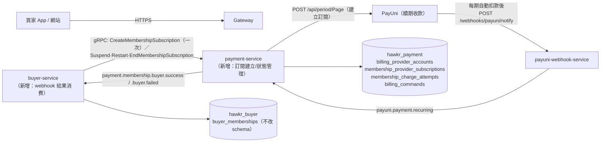
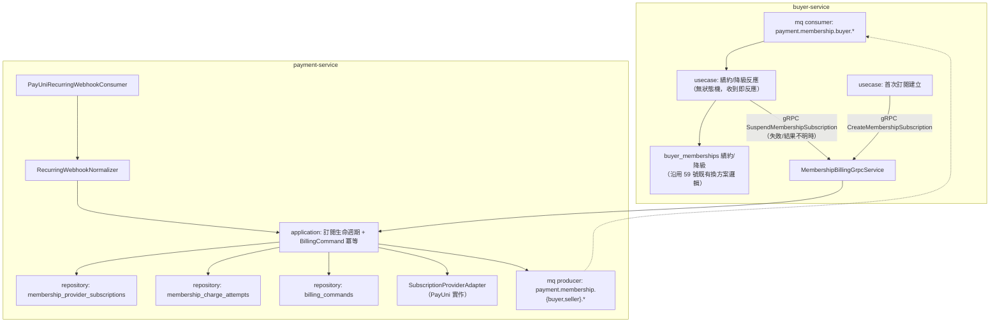
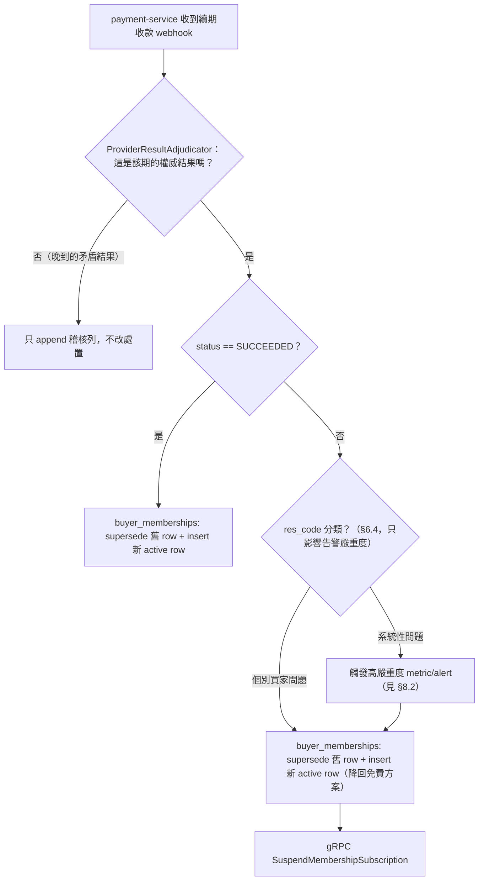
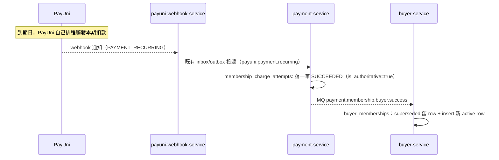
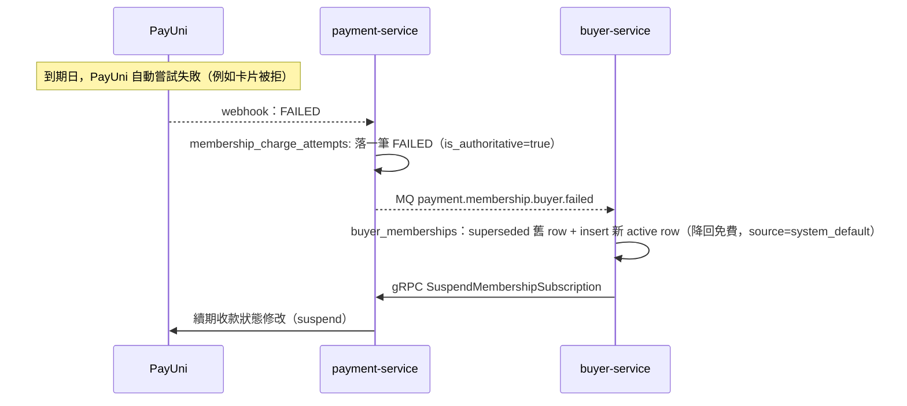

# 買家訂閱計費引擎（Buyer Subscription Billing Engine）詳細設計書

---

## 0. 文件元資訊 (Metadata)

| 項目 | 值 |
|---|---|
| 狀態 | `active` |
| 維護者 | Will |
| 對應程式碼 | `services/java/payment-service/src/main/java/io/github/will413028/hawkr/payment/domain/subscriptionbilling/`（domain）、`.../provider/payuni/PayUniSubscriptionProviderAdapter.java`（PayUni adapter）、`.../adapter/grpc/MembershipBillingGrpcService.java`（gRPC）、`.../mq/PayUniRecurringWebhookConsumer.java`（webhook 消費）、Flyway `V5`–`V8`；契約 `api/proto/membership/billing.proto` ＋ `api/proto/membership/entitlement.proto` |
| 相關 doc | [59-買家會員分級與 Agent 額度方案](./59-買家會員分級與%20Agent%20額度方案（Buyer%20Membership%20&%20Entitlement）詳細設計書.md)（會員本體與週期公式的 SSOT）；[05-支付服務](./05-支付服務（Payment%20Service）詳細設計書.md)（重複扣款三層防禦與 PayUni 硬約束 C1-C3；**不**沿用其一次性交易狀態機）；[10-PayUni Webhook 服務](./10-PayUni%20Webhook%20服務（payuni-webhook-service）詳細設計書.md)（`PAYMENT_RECURRING` WebhookType，見 §6.3）；[36-MQ 與事件總覽](./36-MQ%20與事件總覽（MQ%20&%20Event%20Catalog）.md)；[58-電子發票服務](./58-電子發票服務（Invoice%20Service）詳細設計書.md)（issuer→recipient 矩陣的「訂閱制｜平台｜買家｜方案快照」線）；`docs/開發規範/PayUni 錯誤回應收斂規範.md` §8.2（State 表／Task 表分工）|

> 🔴 **本文件描述的是 `MembershipBillingService` 的買家軸。** 同一套表、同一支 gRPC service 與
> 同一組 provider adapter **同時服務賣家軸**（`subject_type = 'SELLER'`）——所有 schema 與契約
> 條目都帶 `subject_type`，讀本文件時不要把它們理解成買家專用。賣家軸的業務規則歸屬另有設計書，
> 本文件只規範買家側的反應邏輯（§5.2、§7）。

---

## 1. 概述與目標 (Overview & Goals)

### 1.1 文件定位

承接 59 號《買家會員分級與 Agent 額度方案》的訂閱計費側：買家付費方案的**真實扣款**如何建立、
如何每期由 PayUni 觸發、結果如何回到 `buyer_memberships`。

### 1.2 服務一句話定位

在既有 `payment-service`（Java）之上新增「PayUni 續期收款訂閱管理」能力——建立訂閱一次、之後每期由 PayUni 自動觸發扣款並回報結果；在 `buyer-service`（Go）之上新增「扣款結果消費」能力：成功即續約，失敗（含結果不明）即刻降回免費並暫停訂閱，驅動 59 號 `buyer_memberships` 的續約／降級。

### 1.3 設計目標 (Goals) 與非目標 (Non-Goals)

| 類型 | 項目 |
|---|---|
| Goal | 續約成功／失敗的反應邏輯與 `buyer_memberships` 生命週期相容，不破壞其既有不變式 |
| Goal | 訂閱建立、webhook 回調、續約落地各段的服務邊界與資料模型 |
| Non-Goal | **不**做網站購買頁與 Admin 操作介面 |
| **Non-Goal（業務規則）** | **不設續約失敗緩衝期、不重試**：扣款失敗（含結果不明）即刻降回免費方案並暫停訂閱。見 §5.2、[ADR 2026-08-29](../adr/2026-08-29-membership-billing-payuni-period.md) |

### 1.4 與其他設計書的關係

- **59 號**：`buyer_memberships` 資料模型與「真實扣款 → payment-service」的服務邊界由該文件拍板；**週期公式是「每月同一天」**（非每 30 天），本文件不重新定義。
- **05 號**：重複扣款三層防禦、PayUni 硬約束 C1／C2／C3、重複付款偵測＋退款兜底——這些是**設計原則**上的沿用。⚠️ 05 號的一次性交易狀態機**不**沿用：續期收款的「一期」不是使用者主動發起的付款，語意不同。
- **10 號**：`PAYMENT_RECURRING` WebhookType，見 §6.3。
- **36 號**：`payuni.payment.recurring`（webhook 分流後）與 `payment.membership.{buyer,seller}.{success,failed}`（domain event）。
- **58 號《電子發票服務》**：issuer→recipient 矩陣的「訂閱制｜issuer=平台｜recipient=賣家或買家｜品項來源=方案快照」一線；`invoice_issuers.issuer_type=PLATFORM` 沒有 `store_id`，與本文件「訂閱不透過 order-service／店家」一致。
- **`docs/開發規範/PayUni 錯誤回應收斂規範.md` §8.2**：State 表禁止 `retry_count`／`next_retry_at`。本文件無 Task 表。

---

## 2. 範圍與情境 (Context & Scope)

### 2.1 系統情境圖 (C4 Context)



🔴 **`buyer-service` 沒有任何排程 cron**：收到 webhook 結果後直接、一次性地反應（續約或降級），沒有等待或重試的中間狀態。

### 2.2 邊界與責任

| | 涵蓋 (In-scope) | 不涵蓋 (Out-of-scope，由誰負責) |
|---|---|---|
| `buyer-service` | 消費扣款結果，直接驅動 `buyer_memberships` 續約／降級（無重試／寬限邏輯） | 實際呼叫 PayUni → `payment-service`；方案目錄與生效方案判定 → 59 號 |
| `payment-service` | 訂閱建立、`suspend`／`restart`／`end`、webhook 結果解析與正規化、每期扣款結果落地、**商業條款快照（BillingQuote）的驗證與保存** | 續約／降級的業務決策、`buyer_memberships` 讀寫 → `buyer-service` |
| `payuni-webhook-service` | `PAYMENT_RECURRING` WebhookType 的接收／去重／投遞 | 任何業務判斷 |

### 2.3 角色與身份模型

`account_id` 是登入 principal，`buyer_id` 是業務 domain ID，兩者不可互換。

🔴 **payment-service 的訂閱表用 `(subject_type, subject_id)` 而不是裸 `buyer_id`**：`subject_type ∈ {BUYER, SELLER}`，`subject_id` 裝買家的 `buyer_id` 或賣家的 `store_id`，**永遠不是 `account_id`**（`membership_provider_subscriptions.subject_id` 的 column comment 逐字釘住這件事）。跨服務引用，**無 DB 層 FK**（兩服務資料庫獨立）。

---

## 3. 約束與前提 (Constraints & Assumptions)

| 類型 | 項目 |
|---|---|
| 技術約束 | 沿用 59 號：PK 一律 TSID；`payment-service`（Java）走 Flyway 新版本 migration，`buyer-service`（Go）走 Atlas declarative；金額為新台幣整數，禁止浮點；時間一律 UTC |
| PayUni 產品約束 | 採 **續期收款**（`POST /api/period`／`/api/period/Page`，PayUni 自帶排程）。它與**信用卡幕後 Token 交易**（`POST /api/credit`，我方自控排程）是兩條獨立產品線，須分別申請審核＋綁定幕後 IP。選型理由見 [ADR 2026-08-29](../adr/2026-08-29-membership-billing-payuni-period.md) |
| PayUni 硬限制 | 單筆信用卡交易金額 `1~199,999` 元；扣款期數上限 **900 期**（`PeriodTimes`）；同一 `MerTradeNo` 10 分鐘內不可重複建立交易（05 號 §2A.3.1 C1，訂閱**建立**時仍受此限）；PayUni 端已送出的交易無法主動關閉（C2）；PayUni 不阻擋重複付款，需靠我方冪等設計防禦（C3） |
| PCI-DSS 範圍 | 「Raw card data NEVER touches our backend」：訂閱建立與換卡一律走**支付頁模式**（hosted redirect），**不採用幕後模式**（需我方伺服器直接收發卡號）。理由見 [ADR 2026-08-29](../adr/2026-08-29-membership-billing-payuni-period.md) |
| 既有系統約束 | `buyer_memberships` 的 `status='active'` partial unique index、「換方案＝結束舊 row + insert 新 row 同一 transaction」不變式，本文件**不修改**，只新增呼叫端 |
| **平台 MerID** | hawkr 對 PayUni 是**代理商模式**：一次性訂單付款的 `MerID` 是**賣家**的 `HAWK{store_code}`（見 44 號 §4.4）。訂閱費付給**平台自己**，因此用平台自有的 MerID，由 env **`PAYUNI_SUBSCRIPTION_MER_ID`** 提供（`payment-service`）。🔴 **它與 `PAYUNI_AGENT_MER_ID`（20 號 §4.13 的多賣家和單代收）是不同的 MerID，不得互用。** 字面值屬機密，不寫進本文件或任何設定檔預設值（§8.1） |
| 組織約束 | 本文件範圍**不含開票串接**：每期成功扣款的發票由 58 號的「訂閱制」線承接，觸發點是本文件的續約成功事件 |
| **業務規則** | **不設續約失敗緩衝期／重試**：PayUni 通知某一期扣款失敗（或結果不明／`CONFLICT`），**無論原因**，一律立即把該買家降回免費方案，同時 `suspend` 該筆 PayUni 訂閱，防止 PayUni 下期繼續自動嘗試。買家要恢復付費需重新走首次訂閱流程；`RestartMembershipSubscription` 這支 RPC 存在但**呼叫時機由購買頁決定**，不在本文件 |
| **假設 (Assumptions)** | 我方**只認第一個收到的終局通知**（`membership_charge_attempts.is_authoritative`，first-terminal-wins）。即使 PayUni 內部對同一期重試多次，後到的結果只留成稽核列、不改變已做出的處置 |

---

## 4. 架構 (Architecture)

### 4.1 解法總綱 (Solution Strategy)

切兩層：

1. **`payment-service` 是 execution／adapter 層**——建立訂閱、接收每期結果通知、執行 `suspend`／`restart`／`end`、保存商業條款快照，**不做任何「該不該續約」的業務判斷**。
2. **`buyer-service` 是續約的 control plane**——收到每期結果後**立即**反應：成功就續約，失敗（含結果不明）就立即降級＋暫停訂閱，沒有中間等待狀態。

🔴 **觸發權在 PayUni 自己的排程系統**：`buyer-service` 只對「PayUni 告訴我這期結果如何」做一次性反應，**不需要知道「現在幾點、輪到誰扣款」，因此不得為此建立任何 cron**。

**訂閱扣款不透過 `order-service`**：它不產生訂單，品項來源是方案快照而非訂單快照。

### 4.2 元件視圖 (C4 Component)



| 模組/package | 責任 | 依賴 |
|---|---|---|
| `buyer-service/internal/membership/renewal` | 消費扣款結果，直接驅動 `buyer_memberships` 續約／降級 | payment-service gRPC client、既有 membership usecase |
| `payment-service/.../domain/subscriptionbilling` | provider-agnostic 的 domain 型別、quote 驗證與正規化、command 冪等規則 | 無（純 domain） |
| `payment-service/.../provider/payuni` | `SubscriptionProviderAdapter` 的 PayUni 實作、續期收款 webhook 正規化 | `payuni-java-client` |

🔴 **provider 是可替換的 port**：`SubscriptionProviderAdapter`／`SubscriptionProviderRegistry` 是抽象邊界，PayUni 只是其中一個實作。任何 PayUni 專屬欄位（`PeriodTradeNo`、`PeriodOrderNo`、`PRD0xxxx` 錯誤碼）**只能出現在 `provider/payuni` 底下**，不得洩漏進 domain 或 gRPC 契約。

### 4.3 命名／契約規約

- gRPC service：`MembershipBillingService`（`api/proto/membership/billing.proto`），四支 RPC 見 §6.1。**只有 buyer-service 與 seller-service 的 control plane 可以呼叫**；Gateway／App client 永不直接提供商業條款。
- `mer_trade_no`：**只在訂閱建立時命名一次**，由 `(subject_type, subject_id, subscription_kind, subscription_seq)` 決定；`subscription_seq` 從 1 起算，終止舊訂閱後重新訂閱時遞增（規避 PayUni C1 的十分鐘同號限制）。之後每期由 PayUni 自動衍生 `PeriodOrderNo = {mer_trade_no}_{期數}`。
- MQ routing key：webhook 分流後 `payuni.payment.recurring`（webhook-service → payment-service）；domain event `payment.membership.buyer.success`／`.buyer.failed`／`.seller.success`／`.seller.failed`（payment-service → 各自的 control plane，exchange `payment.events`）。

### 4.4 實作位置

| 服務／位置 | 內容 |
|---|---|
| `services/java/payment-service/.../domain/subscriptionbilling/` | provider-agnostic domain：`MembershipProviderSubscription`、`MembershipChargeAttempt`、`BillingCommand`、`BillingQuote`＋canonicalizer／validator、`SubjectType`、`ProviderSubscriptionStatus`、`ProviderResultAdjudicator` |
| `services/java/payment-service/.../provider/payuni/` | `PayUniSubscriptionProviderAdapter`、`PayUniRecurringWebhookNormalizer` |
| `services/java/payment-service/.../adapter/grpc/` | `MembershipBillingGrpcService`、`MembershipBillingGrpcError` |
| `services/java/payment-service/.../mq/` | `PayUniRecurringWebhookConsumer` |
| `services/java/payment-service`（Flyway） | `V5` 建四張表、`V6` 補 saga 結果欄位與 `UNKNOWN` 狀態、`V7` 序列化同一訂閱的 command、`V8` 加 command 租約到期 |
| `services/buyer-service/internal/membership/renewal/` | 消費扣款結果的 usecase（**不落任何新表**，見 §5） |
| `api/proto/membership/billing.proto`／`entitlement.proto` | gRPC 契約與事件 envelope |
| `docs/代碼管理（CodeMeta）/內部技術碼.md` | `PayUniEventType` 的 `PAYMENT_RECURRING = 8257` |
| `infra/mq/topology/topology.yaml` | queue／binding 登記（漏登記＝服務啟動正常但訂閱**靜默失效**） |

---

## 5. 資料設計 (Data Design)

### 5.1 資料模型

四張表全部在 `payment-service`（`hawkr_payment`）。🔴 **payment-service 只保存 provider-side
facts、商業條款快照、command 冪等與 charge-attempt 歷史**；membership／period／entitlement 仍由
各自的 domain database 擁有，**本區不建立任何跨 database foreign key**。`buyer-service` 側
**不新增任何表**。

**`billing_provider_accounts`**（provider 帳號別名與能力中繼資料）

| 欄位 | 型別 | 說明 |
|---|---|---|
| `id` | BIGINT PK（TSID） | |
| `provider` | VARCHAR(32) NOT NULL | 非空字串 |
| `account_ref` | VARCHAR(128) NOT NULL **UNIQUE** | 受控別名，**不是機密** |
| `environment` | VARCHAR(16) NOT NULL | `SANDBOX` / `PRODUCTION` |
| `credential_ref` | VARCHAR(256) NOT NULL | **只存 secret manager／env 的引用**，禁止存原始憑證 |
| `capabilities` | JSONB NOT NULL DEFAULT `{}` | adapter 路由用的中繼資料；🔴 **不得當成 entitlement 或配額的來源** |
| `status` | VARCHAR(16) NOT NULL | `ACTIVE` / `DISABLED` |

**`membership_provider_subscriptions`**（訂閱生命週期 ＋ 不可變的 quote 稽核快照）

| 欄位 | 型別 | 說明 |
|---|---|---|
| `id` | BIGINT PK（TSID） | |
| `subject_type` / `subject_id` | VARCHAR(16) / VARCHAR(64) | `BUYER`／`SELLER`；`subject_id` 是 `buyer_id` 或 `store_id`，**永不是 `account_id`** |
| `membership_id` | VARCHAR(64) NOT NULL | 跨服務引用 |
| `membership_change_request_id` | VARCHAR(64) | |
| `billing_quote_id` | VARCHAR(128) NOT NULL | 對應的商業條款快照 |
| `subscription_kind` | VARCHAR(32) NOT NULL | 目前 CHECK 鎖死 `BASE_MEMBERSHIP` 單一值 |
| `provider` / `provider_account_ref` | VARCHAR | `provider_account_ref` FK → `billing_provider_accounts(account_ref)`，`ON DELETE RESTRICT` |
| `provider_customer_id` / `provider_subscription_id` | VARCHAR(128) | provider 端識別碼 |
| `subscription_seq` | INTEGER NOT NULL（> 0） | 同一 subject 的第幾次訂閱 |
| `mer_trade_no` | VARCHAR(128) NOT NULL **UNIQUE** | 建立時命名一次 |
| `offer_id` / `offer_version_no` | VARCHAR | 方案報價版本 |
| `quote_snapshot_hash` | CHAR(64) NOT NULL | canonical SHA-256，CHECK `^[0-9a-f]{64}$` |
| `quote_expires_at` | TIMESTAMPTZ NOT NULL | |
| `currency` / `unit_amount_minor` / `interval_unit` / `interval_count` | CHAR(3) / BIGINT（> 0）/ VARCHAR(16) / SMALLINT（> 0） | 每期金額與週期，**最小幣別單位的整數** |
| `first_period_date` / `provider_anchor_at` | TIMESTAMPTZ | |
| `status` | VARCHAR(16) NOT NULL DEFAULT `PENDING` | 🔴 **四態**：`PENDING` / `ACTIVE` / `SUSPENDED` / `ENDED` |

不變式（皆為 DB 索引，不是應用層約定）：

| 索引 | 保證 |
|---|---|
| `uq_membership_provider_subscriptions_quote` UNIQUE(`billing_quote_id`) | **一張 quote 只能產生一筆訂閱**；重試必須走 `billing_commands` 收斂，不得再 insert 第二列 |
| `uq_..._provider_id` UNIQUE(`provider`, `provider_subscription_id`) WHERE NOT NULL | provider 端識別碼不重複 |
| `uq_..._subject_sequence` UNIQUE(`subject_type`, `subject_id`, `subscription_kind`, `subscription_seq`) | 併發重試不能重用舊 seq |
| `uq_..._active_base` UNIQUE(`subject_type`, `subject_id`, `subscription_kind`) WHERE `status IN ('PENDING','ACTIVE','SUSPENDED')` | 🔴 **每個 subject 至多一筆未終止訂閱。`PENDING` 刻意含在內**——否則兩個併發的 hosted checkout 會建出兩筆 provider 訂閱 |

**`membership_charge_attempts`**（append-only 的正規化結果 ledger，webhook 驅動）

| 欄位 | 型別 | 說明 |
|---|---|---|
| `id` | BIGINT PK（TSID） | |
| `provider_subscription_ref` | BIGINT NOT NULL | FK → `membership_provider_subscriptions(id)`，`ON DELETE RESTRICT` |
| `subject_type` / `subject_id` / `membership_id` | — | 與訂閱列一致 |
| `billing_quote_id` / `quote_snapshot_hash` | — | 這一期依據的商業條款 |
| `provider_period_id` / `period_order_no` / `this_period` / `trade_no` | — | provider 端的期別識別 |
| `amount_minor` / `currency` | BIGINT（≥ 0）/ CHAR(3) | |
| `provider_event_id` | VARCHAR(256) | |
| `provider_event_key` | VARCHAR(512) NOT NULL **UNIQUE** | provider 通知的去重鍵 |
| `status` | VARCHAR(16) NOT NULL | `SUCCEEDED` / `FAILED` / `CONFLICT` |
| `res_code` / `res_code_msg` | VARCHAR(128) / TEXT | 失敗時的 provider 錯誤碼與訊息 |
| `valid_from` / `valid_until` | TIMESTAMPTZ | 兩者同時為空或同時非空，且 `valid_from < valid_until` |
| `cycle_started_at` / `cycle_until` | TIMESTAMPTZ | |
| `is_initial_authorization` | BOOLEAN NOT NULL DEFAULT false | 首期授權 |
| `is_authoritative` | BOOLEAN NOT NULL DEFAULT false | 🔴 見下 |
| `canonical_event_id` | VARCHAR(256) | UNIQUE WHERE NOT NULL |
| `received_at` | TIMESTAMPTZ NOT NULL | |

🔴 **first-terminal-wins**：`uq_membership_charge_attempts_authoritative_period` 對
`(provider_subscription_ref, 'PERIOD:'||provider_period_id 或 'ORDER:'||period_order_no)`
在 `is_authoritative = TRUE` 時唯一 ⇒ **一個 provider 期別只有一個權威結果，且永不被覆寫**；
晚到的矛盾結果仍然 append，但只是稽核列。兩個 provider 識別命名空間**刻意加前綴**，
避免 period ID 與同字面的 PeriodOrderNo 互撞。

⚠️ **`provider_event_key` 與 `canonical_event_id` 是兩個獨立的去重軸**，不可合併：前者是
provider 通知層的精確去重，後者是我方正規化後的事件身分。

**`billing_commands`**（RPC／provider action 的共用冪等邊界）

| 欄位 | 型別 | 說明 |
|---|---|---|
| `id` | UUID PK | |
| `operation` | VARCHAR(64) NOT NULL | `CREATE_SUBSCRIPTION` / `SUSPEND_SUBSCRIPTION` / `RESTART_SUBSCRIPTION` / `END_SUBSCRIPTION` |
| `subject_type` / `subject_id` | — | `BUYER` / `SELLER` |
| `idempotency_key` | VARCHAR(128) NOT NULL | 與 `operation` 組成唯一鍵 |
| `request_hash` | CHAR(64) NOT NULL | canonical 請求的 SHA-256 |
| `billing_quote_id` / `result_subscription_id` | — | `result_subscription_id` FK → 訂閱表 |
| `status` | VARCHAR(16) NOT NULL DEFAULT `PROCESSING` | `PROCESSING` / `SUCCEEDED` / `FAILED` / **`UNKNOWN`** |
| `error_code` / `error_message` / `action_reason` | — | |
| `result_provider_subscription_id` / `result_redirect_url` / `result_mer_trade_no` / `result_status` | — | 成功結果的快照，供同一把 key 重放時原樣回傳 |
| `lease_expires_at` | TIMESTAMPTZ | 處理中的租約到期時間 |

🔴 **同一把 `(operation, idempotency_key)` 配上不同的 `request_hash` 是衝突，必須拒絕**——
不是覆蓋、也不是當成新請求。

🔴 **`UNKNOWN` 是終局未知，不是「還在處理」**：provider 呼叫結果不明時落這個狀態，
**不得**自動重試成 `SUCCEEDED` 或 `FAILED`。

⚠️ **同一筆訂閱的 command 是序列化的**（`uq_billing_commands_active_subscription`）：
同一個 subject 同時只能有一個進行中的 command，避免 suspend 與 restart 交錯。

### 5.2 `buyer_memberships` 整合方式——不改既有 schema

續約成功／失敗一律走 59 號已定義的「換方案」路徑：**結束舊 active row（`superseded`）＋ insert
新 row，同一個 DB transaction**。`buyer_memberships` 表**不新增任何欄位**。

| 觸發 | `buyer_memberships` 動作 | payment-service 動作 |
|---|---|---|
| 扣款結果 `SUCCEEDED` | 舊 active row → `superseded`；insert 新 row：`plan_code`＝續約方案、`period_start`＝舊 row 的 `period_end`、`period_end`＝**下個月同一天**（59 號 §5.1 的錨點滾動與月底 clamp）、`granted_by=NULL` | 無 |
| 扣款結果 `FAILED` 或 `CONFLICT` | 舊 active row → `superseded`；insert 新 row：`plan_code`＝免費方案、`source='system_default'`、`note` 帶 `period_order_no` 與失敗原因 | 呼叫 `SuspendMembershipSubscription`，防止 PayUni 下期繼續自動嘗試 |
| 買家主動取消 | 走既有「換方案」API | 呼叫 `EndMembershipSubscription`（終態，不可逆） |

🔴 **`source` 的值域由 `chk_buyer_memberships_source` 決定，目前只接受 `admin` 與
`system_default`**。付費續約要不要有自己的 source 值（例如 `payuni`）需要一支 migration，
追蹤於 #3524——**在那之前，
寫入任何其他值都會被 DB 拒絕**。

**沒有「寬限期中」這個狀態**：降級是即時的，`buyer_memberships` 與任何其他地方都不呈現它。

---

## 6. API 與介面契約 (API & Interface Contracts)

### 6.1 gRPC：`MembershipBillingService`

契約 SSOT 是 `api/proto/membership/billing.proto`；本節只寫該檔沒有寫、但實作者必須知道的行為。

```
rpc CreateMembershipSubscription(CreateMembershipSubscriptionRequest) returns (CreateMembershipSubscriptionResponse)
rpc SuspendMembershipSubscription(MembershipSubscriptionActionRequest) returns (MembershipSubscriptionActionResponse)
rpc RestartMembershipSubscription(MembershipSubscriptionActionRequest) returns (MembershipSubscriptionActionResponse)
rpc EndMembershipSubscription(MembershipSubscriptionActionRequest)     returns (MembershipSubscriptionActionResponse)
```

🔴 **這是 internal service，只有 buyer-service 與 seller-service 的 control plane 可以呼叫。
Gateway／App client 永遠不直接提供商業條款。**

**`BillingQuote` 是 server 簽發的商業條款快照**，由呼叫端在 `CreateMembershipSubscription`
帶入，內含 `quote_id`／`offer_id`／`offer_version_no`／`unit_amount_minor`／`currency`／
`interval_unit`／`interval_count`／`provider_account_ref`／`first_period_date`／`expires_at`／
`snapshot_hash`。payment-service **必須**驗證它（canonical 化後比對 `snapshot_hash`、檢查
`expires_at`）才能建立訂閱——這是防止呼叫端自訂價格的唯一防線。

**錯誤契約**：失敗一律回非 OK 的 gRPC status，status details 帶 `google.rpc.ErrorInfo`，
`domain = "hawkr.membership.billing"`、`reason` 是 `MembershipBillingErrorCode` 的值。
🔴 **呼叫端必須分支在 `ErrorInfo.reason` 上，永遠不要解析人類可讀的 status message。**

**冪等**：四支 RPC 都吃 `request_id` 當 idempotency key，落在 `billing_commands`
（§5.1）。同一把 key 重放會原樣回傳第一次的結果快照；**同一把 key 配不同的請求內容是衝突，
回錯誤而非覆蓋**。

`CreateMembershipSubscriptionResponse` 回 `period_subscription_id`／`provider_subscription_id`／
`redirect_url`（hosted checkout，見 §8.1）／`mer_trade_no`／`status`（`PENDING` | `ACTIVE`）。

### 6.2 非同步事件 (MQ)

`payment-service` 落地每期扣款結果後發出 domain event；🔴 **`buyer-service` 不直接訂閱 PayUni
webhook exchange**——那是服務邊界，繞過它等於讓 control plane 去解析 provider 格式。

| 項目 | 值 |
|---|---|
| Exchange | `payment.events` |
| Routing key | `payment.membership.buyer.success` / `payment.membership.buyer.failed` / `payment.membership.seller.success` / `payment.membership.seller.failed` |
| Producer | `payment-service` |
| Consumer | 買家軸 → `buyer-service`；賣家軸 → seller 側 control plane |
| Queue | `buyer.membership.payment.result`（buyer 兩支 key）／`seller.membership.payment.result`（seller 兩支 key），各有 DLQ |

🔴 **routing key 依 `subject_type` 分軸**：同一個 producer 依 subject 決定送 `buyer.*` 或
`seller.*`。消費端只綁自己那一軸的兩支 key，**不得**綁 `payment.membership.#`——那會讓買家
control plane 收到賣家事件。

**Payload**：`MembershipEventEnvelope`（`api/proto/membership/entitlement.proto`），`data` 是
versioned `google.protobuf.Any`，扣款結果放 `ProviderChargeResultData`（`billing.proto`）：
`provider`／`provider_account_ref`／`provider_subscription_id`／`provider_period_id`／
`period_subscription_id`／`period_order_no`／`trade_no`／`amount_minor`／`currency`／
`this_period`／`status`（`SUCCEEDED` | `FAILED` | `CONFLICT`）／`res_code`／`res_code_msg`／
`valid_from`／`valid_until`／`cycle_started_at`／`cycle_until`。

⚠️ **envelope 的 `membership_period_id` 只有在「等待計費授權」時才可以是空的**，其餘情況必填。

**消費端冪等**：以 envelope 的 `event_id` 去重（對應 payment 側的 `canonical_event_id`）。


### 6.3 Webhook 回調處理：`PAYMENT_RECURRING`

續期收款的 Notify payload 與一次性刷卡是**完全不同的欄位形狀**，因此是獨立的 WebhookType，不沿用 `PAYMENT_UOP` 的解析路徑。

| 項目 | 值 |
|---|---|
| WebhookType | `PAYMENT_RECURRING`（對齊既有 `PAYMENT_UOP` 命名風格） |
| CodeMeta 數值 | `8257`（`內部技術碼.md` 的 `PayUniEventType`） |
| Exchange | `payuni.events`（沿用，不新開 exchange） |
| Routing Key | `payuni.payment.recurring`（對照 `payuni.payment.uop` 命名） |
| EventKey 規則 | `{merId}:{merTradeNo}:{tradeNo}:{thisPeriod}:{status}`。🔴 **`thisPeriod` 不可省**：同一筆訂閱的第 N 期與第 N+1 期是各自獨立的事件，少了它會被去重成同一筆 |

**分類判定**：`PayUniWebhookParser` 依「解密後含有的欄位」判斷型別（10 號 §3.1）。續期收款 payload 帶 `PeriodTradeNo`／`PeriodOrderNo`／`ThisPeriod`，這三個欄位其他型別都沒有，判定依據就是它們。

**payment-service 側的消費路徑**：`PayUniRecurringWebhookConsumer` → `PayUniRecurringWebhookNormalizer`（把 provider 欄位正規化成 domain 的 `ProviderChargeResult`）→ `ProviderResultAdjudicator`（決定這筆是不是該期的權威結果）→ 落 `membership_charge_attempts` → 發 §6.2 的 domain event。

🔴 **PayUni 專屬欄位止於 normalizer**：`PeriodTradeNo`／`PeriodOrderNo`／`PRD0xxxx` 這類字面值不得出現在 `domain/subscriptionbilling` 或 gRPC 契約裡。

🔴 **webhook-service 的 `route()` 一律全部轉發，不在 webhook 層過濾**——過濾是業務判斷，而 webhook-service 刻意不處理業務邏輯（10 號 §1.1）。

### 6.4 錯誤碼對應：只決定告警嚴重度，不決定重試

🔴 **PayUni 端的失敗原因不影響業務處置**（一律立即降級＋暫停，§3），它只決定**告警嚴重度**：個別買家的卡片問題是正常業務事件；商店層級的設定問題會讓**當下所有到期買家**同時失敗，那是系統性事故。

| PayUni 端訊號 | 分類 | 行為 |
|---|---|---|
| 卡片被拒/餘額不足類（一般信用卡拒絕碼） | 個別買家問題 | 依 §5.2 立即降級＋暫停訂閱；不告警（正常業務量） |
| `PRD02043`（商店未提供續期收款幕後交易——啟用旗標問題） | **系統性問題** | 同樣立即降級＋暫停訂閱（§3 業務規則對任何失敗一視同仁），但額外觸發高嚴重度 metric/alert（見 §8.2）——這不是在幫這個買家決定要不要重試，是在提醒維運「這個設定壞了，接下來到期的買家會一個個被錯誤降級」 |
| `PRD02039`（扣款期數超過上限 900） | 不適用於一般買家（900 期＝75 年），觸發代表訂閱建立邏輯有 bug | 降級＋暫停訂閱＋告警 |
| `PRD03001`（商店未啟用，更上游閘門） | **系統性問題** | 同 `PRD02043` |

⚠️ **上表不是完整的錯誤碼分類**：未列出的碼一律走「個別買家問題」路徑（降級＋暫停、不告警）。要把某個碼升級成系統性問題，必須先確認它的觸發條件與 subject 無關。補齊完整分類追蹤於 #3527。

### 6.5 依賴的外部 API：PayUni

本文件會呼叫或需要理解的 PayUni 端點。🔴 **所有呼叫都封裝在 `provider/payuni` 底下**（§4.2）。

| 用途 | 端點 | 使用情況 |
|---|---|---|
| 建立訂閱（hosted redirect，首次授權） | `POST /api/period/Page` | **採用（核心）**，見 §6.1 |
| 每期授權完成通知 | Notify webhook | **採用（核心）**，見 §6.3 |
| 訂閱層級狀態修改（`suspend`／`restart`／`end`） | 續期收款狀態修改 | **採用（核心）**，見 §6.1 |
| 換卡（hosted redirect） | 續期收款卡號修改-支付頁 | 端點可用；**呼叫時機未定案**（見 #3527） |
| 查詢訂閱／期別狀態（對帳與人工排查） | 續期收款訂單查詢 | 端點可用；**呼叫時機未定案**（同上） |
| 訂閱建立後修改內容 | 續期收款訂單內容修改 | **是否支援原地改金額／方案未查證**（同上）——若支援，換方案可省掉「終止舊訂閱＋建新訂閱」 |
| 信用卡單筆金額上限 `1~199,999` 元 | 文件頁面，非 API | 約束依據，見 §3 |
| 建立失敗的 `PRD0xxxx` 錯誤碼表 | 文件頁面，非 API | 約束依據，見 §6.4 |
| 幕後模式（我方伺服器直接收發卡號） | 續期收款幕後／卡號修改-幕後 | 🔴 **不採用**——會把持卡人資料帶進我方 PCI 範圍 |
| 信用卡幕後 Token 交易 | `POST /api/credit` 系列 | 🔴 **不採用**——另一條產品線，見 ADR |

---

## 7. 執行時視圖 (Runtime View)

🔴 **`buyer-service` 側沒有狀態機**：對每個 webhook 結果只做一次性反應，沒有等待、沒有中間狀態、沒有 self-loop。訂閱本身的四態在 payment-service（§5.1）。

### 7.1 業務判斷流程圖



### 7.2 時序圖（happy path，成功續約）



### 7.3 時序圖（失敗，立即降級）



### 7.4 失效處置（基礎設施層級的重送，不是業務重試）

| 呼叫 | 失敗時行為 |
|---|---|
| `buyer-service → SuspendMembershipSubscription` | gRPC 呼叫本身失敗時依既有內部 client 慣例重送（純基礎設施，非業務決策）。🔴 **失敗必須告警**——買家已降級但 PayUni 訂閱未暫停，下期會再自動扣一次款 |
| webhook 遺失 | 依 10 號既有 outbox 重試（5 次指數退避、耗盡標 DEAD）。⚠️ **目前沒有排程對帳兜底**；訂單查詢端點可用但呼叫時機未定案（§6.5） |

### 7.5 並發與冪等

三道各自獨立的防線，**不可互相取代**：

| 防線 | 擋什麼 |
|---|---|
| `membership_charge_attempts.provider_event_key` UNIQUE | 同一則 provider 通知被投遞兩次 |
| `is_authoritative` 的期別唯一索引 | 同一期收到**兩個不同**的終局結果（first-terminal-wins） |
| `billing_commands` 的 `(operation, idempotency_key)` | 同一個 RPC 請求被重放 |

---

## 8. 跨切面關注點 (Crosscutting Concerns)

### 8.1 安全與授權

🔴 **訂閱建立與換卡一律走支付頁（hosted redirect）模式，持卡人資料全程不經我方伺服器**——這是 PCI 範圍的邊界，不是效能或便利取捨（§3）。所有 gRPC 皆是內部 service-to-service 呼叫，走既有內部信任邊界。

🔴 **`billing_provider_accounts.credential_ref` 只存 secret manager／env 的引用**，任何原始憑證落庫都是事故。

### 8.2 可觀測性

| 訊號 | 內容 |
|---|---|
| metric | `membership_charge_attempt_total{status}`（`SUCCEEDED`／`FAILED`／`CONFLICT`，掌握降級量體）；`membership_subscription_status{status}`（`PENDING`／`ACTIVE`／`SUSPENDED`／`ENDED` 分佈） |
| **高嚴重度告警** | §6.4 判定為**系統性問題**的失敗次數在短時間內超過閾值 |
| **高嚴重度告警** | `SuspendMembershipSubscription` 呼叫失敗（§7.4：買家已降級但訂閱還活著） |
| **高嚴重度告警** | `billing_commands` 停在 `PROCESSING` 且租約已過期，或落入 `UNKNOWN` |

⚠️ **個別買家的卡片問題不告警**——那是預期中的正常業務量，對它告警會讓真正的系統性事故淹沒在噪音裡。

### 8.3 錯誤處理與降級

**`payment-service` 不可用**：PayUni 的排程不依賴我方服務存活，因此扣款照跑，只是結果暫時反映不到 `buyer_memberships`；webhook 由 webhook-service 的 inbox／outbox 持久化等待投遞。

**`buyer-service` 不可用**：結果已落在 `membership_charge_attempts`，恢復後照常消費既有 MQ 訊息。

⚠️ **兩種情況下買家的方案都會短暫停留在舊值**，這是 at-least-once 投遞下的預期行為，不是資料錯誤。

### 8.4 一致性與冪等

見 §7.5 的三道防線。消費端以 envelope 的 `event_id` 去重（§6.2）。

🔴 **`mer_trade_no` 只在訂閱建立時命名一次**，之後每期由 provider 衍生 ⇒ 不需要、也不得為每期的扣款再命名一次交易編號。

---

## 9. 品質需求與 NFR

沿用既有兩服務 SLO。本文件的路徑皆由背景 webhook 觸發，**不在使用者即時互動路徑上**，唯一的例外是 `CreateMembershipSubscription`（買家在購買頁等待 redirect URL）。

- 內部 gRPC timeout 沿用 `common-core` 的既有預設，不另訂。
- 🔴 **對 PayUni 的呼叫必須有明確 deadline**：它在 `billing_commands` 的租約內執行，無界呼叫會讓租約的下界無從論證。

---

## 10. 部署與維運 (Deployment & Operations)

**部署順序**：`payment-service` 先（表 ＋ RPC ＋ webhook 消費就緒）→ 確認健康 →
`buyer-service` 後（新 consumer）。

🔴 **反序會讓 `buyer-service` 的 consumer 綁到還不存在的 queue**——依現行 passive declare
設定，那不會讓服務啟動失敗，而是**該訂閱靜默失效**（36 號的既有教訓）。

**維運入口**：

| 症狀 | 先查 |
|---|---|
| 買家付了錢但方案沒變 | `membership_charge_attempts` 有沒有該期的 `is_authoritative` 列 → 有的話查 `buyer.membership.payment.result` queue 的積壓與 DLQ |
| 同一個買家出現兩筆未終止訂閱 | 不可能通過 `uq_..._active_base`；若真的發生，先確認那道索引還在 |
| command 卡住 | `billing_commands` 的 `status='PROCESSING'` 且 `lease_expires_at` 已過，或落在 `UNKNOWN` |

---

## 11. 測試策略 (Test Strategy)

| 層級 | 必須涵蓋 |
|---|---|
| unit | `BillingQuoteCanonicalizer`／`BillingQuoteValidator`：同一份條款的 canonical 形式穩定、`snapshot_hash` 對不上必須拒絕、過期 quote 必須拒絕 |
| unit | `ProviderResultAdjudicator`：同一期第二個**不同**的終局結果只落稽核列、不改寫權威列 |
| unit | `BillingCommandRules`：同一把 key 配不同 `request_hash` 回衝突；重放回原結果快照 |
| unit | `RecurringWebhookNormalizer`：provider 欄位 → domain 結果的映射（含缺欄位與型別異常） |
| integration | 四道 DB 不變式各一支：quote 唯一、subject sequence 唯一、**active base 唯一（含 `PENDING`）**、authoritative period 唯一 |
| integration | gRPC ＋ MQ 串接（testcontainers）：建立訂閱 → webhook 成功 → 事件送到買家軸的 queue |
| e2e（sandbox） | 建立訂閱 → 首期成功 → 續約落地；建立訂閱 → 故意失敗 → **確認降級與 `SuspendMembershipSubscription` 都真的執行** → 取消訂閱 |

⚠️ **MQ 契約測試的 fixture 必須從 producer 原始碼生**，不得手寫（`.claude/skills/mq-wire-contract/`）。

---


## 12. 術語表 (Glossary)

| 術語 | 定義 |
|---|---|
| 續期收款 | PayUni `POST /api/period`／`/api/period/Page`，**PayUni 自帶排程**自動扣款；本文件採用的模式 |
| 幕後 Token 交易 | PayUni `POST /api/credit`，商店自控排程。**不採用**（見 ADR） |
| subject | `(subject_type, subject_id)`：`BUYER` 配 `buyer_id`，`SELLER` 配 `store_id`。**永遠不是 `account_id`** |
| `BillingQuote` | server 簽發、帶 `snapshot_hash` 的商業條款快照；**建立訂閱時必須驗證它才能防止呼叫端自訂價格** |
| `billing_command` | 一次 RPC／provider action 的冪等邊界。同一把 key 配不同 `request_hash` 是衝突 |
| charge attempt | `membership_charge_attempts` 的一列，代表 provider 回報的一次扣款結果（`SUCCEEDED`／`FAILED`／`CONFLICT`，皆終態） |
| authoritative | 一個 provider 期別的**第一個**終局結果。永不被覆寫；晚到的矛盾結果只留稽核列 |
| 即刻降級 | 扣款失敗或結果不明，無論原因立即降回免費方案並暫停訂閱，沒有緩衝期或重試 |
