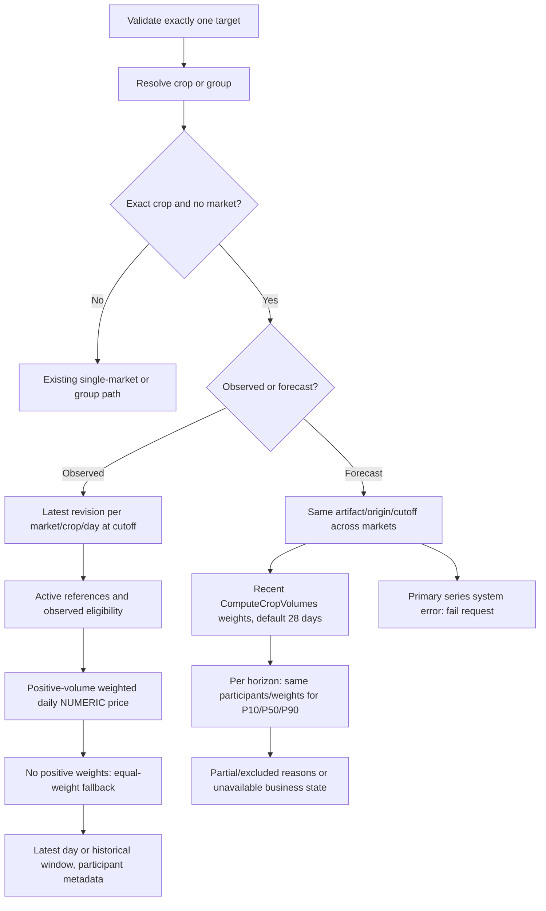
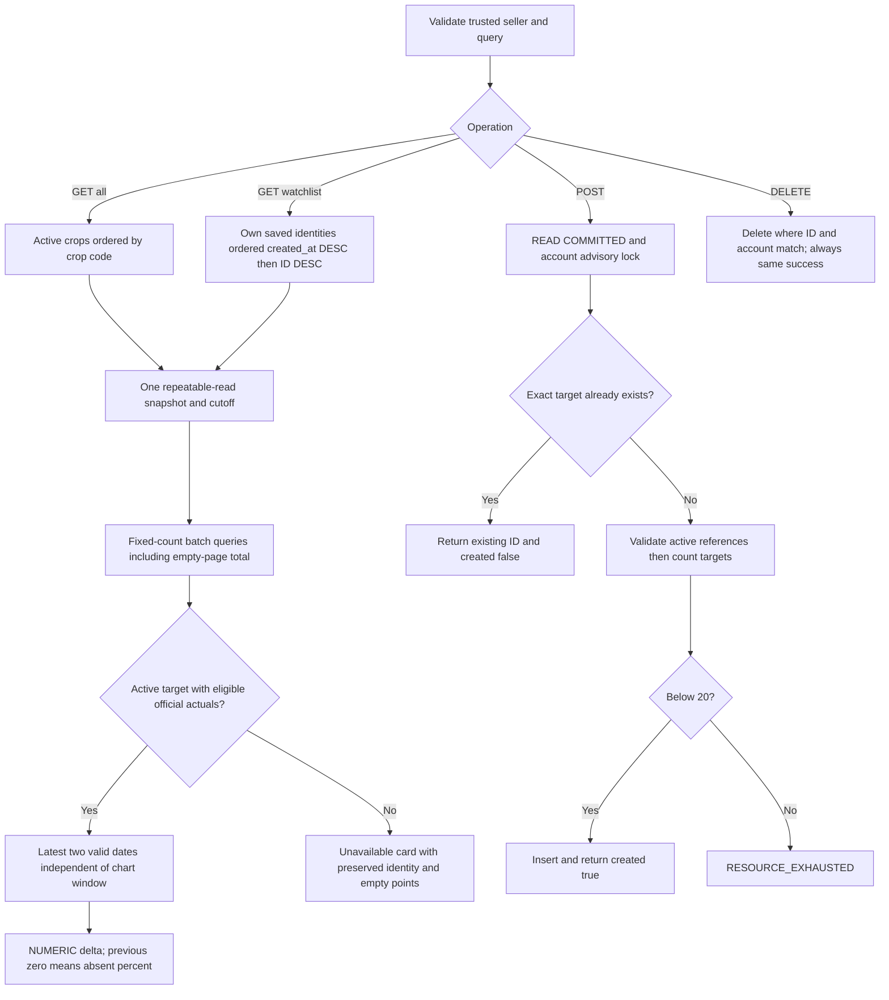
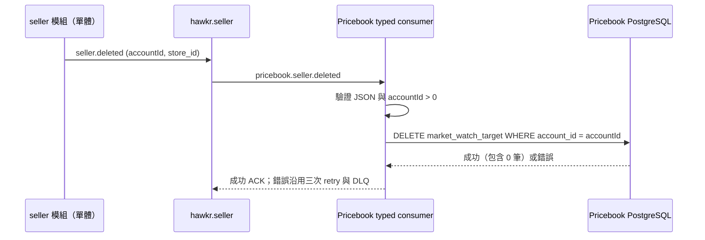
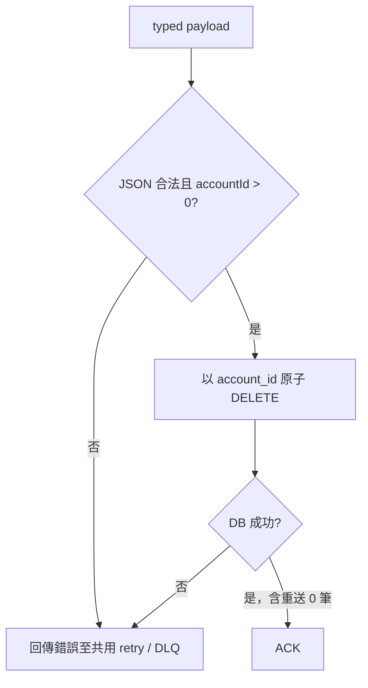

# Pricebook 全市場品項行情

## 契約

`GET /app/sellers/pricebook/observed-price` 與 `forecast-curve` 保留既有
`cropName`／`cropCode`／`groupCode`、`marketCode` query 名稱。
exact crop（包含名稱解析結果）省略市場，表示同品項全市場聚合。
指定市場及 group 行為維持既有契約；`GetEstimatedItemPrice` 仍要求 exact crop 的市場。
canonical RPC／完整 message 定義在 `api/proto/pricebook/pricebook.proto`。
非法或多重 target 回 INVALID_ARGUMENT；無可用資料回合法 business state。

```mermaid
sequenceDiagram
    participant UI as Seller insights
    participant GW as Gateway
    participant PB as Pricebook
    participant DB as PostgreSQL
    UI->>GW: observed-price / forecast-curve (cropCode, no marketCode)
    GW->>GW: Authenticate seller, CAP_MARKETING
    GW->>PB: Corresponding RPC, trusted metadata
    PB->>PB: Resolve exact crop, fix artifact / origin / cutoff
    PB->>DB: Batch latest-revision observations at cutoff
    DB-->>PB: Active participants and NUMERIC daily aggregates
    PB->>PB: Observed daily series OR forecast market blend
    PB-->>GW: Prices, quality and aggregation metadata
    GW-->>UI: Envelope; comparison missing p50 explicitly null
```



## 官方成交資料

批次查詢可接收多個 crop code，供後續 overview 重用。先於固定 cutoff 選取
各 `(market,crop,trade_date)` 最新 revision，再套用既有 observed eligibility，
排除 inactive crop／market。同日正成交量加權 `avgPrice`；沒有正權重時等權，
標記 `VOLUME_WEIGHT_FALLBACK`。SQL 使用 NUMERIC，僅在既有 double 回應邊界轉型。
全市場一日一筆，crop identity 保留、市場 identity 為空；成交量合計保留缺值，
上／中／下價不合成。`history=false` 只取最新日；`history=true` 使用原歷史窗口。
metadata 使用實際參與資料 digest、日期及來源時間，沿用既有 freshness 門檻。

### 上游身分不完整的列

`CropCode`、`CropName`、`MarketCode`、`MarketName` 任一為空白（含純空白字元）的
成交列不得寫入任何維度或事實表。判定集中於 `moa.TradeRecord.Validate()`，通過者
回傳 `ValidTradeRecord`；`resolveRecord` 與 `ingestBatch` 只接受該型別，身分欄位在
此一併 TrimSpace。

拒絕原因分兩類。`closed_market`、`non_positive_price` 為正常過濾，計入 Fetched
後丟棄。`missing_crop_code`、`missing_crop_name`、`missing_market_code`、
`missing_market_name` 為資料品質異常，以 `(source, crop_code, market_code, reason)`
為鍵登記進 `ingest_rejected_identity`，累計 `occurrence_count` 與起訖交易日（原始
民國年字串）。同一輪 ingest 對同一身分只寫入一次。

`IngestStats.NewRejectedIdentities` 是該輪第一次出現的身分，為 `AttentionReason`
判準四的唯一輸入；已登記身分持續被擋時不重複觸發。分區判定上，身分異常的列標
complete，不標 rest day。

`crop`、`crop_group`、`market` 的 code 與 name 欄位帶 `length(btrim(...)) > 0`
CHECK，涵蓋繞過 ingest 的寫入路徑。

休市日曆（`MarketRestDayFarmWCF`）是 `market` 的第二個寫入者，套用同一套判定與同一組
`RejectReason`：市場代碼或名稱為空白時跳過該市場的全部休市日並登記進隔離區
（`source = moa_market_rest_day_farm_wcf`），不中止整輪。同一個市場一輪只登記一次。
中止會讓休市日曆整批不更新，而 `PriceIngest.Handle` 對空市場清單是 fail-closed，
一列壞資料會連帶停掉行情線。

## 預測聚合與失敗語意

使用同一 model artifact、origin、knowledge cutoff，重用 `ComputeCropVolumes`
近期窗口（預設 28 天）。每個 horizon 的 P10/P50/P90 使用相同參與者及權重，
無正權重時等權。休市與資料不足可能讓各日參與者不同，因此每個 point 包含
aggregation metadata，頂層 aggregation 描述 D+1。
metadata 含 method、weightWindowDays（string）、participatingMarketCodes、
excludedMarkets（marketCode/reason）。部分可用標記 partial；全部不可用保留
business state。主要 series 系統錯誤不可靜默排除。

候選市場是 artifact 支援市場與同一近期成交量查詢回傳市場的聯集。
近期有非 NULL 成交量紀錄卻沒有模型的市場，列為 unavailable exclusion，
使其餘有可用預測的聚合標成 partial；全部沒有模型則 unavailable。
沒有模型且近期沒有非 NULL 成交量紀錄的市場不列入 coverage 分母。
同一 horizon 的權重按市場代碼固定次序累加，避免 map iteration 影響末位。

補充 marketComparison 保留市場代碼、名稱及 status；失敗時 `p50:null`。
只有 ready／partial 且 finite P50 才能顯示補充價格；過期資料即使內部
SeriesForecast 還帶數值也必須回 null，group 比較不得混入不可用數值。
Gateway 僅調整此欄位 nullable 序列化，其餘欄位使用原 ProtoJSON 契約。

## 對應程式碼

`services/pricebook-service/db/queries/`、domain 與 postgres repository（批次逐日聚合）、
`internal/usecase/observed_price.go`、`forecast_curve.go`（all-market 分支）、
`api/proto/pricebook/pricebook.proto` 與其 Go／Java 生成物、gRPC mapper、
`gateway/internal/handler/pricebook.go`。

## 驗收

手算多市場權重、零／缺成交量、latest revision、休市、單市場、無模型、partial、
主要 series error、補充市場 failure；並回歸既有 single／group 與 EstimatedItemPrice。

## 行情雷達與追蹤清單

### API 與身分契約

| HTTP | RPC | 輸入與結果 |
|---|---|---|
| `GET /app/sellers/pricebook/overview` | `GetMarketOverview` | 批次官方實際成交行情與目前帳號追蹤狀態 |
| `POST /app/sellers/pricebook/watch-targets` | `CreateMarketWatchTarget` | `{cropCode, marketCode?}` → `{watchTargetId, created}` |
| `DELETE /app/sellers/pricebook/watch-targets/:watch_id` | `DeleteMarketWatchTarget` | 正整數 TSID；自己的／不存在／他人的 ID 均回相同成功 envelope |

GET query 使用 `scope=all|watchlist`（省略或空字串預設 all）、`window_days=7|14|30`
（預設 7）、`page`（預設 1）、`page_size`（預設 20，上限 100）、`query`、
`market_code`。省略 optional 數字 query 使用預設值；有傳但為空字串或非法數值時回
INVALID_ARGUMENT，不得利用 pagination helper 靜默裁切。`market_code` 僅能用於
all；watchlist 只要有此 query key（包含空字串）就拒絕，各卡片使用保存的市場身分。
POST 只有省略 marketCode 才代表全市場；有傳但空字串回 INVALID_ARGUMENT。
query 對 crop code／name／variant name
做不區分大小寫的 literal substring 比對，`%`、`_` 不當作使用者可輸入的 SQL wildcard。
未知或 inactive 的 all 市場篩選回 INVALID_ARGUMENT。

三支 RPC 均不接受 request accountId；Pricebook 驗證 trusted metadata 的單一正整數
account ID 與 seller role，拒絕缺失、重複、非法身分。Gateway 先設
`Cache-Control: private, no-store`，再認證及 seller／`CAP_MARKETING` 檢查，確保
包含 401／403 的回應也不被快取。缺少身分回 UNAUTHENTICATED，非 seller 回
PERMISSION_DENIED；新增不存在／inactive crop 或 market 回 INVALID_ARGUMENT，
滿 20 筆且非重複 target 回 RESOURCE_EXHAUSTED；DB／系統錯誤透過既有錯誤轉換回傳。

完整 RPC／message 定義以 `api/proto/pricebook/pricebook.proto` 的
`GetMarketOverview*`、`MarketOverview*`、`CreateMarketWatchTarget*`、
`DeleteMarketWatchTarget*` 為唯一來源。新增 outward 數值（window、page、count、
ID、price、volume、change）全部 string；bool 保持 bool。JSON 欄位 camelCase。

回應含 snapshotId、source、generatedAt、sourceDataAsOf、scope、windowDays、
marketCode、currency、unit、marketOptions、items、page、pageSize、totalItems、
hasNext。items 含 watchTargetId、cropCode、cropName、variantName、marketCode、
marketName、isWatched、status、freshnessStatus、qualityReasonCodes、currency、unit、
sourceDataAsOf、latestActual、previousActual、change、points。all-market 不造虛構市場
identity。latest／previous 含 tradeDate、avgPrice、optional volumeKg；points 含
tradeDate、avgPrice。缺值省略，禁止補零；集合即使無資料也回 `[]`。

```mermaid
sequenceDiagram
    participant UI as Seller insights
    participant GW as Gateway
    participant PB as Pricebook
    participant DB as PostgreSQL
    UI->>GW: GET overview with snake_case query
    GW->>GW: private,no-store → auth → seller/CAP_MARKETING
    GW->>PB: GetMarketOverview + trusted metadata
    PB->>PB: Validate actor/query, fix cutoff
    PB->>DB: BEGIN READ ONLY REPEATABLE READ
    PB->>DB: Batch candidate/count/watch state and market options
    PB->>DB: Batch all page identities: latest two days and calendar-window points
    DB-->>PB: NUMERIC prices/deltas and participant metadata
    PB->>DB: COMMIT
    PB-->>GW: Snapshot, cards and pagination
    GW-->>UI: Typed envelope
    UI->>GW: POST watch-targets
    GW->>PB: CreateMarketWatchTarget + trusted metadata
    PB->>DB: BEGIN READ COMMITTED; account advisory lock
    PB->>DB: Existing target before count/insert
    PB->>DB: COMMIT
    PB-->>UI: Same watchTargetId, created true/false
```



### Snapshot 與計算

GET 以一個 read-only repeatable-read transaction 讀 candidate、分頁總數、目前帳號
追蹤狀態、市場選項、實際成交資料，並固定 cutoff。查詢數不得隨卡片數增加；不得
以逐卡呼叫既有 RPC／repository 形成 N+1。空頁也必須回正確 totalItems。
all 對每個 active crop 回目前市場範圍一張卡片，按 crop code 升序；可無行情。
watchlist 只取自己的 target，按 created_at、ID 倒序；失效 target 保留名稱與
market identity，回 unavailable，仍可刪除。isWatched 必須匹配 exact
`(account, crop, optional market)`，不可把全市場追蹤套到指定市場卡片。

marketOptions 來自 active 市場且在 cutoff 前有官方 observed data，按 market code
排序，不受分頁影響。混合市場 watchlist 的查詢一次傳整批 `(ordinal, crop, market)`
identity，ordinal 用來對回卡片，不把不同市場範圍相互覆蓋。

逐日資料沿用本文件官方成交章節的 latest revision、active reference、observed
eligibility 與 NUMERIC 正成交量加權政策。market 指定時同一查詢自然只剩該市場；
沒有正權重才等權並標記 VOLUME_WEIGHT_FALLBACK。metadata 只描述實際參與列。
latest／previous 為 cutoff 前最近兩個有效成交日，不能受 sparkline 窗口截斷。
sparkline 窗口以 cutoff 的 Asia/Taipei 日期為最後一天，往前 windowDays−1 天，
按日期升序，不補休市日。cutoff 之後的 revision 與未來 trade_date 不可參與。

價格、量、absolute 與 percent 均由 PostgreSQL NUMERIC 計算後直接產生 decimal
string，不先 float roundtrip。absolute = latest−previous；percent =
absolute/previous×100（previous=0 時省略）；direction 依精確 absolute 判斷
up／down／flat。未滿兩個有效日期就沒有 change；basis 固定
`latest_vs_previous_observed_trade_date`。status 為 ready／unavailable，stale actual
不冒充預測也不抹除；freshnessStatus 沿用目前 freshness 門檻。generatedAt 是 cutoff，
sourceDataAsOf 是實際參與的最新 trade date 在 Asia/Taipei 當日結束時的 UTC 秒格式。
snapshotId 以 request scope／account 與實際 snapshot 輸入產生 opaque digest，
不可只把現在時間當成資料版本。

### 持久化、相容性與驗收

新增 `market_watch_target`：TSID `id`、`account_id`（不設跨服務 FK）、`crop_id`、
nullable `market_id`、`created_at`、`updated_at`。crop／market 使用本服務 FK，
保留 inactive reference；兩個 partial unique indexes 分別保護全市場
`(account_id,crop_id) WHERE market_id IS NULL` 與指定市場
`(account_id,crop_id,market_id) WHERE market_id IS NOT NULL`。保留 account 排序 index。

target 建立後不可修改，僅有新增／刪除介面；`updated_at` 保持建立時刻，沿用 Go schema 的無 UPDATE trigger 模式，避免 Atlas 未管理的 function／trigger DDL。

POST 使用 READ COMMITTED transaction 與 account 級 `pg_advisory_xact_lock`。
取得鎖後先找既有 exact target，再驗證 active references、檢查 20 筆限制並新增；
滿額或既有 target 已 inactive 時重複新增仍成功。DELETE 以 account／ID 範圍硬刪除，
可用同 account lock 保持與新增一致順序。ID 由 service TSID generator 提供。
rollback 使用不受 request cancellation 影響的 cleanup context。

新增表屬 expand migration；舊版程式可在新 schema 運作。部署順序為 migration →
Pricebook → Gateway，程式回滾不刪表；失敗時 roll forward 修正 migration／service。

對應程式碼：`db/schema/schema.sql`、Atlas migration、`db/queries/market_overview.sql`／
`market_watch_target.sql`、SQLC 生成物、`internal/domain/market_overview.go`、
postgres repository、usecase、gRPC handler、Fx wiring、Gateway route／handler／Swagger。
追蹤清單相關的 repository interface 與 `ForecastRepository` 分離。

真實 PostgreSQL 驗證 NULL unique、滿額重複、19 筆兩個不同 target 同時新增僅一個
成功、跨帳號隔離、DELETE 重複與他人 ID、失效 target、latest revision、零／缺量、
previous=0、latest two outside chart window、空頁 total、讀取中外部更新的 snapshot
一致性、1／20／100 張卡片查詢數固定。Gateway 測 query validation、trusted
metadata、401／403 no-store、decimal string／空集合契約；網頁測 all／watchlist、
市場與名稱篩選、追蹤增刪，維持版面互動。完成 SQLC／Atlas／Proto／Java／Swagger
生成檢查與 DEV 真實 seller session 驗收。

## 賣家刪除清理

沿用事件總覽的 `SellerDeletedEvent`，訂閱 `hawkr.seller` exchange 的
`seller.deleted`，獨立 queue `pricebook.seller.deleted`。僅使用 `accountId` 清除
`market_watch_target.account_id`；`store_id` 是不同身分，不能代替 account ID。
店家退場（關店後第一段清理）時 seller 模組發出 `seller.deleted`，即清理，不等待帳號刪除時才發出的 `account.deleted`。
不新增 HTTP／gRPC 契約、不變更 schema，也不建立跨服務 FK。





新增窄介面 `MarketWatchCleanupRepository.DeleteByAccountID`，SQLC query 原子
刪除該 account 全部追蹤，inactive crop／market 亦刪除，其他帳號不受影響。
`null`、空物件、缺少／非正 accountId 與 malformed JSON 均回錯誤，DB 錯誤
不吞掉。重送因 DELETE 自然冪等而成功，不需要 dedup 表。

`RABBITMQ_URL` 經 `Config.RabbitMQ.URL` 注入；空值僅供 local 未啟動 broker
時略過 consumer 並記錄 warning，DEV／PROD 部署必須透過既有 secret 注入。
Fx worker 依賴 repository 與既有 telemetry provider，OnStart 使用獨立 background
context，OnStop 停止 handler admission、cancel 並等待 consumer Run 與進行中的
handler 退出，確保停止 DB 工作後才關閉 pool（受 Fx shutdown deadline 限制）。
共用 consumer `MaxRetries=3`，透過現有 MeterProvider 記錄 ack／retry／dlq
outcome；不修改共用 consumer 的 passive declaration 行為。

對應程式碼：`pkg/mq/exchanges.go`、`internal/domain/market_watch_cleanup.go`、
`db/queries/market_watch.sql`、postgres cleanup repository、`internal/worker/`、
config 與 app Fx wiring。

**部署契約**：queue 由 `infra/mq/topology/topology.yaml` 佈建（服務端 passive declare，
查不到 queue 時該訂閱靜默失效、不會 crash）。部署前先產出可審閱的 topology plan，
確認 topology 就緒後才部署 consumer，並驗證該 queue 的 `consumers ≥ 1`——
仍為 0 時 `kubectl rollout restart` 該服務。

驗收包含 malformed／null payload、AccountID 與 StoreID 不同、DB failure
向上傳遞、重送成功、真實 PostgreSQL 跨帳號隔離，以及 fake consumer 驗證
startup context 取消不停止 worker、OnStop 等待 Run 退出與 pool 關閉順序。
