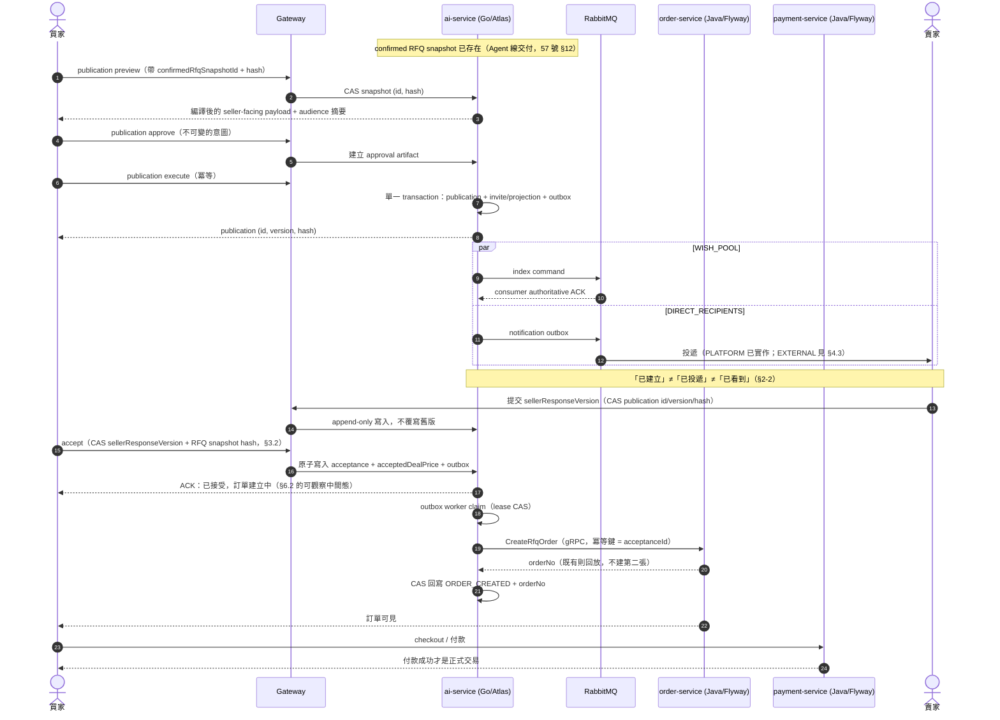
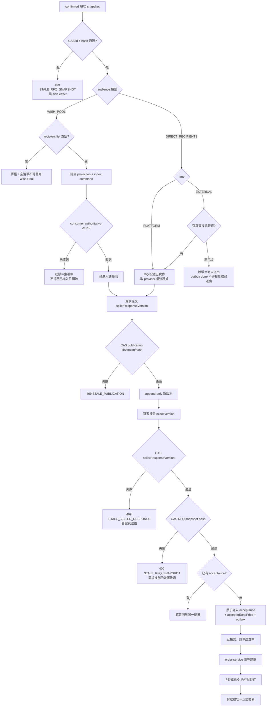
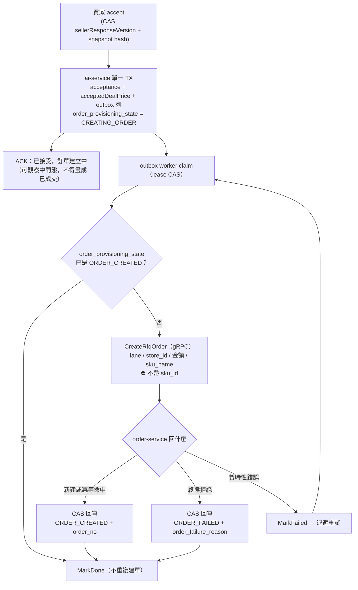
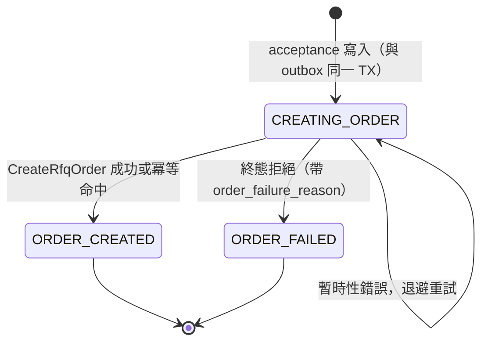

# 64 — Hawkr Agent 商務線（RFQ Publication、Seller Quote、Buyer Acceptance）詳細設計書

| 項目 | 內容 |
|---|---|
| 範圍 | confirmed RFQ snapshot **之後**的一切：publication approval／execute、投遞與可證實送達、賣家報價版本、買家 exact-version 接受、建單與付款接點、成交溫度計 |
| 不在範圍 | Agent runtime（見 57 號）、採購產品行為與 slot engine（見 55 號）、訂單／付款／發票各自的既有設計書（03／05／58 號） |
| 對應票 | #2450、#2539、#2538、#2537 |

---

## 0. 文件效力與來源

### 0.1 定位

本文件是這條識別鏈（snapshot → publication → seller response → acceptance → order）的**契約 SSOT**。
與 agent 線的切分依據見 ADR「Hawkr Agent 與交易線切分」（2026-08-22）：agent 線切在「準備詢價」，
本文件承接「不得自動聯絡供應商」的另一邊。

章節骨架採 57 號的形狀（不變式 → wire 契約 → 生命週期 → 持久化），不照單一服務的範本骨架——
本條線橫跨五個服務、兩種語言、兩套 migration 工具。

### 0.2 上游來源與效力

| 來源 | 效力 |
|---|---|
| `docs/開發規範/*`、`api/proto/`、CodeMeta、36 號 MQ catalog、DB schema | **高於本文件**。本文件不重述，只引用 |
| 57 號 §1.1（全域不變式）、§4.5（artifact type）、§5.7 | **本文件繼承，不重新解釋**。§5.7 已對本流程下的五條約束原封有效 |
| 四張票的 Scope 段 | 敘述層來源。⚠️ 票上的現況敘述**不是現況**，動工前一律重新核對 code 與 DB |
| 《Hawkr_Hawkr 幫找 Agent_詳細設計書_v6.0》Part V／V.7 | 參考來源，不可直接實作（理由同 57 號 §0.2） |

### 0.3 exact wire 住哪裡

本文件給的是**形狀約束與錯誤碼語意**（§9）；exact path／media type／proto message 以程式碼為準
（`backend/api/proto/ai/ai.proto`、gateway 的 `routes_ai.go`／`routes_vendor_portal.go`、ai-service 的 migration）。
當初凍結 wire 的兩份文件已從 repo 刪除，取捨收在 ADR，逐欄位原文只供考古：

| 範圍 | 取捨 | 原文（已刪除） |
|---|---|---|
| EXTERNAL lane 投遞（E1） | ADR `2026-10-03-vendor-portal-invite-scoped-access.md`（單體重做） | `backend/docs/superpowers/specs/2026-09-11-vendor-portal-e1-invite-email-design.md`（私人封存） |
| seller response ＋ buyer acceptance | 本文件 §6.2 | `backend/docs/superpowers/specs/2026-09-13-2538-seller-response-buyer-acceptance-wire-contract.md`（私人封存） |

程式碼註解裡的「wire 契約 §x」指的是後者的節號。

---

## 2. 全域不變式

繼承 57 號 §1.1 全部條文。以下是商務層自己的，違反者一律不接受。

1. **四種價格事實不得混稱**（57 號 §1.1-2 的延伸）。本文件是 `供應商報價` 與 `acceptedDealPrice` 這兩種的定義地。⛔ DB 既有的 `seller_unit_price`／`buyer_unit_price`／`seller_total_price`／`buyer_total_price` 是平台在 Pricebook 公斤價上疊 markup 算出來的，**不得遷移成賣家報價或成交價**，也不得改名假裝。它們的處置是 #2543 的範圍。

2. **「已建立」「已投遞」「已看到」是三個狀態，不得互相冒充。** DB 寫入成功不是投遞；provider accepted 不是 delivered；delivered 不是賣家看到。任何一層拿不到證據時，對外一律揭露為「未確認」而不是往上取整。這條是 #2539 的核心；對 #2537，僅 `outcomeDefinitionVersion=2`（真回覆機率版）需要這三態當樣本來源，`outcomeDefinitionVersion=1`（涵蓋率版）不依賴它，見 §2-5。

3. **接受是 exact-version 的。** 買家接受的對象是一個 `sellerResponseVersion`，不是「某個賣家的最新報價」。版本是 append-only：修改報價只能產生新版本，不得覆寫，也不得讓接受落在一個已被 supersede 的版本上而不報錯。

4. **一次接受最多產生一張待付款訂單，且必須與接受在同一個原子單位內成立。** 「接受成功但沒有訂單」與「訂單存在但接受未記錄」兩種中間態都不允許被觀察到。跨服務時見 §6.2 的代價說明。

5. **成交溫度計 v1 的 outcome 定義是「買家詢價區間涵蓋 Pricebook 對交期當日價格預測分布的比例」，不是賣家會不會回覆。** `outcomeDefinition = "BUYER_RANGE_VS_PRICEBOOK_FORECAST_COVERAGE"`、`outcomeDefinitionVersion = "1"`。兩個輸出皆為關於**市場價格**的機率，不是關於賣家回應：`probabilityLowerBps`＝嚴格界（市場價落在買家區間內）、`probabilityUpperBps`＝寬鬆界（市場價不超過買家上限）。演算法：以編譯後的參考三分位建分段線性 CDF（`F(P10)=0.10`、`F(P50)=0.50`、`F(P90)=0.90`），尾部截斷、不外插；買家區間完全落在參考區間之外時回 `UNKNOWN`＋`RANGE_OUTSIDE_REFERENCE`。`UNKNOWN` 的 reason code 值域：`MAPPING_MISSING`、`BUYER_RANGE_NOT_SET`、`RANGE_OUTSIDE_REFERENCE`、`QUANTILES_NOT_MONOTONIC`。色帶 `BANDS_V2`（<25% COLD、25–75% WARM、≥75% HOT）由 **server** 依 `probabilityUpperBps` 決定，亦即「買家上限落在行情分布的第幾百分位」。**買家畫面只顯示 `probabilityUpperBps` 一個數字**；`probabilityLowerBps` 留在 wire 上供 `outcomeDefinitionVersion = 2` 使用，但不呈現。

   ⛔ **client 不得自行推導色帶或機率**，不得用 candidate score 或 Pricebook 區間補值；`UNKNOWN` 時**仍不得**顯示 0%、百分比或色帶。溫度不產獨立 artifact，身分由 `procurement_price_previews` 的 `price_preview_id` ＋ `version` 承擔。

   > outcome 定義、色帶依據與 reason code 命名的取捨見 ADR [`docs/adr/2026-09-18-deal-temperature-outcome-definition.md`](../adr/2026-09-18-deal-temperature-outcome-definition.md)。

6. **publication 的 side effect 只有一個入口。** approval → execute，execute 是冪等的。⛔ 不得有第二條「順手也建一下 invites」的路徑。

---

## 3. 識別鏈與 CAS（本文件最重要的一節）

### 3.0 confirmed RFQ snapshot 的內容契約

🔴 **`payload_hash` 的 preimage 涵蓋賣家實際看到的完整內容**（11 欄），不是只有 pricing mode 與價格區間。
少了這一點，兩張品項、數量、城市全不同的詢價單會算出同一個 hash，CAS 形同虛設。
取捨見 ADR [`docs/adr/2026-09-18-rfq-snapshot-hash-preimage.md`](../adr/2026-09-18-rfq-snapshot-hash-preimage.md)。

`canonical_payload_json` **自帶** `item`／`itemResolution`／`quantity`／`unit`／`packaging`／`deliveryCity`／`deliveryDate`。
⇒ `domain.CompileSellerFacingPayload` **只讀這一份 JSON**，⛔ 不得 join `procurement_requests` 或 revision 表
——那條 join 不受 `payload_hash` 保護。鍵一律 camelCase（由 `payload_json_keys_test.go` 釘住）。

**seller-facing 投影白名單**：

| 欄位 | 投影 |
|---|---|
| `qualityKnowledgeState` | ✅ 投影。賣家不知道買家沒指定品相就會自己假設一個等級去報價 |
| `referencePriceRange` | ✅ **只投影 `lower` / `upper` / `basisQuantity` / `basisUnit`**；⛔ `midpoint` 不投影（它是 P50 的直接投影，屬 raw quantiles 排除類，由 `TestCompileSellerFacingPayload_DropsReferenceMidpoint` 釘住） |
| `buyerRequestedRange` | ✅ 投影 |
| `budgetPerUnit` | ⛔ **紅線，不投影** |

站外業者（`VendorPortalRFQDTO`）與平台賣家（`ProcurementSellerFacingPayloadDTO`）**兩側投影必須相同**
——兩者是同一張詢價單的報價方，內容分家等於同一筆交易有兩份事實。

🔴 **投影欄位皆為指標 ＋ `omitempty`**：該欄加入前建立的 approval 讀回 nil／空字串。
⛔ **消費端看到 nil 一律當「沒有這個事實」處理，不得補 0、不得猜一個區間**
——`BUYER_ENTERED_NO_REFERENCE` 模式本來就沒有 Pricebook 參考。


### 3.1 `expectedRfqSnapshotHash` CAS 的對象

**CAS 的對象是涵蓋 seller-facing 完整內容的 `payload_hash`**（品項 identity、數量、canonical unit
與換算基準、配送城市、交期、報價截止、pricing mode、價格區間），不是只含定價模式與價格區間的窄 preimage。

⛔ **不得改用「`(confirmedRfqSnapshotId, payloadHash)` 成對、由 ID 承擔識別」的做法**：
`procurement_confirmed_rfq_snapshots` 只有 INSERT 沒有 UPDATE 路徑，那樣的 hash 檢查恆為真
——一個看起來像 CAS、實際上擋不到任何東西的檢查，比沒有更危險。

⛔ **不得另立 `sellerFacingPayloadHash` 與既有 `payloadHash` 並存**：`payload_hash` 這個名字
在這條線上已經有過兩種語意，第三種只會讓下一個人再選錯一次。

> 取捨見 ADR [`docs/adr/2026-09-18-rfq-snapshot-hash-preimage.md`](../adr/2026-09-18-rfq-snapshot-hash-preimage.md)。

### 3.2 決策 D2：識別鏈上每一跳要帶什麼

不變式：**每一跳都必須能單獨證明「我接的是上一跳的哪一個版本」**，不依賴時間順序或「最新一筆」。

| 跳 | 由誰 CAS 誰 |
|---|---|
| publication preview／execute | CAS confirmed RFQ snapshot 的 `(id, hash)` |
| seller response 提交 | CAS publication 的 `(id, version, hash)` |
| buyer acceptance | CAS seller response 的 `(sellerResponseId, expectedSellerResponseVersion)`，**並**帶 RFQ snapshot hash |
| order shell 建立 | 由 acceptance 產生，不接受外部指定 |

**為什麼 acceptance 要同時 CAS 兩個對象**：只 CAS seller response version，擋得住「賣家改了報價」；只 CAS RFQ hash，擋得住「詢價單被換掉」。兩者是不同的失效模式，實務上都發生過（前者是賣家改價、後者是買家在另一個裝置改了需求），少任何一個都有一條真實的錯配路徑。

### 3.3 `quote_deadline` 與買家確認期限是兩件事（後者本線不引入）

v6 稿把「報價截止」與「請於 X 前確認」畫在同一張卡上，但它們在 wire 上不同源：

- **報價截止**：`api/proto/ai/ai.proto` 已有 `quote_deadline`（optional），屬 publication 的屬性。
- **買家確認期限**：目前**沒有來源**。interrupt 的 `expires_at` 註解明寫「empty string means no expiry (v1 interrupts don't expire)」。

🔴 **本線不引入買家確認期限。** 它會是一個新的 durable 屬性（要有 owner、到期後的狀態轉移、誰負責清理），不是在 UI 補一行文字；在它存在之前**前端不得憑空渲染**。⚠️ 與付款時限（建單 +12h，§6.4.11）是兩件事，不要互相代用。

---

## 4. Publication

### 4.1 approval 與 execute 分離

approval 是不可變的**意圖**紀錄，execute 是冪等的**效果**。🔴 **兩者不得合成單一 API**——57 號 §1.1-1 的「不得在無人確認下觸發對外通知」需要一個可稽核的「人確認過」的物件，合成之後就沒有那個物件了。

繼承 57 號 §5.7 的既有約束（原封有效，不重述）：artifact type 固定四種、核准不得由自由文字或模型產生、不得走 generic resume、execute 必須是單一 DB transaction。

> 🔴 **不提供 `WithdrawRfqPublication`：publication 發布後不可撤回。**
> 連帶地，rewind 路徑**沒有**「是否有進行中邀請」的守門——補一個等於買家一發布就永久鎖死。

### 4.2 兩條 audience pipeline 不共用完成定義

| | `WISH_POOL` | `DIRECT_RECIPIENTS` |
|---|---|---|
| execute 產出 | projection 來源 ＋ index command | recipient 快照 ＋ 每位一張 invite ＋ notification outbox |
| 「完成」的定義 | discoverability consumer 的 authoritative ACK | provider 層可取得的最強證據（見 §4.3） |
| 不得冒充 | 空 recipient list 不是 Wish Pool；index scheduled 不是 indexed | queued 不是 accepted，accepted 不是 delivered |

### 4.3 EXTERNAL lane 的對外狀態

- **PLATFORM**：有真實 MQ 投遞；缺的是 delivered／seen 的回饋軸。
- **EXTERNAL**：publisher 顯式跳過，outbox 列仍標 `done`。這是「系統假裝送出去了」的殘留來源。

**EXTERNAL 在哪一層被丟掉，兩條路徑不一樣**——這決定要動哪裡：

| 路徑 | repository 前置過濾 | publisher lane guard | EXTERNAL 實際在哪裡被丟掉 |
|---|---|---|---|
| `INVITE_SENT` | ❌ 無。`GetInviteNotificationRecipient` 依 `inviteID` 取單列，不分 lane | `quote_invite_publisher.go` Warn 後 `return nil` | **只有 publisher 這一層**。這是買家按下送出後賣家收不到的那條路 |
| `INVITE_LOST` | ✅ 有。`ListLostInviteNotificationRecipients` 只回 PLATFORM（該函式註解：「EXTERNAL rows are intentionally absent」） | 同上，但屬防禦性第二層 | repository，EXTERNAL 多半到不了 publisher |

判準的差別在於：`INVITE_SENT` 這條**沒有第二層防線**，它同時是誠實性缺口的所在地與唯一要動的接點；把兩條當成同一種形狀處理，會在 LOST 路徑上做無效工。

**判準**：EXTERNAL 在有真實投遞管道（vendor portal／email，屬 T17）之前，對外狀態必須是「尚未送出」而不是「已送出」。把 outbox 列標 `done` 是 worker 的內部語意，不得投影成買家看到的送達狀態。

### 4.4 端到端時序

`ai-service` 是 confirmed snapshot、publication、seller response、acceptance 的 owner；`order-service`／`payment-service` 只從 outbox 接冪等命令（§6.2 決策 B）。



### 4.5 判斷邏輯



---

## 5. Seller quote 與 buyer acceptance

### 5.1 `acceptedDealPrice` 的成立條件

`acceptedDealPrice` 只在「買家接受某個 exact `sellerResponseVersion` 且收到 server authoritative ACK」之後成立。**client 收到 HTTP 200 不等於成立**——若 ACK 與訂單建立不在同一原子單位內（§6.2 的跨服務情形），要有明確的補償或前滾路徑，且中間態不得對外顯示為「已成交」。

---

## 6. 跨語言邊界（本條線最貴的部分）

### 6.1 一張票要動五個 deployable

#2538 橫跨：Go `ai-service`、`api/proto`、Gateway、Java `order-service`、Java `payment-service`。migration 工具兩套且**不可混用**：Go 側 Atlas declarative schema，Java 側 Flyway versioned migration。

### 6.2 接受與建單的原子性

接受在 **ai-service 側原子寫入**（acceptance ＋ `acceptedDealPrice` ＋ outbox 列），
由 worker 投遞**冪等的建單命令**給 order-service。冪等鍵 ＝ acceptance id。

🔴 **兩者之間有一個可觀察的窗口**，期間狀態是「已接受，訂單建立中」。
**這個中間態必須是產品上明說的狀態**——買家看得到，⛔ **不得畫成「已成交」**。

⛔ **不得改由 order-service 主導**：acceptance 要 CAS 的對象（publication、seller response、
RFQ snapshot）全都住在 ai-service 的 DB，那會讓 §3 的 CAS 變成跨服務讀取。

> 取捨與被否決的方案見 ADR [`docs/adr/2026-09-18-rfq-acceptance-order-atomicity.md`](../adr/2026-09-18-rfq-acceptance-order-atomicity.md)。

### 6.3 migration 順序約束

- **Atlas 與 Flyway 不得互相引用**：任何一側的 schema 變更不得預設另一側已完成。
- **兩側都必須先加後用**：新欄位／新表先上線（expand），consumer 後接（migrate），舊路徑最後下架（contract）。
- **驗證只在 testcontainers／隔離 Docker DB**：dev／prod 共用環境禁止手動 Atlas apply 或 schema DDL。

### 6.4 acceptance → order shell 的落地契約

**`acceptedDealPrice` 對映到 order-service 既有的金額欄位，一欄都不必加。** 真正需要注意的不在金額，在政策六欄（6.4.5）與冪等鍵（6.4.7）。

⚠️ **適用範圍**：**兩條 lane 都走 `CreateRfqOrder`**，差別只有**賣方是誰**與**政策六欄走哪一組**。

🔴 **關鍵事實：賣家回價不綁任何 SKU。** `procurement_seller_response_versions` 與 `procurement_buyer_quote_acceptances` 對 `sku`／`product` 都是**零命中**——賣家報的是「200 公斤、總價 30000」這種自帶 unit basis 的承諾，不是「買 N 件某商品」。

⇒ **PLATFORM lane 的成交也不是 SKU 購買，一樣沒有庫存可扣。** 候選的 `sourceId` 是 `product_id`，但那是**候選怎麼被找到**，不是成交的標的。要對它扣庫存，得自己發明一條從報價回推候選商品的對應，而候選是探索產物不是契約。

⚠️ **連帶後果要明說**：平台賣家的 RFQ 成交**不會減少他上架商品的庫存**。那是正確的——賣的不是那個 SKU——但營運上要知道。

⇒ 投遞端仍依 `procurement_buyer_quote_acceptances.lane` 分流，但分的是**同一支 RPC 的兩組參數**，不是兩條路徑：

| | `PLATFORM` | `EXTERNAL` |
|---|---|---|
| `store_id` | 回價那個平台賣家自己的 store | 平台結算 store（設定提供） |
| 政策六欄 | 賣家直營（見 6.4.5） | **賣家直營（同左）** |
| `mer_id` | 賣家子商店的 PayUni MerID | **同左**：結算 store 自己的 PayUni MerID |
| 扣庫存 | **否** | **否** |
| `order_items.sku_id` | **NULL**（non-catalog line，見 6.4.9） | **NULL**（同左） |

⇒ **兩欄相同之後，lane 在建單端的唯一分歧點是 `store_id`。** 它仍必須 fail-closed 而不是合併掉：`lane` 是 acceptance 上的既有事實，未知值代表投遞端壞了。

⛔ **未知 lane fail-closed**，不猜——理由同 `OrderPolicyResolver` 對未知配送方式的處置：這一格的輸出會成為撥款與開票的法源。

#### 6.4.1 建單路徑：新增 `CreateRfqOrder`，不改 `createOrder`

`OrderService.createOrder` 有兩個入口（gRPC `CreateOrder` 與 `createOrderFromCheckout` 委派的擴展版），兩條都無條件呼叫 `ProductService.DeductStock`。要讓 EXTERNAL lane 跳過扣庫存，得動四個位置——`stock_tx` INIT 寫入、`deductStock()` ＋ status switch、`createOrderInTx()` 結尾的 `updateStatusAndOrderNo()`、catch 裡的 `compensateStock()`——其中後兩者位於 `@Transactional` 的 TX handler 與補償路徑**內**。那是全平台共用的庫存協調路徑，改錯會誤扣一般訂單的庫存，正是 §6.2 否決 2PC 時用的同一條理由。

⇒ 新增 `CreateRfqOrder`，只接手 orchestration（不扣庫存、不鎖購物車、不進補償 worker）；**持久化仍呼叫現行 `OrderCreationTxHandler`**（`stockTxId` 傳 null），因此 `order_items` 寫入與 `order_invoice_snapshots` 缺省列這兩件事照樣沿用。⚠️ 缺省發票快照**不能不寫**：invoice-service 對「查無快照」是 fail-loud，`order.paid` 重試三次進 DLQ。

#### 6.4.2 金額對映

`procurement_buyer_quote_acceptances` 已有 `chk_prbqa_price_is_sum`：`accepted_deal_price = goods_amount + shipping_amount + tax_amount`。對映到 03 號設計書 §3.2 的欄位語意：

| acceptance 欄 | orders／order_items | 備註 |
|---|---|---|
| `accepted_deal_price` | `orders.total_actual_amount`，同時 ＝ `total_original_amount` | RFQ 無優惠券 ⇒ `discount_amount = 0`、`coupon_instance_id` 留空 |
| `shipping_amount` | `orders.shipping_fee`，`shipping_fee_payer = '3101'`（BUYER） | 賣家報價已把運費計入總額 ⇒ 03 §3.2 對帳式的「買方負擔時」成立 |
| `goods_amount + tax_amount` | 單一 `order_items` 列 | 見 6.4.3 |
| `tax_amount` | **不新增任何欄位** | 見 6.4.4 |

對帳式 `sum(order_items.actual_pay_amount) + shipping_fee（買方負擔時）= orders.total_actual_amount` 因此恆等成立，且全程整數運算。

#### 6.4.3 `order_items` 恆為一列且 `quantity = 1`

`order_items.quantity` 是 `INT`，而 `procurement_seller_response_versions.offered_quantity` 是 `NUMERIC(14,3)`——「12.5 公斤」是合法報價。**小數數量在既有型別下表達不出來，而放寬型別會動到所有訂單。**

⇒ 整筆成交落成一列：`quantity = 1`、`unit_price = list_price = goods_amount + tax_amount`、`share_discount = 0`、`actual_pay_amount = unit_price`。真實數量與單位寫進 `sku_name`。

⛔ **`sku_name` 禁止 sentinel**——退款、售後、發票三條下游都吃它。⚠️ **這條禁令只約束品名，不約束 `sku_id` 指向誰**：品名是 `order_items` 自己的快照欄，由呼叫端傳入（`OrderCreationTxHandler.insertOrderItems`），不經 product-service 反查。`sku_id` 的規格見 6.4.9。

#### 6.4.4 `tax_amount` 不進 orders

CodeMeta 的 `ProcurementTaxInclusionBasis` 已明文：`taxInclusionBasis` 是**申報**不是計算依據，server 只驗 `total = goods + shipping + tax`，不依它反推或改寫任何金額。開票側也不吃上游申報值——`InvoiceDocumentKind` 的定版本設計（引 58 §5A.6.2）規定 B2C 的 `TaxAmount` 一律 0 ＋ `DetailVat=1`（含稅明細），B2B 僅表頭拆稅，稅額由含稅總額推導。

⇒ 賣家申報的 `tax_amount`／`tax_inclusion_basis` 留在 ai-service 當 provenance，不複製進訂單。

#### 6.4.5 🔴 政策六欄不能用 `OrderPolicyResolver`

**這一條最容易漏。** `OrderPolicyResolver.resolve()` 的輸入是**配送方式**，而 RFQ 的政策依據是**賣方是誰**。PLATFORM lane 算出來的六欄碰巧與 resolver 對 `3005` 的結果相同（`SELLER_DIRECT`／`SELLER_MERCHANT`／`SELLER_TO_BUYER`／`SELLER_MANAGED`，不帶附約版本），但**明寫而不呼叫它**——哪天 resolver 為了別的理由改了，RFQ 不該跟著漂。

🔴 **EXTERNAL lane 不得寫受託代銷四值**（`PLATFORM_CONSIGNMENT`／`PLATFORM_AGENT_MERCHANT`／`PLATFORM_TO_BUYER`）。`OrderPolicyResolver` 的 javadoc 逐字寫著受託代銷「**刻意尚未啟用**，這不是還沒寫而是 fail-closed」，兩個理由是①撥款指示費的費率未經正式契約確認 ⇒ 撥款鏈整條不得啟用；②賣家→平台的進項發票軸尚未落地 ⇒ 撥款資格恆 BLOCKED。結帳路徑因此一律推導 `SELLER_DIRECT`，payment-service 的 `V9__add_logistics_finance_tables.sql` 亦將 `PLATFORM_CONSIGNMENT` 那條鏈註明為不可達、已退役。⇒ 在 `CreateRfqOrder` 寫那組值等於繞過該閘門，而三條 CHECK 只驗欄位彼此一致、擋不下來。

⇒ **兩條 lane 的政策欄相同**，lane 的差別只剩「賣方是誰」（`storeId`，投遞端已解好）：

| 欄 | 兩條 lane 的 RFQ 值 | 守門（order-service 的 DB CHECK） |
|---|---|---|
| `commerce_model` | `SELLER_DIRECT` | `chk_orders_policy_matrix`（與下一欄雙向等值） |
| `collection_model` | `SELLER_MERCHANT` | 同上 |
| `invoice_model` | `SELLER_TO_BUYER` | `chk_orders_invoice_collection`（與上一欄雙向等值） |
| `fulfillment_mode` | `SELLER_MANAGED` | `chk_orders_fulfillment_mode_consistent`（3005 必然） |
| `policy_version` | 由 `CreateRfqOrder` 自帶 | — |

EXTERNAL lane 的語意因此是「**平台結算 store 這個賣家自己賣**」：`orders.store_id` ＝ 結算 store，`orders.mer_id` ＝ 該 store 自己的 PayUni 子商店，發票由該 store 以賣家身分開立。

⚠️ **退場的是帳務形狀，不是值域**：`PLATFORM_CONSIGNMENT`／`PLATFORM_AGENT_MERCHANT`／`PLATFORM_TO_BUYER` 仍是 `chk_orders_*` 的合法值、CodeMeta 也原樣保留（payment-service 的 `LedgerTxn` 仍引用），只是**再也沒有寫入路徑**。要啟用受託代銷，改的是 `OrderPolicyResolver`（加賣家契約查詢）＋ 清掉上述兩個前置，**不是**在 `CreateRfqOrder` 裡把那組值填回去。

三條 CHECK 都已隨 V14 上線（第四條 `chk_orders_consignment_agreement` 已於 2026-09-20 隨附約版本退場，V16）。`OrderCreationTxHandler.createOrderInTx` 收的是 `OrderPolicySnapshot` 參數而非 resolver，所以 `CreateRfqOrder` 自組一份即可，TX handler 仍然共用。

⚠️ 政策欄與 resolver 現在同值，但仍**明寫而不呼叫 resolver**——依據不同（賣方身分 vs 配送方式），resolver 哪天為了別的理由改了，RFQ 不該跟著漂。⚠️ 政策欄填錯不會被 CHECK 擋下——三條 CHECK 只驗欄位彼此一致，不驗它對不對這張訂單，而那六欄會成為撥款與開票的依據。

#### 6.4.6 配送方式 ＝ `3005`

`MERCHANT_DELIVERY`（賣家自行配送，無外部 provider API）：站外業者自己出貨，平台不安排物流。連帶好處是 Uber Direct 資格閘門只在 `shippingMethod = 3003` 時 applicable ⇒ RFQ 不受影響。

#### 6.4.7 冪等鍵 ＝ `buyerAcceptanceId`

需要 orders 上的新欄位 ＋ unique index（Flyway，expand-only）。⛔ **不得複用 `checkout_id`**：它非空就會觸發 `cartGrpcClient.checkoutLock()`，去鎖一個不存在的購物車；而 gRPC 那條建單入口本來就沒有任何冪等。

#### 6.4.8 佈署前置只剩一項：平台結算 store

**唯一前置是平台結算 store 本身**（`PROCUREMENT_SETTLEMENT_STORE_ID`）。⚠️ `PAYUNI_AGENT_MER_ID` 不是本線的前置——EXTERNAL lane 不走代理商戶收款（6.4.5）；受託代銷附約版本已隨 order-service Flyway `V16` 整條退場。

🔴 **結算 store 必須真實存在於單體 seller 模組**，不只是一個設定值：gateway 的 `batchGetSellerMeta` 對查不到的 store 是 fail-soft（不 crash），後果是**買家在訂單上看到沒有賣方**。⇒ 佈署清單是「seed 一筆 store → 確認單體 seller 模組查得到 → 才把它的 id 填進設定」，三步不可只做第一步。

🔴 **該 store 必須有可用的 PayUni 子商店**：`orders.mer_id` 取自 `sellerMeta.payuni_mer_id`，空值時 `CreateRfqOrder` 在**建單當下** fail-closed（`SELLER_NOT_ONBOARDED`）。這一格接手的是原本 `PAYUNI_AGENT_MER_ID` 那道 fail-closed——收款主體換人之後，風險從「沒設代理商 MerID」變成「這個 store 沒有 PayUni 子商店」。沿用 `CheckoutService.resolvePaymentMerId` 的同一條紀律：擋在建單當下，**不是建單後才發現**。

⚠️ **結算 store 的顯示名稱不需要另外約束**：發票開立人就是該 store 這個賣家本身，訂單賣方與發票開立人**結構上同一個**。

⚠️ **prod 沒有 PayUni MoR 子商家這項前置**：EXTERNAL lane 不走代理商戶收款，prod 的收款前置與一般賣家相同（該 store 完成 PayUni 開通）。
🔴 **但 prod 必須確認結算 store 的開票法律實體**：`seller_tax_profiles` 的 `legal_name`／`tax_id` 決定發票抬頭與統編，且 `review_status` 必須是 `APPROVED_INVOICE_REQUIRED`、`invoice_provider_accounts` 必須有 `ACTIVE` 的 AMEGO 帳戶且 `automation_cutover_at` 已過，否則決策樹落 `NOT_APPLICABLE / TAX_PROFILE_NOT_APPROVED`（安全但開不出票）。

#### 6.4.9 🔴 RFQ 明細是 non-catalog line，不建任何商品

**結論：`order_items.sku_id` 放寬為 nullable，RFQ 明細不指向任何 `product_sku`。**

**為什麼不是「建一筆商品給它指」**：`order_items.sku_id` 原為 `NOT NULL`，於是建單前必須先有 SKU。為了滿足這個外鍵而每筆成交生一筆 `product_sku`，會連帶長出三筆負債：

1. **catalog 污染**——結算 store 底下累積從未上架的幽靈品，進商品搜尋、報表與分類統計；
2. **生命週期無主**——誰清、保不保留、對 product-service 報表的影響，至今無人負責；
3. **權限耦合**——`createProduct` 走 `requireSellerOrDelegated(PRODUCTS_WRITE)`，投遞 worker 既不是賣家也不是代行，得為它另開一支 internal RPC，等於把建單耦合到 catalog 的寫入權限。

而 sentinel（所有 RFQ 明細共用一筆固定 SKU）與每筆建**都違反同一條驗收底線**：「不得把 quote 偽裝成 cart SKU」。兩者只是偽裝的粒度不同。

**為什麼放寬是正確的模型**：這張表**本來就是快照式明細**——`product_id` 早已 nullable，`product_name`／`sku_name`／`unit_price`／`image_object_key` 全是下單當下的快照。`sku_id NOT NULL` 是唯一殘留的參照式約束。B2B 採購與 ERP 對同一問題的標準模型是把明細分成 catalog 與 **non-catalog（free-text）**兩類：後者帶品名、單位、單價與分類碼但沒有商品主檔。放寬後 RFQ 明細即該類。

**判別**：`sku_id IS NULL` 本身即「這是 non-catalog line」，**不需要新增判別欄**；訂單層另有 `orders.acceptance_id`（partial unique，只對 RFQ 訂單有值）可交叉驗證。

**影響面（逐處核對結果）**：

| 消費端 | 影響 |
|---|---|
| order-service | `sku_id` 的讀取全在庫存與 checkout 路徑（`deductStock`／`compensateStock`／`ProductForCheckoutInfo`）；RFQ 走 `stockTxId = null` 且 `checkoutId` 留空，**兩者皆不適用** |
| invoice-service | `TaxCategoryResolver` 只有 `SellerDefaultTaxResolver` 一個實作，其 `ResolveProduct(int64)` **忽略參數**回賣家預設課稅別 ⇒ 稅別不依賴 `sku_id`。`invoice_document_lines.sku_id` 本來就 nullable，**不需 migration** |
| aftersales-service | 🔴 **唯一的真硬相依**：建案時 `parseLongRequired(item.getSkuId(), "skuId")`，且 `aftersale_case_items.sku_id` 為 `NOT NULL`。兩處都要放寬，否則 RFQ 訂單開不了售後單 |
| gateway | 訂單明細 DTO 已是 `json:"skuId,omitempty"` ⇒ 缺值自然不出現在回應，**不需改動** |

**既有約束不動**：`UNIQUE (order_no, sku_id)` 與 `idx_order_items_sku_id` 維持原狀。PostgreSQL 視 NULL 互不相等，而 RFQ 訂單恆為一列（6.4.3）⇒ 不可能自撞；catalog 訂單的 `sku_id` 仍非空，約束原樣成立。

**遷移相容性契約（expand → migrate → contract）**：

🔴 **讀取端必須先容忍 NULL，才可以開始寫入 NULL。** 具體地說，下列四項全部部署並驗證之後，
投遞端才可以不帶 `sku_id`：

| # | 讀取端容忍 |
|---|---|
| 1 | `order_items.sku_id` `DROP NOT NULL` |
| 2 | `aftersale_case_items.sku_id` `DROP NOT NULL`，且建案時的必填 parse 改為可選 |
| 3 | `CreateOrderItemParam.skuId` 為 `Long`（非 primitive），order-service 的 `createRfqOrder` 對該欄不再走必填 parse |
| 4 | invoice-service 的 Go 型別可表達缺值（見 6.4.15） |

⛔ **把兩者併成一次部署就沒有相容窗口**——第 1～4 項的意義正是讓舊 pod 與新 pod 都讀得了。
⛔ 第 3 項漏掉的話，投遞端第一次呼叫就會拿到 `INVALID_PARAM`。

**不動 proto**（理由見 6.4.15），因此沒有欄位退場的第三階段。

#### 6.4.10 收款／開票／撥款的分流鍵 ＝ 政策六欄，**不新增 `order_channel`**

上游規格要求「收款、發票與撥款依 `orderChannel` 分流」，並以 `RFQ_MOR` 為該鍵的值。**本文件不採用該欄位**——核對後確認我方**已有**表達同一語意的值域，且保護更強：

| 上游要表達的 | 我方既有欄位與值 | 守門 |
|---|---|---|
| 平台收款（代理商戶 MerID） | `collection_model = PLATFORM_AGENT_MERCHANT` | `chk_orders_policy_matrix`；`resolvePaymentMerId` **必須由本值驅動**，env 未設定時結帳當下 fail-closed |
| 平台對買家開票 | `invoice_model = PLATFORM_TO_BUYER` | `chk_orders_invoice_collection` 與上一列**雙向等值** |
| 受託代銷、再結算撥付賣家 | `commerce_model = PLATFORM_CONSIGNMENT` | `chk_orders_policy_matrix` |

三個值皆已定義於 CodeMeta 的業務類型碼，且 `PLATFORM_CONSIGNMENT` 的語意逐字涵蓋「收款、開票、撥付」三者。

⚠️ **上表描述的是值域的表達力，不是 RFQ 寫的值**：RFQ 兩條 lane 都寫賣家側三值（6.4.5），上表三個平台側值**沒有任何寫入路徑**。本節的結論（不新增 `order_channel`）不受影響——它成立的理由是「政策欄可互相推導且有 CHECK 保護」，與 RFQ 寫哪一組值無關。

⛔ **不新增 `order_channel` 的理由**：它與上表**可互相推導**（`collection_model` 已決定 MerID、`invoice_model` 已決定開票人，兩者由 CHECK 雙向綁死），新增一欄等於把同一事實存兩份而第二份**沒有任何 CHECK 保護**——下游若改讀它，就繞過了既有的 fail-closed。

**需要「只看 RFQ 訂單」的地方**（例如 admin 篩選）改用既有識別：`orders.acceptance_id IS NOT NULL`（partial unique 已在線，6.4.7），或政策六欄的組合。⇒ **本項不產生任何 schema 變更。**

#### 6.4.11 `payment_deadline` ＝ 建單 +12h

上游規格對 RFQ 結帳的 `initial_deadline` 規則逐字為「建單+12h」。⚠️ 該規則出現在一份**歷史拓撲**的表定義裡（`checkout_intents` 那套，本文件 §0.3 已明文不實作）——**此處只採用其產品意圖，不引進該拓撲**，與 6.4.1 採用 `CreateRfqOrder` 命名的用法一致。

由 order-service 於建單時設定（它已持有 `PENDING_PAYMENT` 的既有時限機制），不由投遞端帶入：時限是訂單的屬性，不是接受的屬性。

#### 6.4.12 Schema 契約（跨兩套工具）

⛔ Atlas 與 Flyway **不得互相引用**，兩側各自先加後用（§6.3）。

**order-service（Flyway）**

```sql
ALTER TABLE order_items ALTER COLUMN sku_id DROP NOT NULL;
COMMENT ON COLUMN order_items.sku_id IS
    '目錄商品 SKU。NULL 代表 non-catalog line（RFQ 成交），非資料損壞；
     品名由 sku_name 承載，不得為 sentinel。64 號 §6.4.9';
```

⚠️ `UNIQUE (order_no, sku_id)` 與 `idx_order_items_sku_id` **不動**（理由見 6.4.9）。

**aftersales-service（Flyway）**

```sql
-- 售後明細同步放寬，否則 RFQ 訂單開不了售後單（6.4.9 影響面表）
-- ⚠️ 表名無中間底線（2026-09-21 訂正，原文誤作 after_sale_case_items）：
--    V1__init_aftersales_tables.sql 的 CREATE TABLE、AfterSaleCaseItemEntity 的
--    @TableName、實際 DB 的 information_schema 三者一致。
ALTER TABLE aftersale_case_items ALTER COLUMN sku_id DROP NOT NULL;
```

**ai-service（Atlas declarative schema）**

```sql
-- ORDER_FAILED 目前只有狀態沒有原因，分不出「order-service 拒絕」與「worker 自己出錯」；
-- outbox 的 last_error 是另一張表的欄位，acceptance 讀不到。
ALTER TABLE procurement_buyer_quote_acceptances
    ADD COLUMN order_failure_reason TEXT;
```

值域走 CodeMeta，⛔ 不新增第二套數字碼。⚠️ **不加 CHECK 綁定 state**：`ORDER_FAILED` 之外的狀態該欄恆為 NULL 是寫入端的責任，加 CHECK 會讓未來新增 reason 值時動到既有列的約束。

**不需要 migration 的兩處**（已核對）：`invoice_document_lines.sku_id` 本來就 nullable；gateway 無自有 schema。

#### 6.4.13 資料流與狀態機

**acceptance → order shell 的資料流**：



⛔ **`DuplicateKey` 屬於「冪等命中」不屬於「終態拒絕」**——order-service 那側已回查既有訂單，worker 若把它當錯誤會把 acceptance 標成 `ORDER_FAILED`，而訂單其實建好了。

**`order_provisioning_state` 狀態機**（`chk_prbqa_order_provisioning_state` 已在線）：



⚠️ **`ORDER_CREATED` 與 `ORDER_FAILED` 都是終態**，沒有回頭邊。`chk_prbqa_order_no_matches_state` 已強制 `(state = 'ORDER_CREATED') = (order_no IS NOT NULL)`——回寫時兩者必須同一次 UPDATE，不可分兩步。

**回寫用 CAS on `version`**：影響 0 列代表另一個 worker 副本先寫了，**視為成功**而非衝突——outbox 的 at-least-once 本來就允許兩個副本同時跑到這一步。

#### 6.4.14 失敗處置：重試上限與 `order_failure_reason` 值域

**重試上限沿用 `pkg/outbox` 既有機制，不另發明**：`Config.MaxAttempts`（`publicationoutbox` 現值 **5**，第一次呼叫算 attempt 1），達到上限由框架的 `OnTerminalFailed(ctx, row, newAttempt, lastErr, markFailedErr)` hook 觸發。⇒ 本 worker 在該 hook 內把 acceptance 轉 `ORDER_FAILED` 並寫入 reason，**與 outbox 列轉終態同一個交易**。

⛔ **沒有上限＝無限重試**：一筆因設定缺失或參數不合法而永久失敗的 acceptance，會讓 worker 每輪重跑它。上限是它唯一的出口。

**`order_failure_reason` 值域**（CodeMeta 新增 `ProcurementOrderProvisioningFailureReason`）：

| 值 | 何時 | 可否靠重跑自癒 |
|---|---|---|
| `CONFIGURATION_MISSING` | 結算 store id 未設定（`PROCUREMENT_SETTLEMENT_STORE_ID`）。⚠️ 只有這一項：EXTERNAL lane 不讀 `PAYUNI_AGENT_MER_ID`（6.4.5） | 否——補設定後需人工重放 |
| `UNKNOWN_LANE` | `lane` 不是 `PLATFORM` 也不是 `EXTERNAL`（fail-closed，6.4 適用範圍） | 否 |
| `RECIPIENT_VALIDATION_FAILED` | order-service 的 PayUni 收件人姓名／地址驗證未過（6.4.1 的縱深防禦） | 否——需買家改收件資料 |
| `ORDER_SERVICE_REJECTED` | order-service 回終態拒絕的其餘情形 | 視情形 |
| `RETRY_EXHAUSTED` | 暫時性錯誤累積達 `MaxAttempts` | 是——排除根因後重放 |

⚠️ **值域刻意維持粗粒度**：本欄會成為 acceptance 的可觀察狀態，細分會讓每個新錯誤情境都要改值域與消費端。**細節放 `procurement_order_provisioning_outbox.last_error`**——它與 acceptance 同一個服務、同一個 DB，`acceptance_id` 可直接 join。

🔴 **本欄指向的細節必須是可直接驗證的**：`last_error` 是**同交易寫入的 DB 欄位**，不是 log／trace 之類的另一個管道。驗收時直接 `SELECT last_error FROM procurement_order_provisioning_outbox WHERE acceptance_id = …`，⛔ 不得把細節指向任何需要 exporter 才讀得到的地方。

#### 6.4.15 「沒有 SKU」在型別與 wire 上怎麼表達

放寬 DB 欄位只是第一層；值要跨三個服務傳遞，**每一層各自要能表達缺值**。

**wire（三條跨服務路徑）＝ 空字串，proto 零改動。** 所有 `sku_id` 在 proto 上都是 `string`（TSID 數字字串）。本 repo 對「字串型 optional」的既有慣例就是空字串——`createRfqOrder` 同一支呼叫裡的 `deliveryTemp` 就是這樣寫的：`request.getDeliveryTemp().isEmpty() ? null : request.getDeliveryTemp()`。

⇒ **不改成 proto3 `optional`、不改欄位、不動任何 `.proto`。** 連帶好處有兩個：不觸發共用 proto 的全艦隊重建；欄位不必退場，也就沒有 contract 階段。

| 路徑 | 缺值表達 | 消費端判定 |
|---|---|---|
| ai-service → order-service（`CreateRfqOrderRequest.sku_id`） | 不設值 ⇒ 收到 `""` | `isEmpty()` ⇒ 傳 null 給下一層 |
| order-service → invoice-service（訂單快照） | `NULL` 序列化為 `""` | 解析空字串為「無」 |
| order-service → aftersales-service（建案明細） | 同上 | 同上 |

**Java 型別：`CreateOrderItemParam.skuId` 必須是 `Long` 而非 primitive `long`**——primitive 傳不進 `null`。⚠️ 這個 record **兩條建單路徑共用**，改簽名會碰到 catalog 路徑的呼叫端——它們原本傳 primitive，改後自動裝箱，行為不變，但**要一起編譯與測試**。`OrderItemEntity.skuId` 已是 `Long`，不用動。

**Go 型別**：invoice-service 的 `domain.OrderItem.SkuID` 從 `int64` 改為 `*int64`，解析端把 `""` 映成 nil。⚠️ `invoice_lines.go` 目前把 `SkuID` 同時用在 `resolver.ResolveProduct(it.SkuID)` 與寫進 `Line.SkuID`；前者忽略參數（6.4.9），後者落進本來就 nullable 的 `invoice_document_lines.sku_id`。

⛔ **不要用 0 當哨兵**。`0` 在 TSID 定義域外，看起來安全——但它會讓「沒有 SKU」與「解析失敗」共用同一個值，而後者是 bug。這正是本設計書 §2 對哨兵的一貫立場。

---

## 9. 命令契約（形狀約束與錯誤碼）

exact path／media type／proto message 凍結在 §0.3 索引的 wire 契約文件裡。本節定的是**不論怎麼凍結都必須成立**的形狀約束。

### 9.1 每個命令的必要與禁止內容

判準一致：**命令只帶「指向哪一個版本」的識別與 CAS，不重送內容**。內容由 server 從已持久化的來源編譯——重送內容就等於開了一條讓 client 竄改詢價單的路。

| 命令 | 必須帶 | ⛔ 不得帶 |
|---|---|---|
| publication preview／execute | 穩定 idempotency key、`expectedRevisionId`、`confirmedRfqSnapshotId` ＋ hash、typed audience | subject、quantity、unit、budget、price、quality、candidate facts、任何 free-form RFQ 內容 |
| seller response submit／revise／withdraw | 穩定 idempotency key、publication identity ＋ version ＋ hash | 買家私有預算、buyer PII、其他賣家的報價 |
| buyer acceptance | `sellerResponseId`、`expectedSellerResponseVersion`、RFQ snapshot hash（§3.2） | 任何金額——`acceptedDealPrice` 由 server 從被接受的版本取，client 不得指定 |

**64-bit ID 與 TWD 金額一律 decimal string**（Proto 管理規範 §6）。核心 amount／version／hash 不得只埋在不受約束的 free-form JSON 裡。

### 9.2 錯誤碼語意

| 錯誤碼 | 何時 | side effect |
|---|---|---|
| `STALE_RFQ_SNAPSHOT` | snapshot 的 id／hash CAS 不符（需求被其他裝置改過） | 零。不得建立任何 publication 或 acceptance 列 |
| `STALE_PUBLICATION` | publication 的 id／version／hash CAS 不符 | 零 |
| `STALE_SELLER_RESPONSE` | `expectedSellerResponseVersion` 不是目前版本（賣家已改價／已撤回） | 零。**必須明確告知買家報價已變動**，不得靜默改接受最新版 |
| `IDEMPOTENCY_KEY_CONFLICT` | 同一 idempotency key 但輸入不一致 | 零。不得靜默回放上一次的結果 |
| `PUBLICATION_NOT_DELIVERABLE` | audience 解析後無合格收件者（含空 Wish Pool） | 零（§4.2） |

**冪等慣例沿用既有**：同一 buyer ＋ 同一 `clientRequestId` 重送回同一筆既有結果，不重算、不重打下游；輸入不一致才回 `IDEMPOTENCY_KEY_CONFLICT`。這與 `procurement_price_previews`／`procurement_confirmed_rfq_snapshots` 的既有唯一鍵慣例一致，不另立第二套。

### 9.3 授權邊界

- 賣家命令只能作用在**自己被邀請的** publication 上；跨賣家猜 id 一律回 404（不是 403——403 會洩漏該 id 存在）。
- 買家命令只能作用在自己的 request 上，比照 `PricePreviewReader.GetPricePreview` 既有的 `(id, buyerID)` 雙鍵查詢慣例。
- 公開（免登入）路徑只有 EXTERNAL lane 的 token 落地頁；它**不得**成為第二個 side-effect 入口（§2-6）。
