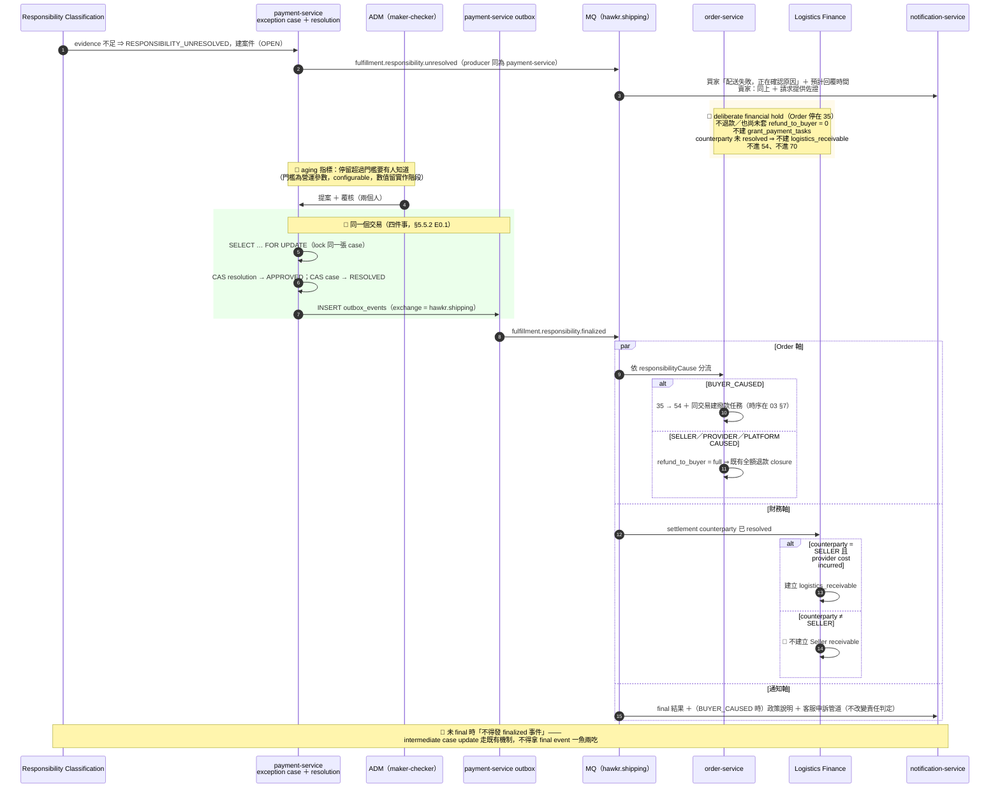
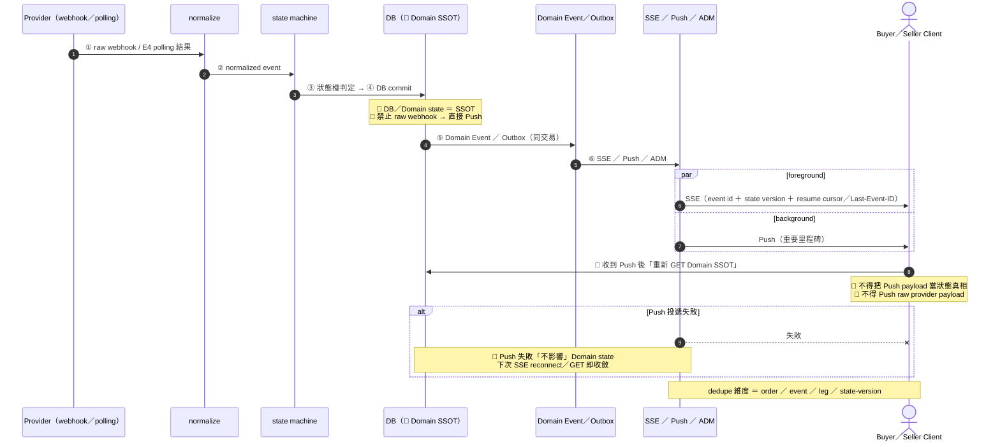

# 65　物流履約平台（Fulfillment Platform）詳細設計書

> 🔴 **物流財務網域的 runtime owner ＝ `payment-service`**（package 根 `io.github.will413028.hawkr.payment.logistics`，Java）。
> 線 B（平台→賣家收物流服務費）與線 C（平台↔物流商結算）的 9 張表
> （`logistics_receivables`／`logistics_collection_attempts`／`seller_logistics_accounts`／
> `logistics_adjustments`／`ledger_transactions`／`ledger_entries`／`provider_settlement_lines`／
> `fulfillment_exception_cases`／`fulfillment_case_resolutions`）落在該服務的 Flyway
> `V9__add_logistics_finance_tables.sql`，現行契約在
> [70 號](70-物流財務結算%EF%BC%88Logistics%20Settlement%20%26%20Receivable%EF%BC%89詳細設計書.md)。
>
> 🔴 **F 軸（賣家→平台進項發票義務）與 G 軸（撥款指示）的適用條件是
> `commerce_model = PLATFORM_CONSIGNMENT`**。該值的唯一推導點是 `OrderPolicyResolver`
> （`services/java/order-service/src/main/java/io/github/will413028/hawkr/order/checkout/OrderPolicyResolver.java`），
> 而五種履約方式一律推導 `SELLER_DIRECT`（§0.6.2）⇒ 這兩軸的表、事件與鏈路全部以該值為啟用前置。
> ⚠️ **啟用前置條件（缺一不得放行）**：① `OrderPolicyResolver` 推導得出 `PLATFORM_CONSIGNMENT`
> ② 走 [36](36-MQ%20與事件總覽（MQ%20&%20Event%20Catalog）.md) §十的新增 MQ 流程與 §3.3.1 的四面登記
> ③ 走《新增微服務指南》從頭做一次。**不得因為「本書有寫」而略過登記。**

> **服務定位**：本書是物流履約領域的**骨幹**——正規化配送域模型、四個正交維度、統一狀態機、事件 envelope、
> provider adapter 邊界、責任與退款矩陣、帳本／撥款／結算，以及與 58 號電子發票鏈的接縫，**只在本書定義一次**。
> 66（Uber Direct）／69（商家自有出貨）／68（7-ELEVEN 大宗寄倉）**只准引用，不得各寫一份**。

> 🔴 **商流（讀本書任一帳務章節之前必讀）**：
> **五種履約方式一律 `commerce_model = SELLER_DIRECT`**；平台對 `3003`（Uber Direct）另向賣家收
> 「**平台 → 賣家的 Uber 物流服務費**」（PayUni `agent_fee`，FeeType=4）並開票。
> `PLATFORM_CONSIGNMENT`（平台受託代銷／平台代收／平台對買家開票／平台撥款）是**值域內的保留值**。
> ⇒ 本書的**帳本（§5.3）／撥款（§5.4）／撥款指示費（§5A.2）／F 軸／G 軸**的適用條件一律是
> `commerce_model = PLATFORM_CONSIGNMENT`。
> 完整對照見 **§0.6**，與需求書的衝突登記見 **§3.8b C-1**。

| 配套文件 | 位置 |
|---|---|
| 需求來源 | Hawkr 物流加強詳細規劃書 v1.4；Uber 商流以 **§3.8b C-1** 的登記為準 |
| 母系統（本書是它的重大擴充） | `06-物流微服務（Shipping Service）詳細設計書.md` |
| Webhook 服務（Uber webhook 落點） | `10-PayUni Webhook 服務（payuni-webhook-service）詳細設計書.md` |
| 事件契約 ＋ broker 資源（兩套 SSOT，兩邊都要改） | `36-MQ 與事件總覽（MQ & Event Catalog）.md` ＋ `infra/mq/topology/topology.yaml` |
| 發票鏈（本書擴充它，**不另起一套**） | `58-電子發票服務（Invoice Service）詳細設計書.md` |
| 碼值本體（狀態碼／類型碼／錯誤碼） | `../代碼管理（CodeMeta）/` |
| 本書以書名號引用的工程規範 | `../開發規範/` 下的《多副本排程搶佔規範》《後端服務責任邊界規範》《硬上限依賴接入治理規範（配額與容量）》《多媒體與圖片 URL 規範》《MQ 與事件管理規範》 |

錨定慣例：一律用**段落標題／函式名／符號名**，**不用純行號**（行號在活檔案裡註定過期，而過期的行號比沒有錨更糟）。
本書的 ⚠️ 只標一件事：**照做會出錯，而且錯誤是靜默的**——後端看起來成功（HTTP 200／CI 綠／無錯誤 log），
實際的業務不變式、金額正確性或稽核完整性已經破了。

---

**覆蓋需求書**：§0／§1／§2／§3／§6／§7／§8／§9／需求書 §10／§11／§16／需求書 §19（前段）
**本書定義、66／68／69 只准引用的共用規約**：見 **§3.9**（十一節）

---

## 0. 文件元資訊與關鍵參數速查

### 0.0 文件元資訊

> 範本明訂本節「**永不可省略**」——它讓「這份文件還可不可信」一眼可見。
> ⚠️ **這不是變更紀錄**（repo 禁止變更紀錄段落）：本節只寫**當前狀態**，不累積歷史。

| 項目 | 內容 |
|---|---|
| **狀態** | **draft** |
| **需求來源** | Hawkr 物流加強詳細規劃書 v1.4（客戶交付的外部文件，不在版控內）。與它的偏離一律登記在 §3.7／§3.8／§3.8a／**§3.8b** 四節衝突表 |
| **本書涵蓋** | 需求書 §0／§1／§2／§3／§6／§7／§8／§9／需求書 §10／§11／§16／需求書 §19（前段） |
| **本書是誰的擴充** | **06 號物流微服務**的重大擴充（**只 expand，不改既有語意**） |
| **分冊** | 66 Uber Direct／69 商家自送／68 7-11 大宗寄倉／**65A 前端實作規格**；切割理由見 [`2026-09-06-fulfillment-docs-split-into-six`](../adr/2026-09-06-fulfillment-docs-split-into-six.md) |
| **外部設計** | [65 基本設計書](../基本設計書/65-物流履約平台（Fulfillment%20Platform）基本設計書.md)（先讀它，見 §1.1a） |
| **架構決策** | rationale 與被否決方案落在 `docs/adr/`；本書只寫結論並以檔名引用 |
| **未決前提** | **6 項（`U-1`～`U-3`／`U-5`～`U-7`）**，見 §3.5，每項附 fail-closed 的具體形式 |

### 0.1 關鍵參數速查

> 散在各章、且**彼此有大小關係**的數字集中在這裡對照。**值的 SSOT 仍在「出處」欄那一節**。

#### 0.1.0 本節的地位與四條讀法規則

| # | 規則 | 為什麼 |
|---|---|---|
| **R1** | **本節不是任何一個數字的 SSOT，它是索引 ＋ 大小關係。** 改值一律改「出處」欄指的那一處，改完回來對一次本節的不等式 | 同一個數字寫兩份必漂移。本節唯一獨佔的內容是 **§0.1.6 的不等式**——那些關係**沒有任何一節在寫**，這正是它們一直沒人守的原因 |
| **R2** | **本節與 §0.4 分工**：§0.1 給「值 ＋ 不等式」；**§0.4 給逐支排程器的單筆最壞耗時證據與租約算式**（哪一個外部呼叫的 deadline 決定下界）。§0.4 不重複本節的不等式，本節不重複 §0.4 的推導 | 規則只准存在一處 |
| **R3** | **provider 專屬的營運數字（Uber quote TTL／回查間隔／POD 窗口、7-11 批次截止、自送 SLA）值的 SSOT 在 66／69／68**，本節只在 §0.1.5 引用「會與骨幹參數比大小的那幾個」，**不得在本書定值** | §2.3 的引用方向：65 定骨幹、66／68／69 只做映射與填值 |
| **R4** | 🔴 **值未定的一律寫「待定」並列進 §0.1.7，附「定它之前不得上線的理由」。禁止先編一個數字讓表看起來完整** | 這一欄的數字全部會動到錢或動到「錢什麼時候出去」；一個編出來的預設值上線後就再也沒人回來問它從哪來 |

**符號**：〔既有〕＝ repo 現有且已在跑的值（附 `檔案:符號名`）；🆕 ＝ 新增；**待定** ＝ 尚無值。

---

#### 0.1.1 表 A：業務時鐘（決定「錢什麼時候動」的門檻）

| 參數 | 值 | 單位 | 出處（哪一節／哪一支定的） | 與其他參數的約束關係 | 改動它會影響什麼 |
|---|---|---|---|---|---|
| **付款效期** 〔既有〕 | `86400` | 秒 | `application.yml` `hawkr.order.payment-deadline-seconds`；`k8s/values/order-service.yaml` `PAYMENT_DEADLINE_SECONDS`；掃描器 `PaymentDeadlineScheduler` | A 軸 `PENDING_PAYMENT` 的 aging 門檻 ＝ **本值 + 30m**（§7.1.1.2 A 軸），改本值 aging 自動跟著動 | 未付款訂單的自動取消時點；庫存回補時點 |
| **送達後自動完成（60h）** 〔既有〕 | `60` | 小時 | `hawkr.order.auto-complete-hours`；`AUTO_COMPLETE_HOURS: "60"`（k8s）；寫入點 `ShippingEventConsumer` 收到送達事件時 `nowUtc().plusHours(...)` → `orders.auto_complete_at`；消費點 `OrderRepository.findAutoCompleteOrders` → `AutoCompleteScheduler.autoCompleteDeliveredOrders` | 🔴 **< D+7**（§0.1.6 不等式 ④）；且它是**碼表不是絕對時鐘**（`OrderRepository.resumeCountdown` 對 `auto_complete_at` 做 `+= (NOW - countdown_paused_at)`）⇒ 不等式 ④ 只在「暫停累計 < 108h」時成立 | A 軸何時進 `COMPLETED(50)`；買家可見的「已完成」時點。🔴 **它不再有撥款副作用**——移除「建立 grant task」那一段是本書的硬性前置 |
| **自動完成掃描間隔** 〔既有〕 | `3600000`（1h） | 毫秒 | `AUTO_COMPLETE_INTERVAL_MS`；`AutoCompleteScheduler` 的 `fixedDelayString` | A 軸 `DELIVERED` 的 aging 門檻寫成 **60h + 1h**（§7.1.1.2），那個 `+1h` 就是本值 ⇒ 改間隔要一起改 aging | 自動完成的最大延遲；aging 告警的誤報率 |
| **D+7 人工裁決建案** 🆕 | `7`（＝送達後第 7 日） | 天 | §7.1.1.2 E 軸（`AUTO_CONFIRMED → REVIEW_PENDING`）；承載欄 `orders.receipt_review_due_at`（§5.1.4）；推進者 `ReceiptReviewDeadlineScheduler`（§7.5，新增） | 🔴 **> 60h**（不等式 ④）；🔴 **≤ POD 保存期時，證據必然不足**（不等式 ⑦） | **撥款最早可能發生的時點**。縮短它＝縮短「撥款後才退款」的曝險（**U-7 的 fail-closed 形式就是縮短這個窗**。🔴 **這個窗確實是開的**——確認收貨後 **30 秒**即由 `GrantPaymentWorker`（`fixedDelay=30000`）發動撥款，而申訴期還有 **72h** 且 `submitAppeal` 零 `orders.status` 守衛 ⇒ #3262；見 §3.5 U-7 列），拉長它＝賣家更晚拿到錢 |
| **`eligible_at` 由哪個時鐘寫** 🆕 | **D+7 鏈（或買家提前確認），60h AUTO 一律不寫** | — | 本節不新增裁決，只把三處已定的東西寫成一條等式：**兩個獨立時鐘**（詳解見 §7.3.4）＋ §7.1.1.2 E 軸（`AUTO_CONFIRMED` **不**滿足撥款 C3）＋ §7.3 K-03（`BUYER_CONFIRMED`／`ADMIN_CONFIRMED` 的 `entered_at` 寫入 `settlement_candidates.eligible_at`） | 撥款資格 **C9**（`eligible_at <= now`）的唯一輸入 | 🔴 **這是 §7.7.1.2 C9 標「誰寫 `eligible_at` 尚未定義」的答案。§7.3.4 撰寫時必須逐字對齊；若 §7.3.4 改判，本列與不等式 ④ 一起回灌** |
| **賣家出貨 SLA（超商 C2C）** 〔既有〕 | `72` | 小時（自然日 3 天） | `CvsShipmentStrategy`：`entity.setProcessingDeadline(nowUtc().plusHours(72))` | A 軸 `PENDING_SHIPMENT` 的 aging 門檻（§7.1.1.2 寫「依商流，見 §0.1」＝本列） | 逾期未出貨的自動取消＋退款時點（`ProcessingDeadlineScheduler` → `shipment.processing.timeout`） |
| **賣家出貨 SLA（宅配）** 〔既有〕 | **3 工作日** 的 23:59:59（台北）換算 UTC | 工作日 | `HomeShipmentStrategy`：`holidayService.nextBusinessDay(todayInTaipei, 3)` | 同上；⚠️ 與超商不同單位（工作日 vs 自然日）⇒ **aging 門檻不可共用一個常數** | 同上；另決定 `expected_delivery_date`（06 §：宅配 ＝ `processing_deadline` + 3 工作日） |
| **賣家出貨 SLA（3003 Uber）** | 🔴 **公式與值域皆已定版**：`seller_prep_sla_default = 15m`／`platform_grace_period = 15m`（**兩者皆 configurable**） | 分 | `processing_deadline = paid_at + seller_prep_sla_snapshot + platform_grace_period`；賣家設 `prep_sla`（快照見 §6.3.4 C）、平台推導 deadline ⇒ 66 的**原 `P-1`／`P-3` CLOSED**（🔴 **是 66 的 `P-N`，不是本書 §0.1.7 那一套**——本書的 `P-1` ＝ 賣家發票提交期限、`P-3` ＝ `CREATE_UNKNOWN` 回查窗，與本列無關，見 §3.1 的識別字列）。原 **`PP-1` grace 分鐘數**／**`PP-2` prep SLA 範圍與預設**亦 **CLOSED**：取上列 V1 預設值。🔴 **兩個值都是 configurable 的 V1 預設，不得宣稱為 Uber 官方 SLA**，可依 sandbox／production 資料調整 | 必須 < 該通路的「買家可容忍等待」，且 aging 門檻要跟著建。🔴 **與 provider 取件時鐘是兩個基準，不得合併**（§0.1.6 ⑩）：本列錨 `paid_at`，provider 取件契約錨報價當下凍結的 `pickup_ready_at_snapshot`。⚠️ **`prep_sla` 到期只發 warning，不取消**；唯一強制取消點是 `processing_deadline` | 🔴 **起算＝實際付款時間（`paid_at`）；「已處理」＝賣家已 `REPORT_READY`（宣告備妥），不是 Uber 已指派外送員。** 這與 3001 的 `tcatCalled`、3002 的 `labelPrinted` 是同一種定義：**賣家做完自己那一步**。缺值＝`PENDING_SHIPMENT` 沒有逾期出口（§0.1.7），而 3003 的每一筆訂單都會在那一格停留 |
| **賣家出貨 SLA（3004／3005）** | **待定** | — | 69／68 各自定，並回填本表 | 同上 | 缺它＝新通路的 `PENDING_SHIPMENT` 沒有逾期出口（§0.1.7） |
| **超商留店天數** 〔既有〕 | `7` | 天 | 06 §（reconcile 視窗依據逐字「7-ELEVEN 取貨待領期為 7 天」）；超商 `expected_delivery_date` ＝ 到店（`ShipStatus=22`）+ 7 天 | A 軸 `WAITING_PICKUP` 的 aging 門檻 ＝ 本值；且 **貨態回查窗口（7 天）≥ 本值**，否則逾期未取那一刻剛好離開回查候選 | 逾期未取 → `BUYER_NOT_PICKED(52)` → 廠退鏈的觸發時點 |
| **賣家發票提交期限（F 軸）** 🆕 | **待定** | 天 | 本節與 §7.1.1.2 的 F 軸一起定 | 🔴 **< 14d**（不等式 ①）；且 `OVERDUE` 的催補 aging 為 7d（§7.1.1.2 F 軸）⇒ **提交期限 ≥ 7d 時，`PENDING` 的告警會晚於催補通知**，兩者要一起訂 | 賣家何時被判 `OVERDUE`；撥款 C4 何時可能成立。**定錯方向（> 14d）＝賣家還在期限內、撥款已先告警，告警被訓練成噪音** |

---

#### 0.1.2 表 B：排程器節奏、租約與外部呼叫 deadline

> 🔴 每一支的租約都必須同時滿足 **不等式 ②（> 單筆最壞耗時）** 與 **③（< 候選窗口剩餘壽命）**；
> 逐支的耗時證據與算式在 **§0.4**，本表只給值與關係。

| 參數 | 值 | 單位 | 出處 | 與其他參數的約束關係 | 改動它會影響什麼 |
|---|---|---|---|---|---|
| **建單兜底：掃描間隔** 〔既有〕 | `300000`（5m） | 毫秒 | `ORDER_SHIPMENT_BACKSTOP_INTERVAL_MS`；`ShipmentCreationBackstopScheduler.scanStuckPaidOrders` | 租約（30m）＝ 6 個 tick ⇒ 一次崩潰最多延後 6 輪 | 建單失敗的偵測延遲 |
| **建單兜底：付款後寬限** 〔既有〕 | `30` | 分 | `ORDER_SHIPMENT_BACKSTOP_GRACE_MINUTES` | 進「放棄門檻」的加總（下一列） | 正常建單鏈還在跑時不要插手的緩衝。🔴 **它量的是「`FL-1` 該建的本地單建出來了沒」，不是「賣家發動派車了沒」**——後者由該通路的賣家出貨 SLA 管（表 A）。兩者混用的後果見下方 🔴 註 |
| **建單兜底：重試上限** 〔既有〕 | `5` | 次 | `ORDER_SHIPMENT_BACKSTOP_MAX_ATTEMPTS` | 同上 | 重試預算 |
| **建單兜底：退避＝give-up 租約** 〔既有〕 | `30` | 分 | `ORDER_SHIPMENT_BACKSTOP_BACKOFF_MINUTES`；租約欄 `orders.shipment_create_next_retry_at`（`OrderRepository.bumpShipmentCreateAttempt` / `claimShipmentBackstopGiveUp`） | 🔴 **`giveUpLease ≤ backoffMinutes` 用「共用同一個值」結構性保證**（該 scheduler 的 javadoc 逐字記載：曾獨立設 `1440` ⇒ 買家已付款、無單、無退款、無告警 24 小時，救援延遲放大 288 倍）。⚠️ **不要把它拆回兩個旋鈕** | give-up 事件靜默失敗後的救援窗口 |
| **建單「放棄門檻」（推導值）** | ≈ `30 + 5×30 = 180`（3h） | 分 | 上四列的加總（本節推導，非獨立設定） | 🔴 **與 CREATE_UNKNOWN 回查窗直接衝突**，見不等式 ⑥ | 付款後最快在此時點系統取消 ＋ 全額退款 |
| **CREATE_UNKNOWN 回查窗** 🆕 | **`180`**（✅ 定版，取不等式 ⑥ 的上界） | 分 | 🔴 **本列是這個值的 SSOT，66／68／69 只引用不自行取值**；§7.3 K-08（`ShipmentCreateUnknownRecheckScheduler`，新增）；狀態語意見 §7.1.2 `991` | ✅ **> provider 最大重試窗**（不等式 ⑤：180 分 ＞ 約 100 秒）；✅ **≤ 建單放棄門檻 ≈180 分**（不等式 ⑥ 取等號）。🔴 **取等號只讓兩條鏈的終點對齊，不消除不等式 ⑥ 症狀欄描述的「3 小時內重試建單 5 次」** ⇒ ⑥ 的 (b) 不是 (a) 的替代方案而是**同時必做** | 建單結果未知時，多久之後放棄回查、寫 `41` ＋ 建人工案件。**寫太短＝把 unknown 當失敗（重建第二張單、重複計費，正是需求書明禁的）；寫太長＝與建單兜底打架** |
| **取消待確認（992）逾時** 🆕 | **待定** | 小時 | §7.3 K-09（`CancelPendingTimeoutScheduler`，新增） | 應 ≤ provider 對取消請求的最長回覆時間 ×2（值在 66／68） | 🔴 `992` **不推進 A／E 軸**（§7.1.2.3）⇒ 沒有逾時出口，訂單就地凍結在「取消處理中」（§0.1.7） |
| **`provider_poll_interval`（3003 取件回查節奏）** 🆕 | `5` | 分 | 本列是 SSOT；消費者 ＝ `ProviderPickupDeadlineScheduler`（§7.5.1 第 18 支） | 必須 ≪ `provider_pickup_hard_deadline`（30 分 ⇒ 窗口內約 6 次機會）；🔴 **也是 rematch 的唯一偵測手段**（webhook 對 rematch 完全靜默，§7.1.2.1 `933` 列） | 調稀 ⇒ rematch 與逾時偵測整段延後；調密 ⇒ Uber API 配額。⚠️ **唯一有官方背書的一個值**（Uber 台灣指南「建議每隔 5 或 10 分鐘」），但那是**建議不是 SLA** |
| **`provider_pickup_warn_after`（取件延遲預警）** 🆕 | `10` | 分 | 同上；產生 Seller／ADM 預警，**不改變任何狀態** | 🔴 **必須 `< provider_pickup_hard_deadline`**，否則預警與強制取消同時發生、等於沒有預警 | 賣家與 ADM 提前介入的時間；**configurable，非 Uber SLA** |
| **`provider_pickup_hard_deadline`（取件硬期限）** 🆕 | `30` | 分 | 同上；逾期 ⇒ 最後一次 `E4 Get Delivery` → Cancel Saga（§6.3.4 E）→ 責任判定 | 🔴 **> `provider_pickup_warn_after`**；且 **> `cancel_confirmation_grace`**（收斂鏈要跑得完） | 訂單最長懸在「已 Ready、車沒來」的時間。🔴 本格的責任成因恆為 `PROVIDER_CAUSED` ⇒ `refund_to_buyer = full`（§5.5.2） |
| **`cancel_confirmation_grace`（Cancel 結果收斂寬限）** 🆕 | `10` | 分 | §6.3.4 E ＋ §7.5.1 第 16 支；`E6` 逾時／5xx 後 `E4` 回查的等待窗 | 🔴 **不得 ≥ `provider_pickup_hard_deadline`**；逾期未收斂 ⇒ `CANCEL_RECONCILIATION_REQUIRED` → ADM | 🔴 **它不是「假設已取消」的門檻**——逾期的結果是建 ADM 案件，**不是**自動判定取消成功（§6.3.4 E） |
| **貨態回查：掃描間隔／退避（＝租約）／候選窗口** 〔既有〕 | `600000`（10m）／`15`／`7` | 毫秒／分／天 | `SHIPPING_RECONCILE_INTERVAL_MS` `_BACKOFF_MINUTES` `_MAX_AGE_DAYS`；`ShipmentStatusReconcileScheduler`；租約欄 ＝ 既有 `shipments.last_reconciled_at` | 租約 15m ≪ 候選窗口 7d（窗口內約 670 次重試機會，06 §已論證） | 貨態遺失時的補收速度；PayUni 查詢配額消耗 |
| **標籤回查：租約／候選窗口** 〔既有〕 | `10`／`7` | 分／天 | `ShipmentLabelReconcileScheduler.LEASE_MINUTES = 10`；租約欄 `shipments.label_reconcile_next_at`（`V10__add_shipment_lease_columns.sql`） | 同上（窗口內約 1000 次機會）；⚠️ **不得挪用 `label_print_requested_at` 當租約欄**（它是業務時戳） | 標籤卡住的偵測 |
| **處理期限逾期通知：租約** 〔既有〕 | `5` | 分 | `ProcessingDeadlineScheduler.LEASE_MINUTES = 5`（＝一個 tick）；租約欄 ＝ 既有 `shipments.processing_deadline` | 下界 ＝ 兩次 MQ publish（毫秒級）；上界 ＝ 一個 tick（延後一輪就重來） | 逾期取消＋退款的重複風險與延遲 |
| **自動退款 worker：租約** 〔既有〕 | `120` | 秒 | `AutoRefundWorker.CLAIM_LEASE_SEC = 120`；租約欄 `next_retry_time` | 🔴 **> `PaymentGrpcClient.PAYUNI_BACKED_DEADLINE_SEC = 100`**（不等式 ②的現成正例：租約 120s > 單筆最壞耗時 100s） | 🔴 租約若掉到 100s 以下 ＝ 持有者還在打 PayUni 就被合法搶走 ⇒ **重複退款** |
| **PayUni 背書呼叫 deadline** 〔既有〕 | `100` | 秒 | `PaymentGrpcClient.PAYUNI_BACKED_DEADLINE_SEC` | 任何「會呼叫它」的排程器，租約下界都被這個值頂住 | 改大它＝所有相關租約要跟著改大（不等式 ②） |
| **內部唯讀 gRPC deadline** 〔既有〕 | `10`（media `20`） | 秒 | 四支 `*GrpcClient.INTERNAL_READ_DEADLINE_SEC = 10`；`MediaGrpcClient.MEDIA_DEADLINE_SEC = 20` | 撥款資格的每一條輸入都經它 ⇒ 逾時 ＝ `BLOCKED{INPUT_UNAVAILABLE}`（§7.7.1.3 的 fail-closed），**不是** true | 撥款卡住的誤報率；§6A R2「不建 MQ 投影」的成立前提 |
| **卡件／submit 卡住告警：冷卻與 max-age** 〔既有〕 | `60`／`24`（另 grace `3`／`5`） | 分／小時 | `TcatCallStuckAlertScheduler.ALERT_COOLDOWN_MINUTES = 60`、`max-age-hours:24`；`PayUniSubmitStuckAlertScheduler` `requested-grace-minutes:5` `max-age-hours:24` | 冷卻 60m ＝ 告警租約；max-age 24h ＝ 候選窗口 ⇒ 60m ≪ 24h ✔（不等式 ③） | 告警重複率與遺漏率 |
| **webhook 去重表保留** 〔既有〕 | `7` | 天 | `DedupCleanupScheduler.RETENTION_DAYS = 7`，`cron = "0 0 3 * * ?"` | 🔴 **≥ provider 最大重放窗**；Uber 的重放窗目前是「零時間窗」（附錄 G.2 逐字）⇒ 66 補上之後要回來對這一列 | 重放攻擊與重複入帳的防線長度 |

🔴 **建單兜底的三條前提在 Payment-time Future-Pickup 模型下必須回灌（Design Closure）**

`ShipmentCreationBackstopScheduler` 的候選述詞與重試動作都建立在一個 PayUni 時代的隱含前提上：
**「付款後就應該有物流商側的物流單，沒有就是系統出錯」**。

🔴 **這個前提對 3001／3002 成立，而且本節不要求改動它們。**
那兩條在付款當下就呼叫 PayUni `createHomeShipment`／`createCvsShipment` **建單**並取得物流單號
（`FL-1`，沒有任何車輛因此出動）⇒ **沒有單號確實代表出了錯**，兜底對它們的判斷是對的。
⚠️ **用詞**：付款後的那一步是**建單**，賣家按的「取號／列印」是另一件事（§4.4.1a 的 `FL-N` 表）。

🔴 **它對 3003 Uber 也成立，但「該有的東西」的範圍不一樣。** 3003 的 `FL-1` 在付款當下**同時**
建立本地配送單**與** provider 側的 delivery（`E2 Create Delivery`，帶 `pickup_ready_dt = pickup_ready_at_snapshot`）。
依 §4.4.1a 的 observable contract，那一步是 `FL-1` 而不是 `FL-2`——**我方尚未觀察到 courier assignment**。
⇒ 付款後拿不到 provider delivery id **確實**代表出了錯，兜底對它的判斷與 3001／3002 同型。
**這不是「新通路都只建本地列」的通則**：每個 provider 的 `FL-1` 涵蓋到哪一步，由它自己的 capability 決定，
而兜底要補做的就是**那個 provider 的 `FL-1` 全部**。

⇒ 真正會被混淆的是另一對情境——「`FL-1` 沒建出來」與「`FL-1` 建好了但賣家還沒 Ready」，
兩者在**目前的**候選述詞眼中長得一模一樣（訂單已付款、`orders.shipping_status IS NULL` 以外的欄位都還空著），而處置相反：

| # | 必須回灌什麼 | 不回灌的後果 |
|---|---|---|
| **①** | **候選述詞錨在「該 provider 的 `FL-1` 有沒有完成」**，不得錨在任何**只有 `FL-2` 成功才會回填**的欄位。🔴 **具體欄位：`orders.shipping_status IS NULL`（03 §8.11.1）。**🔴 **它的語意是「Order 尚未收到任何 Shipping 側 fulfillment lifecycle 投影」＝ Shipping 還沒接手，不得再讀成「`FL-1` 未完成」**——反向的「非 `NULL` ＝ `FL-1` 已完成」對 `991`／`990` 直接為假（3004 `/trade` 逾時寫 `CREATE_UNKNOWN(991)` 並投影回 Order，此時 `FL-1` 尚未確認成功）。定版規則＝ **Backstop Ownership Contract**（03 §8.11.1）：**Shipping 一旦投影回來，generic Order backstop 必須退出。** 它之所以是 provider-aware，不是因為 SQL 逐 provider 分支，而是因為 **`shipment.created` 只在該 provider 自己的 `FL-1` 完成後才發出**（3001／3002 含 PayUni 建單成功、3003 含 `E2 Create Delivery` 成功），而 3001／3002 是由 `createShipmentFromOrder` 的交易內順序（**provider 呼叫排在 INSERT 與 publish 之前**，且**失敗殼不發本事件**）達成。🔴 **這是一條必須守住的不變式，不是可以假設的現況**——3003 在同一支方法內呼叫 `E2 Create Delivery` **正是目標設計**（Payment-time Future-Pickup），要補的不是把它移走，而是讓它**與 3001／3002 的交易內順序同型**（provider 呼叫在 INSERT 與 publish 之前、失敗走 `990`／`991` 失敗殼且不發 `shipment.created`），屬 Implementation Closure（與 [36](36-MQ%20與事件總覽（MQ%20&%20Event%20Catalog）.md) 的同一條登記一致） | 沿用單一錨點的兩種錯法都會壞：🔴 錨在 **`orders.shipment_no`**（它裝的是 provider 側識別字 `ship_trade_no`，不是本地單號）⇒ 每一筆**成功**的 Uber 訂單恆久命中候選、在放棄門檻被自動取消＋全額退款；🔴 **改錨在「本地列存在」⇒ 3001／3002 失去「PayUni 建單沒成功」的偵測能力**——⚠️ **不是因為「INSERT 先發生」**（實碼順序是 provider 呼叫在 INSERT **之前**，失敗時那個 INSERT 根本不執行），而是因為**失敗時 shipping-service 會以 `REQUIRES_NEW` 獨立短交易落下一筆 `CREATE_FAILED(990)` 失敗殼**（不受外層回滾影響）⇒ **`shipments` 裡確實有列，只是那一列代表失敗** ⇒ 用「有沒有列」判定會恆不命中。機制全文見 [03 §8.11.1](03-訂單微服務（Order%20Service）詳細設計書.md)。<br/>⚠️ **由此衍生一條 provider 必須遵守的不變式**：**任何 provider 都不得在自己的 `FL-1` 完成之前發出 `shipment.created`**——違反它，述詞會**靜默**失去對該 provider 的偵測能力 |
| **②** | 🔴 **重試動作不得跨越 `FL-1` → `FL-2`**：兜底只能補做**該 provider 的 `FL-1`**，**不得**發動任何會讓 provider 安排實體資源的動作。⚠️ 對 3001／3002 那**包含重新呼叫 PayUni 建單取號**（本來就該補做的事）；🔴 **對 3003 則包含重送 `E2 Create Delivery`**（帶**同一份** `pickup_ready_at_snapshot`，見 §6.3.4 C），因為那一步屬於它的 `FL-1`。🔴 **兜底一律不得發動 `REPORT_READY`／`E5 Update Delivery`**——那是賣家動作，不是系統補做的對象 | 🔴 **兩個方向都會壞**：往上跨，兜底會替賣家宣告備妥 ⇒ **把「賣家宣告 Ready」這條規則整個繞過去**，而且沒有任何東西會轉紅；往下縮（把 ② 誤讀成「一律只能寫本地資料」），3001／3002 與 3003 的兜底都會變成什麼都補不了 |
| **③** | **「賣家還沒 Ready」不歸本排程管**，它歸表 A 的賣家出貨 SLA ＋ `ProcessingDeadlineScheduler`（3003 的判準見 §7.5.5 ①） | 賣家正常備貨會被當成建單失敗，在放棄門檻被系統取消——**賣家連一次機會都沒有**，且收不到任何預告 |

⚠️ **這三條是同一個修法的三半，只做其中一兩條會留下另一邊的洞**：
只做 ① 會讓「`FL-1` 真的沒建出來」失去兜底；只做 ② 而不改述詞，成功訂單照樣被取消。
🔴 **驗收必須雙向**：造一筆「`FL-1` 已建（3003 ＝ provider delivery 已存在）、賣家未 Ready」的訂單 ⇒ **不得**被兜底碰；
造一筆「`FL-1` 真的沒建出來」的訂單 ⇒ **仍須**被兜底補做。
**同一段程式碼同時是安全網與殺手，只從單一情境出發的修法會把另一邊弄壞。**

---

#### 0.1.3 表 C：aging 告警門檻（初值，**門檻不是 SSOT，`entered_at` 才是**）

> 完整的一軸一表在 §7.1.1.2；機制在 §7.1.1.6（一個指標族 `fulfillment_state_age_seconds{axis,state,commerce_model}`）。
> 本表只集中「與別的參數有大小關係、或會直接指向錢」的那幾格。

| 參數 | 值 | 單位 | 出處 | 與其他參數的約束關係 | 改動它會影響什麼 |
|---|---|---|---|---|---|
| G 軸 `PENDING` aging | `14` | 天 | §7.1.1.2 G 軸 | 🔴 **> 賣家發票提交期限**（不等式 ①） | 撥款卡住的告警時點。⚠️ 告警必須指出**卡在 11 條的哪一條**（§7.1.1.6），只報「卡住」等於沒報 |
| G 軸 `INSTRUCTED` aging | `T+3` | 天 | §7.1.1.2 G 軸 | 錢已經出去 ⇒ 最高優先級；與 PayUni 對帳 statement 的到達節奏對齊 | 撥款指示送出後失聯的偵測 |
| E 軸 `PENDING` aging | `60h + 1h` | 小時 | §7.1.1.2 E 軸 | ＝ 表 A 的 60h ＋ 掃描間隔 1h | AUTO completion 排程死掉的偵測 |
| E 軸 `AUTO_CONFIRMED` aging | `D+7 + 1h` | — | §7.1.1.2 E 軸 | ＝ 表 A 的 D+7 ＋ 新排程的一個 tick（tick 值待 §7.5 定，**現在的 `+1h` 是借用 AutoComplete 的節奏，§7.5 定完要回灌**） | D+7 排程死掉的偵測 |
| D 軸 `FAILED` aging | `4` | 小時 | §7.1.1.2 D 軸 | 🔴 這一格**永久擋住撥款**（C5）⇒ 門檻必須 ≪ G 軸 `PENDING` 的 14d，否則錢卡住兩週才有人知道 | 退款失敗的人工介入速度 |
| B 軸 `CONFLICT(4)` aging | `1` | 小時 | §7.1.1.2 B 軸 | 同上（擋 C1） | 「錢的狀態不明」的處理速度 |
| I 軸 `DISPATCHED` aging | `48` | 小時 | §7.1.1.2 I 軸（補的指標） | 批次是單向聚合，前置不足時**不推進也不告警**是正常等待 ⇒ 這條 aging 是該軸唯一的兜底 | 出車後失聯的偵測 |

---

#### 0.1.4 表 D：金額與費率

| 參數 | 值 | 單位 | 出處 | 與其他參數的約束關係 | 改動它會影響什麼 |
|---|---|---|---|---|---|
| **撥款指示費費率** | **待定（U-2）** | %（快照欄 `rate`） | §3.9 二／§5A.2；**費基已定案、費率未定** | 費率未確認前 **不得撥款**（U-2 的 fail-closed） | `payout_instruction_fee` 與 `seller_net`；**必須連同 `rate`／`base`／`rounding`／稅別／`fee_bearer`／`policy_version` 一起存快照**，事後改費率不得回溯既有訂單 |
| **費基（`fee_base`）** | `商品結算本金 − 已核准商品退款 − 賣家負擔的商品折扣` | 元（整數） | §3.9 二／§5A.2 | 🔴 **排除**買家 Uber 物流費、Uber 實際成本、平台負擔折扣 | 撥款指示費的分母；算錯＝每一筆都錯 |
| **Rounding** | `ROUND_HALF_UP` 到「元」 | — | §3.9 二 | 金額一律整數、禁浮點；對外 JSON 一律 `string` | 尾差歸屬（算例見 §5A.3） |
| **`fee_bearer`** | `PLATFORM` / `SELLER`，**可切換** | — | §3.9 二 | 🔴 **不得寫死在 payout worker** | 誰吸收撥款指示費；切換必須是設定＋快照，不是改 code |

---

#### 0.1.5 表 E：外部 provider 硬約束（**本節只引用，值的 SSOT 在 66／68／69**）

| 參數 | 值 | 單位 | 出處（SSOT） | 與其他參數的約束關係 | 改動它會影響什麼 |
|---|---|---|---|---|---|
| Uber webhook 重試上限 | `3` 次／窗口約 `100` 秒（10／30／60／120s 退避，僅 5xx＋timeout 重試） | 次／秒 | **66 §0.3**；本書 §3.3 與附錄 G.2 記載同一事實 | 🔴 **回查窗 > 本值**（不等式 ⑤）；且端點必須「收到即 ACK、業務處理非同步」 | 對方放棄之後，我方唯一的收斂手段就是回查 ⇒ 回查窗訂錯＝該筆永遠停在未知態 |
| Uber 未終態回查間隔 | `5–10` 分 | 分 | **66 §0.3** | 回查窗 **180 分** ⇒ 窗內約 18～36 次機會（不等式 ③ 的成立證據；租約 10 分 ≪ 180 分） | 收斂速度 vs API 配額 |
| Uber quote TTL | `15` 分 | 分 | **66 §0.2** | 🔴 **不得把它讀成「三段 saga（quote → capture → create）必須在 TTL 內走完」，在 Seller-`FL-2` 模型下不成立。** 派車由賣家發動，可能是數小時後 ⇒ **結帳報價必然過期是常態不是異常**。TTL 只約束 **quote → capture** 這一段（§0.1.6 八條不等式中**沒有**一條是 quote TTL，故該節無需改動；受影響的是不等式 **⑥**，見該列） | 逾時＝**派車當下重新報價**（66 §4.1 第 ④ 段）。🔴 **買家已凍結的配送費不因此改變、不補收**（`INV-U1`）；新成本進「物流商實際成本」那一維，差額走 [`2026-09-11-logistics-cost-true-up`](../adr/2026-09-11-logistics-cost-true-up.md) 實支實付雙向 true-up。⚠️ **不得把這個價差重新列為待決策**——[`2026-09-11-logistics-amount-semantics-separation`](../adr/2026-09-11-logistics-amount-semantics-separation.md)（金額語意分離）＋ [`2026-09-11-logistics-cost-true-up`](../adr/2026-09-11-logistics-cost-true-up.md) 已經回答了它 |
| Uber POD 保存期 | 照片 Dashboard `7` 天／簽名 `30` 天 | 天 | **66 §0.5**；本書 §3.9 十一 | 🔴 **≤ D+7 ＋ 人工裁決時間**（不等式 ⑦）⇒ **必須主動抓回自存**，只存 objectKey、欄名 `*_key` | 爭議裁決時有沒有證據。不自存＝D+7 那天照片剛好過期 |
| Uber `event.courier_update` 頻率 | 每 `20` 秒一發（一趟 30 分鐘 ≈ 90 則） | 秒／則 | **66 §0.4** | **容量參數**：要進 `docs/開發規範/硬上限依賴接入治理規範（配額與容量）.md` 的登記表與 MQ 容量估算 | MQ 佇列深度與 Redis／broker 配額 |
| 7-11 B2C 批次截止與交倉節奏 | **待定** | — | **68 §0**（U-6 未定前不啟用） | 決定 I 軸 `OPEN` 的 aging 門檻（§7.1.1.2 標「需求書已有」，值仍缺） | 批次未關閉的偵測 |

---

#### 0.1.6 🔴 大小關係（本節唯一的獨佔內容）

> 每一條都寫成**不等式**、給**違反時的症狀**、給**誰來機械檢查**。
> 判準：**症狀欄若寫不出「而且它是靜默的」以外的東西，那條不等式就不值得放進來。**

| # | 不等式 | 為什麼 | 違反時的症狀 | 機械檢查（新增） |
|---|---|---|---|---|
| **①** | `賣家發票提交期限` **<** `G 軸 PENDING aging 門檻(14d)` | 賣家還在期限內，撥款軸就先喊卡住 | 告警在「一切正常」時響 ⇒ 被訓練成噪音 ⇒ 真的卡住時沒人看。**這一條的大小關係由 §7.1.1.7 指名在本節解決** | —（兩個門檻都屬 F／G 軸，`PLATFORM_CONSIGNMENT` 未啟用前沒有承載者）。⚠️ **「互相矛盾的門檻要在啟動時 fail-fast，不要留到執行期變成噪音」這個判準通用**，套到任何有門檻對的排程器上 |
| **②** | `排程器租約` **>** `單筆最壞耗時`（含該筆會打的**每一個**外部呼叫的 deadline） | 租約短於單筆耗時 ＝ 持有者還在做事就被合法搶走 | **重複執行不可逆副作用**（重複退款／重複撥款／重複建單）。現成正例：`AutoRefundWorker.CLAIM_LEASE_SEC = 120` > `PAYUNI_BACKED_DEADLINE_SEC = 100` | 每支排程器一支單元測試釘住租約常數與它呼叫的 deadline 常數的關係（先例：`ProcessingDeadlineSchedulerTest` 已釘上界） |
| **③** | `排程器租約` **<** `候選窗口剩餘壽命` | 租約 ≥ 窗口 ＝ lease 退化成永久旗標 | 一次崩潰該筆**永久卡死且無告警**（《多副本排程搶佔規範》逐字） | 同上；候選窗口取「述詞裡那個時間條件」（如 `max-age-days:7`），不是憑印象 |
| **④** | `60h（有效值，含碼表暫停累計）` **<** `D+7` **且** `eligible_at` 只由 D+7 鏈或買家提前確認寫入 | 兩個獨立時鐘；`AUTO_CONFIRMED` **不**滿足撥款 C3 | 🔴 **兩種都是靜默的**：(a) 若讓 60h 寫 `eligible_at` ⇒ 撥款提前 108 小時發生，爭議窗口被吃掉；(b) 🔴 **暫停累計 > 108h 時不等式反轉**——`resumeCountdown` 的 stopwatch 把 `auto_complete_at` 往後推（`+= NOW - countdown_paused_at`），而 `receipt_review_due_at` 若是**絕對** D+7，D+7 排程會在 E 軸還是 `PENDING` 時觸發，**而 `REVIEW_PENDING` 的 allowed-from 只有 `AUTO_CONFIRMED`** ⇒ CAS `rows=0`、靜默卡死、`AUTO_CONFIRMED` 的 aging 也不會響（那一格根本沒進去過） | 兩件事：① `ReceiptReviewDeadlineScheduler` 的 allowed-from **必須同時含 `PENDING` 與 `AUTO_CONFIRMED`**，或 `receipt_review_due_at` 跟著 stopwatch 一起延後（二選一，§7.3.4 定案時回灌本列）；② 一支契約測試從 `PENDING` 走起（**不得**用 fixture 直接把狀態設成 `AUTO_CONFIRMED`——那樣就看不到這個缺口） |
| **⑤** | `CREATE_UNKNOWN 回查窗` **>** `provider 最大重試窗`（Uber：3 次／約 100 秒） | 對方放棄重試之後，收斂只剩我方回查 | 回查窗比對方重試窗短 ⇒ 我方在對方還可能送達結果時就判「未知」，寫 `41` ＋ 建人工案件；而稍後對方的成功結果進來時，`41` 是終態、進不去 | 66 的映射表落地時，一支測試斷言 `回查窗 > 3 次退避總和` |
| **⑥** 🔴 | `CREATE_UNKNOWN 回查窗` **≤** `建單兜底放棄門檻(≈180 分)` | 兩條鏈同時對「付款了但沒有物流單」負責，而它們**互不知情** | `991` 的失敗殼沒有 `shipment_no`；若建單兜底的候選述詞錨在「本地配送單在不在」，該訂單會留在兜底候選集合 ⇒ 3 小時內先重試建單 5 次（**可能建出第二張單、重複計費**，正是 `991` 存在的理由被繞過），再系統取消＋全額退款；而 shipping 側的回查還要再跑 21 小時，若查到「其實建單成功」，貨已經在送、訂單卻已退款 | ✅ **回查窗定版 180 分**（值的 SSOT 在 §0.1.2），且同時要滿足不等式 ⑤。<br/>🔴 **建單兜底的候選述詞必須錨在「該 provider 的 `FL-1` 有沒有完成」**（具體欄位＝`orders.shipping_status IS NULL`，見 03 §8.11.1 的 **Backstop Ownership Contract**：Order backstop 只負責「Shipping 還沒接手」的訂單；Shipping 一旦透過正式 shipment lifecycle event 把 `shipping_status` 投影回 Order，generic Order backstop 必須退出）。<br/>⛔ **不得錨在「本地配送單在不在」**——失敗殼本身就是一筆列。<br/>⛔ **不得在 SQL 裡枚舉狀態值來排除「已有 `991`／`990` 殼」的訂單**：`FL-1` 階段的 `990` 失敗殼**不發**任何 lifecycle 事件 ⇒ `shipping_status` 仍為 `NULL` ⇒ **它必須被兜底收進候選並重試**（03 §8.11.1 Case A）。照狀態值排除它，3001／3002 的 PayUni 建單失敗會永遠沒人補，從 fail-closed 退化成 fail-silent。<br/>⚠️ `991`／`990` 是 **provider-neutral**（§7.1.2.1 的「適用」欄逐字 `全`），3004 的 `/trade` 逾時同樣會寫 `991`。<br/>🔴 **要一支跨兩服務的測試**：造一筆 `991` 殼，斷言建單兜底**不**對它動作 |
| **⑦** | `POD 照片保存期(7 天)` **<** `D+7 ＋ 人工裁決時間` | 爭議窗口的下界就是 D+7 | 需要證據的那一天，證據剛好過期；而 API 回 200、什麼都不會報錯 | 66 的 POD 抓取排程（30 天窗口內主動抓）＋ 一支斷言「`RECEIVED` 的每一筆 Uber 配送在 D+7 之前都有本地 `*_key`」的檢查 |
| **⑧** | `webhook 去重保留期(7 天)` **≥** `provider 最大重放窗` | 去重表過期後，舊事件可以再進來一次 | 重複入帳／重複狀態推進，且看起來像正常事件 | Uber 的重放窗目前是**零時間窗**（附錄 G.2）⇒ 66 補上時間窗之後回來對這一列 |
| **⑨** 🔴 | `provider_poll_interval(5m)` **<** `provider_pickup_warn_after(10m)` **<** `provider_pickup_hard_deadline(30m)` | 三個門檻描述同一條取件時鐘的三個刻度；回查節奏若不比預警密，預警與逾時會同時出現 | 🔴 **靜默**：`PROVIDER_REMATCHING` 整段不被觀察到（webhook 對 rematch 完全靜默，回查是唯一偵測手段），賣家與 ADM 只會在硬期限那一刻突然收到「已取消」 | 一支單元測試釘住三個 config 值的序關係，讀的是**同一份 config 物件**（不是三處各自的常數） |
| **⑩** 🔴 | `Seller hard processing deadline` 的基準（`paid_at`）**≠** `Provider pickup contract` 的基準（`pickup_ready_at_snapshot`） | **這是刻意的兩個時鐘，不是 duplicate clock。** 兩者共用同一份 `seller_prep_sla_snapshot`，但**起算點不同**：前者量「賣家有沒有在約定時間內做完自己那一步」，後者是**與 provider 的取件約定**（報價當下就凍結、Create Delivery 直接送出去的那個絕對時間） | 合併成一個時鐘的症狀有兩種且都會賠錢：(a) 拿 `paid_at + prep_sla` 當 `pickup_ready_dt` 重算 ⇒ 送給 Uber 的取件時間與報價當下承諾的不一致，買家看到的 ETA 與實際不符；(b) 拿 `pickup_ready_at_snapshot` 當賣家逾時門檻 ⇒ 賣家在自己沒有遲到的情況下被判逾期取消 | 一支契約測試斷言「`E2 Create Delivery` 送出的 `pickup_ready_dt` **逐位元等於** `pickup_ready_at_snapshot`」，且**不得**由被測程式自己重算期望值（期望值硬寫字面值） |

⚠️ **①③④⑤⑥ 五條都指向同一件事**：這些數字散在 order／shipping／settlement 三個服務、兩種語言、三份 values，**沒有任何一個地方會同時看到它們**。所以本節的機械檢查一律要求「斷言寫在**能同時讀到兩邊的地方**」——寫在單邊的測試只會證明單邊自洽。

---

#### 0.1.7 待定值（**每一列都附「定它之前不得上線的理由」**）

| # | 待定的是什麼 | 誰能定 | 定它之前不得上線的理由（＝ fail-closed 的具體形式） |
|---|---|---|---|
| **P-1** | 賣家發票提交期限（F 軸） | 業務 ＋ 會計（併 U-1／U-3 一起問） | F 軸 `PENDING → OVERDUE` 沒有推進者 ⇒ 那一格**沒有出邊**；而撥款 C4 讀 `VERIFIED`，賣家不提交就永遠 BLOCKED。**在本值定案前，`PLATFORM_CONSIGNMENT` 的撥款鏈不得啟用**（與 U-1 共用同一道結帳閘門） |
| **P-2** | 撥款指示費**費率**（U-2） | PayUni 正式契約 | 費率未確認前 **不得撥款**。⚠️ 不得先塞 `0.01` 當預設——那會讓「未確認」變成看不見的狀態 |
| **P-3** ✅ | **已定案，不再是待定值**：`CREATE_UNKNOWN` 回查窗 ＝ **180 分**（草案 24h 被不等式 ⑥ 否決）。——`FL-1` 階段的 `990` 失敗殼**必須**被兜底收進候選重試（03 §8.11.1 Case A），排除它是錯的。取而代之的是 **Backstop Ownership Contract**（03 §8.11.1）：**Shipping 一旦把 `shipping_status` 投影回 Order，generic Order backstop 即退出**，述詞不枚舉任何狀態值 | 已由 §0.1.2 ＋ 不等式 ⑥ 收斂（工程自行收斂，不需外部輸入） | 保留本列是為了讓引用 P-3 的地方看得到結論；**未落實 Ownership Contract 之前仍不得上線**，症狀是「重複計費 ＋ 已退款的訂單照樣送達」，而兩邊的 log 各自看起來都正常。🔴 **驗收必須雙向**（68 §13.4 **I5**）：已投影者不得被碰、`FL-1` 階段的 `990` 失敗殼仍須被補 |
| **P-4** | `CANCEL_PENDING(992)` 逾時門檻 | 66／68 給 provider 回覆時間，本書取 ×2 | `992` **不推進 A／E 軸**（§7.1.2.3）⇒ 沒有逾時出口時，provider 不回覆的那些筆**就地凍結**，買家永遠停在「取消處理中」，且沒有任何 aging 會響（那一格的 aging 門檻也還沒定） |
| **P-5** | `3004`／`3005` 的賣家出貨 SLA | 68／69 | 新通路的 `PENDING_SHIPMENT` 沒有 `processing_deadline` ⇒ `ProcessingDeadlineScheduler` 的候選述詞（`processing_deadline IS NOT NULL`）永遠不命中 ⇒ **逾期未出貨完全沒有出口**，而且是靜默的。<br/>🔴 **`3003` 這一格已定案**：公式 `processing_deadline = paid_at + seller_prep_sla_snapshot + platform_grace_period`（🔴 **這是「賣家硬期限」不是 `pickup_ready_dt`**，兩個時鐘的基準不同，見 §0.1.6 ⑩）；賣家設 `prep_sla`、平台推導 deadline；V1 configurable 預設 `platform_grace_period = 15m`／`seller_prep_sla_default = 15m`（值的 SSOT 在 §0.1.1 表 A 與 §0.1.2 表 B）。<br/>⚠️ **那兩個值是 configurable 的 V1 預設，不是 provider 官方 SLA**，可依 sandbox／production 資料調整。<br/>⚠️ **`service_hours` 不是已接受訂單的履約時鐘開關**——不得拿它暫停這個時鐘。<br/>⚠️ **仍要注意它的重量**：「已付款、等賣家 Ready」是每一筆訂單都會經過的狀態，門檻訂錯的影響面是全部訂單，不是邊緣案例 |
| **P-6** | I 軸 `OPEN` 的批次截止 aging | 68（U-6 未定前不啟用） | 批次不關閉＝貨永遠出不去；該軸的兜底只有 aging |
| **P-7** | E 軸 `AUTO_CONFIRMED` aging 的 `+1h` 尾數（現借用 AutoComplete 的掃描節奏） | §7.5 定 `ReceiptReviewDeadlineScheduler` 的 tick 時一併定 | 借用的值一旦與實際 tick 不符，aging 會在排程正常時誤報，或在排程死掉時晚報一整輪 |

⚠️ **「待定」是「設計值未定」，不是「我沒查到」**——標了待定的參數在定值之前，其 fail-closed 形式必須先成立。

### 0.2 撥款資格：1 條軸守門 ＋ 10 條資格條件（速查）

> 🔴 **權威在 §7.7.1，本節只是速查。** 兩處若有出入一律以 §7.7.1 為準——
> 那裡有每一條的「識別字 × 值域對拍表」，而本節省略了它。
> **實作 `PayoutEligibility` 一律照 §7.7.1 寫，不要照本表寫**（本表沒有值域校正）。

需求書 §3.6 的十條 AND **已被另外兩條決議改過**，三處要合起來看：

| # | 條件 | 這一條是誰改的 |
|---|---|---|
| **G0** | `commerce_model = PLATFORM_CONSIGNMENT` | 🆕 **軸守門**。不成立時回 `NOT_APPLICABLE`，**不是 `BLOCKED`**——`SELLER_DIRECT` 的訂單根本不進這個判斷 |
| C1 | 付款已入帳 | ⚠️ §7.7.1.2 把它從 `payment_status = CAPTURED` 改成 `payment_transactions.status = PAID(1)`（`CAPTURED` 不是 repo 內的識別字） |
| C2 | 配送已送達 | 綁 INV-S4（`AT_STORE` 不得映成 `DELIVERED`） |
| C3 | 買家或 Admin 已確認收貨 | 必須與既有 `orders.status = COMPLETED(50)` 對齊（INV-S7） |
| C4 | 賣家→平台發票已驗證 | 🔴 **該軸新建**，落地前一律 `BLOCKED`，不得預設 true |
| C5 | 退款**已終結** | 🆕 `∉ (PROCESSING, MANUAL_REVIEW, FAILED, REQUESTED, APPROVED)`。語意是「凡退款未終結一律不撥款」 |
| C6 | 無爭議保留 | **不新建 boolean**，用推導述詞 `DisputeHold()`（§7.7.1.3） |
| C7 | 賣家 KYC 通過 | 改為 `PayuniMerchantVerificationStatus = ACTIVE(1)` 白名單，未知碼一律 `BLOCKED` |
| C8 | 帳本淨額為 0 | 定義是「該賣家該結算期分錄淨額為 0」，**不是「沒有未處理的列」** |
| C9 | 已過生效時點 | ✅ **`eligible_at` 由誰寫已定案**（§7.3.4）：由 **E 軸進入終態的那一次 transition** 寫，值＝該次 transition 的 `entered_at`；`AUTO_CONFIRMED` 與 `ADMIN_REJECTED` 都不寫。DB 層由 `chk_setcand_eligible_src`（值域只有 `BUYER_CONFIRM`／`ADMIN_REVIEW`）擋住寫錯的那一個時鐘 |
| C10 | 賣家淨額 > 0 | 🔴 **改由 accrual 即時試算**，不讀 `payout_instructions.net_amount`（那是真循環：條件依賴自己的結果） |

⚠️ **「10 條」這個說法本身容易誤導**：G0 不是第 11 條資格條件，它是**前置的適用性判斷**。
把 G0 混進 AND 會讓 `SELLER_DIRECT` 的訂單被報成「撥款被擋住」，而它根本不該有撥款。

### 0.3 撥款指示費：費基已定案，**費率是外部確認參數**（U-2）

> 權威公式在 §5A.2；本節只給結論與 fail-closed 形式。

| 項目 | 狀態 | 值／處置 |
|---|---|---|
| **費基** | ✅ 已定案 | 見 §5A.2 `PayoutInstructionFee` 的 `feeBase` |
| **費率** | 🔴 **externally confirmed parameter（尚無外部書面來源）** | 需求書給的是**候選政策 v1**（§0.3 逐字「本文採以下候選政策 v1；**正式啟用仍以簽署契約為 gate**」），且 §18 逐字「PAYUNi 公開費率：**公開頁未能證明本案 1% 撥款指示費**，須回到正式合作契約」。<br>🔴 **PayUni 文件裡的那個 1% 屬於別支 API，不得挪用**：該句位於 [PayUni 代理商專用 API 總覽](../第三方整合/PayUni%20代理商專用%20API%20總覽.md) **§2.1「多功能收付 (agent_fee)」**概述下，§1.8 表格標題自陳「共用代碼（**多功能收付**）」；而 **§5「撥款指示 (grant)」全節無任何費用敘述**（請求只有 `MerID`／`TradeNo`／`Amt`，返回只有 `Status`／`Message`）。<br>⚠️ **方向也相反**：agent_fee 正向＝「扣合作商店款項，扣 1% 後**撥款給代理商**」（平台向賣家收）；本案的 `payout_instruction_fee` 是平台**撥款給賣家**時的費用。<br>⚠️ **費基也不同**：PayUni 寫「交易**金額**之 1%」，本書 `feeBase` 是「商品結算本金 − 已核准商品退款 − 賣家負擔折扣」且排除物流費 ⇒ 即使真走 agent_fee，`1% × 交易金額 ≠ 1% × feeBase`，硬套會產生**系統性對帳差額** |
| **fail-closed 掛在哪** | 🔴 **兩處都要**（不是二選一） | ① **費率**：`payout_instructions.fee_rate IS NULL` 的列數必須為 0，且 U-2 未關閉前 `PLATFORM_CONSIGNMENT` 的 payout 路徑整條不啟用 ② **Grant API 行為**：sandbox UAT。需求書 §0.4 no-go gate 第 2 條把「1% 費率、費基、負擔方」與「淨額 Grant 能力」**並列為兩件**，不得只留後者 |
| **費用承擔方** | 已定案 | `bearer == PLATFORM` ⇒ 費用回 0、賣家淨額不受影響，另走 `PLATFORM_FEE_EXPENSE` |
| **必須同批快照（INV-P5）** | 已定案 | 六個值全部 `NOT NULL`：`fee_rate`／`fee_base`／`rounding`／`tax_treatment`／`fee_bearer`／`policy_version` |

🔴 **金額一律「元」整數**，中間值不得跨層傳遞、不得落庫、不得進 JSON。
🔴 **缺任一個快照欄，對帳無解、爭議無據**——這是「事後任何人都能用同一組輸入重算出同一個數字」的最低條件。

### 0.4 租約與 deadline：兩個不等式，逐支推導在 §7.5.2

> 本節只給**判準**；每支排程器的實際數字在 §7.5 表 B。
> 權威規範：`docs/開發規範/多副本排程搶佔規範.md`。

每一支「批次讀候選 → 逐筆做副作用」的排程器，租約長度必須同時滿足：

```
① 下界：租約 > 單筆最壞耗時（含該筆會打的每一個外部呼叫的 deadline 總和）
② 上界：租約 < 候選窗口的剩餘壽命
```

| 判準 | 違反時會發生什麼 |
|---|---|
| **租約 < 單筆最壞耗時** | 持有者還在打外部 API 就被合法搶走 ⇒ **重複副作用**（重複扣款／重複退款／重複建單） |
| **租約 ≥ 候選窗口** | lease 退化成永久旗標 ⇒ 崩潰的那一筆**永久卡死且無告警** |
| **無 deadline 的外部呼叫** | 單筆最壞耗時無上界 ⇒ 下界根本建立不起來。**先補 deadline，再談租約** |
| **租約基準在批次迴圈外算一次** | 不變式退化成「批次總耗時 < 租約」，隨 `batch-size` 一起破。🔴 **必須逐筆在 claim 當下取** |

⚠️ **副本數是判定輸入且會變**（現況查 `k8s/values/overlays/prod/`）。
即使今天是單副本也要修：chart 預設 `maxUnavailable: 0` / `maxSurge: 1` ⇒ **每次部署都有兩個 pod 並存**。

⚠️ **兩個「長得像正例的反例」**（§7.5 表 A 已標）：`PayUniSubmitStuckAlertScheduler` 與
`DedupCleanupScheduler` 都不是 claim 形狀，**不得拿它們當搶佔的範例**。

### 0.5 上線前 no-go gate 六條（可機械檢查的形式在 §12.5）

> 需求書 §0.4 給的是六條**散文**。本節把每一條翻成「查什麼、期望值是什麼」，
> 讓它變成 release 前跑得出紅綠的東西；完整命令與 runbook 在 §12.5。

| # | 需求書的說法 | 機械形式（查什麼 → 期望） |
|---|---|---|
| 1 | 費率未定不得撥款 | `payout_instructions` 中 `fee_rate IS NULL` 的列數 → **0**；且 U-2 未關閉時 `PLATFORM_CONSIGNMENT` 的 payout 路徑必須 fail-closed |
| 2 | 賣家→平台發票軸必須存在 | `PayoutEligibility` 的 C4 在該軸落地前**恆 BLOCKED** → 契約測試斷言它不會回 true |
| 3 | 每個新狀態答得出四問 | §7.2 的四問表**無留白** → gate 掃該表，任一格空白即紅（§3.11 ④） |
| 4 | 每條告警答得出何時會靜默 | §8.5 的第四欄「什麼情況下它不會響」逐列指回 §7.1.1.6／§7.5.1／§7.7.5 的四問表 → 缺這一欄、或指到不存在的節即紅 |
| 5 | 新服務六類登記齊備 | §12.1 六個集合逐一比對 → 缺一即紅（**build 集與 deploy 集是兩個不同的集合**） |
| 6 | MQ topology 條目與 consumer 對帳 | `scripts/mq-consumer-registration-check.py` ＋ `infra/mq/tools/test_expand.py` 的資源數量 pin → 兩者皆綠。<br>🔴 **但這一條的「綠」只覆蓋 37%，不得單獨作為放行依據**：`topology.yaml` 共 **113** 條 queue，該腳本自報「42 個」——**窗外 71 條漏登記時它靜默轉綠**。**本書自己列的 `aftersales.order.fulfillment.failed` 正好在窗外。**⇒ 放行條件必須加上第三項：**§6A.4.1 的四條 ＋ §7.3.2 的 `aftersales.shipment.cancelled`，共 5 條逐條人工核對已進 `topology.yaml`**（其中 3 條是 Java consumer 或 `dlq:` 形狀 ⇒ **全部在 gate 觀測窗外**） |

🔴 **六條裡有四條是「不得放行」型（fail-closed）**，它們的正確行為是**擋住上線**，不是留一條 log。
gate 對「目標不存在」必須 **FAIL 不是 SKIP**（§3.10 ④）——否則目標被搬走的那天它靜默轉綠。

🆕 **`3003` 另有兩條 gate，它們不是上面六條的子項**（🔴 **各自阻塞的東西不同，不得合併計數**）：

| # | 條件 | 阻塞什麼 | 機械形式 |
|---|---|---|---|
| **7** | 🔴 **台灣 Uber Direct API 的書面可用性與費率** | **整條 3003 對外開燈** | 結帳 eligibility 的 `3003` 由一個 config flag 守住，flag 未開 ⇒ `3003` 不出現在配送選項（**不是出現後才報錯**）。⚠️ **它不阻塞 implementation**（§11.3a） |
| **8** | 🔴 **`LV-01`～`LV-04`：no-refund 條款與三個揭露落點** | **production 啟用 `refund_to_buyer = 0`** | 一個獨立於上一條的 flag：未開時 `BUYER_CAUSED` 的處置**降級為 `RESPONSIBILITY_UNRESOLVED`**（進 ADM 人工），🔴 **不得降級成「自動全額退款」**——那會讓法務未完成變成一條沒有人看得到的財務漏洞（§3.4.1） |

⚠️ **第 8 條的降級方向要特別注意**：直覺會選「還沒合法之前先全退比較安全」，但那等於**在法務完成前把 `BUYER_CAUSED` 的成本全部吃下來**，而且**沒有任何指標會顯示這件事正在發生**。降級進 ADM 佇列至少是可見的。

### 0.6 帳務軸：一條商流 ＋ 三條互相獨立的資金線

> 🔴 **這是本書最重要的架構分界。** 業務視角的完整敘述在
> [65 基本設計書 §2／§3](../基本設計書/65-物流履約平台（Fulfillment%20Platform）基本設計書.md)；
> 本表是它的施工速查；帳務軸的完整定義見 §0.6。

#### 0.6.1 🔴 Uber Direct 的帳務軸

| 維度 | 值 |
|---|---|
| `commerce_model` | 🔴 **`SELLER_DIRECT`** |
| `collection_model` | 🔴 **`SELLER_MERCHANT`** |
| `invoice_model` | 🔴 **`SELLER_TO_BUYER`** |
| 賣家→平台貨款發票 | 🔴 **無** |
| 平台撥款給賣家 ＋ 撥款指示費 | 🔴 **無**（平台沒代收，就沒有款可撥） |
| 平台向賣家收 Uber 物流費 | 🔴 **有**（PayUni `agent_fee`，FeeType=4）＋ **平台對賣家開票** |

⚠️ **商品銷售主體始終是「賣家 → 買家」，換配送方式不改變商品買賣主體**——
這與 58 詳設的開票時點論證 **M1** 一致（「本平台不是平台代收，在 PayUni 帳上這筆錢從一開始就掛在賣家名下」）。
⛔ **不得把 Uber Direct 讀成平台受託代銷**，選型理由見
[`2026-09-11-uber-commerce-model-seller-direct`](../adr/2026-09-11-uber-commerce-model-seller-direct.md)。

#### 0.6.2 五種履約方式的帳務軸（定版）

| 履約方式 | 代表書 | `commerce_model` | `collection_model` | 買家發票 issuer | 賣家→平台發票 | 平台→賣家物流費 | 平台帳本／撥款 |
|---|---|---|---|---|---|---|---|
| 黑貓宅急便 `3001` | **06** | `SELLER_DIRECT` | `SELLER_MERCHANT` | **賣家** | 無 | 無 | 🚫 不適用 |
| 7-11 店到店 `3002` | **06** | `SELLER_DIRECT` | `SELLER_MERCHANT` | **賣家** | 無 | 無 | 🚫 不適用 |
| **Uber Direct `3003`** | **66** | 🔴 `SELLER_DIRECT` | 🔴 `SELLER_MERCHANT` | 🔴 **賣家** | 🔴 **無** | 🔴 **有**（唯一一條） | 🚫 不適用 |
| 7-11 大宗寄倉 `3004` | **68** | `SELLER_DIRECT` | `PROVIDER_COLLECTED` 或 `EXTERNAL_PREPAID` | **賣家** | 無 | 無 | 🚫 不適用 |
| 商家自送 `3005` | **69** | `SELLER_DIRECT` | `SELLER_MERCHANT` | **賣家** | 無 | 無 | 🚫 不適用 |

🔴 **`PLATFORM_CONSIGNMENT`／`PLATFORM_AGENT_MERCHANT`／`PLATFORM_TO_BUYER` 沒有任何履約方式採用**
⇒ 三者是**值域內的保留值**。

#### 0.6.3 三條互相獨立的資金線

| 線 | 當事人 | 金額依據 | 哪些方式有 |
|---|---|---|---|
| **A 買家付款** | 買家 → 賣家（經 PayUni） | 訂單金額（商品＋**買家配送費**；賣家主辦免運時配送費為 0） | **全部五種** |
| **B 平台向賣家收物流服務費** | 平台 → 賣家（經 PayUni `agent_fee`，FeeType=4） | **賣家物流服務費**（🔴 **不等於**線 A 的買家配送費，[`2026-09-11-logistics-amount-semantics-separation`](../adr/2026-09-11-logistics-amount-semantics-separation.md)） | 🔴 **只有 `3003`** |
| **C 平台與物流商結算** | Uber → 平台（集中計費帳戶月結） | **物流商實際成本**（🔴 **不等於**結帳報價，[`2026-09-11-logistics-amount-semantics-separation`](../adr/2026-09-11-logistics-amount-semantics-separation.md)） | 🔴 **只有 `3003`** |

🔴 **線 A 與線 B 不是同一筆錢的兩個階段**：買家的錢在線 A 就全數進了賣家帳戶；
線 B 是平台之後另外向賣家收的一筆款，有自己的金額、時點、發票，**也可能因業務規則而不成立**。

🔴 **三條線的金額互不推導（[`2026-09-11-logistics-amount-semantics-separation`](../adr/2026-09-11-logistics-amount-semantics-separation.md)）**：
**買家被收多少配送費，不等於物流商的實際成本，也不直接決定賣家最終要負擔多少。**
最具鑑別力的反例是**賣家主辦免運**：線 A 的配送費是 **0**，而線 B 與線 C 照走
（既有模型 `orders.shipping_fee_payer = SELLER(3102)` 的語意就是「賣家吸收運費」）。
⇒ 把線 B 的金額綁成線 A 的配送費，**平台會默默吸收物流成本而沒有人決定過**。
🔴 **買家配送費一律不得作為賣家物流服務費的唯一依據**（含「打折後照收」這種間接推導）。
十個獨立金額維度與四個驗收案例見 [`2026-09-11-logistics-amount-semantics-separation`](../adr/2026-09-11-logistics-amount-semantics-separation.md) 與 [66 基設 §2.3／§4.4](../基本設計書/66-Uber%20Direct%20即時配送整合基本設計書.md)。
⚠️ `3001`／`3002`／`3004` 的物流費由 PayUni **直接從賣家 UNi 帳戶扣**，平台不在線 B 也不在線 C 上。

#### 0.6.4 🔴 四個直接後果，施工前必須內化

1. **本書的「帳本（§5.3）／撥款（§5.4）／結算／撥款指示費（§5A.2）」整章的軸守門是
   `commerce_model = PLATFORM_CONSIGNMENT`（§0.2 的 G0）。**
   五種履約方式一律 `SELLER_DIRECT` ⇒ G0 對每一筆訂單回 `NOT_APPLICABLE`，
   **整條鏈不會誤撥任何一筆**。
   🔴 **G0 是安全屬性，不是缺陷**；該軸的去留屬產品決定（§11.1 第 6 項），
   **不得因為「看起來沒用」就刪**。
2. **66 也不再是 65 帳務章的消費者。** 66／68／69 **三本都不接** §5.3／§5.4／§5A.2。
3. **新增的線 B 在本書只定義業務用途，不定義呼叫契約。**
   `agent_fee` 的 payload／`BalType`／加密／重試／次日入帳／對帳狀態機，
   以及**收費時點（Uber Logistics Fee Charge Trigger）**，一律屬 66 ＋ Uber Scoped Review（66 §11.2 UP-11～UP-13）。
   🔴 **本書不自行選定收費時點。**
4. **policy matrix 仍然必須表達得出「這條商流不進 payout」**，不得預設所有訂單都走撥款。
   ⚠️ 需求書 §3.6 沒寫這個前提，讀起來像「所有訂單都要過 10 條」——**§0.2 的 G0 就是補上的那道守門**，
   而修正後它對**每一筆**訂單都回 `NOT_APPLICABLE`。


## 1. 概述與目標 (Overview & Goals)

### 1.1 這個平台解決什麼問題

平台原本只有**一條**物流路徑（PayUni 代叫的黑貓宅配與 7-11 C2C），而且它的假設寫死在程式裡：
一張訂單 ↔ 一個 shipment ↔ 一組 PayUni 端點 ↔ 平台代收代開票。

本書涵蓋的三種新履約方式，**每一種都打破其中一個假設**：

| 新方式 | 打破的假設 | 後果 |
|---|---|---|
| Uber Direct（66） | 「配送狀態只有 PayUni 會送」 | 出現第二個 webhook 來源與第二套狀態碼 |
| 商家自送（69） | 「配送由第三方執行」 | 出現「沒有 provider」的配送，服務範圍與承載要自建 |
| 7-11 大宗寄倉（68） | 「一個包裹一次交運」 | 出現包裹 × 批次的二維模型 |

**如果讓三種各自實作**，會得到三套狀態碼、三種 webhook 落點、三份運費邏輯、三個撥款判斷
——而它們共用同一張訂單。本書的存在理由就是**先把共用的那一層定死**：
正規化配送域、四個正交維度、統一狀態機、事件 envelope、provider adapter 邊界、
責任與退款矩陣、帳本與撥款、與 58 號發票鏈的接縫。**66／68／69 只准引用，不得各寫一份。**

### 1.1a 先讀基本設計書

> [65 物流履約平台基本設計書](../基本設計書/65-物流履約平台（Fulfillment%20Platform）基本設計書.md)

本書是**施工文件**，預設讀者已經知道「這個領域在做什麼」。若你是第一次接觸這個領域，
先讀基本設計書的八張圖（生態圖／六個正交維度／三條互相獨立的資金線／發票流向／開通路徑／
maker-checker／多軸並存），**大約 15 分鐘**，之後本書的每一章都會好讀很多。

🔴 **各配送方式各有自己的基本設計書，編號一一對應**：
[06 物流微服務](../基本設計書/06-物流微服務（Shipping%20Service）基本設計書.md)（既有黑貓與 7-11 店到店）／
[66 Uber Direct](../基本設計書/66-Uber%20Direct%20即時配送整合基本設計書.md)／
[68 7-ELEVEN 大宗寄倉](../基本設計書/68-7-ELEVEN%20大宗寄倉（B2C）基本設計書.md)／
[69 商家自有出貨](../基本設計書/69-商家自有出貨（Merchant%20Self-Delivery）基本設計書.md)。
**65 的基本設計書只裝共用骨架**，不再重複三本的逐一流程。

⚠️ 反過來也成立：**基本設計書不是本書的摘要**，它不含任何可施工的細節（無 DDL、無端點、無述詞）。
兩本的分工是「為什麼這樣設計」vs「照著做」，**不要拿基本設計書當契約來源**。

### 1.2 Goals

1. **一套狀態機服務四條通路**：新增第五條通路時，改的是 adapter 與碼表，不是狀態機。
2. **錢與憑證的正確性由述詞守住**，不由流程紀律守住——每一條不變式都要答得出「守在哪一層、破掉時誰會知道」（§7.7）。
3. **每個新狀態都有推走它的人**（§3.11 四問），沒有例外、沒有留白。
4. **66／68／69 可以獨立施工**：本書定完之後，三本之間不需要互相等待（依賴順序見附錄 F.1）。
5. **既有的 06 號路徑零回歸**：只 expand，不改既有語意（§1.4）。

### 1.3 Non-Goals

**本書不做的事**：

- 不定義任一通路的**業務細節**（Uber 的報價欄位、7-11 的批次上限）——那些在 66／68／69
- 不定義**前端**（畫面、文案、a11y）——在 65A
- 不寫**時程與人力**（需求書 §21.19 的 WBS）——依任務書不收進設計書

🔴 **需求書 §0.2 的五項不可妥協工程邊界**（本書全文適用，違反任一條即為不合格的實作）：

| # | 邊界 | 本書落點 |
|---|---|---|
| 1 | 對外金額／ID 一律字串，內部整數「元」，**禁浮點** | §5A |
| 2 | 共享代碼值走 CodeMeta SSOT，**禁硬編碼** | 附錄 C |
| 3 | 事件契約走 36 號 catalog ＋ `topology.yaml`，**兩邊都要** | §6A.4 |
| 4 | 不引入補償任務基礎設施（reconciliation job／backfill CLI／drift scanner） | §8.1 |
| 5 | 破壞性契約變更走擴張—收縮，且**移除承諾要有機械保證** | 附錄 G.13 |

#### 1.3.1 🔴 Complexity Reduction Gate：**不得重新出現的東西**

> 下列每一項都曾在某一版設計中出現過，而每一項都被**明確否決**。
> **只要其中任何一個重新出現，視為 regression**——不論它被叫成什麼名字。

| # | 不得重新出現 | 它會偽裝成什麼 | 正解在哪 |
|---|---|---|---|
| 1 | **Scheduled auto-switch**（ETA ≥ 90 分鐘就自動切 Uber Scheduled） | 「多一個 fallback 比較穩」 | 不符 Instant eligibility ⇒ **method unavailable**（§6.3.4 C） |
| 2 | **buyer debt** | 「買家欠平台一筆物流費」 | `refund_to_buyer` 二元規則（§5.5.2 F） |
| 3 | **buyer wallet** | 「先記在買家帳上，下次扣」 | 同上 |
| 4 | **buyer logistics receivable** | 「應收帳款的對象也可以是買家」 | receivable 的 counterparty 只有 SELLER（§5.5.3） |
| 5 | **second card charge**（第二次信用卡請款） | 「補收運費差額」 | 🔴 平台不得向買家二次收款（[`2026-09-11-responsibility-based-cost-attribution`](../adr/2026-09-11-responsibility-based-cost-attribution.md)） |
| 6 | **refund deduction engine** | 「從退款裡扣掉物流成本」 | 二元規則，沒有第三種拆分公式（§5.5.2 F） |
| 7 | **refund component model for Uber**（`refundable_product_amount`／`refundable_shipping_amount`／offset） | 「把退款拆成商品款與運費分別處理」 | 同上。⚠️ **既有 aftersales 的 partial refund 是既有需求，不得冒充成 Uber 需求** |
| 8 | **receivable `fee_type`** | 「帳單上有 WAITING／CANCELLATION，應收也該分」 | component 留在 provider settlement line 層，aggregate → `provider_actual_cost` → true-up **同一筆** receivable（70 號） |
| 9 | **`Bearer.BUYER`** | 「買家造成的就該記買家」 | `Bearer` 是**結算對象**不是責任方（§5.5.3） |
| 10 | **第二套 logistics adjustment collection engine** | 「adjustment 也需要收款流程」 | 一套 collection engine，凡「provider 已產生成本要向 Seller 結算」一律走 `logistics_receivable`（70 號） |
| 11 | **`provider_pickup_recovery_start`**（第二個 recovery clock） | 「observe 到 rematch 之後才開始計時」 | 一觀察到 `pickup + courier=null` 就已經在 rematch（§7.5.5 ⑤） |
| 12 | **Uber-specific 欄位污染 generic `shipments`**（含 🔴 **`courier_assigned BOOLEAN`**） | 「加一個布林比較好查」 | courier identity／`public_phone_info`／rematch episode／ETA 一律進 `uber_deliveries`（§5.2.1） |
| 13 | **auto Cancel + Recreate** | 「`E5` 失敗就重建一張」 | `E5` 失敗降級為原狀，人工才可 Cancel + Recreate（§6.3.4 A2） |

### 1.4 與 06 號物流微服務的關係

本書是 **06 號的重大擴充**，關係是三句話：

1. **只 expand，不改既有語意。** 既有的 `ShippingStatus` 24 個值一個都不改語意、不刪、不改號；
   新增的 7 個值（`930`／`931`／`932`／`933`／`991`／`992`／`993`）是**追加**（逐值定義見 §7.1.2.1）。
2. **既有章節被取代時，06 號補一行指標**（「本節已由 65 §<章節號> 取代」），**不複製內容過去**
   ——兩份必然漂移，而漂移的那一份會被實作者當權威照抄。
3. **既有表只 expand**（§5.7 的清單），不改既有欄位型別與語意；新概念一律新表。

⚠️ **反向不成立**：06 號**不是**本書的子集。它仍是既有兩條通路（`3001`／`3002`）的權威，
本書只在「正規化配送域」這一層之上疊加。改既有通路的行為要回 06 號。

## 2. 範圍與情境 (Context & Scope)

### 2.1 情境圖

```
                   ┌──────────── 五端 ────────────┐
   買家 App/Web    賣家 App/Web    ADM(admin)    代行(website /adm)    provider 回調
        │               │              │                │                    │
        └───────────────┴──────────────┴────────────────┘                    │
                        │  HTTP  /app/*  /admin/*  /api/v1/public/*          │
                  ┌─────┴──────┐                                       ┌─────┴───────┐
                  │  Gateway   │  :9900 唯一對外入口                    │ Webhook Edge │
                  └─────┬──────┘                                       └─────┬───────┘
                        │  gRPC（內部授權 HMAC）                               │ §4.5.1 ADR
   ┌────────────┬───────┼────────────┬─────────────┬──────────────┬──────────┘
   │            │       │            │             │              │
┌──┴───┐   ┌────┴───┐ ┌─┴─────┐ ┌────┴─────┐  ┌────┴──────┐  ┌────┴──────────┐
│order │   │shipping│ │product│ │ payment  │  │settlement │
│(既有)│   │ (擴充) │ │(既有) │ │ (擴充)   │  │ 新 Go     │
└──┬───┘   └────┬───┘ └───────┘ └────┬─────┘  └────┬──────┘
   │            │                    │             │
   │       ┌────┴──────────────────┐ │        ┌────┴────┐
   │       │  provider adapter     │ │        │ 帳本    │
   │       │ MERCHANT / TAQBIN /   │ │        │ 撥款    │
   │       │ CVS_711 / UBER_DIRECT │ │        └─────────┘
   │       └────┬──────────────┬───┘ │
   │            │              │     │
   │       ┌────┴─────┐   ┌────┴──┐  │
   │       │  PayUni  │   │ Uber  │  │
   │       │(3001/2/4)│   │(3003) │  │
   │       └──────────┘   └───────┘  │
   │                                 │
   └──────── invoice (58 號) ────────┴────────
```

🔴 **四個 provider 只對應兩個外部 API 供應商**：`MERCHANT`（無外部 API）、
`TAQBIN`／`CVS_711`（**都走 PayUni**，含 7-11 B2C 大宗寄倉——見 68 §3.1）、`UBER_DIRECT`（走 Uber）。
**不要把「provider 維度」讀成「API 通道」**，那會讓人以為 7-11 B2C 需要另一家外部服務。

### 2.2 帳務軸與它們的邊界

速查表在 §0.6。此處只重述**唯一需要記住的一句**：

> 🔴 **五種履約方式全部走 `commerce_model = SELLER_DIRECT`**（買家的錢一律進賣家、發票一律賣家開）。
> 本書的「帳本（§5.3）／撥款（§5.4）／撥款指示費（§5A.2）」整章
> **只適用於 `PLATFORM_CONSIGNMENT`，而五種履約方式都不使用該值** ⇒ **三本都不要接**。

判斷自己該不該接的方法：問「**這筆錢是誰收的**」。

| 這筆錢誰收 | `commerce_model` | 要不要接 65 的帳務章 |
|---|---|---|
| **賣家自己收**（`3001`／`3002`／`3003`／`3005`） | `SELLER_DIRECT` | 🔴 **不要** |
| **provider 代收或外部預付**（`3004`） | `SELLER_DIRECT` | 🔴 **不要**；帳戶屬賣家 ⇒ 款項不得再進平台 payout queue |

🔴 **第二個要問的問題（修正後新增）**：「**平台有沒有向賣家收這條路的物流服務費**？」

| 答案 | 哪些方式 | 要接什麼 |
|---|---|---|
| **有** | 🔴 只有 `3003`（Uber） | 線 B：平台→賣家的物流費應收 ＋ 平台對賣家開票（58 方向二）＋ PayUni `agent_fee`。**契約與時點屬 66 ＋ Uber Scoped Review** |
| **沒有** | `3001`／`3002`／`3004`／`3005` | 什麼都不接。物流費由 PayUni 直接從賣家帳戶扣，平台不經手 |

### 2.3 本書與 66／69／68／65A 的分工與引用方向

**引用方向是單向的，不得循環**：

```
                65A（前端規格）
                  ↑ 只引用，不定義契約
   66 ──┐
   69 ──┤──→  65（骨幹：共用的那一層）
   68 ──┘        ↑
```

| 誰 | 定義什麼 | 不得定義什麼 |
|---|---|---|
| **65** | 正規化配送域、統一狀態機、事件 envelope、adapter 邊界、責任／退款矩陣、帳本／撥款、58 接縫、四問（§3.10／§3.11） | 任一通路的業務細節 |
| **66／69／68** | 各自通路的端點、表、狀態映射、provider 契約、排程器 | 🔴 **不得重新定義 65 已定的東西**（狀態值域、envelope、錯誤碼段、四問） |
| **65A** | 畫面、文案、狀態呈現、a11y、前端檔案落點 | 🔴 **不得自行改契約**——契約一律沿用 65 §3.9 與 §6 |

⚠️ **66／68／69 之間互不引用**。需要共用的東西一律**上移到 65**，不得橫向引用
（橫向引用會讓「改一本要動另一本」，而那正是分冊要避免的）。

### 2.4 不在本書範圍的東西

| 不做 | 理由 | 何時會回來 |
|---|---|---|
| admin **step-up 驗證**（2FA） | repo 零基礎，且 maker-checker 已覆蓋主要風險 | 另一波 |
| 稽核 log 的**共用抽象** | 既有已有兩套（invoice／56 號），物流新增是第三套 | 登記為已知技術債（§11.1），不假裝沒看到 |
| 撥款後退款的**追回機制** | 🔴 **場景確實存在**：申訴是第二個退款入口且**零 `orders.status` 守衛**。現況缺陷 #3262 | U-7 業務／財務裁決後 |
| WBS 時程與人力 | 依任務書不收進設計書 | — |
## 3. 約束與前提 (Constraints & Assumptions)

### 3.1 約束分級

本書的約束分五級。**分級決定「拿不到答案時怎麼辦」**，不是分類美學：

| 級 | 含義 | 拿不到答案時 |
|---|---|---|
| **L** 法規 | 稅法、消保法、受託代銷 | **停**。不得由工程自行收斂（§3.4） |
| **M** 商業 | 平台的商業政策（費率、責任歸屬、保留款） | 走裁決；未定前 fail-closed |
| **U** 上游 | 需要外部書面答覆才能定的前提 | 逐項附 fail-closed 形式（§3.5） |
| **P** 供應商 | 第三方 API 強加的硬門檻（限流、保存期、欄位長度） | **照做**，並把它寫成不等式（§3.3） |
| **E** 工程 | repo 的硬規則（紅線、契約 SSOT、CI gate） | **以 repo 為準**，需求書要讓（§3.8） |

### 3.2 識別字體系

🔴 **四套前綴，不要混**：

| 前綴 | 是什麼 | 落點 |
|---|---|---|
| `U-*` | **未決前提**：本書無法自行收斂、需要外部輸入才能關閉的條件 | §3.5 |
| `P-*` | **待定參數**（知道要什麼，值還沒有） | §0.1.7 |
| `INV-*` | **不變式** | §7.7 |
| `LV-*` | **法規約束** | §3.4 |

⚠️ **本書的 `P-N` 與 66 的 `P-N` 是兩套互不相干的編號**，引用時必須帶書號。

⚠️ **`L-1`／`L-2` 在 §7.1.1.4 是另一個意思**（合法的多軸並存組合），與 `LV-*` 法規無關。
兩者不會出現在同一張表裡，但**看到 `L-` 開頭時先確認自己在哪一章**。

⚠️ 架構決策的 rationale 與被否決方案落在 `docs/adr/`，本書只寫結論。

### 3.3 外部供應商強加的約束（P 級）

> **P 級的處置是「照做」，而且要把它寫成不等式**——散文寫的門檻沒有人會去對。
> 逐條完整版分散在 §3.9 十一、§7.5.2、66 §0.1、68 §4.5；本節只給**會影響架構的那幾條**。

| 供應商 | 約束 | 寫成不等式後長什麼樣 | 落點 |
|---|---|---|---|
| **PayUni** | `MerTradeNo` 10 分鐘內不得重複 | 重試間隔 > 10 min，或換號 | §5.10 |
| PayUni | 擋 iframe | 付款頁不得嵌入 ⇒ 導頁或開新視窗 | 65A |
| PayUni | 代理商模式下**所有子商家共用一組 Key/IV** | 換 per-merchant 憑證需 `MerchantSecretResolver`；🔴 **本書不做 per-merchant 憑證** | — |
| **Uber** | POD 照片 Dashboard 只留 **7 天**、簽名 30 天 | 抓取窗口 ≤ 7 天，且**必須主動抓回自存** | §3.9 十一、66 §0.5 |
| Uber | `courier_update` 每 **20 秒**一則 | 每趟 ≈90 則 ⇒ **不進 MQ**（否則 `hawkr.shipping` 流量放大 14 倍） | 66 §6.3.2 |
| **Amego（58）** | 發票字軌與開立時點受稅法約束 | 見 58 號 | §4.7 |
| **7-11** | B2C 與 C2C **同一組 PayUni 端點、同一把憑證**，差別只在 `LgsType` | **不新增外部供應商** | 68 §3.1 |

🔴 **P 級約束最常見的踩法是「拿最寬鬆的那個值當計畫」**：Uber 簽名 30 天只有單一來源
（需求書轉述，官方 OpenAPI 未見該欄位）⇒ **一律以 7 天當硬約束**。
拿 30 天當計畫的後果是：爭議發生時照片剛好在第 7 天過期，而我們在那天才發現。

### 3.4 法規約束（L 級）

| 約束 | 內容 | 為什麼不能由工程收斂 |
|---|---|---|
| **受託代銷** | 平台以自己名義向買家開票、再向賣家取得進項憑證，需要**附約 ＋ 會計簽核** | 這是稅務身分的認定，錯了是稅務風險不是 bug（**U-1**） |
| **開票時點／品名／稅別／折讓責任** | 何時開、開什麼品名、折讓誰負責 | 同上（**U-3**） |
| **七日解除權例外** | 生鮮食品屬消保法的解除權例外 | 影響退款鏈的預設行為 |

🔴 **本節的三條全部 fail-closed，且共用同一道閘門**：
`commerce_model = PLATFORM_CONSIGNMENT` 的**開票與撥款路徑在取得書面確認前不得啟用**，
**擋在結帳**不是擋在開票。

⚠️ **「沿用 58 號既有規則」曾被寫成 U-3 的 fail-closed，那不是 fail-closed**
——沒有任何東西會因為稅務顧問沒回答而停下來。判準：**fail-closed 必須是一個會讓流程停住的機制**，
不是一句「先照舊」。

#### 3.4.1 🔴 `refund_to_buyer = 0` 的對外揭露與 Legal Boundary

> 🔴 **`refund_to_buyer = 0`（§5.5.2 F）是本設計中唯一對買家不利的分支。**
> 它的正當性一半來自證據（§5.5.2 C），另一半來自**事前揭露**——沒有揭露，證據再完整也站不住。

**三個落點（缺一即不得在 production 啟用該分支）**

| 落點 | 要求 |
|---|---|
| **Web 公開政策頁** | 涵蓋四件：① 配送失敗政策 ② Buyer responsibility ③ no-refund rule ④ responsibility dispute／exception handling |
| **Checkout** | 🔴 在即時配送選項**附近**有簡短揭露 ＋ 政策連結，**不得只藏在 Footer** |
| **Seller backoffice／policy** | 明確寫明：🔴 **Buyer-caused case 不算賣家履約失敗**（與 §5.5.3 的 KPI 軸一致） |

**🔴 Legal Verification（`LV`）：本階段不撰寫最終法律條款全文**

台灣消保法措辭屬 **`LEGAL_VERIFICATION`**，它的阻塞邊界要寫清楚（否則會被誤讀成「什麼都不能做」或「什麼都能做」）：

- **不阻塞**：Architecture／Design Amendment／一般 implementation
- 🔴 **阻塞**：production 啟用 `refund_to_buyer = 0`、以及正式對外法律文案上線

| # | Legal Verification 項目 |
|---|---|
| **`LV-01`** | 消保法下 no-refund 條款的合法措辭（生鮮食品屬解除權例外，與本情境的關係要由法務確認） |
| **`LV-02`** | Checkout disclosure 的文字（要短到能放在配送選項旁邊，又要足以構成事前告知） |
| **`LV-03`** | Web 政策頁的正式條文 |
| **`LV-04`** | 「視為放棄商品」在我方情境的表達——🔴 **我方商品是退回賣家而非平台處置**，與業界常見的參考條款不同，不得照抄 |
| **`LV-05`** | 🔴 **正式 no-refund policy 是否必須存在可逆申訴窗**。若 Legal Review 判定必須存在，則 **production activation blocked**，直到對應 Design Amendment 完成（那會改變 financial finality、payout timing、legal disclosure，可能改變 payout hold） |

⚠️ **`LV` 與 External Verification（`EV`，§11.3a）是兩套，不得混在一起計數。**
⚠️ 🔴 **`LV` 不是 Product Decision Required**——它不需要產品端做取捨，它需要法務給一段合法的文字。
把它寫成待裁決事項會讓它被排進錯的佇列。

### 3.5 未決前提與各自的 fail-closed 形式

> **U-x ＝ 本書無法自行收斂、必須由外部輸入才關得掉的前提。**
> 每一項都必須有一個**會讓流程停住**的 fail-closed 形式——「先照舊」不是 fail-closed。
> 逐項追蹤在 issue，本表只寫**缺什麼**與**未關閉前系統必須怎麼行為**。

| # | 缺什麼 | 向誰要 | fail-closed（未關閉前的系統行為） |
|---|---|---|---|
| **U-1** | 受託代銷附約**簽署** ＋ 會計簽核 | 法務／會計師（商務前置，非設計輸入） | `commerce_model = PLATFORM_CONSIGNMENT` 的路徑不啟用，**擋在結帳**不是擋在開票。⚠️ 五種履約方式一律 `SELLER_DIRECT`（§3.8b C-1）⇒ 本項只在未來重新啟用 `PLATFORM_CONSIGNMENT` 時才成為前置 |
| **U-2** | (a) 撥款指示費的**費率／費基／負擔方**　(b) **Grant API 行為** | (a) PayUni 正式合作契約　(b) 我方 sandbox UAT | (a) 未定前 `PLATFORM_CONSIGNMENT` 的 payout 路徑整條不啟用，且 `payout_instructions.fee_rate IS NULL` 的列數必須為 0 ——🔴 **不得先塞 `0.01` 當預設**，那會讓「未確認」變成看不見的狀態（§0.1.7 `P-2`）；(b) Grant API 以 sandbox UAT 確認。**兩個 gate 都要過。**<br>🔴 **不得把 `agent_fee` 的 1% 當成本案費率**：`agent_fee`（多功能收付）是「扣合作商店款項、扣 1% 手續費後**撥款給代理商**」＝平台向賣家收；本案的 `payout_instruction_fee` 是平台**撥款給賣家**時的費用，方向相反。且 PayUni 的費基是「交易**金額**」，本書 `feeBase` 是「商品結算本金 − 已核准商品退款 − 賣家負擔折扣」且排除物流費 ⇒ 硬套會產生**系統性對帳差額**。`grant`（撥款指示）本身的請求參數只有 `MerID`／`TradeNo`／`Amt`，全節無費用敘述 |
| **U-3** | 開票時點／品名／稅別／折讓責任的**簽核** | 會計師／稅務顧問（簽核，非設計輸入） | 硬規則已確立（「預收貨款與出貨的開票時點不能任意延至撥款後」），本書的開票時點採**出貨時**即依此規則。缺的是專業簽核背書，屬上線前商務前置，不阻擋設計與實作 |
| **U-5** | Uber 台灣**帳號與 sandbox 憑證**（可用性／費率隨帳號一起來） | Uber 台灣（申請帳號） | API 規格、認證、狀態值域、驗簽皆已取得，缺的是一組 sandbox 憑證。**未取得前不建 `3003` 的設定列**（或建但 `enabled = false`） |
| **U-6** | 7-11 B2C 的**商業會員資格與正式契約** | 7-ELEVEN（商務，非技術） | code mapping 不缺（`LgsType=B2C`／`ServiceTel`／`MerURL`／`ReturnCycle`／`ReturnCycleType`／`ReturnCarName`／`ReturnAddress` 逐欄已載於 [PayUni 物流官方 API 總覽 §2](../第三方整合/PayUni%20物流官方%20API%20總覽.md)）⇒ **`3004` 不啟用的理由是資格未取得，不是規格未知** |
| **U-7** | 撥款後才成立的退款怎麼處理（追回／催收／停權） | 業務 ＋ 財務 | 🔴 **窗口存在且不需要任何人為惡意**：申訴是第二個退款入口，`AfterSaleAppealService.submitAppeal` 的三道守衛（`isAppealableStatus`／`appeal_state = NONE`／`computeAppealDeadline`）**沒有任何一道碰 `orders.status`**；而 `OrderCompletionTxHandler` 在確認收貨的同一交易內 CAS `40→50` ＋ INSERT `grant_payment_tasks`，`GrantPaymentWorker` 30 秒內發動撥款，申訴期卻是 72 小時。<br>**fail-closed**：本項有結論之前，§5A.4 的「撥款後退款」那一列**必須**被當成活場景處理（分錄要正確），不得描述為縱深防禦。現況缺陷追蹤見 #3262 |

⚠️ **U-2 橫跨兩類，不得只留其中一半**：「費率／費基／負擔方」（商務簽署）與「淨額 Grant 能力」
（我方可驗證）各有各的 gate，關掉其中一個不代表本項關閉。

⚠️ **`appeal.deadline-hours`（72h）只活在 `AfterSalesProperties.AppealConfig.deadlineHours` 的 Java 預設值**，
未進任何設定檔 ⇒ 這個決定 U-7 風險窗寬度的旋鈕**不可調且不可見**；要調它必須同時補設定注入（§13 環境變數五位置）。

### 3.7 需求書與官方文件不符的 6 條（Uber）

> 本節只給**處置原則**與影響面；逐條差異以官方文件為準。

**處置原則**：官方文件 ＞ 需求書轉述。需求書的技術宣稱若與官方不符，**一律以官方為準**，
並把差異寫進 66 的「已知缺口」——**不得靜默照需求書實作**（那會在串接當天才爆）。

| 影響面 | 說明 |
|---|---|
| **可用性** | 「以 Direct API 串接台灣」**無官方依據** ⇒ U-5 的 fail-closed 就是為這一條而設 |
| **POD 保存期** | 需求書轉述的「API 30 天」官方 OpenAPI 未見 ⇒ 一律以 **7 天**為硬約束 |
| **其餘四條** | 以官方文件為準 |

⚠️ **官方文件是判定基準，需求書的技術轉述不是。**
判準因此可推廣：**需求書對第三方的技術宣稱，一律當「待查證」處理**，
即使它寫得很具體——具體的錯誤宣稱比模糊的更難察覺。

### 3.8 需求書與 repo 硬規則衝突的 4 條（以 repo 為準）


**處置原則**：需求書是**需求**的 SSOT，repo 是**契約與工程規則**的 SSOT。兩者衝突時：

| 衝突類型 | 誰讓 | 理由 |
|---|---|---|
| 金額／ID 型別口徑 | **需求書讓** | 對外 JSON 一律字串是 repo 紅線（JavaScript 精度） |
| 狀態碼命名與值域 | **需求書讓** | CodeMeta 是 SSOT，且既有值不得改語意 |
| 事件契約形狀 | **需求書讓** | 36 號 catalog ＋ `topology.yaml` 兩邊都要 |
| **號碼空間**（`3004`／`3005`） | 🔴 **repo 讓** | 需求書 §21 已用 `3004` 八次，那是**需求的 SSOT** ⇒ 照需求書 |

🔴 **最後一列是本節最重要的一條，因為它的方向與前三列相反。**
初版把 `3004` 配給商家自送、`3005` 配給 B2C，理由是「先來後到」——**那不是依據**。
判準是**這件事屬於誰的 SSOT**：號碼要對應的「用途」是需求，不是工程約定
⇒ 需求書已經指定的那個用途留給它，需求書沒給碼的（商家自送）才由設計指派。

⚠️ **這個錯誤是骨架撰寫時反查需求書才發現的，不是自審抓到的**——
再一次說明「以 repo 為準」不是無條件的，要先問**這一格是誰的 SSOT**。
### 3.8a 需求書與**已定案業務裁決**衝突的 1 條（以既有裁決為準）

**這是第三類衝突，前兩節都不涵蓋**：§3.7 處理「需求書 vs 官方文件」、
> §3.8 處理「需求書 vs repo 工程規則」，而這一節是「需求書 vs **本平台早先已經做過的產品決定**」。

**處置原則**：需求書是**需求**的 SSOT，但**它不知道本平台先前已經決定過什麼**。
遇到衝突時，先查那個決定是否仍然有效（`gh issue` ＋ CodeMeta description）；
仍有效 ⇒ **以既有裁決為準**，並在本節誠實記錄差異與代價。

| # | 需求書怎麼說 | 本設計怎麼做 | 依據 | **代價（誠實標註）** |
|---|---|---|---|---|
| **R-1** | §12.3 逐字：可信送達後顯示「**確認收貨**」與「**商品有問題**」**並列動作**；§9.5：確認只表示「已開始撥款資格檢查」；§20.15：解除權例外**不影響瑕疵擔保、錯誤商品、未送達或可歸責方責任** | **確認即結案**：買家按確認收貨時，系統自動終結進行中的售後案件（`CANCELLED_BY_CONFIRM_RECEIPT(71)`），**限售後 `PENDING(0)` 階段**；已寄回／退款中的 case 不取消 | 🔴 **`#1225`**（已 CLOSED），body 逐字「**預期行為（決策已定）：採方案 (b)：買家確認收貨時，自動終結進行中的售後案件**」，並在「★ 設計待定」段定了邊界。 | 🔴 **兩項，不得省略**：<br>① 需求書 §12.3 的「並列動作」在本設計中**只在確認之前成立**——確認之後「商品有問題」不再是可用動作。<br>② 瑕疵擔保責任不因確認而消滅（§20.15），而**系統內目前沒有對已確認訂單發起退款的路徑**（見 §7.1.1.7 的已知缺口表）⇒ 該責任目前只能靠 `A-10` 擋撥款 ＋ 人工匯款履行。**這是已知缺口，不是已解決** |

⚠️ **為什麼要單獨列一節**：把它塞進 §3.8（vs repo 硬規則）會讓人以為這是工程約束，
但它是**產品決定**；塞進 §3.7（vs 官方文件）則完全不相干。
🔴 **更重要的是代價那一欄**——沒有它，這一列讀起來會像「需求書錯了、我們照舊」，
而實際上是「我們選了另一條路，並且**欠了 §20.15 一個履行管道**」。

### 3.8b 需求書與**客戶最新決策**衝突的 1 條（🔴 以客戶最新決策為準）

**這是第四類衝突**：§3.7 是「需求書 vs 官方文件」、§3.8 是「需求書 vs repo 工程規則」、
> §3.8a 是「需求書 vs 本平台早先的產品決定」，而本節是「需求書 vs **客戶在需求書之後做出的新決策**」。

**處置原則（承 §3.8a）**：需求書是**需求**的 SSOT，但**客戶可以改變自己的需求**。
本 repo 對需求書的版本管理方式是**不覆寫歷史版本、把偏離登記在設計書的衝突節**
（§3.7／§3.8／§3.8a 即為此機制；需求書本身是客戶交付的外部文件，不在版控內）。
⇒ **本節就是 Uber 商流修正的登記處**，不另建 `v1.5` 需求書。

| # | 需求書怎麼說 | 本設計怎麼做 | 依據 | **代價（誠實標註）** |
|---|---|---|---|---|
| **C-1** | §19／§3.1 逐字把 Uber Direct 指派給 `UBER_PLATFORM_CONSIGNMENT`：**平台以代理商戶代收**、**平台對買家開票（受託代銷）**、**賣家對平台開貨款發票**、**平台撥款給賣家並收 1% 撥款指示費** | 🔴 **Uber 改走 `SELLER_DIRECT`**：買家一次付款直接進賣家子商店、賣家對買家開票；**平台另建「平台 → 賣家」的 Uber 物流服務費收費關係**（PayUni `agent_fee`，FeeType=4）並**同時對賣家開立服務費發票**（58 方向二）；平台與 Uber 之間是獨立的供應商月結 | 🔴 **客戶正式決策**。理由：商品銷售主體始終是「賣家 → 買家」，換配送方式不改變商品買賣主體。⚠️ 與 repo 既有事實一致——58 詳設開票論證 **M1** 逐字「本平台不是平台代收，在 PayUni 帳上這筆錢從一開始就掛在賣家名下」 | 🔴 **四項，不得省略**：<br>① 65 的**帳本／撥款／結算／撥款指示費／受託代銷附約**整組機制的適用條件是 `commerce_model = PLATFORM_CONSIGNMENT`，而五種履約方式都不使用該值（§0.6.4 ①、§11.1 第 6 項）。<br>② `PLATFORM_CONSIGNMENT`／`PLATFORM_AGENT_MERCHANT`／`PLATFORM_TO_BUYER` 三個 enum 值是**值域內的保留值**（不刪）。<br>③ **線 B 的契約已定**：收費時點＝送達完成（[`2026-09-11-uber-logistics-fee-charge-trigger`](../adr/2026-09-11-uber-logistics-fee-charge-trigger.md)）／額外成本依責任成因（[`2026-09-11-responsibility-based-cost-attribution`](../adr/2026-09-11-responsibility-based-cost-attribution.md)）／手續費由賣家負擔且**不得寫死 1%**（[`2026-09-11-payuni-channel-fee-bearer`](../adr/2026-09-11-payuni-channel-fee-bearer.md)）。完整契約見 [70 號](70-物流財務結算%EF%BC%88Logistics%20Settlement%20%26%20Receivable%EF%BC%89詳細設計書.md)；`agent_fee` 通道見 70 §12 的 W3。<br>④ 需求書 v1.4 的 Uber 章節**整段失效**，而它仍是其他章節的 SSOT ⇒ 讀需求書的人必須先讀本節。 |

⚠️ **為什麼不改需求書**：需求書是客戶交付的外部文件（不在版控內），
**偷偷改掉歷史決策卻仍稱作 v1.4 會讓所有引用它的段落失去可追溯性**。
本 repo 既有的處置機制就是這四節衝突登記表，本次沿用，不自行發明版本政策。

### 3.9 跨文件共用規約（十一節，**66／68／69 只准引用，不得各寫一份**）

> 每一格都標了**依據**——凡標「repo 硬規則」者無裁量空間；標「本次決議」者附 D 編號可回查推導。

#### 一、Identity 鍵（依據：**44 號《買賣家身分分離》設計書**，repo 硬規則）

| 用途 | 用哪個鍵 | 禁止 |
|---|---|---|
| 登入 principal | `account_id`（accounts PK，JWT 注入） | **不得**當作業務鍵 |
| **賣家**業務鍵 | **`store_id`**（sellers PK，surrogate；Gateway `sellerid` resolver 解析） | 不得用 `account_id` |
| **買家**業務鍵 | **`buyer_id`**（buyers PK，surrogate；Gateway `buyerid` resolver 解析） | 不得用 `account_id` |
| PayUni 金流商家 | `merId`＝`HAWK<store_id>` | **僅限**付款／退款／Webhook；不得用於商品／訂單／分類／購物車 |
| **Uber 門市映射** | `uber_store_mapping.seller_store_id` → 對應 **`store_id`** | ⚠️ `store_id` 是 surrogate，**首任 grandfather == account_id 但禁假設恆等** |

🔴 **特別注意**：需求書多處寫 `seller_account_id`／`buyer_account_id`，那是 re-key 進行中的**舊名**
（值已是 surrogate）。**新設計一律用 `store_id`／`buyer_id`**，不得沿用舊名。

#### 二、金額口徑（依據：repo 硬規則）

| 項目 | 規約 |
|---|---|
| 單位 | 新台幣「**元**」的**整數** |
| DB | `BIGINT` |
| Java／Go 內部 | `Long` ／ `int64` |
| **Proto 與對外 JSON** | 🔴 **一律 `string`**（避免 JavaScript 精度問題） |
| 浮點 | 🔴 **禁止**（含 `BigDecimal`／`Double`／`Float`） |
| Rounding | `ROUND_HALF_UP` 到元；**rate／base／rounding／tax treatment／fee_bearer／policy_version 全部存快照** |

**撥款指示費（需求書 §0.3；費基已定案，費率見 §0.3 的 parameter contract）**
```
fee_base                 = 商品結算本金 − 已核准商品退款 − 賣家負擔的商品折扣
payout_instruction_fee   = ROUND_HALF_UP(fee_base × rate, 元)      # rate 待 U-2 書面確認
seller_net               = fee_base − payout_instruction_fee − 合約平台服務費 − 保留款 ± 可稽核調整
```
⚠️ **費基排除**：買家 Uber 物流費、Uber 實際成本、平台負擔折扣。
⚠️ `fee_bearer` 必須**可切換**（`PLATFORM`／`SELLER`），**不得寫死在 payout worker**。
⚠️ **費率（rate）是外部確認參數**（U-2，來源＝PayUni 正式契約）；**費基已定案**。兩者要分開寫。

#### 三、時間口徑（依據：repo 硬規則）

| 層 | 規約 |
|---|---|
| DB | `TIMESTAMPTZ` |
| Java | `LocalDateTime`（值語意 UTC），取值一律 `DateTimeUtils.nowUtc()`；**禁**裸 `LocalDateTime.now()`／`OffsetDateTime`／`Instant`／`ZonedDateTime` |
| Go | `pgtype.Timestamptz` ↔ `time.Time`；輸出走 `pkg/timeutil.FormatISO8601` |
| Proto／對外 API | **ISO 8601 UTC**：`YYYY-MM-DDTHH:mm:ssZ` |
| **顯示層** | 🔴 需求書 §13.3 要求 Admin 顯示 **Asia/Taipei** ⇒ **存傳 UTC、顯示層轉台北**，設計書必須明寫（否則實作者會以為後端存本地時間） |

#### 四、命名規約

| 對象 | 規約 | 依據 |
|---|---|---|
| **狀態值拼寫** | 🔴 一律 **`CANCELLED`（雙 L）** | repo 全域用雙 L；provider 原生值（如 Uber 的 `canceled`）照抄不改，只存在 raw status 欄 |
| provider **原生值** | **照抄不改**（例：Uber 的 `canceled` 小寫單 L），存在 provider raw status 欄 | — |
| 同名狀態跨軸 | **各軸獨立 enum，不共用值域** | `FAILED` 在既有 CodeMeta 分屬 8+ 個獨立 enum（是既有慣例） |
| URL path／query | `snake_case` | repo §2 |
| JSON body／response | `camelCase` | repo §2 |
| Java／Go／Proto 識別字 | 依 需求書 §13.4（Java camelCase／Go PascalCase-exported／Proto field snake_case） | repo 需求書 §13.4 |

#### 五、API 契約（依據：repo 硬規則）

| 項目 | 規約 | 需求書寫的（**不採用**） |
|---|---|---|
| Namespace | **只有** `/api/v1/public/*`／`/app/*`／`/admin/*` | `/seller/*`、`/webhooks/*` 共 12 支 ⇒ **全部改掛 `/app` 或 `/admin`** |
| Envelope | `{code, message, data, traceId?}`；成功 `message` 恆為 `"success"` | `{error:{code,message,retryable}}` ⇒ **不採用** |
| 業務語意 | **HTTP 200 ＋ 業務碼**（非零碼用 `response.Biz`） | 409／422／429 ⇒ **不採用** |
| ID 策略 | **TSID**（Java `@TableId(INPUT)`＋`TsidUtil`／Go `pkg/tsid`） | ULID 前綴 ID ⇒ **不採用** |
| 分頁 | 一律 `response.Page`，key 用 `records` | — |
| `/public/*` | **deny-by-default 白名單**，逐欄明列；**必須有契約測試同時斷言「PII 欄名不在回應」＋「欄位集合＝白名單」** | — |
| **Admin 路由** | 🔴 **每條都要明講掛 `admin` 還是 `adminNoAuth` group**（56 號 A31 起前綴不再蘊含 admin 身分） | — |

#### 六、錯誤碼號段

**現行號段：`9500~9699`（物流履約業務碼）**，65 骨幹佔 `9501~9575`，66／68／69 自 `9576` 起連號追加。
逐碼 SSOT ＝ `docs/代碼管理（CodeMeta）/錯誤碼.md` 的「物流履約業務碼」節；**本書不複述實配個數**。

🔴 **新增碼一律由 65 §6.7 統一指派，66／68／69 只引用、不得自行挑號。**

**選段規則**（未來新開域時沿用）：**先估需要的碼數，再選段**
- 估出來 **≤ 既有段剩餘空位** ⇒ 續用；否則新開整段，且**同 PR 更新 `錯誤碼.md` 的「錯誤碼範圍分配」表**（該表是號段 SSOT）
- 🔴 **不得重用已移除的號碼**：`5046` 逐字標明「已移除，編號不重用」（賣家 App 仍留有 5046 的舊分支，重用會被誤判）；
  `5043` 的移除成因無記載 ⇒ 同樣不得重用
- 🔴 **不得邊寫邊撿號**

#### 七、CodeMeta（依據：repo 硬規則）

| 規則 | 內容 |
|---|---|
| 流程 | 改 `docs/代碼管理（CodeMeta）/*.md` → `./generate.sh --all` → **同 PR 同步四份前端拷貝** |
| 🔴 一律 `--all` | **不要自己判斷「這個 enum 前端看不看得到」**——CI 逐位元對拍，判錯就紅在無關的地方 |
| 比對嚴格度**不同** | website／ADM **逐位元**；兩個 Flutter **只比對 `(code, value, label)`**（description 進 doc comment 不列入）⇒ 只改 description 時 Flutter gate 會過但拷貝已不同步 |
| **先與既有 enum 對拍** | `RefundStatus` 既有 4 值 ⇒ **擴充非新建**；`ShippingStatus` 既有 **24** 值；`ShippingMethod` 既有 **3** 值 ⇒ 新增 `3004` **7-11 B2C**（依需求書 §21 的 provisional 碼）、`3005` **商家自送** |
| ADM 的拷貝 | 走 `--admin`，enum 由 `generate.sh` 的 `ADMIN_ENUMS` 陣列決定；**現況缺 `ShippingType`／`ShippingArea`／`ShippingRoute`** ⇒ 要用就得先擴那個陣列 |

#### 八、MQ（依據：repo 硬規則）

| 項目 | 規約 |
|---|---|
| 兩套 SSOT | **事件契約**＝36 號 catalog；**broker 資源**＝`infra/mq/topology/topology.yaml`（Terraform）⇒ **兩邊都要改** |
| 漏登記的後果 | 🔴 服務端已 **passive declare** ⇒ 查不到 queue **不 crash、不進 DLQ、該訂閱靜默失效** |
| 資源數量 pin | `infra/mq/tools/test_expand.py`：exchanges **91**／queues **187**／bindings **241**⇒ 新增要**先對帳增減量**（一個帶 `dlq:` 的新 queue ＝ queues +2、bindings +2、exchanges +0） |
| 三類不會自動生成 | `{exchange}.dlx` 要自己列進 `exchanges:`／共用 DLQ 目的地／自建 TTL 延遲重試 queue |
| 常數來源 | Java `MqConstants`／Go `pkg/mq/{events,exchanges}.go`；**禁字面值散落** |
| Consumer | Java `manualAckContainerFactory`／Go `pkgmq.NewResilientConsumer` |
| **EventType** | 🔴 **物流是唯一沒有 EventType CodeMeta enum 的大領域**（36 號 §3.3 自述）⇒ 要建立 |
| **Java 側無 CI gate** | 登記檢查只掃 Go ⇒ Java 漏登記**只能靠 review** |

#### 九、排程器（依據：《多副本排程搶佔規範》）

先問**形狀**，再選路（判準：「重放一次，是**多做了一件事**，還是**重新確認同一件事**」）：

| 形狀 | 走哪條 | 必答 |
|---|---|---|
| 批次讀候選 → 逐筆副作用 | **lease** | 六步判定；租約 **> 單筆最壞耗時（含每個外部呼叫 deadline）**、**< 候選窗口剩餘壽命**；**基準逐筆在 claim 當下取** |
| 狀態同步（絕對值） | **level-triggered（§七）** | 三題：**單一寫者＝部署形狀 ＋ CI 斷言**（`replicas:1` ＋ **`strategy.type: Recreate`**，且 gate 驗**疊完 overlay 的有效值**）／收斂後驗證競態／resync `T` 與自癒窗口 |
| commit 後保證事件必發 | 例外 A（同 tx outbox）或出路 4 | 先例：58 號 `INV.ob` |
| **向外投遞**（通知／扣款／打第三方） | 🔴 **一律不得 level-triggered** | 重放＝重複扣款 |

#### 十、新服務（**本領域不新增可部署單元**；開新服務時適用；推導見附錄 G.8）

| 項目 | 決定 | 依據 |
|---|---|---|
| **Stack** | **Go** | ① 可參照最新的 Go 服務（invoice-service）的 client／breaker／audit 分層② **Go 不需挑 TSID Node ID**（§7.3 逐字），少一個全域協調點 ③ Go 服務 12 個 vs Java 10 個 |
| **TSID Node ID** | 🔴 **不需要**（Go 用 `pkg/tsid.NewGenerator`，time-based + 22-bit random） | §7.3 |
| **Port** | 100xx 段，**落地前取 `k8s/values/*.yaml` 的現況再挑下一個可用值**（⛔ 不得沿用本書或任何分冊寫死的號碼——佔用會隨新服務而變）。⚠️ 盤點時注意 **`10000` 不是 port**，它只出現在數值參數（timeout／capacity／budget） | — |
| **登記** | 《新增微服務指南》§0 六類；⚠️ **build／deploy 是兩個集合**：build 集鍵＝`services/<name>/Dockerfile`、**deploy 集鍵＝`k8s/values/<release>.yaml`**，兩個方向由 `test-content-addressed-tag.sh` 性質 8 **雙向守住** | — |
| **NetworkPolicy** | 每條新跨服務呼叫都要放行；⚠️ label key 是 `app.kubernetes.io/name`；**fail-open 的呼叫端漏登記完全無聲** | 65 §6.1.5 |

#### 十一、媒體與憑證（依據：《多媒體與圖片 URL 規範》／49 號）

- DB／MQ／快取**只存 objectKey**；欄名存 key 就叫 `*_key`（🔴 **禁 `*_url` 名存 key 值**）
- URL 組裝唯一入口：Java `MediaUrlProperties.buildUrl`／Go `pkg/mediaurl.BuildURL`
- 🔴 **Uber POD 照片在 Dashboard 只存 7 天、簽名 30 天**，而爭議窗口是 D+7 ＋ 人工裁決
  ⇒ **必須主動抓回自存**，否則沒有證據
- ⚠️ 需求書 §21.10 對標籤 PDF **明確排除**「一般 object storage 長期保存」，要求加密＋短期 reference＋SHA-256＋授權下載＋audit
  ⇒ 這是對現行規範的 **explicit 例外請求**，68 必須正面裁決用什麼機制實現，不得沉默帶過

### 3.10 寫任何 gate／告警／型別保證之前的四問

> 🔴 **本節與 §3.11 是全書（含 66／68／69）唯一的四問定義處。**
> 先前版本引用的是 repository 個人規則檔的章節編號，而那個目錄在 `.gitignore` 內
> ——換一台機器就不存在，讀的人會拿到一個開不了的指標。所以定義搬到這裡，**版控內、自足**。

任何「守住某件事」的機制（CI gate、SQL 告警、AST 檢查、型別不變式、NetworkPolicy）落地前，
逐條回答；答不出來就代表這道機制比你以為的小。

| # | 問題 | 判準 |
|---|---|---|
| ① | **這個機制的觀測窗是什麼？** | 講不出具體邊界（一個函式體／一個 package／一次請求／一條 SQL 述詞／一次正則匹配）⇒ 它比你以為的小 |
| ② | **窗外發生的事，它輸出什麼？** | 答案是「跳過／continue／不計數／不吐 series」⇒ **fail-open**。要的是**看不到就報錯**，不是看不到就放行 |
| ③ | **誰能合法地把東西移到窗外？** | 逐一列舉（抽 helper／改 import 別名／搬 package／換寫法／換狀態值／換 namespace）。**列不出三種以上代表還沒想過** |
| ④ | **對「目標不存在」是 FAIL 還是 SKIP？** | SKIP ⇒ 目標被搬走的那天它**靜默轉綠**。這一格最常被漏，而它的失效是完全無聲的 |

🔴 **這四問要防的是同一個推理錯誤**：拿「**沒有觀察到危險**」推論「**沒有危險**」。
機制挑一個觀測窗，假設沒有東西跨越它，然後從不列舉真實程式碼會怎麼跨越。
它的日常形態是「**查詢回空**」——看到 0 列、0 命中、無 series 時，
**先問「這個查詢看得到那一類東西嗎」，再問「是不是真的沒有」**。
（同源：否定結論要有對照組——用同一支工具、同一個範圍，查一個確知會有結果的東西，
它回得來才輪到談否定。）

🔴 **兩條硬規則**：

1. **fail-closed 要做完整，不能只做一半。** 典型反例：取得特權時查了持有者（對），
   釋放特權時無條件清空（錯）——**同一份設計裡兩個相鄰決策方向相反，本身就是訊號**，
   回頭問哪一次判錯了，而不是各自合理化。
   ⚠️ 具體到本書：**不要在 shutdown 時主動釋放租約**（無條件釋放＝把 fail-closed 做成 fail-open，
   正解是讓租約自然到期）。
2. **不得蓋「已檢查」的章。** 把「已驗證」旗標設成 true 而不真的查，會連最後的逃逸偵測都消音。
   沉默已經不好，**沉默加上蓋章更糟**——後者讓下一個人相信有人看過了。

⚠️ **誠實條款**：繞道永遠列不完。判準因此不是「有沒有繞道」，而是
**「這一版比現況嚴格更好，且沒有已知的退步嗎？」**——達到就落地，
並且**把它擋不住的東西寫進機制自己的檔頭**。
一道誠實標明邊界的 gate 是資產，一道被當成牆的 gate 是負債。

### 3.11 每個新狀態的四問

> 適用對象：本書與 66／68／69 新增的**每一個**狀態值（`shipment_status`／`commerce_status`／
> cycle／contract／batch／adjustment 各軸皆同），以及**任何會改狀態的維運 SQL**。

| # | 問題 | 答不出來的後果 |
|---|---|---|
| ① | **誰把它推進來？** | 答不出具體的 `檔案:符號名` ⇒ 這是死狀態，**刪掉或別造** |
| ② | **誰把它推走？** | 同上。答案是「掃描器／ADM／人工」時，**去查那個東西存不存在**——不存在就是缺口不是答案 |
| ③ | **推走的那一句，allowed-from 含不含這個狀態？** | 🔴 **最常錯且完全無聲**：SQL 的 `AND status IN (...)` 對不上就 `rows=0`，而呼叫端多半把它讀成「別人先做過了」 |
| ④ | **它停在這裡超過 N 小時，誰會知道？** | 沒有指標／告警 ⇒ 補一條，或**寫下為什麼不用看**。留白視為缺口 |

🔴 **第③格的測試必須從真正的入口走起**。只驗終點的測試看不到它——那樣寫的話 fixture 會直接
把狀態設成目標值，前提根本沒被執行到。**從 claim／建立那一步開始跑，缺口才會現形。**

🔴 **改狀態的維運 SQL 一樣要跑這四問**，額外再問兩件：
- **我要寫的這個值，有沒有執行者？** 把 row 推回非終態 ＝ 手動造一個沒有出口的狀態
- **同一交易要不要補一列狀態歷程？** 裸 `UPDATE` 不留痕 ⇒ 下一個人看到的軌跡是假的

⚠️ **fake／stub 要真的維護狀態並鏡射 SQL 的 allowed-from**。只記 `calls` 的替身在這裡零鑑別力
——fake 的鑑別力來自**它拒絕什麼**，不是它記錄什麼。

## 4. 架構 (Architecture)

### 4.1 服務責任與邊界

> **「服務數」講的是 image ／ 原始碼目錄，不是 release 數。**

| 服務 | 角色 | 新增還是擴充 | 責任邊界（一句話） |
|---|---|---|---|
| `gateway` | 對外唯一入口 | 擴充 | 路由、身分注入、capability 判定。🔴 **不做業務判斷** |
| `shipping-service`（Java） | 正規化配送域的權威 | **擴充**（最大宗） | 狀態機、provider adapter、標籤／取號、服務範圍與承載。66／68／69 全部落在這裡 |
| `order-service`（Java） | 訂單軸與收貨確認軸 | 擴充 | A 軸／E 軸；`order_outbox`；`ReceiptReviewDeadlineScheduler` |
| `payment-service`（Java） | 金流 | 擴充 | `payment_transactions`、退款 |
| `payuni-webhook-service`（Java） | webhook 入口 | 擴充（＋uber slice） | inbox/outbox；**不做業務判斷**，只落庫與轉發 |
| `invoice-service`（Go，58 號） | 發票 | **零變更** | 見 §4.7 |
| `payment-service` / **Logistics Finance module**（Java，`io.github.will413028.hawkr.payment.logistics.**`） | **帳本／異常案件／provider 帳單** | **擴充** | `ledger_transactions`／`ledger_entries`／`fulfillment_exception_cases`／`fulfillment_case_resolutions`／`provider_settlement_lines`，DDL 在 `V9__add_logistics_finance_tables.sql`；契約見 [70 號](70-物流財務結算%EF%BC%88Logistics%20Settlement%20%26%20Receivable%EF%BC%89詳細設計書.md)。🔴 **撥款／結算／撥款指示費／F 軸的九張表不在此列**（只服務 `PLATFORM_CONSIGNMENT`，隨該值啟用才建，見 §5.0） |


🔴 **邊界的判準是「誰是那份資料的權威」，不是「誰比較方便」**：
- 承載 bucket 的權威在 shipping-service ⇒ 其他服務只能以 gRPC 在對方交易內操作
- 帳本的權威在 **payment-service 的 Logistics Finance module**（`io.github.will413028.hawkr.payment.logistics.**`）⇒ order **不得**自己記分錄；payment-service 自己也**不得跨 package 直接寫**——判準是 package 粒度不是服務粒度（70 §3.8 的 gate 逐字說明為何服務粒度會恆真而永不轉紅）
- 配送狀態的權威在 shipping-service ⇒ order-service 只消費事件，不反寫

### 4.2 正規化配送域模型（四個正交維度）

> 需求書 §3.1 標題寫「四個正交維度」，實際列出 **5 個 enum ＋ 2 個 version id**
> （§六已登記這個數字不一致）。本節是收斂後的定版。

| 維度 | 值域 | 它回答什麼 | SSOT |
|---|---|---|---|
| **provider** | `MERCHANT`／`TAQBIN`／`CVS_711`／`UBER_DIRECT` | **誰在跑這一段** | 附錄 C.2 |
| **commerce_model** | `PLATFORM_CONSIGNMENT`／`SELLER_DIRECT` | **這筆錢誰收、誰開票**（決定進不進撥款鏈） | 附錄 C.2、§0.6 |
| **collection_model** | provider 代收／平台代收／外部預付 | **款項實際經過誰的手** | 附錄 C.2 |
| **fulfillment_mode** | 🔴 **`SELLER_MANAGED`／`PLATFORM_LOGISTICS`** | **誰安排出貨** | 附錄 C.2（**SSOT**）＋ §5.1 的 `chk_orders_fulfillment_mode`。⚠️ 本欄曾寫成 `PLATFORM_ARRANGED`／`SELLER_MANAGED_DIRECT`——那是**第三套名字**，與 DDL 的 CHECK 不相交 ⇒ 照它寫的訂單一筆都寫不進去 |

🔴 **「正交」是設計目標，不是既成事實**——四個維度的**合法組合是子集不是笛卡兒積**。
合法組合表在 §5.1（訂單快照五欄與 server-side policy matrix），
**非法組合必須在結帳當下就被擋下**（fail-closed），不得留到出貨才發現。

⚠️ **`provider` 維度 ≠ API 通道**：四個 provider 只對應**兩個**外部 API 供應商
（`MERCHANT` 無外部 API；`TAQBIN`／`CVS_711` 都走 PayUni，含 7-11 B2C 大宗寄倉；`UBER_DIRECT` 走 Uber）。
把兩者混為一談會讓人以為 7-11 B2C 需要另一家外部服務（68 §3.1 有實讀證據）。

⚠️ **配送狀態軸（normalized delivery）不是第五個維度**，它是**狀態**不是**分類**：
值域見 §7.1.2（31 值 ＝ 既有 24 ＋ 新增 7），載體是**擴充既有 `ShippingStatus`**，不另立新 enum。

### 4.3 部署拓撲與 Port

| 項目 | 值 | 依據 |
|---|---|---|
| **新增可部署單元** | **0** | §4.1；物流財務網域併入既有 `payment-service`，不新建服務 |
| **Port** | 🔴 **落地前以 `k8s/values/*.yaml` 的現況重跑一次盤點**，取下一個可用值 | Logistics Finance module 併在 payment-service 內，**不需要新 port**（走既有 9924／9925）。⚠️ **不得沿用本書或任何分冊寫死的號碼**——port 佔用會隨任何人新增服務而變，寫死必撞 |
| **TSID Node ID** | 🔴 **不需要** | Go 服務用 `pkg/tsid.NewGenerator`（time-based ＋ 22-bit random），無 Node ID 概念 |
| **replicas** | 依 chart 預設 `1` | ⚠️ **但 chart 預設 `maxUnavailable: 0` / `maxSurge: 1` ⇒ 每次部署都有兩個 pod 並存** ⇒ 排程器一樣要有搶佔（§7.5） |
| **登記** | 《新增微服務指南》§0 六類 | §12.1；⚠️ **build 集鍵＝`services/<name>/Dockerfile`、deploy 集鍵＝`k8s/values/<release>.yaml`，是兩個不同的集合** |

🔴 **release 數可能大於服務數**：若日後產出 level-triggered reconciler，它**沒有自己的 Dockerfile
（共用既有 image）但有自己的 values** ⇒ 用「它沒有 Dockerfile 所以不用登記」當排除理由**只成立一半**，
而漏掉 values 正是「從未部署」的靜默陷阱。現成先例：`social-service` 與 `social-media-reconciler`。

### 4.4 provider adapter 邊界

🔴 **兩類 provider 的帳號模型不同，這是 adapter 邊界必須切在哪裡的決定因素**：

| 類別 | provider | 帳號模型 | adapter 要處理什麼 |
|---|---|---|---|
| **經 PayUni 建店** | `TAQBIN`／`CVS_711` | 賣家在 PayUni 有子商家帳號（`merId = HAWK<store_id>`）；代理商模式下**所有子商家共用一組 Key/IV** | 建店流程（onboarding slot）、憑證解析、`LgsType` 分流 |
| **平台直連** | `UBER_DIRECT` | **賣家在 Uber 沒有帳號**；平台是唯一的 API 客戶 | 報價、下單、POD 抓回自存；🔴 **賣家識別必須由我方自己帶**，Uber 不認識 store_id |
| **無外部 API** | `MERCHANT` | — | 服務範圍／時段／承載全部自建（69 號） |

**adapter 介面的三條硬規則**：
1. **adapter 只做翻譯，不做業務判斷**。「這個狀態要不要推進訂單」是狀態機的事，不是 adapter 的事。
2. **未知的 provider 原生值一律 fail-closed**（不猜測、不預設放行）——見 §7.1.2 的映射表判準。
3. **adapter 不得持有憑證**。憑證解析走既有的 `MerchantSecretResolver`／secret 掛載，
   adapter 只拿到「已解析好的 client」。

#### 4.4.1 🔴 adapter 介面的**形狀**：`ShipmentStrategy` 只抽象了建單，必須擴成 lifecycle capability

> 上面三條規則講的是 adapter「不可以做什麼」，
> 但全書沒有一節講它「長什麼樣」——而現況的抽象**只覆蓋 lifecycle 的第一步**。
> 沒有這一節，66／68／69 會各自在 `ShippingService` 上再堆一組具名方法，三條硬規則將無處落地。

**現況**（`service/strategy/ShipmentStrategy.java`）：介面只有兩個方法
——`createShipmentFromOrder` 與 `getShippingMethod`，javadoc 自陳「物流**單建立**策略介面」。

lifecycle 其餘行為**全部**是 `ShippingService`（2,206 行／59 個方法）上的具名方法，不經 strategy：

| lifecycle 能力 | 現況實作位置（`檔案:符號名`） |
|---|---|
| 標籤（單筆／首刷／重印／批次） | `ShippingService.printCvsLabel`／`handleFirstPrintCvsLabel`／`handleReprintCvsLabel`／`batchPrintCvsLabel`／`generateHomeLabelPdf`／`BatchHomeLabelService.batchGenerate` |
| 出貨確認 | `ShippingService.confirmCvsShipment`（**內含 `!SEVEN_ELEVEN_STORE_PICKUP.equals(...)` 硬擋**） |
| 派車／叫件 | `ShippingService.callTcat` |
| 逆物流建單 | `ShippingService.createReturnCvsShipment`／`createReturnHomeShipment`／`retryReturnPrintLabel` |
| 狀態同步／回查 | `ShippingService.queryAndSyncStatus` → `syncAndTouch`（**內含 `UBER_INSTANT` 早退分支**） |
| webhook 處理 | `ShippingService.processWebhookStatusUpdate`／`processWebhookPrint`（後者含超商專屬分支） |
| 標籤物件儲存 | `ShipmentLabelService.scheduleAndUploadLabel`／`printAndUploadCvsLabel`／`triggerCvsPrint`／`unlinkLabel` |
| 門市地圖 | `StoreMapService.buildStoreMapParams`／`decryptStoreMapResult` |
| 建店 | `OnboardingService`（`onboardCvsShipping`／`onboardHomeDelivery`） |
| 對帳 | `ShipmentLabelReconcileScheduler`／`ShipmentStatusReconcileScheduler` |
| **取消** | 🔴 **不存在**——`PayUniShippingEndpoint` 11 個常數無 cancel（見 §7.1.2 `992` 的 provider 側限制） |

另有 **5 處 provider 字面判斷**寫在 `ShippingService` 內，判斷依據全部是 `shipments.shipping_method`：
`createShipmentFromOrder`（Uber 免建店）／`confirmCvsShipment`（硬擋非超商）／`syncAndTouch`（Uber 早退）／
`processWebhookPrint`（三段碼偵測只對超商）／**`deriveLgsType`**（把平台的配送方式反推成 PayUni 的 `LgsType`）。

🔴 **`deriveLgsType` 是最典型的洩漏**：一個**只有 PayUni 才需要**的參數，卻由平台的維度欄位即時推導。

⚠️ **唯一的非 PayUni implementation `UberShipmentStrategy` 是空殼**（javadoc 自承「Phase 1: 僅建立內部物流單，
不呼叫 Uber API」）⇒ **這個介面從未被第二個真實 provider 驗證過**，它只被 PayUni 的兩條產品線用過。

##### 本書的目標形狀

```java
// 名稱改為能力導向，不再叫 "ShipmentStrategy"（那個名字讓人以為只管建單）
public interface FulfillmentProviderAdapter {
    ShippingMethod supportedMethod();

    // 每個 capability 都是 Optional：provider 不支援時回 Optional.empty()，
    // 🔴 不是丟 UnsupportedOperationException——呼叫端要能「查得到不支援」而不是「炸給你看」
    Optional<CreateCapability>   create();        // 建單（三個 impl 現況都有）
    Optional<LabelCapability>    label();         // 取標籤／重印／批次
    Optional<DispatchCapability> dispatch();      // 叫件／派車／交付確認（🔴 3003 回 empty，見 §4.4.1b）
    Optional<CancelCapability>   cancel();        // 🔴 PayUni 現況回 empty，Uber 回 present
    Optional<TrackCapability>    track();         // 主動回查（syncStatus／reconcile 共用）
    Optional<ReturnCapability>   returns();       // 逆物流
    Optional<PodCapability>      pod();           // 送達證明
    // 🆕 三支的理由見 §4.4.1a，不是為了對稱而加
    Optional<OnboardCapability>     onboard();       // 建店／開通（PayUni 子商店、Uber store mapping）
    Optional<InboundCapability>     inbound();       // provider→我方回調的解析與正規化（webhook／Notify／檔案）
    Optional<StoreLocatorCapability> storeLocator(); // 門市地圖（買家選店；只有超商軸有）

    // 🆕 補第 11 支——理由見 §4.4.1b `reportReady()` 列：3003 的賣家備妥宣告（REPORT_READY）
    //    需要修改一張「已存在的 provider 履約承諾」，那不是建單、不是取消、也不是派車
    // 🔴 WP0A 定案：它是**語意** capability，不是 generic raw update。入口只接受
    //    「賣家已備妥」這一個 domain 意圖，要不要打 provider、打哪一支、改哪幾個欄位
    //    全部由 adapter 內部決定（3003 ＝ Uber E5 前移 pickup_ready_dt）。
    //    ⚠️ 不得退化成 update(fields) 形狀——那會把 provider 的可寫欄位面整個對外開放，
    //    任何呼叫端都能改 dropoff 時間窗，而那不對應任何一個賣家動作的語意。
    Optional<ReportReadyCapability> reportReady();   // 賣家備妥宣告（3003 ＝ Uber E5 Update Delivery）
}
```

**判準（可機械執行）**：
1. **任何 `ShippingService` 內以 `shipping_method` 字面值分支的地方，都是一個尚未被 adapter 吸收的 capability。**
   ⚠️ **本節上方只列了最典型的幾個，實際數量以現況掃描為準。**
   完整 15 處分布在 `ShippingService`（11 處）、`ShipmentLabelReconcileScheduler`（2 處，其中一處是 `deriveLgsType` 的**第二份副本**）、
   `OnboardingService.mapShippingMethodToType`（1 處）、`ShippingFeeService`（1 處）。
   ⚠️ **`ShippingFeeService` 那一處不算**——它是定價維度不是 provider 行為，收進 adapter 反而是錯的分類。
   ⚠️ 另有 **6 處寫在 SQL 內**（`ShipmentMapper` 3 處、`ShipmentAnomalyQueryMapper` 3 處），
   adapter 收斂不掉，它們是「哪個 method 用哪個狀態機」的知識 ⇒ 需要一道 gate 比對 adapter 宣告的 capability，
   否則會產生第二份真實來源。
   ⇒ 施工完成的驗收條件＝**上述 14 處 Java 字面判斷歸零 ＋ 6 處 SQL 有 gate 對帳**。
2. **`Optional.empty()` 必須是可查詢的狀態，不是例外**——`992 CANCEL_PENDING` 對 3002 的處置
   （§7.1.2）依賴「查得到 PayUni 不支援 cancel」，用丟例外表達會讓 allowedActions 算不出來。
3. **adapter 不得回傳 provider 原生型別**：回 normalized 值 ＋ `providerRawStatus` 字串（§7.1.2.0），
   `LgsType`／`ShipType`／`GoodsType` 等 PayUni enum **不得越過 adapter 邊界**。

##### 4.4.1a 🔴 七個 capability 不夠——三本各自獨立證明了同一件事

> 把 §4.4.1 原樣抄進 66／68／69 會**做不出來**：
> 三本的 provider 操作各有一部分落在七個 capability 之外，而**落在外面的那些正是它們最重要的操作**。
> 這不是三本寫錯，是**模型少了兩個維度**。先補模型，再回灌，否則回灌出來的三張表會逐格對不上。

**證據一：§4.4.1 上面那張「現況實作位置」表自己有 11 列，而介面只有 7 個 capability。**
逐列對位後，**4 列無處可去**：

| 現況 lifecycle 能力 | 對應 capability |
|---|---|
| 標籤（單筆／首刷／重印／批次）／標籤物件儲存 | `label()` |
| 出貨確認／派車叫件（🔴 **3001／3002／3004／3005**；3003 沒有這個動作，見 §4.4.1b） | `dispatch()` |
| 🆕 **賣家備妥宣告**（3003 的 `REPORT_READY`；provider 側 ＝ Uber `E5` 前移取件窗） | `reportReady()` |
| 逆物流建單 | `returns()` |
| 狀態同步／回查／對帳 scheduler | `track()` |
| 取消 | `cancel()` |
| **webhook 處理**（`processWebhookStatusUpdate`／`processWebhookPrint`，後者含超商專屬分支） | 🔴 **無** → 新增 `inbound()` |
| **門市地圖**（`StoreMapService.buildStoreMapParams`／`decryptStoreMapResult`） | 🔴 **無** → 新增 `storeLocator()` |
| **建店**（`OnboardingService.onboardCvsShipping`／`onboardHomeDelivery`） | 🔴 **無** → 新增 `onboard()` |
| **對帳**（`ShipmentLabelReconcileScheduler`／`ShipmentStatusReconcileScheduler`） | `track()`（同一個 provider 呼叫的兩個觸發者，不另立 capability） |

⚠️ `inbound()` 是三支裡最重要的一支：**它是「未知 provider 原生值 fail-closed」（§4.4 硬規則 2）唯一的落點。**
沒有它，三本的映射表各自寫在自己的 consumer 裡，而 §4.4 那條硬規則沒有任何東西承載——
這正是 §4.4.1 開頭說「三條硬規則將無處落地」的第三條。

**證據二：`Optional.empty()` 會誤殺合法的本地動作。**
7-11 B2C（68）逐項核對：`dispatch`（交倉 `B6`）／`cancel`（`C2`，端點是 **`S-11 /cancel`**）／`returns`（`E8 return_outcome`）
**三者都有我方端點、都推得動狀態，但 provider 端一支 API 都沒有**（68 §6.5 十支全集無 cancel、無 batch／manifest／交倉）。
⇒ 若這三個 capability 回 `Optional.of(...)`，`allowedActions[]` 會算出**打不到 provider 的動作**；
若回 `Optional.empty()`，**B6／C2／E8 這三支確實存在的端點會被 gate 掉**。兩邊都錯。

🔴 **根因：把「provider 有沒有這個 API」與「使用者現在能不能按這顆按鈕」混成同一個值。**
它們是**兩層**，必須分開：

```
第 1 層 capability（adapter）：這個 provider 的 API 有沒有這個能力？   → Optional.of / empty
第 2 層 domain action（狀態機）：這顆按鈕現在能不能按？               → allowedActions[].enabled
```

**銜接兩層的是每個 action 自己宣告的一個布林值**——它屬於 action 不屬於 provider：

| `requiresProviderCall` | 語意 | capability 為 `empty()` 時 |
|:---:|---|---|
| `true` | 這個 action 一定要打 provider API 才算完成（66 的 `cancel` → Uber E6） | **`enabled = false` ＋ `disabledReasonCode = PROVIDER_UNSUPPORTED`** |
| `false` | 這個 action 只寫我方狀態，provider 那邊靠回調／人工／完全不參與（68 的 `handover` 寫 `930`、`cancel`〔`S-11`〕寫 `992` 等 Notify、69 L0 的取消同步走 `41`） | 🔴 **不受影響**——capability 為 empty 完全不改變它的可用性 |

##### 🔴 第三個維度：履約層級 `FL-0`／`FL-1`／`FL-2`

> **命名**：書面一律寫 `FL-N`（Fulfillment Layer），**禁止裸寫 `L0`／`L1`／`L2`**。
> 本書內 `L0/L1/L2` 已經是**三個不相干的東西**：69 的自送成熟度分級（§4.4.1b 的 `3005 L1／L2` 欄）、
> MQ 的兩層去重（§6A.3）、帳本不變式 `INV-L1`／`INV-L2`（§5.3.3）。裸寫會指到其中任何一個。
> 業務面敘述見 [65 基設 §7](../基本設計書/65-物流履約平台（Fulfillment%20Platform）基本設計書.md)。

`requiresProviderCall` 回答「**要不要打 provider**」；`FL-N` 回答
「**我方是否已觀察到 provider 進入實體履約**」。
🔴 **兩者正交，不可互相推導**——這正是最容易做錯的一格。

🔴 **`FL-N` 是 observable contract，不是對 provider 內部行為的推測。** 定義只准寫「我方看得到什麼」：

| 層級 | 定義（**我方可觀察到的 provider contract**） |
|---|---|
| **`FL-0`** | 純讀取，沒有在 provider 側建立或改變任何履約承諾 |
| **`FL-1`** | provider 的 delivery／reservation／物流單**已存在**，但**我方尚未觀察到** courier assignment 或 physical handoff commitment |
| **`FL-2`** | **我方已觀察到** provider 進入實體履約。對 3003 ＝ **`status = pickup` AND `courier != null`**（normalized `933 COURIER_ASSIGNED`）；對 3001 ＝ 叫件成功（黑貓已排線並預約實體取件）；對 3002／3004 ＝ 貨已實體離開賣家手上 |

⚠️ **這個寫法擋掉的是一整類錯誤**：從前的定義是「**這一步是否已讓 provider 開始安排真實的取件／派車／實體資源**」——
那需要知道 provider 內部什麼時候開始排線，而我方**永遠不會知道**，於是只能用經驗描述去猜，猜錯就整條歸屬翻盤（本表第 4 列就發生過）。
🔴 **判準一律改成「我方在哪一個欄位上看得到它」**；看不到就是 `FL-1`，不論我們相信 provider 私底下做了什麼。

| 動作 | `requiresProviderCall` | `FL-N` | 為什麼 |
|---|:---:|:---:|---|
| **`order.paid` 的建單**（3001 `createHomeShipment`／3002 `createCvsShipment`，**取得物流單號**；**3003 `E2 Create Delivery`**，取得 `delivery_id`） | **`true`** | **`FL-1`** | 🔴 **打了 provider、由系統在付款當下自動發動，而且它是對的。** provider 只是建立了一筆「尚未觀察到 courier」的履約資料：3001／3002 是「還沒派件」的物流單；**3003 是帶 `pickup_ready_dt = pickup_ready_at_snapshot` 的未來取件單**（§6.3.4 C）。三者共同點是**我方在任何欄位上都還看不到 courier assignment** |
| `print_label`／取號（3001 `scheduleHomeLabel`／3002 出貨便代碼） | `true` | **`FL-1`** | 拿回來的是可交寄的託運單／代碼。⚠️ **與上一列是兩件事**：上一列是**建單**、這一列是**取號**，兩者都打 provider、都是 `FL-1` |
| `dispatch`（3001 `callTcat` 呼叫黑貓） | `true` | **`FL-2`** | 物流商開始排線並**預約實體取件** |
| **`REPORT_READY`**（3003 賣家宣告備妥；**可選**觸發 `E5 Update Delivery` 前移 `pickup_ready_dt`） | `false`／**條件式 `true`** | **`FL-1`**（不改變層級） | 🔴 **賣家宣告備妥不會讓我方觀察到 courier**——它只是把取件約定時間往前挪。`E5` 成功與否都不改變 `FL-N`：`FL-2` 的分界在 courier assignment，不在賣家的動作。⚠️ **`requiresProviderCall` 對本 action 是「條件式」**：只有「Ready 早於 `pickup_ready_at_snapshot`、需要前移」時才打 `E5`；等於或晚於時只寫我方狀態（§6.3.4 A） |
| **provider 指派外送員**（3003，`status = pickup` AND `courier != null` ⇒ `933`） | —（**不是一個 action**） | **`FL-2`** | 🔴 **這一格沒有 actor，也沒有我方的端點**——`FL-2` 由 **Uber 依 `pickup_ready_dt` 自行排程**，我方只是**觀察**到它。它是本表**唯一**不由任何人「發動」的 `FL-2`（下方 `FL-2` 硬規則對它顯式豁免） |
| `handover`（3002 到店交寄／3004 交倉） | `false` | **`FL-2`** | 🔴 **不打 provider 卻是 `FL-2`**——貨已經實體離開賣家手上。我方端點只是事後記錄 |
| `track`／`view_pod`／服務範圍查詢 | `true`／`false` | **`FL-0`** | 純讀取 |
| `cancel` | 視 provider | — | **取消不是一個層級，它是對某個 `FL-2` 的回頭**；能不能成功由 provider 決定（§6.1.1 `S-11`） |

🔴 **`FL-1` 明確地「不是」只寫本地資料。**
把 `FL-1` 定義成「只寫本地資料」會讓 3001／3002 在付款當下呼叫 PayUni 建單那一步**無處安放**，
甚至被讀成違規。見 [06 §4.5 MQ 消費事件](06-物流微服務（Shipping%20Service）詳細設計書.md)／[§7.1 背景自動建單](06-物流微服務（Shipping%20Service）詳細設計書.md)：`order.paid` → `OrderPaidConsumer` →
`ShippingService.createShipmentFromOrder()` → Strategy → **PayUni `createCvsShipment`／`createHomeShipment`**
（且在同一個 `@Transactional` 內）⇒ **那是既有且正確的流程**。
🔴 **同一條判準把 3003 的 `E2 Create Delivery` 也放進 `FL-1`**：它在付款當下由系統發動、打了 provider、
拿回 `delivery_id`，而**我方仍然觀察不到任何 courier** ⇒ 與上述兩條同型。
⚠️ **判準寫錯的方向很危險**：它會讓人去「修正」一個沒有壞的東西。

**兩條硬規則**

| # | 規則 | 判準 |
|---|---|---|
| **FL-1** | **`order.paid` 的自動處理止於 `FL-1`**。任何 provider 都不得把 `FL-2` 掛在付款事件上。⚠️ **這條不限制 `FL-1` 做多少事**——付款後向 provider 建單取號是合法的 `FL-1`。🔴 **說明例（3003）**：付款當下呼叫 `E2 Create Delivery` 並帶 `pickup_ready_dt = pickup_ready_at_snapshot`，**仍然是合法的 `FL-1`**，因為它沒有讓我方觀察到任何 courier assignment | 看 `OrderPaidConsumer` 的下游有沒有走到任何一個**會讓我方觀察到 provider 已指派 courier／已實體收貨**的動作。有 ⇒ 違規。🔴 **不要拿「有沒有呼叫 provider」當判準**，那會把 3001／3002／3003 既有且正確的建單流程判成違規 |
| **FL-2** | **`FL-2` 的 actor 恆為 `SELLER`**（`FulfillmentActionPolicy.ACTORS` 已經是這樣宣告的），且**排程不得代為發動**。<br/>🔴 **本規則對 `3003` 顯式豁免**：3003 的 `FL-2` ＝ **Uber 依 `pickup_ready_dt` 自行指派 courier**，actor 是 **Uber 不是 SELLER**，我方只是觀察到它（`933`）。🔴 **豁免的射程只有 `3003` 這一個 `shipping_method`，不得外溢成全域改寫**——3001／3002／3004／3005 的 `FL-2` 仍然恆由賣家發動，那條規則一個字都不改 | 看有沒有任何排程器的重試動作會走到 `FL-2`。有 ⇒ 違規（§0.1.2 建單兜底的回灌 ②）。<br/>🔴 **3003 的判準改成兩件**：① 沒有任何我方端點或排程器會把 `933` 寫進去（`933` 的唯一寫入者是 provider webhook／回查的投影）② 賣家的 `REPORT_READY` **不得**被實作成「發動 `FL-2`」——它的 provider 呼叫上限是 `E5 Update Delivery` |

⚠️ **`FL-2` 的 allowed-from 不得被窄化成只有失敗態。** 把某個 provider 的 `dispatch` 限制成
「只有 `990 CREATE_FAILED` 才 enabled」，等於宣告這個 provider 的 `FL-2` 正常路徑由系統發動
——那是 `FL-1` 規則禁止的事，只是換了一個位置表達。

⚠️ **3003 沒有一個叫 `dispatch` 的動作可以被窄化**（它的賣家動作是 `REPORT_READY`，見 §4.4.1c 與 §6.3.4 A），
所以上面那條對 3003 的等價形式是：**不得把 `REPORT_READY` 實作成「發動 `FL-2`」**，也不得把它的 allowed-from
窄化成只有失敗態——賣家在**正常路徑**上就必須按得到它。

⇒ **`992 CANCEL_PENDING` 的存在理由，在這個模型裡才說得清楚**：它就是
「`requiresProviderCall = false` 的 cancel，其 provider 側確認由回調或人工補上」的那個中間狀態。

**證據三：capability 不能只表達「有沒有」，還要帶 provider 的硬約束。**
68 的 `label()` 是**天生批次形狀**：≤50 筆硬上限、四個參數必須一致、500 件自動切 10 組。
單筆簽章表達不了，而把切組邏輯留在 service 層就等於把 provider 約束漏出 adapter。
⇒ **capability 物件本身要攜帶約束**（`maxBatchSize`／`groupingKeys`／`supportedTemps`…），
呼叫端只讀約束、不寫死數字。⚠️ 判準：**任何出現在業務層的 provider 數字（50、180 min、30s deadline）都是漏出來的約束。**

**明文排除（寫下來，免得下一個人以為是漏的）**：下列三類**不是** adapter capability——

| 不納入 | 理由 |
|---|---|
| **批次編排**（68 的 `shipment_batches` 建批／關批／掃描綁定／交倉時段） | provider 端無對應物（68 §4.1 逐字「provider 沒有 batch／manifest／交倉 API」）⇒ 它是**我方 domain model**，不是 provider 能力。放進 adapter 會讓一個純本地概念被 provider 邊界切開 |
| **provider 帳單匯入／對帳明細**（`provider_settlement_lines`） | 唯一寫入者是 `A-19` **人工匯入**（§5.3.1a ③），且 §22 責任邊界明令不做自動比對排程 ⇒ 今天三個 provider 全部沒有這個 API，加一個恆為 `empty()` 的 capability 是**憑空的對稱** |
| **賣家自送的 profile／服務範圍／時段／承載**（69 M-7～M-11） | 那是**我方**的資料，`MERCHANT` 沒有外部 API 可問。它屬 69 的 domain，不是 adapter |

⚠️ **這一節不是 refactor 提案，是本書的前置**：66（Uber 有 cancel／pod）、68（B2C 有批次與驗退）、
69（自送有 webhook 事件）三本各自需要的 capability **交集為空**——沒有這層抽象，
三本會各自新增具名方法，而 §4.4 的三條硬規則沒有任何東西承載。

⚠️ **不做的代價要寫出來**：新增第 4 個 provider 的成本 ＝「在 2,206 行的 service 上再加一組具名方法
＋ 在 5 處 `if` 各加一個分支」，而那 5 處**沒有任何 gate 保證你都加到了**
（漏一處的症狀是靜默走進 PayUni 分支，見 §7.1.2.6 的波及面清單）。

##### 4.4.1b 🔴 capability × provider 總表（本表是 66／68／69 的唯一輸入，三本不得各寫一份）

> 三本的 provider 操作章節原本各自以
> 「在 `ShippingService` 上新增具名方法」的形式描述——那是 `ShipmentStrategy`「只抽象建單」的舊前提。
> 本表把每個 provider 的能力集合一次定死；**三本只准引用本表並展開自己那一欄的逐操作對應**（§4.4.1c 的七欄）。

🔴 **capability 的解析要帶 context，不能只看 `supportedMethod()`**：
`3002`／`3003`／`3004` 的能力集合是 **per-method 常數**，
但 **`3005` 是 per-store**——同一個 `MERCHANT` provider 在 L0／L1／L2 三種成熟度下能力集合完全不同（69 §0.1）。
⇒ 介面的每個 getter 都接受一個解析 context（至少含 `store_id` 與 `shipment` 快照），
**回傳值不得快取成 per-method 單例**。少了這件，69 的三成熟度在模型裡表達不出來。

| capability | `3002` CVS C2C〔既有〕 | `3003` UBER_DIRECT（66） | `3004` CVS_711 B2C（68） | `3005` MERCHANT（69） |
|---|---|---|---|---|
| `create()` | ✅ `/api/logistics/trade` | ✅ **E2** Create Delivery | ✅ **P6** `/api/logistics/trade` | ❌ **empty（三級皆是）**——無外部建單 API，建單純本地 |
| `label()` | ✅ `/api/logistics/print_label` | ❌ empty（Uber 無標籤概念） | ✅ **P8** `/print_label`　🔴 **批次型**：`maxBatchSize=50`、四參數一致、500 件切 10 組 | ❌ empty |
| `dispatch()` | ✅ 叫件（`callTcat`） | ❌ **empty**（🔴 **3003 沒有「發動派車」這個 provider 呼叫**：建單由付款觸發走 `create()`／**E2**；賣家的 `REPORT_READY` 走 `reportReady()`／**E5**。**Uber 的 courier 指派由 Uber 依 `pickup_ready_dt` 自行排程**，我方沒有任何 API 可以命令它派車） | ❌ **empty**（provider 無交倉 API；68 §4.1 逐字） | L0 ❌／**L1 ✅**／**L2 ✅**（outbound `order.ready_for_fulfillment`） |
| `reportReady()` 🆕 | ❌ empty | ✅ **E5** Update Delivery（🔴 provider 側**可更新** `pickup_ready_dt`／`pickup_deadline_dt`／`dropoff_ready_dt`／`dropoff_deadline_dt`；可編輯窗 ＝ Delivery created ✅／Pickup started ✅／Pickup imminent ✅／**Pickup complete ✗**）。**3003 V1 只用它前移 `pickup_ready_dt`**，🔴 **其餘三個欄位不對外開放**（見 §4.4.1 介面註解） | ❌ **empty** —— 🔴 見下方「3004 的 `/api/logistics/update` 沒有 capability 歸屬」 | ❌ empty |
| `cancel()` | ❌ **empty**（`PayUniShippingEndpoint` 11 個常數無 cancel） | ✅ **E6** Cancel Delivery | ❌ **empty**（十支全集無 cancel；改走「取消後重建」） | L0 ❌／**L1 ✅**／**L2 ✅**（需商家 ACK） |
| `track()` | ✅ `/api/logistics/query` | ✅ **E4** Get Delivery（＋E3 List） | ✅ **P9** `/api/logistics/query` | L0 ❌／**L1 ❌**（🔴 對方沒有查詢端點）／**L2 ✅**（失聯回查） |
| `returns()` | ✅ 逆物流建單〔既有〕 | ❌ empty（逆向 leg 的 `canceled` 無對應處置，66 open item UP-8） | ❌ **empty**（驗退／未取退回／買家退貨皆非我方建單；C2B 退貨便是 provider 副作用） | ❌ empty（三級皆無；退貨走 aftersales） |
| `pod()` | ❌ empty | ✅ **E7** Get POD（窗口 7 天） | ❌ **empty**（全書零 POD 概念；`11 PICKED_UP` 由買家門市取貨代替簽收） | L0 ❌（賣家上傳）／**L1 ✅**／**L2 ✅**（商家帶 metadata，我方抓回自存） |
| `onboard()` 🆕 | ✅ `onboardCvsShipping` | ✅ **S-U1** store mapping | ✅ **P5** `/setting` ＋ **P4** `search_merchant_status`　⚠️ **擁有者跨單體 seller 模組**（68 §6.1.2） | ❌ empty（profile 是我方資料，無外部 API） |
| `inbound()` 🆕 | ✅ PayUni 貨態 Notify | ✅ webhook（`delivery_status`／`courier_update`／`refund_request`…） | ✅ **三個來源**：貨態 Notify ＋ Agent Notify（`BackSetShipping`）＋ 檔案交換 importer | L0 ❌／**L1 ✅**／**L2 ✅**（商家 webhook，HMAC＋`event_seq_watermark`） |
| `storeLocator()` 🆕 | ✅ `/api/logistics/ship_map` | ❌ empty | ✅ **P7** `/api/logistics/ship_map` | ❌ empty |

🔴 **3004 的 `/api/logistics/update` 沒有 capability 歸屬（已知後果，誠實標註）。**
第 11 支 capability 原本叫 `update()`，而它被加進來的**唯一**理由就是 3003 的 `REPORT_READY`
（見 §4.4.1 介面的 🆕 註解）；68 的 `/api/logistics/update` 是後來搭上同一列的，且該列一直是
**⏳ 契約到位前恆 disabled**。第 11 支收斂成語意 capability `reportReady()` 之後，
3004 那個**通用改單**需求不再有落點——這是**刻意**的：
🔴 **不得把 3004 的通用改單塞回 `reportReady()`**（語意不同：一個是「賣家備妥」，一個是「改單欄位」），
也**不得**為了讓它有地方放而把 `reportReady()` 放寬成 `update(fields)`。
⇒ 68 §6.5 #10 的契約落地時，由 **68 自己**決定它要哪一支語意 capability（例如 `amend()`），
並在**那一波**回灌本表；在那之前本表對 3004 就是 `empty`，而 `update` **domain action** 對 3004
仍照 §4.4.1c 恆 disabled —— **capability 沒有歸屬 ≠ domain action 消失**，兩者是不同層。

🔴 **這張表最重要的一列是 `cancel()`**：**四個 provider 裡只有 Uber 是 `present`。**
其餘三條線的「取消」全部是 `requiresProviderCall = false` 的 domain action
——它們寫 `992 CANCEL_PENDING` 或本地終態，**而不是打 provider**。
⇒ 若把 `cancel()` 的 `empty()` 直接接到 `allowedActions[].enabled = false`，
**68 的 `C2` 與 69 的 L0 取消會整條消失**，而那是三條線裡使用者最常按的按鈕之一。

⚠️ **`create()` 對 3005 是 `empty()` 但 3005 當然建得出單**——這正是兩層模型要表達的：
建單這個 domain action 的 `requiresProviderCall = false`，它只寫我方的 `shipments` 與 job 軸。
**把「provider 沒有這個 API」讀成「這件事做不到」是本表最容易被誤讀的地方。**

##### 4.4.1c 🔴 `FulfillmentAction` 值域：三本目前用三套 action 代號，本節收回骨幹

⚠️ **同一個領域動作在三本各有一個名字**，而 `allowedActions[].action` 是**跨 repo 契約**：

| 本 | 該本列出的 action 代號 | 問題 |
|---|---|---|
| 66 | `cancel`／`track`／`viewPod`（§7.3.2）**vs** `dispatch`／`cancel`／`pod`（附錄 D） | 🔴 **同一本內兩份清單就對不起來**；且 `viewPod` 是全域唯一的 camelCase |
| 68 | 🔴 **18 個**（🔴 **`3004` 不含 `report_ready`**：它是 3003 專屬，見 §6.3.4 A2）（**`dispatch`** 🆕／`cancel`／`resubmit`／`print_label`／`scan_bind`／`assign_batch`／`remove_from_batch`／`view_only`／`requery`／`admin_resolve`／`open_case`／`arrange_return`／`claim`／`reselect_store`／`accept_return`／`seller_pickup`／`admin_close_case`／`update`） | ① **加**：隨 68 §7.2 **M1** 改為 `dispatch`／`cancel` 並補端點 `C4`（＝ 本書 §6.3.4 A 的 `S-10`），`dispatch` 進入 68 的集合；② **減**：`cancel_request` **移除**——68 §4.5.0 逐字「`FulfillmentAction` 值域**沒有 `cancel_request` 這個值**…§7.2 映射表的 `cancel_request` 已於同一次改為 `cancel`（M2／M3 兩列），**本書全書不再出現該值**」，且 CodeMeta `業務類型碼.md` 的 `FulfillmentAction` **值域內沒有它**（對照組：`CANCEL`／`DISPATCH` 皆命中 ⇒ 查詢有效）。一加一減 ⇒ **仍是 18**。<br/>⚠️ **本欄原本的問題敘述「`cancel` 與 `cancel_request` 並列成兩個 action」對 68 已不成立**，該併入已完成（§4.4.1c）。🔴 **fail-closed 的後果**：照舊清單施工會送出一個不在值域內的 action，被 validator 擋掉 |
| 69 | `handover`／`cancel`／`report_progress`／`report_delivered`／`report_exception`／`upload_pod`／`admin_resolve` | 與 68 重疊的是 **`admin_resolve` ＋ `cancel` 兩個**。其餘 5 個（`handover`／`report_progress`／`report_delivered`／`report_exception`／`upload_pod`）確實只有 69 有 |

**裁決（與 C-6／C-7 同一個判準：值域指派權在骨幹，分冊只准引用）**：

1. **新增 CodeMeta enum `FulfillmentAction`**，登記於附錄 C.2（`§4.2` 指名的 SSOT）。
   命名一律 **`snake_case`**（`viewPod` → `view_pod`；三本裡只有 66 用 camelCase，改它成本最小）。
2. **`cancel_request` 併入 `cancel`**：同一個領域動作，差別只在 `requiresProviderCall`，而那是 action 的屬性不是名字。
   ⇒ 68 的端點 `POST /app/shipments/:order_no/cancel_request` **改為 `S-11 /cancel`**（§6.2.1 硬約束 1 的動作端點 neutral 規約，
   66 已照做）。
3. **每個 action 必須宣告 `requiresProviderCall`**（§4.4.1a），且該宣告**逐 provider 可覆寫**
   ——`cancel` 對 3003 是 `true`、對 3002／3004／3005-L0 是 `false`。
4. 🔴 **本值域是 fail-closed 的**（沿用 68 §7.3.5 ②）：**表上沒列的 action 就是不可用**，
   前端不得自行 fallback 成 `view_only` 以外的東西。

**`FulfillmentAction` 值域（定案，**28 值**；下表逐群相加 6+2+4+4+3+4+4+1 ＝ 28，與附錄 C.2 該列逐字相同）**：

| 群 | 值 | 說明 |
|---|---|---|
| 配送推進 | `dispatch`／**`report_ready`** 🆕／`handover`／`cancel`／`resubmit`／`update` | **`report_ready`** ＝ 賣家宣告「貨已備妥、商品可被取件」。🔴 **它是 provider-specific action，V1 只有 `3003` 支援**（契約見 §6.3.4 A）；**不得**拿它取代或 alias 任何 provider 的 `dispatch`，也**不得**改變 `dispatch` 對 3001／3002／3004／3005 的既有語意。<br/>`update` 🔴 **對 `3004` 在 provider `/api/logistics/update`**（＝ 68 §6.5 **#10**）契約到位前**恆 disabled**；⚠️ **必須寫限定詞**：68 內 `E6` 有兩個意思（provider 的 `/update` vs 我方的「關案端點」），裸寫會指到錯的那一個（68 §4.5.0 的編號歧義表）。🔴 **`3003` 不使用 `update` 這個 domain action**——它的賣家動作是 **`report_ready`**，provider 側是否呼叫 Uber **`E5 Update Delivery`** 由 `reportReady()` capability 內部決定（§4.4.1b `reportReady()` 列）。⚠️ **`update` 與 `report_ready` 不得互為 alias**：前者是「改單欄位」，後者是「賣家宣告備妥」，兩者的 actor、allowed-from 與失敗處置都不同 |
| 標籤 | `print_label`／`reprint_label` | 68 批次型；🔴 `reprint_label` 不得整批 |
| 批次（68 專屬） | `assign_batch`／`remove_from_batch`／`scan_bind`／`close_batch` | provider 端無對應物，`requiresProviderCall` 恆 `false` |
| 追蹤與證明 | `track`／`view_pod`／`upload_pod`／`requery` | `upload_pod` 是 69 L0 的賣家上傳 |
| 賣家回報（69） | `report_progress`／`report_delivered`／`report_exception` | 三級共用，`requiresProviderCall` 恆 `false` |
| 逆向與門市 | `arrange_return`／`accept_return`／`seller_pickup`／`reselect_store` | `accept_return` 🔴 冷凍逆向（`3203`）一律移除（68 §7.4） |
| ADM | `open_case`／`claim`／`admin_resolve`／`admin_close_case` | `claim` ＝理賠受理（`A-3`），**不是**案件認領（已裁定不設認領動作） |
| 兜底 | `view_only` | 🔴 唯一允許的 fallback 值 |

⚠️ **`claim` 這個名字容易誤讀**：它是**理賠**（`CLAIM_PENDING(993)`），與 §5.5.1 剛裁掉的「案件認領」無關。
兩者若在同一個畫面出現會混淆 ⇒ ADM 側文案必須寫「受理理賠」，不得寫「認領」。

#### 4.5.1 Uber webhook 落點

**Uber webhook 落在 `payuni-webhook-service` 的新垂直切片，共用 `webhook_inbox`／`webhook_outbox` 兩張表。**
部署面唯一新增是 **Gateway 一條 root 層 proxy 路由**（66 §3）——不新增服務、不新增 values、不新增 NetworkPolicy。
選型理由與被否決的方案見 [`2026-09-06-uber-webhook-slice-in-payuni-webhook-service`](../adr/2026-09-06-uber-webhook-slice-in-payuni-webhook-service.md)。

🔴 **代價要寫出來，不能只寫好處**（三件，缺一即靜默失效）：
1. `webhook_inbox.mer_id` 現況是 `NOT NULL` ⇒ **Uber 沒有 MerID，第一筆就 23502**。必須在新的 migration 放寬成 nullable。
2. `WebhookProvider` CodeMeta 要加 `UBER`，否則寫入被 `CodeMetaValidator` 擋下。
3. `webhook_type` 的 V1 COLUMN COMMENT 逐字寫「PayUniEventType value（8251-8254）」，
   而**不擴充 PayUni EventType** ⇒ 那句註解變成假的，同一個 migration 要 `COMMENT ON COLUMN` 覆蓋。

⚠️ **envelope 的 `provider` 欄不再恆為 `"PAYUNI"`** ⇒ 下游「用 `webhookType` 路由」的地方
**要加 provider 維度**，否則兩個 provider 的同名 `webhookType` 會撞在一起（10 號 §5.3）。

### 4.6 事件 envelope（標準格式，66／68／69 共用）

> 🔴 **本節是 66／68／69 的共用契約，三本只准引用不得各寫一份。**

每一條新增或擴充的事件，payload 必須帶下列**共用欄位**（各領域自己的業務欄位另加）：

| 欄位 | 型別 | 為什麼是必要的 |
|---|---|---|
| `commerce_model` | String | 消費端要據此決定「這筆要不要進撥款鏈」。**沒有它，consumer 只能猜** |
| `provider` | String | 同一條 routing key 承載四個 provider（`shipment.status.changed` 就是），consumer 需要分流 |
| `previous_status` | String | 狀態機的邊要能被還原；只有 `status` 時無法判斷是否為合法轉移 |
| `occurred_at` | String（ISO 8601 UTC） | 🔴 **業務發生時間，不是發布時間**。三者（`occurred_at`／DB audit time／MQ 投遞時間）不得互相冒充 |
| `outcome_reason` | String（值域 `UberDeliveryOutcome`，可空） | 🔴 **provider 終局原因**。配送軸走到終局時**必帶**；66 §7.3.4 的 `33 → 41` 續推依賴它，且它是責任判定的 evidence ①（§5.5.2）。⚠️ **它不是責任分類**，兩者的關係見 §6A.1.1 的證據權重表 |

**ID 與金額一律字串**（跨語言精度）；時間一律 ISO 8601 UTC 帶 `Z`。

🔴 **擴 payload 不新增 routing key**：三條共用 `ShippingEventPayload` 的事件
（`shipment.status.changed`／`shipment.delivered`／`shipment.return.status_changed`）只加欄。
加欄是相容變更，**改型別或刪欄是破壞性變更**，要走版本化遷移（36 號規範）。

✅ **`outcome_reason` 的值域登記在附錄 C.2**（`UberDeliveryOutcome`，五個值：
`PROVIDER_UNDELIVERABLE`／`PROVIDER_CANCELED`／`SELLER_CANCELED`／`ADMIN_CANCELED`／`CREATE_FAILED`），
66 的 payload 契約測試已有值域可對。
⚠️ **值域需擴充**：`UberDeliveryOutcome` 目前**表達不了「買家原因」**（五個值裡沒有一個指向買家），
而 `refund_to_buyer = 0` 的判定需要這條 evidence ⇒ **`UberDeliveryOutcome` 的值域必須能表達買家原因**，否則 evidence ① 不成立。
值域擴充走附錄 C.6 的 CodeMeta 流程；缺口追蹤見 #3387。
🔴 **這一格曾經是「改了前提沒回灌」的實例**：附錄 C.2 補上之後，本節仍寫著「65 尚未登記該 enum」，
而兩處相隔四千行 ⇒ 只讀 §4 的人會以為缺口還在。**改值域的那一次必須同時 grep 全書找它的引用處。**

### 4.7 與 58 號發票鏈的接縫（擴充不另起）

🔴 **58 號 schema 零變更**（23 張表、H 軸 11 值都不動）。接縫只有三處：

| # | 接縫 | 方向 | 說明 |
|---|---|---|---|
| 1 | `commerce_model` 決定 issuer | 65 → 58 | `SELLER_DIRECT` ⇒ issuer ＝ 賣家（純媒合，與 58 現況一致）；`PLATFORM_CONSIGNMENT` ⇒ issuer ＝ 平台（受託代銷）。58 的資料模型用通用 `issuer → recipient`，**兩條分流都不需要改表** |
| 2 | 開票時點 | 65 → 58 | 沿用 58 既有規則。⚠️ `PLATFORM_CONSIGNMENT` 的開票路徑在 U-1／U-3 書面確認前**不得啟用**，且**擋在結帳**不是擋在開票 |
| 3 | 退款 → 作廢或折讓 | 58 → 65 | 沿用 58 既有判定；65 不重新實作 |

🔴 **F 軸（賣家→平台的進項發票）不進 58 號**。
58 的 23 張表（`invoice_issuers`／`seller_tax_profiles`／`invoice_documents`…）**全部是「誰對買家開票」**，
58 的 schema 沒有 `VERIFIED` 這個狀態 ⇒ 該軸整條不在 58 內。
⇒ `seller_invoice_obligations` 是 `PLATFORM_CONSIGNMENT` 專屬的表，**隨該值啟用才建立**（§5.0 第二群）。
🔴 **不要為了「補齊」而把它塞進 58**，也不要在 58 §1.4 補指標——那會讓 58 的狀態機同時服務兩種生命週期。

⚠️ **58 §11.2 的 `Q-B1` 依 `commerce_model` 分流**：
而本書已收斂成依 `commerce_model` 分流。不同步的話 **58 自己會擋住 65**。

## 5. 資料設計 (Data Design)

> **本章回答三件事，逐表逐欄**：① 這張表／這一欄的**權威來源**是誰（誰寫入）② 誰讀它（漏掉一個 consumer 就是靜默失效）③ **誰把它推走／誰刪除**（答不出來就不要建）。
>
> 🔴 **§7.1.1 的九軸表是本章的唯一輸入**。本章不重新定義任何狀態值——值域在 §7.1.1／§7.1.2，本章只回答「那個值存在哪張表的哪一欄、由誰寫、DB 幫忙守住哪幾條」。
>
> 🔴 **§5.6 不再重複不變式**：不變式的唯一落點是 **§7.7.2**，§5.6 只保留「哪幾條落成 DB 物件」的 DDL 清單（規則只准存在一處）。

---

### 5.0 本章讀法：表的服務歸屬與寫入／讀取／刪除

**九條軸分屬 5 個服務、5 個獨立資料庫。這一句決定了本章一半的設計**——跨服務同 tx 寫同一張表在本 repo 不存在，所以「一張跨九軸的歷程表」不是偏好問題，是**做不到**（見 §5.2.3 的裁決）。

| # | 表 | 承載的軸 | 服務 | 新／擴 | migration |
|---|---|---|---|---|---|
| T1 | `orders`（＋快照六欄＋E 軸三欄＋`seller_borne_discount_amount`） | A 商務、E 收貨確認 | order-service（Java） | **擴** | Flyway `V14` |
| T2 | `shipment_status_logs`（擴成雙 subject） | 稽核（C／I 軸） | shipping-service（Java） | **擴** | Flyway `V11` |
| T3 | `shipments`（擴 CHECK＋狀態時戳＋批次外鍵＋兩支租約欄） | C 配送 | shipping-service（Java） | **擴** | Flyway `V11` |
| T4 | `shipment_batches` | I 批次 | shipping-service（Java） | **新** | Flyway `V11` |
| T5 | `shipping_method_configs`／`shipping_fee_tiers`（3003／3004／3005 設定列與費率） | —（G4 閘門的輸入） | shipping-service（Java） | **擴（資料）** | 🔴 **`infra/seed-data/`，不是 Flyway**（《Java 微服務開發規範》逐字「seed 資料禁止寫進 migration」）。`V11` 只做 `chk_shipping_method` 的 CHECK 擴充 |
| T6 | `payment_refunds`（擴 `chk_refund_status` 到 6 值） | D 退款 | payment-service（Java） | **擴** | Flyway `V9` |
| T7 | `ledger_transactions`／`ledger_entries` | —（金額真相） | 🔴 **payment-service（Java）**（`io.github.will413028.hawkr.payment.logistics`） | **新** | 🔴 Flyway `V9`（payment-service） |
| T8 | `settlement_candidates` | G 結算／撥款 | —（`PLATFORM_CONSIGNMENT` 專屬） | **新（啟用時）** | — |
| T9 | `payout_instructions` | G 的不可逆副作用憑證 | —（同上） | **新（啟用時）** | — |
| T10 | `seller_invoice_obligations` | F 賣家發票（對平台） | —（同上） | **新（啟用時）** | — |
| T11 | `settlement_holds` | C6 `DisputeHold` ③ 的承載 | —（同上） | **新（啟用時）** | — |
| T12 | `fulfillment_exception_cases`（＋`fulfillment_case_resolutions`） | 跨域人工處置佇列 | 🔴 **payment-service（Java）** | **新** | 🔴 Flyway `V9`（payment-service）。🔴 **本表不綁 `commerce_model`** ⇒ 它在 `SELLER_DIRECT` 下一樣有消費者（66 §6.3.6 的 Uber compensation case），**不屬於 F／G 軸那一群** |
| T13 | `settlement_status_history` | 稽核（F／G 軸） | —（同上） | **新（啟用時）** | — |
| T14 | `settlement_inbox_events`／`settlement_outbox_events` | 冪等與必發 | —（同上） | **新（啟用時）** | — |
| T15 | `settlement_provider_audit_logs`／`settlement_admin_audit_logs` | 稽核 | —（同上） | **新（啟用時）** | — |
| **T16** 🆕 | `provider_settlement_lines` | —（provider 帳單對帳） | 🔴 **payment-service（Java）** | **新** | 🔴 Flyway `V9`（payment-service） |
| — | `invoice_documents` 等 58 號 23 張表 | H 買家發票 | invoice-service（Go） | **零 schema 變更** | — |

⚠️ **`orders.status`（A 軸）、`payment_transactions.status`（B 軸）、`payment_refunds.status`（D 軸）、`invoice_documents.status`（H 軸）都不新建表**。九軸中真正需要新表的只有 F、G、I 三軸，加上帳本。

🔴 **本表的表分兩群，歸屬不同：**

| 群 | 表 | 落點 |
|---|---|---|
| **payment-service 的 Logistics Finance module**（線 B／線 C／帳本／異常案件） | T7 `ledger_transactions`／`ledger_entries`、T12 `fulfillment_exception_cases`／`fulfillment_case_resolutions`、T16 `provider_settlement_lines`，＋本表未列的 `logistics_receivables`／`logistics_collection_attempts`／`seller_logistics_accounts`／`logistics_adjustments`（70 號） | **Flyway `V9__add_logistics_finance_tables.sql`**（Java／MyBatis-Plus，**不是 Atlas**） |
| **F／G 軸專屬（`PLATFORM_CONSIGNMENT` 啟用前置）** | T8～T11、T13～T15 共九張 | 🔴 **只服務 `commerce_model = PLATFORM_CONSIGNMENT`；該值啟用之前不建立這九張表** |

⚠️ **不要把「本書有這張表」讀成「這張表要建」**——第二群是 `PLATFORM_CONSIGNMENT` 啟用時才需要的規格。
要建其中任一張，走《新增微服務指南》與 36 §3.3.1 的四面登記，不得只寫一個 migration。

🔴 **T12 `fulfillment_exception_cases` 是跨域佇列**（來源含物流側），不屬於第二群。理由在 §5.5。

---

### 5.1 訂單快照五欄與 server-side policy matrix

#### 5.1.1 是哪五欄（推導寫出來，不要背）

需求書 §3.1 標題寫「四個正交維度」，實際列出 **5 個 enum ＋ 2 個 version id**（§六已把這個數字不一致登記進矛盾總表）。本書的收斂：

| 五欄 | 型別 | 來源 | 為什麼是快照 |
|---|---|---|---|
| `commerce_model` | `varchar(24)` | 新 enum `CommerceModel`（C.2） | 決定整條帳務軸；改政策不得回溯既有訂單 |
| `collection_model` | `varchar(32)` | 新 enum `CollectionModel`（本節定值域） | 決定收款主體，與開票 issuer 綁死（INV-C4） |
| `fulfillment_mode` | `varchar(24)` | 新 enum `FulfillmentMode`（C.2） | 決定履約責任方 |
| `invoice_model` | `varchar(24)` | 新 enum `InvoiceModel`（本節定值域） | 決定 issuer（58 號的 policy 輸入） |
| `policy_version` | `varchar(32)` | 本書指派 | 事後重算的依據（INV-P5） |

> ⚠️ **2026-09-20 訂正**：原本的第六欄 `consignment_agreement_version` 已隨 order-service `V16` 退場——受託代銷附約的簽署機制不會建立，該欄永遠無來源。**帳務形狀不變**：`PLATFORM_CONSIGNMENT` 與其餘五欄原樣保留，退場的只是法律存證欄。INV-C3 同步撤銷。

🔴 **第 5 個 enum（`provider`）不在五欄內**：`orders.shipping_method`（既有欄，V1 起就有）已經承載它，而 §7.1.2.0 ③ 與附錄 C.1 都已定案 `ShippingMethod` 是那個維度的權威 enum。**再開一欄 `provider` 就是製造第二個真相**（對「並存兩套值域高度重疊的 enum」的推導逐字適用）。

#### 5.1.2 兩個新定值域的 enum（C.2 標「待 P5」的兩格）

值取自需求書 §3.1 policy matrix 的欄位文字（`Seller merchant` / `Platform agent merchant` / `Seller → Buyer` / `Platform → Buyer`）與 §21.12（`provider 代收 或 外部預付`），**不是新造的名字**：

```
CollectionModel  : SELLER_MERCHANT | PLATFORM_AGENT_MERCHANT | PROVIDER_COLLECTED | EXTERNAL_PREPAID
InvoiceModel     : SELLER_TO_BUYER | PLATFORM_TO_BUYER
```

⚠️ `PROVIDER_COLLECTED` 與 `EXTERNAL_PREPAID` 屬 68 號（7-11 B2C）；**在 U-6 書面契約到位前，它們是值域內但沒有任何寫入路徑的值**——這是刻意的：值域先定，寫入由 flag 擋（§7.7.3 G3）。

#### 5.1.3 policy matrix 落成 DB CHECK（需求書 §3.1 四列 → 兩條述詞）

需求書那張表的第 3 列「本案不採用」與第 4 列「🔴 禁止」，合起來就是一條雙條件式：

| Commerce | Collection | 判定 | 落成 |
|---|---|---|---|
| `SELLER_DIRECT` | `SELLER_MERCHANT` | 允許 | ✅ |
| `PLATFORM_CONSIGNMENT` | `PLATFORM_AGENT_MERCHANT` | 只有已簽附約允許 | ✅＋`chk_orders_consignment_agreement` |
| `SELLER_DIRECT` | `PLATFORM_AGENT_MERCHANT` | 本案不採用 | ❌ `chk_orders_policy_matrix` |
| `PLATFORM_CONSIGNMENT` | `SELLER_MERCHANT` | 🔴 禁止（收款與開票證據不一致） | ❌ 同上 |

⇒ **一條雙條件式同時擋掉第 3、4 列**，而不是兩條各擋一列：

```sql
-- V14__add_order_policy_snapshot.sql（order-service，Flyway；現況最高 V13，禁跳號）
--
-- expand-contract：新欄一律「先帶 DEFAULT 加上去 → 回填 → 加 CHECK」，**不得**一步 NOT NULL 無 DEFAULT，
-- 否則 rolling 期間的舊 pod（不知道這些欄位存在）INSERT 會全數 23502 失敗。
-- DEFAULT 是過渡手段不是終態，收縮見本檔尾的 REMOVE-WHEN。

ALTER TABLE orders ADD COLUMN commerce_model   VARCHAR(24) NOT NULL DEFAULT 'SELLER_DIRECT';
ALTER TABLE orders ADD COLUMN collection_model VARCHAR(32) NOT NULL DEFAULT 'SELLER_MERCHANT';
ALTER TABLE orders ADD COLUMN fulfillment_mode VARCHAR(24) NOT NULL DEFAULT 'SELLER_MANAGED';
ALTER TABLE orders ADD COLUMN invoice_model    VARCHAR(24) NOT NULL DEFAULT 'SELLER_TO_BUYER';
ALTER TABLE orders ADD COLUMN policy_version   VARCHAR(32) NOT NULL DEFAULT 'v0-legacy';

-- 🔴 回填的正確性論證（不是「先填個值再說」）：
--   §7.7.3 G3 逐字「prod 現有 0 筆 PLATFORM_CONSIGNMENT 訂單」；
--   既有全部訂單的收款主體是賣家子商店（merId = 'HAWK' || store_id，§3.9 一）⇒ SELLER_MERCHANT；
--   既有全部訂單的買家發票由賣家開（58 號現況）⇒ SELLER_TO_BUYER。
--   ⇒ 上面四個 DEFAULT 對存量列**語意正確**，這是「可由既有事實推導」的回填，不是猜測。
--   （對照 §11.2 的教訓：那條禁止的是「加了 DEFAULT 卻沒回填成正確語意」，不是禁止 DEFAULT。）

ALTER TABLE orders ADD CONSTRAINT chk_orders_commerce_model
    CHECK (commerce_model IN ('SELLER_DIRECT','PLATFORM_CONSIGNMENT'));
ALTER TABLE orders ADD CONSTRAINT chk_orders_collection_model
    CHECK (collection_model IN ('SELLER_MERCHANT','PLATFORM_AGENT_MERCHANT','PROVIDER_COLLECTED','EXTERNAL_PREPAID'));
ALTER TABLE orders ADD CONSTRAINT chk_orders_fulfillment_mode
    CHECK (fulfillment_mode IN ('SELLER_MANAGED','PLATFORM_LOGISTICS'));
ALTER TABLE orders ADD CONSTRAINT chk_orders_invoice_model
    CHECK (invoice_model IN ('SELLER_TO_BUYER','PLATFORM_TO_BUYER'));

-- INV-C2 ＋ 需求書 §3.1 第 3 列：一條雙條件式擋掉兩列
ALTER TABLE orders ADD CONSTRAINT chk_orders_policy_matrix
    CHECK ((commerce_model = 'PLATFORM_CONSIGNMENT') = (collection_model = 'PLATFORM_AGENT_MERCHANT'));

-- INV-C4：開票 issuer 與收款主體一致
ALTER TABLE orders ADD CONSTRAINT chk_orders_invoice_collection
    CHECK ((invoice_model = 'PLATFORM_TO_BUYER') = (collection_model = 'PLATFORM_AGENT_MERCHANT'));

-- §7.1.1.5：fulfillment_mode 與 shipping_method 不完全正交（留的未解格）
ALTER TABLE orders ADD CONSTRAINT chk_orders_fulfillment_mode_consistent
    CHECK (shipping_method IS DISTINCT FROM '3005' OR fulfillment_mode = 'SELLER_MANAGED');
```

⚠️ **`chk_orders_fulfillment_mode_consistent` 用 `IS DISTINCT FROM` 不是 `<>`**：`orders.shipping_method` 可為 NULL（V1 未加 NOT NULL），而 `NULL <> '3005'` 求值為 NULL ⇒ CHECK 放行——那不是錯，但述詞的意圖是「只有 3005 受限」，寫 `IS DISTINCT FROM` 才讓它對 NULL 明確為真、不依賴 CHECK 的 NULL 放行慣例。§7.1.1.5 給的原文用 `<>`，兩者在本表上結果相同，**擇一寫死即可，但不要兩處各寫一種**。

#### 5.1.3a 🔴 `collection_model` 的**落地路徑**：誰去改 `resolvePaymentMerId`

**這是需求書 §0.2「五項不可妥協的工程邊界」的第一條**，
> 🔴 **只定義快照欄與 DB CHECK 不夠**：必須同時指定誰去改那個真正決定收款主體的函式，否則快照與實際收款主體會分叉。

**現況**（`services/java/order-service/.../checkout/CheckoutService.java:resolvePaymentMerId`）：

```
resolvePaymentMerId(consolidated, sellerMeta):
    if consolidated:  return agentMerId          // 「和單」，平台代理商戶
    return sellerMeta.getPayuniMerId()           // ← 預設路徑：賣家自己的子商店 HAWK<store_id>
```

兩個事實：
1. `consolidated` 是**由 buyer request 透傳進來的**——需求書 §0.2 逐字要求「**現有 consolidated 由 buyer request 透傳的做法必須移除**；後端以 seller contract、fulfillment mode 與 policy version 推導」。
2. `agentMerId` 來自 `${payuni.agent.mer-id:}`，而 `OrderGrpcService` 的註解逐字「**本環境未設定和單**」
   ⇒ **今天每一筆訂單的錢都直接進賣家的 PayUni 子商店，平台手上沒有任何一池錢。**

🔴 **不補這一段的後果是本書最安靜的一個失效**：
`orders.collection_model` 會被正確寫成 `PLATFORM_AGENT_MERCHANT`（快照欄、有 DB CHECK 守著），
帳本也會據此記「平台代理商戶收到買家款」（`PLATFORM_COLLECTED_CASH`）——
**而錢實際上還在賣家的 merId**。快照欄與現金流向不一致，**沒有任何東西會發現**：
訂單成功、付款成功、帳本平衡、對帳查詢也查得到（只是查到的是賣家子商店的交易）。

##### 要求（三件，缺一即為上述失效）

1. **`resolvePaymentMerId` 改由 `commerce_model` 驅動，不再讀 `consolidated`**：

   ```
   resolvePaymentMerId(policySnapshot, sellerMeta):
       if policySnapshot.collection_model == PLATFORM_AGENT_MERCHANT:  return agentMerId
       return sellerMeta.getPayuniMerId()
   ```

   ⚠️ 順序很重要：policy 快照必須在**建立 payment 之前**就決定好（§5.1.1 的五欄是 confirm 時寫入）。

2. **契約測試斷言兩者一致**（本書的驗收條件，不是建議）：

   ```
   given collection_model = PLATFORM_AGENT_MERCHANT  ⇒  payment_transactions.mer_id == agentMerId
   given collection_model = SELLER_MERCHANT          ⇒  payment_transactions.mer_id == 'HAWK' || store_id
   ```

   🔴 **這條斷言是「快照欄 vs 現金流向」唯一的偵測**——沒有它，上面那個失效在資料上完全看不出來。

3. **`agentMerId` 未設定時 fail-closed**：`collection_model = PLATFORM_AGENT_MERCHANT` 而 `payuni.agent.mer-id` 為空
   ⇒ **結帳當下拒絕**（不是建單後才發現），錯誤碼走 §6.7 的 `PLATFORM_COLLECTION_NOT_CONFIGURED`。
   ⚠️ 現況該 env **未設定**，所以這條 fail-closed 在 `PLATFORM_CONSIGNMENT` 開啟前一定會觸發——**那是正確行為**，
   不是要繞過的障礙（同 U-1 的「擋在結帳」）。

⚠️ **`ShippingFeePayer.SELLER` 今天不是一筆錢**：現況 `feePayer = SELLER` 只是讓 `finalShippingFee = 0`（買家不付），
而錢本來就全進賣家 merId ⇒ 賣家「吸收」的方式是**少收**，不是**被收**。
⇒ **平台今天沒有「向賣家收取一筆已經花掉的錢」的能力**；需求書 §3.5 責任矩陣的「賣家可歸責成本進 seller adjustment」
要能成立，前提正是本節第 1 件事先做完（平台先成為 merchant of record，才有應付款可扣）。

#### 5.1.4 E 軸（收貨確認）的承載欄

§7.1.1.1 已定案：**E 軸是獨立 status 欄，`confirmed_at`／`confirm_type` 降為附屬事實欄**。

```sql
ALTER TABLE orders ADD COLUMN receipt_status            VARCHAR(24);
ALTER TABLE orders ADD COLUMN receipt_status_entered_at TIMESTAMPTZ;
ALTER TABLE orders ADD COLUMN receipt_review_due_at     TIMESTAMPTZ;   -- D+7 人工裁決排程的候選述詞

-- 回填：既有事實可完整推導出 E 軸（confirm_type 是既有欄，V1 起就有 MANUAL/AUTO 兩值）
UPDATE orders SET
    receipt_status = CASE
        WHEN confirm_type = 'MANUAL' THEN 'BUYER_CONFIRMED'
        WHEN confirm_type = 'AUTO'   THEN 'AUTO_CONFIRMED'
        WHEN delivered_at IS NOT NULL THEN 'PENDING'
        ELSE NULL END,
    receipt_status_entered_at = COALESCE(confirmed_at, delivered_at)
WHERE receipt_status IS NULL;

ALTER TABLE orders ADD CONSTRAINT chk_orders_receipt_status
    CHECK (receipt_status IS NULL OR receipt_status IN
        ('PENDING','BUYER_CONFIRMED','AUTO_CONFIRMED','REVIEW_PENDING','ADMIN_CONFIRMED','ADMIN_REJECTED','DISPUTED'));

-- 🔴 錨在「送達這個事實」而不是「當下的 orders.status」：status 之後還會往 50/60/70 走，
--    錨在 status 的 CHECK 會在後續轉移時變成假的。delivered_at 一旦寫入就不再變動。
ALTER TABLE orders ADD CONSTRAINT chk_orders_receipt_axis_present
    CHECK (delivered_at IS NULL OR receipt_status IS NOT NULL);

ALTER TABLE orders ADD CONSTRAINT chk_orders_receipt_entered_pair
    CHECK ((receipt_status IS NULL) = (receipt_status_entered_at IS NULL));
```

🔴 **`receipt_status IS NULL` 的語意是「這條軸還沒開始」，不是一個狀態值**（沿用 `NOT_REQUESTED` 的處置：不適用／未開始一律不進 enum 值域）。⇒ **aging 指標必須排除 NULL 列**，否則所有未送達訂單都會被算成「卡在 receipt 軸」。

⚠️ **回填後 `AUTO_CONFIRMED` 的存量會不會誤過撥款 Gate？不會，而理由要寫出來**：那批訂單 `commerce_model` 被回填成 `SELLER_DIRECT` ⇒ `PayoutEligibility` 的 G0 回 `NOT_APPLICABLE` ⇒ 根本不進 C3 判斷。它們的撥款是由既有 `grant_payment_tasks` 鏈在舊政策下完成的，**新舊兩條鏈在資料上互斥**（新鏈只看 `PLATFORM_CONSIGNMENT`）。

⚠️ **`dispute_hold` 不落欄**（§7.1.1.2 E 節逐字）：它是 `receipt_status = 'DISPUTED'` 的純推導；另存一份必漂移。

#### 5.1.5 費基所需、而**目前不存在**的一欄

```sql
ALTER TABLE orders ADD COLUMN seller_borne_discount_amount BIGINT NOT NULL DEFAULT 0;
```

🔴 **這一欄是本節挖出來的缺口，不是補完整性**：§3.9 二的費基公式逐字要求「− 賣家負擔的商品折扣」，而
**既有 schema 完全沒有 bearer 維度**——`orders.discount_amount` 是單一總額（V1:51），
`coupon-service` 與 `order-service` 的 schema **沒有 bearer 維度**

⇒ 沒有這一欄，`fee_base` **算不出來**，而症狀是「算出一個看起來合理但錯的數字」，不是報錯。

⚠️ **連帶契約**：`coupon-service` 必須在核銷回應中回傳 bearer 拆分，否則 `order-service` 沒有值可寫（屬 §6.5 內部 gRPC 範圍，列 open item）。
⚠️ 存量列 `DEFAULT 0` 語意是「平台全額負擔」，對既有 `SELLER_DIRECT` 訂單無害（不進撥款軸），但**不得**把這個 DEFAULT 帶進新軸——收縮階段一併 DROP DEFAULT。

---

### 5.2 正規化配送域的表與狀態欄

#### 5.2.1 `shipments` 的擴充（shipping-service，Flyway `V11`；現況最高 V10）

```sql
-- V11__extend_shipments_for_fulfillment_platform.sql
--
-- ⚠️ DROP 與 ADD CONSTRAINT 必須在同一個 migration 檔（Flyway 預設單檔單交易），
--    否則兩句之間有一個「完全不受約束」的窗口。（附錄 C.1.1 ① 逐字）

ALTER TABLE shipments DROP CONSTRAINT chk_shipping_method;
ALTER TABLE shipments ADD  CONSTRAINT chk_shipping_method
    CHECK (shipping_method IN ('3001','3002','3003','3004','3005'));

-- ① 狀態時戳：aging 指標的唯一錨（§7.1.1.5：禁用 updated_at，任何無關欄位的 UPDATE 都會重置它）
ALTER TABLE shipments ADD COLUMN status_entered_at TIMESTAMPTZ;
UPDATE shipments SET status_entered_at = COALESCE(updated_at, created_at) WHERE status_entered_at IS NULL;
ALTER TABLE shipments ALTER COLUMN status_entered_at SET NOT NULL;
ALTER TABLE shipments ALTER COLUMN status_entered_at SET DEFAULT NOW();

-- ② provider 原生值：**沿用既有 provider_status，不新增欄位**（見下方紅字）
ALTER TABLE shipments ALTER COLUMN provider_status TYPE VARCHAR(32);

-- ③ 批次外鍵（3004 專屬）
ALTER TABLE shipments ADD COLUMN batch_id BIGINT REFERENCES shipment_batches(id);
ALTER TABLE shipments ADD CONSTRAINT chk_shipments_batch_only_b2c
    CHECK (batch_id IS NULL OR shipping_method = '3004');

-- ④ 取消申請（992）與建單結果未知（991）的事實欄
ALTER TABLE shipments ADD COLUMN cancel_requested_at   TIMESTAMPTZ;
ALTER TABLE shipments ADD COLUMN cancel_request_actor  VARCHAR(16);  -- BUYER / SELLER / ADMIN / SYSTEM
ALTER TABLE shipments ADD CONSTRAINT chk_shipments_cancel_actor
    CHECK (cancel_request_actor IS NULL OR cancel_request_actor IN ('BUYER','SELLER','ADMIN','SYSTEM'));

-- ⑤ 三支新排程器的租約欄（G.7：租約欄不是「已做過旗標」，NULL＝立即可搶，禁止回填）
ALTER TABLE shipments ADD COLUMN create_query_next_at  TIMESTAMPTZ;  -- 991 建單結果回查
ALTER TABLE shipments ADD COLUMN cancel_confirm_next_at TIMESTAMPTZ; -- 992 等待 provider 確認
ALTER TABLE shipments ADD COLUMN provider_pickup_next_at TIMESTAMPTZ; -- provider 取件回查／rematch 偵測（§7.5.1 第 18 支）

-- ⑥ 賣家備妥事實（provider-neutral 業務事實）
ALTER TABLE shipments ADD COLUMN seller_ready_at TIMESTAMPTZ;

COMMENT ON COLUMN shipments.status_entered_at IS
    '本筆進入當前 status 的時間；aging 指標一律錨在它，禁用 updated_at（65 §7.1.1.5）';
COMMENT ON COLUMN shipments.create_query_next_at IS
    '建單結果回查的租約到期時間（非「已查過旗標」）。NULL 或 <= NOW() 表示可搶佔。';
COMMENT ON COLUMN shipments.cancel_confirm_next_at IS
    '取消確認輪詢的租約到期時間（非「已確認旗標」）。NULL 或 <= NOW() 表示可搶佔。';
COMMENT ON COLUMN shipments.provider_pickup_next_at IS
    'provider 取件回查的租約到期時間（非「已查過旗標」）。NULL 或 <= NOW() 表示可搶佔。';
COMMENT ON COLUMN shipments.seller_ready_at IS
    '賣家宣告「貨已備妥、可被取件」的時間（S-13 report_ready 的唯一寫入者）。'
    'provider-neutral 業務事實：責任判定 evidence ④ 與賣家出貨 SLA 的「已處理」判定都讀它。'
    '🔴 它不是配送軸狀態，也不是 provider 的取件時間。';
```

🔴 **generic `shipments` 只放真正 provider-neutral 的 business fact——只加 `seller_ready_at` 一欄。**

| 欄位 | 落點 | 理由 |
|---|---|---|
| **`seller_ready_at`** | ✅ **`shipments`**（本 V11 ⑥） | 「賣家宣告貨已備妥」對**每一個** provider 都有一致的業務語意（3001 的叫件前、3002 的到店交寄前、3004 的交倉前都存在這個事實），只是 V1 只有 `3003` 有專屬端點寫它。它是責任判定 evidence ④ 與賣家 SLA 判定的共同輸入 |
| `pickup_ready_at` | ⚠️ **附條件**：**只有在其他 provider 也出現一致的業務語意時才加**；V1 **不加** | 它是「與 provider 約定的取件絕對時間」，目前只有 Uber 有這個概念（3001 的叫件沒有約定時間、3002／3004 由賣家自己送）。⇒ V1 落 **`uber_quotes`**（`pickup_ready_at_snapshot`，SSOT 在 66 §5.1.10） |
| courier identity（`courier.name`／`courier.phone_number`／`courier.vehicle`） | 🔴 **`uber_deliveries`**（provider extension table） | provider-specific 到不能再 specific |
| `courier.public_phone_info`（匿名轉接號 ＋ `pin_code`） | 🔴 **`uber_deliveries`** | 同上。🔴 **`pin_code` 是憑證，必須納入 log 遮罩**（§8.4／10 檔 §10.3）；🔴 **不得**把 `courier.phone_number` 呈現給賣家，賣家一律看匿名轉接號 |
| rematch episode（`episode_seq`／進入與離開時間） | 🔴 **`uber_deliveries`** | 「重新媒合」是 Uber 的履約模型，其他 provider 沒有對應物 |
| Uber ETA | 🔴 **`uber_deliveries`** | 同上 |

🔴 **不得新增 `courier_assigned BOOLEAN`。** `status = 933 COURIER_ASSIGNED` 已經表達了這件事，
加一個布林欄就是**同一份真相的第二個載體**——兩者必然漂移，而漂移的症狀是「狀態說已指派、布林說沒有」，
沒有任何一邊是錯的、也沒有任何一邊是對的。⚠️ 同理不得新增 `is_rematching`：
`PROVIDER_REMATCHING` 由 `status = pickup` AND `courier = null` **推導**，是推導欄不是快照欄（§7.1.1.5）。

⚠️ **`public_phone_info` 是 contact capability（撥打能力），≠ contact history／evidence（通聯紀錄）。**
🔴 **不得**把「匿名號 ＋ PIN」寫成「Uber 提供 call-attempt log」——責任判定的 evidence ③
（contact evidence）**僅限實際已存在、可保存、可指認的紀錄**，而我方今天沒有這種紀錄（§5.5.2）。

🔴 **不新增 `provider_raw_status`，沿用既有 `provider_status`。**
`shipments.provider_status`（V1:28，comment 逐字「PayUni ShipStatus / Uber status」）**已經就是** INV-S6 要的那一欄；
⛔ **沒有 `provider_raw_status` 這個欄，不得引用它。**
⇒ **§7.7.2 的 INV-S6 用了一個不存在的欄名**，該條要回灌成 `provider_status`（列 open item）。
新增一個同義欄的代價是兩份 provider 值，而「哪一份才是真的」沒有任何 gate 守得住。

🔴 **但 `provider_status` 必須只裝「貨態」一種語意 —— V12拆出 `provider_error_code`。**
沿用該欄的前提是它**只**保存物流商原始貨態；而在 V10 之前，同一欄同時被三種寫入者使用：
狀態轉移寫貨態、`markLabelPrintFailed`／`markTcatCallFailed`／建單失敗殼寫**失敗代碼**。
兩種語意混在一欄的直接後果是 ADM 的異常述詞只能寫成「`provider_status` 有值」，
於是 Foundation remediation 開始保全正常貨態之後，**每一張正常單都被撈進異常清單**。

拆分後的 canonical ownership（`ShippingAdminQueryService.abnormalOnly` 與四個寫入者都依此）：

| 語意 | 欄位 | 唯一寫入者 |
|---|---|---|
| normalized/domain status | `shipments.status` | 狀態機（allowed-from 守門） |
| provider 原始貨態（含未 mapping 的未知值） | `provider_status` / `provider_message` / `provider_status_time` | `updateShipmentStatus`、`updateProviderStatus` |
| provider 失敗代碼 | `provider_error_code` / `provider_error_message` / `provider_error_at` | `markLabelPrintFailed`、`markTcatCallFailed`、建單失敗殼 |
| 異常判準 | — | `status IN (失敗態) OR provider_error_code IS NOT NULL` |

⚠️ **未知貨態不等於失敗**：raw 值保存在 `provider_status`（證據），可觀測性由
metric `hawkr_shipping_provider_status_unknown` ＋ 告警 `ShippingProviderStatusUnknown` 承擔，
**不走異常清單**。一次性回填的判別式與它為何用「值的形狀」而非 flag，寫在 V12 的檔頭。
兩個方向的回歸由 `scripts/check-shipment-provider-status-semantics.py` 守。

🔴 **`shipments.status` 沒有 CHECK 約束，本書也不加**（附錄 C.3 逐字：`VARCHAR(4)` 且無 CHECK，歷史列可持有任何已下架的值）。加 CHECK 會在**下一次值域收縮**時讓歷史列變成不可讀。值域由 `CodeMetaValidator` 在寫入路徑守（§8），不由 DB 守——**這是本章唯一一處刻意把不變式往下放的地方，理由寫在這裡**。

⚠️ **`shipments.cvs_store_code` 不是 `store_id`**：V4 為了解名稱碰撞，把 V1 的超商門市代碼 `store_id` 讓名成 `cvs_store_code`，`store_id` 現在是賣家 store surrogate。**寫查詢時兩者不可互換**。

#### 5.2.2 批次表 `shipment_batches`（I 軸，7-11 大宗寄倉專屬）

```sql
CREATE SEQUENCE IF NOT EXISTS shipment_batch_no_seq AS BIGINT START WITH 1 INCREMENT BY 1 NO CYCLE;

CREATE TABLE shipment_batches (
    id                     BIGINT       PRIMARY KEY,               -- TSID（@TableId(INPUT) + TsidUtil）
    batch_no               VARCHAR(32)  NOT NULL,                  -- 'FB' + yyyyMMdd + 6 位序，見 §5.10
    store_id               BIGINT       NOT NULL,                  -- 賣家 store surrogate（§3.9 一）
    shipping_method        VARCHAR(30)  NOT NULL,
    delivery_temp          VARCHAR(20)  NOT NULL,                  -- ShippingTemperature value（3201/3202/3203）
    status                 VARCHAR(16)  NOT NULL DEFAULT 'OPEN',
    status_entered_at      TIMESTAMPTZ  NOT NULL DEFAULT NOW(),
    manifest_object_key    VARCHAR(512),                           -- 《多媒體與圖片 URL 規範》：只存 objectKey，禁存 URL
    expected_item_count    INTEGER      NOT NULL DEFAULT 0,        -- CLOSED 當下封箱的件數（快照）
    accepted_item_count    INTEGER      NOT NULL DEFAULT 0,        -- 已達 931 的件數
    rejected_item_count    INTEGER      NOT NULL DEFAULT 0,        -- 已達 932 的件數
    closed_at              TIMESTAMPTZ,
    dispatched_at          TIMESTAMPTZ,
    dc_received_at         TIMESTAMPTZ,
    reconciled_at          TIMESTAMPTZ,
    created_at             TIMESTAMPTZ  NOT NULL DEFAULT NOW(),
    updated_at             TIMESTAMPTZ  NOT NULL DEFAULT NOW(),

    CONSTRAINT uk_shipment_batches_no CHECK (TRUE),  -- 見下方 UNIQUE INDEX
    CONSTRAINT chk_batch_status CHECK (status IN
        ('OPEN','CLOSED','DISPATCHED','DC_RECEIVED','RECONCILING','RECONCILED')),
    CONSTRAINT chk_batch_method   CHECK (shipping_method = '3004'),
    CONSTRAINT chk_batch_counts   CHECK (expected_item_count >= 0
                                     AND accepted_item_count >= 0
                                     AND rejected_item_count >= 0
                                     AND accepted_item_count + rejected_item_count <= expected_item_count),
    -- 《多媒體與圖片 URL 規範》：欄名誠實 + 禁存 URL
    CONSTRAINT chk_batch_manifest_key CHECK (manifest_object_key IS NULL
                                         AND TRUE OR manifest_object_key NOT LIKE 'http%'),
    -- X-9 的一半：DC_RECEIVED 的**前置條件**（全部個件皆已 931 或 932）
    CONSTRAINT chk_batch_dc_received_complete CHECK (
        status NOT IN ('DC_RECEIVED','RECONCILING','RECONCILED')
        OR accepted_item_count + rejected_item_count = expected_item_count)
);

CREATE UNIQUE INDEX uk_shipment_batches_no ON shipment_batches (batch_no);
CREATE INDEX idx_shipment_batches_seller_open ON shipment_batches (store_id, status, created_at DESC);
CREATE INDEX idx_shipment_batches_aging ON shipment_batches (status, status_entered_at)
    WHERE status <> 'RECONCILED';

DROP TRIGGER IF EXISTS update_shipment_batches_updated_at ON shipment_batches;
CREATE TRIGGER update_shipment_batches_updated_at
    BEFORE UPDATE ON shipment_batches FOR EACH ROW EXECUTE FUNCTION update_updated_at_column();
```

**四問（65 §3.11）逐格填滿**：

| 問 | 答 |
|---|---|
| ① 誰推進來 | 賣家建立批次（`OPEN`）；`shipping-service` 的批次端點（§6.3） |
| ② 誰推走 | `OPEN→CLOSED` 賣家封箱／截止排程；`CLOSED→DISPATCHED` 交運登記；`DISPATCHED→DC_RECEIVED` **聚合推導**（三個 count 欄相等時）；`→RECONCILED` 差異處理 case 關閉 |
| ③ allowed-from 含不含本狀態 | 每條轉移走具名函式 ＋ `UPDATE ... WHERE status IN (:allowedFrom)`；`DC_RECEIVED → RECONCILED` 的**直達邊**（相符時）必須在 allowed-from 內——需求書箭頭圖裡沒有這條，§7.1.1.2 I 節已補 |
| ④ 卡住誰知道 | `idx_shipment_batches_aging` 支撐 `fulfillment_state_age_seconds{axis="batch"}`；`DISPATCHED` 48h、`RECONCILING` 72h（§7.1.1.2 I） |

🔴 **`accepted_item_count`／`rejected_item_count` 是聚合推導的快照，不是第二個真相**：權威在 `shipments.status`（931／932）。
兩者的一致性**不做 DB 約束**（跨表、且 shipments 可能有百筆），改由 §5.9 的一條 SQL 指標偵測；
⚠️ 這是「只讓問題被發現」而非「不發生」，**理由必須寫出來**：把它做成 trigger 會讓每一次 webhook 寫入都鎖住整個 batch 列，
在 DC 大量回報時退化成序列化寫入。⇒ 這是效能與強度的自覺取捨，不是漏掉。

🔴 **`DC_RECEIVED` 不得回頭推論個件狀態**（INV-A1）。DB 守不住這一條（它是「不准寫」而不是「值不合法」），
落在 CI 的 AST gate：**batch 聚合函式內不得出現對 `shipments` 的 UPDATE**。
⚠️ 依 §3.10 的誠實條款：那道 gate 的觀測窗只到函式邊界，**抽 helper 就看不到**——這句話要寫進 gate 自己的檔頭。

⚠️ **batch 不進 order read model**（INV-A2）：`orders` **不加 `batch_id` 欄**，
訂單詳情要顯示批次時由 read model 從 `shipments.batch_id` 取。加一欄就是第二個真相，而它們一定會漂移。

#### 5.2.3 🔴 裁決：`<axis>_status_history` 是九張、一張，還是別的

**先把選項的前提查清楚**：九條軸分屬 order／payment／shipping／invoice／settlement 五個服務，**五個獨立資料庫**。

| 選項 | 判定 |
|---|---|
| **A：九張獨立表**（每軸一張） | ❌ 在單一服務內，九張表的 schema／索引／寫入 helper 完全相同 ⇒ 正是 §11.1 已登記的「三套稽核 log 無共用抽象」再犯一次 |
| **B：一張跨九軸的表** | ❌ **做不到**。§7.1.1.3 第 3 條要求「同一交易補一列狀態歷程」，而跨服務不存在同一交易 |
| **C：一個服務一張、帶 `subject_type`** | ✅ **採用** |

**裁決：C。** 落地形式是**三張**（不是四張——買家發票軸沿用 58 號既有的 `invoice_status_history`）：

| 表 | 服務 | `subject_type` 值域 |
|---|---|---|
| `shipment_status_logs`（**擴充既有，不新建**） | shipping | `SHIPMENT` / `SHIPMENT_BATCH` |
| `order_status_history`（新） | order | `ORDER` / `RECEIPT_CONFIRMATION` |
| `settlement_status_history`（新） | settlement | `SETTLEMENT_CANDIDATE` / `PAYOUT_INSTRUCTION` / `SELLER_INVOICE_OBLIGATION` / `SETTLEMENT_HOLD` / `EXCEPTION_CASE` |
| `invoice_status_history`（**既有，零變更**） | invoice | 既有 7 值 |
| B 軸（payment）／D 軸（refund） | payment | **不改**——既有 `payment_logs` 已承載，擴充它屬 payment 領域的獨立決定 |

**擴充既有 `shipment_status_logs` 而不新建第四張**（V1:130 起）：

```sql
ALTER TABLE shipment_status_logs RENAME COLUMN shipment_id TO subject_id;
ALTER TABLE shipment_status_logs ADD COLUMN subject_type     VARCHAR(24) NOT NULL DEFAULT 'SHIPMENT';
ALTER TABLE shipment_status_logs ADD COLUMN actor_type       VARCHAR(16) NOT NULL DEFAULT 'SYSTEM';
ALTER TABLE shipment_status_logs ADD COLUMN actor_account_id BIGINT;
ALTER TABLE shipment_status_logs ADD COLUMN correlation_id   VARCHAR(64);
ALTER TABLE shipment_status_logs ADD CONSTRAINT chk_ssl_subject
    CHECK (subject_type IN ('SHIPMENT','SHIPMENT_BATCH'));
ALTER TABLE shipment_status_logs ADD CONSTRAINT chk_ssl_actor
    CHECK (actor_type IN ('SYSTEM','ADMIN','SELLER','BUYER','PROVIDER'));

DROP INDEX IF EXISTS idx_status_logs_shipment;
CREATE INDEX idx_status_logs_subject ON shipment_status_logs (subject_type, subject_id, created_at);
```
🔴 **不 rename `shipment_id`，只加 `subject_type`／`actor_type`／`actor_account_id`／`correlation_id` 四欄。**
理由：`insertStatusLog` 是在**業務交易內**被呼叫的（`ShippingService` 的建單／確認出貨／叫件／逆物流建單四條路徑
都是 `shipmentMapper.insert` 之後緊接著寫）⇒ rolling deploy 期間舊 pod 仍寫 `shipment_id`、而欄位已不存在
⇒ **整筆業務交易 rollback**，症狀是**建單直接失敗**，不是稽核少一列。
⚠️ **prod 有真實使用者，不得拿 pre-launch 時期的 rename 當先例。**
⇒ 欄名收斂延到 68（它引入 `SHIPMENT_BATCH` 時才真正需要「subject」語意），屆時走擴張—收縮（先 ADD `subject_id` 雙寫 → 收縮）。
⚠️ `subject_type` 只有 `'SHIPMENT'` 一個值會被寫入 ⇒ `shipment_id` 這個名字現在完全誠實，共用表的失效模式（寫進另一條軸的軌跡）在本書範圍內尚不可能發生。

🔴 **共用表的唯一致命失效模式：寫進去的是另一條軸的軌跡，而且完全無聲。**
本 repo 已經踩過一次（invoice 側的更正流程，外層寫成 `DOCUMENT` 軸 ⇒ `CORRECTION_REQUEST` 軸一列都沒有，
dev 實證該軸 0 列，而契約測試因為只斷言「有呼叫寫入」而全綠）。⇒ 三條硬要求：

1. **`subject_type` 由具名 transition 函式自己填，呼叫端不得傳**（參數只收 `subjectId, from, to`）。
2. **契約測試斷言的是三元組 `(subject_type, from_status, to_status)`**，不是「有寫一列」。
3. **變異測試**：拿掉某一條邊的留痕 ⇒ 對應那支測試必須轉紅；**沒轉紅時要三選一並附證據**（測試弱／變異無鑑別力，指名是哪條冗餘防線接住／派工單的預期錯了），不准只寫「沒轉紅」。

⚠️ 遞迴式的判準（「這條路徑上某處有寫」）證明不了「這個分支有寫」——判準要錨在 subject 與 to_status 的組合上。

---

### 5.3 帳本（雙分錄）—— 唯一從零建的領域

> 🔴 **本節的分錄設計（`ORDER_ACCRUAL`／`PAYOUT_*`／`HOLD_*`）只適用於 `commerce_model = PLATFORM_CONSIGNMENT`**（其餘履約方式在帳務軸上是平行且互斥的分支）。
> 🔴 **五種履約方式都不使用該值**（§0.6）——撥款資格的 G0 軸守門就是這個值，整條鏈不會誤撥。
> **本節是 `PLATFORM_CONSIGNMENT` 啟用時的規格：不得刪除，也不得改接到 `SELLER_DIRECT`。**
> 68 的實作者讀到這裡可以停。
>
> 🔴 **「不得改接」在 DB 層有機械形式，而且是兩道 CHECK 不是一道**
> （`services/java/payment-service/src/main/resources/db/migration/V9__add_logistics_finance_tables.sql`）：
> ① `chk_ledgtxn_model`：`commerce_model IN ('PLATFORM_CONSIGNMENT','SELLER_DIRECT')`
> ——**`ledger_transactions` 這張表兩種商流共用**，不是代銷專屬；
> ② `chk_ledgtxn_model_type`：兩套商流的 `txn_type` 集合**互斥** ⇒ 代銷專屬的
> `ORDER_ACCRUAL`／`PAYOUT_*`／`HOLD_*`／`PLATFORM_SERVICE_FEE` 在 `SELLER_DIRECT` 下**一列都寫不進去**。
> ⚠️ **這道結構性排他與應用層的 G0 軸守門方向一致，不互相取代。**
> ⇒ `SELLER_DIRECT` 商流的物流財務（線 B／線 C）**不走本節的分錄**（改走 `LOGISTICS_*`／`COLLECTION_FEE_ACCRUAL` 那組 `txn_type`），
> 走 [70 物流財務結算詳細設計書](70-物流財務結算%EF%BC%88Logistics%20Settlement%20%26%20Receivable%EF%BC%89詳細設計書.md)
> 與 [`2026-09-11-logistics-finance-domain-ownership`](../adr/2026-09-11-logistics-finance-domain-ownership.md)（domain ownership）／[`2026-09-11-ledger-carrier-model-compatibility`](../adr/2026-09-11-ledger-carrier-model-compatibility.md)（🔴 值域 CHECK ＋「應收」這一側的**五個**科目）／**[`2026-09-11-channel-fee-grossup-in-adapter`](../adr/2026-09-11-channel-fee-grossup-in-adapter.md)**（🔴 **手續費 gross-up 由 payment adapter 負責，domain 只給目標淨額**）。

**既有沒有帳本**：`order-service` 的 `financial_logs`（V1:151）是**單邊流水**（`type`／`amount`／`external_txn_id`），不是雙分錄，也沒有平衡概念。⇒ 從零建成立。

#### 5.3.1 科目表走 CodeMeta，不建 `ledger_accounts` 表

科目是**碼值不是資料**（§8：所有業務語意值必須是 Enum／Constants，SSOT 在 `docs/代碼管理（CodeMeta）/*.md`）。
建一張 `ledger_accounts` 表等於把碼值搬進 DB，而 DB 那份與 CodeMeta 的漂移**沒有任何 gate 抓得到**。
⇒ 新增 CodeMeta enum **`LedgerAccountCode`**（附錄 C.2 追加一列），分錄自帶 `account_code ＋ owner_type ＋ owner_ref_id`。

| `account_code` | owner | 借方增加代表 | 貸方增加代表 |
|---|---|---|---|
| `PLATFORM_COLLECTED_CASH` | PLATFORM | 平台代理商戶收到買家款 | 退款流出 |
| `PLATFORM_PAYOUT_CASH` | PLATFORM | — | 撥款流出 |
| `PLATFORM_LOGISTICS_RECOVERY` | PLATFORM | — | 買家支付的物流費（**不進費基**） |
| `PLATFORM_DISCOUNT_SUBSIDY` | PLATFORM | 平台負擔的折扣（**不進費基**） | — |
| `PLATFORM_FEE_INCOME` | PLATFORM | — | 撥款指示費收入 |
| `PLATFORM_SERVICE_FEE_INCOME` | PLATFORM | — | 合約平台服務費 |
| `PLATFORM_FEE_EXPENSE` | PLATFORM | `fee_bearer = PLATFORM` 時的費用支出 | — |
| `SELLER_PAYABLE` | SELLER | 減少應付賣家（退款、費用、保留） | 增加應付賣家 |
| `SELLER_DISCOUNT_BORNE` | SELLER | 賣家負擔的折扣 | — |
| `SELLER_HOLD` | SELLER | 保留款釋放 | 保留款計提 |
| `SELLER_MANUAL_ADJUSTMENT` | SELLER | 可稽核調整（負向） | 可稽核調整（正向） |
| 🆕 `PLATFORM_LOGISTICS_COST` | PLATFORM | **平台付給物流 provider 的配送成本** | 成本沖回（取消／賠付） |
| 🆕 `PROVIDER_PAYABLE` | **PROVIDER** | 已結付 provider（減少應付） | **增加應付 provider** |

⚠️ `owner_ref_id`：`SELLER ⇒ sellers.store_id`；`PLATFORM ⇒ 0`（沿用 58 號 `invoice_issuers.issuer_ref_id` 的既有慣例，並用同款 CHECK 守住）；
🆕 **`PROVIDER ⇒ ShippingMethod 的碼值**（`3003` = Uber、`3004` = 7-11 B2C…）——用既有碼值當 ref，不另立 provider 主檔。
🔴 **`owner_type` 因此新增第三個值 `PROVIDER`** ⇒ §5.3.2 DDL 的 `chk_ledgentry_owner` 與 CodeMeta `LedgerOwnerType` 必須同批擴充，**漏改會讓所有物流成本分錄在 INSERT 當下被 CHECK 擋下**。

##### 5.3.1a 🔴 補回的三個缺口（需求書明列、原設計漏掉）

> 三者共同的形狀是：**帳本只做了「平台欠賣家多少」這一側，
> 「平台欠 provider 多少」整個沒有**——而需求書 §3.4 的分錄範例**逐列列出了**這一側。

**① 平台付給 Uber 的成本沒有科目**（需求書 §3.4 明列 `Uber 配送成本 Debit` / `Uber 應付 Credit`）

原本 11 個科目裡唯一的物流科目 `PLATFORM_LOGISTICS_RECOVERY` 是**收入**科目（貸方增加＝買家付的運費）。
`Uber 實際成本` 在本書出現三次，**每次都是「費基排除項」，從不是科目** ⇒ 帳本記得到「收了買家多少運費」，
記不到「付了 Uber 多少」⇒ **永遠算不出這一趟賺賠**，而 quote 價與實際帳單價可能不同（取消費、等待費、調整）。

⇒ 新增 `txn_type` **`LOGISTICS_COST_ACCRUAL`**（配送單建立成功時）：

```
DEBIT  PLATFORM_LOGISTICS_COST   provider_quoted_cost   owner=PLATFORM
CREDIT PROVIDER_PAYABLE          provider_quoted_cost   owner=PROVIDER, owner_ref_id=3003
```

⚠️ **這不改變賣家淨額**——`fee_base` 與 `net_amount` 的五項公式（§5A.1）**一項都不動**，
`chk_payoutinstr_net` 這條 DB CHECK 因此不需要改。⇒ 屬純會計完整性補強，不是商流變更。

**② 運費退款會被錯記在賣家頭上**（需求書 §3.5「僅物流費退款」列逐字：**不動 seller goods invoice**）

`ORDER_ACCRUAL` 把買家運費貸給 `PLATFORM_LOGISTICS_RECOVERY`，
而原本唯一的退款分錄 `REFUND_REVERSAL` 是 `DEBIT SELLER_PAYABLE / CREDIT PLATFORM_COLLECTED_CASH`。
66 §7.6 又規定建單失敗要**全額退款（含運費）** ⇒ 兩條路都錯：
- 用 `REFUND_REVERSAL` 記 ⇒ 借 `SELLER_PAYABLE` ⇒ **賣家為一筆他從未收到的運費買單**（直接違反需求書 §3.5）
- 不用它記 ⇒ `PLATFORM_COLLECTED_CASH` 減了而無對手方 ⇒ **`trg_ledger_balanced` 在 COMMIT 時擋下、撥款流程 500**

⇒ `REFUND_REVERSAL` **拆成兩個 txn_type**：

| txn_type | 借 | 貸 | 用於 |
|---|---|---|---|
| `REFUND_REVERSAL_GOODS` | `SELLER_PAYABLE` | `PLATFORM_COLLECTED_CASH` | 商品款退款 |
| 🆕 `REFUND_REVERSAL_SHIPPING` | `PLATFORM_LOGISTICS_RECOVERY` | `PLATFORM_COLLECTED_CASH` | **運費退款（不碰賣家）** |

⚠️ **退款必須逐 line 帶 `invoice_source_allocation`**（需求書 §5.4 逐字「確保商品、運費、折扣、稅額只調整一次」）
⇒ 退款事件的 payload 要能分辨「這筆退的是商品還是運費」，否則兩個 txn_type 分不出來該用哪個。

**③ Uber 月結帳單沒有入口**（需求書 §3.2／§11.1／§16「09:00 前一日 PAYUNi、Uber、Amego statement reconcile」）

66 §4.5.5 ③ 逐字把對帳「落 **65 的帳本軸**」，而本書沒有 Uber statement 的表／端點／排程／事件
⇒ 取消費、等待費這類**只出現在帳單**的金額永遠不入帳。

⇒ **把 68 已有的形狀提升為 65 共用**（68 §5 有 `provider_settlement_lines` ＋ L3 帳單對帳層），
表歸屬見 §5.0 的 **T16**。🔴 **落點 ＝ payment-service 的 Flyway migration**（Java／MyBatis-Plus）：

```sql
-- 落點：services/java/payment-service/src/main/resources/db/migration/V9__add_logistics_finance_tables.sql
CREATE TABLE "provider_settlement_lines" (
  "id"                  bigint       NOT NULL,               -- TSID
  "provider"            varchar(8)   NOT NULL,               -- ShippingMethod 碼值：'3003'／'3004'…（同 ledger 的 owner_ref_id 口徑）
  "statement_ref"       varchar(64)  NOT NULL,               -- provider 帳單識別（期別＋檔名／單號）
  "statement_period"    varchar(16)  NOT NULL,               -- 'YYYY-MM'
  "provider_shipment_ref" varchar(64),                       -- provider 端的配送單號；彙總列可為 NULL
  "order_no"            varchar(32),                         -- 我方訂單（對得上才填）
  "fee_type"            varchar(32)  NOT NULL,               -- CodeMeta ProviderFeeType：DELIVERY／CANCELLATION／WAITING／RETURN／ADJUSTMENT
  "amount"              bigint       NOT NULL,               -- 元，恆為正；方向由 fee_type 與 recon_status 決定
  "recon_status"        varchar(16)  NOT NULL,               -- UNMATCHED／MATCHED／DISPUTED／WRITTEN_OFF
  "ledger_txn_no"       varchar(32),                         -- 入帳後回填（PROVIDER_SETTLEMENT）
  "exception_case_id"   bigint,                              -- 差額時指向 fulfillment_exception_cases
  "imported_by"         bigint       NOT NULL,               -- ADM actor；🔴 沒有「系統自動匯入」這個值
  "imported_at"         timestamptz  NOT NULL,
  CONSTRAINT "pk_provsettle" PRIMARY KEY ("id"),
  -- 同一張帳單的同一列不得重複匯入（重複匯入＝重複入帳）
  CONSTRAINT "uq_provsettle_line" UNIQUE ("provider","statement_ref","provider_shipment_ref","fee_type"),
  CONSTRAINT "chk_provsettle_amount" CHECK ("amount" > 0),
  CONSTRAINT "chk_provsettle_recon"  CHECK ("recon_status" IN ('UNMATCHED','MATCHED','DISPUTED','WRITTEN_OFF')),
  -- 已入帳的列必須指得出那筆分錄；未入帳的不得有 ledger 參照
  CONSTRAINT "chk_provsettle_ledger" CHECK (("recon_status" = 'MATCHED') = ("ledger_txn_no" IS NOT NULL))
);
```

**誰把帳單放進來（§3.13 第 1 問）**：🔴 **ADM 人工匯入，不是排程**——
新增端點 **A-19**｜`POST /admin/provider_settlements/imports`（`/admin/*`，maker-checker 的 maker 側）：
上傳／貼上該期帳單，後端逐列寫入 `UNMATCHED`，並即時回報「對得上幾列、對不上幾列」。

**誰把它推走（§3.13 第 2 問）**：對得上的列由同一支端點在**同一交易**內 post `PROVIDER_SETTLEMENT` 分錄並轉 `MATCHED`；
對不上的列**留在 `UNMATCHED`**，並開一張 `fulfillment_exception_cases`（`category = PROVIDER_STATEMENT_MISMATCH`）。

🔴 **為什麼不做自動比對排程**：「provider 帳單的自動比對排程**不進 application code**」
（同 CLAUDE.md §22 的責任邊界：**資料完整性監測屬維運，不是業務正確性**）。
⇒ 本節只提供「表 ＋ 人工匯入端點 ＋ 差額建案」，**不建 reconciliation job**。
⚠️ **這一條不是省事，是邊界**：帳單是月結、低頻，且差額必須有人**判斷責任成因**
（[`2026-09-11-responsibility-based-cost-attribution`](../adr/2026-09-11-responsibility-based-cost-attribution.md) 的四類：賣家／買家／平台或系統／物流商），排程器做不了那個判斷，只會製造一個沒有人看的告警。
🔴 **但「不自動判斷」不等於「不記帳」**：每一筆差額都必須逐筆落 `provider_statement_lines` 並建案，
成因待證時歸「物流商原因」**先進爭議**——**不得先向賣家收，也不得無紀錄地由平台默默吸收**。

**誰會知道它卡住（§3.13 第 4 問）**：`UNMATCHED` 且 `imported_at` 超過 policy 天數 ⇒ aging 指標
（沿用 §8.5 的統一 aging 機制，錨在 `imported_at` 不是 `updated_at`）。

⚠️ **`ProviderFeeType` 是新 CodeMeta enum**，值域見附錄 C.2；未登記則 `CodeMetaValidator` 會擋下寫入。
🔴 **不要把它與「receivable 不得加 `fee_type`」混為一談**：本欄在 **provider 帳單明細行**（`provider_settlement_lines`），
那是帳單本來就長這樣；而 **`logistics_receivables` 明令不加 `fee_type`**（70 號）——
同一個 fulfillment leg 的所有 component **aggregate → `provider_actual_cost` → true-up 同一筆 receivable**。
⚠️ **兩張表不同，刪錯一個會讓對帳失去明細維度**。

⚠️ **不對稱本身就是訊號**：68（賣家自收、平台**不**代墊）有完整的 `shipping_fee_ledger` ＋ `provider_settlement_lines` ＋ L3 對帳；
66（平台**確實**付錢給 Uber）兩者皆無 ⇒ **責任最重的那一本反而最薄**，而形狀是現成的、只是沒套過去。

⚠️ **對帳差額的處置需求書已定**（§3.4 逐字）：「只能以獨立 provider adjustment／reconciliation case 入帳，
**不回寫買家已確認的物流費，也不偷偷改 seller payable**」⇒ 差額進 `exception_case`，不動 ①② 的分錄。

#### 5.3.2 DDL

```sql
-- 落點：services/java/payment-service/src/main/resources/db/migration/V9__add_logistics_finance_tables.sql
--    🔴 Flyway 的 V{N} 套用後即凍結 ⇒ 後續變更一律開新版號，不得回頭改 V9

CREATE TABLE "ledger_transactions" (
  "id"                bigint       NOT NULL,                 -- TSID（Go 用 pkg/tsid，不需 Node ID）
  "txn_no"            varchar(32)  NOT NULL,                 -- 'LT' + yyyyMMdd + 8 位序，見 §5.10
  "txn_type"          varchar(32)  NOT NULL,                 -- CodeMeta LedgerTxnType
  "store_id"          bigint       NOT NULL,                 -- 賣家 store surrogate
  "order_no"          varchar(64),                           -- 手動調整可為 NULL
  "commerce_model"    varchar(24)  NOT NULL,                 -- INV-P8 的冗餘快照
  "settlement_period" char(6)      NOT NULL,                 -- 'YYYYMM'（UTC 曆月），對帳分桶用
  "source_type"       varchar(24)  NOT NULL,                 -- ORDER / REFUND / PAYOUT / ADMIN
  "source_ref"        varchar(64)  NOT NULL,                 -- INV-L3：每個減項都指得回一張具體單據
  "idempotency_key"   varchar(160) NOT NULL,
  "posted_at"         timestamptz  NOT NULL DEFAULT NOW(),
  "created_at"        timestamptz  NOT NULL DEFAULT NOW(),
  CONSTRAINT "ledger_transactions_pkey" PRIMARY KEY ("id"),
  CONSTRAINT "chk_ledgtxn_model"  CHECK ("commerce_model" IN ('PLATFORM_CONSIGNMENT','SELLER_DIRECT')),
  CONSTRAINT "chk_ledgtxn_type"   CHECK ("txn_type" IN (
      'ORDER_ACCRUAL','REFUND_REVERSAL_GOODS','REFUND_REVERSAL_SHIPPING','PAYOUT_FEE',
      'PLATFORM_SERVICE_FEE','HOLD_APPLY','HOLD_RELEASE','PAYOUT_SETTLE',
      'MANUAL_ADJUSTMENT','LOGISTICS_COST_ACCRUAL','PROVIDER_SETTLEMENT',
      'LOGISTICS_RECEIVABLE_ACCRUAL','LOGISTICS_COLLECTION_SETTLED','LOGISTICS_TRUE_UP',
      'LOGISTICS_CREDIT_ISSUE','LOGISTICS_CREDIT_APPLY','COLLECTION_FEE_ACCRUAL')),
  -- 🔴 **17 值**，與附錄 C.2 的 LedgerTxnType 逐字相同。後 6 值屬 SELLER_DIRECT 的物流財務軸（70 §3.7）。
  --    REFUND_REVERSAL 已於 §5.3.1a ② 拆成 GOODS／SHIPPING 兩值，這裡不得保留舊值
  --    （保留＝允許寫入一個「借方是誰」未定的分錄）。
  --    ⚠️ 本行與 chk_ledgentry_owner 是同一批改動的兩半，只改一半 ⇒ 新 txn_type 在 INSERT 當下 23514。
  -- 🔴 **兩套商流的 txn_type 不得交叉**——代銷專屬的 PAYOUT_*／HOLD_*／ORDER_ACCRUAL 在 DB 層
  --    不可能在 SELLER_DIRECT 下寫入；撥款的 G0 軸守門（PayoutEligibility 的
  --    commerce_model = PLATFORM_CONSIGNMENT）完全不受影響。兩道防線方向一致，不互相取代。
  CONSTRAINT "chk_ledgtxn_model_type" CHECK (
      ("commerce_model" = 'PLATFORM_CONSIGNMENT' AND "txn_type" IN (
         'ORDER_ACCRUAL','REFUND_REVERSAL_GOODS','REFUND_REVERSAL_SHIPPING','PAYOUT_FEE',
         'PLATFORM_SERVICE_FEE','HOLD_APPLY','HOLD_RELEASE','PAYOUT_SETTLE',
         'MANUAL_ADJUSTMENT','LOGISTICS_COST_ACCRUAL','PROVIDER_SETTLEMENT'))
      OR ("commerce_model" = 'SELLER_DIRECT' AND "txn_type" IN (
         'LOGISTICS_RECEIVABLE_ACCRUAL','LOGISTICS_COLLECTION_SETTLED','LOGISTICS_TRUE_UP',
         'LOGISTICS_CREDIT_ISSUE','LOGISTICS_CREDIT_APPLY','COLLECTION_FEE_ACCRUAL',
         'MANUAL_ADJUSTMENT','LOGISTICS_COST_ACCRUAL','PROVIDER_SETTLEMENT'))),
  CONSTRAINT "chk_ledgtxn_source" CHECK ("source_type" IN ('ORDER','REFUND','PAYOUT','ADMIN')),
  CONSTRAINT "chk_ledgtxn_period" CHECK ("settlement_period" ~ '^[0-9]{6}$')
);
CREATE UNIQUE INDEX "uq_ledgtxn_no"   ON "ledger_transactions" ("txn_no");
CREATE UNIQUE INDEX "uq_ledgtxn_idem" ON "ledger_transactions" ("idempotency_key");
CREATE INDEX "idx_ledgtxn_store_period" ON "ledger_transactions" ("store_id", "settlement_period", "posted_at");
CREATE INDEX "idx_ledgtxn_order" ON "ledger_transactions" ("order_no") WHERE "order_no" IS NOT NULL;

CREATE TABLE "ledger_entries" (
  "id"            bigserial    NOT NULL,
  "txn_id"        bigint       NOT NULL,
  "line_seq"      smallint     NOT NULL,
  "account_code"  varchar(32)  NOT NULL,                     -- CodeMeta LedgerAccountCode
  "owner_type"    varchar(16)  NOT NULL,                     -- PLATFORM / SELLER / PROVIDER
  "owner_ref_id"  bigint       NOT NULL,                     -- PLATFORM ⇒ 0；SELLER ⇒ store_id
  "direction"     varchar(6)   NOT NULL,                     -- DEBIT / CREDIT
  "amount"        bigint       NOT NULL,                     -- 新台幣「元」整數，恆為正
  "memo"          varchar(200),
  "created_at"    timestamptz  NOT NULL DEFAULT NOW(),
  CONSTRAINT "ledger_entries_pkey" PRIMARY KEY ("id"),
  CONSTRAINT "fk_ledgentry_txn" FOREIGN KEY ("txn_id")
      REFERENCES "ledger_transactions" ("id") ON DELETE RESTRICT,
  CONSTRAINT "chk_ledgentry_dir"    CHECK ("direction" IN ('DEBIT','CREDIT')),
  CONSTRAINT "chk_ledgentry_owner"  CHECK ("owner_type" IN ('PLATFORM','SELLER','PROVIDER')),
  -- 🆕 PROVIDER：owner_ref_id ＝ ShippingMethod 碼值（3003 Uber／3004 7-11 B2C…），用既有碼值當 ref，不另立 provider 主檔
  CONSTRAINT "chk_ledgentry_ref"    CHECK (("owner_type" = 'PLATFORM' AND "owner_ref_id" = 0)
                                        OR ("owner_type" = 'SELLER'   AND "owner_ref_id" > 0)
                                        OR ("owner_type" = 'PROVIDER' AND "owner_ref_id" > 0)),
  -- 🔴 金額恆為正，方向由 direction 表達。允許負數 ＝ 同一件事有兩種寫法，
  --    而「−100 借」與「100 貸」在任何聚合述詞上都會被算成不同的東西。
  CONSTRAINT "chk_ledgentry_amount" CHECK ("amount" > 0),
  CONSTRAINT "chk_ledgentry_seq"    CHECK ("line_seq" >= 1)
);
CREATE UNIQUE INDEX "uq_ledgentry_txn_seq" ON "ledger_entries" ("txn_id", "line_seq");
CREATE INDEX "idx_ledgentry_seller_account" ON "ledger_entries" ("owner_ref_id", "account_code", "txn_id")
    WHERE "owner_type" = 'SELLER';
```

**誰寫入／誰讀取／誰刪除**：

| 問 | 答 |
|---|---|
| 誰寫入 | 🔴 **只有 `payment-service` 的 `io.github.will413028.hawkr.payment.logistics` package 內的單一 post 函式**（Java／MyBatis-Plus）。<br/>🔴 **守這條不變式的 gate 粒度必須是 package 不是服務**：payment-service 本身就會寫自己的金流表，以服務為粒度檢查會對每一次違規都回「本來就有」而永不轉紅（同 70 §3.8 的同形警告）。唯一寫入點的**語意不變**：分錄只由 Logistics Finance module 的單一 post 函式在業務 tx 內寫入 |
| 誰讀取 | `AccrualNet(order)`（C10）／`SellerNegativeBalance(store)`（C8）／ADM 對帳報表／`ledger_unbalanced_transactions` 指標 |
| **誰刪除** | 🔴 **沒有人。帳本 append-only，零 UPDATE、零 DELETE**。更正一律開一筆反向 `MANUAL_ADJUSTMENT` 交易。⇒ 這兩張表**沒有 `updated_at`**，也不掛 updated_at trigger——欄位不存在比「有欄位但保證沒人動」更難違反 |

#### 5.3.3 INV-L1（`SUM(debit) = SUM(credit)`）落到 DB，不只落在應用層

§7.7.0 的判準是「能往上放就不准往下放」。這一條**放得上去**：

```sql
-- 手寫 migration（不是 atlas migrate diff 產生的）。
-- 為什麼手寫：Atlas 社群版 postgres driver 追不到 standalone 的 FUNCTION／CONSTRAINT TRIGGER，
-- 與 invoice-service 的 SEQUENCE 同一個限制（見該服務 db/migrations/20260829152318_add_invoice_number_sequences.sql）。
CREATE OR REPLACE FUNCTION assert_ledger_balanced() RETURNS TRIGGER AS $$
DECLARE d BIGINT; c BIGINT;
BEGIN
    SELECT COALESCE(SUM(amount) FILTER (WHERE direction = 'DEBIT'), 0),
           COALESCE(SUM(amount) FILTER (WHERE direction = 'CREDIT'), 0)
      INTO d, c FROM ledger_entries WHERE txn_id = NEW.txn_id;
    IF d <> c THEN
        RAISE EXCEPTION 'ledger transaction % unbalanced: debit=% credit=%', NEW.txn_id, d, c
            USING ERRCODE = 'check_violation';
    END IF;
    RETURN NULL;
END; $$ LANGUAGE plpgsql;

CREATE CONSTRAINT TRIGGER trg_ledger_balanced
    AFTER INSERT ON ledger_entries
    DEFERRABLE INITIALLY DEFERRED
    FOR EACH ROW EXECUTE FUNCTION assert_ledger_balanced();
```

🔴 **這道防線自己有一個 §3.10 形狀的死角，必須同批補掉**：trigger 不在 declarative schema 內
⇒ `atlas migrate diff` 看不到它 ⇒ **有人 DROP 它不會有任何東西轉紅**，而帳本會安靜地開始不平。
⇒ 配一支**啟動時的存在性斷言**（查 `pg_trigger` 找不到 `trg_ledger_balanced` 就 fail-loud 拒絕啟動），
並在 `schema.sql` 的檔頭註記它的存在與所在 migration 檔名。
⚠️ 依 §3.10 第 4 問：**目標不存在時是 FAIL 不是 SKIP**。

⇒ **§7.7.2 的 INV-L1 要回灌**：從「應用層＋指標」升級為「**DB（deferred constraint trigger）＋ 啟動斷言 ＋ 指標**」。
指標 `ledger_unbalanced_transactions` 保留，它現在的職責從「唯一防線」變成「trigger 被拆掉時的第二道」（列 open item）。

---

### 5.4 撥款指示與結算

> 🔴 **本節的表只服務 `commerce_model = PLATFORM_CONSIGNMENT`**（§5.0 第二群），
> 寫的是「`PLATFORM_CONSIGNMENT` 啟用時它必須長什麼樣」。
> ⚠️ **啟用前置條件**：要建其中任一張，走《新增微服務指南》與 36 §3.3.1 的四面登記。

#### 5.4.1 `settlement_candidates`（G 軸的權威欄）

```sql
CREATE TABLE "settlement_candidates" (
  "id"                    bigint       NOT NULL,             -- TSID
  "order_no"              varchar(64)  NOT NULL,
  "store_id"              bigint       NOT NULL,
  "buyer_id"              bigint       NOT NULL,
  "mer_id"                varchar(32)  NOT NULL,             -- 'HAWK' || store_id（§3.9 一）；撥款唯一用途
  "commerce_model"        varchar(24)  NOT NULL,
  "settlement_period"     char(6)      NOT NULL,
  "status"                varchar(24)  NOT NULL DEFAULT 'PENDING',
  "status_entered_at"     timestamptz  NOT NULL DEFAULT NOW(),
  "eligible_at"           timestamptz,                       -- C9
  "eligible_at_source"    varchar(24),                       -- BUYER_CONFIRM / ADMIN_REVIEW（見下方紅字）
  -- 費基輸入的快照（INV-P5：事後任何人都能用同一組輸入重算出同一個數字）
  "goods_principal"           bigint   NOT NULL,             -- 商品原價合計，**不含運費**
  "buyer_paid_shipping_fee"   bigint   NOT NULL DEFAULT 0,   -- 費基排除項，記帳本用
  "platform_borne_discount"   bigint   NOT NULL DEFAULT 0,   -- 費基排除項
  "seller_borne_discount"     bigint   NOT NULL DEFAULT 0,   -- 費基減項
  "approved_goods_refund"     bigint   NOT NULL DEFAULT 0,   -- 費基減項，隨退款事件更新
  "policy_version"        varchar(32)  NOT NULL,
  -- 求值結果（**快照，非權威**：權威是即時重算的 PayoutEligibility）
  "blocked_by"            jsonb        NOT NULL DEFAULT '[]'::jsonb,
  "last_evaluated_at"     timestamptz,
  "claim_expires_at"      timestamptz,                       -- 租約欄（G.7）
  "created_at"            timestamptz  NOT NULL DEFAULT NOW(),
  "updated_at"            timestamptz  NOT NULL DEFAULT NOW(),
  CONSTRAINT "settlement_candidates_pkey" PRIMARY KEY ("id"),
  CONSTRAINT "chk_setcand_model"  CHECK ("commerce_model" = 'PLATFORM_CONSIGNMENT'),   -- INV-P8／X-1
  CONSTRAINT "chk_setcand_status" CHECK ("status" IN
      ('PENDING','INSTRUCTED','PAID','RETURNED','FAILED','MANUAL_REVIEW','PROVIDER_SETTLED','CANCELLED')),
  CONSTRAINT "chk_setcand_mer_id" CHECK ("mer_id" = 'HAWK' || "store_id"::text),
  CONSTRAINT "chk_setcand_amounts" CHECK ("goods_principal" >= 0
      AND "buyer_paid_shipping_fee" >= 0 AND "platform_borne_discount" >= 0
      AND "seller_borne_discount" >= 0 AND "approved_goods_refund" >= 0),
  CONSTRAINT "chk_setcand_eligible_pair" CHECK (("eligible_at" IS NULL) = ("eligible_at_source" IS NULL)),
  CONSTRAINT "chk_setcand_eligible_src"  CHECK ("eligible_at_source" IS NULL
      OR "eligible_at_source" IN ('BUYER_CONFIRM','ADMIN_REVIEW'))
);
CREATE UNIQUE INDEX "uq_setcand_order" ON "settlement_candidates" ("order_no");
CREATE INDEX "idx_setcand_claim" ON "settlement_candidates" ("eligible_at", "claim_expires_at")
    WHERE "status" = 'PENDING';
CREATE INDEX "idx_setcand_aging" ON "settlement_candidates" ("status", "status_entered_at");
CREATE INDEX "idx_setcand_seller" ON "settlement_candidates" ("store_id", "status", "created_at" DESC);
```

🔴 **G 軸不存 `ELIGIBLE`**（§7.1.1.2 G 節逐字）。`blocked_by` 是**顯示用快照**，不是判準——
判準永遠是即時重算的 `PayoutEligibility`。⚠️ 這一欄有被誤用成 gate 的風險，
所以它的讀取路徑只有 UI 與告警標籤，**CAS 述詞裡不得出現 `blocked_by`**。

🔴 **`eligible_at_source` 只有兩個合法值，而 `AUTO_COMPLETION` 不在其中**——兩個獨立時鐘的實質內容：
60 小時 AUTO completion **只推 A 軸**，不寫 `eligible_at`；只有 `BUYER_CONFIRMED`（買家事後按 CTA）
或 `ADMIN_CONFIRMED`（D+7 人工裁決）才寫。
⇒ 這條 CHECK 把 §7.7.1.2 的 C9 open item（「誰寫 `eligible_at` 尚未定義」）**在 DB 層收斂掉**：
兩個時鐘裡只有一個能寫，而寫錯的那個會被 23514 擋下，不是靜默通過。

**四問**：① 誰推進來＝`order.completed` consumer（`commerce=COMPLETED ∧ commerce_model=PLATFORM_CONSIGNMENT`）
② 誰推走＝撥款排程器（lease claim → 重算 `PayoutEligibility` → CAS）
③ allowed-from＝見 §7.1.1.2 G 表，`FAILED→INSTRUCTED` 與 `RETURNED→INSTRUCTED` 兩條回頭邊必須在集合內
④ 卡住誰知道＝`idx_setcand_aging` 支撐 aging 指標，**告警必須帶「卡在哪一條 AND」**（`blocked_by` 的第一項當 label）。

#### 5.4.2 `payout_instructions`（不可逆副作用的憑證）

```sql
CREATE SEQUENCE IF NOT EXISTS "payout_instruction_no_seq" AS bigint START WITH 1 INCREMENT BY 1 NO CYCLE;

CREATE TABLE "payout_instructions" (
  "id"                bigint       NOT NULL,                 -- TSID
  "instruction_no"    varchar(32)  NOT NULL,                 -- 'PI' + yyyyMMdd + 8 位序（§5.10）
  "candidate_id"      bigint       NOT NULL,
  "order_no"          varchar(64)  NOT NULL,
  "store_id"          bigint       NOT NULL,
  "mer_id"            varchar(32)  NOT NULL,
  "attempt_seq"       smallint     NOT NULL DEFAULT 1,
  "status"            varchar(20)  NOT NULL DEFAULT 'SENDING',
  "status_entered_at" timestamptz  NOT NULL DEFAULT NOW(),
  -- INV-P5：六個快照欄全部 NOT NULL，缺一就無法事後重算
  "fee_rate"          numeric(6,5) NOT NULL,                 -- 費率是比率不是金額 ⇒ 用 exact NUMERIC（先例：shipping_method_configs.commission_rate NUMERIC(5,4)）
  "fee_base"          bigint       NOT NULL,
  "rounding"          varchar(16)  NOT NULL DEFAULT 'ROUND_HALF_UP',
  "tax_treatment"     varchar(24)  NOT NULL,
  "fee_bearer"        varchar(16)  NOT NULL,                 -- PLATFORM / SELLER，**可切換**（§3.9 二）
  "policy_version"    varchar(32)  NOT NULL,
  -- 金額全部 BIGINT「元」
  "payout_instruction_fee" bigint  NOT NULL,
  "platform_service_fee"   bigint  NOT NULL DEFAULT 0,
  "hold_amount"            bigint  NOT NULL DEFAULT 0,
  "adjustment_amount"      bigint  NOT NULL DEFAULT 0,       -- ± 可稽核調整，唯一允許為負的金額欄
  "net_amount"             bigint  NOT NULL,
  -- provider 面
  "provider"          varchar(16)  NOT NULL DEFAULT 'PAYUNI',
  "provider_request_no" varchar(64),
  "provider_status"   varchar(32),
  "provider_message"  text,
  "grant_outcome"     varchar(32),                           -- 含 PROVIDER_TOOK_OVER（見 WorkerTaskStatus.PROVIDER_AUTO(50) 的既有語意）
  "query_next_at"     timestamptz,                           -- 🆕 對帳回查的租約欄（§7.5.2 第 17 支）。**非「已查過旗標」**：NULL 或 <= NOW() 表示可搶佔
  "idempotency_key"   varchar(160) NOT NULL,
  "sent_at"           timestamptz,
  "confirmed_at"      timestamptz,
  "created_at"        timestamptz  NOT NULL DEFAULT NOW(),
  "updated_at"        timestamptz  NOT NULL DEFAULT NOW(),
  CONSTRAINT "payout_instructions_pkey" PRIMARY KEY ("id"),
  CONSTRAINT "fk_payoutinstr_candidate" FOREIGN KEY ("candidate_id")
      REFERENCES "settlement_candidates" ("id") ON DELETE RESTRICT,
  CONSTRAINT "chk_payoutinstr_status" CHECK ("status" IN
      ('SENDING','PENDING_CONFIRM','SUCCESS','FAILED','RETURNED')),
  CONSTRAINT "chk_payoutinstr_bearer" CHECK ("fee_bearer" IN ('PLATFORM','SELLER')),
  CONSTRAINT "chk_payoutinstr_rate"   CHECK ("fee_rate" >= 0 AND "fee_rate" <= 1),
  CONSTRAINT "chk_payoutinstr_nonneg" CHECK ("fee_base" >= 0 AND "payout_instruction_fee" >= 0
      AND "platform_service_fee" >= 0 AND "hold_amount" >= 0),
  -- 🔴 §5A.1 的守恆式落成 DB CHECK：淨額不是另外算出來再填的，它必須等於這五項
  CONSTRAINT "chk_payoutinstr_net" CHECK ("net_amount" =
      "fee_base" - "payout_instruction_fee" - "platform_service_fee" - "hold_amount" + "adjustment_amount"),
  -- C10：撥款金額必須為正
  CONSTRAINT "chk_payoutinstr_net_positive" CHECK ("net_amount" > 0),
  CONSTRAINT "chk_payoutinstr_attempt" CHECK ("attempt_seq" >= 1)
);
CREATE UNIQUE INDEX "uq_payoutinstr_no"   ON "payout_instructions" ("instruction_no");
CREATE UNIQUE INDEX "uq_payoutinstr_idem" ON "payout_instructions" ("idempotency_key");
-- 🔴 INV-P4 逐字：一張訂單最多一筆成功撥款
CREATE UNIQUE INDEX "uq_payoutinstr_order_success" ON "payout_instructions" ("order_no")
    WHERE "status" = 'SUCCESS';
CREATE UNIQUE INDEX "uq_payoutinstr_order_attempt" ON "payout_instructions" ("order_no", "attempt_seq");
-- INV-P6：AMBIGUOUS 一律走對帳，不自動重送 ⇒ 需要一支查詢它們的排程（§7.5.2 第 17 支）。
-- 🔴 `AMBIGUOUS` 是**結果語意**不是欄值：它在本表的形式就是 `status = 'PENDING_CONFIRM'`，
--    claim 述詞錨在 `query_next_at`，索引因此建在租約欄而不是 `sent_at`。
CREATE INDEX "idx_payoutinstr_pending_confirm" ON "payout_instructions" ("query_next_at")
    WHERE "status" = 'PENDING_CONFIRM';
```

⚠️ **`fee_rate` 用 `numeric` 不違反「金額禁浮點」**：那條禁的是**金額**（`BigDecimal`／`Double`／`Float`），
而 `numeric` 是 exact decimal、費率是比率不是金額。既有先例是 `shipping_method_configs.commission_rate NUMERIC(5,4)`。
🔴 **乘積必須立刻 `ROUND_HALF_UP` 成整數元才落 `payout_instruction_fee BIGINT`**，中間值不得跨層傳遞。

#### 5.4.3 `seller_invoice_obligations`（F 軸）

🔴 **F 軸不得併進 58 號的 `invoice_documents`。** 兩條理由：

1. **狀態機一個值都對不上**：F 軸是「義務 → 提交 → 驗證」（`PENDING`/`SUBMITTED`/`VERIFIED`/`REJECTED`/`OVERDUE`/`MANUAL_REVIEW`），
   58 的 `InvoiceDocumentStatus` 11 值是「開票 → 作廢／折讓」。硬塞會讓 58 的狀態機同時服務兩種生命週期。
2. **58 的 `recipient_type` 值域沒有 `PLATFORM`**（實讀 `chk_invdoc_recipient` 為 `('BUYER','SELLER','EXTERNAL')`），
   而賣家開給**平台**的進項發票 recipient 就是平台。加值域＝**改既有語意**，不是 expand。
```sql
CREATE TABLE "seller_invoice_obligations" (
  "id"                bigint       NOT NULL,                 -- TSID
  "candidate_id"      bigint       NOT NULL,
  "order_no"          varchar(64)  NOT NULL,
  "store_id"          bigint       NOT NULL,
  "commerce_model"    varchar(24)  NOT NULL,
  "status"            varchar(20)  NOT NULL DEFAULT 'PENDING',
  "status_entered_at" timestamptz  NOT NULL DEFAULT NOW(),
  "due_at"            timestamptz  NOT NULL,                 -- 提交期限（§0.1 定值；大小關係約束見 §7.1.1.7）
  "nudge_next_at"     timestamptz,                           -- 🆕 OVERDUE 催補的租約欄（§7.5.2 第 14 支②）。**非「已催過旗標」**
  -- 賣家提交的憑證內容（VERIFIED 時必須齊備）
  "invoice_number"    varchar(16),                           -- 財政部字軌 2 碼 + 8 碼
  "invoice_date"      date,
  "sales_amount"      bigint,
  "tax_amount"        bigint,
  "total_amount"      bigint,
  "evidence_object_key" varchar(512),                        -- 《多媒體與圖片 URL 規範》：只存 objectKey
  "submitted_at"      timestamptz,
  "verified_at"       timestamptz,
  "reject_reason_code" varchar(48),
  "manual_reason_code" varchar(48),
  "created_at"        timestamptz  NOT NULL DEFAULT NOW(),
  "updated_at"        timestamptz  NOT NULL DEFAULT NOW(),
  CONSTRAINT "seller_invoice_obligations_pkey" PRIMARY KEY ("id"),
  CONSTRAINT "fk_sio_candidate" FOREIGN KEY ("candidate_id")
      REFERENCES "settlement_candidates" ("id") ON DELETE RESTRICT,
  CONSTRAINT "chk_sio_model"  CHECK ("commerce_model" = 'PLATFORM_CONSIGNMENT'),        -- X-2
  CONSTRAINT "chk_sio_status" CHECK ("status" IN
      ('PENDING','SUBMITTED','VERIFIED','REJECTED','OVERDUE','MANUAL_REVIEW')),
  -- 🔴 VERIFIED 是撥款第 4 條讀的值 ⇒ 它必須帶得出憑證，不得是一個空殼
  CONSTRAINT "chk_sio_verified_complete" CHECK ("status" <> 'VERIFIED' OR (
      "invoice_number" IS NOT NULL AND "invoice_date" IS NOT NULL
      AND "total_amount" IS NOT NULL AND "verified_at" IS NOT NULL)),
  CONSTRAINT "chk_sio_submitted_pair" CHECK ("status" NOT IN ('SUBMITTED','VERIFIED')
      OR "submitted_at" IS NOT NULL),
  CONSTRAINT "chk_sio_amounts" CHECK (("sales_amount" IS NULL AND "tax_amount" IS NULL AND "total_amount" IS NULL)
      OR ("sales_amount" >= 0 AND "tax_amount" >= 0 AND "total_amount" = "sales_amount" + "tax_amount")),
  CONSTRAINT "chk_sio_invoice_no" CHECK ("invoice_number" IS NULL OR "invoice_number" ~ '^[A-Z]{2}[0-9]{8}$'),
  CONSTRAINT "chk_sio_evidence_key" CHECK ("evidence_object_key" IS NULL
      OR "evidence_object_key" NOT LIKE 'http%')
);
CREATE UNIQUE INDEX "uq_sio_order" ON "seller_invoice_obligations" ("order_no");
CREATE UNIQUE INDEX "uq_sio_invoice_number" ON "seller_invoice_obligations" ("invoice_number")
    WHERE "invoice_number" IS NOT NULL;                      -- 同一張發票不得被兩張訂單拿去交差
CREATE INDEX "idx_sio_due" ON "seller_invoice_obligations" ("due_at") WHERE "status" = 'PENDING';
CREATE INDEX "idx_sio_nudge" ON "seller_invoice_obligations" ("nudge_next_at") WHERE "status" = 'OVERDUE';
CREATE INDEX "idx_sio_aging" ON "seller_invoice_obligations" ("status", "status_entered_at");
CREATE INDEX "idx_sio_seller" ON "seller_invoice_obligations" ("store_id", "status", "created_at" DESC);
```

🔴 **`OVERDUE → SUBMITTED` 的出口必須在 allowed-from 裡**（§7.1.1.2 F 節：沒有出口＝賣家逾期一次就永久卡住，錢永遠付不出去）。

#### 5.4.4 `settlement_holds`（C6 `DisputeHold` 的第 ③ 個來源）

```sql
CREATE TABLE "settlement_holds" (
  "id"                bigint       NOT NULL,                 -- TSID
  "store_id"          bigint       NOT NULL,
  "order_no"          varchar(64),                           -- NULL ＝ 賣家層級的 hold
  "amount"            bigint       NOT NULL DEFAULT 0,       -- 0 ＝ 只擋撥款不扣款
  "reason_code"       varchar(48)  NOT NULL,
  "reason_detail"     text,
  "status"            varchar(16)  NOT NULL DEFAULT 'ACTIVE',
  "status_entered_at" timestamptz  NOT NULL DEFAULT NOW(),
  "created_by_account_id"  bigint  NOT NULL,                 -- ADM 操作者的登入 account_id（非 store_id）
  "released_by_account_id" bigint,
  "released_at"       timestamptz,
  "release_note"      text,
  "created_at"        timestamptz  NOT NULL DEFAULT NOW(),
  "updated_at"        timestamptz  NOT NULL DEFAULT NOW(),
  CONSTRAINT "settlement_holds_pkey" PRIMARY KEY ("id"),
  CONSTRAINT "chk_sethold_status" CHECK ("status" IN ('ACTIVE','RELEASED')),
  CONSTRAINT "chk_sethold_amount" CHECK ("amount" >= 0),
  -- 解除必須留下人與時間，否則「誰放行的」無從追
  CONSTRAINT "chk_sethold_release" CHECK ("status" <> 'RELEASED'
      OR ("released_at" IS NOT NULL AND "released_by_account_id" IS NOT NULL))
);
CREATE INDEX "idx_sethold_active_seller" ON "settlement_holds" ("store_id") WHERE "status" = 'ACTIVE';
CREATE INDEX "idx_sethold_active_order"  ON "settlement_holds" ("order_no")
    WHERE "status" = 'ACTIVE' AND "order_no" IS NOT NULL;
CREATE INDEX "idx_sethold_aging" ON "settlement_holds" ("status", "status_entered_at");
```

⚠️ **`created_by_account_id` 是 `account_id` 不是 `store_id`**（§3.9 一：ADM 操作者的登入 principal）。
本表是唯一刻意存 `account_id` 的欄位，先例是單體 seller 模組對「後台操作者」的同款處置。

#### 5.4.5 inbox／outbox／稽核三表

形狀**逐欄沿用 58 號的既有版本**（`invoice_inbox_events`／`invoice_outbox_events`／
`invoice_status_history`／`invoice_provider_audit_logs`／`invoice_admin_audit_logs`），只改前綴與 `subject_type` 值域。
不重新設計的理由：58 那五張表的每一條 CHECK 都是踩過坑之後加上去的，**照抄比重想便宜**。

需要**逐字沿用**的兩條，因為它們是事故的直接產物：

- `settlement_outbox_events` 的候選述詞與索引一律是 `status = 'pending'`，
  **耗盡重試走「停泊」（`status` 維持 `pending`、`next_attempt_at` 推 1 小時），不寫 `failed`**。
  理由 58 號已寫死：一列落到 `failed` 就退出候選述詞 ⇒ 積壓告警會在事件真正卡死那一刻由 firing 轉 resolved。
- `settlement_inbox_events` 雙層去重：`UNIQUE(event_id)`（傳輸層）＋ `UNIQUE(event_type, business_dedup_key)`（業務層）。

新增的 `subject_type` 值域：

```sql
CONSTRAINT "chk_sethist_subject" CHECK ("subject_type" IN
    ('SETTLEMENT_CANDIDATE','PAYOUT_INSTRUCTION','SELLER_INVOICE_OBLIGATION','SETTLEMENT_HOLD','EXCEPTION_CASE'))
```

---

### 5.5 異常案件（`exception_case`）與處置提案

**歸屬**：一張表，表名 `fulfillment_exception_cases`，落在 **payment-service 的 Logistics Finance module**。
`CREATE TABLE "fulfillment_exception_cases"` 與 `CREATE TABLE "fulfillment_case_resolutions"` 在
`services/java/payment-service/src/main/resources/db/migration/V9__add_logistics_finance_tables.sql`。
⚠️ **本表不綁 `commerce_model`** ⇒ 它在 `SELLER_DIRECT` 下一樣有消費者（66 §6.3.6 的 Uber compensation case），不屬於 F／G 軸那一群。

| 選項 | 判定 |
|---|---|
| 每個服務各持一張同形狀的表 | ❌ ADM 佇列要**跨來源排序與分頁**，而跨服務分頁在本 repo 沒有做對過；且這正是 §11.1 已登記的「三套稽核 log 無共用抽象」再犯 |
| 單一表，來源服務直接寫 | ❌ 跨服務寫同一張表不存在 |
| **單一表，來源服務發事件、payment-service 建案** | ✅ **採用** |

🔴 **這個選擇的代價要寫出來，不能只寫好處**：建案變成非同步 ⇒ **事件掉了案件就不存在**。
所以來源側的處置是**兩件事不是一件**：
① **counter（同步、必留）**——INV-E5 的「丟棄必留痕」由它滿足，**不依賴事件送達**；
② **案件（非同步）**——來源側必須走 outbox（例外 A：狀態轉換與事件同 tx），不得 best-effort publish。
⚠️ 只做 ② 就是把偵測搬到一條會掉東西的路徑上；只做 ① 則沒有人被指派去處理。

```sql
CREATE SEQUENCE IF NOT EXISTS "exception_case_no_seq" AS bigint START WITH 1 INCREMENT BY 1 NO CYCLE;

CREATE TABLE "fulfillment_exception_cases" (
  "id"                bigint       NOT NULL,                 -- TSID
  "case_no"           varchar(32)  NOT NULL,                 -- 'EX' + yyyyMMdd + 8 位序
  "source_service"    varchar(32)  NOT NULL,                 -- shipping / order / settlement
  "category"          varchar(48)  NOT NULL,                 -- CodeMeta FulfillmentExceptionCategory
  "severity"          varchar(8)   NOT NULL,                 -- P0 / P1 / P2
  "subject_type"      varchar(24)  NOT NULL,                 -- ORDER / SHIPMENT / SHIPMENT_BATCH / CONFIG
  "subject_ref"       varchar(64)  NOT NULL,
  "store_id"          bigint,
  "status"            varchar(16)  NOT NULL DEFAULT 'OPEN',
  "status_entered_at" timestamptz  NOT NULL DEFAULT NOW(),
  -- 🆕 承辦人：**描述性欄位，不是排他鎖**。
  --    唯一寫入者 ＝ A-4（maker 提出處置提案）；同一筆會被後續提案者覆蓋。
  --    🔴 沒有獨立的「認領」端點——承辦人由 A-4 一併寫入。
  "owner_account_id"  bigint,
  "owner_assigned_at" timestamptz,
  "dedup_key"         varchar(200) NOT NULL,
  "detail"            jsonb        NOT NULL DEFAULT '{}'::jsonb,
  -- 處置提案：**只存 CodeMeta 碼，不存端點或 URL**（端點會改，碼不會）
  "proposed_action_codes" jsonb    NOT NULL DEFAULT '[]'::jsonb,
  "resolution_code"   varchar(48),
  "resolution_note"   text,
  "resolved_by_account_id" bigint,
  "resolved_at"       timestamptz,
  "occurred_at"       timestamptz  NOT NULL,                 -- 來源端發生時間（事件帶進來）
  "created_at"        timestamptz  NOT NULL DEFAULT NOW(),
  "updated_at"        timestamptz  NOT NULL DEFAULT NOW(),
  CONSTRAINT "fulfillment_exception_cases_pkey" PRIMARY KEY ("id"),
  CONSTRAINT "chk_exc_status"   CHECK ("status" IN ('OPEN','IN_PROGRESS','RESOLVED','DISMISSED')),
  CONSTRAINT "chk_exc_severity" CHECK ("severity" IN ('P0','P1','P2')),
  CONSTRAINT "chk_exc_subject"  CHECK ("subject_type" IN
      ('ORDER','SHIPMENT','SHIPMENT_BATCH','CONFIG')),
  CONSTRAINT "chk_exc_source"   CHECK ("source_service" IN ('shipping','order','payment')),
  CONSTRAINT "chk_exc_resolved" CHECK ("status" NOT IN ('RESOLVED','DISMISSED')
      OR ("resolved_at" IS NOT NULL AND "resolved_by_account_id" IS NOT NULL AND "resolution_code" IS NOT NULL)),
  -- 🆕 `OPEN` ⇒ 尚無承辦人；離開 `OPEN` ⇒ 必有承辦人。
  --    這條 CHECK 是「`IN_PROGRESS` 有沒有寫入者」的機械保證：沒有它，`IN_PROGRESS` 會是
  --    一個出現在 CHECK 與三個索引述詞裡、卻沒有任何一支端點寫得進去的死值（§3.13 第 ② 問無答案）。
  CONSTRAINT "chk_exc_owner"    CHECK (("status" = 'OPEN'  AND "owner_account_id" IS NULL)
                                    OR ("status" <> 'OPEN' AND "owner_account_id" IS NOT NULL
                                        AND "owner_assigned_at" IS NOT NULL)),
  CONSTRAINT "chk_exc_actions_array" CHECK (jsonb_typeof("proposed_action_codes") = 'array')
);
CREATE UNIQUE INDEX "uq_exc_no" ON "fulfillment_exception_cases" ("case_no");
-- 🔴 去重錨在「同一個問題還開著」而不是「這個事件收過了」：
--    同一個持續存在的缺陷（例如某個 provider 碼一直進來）不該每 30 秒開一張新案件。
CREATE UNIQUE INDEX "uq_exc_open_dedup" ON "fulfillment_exception_cases" ("dedup_key")
    WHERE "status" IN ('OPEN','IN_PROGRESS');
CREATE INDEX "idx_exc_queue" ON "fulfillment_exception_cases" ("severity", "created_at")
    WHERE "status" IN ('OPEN','IN_PROGRESS');
CREATE INDEX "idx_exc_subject" ON "fulfillment_exception_cases" ("subject_type", "subject_ref", "created_at" DESC);
CREATE INDEX "idx_exc_aging" ON "fulfillment_exception_cases" ("status", "status_entered_at");
```

🔴 **65 §3.11 第 ② 問：誰把 `OPEN` 推走？答案是 ADM，而 ADM 端點屬 §6.4。**
本表各列的出口見 §6.1.2（「每個靠人工推走的狀態，出口在哪一列」）。
#### 5.5.1 `owner` 由 `A-4` 一併寫入，**不新增認領端點**

本節要關的缺口有兩層，兩層都要關：

| 層 | 缺什麼 | 症狀（如果不修） |
|---|---|---|
| 資料層 | 沒有 owner 欄 | ADM 佇列答不出「這張案件誰在處理」；兩個人重工到覆核那一刻才發現 |
| 狀態層 | 🔴 **`IN_PROGRESS` 沒有任何寫入者** | 它出現在 `chk_exc_status`、`uq_exc_open_dedup`、`idx_exc_queue`、`idx_exc_aging` 四處述詞裡，而**全書沒有一支端點寫得進去** ⇒ 那四個述詞實際上退化成 `OPEN`-only，且 §3.13 第 ② 問無答案 |

**決定：新增 `owner_account_id`／`owner_assigned_at` 兩欄，唯一寫入者是 `A-4`（maker 提出處置提案）；不新增 `A-20` 認領端點。**

**逐條依據（五個判準各答一次，不是只挑對自己有利的）**：

| 判準 | 為什麼指向「併入 A-4」 |
|---|---|
| **既有 Admin workflow** | ADM 的 maker-checker **沿用 58 號 `invoice_manual_unlocks`**（定案：不另建）。🔴 **該表的欄位只有** `requested_by_account_id`（maker）與 `approved_by_account_id`（checker），**沒有 owner／claim／assign 任何一欄**；`AdminJob` 上的寫入動作只有 `RequestManualUnlock` 與 `ApproveManualUnlock` 兩支，**沒有認領動作**——提案即宣告承辦。為單一佇列另造一套 58 沒有的工作流，等於在開第二套 ADM 慣例。<br>⚠️ **附帶一個更強的佐證**：`invoice_manual_unlocks` 有 `expires_at` ＋ `EXPIRED` 狀態 ⇒ **既有的 maker-checker 本身就帶到期回收**。這正說明本 repo 的慣例是「會佔住東西的狀態一律配到期」（CLAUDE.md §29），而**獨立認領端點寫出來的 `owner` 沒有** |
| **maker-checker** | `owner` ≡ maker。checker 另記在 resolution 上，`9573`（覆核者不得為提案者）比對的就是這兩個身分 ⇒ **不需要第三個角色欄**；多一個「認領人 ≠ 提案人」的可能組合，只會讓 `chk_invmu_two_person` 那條約束要回答「跟誰比」 |
| **auditability** | 稽核要答的是「**誰承辦、誰結案**」＝ `owner_account_id` ＋ `resolved_by_account_id` 兩欄。一個**沒有後續提案的認領**在稽核上零價值（只證明有人點過按鈕），而它會讓佇列出現「有人認領但什麼都沒發生」的第三種狀態 |
| **responsibility boundary** | 🔴 **決定性的一條**：獨立認領端點寫出來的 `owner` **就是 CLAUDE.md §29 明令禁止的永久旗標**——沒有租約、沒有到期回收。承辦人離職／忘記 ⇒ 案件永遠掛著，而 `uq_exc_open_dedup` 又讓同一個問題**開不出第二張案件** ⇒ **該類異常從此靜默**。要做對就得配租約＋到期回收＋逾期告警三件，成本遠大於收益。併入 `A-4` 則 `owner` 是**描述性欄位不是排他鎖**（任何人都能提新案並覆蓋），§29 完全不適用 |
| **API consistency** | §6.1.1 現有 A-\* 端點**沒有任何 soft-claim 形狀**；併發保護一律走 CAS ＋ **9571「案件狀態已變更，請重新載入」**——而 `A-4` 的錯誤碼欄本來就有 `9571`。用既有機制表達，不新增語彙 |

**`A-4` 的寫入語意（三件在同一個交易內，缺一即不完整）**：

1. **CAS**：`UPDATE ... SET status='IN_PROGRESS', status_entered_at=NOW(), owner_account_id=:actor, owner_assigned_at=NOW() WHERE id=:case_id AND status IN ('OPEN','IN_PROGRESS')`
   —— rows=0 ⇒ **9571**（案件已 `RESOLVED`／`DISMISSED`）。🔴 **rows=0 不得當成「別人先做過了」而放行**（§3.13 第 ③ 格的同形失效）。
   ⚠️ **責任判定 category 只會因 `RESOLVED` 而 rows=0**——`DISMISSED` 對它是 FORBIDDEN（§5.5.2 E0.2），`9571` 的訊息不需要為它分兩種。
2. **INSERT** 一列 resolution（🔴 **`AWAITING_REVIEW`**——`chk_fcr_status` 的值域是
   `AWAITING_REVIEW`／`APPROVED`／`REJECTED`，**沒有 `PENDING`**，寫 `PENDING` 會被 CHECK 直接擋下）。
3. **寫狀態歷程列**（`OPEN→IN_PROGRESS` 也是一條邊，裸 UPDATE 不留痕 ⇒ 軌跡是假的，同 §6.4.2 硬約束 3）。

> 🔴 **上面這條 blanket requirement 不適用於責任判定 lifecycle**：
> 責任判定**不使用** `status_history` 表，也**不建立**通用 audit 子系統。
>
> **責任判定的稽核軌跡由既有欄位共同構成，已經足夠回答「誰做了什麼」**：
> - **case**：`created_at`／`owner_account_id`／`owner_assigned_at`／
>   `resolved_by_account_id`／`resolved_at`／`resolution_code`／`resolution_note`
> - **resolution 列**：`proposed_by_account_id`／`proposed_at`／
>   `proposed_responsibility_cause`（V13）／`status`／`reviewed_by_account_id`／
>   `reviewed_at`／`review_comment`
>
> 🔴 **關鍵在於 REJECT → re-propose 天然留下多張 resolution 列**：每一次主張、每一次覆核
> 都是獨立的一列，**那本身就是決策歷程**——它比一張 status_history 表更能回答
> 「誰主張過什麼、誰否決了它、下一次改主張了什麼」，而那正是責任判定的稽核要回答的問題。
>
> ⇒ 責任判定 lifecycle 的 SSOT ＝ **§5.5.2 E0.1 ＋ case／resolution 的稽核欄位**。
> ⚠️ 本收斂**只限責任軸**；其他 category 的異常流仍依本節原文辦理。

**互斥錨在真正需要互斥的地方**，不是錨在認領——🔴 **而這條索引 V9 已經有了，不要再建第二條**：

```sql
-- V9 既有（不是本書要新增的）
CREATE UNIQUE INDEX "uq_fcr_open_per_case"
    ON "fulfillment_case_resolutions" ("case_id") WHERE "status" = 'AWAITING_REVIEW';
```

⇒ 一張案件同時只能有一個待覆核提案；第二個提案者撞上 ⇒ **9571**。
🔴 **欄名是 `status`，不是 `review_status`**——`fulfillment_case_resolutions` 沒有 `review_status` 欄，
用它建索引會建出一條欄名錯誤的重複索引。§5.5.2 E0.2 的 `REJECTED → 同 case 重提`
正是靠 `uq_fcr_open_per_case` 保證的——兩節必須指同一個機制。
**這才是會出事的併發點**（兩個 maker 同時提出互相矛盾的處置），而「兩個人同時在看同一張案件」不會造成任何錯誤結果。

**`A-5 REJECT` 之後**：resolution → `REJECTED`，案件**維持 `IN_PROGRESS`、`owner` 保留**（原 maker 通常會修正後重提）；
但**任何 ADM 都可以直接提新案並覆蓋 `owner`**——因為它不是鎖。
⇒ **§3.13 第 ④ 問（停在這裡誰會知道）**：`idx_exc_aging (status, status_entered_at)` ＋ `IN_PROGRESS` 齡期告警；
門檻沿用 §0.4 的 aging 初值。**不新增回收排程器**（那會變成 §22 禁止的 drift 補償任務）。

⇒ **上線前置由四支收斂為三支**（原文的「認領」併入第 2 項）：
`列出案件`（`A-1`＋`A-2` 詳情）／`提案並承辦`（`A-4`）／`覆核：核准＝結案帶 resolution_code、駁回＝退回提案`（`A-5`）。
缺任一支就會產生一批只進不出的列。

⚠️ **本表不取代既有的 `shipment_anomaly_acknowledgments`**：後者是**純使用者操作記錄**（V3 檔頭逐字：
「不存 anomaly 狀態本身」），沒有狀態機也沒有出口概念。兩者職責不同，都保留。

#### 5.5.2 🔴 責任分類（`ResponsibilityCause`）與 `RESPONSIBILITY_UNRESOLVED`

##### A. 值域：**`ResponsibilityCause` ＝ 四個 resolved 值**

`BUYER_CAUSED`／`SELLER_CAUSED`／`PROVIDER_CAUSED`／`PLATFORM_CAUSED`

🔴 **「責任未判定」不在這個 enum 裡，它在案件那一軸**：
`FulfillmentExceptionCategory = RESPONSIBILITY_UNRESOLVED`，而 `responsibility_cause` **留 NULL**。
理由：「成因 ＝ 沒有成因」本身是矛盾的——那是一個**案件狀態**，不是一個成因。

🔴 **evidence 不足時不得塞進 `PROVIDER_CAUSED`**——那等於偷偷做了一個沒有證據的判定，
而下游退款／receivable／KPI 會照著假判定全部動起來。「未判定」這個狀態放在**案件**上
（`FulfillmentExceptionCategory.RESPONSIBILITY_UNRESOLVED`），**不放進成因值域**。

🔴 **`ResponsibilityCause` 維持四值，不得加第五值。** 值域 SSOT ＝ CodeMeta `業務類型碼.md`
（逐字「值域**刻意**只有四個 resolved 值」）；payment 的三道 CHECK 各自內嵌那四個值，
由 `LogisticsSchemaContractTest` 逐字對拍守住 ⇒ **加第五值會同時撞破三道 CHECK 與那支測試**。

##### B. 🔴 classification 的 router 只有一個位置

🔴 **責任分類只在一個地方分流：Lifecycle 的 provider 終局處置格**（`33`／`41` 的續推，66 §7.3.4）。
本書的 **Terminal Matrix／終態章節（§7.1.1.2 A 軸、§7.1.1.3）不得重複 classification 邏輯**——
它們各自的 scope 是「**已 resolved 為某一值之後**該怎麼走」。

⚠️ **兩處都寫的後果是可預測的**：兩份判定規則必然漂移，而漂移的症狀是
「同一筆訂單在配送軸被判 `BUYER_CAUSED`、在商務軸被判 `PROVIDER_CAUSED`」——
兩邊的 log 各自看起來都正常。

##### C. Evidence sources（🔴 不得只有一個）

| # | 來源 | 注意 |
|---|---|---|
| ① | normalized provider outcome／reason（`provider_status`／`provider_message`／`undeliverable_reason`／`UberDeliveryOutcome`） | 🔴 **它是「交付結果」不是「責任判定」**，映射關係見 §6A.1.1 的證據權重表 |
| ② | delivery attempt facts（`courier` 指派與 `courier_imminent` 軌跡、POD／pickup 證據） | 落 `uber_deliveries`（§5.2.1） |
| ③ | **contact evidence —— 🔴 僅限實際已存在、可保存、可指認的紀錄** | ⚠️ `courier.public_phone_info` 是**聯絡能力**不是**聯絡紀錄**。🔴 **不得**把「匿名號 ＋ PIN」寫成「Uber 提供 call-attempt log」 |
| ④ | Seller／Platform facts（**`shipments.seller_ready_at`**、`processing_deadline` 逾期、我方建單或取消錯誤） | 這是唯一完全由我方掌握、必然存在的一類 |
| ⑤ | `event.refund_request.party_at_fault`（`UBER`／`Partner`） | 🔴 **只是其中一個來源**；它是**二值**，`Partner` 分不出賣家／買家／平台 ⇒ **單獨不足以判定** |

🔴 **某項 evidence 系統不存在時不得假裝存在，也不得為此新增大型 evidence subsystem**；
缺證據就落 `RESPONSIBILITY_UNRESOLVED`。

##### D. `RESPONSIBILITY_UNRESOLVED` 的四問（§3.11）

🔴 **載體＝沿用既有 `fulfillment_exception_cases` ＋ `fulfillment_case_resolutions`（§5.5／§5.5.1）。
不得另造 dispute platform／第二套 case engine。**

| 問 | 答案 |
|---|---|
| **① 誰把它推進來？** | provider 終局處置格（66 §7.3.4）在 evidence 不足時建案：`fulfillment_exception_cases`，`category = RESPONSIBILITY_UNRESOLVED`（🔴 它是 **`FulfillmentExceptionCategory` 的案件分類**，不是 `ResponsibilityCause` 的成因值）、`subject_type = SHIPMENT`、`severity = P1`、`dedup_key = '{category}:SHIPMENT:{provider_delivery_ref}'`（🔴 **格式不是本書自訂的**，SSOT ＝ `V9` 的欄位註解 ＋ `LogisticsReconciliationService`，見本表下方紅字）。🔴 **建案走 outbox（例外 A）＋ 同步 counter**，理由見 §5.5 開頭的「兩件事不是一件」 |
| **② 誰把它推走？** | **ADM 的 `A-4`（提案）／`A-5`（覆核）** 寫 `fulfillment_case_resolutions`，`resolution_code` 即 resolved 的 `ResponsibilityCause`。<br/>backend 側的三個 primitive 是 `ResponsibilityCaseService.propose`／`finalizeResponsibility`／`reject`，由 `payment` 的 `adapter/grpc/FulfillmentResponsibilityGrpcService` 承接；Gateway 路由為 `POST /logistics/exception_cases/:case_no/resolutions`（`A-4`）與 `POST /logistics/exception_cases/:case_no/resolutions/:resolution_id/approvals`（`A-5`），皆帶 `RequireIdempotencyKey`。<br/>推走且**三個 finality 條件同時成立**（§5.5.2 E0）之後，發 **`N16 fulfillment.responsibility.finalized`**（§6A.1.2 C 群）。🔴 **producer ＝ payment-service**——這兩張表由它擁有（§5.0 T12），事件必須與它們的落列同交易 |
| **③ 推走的那一句，allowed-from 含不含它？** | `fulfillment_exception_cases` 的 `status` 走既有 `OPEN → IN_PROGRESS → RESOLVED`，`chk_exc_owner` 要求離開 `OPEN` 時必有 `owner_account_id`（由 `A-4` 一併寫入，§5.5.1）⇒ **既有路徑已通，不需新增邊**。<br/>• `chk_exc_subject` 是 **4 值** CHECK（`ORDER`／`SHIPMENT`／`SHIPMENT_BATCH`／`CONFIG`）⇒ `SHIPMENT` 在其中<br/>• `category` 的值域 SSOT 在 CodeMeta（`FulfillmentExceptionCategory`），DB 刻意不加第二份 CHECK<br/>🔴 **`category` 的值域由 `CodeMetaValidator` 在寫入前把關，必須 fail-closed**：該值被移除或 CodeMeta 漂移時要擋下建案，**不得靜默略過**——後者的症狀是「配送失敗了但沒有案件」 |
| **④ 它停在這裡超過 N 小時，誰會知道？** | **aging 指標**：`fulfillment_state_age_seconds{axis="exception_case",category="RESPONSIBILITY_UNRESOLVED"}`，錨 `status_entered_at`（`idx_exc_aging` 已建）。🔴 **同時要有 Order 側的 aging**：`fulfillment_state_age_seconds{axis="commerce",state="35"}`——因為**買家的錢卡在那裡**，而 case 的 aging 只看得到 ADM 佇列。**門檻初值進 §0.1.3 表 C** |

🔴 **`dedup_key` 的格式是既有 schema 的事實，寫錯不會有任何錯誤訊息**

`V9` 註解逐字 `'{category}:{subject_type}:{subject_ref}'`；production 既有唯一寫入者
`LogisticsReconciliationService` 亦逐字 `category + ":" + CASE_SUBJECT_TYPE + ":" + providerDeliveryRef`
（`CASE_SUBJECT_TYPE = "SHIPMENT"`）⇒ **三段的順序與欄位都已經被 schema 與 production code 定死了**。

🔴 **`{order_no}:RESPONSIBILITY` 這一類寫法（order 在前、只有兩段）是破口，不得使用**——
它與上面那個格式**順序相反、欄位也不同**。照它實作的後果是可預測的：
同一個 subject 的兩張責任案件會算出**兩個不同的 `dedup_key`** ⇒ `uq_exc_open_dedup` 的 partial UNIQUE 根本撞不到、
`ON CONFLICT … DO NOTHING` 一路放行 ⇒ **去重完全失效，而且沒有任何錯誤**：兩張案件都建得出來、
ADM 佇列各看到一張、兩張各自跑完 maker-checker，最後產出兩個互相矛盾的 `ResponsibilityCause`。
🔴 **格式漂移唯一守得住的是 `LogisticsSchemaContractTest` 風格的逐字對拍**（V9 既有作法），不是 review。

##### E0. 🔴 responsibility **financially final**：`35 → 54` 的唯一前置條件

🔴 **`35 → DELIVERY_FAILED_NO_REFUND(54)` 的前置不是「resolved ＝ `BUYER_CAUSED`」，而是「financially final ＝ `BUYER_CAUSED`」。**

**financially final 的定義**：該責任判定**已不再存在任何會改變 `refund_to_buyer` 的 pending review／dispute／resolution**。

⚠️ **為什麼要把前置收緊**：`54` 是 immutable financial terminal（§7.1.1.2 A 軸：**無出邊**——進去之後沒有任何一條邊回到 `FULLY_REFUNDED(70)`／`CANCELLED(80)`，也沒有 post-`54` 的自動 reversal），
而且**同一個交易還會建 `grant_payment_tasks`** ⇒ 只要判定還可能翻案，錢已經在往賣家走。
🔴 **`resolved` 只表示「有人判了」，它不蘊含「不會再改」**——兩者之差就是本節存在的理由。

**三個條件同時成立**才算 financially final。🔴 **三條各有一個可指認的機械保證**——條件 ①② 由 `V9` 既有 CHECK 兜底，條件 ③ 由 `V12` 的 `uq_exc_responsibility_subject` 承擔（下表逐格寫出各自保證的是什麼）：

| # | 條件 | 機械保證（🔴 逐條可指認到 schema 物件） |
|---|---|---|
| ① | 該責任案件 `fulfillment_exception_cases.status = 'RESOLVED'` | `chk_exc_resolved`：`status ∈ (RESOLVED, DISMISSED)` ⇒ `resolved_at` ＋ `resolved_by_account_id` ＋ `resolution_code` **三者皆 NOT NULL**（缺一即寫不進去，fail-closed） |
| ② | 其責任 resolution `fulfillment_case_resolutions.status = 'APPROVED'` | `chk_fcr_status`（值域）＋ `chk_fcr_decided_pair`（已決 ⇔ 有 `reviewed_at`）＋ `chk_fcr_reviewer_present` ＋ `chk_fcr_two_person`（覆核者 ≠ 提案者）。🔴 **這一格的保證依賴 `requires_review = true`**——放行 `false` 會讓後兩個 CHECK 一起失效，`APPROVED` 就不再保證有兩個人（見本節末的紅字） |
| ③ | 該 fulfillment subject 上**不再存在**任何會修改 `ResponsibilityCause`／refund entitlement 的 Responsibility Case——**含還沒被提出的那一張** | `uq_exc_responsibility_subject`：`(subject_type, subject_ref) WHERE category = 'RESPONSIBILITY_UNRESOLVED'`，**lifetime 唯一、述詞不含 `status`**（逐字與理由見下方「承載這三個條件的四道 schema 機制」第 3 項）。🔴 **既有的兩個 partial UNIQUE 都表達不了這一條**（逐格拆解見下表）⇒ **不得以它們代替** |

🔴 **條件 ③ 為什麼不能記在既有那兩個 partial UNIQUE 頭上**——逐格拆解（中欄是 `V9` 逐字，右欄是它**保證不了**的）：

| 既有物件 | 它保證什麼（逐字） | 🔴 它**保證不了**什麼 |
|---|---|---|
| `uq_fcr_open_per_case`：`UNIQUE (case_id) WHERE status = 'AWAITING_REVIEW'` | 同一張 case 上**最多一筆** pending resolution | 🔴 **「零筆 pending」**。「最多一筆」與「一筆都沒有」是兩件事——一張 case 上掛著一筆 `AWAITING_REVIEW` 是完全合法的狀態，而條件 ③ 要的正是「一筆都沒有」。它擋的是併發重複提案，不是 finality |
| `uq_exc_open_dedup`：`UNIQUE (dedup_key) WHERE status IN ('OPEN','IN_PROGRESS')` | 同一個 `dedup_key` 在**未結案的案件之間**只會有一張 | ① **結案之後**：`FulfillmentExceptionCaseMapper.insertIfNoOpenDuplicate` 的 Javadoc 逐字「**案件結案後同 key 可再開一張**」⇒ 已經 `RESOLVED` 的責任判定，隔天可以被原樣重開 ② **跨 category**：`dedup_key` 第一段就是 `category` ⇒ 同一個 subject 換一個 category 就是另一把鑰匙 ③ **financially final 之後**：它的述詞裡沒有任何「這筆錢已經動過了」的概念 |

⇒ 兩者相加，仍然完整容得下這個序列：
`RESOLVED`（`BUYER_CAUSED`，Order 已走完 `35 → 54`、撥款任務已建）→ 隔天原樣再開一張責任案件 → 判成 `PROVIDER_CAUSED`
⇒ 而 `54` **無出邊**（§7.1.1.2 A 軸）⇒ **兩個判定同時存在，而第二個沒有任何地方可以落地**。
🔴 **`ON CONFLICT DO NOTHING` 在這個序列裡不會報錯，也不會擋下任何東西**——它本來就只在未結案案件之間去重。

**業務規則（正式）**

> 每一個 fulfillment subject／leg 最多只能存在**一張**會影響 `ResponsibilityCause`／refund entitlement 的 Responsibility Case。

⚠️ **這條規則錨在 leg（`subject_ref = provider_delivery_ref`），而它要保護的不變式是 order 級的**
（`54` 無出邊 ⇒ 第二個責任判定無處落地）。**兩者今天等價，但那是一個隱含前提**：
一張訂單只會有**一次**終局配送失敗（C 軸終結於 `CANCELLED(41)`、`54` 無出邊）⇒ 一張訂單只會有一張責任案件。
🔴 **這個前提若被打破**（例如日後允許 rematch 換發新的 `provider_delivery_ref` 之後再次走到終局失敗），
lifetime UNIQUE **不會擋**——它錨的是 leg，而 Order 可能已經在 `54`。
⇒ 要打破那個前提之前，必須先回來重新評估本節。
> 該 case 在 `OPEN`／`IN_PROGRESS` 期間可反覆 proposal → reject → re-propose；
> 直到 responsibility resolution ＝ `APPROVED` **且** case ＝ `RESOLVED`，才成為 **financially final**。
> 之後**不得再開第二張**會修改該 fulfillment subject refund entitlement 的 Responsibility Case。

**subject identity**（依 `V9` ＋ production code 確認，非本書自創）：

| 欄 | 值 | 依據 |
|---|---|---|
| `subject_type` | `'SHIPMENT'` | `chk_exc_subject` 值域內（`ORDER`／`SHIPMENT`／`SHIPMENT_BATCH`／`CONFIG`）；`LogisticsReconciliationService.CASE_SUBJECT_TYPE` 既有用法 |
| `subject_ref` | `provider_delivery_ref`（一個 provider fulfillment leg） | 與 70 號「one provider fulfillment leg ＝ one logistics receivable」同錨 |

🔴 **不新增 finality 專用表、不建第二套 dispute engine**，也**不得擴張既有 AfterSales payout hold** 去承擔一個新的 responsibility dispute domain。
條件 ①②③ 讀的都是 `fulfillment_exception_cases`／`fulfillment_case_resolutions` 既有的欄與約束。表歸屬見 §5.0 T12（🔴 **payment-service**）。

**承載這三個條件的四道 schema 機制**

| # | 機制 | 契約 |
|---|---|---|
| 1 | `fulfillment_case_resolutions.resolution_type` 的責任判定型別 | 值為 **`RESPONSIBILITY_ATTRIBUTE`**（依既有六值的動詞形命名慣例：`CLAIM_SETTLE`／`CLAIM_DISMISS`／`SHIPMENT_CANCEL`／`SHIPMENT_CANCEL_CONFIRM`／`SHIPMENT_CANCEL_AND_REFUND`／`ANOMALY_RESUME`），由 `chk_fcr_type` 守值域。**缺它 ⇒ 責任 resolution 根本建不出來**（fail-closed，症狀是「ADM 判了但存不進去」） |
| 2 | `fulfillment_exception_cases.category` 的責任判定值 | **`RESPONSIBILITY_UNRESOLVED`**。該欄**刻意沒有 CHECK**（enum 未落 CodeMeta 前不在 DB 造第二份碼表）⇒ 值域 SSOT 是 CodeMeta `FulfillmentExceptionCategory`，不是 DB |
| 3 | `uq_exc_responsibility_subject`：責任判定 category 的 **lifetime** uniqueness | `CREATE UNIQUE INDEX "uq_exc_responsibility_subject" ON "fulfillment_exception_cases" ("subject_type", "subject_ref") WHERE "category" = 'RESPONSIBILITY_UNRESOLVED';`<br/>🔴 **述詞裡沒有 `status`**——跨 `OPEN`／`IN_PROGRESS`／`RESOLVED`／`DISMISSED` 都只能一張，這正是它與 `uq_exc_open_dedup` 的差別。⚠️ **其中 `DISMISSED` 對責任判定 category 是不可達狀態**（§5.5.2 E0.2 定案為 FORBIDDEN）——列在述詞射程內是為了讓這條 UNIQUE **不依賴** lifecycle 那一側的正確性，兩道各自獨立守住。🔴 **不動 `uq_exc_open_dedup`**：其他 exception category 仍可合法重開，動它會把不相干的異常流一起鎖死。⚠️ 述詞裡的 category 字面值是**索引述詞的複製**（schema 事實），漂移由 `LogisticsSchemaContractTest` 逐字對拍守住。**缺它 ⇒ 條件 ③ 只是一句寫在文件裡的話，沒有任何東西擋得住第二張責任案件** |
| 4 | `outbox_events.exchange`：payment-service 的 outbox 承載 **explicit persisted exchange** | `PaymentOutboxPublisher.publish()` 讀該列的 `exchange` 欄（**不得**硬寫 `MqConstants.EXCHANGE_PAYMENT`）；null／空白 **fail-closed 不 fallback**。逐項契約見 §6A.1.2 的 outbox 段。**缺它 ⇒ 事件被發到 `payment.events`，那裡沒有對應 binding ⇒ unroutable，三個 consumer 一個都收不到**（見 **G2**） |

⚠️ 上述 schema 的落點是 payment-service 的 Flyway：責任判定的三道約束在
`V12__enforce_responsibility_core_finality.sql`，`outbox_events.exchange` 在
`V11__add_outbox_events_exchange.sql`。**新增 migration 一律取該目錄實際最大版號 +1**（§12.2）。

🔴 **G2 — rollout 順序是硬約束，三步不得併成一次部署**

`ALTER TABLE outbox_events ADD COLUMN exchange … DEFAULT 'payment.events'` 本身是相容的
（expand-contract：DEFAULT 讓既有列與舊版 pod 同時成立），**但舊版 pod 的 publisher 不讀 `exchange` 欄**。
若在 publisher 更新 rollout 完成前就開始寫入 `exchange = 'hawkr.shipping'` 的列，舊 pod 會照舊把它發到
`payment.events` ⇒ 該 exchange 存在、routing key 沒有 binding ⇒ **unroutable**，
而 publisher-confirm 對 unroutable 只會 `markFailed` 一路重試到 `DEAD`
⇒ **沒有任何 consumer 收到，也沒有任何一則錯誤說「發錯 exchange 了」**，只剩一列 `DEAD`。
⇒ 順序固定：**① migration ② publisher 改讀 `exchange` 欄且全部 pod 完成 rollout ③ 才啟用 `N16`／`N17` 的寫入路徑。**

🔴 **G3 — payment 業務 metric 不得搬進 generic path**

現行 `PaymentOutboxWriter` 在 afterCommit 內遞增 `hawkr_payment_total`／`hawkr_payment_failed_total`，
餵 `business-alerts.yml` 的 `PaymentFailureSpike`。抽 generic enqueue 時若把那一段一併搬下去，
`N16`／`N17` 會進入分母 ⇒ **付款失敗率被稀釋、告警在最需要的時候不響**。
⇒ metric 遞增**必須留在 payment-specific wrapper**；generic path 不得含任何 payment 業務 metric。

🔴 **G4 — 新 UNIQUE 會改變既有 INSERT 的失敗形狀**

`insertIfNoOpenDuplicate` 現行是 `ON CONFLICT (dedup_key) WHERE status IN ('OPEN','IN_PROGRESS') DO NOTHING`
——**它指名了 conflict target**。加上 `uq_exc_responsibility_subject` 之後，責任判定案件若撞到**新那一條** UNIQUE，
**不會**走 `DO NOTHING`，而是拋 `23505`；而 PostgreSQL 交易內任一句 SQL 失敗 ⇒ **整個交易 aborted（`25P02`）**，
之後所有指令一律被拒直到 ROLLBACK（`10-engineering-contracts.md` §11.1）
⇒ 症狀不是「重複案件被安靜擋下」，而是**整個建案交易 500**。
⇒ 責任判定案件的建立路徑必須用**不指名 conflict target** 的 `ON CONFLICT DO NOTHING`
（對任何唯一約束衝突都靜默跳過，§5.10.2 已記同一條），或另走一支獨立 insert。
🔴 **不得沿用指名 target 的那一支。**

🔴 **`chk_fcr_review_required` 不在清單裡，而且不得被改**：現行逐字 `requires_review = (resolution_type <> 'ANOMALY_RESUME')`
⇒ **責任判定型別一旦加進 `chk_fcr_type` 值域，它自動就是 `requires_review = true`**，什麼都不用改。
⚠️ 反過來，若為了「evidence 充分時直接判定」而放行 `requires_review = false`，則 `chk_fcr_reviewer_present` 不再要求第二人、
`chk_fcr_two_person`（`reviewed_by IS NULL OR …`）恆真 ⇒ **`APPROVED` 不再保證有兩個人**——
而上表條件 ② 的機械保證正是靠它（見該列旁的紅字）。
「不向買家退款」是動買家的錢的決定，maker-checker（沿用既有 ADM 兩人制）就是這個程序要件的機械形式，**不得為了省一個人而放行**。

##### E0.1 🔴 Proposal／Finalization 序列化

E0 的三個條件講的是**狀態**；本節講的是**在並行下怎麼讓那個狀態真的成立**。

🔴 **明令廢除 snapshot-based finality。** 不得再以「掃一次、看到這張 case 上沒有 `AWAITING_REVIEW` 的 resolution」
或「掃一次、看到同 subject 沒有 `OPEN` 案件」當作 finality 判準——那是 read-then-act：
**兩個並行交易會同時讀到「沒有」，然後同時往下走**。快照在讀完到寫入之間就過期了，而且不會有任何錯誤訊息。

**proposal path**

- 以 `SELECT … FOR UPDATE` lock 同一張 case（guarded read，不是先查再寫）
- 只有該 case 仍允許 review（`status ∈ (OPEN, IN_PROGRESS)`）時才能 INSERT proposal

**finalization path（🔴 四件事在同一個 transaction 內）**

| # | 動作 |
|---|---|
| ① | `SELECT … FOR UPDATE` lock 同一張 case |
| ② | CAS resolution `AWAITING_REVIEW → APPROVED` |
| ③ | CAS case allowed-from → `RESOLVED` |
| ④ | `INSERT outbox_events`（`exchange = 'hawkr.shipping'`，例外 A；§6A.1.2 的 outbox 段） |

⇒ finalization commit 之後，**不可能再成功建立會改 entitlement 的 proposal**：後到的 proposal 拿到鎖時
case 已經是 `RESOLVED`，`status ∈ (OPEN, IN_PROGRESS)` 的守衛直接擋下它。
⚠️ **這一段同時就是 `N16` 冪等三層的 L2**（§6A.1.2）：只有 ②③ 真正 CAS 成功的那一次 transaction 才會走到 ④
⇒ 同一次 finalization 只會產生**一筆**事件；commit 之後的任何 retry 看到 case／resolution 已 final
⇒ **CAS `rows=0` ⇒ 不再 INSERT 第二筆**。這是 DB 層的事實，不需要任何額外索引。

⚠️ **鎖的範圍是「同一張 case」不是「同一個 subject」**——跨 subject 的責任判定本來就該並行；
而「同一個 subject 只能有一張責任 case」由 `uq_exc_responsibility_subject`（上表第 3 項）承擔，不靠鎖。

##### E0.2 🔴 Responsibility Case 的 lifecycle 閉環（四個 transition 逐字定義）

🔴 **本節是責任判定案件 lifecycle 的 SSOT。** E0 講 financially final 的三個條件、E0.1 講並行下怎麼讓它成立，
本節講**每一條可能的 transition 走完之後會停在哪裡**——沒有這一節，三者的組合會產生一條沒有出口的路。

⚠️ **這一節要關閉的破口**：E0 的 `uq_exc_responsibility_subject`（上表第 3 項）
述詞裡**沒有 `status`** ⇒ 跨 `OPEN`／`IN_PROGRESS`／`RESOLVED`／`DISMISSED` 都只能一張；
而 `A-4` 的 proposal CAS 守衛是 `status IN ('OPEN','IN_PROGRESS')`（§6.1.2），
finality 條件 ① 又要求 `status = 'RESOLVED'`。三者組合 ⇒ 案件一旦進入 `DISMISSED`：

> 不能再提 proposal（allowed-from 不含它）→ 不能另開第二張（lifetime UNIQUE 擋住）
> → 永遠到不了 `APPROVED` ＋ `RESOLVED` → **永遠不會發 `fulfillment.responsibility.finalized`**
> → **Order 永遠停在 `SHIPPING_ABNORMAL(35)`**，買家的錢無限期卡住。

🔴 **失效形狀是完全靜默的**：每一步都「照規則成功」，沒有任何一次 CAS 失敗、沒有例外、沒有錯誤碼；
唯一看得見的線索是 `fulfillment_state_age_seconds{axis="commerce",state="35"}` 一路長上去（§5.5.2 D 第 ④ 問）。

**定案：Responsibility category 不允許案件進入 `DISMISSED`。**

| transition | 對 Responsibility category 的語意 | 機械形式 |
|---|---|---|
| **resolution `REJECTED`** | 🔴 **case 維持 `IN_PROGRESS`，`owner` 保留**，同一張 case 內**可以再提新的 proposal**。🔴 **不得另開第二張 Responsibility Case**（lifetime UNIQUE 本來就擋住，而它擋住是對的——正確的續行方式是在同一張 case 上重提） | 沿用既有 `A-5 REJECT` 語意（§6.1.2：「`REJECT` 不改任何業務狀態，只把 resolution 標成 `REJECTED`；案件回到可再提案」）⇒ **零新增**。`uq_fcr_open_per_case` 保證同時只有一筆 `AWAITING_REVIEW`，前一筆已 `REJECTED` ⇒ 新提案寫得進去 |
| **case `DISMISSED`** | 🔴 **FORBIDDEN。** 責任判定沒有「不處理」這個結局——它決定的是買家拿不拿得到退款，而 Order 正卡在 `35` 等它 | 🔴 **generic dismiss path 對 Responsibility category fail-closed**（見下方 implementation impact）。⚠️ **不改 `chk_exc_status` 的值域**：`DISMISSED` 對其他 exception category 仍然合法，把它從 enum 拿掉會波及不相干的異常流 |
| **責任判定 resolution `APPROVED`** | 🔴 **唯一的 financial-final success path**，也是 `fulfillment.responsibility.finalized` 的唯一產生點 | lock case → CAS resolution `AWAITING_REVIEW → APPROVED` → CAS case `OPEN`／`IN_PROGRESS` → `RESOLVED` → `INSERT outbox_events`，**四者同一 transaction**（§5.5.2 E0.1） |
| **非責任 `resolution_type` 用在責任案件上** | 🔴 **FORBIDDEN**（與 `DISMISSED` 對稱的第二扇門，見下方紅字） | `A-4` 提案時即拒絕：責任判定 category 的 case **只接受責任判定 `resolution_type`**；fail-closed（判不出 category 或型別就拒絕） |
| **case `RESOLVED`** | 🔴 **終局。** 同一 fulfillment subject **永遠**不會再有第二張會改 entitlement 的 Responsibility Case；`54` 之後不翻案（§7.1.1.2 A 軸無出邊） | `uq_exc_responsibility_subject` 的 lifetime uniqueness（E0 上表第 3 項）＋ proposal path 的 allowed-from 守衛（後到的 proposal 拿到鎖時 case 已是 `RESOLVED`，直接被擋） |

🔴 **`resolution_type` 必須與 case 的 category 綁定——這是與 `DISMISSED` 同形的第二扇門。**
`chk_fcr_type` 現行六值（`CLAIM_SETTLE`／`CLAIM_DISMISS`／`SHIPMENT_CANCEL`／`SHIPMENT_CANCEL_CONFIRM`／
`SHIPMENT_CANCEL_AND_REFUND`／`ANOMALY_RESUME`）**沒有任何一個是責任判定**，而全書原本也沒有一句話
限制「哪種型別能用在哪種 category 的 case 上」。⇒ 拿 `CLAIM_DISMISS` 去結一張責任案件，會發生：

> case → `RESOLVED`（finality 條件 ① 成立）→ 但它不是**責任** resolution ⇒ **條件 ② 永遠不成立**
> → proposal allowed-from 不含 `RESOLVED` ⇒ 不能再提案 → lifetime UNIQUE ⇒ 不能另開
> ⇒ **`N16` 永遠不發 ⇒ Order 永遠停在 `35`**

⚠️ **`CLAIM_DISMISS` 的狀態邊是 `993 → 33` 或原異常值**（§6.4.2）⇒ C 軸仍是異常，
Order 也不會被「ADM 異常案件關閉」那條路帶離 `35`。失效形狀與上面那條**完全相同**：
每一步都成功、沒有 CAS 失敗、沒有錯誤碼。
⚠️ **`ANOMALY_RESUME` 還多一層**：它 `requires_review = false`（單人即可結案）⇒
一個人就能永久結掉一張責任案件，**同時繞過雙人程序要件**；而該 leg 日後再次配送失敗時，
lifetime UNIQUE ＋ 不指名 target 的 `ON CONFLICT DO NOTHING` 會讓新案件**建不出來且完全靜默**。

🔴 **`resolution_code` 的值域同理**：結案時寫的 `resolution_code` **必須是四個 resolved 值之一**
（`BUYER_CAUSED`／`SELLER_CAUSED`／`PROVIDER_CAUSED`／`PLATFORM_CAUSED`）。
`RESPONSIBILITY_UNRESOLVED` 是**未結案期間**的 case `category`，**不是**可結案的 `resolution_code`
（§5.5.2 D 第 ② 問逐字：「`resolution_code` 即 **resolved 的** `ResponsibilityCause`」）。
⚠️ 若讓它結案成 `RESPONSIBILITY_UNRESOLVED`，finality 三條件會**形式上全部成立**而 `N16` 仍發不出去
（值域只有 4 個 resolved 值）⇒ Order 一樣卡在 `35`，**而且 ADM 佇列那一側的 aging 看不到它**——
case 已經 `RESOLVED`，離開了 `idx_exc_aging` 的觀察窗。
⚠️ **仍然看得見的是 Order 側那條**（`fulfillment_state_age_seconds{axis="commerce",state="35"}`）——
這正是「Order 側那條不是備援而是必要」的實例：**唯一還在響的指標，是從買家的錢那一側看過去的那條。**
⇒ **ADM 判不出來時的正確處置是讓 case 留在 `IN_PROGRESS` 繼續補證據**，不是結案成 `UNRESOLVED`、也不是 dismiss。

⇒ **閉環檢查**：責任判定案件的每一條出邊都指向一個**仍能推進**的狀態——
`REJECTED` 回到同一張 case 繼續提案、**責任判定** `APPROVED` 走到終局並發事件、
`DISMISSED` 不存在、非責任型別與非 resolved `resolution_code` 在提案／結案當下就被擋掉。
**沒有任何一條路會讓 Order 停在 `35` 而無人能推動它**（§3.13 第 ② 問「誰把它推走」在每一格都有答案）。

⚠️ **這一節沒有放寬任何既有 invariant**：lifetime UNIQUE 一字未動、finality 三條件一字未動、
`54` 的 immutable financial terminal 一字未動、也沒有新增 reopen 表／第二張 case／financial reversal／第二道 payout hold。
它做的是**把一個不可達的狀態標成不可達**，而不是為那個狀態造一條出口。

**機械形式（逐項）**

| # | 項目 | 說明 |
|---|---|---|
| 1 | **generic dismiss path 對 Responsibility category fail-closed** | 任何把 `fulfillment_exception_cases.status` 推向 `DISMISSED` 的 repository／usecase／ADM 端點，都必須先判 `category`：是責任判定 ⇒ **拒絕**（回既有 `9520`「目前狀態不允許此操作」語意，不新增錯誤碼）。🔴 **fail-closed 的意思是「判不出 category 就拒絕」**，不是「不是責任判定才拒絕」 |
| 2 | **不改 generic status enum** | `chk_exc_status` 的四值保持原樣。⚠️ **`A-1`～`A-19` 之中沒有任何 case dismiss 端點** ⇒ 責任案件的 `DISMISSED` 目前不可達，guard 無處可掛；🔴 **日後新增任何 dismiss 入口，必須在同一個變更裡加上 guard 與第 1 項測試**——否則這道禁令會在新增入口的那一天靜默失效 |
| 4.5 | 🔴 **這兩道 guard 必須落到 DB CHECK，不是只在應用層 if** | §6.4.2 硬約束 1 逐字：「**應用層 if 會在下一次重構被抽掉而沒有人發現**」。兩道的判定欄位**全在 `fulfillment_exception_cases` 同一列**：<br/>`chk_exc_responsibility_no_dismiss`：`CHECK (NOT ("category" = 'RESPONSIBILITY_UNRESOLVED' AND "status" = 'DISMISSED'))`<br/>`chk_exc_responsibility_resolved_cause`：`CHECK (NOT ("category" = 'RESPONSIBILITY_UNRESOLVED' AND "status" = 'RESOLVED' AND "resolution_code" NOT IN (四個 resolved 值)))`<br/>⚠️ **兩者的風險不同，要分開說**：第一條只內嵌 category 字面值（由 `LogisticsSchemaContractTest` 逐字對拍守住）；**第二條另外內嵌了四個 `ResponsibilityCause` 值 ⇒ 那是一份碼表複製**，必須同樣納入逐字對拍，否則 CodeMeta 改值時它會靜默漂移 |
| 5 | **`resolution_type` ↔ `category` 綁定** | 落 DB：以複合外鍵 `fk_fcr_case_category` 把 case 的 category 投影進 `fulfillment_case_resolutions.case_category`，跨表判定因此變成同列判定 ⇒ 由雙向等式 `chk_fcr_responsibility_type_binding` 守：<br/>`("case_category" = 'RESPONSIBILITY_UNRESOLVED') = ("resolution_type" = 'RESPONSIBILITY_ATTRIBUTE')`<br/>應用層 guard **仍要保留**：DB 那道丟 `23503`／`23514` ⇒ 呼叫端拿到 500，應用層才回得出有意義的業務碼。🔴 **與 dismiss guard 是同一個形狀的兩扇門，必須同批做**——只關一扇等於沒關 |
| 6 | **`resolution_code` 值域** | `A-5 APPROVE` 對 `resolution_code ∉ {BUYER_CAUSED, SELLER_CAUSED, PROVIDER_CAUSED, PLATFORM_CAUSED}` **fail-closed**（DB CHECK ＋ 應用層 `assertFinalizableCause` 兩道）。`RESPONSIBILITY_UNRESOLVED` 不得作為結案碼 |
| 3 | **lifetime unique migration 保留** | `uq_exc_responsibility_subject`（E0 上表第 3 項）**不因本節而改動或放寬** |
| 4 | **finalization 的 same-case serialization 保留** | §5.5.2 E0.1 的四步一字未動 |

**Tests（🔴 八項，缺一即這一節沒有人守）**

> 🔴 **`FOR UPDATE` 必須有自己的鑑別力來源**：並發測試組接不住它——每條競態都會先被 resolution 的 CAS 與
> `uq_fcr_open_per_case` 擋下 ⇒ 拿掉那條 lock 仍然全綠，**沒有任何東西會在它被刪掉時出聲**。
> 守它的是兩道專屬斷言：① 以 reflection 綁**該 method 的 `@Select`**（不是搜整個檔案）斷言述詞含 `FOR UPDATE`；
> ② 用 `FOR UPDATE NOWAIT`（拿不到鎖立刻 `55P03`，**零 sleep、確定性**）驗執行期真的鎖住那一列。
> ⚠️ **第 ③ 項的鑑別力來自「第一張已 `RESOLVED` 再開第二張」，不是並行建案**：兩張都還 `OPEN` 時
> `uq_exc_open_dedup` 會先擋下第二張 ⇒ 測到的是舊索引，lifetime UNIQUE 拿掉也不會轉紅。

| # | 斷言 | 變異（必須轉紅） |
|---|---|---|
| 1 | 責任判定案件**不可** `DISMISSED` | 拿掉 category guard ⇒ dismiss 成功 ⇒ 必須轉紅 |
| 2 | resolution `REJECTED` 後，**同一張 case** 可以再提新 proposal | 把 `REJECTED` 一併推 case 離開 `IN_PROGRESS` ⇒ 重提被 allowed-from 擋下 ⇒ 必須轉紅 |
| 3 | **不得**藉由另開第二張 case 繞過 lifetime unique | 移除 `uq_exc_responsibility_subject` ⇒ 第二張建得起來 ⇒ 必須轉紅 |
| 4 | 只有 `APPROVED` ＋ `RESOLVED` 才發 `N16` | 讓 `REJECTED` 也走到 `INSERT outbox` ⇒ 必須轉紅 |
| 5 | `REJECTED` **不發** `N16` | 同上的陰性面：斷言 outbox 表零新增列 |
| 6 | 失敗的 transition **不 INSERT outbox** | 讓 ② 或 ③ 的 CAS `rows=0` 仍走到 ④ ⇒ 必須轉紅 |
| 7 | 責任案件**不接受**非責任 `resolution_type` | 拿掉綁定 guard ⇒ 用 `CLAIM_DISMISS`（或 `ANOMALY_RESUME`）結掉一張責任案件 ⇒ 必須轉紅。🔴 **這一項的陰性面是第 5、6 項的前提**：型別沒綁死，「唯一產生點」就不是唯一 |
| 8 | `resolution_code` 不得為 `RESPONSIBILITY_UNRESOLVED` | 以該值結案 ⇒ 必須轉紅（斷言 case 未進入 `RESOLVED`，且 outbox 零新增列） |

⚠️ **第 5、6 項是這組測試的實質內容**（`02-judgment.md` §2.0 第 3 問）：「只有 X 才會 Y」的價值，
靠的是「**非 X 不會 Y**」有獨立證據。只驗第 4 項（APPROVED 會發）而不驗第 5、6 項，
等於沒有驗到「唯一產生點」這個保證本身。

##### E. 未 financially final 期間：**每一件事都「尚未決定」**（deliberate financial hold）

🔴 **不得預設任一方向。** 只要責任判定尚未 financially final（§5.5.2 E0）——含 `RESPONSIBILITY_UNRESOLVED`、
ADM 覆核未完成、resolution 仍是 `AWAITING_REVIEW`、同一 subject 還有其他 `OPEN`／`IN_PROGRESS` 案件——
**Order 一律保持 `SHIPPING_ABNORMAL(35)`**，且：

- ❌ **不向 Buyer 退款**
- ❌ **也尚未**套用 `refund_to_buyer = 0` 的財務終態
- ❌ **不建立** `grant_payment_tasks`（撥款任務）
- ❌ settlement counterparty 尚未 resolved ⇒ **不建立** Seller logistics receivable
- ❌ **不記** Seller fault／KPI
- ❌ **不進 `54`**、**不進 `70`**

🔴 **這是 deliberate financial hold，不是缺一個狀態** ⇒ **不需要另創 `OrderStatus`**；
等待載體就是 `35` ＋ 既有 exception case（§5.5.2 D）。
⚠️ **它同時消滅了一個 race**：未 final 時根本不會有 `grant_payment_tasks` 被建出來，
所以不存在「撥款任務已建、責任判定又翻案」那一格。

**軸的落點**：

| 軸 | 未判定期間停在哪 |
|---|---|
| **Order（A 軸）** | 🔴 停在 **`SHIPPING_ABNORMAL(35)`（非終態）**，**不進任何 financial terminal** |
| **配送軸（C 軸）** | 照常終結於 **`41 CANCELLED`**（provider 已給終局宣告，配送這件事已經結束了）。🔴 **`33 ABNORMAL` 是瞬時留痕格不是人工佇列**——等待裁決的載體是 Order `35` ＋ exception case |
| **退款軸（D 軸）** | **不建立任何退款單**（連 `REQUESTED` 都不建）——建了就等於已經決定要退 |

##### F. Refund Policy（唯一版本，**二元**）

🔴 **本表只在責任判定 financially final（§5.5.2 E0）之後套用。** 未 final 期間依 E 的 deliberate financial hold，
**兩個方向都還沒決定**——不得因為「已經有人判過一次」就先套其中一列。

| `ResponsibilityCause`（🔴 **financially final** 之後） | `refund_to_buyer` |
|---|---|
| **`BUYER_CAUSED`** | 🔴 **`= 0`**（商品款不退回 Buyer、Buyer Shipping Charge 不退回 Buyer） |
| `SELLER_CAUSED` | **`= full`**（商品款 ＋ Buyer Shipping Charge） |
| `PROVIDER_CAUSED` | **`= full`** |
| `PLATFORM_CAUSED` | **`= full`** |
| `RESPONSIBILITY_UNRESOLVED`（以及任何**尚未 financially final** 的判定） | 🔴 **暫不決定**（既不退款也不套 no-refund） |

🔴 **沒有第三種拆分公式。** 不得寫「商品款另外決定」「Shipping Charge 單獨不退」
「再從退款扣物流成本」「Buyer bears provider cost 然後第二次收款」。
🔴 **本設計不引入 refund component model**（`refundable_product_amount`／`refundable_shipping_amount`／
deduction／offset／shipping deduction model）。既有售後若本來就有 partial refund，那是**既有的 aftersales requirement**，
與本設計無關，**不得冒充成 Uber 需求**。

**`BUYER_CAUSED` 適用情形（至少含）**：買家不在場／無法聯繫／拒收／提供錯誤地址／
提供不足或無法履約的交付資訊／無安全可交付位置／未依約提供必要 PIN 或配合／其他有充分履約證據者。

🔴 **程序要件（不是無條件）**：必須先有**可指認的履約證據**（交付嘗試／聯繫紀錄／等待），才適用 `= 0`。

##### G. Return ≠ Refund Trigger

- `undeliverable_action = return`；**Return completed 只代表** physical disposition／inventory recovery／merchant recovery。
- 🔴 **`RETURN_COMPLETED` 不得自動觸發退款。**
- 依 **financially final** 的 responsibility：`BUYER_CAUSED` ⇒ `refund_to_buyer = 0`（**return 完成也不恢復退款資格**）／
  Non-Buyer-caused ⇒ `= full`／**未 final**（含 `UNRESOLVED`） ⇒ 等 ADM。

##### H. SD-20：`RESPONSIBILITY_UNRESOLVED` → ADM → financially-final resolution → 三分流



🔴 **這張圖要畫出來的關鍵點**

1. **未 final 期間每一件事都「尚未決定」**，且 Order 停在 `35`（deliberate financial hold）。
2. **finalized 事件只在三條件成立後才發**；unresolved 走另一條既有事件。
3. **三分流發生在 finality 之後**，而不是 classification 當下。

#### 5.5.3 🔴 三軸分離：Fault ≠ Settlement Counterparty ≠ KPI Attribution

> **這一節存在的唯一理由是：`BUYER_CAUSED` 那一格的三個答案看起來互相矛盾，而它們全部正確。**

| 軸 | 是什麼 | 載體 |
|---|---|---|
| **A. Fault／Responsibility** | **誰造成履約失敗** | `ResponsibilityCause`（**四個 resolved 值**，§5.5.2 A；「未判定」由案件的 `FulfillmentExceptionCategory` 承載，不在本 enum） |
| **B. Logistics Settlement Counterparty** | **平台的 provider cost 最後走哪一條既有物流結算鏈** | 既有 `Bearer`（**純推導值，不落庫、不進 CodeMeta**） |
| **C. KPI Attribution** | **哪一方的營運 KPI 被記 failure** | 🔴 **錨 `ResponsibilityCause`** |

🔴 **`BUYER_CAUSED` 這一格三者同時成立且不矛盾**：

```
fault = BUYER  ＋  settlement counterparty = SELLER  ＋  Seller KPI fault = false
```

| 硬規則 | 內容 |
|---|---|
| 🔴 **不新增 `Bearer.BUYER`** | 既有的 `BUYER_CAUSED → Bearer.SELLER` **一行都不改**。`Bearer` 表達的是**財務結算對象**（「這筆物流額外成本最終算誰的」），**不是責任方**。⚠️ **這一格最容易被直覺讀反**：直覺會說「買家造成的憑什麼算賣家？」——答案是**平台沒有向買家收款的管道，而這筆成本確實發生了**；賣家承擔它是**結算路徑**的選擇，不是對賣家的責難。（明令排除的 buyer debt／buyer wallet／second card charge 全部是想繞過這一點的形狀，§13） |
| 🔴 **KPI 輸入必須錨 `ResponsibilityCause`** | **明令禁止讀 `Bearer` 或 `chargeableToSeller`／「logistics receivable 是否存在」** 當 KPI 輸入。兩者在 `BUYER_CAUSED` 這一格上**刻意不一致**，而那個不一致**就是 KPI 汙染的唯一入口**：照 `Bearer` 記 KPI ⇒ 每一筆買家不在場的配送失敗都會記成賣家履約失敗 |
| ⚠️ **這條約束的難點** | 做 KPI 時**最順手的輸入正好是 `logistics_receivables`**（那是唯一一張「按賣家聚合的失敗成本表」），而它是錯的 |

**可機械檢查的形式**：
一支 gate 斷言「KPI 求值路徑的 AST 內不出現 `Bearer`／`chargeableToSeller`／`logistics_receivable`」。
🔴 **fail-closed**：掃不到目標檔案 ⇒ **FAIL 而非 SKIP**（§3.10 第 ④ 問）。

**`logistics_receivables.responsibility_cause` 的 SSOT 邊界**（🔴 **必須寫出來，否則它會被當成唯一載體**）：

它是 **「已建立 receivable 時的 resolved responsibility audit snapshot」**，
🔴 **不是**所有 fulfillment responsibility 的唯一 SSOT。
理由：`PROVIDER_CAUSED`／`PLATFORM_CAUSED` **可以沒有** Seller receivable；
`RESPONSIBILITY_UNRESOLVED` **明確沒有** ⇒ **receivable 不能成為 responsibility classification 存在的前提**。
⇒ **未建立 receivable 時的 authoritative landing ＝ `fulfillment_exception_cases` ＋ `fulfillment_case_resolutions`**（§5.5.2 D）。
⚠️ **值域分工不是矛盾**：classification 本身是 **5 值**；receivable 只在 **resolved 之後**建立
⇒ **該欄的 DB CHECK 只允許 4 個 resolved 值是正確的**。
它的職責是：audit evidence／receivable origin／ADM reconciliation／（未來）KPI input；
🔴 **不是** financial counterparty、不是 payment collector、不是 `Bearer`、不是 KPI owner 本身。
（receivable 的不變式與 identity 規約在 **70 號**，本書只定軸分離。）

---

### 5.6 不變式清單

🔴 **不變式的唯一權威是 §7.7.2。本節不重述，只回答一件事：哪幾條落成了 DB 物件。**

| §7.7.2 ID | DB 物件 | 落在哪張表 | 強度 |
|---|---|---|---|
| INV-P4 | `uq_payoutinstr_order_success`（partial UNIQUE） | `payout_instructions` | **不發生** |
| INV-P5 | 六個快照欄 `NOT NULL` | `payout_instructions` | **不發生** |
| INV-P8／X-1 | `chk_setcand_model`（單值）／`chk_ledgtxn_model_type`（`txn_type` 值域互斥） | `settlement_candidates`／`ledger_transactions` | **不發生**（本 DB 內） |
| X-2 | `chk_sio_model` | `seller_invoice_obligations` | **不發生** |
| INV-L1 | `trg_ledger_balanced`（deferred constraint trigger）＋啟動存在性斷言 | `ledger_entries` | **不發生**（§5.3.3 升級） |
| INV-L2 | 全部金額欄 `bigint` | 全部 | **不發生**（型別層） |
| INV-C1 | `orders.commerce_model NOT NULL` ＋ 無 UPDATE 路徑 | `orders` | **不發生** |
| INV-C2 ＋ §3.1 第 3 列 | `chk_orders_policy_matrix` | `orders` | **不發生** |
| INV-C3 | ~~`chk_orders_consignment_agreement`~~ | — | **已撤銷（2026-09-20，V16）** |
| INV-C4 | `chk_orders_invoice_collection` | `orders` | **不發生** |
| X-8 | `chk_orders_fulfillment_mode_consistent` | `orders` | **不發生** |
| §5A.1 淨額守恆 | `chk_payoutinstr_net` | `payout_instructions` | **不發生** |
| C10 | `chk_payoutinstr_net_positive` | `payout_instructions` | **不發生** |
| C9 的時鐘歸屬 | `chk_setcand_eligible_src`（值域排除 `AUTO_COMPLETION`） | `settlement_candidates` | **不發生** |
| X-9 的前置條件 | `chk_batch_dc_received_complete` | `shipment_batches` | **不發生** |
| INV-A1（單向推導） | ❌ **DB 守不住** | — | CI AST gate（§5.2.2） |
| INV-S1／S3／S4／S5 | ❌ **DB 守不住**（跨表、跨服務映射） | — | 契約測試 |
| INV-S6 | ⚠️ **不加 `shipments.status` 的 CHECK**，理由見 §5.2.1 | — | `CodeMetaValidator` 寫入路徑 |
| INV-S7 | ❌ **DB 守不住**（跨服務：`receipt_status` 在 order、撥款在 settlement） | — | 指標 `fulfillment_receipt_axis_divergence_rows` |
| INV-P1／P9／E2／E4 | ❌ 本質是「程式怎麼寫」 | — | CI gate |

⚠️ **「DB 守不住」的每一條都必須在上表指名替代機制**。空白格＝那條不變式其實沒有人守。

---

### 5.7 既有表的 expand 清單（只 expand，不改既有語意）

| 服務 | 表 | 動作 | 是否改變既有語意 |
|---|---|---|---|
| order | `orders` | ＋6 快照欄、＋3 receipt 欄、＋`seller_borne_discount_amount`、＋7 條 CHECK | ❌ 否（既有欄零變更） |
| order | （新）`order_status_history` | 新表 | — |
| shipping | `shipments` | 擴 `chk_shipping_method` 到 5 值、＋`status_entered_at`、`provider_status` 加寬到 32、＋`batch_id`、＋取消兩欄、＋兩支租約欄 | ❌ 否 |
| shipping | `shipment_status_logs` | `shipment_id`→`subject_id` rename、＋`subject_type`／`actor_type`／`actor_account_id`／`correlation_id` | ⚠️ **欄名變更**：`shipment-service` 的 entity／mapper 同批改，服務內封閉 |
| shipping | `shipping_method_configs` | ＋3003／3004／3005 的 (method, temp) 設定列，**`enabled = false`** | ❌ 否 |
| shipping 🆕 | `seller_shipment_settings` | 擴 `chk_shipping_type` 到 **4 值超集**（見附錄 C.1.1）＋ **`mer_id` 放寬為 nullable ＋ 綁 CHECK**（見下方 ⚠️） | ❌ 否（既有列全部有值，放寬是純 expand） |
| shipping | `shipping_fee_tiers` | 🔴 **只有 3004 建列且 `enabled=false`**；**3003／3005 不建列**（定案見下方 ⚠️） | ❌ 否 |
| payment | `payment_refunds` | 擴 `chk_refund_status` 由 `('0','1','2','3')` 到 `('0','1','2','3','4','5')` | ❌ 否（純擴值域，附錄 C.3.1） |
| invoice | 23 張表 | **零變更** | — |

⚠️ **`shipping_fee_tiers` 逐 method 定案，不是三方式一律 seed**（三本各有一套不走 tiers 的理由）。

| method | 走 `shipping_fee_tiers` 嗎 | 理由 | 出處 |
|---|---|---|---|
| `3003` Uber | ❌ **不建列** | 運費是 **quote 即時價**（`delivery_quotes.buyer_fee`），級距查表對它沒有意義；建了反而會有兩個運費來源 | 66 §5.1.10 |
| `3004` 7-11 B2C | ✅ **建列但 `enabled = false`** | 級距模型適用，但**正式費率屬 U-6 商務前置** ⇒ 建列讓 A／B 兩類分得開，不 seed 真實金額 | 68 §0.5 |
| `3005` 商家自送 | ❌ **不建列** | 費率由**賣家自己的 `fulfillment_profile` 計價設定**決定（固定／距離／級距／免運／動態 endpoint），平台的級距表不是它的權威 | 69 §5.1.9 |

🔴 **`3003` 的報價表（`uber_quotes`／`delivery_quotes`）DDL 不在本書，SSOT 在 [66 §5.1.10]。**
新增的兩個快照欄 **`seller_prep_sla_snapshot`** 與 **`pickup_ready_at_snapshot`**
是 **provider-specific**，⇒ **落 66 的報價表，不落 generic `shipments`**（理由見 §5.2.1 的 provider-neutral 判準表）。
65 這一側只負責兩件：① §6.3.4 C 的報價／建單契約（一次報價、凍結、被讀兩次）
② §0.1.1／§0.1.6 ⑩ 的兩個時鐘關係。

⚠️ **`pickup_ready_dt` 要不要納入 `payload_hash`（報價指紋）——本書給判準，值由 66 定**：
依 §6.3.4 D 的分類，③ 指紋**只放會影響報價金額的欄位**。
`pickup_ready_dt` 對 Uber 的報價金額**會不會有影響**屬**外部事實未知**（§11.3a）
——同一組地址在不同取件時點是否報出不同價格，只有 sandbox／真實帳單答得出來。
⇒ 🔴 **在 EV 回答之前，`pickup_ready_at_snapshot` 一律納入指紋**（fail-closed 的方向是「多驗一欄」，
因為漏驗的後果是「金額變了而沒人發現」，多驗的後果只是多報一次價）。**EV 回答「不影響金額」之後才可移除。**

🔴 **「一律 seed」在這三本身上會製造第二個真相**：Uber 有 quote、自送有 profile，兩者都已有自己的價格權威。
⇒ 判準是**「這個 method 的運費權威在哪裡」**，不是「表格要不要填滿」。

⚠️ **`seller_shipment_settings.mer_id` 對自送（`3654`）不適用，定案用 NULL 不用哨兵值**：

實讀 `V1__init_shipping_tables.sql`：該欄是 `mer_id VARCHAR(32) **NOT NULL**`，而自送的賣家**在 PayUni 沒有商店**
⇒ 69 §5.1.9 (a) 要建的那一列**填不出值**（不填則 23502）。

**定案**：`ALTER TABLE seller_shipment_settings ALTER COLUMN mer_id DROP NOT NULL;` ＋

```sql
-- 「不適用」用 NULL 表達，並用 CHECK 綁死，避免它退化成「忘了填」
ALTER TABLE seller_shipment_settings ADD CONSTRAINT chk_sss_mer_id_applicability
    CHECK ((shipping_type = '3654') = (mer_id IS NULL));
```

**理由（不是偏好，是同表既有慣例）**：該表的其他 provider 專用欄（`sender_name`／`sender_phone`／
`sender_city`／`sender_district`／`sender_address_detail`／`sender_postal_code`）**本來就全是 nullable**
——因為不同 provider 用不同欄位。`mer_id` 是**唯一**的 NOT NULL 例外，而它現在遇到第一個不需要 merId 的 provider。

🔴 **不採哨兵值（`''`／`'N/A'`）**：沿用 §7.1.1.5 的同一條判準——**「不適用」不進值域**。
哨兵值會讓「這個 provider 沒有 merId」與「merId 忘了填」在資料上完全一樣，
而上面那條 CHECK 讓兩者**在寫入當下就分得開**。
⚠️ 反向也守住了：非 `3654` 的列若 `mer_id IS NULL` 一樣被擋——這是既有 `NOT NULL` 原本提供的保護，不能因為放寬而丟掉。

🔴 **`enabled = false` 而不是「不建列」，是為了讓 §7.7.4.1 的 A／B 兩類分得開**：
「查得到規則、規則說不可用」（A）與「設定列不存在」（B）在使用者面的文案與在維運面的處置完全不同，
而 U-5／U-6 的 fail-closed 要的是 A 不是 B。

⚠️ **這件事目前做不到，必須同批改一行**：`ShippingFeeService` 載入設定快取時**帶了 `enabled = true` 的 filter**
（`.eq(ShippingMethodConfigEntity::getEnabled, true)`），
⇒ **`enabled=false` 的列在快取裡與「不存在」完全一樣**，`CheckoutValidator` 的 `config == null` 分支分不出來。
⇒ 快取必須改成載入**全部**列、由述詞層判 `enabled`，回 `DISABLED`（A 類）而不是 `CONFIG_MISSING`（B 類）。
（服務內另有 `hasAnyEnabledConfig` 走「全系統暫停」的 step 0 分支，那一條是 method 層級、**不覆蓋 (method, temp) 層級**。）

⚠️ **附錄 C.1.1 已經指出的兩個連帶靜默陷阱，屬本節範圍要一起做完**：
`OnboardingService.SLOT_DEFINITIONS` 的 slot key 撞號（`Collectors.toMap` 的合併函式是「重複取第一筆」⇒ B2C 會靜默取到 C2C 的設定），
以及 `mapShippingMethodToType` 只認 3001／3002（對 3004／3005 回 `null`）。

---

### 5.7a 🔴 legacy PayUni 耦合的退場承諾（**expand 了就要有 contract 的一半**）

> §5.7 是 expand 清單，而 expand-only 的**前提是收縮承諾被機械保證**
> （§5.8.4 已有 `REMOVE-WHEN` 機制）——本節把它套用到既有的 PayUni 耦合上，
> 否則「暫時保留」與「永久設計」在資料上長得一模一樣。

| Legacy item | 現況 | 處置 | `REMOVE-WHEN`（可量測條件） |
|---|---|---|---|
| `shipments` 的 `uber_delivery_id` | **零寫入路徑** | **KEEP（登記為未接線）** | 66 落地時由該波定義語意並接上寫入。改為在 `V11` 補 `COMMENT ON COLUMN` 標明「無寫入者、讀到的一律是 NULL，不得當成『這筆不是 Uber 單』的判準」——刪掉再加回來沒有意義，但沉默地留著會讓下一個人以為它有值 |
| `shipments` 的 `is_contact`／`is_trolley`／`memo` | **全部是活的，不得當死欄移除**：`ShipmentMapper` 的 `is_contact = #{isContact}, is_trolley = #{isTrolley}, memo = #{memo}` UPDATE、`ShippingService.callTcat(storeId, orderNo, isContact, isTrolley, memo)` 的入參與預設值處理（`"Y"`／`"N"`）、`ShippingClient` 的 `putIfNotNull(params, "IsContact"/"IsTrolley", …)` 送給 PayUni | **KEEP** | 🔴 **這三欄是黑貓叫件（`callTcat`）的活參數。照原記述 drop 會直接壞掉黑貓叫件 ＝ P0 regression。** 本表原本的「零寫入路徑（實測）」不成立——記錄下來是為了讓下一個人知道這一格被查過兩次，第二次推翻了第一次 |
| `shipments` 的 **13 個真 provider 欄**（`ship_trade_no`／`partner_id`／`lgs_type`／`ship_type`／`goods_type`／`service_type`／`odno`／`validation_no`／`spec`／`delivery_time_tag`／`tcat_call_*`） | PayUni-specific，通用 domain table 逐 provider 長欄 | **KEEP（但收攏）** | 目標態：收進 `provider_metadata JSONB` 或 provider 專屬表。**不改**（動它要同時改 mapper／entity／proto／前端）⇒ 列為下一波，並在本表登記以免被當成 target design |
| `shipments.mer_id` | 收款主體的實際載體 | **MIGRATE** | `REMOVE-WHEN: orders.collection_model 全面生效且 payment_transactions.mer_id 由快照推導`（§5.1.3a） |
| proto `ShipmentDetailView.store_id` **裝超商門市代碼** | 同一份 proto 內同名欄兩種語意；Admin 軸已收斂為 `cvs_store_code`，App／服務間軸沒有 | 🔴 **REMOVE** | 新增 `cvs_store_code` 欄、`store_id` 標 `reserved` 保留 field number；`REMOVE-WHEN: order-service／invoice-service／gateway 三個消費端都改讀新欄`。⚠️ 此列是**施工時的契約要求**，不是已完成的改動 |
| 12 個 provider-specific RPC 名（`Cvs`／`HomeLabel`／`Tcat`） | 對外契約層固化 provider | **DEPRECATE** | 新增 neutral RPC，舊名 `REMOVE-WHEN: 全部 caller 切換完成`。⚠️ 一次改名會同時打到 gateway 與 4 個服務 ⇒ 走擴張—收縮 |
| `shipping_method_configs` 的 `settlement_days`／`commission_rate`／`commission_min` | **全 repo 零計算使用點**（宣告了但沒人執行的規則） | **KEEP-documented** | 不刪（§5.4.2 拿 `commission_rate` 當 `fee_rate` 的型別先例），但**必須在該引用處註明「此欄從未生效」**——型別先例成立，不代表這條路走得通 |

🔴 **本表存在的理由**：稽核判準是「暫時保留是 **rollout requirement** 還是 **永久 Target Design**」。
沒有這張表，兩者在文件上無法區分，而**六個月後沒有人會記得哪個是哪個**。

---

### 5.8 migration 策略（Go Atlas／Java Flyway 分屬不同服務）

#### 5.8.1 版本號取法

🔴 **新增 migration 一律取該服務 `db/migration/` 目錄的實際最大版號 +1，不得沿用任何文件裡寫死的號碼。**

```bash
ls services/java/<service>/src/main/resources/db/migration | sort -t_ -k1.2 -n | tail -1
```

⚠️ **`ls` 是字典序**：`V10` 會排在 `V2` 前面 ⇒ 直接 `ls | tail` 會挑到一個已被佔用的號碼，
而 Flyway 同版號衝突的症狀是**服務起不來**。排序一律帶 `sort -t_ -k1.2 -n`，或直接查 `flyway_schema_history`。

禁止跳號；`V1` 永久凍結（含空白，會破 checksum）。

⚠️ **`payuni-webhook-service` 的下一個 migration 要同時處理 §4.5.1 的代價 ①③**
（`webhook_inbox.mer_id` 放寬成 nullable ＋ `webhook_type` 的 COLUMN COMMENT 覆蓋）。
🔴 **代價 ② 落不進 migration**——它是 `WebhookProvider` CodeMeta 新增 `UBER`
（改 `.md` ＋ `generate.sh --all` ＋ 四份前端拷貝），要進 §5.8.3 步驟 ① 的 CodeMeta 清單。
漏了它的症狀與另外兩個相同且更隱蔽：端點回 200、`CodeMetaValidator` 擋下每一筆寫入、`webhook_inbox` **零列**。

#### 5.8.2 Atlas 側的三個已知陷阱

1. **partial index 的述詞必須寫成 PostgreSQL 正規化後的形式**（`((col)::text = ANY ((ARRAY[...])::text[]))`），
   寫成好讀的 `col IN (...)` 會讓 `atlas migrate diff` **永不收斂**——每次執行都產出同一批假的 DROP+CREATE INDEX，
   而 `atlas migrate validate` 是綠的、CI 不會發現。取得正規化文字的方法：跑一次 diff，把它產出的 `CREATE` 語句逐字貼回 `schema.sql`。
2. **standalone `CREATE SEQUENCE` 與 `CREATE FUNCTION`／`CONSTRAINT TRIGGER` 追不到**：
   Atlas 社群版 postgres driver 只追蹤被 serial／identity 欄位擁有的 sequence。
   ⇒ 本書的四支 sequence 與 `trg_ledger_balanced` **一律手寫 migration**，並在 `schema.sql` 檔頭列出它們與所在檔名。
   ⇒ 並配**啟動存在性斷言**（§5.3.3）——追不到＝被刪掉也不會有東西轉紅。
3. **migration 時間戳是跨 PR 的相對順序**：自己的檔名時間戳要與**遠端已套用的最大值**比，不是與本地 repo 比。
   `added out of order` 會擋掉**全部**服務的部署，不只自己那個。

#### 5.8.3 部署順序（每一步的「漏了會怎樣」都寫出來）

```
① CodeMeta 落碼：改 docs/代碼管理（CodeMeta）/*.md → ./generate.sh --all → 同 PR 同步四份前端拷貝
   清單見附錄 C（新增 enum／既有 enum 擴充／EventType／錯誤碼）
   🔴 附錄 C 以外還有一個容易漏的：WebhookProvider 新增 UBER（§4.5.1 的代價 ②）
      漏了：端點回 200、CodeMetaValidator 擋下每一筆寫入、webhook_inbox 零列——比 ①③ 更隱蔽
   漏了：CI 的 CodeMeta drift 逐位元對拍會擋掉每一個 PR
   ⚠️ 一律 --all，不要自己判斷「這個 enum 前端看不看得到」
② shipping V11（**只做 `chk_shipping_method` 擴 5 值**）＋ 🔴 **設定列（`enabled=false`）與費率 seed 走 `infra/seed-data/`，不寫進 migration**
   （《Java 微服務開發規範》逐字「seed 資料禁止寫進 migration」；66 §12.2 步 1 與 69 §12.2 ③ 同此機制）
   漏了 seed：寫得進 shipments 但算不出運費；漏了 CHECK：3004/3005 寫入被 23514 擋下
③ order V14（六欄 expand，帶 DEFAULT）／payment V9（refund CHECK 擴）／payuni-webhook V2
   DEFAULT 不可省：rolling 期間舊 pod 的 INSERT 不知道新欄位存在
   payuni-webhook V2 漏了：Uber 的第一筆 webhook 落 webhook_inbox 就 23502（mer_id NOT NULL 而 Uber 沒有 MerID），
   且 webhook_type 的 V1 COLUMN COMMENT 逐字寫「PayUniEventType value（8251-8254）」會變成假的（§4.5.1 的代價 ①③；**代價 ② 的 `WebhookProvider.UBER` 在步驟 ①，不在本步驟**）
   ⚠️ 這一步必須早於 66 的 Uber webhook 端點上線，否則端點回 200 而事件全部落不了庫
④ 物流財務的表（線 B／線 C／帳本／異常案件）併入既有 payment-service
   ⇒ 它們的 DDL 就是步驟 ③ 的 payment migration，**不是獨立的一步**：沒有新可部署單元、
   沒有新 DB、沒有新 NetworkPolicy、沒有新 env、沒有新 topology 條目。
   ⚠️ **下面兩句警告適用於任何新增的跨服務呼叫**：
   漏 NetworkPolicy：fail-open 的呼叫端完全無聲——unit test 綠、CI 綠、deploy success、smoke 全綠，
   而那條檢查從部署那一刻起從未執行過（唯一痕跡是 pod log 一行 UNAVAILABLE）
   ⚠️ apply NetworkPolicy 之後要 rollout restart 呼叫端（gRPC channel 退避不自癒）
⑤ 開 flag（U-1／U-3 未到位前 PLATFORM_CONSIGNMENT 路徑不啟用，擋在結帳不是擋在開票）
⑥ 收縮：DROP DEFAULT（見下方 REMOVE-WHEN）
```

#### 5.8.4 `REMOVE-WHEN` 承諾（擴張—收縮的機械保證）

擴張—收縮成立的**唯一條件是移除承諾被機械保證**；沒有這一步就退化成「留著沒人敢刪」的技術債。

```sql
-- V15__drop_order_policy_snapshot_defaults.sql
-- REMOVE-WHEN: SELECT count(*) FROM orders
--              WHERE created_at > '<新 pod 全量上線時刻>' AND policy_version = 'v0-legacy'  = 0
-- 條件滿足而本檔尚未存在 ⇒ CI 轉紅
ALTER TABLE orders ALTER COLUMN commerce_model   DROP DEFAULT;
ALTER TABLE orders ALTER COLUMN collection_model DROP DEFAULT;
ALTER TABLE orders ALTER COLUMN fulfillment_mode DROP DEFAULT;
ALTER TABLE orders ALTER COLUMN invoice_model    DROP DEFAULT;
ALTER TABLE orders ALTER COLUMN policy_version   DROP DEFAULT;
ALTER TABLE orders ALTER COLUMN seller_borne_discount_amount DROP DEFAULT;
```

🔴 **為什麼一定要 DROP DEFAULT**：留著 `DEFAULT 'SELLER_DIRECT'` 等於「忘了設 `commerce_model` 的 bug 會安靜地產出一張永遠不進撥款軸的訂單」。
那是 fail-open，而症狀是「錢沒撥」而不是報錯。

---

### 5.9 索引與查詢（述詞 ↔ 索引逐條對照）

> **每一條述詞都要指得出誰在跑它**。列不出執行者的索引是純寫入放大。

| 執行者 | 述詞 | 索引 |
|---|---|---|
| 撥款排程 claim（lease） | `status='PENDING' AND eligible_at <= NOW() AND (claim_expires_at IS NULL OR claim_expires_at <= NOW())` | `idx_setcand_claim` |
| `PENDING_CONFIRM` 對帳排程（INV-P6） | `status='PENDING_CONFIRM'` 依 `sent_at` | `idx_payoutinstr_pending_confirm` |
| 賣家發票逾期排程 | `status='PENDING' AND due_at <= NOW()` | `idx_sio_due` |
| 建單結果回查排程（991） | `status='991' AND (create_query_next_at IS NULL OR <= NOW())` | `idx_shipments_create_query`（新建，見下） |
| 取消確認輪詢（992） | `status='992' AND (cancel_confirm_next_at IS NULL OR <= NOW())` | `idx_shipments_cancel_confirm`（新建） |
| provider 取件回查／rematch 偵測 🆕 | `shipping_method='3003' AND status IN ('91','933') AND (provider_pickup_next_at IS NULL OR <= NOW())` | `idx_shipments_provider_pickup`（新建，見下） |
| ADM 案件佇列 | `status IN ('OPEN','IN_PROGRESS')` 依 `severity, created_at` | `idx_exc_queue` |
| 賣家批次列表 | `store_id = ? AND status = ?` | `idx_shipment_batches_seller_open` |
| `LedgerNet` / `AccrualNet` | `owner_type='SELLER' AND owner_ref_id=? AND account_code=?` | `idx_ledgentry_seller_account` |
| 對帳分桶 | `store_id=? AND settlement_period=?` | `idx_ledgtxn_store_period` |
| aging 指標（每軸一條） | **`GROUP BY status`，不 `WHERE status`** | `idx_*_aging`（複合 `(status, status_entered_at)`） |

```sql
-- shipping V11 追加的三支排程索引
CREATE INDEX idx_shipments_create_query ON shipments (create_query_next_at) WHERE status = '991';
CREATE INDEX idx_shipments_cancel_confirm ON shipments (cancel_confirm_next_at) WHERE status = '992';
CREATE INDEX idx_shipments_provider_pickup ON shipments (provider_pickup_next_at)
    WHERE shipping_method = '3003' AND status IN ('91','933');
```

⚠️ **第三支的 partial 述詞為什麼要含 `shipping_method`**：候選集合只有 3003
（其他 provider 沒有「provider 自行指派 courier」這件事），不限定就會掃到全部 `91` 的列
——那是**每一筆尚未出貨的訂單**。

**兩條刻意不建的索引，理由要寫出來**：

- **`WHERE commerce_model <> 'PLATFORM_CONSIGNMENT'`（INV-P8 指標）不建索引**：
  `settlement_candidates`／`payout_instructions`／`ledger_entries` 三表的 `commerce_model` 是**單值 CHECK**
  ⇒ 對它們而言該述詞結構上恆空。
  ⚠️ **`ledger_transactions` 不在此列**——它的 `chk_ledgtxn_model` 是兩值 IN（代銷 ＋ `SELLER_DIRECT`），
  互斥由 `chk_ledgtxn_model_type` 以 `txn_type` 值域承擔，不是靠 `commerce_model` 單值。
  ⚠️ 那條指標的真正職責是**跨服務那一半**（買家平台發票落在 invoice-service），不是本 DB。這件事要寫進指標的說明，否則下一個人會以為它在守本表。
- **`ledger_unbalanced_transactions`（`GROUP BY txn_id HAVING SUM(debit) <> SUM(credit)`）不建索引**：
  有 deferred trigger 後結果恆空，全掃是可接受的；它的職責是「trigger 被拆掉時的第二道」。

⚠️ **aging 指標的兩條硬要求**（§7.1.1.6）：
① **空表要吐 `0`／齡類吐 `-1`，不得「沒有列就不吐」**——沒有序列在 PromQL 上與「exporter 掛了」分不開，
而空表恰恰是最該告警的狀態；② **目標不存在（表被改名／查空 schema）要 FAIL，不得靜默轉綠**。

---

### 5.10 序號、單號與一致性

#### 5.10.1 單號一律走 SEQUENCE，不沿用「TSID 取模」

既有 `orders.order_no` 是 `'O' + 9 位 TSID 取模 1e9`（`OrderNoGenerator.generateOrderNo`），
`shipments.shipment_no` 同形（`'S' + 9 位`）。**新單號不沿用取模法**：取模會撞號，而撞號在
`uq_*_no` 上表現為插入失敗、在沒有唯一索引的地方表現為兩筆單共用一個號。

| 單號 | 格式 | 來源 |
|---|---|---|
| `payout_instructions.instruction_no` | `PI` + `yyyyMMdd` + `LPAD(nextval, 8, '0')` | `payout_instruction_no_seq` |
| `ledger_transactions.txn_no` | `LT` + `yyyyMMdd` + 8 位 | `ledger_txn_no_seq` |
| `fulfillment_exception_cases.case_no` | `EX` + `yyyyMMdd` + 8 位 | `exception_case_no_seq` |
| `shipment_batches.batch_no` | `FB` + `yyyyMMdd` + 6 位 | `shipment_batch_no_seq`（Flyway，無 Atlas 問題） |

⚠️ **`nextval` 不受交易回滾影響 ⇒ 天然多副本安全，跳號可接受**（法規對這幾種單號無連號義務）。
⚠️ **主鍵仍是 TSID**，單號只是對外可讀識別；兩者不可互相取代。

#### 5.10.2 冪等鍵

| 表 | 鍵 | 組成 |
|---|---|---|
| `payout_instructions` | `idempotency_key` UNIQUE | `payout:{order_no}:{attempt_seq}` |
| `ledger_transactions` | `idempotency_key` UNIQUE | `{txn_type}:{source_type}:{source_ref}` |
| `settlement_inbox_events` | `UNIQUE(event_id)` ＋ `UNIQUE(event_type, business_dedup_key)` | 傳輸層＋業務層雙層 |
| `fulfillment_exception_cases` | `uq_exc_open_dedup`（partial） | `{category}:{subject_type}:{subject_ref}`，只在案件開著時唯一 |
| `fulfillment_exception_cases`（責任判定 category） | `uq_exc_responsibility_subject`（partial） | `(subject_type, subject_ref) WHERE category = 'RESPONSIBILITY_UNRESOLVED'`，🔴 **述詞裡沒有 `status`** ⇒ lifetime 唯一（§5.5.2 E0 第 3 項）。加上它之後，指名 `dedup_key` 當 conflict target 的那一支 INSERT 會撞 `23505` ⇒ 見下方紅字 |
| shipping webhook | 沿用既有 `shipping_webhook_dedup.event_key` | 不動 |

🔴 **衝突處置一律 `ON CONFLICT DO NOTHING`，不得靠「讓 DB 拋唯一鍵錯、catch 之後繼續查」**：
PostgreSQL 交易內任一句 SQL 失敗會讓**整個交易 aborted**（`25P02`），
catch 得到例外但下一句 SELECT 必炸成 500。
⚠️ `DO NOTHING` **可以不指名 conflict target**，這正是「一張表同時存在新舊兩個唯一約束」的過渡期唯一安全的寫法。

#### 5.10.3 撥款那一步的具體交易形狀（G6）

```
tx BEGIN
    UPDATE settlement_candidates
       SET status='INSTRUCTED', status_entered_at=NOW()
     WHERE id = $1 AND status = 'PENDING'          -- 單列 CAS；rows=0 ⇒ ROLLBACK（本表是主體）
    INSERT INTO payout_instructions (... status='SENDING', idempotency_key ...)
    INSERT INTO settlement_outbox_events (...)     -- 例外 A：狀態轉換與事件同生共死
    INSERT INTO settlement_status_history (...)    -- 同 tx 留痕
tx COMMIT
-- COMMIT 之後才打 PayUni grant，以 instruction_no 為唯一憑證
-- transport 失敗／不可信回應 ⇒ status='PENDING_CONFIRM'，走 grant_query 對帳，🔴 不自動重送
```

⚠️ **這與 §7.7.2 INV-P3 的字面（「求值與 grant 的發起在同一個短 tx 內…tx 內只准一列 CAS 與一次外呼」）不同，差異要正面講**：
把 PayUni 的 grant 呼叫放進 DB 交易裡，會讓交易持有時間等於那個呼叫的 deadline（既有 `GrantPaymentWorker` 的租約推導是
「120s = PayUni 100s deadline + 20s 餘裕」）⇒ 連線池與租約下界一起破。
**本設計把 CAS 與 instruction 落庫放進同一 tx、外呼放到 commit 之後**，得到的保證完全相同：
candidate 已經離開 `PENDING` ⇒ 第二個 pod 撈不到它 ⇒ 不會重複撥款；
而「撥了沒撥」的不確定由 `PENDING_CONFIRM` ＋ `grant_query` 收斂，這正是 INV-P6 已經要求的行為。
⇒ **§7.7.2 INV-P3 的措辭要回灌**（列 open item）。

#### 5.10.4 rows=0 的處置，逐表指定

§7.1.1.3 的規則是「**依該表在該軸的角色決定，不得一律放行**」：

| 表 | 角色 | `rows = 0` |
|---|---|---|
| `settlement_candidates` | **主體**（G 軸的狀態掛在它身上） | 🔴 **ROLLBACK ＋ 明確錯誤** |
| `payout_instructions` | **主體**（金額與單號掛在它身上） | 🔴 ROLLBACK |
| `seller_invoice_obligations` | **主體**（C4 讀它） | 🔴 ROLLBACK |
| `shipment_batches` | **主體** | 🔴 ROLLBACK |
| `shipment_status_logs`／各 `*_status_history` | **稽核側寫**（權威在別處） | 記 log 放行 |
| `fulfillment_exception_cases` | 稽核／佇列 | 記 log 放行（dedup 命中是正常情況） |

---

## 5A. 金額計算規則

> 🔴 **本章只適用於 `commerce_model = PLATFORM_CONSIGNMENT`**。
> ⚠️ **線 B（平台向賣家收 Uber 物流服務費）不是本章的延伸**：它的金額口徑、
> PayUni `agent_fee` 的 1% 手續費負擔方與收費時點屬 66 ＋ Uber Scoped Review（66 §11.2 UP-11～UP-13），
> **不要拿本章的費基公式套過去**。

### 5A.1 守恆式

**三層，逐層都要成立：**

```
① 分錄層（INV-L1，由 trg_ledger_balanced 在 COMMIT 時強制）
   對每一筆 ledger_transactions：Σ(DEBIT) = Σ(CREDIT)

② 訂單層（由 chk_payoutinstr_net 強制）
   fee_base   = goods_principal − approved_goods_refund − seller_borne_discount
   payout_instruction_fee = ROUND_HALF_UP(fee_base × fee_rate)          ← fee_bearer=SELLER 時
   net_amount = fee_base − payout_instruction_fee − platform_service_fee − hold_amount + adjustment_amount
   且 net_amount > 0（C10）

③ 帳本層（對帳斷言，非 DB 約束——跨表）
   net_amount ≡ SELLER_PAYABLE 科目在該 order_no 上的貸方淨額（撥款分錄之前）
```

🔴 **本節的「分離原則」不隨帳本失效（[`2026-09-11-logistics-amount-semantics-separation`](../adr/2026-09-11-logistics-amount-semantics-separation.md)）**：下面的科目設計把
**買家支付的物流費**（`PLATFORM_LOGISTICS_RECOVERY`）與**物流商實際成本**（`PLATFORM_LOGISTICS_COST`／`PROVIDER_PAYABLE`）
記成兩件事，那個判斷是對的、而且有先例價值。
⚠️ 這套帳本只在 `PLATFORM_CONSIGNMENT` 下生效（[`2026-09-11-uber-commerce-model-seller-direct`](../adr/2026-09-11-uber-commerce-model-seller-direct.md)；§11.1 第 6 項），
**但新模型必須自己重新表達同一件分離**，並且要多表達第三個金額
（**平台向賣家收的物流服務費**）與第四個（**收款通道實際手續費**）——見 [`2026-09-11-logistics-amount-semantics-separation`](../adr/2026-09-11-logistics-amount-semantics-separation.md) 與 66 §1.6.1。

**費基排除三項**（§3.9 二逐字）：買家支付的物流費、Uber 實際成本、平台負擔的折扣。
⇒ 它們都有各自的科目（`PLATFORM_LOGISTICS_RECOVERY`／`PLATFORM_DISCOUNT_SUBSIDY`），
**進帳本但不進 `fee_base`**——「不進費基」不等於「不記帳」，混為一談會讓現金科目與實收金額對不上。

**`ORDER_ACCRUAL` 的分錄（五行，平衡驗算附在後面）**：

| 方向 | 科目 | 金額 |
|---|---|---|
| DEBIT | `PLATFORM_COLLECTED_CASH` | 買家實付總額（含運費） |
| DEBIT | `PLATFORM_DISCOUNT_SUBSIDY` | `platform_borne_discount` |
| DEBIT | `SELLER_DISCOUNT_BORNE` | `seller_borne_discount` |
| CREDIT | `SELLER_PAYABLE` | `goods_principal` |
| CREDIT | `PLATFORM_LOGISTICS_RECOVERY` | `buyer_paid_shipping_fee` |

驗算：`買家實付 = goods_principal − (platform_borne + seller_borne) + shipping`
⇒ 借方合計 `= goods_principal − platform_borne − seller_borne + shipping + platform_borne + seller_borne = goods_principal + shipping`
＝貸方合計 ✅

其餘交易型別各兩行：

| `txn_type` | DEBIT | CREDIT |
|---|---|---|
| `REFUND_REVERSAL_GOODS` | `SELLER_PAYABLE` | `PLATFORM_COLLECTED_CASH` |
| 🆕 `REFUND_REVERSAL_SHIPPING` | `PLATFORM_LOGISTICS_RECOVERY` | `PLATFORM_COLLECTED_CASH` |
| 🆕 `LOGISTICS_COST_ACCRUAL` | `PLATFORM_LOGISTICS_COST` | `PROVIDER_PAYABLE` |
| 🆕 `PROVIDER_SETTLEMENT` | `PROVIDER_PAYABLE` | `PLATFORM_COLLECTED_CASH` |
| `PAYOUT_FEE`（`fee_bearer=SELLER`） | `SELLER_PAYABLE` | `PLATFORM_FEE_INCOME` |
| `PAYOUT_FEE`（`fee_bearer=PLATFORM`） | `PLATFORM_FEE_EXPENSE` | `PLATFORM_FEE_INCOME` ← **不動 `SELLER_PAYABLE`** |
| `PLATFORM_SERVICE_FEE` | `SELLER_PAYABLE` | `PLATFORM_SERVICE_FEE_INCOME` |
| `HOLD_APPLY` | `SELLER_PAYABLE` | `SELLER_HOLD` |
| `HOLD_RELEASE` | `SELLER_HOLD` | `SELLER_PAYABLE` |
| `PAYOUT_SETTLE` | `SELLER_PAYABLE` | `PLATFORM_PAYOUT_CASH` |
| `MANUAL_ADJUSTMENT` | 依方向 | 依方向（`SELLER_MANUAL_ADJUSTMENT` 為對手科目） |

🔴 **`fee_bearer` 的兩種分錄形狀不同，這就是「可切換」的實質內容**——
把它寫成「算完之後決定要不要扣」是同一個錯誤換個位置：`fee_bearer=PLATFORM` 時
`SELLER_PAYABLE` **完全不被觸碰**，賣家淨額不受費用影響。

### 5A.2 撥款指示費的演算法與快照

```go
// 權威形式。實作必須逐字對得起來；寫不出來的格回本節改，不准在呼叫端就地放寬。
func PayoutInstructionFee(feeBase int64, rate decimal.Decimal, bearer FeeBearer) int64 {
    // 🔴 rate 是比率（exact NUMERIC），feeBase 與回傳值都是「元」整數。
    //    中間值不得跨層傳遞、不得落庫、不得進 JSON。
    if bearer == FeeBearerPlatform {
        return 0        // 賣家淨額不受影響；費用另走 PLATFORM_FEE_EXPENSE
    }
    return roundHalfUp(feeBase, rate)   // 到「元」
}
```

**必須同批快照的六個值（INV-P5，全部 `NOT NULL`）**：
`fee_rate`／`fee_base`／`rounding`／`tax_treatment`／`fee_bearer`／`policy_version`。
⇒ 事後任何人都能用同一組輸入重算出同一個數字。缺任一個，對帳無解、爭議無據。

⚠️ **費率（`fee_rate`）是外部確認參數（U-2），費基已定案。** 兩者要分開寫：
費基公式現在就寫死；費率一律由 PayUni 書面契約提供並落 `payout_instructions.fee_rate` 快照，
取得該書面來源之前 `PLATFORM_CONSIGNMENT` 路徑不得撥款（fail-closed）。

### 5A.3 含尾差的算例（逐步驗算）

**算例 A（無尾差）**

| 項 | 值 |
|---|---|
| `goods_principal` | 3,000 |
| `approved_goods_refund` | 500 |
| `seller_borne_discount` | 100 |
| `fee_base` | 3,000 − 500 − 100 = **2,400** |
| `fee_rate` | 0.01（**算例假定值，不是定案費率**；定案費率見 §0.3） |
| `payout_instruction_fee` | ROUND_HALF_UP(24.00) = **24** |
| `platform_service_fee`／`hold_amount`／`adjustment_amount` | 0／0／0 |
| **`net_amount`** | 2,400 − 24 − 0 − 0 + 0 = **2,376** |

**算例 B（尾差向下）**：`fee_base = 2,345` ⇒ 23.45 → **23**（平台少收 0.45）
**算例 C（尾差向上，HALF_UP 的定義點）**：`fee_base = 1,250` ⇒ 12.50 → **13**（平台多收 0.50）

🔴 **「尾差歸平台」在雙分錄下不需要尾差科目**：帳本只有整數元，賣家被扣的與平台入帳的**是同一個整數**。
`ROUND_HALF_UP` 讓 `.5` 落在平台側，這就是「歸屬固定」的全部內容。
⚠️ 因此 **INV-L4 的「同一組輸入重算必得同一結果」等價於「rounding 模式被快照」**——
`rounding` 欄不是裝飾，換了模式而沒有快照，歷史單就重算不出來。

**這三個算例即 §13 的測試向量**，期望值一律硬寫字面值（2376／23／13），
**不得呼叫 `PayoutInstructionFee` 或它引用的常數**——那會讓期望值跟著被測物一起變。

### 5A.4 退款、折讓與保留款對淨額的影響

| 時點／類型 | 對 `fee_base` | 對 `net_amount` | 帳本 |
|---|---|---|---|
| **撥款前**的已核准商品退款 | 直接減（`approved_goods_refund` 累加） | 隨之下降；費用**重算**（尚未 post） | `REFUND_REVERSAL_GOODS` |
| **撥款前**的退款尚未終結（`REQUESTED`/`APPROVED`/`PROCESSING`/`MANUAL_REVIEW`/`FAILED`） | 不動 | **不撥款**（C5：凡退款未終結一律不撥） | — |
| **撥款後**才成立的退款（INV-P7；`orders.status` 50→60） | 不動（費用已 post，不追溯） | 產生 `SELLER_PAYABLE` **借方餘額**＝賣家欠平台 | `REFUND_REVERSAL_GOODS` |
| **僅運費退款**（需求書 §3.5「僅物流費退款」列） 🆕 | **不動**（運費不進費基） | **不動**——🔴 這正是拆分的理由：用 `..._GOODS` 記會讓賣家替一筆他從未收到的運費買單 | `REFUND_REVERSAL_SHIPPING` |
| 買家發票**折讓**（58 號 `invoice_adjustments`） | 不動 | 不動 | ❌ **不記帳本**——折讓是憑證動作；只有對應的實際退款才動錢 |
| **保留款**計提 | 不動 | 減 `hold_amount` | `HOLD_APPLY` |
| **保留款**釋放 | 不動 | 下一筆撥款可用 | `HOLD_RELEASE` |
| 可稽核調整 | 不動 | `± adjustment_amount` | `MANUAL_ADJUSTMENT`，必須指得回一張單據（INV-L3） |

🔴 **C8 的述詞在本節被修正，這是本章對 §7.7.1.2 的第二個回灌。**
§7.7.1.2 把 C8 寫成「該賣家該結算期所有分錄淨額為 0」——**照那樣實作，撥款永遠不會發生**：
在求值當下 `SELLER_PAYABLE` 的貸方餘額正是要撥的那筆錢，它按定義不會是 0。
需求書的原詞是 `ledger_balance = 0`，而本書在同一段用的措辭是 **`negative balance`**。
⇒ **正確述詞是「賣家不欠平台錢」**：

```
SellerNegativeBalance(store_id)
    = MAX(0, −( Σ CREDIT − Σ DEBIT ))    over ledger_entries
      WHERE owner_type='SELLER' AND owner_ref_id=store_id AND account_code='SELLER_PAYABLE'
C8 ⇔ SellerNegativeBalance(store_id) = 0
```

✅ 這個述詞**同時滿足 INV-L5 的要求**：它錨在**金額淨額**，不錨在「會自己離開的狀態集合」——
一列卡死時它不會剛好離開述詞。

🔴 **這一列是活場景，不是縱深防禦分錄**（`U-7`，§3.5）：
① **申訴是第二個退款入口**，`AfterSaleAppealService.submitAppeal` 的三道守衛沒有一道碰 `orders.status`；
② 現況 `PaymentApplicationService.grantPayment` **零退款前置檢查** ⇒ 缺陷必須在現行撥款路徑修，
**不得等 `C5`**（`C5` 只在 `PLATFORM_CONSIGNMENT` 撥款鏈上成立，`SELLER_DIRECT` 的訂單不經過它）。
⇒ 實際窗口：確認收貨後 **30 秒**發動撥款（`GrantPaymentWorker` `fixedDelay=30000`），
而申訴期是 `last_rejected_at + 72h` ⇒ **這一列會被真實走到**，分錄必須正確。
⚠️ 觸發不需要任何人為惡意：**賣家沉默 24h** 就會由 `CaseProcessTimeoutWorker` 自動 `AUTO_REJECT`，
把 case 推進「`REJECTED(60)` ＋ 未申訴」這個**不算 active** 的狀態。
⇒ 撥款後的退款會讓該賣家出現負餘額 ⇒ **下一筆撥款被 C8 擋住**，等於跨訂單自動追回。
**但這不是追回機制**：若該賣家沒有後續訂單，那筆錢就是實際損失。
⇒ **`U-7` 未裁決前，fail-closed 的形式是縮短撥款前的觀察窗**；現況缺陷追蹤見 #3262。

## 6. API 與介面契約 (API & Interface Contracts)

> **本節回答一件事**：§7 定出來的每一個狀態、每一條不變式，**是由哪一支端點推動的、由哪個畫面的哪顆按鈕呼叫**。
> §7.1.2.1 的紅字逐字寫著「`993` 與 `992` 的 ADM 端點屬 §6，**§6 未撰寫前這兩個值沒有出口**」——
> 本節是那句話的兌現處。
>
> 🔴 **本節的驗收判準只有一條**：表裡每一列都答得出「**哪個畫面、哪顆按鈕**」。
> 答不出來的列一律刪掉——那是死端點，而死端點會讓後來的人以為某個狀態有出口。
>
> **共用規約不在本節重複**：namespace／envelope／命名／金額／時間／ID 策略全部見 **§3.9 五**（API 契約）
> 與 **§3.9 一～四**。本節只寫「這一波要新增或擴充哪些端點，以及每一支的契約」。

### 6.0 本節的讀法與四條硬規則

| # | 規則 | 依據 | 寫錯的後果 |
|---|---|---|---|
| 1 | **path／query `snake_case`；JSON body／response `camelCase`** | §3.9 五（repo §2） | 前端讀 `data.pageSize` 拿到 `undefined` |
| 2 | **ID／金額／數量／計數在 JSON 一律 `string`** | §3.9 二 | JS 精度截斷，TSID 尾數變 0 |
| 3 | **envelope 只有 `{code, message, data, traceId?}`；成功 `message` 恆為 `"success"`** | §3.9 五 | 業務語意塞進 `message` ⇒ 前端分不出來源 |
| 4 | **業務語意走 HTTP 200 ＋ 業務碼**（非零碼用 `response.Biz`；需要 4xx 分流時登錄 `bizHTTPStatus`） | §3.9 五 | 未登錄的碼一律塌縮成 409，前端全部收到同一個 status |

**⚠️ 第 4 條有一個必辦的連帶動作**：新增的碼若需要 401／403／404／422／424／429 的分流，
**必須登錄進 `gateway/internal/response/bizhttp.go` 的 `bizHTTPStatus`**，
而且**值一律是 4xx**（該檔的 doc comment 逐字說明理由：Cloudflare 會把 origin 的 5xx body 整個換掉，
前端的 `response.json()` 直接拋錯、**永遠拿不到業務碼**；`TestBizHTTPStatus_NoServerErrorStatuses` 是守住它的閘門）。

**符號慣例**

| 標記 | 意思 |
|---|---|
| 〔既有〕 | 端點已存在，**只擴充回應欄位或 allowed-from**，不改路由、不改既有欄位語意 |
| 🆕 | 新增的路由 |
| →66／69／68 | 骨幹只定形狀，provider 專屬語意由該本填 |
| 🔴 | 照做會出錯，而且錯誤是靜默的 |

---

### 6.1 端點總表（從 action matrix 反推）

#### 6.1.1 總表

> 「消費畫面」欄用 **65A 的節號**（本欄用 65A 的節號。⚠️ 原括號寫「65A §0.1 的 43 個畫面 ID **尚未撰寫**」——**該前提已不成立**：65A §0.1 現為 44 列的完整畫面總表，§7.1 也已用畫面 ID 填完 36 列；43/44 的差異由 65A §0.1 自己解釋）。
> 🔴 **這一欄空著的列不得進版**——見 §6.0 的驗收判準。

| # | Method | Path | NS | 用途 | 請求 DTO | 回應 DTO | 主要錯誤碼 | 消費畫面（哪顆按鈕） |
|---|---|---|---|---|---|---|---|---|
| **B-1** 🆕 | GET | `/app/orders/:order_no/fulfillment` | `/app/*` | 買家：訂單履約多軸總覽（配送 timeline／收貨確認／買家發票／`allowedActions[]`） | — | `BuyerOrderFulfillmentResp` | 9526 | 65A §2.3 訂單追蹤（進頁即載）／§3.2 App 訂單詳情 Timeline |
| **B-2** 〔既有〕 | POST | `/app/orders/:order_no/confirm_receipt` | `/app/*` | 買家確認收貨（E 軸唯一買家入邊） | 既有 | 既有 | 9530／9531／9532 | 65A §2.4「確認收貨」／§3.3 確認收貨 Sheet 的主 CTA |
| **B-3** 〔既有〕 | POST | `/app/orders/:order_no/cancellations` | `/app/*` | 買家取消申請；**擴充**：已建配送單且 provider 需確認 ⇒ 寫 `CANCEL_PENDING(992)` | 既有 | 既有 | 9521／9522 | 65A §2.3 訂單追蹤「取消訂單」 |
| **B-4** 〔既有〕 | GET | `/app/orders/:order_no/logistics` | `/app/*` | 買家配送明細（既有 `GetOrderLogistics`）；**只擴充 normalized 值域，不加欄位** | 既有 | 既有 `OrderLogisticsResp` | 9526 | 65A §2.3（B-1 的下鑽） |
| **B-6** 🆕 | GET | `/app/orders/:order_no/fulfillment/events` | `/app/*` | 🔴 **買家即時通道（SSE，`text/event-stream`）**：單一訂單的履約狀態變化（courier 指派／`PROVIDER_REMATCHING`／取件完成／配送中／送達／失敗）。🔴 **只推 domain 事件摘要，不推 raw provider payload**；client 收到後**重新 GET B-1** 取 SSOT。**契約定版見 §6.8** | —（query：`last_event_id`／`cursor`） | **SSE 串流**（非 JSON envelope，見 §6.8） | 9526 | 65A §2.3 訂單追蹤（進頁後常駐連線） |
| **S-1** 〔既有〕 | GET | `/app/shipments/:order_no/tracking` | `/app/*` | 賣家配送追蹤；擴充 normalized 值域 | 既有 | 既有 | 9526 | 65A §4.3 履約進度時間線 |
| **S-2** 〔既有〕 | POST | `/app/shipments/:order_no/confirm` | `/app/*` | 超商 C2C 確認出貨（→`921`，C2C 唯一出貨推進器） | 既有 | 既有 | 9520 | 65A §5.2「標記已備妥／已出貨」 |
| **S-3** 🆕 | POST | `/app/shipments/:order_no/handover` | `/app/*` | **交運回報**（→`HANDED_OVER(930)`）：B2C 交倉／自送出發／Uber 取件確認的骨幹入口 | `ReportShipmentHandoverRequest` | `ShipmentHandoverResp` | 9520／9527 | 65A §5.2「已交運」／§4.7 大宗寄倉交倉（→68）／§4.1 自送（→69） |
| **S-4** 〔既有〕 | POST | `/app/orders/:order_no/seller_cancellations` | `/app/*` | 賣家取消申請；**擴充**：同 B-3，寫 `992` | 既有 | 既有 | 9521／9522 | 65A §4.8 取消與責任提醒 |
| **S-5** 🆕 | GET | `/app/settlements` | `/app/*` | 賣家結算單列表（G 軸），分頁 | query | `data.records[] = SellerSettlementSummaryResp` | — | 65A §4.5 結算與撥款 Gate（清單） |
| **S-6** 🆕 | GET | `/app/settlements/:settlement_no` | `/app/*` | 結算單明細：金額拆解 ＋ 快照五欄 ＋ 逐訂單 gate 摘要 | — | `SellerSettlementDetailResp` | 9550 | 65A §4.5（點清單列進入） |
| **S-7** 🆕 | GET | `/app/orders/:order_no/payout_eligibility` | `/app/*` | 單筆訂單的撥款資格逐條投影（**11 條的 `blockedBy`**） | — | `PayoutEligibilityResp` | 9551／9552／9553 | 65A §4.5 的每格阻擋原因／§5.3 App 精簡投影 |
| **S-8** 🆕 | GET | `/app/seller_invoice_obligations` | `/app/*` | 賣家對平台的發票任務清單（F 軸），分頁 | query | `data.records[] = SellerInvoiceObligationResp` | — | 65A §4.6 賣家發票任務（清單） |
| **S-9** 🆕 | POST | `/app/seller_invoice_obligations/:obligation_id/submissions` | `/app/*` | 上傳／回報賣家發票（**只收 objectKey**） | `SubmitSellerInvoiceRequest` | `SellerInvoiceObligationResp` | 9540~9544 | 65A §4.6「上傳發票」 |
| **S-10** 🆕 | POST | `/app/shipments/:order_no/dispatch` | `/app/*` | 🔴 **賣家宣告「貨已備妥」並發動 `FL-2`**（派車／叫件）＝ **正常 fulfillment action**。🔴 **適用 3001／3002／3004／3005；`3003` 走 `S-13`，本支對 3003 恆 `NOT_APPLICABLE`**（§6.3.4 A2 陷阱 ①）。🔴 **`dispatch` 與 `resubmit` 是兩個不同的 Domain Action，不得 alias、不得合併成一支 URL。** 本列原寫「建單失敗後的重試走同一支」——**對「尚未宣告自己的 `resubmit` 端點」的 provider 仍成立**（`990` 留在本支的 allowed-from 下界，見 §6.3.4 A），但**對已宣告者不成立**：例如 3004 的 `990` recovery 走 68 `C3 POST /app/shipments/:order_no/resubmit`（68 §6.1.4a），本支對 3004 收窄為只含 `91`。🔴 **`991 CREATE_UNKNOWN` 對所有 provider 都不得進入本支。** provider-neutral 動作三支之一（§6.2.1 硬約束 1）：由後端從 shipment 查 provider 後轉給 adapter 的 `dispatch()`／`create()`。**契約定版見 §6.3.4** | `DispatchShipmentRequest` | `ShipmentActionResp` | 9520／9525 | 65A §4.3 動作區（由 `allowedActions[].href` 帶出） |
| **S-13** 🆕 | POST | `/app/shipments/:order_no/report_ready` | `/app/*` | 🔴 **賣家宣告「貨已備妥、商品可被取件」（`REPORT_READY`）**。**V1 只適用 `3003`**；其餘 provider 恆 `NOT_APPLICABLE`。寫 `shipments.seller_ready_at`；**Ready 早於 `pickup_ready_at_snapshot` 時**再經 `reportReady()` capability 呼叫 provider（Uber `E5`）前移取件時間。🔴 **它不是派車、不改變 `FL-N` 層級**。**契約定版見 §6.3.4 A2** | `ReportShipmentReadyRequest` | `ShipmentActionResp` | 9520／9525 | 65A §4.3 動作區（由 `allowedActions[].href` 帶出） |
| **S-11** 🆕 | POST | `/app/shipments/:order_no/cancel` | `/app/*` | **取消**（同上）：`cancel()` 為 `present` ⇒ 直接打 provider；為 `empty()` ⇒ 寫 `CANCEL_PENDING(992)` 等回調或人工兜底（§4.4.1a 的 `requiresProviderCall`）。**契約定版見 §6.3.4** | `CancelShipmentRequest` | `ShipmentActionResp` | 9521／9522 | 65A §4.8 取消與責任提醒 |
| **S-14** 🆕 | GET | `/app/shipments/events` | `/app/*` | 🔴 **賣家即時通道（SSE，`text/event-stream`）**：store-scoped，推送該賣家所有進行中配送單的狀態變化與**高優先級提醒**（新的已付款 3003 訂單／prep 接近逾期／`processing_deadline` 接近／**`courier_imminent` 且 `seller_ready = false`**）。**契約定版見 §6.8** | —（query：`last_event_id`／`cursor`） | **SSE 串流**（非 JSON envelope，見 §6.8） | 9526 | 65A §4.1 賣家訂單列表（常駐連線） |
| **S-12** 🆕 | GET | `/app/shipments/:order_no/pod` | `/app/*` | **取得送達證明**（同上）：回授權下載連結，**不回 objectKey**。🔴 查無 ⇒ 200 ＋ `data.available=false` ＋ `unavailableReason`，**不得回 404**（同 B-2 的理由：App 會把 404 顯示成錯誤） | — | `ShipmentPodResp` | —（無非零業務碼） | 65A §4.3.1 動作區 |
| **A-1** 🆕 | GET | `/admin/fulfillment/exception_cases` | `/admin/*` | 異常工作佇列（分頁／篩選／SLA 齡） | query | `data.records[] = AdminExceptionCaseSummaryResp` | — | 65A §6.2 異常工作佇列 |
| **A-2** 🆕 | GET | `/admin/fulfillment/exception_cases/:case_id` | `/admin/*` | 案件詳情：事件時間線 ＋ traceId ＋ 可用處置型別 | — | `AdminExceptionCaseDetailResp` | 9570 | 65A §6.3 案件詳情 |
| **A-3** 🆕 | POST | `/admin/fulfillment/exception_cases` | `/admin/*` | **建案**（含理賠受理 ⇒ 寫 `CLAIM_PENDING(993)`） | `CreateExceptionCaseRequest` | `AdminExceptionCaseDetailResp` | 9523／9524／9571 | 65A §6.3「受理理賠」 |
| **A-4** 🆕 | POST | `/admin/fulfillment/exception_cases/:case_id/resolutions` | `/admin/*` | **maker：提出處置提案**（附影響預覽快照） | `CreateCaseResolutionRequest` | `CaseResolutionResp` | 9520／9571／9575 | 65A §6.4 處置提案 ＋ §6.6 影響預覽 |
| **A-5** 🆕 | POST | `/admin/fulfillment/exception_cases/:case_id/resolutions/:resolution_id/approvals` | `/admin/*` | **checker：覆核**（approve／reject）——`992`／`993`／`990` 取消的**唯一出口** | `ReviewCaseResolutionRequest` | `CaseResolutionResp` | 9572／9573／9574／9575 | 65A §6.4 Maker–Checker 覆核的「核准／退回」 |
| **A-6** 🆕 | POST | `/admin/shipments/:id/recreations` | `/admin/*` | **`CREATE_FAILED(990)` → `UNPROCESSED(91)` 重建**（可逆、低風險 ⇒ 不走覆核） | `RecreateShipmentRequest` | `AdminShipmentResp` | 9525／9520 | 65A §6.3 案件詳情「重新建單」 |
| **A-7** 🆕 | GET | `/admin/orders/:order_no/payout_eligibility` | `/admin/*` | 撥款 Gate 檢核（六格投影 ＋ 每格阻擋原因） | — | `AdminPayoutEligibilityResp` | 9551／9552／9553 | 65A §6.5 撥款 Gate 檢核 |
| **A-8** 🆕 | GET | `/admin/settlements` | `/admin/*` | 結算單列表（跨賣家），分頁 | query | `data.records[] = AdminSettlementSummaryResp` | — | 65A §6.5（清單）／65A §6.8（對帳差異） |
| **A-9** 🆕 | GET | `/admin/settlements/:settlement_no` | `/admin/*` | 結算單明細 ＋ 逐訂單 gate ＋ 快照五欄 | — | `AdminSettlementDetailResp` | 9550 | 65A §6.5／§6.6 |
| **A-10** 🆕 | POST | `/admin/settlements/:settlement_no/holds` | `/admin/*` | **暫停撥款**（寫 `settlement_holds`，`DisputeHold()` ③ 的入邊） | `CreateSettlementHoldRequest` | `SettlementHoldResp` | 9554／9556 | 65A §6.5「暫停撥款」 |
| **A-11** 🆕 | POST | `/admin/settlements/:settlement_no/holds/:hold_id/releases` | `/admin/*` | **解除暫停**（`settlement_holds` 的**出邊**，帶 audit 與解除者） | `ReleaseSettlementHoldRequest` | `SettlementHoldResp` | 9555／9556 | 65A §6.5「解除暫停」 |
| **A-12** 🆕 | GET | `/admin/ledger_entries` | `/admin/*` | 帳本分錄查詢（雙分錄，依交易／賣家／期別），分頁 | query | `data.records[] = LedgerEntryResp` | 9565 | 65A §6.6（影響預覽）／65A §6.8（對帳差異） |
| **A-13** 🆕 | GET | `/admin/seller_invoice_obligations` | `/admin/*` | 賣家發票任務清單（跨賣家），分頁 | query | `data.records[] = AdminSellerInvoiceObligationResp` | — | 65A §6.7 賣家發票驗證與退件（清單） |
| **A-14** 🆕 | POST | `/admin/seller_invoice_obligations/:obligation_id/verifications` | `/admin/*` | **驗證通過 → `VERIFIED`**（`PayoutEligibility` C4 的唯一推進者） | `VerifySellerInvoiceRequest` | `AdminSellerInvoiceObligationResp` | 9541／9543／9544 | 65A §6.7「驗證通過」 |
| **A-15** 🆕 | POST | `/admin/seller_invoice_obligations/:obligation_id/rejections` | `/admin/*` | **退件**（回到待補件） | `RejectSellerInvoiceRequest` | `AdminSellerInvoiceObligationResp` | 9541／9545 | 65A §6.7「退件」 |
| **A-16** 〔既有〕 | GET | `/admin/shipments` ／ `/admin/shipments/:id` | `/admin/*` | 既有 `ListShipmentsForAdmin`／`GetShipmentForAdmin`；擴充 normalized 值域 | 既有 | 既有 | 9526 | 65A §6.3 的下鑽 |
| **A-19** 🆕 | POST | `/admin/provider_settlements/imports` | `/admin/*` | **provider 帳單人工匯入**（`provider_settlement_lines` 的**唯一寫入者**，§5.3.1a ③）：逐列寫 `UNMATCHED`；對得上的列在**同一交易**內 post `PROVIDER_SETTLEMENT` 分錄並轉 `MATCHED`，對不上的開 `fulfillment_exception_cases`（`PROVIDER_STATEMENT_MISMATCH`）。🔴 **不做自動比對排程**（CLAUDE.md §22 責任邊界） | `ImportProviderSettlementRequest` | `ProviderSettlementImportResultResp` | 9546 🆕 | 65A 待補（ADM 財務） |

**合計**：🆕 **29 支**，〔既有〕擴充 **7 支**（本表 **36 列**）。
🔴 **再加 §6.1.2 補的 A-17／A-18／B-5 三支 ＝ 全書 39 支。**

⚠️ **本行的歷史**（每一次都是「表改了、合計沒跟著改」）：
「20＋6＝26」→「🆕 22／29 列」（`A-19` 進表前）→「🆕 23／30 列」→「🆕 26／33 列」
（收進 provider-neutral 動作三支 `S-10`／`S-11`／`S-12`）→ **現值 🆕 29／36 列**
（收進 `S-13 report_ready` ＋ SSE 兩支 `B-6`／`S-14`）。

實數命令（**引用前重跑，不要抄數字**）：

```bash
F="docs/詳細設計書/65-物流履約平台（Fulfillment Platform）詳細設計書.md"
/usr/bin/grep -cE '^\| \*\*[A-Z]-[0-9]+\*\* 🆕.*\| (GET|POST|PUT|PATCH|DELETE) \|' "$F"      # ⇒ 29
/usr/bin/grep -cE '^\| \*\*[A-Z]-[0-9]+\*\* 〔既有〕.*\| (GET|POST|PUT|PATCH|DELETE) \|' "$F" # ⇒ 7
/usr/bin/grep -cE '^\| \*\*[A-Z]-[0-9]+\*\*.*\| (GET|POST|PUT|PATCH|DELETE) \|' "$F"          # ⇒ 36
```

🔴 **前兩條命令必須帶 `| METHOD |` 限定**：不帶的話會多命中 §6.1.4 掛載表的 `B-1` 與 §7.1.1.7
⚠️ **不帶限定的話，
數字看起來很精確而它是錯的——**一個算錯的實數命令比沒有命令更糟，因為它讓人以為查過了**。

🔴 **這三個數字是 65A §7.1 對照表列數的基準**（該表逐條展開本表）⇒ **改本表就要回灌 65A §7.1**，
否則 65A 會少填一列而沒有任何東西會發現（`A-19` 就是這樣漏掉的）。

🔴 **任何一節指名某支端點是「唯一寫入者」時，那支端點必須同時進 §6.1.1**——散落在資料設計章的端點宣告，對施工者等於不存在。
其他三本的引用方向是「端點總表見 65 §6.1」，漏登記的症狀是：該表變成只有讀者沒有寫者的空表、aging 指標永遠沒有資料。
⚠️ 本行曾寫「20＋6＝26」——與本表實際列數不符，而 65A §7.1 的對照表列數基準就是抄這個數字
⇒ **照 26 填表會漏 6 支**（65A 已改成「以本節現讀為準、每次重數」）。

#### 6.1.2 🔴 每個「靠人工推走」的狀態，出口在哪一列

> §7.1.2.1 標了三個「人工」的狀態。本表逐一指名它的出口端點——**這是本節存在的第一個理由**。

| 狀態 | §7 說的推進者 | 出口端點 | 為什麼是這一支 |
|---|---|---|---|
| `CLAIM_PENDING(993)` **入邊** | `44`／`932`／`33` 轉入；Admin 建案 | **A-3**（`caseType = SHIPMENT_CLAIM`） | 建案可逆、只是受理，不需雙人覆核 |
| `CLAIM_PENDING(993)` **出邊** | claim case 關閉：成立→`43`／不成立→`33` 或原異常值 | **A-4 → A-5**（`resolutionType = CLAIM_SETTLE` ／ `CLAIM_DISMISS`） | 成立會**產生賠償訂單**＝動到錢且不可逆 ⇒ 必須 maker-checker |
| `CANCEL_PENDING(992)` **入邊** | 買家／賣家／Admin 取消申請 | **B-3**／**S-4**（既有，擴充）／**A-4→A-5**（`SHIPMENT_CANCEL`） | 🔴 **不新增買賣家取消端點**——既有兩支就是入口，新增第三支等於讓「取消」有三個真相 |
| `CANCEL_PENDING(992)` **出邊** | provider 確認→`41`；provider 拒絕或下一個貨態→回到任何非終態 | **主要＝§6.6 provider webhook**；**兜底＝A-4→A-5**（`SHIPMENT_CANCEL_CONFIRM`） | 🔴 兜底不可省：provider 不回覆時 `992` 沒有任何東西推得走它，而它**不推進訂單軸**（§7.1.2.3）⇒ 買家看到的訂單會就地凍結 |
| `CREATE_FAILED(990)` **出邊①** | 重建→`91` | **A-6**（Admin 側）＋ 🔴 **68 `C3 /resubmit`（賣家側）** | 可逆、可重試 ⇒ 直接動作。<br/>原寫「必須在 `isValidTransition` 加 `from = 990` 的專屬分支…既有守門對 `from = 990` **沒有任何分支** ⇒ 兩條出邊都會被靜默拒絕」——實讀 `ShipmentStatusMapper`：`from == CREATE_FAILED` **已有專屬列舉分支**，出邊 `{91, 41}`，與 `992` 的入邊分支對稱 ⇒ **兩條出邊今天都合法**。<br/>⚠️ **保留原句是為了記錄「當初為什麼要加」**，不得再讀成現況 |
| `CREATE_FAILED(990)` **出邊②** | Admin 取消→`41` ＋ 觸發退款鏈 | **A-4→A-5**（`SHIPMENT_CANCEL_AND_REFUND`） | 動到錢 ⇒ 必須覆核 |
| `ABNORMAL(33)` 出邊 | Admin 處置（`shipment_anomaly_acknowledgments`） | 既有 `POST /admin/shipments/anomalies/:shipment_id/:anomaly_type/acknowledge`／`.../ignore`（不動） | 既有機制已存在且有 ADM 消費者；只把 `993` 加進它的目標值域 |

> 🔴 **E 軸（收貨確認）的三個狀態與一條事件的入邊如下。**
>
> 逐支比對 26 個端點後發現：唯一會寫 `orders.receipt_status` 的是 B-2（買家自己確認），
> 而 `REVIEW_PENDING`／`ADMIN_CONFIRMED`／`ADMIN_REJECTED` **沒有任何端點寫得進去**；
> `order.receipt.disputed` 這條事件**有 consumer、有 payload、有冪等鍵，就是沒有 producer**。
>
> ⚠️ **它通過了本節自己的規則**——§6A.0 的 R1 只檢查「每條事件都要有 consumer」，
> 沒有檢查「每條事件都要有 producer 觸發路徑」。
> ⇒ **R1 補一條 R1′：每條事件都要指名 producer 的 `檔案:符號名` 或「新增於 §<章節號>」。**
>
> **補三支端點**（maker-checker 沿用 58 號 `invoice_manual_unlocks` 的既有形狀）：
>
> | # | method | path | 用途 | 寫入 |
> |---|---|---|---|---|
> | **A-17** 🆕 | POST | `/admin/orders/:order_no/receipt_reviews` | ADM **提案**（maker）：對一筆送達但買家未確認的訂單開啟人工裁決 | E 軸 → `REVIEW_PENDING` |
> | **A-18** 🆕 | POST | `/admin/orders/:order_no/receipt_reviews/:review_id/approvals` | **覆核**（checker，必須不同人）：核准 → `ADMIN_CONFIRMED`；駁回 → `ADMIN_REJECTED` | E 軸終態 |
> | **B-5** 🆕 | POST | `/app/orders/:order_no/receipt_disputes` | 買家申訴（`dispute_source = BUYER_APPEAL`） | E 軸 → `DISPUTED`，並發 `order.receipt.disputed` |
>
> 🔴 **這三支的業務碼**：
> `B-5` ⇒ **9533**（已有處理中的爭議，帶 data 回既有那筆）／**9534**（狀態不允許）。
> 🔴 **`B-5` 的 allowed-from 正面定義**：
> **允許**：E 軸 ∈ `{PENDING, AUTO_CONFIRMED}`；**拒絕（9534）**：`BUYER_CONFIRMED`／`ADMIN_CONFIRMED`／`ADMIN_REJECTED`／`DISPUTED`。
> 依據是 `#1225` 的已定案行為（確認即結案，限售後 `PENDING(0)` 階段）
> ⚠️ **65A 必須有對應的陰性顯示條件**：訂單已 `BUYER_CONFIRMED` 時前端**不得顯示**申訴入口，否則使用者按了必然吃 9534；
> `A-17` ⇒ **9535**（已有進行中的裁決案）；
> `A-18` ⇒ **沿用 `9572~9575`**（A-5 的 maker-checker 群，語意相同）。
>
> ⚠️ A-18 的「不同人」由 DB 層守（比照 `chk_invmu_two_person`），不是前端擋。
> ✅ `ADMIN_REJECTED` 之後買家的救濟管道**非待裁決**——⚠️ **但理由要換**：原本引「確認收貨 ⇒ `COMPLETED(50)` ⇒ 建不了售後 case」，那是**現象**不是依據；真正的依據是 **`#1225`**（已 CLOSED，逐字「決策已定：採方案 (b)，買家確認收貨時自動終結進行中的售後案件」，並定了邊界「只在售後早期階段」）。<br>> 🔴 而 `ADMIN_REJECTED` 本身**會自動觸發全額退款鏈**（K-15 已定案）⇒ 它不是「沒有救濟」，是**唯一的自動救濟**。以下為更正前的敘述：
> A-18 的駁回分支**只寫狀態、不自動觸發退款鏈**。

🔴 **maker-checker 沿用既有實作，不另建**：58 號的
`POST /admin/invoices/jobs/{job_id}/manual_unlocks`（發起，端點 54）＋
`.../manual_unlocks/{unlock_id}/approvals`（覆核，端點 55），資料面是 `invoice_manual_unlocks`
與 `chk_invmu_two_person`（**DB CHECK 層**的雙人約束）。
**A-4／A-5 的 URL 形狀與雙人約束逐字對齊那一組**——同一個機制長成兩種形狀，
就是下一個人不知道該抄哪一份的開始。

#### 6.1.3 Swagger 註解要點（附錄 G.12 的九件套）

**每一支新端點的 doc comment 至少要有這九項**，缺任一項就是 G.12 表列的靜默失效：

⚠️ **`B-6`／`S-14`（SSE）的第 4／5 項不同**：`@Produce text/event-stream`，
且**沒有 `@Success` 的 JSON schema** ⇒ `@Description` 必須寫清楚事件形狀（`id:`／`event:`／`data:` 三行）
與 resume 機制（`Last-Event-ID`）。🔴 **不得為了讓九件套「看起來齊」而宣告一個不存在的 JSON 回應型別**
——那會讓 `gateway-json-contract.yml` 的 Check B 拿一個永遠對不上的宣告去比對 handler 的實際輸出。

```go
// @Summary      <一句話，中文>
// @Description  <寫 allowed-from 與 fail-closed 行為，不要只重複 Summary>
// @Tags         <管理員 (Admin) / 賣家 (Seller) / 買家 (Buyer)>
// @Accept       json
// @Produce      json
// @Security     BearerAuth
// @Param        Idempotency-Key  header  string  true  "冪等鍵，^[A-Za-z0-9._:-]{8,128}$"   // 寫入端點必填
// @Param        <path/query/body 逐個宣告；🔴 數字一律 string>
// @Success      200  {object}  object{code=int,message=string,data=<DTO>}
// @Failure      ...（400/401/403/404/409/429/503 逐條，括號內寫業務碼）
// @Router       /admin/xxx [post]
func (h *Holder) Xxx(c *gin.Context) { … }
```

| 陷阱 | 後果 |
|---|---|
| doc comment 與 `func` 之間插一個空行 | **整支 handler 從 gate 消失** |
| `@Param` 寫 `int` | 🔴 **零 gate**，一路綠燈到 Apidog，前端照 `int` 接大 ID 就精度截斷 |
| 缺 `@Router` | swag 不產該端點 ⇒ 上傳帶 `deleteUnmatchedResources` ⇒ **從 Apidog 被刪掉** |
| 函式體多一個 `response.OK`（early-return） | 同「消失」，`--stats` 只會 +1 |

**分頁端點（S-5／S-8／A-1／A-8／A-12／A-13）一律用這個形態**，而且**兩側都要對**（連言，不是單邊）：

```go
// @Success 200 {object} object{code=int,message=string,data=object{records=[]object{settlementNo=string,sellerNet=string,status=string},total=string,page=string,pageSize=string}}
// @Router  /app/settlements [get]
func (h *Holder) ListSellerSettlements(c *gin.Context) { /* … */ response.Page(c, records, total, page, pageSize) }
```

🔴 **`records` 的元素寫成具名 struct（`[]handler.XxxRecord`）只買到信封四鍵**——
契約檢查的 `resolve_value` 回 `UNKNOWN`，比對邏輯對任一側 `UNKNOWN` 直接跳過該層，
而 `stats["compared"]` 照樣 +1。**要拿到欄位級比對，`@Success` 側寫 `records=[]object{…}`
且 handler 側的 `records` 元素是 `gin.H` 字面值**（G.12 的兩側表）。
**判錯這一格的後果是「以為欄位有 gate 守著」，比完全沒有 gate 更危險。**

⚠️ **swag init 只在 push `dev`／`main` 跑，PR 階段從不執行** ⇒ 註解語法錯誤 merge 後才現形。

#### 6.1.4 掛載與中介層（🔴 漏一項不會編譯錯、也不會測試紅）

| 端點群 | 掛哪個 group | 中介層 | 依據 |
|---|---|---|---|
| **B-1** 🆕 | `app` | `JWTAuth()`（＋是否加 `requireBuyer()` 由該端點自行決定） | 新端點可自行決定 |
| **B-2／B-3／B-4**〔既有〕 | `app` | 🔴 **只有 `JWTAuth()`，沒有 `requireBuyer()`** | ⚠️ `routes_order.go` 的 orders group 逐字只有 `orders.Use(middleware.JWTAuth())`。**不改**——替既有端點補 `requireBuyer()` 是**行為變更**（純賣家帳號會從能用變成 403），要單獨列項並說明相容窗口 |
| **S-1～S-3** 🆕 | `app` | `sellerHandle(..., authz.CapOrderFulfill, ...)` | 履約是**收縮型／處理既有訂單** ⇒ 停權白名單（《賣家能力權限層規範》的分類原則） |
| **S-4**〔既有〕 | `app` | 🔴 **`authz.CapOrderContract`（不動）** | ⚠️ **不是 `CapOrderFulfill`**——`seller_capability_test.go` 已釘死此端點為 `CapOrderContract`。改它＝在沒有裁決的情況下變更既有端點的停權能力歸屬（46 號能力層）。**〔既有〕列的 capability 一律以該測試的釘死清單為準，不得變更** |
| **S-5～S-7**（結算與撥款檢視） | `app` | `sellerHandleAuthed(app, "GET", …, authz.CapOrderFulfill, …)` | 🔴 **純唯讀也要鎖 capability**；歸 `CAP_ORDER_FULFILL` 因為它是「既有已付款訂單的後續」 |
| **S-8／S-9**（賣家發票任務） | `app` | `sellerHandle(..., authz.CapOrderFulfill, ...)` | 同上：它是履約鏈的收尾，不是行銷或商品 |
| **S-10～S-13**（provider-neutral 動作四支） 🆕 | `app` | `sellerHandle(..., authz.CapOrderFulfill, ...)` ＋ 寫入路由掛 `RequireIdempotencyKey()` | 同上。🔴 **`S-13 report_ready` 是寫入端點**（寫 `seller_ready_at` ＋ 可能觸發 `E5`）⇒ **必須掛 idempotency**，漏了就會在賣家連點時送出兩次 `E5` |
| **B-6／S-14**（SSE 即時通道） 🆕 | `app` | `JWTAuth()`（＋ `S-14` 另掛 `sellerHandleAuthed(..., authz.CapOrderFulfill, ...)`）；🔴 **不掛 `RequireIdempotencyKey()`**（GET，無寫入） | 🔴 **SSE 屬「非 JSON 端點」**（`text/event-stream`），不受 envelope 拘束——依 `.claude/rules/10-engineering-contracts.md` §2 的非 JSON 端點第 4 類（`internal/sse/*`）。⚠️ **它不是 envelope 例外清單的新增項**：例外清單只收「回 JSON 但形狀不同」的端點，SSE 根本不回 JSON ⇒ **不佔例外額度**。🔴 **但也因此不得改回 JSON 後自創形狀**：要 JSON 就走 B-1／B-4 |
| **A-1～A-16** | 🔴 **`admin` group**（已含 `PrivateNoStore()` ＋ `JWTAuth()` ＋ `requireAdmin()`） | 額外掛 `RequireIdempotencyKey()` 於所有寫入路由 | §3.9 五：**每條都要明講掛 `admin` 還是 `adminNoAuth`** |

🔴 **65 的端點沒有任何一支掛 `adminNoAuth`**。`adminNoAuth` 是 56 號 A31 為
「www host group 的 operation credential」開的 sibling group，**身分由 credential 承擔而非 JWT**；
物流履約的 ADM 操作全部是真人 admin 在 ADM 工作區做的 ⇒ 全部掛 `admin`。
把任何一支掛錯到 `adminNoAuth`，等於**那支端點沒有任何身分要求**，而 review 時它長得跟其他 `/admin/` 路由一模一樣。

🔴 **寫入端點一律 `middleware.RequireIdempotencyKey()`**（B-2／B-3／S-2／S-3／S-4／S-9／**S-10／S-11／S-13**／A-3～A-6／A-10／A-11／A-14／A-15）。
⚠️ **這裡有一個必須同批解掉的缺口**：該 middleware 目前把重放衝突的業務碼**寫死成發票的兩個碼**
（`bizcode.InvoiceIdempotencyPayloadMismatch`／`bizcode.InvoiceOperationInProgress`）
⇒ 直接沿用會讓**物流端點吐發票錯誤碼**。修法見 §6.7 群 I（新增 9560／9561 並把碼對改成參數）；
**不得反向把既有兩個碼改名**——碼名是四份前端拷貝的契約。

⚠️ **登記 gate 要跟著長**：`invoice_idempotency_coverage_test.go` 的觀測窗是 `routes_invoice.go`
**這一個檔的 AST**，它擋不住任何 65 的路由。新增 `routes_fulfillment.go` 時
**必須同批加一支對稱的 AST gate**（同樣「檔案讀不到／掃出 0 條 ⇒ FAIL 而非 SKIP」），
否則「必填但沒作用」會在物流側原樣重現。

#### 6.1.5 🔴 新增跨服務呼叫的三件（65 §6.1.5，fail-open 時完全無聲）

🔴 **底下三件對任何新增的跨服務 gRPC 邊都必須辦**，
否則那條檢查從部署那一刻起從未執行過而 CI 全綠：

1. `k8s/external-services/networkpolicy.yaml` 對**被呼叫方**的 ingress 放行**呼叫方**（label key 是 `app.kubernetes.io/name`）
2. `k8s/values/<呼叫方>.yaml` 補 `<CALLEE>_SERVICE_HOST`／`<CALLEE>_SERVICE_GRPC_PORT`
3. 該 policy 的註解若寫著「只有 X 會呼叫」——你剛剛讓那句話變成假的，一起改

⚠️ **apply NetworkPolicy 之後要 `rollout restart` 呼叫端**（gRPC channel 在連線失敗後有退避，`nc -z` 通了但 channel 仍 UNAVAILABLE）。
⚠️ **驗證方式不能是「跑一次看有沒有壞」**——fail-open 的路徑跑起來一切正常，必須**造一個應該被拒絕的情境**看它是否真的被拒絕。

---

### 6.2 Buyer 端（`/app/*`）

#### 6.2.1 B-1｜`GET /app/orders/:order_no/fulfillment`

**為什麼不是擴充 B-4（`/logistics`）**：`OrderLogisticsResp` 是**買賣兩支端點共用**且含 `recipientName`
（G.11 逐字點名它，並禁止 public 複用）。把收貨確認／發票／`allowedActions[]` 疊上去，
等於把一個已經被共用的 DTO 變成第三個消費者的形狀 ⇒ 之後任一端要加欄位都會影響另外兩端。
⇒ **B-1 是新的專屬 DTO，B-4 原樣保留**只擴 normalized 值域。

**回應形狀**（🔴 **不適用的軸整個欄位不存在**，見 §7.1.1.1 的紅字）

```
data: {
  orderNo:        string
  commerceModel:  string            // PLATFORM_CONSIGNMENT | SELLER_DIRECT
  commerce:  { status, statusLabel, enteredAt }
  delivery:  { status, statusLabel, providerRawStatus?, enteredAt,
               timeline: [ { status, statusLabel, occurredAt } ],
               podImageKeys: [string] }        // 🔴 只有 objectKey，不是 URL
  receipt:   { status, statusLabel, confirmedAt?, confirmType? }
  buyerInvoice?: { status, statusLabel, documentNo? }   // H 軸；不適用時整個 key 不存在
  allowedActions: [ { action, href, method, actor, enabled, disabledReasonCode?, disabledReasonText? } ]
}
```

🔴 **三條硬約束**

1. **`allowedActions[]` 是唯一出口**（65A §1.7）：前端**不得**自行從 status 推導可做什麼。
   `disabledReasonCode` 必須帶得出 §6.7 的碼，否則 65A §1.8 的「不可用要說明、不得憑空消失」做不到。

   🔴 **`href` ＋ `method` 缺一，這條約束就只擋住一半**：
   原本的形狀只有 `action` 代號，前端拿到之後**必須自己知道要打哪個 URL**；
   而 66 的動作端點**當時**是 provider-prefixed（`uber_dispatch`／`uber_cancel`／`uber_pod`；**已一併 neutral 化**）
   ⇒ **前端不推導「可做什麼」，卻必須推導「打哪裡」，而後者同樣需要 provider 知識。**
   ⇒ 後端直接給出 `href`，前端只跟隨；**新增 provider 時前端零改動**，這才是這條約束的完整形式。
   🔴 **`actor` 是第三格，它同時解掉一個兩份 SSOT 的問題**：
   `actor` 回答「這條動作是給誰的」，值域是 `AccountType`（`"1"` 買家／`"2"` 賣家／`"4"` 管理員），
   在回應裡恆等於呼叫者——因為回應**已依身分過濾**。它的意義在於讓「這條動作屬於誰」
   成為契約的一部分而不是實作細節。

   資格判定的唯一 SSOT 是 shipping-service 的 `FulfillmentActionPolicy.ACTORS`
   （型別是 `Map<FulfillmentAction, Set<AccountType>>`，proto 上是 `repeated actor_account_types`）。
   **Gateway 只做兩件事：viewer 在不在那個集合內（純執行）、依 viewer 選 href（純路由）。**

   ⚠️ **為什麼是集合不是單值**：同一個動作買賣家都能做、只是端點不同，是**常態不是例外**——
   `track`／`view_only` 現在就是（買家 B-1、賣家 S-9），而 §6.1.1 的 `cancel`
   （買家 B-3、賣家 S-4）一旦進 `AllowedActionResolver.SUPPORTED` 也會是。
   單值時 gateway 只能拿自己的路由表 key 當資格判定，於是「哪個 action 屬於誰」有了第二份真相，
   而領域宣告的那份是死的。兩份之間的漂移由 `scripts/check-fulfillment-actor-parity.py` 對拍
   （集合**相等**，不是包含：少一格＝按鈕靜默消失、多一格＝第二份矩陣復活）。

   ⚠️ 這也是 §6.1.1 端點命名的配套：動作端點一律 provider-neutral
   （`/app/shipments/:order_no/dispatch｜cancel｜pod`），provider 由後端從 shipment 查。
   **只有 onboarding 端點保留 provider 名**（`/app/shipping_onboardings/{cvs|home_delivery|uber}`）
   ——各 provider 的建店欄位本質不同（PayUni B2C 13 個必填 vs Uber store mapping），
   且與既有兩支同形，那是真正的 provider-specific capability。
2. **未知 normalized 值 ⇒ 顯示「未知狀態」＋原碼，不猜測**（§7.7.4.5）。
   後端照樣回該值 ＋ `statusLabel` 為空；**禁止**後端替前端 fallback 成某個「像的」狀態。
2a. 🔴 **`allowedActions[]` 不得出現買家的「取消訂單」。**
   買家付款成功後**沒有自行取消訂單的能力**（`PF-INV-001`；`03 §5.3` 逐字「僅待付款訂單可取消」），
   這條規則**不因 provider 而異**——即使某個 provider 有真正的取消 API 也一樣。
   ⚠️ **「provider 技術上能取消」與「買家業務上可以取消」是兩件事**，混談會把一個
   provider 能力偷偷升格成一條新的買家權利。
   ⚠️ **`B-3` 不是這條規則的例外**：它寫的是 `CANCEL_PENDING(992)`（配送層的取消**申請**），
   **不推進訂單軸**，而且它在買家端的入口仍**明文延後**（65A §11.1，等 `P-4` 門檻定案）。
2b. 🔴 **本端點必須能表達「已付款、等賣家發動 `FL-2`」那一格（`91`）。**
   在 Seller-`FL-2` 模型下這是**每一筆訂單都會經過**的正常階段，不是異常。
   把它顯示成「運送中」會讓買家在賣家還在備貨時就開始找客服；顯示成空白則讓買家以為訂單壞了。
   ⇒ `delivery.timeline[]` 必須有這一格，且 `statusLabel` 要說得出「賣家備貨中」的語意。
2c. **provider 若提供外送員資訊與預計送達時間，本端點是它們對買家的唯一出口**
   （外送員姓名、**遮罩後**的聯絡電話、預計送達時間、送達證明）。
   🔴 **不得為此另開端點**——那會讓買家端的履約載體變成兩個，而其中一個永遠會忘記更新。
   ⚠️ 遮罩規則與「憑證 vs 個資」的判準見第 3 點。
3. **`validation_no`（超商取件驗證碼）是憑證不是 PII**（G.11 第三格）——
   ⚠️ 它**可以**出現在 B-1（買家本人、已過 JWT 與歸屬檢查），
   但🔴 **不得出現在任何 `/public/*` 回應，也不得落 log**。
   而它現在被分到了相反的那一類：`gateway/internal/middleware/logger.go` 的 **`allowedKeys` 裡有 `"validationno"`**，
   落在註解「業務識別碼（非個資）」底下 ⇒ **修法是兩件**：加進 `sensitiveKeys` **並且**從 `allowedKeys` 移除。

#### 6.2.2 B-2｜`POST /app/orders/:order_no/confirm_receipt`〔既有，擴充寫入面〕

**本書的改動只有一件**：E 軸從「兩個欄位拼出來的隱含狀態」升格成**獨立 status 欄**（§7.1.1.1 的紅字），
本端點成為 `BUYER_CONFIRMED` 的唯一買家入邊；`confirmed_at`／`confirm_type` 降為附屬事實欄。

| 情況 | 回應 |
|---|---|
| 尚未 `DELIVERED` | 200 ＋ **9531** |
| 已確認過 | 200 ＋ **9530**，`data` 帶既有確認結果（preserveData，與 58 號 9344 同一種寫法） |
| 有處理中的爭議（`DisputeHold()` 成立） | 200 ＋ **9532** |

🔴 **INV-S7 的雙寫必須在同一個交易內**：E 軸 status 與 `orders.status = COMPLETED(50)` 必須一致
（`PayoutEligibility` 的 C3 是連言 `receipt.status ∈ {…} ∧ orders.status == 50`）。
分兩個交易寫 ⇒ 兩者可以永久不一致，而 gate 會在「已確認但訂單沒推」的那一批上恆 BLOCKED、**沒有任何錯誤訊息**。

⚠️ **65A §3.3 逐字要求 60h 後仍顯示 CTA**（文案改「加速賣家撥款」）⇒ 端點在 `AUTO` 已完成後
仍必須回 200 ＋ 9530 ＋ `data`，**不得回 404**——回 404 會讓 App 顯示成錯誤。

#### 6.2.3 B-3｜`POST /app/orders/:order_no/cancellations`〔既有，擴充 allowed-from〕

| 前置狀態 | 新行為 |
|---|---|
| 尚未建配送單 | 既有行為，不變 |
| 已建單且該筆需要等 provider／商家確認（3002／3003／3004／**3005 L1・L2**） | 🆕 寫 `CANCEL_PENDING(992)`，回 200 ＋ `data.deliveryStatus = 992` |
| 已建單且已達終態（`11`／`41`／T2） | 200 ＋ **9522** |
| 已有處理中的 `992` | 200 ＋ **9521**，`data` 帶既有那一筆（preserveData） |

🔴 **`992` 不推進訂單軸**（§7.1.2.3 的核心不變式）⇒ 本端點成功後
**買家看到的訂單狀態不變**，只有配送區塊出現「取消處理中」。
反過來寫（順手把訂單推到取消）＝**在 provider 還沒確認前就對買家宣告取消，而貨照樣送到門市**。

---

### 6.3 Seller 端（`/app/*`，capability 標注）

#### 6.3.1 S-3｜`POST /app/shipments/:order_no/handover`（🆕）

**Capability**：`authz.CapOrderFulfill`（停權白名單）。

```
Request  { handoverType: string, occurredAt: string,       // ISO 8601 UTC
           batchNo?: string, courierRef?: string,
           evidenceImageKeys?: [string] }                   // 🔴 只收 objectKey
Response { orderNo, shipmentNo, deliveryStatus, deliveryStatusLabel, handoverAt }
```

`handoverType` 的值域由商流決定，**骨幹只定形狀**：`DC_DELIVERY`（→68）／`SELF_DEPART`（→69）／`COURIER_PICKUP`（→66）。

| 情況 | 回應 |
|---|---|
| 目前狀態不在 `930` 的 allowed-from | 200 ＋ **9527** |
| `handoverType` 與該筆的 `shipping_method` 不相容 | 200 ＋ **9520** |
| 重放（同 `Idempotency-Key`） | 既有結果，不重複寫入 |

🔴 **`evidenceImageKeys` 只收 objectKey**（§3.9 十一）：驗「非 http 開頭、無 `..`、前綴白名單」，
**禁止收 URL 回存**；欄名存 key 就必須叫 `*Keys`，**禁 `*_url` 名存 key 值**。

#### 6.3.2 S-7｜`GET /app/orders/:order_no/payout_eligibility`（🆕）

**這一支的兌現處**：「任一條不成立時，UI 必須指得出是哪一條」。

```
data: {
  verdict:   "NOT_APPLICABLE" | "ELIGIBLE" | "BLOCKED"
  blockedBy: [ { conditionId, conditionLabel, reasonCode, reasonText } ]   // verdict=BLOCKED 才有
  evaluatedAt: string
}
```

🔴 **`verdict` 是三值不是布林**（§7.7.1.3 的 `PayoutVerdict`）。
`SELLER_DIRECT` 的訂單回 `NOT_APPLICABLE` ＋ 業務碼 **9552**，
**不得**回 `BLOCKED`——後者會讓 65A §4.5 顯示一串「永遠不會通過」的紅叉，
並誘導賣家去客服問「為什麼我的撥款卡住」，而它根本不在這條軸上。

| verdict | HTTP | code | 前端行為（65A §4.5／§5.3） |
|---|---|---|---|
| `ELIGIBLE` | 200 | 0 | 顯示綠燈與預計撥款時間 |
| `BLOCKED` | 200 | **9551** | 逐條顯示 `blockedBy`；🔴 **不得只顯示「尚未符合條件」** |
| `BLOCKED{INPUT_UNAVAILABLE}` | 200 | **9553** | 顯示「資料暫時讀不到，請稍後再試」——**與真正的不符合分開** |
| `NOT_APPLICABLE` | 200 | **9552** | **整個區塊不渲染**（不是渲染成灰色） |

⚠️ **`conditionId` 用 §7.7.1.3 的代號**（`G0`／`C1`…`C10`），不要另造一套——
65A 的三端投影表就是拿這份清單去投影的，兩套代號＝投影表對不上而**沒有東西會轉紅**。

#### 6.3.3 S-8／S-9｜賣家發票任務（F 軸）

**F 軸只存在於 `PLATFORM_CONSIGNMENT`**（§7.1.1.1 的商流矩陣：`SELLER_DIRECT` 該欄是 🚫「根本不會有那條軸的列」）。
🔴 **五種履約方式都不使用該值**（§0.6）⇒ `SELLER_DIRECT` 的訂單不會有 F 軸的列。
⚠️ **不要把新增的「平台對賣家開物流服務費發票」接到 F 軸上**——F 軸是「賣家→平台的貨款進項」，
方向相反、無訂單、走 58 號的**方向二 · 平台服務費**（66 §1.6）。
⇒ S-8 對 `SELLER_DIRECT` 的賣家回**空清單**（`records: []`, `total: "0"`），**不是** 404、也**不是**一批停在初始值的列。

```
SubmitSellerInvoiceRequest {
  invoiceNo:        string
  invoiceDate:      string    // ISO 8601 UTC
  amount:           string    // 🔴 string，元的整數
  taxAmount:        string
  buyerTaxId:       string    // 買受人＝平台統編
  invoiceFileKey:   string    // 🔴 objectKey
}
```

| 檢核 | 碼 |
|---|---|
| obligation 不存在／不屬於本賣家 | **9540** |
| 目前狀態不允許提交（已 VERIFIED／已作廢） | **9541** |
| 缺檔案 | **9542** |
| `amount` 與應開金額不符 | **9543** |
| `buyerTaxId` 與平台統編不符 | **9544** |

🔴 **提交只把軸推到「待驗證」，不推到 `VERIFIED`**。
`VERIFIED` 的唯一推進者是 **A-14**（ADM 驗證）。
把提交直接寫成 `VERIFIED` ⇒ `PayoutEligibility` 的 C4 變成賣家自己說了算，
而 C4 存在的理由正是「進項憑證必須經我方驗過」。

---

#### 6.3.4 🔴 `S-10 dispatch`、`S-13 report_ready` 與 `S-11 cancel` 的契約定版

> **本節是 Design Closure 的產物。** 這幾支端點的**路由與 DTO 早在 §6.1.1 就定了**，
> 缺的一直是「**誰能按、什麼狀態能按、按下去每個 provider 各自做什麼**」——
> 而缺了那一格，66 就自行把 `dispatch` 窄化成「只有建單失敗才能按」，
> 等於在分冊裡改掉了骨幹的語意（§4.4.1a `FL-2` 硬規則末段）。
>
> 🔴 **`dispatch` 與 `report_ready` 是兩個不同的 Domain Action，適用的 provider 不重疊。**
> `dispatch` ＝「授權平台向 provider 發出實體履約承諾」，適用 3001／3002／3004／3005；
> `report_ready` ＝「賣家宣告貨已備妥、商品可被取件」，**V1 只適用 3003**。
> 🔴 **不得把 3003 的賣家動作寫成 `dispatch`／「派車」／「叫件」／「發動派車」**——
> Uber 的 courier 指派由 Uber 依 `pickup_ready_dt` 自行排程，我方沒有任何 API 能命令它派車（§4.4.1b `dispatch()` 列）。

##### A. `S-10 dispatch`（provider-neutral；**3003 不走本支**）

| 面向 | 定版內容 |
|---|---|
| **語意** | 賣家宣告「貨已備妥」，並授權平台向 provider 發出**實體履約承諾**（`FL-2`）＝ **正常 fulfillment action**。<br/>🔴 **適用 provider：3001／3002／3004／3005。`3003` 的對應動作是 `S-13 report_ready`（見 A2），本支對 3003 恆 `NOT_APPLICABLE`。**<br/>🔴 **`dispatch`（正常履法）與 `resubmit`（`990` 失敗後 recovery）是兩個不同的 Domain Action。** business intent 不同（「貨已準備完成，開始正常履約」vs「前一次建立已確定失敗，重新送出」），allowed-from／UI wording／audit intent／observability／失敗處置也都不同 ⇒ **兩支端點都保留，不得 alias、不得合併成一支 URL、不得因為實作可能共用 helper 就把 Domain Action 合併**（實作可共用 provider-create helper，但 helper 必須收 `actionContext`（值域 `DISPATCH` ／ `RESUBMIT`）；逐條理由見 68 §6.1.4a C） |
| **actor** | 🔴 **`SELLER` only。** 買家與系統排程一律不得發動（`FulfillmentActionPolicy.ACTORS` 已如此宣告，本節只是把它在契約層寫死）。⚠️ ADM 的重建屬 `A-6`，是**治理動作**走 admin namespace，不是本端點 |
| **allowed-from**（provider-neutral 下界） | 🔴 **必須包含該 provider 的「`FL-1` 已完成、尚未發動 `FL-2`」那一格**（現行值域中即 `91 UNPROCESSED`），**以及** `990 CREATE_FAILED`（重試）。**不得只有後者**。<br/>🔴 **allowed-from 明文不得含 `991 CREATE_UNKNOWN`。** `990` ＝ **確定失敗** ⇒ 重建合法；`991` ＝ **結果未知**（§7.1.2.1 語意欄逐字「**不是失敗**」）⇒ 重建會建出第二張單、重複計費，已被 [68 `INV-3`](68-7-ELEVEN%20大宗寄倉（B2C）詳細設計書.md) 明令禁止（「`991` 期間**不得**建第二筆 `provider_shipments`；`/query` 回查無**不構成**重建理由」）。**`991` 的合法動作只有 `requery`／`admin_resolve`**（⚠️ **取自 `FulfillmentAction` 值域**，值域 SSOT ＝ CodeMeta `業務類型碼.md` 的 `FulfillmentAction`，fail-closed ＋ 前端可見；**該值域沒有 `reconcile`**，不得為了措辭順口而引入新值——那要走 CodeMeta 流程），`991` 的收斂由該 provider 的回查排程擁有。⚠️ **前端若需要按鈕，它的語意必須是「重新查詢」不是「重新送出」**——兩者只差一個詞，後果差一筆重複計費 |
| **allowed-from**（逐 provider 收窄） | 允許各 provider 在上述下界內**再加條件**（例如要求標籤已就緒），但**不得移除下界中的正常態**。<br/>🔴 **`990 CREATE_FAILED` 不是「正常態」** ⇒ **當某 provider 另行宣告自己的 `resubmit` 端點（allowed-from ＝ `990` only）時，該 provider 的 `dispatch` allowed-from 收窄為只含正常態、不再含 `990`**，這屬本列允許的「再加條件」，**不違反**「不得移除下界中的正常態」。<br/>⚠️ **收窄的邊界很窄，不要擴大解讀**：可以拿掉的只有 `990` 這個**失敗態**；`91`（或該 provider 對應的正常 pre-`FL-2` 態）**永遠不得移除**——那正是本條硬規則存在的理由（66 曾把 `dispatch` 窄化成「只有建單失敗才能按」，等於宣告 `FL-2` 由系統發動）。<br/>🔴 **已行使收窄者**：3004（68 §6.1.4 `C4`／§6.1.4a，`990` 歸 68 `C3 resubmit`）。**未宣告 `resubmit` 端點者**（3001／3002／3003／3005）**維持下界不變**，`990` 仍走本支——⛔ **不得改動它們**：那會移除賣家既有的自助 recovery 能力，屬**業務行為變更**，要另行批准 |
| **冪等** | 同一筆 shipment 重複發動：已在 `FL-2` 進行中 ⇒ 回 200 ＋ `9520` ＋ 帶現況（`preserveData`），**不得**產生第二次 provider 呼叫 |
| **前置檢查** | 🔴 **分兩類，處置相反**，見下方 F。**不得**寫成一份「依序、全部 fail-closed」的清單 |
| **失敗回應** | 每一項不通過都要回**指得出是哪一項**的碼與文案，**不得**塌縮成單一「無法派車」。🔴 **且兩類的原因碼必須不同**（見 F） |
| **副作用邊界** | 🔴 見下方 B（claim-before-side-effect） |

##### A2. 🔴 `S-13 report_ready`（`3003` 專屬的賣家備妥宣告）

| 面向 | 定版內容 |
|---|---|
| **Domain Action** | **`REPORT_READY`**（`FulfillmentAction` 值域第 28 值，§4.4.1c）。語意 ＝ **賣家已完成備貨、商品可被取件**。<br/>🔴 **不是** `dispatch`、**不是**「派車」「叫件」「發動派車」——本動作不會、也不能讓 Uber 當場派車 |
| **適用 provider** | 🔴 **V1 只有 `3003`**。它是 **provider-specific action**，其他 provider 一律 `NOT_APPLICABLE`（下方「兩個必答陷阱」①） |
| **actor** | 🔴 **`SELLER` only**（`FulfillmentActionPolicy.ACTORS`）。買家、系統排程、兜底排程一律不得發動（§0.1.2 回灌 ②） |
| **`FL-N` 層級** | 🔴 **不改變層級，前後都是 `FL-1`**。`FL-2` 的分界在 courier assignment（`933`），而那由 Uber 決定、我方只是觀察到（§4.4.1a） |
| **allowed-from** | 🔴 **必須包含正常態 `91 UNPROCESSED`**（`FL-1` 已完成、尚未觀察到 courier）。<br/>⚠️ **也必須在 `933 COURIER_ASSIGNED` 可按**：ASAP-with-prep 之下 Uber 可能在賣家 Ready **之前**就指派 courier（`courier_imminent` 場景，§0.1.2 的 `provider_pickup_warn_after`），此時賣家仍然需要一個「我備好了」的宣告點——**否則 `seller_ready_at` 永遠不會被寫入，責任判定的 evidence ④ 缺一半**。<br/>🔴 **明文不得含 `990 CREATE_FAILED`／`991 CREATE_UNKNOWN`**：那兩格代表 `FL-1` 沒完成或結果不明，provider 側沒有 delivery 可以「前移取件時間」。`990` 的合法動作是 `resubmit`／`dispatch`（依 provider 收窄規則），`991` 的合法動作只有 `requery`／`admin_resolve`（A 段逐字） |
| **`requiresProviderCall`** | 🔴 **條件式**，不是恆 `true` 也不是恆 `false`：<br/>① **Ready 時點早於 `pickup_ready_at_snapshot`** ⇒ `true`，呼叫 **`E5 Update Delivery`** 前移 `pickup_ready_dt`（**首選且唯一自動路徑**）<br/>② **Ready 時點等於或晚於 `pickup_ready_at_snapshot`** ⇒ `false`，只寫我方 `shipments.seller_ready_at`；取件時間維持原約定<br/>⚠️ **capability 為 `empty()` 時的處置照 §4.4.1a 那張表**：`reportReady()` 對 3003 是 `present`，所以①這條路是通的 |
| **副作用（我方）** | 寫入 `shipments.seller_ready_at`（provider-neutral 業務事實，§5.2.1 ⑥），並發 `fulfillment.seller.ready`（§6A.1.2）。🔴 **不寫任何配送軸狀態值**——`91` 不因賣家 Ready 而改變（狀態值表達的是 provider 履約進度，不是賣家進度） |
| 🔴 **`E5` 失敗的處置** | **一律不得升級為取消。** 保留原 Delivery ＋ **保留原取件窗** ＋ bounded retry ＋ operational alert；Uber 照原約定時間取件，買家 ETA 不變、**不退款**、**不建第二筆 Delivery**。<br/>🔴 **`Cancel + Recreate` 不是自動 fallback**——只在「有明確業務需要**且已確認原 Delivery 真的取消**」時人工使用（`A-6`）。<br/>⚠️ **本格是 B 段「逾時／5xx 一律寫『結果不明』」的例外**：`E5` 失敗的降級目標是**原狀**（一個完全有效的配送單），不是一個需要收斂的未知狀態。⇒ **`REPORT_READY` 對賣家仍回 200**（我方的 `seller_ready_at` 已寫入），僅在回應中標示「取件時間未能前移」 |
| **冪等** | 同一筆重複發動：`seller_ready_at` 已非空 ⇒ 回 200 ＋ 帶現況，**不得**產生第二次 `E5` 呼叫 |
| **前置檢查** | 沿用 A 段的兩類分流（下方 F）。🔴 **賣家自己的設定類一律用快照值、不做相等性比對**（D 段末段） |
| **失敗回應** | 每一項不通過都要回**指得出是哪一項**的碼與文案，**不得**塌縮成單一「無法備妥」 |

**🔴 兩個必答陷阱（新增 provider-specific action 時逐條回答，缺一即為靜默缺陷）**

沿用既有 **`FulfillmentActionPolicy` 的四張 `action@method` 表**（`SUPPORTED`／`ACTORS`／`NOT_APPLICABLE`／`stateGate`）作為擴充點。
🔴 **不新增平行 abstraction、不動 3001／3002／3004／3005 的 `dispatch` 語意。**

| # | 陷阱 | 為什麼會靜默 | 必辦 |
|---|---|---|---|
| **①** | 🔴 **`NOT_APPLICABLE` 的預設是「適用」** | 新 action 若不顯式登記為不適用，它對**每一個** `shipping_method` 都會被判成適用 ⇒ 前端在 3001 的訂單上也看得到「宣告備妥」按鈕。**不會編譯錯、不會測試紅。** | **`report_ready` 必須顯式列出四個不適用的 method**：`report_ready@3001`／`@3002`／`@3004`／`@3005`。<br/>🔴 **而且 `dispatch@3003` 必須一併列進 `NOT_APPLICABLE`**——否則 3003 的訂單上會**同時出現兩顆按鈕**（`dispatch` 與 `report_ready`），而它們的語意互相矛盾。⚠️ 這一格最容易漏：新增 action 時人會記得登記新的那個，不會想到要把舊的那個對這個 method 關掉 |
| **②** | 🔴 **`stateGate` 的 default 是 fail-closed** | 把 `report_ready` 加進 `SUPPORTED` 卻忘了在 `stateGate` 加對應的 case ⇒ 落到 default 分支 ⇒ **按鈕恆 disabled**。前端拿到的是「有這個 action、但永遠不能按」，沒有任何錯誤、沒有任何 log | **`stateGate` 必須為 `report_ready` 加 case**，allowed-from ＝ `{91, 933}`（見上表）。<br/>⚠️ **①②的症狀剛好相反**（①是多一顆、②是少一顆），所以**驗收必須雙向**：造一筆 3003 訂單斷言 `report_ready` **enabled 且 `dispatch` 不存在**；造一筆 3001 訂單斷言 `dispatch` **enabled 且 `report_ready` 不存在** |

🔴 **`report_ready` 是 `FulfillmentAction` 的合法值**，其 CodeMeta 登記走
`docs/代碼管理（CodeMeta）/業務類型碼.md` → `generate.sh --all` → 同步四份前端拷貝（附錄 C.2／C.6）。
缺口追蹤見 #3387。
🔴 **值域是 fail-closed 的**（§4.4.1c 裁決 4）：CodeMeta 沒加就送出 `report_ready`，會被 validator 擋掉，
而前端看到的是**按鈕靜默消失**，不是錯誤訊息。

##### B. 🔴 `FL-2` 的交易邊界（承 [`2026-09-14-uber-create-idempotency-precommit-key`](../adr/2026-09-14-uber-create-idempotency-precommit-key.md)，本節推廣為 provider-neutral）

**不可逆且多半計費**的 provider 建單呼叫，它的持久化順序是**契約不是實作細節**。

🔴 **本段的射程是「會產生 provider 履約承諾的那一次呼叫」，不是某一個 `FL-N` 層級。**
對 3001／3002／3004／3005 它發生在**賣家 `dispatch` 當下**（`FL-1` → `FL-2`）；
對 **3003 它發生在付款當下**（`E2 Create Delivery`，仍是 `FL-1`，§4.4.1a）。
⇒ **交易形狀完全相同、只有觸發者不同**；3003 的 `pre-commit` 那一列就落在 `createShipmentFromOrder`
的交易內順序裡（provider 呼叫排在 INSERT 與 publish 之前，§0.1.2 回灌 ①）。

```
交易 A ─ 以我方唯一鍵落一列 pre-commit（搶佔）      ← 我方 DB 保證唯一，不依賴對方去重
        COMMIT                                      ← 🔴 交易必須先結束
        │
        ├─ 交易外：呼叫 provider（帶 deadline）
        │
交易 B ─ CAS 寫回結果（成功／確定失敗／結果不明）    ← 述詞錨在交易 A 落的那一列
```

| 硬規則 | 為什麼 |
|---|---|
| 🔴 **外部呼叫不得在交易內** | 交易回滾會讓我方沒有紀錄、而對方已經派車 ⇒ 孤兒配送＋重複計費，且我方零線索 |
| 🔴 **「先呼叫、成功後才 INSERT UNIQUE」不算冪等** | UNIQUE 只在 INSERT 那一刻生效；兩個併發請求可以雙雙通過前置檢查、雙雙呼叫 provider，然後其中一個 INSERT 失敗——**車已經派了兩台** |
| 🔴 **逾時／5xx 一律寫「結果不明」，不得重送** | 可能已經成功。重送＝第二台車、第二筆帳 |
| **收斂靠查詢不靠重送** | 見 §7.1.2 `991` 與下方 D |
| ⚠️ **provider 自己的冪等鍵只能當第二道** | 只有在**官方書面確認支援**之後才可加上；**不得**用它取代第一道（我方 UNIQUE），也不得因為「對方應該會去重」就省略 pre-commit |
| 🔴 **`E5 Update Delivery` 不適用本表第 3 列** | `E5` 修改的是一張**已經存在且有效**的 delivery。逾時／5xx 的降級目標是**原狀**（原取件窗仍然成立），不是一個需要收斂的未知狀態 ⇒ **bounded retry ＋ operational alert，不得升級為取消、不得 Cancel + Recreate**（A2 的「`E5` 失敗的處置」）。⚠️ **把 `E5` 套進「結果不明 → 走取消收斂鏈」是本節最容易犯的類比錯誤**：一個成功的前移與一個失敗的前移，對買家與賣家的差別只是取件早 15 分鐘 |

##### C. 🔴 `3003` 的報價只有一次：結帳報價 ＋ 凍結快照

> Payment-time Future-Pickup 之下，**建單發生在付款當下**，而付款當下與結帳只隔著一次付款動作。
> ⇒ **沒有第二次報價**，也沒有一個叫「派車報價」的東西。

**`3003` V1 的報價與建單契約（ASAP-with-prep only）**

| 項 | 定版 |
|---|---|
| 報價次數 | 🔴 **一次**。`E1 Quote`（結帳）與 `E2 Create Delivery`（付款當下）**必須使用同一份 snapshot** |
| 🔴 `pickup_ready_dt` | **送**，值 ＝ **`pickup_ready_at_snapshot`**（報價當下凍結的絕對時間）。🔴 **禁止**在 Create 當下用 `paid_at + prep_sla` 或新的 `now` 重算 |
| `pickup_deadline_dt` | **OMIT** |
| `dropoff_ready_dt` | **OMIT** |
| `dropoff_deadline_dt` | **OMIT** |
| snapshot 欄位 | **`seller_prep_sla_snapshot`**（賣家備貨時長）＋ **`pickup_ready_at_snapshot`**（取件約定絕對時間）。🔴 **兩者都是 provider-specific，落 Uber 自己的報價表（SSOT 在 66 §5.1.10），不進 generic `shipments`**（§5.2.1） |
| 凍結時機 | **capture 成功即 freeze，不可變** |

⚠️ **這四個時間窗欄位在 Uber 官方契約裡全部是 optional，且官方確實支援 Scheduled**——
那是 **Provider capability reference**（SSOT 在 `docs/第三方整合/Uber Direct API 總覽.md`），
🔴 **不是 3003 V1 的 runtime branch**。V1 ＝ **Uber Instant**；不符 Instant eligibility ⇒
**method unavailable**（結帳 eligibility 直接排除），🔴 **不是自動切 Scheduled**。
🔴 **不得在任何地方寫「ETA ≥ 90 分鐘 ⇒ 自動切 Scheduled」這類 runtime 分流。**
（ASAP／Scheduled 的官方分界是「送達預期 ≥ 90 分鐘」，**不是**「有沒有送 `pickup_ready_dt`」。
未來若要做「Uber 預約配送」，那是另一個 capability／Product Flow，不是本 V1 的分支。）

**賣家提早備妥怎麼辦？** 走 **`E5 Update Delivery` 前移 `pickup_ready_dt`**（A2），
**不是**重新報價、**不是** Cancel + Recreate。

🔴 **買家配送費一次定案。** [`2026-09-11-logistics-amount-semantics-separation`](../adr/2026-09-11-logistics-amount-semantics-separation.md)（買家配送費 ≠ 物流商實際成本 ≠ 賣家最終負擔，三者互不推導）
＋ [`2026-09-11-logistics-cost-true-up`](../adr/2026-09-11-logistics-cost-true-up.md)（實支實付、暫估先行、雙向 true-up）已經回答了「我方成本可能與結帳報價不同」這件事：
**結帳報價同時是買家配送費的定案值與我方成本的暫估值**，月結後對後者走雙向 true-up。
⚠️ **不得把它重新列為 Product Decision**，也不得因此對買家補收或退還（`PF-INV-008`／`009`）。

##### D. 🔴 派車時哪些資料用快照、哪些必須重驗

> **問題來自時間差**：結帳到建單可能隔數小時。若「全部沿用結帳快照」，
> 窗口拉長之後就會拿著過期的外部資格去建單，**所以沿用與重驗必須逐欄分開定義**。
> ⚠️ **不得把「所有欄位都進 hash」當成答案**——那會讓任何一點無害變動都造成建單失敗。
>
> 🔴 **「建單當下」對每個 provider 不同**：3001／3002／3004／3005 ＝ 賣家 `dispatch` 當下；
> **`3003` ＝ 付款當下**（Payment-time Future-Pickup，C 段）。⇒ 3003 的時間差只剩「結帳 → 付款」，
> 重驗欄位少、但**規則一個字都不改**——`3003` 的 `REPORT_READY`／`E5` **不觸發任何重驗**
> （它不建單，只前移取件時間）。

四類，逐欄歸屬（各 provider 在自己的書裡填值域，**分類本身由本節定版**）：

| 類別 | 定義 | 違反的後果 |
|---|---|---|
| **① 快照（Snapshot）** | 付款當下定版，之後**恆不改變**，建單一律用快照值 | 用了「現在的值」⇒ 買家在結帳頁看到的與實際發生的不一致 |
| **② 重驗（Revalidate）** | 建單當下**重新讀取並檢查是否仍然成立**；不成立就**停下來**，不自動改用新值。🔴 **只對「外部營運事實」做，不對賣家自己的設定做**（見 F） | 不重驗 ⇒ 拿著幾小時前的**外部資格**去建單，例如該門市其實已被 provider 停權、或該地址現在不在服務範圍 |
| **③ 指紋（Hash）** | 進「這張報價還能不能沿用」的比對；**只放會影響報價金額的欄位** | 放太多 ⇒ 無害變動（例如改了收件人稱謂）也讓報價作廢；放太少 ⇒ 影響金額的變動沒被發現 |
| **④ 不可變（Immutable）** | 付款後**任何角色都不得修改**，要改只能走客服由營運處置 | 沒鎖 ⇒ 買家改了地址，而已經派出去的車拿的是舊地址 |

**逐欄歸屬（provider-neutral 下界；各分冊可增不可減）**

| 欄位 | ① 快照 | ② 重驗 | ③ 指紋 | ④ 不可變 | 備註 |
|---|:--:|:--:|:--:|:--:|---|
| 取件門市／取件地址 | ✅ | ⚠️ **僅 external** | ✅ | | 🔴 **一律用快照值建單**。重驗**只驗一件事**：快照指到的那個門市**有沒有被 provider 停權／刪除**。⚠️ **賣家自己換了門市不算**——那只影響新訂單（見 F） |
| provider 側的門市識別字 | ✅ | ⚠️ **僅 external** | ✅ | | 同上 |
| 買家收件地址（結構化） | ✅ | | ✅ | ✅ | |
| 收件人姓名 | ✅ | | | ✅ | 不影響金額 ⇒ 不進指紋 |
| 收件人電話 | ✅ | | | ✅ | 同上 |
| 樓層／門牌補充 | ✅ | | | ✅ | 同上 |
| **買家配送指示** | ✅ | | | ✅ | 同上；語意見 66 §3.5 |
| **交付方式（handoff）** | ✅ | | | ✅ | 同上 |
| 品項與包裝計畫 | ✅ | | ✅ | ✅ | |
| 溫層 | ✅ | ✅ | ✅ | ✅ | 重驗是因為 provider 的溫層支援可能已改變 |
| 禁運品資格 | | ✅ | | | 品類規則會變，**一律以建單當下為準** |
| 🔴 **賣家對該 provider 的啟用狀態** | ✅ | **❌** | | | 🔴 **① 快照，不重驗**：賣家後來暫停 Uber **不得**影響已付款訂單（見 F） |
| 🔴 **可接單時段 `service_hours`（若該 provider 有）** | ✅ | **❌** | | | 🔴 **同上**：它決定「新訂單能不能進來」，不是已接受訂單的履約閘門。🔴 **付款後賣家修改 `service_hours` 不得回溯影響既有 paid order**——一律用付款前 snapshot。<br/>🔴 **但它的射程在 checkout 端有擴充（§6.3.4 C）**：結帳 eligibility 必須確認 **`pickup_ready_at_snapshot` 落在賣家可接 Uber 履約的 `service_hours` window 內**（**不是**「現在還在營業」），且 `processing_deadline` **亦不得越過收班**。近關店時若系統已知 Seller 無法完成本次 prep／pickup window ⇒ **`3003` unavailable**。⚠️ **這兩件事不矛盾**：checkout 端用它**擋新單**（快照產生之前），履約端**不再讀它**（快照產生之後） |
| 服務範圍（收件地址是否仍可送） | | ✅ | | | |

🔴 **最容易做錯的一格：快照與活資料混用。**
建單 payload 若一半取自「結帳當時的快照」、另一半取自「現在的設定」，
就會組出一筆**從來沒有任何人核可過**的配送單——例如**舊的取件地址配上新的門市識別字**。
⇒ **凡是同時列在①與②的欄位，重驗的內容是「快照值與現值是否相等」，不相等即 fail-closed 停下**，
**不得**默默改用現值。

🔴 **但這條相等性規則只適用於「外部營運事實」那一類，不得套到賣家自己的設定上。**
套錯的後果很具體：賣家把取件門市從 A 改成 B ⇒ 快照（A）與現值（B）不相等 ⇒ 已付款的舊單全部 fail-closed
⇒ 最後被處理期限自動取消退款。而 [66 基設 §3.6](../基本設計書/66-Uber%20Direct%20即時配送整合基本設計書.md)
明文寫著那類變更「只影響之後成立的訂單」。⇒ **賣家設定類一律直接用快照值，不做相等性比對。**

##### E. `S-11 cancel`

| 面向 | 定版內容 |
|---|---|
| **語意** | 對一個**已經在 provider 側存在的履約承諾**的回頭。🔴 **判準是「provider 側有沒有一筆 delivery／物流單」，不是 `FL-N` 層級**——3003 在 `FL-1` 就已經有一筆 Uber delivery（C 段） |
| **actor** | `SELLER`（＋ ADM 走 admin namespace）。🔴 **不含買家。** 買家付款後沒有訂單取消權（`PF-INV-001`），而本端點也不是那個入口 |
| **provider 側尚無單時** | 取消走**訂單軸**（賣家取消訂單 → 退款鏈），配送側只需把本地配送單收尾。**不得**向 provider 送取消。<br/>🔴 **`3003` 不適用本列**：付款當下就已建單 ⇒ 即使賣家還沒 `REPORT_READY`、即使還沒有 courier，**provider 側都已經有一筆 delivery，取消必須打 `E6`** |
| **`FL-2` 已發動且 provider 支援取消** | 先寫 `CANCEL_PENDING(992)` → 呼叫 provider → 成功才寫終態 |
| 🔴 **provider 回「不可取消」** | **回原狀態 ＋ 回 `9522`**，🔴 **不得假裝取消成功**。貨可能照樣送到，而我方已對買家宣告取消 ⇒ 買家收到一筆「已取消」的貨 |
| **`FL-2` 已發動但 provider 不支援取消** | 寫 `992` 等回調或人工兜底（`requiresProviderCall = false` 的那一類） |
| **與退款的關係** | 🔴 **取消訂單與退款是兩件事，但賣家取消的退款金額規則不因 provider 而異**（全額，含買家運費）。provider 端產生的取消費**另走責任成因歸屬**（[`2026-09-11-responsibility-based-cost-attribution`](../adr/2026-09-11-responsibility-based-cost-attribution.md)），🔴 **不得拿買家的配送費去抵** |

⚠️ **賣家在「車已在路上」時取消，是真實且常見的情境**（臨時發現缺貨）。
🔴 **Payment-time 之下它只會更常見**：provider 側的單從付款那一刻就存在，取消永遠要打 `E6`。

**🔴 Cancel Saga（順序固定，三步缺一不可）**

```
① E4 Get Delivery      ← 先查，判斷「這次取消會不會產生費用」
② E6 Cancel Delivery
③ 再確認 provider terminal   ← 🔴 不是「送出就算取消成功」
```

| 硬規則 | 內容 |
|---|---|
| **為什麼先 `E4`** | 取消前要知道 provider 走到哪一格：在 `pickup_complete`／`dropoff` 取消 ⇒ **正常去程運費一定產生且不退**；在 `pending`／`pickup` 取消 ⇒ 只能推論「**尚無已確認的正常去程 delivery charge**」。🔴 **不得**推論成「provider 永遠不可能有任何 ancillary／adjustment cost」，**不得寫成絕對 0**（§11.3a）。任一情形的**最終** provider cost 一律以 provider refund／billing／statement 證據收斂 |
| ⚠️ **`courier_imminent = true` 時** | **非必要不取消**（外送員已在門口，取消成本最高且最容易產生等待費） |
| 🔴 **`E6` 逾時／5xx** | **不得**直接 refund／no-refund／recreate／assume canceled。必須寫 `CANCEL_REQUESTED`／`CANCEL_PENDING(992)` → `E4 Get Delivery` → retry／reconciliation（寬限 ＝ `cancel_confirmation_grace`，§0.1.2） |
| **回查發現已 `pickup_complete`** | 走 **post-pickup path**，🔴 **不得**走「未出貨 timeout」那一條 |
| **長時間無法確定** | ⇒ **`CANCEL_RECONCILIATION_REQUIRED`** → ADM（`fulfillment_exception_cases`，§5.5） |
| 🔴 **`E6` 必須進重試階梯表** | 附錄 G.6 現行三列不含它 ⇒ 落地時要補，否則它的重試行為沒有定義 |
| **返程運費** | ＝ **去程運費**（[`2026-09-11-logistics-cost-true-up`](../adr/2026-09-11-logistics-cost-true-up.md) 的實支實付仍適用） |

##### F. 🔴 dispatch 前置檢查分兩類：賣家設定 vs 外部營運事實

> **本節存在的理由**：`FL-2` 由賣家發動之後，付款與發動之間隔著一段人的時間。
> 這段時間裡**兩種完全不同的事**都可能發生，而它們在資料上都表現為「現在的值與快照不一樣」。
> 🔴 **把它們當成同一件事處理，會讓「賣家改個設定」變成「退買家的錢」。**

**判準（一句話）**

```
這個差異是「賣家自己後來改的」，還是「外面的世界變了」？
```

| | 類 S · 賣家設定（Seller Configuration） | 類 E · 外部營運事實（External Operational Fact） |
|---|---|---|
| **它決定什麼** | 🔴 **新訂單的受理政策**——「**新的**買家能不能選這個 provider」 | 這一筆配送**現在還做不做得成** |
| **典型例子** | 賣家暫停該 provider｜改取件門市｜改可接單時段｜改免運門檻 | provider 停權該帳號或該門市｜provider 現在確認該地址不可服務｜法規把品項列入禁運｜provider 技術能力不可用 |
| **對已付款訂單** | 🔴 **完全不影響。一律用下單當時的快照值建單** | ✅ **可以 fail-closed 擋下來** |
| **重驗** | ❌ **不做**（連相等性比對都不做） | ✅ 做，且不成立即停 |
| **錯誤原因** | 🔴 **不存在這個錯誤**——它不該擋下任何已付款訂單 | 類 E 專屬原因，**必須與任何賣家設定類的原因分開** |

🔴 **`SELLER_CONFIG_CHANGED` 不是一個合法的 dispatch 失敗原因。**
如果實作時發現需要這樣一個原因碼，那代表**分類做錯了**——回頭看這張表。

**為什麼類 S 不能擋（業務理由，不是技術偏好）**

訂單在**成立並付款**的那一刻，履約義務就已經成立。賣家後來改設定，改的是
「我之後還要不要接這種單」，**不是「我剛剛接的那筆不算了」**。
⚠️ 具體情境（[66 基設 §6.1](../基本設計書/66-Uber%20Direct%20即時配送整合基本設計書.md) 逐字列出）：

| 情境 | 正確結果 |
|---|---|
| `18:50` 買家付款 → `18:55` 賣家暫停 Uber | 🔴 舊單**仍可**發動 `FL-2` |
| 可接單時段 `11:00–19:00`，`18:50` 成立 → `19:05` 賣家按 Ready | 🔴 **照常派車**，不得因為現在超過 19:00 就退款 |
| `18:50` 成立（門市 A）→ `19:30` 賣家把取件門市改成 B | 🔴 用**快照的 A** 建單 |

**類 E 的處置**

| 要求 | 內容 |
|---|---|
| 可以 fail-closed | 它是真的做不成，擋下來比派一台註定失敗的車好 |
| **原因必須可分辨** | 賣家看到的要是「Uber 停用了這個門市」或「這個地址現在不在服務範圍」，**不是**一句「目前無法派車」 |
| 🔴 **不得歸咎賣家** | 類 E 是外部發生的事。文案與後續處置都不應暗示是賣家的問題 |
| 錯誤碼 | 🔴 **號碼由 §6.7 一次配完，分冊只引用、不得自行取號**。⚠️ §6.7.1 與各分冊的錯誤碼表**都還沒有類 E 的專屬碼**，配號時要一併補 |

🔴 **一個特別容易漏掉的失敗形式：延遲退款。**
把訂單擋著不建、狀態不動，看起來「只是不讓他派車」，沒有任何一行字提到退款——
但它會停在「等賣家」那一格，然後被**賣家處理期限**在幾小時後自動取消並原路退款。
⚠️ **結果與直接退款一模一樣，只是晚了幾小時、而且沒有人會把兩件事連起來。**
⇒ 判斷一個 dispatch 期的檢查合不合法，要問「**擋下來之後，這筆訂單最終會怎樣**」，
不是只問「這一步有沒有退款」。

### 6.4 Admin 端（每條標明掛 `admin` 還是 `adminNoAuth` group）

> **全部 16 支掛 `admin`**，零支掛 `adminNoAuth`。理由見 §6.1.4。

#### 6.4.1 A-3｜建案（`POST /admin/fulfillment/exception_cases`）

```
CreateExceptionCaseRequest {
  caseType:    string    // SHIPMENT_CLAIM | SHIPMENT_ANOMALY | DC_REJECTION | SETTLEMENT_DISPUTE
  subjectType: string    // SHIPMENT | ORDER | SETTLEMENT
  subjectId:   string
  reason:      string
  evidenceImageKeys?: [string]
}
```

**`caseType = SHIPMENT_CLAIM` 時的副作用**：同一交易內把配送軸推到 `CLAIM_PENDING(993)`。

| 檢核 | 碼 |
|---|---|
| 該配送單已有處理中的理賠案件 | **9523**（`data` 帶既有 caseId，preserveData） |
| 目前配送狀態不在 `993` 的入邊（`44`／`932`／`33`）內 | **9524** |
| `caseType` 與 `subjectType` 不相容 | **9571** |

🔴 **`993` 的入邊必須有專屬分支**：`ShipmentStatusMapper.isValidTransition` 的既有結構是
「來源狀態屬於哪個集合」決定合法目標，而 `992`／`993` 這些新增值**不屬於任何既有集合**
⇒ 不加專屬分支時 `isValidTransition(...)` **恆 false**，端點回 9520 而 log 只有一行 `unknownTransition` warn
（§7.1.2 對 `992` 已逐字寫過同一件事，`993` 是同一個形狀）。

#### 6.4.2 A-4／A-5｜處置提案與覆核（maker-checker）

**A-4（maker）**

```
CreateCaseResolutionRequest {
  resolutionType:        string   // 見下表
  responsibilityCause?:  string   // 🔴 責任判定型別「必填」，其餘型別必須不帶
                                  //    四個 resolved ResponsibilityCause 之一
  reason:                string
}
```

🔴 **`A-4` request 不含 `impactPreview`**（backend-generated，不由 client 送上來）。

> **原文是**：`impactPreview { refundAmount, platformFeeDelta, sellerNetDelta, computedAt }`
> 由 **client 送上來**。而同一份設計的 65A §6.6 又寫「🔴 **預覽必須由後端算**，前端不得自己乘 1%」
> ——**兩句不能同時為真**。

**收斂結果：對責任判定，預覽是 backend-generated，不是 request authority。** 流程固定為：

```
maker 選 responsibilityCause
  ↓
backend 算 preview（交易外讀權威退款基準 → 交易內以持久化成因計算）
  ↓
maker 看到的是 server 算出來的數字
  ↓
proposal 落地時把該 preview 存成快照（fulfillment_case_resolutions.impact_preview）
```

**`ResponsibilityImpactPreview` 的最小契約**（`refundAmount` ＋ `computedAt`，兩欄，嚴格 parse）：

| 成因 | `refundAmount` |
|---|---|
| `BUYER_CAUSED` | **0**（走 `54 DELIVERY_FAILED_NO_REFUND`） |
| `SELLER_CAUSED`／`PROVIDER_CAUSED`／`PLATFORM_CAUSED` | **全額** ＝ `orders.total_actual_amount` |

🔴 **`platformFeeDelta` 與 `sellerNetDelta` 不屬於這個 contract，不出現在回應中**（不是填 0）。
它們的唯一權威公式 `PayoutInstructionFee` 只存在於本書 §5A.2，而該章只適用於
`PLATFORM_CONSIGNMENT`；`SELLER_DIRECT` 下**平台沒有代收** ⇒ 訂單層的「平台費差額」語意不成立。
**填 0 會讓覆核者看到「平台與賣家都不受影響」的假結論，比不顯示更糟。**

⚠️ **`refundAmount` 的權威來源 `orders.total_actual_amount` 建單後不可變**，這一條有機械保證：
生產碼僅三個 INSERT-time setter（全在 `PENDING_PAYMENT`）、`OrderRepository` 24 個 `@Update`
的 SET 欄位聯集不含它、`updateById` 零呼叫點；退款走**獨立欄位** `refund_total_amount`。
新增契約測試 `OrderCancelTimestampSqlTest` **錨 4** 把它釘成機械保證。
⇒ 覆核的「交易外讀 → 交易內重算」兩段式**沒有 TOCTOU 窗口**。

**A-5（checker）**

```
ReviewCaseResolutionRequest {
  decision: string   // APPROVE | REJECT
  comment:  string
}
```

🔴 **`responsibilityCause` 在 `A-4`（maker 側），不在 `A-5`。**
⛔ **不得把它填在 checker 側**——那是唯一會破壞雙人制的填法。

**為什麼必須在 maker 側**：成因是這場覆核的**標的物本身**。它若等到 approve 才第一次出現，
硬約束 1（覆核者 ≠ 提案者）保證的就只剩「有兩個人碰過這張單」，而不是
「**第二個人批准了第一個人提的那一件事**」——覆核者可以獨自決定 `BUYER_CAUSED`
（＝買家一毛都拿不到，下表：`54 DELIVERY_FAILED_NO_REFUND`），而帳面上雙人制完全成立。

**落地形式**：`fulfillment_case_resolutions.proposed_responsibility_cause`（V13），
兩道 CHECK 各自獨立——
`chk_fcr_proposed_cause_binding`（責任型別 ⇔ 有成因，**雙向**）、
`chk_fcr_proposed_cause_domain`（非 null 時必為四個 resolved 值）。
覆核時由 `ResponsibilityCaseService.finalizeResponsibility` 以 `FOR UPDATE` 讀回該列並據以結案；
`FinalizeCommand` **刻意不含任何成因欄位**（契約測試
`e3b_finalizeCommandHasNoCauseComponent` 以反射釘住，任何人想加回去都得先讓它變紅）。

⚠️ **判不出成因時的正確處置是「不要提案」**，讓案件留在 `IN_PROGRESS` 繼續補證據——
不是提一個 `RESPONSIBILITY_UNRESOLVED` 佔位（它是未結案期間的 *category*，不是可提出的成因）。

| `resolutionType` | 效果 | 需覆核 | 對應狀態邊 |
|---|---|:---:|---|
| `CLAIM_SETTLE` | 理賠成立，產生賠償訂單 | ✅ | `993` → `COMPENSATION(43)`（業務終態 T2） |
| `CLAIM_DISMISS` | 理賠不成立 | ✅ | `993` → `33` 或原異常值 |
| `SHIPMENT_CANCEL` | 受理取消 | ✅ | 任一非終態 → `CANCEL_PENDING(992)` |
| `SHIPMENT_CANCEL_CONFIRM` | 人工確認 provider 已取消（**兜底**） | ✅ | `992` → `CANCELLED(41)`（終態 T1） |
| `SHIPMENT_CANCEL_AND_REFUND` | 判定履約失敗，取消並觸發退款鏈 | ✅ | `990`／任一非終態 → `41` ＋ commerce → `FULLY_REFUNDED(70)` |
| `ANOMALY_RESUME` | 異常排除，回配送 | ❌ | `33` → `IN_TRANSIT(31)` |
| `RESPONSIBILITY_ATTRIBUTE` | **責任判定**（`resolution_code` ＝ 四個 resolved `ResponsibilityCause` 之一） | ✅ | commerce `35` → `DELIVERY_FAILED_NO_REFUND(54)`（`BUYER_CAUSED`）／全額退款鏈（其餘三值）——見 §5.5.2 E0.2 |

🔴 **`chk_fcr_type` 值域**（E0「最小必要的新增」第 1 項）：現行六值**沒有任何一個是責任判定**
⇒ 不擴充就**提不出責任 resolution**，永遠到不了 `APPROVED` ＋ `RESOLVED`（症狀是「ADM 判了但存不進去」）。
🔴 **同時必須綁定型別與 category**：責任判定 category 的 case **只接受**上面那個新型別，
其餘六值一律拒絕——理由與失效形狀見 **§5.5.2 E0.2**（拿 `CLAIM_DISMISS` 結責任案件 ⇒ Order 永久卡 `35`）。

🔴 **四條硬約束**

1. **覆核者 ≠ 提案者**，且**這條約束要落到 DB CHECK**，不是只在應用層 if——
   既有 `chk_invmu_two_person` 就是這個形狀，沿用它。應用層 if 會在下一次重構被抽掉而沒有人發現（**9573**）。
2. **`impactPreview` 是快照不是即時算**：覆核當下必須重算一次並與快照比對，
   不一致 ⇒ **9575**（影響預覽已過期，請重新產生）。
   ⚠️ 覆核者看到的金額與實際執行的金額不同，就是 maker-checker 在保護的那件事本身失效。
   形式：`ResponsibilityCaseService.finalizeResponsibility` 以交易外讀到的權威基準重算，
   與 `impact_preview` 快照比對；不一致回 `Outcome.STALE_PREVIEW`，
   **不進任何 CAS、不改 resolution、不改 case、不發 `N16`**，gRPC mapper 映 `9575`。
   🔴 **只比 `refundAmount`，不比 `computedAt`**——重算必然產生新時間戳，
   把它納入 equality 會讓每一次覆核都判 stale，那道守衛就永遠是狼來了。
3. **`APPROVE` 的副作用必須與狀態轉換在同一個交易**：轉換 ＋ 狀態歷程列 ＋ 稽核列三者原子。
   🔴 **裸 UPDATE 不留痕** ⇒ 下一個人看到的軌跡是假的（狀態與 history 直接矛盾）。
4. **`REJECT` 不改任何業務狀態**，只把 resolution 標成 `REJECTED`；案件回到可再提案。

#### 6.4.3 A-6｜`POST /admin/shipments/:id/recreations`

**這一支同時要解掉 §7.7.3 G5 的存量缺陷**：
`ShippingService.createShipmentFromOrder` 第 1 步 `getShipmentByOrderNo` 命中就 `return existing`，
而失敗時 `persistFailedShipmentShell` 會落一張 `CREATE_FAILED(990)` 殼 ⇒ **重試被自己擋死**。

⇒ 本端點的實作**不得**呼叫既有那一支未修改的入口。順序固定：
① 依 §7.7.3 G5 的定版修法改寫 `createShipmentFromOrder`——**`990` 殼不算「已存在」，而成功態與 `991` 仍然算** → ② 才接上本端點。
只做②＝端點回 200 而什麼都沒發生。
🔴 **不得把 `return existing` 整句拿掉**：它是 3003 在付款鏈上的冪等第一道（§7.7.3 G5）。

| 檢核 | 碼 |
|---|---|
| 該配送單不是 `CREATE_FAILED(990)` | **9525** |
| `990 → 91` 不在 `isValidTransition` 的合法邊內 | **9520**（🔴 這正是要補的那條邊，補之前本端點恆回 9520） |

#### 6.4.4 A-10／A-11｜暫停與解除撥款（`settlement_holds` 的入邊與出邊）

> **這一對是 65 §3.11 第 2 問的答案**：`DisputeHold()` 展開的 ③ 逐字寫著
> 「ADM 手動 hold（`settlement_holds` 有未解除列，須帶 audit 與解除者）」——
> 沒有 A-11，那張表**只進不出**，一旦 hold 就永遠 hold。

```
CreateSettlementHoldRequest  { reason: string, expectedReleaseAt?: string }
ReleaseSettlementHoldRequest { reason: string }
```

| 檢核 | 碼 |
|---|---|
| 已有未解除的 hold | **9554**（`data` 帶既有 holdId） |
| 查無未解除的 hold（release 時） | **9555** |
| `reason` 空白 | **9556** |

🔴 **兩支都必須寫稽核列**（誰、什麼時候、為什麼），且 `release` 必須記錄**解除者**——
`DisputeHold()` ④ 的 fail-closed 是「查詢失敗或未知值 ⇒ 當作有爭議」，
而一列沒有解除者的 hold 在稽核上無法回答「是誰決定放行的」。

#### 6.4.5 A-14／A-15｜賣家發票驗證與退件

**A-14 是 `PayoutEligibility` C4 的唯一推進者。**
🔴 **在 F 軸落地之前，C4 必須求值為 BLOCKED，不得預設 true**（§7.7.1.2 C4 的紅字：
「這是本表最容易被寫成『先放行、之後補』的一條」）。
⇒ **A-14 沒上線之前，`PLATFORM_CONSIGNMENT` 的每一筆撥款都應該是 BLOCKED**，那是正確行為不是缺陷。

| 檢核 | 碼 |
|---|---|
| 目前狀態不允許驗證／退件 | **9541** |
| 金額與應開金額不符（驗證時再核一次） | **9543** |
| 買受人統編不符 | **9544** |
| 退件未填原因 | **9545** |

---

### 6.5 內部 gRPC

#### 6.5.1 角色分離（§5.1，強制）

> 禁止以特殊值（`accountId=0`、`null`）或 boolean flag（`isAdmin`）區分角色。

| 服務 | proto | RPC | 角色 |
|---|---|---|---|
| order-service〔既有〕 | `api/proto/order/order.proto` | 🆕 `GetOrderFulfillment` | 買家（B-1） |
| order-service | 同上 | 🆕 `GetOrderFulfillmentForSeller` | 賣家（65A §4.3 的聚合） |
| shipping-service〔既有〕 | `api/proto/shipping/shipping.proto` | 🆕 `ReportShipmentHandover` | 賣家（S-3） |
| shipping-service | 同上 | 🆕 `RecreateShipmentForAdmin` | Admin（A-6） |
| shipping-service | 同上 | 🆕 `ListExceptionCasesForAdmin`／`GetExceptionCaseForAdmin`／`CreateExceptionCaseForAdmin`／`CreateCaseResolutionForAdmin`／`ReviewCaseResolutionForAdmin` | Admin（A-1～A-5） |

🔴 **不建立 `api/proto/settlement/settlement.proto`。** 撥款資格／結算／扣留／賣家進項發票
（`GetPayoutEligibility[ForAdmin][Simple]`／`ListSellerSettlements`／`ListSettlementsForAdmin`／
`CreateSettlementHoldForAdmin`／`ReleaseSettlementHoldForAdmin`／`ListSellerInvoiceObligations[ForAdmin]`／
`SubmitSellerInvoice`／`VerifySellerInvoiceForAdmin`／`RejectSellerInvoiceForAdmin`）全屬 F／G 軸，
而 F／G 軸的適用條件是 `commerce_model = PLATFORM_CONSIGNMENT` ⇒ **該值啟用前不實作那組 RPC**。

⚠️ `ListLedgerEntriesForAdmin`（A-12）雖然帳本落在 payment-service，**它在
`api/proto/payment/payment.proto` 是新端點** ⇒ 走 §5.3 的完整流程（proto → Gateway 路由 → 授權），
不得假設它已經存在。

⚠️ **異常案件的 owner 定在 shipping-service**（不是新服務）：它已經持有 `shipment_anomaly_acknowledgments`
與整套 anomaly 偵測，另起一份會讓「配送異常」有兩個真相。

#### 6.5.2 🔴 proto 型別：response 側沒有「內部 RPC 可用原生數值」的豁免

§4.1 例外 3 說「純微服務間 gRPC 欄位允許原生數值型別」，**但它只對 Request 端成立**：
`make proto-lint-numeric` 的走訪起點是「任何 RPC 的 **OUTPUT type** 可遞移到達的 message」，
**不看該 RPC 是否對外** ⇒ 服務間 RPC 的 response 寫 `int64` 照樣擋紅。

⇒ **上表所有 response message 的金額／ID／數量一律 `string`。**
唯一可用原生型別的是 Request 端且由 Gateway 注入／解析的身分欄位
（`account_id`；以及 `sellerid`／`buyerid` resolver 解析後填入的 `store_id`／`buyer_id`）。

#### 6.5.3 identity 鍵（§3.9 一）

| 用途 | 欄位 |
|---|---|
| 賣家業務鍵 | **`store_id`**（Gateway `sellerid` resolver 解析） |
| 買家業務鍵 | **`buyer_id`**（Gateway `buyerid` resolver 解析） |
| 登入 principal | `account_id`——**不得**當業務鍵 |

🔴 **新 proto 一律用 `store_id`／`buyer_id`**，不得沿用需求書的 `seller_account_id`／`buyer_account_id`。
⚠️ 既有 `shipments` 表的欄位名仍是 `seller_account_id`／`buyer_account_id`（**值已是 surrogate**，re-key ② 命名收斂進行中）
⇒ **讀既有欄位時不要因為欄名而以為它裝的是 account_id**，也不要在新表沿用舊名。

#### 6.5.4 授權與 deadline

- 內部呼叫走既有 HMAC 簽章 interceptor（§5.2），**禁止**手動傳 `x-internal-service` 或自組 auth headers。
- **每一個新 RPC 都要有明確 deadline**。🔴 `GetPayoutEligibilitySimple` 的 deadline 會反過來決定
  settlement 排程器的租約下界（§3.9 九：租約必須 **>** 單筆最壞耗時，含每個外部呼叫的 deadline）
  ⇒ **沒有 deadline ⇒ 最壞耗時無上界 ⇒ 租約下界根本無從建立**，那支排程器就寫不出來。

---

### 6.6 provider webhook 入口

落點與 ADR 見 **§4.5.1**（Uber 新增垂直切片、共用 inbox/outbox 兩張表）；
逐 provider 的簽章驗證、原生值映射與重放策略由 **66 §4.5**（Uber）與 **68**（7-11 B2C）撰寫，
**骨幹不重複一份**。

本節只釘三條骨幹約束：

1. **webhook 是 `992` → `41` 的主要推進者**（A-4／A-5 只是兜底，§6.1.2）。
2. **未知 provider 狀態碼**：維持不寫入 normalized 欄（狀態面既有已 fail-closed），
   但**必須加** counter `fulfillment_provider_unknown_status_total{provider,raw}` ＋ 建 `exception_case`（§7.7.4.2）。
   🔴 只補指標而不修缺陷，或只修缺陷而不留痕，兩者都只做了一半。
3. **webhook 端點不受 §6.0 第 4 條拘束**（它的消費者是 provider 不是我方前端），
   但**不得**改回 JSON 後自創 envelope 形狀。

---

### 6.7 錯誤碼與業務碼對照

#### 6.7.0 號段與配號規則

**號段 `9500~9699`（200 個）**（分配規則見附錄 C.5）。
**65 佔 `9501~9575`；66／68／69 自 `9576` 起連號追加。**

🔴 **號碼由本節一次配完，66／68／69 只引用不自行取號**——各本自己在段內挑會撞號，而撞號只在生成階段才發現。

**配號慣例**：**按語意分群並留空位**，不按設計書分子段。
本 repo 既有慣例即此形狀——Invoice 段的 `9301~9314`（買家發票）／`9320~9327`（賣家稅務）／`9330~9332`（服務商）就是三個留空的語意群。

**本節配出的群**：`9501~9505`／`9510~9514`／`9520~9527`／`9530~9535`／`9540~9546`／`9550~9558`／`9560~9561`／`9565~9567`／`9570~9575`。
🔴 **實配個數以 `錯誤碼.md` 該節現讀為準，本書不複述計數。**

🔴 **每一支對使用者可見的入口都必須有業務碼**：沒有碼的端點，65A §1.8 的 fail-closed 文案規約
（「不可用要說明原因、不得憑空消失」）**無落點** ⇒ 前端只能讓入口靜默消失。
⚠️ 語意相同的動作**沿用既有群**、不重複造碼（例：覆核 checker 沿用 maker-checker 群 `9572~9575`）。

#### 6.7.1 對照表

| 碼 | Name | Message（前端顯示） | 觸發條件 | 面向 | 出處 |
|---|---|---|---|---|---|
| **群 A｜商流與履約模式** ||||||
| 9501 | `FULFILLMENT_COMMERCE_MODEL_LOCKED` | 訂單的履約模式已鎖定，無法變更 | 付款後嘗試改 `commerce_model`（訂單快照六欄） | 買／賣／ADM | 65 §5.1／§7.7.3 G3 |
| 9502 | `FULFILLMENT_CONSIGNMENT_AGREEMENT_REQUIRED` | 尚未完成受託代銷附約，暫時無法以此方式結帳 | G3：附約未簽仍嘗試產生 `PLATFORM_CONSIGNMENT` 訂單 | 買／賣 | §7.7.3 G3 |
| 9503 | `FULFILLMENT_PROVIDER_NOT_ENABLED` | 此配送服務尚未開放 | G1b：商品宣告的 provider 未啟用（U-5／U-6 未書面確認） | 賣／ADM | §7.7.3 G1b |
| 9504 | `FULFILLMENT_COMMERCE_MODEL_UNKNOWN` | 無法判定履約模式，請稍後再試 | G0 讀不到或未知 `commerce_model` ⇒ BLOCKED（🔴 **不是** NOT_APPLICABLE） | 賣／ADM | §7.7.1.3 G0 |
| 9505 🆕 | `PLATFORM_COLLECTION_NOT_CONFIGURED` | 平台代收設定尚未完成，暫時無法以此方式結帳 | `collection_model = PLATFORM_AGENT_MERCHANT` 而代理商戶 MerID 未設定 ⇒ **結帳當下拒絕** | 買／賣／ADM | §5.1.3a（⚠️ §5.1.3a 引用這個碼名，沒有它就無碼可用。取群 A 的既有空位 9505，不動 `9576+`——那一段已由分冊索取） |
| **群 B｜配送方式可用性（7.7.4.1 三分法）** ||||||
| 9510 | `SHIPPING_OPTION_CONFIG_MISSING` | 此配送方式暫不可用 | 類 B：`shipping_method_configs` 無該組合的列 | 買／賣 | §7.7.4.2（取代 `if (config == null) continue;`） |
| 9511 | `SHIPPING_OPTION_NO_FEE_TIER` | 此配送方式暫不可用 | 類 B：有 config 卻查不到費率級距 | 買／賣 | §7.7.4.2 |
| 9512 | `SHIPPING_OPTION_EXCEEDS_LIMIT` | 商品超過此配送方式的材積或重量限制 | 類 A：正常業務排除 | 買／賣 | §7.7.4.2 |
| 9513 | `SHIPPING_OPTION_NONE_AVAILABLE_CONFIG` | 目前沒有可用的配送方式，我們正在處理 | 全部排除且 reason 眾數是類 B | 買 | §7.7.4.2 |
| 9514 | `SHIPPING_OPTION_NONE_AVAILABLE_LIMIT` | 商品超過所有配送方式的限制，請調整包裝或分批下單 | 全部排除且 reason 眾數是類 A | 買／賣 | §7.7.4.2 |
| **群 C｜配送單狀態與人工處置** ||||||
| 9520 | `SHIPMENT_STATE_TRANSITION_REJECTED` | 目前的配送狀態不允許此操作 | allowed-from 不含目前狀態 | 全端 | §7.1.2.5 |
| 9521 | `SHIPMENT_CANCEL_ALREADY_PENDING` | 已有處理中的取消申請 | 重複申請（`data` 帶既有那筆） | 買／賣／ADM | §7.1.2.1 `992` |
| 9522 | `SHIPMENT_CANCEL_NOT_CANCELLABLE` | 此配送單目前無法申請取消 | 已達終態或 provider 不支援取消 | 買／賣 | §7.1.2.1 `992` |
| 9523 | `SHIPMENT_CLAIM_ALREADY_OPEN` | 本配送單已有處理中的理賠案件 | 重複建案（`data` 帶既有 caseId） | ADM | §7.1.2.1 `993` |
| 9524 | `SHIPMENT_CLAIM_NOT_ELIGIBLE` | 目前的配送狀態不可受理理賠 | 入邊限 `44`／`932`／`33` | ADM | §7.1.2.1 `993` |
| 9525 | `SHIPMENT_RECREATE_NOT_ALLOWED` | 只有建單失敗的配送單可以重新建單 | 目標不是 `990` | ADM | §7.7.3 G5 |
| 9526 | `SHIPMENT_PROVIDER_STATUS_UNKNOWN` | 物流商回報了目前無法辨識的狀態 | G8：未知 provider 碼；讀取側顯示用 | 全端 | §7.7.4.5 |
| 9527 | `SHIPMENT_HANDOVER_NOT_ALLOWED` | 目前狀態不可回報交運 | `930` 的 allowed-from 不含目前狀態 | 賣 | §7.1.2.1 `930` |
| **群 D｜收貨確認（E 軸）** ||||||
| 9530 | `RECEIPT_CONFIRMATION_ALREADY_DONE` | 本訂單已完成收貨確認 | 重複確認／AUTO 已完成（**帶 data，不得回 404**） | 買 | §7.1.1.1 E 軸 |
| 9531 | `RECEIPT_CONFIRMATION_NOT_READY` | 商品尚未送達，暫時無法確認收貨 | 未達 `DELIVERED` | 買 | §7.1.1.1 E 軸 |
| 9532 | `RECEIPT_CONFIRMATION_DISPUTED` | 本訂單有處理中的爭議，暫時無法確認收貨 | `DisputeHold()` 成立 | 買 | §7.7.1.3 C6 |
| 9533 🆕 | `RECEIPT_DISPUTE_ALREADY_OPEN` | 本訂單已有處理中的爭議 | B-5 重複申訴（**帶 data 回既有那一筆，不得回 404**） | 買 | §6.1.2 B-5 |
| 9534 🆕 | `RECEIPT_DISPUTE_NOT_ALLOWED` | 目前狀態不允許提出爭議 | E 軸不在 `{PENDING, AUTO_CONFIRMED}`（即已 `BUYER_CONFIRMED`／`ADMIN_*`／`DISPUTED`）。依據 `#1225` 的已定案行為 | 買 | §6.1.2 B-5 |
| 9535 🆕 | `RECEIPT_REVIEW_ALREADY_OPEN` | 本訂單已有進行中的人工裁決案 | A-17 重複提案 | ADM | §6.1.2 A-17 |
| **群 E｜賣家發票（F 軸，對平台）** ||||||
| 9540 | `SELLER_INVOICE_OBLIGATION_NOT_FOUND` | 發票任務不存在 | 不存在或不屬於本賣家 | 賣／ADM | §7.7.1.2 C4 |
| 9541 | `SELLER_INVOICE_OBLIGATION_STATE_INVALID` | 目前狀態不允許此操作 | 已驗證／已作廢仍嘗試提交或退件 | 賣／ADM | §7.7.1.2 C4 |
| 9542 | `SELLER_INVOICE_OBLIGATION_FILE_REQUIRED` | 請先上傳發票檔案 | `invoiceFileKey` 空 | 賣 | §6.3.3 |
| 9543 | `SELLER_INVOICE_OBLIGATION_AMOUNT_MISMATCH` | 發票金額與應開金額不符 | `amount` ≠ 應開金額 | 賣／ADM | §6.3.3 |
| 9544 | `SELLER_INVOICE_OBLIGATION_BUYER_MISMATCH` | 買受人統一編號與平台不符 | `buyerTaxId` ≠ 平台統編 | 賣／ADM | §6.3.3 |
| 9545 | `SELLER_INVOICE_OBLIGATION_REJECT_REASON_REQUIRED` | 退件必須填寫原因 | A-15 缺 reason | ADM | §6.4.5 |
| 9546 🆕 | `PROVIDER_STATEMENT_LINE_DUPLICATE` | 該帳單列已匯入過 | `uq_provsettle_line` 衝突（**帶 data 回既有那列，不得回 404**） | ADM | §5.3.1a ③ |
| **群 F｜結算與撥款（G 軸）** ||||||
| 9550 | `SETTLEMENT_NOT_FOUND` | 結算單不存在 | 不存在或不屬於本賣家 | 賣／ADM | §5.4 |
| 9551 | `SETTLEMENT_PAYOUT_BLOCKED` | 尚未符合撥款條件 | `PayoutVerdict = BLOCKED`（`data.blockedBy` 逐條） | 賣／ADM | §7.7.1.3 |
| 9552 | `SETTLEMENT_PAYOUT_NOT_APPLICABLE` | 本訂單不適用平台撥款 | `PayoutVerdict = NOT_APPLICABLE`（`SELLER_DIRECT`） | 賣／ADM | §7.7.1.3 G0 |
| 9553 | `SETTLEMENT_PAYOUT_INPUT_UNAVAILABLE` | 撥款資格的資料暫時讀不到，請稍後再試 | `BLOCKED{INPUT_UNAVAILABLE:<欄位>}` | 賣／ADM | §7.7.1.3 |
| 9554 | `SETTLEMENT_ALREADY_HELD` | 本結算單已有未解除的暫停撥款 | A-10 重複（`data` 帶既有 holdId） | ADM | §7.7.1.3 C6③ |
| 9555 | `SETTLEMENT_HOLD_NOT_FOUND` | 查無未解除的暫停撥款 | A-11 目標不存在 | ADM | §7.7.1.3 C6③ |
| 9556 | `SETTLEMENT_HOLD_REASON_REQUIRED` | 暫停或解除撥款必須填寫原因 | A-10／A-11 缺 reason | ADM | §6.4.4 |
| 9557 | `SETTLEMENT_INSTRUCTION_ALREADY_ISSUED` | 本結算單已產生撥款指示 | 冪等（`data` 帶既有 instruction） | ADM | INV-P5 |
| 9558 | `SETTLEMENT_PERIOD_NOT_CLOSED` | 結算期尚未關帳 | 期別未關仍嘗試出指示 | ADM | §5.4 |
| **群 I｜冪等（🔴 必辦，見 §6.1.4）** ||||||
| 9560 | `FULFILLMENT_IDEMPOTENCY_PAYLOAD_MISMATCH` | 相同的請求識別碼帶了不同的內容 | 同 `Idempotency-Key` 不同 payload | 全端 | §6.1.4 |
| 9561 | `FULFILLMENT_OPERATION_IN_PROGRESS` | 相同的操作正在處理中，請稍候 | 同 `Idempotency-Key` 併發 | 全端 | §6.1.4 |
| **群 G｜帳本** ||||||
| 9565 | `LEDGER_ENTRY_NOT_FOUND` | 帳本分錄不存在 | A-12 查無 | ADM | §5.3 |
| 9566 | `LEDGER_TRANSACTION_UNBALANCED` | 分錄不平衡，已拒絕寫入 | 收斂點：`SUM(debit) ≠ SUM(credit)` | ADM | INV-L1 |
| 9567 | `LEDGER_ADJUSTMENT_REASON_REQUIRED` | 可稽核調整必須填寫原因與依據 | 手動調整缺 reason | ADM | §5A.2 快照欄 |
| **群 H｜異常案件與覆核** ||||||
| 9570 | `EXCEPTION_CASE_NOT_FOUND` | 案件不存在 | A-2～A-5 查無 | ADM | §5.5 |
| 9571 | `EXCEPTION_CASE_STATE_INVALID` | 案件目前狀態不允許此操作 | 已關閉仍提案；`caseType`／`subjectType` 不相容 | ADM | §5.5 |
| 9572 | `EXCEPTION_CASE_RESOLUTION_NOT_FOUND` | 處置提案不存在 | A-5 查無 | ADM | §6.4.2 |
| 9573 | `EXCEPTION_CASE_REVIEW_SELF_APPROVAL_DENIED` | 覆核者不得為提案者 | maker == checker（🔴 **DB CHECK 層**） | ADM | `chk_invmu_two_person` |
| 9574 | `EXCEPTION_CASE_RESOLUTION_ALREADY_REVIEWED` | 本提案已完成覆核 | 重複覆核（`data` 帶既有結果） | ADM | §6.4.2 |
| 9575 | `EXCEPTION_CASE_IMPACT_PREVIEW_STALE` | 影響預覽已過期，請重新產生後再覆核 | 覆核當下重算與快照不一致 | ADM | §6.4.2 |

#### 6.7.2 需要登錄 `bizHTTPStatus` 的碼（🔴 不登錄一律塌縮成 409）

| 碼 | HTTP | 理由 |
|---|---|---|
| 9540／9550／9555／9565／9570／9572 | **404** | 資源不存在，前端要走「找不到」而不是「衝突」 |
| 9502／9503／9552／9573 | **403** | 權限或資格不成立；🔴 **不得用 404／503**（會被讀成「此環境尚未部署」而永久隱藏入口，C12） |
| 9504／9553 | **424** | 依賴的資料讀不到 ⇒ 前端顯示「暫時不可用」而**不**隱藏入口（與 9280 同一理由） |
| 9542／9545／9556／9567 | **400** | 請求缺必填欄位 |
| 9561 | **409** | 併發處理中，可重試 |
| 其餘 | 沿用預設 409 | 語意本來就是衝突或狀態不允許 |

🔴 **`bizHTTPStatus` 的值一律 4xx**（Cloudflare 會把 origin 的 5xx body 整個換掉 ⇒ 前端永遠拿不到業務碼）。
`TestBizHTTPStatus_NoServerErrorStatuses` 是守住這一條的閘門。

#### 6.7.3 落地流程（附錄 C.6，不得跳步）

```
改 docs/代碼管理（CodeMeta）/錯誤碼.md（新增「物流履約業務碼（9500~9699）」一節 ＋ 分配表新增一列）
  → cd docs/代碼管理（CodeMeta）/scripts && ./generate.sh --all
  → 同一個 PR 內同步四份前端拷貝
  → 編譯驗證（Java / Go）
  → CI 的 CodeMeta drift gate 逐位元對拍
```

🔴 **一律 `--all`**，不要自己判斷「這個碼前端看不看得到」——CI 跑的就是 `--all`，自己猜會紅在一個與邏輯無關的地方。
🔴 **禁止直接改生成檔**（`GrpcResponseCode.java`、`pkg/errors/bizcode/bizcode.go`）。

#### 6.7.4 🔴 號段容量與擴段門檻

🔴 **號段容量的判準只有一條：擴段門檻量在「四本合計實配」，不准量在任何一本身上。**
真正會用完號段的是合計；量在單一本必然低估，而低估的代價是把號段 SSOT 再改一次。

⚠️ **「需求數」必須含 65 骨幹自己的實配**，不是只算三個分冊的淨需求——
漏算骨幹會讓同一本書對「配哪一段」給出兩個答案。

| 觸發 | 動作 |
|---|---|
| **四本合計實配 > 170 個** | 改配 `9500~9799`，同 PR 更新 `錯誤碼.md` 的分配表 |
| 66／68／69 定版時 | **回到 §6.7.1 自 `9576` 起連號追加**，不得在段內自己挑 |

🔴 **實配個數只准有一份，而它在 `docs/代碼管理（CodeMeta）/錯誤碼.md`。**
本書與三個分冊都**不得各自重算**並寫死一個數字——寫在兩處必漂移，而漂移的那一份不會告訴讀者它漂了。

### 6.8 🔴 即時通道（SSE）契約：`B-6`／`S-14`

> **為什麼需要它**：3003 的履約在**分鐘級**推進（備妥 → courier 指派 → 取件 → 送達，
> 中間還可能整段落進 `PROVIDER_REMATCHING`），而本書在此之前**只有 `B-1` 進頁即載 ＋ `B-4` 下鑽**
> ——即時性完全靠前端輪詢或 App 推播。**輪詢在這個節奏下不是省事，是既慢又貴。**

#### 6.8.1 三條通道的分工（六段鏈路的圖在 §6A.0.1，不在這裡重畫）

🔴 **SSE 不是一條獨立的資料來源，它是 Domain Event 的第六段投影。**
完整鏈路（`provider → normalize → state machine → DB commit → Domain Event／Outbox → SSE／Push／ADM`）
與它的時序圖在 **§6A.0.1**；本節只定三條通道各自的職責與硬規則。

| 通道 | 用途 | 🔴 硬規則 |
|---|---|---|
| **SSE** | foreground real-time UI | 只推 **domain 事件摘要**；client 仍以 `B-1`／`S-*` 的 GET 為 SSOT |
| **Push** | background／重要里程碑 | 🔴 **client 收到 Push 後必須「重新 GET Domain SSOT」**，**不得**把 Push payload 當狀態真相 |
| **ADM** | operational anomaly／manual recovery | `fulfillment_exception_cases`（§5.5） |

🔴 **禁止 `raw webhook → 直接 Push`**（跳過 normalize 與 state machine ⇒ 推出去的狀態可能是被狀態機拒絕的非法轉移）。
🔴 **不得 Push／SSE raw provider payload**（provider 欄位是它的內部契約，外洩即成為我方對前端的隱性契約）。
🔴 **Push 投遞失敗不影響 Domain state**——下次 SSE reconnect／GET 即收斂。

#### 6.8.2 必備機制（缺一即為不可用的即時通道）

| # | 機制 | 形式 | 缺了會怎樣 |
|---|---|---|---|
| ① | **event id** | 每則事件帶 `id:`（＝ Domain Event 的 `event_id`，UUID v4，§6A.1.3） | client 無法辨識重複 |
| ② | **state version** | 每則事件帶該資源的 **`state_version`**（單調遞增；來源 ＝ 該軸 `*_status_history` 的序號） | 亂序抵達時 client 會用舊狀態覆蓋新狀態 |
| ③ | **resume cursor** | `Last-Event-ID` request header（**標準 SSE 機制**）或等價的 `?cursor=` query 二擇一，**必須擇一實作** | 斷線重連後中間那幾則永遠不會到，而**畫面看起來是正常的** |
| ④ | **duplicate tolerance** | client 以 `(order, event, leg, state-version)` 四維去重；🔴 **server 允許重送，不保證 exactly-once** | 為了 exactly-once 去做 server 端 ack 追蹤，等於在 SSE 上重建一個 MQ |
| ⑤ | **reconnect** | 標準 SSE `retry:` ＋ 指數退避；🔴 **連線上限與 idle timeout 要明寫**（§9.2 硬上限依賴登記） | 連線數是硬上限依賴（§28 判準：用滿了會拒絕服務）⇒ **必須有用量／上限兩個 series ＋ 告警 ＋ 預算數字** |

⚠️ **事件 dedupe 的四個維度是 `order` ／ `event` ／ `leg` ／ `state-version`**，
🔴 **`leg` 不可省**：逆向 leg（`ret_…`）有自己的 `provider_delivery_ref`，
少了它，去程的 `delivered` 與返程的 `delivered` 會被 client 去重成同一則。

#### 6.8.3 誠實標註

- ⚠️ **SSE 是 foreground 通道**：App 進背景後連線會被系統收掉，**重要里程碑仍必須有 Push**（§6A.1.2 的事件族）。
  兩者不是二選一，**只發 SSE 等於只有正在看畫面的人收得到**。
- 🔴 **`rematch recovered` 只走 SSE ＋ ETA update，不再 Push**——避免 A/B/C 切換 spam（§6A.1.2 `N15`）。
  ⚠️ **不是 `N12`**：`N12` 是 `courier_assigned`（第一次指派，**要 Push**），`N15` 才是 rematch 之後的恢復。
  ⚠️ **這一條要寫進事件設計，否則實作者會照「有狀態變化就發」做**，而外送員在 rematch 期間可能換好幾輪。
- 🔴 **SSE 事件摘要的欄位集合、`state_version` 的來源欄位、以及 `B-1` 回應要不要一併帶 `state_version`
  （讓 client 對得上），由 proto 一次定完**——三者分開定會讓 client 對不上版本。
  缺口追蹤見 #3294。

---

## 6A. 非同步事件（MQ）

> **本節回答什麼**：要發哪幾條事件、每條的 payload 逐欄長什麼樣、誰消費、重播 100 次會怎樣、
> `topology.yaml` 要加哪幾行、資源數量 pin 從多少變成多少。
> **本節不回答**：provider 原生 webhook 怎麼進來（§4.5.1／附錄 G.2）、狀態機（§7.1）、
> EventType CodeMeta 的碼表原文（附錄 C.4）。
>
> 🔴 兩套 SSOT 都要動（§3.9 八）：**事件契約**＝36 號 catalog；**broker 資源**＝`infra/mq/topology/topology.yaml`。
> 服務端已 passive declare ⇒ 只改一邊的症狀是**該訂閱靜默失效**（不 crash、不進 DLQ、無告警），
> 唯一線索是連線當下一行 `skipping queue X (NOT consumed)`。

---

### 6A.0 本節的三條邊界規則（先訂規則再列事件，否則清單會長成願望清單）

| # | 規則 | 為什麼 |
|---|---|---|
| **R1** | **每條事件都要有 consumer；沒有 consumer 的事件不發。** 想發而沒有 consumer 的，一律列進 §6A.1.4 並寫明理由 | 沒有 consumer 的 routing key 只會讓 `notification.*` 的 `#` 綁定收到一則找不到模板的訊息 ⇒ `template_handler.go` 走 `logger.Debug` ＋ `return nil`（ACK）⇒ 訊息消失、不進 DLQ、零訊號 |
| **R2** | 🔴 **撥款資格（§7.7.1）的輸入一律即時讀（gRPC／同庫），不建 MQ 投影。MQ 只承載「觸發器」與「通知」。** | §7.7.1.3 的 fail-closed 形式是「輸入**讀不到** ⇒ `BLOCKED{INPUT_UNAVAILABLE:<欄位>}`」。MQ 投影**永遠讀得到**（讀到的是上一則事件留下的舊值）⇒ C4／C7／C8 的 fail-closed 在投影上恆不觸發，而那正是「錢已經撥出去才發現輸入是舊的」。附帶第二個理由：投影是同一份事實的第二個真相，兩份必漂移 |
| **R3** | **能用既有 routing key 承載的，一律擴充 payload，不開新 key** | 同一件事有兩個入口時，只有其中一個掛著既有的守門（例：`order.shipping.status` 的單調前進守門）。§7.1.2.6 ① 的「delivery `FAILED` 沒有出邊」正解是在既有 consumer 補分支，不是新開一條 `fulfillment.delivery.failed` |
| **R4** 🔴 | **事件是 DB commit 的後果，不是 provider webhook 的轉發。** 順序固定：`provider → normalize → state machine → DB commit → Domain Event／Outbox → SSE／Push／ADM` | 🔴 **禁止 `raw webhook → 直接 Push`**：跳過狀態機就會推出一個被狀態機拒絕的非法轉移，而買家已經看到它。**DB／Domain state ＝ SSOT**，SSE 與 Push 都只是它的投影（見下方 §6A.0.1 與 §6.8） |

#### 6A.0.1 SD-16：事件傳播的六段（SSE／Push／ADM 共用同一條鏈）



🔴 **這張圖要畫出來的關鍵點**

1. **六段**完整鏈路。
2. 🔴 **Push 失敗不影響 Domain state**。
3. 🔴 Client 收到 Push 後**重新 GET SSOT**。

⚠️ **SSE 那一端的必備機制（event id／state version／resume cursor／duplicate tolerance／reconnect）在 §6.8.2**，
本節只負責「事件從哪裡來、經過哪幾段」。

---

### 6A.1 事件清單

#### 6A.1.1 既有 routing key 的 payload 擴充（**不新增 key**，共 4 條）

| # | routing key | exchange | producer（實讀） | 新增欄位 | 誰要用這個新欄 |
|---|---|---|---|---|---|
| **X1** | `order.paid` | `hawkr.order` | order-service `OrderPaidPayload`（record，`@JsonNaming(SnakeCaseStrategy)`），經 `OrderOutboxPublisher.buildBody` → `enrich` | `commerce_model`（String） | invoice-service：受託代銷時 issuer＝平台、`SELLER_DIRECT` 時 issuer＝賣家（§4.7／§7.1.1.4 X-7）。Go 側落在 `services/invoice-service/internal/mq/payload.go` 的 `orderPaidPayload` |
| **X2** | `order.completed` | `hawkr.order` | order-service `OrderCompletedPayload`（9 欄全 `String`），由 `OrderCompletionTxHandler.insertCompletionOutbox` 落 outbox | 🔴 **不加欄** | `OrderCompletedPayload` 維持 **9 欄**（`eventId`／`orderNo`／`buyerId`／`notifyBuyerAccountId`／`storeId`／`notifySellerAccountId`／`totalActualAmount`／`confirmType`／`completedAt`）。⛔ **不得為了 G0 軸守門而加 `commerce_model`**——本欄的消費者只會是 F／G 軸，而該軸以 `PLATFORM_CONSIGNMENT` 啟用為前置。<br/>⚠️ **X1（`order.paid`）的 `commerce_model` 不受影響**——它的消費者是 invoice-service，那條仍然有效。要為別的 consumer 加回本欄，請先指名該 consumer 再走 36 §3.3.1 的四面登記 |
| **X3** | `order.receipt.confirmed` | `hawkr.order` | order-service `OrderReceiptConfirmedPayload`（目前只有 `event_id`／`order_no`／`confirm_type` 三欄） | `receipt_status`（String，E 軸值） | 🔴 現況 `confirm_type` 只有 `MANUAL`／`AUTO`，而 E 軸要分辨 `BUYER_CONFIRMED`／`AUTO_CONFIRMED`／`ADMIN_CONFIRMED`，且 **`AUTO_CONFIRMED` 不滿足撥款第 3 條**（§7.1.1.2 E 軸）。沿用 `confirm_type` 讓下游各自推導 ＝ 推導規則有兩份 |
| **X4** | `shipment.status.changed`／`shipment.delivered`／`shipment.return.status_changed`（三條共用同一個 payload class） | `hawkr.shipping` | shipping-service `ShippingEventPayload`（19 欄 record，`@JsonNaming(SnakeCaseStrategy)`），發送點 `ShippingEventPublisher.publish` | **5 欄**：`commerce_model`（String）、`provider`（String）、`previous_status`（String）、`occurred_at`（String，ISO 8601 UTC）、🔴 **`outcome_reason`（String，值域 `UberDeliveryOutcome`，可空）** | ① 66／69／68 三個 provider 共用同一條 key，consumer 要分辨來源 ② `previous_status` 讓 order-service 的防倒退判斷有依據（§7.1.2 的 `LABEL_READY` 之後不得被出貨前貨態覆蓋）③ `occurred_at` 是 provider 端發生時間，與 DB audit time 不可互相冒充 ④ 🔴 **`outcome_reason` 是 provider 終局原因**，66 §7.3.4 的 `33 → 41` 續推依賴它，且它是責任判定 evidence ①（§5.5.2）的原料 |

🔴 **X4 的共用必帶欄是 5 個不是 4 個**：§4.6 定的四欄
（`commerce_model`／`provider`／`previous_status`／`occurred_at`）**外加 `outcome_reason`**
（值域 `UberDeliveryOutcome`，登記在附錄 C.2）。
66 §7.3.4 的 `33 → 41` 續推**依賴它**分辨 provider 終局的原因，且它是責任判定的 evidence ①。

🔴 **`outcome_reason` 是「provider 終局原因」，不是「責任分類」——兩者不得互相冒充。**
`UberDeliveryOutcome` 描述的是「provider 那邊發生了什麼」；`ResponsibilityCause`（§5.5.2）回答的是「誰造成的」。
**沒有一條可以自動推導的映射**，下表是**證據權重**不是規則：

| `outcome_reason` | 它**單獨**能推出的 `ResponsibilityCause` | 為什麼 |
|---|---|---|
| `PROVIDER_UNDELIVERABLE` | 🔴 **推不出任何值** | 它只說「沒有完成交付」。可能是買家不在場（`BUYER_CAUSED`）、可能是外送員放棄（`PROVIDER_CAUSED`）、可能是我方送錯地址（`PLATFORM_CAUSED`）⇒ **必須配合 evidence ②～⑤ 才能判**，判不出來就是 `RESPONSIBILITY_UNRESOLVED` |
| `PROVIDER_CANCELED` | 🔴 **推不出任何值** | provider 取消的原因同樣有四種可能 |
| `SELLER_CANCELED` | ✅ `SELLER_CAUSED`（**唯一可單獨推導的一格**） | 動作發起者就在我方系統內、有 actor 留痕 |
| `ADMIN_CANCELED` | ⚠️ 視 ADM 裁決 | ADM 取消時**必須同時填寫 `ResponsibilityCause`**，不得留空 |
| `CREATE_FAILED` | ⚠️ 視失敗原因 | 我方參數錯 ⇒ `PLATFORM_CAUSED`；provider 端錯 ⇒ `PROVIDER_CAUSED` |

🔴 **嚴禁 `provider says undeliverable → 自動 BUYER_CAUSED → 自動 no refund` 這條捷徑。**
它把一個「交付結果」當成了「責任判定」，而 `refund_to_buyer = 0` 是本設計中**唯一**對買家不利的分支
——它必須有**可指認的履約證據**才成立（§5.5.2）。

**X1～X4 的三個施工前置（漏一個都是靜默或不可回滾）**

1. 🔴 **`OrderPaidPayload`／`OrderCompletedPayload` 必須先加 `@JsonIgnoreProperties(ignoreUnknown = true)`，而且要在「加欄位」的前一個 release。**
   現況：全 repo **沒有任何** `FAIL_ON_UNKNOWN_PROPERTIES` 設定（唯一的同名符號是 product-service 的
   `GovVerifyPayloadTypeHandler`，與 MQ 無關），`ObjectMapper` 全是裸 `new ObjectMapper()` ⇒ **預設嚴格**；
   而 `OrderOutboxPublisher.buildBody` 對這兩個 class 是 `MAPPER.readValue(...)`。
   `order_outbox` 沒有清理機制 ⇒ 部署當下必然有「用新版形狀寫成、還沒派送」的 PENDING row，
   一旦 rollback 就 `UnrecognizedPropertyException` → `markFailed` → 指數退避 → 10 次後 DEAD。
   全 repo 目前只有 `OrderCancelledPayload` 有這個註解，該檔的 javadoc 把整條因果寫得很清楚，照抄即可。
   ⚠️ `OrderReceiptConfirmedPayload` **不受此限**：`buildBody` 對它是 `return event.getPayload().getBytes(...)`（原樣透傳，不 readValue）。
2. **consumer 端加欄是安全的**：order-service `ShippingEventConsumer`、aftersales `ReturnShipmentStatusConsumer`、
   shipping `OrderReceiptConfirmedConsumer` 全部走 `MAPPER.readTree(body)` → `path(...)`，未宣告的鍵被忽略。
   ⚠️ 這條結論**只對這幾支成立**，新增 consumer 若用 `readValue` 到 record 就回到第 1 點。
3. **golden ＋ 契約測試同批更新**：`tests/contract/golden/event_payload_keys.json`（在 repo root）
   ＋ `ShippingPayloadGoldenContractTest`。⚠️ 既有 gate 只驗「template 讀的 key ⊆ golden」，
   **不驗「golden ⊆ publisher 實發」** ⇒ golden 手寫錯不會被抓（36 §3.3 教訓：seller 送達通知因此靜默 0 投遞）。

#### 6A.1.2 新增的 routing key（**10 條**：A 群 2 ＋ B 群 `N10` ＋ **C 群 7**）

> 🔴 **判準**：routing key 的清單與 §6A.4.2 的 pin 增減表是同一件事的兩面，
> **新增 key 的那一節不能只改自己那一節**——兩處必須同批更新，否則 pin 數字會低估。

**A. `hawkr.order` 上新增 2 條**（producer 都是 order-service，都走 `order_outbox`／例外 A）

| # | routing key | 觸發時機 | consumer | 冪等鍵 |
|---|---|---|---|---|
| **N1** | `order.fulfillment.failed` | C 軸進入 `FAILED`／`CREATE_FAILED(990)`，且 order-service 判定不再重試（§7.1.2.6 ①） | ① aftersales-service（新 queue `aftersales.order.fulfillment.failed`）→ `SellerCancelService.cancelShipmentBySystem(orderNo, OrderCancelReason.FULFILLMENT_FAILED)` ② notification-service（既有 `notification.order`，`#` 綁定，**零 topology 改動**，只加模板列：買家「已停止履約並全額退款」）。🔴 **模板的射程見下方紅字** | `order_no` |
| **N2** | `order.receipt.disputed` | E 軸進入 `DISPUTED`（買家申訴成立／ADM 標記） | notification-service（既有 `notification.order`，只加模板列：賣家＋買家） | `dispute_id` |

> 🔴 **N1 為什麼不複用 `order.shipment.creation_failed`**：那條的語意是「建單逾時」，consumer 寫死
> `OrderCancelReason.SHIPMENT_CREATE_TIMEOUT(9103)`，而 `orders.cancel_reason` 是**前端可見**的
> （`OrderCancelReason` CodeMeta 逐字「前端可見: Yes」）⇒ 複用等於讓買家看到的取消原因說謊。
> 🔴 **N1 為什麼不由 shipping-service 直接發**：refund 的唯一寫入路徑在 aftersales
> （`cancelShipmentBySystem`，已冪等：consumer javadoc 逐字「已有取消記錄則跳過」），
> 而「要不要放棄重試」是訂單軸的判斷。讓 shipping 直接叫退款 ＝ 第二條退款入口。
> ⚠️ `OrderCancelReason.FULFILLMENT_FAILED` 是**新增值**（91xx 系統前綴）
> ⇒ **碼號與 §7.3.2 K-06 的 `DELIVERY_CANCELLED` 一起配，不得各自撿號**——兩處都落在同一個前綴，
> 各自撿會撞號，而撞號只在生成階段才發現。
>
> 🔴 **N1 的模板逐字「已停止履約並全額退款」＝ `refund_to_buyer = full`，它只在 Non-Buyer-caused 成立。**
> `BUYER_CAUSED`（`refund_to_buyer = 0`）**不得**發本模板——那會對買家說謊，走 **`N16`**
> （`fulfillment.responsibility.finalized`，其 consumer ③ 逐字「買家：結果 ＋ 政策說明 ＋ 客服申訴管道，不改變責任判定」）；
> `RESPONSIBILITY_UNRESOLVED` 期間同樣**不得**發本模板（此刻「退不退」尚未決定），走 **`N17`**
> （`fulfillment.responsibility.unresolved`，見下方 C 群）。
> ⚠️ **不要掛到 `N13`／`N14`**：那兩條是 provider **取件軸**的事件（`pickup_imminent`／`rematching`），
> 與責任分類無關——掛錯的症狀是對買家發「外送員快到了」來說明一件已經失敗的配送。
> ⚠️ **這是本節最容易做錯的一格**：N1 的 consumer 是 `#` 綁定的既有 queue，模板加上去就對**所有**
> `order.fulfillment.failed` 生效——**沒有任何東西會提醒你它對某些責任分類是錯的**。
> ⇒ **N1 的 producer 必須在 payload 帶 `responsibility_cause`，而模板選擇以它為條件**（下方 C 群）。

🔴 **`hawkr.settlement` exchange 與 `settlement.*` routing key 不存在，也不得建立。**
F 軸（賣家進項發票）與 G 軸（撥款）的七條通知事件只服務 `commerce_model = PLATFORM_CONSIGNMENT`。
⚠️ **啟用前置條件**：要啟用其中任一條，走 36 §十的新增 MQ 流程與 §3.3.1 的**四面登記**，
不得因為「本書本來就有」而略過。

**B. `hawkr.shipping` 上新增 1 條**

| # | routing key | 觸發時機（軸／狀態） | consumer | 冪等鍵（notification `reference_id`） |
|---|---|---|---|---|
| **N10** | `shipment.cancelled` | C 軸進入 `CANCELLED(41)`——**provider 確認取消**，不重用 `shipment.status.changed`（推導見 §7.3.2 K-06） | aftersales-service（新 queue `aftersales.shipment.cancelled`，`dlq:` 形狀） | `order_no` |

**C. `hawkr.shipping` 上新增 7 條（3003 lifecycle 事件族 ＋ 責任判定）**

> 🔴 **為什麼不擴 `shipment.status.changed` 就好**：那條的語意是「normalized 配送軸值改變了」，
> 而下面這幾件事**有三件根本不改變配送軸的值**（賣家 Ready、rematch 開始、rematch 恢復都停在 `933`／`91`），
> 另外兩件（`courier_imminent`、責任判定 resolved）**完全不在配送軸上**。
> 掛進去會逼 consumer 用「status 沒變但事件來了」去猜發生什麼事 ⇒ 那是把語意藏進 payload。

| # | routing key | 觸發時機 | consumer | 冪等鍵 |
|---|---|---|---|---|
| **N11** 🆕 | `fulfillment.seller.ready` | 賣家 `S-13 report_ready` 成功（寫入 `shipments.seller_ready_at`） | ① order-service（賣家出貨 SLA 的「已處理」判定，§7.5.5 ①）② notification-service（買家：備貨完成，預計取件時間） | `{order_no}:SELLER_READY` |
| **N12** 🆕 | `fulfillment.provider.courier_assigned` | 觀察到 `status = pickup` **AND** `courier != null`（normalized `933`） | ① notification-service（**買家** Push：外送員已指派 ＋ ETA）② SSE（§6.8） | `{order_no}:{provider_delivery_ref}:COURIER_ASSIGNED` |
| **N13** 🆕 | `fulfillment.provider.pickup_imminent` | `courier_imminent = true` | ① notification-service ② 🔴 **`seller_ready_at IS NULL` 時額外走 Seller high-priority ＋ ADM urgent**（外送員快到了而賣家還沒備妥） | `{order_no}:{provider_delivery_ref}:IMMINENT` |
| **N14** 🆕 | `fulfillment.provider.rematching` | 進入 `PROVIDER_REMATCHING`（`status = pickup` AND `courier = null`，由回查偵測） | notification-service（**買家 ＋ 賣家各一次**：正在重新安排外送員） | `{order_no}:{provider_delivery_ref}:REMATCH:{episode_seq}` |
| **N15** 🆕 | `fulfillment.provider.rematch_recovered` | `courier` 恢復 non-null（rematch 出口 A） | 🔴 **SSE ＋ ETA update only，不再 Push**（避免 A／B／C 切換 spam） | `{order_no}:{provider_delivery_ref}:REMATCH_OK:{episode_seq}` |
| **N16** 🆕 | `fulfillment.responsibility.finalized` | 責任判定 **financially final**（§5.5.2 E0 的三條件同時成立）⇒ `ResponsibilityCause` ＝ 4 個 resolved 值之一；🔴 **`RESPONSIBILITY_UNRESOLVED` 不會出現在本事件**。producer ＝ **payment-service**（見下方紅字） | ① **order-service（🔴 `35 → 54` ＋ 同交易建撥款任務，由它驅動，見 §5.5.3）** ② payment-service Logistics Finance（receivable 建立與否）③ notification-service（買家：結果 ＋ 政策說明 ＋ 客服申訴管道，不改變責任判定） | 🔴 **不是 outbox 去重鍵**（`outbox_events` 沒有那個欄，見下方紅字）：L1 ＝ 同一 outbox 列／同一 `event_id`；**L2 ＝ guarded finalization transition**（§5.5.2 E0.1）；L3 ＝ order-service 終態 CAS |
| **N17** 🆕 | `fulfillment.responsibility.unresolved` | 🔴 **案件分類**落 `FulfillmentExceptionCategory.RESPONSIBILITY_UNRESOLVED`，`responsibility_cause` **留 NULL**（evidence 不足，**同交易**建 `fulfillment_exception_cases`，§5.5.2 H）（⛔ **`RESPONSIBILITY_UNRESOLVED` 不是 `ResponsibilityCause` 的值，歸屬錯了會撞破三道 CHECK**）；producer ＝ **payment-service**（同 N16，見下方紅字） | notification-service（**買家**：「配送失敗，正在確認原因」＋ 預計回覆時間；**賣家**：同上 ＋ 請求提供佐證）——既有 `notification.shipping`（`#` 綁定，**零 topology 改動**） | 🔴 **同樣不是 outbox 去重鍵**：L1 ＝ 同一 outbox 列／同一 `event_id`；**L2 ＝ guarded case insert**（建案的 `ON CONFLICT DO NOTHING` 真的寫進一列的那一次交易才 INSERT outbox；`rows=0` ⇒ 不發第二筆）；L3 ＝ notification-service 既有 `reference_id` dedup index |

> 🔴 **N17 為什麼必須是獨立的一條，不能複用 N1 或 N16**：N1（`order.fulfillment.failed`）的模板逐字承諾
> 「已停止履約並**全額退款**」，而 `RESPONSIBILITY_UNRESOLVED` 期間「退不退」**尚未決定**（§5.5.2 H）；
> N16 的語意是「**已經 financially final**」（§5.5.2 E0）。兩條都借不到 ⇒ 「正在確認原因」這件事**沒有任何既有 key 表達得了**。
> ⚠️ **N17 與 N16 是同一條 case 的頭尾**：兩則通知在 notification-service 的 `reference_id` 共用
> `{order_no}:{case_no}` 前綴（🔴 **那是 `notifications` 的 dedup index，不是 outbox 的去重鍵**），
> 讓 ADM 裁決前後的兩則通知天然可分辨、又追得回同一張 case。

🔴 **`N16`／`N17` 的三層冪等——`{order_no}:{case_no}:{resolution_id}` 不是 producer 側的 outbox 去重鍵**

`outbox_events` **沒有** `idempotency_key` 欄，也沒有任何以該組合為鍵的 UNIQUE——實讀 `OutboxEventEntity`，
欄位僅 `id`／`eventType`／`routingKey`／`payload`／`status`／`retryCount`／`nextRetryAt`／`sentAt`／`lastError`／`createdAt`。
⇒ 把那串字面值寫成「producer 側 outbox 去重鍵」，等於**宣稱了一個 DB 裡不存在的保證**：
照著實作的人會以為「重複 INSERT 會被 UNIQUE 擋下」，而實際上它會安靜地寫進第二列、發出第二則事件。

| 層 | 機制 | 保證什麼 |
|---|---|---|
| **L1** broker 重投 | 同一 outbox 列／同一 `event_id`／同一份凍結的 payload bytes | 重送完全一致 ⇒ consumer 可依 `event_id` 去重 |
| **L2** producer 業務冪等 | 🔴 **guarded transition 本身**：`N16` ＝ finalization 的 CAS（§5.5.2 E0.1 ②③）真正成功那一次才 INSERT outbox；`N17` ＝ 建案的 `ON CONFLICT DO NOTHING` 真的寫進一列那一次才 INSERT outbox | 同一次判定／同一張案件只產生**一筆**事件；retry 看到已 final ⇒ `rows=0` ⇒ 不再 INSERT |
| **L3** consumer | order-service 終態 CAS（`WHERE order_no = ? AND status = '35'`）／notification-service 既有 `reference_id` dedup index | 重投遞為 no-op |

⚠️ **這不是把冪等降級**：L2 從「一個不存在的 UNIQUE」換成「一個真的存在、而且更強的東西」——
CAS 的 `rows=0` 是 DB 層的事實，不需要額外索引，也不會因為有人改了鍵的組成字串而失效。
⚠️ `case_no`／`resolution_id` 仍是 **payload 欄位**（§6A.1.3）——它們是 final decision 的可指認 reference，
**不得因為本節否定了「去重鍵」這個宣稱，就順手把它們從 payload 拿掉**。

🔴 **`N16` 的 routing key 為什麼是 `finalized` 而不是 `resolved`**

`resolved` 只表示「**有人做了判定**」；而 consumer 要的是「**不再有任何會改變 refund entitlement 的 pending review**」
——那是 `finalized`（§5.5.2 E0 的三條件）。兩者不是同義詞：
🔴 **留 `resolved` 這個名字，consumer 會在判定還可能翻案時就把 `35` 推進 `54` 並建撥款任務**，
而 `54` 是 immutable financial terminal（無出邊、無 post-54 reversal）⇒ 錯了收不回來。
命名依 36 §1.4 的 `{domain}.{action}.{result}`：`fulfillment` ＋ `responsibility` ＋ `finalized`，
與已在同一 exchange 的 `fulfillment.seller.ready`／`fulfillment.provider.*` 同族。

🔴 **`N16`／`N17` 的 producer 是 payment-service，不是 shipping-service**

`fulfillment_exception_cases` 與 `fulfillment_case_resolutions` 由 **payment-service** 擁有
（§5.0 **T12** 逐字「🔴 payment-service（Java）」；Flyway `V9__add_logistics_finance_tables.sql` 在 payment-service；
repository 亦在該服務）⇒ **shipping-service 無法在同一個交易內寫這兩張表**。
而 §3.9 九「commit 後保證事件必發 ⇒ **例外 A（同 tx outbox）**」與 `INV-E1`（業務狀態轉換與其事件同生共死）
要求「case／resolution 落列」與「事件寫入 outbox」**同交易**
⇒ **producer 只能是 payment-service**，並沿用它**既有的** `outbox_events`
（`PaymentOutboxWriter` afterCommit 即時投遞 ＋ `OutboxEventPublisherScheduler` 補投）。
🔴 **不新增任何 outbox 基礎設施。**

🔴 **`outbox_events.exchange` ＝ explicit persisted exchange**

> 🔴 **generic enqueue 要求 active DB transaction**：`PaymentOutboxWriter.enqueue(...)`
> 在任何副作用之前檢查 `isActualTransactionActive()`，否則 `IllegalStateException`。
> `N16`／`N17` 的 producer 呼叫它時，**必須**已經在建案／判定落列的那個交易內
> ——這正是 §5.5.2 E0「四件事同一交易」的機械保證，而不是靠註解提醒。
> ⚠️ 不是 `isSynchronizationActive()`：後者在沒有實際 DB 交易時也可能為 true。

> 🔴 **分工**：這一欄的 **contract 語意 SSOT ＝ [36 號](36-MQ%20與事件總覽（MQ%20&%20Event%20Catalog）.md) §3.3.1「Outbox persisted exchange」**（模型、兩個 exchange 值、fail-closed 語意）；
> **本節只寫 payment-service 端的實作面 impact 清單與 rollout 順序**。
> ⚠️ **兩邊都不得各自增列新的契約語意**——要改任一方（新增 exchange 值、改 fail-closed 行為、改 rollout 步數），必須在同一個變更內回灌另一方。

**模型：explicit persisted exchange** —— `outbox_events` 有一欄
`exchange varchar(64) NOT NULL DEFAULT 'payment.events'`，publisher 讀它決定投遞目標。
🔴 **publisher 不得把 exchange 硬寫成 `MqConstants.EXCHANGE_PAYMENT`**——硬寫之後
`N16`／`N17` 不可能發到 `hawkr.shipping`，而那不是設定問題，是 code 裡的常數。
🔴 **不做 routing-key prefix 猜 exchange 的 hidden mapping**：那會讓「這則事件會去哪」變成一條藏在 code 裡的規則，
新增一條 `fulfillment.*` key 的人不會知道自己要同時去改那張對照表。exchange 必須是**寫在列上、看得見的契約**。

- 既有 payment 事件（`payment.success`／`payment.failed`／`payment.conflict`／`payment.expired`／`payment.rescue.*`）⇒ `exchange = 'payment.events'`
- 🆕 `N16`／`N17` ⇒ `exchange = 'hawkr.shipping'`

| # | 對象 | 契約 |
|---|---|---|
| 1 | schema | `outbox_events.exchange varchar(64) NOT NULL DEFAULT 'payment.events'` ＋ `CHECK (exchange ~ '\S')`（落在 `V11__add_outbox_events_exchange.sql`）。DEFAULT 是 expand-contract 的一半：它讓既有列與舊版 pod 同時成立 |
| 2 | `OutboxEventEntity` | 帶 `exchange` 欄 |
| 3 | `OutboxEventFactory.newPendingEntity` | `exchange` 為必填參數（該函式是純函式、不綁 `PaymentDomainEvent`） |
| 4 | `PaymentOutboxPublisher.publish` | 讀 `event.getExchange()`；🔴 **不得**引用 `MqConstants.EXCHANGE_PAYMENT` |
| 5 | `PaymentOutboxWriter` | `enqueueAndDispatch(PaymentDomainEvent)` 是 **payment-specific wrapper**（傳 `EXCHANGE_PAYMENT`），底層為 generic enqueue（`exchange, eventType, routingKey, payloadJson`）。🔴 **G3**：payment 業務 metric 留在 wrapper，不得下沉到 generic path（§5.5.2 E0） |
| 6 | `OutboxEventMapper` | `findPendingEvents` 是 `SELECT *` ＋ `@ResultMap` ⇒ 加欄自動帶出（且符合 §11.3 partial projection 禁令）；`claimForDispatch`／`markSent`／`markFailedGuarded`／`markDeadGuarded` 四支皆為具名 UPDATE、不碰該欄 |
| 7 | `OutboxEventPublisherScheduler` | 同一支排程、同一個 publisher（`fixedDelay = 5000`、`BATCH_SIZE = 50`）。🔴 **不新增第二張 outbox table、不新增第二個 scheduler、不新增第二套 publisher infrastructure** |
| 8 | tests | ① 兩種 exchange 各一條 round-trip ② `exchange` 為空／`null` 時 **fail-closed** 的斷言 ③ `LogisticsSchemaContractTest` 風格的欄位存在性對拍 |

🔴 **fail-closed，不得 fallback**：`exchange` 為 `null`／空字串時**不得**退回 `EXCHANGE_PAYMENT`，必須不投遞並標 `FAILED`。
理由：`payment.events` 是存在的 exchange，退回去只是 unroutable ⇒ **「fulfillment 事件發錯 exchange」會變成一次完全靜默的成功**，
沒有人收到、也沒有人會知道。

🔴 **G2 — rollout 三步不得併成一次部署**（與 §5.5.2 E0 是同一條）：
**① migration ② publisher 改讀 `exchange` 欄且全部 pod 完成 rollout ③ 才啟用 `N16`／`N17` 的寫入路徑。**
順序錯了的症狀：舊版 pod 不讀 `exchange` 欄，會把 `exchange = 'hawkr.shipping'` 的列照舊發到 `payment.events`
⇒ 沒有 binding ⇒ unroutable ⇒ publisher-confirm 只會 `markFailed` 重試到 `DEAD`，而三個 consumer 一個都沒收到。

⚠️ **這讓 payment-service 成為 `hawkr.shipping` 上的第二個 publisher，這是允許的**：
36 §1.4 禁止的是「**同一條 routing key 對應多個 publisher**」，不是「一個 exchange 只能有一個 publisher」
（既有先例：`hawkr.product` ＝ product-service ＋ 單體 buyer 模組（`internal/legacy/buyerrelay`）；
`hawkr.seller_workspace` ＝ order-service ＋ aftersales-service）
⇒ **36 §2.1 該列的 Publisher 欄要一併補上 payment-service**（§6A.5）。

🔴 **這兩條的 contract 本體（payload 逐欄／queue／DLQ／版本／三層冪等）以 [36 號](36-MQ%20與事件總覽（MQ%20&%20Event%20Catalog）.md) 為 SSOT，本書不另寫一份。**
本書只擁有**語意**：什麼叫 financially final（§5.5.2 E0）、final 之後怎麼分流（§5.5.2 F）。
⚠️ **三份文件不得各自定義不同的 payload／routing key**（65 ＝ 責任語意 owner；36 ＝ MQ contract SSOT；03 ＝ Order consumer／財務終態 owner）。

🔴 **`courier_update` 不進 MQ。** Uber 的 `event.courier_update` 每 20 秒一發、一趟約 90 則
（本書 §0.1.5 已登記為 provider 硬約束）⇒ 進 MQ 就是**流量放大**，而它承載的只有座標。
它的歸宿是 **SSE ＋ 本地 `uber_deliveries` 的即時欄**，**不經 MQ、不落事件流**。
⚠️ **N12～N15 是「發生了值得通知的一件事」不是「座標更新」**，兩者不可混為一談。

🔴 **四面登記**（唯一定義在 [36](36-MQ%20與事件總覽（MQ%20&%20Event%20Catalog）.md) §3.3.1；下表是它在本書的落點）：

| 面 | 本書的落點 |
|---|---|
| ① **36 號 Event Catalog 條目** | §6A.5 |
| ② **擁有該事件的詳細設計書事件清單**（＋資源數量／pin 對帳） | 本節清單 ＋ §6A.2 producer／consumer 對照 ＋ §6A.4.2 資源數量 pin 增減對帳 |
| ③ **常數來源** Java `MqConstants`／Go `pkg/mq` | EventType 值先進 CodeMeta `內部技術碼.md`（附錄 C.4）再 `generate.sh` |
| ④ **`infra/mq/topology/topology.yaml`**：queue／binding／`retry:`／DLQ | §6A.4.1 條目原文 |

🔴 **四面必須在同一個 PR 內一次做完，缺一即靜默失效。**
⚠️ **consumer 註冊不是第五面**——它是 ③ 的使用端，由 `scripts/mq-consumer-registration-check.py` 與 ④ 雙向檢查。

🔴 **`N16` 與 `N17` 是一對，但登記面不同**：

| # | routing key | 登記要求 |
|---|---|---|
| **N16** | `fulfillment.responsibility.finalized` | 四面俱全。producer ＝ payment `ResponsibilityCaseService`；consumer ＝ order ＋ payment（Logistics Finance），queue 分別為 `order.fulfillment.responsibility_finalized` 與 `payment.fulfillment.responsibility_finalized`，binding key 皆為 routing key 本身，各帶 `.dlq` |
| **N17** | `fulfillment.responsibility.unresolved` | producer ＝ payment `ResponsibilityCaseService.openUnresolved`。🔴 **queue 跟著 consumer 走**：在有 consumer 之前**不得**建 `topology.yaml` queue（多產的 queue 是完全靜默的，§6A.4.2） |
| **N11～N15** | `fulfillment.seller.ready`／`provider.courier_assigned`／`provider.pickup_imminent`／`provider.rematching`／`provider.rematch_recovered` | 同樣四面；`N11` 的承載欄見 §5.2.1 |

⚠️ **pin 的增減要先對帳再改數字**：一條帶 `dlq:` 的新 queue ＝ queues +2、bindings +2、exchanges +0；
**不得只為了讓 `test_expand.py` 變綠而改數字**（§6A.4.2 逐字）。

🔴 **新增 routing key 的那一節不能只改自己那一節**——事件清單與 pin 增減表同屬 **②**、
topology 條目原文是 **④**；漏任一面的症狀是**訂閱靜默失效**，沒有任何錯誤。

> **為什麼開新 exchange 而不是掛 `hawkr.order`**：完全沿用 58 號（36 §3.6k）已經寫過的推導——
> 掛既有 exchange 可以不動 notification-service，但會讓 `hawkr.order` 出現第二個 publisher、
> ownership 稀釋，且結算死信混進 `hawkr.order.dlx`。代價是三項接線
> （`notificationQueueByExchange` 一列 ＋ `topology.yaml` 一條 queue ＋ 一次服務重啟），
> **三者缺一則結算通知永遠不會送出**，唯一訊號是 notification-service 啟動時那行
> `[template] exchange 未登記於 notificationQueueByExchange` ERROR log。
>
> **N6 的冪等鍵為什麼含日期**：F 軸 `OVERDUE` 的唯一出口是「賣家補交」（§7.1.1.2 F 軸的出邊）。
> 只催一次而賣家沒看到 ⇒ 那筆義務永久卡住 ⇒ 撥款第 4 條永遠 BLOCKED。
> 反面風險（每天一則）由 F 軸離開 `OVERDUE` 時自然停止。
> ⚠️ 這正是附錄 G.3 警告的形狀：**`reference_id_template` 只填 `order_no` ⇒ 同一訂單第二則同型通知被 dedup index 靜默吞掉**。

#### 6A.1.3 payload 逐欄

**共同 envelope（§4.6；新增的每一條都必帶這三欄）**

| 欄名 | 型別 | 說明 |
|---|---|---|
| `event_id` | `string` | UUID v4，**在業務交易當下產生並落 outbox**（同一列重送必然同 id） |
| `occurred_at` | `string` | ISO 8601 UTC `YYYY-MM-DDTHH:mm:ssZ` |
| `correlation_id` | `string` | 可為空字串；空不是錯誤 |

> 🔴 **wire 欄名一律 snake_case**：Java 側靠 record 上的 `@JsonNaming(PropertyNamingStrategies.SnakeCaseStrategy.class)`
> （既有 5 條 shipping golden 全是 snake），Go 側靠 struct tag 逐欄寫死。
> 🔴 **新事件的 id 與金額一律 `string`，不用 `int64`。** 理由不是風格：notification-service 的
> `matchesFilter(filter, payload map[string]interface{})` 是把 payload 解進 `map[string]interface{}` 的，
> 而 `encoding/json` 對 `any` 用 **float64** ⇒ JSON 數字型的 TSID 在那裡會被截斷。
> 既有 `OrderPaidPayload` 的 `buyer_id`／`store_id` 宣告成 `Long`（wire 上是數字）是既有債，
> 58 §6.3.2.3 逐字「新事件不跟進」。
> ⚠️ 若某個 Go producer 真的必須用 `int64` 欄位，**tag 必須寫 `json:"xxx,string"`**，
> 漏了就是上面那個截斷。本書所有新欄都是 `string`，所以不會用到這條——但擴充既有 payload 時要記得它。
>
> 🔴 **`N16`／`N17` 的 `shipment_id` 是 nullable `String`（TSID 十進位字串），不是 boxed `Long`**。
> 「要能表達『取消發生在 shipment 建立之前』」用 nullable `String` 一樣表達得了 `null`，
> 兩個需求不衝突。契約測試以 `> 2^53` 的 TSID 驗證 wire 上是 quoted string。

**N1 `order.fulfillment.failed`** — producer class：`OrderFulfillmentFailedPayload`（新增，Java record，
比照 `OrderCompletedPayload` 全 `String` ＋ `@JsonNaming` ＋ `@JsonIgnoreProperties(ignoreUnknown = true)`）

| 欄名 | 型別 | 來源／值域 | 消費者用它做什麼 |
|---|---|---|---|
| `event_id` | string | envelope | — |
| `order_no` | string | `orders.order_no` | aftersales 定位訂單（**唯一必要欄**） |
| `occurred_at` | string | envelope | — |
| `buyer_id` | string | `orders.buyer_id`（PK，非 account_id） | notification 模板上下文 |
| `notify_buyer_account_id` | string | 派送時 enrich 反解析（鏡像 `order.paid`／`order.completed`；事務內零 gRPC） | notification `target_user_field` 定位買家；反解析失敗填 `"0"`（安全的查無此人） |
| `store_id` | string | `orders.store_id` | — |
| `delivery_status` | string | C 軸 normalized 值（`41`／`990` 等） | 稽核；**不得**被 consumer 拿來推進任何狀態軸 |
| `failure_reason_code` | string | `OrderCancelReason.FULFILLMENT_FAILED` 的 Value | aftersales 傳給 `cancelShipmentBySystem` |
| `responsibility_cause` | string | `ResponsibilityCause` **四個 resolved 值之一**（§5.5.2 A）。🔴 **判定尚未完成時本欄不是 `RESPONSIBILITY_UNRESOLVED`**——那個值屬 `FulfillmentExceptionCategory`（案件分類），本欄此時留 NULL。🔴 **必填，不得省略、不得填空字串**——省略在 `#` 綁定的既有 queue 上是完全靜默的 | 🔴 **notification 的模板選擇條件**：只有 Non-Buyer-caused 的 resolved 值才發「已停止履約並全額退款」 |
| `commerce_model` | string | 訂單快照六欄之一 | notification 選文案 |
| `correlation_id` | string | envelope | — |

> 🔴 **`responsibility_cause` 是本表的關鍵欄，不是稽核欄。** N1 的 notification consumer 走既有
> `notification.order`（`#` 綁定）⇒ 模板一加上去就對**所有** `order.fulfillment.failed` 生效。
> payload 沒有這一欄，模板就**沒有條件可判**，只能對每一筆都說「已全額退款」——
> 而 `BUYER_CAUSED`（`refund_to_buyer = 0`）與 `RESPONSIBILITY_UNRESOLVED`（尚未決定）都不成立
> ⇒ **那是對買家說謊**（§6A.1.2 A 群紅字）。本欄就是那條紅字在 payload 上的載體，
> 🔴 **契約測試與 golden 必須包含它**（`scripts/check-mq-wire-contract.py` 的 W2）。
> ⚠️ 本欄**只供模板選擇與稽核**，**不得**被任何 consumer 拿去推進狀態軸——
> 責任判定的推進由 `N16`／`N17` 擁有。

**N2 `order.receipt.disputed`** — producer class：`OrderReceiptDisputedPayload`（新增，同上慣例）

| 欄名 | 型別 | 說明 |
|---|---|---|
| `event_id` / `occurred_at` / `correlation_id` | string | envelope |
| `order_no` | string | — |
| `dispute_id` | string | E 軸爭議列的 TSID，**冪等鍵**；沒有它就無法分辨「同一訂單的第二次爭議」 |
| `dispute_source` | string | `BUYER_APPEAL` / `ADMIN`（新增碼值，附錄 C） |
| `receipt_status` | string | 恆為 `DISPUTED`（保留欄位讓 consumer 不必假設） |
| `buyer_id` / `store_id` | string | 業務鍵 |
| `notify_buyer_account_id` / `notify_seller_account_id` | string | 派送時 enrich；失敗填 `"0"` |

> **`store_id` 的型別**：58 號用的是 invoice-service 本地的 `internal/eventwire` package
> （`eventwire.StoreID`／`StoreIDOf(domain.Issuer)`，底層是帶未匯出欄位的 struct，
> 讓 `ev.StoreID = "123"` 這種手滑編不過）。⚠️ 那個 package **不是共用的**——
> **任何要發跨服務事件的 Go 服務都得自己有一份**，而它的保證有界：
> 它保證的是**值的形狀**不是**值的來源**——外面組不出一個 `StoreID`，
> 但外面可以決定把哪個 issuer 餵進來。
>
> 🔴 **禁止放上 wire 的**：銀行帳號（含末四碼）、`mer_id`、PayUni 商戶憑證、
> 賣家統編、發票號碼與隨機碼（`invoice_no + random_code` 即可在財政部平台查得全部內容，
> 是**憑證**不是資料——58 的先例）、`PayoutEligibility` 的 `blockedBy` 明細
> （它會帶進其他訂單的狀態；ADM 要看就走 §6.4 的端點即時求值）。

#### 6A.1.4 刻意**不發**的事件（逐條理由，依 R1）

| 想發的 | 不發的理由 | 那件事改由誰承擔 |
|---|---|---|
| `fulfillment.delivery.failed`（shipping 直接發） | 違反 R3：C 軸 `FAILED` 已由既有 `shipment.status.changed` 承載，新開一條等於讓「配送狀態」有兩個入口，而新的那個沒有既有的單調前進守門 | order-service 在既有 `order.shipping.status` queue 的 consumer 補分支 → 發 N1 |
| `order.receipt.review_required`（D+7 建案） | 唯一處置者是 ADM 佇列（DB 查詢），沒有推播對象 | E 軸 `REVIEW_PENDING` 的 aging 指標（> 72h） |
| I 軸（batch）事件 | 屬 68（需求書 §21.15 的 16 個事件）。骨幹只定 envelope 與命名規約，不代 68 定義 | 68 §7 |
| provider 原生 webhook 事件（Uber `pickup`／`dropoff` 等） | 不進 MQ：webhook 落 `webhook_inbox` → 服務內轉 normalized → 只發 X4 那三條 | §4.5.1 ADR ／ 附錄 G.2 |
| `fulfillment.provider.pickup_failed`（rematch 出口 B／出口 C，§7.5.5 ⑤ C） | 🔴 **刻意不發，不是漏了**。出口 B／C 的共同結果是**配送軸進入終局**（`41 CANCELLED`／`990`），而那已由既有 `shipment.status.changed` 承載——再開一條等於讓「配送失敗」有兩個入口，正是本表第一列否決 `fulfillment.delivery.failed` 的同一個理由（R3）。⚠️ 它與 `N14 rematching`／`N15 rematch_recovered` **不對稱是刻意的**：那兩條描述的是「配送軸沒有變化、但有事發生」，出口 B／C 則**確實改變了配送軸的值** | 配送軸終局走既有 `shipment.status.changed` → order-service 判定不再重試 → **`N1 order.fulfillment.failed`**（§7.1.2.6 ①）；責任判定 **financially final** 之後由 **`N16`** 承擔買家文案（出口 C 的 `ResponsibilityCause` ＝ `PROVIDER_CAUSED` ⇒ `refund_to_buyer = full`），**未 final** 期間由 **`N17`** 承擔 |

---

### 6A.2 producer 與 consumer 對照

| routing key | exchange | producer（服務／發送點） | consumer 服務 | consumer queue | 新建還是既有 |
|---|---|---|---|---|---|
| `order.paid` | `hawkr.order` | order-service `OrderOutboxPublisher` | invoice-service | `invoice.order.paid` | 既有（只擴 payload） |
| `order.completed` | `hawkr.order` | order-service `OrderCompletionTxHandler` → outbox | ai-service／crm 等既有 | 既有數條 | 既有（只擴 payload），**不新增 consumer** |
| `order.refund.finalized` | `hawkr.order` | order-service `OrderRefundFinalizedOutboxWriter` | invoice-service | `invoice.order.refund.finalized` | 既有，**不新增 consumer**（payload 不動） |
| `order.receipt.confirmed` | `hawkr.order` | order-service `OrderCompletionTxHandler` → outbox（原樣透傳，不 enrich） | shipping-service `OrderReceiptConfirmedConsumer` | `shipping.order.receipt.confirmed` | 既有（只擴 payload；該 consumer 走 `readTree`，加欄安全） |
| 🆕 `order.fulfillment.failed` | `hawkr.order` | order-service（`ShippingEventConsumer` 判定後同交易落 outbox） | aftersales-service ＋ notification-service | 🆕 `aftersales.order.fulfillment.failed` ＋ 既有 `notification.order`（`#`） | 新 key |
| 🆕 `order.receipt.disputed` | `hawkr.order` | order-service（E 軸轉換同交易落 outbox） | notification-service | 既有 `notification.order`（`#`，**零 topology 改動**） | 新 key |
| 🆕 `fulfillment.seller.ready`（`N11`） | `hawkr.shipping` | shipping-service `ShippingEventPublisher.publish`（`S-13 report_ready` 寫入 `seller_ready_at` 同交易） | order-service（賣家出貨 SLA 的「已處理」判定，§7.5.5 ①）＋ notification-service | 🆕 `order.fulfillment.seller.ready` ＋ 既有 `notification.shipping`（`#`） | 新 key |
| 🆕 `fulfillment.provider.courier_assigned`／`.pickup_imminent`／`.rematching`／`.rematch_recovered`（`N12`～`N15`，4 條） | `hawkr.shipping` | shipping-service `ShippingEventPublisher.publish`（webhook normalize 後／第 18 支 `ProviderPickupDeadlineScheduler` 回查判定後） | notification-service（🔴 `rematch_recovered` **只走 SSE ＋ ETA，不發 Push**，§6.8.3） | 既有 `notification.shipping`（`#`，**零 topology 改動**） | 新 key，**零新 queue** |
| 🆕 `fulfillment.responsibility.finalized`（`N16`） | `hawkr.shipping` | 🔴 **payment-service** 既有 `outbox_events`（`PaymentOutboxWriter`；lock case ＋ CAS resolution → `APPROVED` ＋ CAS case → `RESOLVED` ＋ `INSERT outbox_events` **同一個交易**，§5.5.2 E0.1／H SD-20）。🔴 **publisher 必須讀 `outbox_events.exchange`**，硬寫 `EXCHANGE_PAYMENT` 就發不到本列的 exchange（§6A.1.2 outbox 段） | order-service（🔴 `35 → 54` ＋ 同交易建撥款任務）＋ payment-service Logistics Finance（receivable 建立與否）＋ notification-service | 🆕 `order.fulfillment.responsibility_finalized` ＋ 🆕 `payment.fulfillment.responsibility_finalized` ＋ 既有 `notification.shipping`（`#`） | 新 key |
| 🆕 `fulfillment.responsibility.unresolved`（`N17`） | `hawkr.shipping` | 🔴 **payment-service** 既有 `outbox_events`（`fulfillment_exception_cases` 建列**同交易**）。🔴 **同樣依賴 `outbox_events.exchange`**（§6A.1.2 outbox 段） | notification-service（買家＋賣家各一次） | 既有 `notification.shipping`（`#`，**零 topology 改動**） | 新 key，**零新 queue** |
| `shipment.status.changed`／`.delivered`／`.return.status_changed` | `hawkr.shipping` | shipping-service `ShippingEventPublisher.publish` | order-service `ShippingEventConsumer`／aftersales `ReturnShipmentStatusConsumer`／notification（`#`） | 既有 | 既有（只擴 payload） |

> 🔴 **C 群七條裡只有兩條需要新 queue**（`N11` 與 `N16`），其餘五條的唯一 consumer 是 notification-service，
> 而 `notification.shipping` 是 `'#'` 綁定 ⇒ **零 topology 改動、零重啟，只加模板列**（附錄 G.3 前提）。
> ⚠️ **「零 topology 改動」不等於「零登記」**：36 號 catalog 與 CodeMeta `EventType` **七條全部都要登記**
> （36 §3.3.1 的四面登記；本書落點見 §6A.1.2 末段）。⚠️ 也**不等於安全**——notification 找不到模板的現況行為是
> `logger.Debug` ＋ ACK（§6A.3.3），**訊息就這樣消失**，所以驗收必須端到端斷言 `notifications` 出現對應列。

**producer 側的寫法（不是建議，是 §3.9 九 與 INV-E1 的要求）**

- **Java**：`obsRabbitPublisher.publish(exchange, routingKey, body, eventType)` ＋ 常數走 `MqConstants`。
- **Go**：`pkgmq.NewResilientConsumer` 消費；publish 走服務本地的薄 wrapper（先例 invoice-service
  `EventPublisher.PublishRaw`——刻意用 `PublishRaw` 發 outbox 已 marshal 好的 bytes，
  避免「發出去的內容 ≠ 落庫的內容」）。
- 🔴 **把業務狀態推向終態的那一類事件（`SET status=終態`）一律走 outbox（例外 A：同 tx）**，
  不得在 CAS 之後 best-effort publish。依據：INV-E1「業務狀態轉換與其事件同生共死」，
  而這一類**不適用**例外 B（§3.9 九）。
- 🔴 **會產生不可逆外部副作用的投遞（例如撥款指示送出）重放＝重複執行**
  ⇒ 走例外 A 或出路 4（publish 拉進 CAS 所在的單列短 tx），**不得用永久旗標 claim**。

---

### 6A.3 冪等鍵與失敗處置

#### 6A.3.1 三層去重是三件不同的事，鍵不一樣

| 層 | 防的是什麼 | 鍵 | 落在哪 |
|---|---|---|---|
| **L1 broker 重投** | 同一則訊息因 nack／reconnect 被重送 | `event_id` | consumer 的 dedup 表／inbox |
| **L2 業務重放** | 排程器每輪把同一件事再發一次 | 業務鍵（見 §6A.1.2 表） | consumer 的業務述詞 |
| **L3 通知去重** | 同一則通知被投遞兩次 | `notifications` 的 `UNIQUE (user_id, user_type, event_type, reference_id)`，`reference_id` ＝ `notification_ref_id` | notification-service |

🔴 **L2 絕對不能退回用 `event_id`**。先例（58 §6.3.2.3 逐字記載）：aftersales 的 `RefundSyncWorker`
每小時把任何 1 小時前的 DONE refund task 重發一次、**每次換一個新 UUID** ⇒ 用 `event_id` 去重
等於每小時對同一筆退款開一張新折讓單。
⚠️ 本書的 settlement 事件走 outbox ⇒ `event_id` **在業務交易當下產生並落庫**，
同一列重送必然同 id ⇒ L1 有效。**但這是 outbox 的性質，不是 MQ 的性質**，
換成 scheduler 直發就不成立。

#### 6A.3.2 每條事件重播 100 次的行為（逐條）

| 事件 | 重播 100 次的結果 | 靠什麼保證 |
|---|---|---|
| N1 `order.fulfillment.failed` | 1 次取消＋退款，99 次 skip | `SellerCancelService.cancelShipmentBySystem` 的既有冪等（consumer javadoc 逐字「已有取消記錄則跳過」） |
| N2 `order.receipt.disputed` | 1 列 inbox ＋ 1 次推播 | L3 `reference_id = #{order_no}\|#{dispute_id}` |
| X2 `order.completed` | 候選只建一次 | `settlement_candidates` 對 `order_no` 的 UNIQUE ＋ `INSERT ... ON CONFLICT DO NOTHING`。🔴 **不得用「先 SELECT 再 INSERT」或「讓 DB 拋唯一鍵錯再 catch」**——PostgreSQL 交易內任一句失敗即整個交易 aborted（`25P02`），catch 得到例外但下一句 SELECT 會炸成 500 |

#### 6A.3.3 失敗處置

| consumer | retry | DLQ | 機制 |
|---|---|---|---|
| Go（notification 等） | `MaxRetries = 3`，handler 回 error ⇒ republish 到 `{queue}.retry`（per-queue **fanout**），header `x-mq-retry-count` +1 | 達上限 ⇒ 顯式直投 `{queue}.dlq`（default exchange，routing key＝queue 名），原 routing key 存 `x-mq-original-routing-key` | `pkgmq.NewResilientConsumer`；資源由 `topology.yaml` 的 `retry:` policy 展開 |
| Java（aftersales） | 由 `MqErrorHandler.handleFailure` 決定 | `aftersales.events.dlx` → 共用 `aftersales.events.dlq` | `manualAckContainerFactory` |

🔴 **「consumer 收到未知值」的行為，四種情況四個答案——不得統一成「ACK 丟棄」**

| 情況 | 行為 | 理由 |
|---|---|---|
| **未知 `ShippingStatus` 值**（order-service C1） | 分兩類：**已登記但刻意不推進**（`98`／`22`／`41`／`991`／`992`…）⇒ 明列白名單後 ACK；**完全不在 `ShippingStatus.fromValue` 值域** ⇒ **回 error → retry → DLQ** | §7.1.2.6 ⑤ 的下架禁令保證的是「舊值仍要看得懂」，**不保證「不認得的值可以丟掉」**。現況落 `unknownTransition` warn 後 ACK ⇒ 訂單軸靜默不動（§7.1.2.7 的 A-1b 斷言就是守這一格） |
| **未知 `commerce_model`**（settlement G0） | 候選**照建**，落 `PENDING` ＋ `blocked_by = INPUT_UNAVAILABLE:commerce_model`，訊息 **ACK** | §7.7.1.3 逐字：G0 讀不到 ⇒ `BLOCKED`，**不是** `NOT_APPLICABLE`。丟進 DLQ 會讓候選根本不存在 ⇒ 沒有任何 aging 指標看得到它 |
| **未知 provider 原生值**（66／69／68 的映射表） | fail-closed：**拒絕**，不 fallback 到任何預設值，且**拒絕必須有訊號** | 現況的 `if (config == null) continue;` 是完全靜默的 |
| **notification 找不到模板** | 現況是 `logger.Debug` ＋ `return nil`（ACK）⇒ 訊息消失、不進 DLQ、不重試 | 🔴 **不改這個 handler**（改了會讓所有 `#` 綁定的無模板事件全部進 DLQ），改成**同批建立模板列**，並在驗收時**端到端斷言 `notifications` 出現對應列**——不得只看 `consumers ≥ 1` |

⚠️ **可觀測性不是修復**：對「會丟資料」的路徑加指標不等於處理完；每條事件都要能回答
「這個改動讓問題**不發生**，還是只讓問題**被記錄**」。

#### 6A.3.4 會踩到的三道 CI gate（漏了直接紅／漏了完全無聲）

| gate | 對本書的要求 | 漏了會怎樣 |
|---|---|---|
| `scripts/mq-consumer-registration-check.py` | 新 queue 名都要登記進 `topology.yaml`（雙向） | 🔴 **它的觀測窗很小，兩個方向都要看**：<br>**① code 端**：`go_files()` ＝ `git ls-files '*.go'` ⇒ **只掃 Go**，抓不到 `aftersales.order.fulfillment.failed`（Java consumer）。<br>**② topology 端**：雙向檢查的另一半只走**帶 `retry:` 的 queue**。實測 113 條 queue 中帶 `retry:` 的只有 **42** 條（帶 `dlq:` 的 58 條 ＋ 兩者皆無的 13 條**全在窗外**），腳本輸出自陳「42 個 code 端 queue 名…42 條 retry queue…」。<br>⇒ **四條新 queue 中，`aftersales.order.fulfillment.failed` 用的正是 `dlq:` 形狀** ⇒ **兩個方向都掃不到它**。<br>🔴 依 §3.10 的第 4 問：這支 gate 對「目標不在窗內」是 **SKIP 不是 FAIL** ⇒ 它證明不了「都登記了」，只證明「那 42 條登記了」。**§0.5 gate 6 已據此加註，放行需人工核對 §6A.4.1 四條** |
| `scripts/check-mq-wire-contract.py` | 🔴 **入向 payload 不是自己寫的 ⇒ fixture 必須從 producer 原始碼解析**（先例 `services/invoice-service/internal/mq/producer_contract_test.go`）；新 golden 條目要有 publisher-side 契約測試 | `scripts/mq-wire-contract-baseline.json` 是 **ratchet（只准縮不准長）** ⇒ 新增項目直接 exit 1。🔴 **不得用 `--update` 把新缺口鎖進 baseline**——該檔的 `_comment` 逐字「列在這裡不代表合規」 |
| `scripts/codemeta-mq-eventtype-check.py` | 🔴 它**寫死** `ENUM = "InvoiceEventType"` / `GO_PREFIX = "EventTypeInvoice"` ⇒ **新增的 domain enum 不會被它守住**（`FulfillmentEventType` 亦然） | CodeMeta ↔ `pkg/mq/events.go` 的雙向對拍對新 enum 不存在 ⇒ 漂掉一個值的症狀是「notification 找不到模板 ⇒ Debug + ACK ⇒ 訊息消失」。**要把它參數化**（同一支腳本吃 enum/prefix 清單），不要複製第二份 |

---

### 6A.4 `topology.yaml` 條目原文與資源數量 pin 增減對帳

#### 6A.4.1 可直接抄的原文

**① `exchanges:` 區塊：🔴 新增 0 列。**

本書所有新 key 都落在**既有** exchange（`hawkr.order`／`hawkr.shipping`），
且新 queue 全部走 `dlq:` 形狀（`dlq:` 分支**不產生** `.retry` fanout，只有 `retry:` 會）⇒ exchanges 增量 **0**。

⚠️ **這一條不因為「exchanges 不用改」就可以略過**：`.dlx` **不是展開產物**，
將來真有新 exchange 時不手寫，`terraform plan` 會乾淨、`apply` 才 404。

**② `queues:` 區塊新增五條**（維持檔案內的字典序位置）

**本節列出四條；第五條 `aftersales.shipment.cancelled`（`N10`）的原文在 §7.3.2 K-06，不在此重抄**
——但它**計入** §6A.4.2 的 pin 增減對帳。

```yaml
# Java consumer，沿用 aftersales 的共用 DLQ 形狀（與既有 aftersales.shipment.creation_failed 逐字同構）
- name: aftersales.order.fulfillment.failed
  dlq:
    via: aftersales.events.dlx
    queue: aftersales.events.dlq
    routing_key: dlq
  bindings:
  - exchange: hawkr.order
    key: order.fulfillment.failed

# N11：賣家備妥 → order-service 的出貨 SLA「已處理」判定（§7.5.5 ①）
# 形狀比照既有 order.shipping.* 家族（dlq: via hawkr.order.dlx，不帶 queue: ⇒ 自帶 .dlq）
- name: order.fulfillment.seller.ready
  dlq:
    via: hawkr.order.dlx
    routing_key: order.fulfillment.seller.ready.dlq
  bindings:
  - exchange: hawkr.shipping
    key: fulfillment.seller.ready

# N16：責任判定 financially final → order-service 驅動 35 → DELIVERY_FAILED_NO_REFUND(54)（§5.5.3）
# producer 是 payment-service（case／resolution 由它擁有，§5.0 T12），走它既有的 outbox_events
# 本節兩條條目對應 infra/mq/topology/topology.yaml，
#    test_expand.py 的資源數量 pin 同批對帳（queues +4／bindings +4／exchanges +0），
#    兩側 consumer 亦已實作（order 側 35→54＋撥款任務；payment 側 settlement counterparty 處置）。
- name: order.fulfillment.responsibility_finalized
  dlq:
    via: hawkr.order.dlx
    routing_key: order.fulfillment.responsibility_finalized.dlq
  bindings:
  - exchange: hawkr.shipping
    key: fulfillment.responsibility.finalized

# N16：同一條 key 的第二個 consumer——payment-service 的 Logistics Finance
# （建不建 Seller receivable 由 settlement counterparty 決定，§5.5.3）
- name: payment.fulfillment.responsibility_finalized
  dlq:
    via: payment.events.dlx
    routing_key: payment.fulfillment.responsibility_finalized.dlq
  bindings:
  - exchange: hawkr.shipping
    key: fulfillment.responsibility.finalized
```

> 🔴 **`N16` 一條 key、兩條 queue，是刻意的**：order-service 與 payment-service 對同一件事做**兩件不同的副作用**
> （訂單終態轉換 vs receivable 建立與否），**不得**合併成一條 queue 再由單一 consumer 代打——
> 那會讓其中一邊的失敗把另一邊一起拖進 DLQ。topic exchange 對同一個 routing key 投遞給**每一條**綁定的 queue，
> 這正是它存在的理由。
>
> 🔴 **兩條 queue 的 `dlq: via` 指向不同的 DLX，也是刻意的**：`.dlx` **跟著 consumer 服務走**，不跟著 producer、也不跟著來源 exchange
> ⇒ `order.*` 的死信落 `hawkr.order.dlx`、`payment.*` 的死信落 `payment.events.dlx`。
> 既有先例：`aftersales.payment.refund.result` 的 binding 來自 `payment.events`，而它的 `via` 是 `aftersales.events.dlx`。
> ⚠️ 這樣每個服務才能在**自己的** DLX 上看齊自己全部的死信，而不必為了查自己的死信去翻別人的 exchange。
>
> **`dlq:` 的兩種子形狀不是不一致，展開結果也不同**：帶 `queue:` ＝「共用一個既有 DLQ」（aftersales 全家都這樣，
> ⇒ queues +1）；只給 `via` ＋ `routing_key` ＝「自帶 DLQ」（`order.shipping.*`／`payment.payuni.*` 全家都這樣，
> ⇒ 自動展開出 `{name}.dlq`，queues +2）。
> 🔴 **抄條目時連子鍵一起抄**——少一個 `queue:` 就會多產一條 queue，而那**完全靜默**（§6A.4.2）。
> ⚠️ 四條全走 `dlq:`、**零條走 `retry:`**，所以 exchanges 增量是 0；`retry:` 才會產 `{queue}.retry` fanout。
>
> **不需要改 `notificationQueueByExchange`**：C 群七條全部落在**既有** `hawkr.shipping`，
> 而該 map 早已有 `"hawkr.shipping": "notification.shipping"`。
> ⚠️ 但該 map 的註解逐字要求「加一個 **exchange** 就要在**同一個 PR** 加一條 queue 條目」——
> 這條規矩仍然有效，只是沒有新 exchange 可加。

**③ 三處不需要任何 topology 改動**：`order.fulfillment.failed` 與 `order.receipt.disputed`
給 notification 的那一半、以及 X1～X4 的全部擴充——`notification.order`／`notification.shipping`
都是 `'#'` 綁定，**只需加模板列，不用改 topology、不用重啟**（附錄 G.3 前提）。

#### 6A.4.2 資源數量 pin 增減對帳（`infra/mq/tools/test_expand.py::test_expanded_resource_counts_are_pinned`）

展開規則（實讀 `infra/mq/tools/expand.py::expand`，非記憶）：

- `retry:` 的 queue（含 N 條 binding）⇒ exchanges **+1**（`{queue}.retry` fanout）、queues **+2**（base ＋ `{queue}.dlq`）、bindings **+1（own）×N ＋ 1（retry→base）＋ 1×N（`{exchange}.dlx`→dlq 鏡射）**
- `dlq:` 且**帶** `queue:`（共用既有 DLQ）⇒ exchanges +0、queues **+1**（只有 base）、bindings **+N**
- 🆕 `dlq:` **不帶** `queue:`（自帶 DLQ）⇒ exchanges +0、queues **+2**（base ＋ 自動展開的 `{name}.dlq`）、bindings **+N ＋ 1**
- 手寫在 `exchanges:` 的每一列 ⇒ exchanges +1

🔴 **`retry:` 與 `dlq:` 在 `expand.py` 是互斥的**（同時給會 `ExpandError`）⇒ 條目形狀要先選定才算得出 pin。

**三種形狀的增減量**：

| 形狀 | exchanges | queues | bindings | sum |
|---|---:|---:|---:|---:|
| `retry:`（1 binding） | +1 | +2 | +3 | +6 |
| `dlq:` **不帶** `queue:` | +0 | +2 | +2 | +4 |
| `dlq:` **帶** `queue:` | +0 | +1 | +1 | +2 |

⚠️ **最容易算錯的一格是「`dlq:` 不帶 `queue:`」的 queues +2**——那條 `{name}.dlq` 是**自動展開**的，
條目裡看不到它 ⇒ 照著 YAML 數會少算一條。

| 新增項 | exchanges | queues | bindings |
|---|---:|---:|---:|
| `aftersales.order.fulfillment.failed`（`N1`；共用 DLQ：`dlq:` **帶** `queue:`，1 binding） | +0 | +1 | +1 |
| `aftersales.shipment.cancelled`（`N10`，§7.3.2 K-06；`dlq:` **不帶** `queue:` ⇒ 自帶 dlq queue，1 binding） | +0 | +2 | +2 |
| `order.fulfillment.seller.ready`（`N11`；`dlq:` **不帶** `queue:`，1 binding） 🆕 | +0 | +2 | +2 |
| `order.fulfillment.responsibility_finalized`（`N16`；`dlq:` **不帶** `queue:`，1 binding） 🆕 | +0 | +2 | +2 |
| `payment.fulfillment.responsibility_finalized`（`N16` 的第二個 consumer；`dlq:` **不帶** `queue:`，1 binding） 🆕 | +0 | +2 | +2 |
| `N12`～`N15`、`N17`（唯一 consumer 是 `notification.shipping`，`'#'` 綁定） | +0 | +0 | +0 |
| **合計** | **+0** | **+9** | **+9** |

🔴 **exchanges 合計是 0**：新增的五條 queue **全部走 `dlq:`**——`dlq:` 分支不產生 exchange，
只有 `retry:` 會產 `{queue}.retry` fanout。
⚠️ **改動條目之後三個數字都要重算，不能只看總數**——
「總數看起來沒變」正是最容易讓人不重算的情況（增減量可能互相抵銷）。

⚠️ **五條全走 `dlq:`，但第一條與其餘四條的子鍵不同，展開結果也不同**——
`aftersales.order.fulfillment.failed` 指定了共用的 `queue: aftersales.events.dlq`（+1 queue），
其餘四條只給 `via` ＋ `routing_key`（自帶 dlq queue ⇒ 各 +2）。
**抄條目時連 `dlq:` 的子鍵一起抄，少一個 `queue:` 就會多產一條 queue 而完全靜默。**

🔴 **pin 的基線值只存在於 `infra/mq/tools/test_expand.py`，本書不複述。**
它會隨**任何人**的 topology 變更而漂移（不限本領域），而它不會自己告訴你它過期了
⇒ **要算「改完之後是多少」，先跑一次取得當下基線**：

```bash
cd infra/mq && python3 -m unittest discover -s tools -p 'test_*.py'
```

⚠️ 拿一份寫死在文件裡的舊基線去加增減量，`test_expand.py` **必定紅**，
而施工者讀到下一段「不得只為了讓測試變綠而改數字」就會卡死——
**增減量與基線都對，錯的是把兩者接起來的那個起點。**

> 🔴 **這條 pin 不是形式主義**：`check_unmanaged.py` 拿展開結果當白名單 ⇒ **多產是完全靜默的**
> （白名單只會變寬，terraform 會安靜地把多餘資源 apply 上 broker）。它是那個方向**唯一的偵測**。
> ⇒ 更新數字前**必須先對帳增減量**（就是上面那張表），不得只為了讓測試變綠而改數字。

**push 前三件（cwd 各不相同，一件都不能省）**

```bash
cd infra/mq && python3 tools/validate.py --topology topology/topology.yaml   # --topology 必填，直接跑會 exit 2 而那不是失敗
cd infra/mq && python3 -m unittest discover -s tools -p 'test_*.py'          # 資源數量 pin 在這裡
python3 scripts/mq-consumer-registration-check.py                            # repo root，只掃 Go
```

**apply 之後**：以 `consumers ≥ 1` 為驗收判準（queue 存在但沒 consumer，passive declare 不會報錯）；
仍為 0 就 `kubectl rollout restart deployment/<service>`——**apply 不會讓已被 skip 的訂閱自癒**
（framework 只在啟動／reconnect 時 declare）。這是讓已部署配置生效的維運動作，不是繞過 CI/CD。

---

### 6A.5（本節只補 36 號 catalog 的落點；EventType CodeMeta 見附錄 C.4）

**要動 36 號的位置（逐處）**

| 36 號位置 | 動作 |
|---|---|
| §3.1 訂單領域 | 新增 2 列（`order.fulfillment.failed`／`order.receipt.disputed`）；`order.paid`／`order.completed`／`order.receipt.confirmed` 三列的 Payload 欄補新欄。⚠️ **Consumer 欄不補 `order.paid` 與 `order.receipt.confirmed`**：兩者在本書沒有新 consumer queue（後者的 consumer 是 shipping） |
| **§3.1（新增一列）** | 🆕 `aftersales.shipment.cancelled`（§7.3.2 K-06）——它已進 §6A.1.2 與 §6A.4.2 的 pin 增減表，但 36 號尚未登記 ⇒ 漏了它，36 §3.4 會永遠缺這一列 |
| §3.3 物流領域 | 三條 `ShippingEventPayload` 事件的 Payload 欄補 4 個新欄 |
| **§3.3（新增兩列）** | 🆕 `fulfillment.responsibility.finalized`（`N16`）＋ 🆕 `fulfillment.responsibility.unresolved`（`N17`）。🔴 **contract 本體（payload 逐欄／queue／DLQ／版本／三層冪等）以 36 號為 SSOT**，65 只擁有語意（§5.5.2 E0／F） |
| **§2.1 業務 Exchange（`hawkr.shipping` 那一列）** | 🔴 Publisher 欄**補上 payment-service**——`N16`／`N17` 的 producer 是它（§6A.1.2 C 群紅字）。36 §1.4 禁止的是「同一條 routing key 多個 publisher」，不是「一個 exchange 只能有一個 publisher」（先例：`hawkr.product`、`hawkr.seller_workspace`） |
| **§3.3（順手修正）** | 🔴 該節寫 `shipment.anomaly.detected` 的 DLQ 是 `notification.shipment.anomaly.detected.dlq` —— **它沒有專屬 queue**，只靠 `notification.shipping` 的 `'#'` 收，DLQ 是 `notification.shipping.dlq`。附錄 C.4 已經記到同一件事，把 36 號那一格一起改對 |
| §6.2 DLQ 名稱對照 | 新增 3 條 `.dlq` ＋ 共用的 `aftersales.events.dlq` 多一個來源 |
| §8.2 缺失的 Enum | `ShippingEventType` 那一列在處置 ⇒ 見附錄 C.4 |

🔴 **回灌前跑一次「四方對拍」**（36 catalog ／ 本書 §6A.2＋§6A.4.1 ／ `topology.yaml` ／ 實際 consumer）：
四份對不上時，**以「本書有沒有為它登記 consumer queue」為準**——沒有 queue 的 routing key
不得在 36 的 Consumer 欄補上服務名，否則施工者會去建一條不存在的 queue。
**每一條新 queue 都要跑一次這個對拍。**

🔴 **附錄 C.4 的一個必須先定案的事（否則建 enum 會靜默改掉 8 條既有事件的 wire）**：
`ShippingEventType` 的 `Value` **必須是 UPPER_SNAKE**（`SHIPMENT_STATUS_CHANGED`），
**不可照 `OrderEventType` 的慣例寫成點分式 routing key**。
依據是實讀而非慣例推論——`ShippingEventPublisher.publish` 傳給 `rabbitPublisher.publish` 的第四個參數是
`MqConstants.EVENT_TYPE_SHIPMENT_STATUS_CHANGED = "SHIPMENT_STATUS_CHANGED"`；
而 `OrderCompletionTxHandler` 傳給 outbox 的是 `OrderEventType.ORDER_COMPLETED.value()`，
該 enum 的 CodeMeta 說明逐字「本 enum 的 `Value` 欄是點分式 routing key」。
**兩個領域的 `Value` 慣例真的不同**，照錯的那一份建 enum 會把 8 條既有事件的 `event_type` header 換掉。
⚠️ **新建的 Go 領域 enum 照 Go 慣例**（Code ＝ Value ＝ UPPER_SNAKE，routing key 另寫在
`pkg/mq/exchanges.go`），與 `InvoiceEventType`／`BuyerEventType`／`SocialEventType` 一致。

## 7. 執行時視圖 (Runtime View)

### 7.1 統一狀態機（各軸的值、轉換邊、allowed-from）
#### 7.1.1 各軸狀態值與轉換邊

> **本節回答一件事**：基本設計書 §7 說「一筆訂單同時有好幾個狀態、它們互不取代」——
> 本節把那句話寫成可實作的規格：**有哪幾條軸、每條軸有哪些值、值之間有哪些邊、誰把它推走、卡住了誰會知道**。
> 承接的既定規則：各軸獨立 enum、三條商流帳務軸互斥、batch 單向聚合、
> 九軸與兩套狀態機的關係、全面 fail-closed、無出口狀態的處置、normalized 配送域擴充清單。

##### 7.1.1.0 讀法、範圍與標注慣例

**本節定義什麼**
1. 軸的清單，以及**哪條商流有哪幾條軸**（§7.1.1.1）
2. 每條軸的值域、邊、推進者、aging（§7.1.1.2，一軸一張表）
3. 每條軸的**終態清單**與 allowed-from 的機械寫法（§7.1.1.3）
4. 跨軸的**合法組合與非法組合**（§7.1.1.4）——這是「互不取代」的實質內容
5. 哪些欄位是**推導**、哪些是**快照**（§7.1.1.5）

**本節不定義什麼（去哪裡看）**

| 內容 | 落點 |
|---|---|
| normalized 配送域的**逐值定義**（**31 值 ＝ 既有 24 ＋ 新增 7**；建議值的逐條判定見 §7.1.2.8） | **§7.1.2** |
| provider 原生值 → normalized 值的**映射表** | **66 §7.3**（Uber）／**68 §7.3**（7-11 B2C）／**69**（商家自送） |
| 每個狀態的四問逐格填表（誰推進／誰推走／allowed-from／卡住誰知道） | **§7.2**（本節給軸級規則，§7.2 給值級稽核表） |
| 撥款資格的 **1 條軸守門 ＋ 10 條資格條件**全文 | **§7.7.1**（唯一權威；§0.2 只是速查，沒有值域校正） |

**標注慣例**（狀態機本體只存在於圖檔，抄錄錯了沒有 gate 抓得到）

| 標記 | 意思 |
|---|---|
| 〔既有〕 | 值已存在於 `docs/代碼管理（CodeMeta）/*.md`，**不得改語意**，只可 expand |
| 〔圖〕 | 值抄錄自需求書圖檔，**正文零出現**；施工前要回原圖覆核 |
| 〔本書〕 | 需求書沒有給的值，**由本設計指派**，理由寫在該列 |
| 🔴 | 照做會出錯，而且錯誤是靜默的 |

⚠️ **拼寫**：一律 `CANCELLED`（雙 L）。provider 原生值（Uber 的 `canceled`）照抄不改，
存在 raw status 欄，**不進任何一條軸的值域**。

---

##### 7.1.1.1 軸清單與商流適用矩陣

**九條軸**（八條掛訂單 ＋ 一條不掛訂單）：

| # | 軸 | 權威欄位 | 值域來源 |
|---|---|---|---|
| A | **商務**（commerce） | `orders.status` | 〔既有〕`OrderStatus` **11 值** |
| B | **付款**（payment） | `payment_transactions.status` | 〔既有〕`PaymentTransactionStatus` **7 值**（對外投影＝`PaymentStatus` 5 值） |
| C | **配送**（normalized delivery） | `shipments.status`（⚠️ **不是** `latest_status`——CodeMeta `ShippingStatus` 的「DB 儲存欄位」欄目前寫錯，附錄 C 已登記順手修正） | 〔既有〕`ShippingStatus` **24 值** → 擴充，見 §7.1.2 |
| D | **退款**（refund） | `payment_refunds.status` | 〔既有〕`RefundStatus` **4 值** ＋ **2 值擴充**（附錄 C.3.1） |
| E | **收貨確認**（receipt confirmation） | 新欄（見下表註） | **新建 enum** |
| F | **賣家發票**（對平台，seller invoice） | 新表 | **新建 enum** |
| G | **結算／撥款**（settlement） | 新表 | **新建 enum** |
| H | **買家發票**（buyer invoice） | `invoice_documents.status` | 〔既有〕`InvoiceDocumentStatus` **11 值**（擴充 58，**不另起**） |
| I | **批次**（batch，7-11 大宗寄倉專屬） | 新表 | 〔圖〕**6 值**（§21.11 batch 軸） |

> 🔴 **E 軸目前不存在，但它的兩個承載欄位已經存在且語意不同**：
> `orders.confirmed_at`（確認收貨時間）與 `orders.confirm_type`（`MANUAL` / `AUTO`）。
> 那是**兩個欄位拼出來的隱含狀態**，不是一條軸——它表達不了 `DISPUTED`、`REVIEW_PENDING`、`ADMIN_CONFIRMED`。
> ⇒ E 軸新增獨立 status 欄，`confirmed_at`／`confirm_type` 降為該軸的附屬事實欄，**不得再被當成狀態判準**。

**商流 × 軸適用矩陣**（`commerce_model` 是唯一輸入；擴充自基本設計書 §7 那張表）

| 軸 | Uber 即時配送<br/>`SELLER_DIRECT` | 7-11 大宗寄倉<br/>`SELLER_DIRECT`（預設） |
|---|:---:|:---:|
| A 商務 | ✅ | ✅ |
| B 付款 | ✅（平台代理商戶收款） | ✅（provider 代收／外部預付） |
| C 配送 | ✅ | ✅ |
| D 退款 | ✅ | ✅ |
| E 收貨確認 | ✅ | ✅（到店取貨） |
| F 賣家發票（對平台） | ✅ | 🚫 **無此關係** |
| G **結算／撥款** | ✅ | 🚫 帳戶屬賣家時不進佇列 |
| H 買家發票 | ✅ **平台開**（受託代銷） | ✅ **賣家開** |
| I 批次 | — | ✅ **不掛訂單，獨立一軸** |

🔴 **「🚫」不是「這條軸永遠停在初始值」，而是「這張訂單根本不會有那條軸的列」**。
兩者在程式裡差很多：前者要處理一個永遠不動的狀態並為它配 aging 告警，
後者是**表級不變式**——`SELLER_DIRECT` 的訂單出現 `settlement_*` 或 `seller_invoice_*` 的列，
本身就是缺陷。
⇒ 見 §7.1.1.4 的 X-1／X-2。

⚠️ **「有幾條軸」看的是商流不是訂單**。實作 read model 時，
**不得**以「欄位為 null 就顯示待處理」處理不適用的軸——那會讓賣家在 `SELLER_DIRECT` 的訂單上
看到一個永遠不會前進的「撥款：未開始」。不適用的軸在 API 回應中**整個欄位不存在**，
前端據此不渲染該區塊（`/public/*` 另受白名單約束，見 §3.9 五）。

---

##### 7.1.1.2 每軸的值、邊與推進者

> 每張表的欄位固定為：**狀態 ｜ 語意 ｜ 前驅 ｜ 後繼 ｜ 推進者（誰把它推走） ｜ 卡住誰會知道**。
> 最後一欄是 **新狀態四問的第 4 問**（「卡在這裡超過 N 小時，誰會知道」）；**答不出來就標成缺口**，不得留白。
> aging 門檻的**數值是初值**，校準方式見 §7.1.1.6；門檻本身不是 SSOT，`now - entered_at` 才是。

###### A. 商務軸（commerce）——〔既有〕`OrderStatus`，**不新建**

🔴 **決定：commerce 軸就是既有的 `OrderStatus`，不引入需求書圖上的
`CREATED`／`FULFILLING`／`RETURNED` 那套詞彙。**

🔴 **「不新建」指的是不另起第二套值域，不是「一個值都不加」——在 `OrderStatus` 內新增一個終態 `DELIVERY_FAILED_NO_REFUND(54)`（見下表末列），理由要寫在這裡：**
既有四個終態各自表達一種結案種類——`50` ＝ 撥款結案／`60`・`70` ＝ 退款結案／`80` ＝ 取消結案，
而「**實體配送未成功、但 payout eligible 的財務結案**」**在四者之中沒有落點**：
借 `40`／`50` 會產生「買家已正常收貨」的假語意（連帶影響評價資格與收貨確認）、
借 `80` 會讓它看起來像取消（而錢並沒有退）、借 `70` 直接與 `refund_to_buyer = 0` 矛盾。
⇒ **借用任何一個既有值都會讓下游讀者做出錯誤判斷**，而那才是「引入第二套詞彙」真正要防的東西。
⚠️ **value 選 `54` 的理由（撥款結案 band 50–59）、十二條硬語意與撥款路徑在 [03](03-訂單微服務（Order%20Service）詳細設計書.md)**；本書只負責它在配送／接縫側的行為。
🔴 **`CANCELING` 仍然不新增**——那是「進行中」語意，與本終態無關。 理由同 `provider` vs `ShippingMethod`
的推導：並存兩套值域高度重疊的 enum ＝ 定義上的技術債，且每次新增都要同時登記兩處而**漏一處不會有東西轉紅**。
需求書的 `FULFILLING` 在既有值域裡是 `PENDING_SHIPMENT`～`DELIVERED` 這一段的統稱，是**投影不是狀態**。

| 狀態 | 語意 | 前驅 | 後繼 | 推進者（誰把它推走） | 卡住誰會知道 |
|---|---|---|---|---|---|
| `PENDING_PAYMENT(0)`〔既有〕 | 庫存已扣減，等待支付事件 | （建單） | `PAID`／`CANCELLED` | payment 軸的成功事件；逾時取消排程 | aging > **付款效期 + 30m** → `commerce_state_age` 告警 |
| `PAID(10)`〔既有〕 | 已收款，等待建立配送 | `PENDING_PAYMENT` | `PENDING_SHIPMENT`／`FULLY_REFUNDED`／`CANCELLED` | 建單流程（C 軸推進到 `ACCEPTED` 後回推）；🔴 **delivery `FAILED` 的退款觸發器（新增）——⚠️ 它不是「自動全額退款」，而是依 `ResponsibilityCause` 分流（§5.5.2 F）** | aging > **2h** |
| `PENDING_SHIPMENT(20)`〔既有〕 | 物流單已建立，等待出貨 | `PAID` | `IN_TRANSIT`／`FULLY_REFUNDED`／`CANCELLED` | C 軸的「已出貨」語意值（見 §7.1.2 的 `HANDED_OVER`／`PICKUP_COMPLETE`） | aging > **賣家出貨 SLA**（依商流，見 §0.1） |
| `IN_TRANSIT(30)`〔既有〕 | 配送中 | `PENDING_SHIPMENT` | `WAITING_PICKUP`／`DELIVERED`／`SHIPPING_ABNORMAL` | C 軸貨態事件 | aging > **通路承諾天數 × 2** |
| `WAITING_PICKUP(32)`〔既有〕 | 超商到店待取 | `IN_TRANSIT` | `DELIVERED`／`SHIPPING_ABNORMAL` | C 軸 `AT_STORE` → `PICKED_UP`；逾期未取轉退回 | aging > **通路留店天數**（逾期即應轉 `SHIPPING_ABNORMAL`） |
| `SHIPPING_ABNORMAL(35)`〔既有〕 | 物流異常，ADM 處理。🔴 **同時是 `RESPONSIBILITY_UNRESOLVED` 的等待格**（§5.5.2 E） | `IN_TRANSIT`／`WAITING_PICKUP` | `IN_TRANSIT`（回到配送中）／`FULLY_REFUNDED`／`CANCELLED`／🆕 **`DELIVERY_FAILED_NO_REFUND(54)`** | ADM 異常案件關閉（義③）；🆕 **`N16 fulfillment.responsibility.finalized`**（§6A.1.2 C 群；🔴 **financially final 才發**，§5.5.2 E0） | aging > **24h**，ADM 佇列。🔴 **責任未判定的那一批要另外看得見**：`fulfillment_state_age_seconds{axis="commerce",state="35"}` ＋ exception case 的 aging，兩者缺一都看不到「買家的錢卡在這裡」 |
| `DELIVERED(40)`〔既有〕 | 已送達，等待確認收貨 | `IN_TRANSIT`／`WAITING_PICKUP` | `COMPLETED`／`PARTIALLY_REFUNDED`／`FULLY_REFUNDED` | **60h AUTO completion 排程**／買家確認 | aging > **60h + 1h**（AUTO 沒跑 ⇒ 排程掛了） |
| `COMPLETED(50)`〔既有，終態＊〕 | 訂單顯示終態 | `DELIVERED` | `PARTIALLY_REFUNDED` | 售後部分退款成立（唯一出邊 50→60） | — |
| `PARTIALLY_REFUNDED(60)`〔既有，終態〕 | 已完成訂單的部分退款終態 | `COMPLETED` | — | — | — |
| `FULLY_REFUNDED(70)`〔既有，終態〕 | 全部商品已退款 | `PAID`～`DELIVERED` | — | — | — |
| `CANCELLED(80)`〔既有，終態〕 | 未付／手動／逾時取消 | `PENDING_PAYMENT`～`SHIPPING_ABNORMAL` | — | — | — |
| 🆕 **`DELIVERY_FAILED_NO_REFUND(54)`**〔新增，**終態**〕 | 實體配送未成功，責任判定為 `BUYER_CAUSED` ⇒ `refund_to_buyer = 0`；訂單**已完成財務結案且具備撥款資格**。🔴 **≠ `DELIVERED(40)`／≠ `COMPLETED(50)`／≠ `CANCELLED(80)`**；不觸發退款、不產生收貨確認語意 | 🔴 **唯一入邊 `SHIPPING_ABNORMAL(35)`** | — **（無出邊）** | `N16`（🔴 **financially final** 的 `BUYER_CAUSED`，§5.5.2 E0）到達時，由與 `OrderCompletionTxHandler` **同形**的交易處理器在同一交易內做兩件事：① `35 → 54` 的 CAS ② `INSERT grant_payment_tasks(PENDING)` | — |

🔴 **三個無出口狀態在本設計下的實際處置**（三者的修法完全不同，不可一起帶過）：

| S0 | 需求書的說法 | 本書的處置 |
|---|---|---|
| `FULFILLING` 唯一出邊是 `COMPLETED` | 「補 commerce 軸的失敗分支 `FULFILLING → CANCELING`」 | **不新增 `CANCELING`**。既有 `OrderStatus` 的失敗邊**已經存在**（🔴 **實作前必須從 aftersales／order 的實際述詞讀出真名**，不得沿用本書寫的任何述詞名；含 `PAID`／`PENDING_SHIPMENT`／`IN_TRANSIT`／`WAITING_PICKUP`／`SHIPPING_ABNORMAL`／`DELIVERED` ⇒ 皆可走到 `FULLY_REFUNDED(70)`）。缺的**不是邊，是推進者**（見下一列） |
| delivery `FAILED` 零出邊，而 mockup 逐字承諾「無法依此報價建立配送，將停止履約並全額退款」 | 「補完整鏈」 | 🔴 **新增觸發器**：訂閱 C 軸進入 `FAILED` 的事件 → **依 `ResponsibilityCause` 分流**（§5.5.2 F）：Non-Buyer-caused ⇒ 建立全額退款、commerce 走 `FULLY_REFUNDED(70)`；🔴 **`BUYER_CAUSED` ⇒ `35 → DELIVERY_FAILED_NO_REFUND(54)`，不建退款單**；`RESPONSIBILITY_UNRESOLVED` ⇒ 停在 `35` 等 ADM。**這是 65 §3.11 第 2 問答不出來的那一格**，不是狀態機缺邊。<br/>⚠️ **mockup 那句「全額退款」只在 Non-Buyer-caused 成立**——它是對某一類情境的承諾，不是對所有配送失敗的承諾（同 §6A.1.2 N1 的模板射程） |
| `CREATE_FAILED(990)`〔既有，**生產中**〕 | 「65 必須給它出口」 | 併入上一列同一個觸發器；並**精準化**（不是移除）`createShipmentFromOrder` 首步的 `return existing`：🔴 **`990` 不算「已存在」（放行重試）／成功態與 `991` 仍然算（維持冪等）**——定版修法見 §7.7.3 G5 |

⚠️ **＊`COMPLETED(50)` 是「commerce 軸的終態」，不是「這張訂單沒事了」**——
E／G／H 三軸在 `COMPLETED` 之後才開始動。**把 `COMPLETED` 當成全訂單終態是本節要防的第一個誤讀。**

⚠️ **退款進行中不改 commerce 軸**：既有規則逐字「進行中訂單（10~40）的部分退款不改狀態，
僅累加 `orders.refund_total_amount`」。⇒ `commerce=DELIVERED ∧ refund=PROCESSING` 是**正常組合**（§7.1.1.4 L-1）。

###### B. 付款軸（payment）——〔既有〕`PaymentTransactionStatus`

🔴 **本軸修掉稽核 C-3 的「識別字對不上」**：撥款資格第 1 條寫 `payment_status = CAPTURED`，
⛔ **`CAPTURED` 不是 CodeMeta 內的識別字。**
⇒ 第 1 條的識別字改為 **`payment_transactions.status = PaymentTransactionStatus.PAID(1)`**。

| 狀態 | 語意 | 前驅 | 後繼 | 推進者 | 卡住誰會知道 |
|---|---|---|---|---|---|
| `INIT(0)`〔既有〕 | 交易建立，等待付款 | （建立交易） | `PAID`／`FAILED`／`EXPIRED`／`CLOSED`／`CLOSED_BY_SWITCH` | PayUni 同步回應／Webhook／逾期排程 | aging > **付款效期 + 30m** |
| `PAID(1)`〔既有，終態〕 | 付款成功（**撥款第 1 條讀這個值**） | `INIT` | — | — | — |
| `FAILED(2)`〔既有，終態〕 | 付款未成功 | `INIT` | — | — | — |
| `EXPIRED(3)`〔既有，終態〕 | 逾期未付款 | `INIT` | — | — | — |
| `CONFLICT(4)`〔既有〕 | 同步與 Webhook 結果不一致 | `INIT`／`PAID` | `PAID`／`FAILED` | **ADM 人工判定**（既有） | aging > **1h**，🔴 這一格會擋住整條撥款鏈 |
| `CLOSED(5)`〔既有，終態〕 | 交易主動關閉 | `INIT` | — | — | — |
| `CLOSED_BY_SWITCH(6)`〔既有，終態〕 | 因切換付款方式關閉 | `INIT` | — | — | — |

⚠️ **repo 沒有 authorize／capture 分離**——只有 `PAID`。若 Uber 商流需要「先授權、送達後請款」，
那是 payment 軸的**擴充**而非本節可自行決定的事，列為 §7.1.1.7 的已知缺口。

⚠️ **對外投影是另一個 enum**：`PaymentStatus`（`UNPAID`／`SUCCESS`／`FAILED`／`REFUNDED`／`PARTIAL_REFUNDED`，
無 DB 欄位、供前端顯示）。🔴 **撥款 gate 不得讀投影值**——投影會把「已退款」蓋掉「曾付款」。

###### C. 配送軸（normalized delivery）——骨架在此，逐值定義在 §7.1.2

本節只定**軸級規則**（值域見 §7.1.2，映射表見 66／69／68）：

| 規則 | 內容 |
|---|---|
| **分層** | provider 原生值（raw，照抄不改）→ **normalized 值**（本軸唯一權威）→ 訂單軸推進（A 軸）。三層各自獨立，**不得互相冒充** |
| **值域** | 需求書 15 值〔圖〕 ＋ 11 個擴充值的逐條判定（§7.1.2.8）＋ 13 個既有值的保留處置（§7.1.2.2）⇒ 逐值定義見 §7.1.2.1 |
| 🔴 **禁止合併** | `PROCESSING(92)` 與 `TCAT_CALLED(210)` **不得映到同一個 normalized 值**——兩者在訂單軸落在相反側（前者 → `PENDING_SHIPMENT(20)`，後者 → `IN_TRANSIT(30)`）。合併會讓訂單軸推不出正確的下一步，**而且不會有任何東西轉紅**（§7.1.2.3） |
| 🔴 **未知值 fail-closed** | 未知／未配置的 provider 值**一律拒絕**，不得 fallback 到任何預設值；**拒絕必須有訊號**（現況的 `if (config == null) continue;` 是完全靜默的） |
| **防倒退** | `LABEL_READY` 之後不得被 provider 的出貨前貨態覆蓋（§7.1.2.8） |
| **終態** | **逐值定義見 §7.1.2.5（T1 機器強制終態／T2 業務終態）**。⚠️ **此處刻意不抄錄清單**——抄錄會漂而沒有 gate 抓得到（原稿曾抄出一個不存在的 `RETURN_COMPLETED`，並把 `PACKAGE_LOST` 誤標成終態） |

###### D. 退款軸（refund）——〔既有〕`RefundStatus` ＋ 2 值（**擴充非新建**）

| 狀態 | 語意 | 前驅 | 後繼 | 推進者 | 卡住誰會知道 |
|---|---|---|---|---|---|
| `REQUESTED(0)`〔既有〕 | 退款申請已建立 | （售後案件成立／自動退款觸發器） | `APPROVED`／`MANUAL_REVIEW`／（拒絕＝售後案件關閉，不落本軸） | 賣家決議／ADM／自動退款 worker | aging > **48h** |
| `APPROVED(4)`〔新增，附錄 C.3.1〕 | 已核准、尚未送出至金流 | `REQUESTED`／`MANUAL_REVIEW` | `PROCESSING` | 退款 worker claim（`refund_tasks`，`WorkerTaskStatus`） | aging > **1h**（worker 沒 claim ⇒ 排程掛了） |
| `PROCESSING(1)`〔既有〕 | PayUni 處理中 | `APPROVED` | `SUCCEEDED`／`FAILED` | PayUni 同步回應／Webhook | aging > **ATM 路徑 72h／卡片 2h** |
| `SUCCEEDED(2)`〔既有，終態〕 | 退款已完成 | `PROCESSING` | — | — | — |
| `FAILED(3)`〔既有〕 | 退款未成功，需人工介入 | `PROCESSING` | `MANUAL_REVIEW`／`APPROVED`（重試） | 🔴 **ADM 出口（新增）** | aging > **4h**，🔴 這一格會**永久擋住撥款** |
| `MANUAL_REVIEW(5)`〔新增，附錄 C.3.1〕 | 需人工介入判定 | `REQUESTED`／`FAILED` | `APPROVED`／（案件關閉） | ADM 裁決 | aging > **24h**，ADM 佇列 |

🔴 **本軸是稽核標為「最嚴重單一缺陷」的所在**：`FAILED` 原本不在撥款資格的排除清單裡
⇒ **買家沒拿到退款，錢照樣撥給賣家**。改寫後的第 5 條是
`refund_status ∉ (PROCESSING, MANUAL_REVIEW, FAILED, REQUESTED, APPROVED)`，
語意是「**凡退款未終結，一律不撥款**」（群 C**；全文在 §0.2）。

⚠️ **`NOT_REQUESTED` 不進 enum**：既有 enum 是**退款單**的狀態（有單才有狀態），
而 order read model 的 `refundStatus` 是**訂單層的一軸** ⇒「該訂單無退款單」由**聚合投影**表達，
不是一個 enum 值。同一個原則適用於 F、G 兩軸（見 §7.1.1.5）。

⚠️ **擴充既有 enum 必須盤點全部既有 caller**——新增值會讓既有 `switch`／`if` 漏 case，
而漏掉的分支多半走 `default` 而不報錯。

###### E. 收貨確認軸（receipt confirmation）——**新建**

| 狀態 | 語意 | 前驅 | 後繼 | 推進者 | 卡住誰會知道 |
|---|---|---|---|---|---|
| `PENDING`〔本書〕 | 已送達，尚未確認 | commerce 進入 `DELIVERED` | `BUYER_CONFIRMED`／`AUTO_CONFIRMED`／`DISPUTED` | 買家 CTA／60h AUTO 排程／售後案件成立 | aging > **60h + 1h** |
| `BUYER_CONFIRMED`〔圖，終態〕 | 買家按下確認收貨 | `PENDING`／`AUTO_CONFIRMED`／`DISPUTED` | — | — | — |
| `AUTO_CONFIRMED`〔本書〕 | 60h 自動完成 | `PENDING` | `BUYER_CONFIRMED`／`REVIEW_PENDING`／`DISPUTED` | 買家事後仍可按 CTA／D+7 排程 | aging > **D+7 + 1h**（沒進 `REVIEW_PENDING` ⇒ D+7 排程掛了） |
| `REVIEW_PENDING`〔圖〕 | D+7 建立的人工裁決案件 | `AUTO_CONFIRMED` | `ADMIN_CONFIRMED`／`ADMIN_REJECTED` | **ADM 裁決** | aging > **72h**，ADM 佇列 |
| `ADMIN_CONFIRMED`〔圖，終態〕 | ADM 裁定視同確認 | `REVIEW_PENDING`／`DISPUTED` | — | — | — |
| `ADMIN_REJECTED`〔本書，終態〕 | ADM 裁定不成立（走退款鏈，永不滿足撥款第 3 條） | `REVIEW_PENDING`／`DISPUTED` | — | — | — |
| `DISPUTED`〔圖〕 | 爭議中（`dispute_hold = true`） | `PENDING`／`AUTO_CONFIRMED` | `BUYER_CONFIRMED`／`ADMIN_CONFIRMED`／`ADMIN_REJECTED` | **ADM 裁決**（群 B** 補的出口） | aging > **72h**，ADM 佇列 |

🔴 **`AUTO_CONFIRMED` 不滿足撥款資格第 3 條**（該條要求 `∈ (BUYER_CONFIRMED, ADMIN_CONFIRMED)`）。
**這是 E 軸必須獨立於 A 軸的全部理由**：既有實作把「60h 到了」與「可以撥款了」綁在同一個動作上
（`OrderCompletionTxHandler.completeOrderInTx` **無條件** insert `GrantPaymentTaskEntity`），
而新政策要求兩者分開——**60h 只推 A 軸，D+7 才推 E 軸**。
⇒ 必須**移除 AUTO completion 建立 grant task 的副作用**。
⚠️ 只把 60h 那條邊改掉、卻沿用 `orders.confirm_type='AUTO'` 當撥款判準，是同一個缺陷換個位置——
判準要錨在 **E 軸的 status**，不是 `confirm_type`。

⚠️ **`dispute_hold` 是欄位不是狀態**：撥款資格第 6 條讀它，而需求書 §7.1「連承載欄位都沒有」。
本書定義它為 **E 軸的推導欄**：`dispute_hold := (receipt_status = 'DISPUTED')`，
🔴 **不得另存一份**（兩份必漂移）。

###### F. 賣家發票軸（seller invoice，對平台）——**新建；僅 `PLATFORM_CONSIGNMENT` 有**

| 狀態 | 語意 | 前驅 | 後繼 | 推進者 | 卡住誰會知道 |
|---|---|---|---|---|---|
| `PENDING`〔本書〕 | 進項義務已產生，賣家未提交 | （撥款候選建立時同批產生義務） | `SUBMITTED`／`OVERDUE` | 賣家提交／逾期排程 | aging > **提交期限**（見 §0.1） |
| `SUBMITTED`〔圖〕 | 賣家已提交發票資料 | `PENDING`／`REJECTED`／`OVERDUE` | `VERIFIED`／`REJECTED`／`MANUAL_REVIEW` | 平台驗證（財政部字軌／稅額比對） | aging > **24h** |
| `VERIFIED`〔圖，終態〕 | 驗證通過（**撥款第 4 條讀這個值**） | `SUBMITTED` | — | — | — |
| `REJECTED`〔本書〕 | 驗證未通過 | `SUBMITTED` | `SUBMITTED`（重新提交） | 賣家重新提交 | aging > **提交期限** |
| `OVERDUE`〔圖〕 | 逾期未提交 | `PENDING` | 🔴 `SUBMITTED`（補的出口**） | 賣家補交 | aging > **7d**，賣家催補通知 ＋ ADM 佇列 |
| `MANUAL_REVIEW`〔本書〕 | 需人工判定（原訂四軸各自有此值；⚠️ **本書實際落在三軸**——delivery 軸的偏離理由見 §7.1.2.8） | `SUBMITTED` | `VERIFIED`／`REJECTED` | ADM 裁決 | aging > **72h** |

🔴 **`OVERDUE` 沒有出口 ＝ 賣家逾期一次就永久卡住，錢永遠付不出去**。
補 `OVERDUE → SUBMITTED` 是本軸的最低要求。

###### G. 結算／撥款軸（settlement）——**新建；僅 `PLATFORM_CONSIGNMENT` 有**

🔴 **決定：本軸不存 `ELIGIBLE`。** 撥款資格是一個**即時述詞**（`PayoutEligibility`，§0.2），
存成狀態就是把一個計算結果快照下來，會與其依賴的六條軸漂移；
而且第 10 條 `seller_net > 0` 讀 `payout_instructions.net_amount` 是**真循環依賴**
（instruction 是資格通過後才建立）⇒ 正淨額改由 accrual **即時試算**，不讀 instruction。
⇒ G 軸的值只表達「**撥款這個不可逆副作用走到哪**」，不表達「有沒有資格」。

| 狀態 | 語意 | 前驅 | 後繼 | 推進者 | 卡住誰會知道 |
|---|---|---|---|---|---|
| `PENDING`〔本書〕 | 撥款候選已建立，資格尚未全數成立 | commerce `COMPLETED` ∧ `commerce_model=PLATFORM_CONSIGNMENT` | `INSTRUCTED`／`CANCELLED` | 撥款排程器（每輪重算 `PayoutEligibility`） | 🔴 aging > **14d** ⇒ 告警**並指出是哪一條 AND 不成立**（不是只報「卡住」） |
| `INSTRUCTED`〔本書〕 | 撥款指示已送出至 PayUni（**不可逆副作用已發生**，S1🔴） | `PENDING`／`RETURNED`／`FAILED` | `PAID`／`RETURNED`／`FAILED`／`PROVIDER_SETTLED` | PayUni 回應／對帳 statement | aging > **T+3**，🔴 **錢在外面，最高優先級** |
| `PAID`〔本書，終態〕 | PayUni 回報撥入成功 | `INSTRUCTED` | — | — | — |
| `RETURNED`〔圖〕 | 退匯（帳號錯誤等） | `INSTRUCTED` | 🔴 `INSTRUCTED`（補的重新撥付路徑**） | ADM 更正帳號後重新建立指示 | aging > **24h**，ADM 佇列 |
| `FAILED`〔圖〕 | 指示送出失敗 | `INSTRUCTED` | 🔴 `INSTRUCTED`／`MANUAL_REVIEW` | 重試（**須走例外 A／出路 4**，見下） | aging > **1h** |
| `MANUAL_REVIEW`〔圖〕 | 需人工判定 | `FAILED`／`INSTRUCTED` | `INSTRUCTED`／`CANCELLED` | ADM 裁決 | aging > **72h** |
| `PROVIDER_SETTLED`〔本書，終態〕 | PayUni 已接管撥款（`grant_outcome = PROVIDER_TOOK_OVER`），本平台不再重試，僅作對帳紀錄 | `INSTRUCTED` | — | — | — |
| `CANCELLED`〔本書，終態〕 | 候選作廢（全額退款成立、訂單取消） | `PENDING`／`MANUAL_REVIEW` | — | — | — |

🔴 **`PROVIDER_SETTLED` 是本節新挖出來的一格**：`WorkerTaskStatus` 已有
`PROVIDER_AUTO(50)`（逐字「PayUni 已對退款交易接管撥款；唯一進入 ＝ GrantPayment 回應
`grant_outcome=PROVIDER_TOOK_OVER` 後由 Worker 收斂，不再重試」）。
⇒ **任務層有這個終局，業務軸卻沒有** ⇒ 那批案子會停在 `INSTRUCTED` 永不被推走
（65 §3.11 第 2 問答不出來）。本軸補上對應終態。

🔴 **重試不得用 level-triggered reconcile**：撥款是 **reconcile 義④「投遞」**，
**重放 ＝ 重複撥款**。`FAILED → INSTRUCTED` 的重試必須走《多副本排程搶佔規範》的
**例外 A（同 tx outbox）或出路 4（publish 拉進 CAS 所在的單列短 tx）**，不得用永久旗標 claim
（永久旗標＝pod 在副作用中途崩潰時該筆永久卡死且無告警）。

###### H. 買家發票軸（buyer invoice）——〔既有〕`InvoiceDocumentStatus`，**擴充 58，不另起**

本軸**完全沿用** 58 號的 11 值：`PENDING`／`ISSUING`／`ISSUED`／`ISSUE_FAILED`／`AWAITING_MANUAL`／
`VOIDING`／`VOIDED`／`SUPERSEDED`／`CANCELLED_BEFORE_ISSUE`／`NOT_APPLICABLE`／`RESOLVED_EXTERNALLY`。
**零新增狀態值**，只擴充 issuer policy 的輸入（`commerce_model` → issuer）。

| 商流 | issuer | 本軸的典型終局 |
|---|---|---|
| 🔴 **Uber（修正後 `SELLER_DIRECT`）** | **賣家**（與其餘四種一致） | `ISSUED` |
| 大宗寄倉（`SELLER_DIRECT`） | **賣家** | `NOT_APPLICABLE`（理由碼＝賣家自行開票）或 `RESOLVED_EXTERNALLY`（賣家回報自開號碼） |

⚠️ **本軸不新增 `MANUAL_REVIEW`**（雖然「四軸各自新增」的通則說四軸都要）——58 已有 `AWAITING_MANUAL`
且帶 `manual_reason_code` 的 CHECK 強制。同一領域兩個名字是技術債。
⇒ **這裡的「invoice 軸」指的是 F 軸（賣家發票），不是 H 軸。**

⚠️ **`ISSUED` 是靜止態非封閉終態**（58 逐字）——仍可作廢、被取代或被折讓。
⇒ 跨軸不變式不得寫成「`ISSUED` 之後不會再動」。

###### I. 批次軸（batch）——7-11 大宗寄倉專屬，**不掛訂單**

| 狀態 | 語意 | 前驅 | 後繼 | 推進者 | 卡住誰會知道 |
|---|---|---|---|---|---|
| `OPEN`〔圖〕 | 批次開啟，可加入包裹 | （賣家建立批次） | `CLOSED` | 賣家封箱／截止排程 | aging > **批次未關閉 aging**（需求書已有） |
| `CLOSED`〔圖〕 | 已封箱，manifest 已產生 | `OPEN` | `DISPATCHED` | 交運登記 | aging > **24h** |
| `DISPATCHED`〔圖〕 | 已出車 | `CLOSED` | `DC_RECEIVED` | 🔴 **聚合推導**（見下） | 🔴 aging > **48h**（補的指標**：需求書只給了「批次未關閉 aging」，出車後這段沒有） |
| `DC_RECEIVED`〔圖〕 | 物流中心已收 | `DISPATCHED` | `RECONCILED`（相符，**直達**）／`RECONCILING`（不符） | 件數比對 | aging > **24h** |
| `RECONCILING`〔圖〕 | 件數不符，差異處理中 | `DC_RECEIVED` | `RECONCILED` | 🔴 **差異處理 case 關閉**（義③），**不是 ADM 直接改 state** | aging > **72h**，ADM 佇列 |
| `RECONCILED`〔圖，終態〕 | 對帳完成 | `DC_RECEIVED`／`RECONCILING` | — | — | — |

🔴 **`DC_RECEIVED` 由聚合推導，且推導是單向的**：
- **允許**：該 batch 全部 shipment 皆已達 `DC_ACCEPTED`（或已明確 `DC_REJECTED`）⇒ `batch.status = DC_RECEIVED`
- **禁止**：`DC_RECEIVED` **不得回頭推論任何個件的狀態**（§21.11 行 2125 的原禁令保留，寫進不變式清單 §5.6）

不對稱的理由：反方向是把**已知的個件事實聚合**，正方向是把**未知的推定成已知**——
後者會讓未驗收的個件被當成已驗收，撥款與理賠因此出錯。

🔴 **`DC_RECEIVED → RECONCILED` 的直達邊在需求書箭頭圖裡不存在**（圖是線性鏈經過 `RECONCILING`），
但正文說「**若**不符才進 `RECONCILING`」⇒ 相符時應有直達邊，本書補上。

⚠️ **batch 不進 order read model**（決議②**）：訂單層只持有 `batchId`，批次進度走獨立端點。

---

##### 7.1.1.3 終態清單與 allowed-from 的機械寫法

🔴 **需求書從未明文宣告任何一個終態**（誠實標註，稽核表裡的「終態」全是推定）
⇒ **本節逐軸明列，這是 §7.2 四問能否收斂的前提。**

| 軸 | 終態 |
|---|---|
| A 商務 | `COMPLETED(50)`＊／🆕 **`DELIVERY_FAILED_NO_REFUND(54)`**／`PARTIALLY_REFUNDED(60)`／`FULLY_REFUNDED(70)`／`CANCELLED(80)` |
| B 付款 | `PAID(1)`／`FAILED(2)`／`EXPIRED(3)`／`CLOSED(5)`／`CLOSED_BY_SWITCH(6)` |
| C 配送 | 見 §7.1.2 逐值標注 |
| D 退款 | `SUCCEEDED(2)` |
| E 收貨確認 | `BUYER_CONFIRMED`／`ADMIN_CONFIRMED`／`ADMIN_REJECTED` |
| F 賣家發票 | `VERIFIED` |
| G 結算 | `PAID`／`PROVIDER_SETTLED`／`CANCELLED` |
| H 買家發票 | `VOIDED`／`SUPERSEDED`／`CANCELLED_BEFORE_ISSUE`／`NOT_APPLICABLE`／`RESOLVED_EXTERNALLY`（`ISSUED` 是**靜止態非終態**） |
| I 批次 | `RECONCILED` |

＊`COMPLETED(50)` 是 commerce 軸終態，但唯一出邊 50→60 存在（既有規則）⇒ 嚴格說是**準終態**，
allowed-from 要允許這一條、其餘全擋。

**allowed-from 的寫法（可機械檢查，三條）**

1. **每一次狀態變更都走具名的 transition 函式**，函式簽章帶 `allowedFrom []Status`；
   SQL 一律 `UPDATE ... WHERE status IN (:allowedFrom)` ＋ **檢查 `rowsAffected`**。
   🔴 `rows = 0` 的處置**依該表在該軸的角色決定，不得一律放行**：
   - 該表是**主體**（狀態與金額掛在它身上，如 G 軸的 instruction）⇒ **rollback ＋ 明確錯誤**
   - 該表是**稽核側寫**（權威在別處）⇒ 記 log 放行
2. **終態之後零 UPDATE**：終態不出現在任何 transition 的 `allowedFrom` 裡；
   另加 DB 層 CHECK／trigger 兜底（`status` 已是終態時拒絕改 `status`）。
3. **同一交易補一列狀態歷程**（`<axis>_status_history`）：裸 `UPDATE` 不留痕，
   下一個人看到的軌跡是假的。⚠️ 歷程列必須帶 `subject_type`（哪一條軸）——
   兩條軸共用一張歷程表而只認 `subject_id` 時，寫進去的是另一條軸的軌跡，**完全無聲**。

🔴 **契約測試（§13.3）必須有一支「識別字對帳」**：
把 `PayoutEligibility` 的 **11 條**（G0 軸守門 ＋ C1..C10）裡每一個狀態識別字，逐一斷言它**存在於對應軸的值域**。
⚠️ **權威是 §7.7.1.2／§7.7.1.3，不是 §0.2**——後者目前是空標題，不得指定一個沒有內文的章節為唯一權威。
稽核 C-3（`CAPTURED` 根本不存在）就是這一格沒人守。
⚠️ 斷言的期望值**硬寫字面值**，不得呼叫被測物或它引用的常數——否則兩邊一起改就一起綠。

---

##### 7.1.1.4 跨軸組合：合法與非法

> 「互不取代」的實質內容在這裡。**先列合法的**——因為真正的風險不是有人漏了 CHECK，
> 而是有人看到一個看起來矛盾的組合，就去加一個**錯的** CHECK 把正常業務擋掉。

###### 合法但看起來像壞掉的組合（🔴 **不得加 CHECK 擋住**）

| # | 組合 | 為什麼正常 |
|---|---|---|
| L-1 | `delivery = DELIVERED` ∧ `refund = PROCESSING` ∧ `settlement = PENDING` | 基本設計書 §7 逐字舉的例子。三條軸服務三件不同的事，**本來就會不同步** |
| L-2 | `commerce = COMPLETED` ∧ `receipt = AUTO_CONFIRMED` ∧ `settlement = PENDING` | **60h～D+7 窗口**（約 5 天）。訂單顯示「已完成」而撥款尚未開始，是設計如此 |
| L-3 | `commerce = COMPLETED` ∧ `buyer_invoice = PENDING`／`ISSUING` | 開票是非同步的；58 允許這個窗口 |
| L-4 | `commerce = DELIVERED` ∧ `refund = PROCESSING`（金額為部分） | 既有規則逐字：進行中訂單（10~40）的部分退款**不改 commerce 狀態**，只累加 `refund_total_amount` |
| L-5 | `delivery = AT_STORE` ∧ `commerce = WAITING_PICKUP(32)` ∧ `receipt = PENDING` | 超商到店待取的正常配對。🔴 此時 `receipt` **不得**因為「貨到了」而被推進——買家還沒拿到貨 |
| L-6 | `seller_invoice = OVERDUE` ∧ `settlement = PENDING` ∧ `commerce = COMPLETED` | 賣家逾期未開票，撥款正確地卡著。**這不是缺陷，是 gate 在做事** |
| L-7 | `buyer_invoice = ISSUED` ∧ `refund = SUCCEEDED` | 開票後退款走**折讓**（58 的 `invoice_adjustments`），不是把 document 打回去 |
| L-8 | `payment = PAID` ∧ `delivery = FAILED` ∧ `refund = REQUESTED` | 建配送失敗的全額退款鏈**正在跑**。缺這一格才是缺陷 |

###### 非法組合（不變式）——**逐條標明由誰守，以及那個機制是「讓它不發生」還是「只讓它被發現」**

| # | 非法組合 | 守門機制 | 層級 |
|---|---|---|---|
| X-1 | `commerce_model = SELLER_DIRECT` ∧ **存在 settlement 列** | 🔴 建立 settlement 候選的**唯一寫入路徑**在同一 tx 內檢查 `commerce_model`；DB 另加 CHECK（候選表冗餘存 `commerce_model` 快照 ＋ `CHECK (commerce_model = 'PLATFORM_CONSIGNMENT')`） | **不發生** |
| X-2 | `commerce_model = SELLER_DIRECT` ∧ **存在 seller_invoice 列** | 同 X-1 | **不發生** |
| X-3 | `settlement ∈ (INSTRUCTED, PAID, PROVIDER_SETTLED)` ∧ `refund ∈ (REQUESTED, APPROVED, PROCESSING, MANUAL_REVIEW, FAILED)` | 撥款資格第 5 條（§0.2）在 `PENDING → INSTRUCTED` 的 CAS 述詞內；**時序上幾乎互斥**，故另配告警偵測殘餘 | **不發生**（gate）＋ **被發現**（告警） |
| X-4 | `settlement ∈ (INSTRUCTED, PAID)` ∧ `receipt ∈ (PENDING, AUTO_CONFIRMED, REVIEW_PENDING, DISPUTED, ADMIN_REJECTED)` | 撥款資格第 3 條 ＋ 第 6 條。🔴 **`AUTO_CONFIRMED` 在此列**——兩個獨立時鐘的實質內容 | **不發生** |
| X-5 | `settlement ∈ (INSTRUCTED, PAID)` ∧ `seller_invoice ≠ VERIFIED` | 撥款資格第 4 條 | **不發生** |
| X-6 | `commerce = CANCELLED(80)` ∧ `delivery ∈ (IN_TRANSIT, AT_STORE, DELIVERED)` | 取消路徑必須先讓 C 軸走到 `CANCEL_PENDING`／`CANCELLED`（`CANCELLED` 是終態，provider 未確認前不得直接寫入，否則貨照樣送到門市而買家已被告知取消） | **不發生** |
| X-7 | `buyer_invoice ∈ (ISSUING, ISSUED)` ∧ `payment ≠ PAID(1)` ∧ `commerce_model = PLATFORM_CONSIGNMENT` | 受託代銷開票的觸發點錨在 **`payment_transactions.status = PAID(1)`**（⚠️ **不是 `payment.captured`**——repo 無 authorize／capture 分離，該事件不存在；與 C1 用同一個識別字。若日後真需要 capture 語意，走 §7.1.1.7 的 B 軸擴充而不是在不變式裡使用）；開票**不可逆** ⇒ fail-closed 擋在開票前 | **不發生** |
| X-8 | `fulfillment_mode = PLATFORM_LOGISTICS` ∧ `shipping_method = MERCHANT_DELIVERY(3005)` | DB CHECK（見 §7.1.1.5） | **不發生** |
| X-9 | `batch = DC_RECEIVED` ∧ 存在該 batch 底下**未達 `DC_ACCEPTED`／`DC_REJECTED`** 的 shipment | 聚合推導的前置條件；且推導**單向** | **不發生** |
| X-10 | 任一軸的 status 是終態，卻有晚於它的狀態歷程列 | §7.1.1.3 第 2、3 條；ADM 稽核查詢 | **被發現** |
| X-11 | 訂單的軸集合與 `commerce_model` 的適用矩陣不符（多一條或少一條） | read model 組裝時的斷言（fail-closed，回 5xx 不回半套） | **不發生** |

🔴 **X-10／X-3 只做到「被發現」，那不算修好**（判準：**這個改動讓問題「不發生」，還是只讓問題「被記錄」**？只做到後者不算修好）。
它們留在偵測層的理由要寫出來：X-10 的來源是**手寫維運 SQL**（應用層沒有任何 allowed-from 走得到那條邊），
程式層守不住；X-3 的殘餘來自 gate 通過**之後**才成立的退款，屬時序尾巴。
⚠️ **改狀態的維運 SQL 必須先跑 65 §3.11 的四問**——把 row 推回非終態＝手動造一個沒有出口的狀態，
而處理它的 code 從來沒被要求處理過。

---

##### 7.1.1.5 推導欄 vs 快照欄

**三類，判準是「這個值改變時，既有訂單要不要跟著變」**：

| 類 | 判準 | 本書的成員 |
|---|---|---|
| **權威（authoritative）** | 它自己就是真相，由 transition 函式寫 | 九條軸各自的 `status` 欄 ＋ `<axis>_status_entered_at` |
| **快照（snapshot）** | 下單當下的政策，**之後改政策不得回溯既有訂單** | `commerce_model`、`fulfillment_mode`、`shipping_method`、`collection_model`、`invoice_model`、費基與費率快照（§0.3）、`uber_store_mapping` 的 pickup address／contact snapshot |
| **推導（derived）** | 是別的東西的純函數，**不落獨立欄**（落了就會漂移） | order read model 的 `refundStatus` 投影／`dispute_hold`／`PayoutEligibility` 的 11 條 AND 結果／`seller_net`（accrual 即時試算）／`batch.DC_RECEIVED` 的聚合前提 |

🔴 **`fulfillment_mode` 與 `shipping_method` 不完全正交**（留的未解格）：
`MERCHANT_DELIVERY(3005)` **必然**是 `SELLER_MANAGED`。需求書要求存 snapshot ⇒ **存**，
但**必須加 CHECK 保證兩欄一致**，否則兩欄會漂移而沒有任何東西轉紅：

```sql
-- 與 shipping_method 的 CHECK 放同一個 V{N+1}（Flyway 預設單檔單交易）
ALTER TABLE orders ADD CONSTRAINT chk_fulfillment_mode_consistent
    CHECK (shipping_method <> '3005' OR fulfillment_mode = 'SELLER_MANAGED');
```

⚠️ **「不適用的軸」用「沒有列」表達，不用 enum 值表達**（沿用 `NOT_REQUESTED` 的處置）。
⇒ **G 軸沒有 `NOT_APPLICABLE`、F 軸沒有 `NOT_REQUIRED`**。
理由：那些值一旦存在，`SELLER_DIRECT` 的訂單就會**合法地**擁有一列 settlement，X-1 的表級不變式就失效了。

⚠️ **三種時間不可互相冒充**：
`occurred_at`（事件在來源端發生的時間，provider 給的）／
`<axis>_status_entered_at`（業務狀態時間，我方 transition 寫的）／
`created_at`／`updated_at`（DB audit，MetaObjectHandler 填的）。
🔴 **aging 指標一律錨在 `entered_at`**——用 `updated_at` 會被任何無關欄位的 UPDATE 重置，
那條告警就在最需要的時候熄滅。

---

##### 7.1.1.6 aging 監控：一條統一機制，不是逐格補告警

**機械化形式**：每個非終態一條 aging，而不是挑幾個重點補
（現況：110 個非終態中 **82% 缺 aging 監控**；物流只有 2 條 alert、`shipments` 表零 metric）。

**設計（一個指標族涵蓋九條軸）**

```
fulfillment_state_age_seconds{axis, state, commerce_model}   # gauge，取該 (axis,state) 的最大停留秒數
fulfillment_state_count{axis, state, commerce_model}         # gauge，該格的列數
```

述詞一律 `now() - <axis>_status_entered_at`，**GROUP BY 狀態**，**不 WHERE 狀態**。

🔴 **寫任何 gate 之前的四問，逐條回答**（① 觀測窗是什麼 ② 窗外發生的事它輸出什麼 ③ 誰能合法地把東西移到窗外 ④ 對「目標不存在」是 FAIL 還是 SKIP）：

| 問 | 答 |
|---|---|
| ① 觀測窗是什麼 | 九張狀態表的全部非終態列 |
| ② 窗外的事它輸出什麼 | 🔴 **必須吐 series 且值為 0**，不得「沒有列就不吐」——`InvoiceOutboxLag` 的事故正是「列卡死時剛好離開述詞 ⇒ 告警在最需要時熄滅」 |
| ③ 誰能合法地把東西移到窗外 | 新增一條軸／新增一個狀態值／改 `entered_at` 的寫入點／維運 SQL 直接改 status。⇒ 配一支 gate：**CodeMeta 的每個非終態值都要在指標查詢裡出現**，缺一即 CI 紅 |
| ④ 對「目標不存在」是 FAIL 還是 SKIP | 🔴 **FAIL**。表被改名／查詢打空的 schema，exporter 要報錯，不得靜默轉綠 |

⚠️ **門檻值不是 SSOT**，`entered_at` 才是。門檻先用本節各表的初值上線，
以 dev 一週的 p95 校準；**校準只准調門檻，不准改述詞**（改述詞＝換掉觀測窗）。

⚠️ **告警要指得出「卡在哪一條 AND」**：G 軸 `PENDING` 的告警只說「撥款卡住」沒有用——
撥款資格有 **11 條**（G0 ＋ C1..C10），運維要的是「卡在 C4：賣家發票未驗證」。
⇒ `PayoutEligibility` 的實作要回傳**未成立條件的清單**，不是一個 bool（這同時是 UI 的需求）。

---

##### 7.1.1.7 本節的收斂決定與已知缺口

**已收斂（照下表寫，不要再當成未決）**：

| 題目 | 本書的定案 |
|---|---|
| 撥款第 1 條讀哪一個識別字 | 🔴 讀 **B 軸**的 `PaymentTransactionStatus.PAID(1)`。⛔ **不得用 `CAPTURED`**——repo 內沒有這個值 |
| `ADMIN_REJECTED` 之後要不要**自動**觸發退款鏈 | 🔴 **要**。它是買家在狀態機內**唯一的自動救濟**（「確認即結案」之後更關鍵），E 軸表與 §7.2.2 #9 皆照此 |
| `FAILED`／`MANUAL_REVIEW` 是幾個狀態 | D 軸與 F 軸**各自為獨立狀態值**（不共用值域）；C 軸的處置見 §7.1.2 |
| C 軸 normalized 的逐值定義 | §7.1.2.1（31 值）。⚠️ 需求書的值只存在於圖檔 ⇒ 擴充時**回原圖抄錄並用 fresh-context 獨立覆核**，抄錯沒有 gate 抓得到 |

**已知缺口（仍缺外部輸入或尚未實作，各自的 fail-closed 已在本書定義）**：

| 缺口 | 系統必須怎麼行為 | 追蹤 |
|---|---|---|
| repo 沒有 authorize／capture 分離（`PaymentTransactionStatus` 只有 `PAID`）。若要「先授權、送達後請款」，B 軸要擴充 | 在擴充前，撥款第 1 條只認 `PAID(1)`；**不得**自行造一個 `CAPTURED` 語意 | 併入 `U-2` 的 PayUni 契約確認（§3.5） |
| F 軸的**提交期限**與 G 軸 `PENDING` 的 aging 門檻 | 🔴 **前者必須 < 後者**（§0.1.6 不等式 ①），否則賣家還在期限內就先告警、告警被訓練成噪音。兩個值在 §0.1 一起訂 | `P-1`（§0.1.7） |
| dev／prod 是否已有列卡在 `CREATE_FAILED(990)` 這類既有死狀態 | 上線前跑一次 `SELECT status, count(*) FROM shipments GROUP BY 1`；有存量 ⇒ 附一次性維運 SQL 清整（**不寫進 application code**，§22） | 維運 |
| 🔴 **已確認訂單（`COMPLETED(50)`）沒有任何系統內退款路徑** | 退款的唯一入口 `applyPartialRefund` **必源自一張 case**，而 case 只能在 `DELIVERED` 建 ⇒ 訂單一旦 `COMPLETED(50)` 就退不了款。<br/>🔴 **目標設計**：`A-21 POST /admin/orders/:order_no/refund_proposals`（maker-checker，走既有 `A-4`→`A-5` 覆核形狀）。<br/>🔴 **在它實作前，§7.7.1.3 的 C6 `DisputeHold()` ③（ADM 手動 hold）是唯一可用的止血**——擋得住撥款，退不了款。<br/>⛔ **不得拿「有問題走客服人工」宣告風險已關閉**：那個管道在系統內不存在 | #3262 |

#### 7.1.2 normalized delivery 軸（**含既有 24 值的映射與缺口補完**）

> **本節是 F.1 的硬依賴解除點**：66（Uber）／68（7-11 B2C）／69（自送）的 provider 狀態映射表以本節的值域為唯一輸入，
> 三本**只做映射、不得新增 normalized 值**。要新增必須回到本節，並過 §7.2 的四問。
>
> ⚠️ 本節的 ⚠️ 一律指「照做會出錯，而且錯誤是靜默的」。

##### 7.1.2.0 三個前提決定（先讀，否則下面的表會被誤讀）

**① normalized delivery 軸的載體 ＝ 擴充既有 `ShippingStatus`，不另立新 enum。**

依據 §1.4（本書是 06 號的重大擴充，**只 expand 不改既有語意**）與附錄 C.3（`ShippingStatus` 列在「既有 enum 擴充」）。
另立新 enum 的代價是**立刻把 13 條功能倒退全部實現**（§7.1.2.2）：那 13 個值各自有現行跨服務消費者
（`order-service` 的 `ShippingEventConsumer`、`aftersales-service` 的 `ReturnShipmentStatusConsumer`），
換一套值域等於同時改三個服務的狀態推進表，而 `shipments.status` 是 `VARCHAR(4)` **且無 CHECK 約束**
（V1 只對 `shipping_method`／`label_print_status`／`tcat_call_status` 加了 CHECK）⇒ 歷史列會同時存在兩套值域，
讀取側必須永久雙軌。**擴充既有 enum 讓 13 條倒退全部歸零，代價是新增 7 個值。**

⚠️ 這與「各軸獨立 enum」不衝突：那條講的是**同名值不跨軸共用值域**（`MANUAL_REVIEW` 在 delivery／refund／settlement／invoice 各自獨立），
不是「delivery 軸要新建一個 enum」。delivery 軸的 enum 就是 `ShippingStatus`。

**② 正向（`del_`）與逆向（`ret_`）共用同一組值，語意由 leg 維度區分——不為逆向另造一套值。**

需求書 §8.3 逐字要求「original `del_` 與 return `ret_` 必須分開建模」；本 repo 既有做法就是分開建模：
事件 payload `ShippingEventPayload.isReturn` 攜帶 leg，`aftersales-service` 的 `AfterSalesConstants.PAYUNI_RETURN_*`
是**逆向 leg 專屬的第二張映射表**（同一個 `32` 在正向是「買家到店待取」、在逆向是「退貨到店待賣家領」）。
⇒ **leg 是維度不是狀態**。66 的 `ret_` leg 另開一筆配送記錄，不是在同一筆上加狀態。

**②-b 🔴 每個 provider 都必須走一張顯式映射表——PayUni 那張是恆等映射，但它必須存在。**


現況 `ShipmentStatusMapper` 的 javadoc 自承「`ShippingStatus.value()` **直接對應** PayUni 狀態碼」，
而 `mapPayUniStatus(String payUniCode)` 的實作**就是** `ShippingStatus.fromValue(payUniCode)`
——**沒有轉換表**。既有 24 值中 20 個是 PayUni 原生 wire code。

⇒ 對 PayUni 而言 `normalized ≡ raw`，**「normalized」這一層在 PayUni 路徑上實際不存在**。
需求書 §8.3 逐字要求「Uber provider status **保存原值**，再映射 normalized status」；
在 PayUni 路徑上兩者是同一個欄位，於是：
- 66／68／69 寫映射表時**沒有對稱的參照物**（別人有表、PayUni 沒有）
- PayUni 日後調整某個碼的語意，平台的正規語彙**跟著變且無處攔截**

**要求**（不改值域，只補結構）：
1. `ShipmentStatusMapper` 對**每個** provider 都有一支 `map<Provider>Status`，
   **PayUni 那支即使是恆等也要顯式列出對照**（`91→91`…），不得直接 `fromValue(raw)`。
   判準：**恆等映射與「沒有映射」在程式上長得一樣，差別是前者可以被測試指著問「這一格為什麼是它」。**
2. 🔴 **沿用既有 `shipments.provider_status`，加寬到 `VARCHAR(32)`（§5.2.1 的 `V11`）——不新增 `provider_raw_status`。**
   （⚠️ 沿用既有欄，
   當時列為 open item；本次施工照 §5.2.1 執行並回灌本處。）
   **與 normalized 值分開儲存**；B-1 回應的 `providerRawStatus?`（§6.2.1）由它供給，
   而不是把 `status` 欄再回傳一次。
3. 未知 raw 值 ⇒ fail-closed。現況已成立：`ShippingStatus.fromValue` 對未知值
   `throw new IllegalArgumentException`，**不是回 null 也不是回預設值**（R-CM-05 需求已滿足）。

⚠️ **保留既有值域仍是對的**（理由見 ①），本節要補的只是**映射層與原值欄**，不是換碼表。

**③ 三位數 ＝ 平台自訂值，兩位數 ＝ PayUni 原生值。**

既有值即此慣例（PayUni 原生全為兩位：`11`／`21`／`22`／`31`／`32`／`33`／`41`／`43`／`44`／`46`／`51`／`52`／`53`／`55`／`56`／`81`／`82`／`91`／`92`／`98`；
平台自訂全為三位：`210` 黑貓叫件、`920`／`921` 超商、`990` 建單失敗）。
新增值一律取三位，**不得占用兩位號碼**——那個號碼空間屬於 PayUni，被它日後新增狀態碼撞上時
`ShippingStatus.fromValue()` 會回一個**語意完全不同但合法**的值，而不是拋錯。

---

##### 7.1.2.0b 🔴 定案的三處內部矛盾（**下表的對應格以本節為準**）

> 這三格的共同形狀是：**65 內部兩節互相矛盾，於是分冊各自裁決了一種處置**
> ——68 明寫「在 65 改之前，本書照上表施工，**不照 65 的 `53` 列施工**」，69 對 `992` 定了一種過渡。
> 🔴 **分冊各自裁決同一格，等於這一格有三個真相。** 值域與狀態邊是骨幹的 SSOT，收回定案。

| # | 矛盾 | 65 原本的兩種說法 | **定案** | 理由 |
|---|---|---|---|---|
| **M-1** ✅ **已回灌** | `98 PROCESSING_ACCEPTED` 的**寫者與集合歸屬** | §7.1.2.1 說寫者是 **PayUni 貨態 webhook**、仍留在既有 `PRE_SHIPMENT` 集合；68 §7.5 說在 B2C 寫者是**我方端點（B1）**，且必須移進 `LOCAL_PROCESSING_DONE` | **採 68**：`98` 從 `PRE_SHIPMENT` **移到** `LOCAL_PROCESSING_DONE`，並顯式加三條邊 `920 → 98`、`98 → 930`、`98 → 920`（僅批次 `OPEN` 時） | `98` 在 B2C 語意是「我方已受理進倉」＝本地處理完成，不是「等 provider 出貨」。留在 `PRE_SHIPMENT` 會讓 `isValidTransition` 拒絕 `920 → 98` ⇒ **B2C 批次流程在第一步就卡住**。⚠️ 這是**共用 mapper 集合**的改動，C2C 路徑要一併回歸驗證 |
| **M-2** ✅ **已回灌** | `53 RETURN_TO_WAREHOUSE` 在 **3004** 上的出邊 | §7.1.2.1 的 `53` 列寫「適用 3001／3002／3004，出邊 → `55`／`82`／`11`」；而同表 `55`／`82` 兩列的**適用欄各自只有 3002** | **採 68**：**`3004` 上不得推 `55`／`82`**；`53` 列的出邊欄依 provider 分列（3002 才有 `55`／`82`） | 65 自己的兩列互相矛盾，而 `55`（逾期未領）／`82`（待宅配退回）是**超商 C2C 的門市語意**，B2C 走物流中心退回、不經門市。⚠️ 68 §7.3.2 另指出 `RETURN_COLLECTED`（賣家領回）在 31 值裡**沒有對應者** ⇒ 落 `shipment_returns.outcome = COLLECTED`，**不新增第 32 個值** |
| **M-3** | `CANCEL_PENDING(992)` 的**適用通路** | 〔**矛盾當下的狀態**〕§7.1.2.1 的 `992` 列適用 `3002／3003／3004`（不含 3005）；§7.1.2.4 ⑤ 的「3005 不經過清單」未列 `992`。🔴 §7.1.2.1 該列與 §6 的取消分支必須含 `3005（限 L1／L2）` | **擴到 3005**（採 69 的請求），但**限 L1／L2**；**L0（純人工）不適用** | 3005 的 L1／L2 有商家 API／webhook ⇒ 取消需等對方確認，正是 `992` 的語意。L0 沒有對象可等 ⇒ 同步走 `41`。 |

⚠️ **M-1／M-2 都會改動既有 C2C 路徑的共用結構**（mapper 集合、出邊表）⇒
依 §17.6 的 bounded regression，施工時 **3002 的正逆向各至少一條 E2E 必須重跑**，不能只驗 3004。

##### 7.1.2.1 最終 normalized 值域表（**31 值 ＝ 既有 24 ＋ 新增 7**）

> 🔴 **「誰把它推走」欄的讀法**（31 列中有 13 列只寫了**目標狀態**沒寫**推進者**，這裡一次補齊）：
>
> | 情況 | 推進者 |
> |---|---|
> | 標「**終態 T1／T2**」 | 沒有推進者，這是設計——T1 由 `ShipmentStatusMapper` 拒絕再轉移，T2 是業務終態 |
> | 3001／3002／3004 的貨態變化 | **PayUni 貨態 webhook** → `ShippingService.processWebhookStatusUpdate` |
> | `931`／`932`（B2C 到倉驗收／驗退） | **68 的 provider 事件**（正式契約取得前不會發生，見 U-6） |
> | `930`（Uber 取件完成／自送交接） | 66 的 Uber webhook ／ 69 的商家 API 事件 |
> | `993` → `43`／`33` | **理賠 case 關閉**（人工，ADM） |
> | `992` → `41` 或回退 | **provider 取消確認**（3002／3004 走 PayUni；3003 走 Uber） |
>
> ⚠️ **這張對照表本身也是四問的第 2 問**：答案是「人工」時，那個人工端點必須真的存在。
> 🔴 **兩個值都有出口**——`993` 入邊 `A-3`／出邊 `A-4 → A-5`；
> `992` 入邊 `B-3`／`S-4`／`A-4→A-5`，出邊主要走 §6.6 provider webhook、兜底 `A-4→A-5`（見 §6.1.2 逐格對照）。
> 🔴 原文「**§6 未撰寫前這兩個值沒有出口**」是撰寫當時的狀態，**已過時**——留著會讓只讀 §7 的人以為缺口還在。

**消費者代號**（「誰讀取」欄）

| 代號 | 消費者 | 錨 |
|---|---|---|
| **C1** | `order-service` 訂單軸推進 | `ShippingEventConsumer.onShipmentStatusChanged`（javadoc 即推進表） |
| **C2** | `order-service` 送達路徑 | `ShippingEventConsumer.onShipmentDelivered` → `OrderStatus.DELIVERED(40)` ＋ `order.delivered` outbox |
| **C3** | `aftersales-service` 逆向 leg | `ReturnShipmentStatusConsumer` ＋ `AfterSalesConstants.PAYUNI_RETURN_*` |
| **C4** | `notification-service` 推播 | `notification_templates.payload_filter` → `template_handler.matchesFilter` |
| **C5** | `shipping-service` 自身 | `ShipmentStatusMapper.isValidTransition`／`ShipmentStatusReconcileScheduler`／anomaly 偵測 |
| **C6** | 五端 UI ＋ `allowedActions[]` | 65A（畫面細規）／各本附錄 D |

**配送方式代號**：`3001` 黑貓宅配／`3002` 超商 C2C／`3003` Uber 即時／`3004` 超商 B2C 大宗寄倉／`3005` 商家自送

| 值 | 語意 | 適用 | 誰寫入 | 誰讀取 | 誰把它推走 |
|---|---|---|---|---|---|
| `UNPROCESSED(91)` | **該 provider 的 `FL-1` 已完成、尚未觀察到 `FL-2`**（🔴 **「`FL-1` 完成」的範圍逐 provider 不同**：3001／3002 ＝ 本地列 ＋ PayUni 建單成功；**3003 ＝ 本地列 ＋ `E2 Create Delivery` 成功**；3005 ＝ 純本地列。§4.4.1a） | 全 | `HomeShipmentStrategy`／`CvsShipmentStrategy`／`UberShipmentStrategy` 完成該 provider 的 `FL-1` | C1(→20) C4 C5 C6 | 3001→`210`；3002→`92`／`920`；3004→`92`／`98`；**3003→`933`（🔴 由 Uber 指派 courier 觸發，不由賣家動作觸發）**；3005→`930`；建單重試耗盡→`990`／`991`。卡住：`ProcessingDeadlineScheduler`（`orders.processing_deadline`；3003 的「已處理」述詞 ＝ `seller_ready_at IS NOT NULL`，§7.5.5 ①） |
| `PROCESSING(92)` | 出貨單編號傳送上游確認中 | 3002／3004 | PayUni 貨態 webhook → `ShippingService.processWebhookStatusUpdate` | C1(→20) C3(→25) C5 | PayUni webhook → `920`／`98`／`22`／`31` |
| `PROCESSING_ACCEPTED(98)` | 已配出貨單編號，待傳送至物流中心 | 3004 | 🔴 **我方端點 `B1`（68 §7.5）**，不是 PayUni webhook | **`LOCAL_PROCESSING_DONE`**（**不推進訂單**） | `920 → 98` 等三條顯式邊（見 §7.1.2.0b `M-1`） |
| `PENDING_SHIPMENT(21)` | 等待商店出貨 | 3001／3002／3004 | 同上 | C1(→20) C5 | → `210`／`920`／`921`／`31` |
| `LOGISTICS_CHECK(22)` | 物流中心驗收中（**C2C 語意，不重用於 B2C**，見 7.1.2.8） | 3002 | 同上 | C5（**不推進訂單**） | → `31`／`32`／異常集合 |
| `IN_TRANSIT(31)` | 配送中 | 全 | PayUni webhook；Uber `dropoff`；3005 賣家出發後回報 | C1(→30) C3(→25) C4 C5 C6 | → `32`（超商到店）／`11`（送達）／異常集合 |
| `WAITING_PICKUP(32)` | **到店待取**（＝需求書缺的 `AT_STORE`） | 3002／3004 | PayUni webhook | C1(→32) C3(→26) C4 C5 C6 | 買家取貨→`11`；逾期→`52`；卡 `package-lost-days`（預設 7）天→`44`（`ShipmentStatusReconcileScheduler`） |
| `ABNORMAL(33)` | 配送異常（**delivery 軸的人工處置匯集點**，取代另立 `MANUAL_REVIEW`） | 全 | PayUni webhook；平台異常偵測 | C1(→35) C3(→28) C5 C6 | Admin 處置（`shipment_anomaly_acknowledgments`）→ `31` 回配送／`41` 取消＋退款鏈／`993` 轉理賠 |
| `PICKED_UP(11)` | 買家已取貨／已簽收 | 全 | PayUni webhook `11`；3005 送達回報 | C2(→40) C3(→27) C4 C6 | **終態 T1** |
| `CANCELLED(41)` | 配送單已取消（賣家取消／平台判定履約失敗取消） | 全 | 賣家取消；`992` 經 provider 確認；Admin 判定履約失敗 | C5 C6（🔴 C1 目前**不推進**，必補跨軸接縫） | **終態 T1** |
| `COMPENSATION(43)` | 理賠成立、賠償訂單產生 | 3001／3002／3004 | PayUni webhook；`993` 裁定成立 | C1(→35) C5 | **業務終態 T2** |
| `PACKAGE_LOST(44)` | 包裹遺失（協尋未果） | 3001／3002／3004 | PayUni webhook；平台偵測（`32` 卡 N 天） | C1(→35) C3(→28) C5 | → `993` 理賠受理 → `43` |
| `PACKAGE_ABANDONED(46)` | 賣家未取且逾期未提供宅配資料（＝需求書缺的 `RETURN_ABANDONED`） | 3002 | PayUni webhook | C1(→35) C5 | **業務終態 T2** |
| `RETURN_GENERAL(51)` | 一般退貨（退貨便／黑貓退貨） | 3001／3002 | PayUni webhook | C1(→35) C5 | → `53`／`11`（賣家收到）／異常集合 |
| `BUYER_NOT_PICKED(52)` | 買家逾期未取，產生退貨（＝需求書缺的 `PICKUP_EXPIRED`） | 3002／3004 | PayUni webhook | C1(→35) C5 C6 | → `53` 廠退 |
| `RETURN_TO_WAREHOUSE(53)` | 退回物流中心／集貨所，待賣家領回（＝需求書缺的 `RETURN_AT_ORIGIN`） | 3001／3002／3004 | PayUni webhook | C1(→35) C3(→28) C5 | 🔴 **依 provider 分列**：**3001／3002** → `55` 逾期未領／`82`／`11` 賣家領回；**3004** → 🔴 **shipment 軸無出邊**，領回落 `shipment_returns.outcome = COLLECTED`（68 §7.3.2），**不得推 `55`／`82`／`11`** |
| `SELLER_NOT_PICKED(55)` | 賣家逾期未領回 | 3002 | PayUni webhook | C1(→35) C3(**持久化不改狀態**，72h timer 才是真相) C5 | → `82`／`56`／`46` |
| `RETURN_BY_HOME_DELIVERY(56)` | 已轉宅配退回賣家 | 3002 | PayUni webhook | C1(→35) C5 | **業務終態 T2** |
| `STORE_TRANSFER(81)` | 門市關轉，需期限內重選門市（＝需求書缺的 `STORE_UNAVAILABLE`） | 3002／3004 | PayUni webhook | C1(→35) C5 C6 | 重選門市→`31`／`32`；逾期→`52`／`53` |
| `PENDING_HOME_RETURN(82)` | 待轉宅配退回（包裹於物流中心保管） | 3002 | PayUni webhook | C1(→35) C5 | → `56`／`46` |
| `TCAT_CALLED(210)` | 黑貓叫件成功，待司機取件 | 3001 | `ShippingService.callTcat` 成功 | C1(→30) C4 C5 C6 | PayUni webhook → `31`／`32`／異常／`11`；卡住：`TcatCallStuckAlertScheduler` |
| `CVS_CODE_RECEIVED(920)` | 超商取號成功（＝需求書要的 `LABEL_READY`，且**已經是**防倒退掛載點） | 3002／3004 | `ShippingService.processWebhookPrint` | C1(→20) C5 C6 | 3002→`921`；3004→`930`；→`22` |
| `SELLER_CONFIRMED(921)` | 超商 C2C 賣家確認已出貨（**C2C 唯一的出貨推進器**） | 3002 | 賣家 App／Web 確認出貨 | C1(→30) C5 C6 | PayUni webhook → `22`／`31`／`32`／異常 |
| `CREATE_FAILED(990)` | 建單重試後**確定**失敗 | 全 | `ShippingService` 建單重試耗盡 | C5 C6 | 🔴 **補出口**：重建→`91`；取消→`41` ＋ 觸發退款鏈。<br/>🔴 **誰推走**：**Admin** 走 65 `A-6 POST /admin/shipments/:id/recreations`；**賣家**走 68 `C3 POST /app/shipments/:order_no/resubmit`（3004；68 §6.1.4a B）。兩支共用同一道 `990 → 91` CAS ⇒ **天然互斥**：先到者成功，後到者 rows=0 回 `9525`。<br/>⚠️ **原括號內「目前 `isValidTransition` 對它恆 false」已過期**（實碼覆核：`from == CREATE_FAILED` 已有專屬列舉分支，出邊 `{91, 41}`）|
| 🆕 `HANDED_OVER(930)` | 已交運（B2C 司機交接／自送出發／Uber 取件完成） | 3003／3004／3005 | 68 批次交接確認；69 賣家出發回報；66 Uber `pickup_complete` | C1(→30) C4 C5 C6 | 3004→`931`／`932`；3003／3005→`31`；異常→`33` |
| 🆕 `DC_ACCEPTED(931)` | 物流中心驗收通過（§21.11 的**權威事件**，才算真的進倉） | 3004 | 68 provider `DC_ACCEPTED` 事件 | C1(→30) C5 C6；batch 聚合讀它（單向**，不得反推個件） | → `31` → `32` |
| 🆕 `DC_REJECTED(932)` | 物流中心驗退（保存原因／照片 ref／責任方／費用） | 3004 | 68 provider 驗退事件 | C1(→35) C5 C6 | 驗退案件關閉 → `53`／`55`／`993` |
| 🆕 `COURIER_ASSIGNED(933)` | 已指派外送員、前往取件。🔴 **判準是 `status = pickup` AND `courier != null` 兩個條件，不是只看 `status`**——`pickup` ＋ `courier = null` 是 **`PROVIDER_REMATCHING`**（推導狀態，不落值，§7.5.5 ⑤） | 3003 | 66 Uber webhook **＋ `ProviderPickupDeadlineScheduler` 的 `E4` 回查**（🔴 **webhook 對 rematch 完全靜默，回查是唯一偵測手段**） | C1(→20) C5 C6 | → `930`；provider `canceled`→`41`；逾 `provider_pickup_hard_deadline`→ Cancel Saga →`41`（責任成因＝`PROVIDER_CAUSED`）；rematch 恢復→留在本格 |
| 🆕 `CREATE_UNKNOWN(991)` | 建單結果未知（逾時／非確定性錯誤）——**不是失敗** | 全 | 建單呼叫逾時或非確定性錯誤 | C5 C6 | 回查排程（義①收斂**）：查到失敗→`990`；超出回查窗仍未知→`41`＋人工。<br/>🔴 **「查到成功」的落點**：**3001／3002／3003** → **`91`**；**3004** → **`92`**。<br/>・**3001／3002**：它們的 create 就是 `FL-1`，落在「`FL-1` 已完成、`FL-2` 尚未發動」正確。<br/>・**3003**：**也是 `91`，而且是刻意的**——與**同步建單成功**時的落點相同（等 provider 指派外送員後由 webhook 帶進 `933`），見 66 §7.2 時序圖。🔴 **`E2 Create Delivery` 是 `FL-1` 不是 `FL-2`**（§4.4.1a）⇒ `991` 查到成功 ＝ `FL-1` 完成 ⇒ 落 `91` 本來就是它的定義。⛔ **不得寫成「3003 不得落回 `91`」。**照那句施工會把 `991 → 91` 從 Uber 的 allowed-from 拿掉，而**沒有替代值可放** ⇒ 正是 66 **§7.7**（四問④ 轉換邊）紅字預言的 **CAS `rows=0` 靜默卡死**（⚠️ **不是 §7.3.2**——那一節的 `rows=0` 講的是**良性 skip**「零副作用零重複通知」，指過去會讀到相反結論）。<br/>・**3004**：→ **`92`**（`/trade` 成功 ＝ `PROVIDER_CREATED`；逐字出處 68 **§7.2 M2**「`PROVIDER_CREATED` → `PROCESSING(92)`」＋ 68 **§7.3.2 X1**「K68-3 回查：成功→`92`」）。<br/>🔴 **`91` 之所以不是繞道，靠的是冪等不是狀態值**：對 `dispatch`（或 3003 的 `report_ready`）allowed-from 含 `91` 的 provider，重複發動由 §6.3.4 A／A2 的冪等列擋住（逐字「已在 `FL-2` 進行中 ⇒ 回 200 ＋ `9520` ＋ 帶現況，**不得**產生第二次 provider 呼叫」）。⚠️ **不得改用「把 `91` 從 allowed-from 拿掉」來擋**——那會同時擋掉正常主路徑。<br/>🔴 **`CodeMeta 業務狀態碼.md` 的 `CREATE_UNKNOWN(991)` 描述必須寫成 provider-scoped**：現行描述是 provider-neutral 的「查到成功→`91`」，**對 3004 不成立**，而它會生成進三份帶描述的產物（`common-core/…/ShippingStatus.java`、`scripts/output/go/code_meta.go`、`scripts/output/flutter/code_meta.dart`）⇒ **讀 enum 描述的施工者會拿到與本列相反的落點**。修法走紅線 6：改 `.md` → `generate.sh --all` → 同一個 PR 帶四份前端拷貝。缺口追蹤見 #3294。<br/>⚠️ **「三份帶描述的產物」與「四份前端拷貝」是兩份不同的清單**（後者是 website／ADM／兩個 Flutter repo，都在本 repo 之外）：`web`／`admin` 的 `code_meta.ts` **只帶值映射、不帶 description 欄**。**不要把兩份清單混用。** |
| 🆕 `CANCEL_PENDING(992)` | 取消申請已受理，待 provider 確認 | 3002／3003／3004／**3005（限 L1／L2）** | 買家／賣家／Admin 取消申請 | C5 C6（🔴 C1 **不推進**） | provider 確認→`41`；provider 拒絕或下一個實際貨態抵達→**回到任何非終態**（唯一允許回退的狀態，見 7.1.2.5） |
| 🆕 `CLAIM_PENDING(993)` | 理賠受理中（遺失／毀損／驗退爭議） | 3001／3002／3004 | `44`／`932`／`33` 轉入；Admin 建案 | C1(→35) C5 C6 | claim case 關閉：成立→`43`；不成立→`33` 或原異常值 |

> 🔴 **`91` 是「該 provider 的 `FL-1` 已完成、尚未觀察到 `FL-2`」那一格，五種配送方式語意相同——但出邊的觸發者不同。**
> 三種既有方式的出邊（`210` 已呼叫黑貓／`92`・`920` 已取得出貨便代碼並交寄／`930` 已交運）**都是賣家做完自己那一步之後**才發生的。
> 🔴 **3003 的 `→933` 不同，而這個差異必須寫出來**：ASAP-with-prep 之下 Uber 依 `pickup_ready_dt` 自行排程，
> **courier 可能在賣家 `REPORT_READY` 之前就被指派**（`courier_imminent` 場景）⇒ `→933` **不必然發生在賣家動作之後**。
> ⚠️ **因此「賣家有沒有做完自己那一步」不能用配送軸的值判**——3003 一律讀 `shipments.seller_ready_at`（§7.5.5 ①）。
> ⚠️ **`91` 停留多久由該通路的賣家出貨 SLA（§0.1.1 表 A）管**；**3003 那一格已定版**
> （`processing_deadline = paid_at + seller_prep_sla_snapshot + platform_grace_period`，V1 預設 15m ＋ 15m，皆 configurable）。

🔴 **號碼由本節指派，值域 SSOT 仍是 CodeMeta**（`static-gates.yml` 會重跑 `generate.sh --all` 逐位元對拍）
⇒ 上表七個新值的登記清單在**附錄 C.3**，落碼與四份前端拷貝同步照 **C.6** 的流程一次做完。

---

##### 7.1.2.2 既有值的保留處置：13 條功能倒退逐條

因為採 7.1.2.0 ①（擴充既有 enum），**13 條全部以「原值即 normalized 值」解決，零倒退、零消費者改動**。
下表的價值不在「改了什麼」，而在**指名每一條的現行消費者**——證明它們不是理論缺口。

| # | 既有值 | 需求書 normalized 有沒有 | 處置 | 現行消費者（漏掉它就是 live bug） |
|---|---|---|---|---|
| 1 | `WAITING_PICKUP(32)` | ❌ | 原值保留 | C1 有**專屬**訂單狀態 `OrderStatus.WAITING_PICKUP(32)`；C3 → `RETURN_AT_STORE(26)` |
| 2 | `LOGISTICS_CHECK(22)` | ❌ | 原值保留 | C5（`PRE_SHIPMENT` 集合成員）；C1 明列「不推進」 |
| 3 | `PROCESSING_ACCEPTED(98)` | ❌ | 原值保留 | 🔴 **`LOCAL_PROCESSING_DONE`**；C1 明列「不推進」 |
| 4 | `CVS_CODE_RECEIVED(920)` | ❌（需求書要的 `LABEL_READY`） | 原值保留，**它就是 `LABEL_READY`** | C1 `isPendingShipment`→訂單 20；C5 `LOCAL_PROCESSING_DONE`（防倒退掛載點**已存在**） |
| 5 | `SELLER_CONFIRMED(921)` | ❌ | 原值保留 | C1 `isConfirmedShipment`→訂單 30（**C2C 唯一出貨推進器**） |
| 6 | `COMPENSATION(43)` | ❌ | 原值保留，並成為 `993` 的成立出口 | C1 `isAbnormal`→訂單 35 |
| 7 | `PACKAGE_LOST(44)` | ❌ | 原值保留 | C1 `isAbnormal`；C3 `PAYUNI_RETURN_ABNORMAL` |
| 8 | `PACKAGE_ABANDONED(46)` | ❌（需求書要的 `RETURN_ABANDONED`） | 原值保留，**它就是** | C1 `isAbnormal` |
| 9 | `BUYER_NOT_PICKED(52)` | ❌（需求書要的 `PICKUP_EXPIRED`） | 原值保留，**它就是** | C1 `isAbnormal` |
| 10 | `RETURN_TO_WAREHOUSE(53)` | ❌（需求書要的 `RETURN_AT_ORIGIN`） | 原值保留，**它就是** | C1 `isAbnormal`；C3 `PAYUNI_RETURN_ABNORMAL` |
| 11 | `SELLER_NOT_PICKED(55)` | ❌ | 原值保留 | C1 `isAbnormal`；C3 `PAYUNI_RETURN_SELLER_NOT_PICKED`（**持久化但不改狀態**） |
| 12 | `STORE_TRANSFER(81)` | ❌（需求書要的 `STORE_UNAVAILABLE`） | 原值保留，**它就是** | C1 `isAbnormal`；C5 異常集合可回 `IN_DELIVERY` |
| 13 | `PENDING_HOME_RETURN(82)` | ❌ | 原值保留 | C1 `isAbnormal` |

**需求書 15 值 → 本書值域的對照**（⚠️ 需求書的值域只存在於 image14，正文只寫出四個名字；
下表只列已逐字確認的那幾個，**不是完整 15 值對照**，缺格見 open item）：

| 需求書 normalized | 本書值 |
|---|---|
| `PENDING` | `UNPROCESSED(91)` |
| `ACCEPTED` | `PROCESSING(92)`（超商）／`UNPROCESSED(91)`（其他） |
| `PREPARING` | `PENDING_SHIPMENT(21)` |
| `COURIER_ASSIGNED` | `COURIER_ASSIGNED(933)` 🆕 |
| `PICKUP` | `COURIER_ASSIGNED(933)` 🆕（Uber `pickup`） |
| `PICKUP_COMPLETE` | `HANDED_OVER(930)` 🆕／`TCAT_CALLED(210)`（宅配）／`SELLER_CONFIRMED(921)`（C2C） |
| `IN_TRANSIT` | `IN_TRANSIT(31)` |
| `DELIVERED` | `PICKED_UP(11)` |
| `RETURNED` | `RETURN_GENERAL(51)`／`RETURN_TO_WAREHOUSE(53)`／`RETURN_BY_HOME_DELIVERY(56)`（**依 leg 與階段不同，不是一個值**） |
| `FAILED` | `CREATE_FAILED(990)`（建單失敗）／`ABNORMAL(33)`（配送中失敗）——**兩件事，需求書把它們併成一個** |
| `CANCELED`（單 L） | `CANCELLED(41)`（**雙 L） |
| `MANUAL_REVIEW` | `ABNORMAL(33)`（見 7.1.2.8 ④） |

---

##### 7.1.2.3 🔴 不得合併的組合（推廣成一條可機械檢查的斷言）

**原案**：`PROCESSING(92)` 與 `TCAT_CALLED(210)` **不得映到同一個 normalized 值**。
兩者在訂單軸落在**相反側**：`ShippingStatusRules.isPendingShipment`（含 `92`）→ `OrderStatus.PENDING_SHIPMENT(20)`；
`isConfirmedShipment`（含 `210`）→ `OrderStatus.IN_TRANSIT(30)`。
合併會讓訂單軸推不出正確的下一步，**而且不會有任何東西轉紅**。

⚠️ **這不是一個特例，是一整類。** 判準推廣如下（66／68／69 寫映射表時逐條套用）：

> **兩個 provider 原生值，只要它們落在 `ShippingStatusRules` 的**不同**述詞集合裡，就不得映到同一個 normalized 值。**

現行四個述詞集合（`common-core` 的 `ShippingStatusRules`，新值的歸屬一併列出）：

| 述詞 | 現有成員 | 新增成員 | 訂單軸結果 |
|---|---|---|---|
| `isPendingShipment` | `91`／`92`／`21`／`920` | ＋`933` | `PENDING_SHIPMENT(20)` |
| `isConfirmedShipment` | `210`／`921` | ＋`930`／`931` | `IN_TRANSIT(30)` |
| `isAbnormal` | `33`／`43`／`44`／`46`／`51`／`52`／`53`／`55`／`56`／`81`／`82` | ＋`932`／`993` | `SHIPPING_ABNORMAL(35)` |
| `isTerminal` | `11`／`41` | （不新增） | `11`→`DELIVERED(40)`（走 `shipment.delivered`）；`41` 見 7.1.2.6 ① |
| **不屬任一述詞** | `98`／`22`／🔴 **`990`** | ＋`991`／`992` | **不推進訂單狀態** |
| ⚠️ **屬述詞但同樣不推進** | 🔴 **`11`／`41`**（`isTerminal`） | — | **`isTerminal` 不在 `ShippingEventConsumer` 的分派鏈上**⇒ 它們同樣落到最後的 `else`。**判準是「有沒有專屬分支」不是「屬不屬述詞」** |

🔴 **`991`／`992` 落在「不推進」是本節的核心不變式，不是省略**：
- `CREATE_UNKNOWN(991)` 若進 `isPendingShipment`，訂單會被推到「待出貨」，而那張物流單**可能根本不存在** ⇒ 賣家看到一張出不了的貨。
- `CANCEL_PENDING(992)` 若推進或推到取消，等於**在 provider 還沒確認前就對買家宣告取消**，而貨照樣送到門市。

---

##### 7.1.2.4 五種配送方式各自會經過哪些值

> 🔴 **SSOT 是 §7.1.2.1 的「適用」欄，不是本節的「不經過」清單。**
> 兩處目前對 `56`／`82`／`22` 的說法**不一致**（例：`56`／`82` 在適用欄記 3002，
> 而本節 ① 把它們放進 3001 的異常集合），而 A-4 斷言需要**單一輸入來源**。
> ⇒ **本節的鏈與「不經過」只是可讀性輔助**；衝突時一律以 §7.1.2.1 的適用欄為準。
> ⚠️ P5 後續要補一張 **31 × 5 的機械矩陣**（由適用欄生成），A-4 的 fixture 只從那張矩陣取——
> 兩份人工維護的清單必然漂移，而漂移的症狀是「斷言通過但擋不住真的錯誤」。

⚠️ **超商沒有外送員** ⇒ `COURIER_ASSIGNED → HANDED_OVER` 那條鏈在 3002／3004 上**永不發生**；
反之 `WAITING_PICKUP(32)`／`AT_STORE` 那條鏈在 3001／3003／3005 上**永不發生**。
「永不發生」是斷言不是描述：66／68／69 的映射表若產出這些組合即為映射錯誤（7.1.2.7 A-4）。

**① 宅配 `3001`（黑貓）**
```
91 ──callTcat成功──▶ 210 ──▶ 31 ──▶ 11(終)
                       │        └──▶ 異常{33,43,44,51,53,56,82} ──▶ 993 ──▶ 43(業務終)
                       └──▶ 41(終)
```
不經過：`92`／`98`／`22`／`32`／`920`／`921`／`930`／`931`／`932`／`933`／`46`／`55`／`81`／`82`

**② 超商 C2C `3002`**
```
91 ─▶ 92 ─▶ 920(取號) ─▶ 921(賣家確認出貨) ─▶ 22 ─▶ 31 ─▶ 32(到店待取) ─▶ 11(終)
                                                              │
                                          逾期未取 ─▶ 52 ─▶ 53 ─▶ 55 ─▶ 82 ─▶ 56(業務終)／46(業務終)
                                                              └─ 卡7天 ─▶ 44 ─▶ 993 ─▶ 43(業務終)
                                          門市關轉 ─▶ 81 ─▶（重選門市）─▶ 31／32
```
不經過：`98`（B2C 專屬）／`210`／`930`／`931`／`932`／`933`

**③ 超商 B2C 大宗寄倉 `3004`**
```
91 ─▶ 92 ─▶ 98 ─▶ 920(取號/標籤) ─▶ 930(司機交接) ─▶ 931(DC驗收通過) ─▶ 31 ─▶ 32 ─▶ 11(終)
                                          │                 └─▶ 932(驗退) ─▶ 53／55／993
                                          └─ 取消申請 ─▶ 992 ─▶ 41(終) 或回貨態
```
🔴 **不經過 `921`**（那是 C2C 賣家自送店的確認）；🔴 **不經過 `22`**——`LOGISTICS_CHECK(22)` 是 **C2C 語意**（超商店到店的物流中心驗收），而 B2C 的到倉驗收發生在**交運之後**、且 `22` 現屬 `PRE_SHIPMENT` 集合（訂單軸不推進）⇒ 重用它會讓 B2C 的到倉被歸進「出貨前」，訂單軸永遠不動。B2C 用 `931`／`932`。
batch 軸（`OPEN`／`CLOSED`／`DISPATCHED`／`DC_RECEIVED`／`RECONCILING`／`RECONCILED`）
**不進本值域**（決議②：batch 是聚合層，訂單層只要 `batchId`），
且 `DC_RECEIVED` 由「全部個件皆達 `931` 或已明確 `932`」聚合推導、**單向不得反推個件**。

**④ Uber 即時 `3003`**
```
付款 ─▶ 91（FL-1 完成：本地列 ＋ E2 Create Delivery，帶 pickup_ready_dt）
         │
         ├─ 賣家 REPORT_READY（寫 seller_ready_at；早於約定時間則 E5 前移）── 不改變狀態值
         │
         ├─▶ 933(Uber 指派外送員：status=pickup AND courier!=null)
         │      ├─ courier 變 null ─▶ PROVIDER_REMATCHING（推導，不落值）
         │      │      ├─ 出口 A：courier 恢復 ─▶ 回 933
         │      │      ├─ 出口 B：provider terminal failure ─▶ 33
         │      │      └─ 出口 C：逾 provider_pickup_hard_deadline ─▶ Cancel Saga ─▶ 41(終)
         │      └─▶ 930(取件完成) ─▶ 31(dropoff) ─▶ 11(終)
         │                              └──▶ 33 ─▶ 41(終) ＋ 🔴 責任判定分流（見下）
         └─ provider canceled ─▶ 41(終) ＋ 🔴 責任判定分流（見下）
```

🔴 **`41` 之後不是「一律全額退款」，而是依 financially final 的 `ResponsibilityCause` 三分流（§5.5.2 E0／F）**：

| 值（🔴 **financially final** 之後） | Order 軸 | 退款 |
|---|---|---|
| `BUYER_CAUSED` | 🔴 `35 → DELIVERY_FAILED_NO_REFUND(54)` | 🔴 **`refund_to_buyer = 0`，不建退款單** |
| `SELLER_CAUSED`／`PROVIDER_CAUSED`／`PLATFORM_CAUSED` | 既有退款鏈 | `= full` |
| **尚未 financially final**（含 `RESPONSIBILITY_UNRESOLVED`） | 🔴 **停在 `SHIPPING_ABNORMAL(35)`（非終態）** | 🔴 **尚未決定**，等 ADM（§5.5.2 D／E） |

⚠️ **`undeliverable`／`returned` 本身不是責任判定**——`RETURN_COMPLETED` **不得自動觸發退款**（§5.5.2 G）。

逆向（`ret_`）是**另一筆配送記錄**，走 `91 → 930 → 31 → 11`，`isReturn=true`；
🔴 **它有自己的 `provider_delivery_ref` ⇒ 天然是另一個 fulfillment leg**（receivable 規約在 70 號）。
不經過：`92`／`98`／`22`／`32`／`210`／`920`／`921`／`931`／`932`／`46`／`52`／`55`／`81`／`82`
⚠️ **`courier_imminent` 不映射任何 normalized 值**——它是 Uber 的 **boolean 欄位不是狀態值**（provider 側的 boolean 欄），
存進 provider raw 欄位並由 65A 決定要不要顯示，**不得**因為它而新增狀態。

**⑤ 商家自送 `3005`**
```
91 ─▶ 930(賣家出發) ─▶ 31 ─▶ 11(送達回報)
                       └─▶ 33 ─▶ 41(終) ＋ 退款鏈
```
不經過：`92`／`98`／`22`／`32`／`210`／`920`／`921`／`931`／`932`／`933`／`43`～`56`／`81`／`82`
⚠️ `11` 在 3005 上是**賣家自稱送達** ⇒ 它**不足以**單獨通過收貨 Gate；
那是 receipt confirmation 軸的事（§7.1.1.2（E 軸）），delivery 軸只負責把 `11` 寫下來。

---

##### 7.1.2.5 終態定義與「可以回頭」的邊

⚠️ **需求書從未明文宣告任何一個終態**，本節逐軸明列的終態是本書的指派⇒ 本節逐值明列。

**T1｜機器強制終態（`ShippingStatusRules.isTerminal`，`ShipmentStatusMapper` 對它一律拒絕再轉移）**
`PICKED_UP(11)`、`CANCELLED(41)`。**不擴充 T1**——擴充會把既有合法邊（如 `44 → 43`）直接砍掉。

**T2｜業務終態（不再有主動推進者，但保留「異常互轉」的邊以承接理賠與會計調整）**
`COMPENSATION(43)`、`PACKAGE_ABANDONED(46)`、`RETURN_BY_HOME_DELIVERY(56)`。
⚠️ 它們仍留在 `ShipmentStatusReconcileScheduler` 的候選集合（索引述詞是 `status NOT IN ('11','41')`），
由 `reconcile.max-age-days`（預設 7）兜底移出 ⇒ **不需要改述詞，但 §8.5 的 aging 指標要把 T2 排除**，
否則會產生一條永遠上升、沒有人該處理的曲線。

**T3｜非終態，必須有推走者** —— 其餘 26 個值，逐一見 7.1.2.1 的「誰把它推走」欄。
🔴 **`MANUAL_REVIEW` 在 delivery 軸不存在**（見 7.1.2.8 ④）——需求書圖上的 `MANUAL_REVIEW`
**沒有回到 `IN_TRANSIT` 的出邊**，那正是「死狀態」的定義；本節用既有 `ABNORMAL(33)` 承接，
而 `33` 屬 `isAbnormal` ⇒ `ShipmentStatusMapper` 明文允許「異常 → 重回配送中」⇒ **有出邊**。

**可以回頭的邊（reversal）—— 全值域只有兩處，其餘一律單調前進**

| 回頭的邊 | 允許理由 | 機制 |
|---|---|---|
| `isAbnormal` 全集 → `IN_DELIVERY` | 異常排除後恢復配送（門市關轉重選、失聯後恢復） | **既有**：`ShipmentStatusMapper.isValidTransition` 的 `isAbnormal(from)` 分支。⚠️ **「`81` 是唯一能回配送中的值」不成立**——轉移規則是對**集合**判定，不是對單一值 |
| `CANCEL_PENDING(992)` → **任何非終態** | provider 拒絕取消時貨照送，下一個實際貨態必須進得來 | **新增**：`992` 是全值域唯一允許回退的狀態。⚠️ 刻意**不做**「回到取消前的狀態」——那需要一個 `cancel_from_status` 快照欄，而 allowed-from 對不上就是 rows=0 靜默卡死（**新狀態四問的第 3 問**：「推走它的那一句，allowed-from 含不含這個狀態」——對不上就是 rows=0 靜默卡死） |

**`ShipmentStatusMapper` 的集合改動（同批，缺一即靜默失效）**

| 集合 | 加入 | 不加會怎樣 |
|---|---|---|
| `PRE_SHIPMENT` | `991` | 回查排程查到結果後 `991 → 91/92/990` 被 `isValidTransition` 拒絕 ⇒ 回查永遠寫不進去，日誌只有一行 `unknownTransition` warn。<br/>實讀 `ShipmentStatusMapper`：`PRE_SHIPMENT` 現為 `{91, 92, 21, 22, **991**}`（`98` **已移出**到 `LOCAL_PROCESSING_DONE`）；`990` 有專屬列舉分支（出邊只有 `{91, 41}`）；`992` 有入邊與出邊兩條分支；`932`／`993` 已進 `ShippingStatusRules.isAbnormal`。⇒ **這五個值都已不是「恆 false」，要補的部分已經補完。** **`991` 已在 `PRE_SHIPMENT` 內**（該集合對任何 `to` 是 blanket allow ⇒ `991 → 91`／`92`／`990` 今天都合法）⇒ **本列的症狀已不存在，保留是為了記錄為什麼要加它** |
| `IN_DELIVERY` | `930`、`931` | `933 → 930`（Uber 取件完成）被拒；`930 → 931`（B2C 驗收）被拒 |
| `LOCAL_PROCESSING_DONE` | `933` | 已指派外送員後被 provider 的出貨前狀態倒退覆蓋 |
| 🔴 **新增第五個分支** | `CANCEL_PENDING(992)` 的**入邊** | **這一列漏了就是 S0**——見下方 |

🔴 **`992` 必須有自己的入邊分支，否則「配送中按取消」會被靜默拒絕。**

現行 `isValidTransition` 的四個分支中，`PRE_SHIPMENT.contains(from)` 直接 `return true`
（所以出貨前申請取消進得去），其餘三個分支的 `to` 判定一律是
`TERMINAL.contains(to) || isAbnormal(to) || IN_DELIVERY.contains(to)`。
而 `992` **不屬於這三個集合中的任何一個**（§7.1.2.3 明列它「不屬任一述詞」）
⇒ `isValidTransition(IN_TRANSIT(31), CANCEL_PENDING(992))` **恆 false**。

**失敗症狀**：買家在配送中按取消 → 寫入被 mapper 擋下 →
`ShippingService.processWebhookStatusUpdate` 只留一行 `invalidTransition` warn 就 return
⇒ 單子停在原狀、**前端顯示「取消已受理」、零告警**。
⚠️ 對照：`990` 沒有這個問題，因為它的入邊由 `persistFailedShipmentShell` **直接 insert**
而不走 mapper——`992` 沒有等價路徑。

⇒ **實作時必須加一個 `992` 專屬分支**：
`to == CANCEL_PENDING` 時，允許的 `from` ＝ `PRE_SHIPMENT ∪ LOCAL_PROCESSING_DONE ∪ IN_DELIVERY ∪ isAbnormal`
（即「還沒到終態的都可以申請取消」）。
⚠️ **A-3 斷言同步加一條**：**每個新值至少要有一條入邊，且該入邊的 `from` 集合涵蓋它的實際來源**
——只定義出邊而不定義入邊，是這一節最容易漏的形狀。
**`ShipmentStatusMapper` 的出邊改動（承上表的入邊，這裡是出邊——兩者不同維度）**

| 集合 | 加入 | 不加會怎樣 |
|---|---|---|
| **新增分支**：`CREATE_FAILED(990)` 的出邊 = `{91, 41}` | — | 維持死狀態（`990` 不屬任何集合 ⇒ 落到 `log.warn` ＋ `return false`，**恆為非法轉移**） |
| **新增分支**：`CANCEL_PENDING(992)` 的出邊 = 全部非終態 ∪ `{41, 11}` | — | provider 拒絕取消後所有後續貨態全被拒 ⇒ 該筆停在「取消處理中」直到人工介入 |

---

##### 7.1.2.6 跨服務消費者的同批改動（波及面，**這一節漏了就是靜默失效**）

> 🔴 **先釐清一個容易做錯的推論：擴 `isAbnormal` ≠ 自動有告警。**
> 賣家端的 anomaly 推播面由 **`ShipmentAnomalyRules.abnormalShipmentStatusValues()`**
> 這份**獨立的硬編碼集合**決定，它逐字是 `Set.of(ShippingStatus.ABNORMAL.value(), ShippingStatus.PACKAGE_LOST.value())`
> （即 `{33, 44}` 兩值），**不是**從 `ShippingStatusRules.isAbnormal`（11 個成員）推導。
> ⇒ 兩件事都要各自判斷：
> - 把新值加進 `isAbnormal` ⇒ 影響**訂單軸推進**（→ `SHIPPING_ABNORMAL(35)`）與轉移合法性
> - 要讓賣家**收到推播**，必須另外加進 `abnormalShipmentStatusValues()`
>
> 兩邊都不改而以為對方會接住，是這一格最可能的失誤；只改後者也不對（訂單軸不會動）。

**① `order-service`：`CANCELLED(41)` 目前不推進訂單狀態 —— 必補的跨軸接縫**
`ShippingEventConsumer.onShipmentStatusChanged` 的 javadoc 逐字：「`98/22/41` → 不推進訂單狀態」。
⇒ 履約失敗走 `→ 41` 之後，**訂單軸不會動**，本節要求的
`delivery.FAILED → commerce 的失敗分支`（image16 mockup 逐字承諾「將停止履約並全額退款」）**沒有任何一條邊實現它**。
要補：`41` ＋「平台判定履約失敗」來源 → 🔴 **依 financially final 的 `ResponsibilityCause` 三分流**（§5.5.2 E0／F ／ §7.3.2 K-06）：
Non-Buyer-caused ⇒ 訂單取消／退款鏈；`BUYER_CAUSED` ⇒ `35 → DELIVERY_FAILED_NO_REFUND(54)`（**不退款**）；
**尚未 final**（含 `RESPONSIBILITY_UNRESOLVED`） ⇒ 停在 `35` 等 ADM。
⚠️ **mockup 的「全額退款」只在 Non-Buyer-caused 成立**，不得把它讀成對所有配送失敗的承諾。
**細節歸 §7.3 跨軸接縫，本節只負責指出 delivery 軸這一端已備妥。**

**② `order-service`：新值必須同批加進 `ShippingStatusRules`**（見 7.1.2.3 的述詞表）。
⚠️ `ShippingStatusRules` 在 `common-core`，**shipping 與 order 共用同一份** ⇒ 改它要跑兩個服務的測試。

**③ `aftersales-service`：逆向 leg 的第二張映射表要一起看**
`AfterSalesConstants.PAYUNI_RETURN_*` 是**手寫的字面值集合**（`"31","92"` / `"11"` / `"32"` / `"33","53","44"` / `"55"`），
與 `ShippingStatusRules` **完全獨立、沒有任何東西保證兩者一致**。
新值中會出現在逆向 leg 的是 `930`（Uber `ret_` leg 取件完成）⇒ 必須決定它進 `PAYUNI_RETURN_IN_TRANSIT` 還是不處理，
**不決定就是靜默丟棄**（consumer 的 else 分支只記 log）。

**④ `notification-service`：`payload_filter` 比對的是 payload 的 `status` 欄位**
`template_handler.matchesFilter` 對非 `ne` 運算子是「key 不存在即 false、值不等即 false」的嚴格比對。
⚠️ **這個坑真的發生過，但已經修好了**：baseline SQL 曾把 template `id=3`（買家「出貨通知」）的
`payload_filter` 寫成 `{"status": "IN_TRANSIT"}`（Name），而 publisher 端
（`ShippingService` 的每個 `new ShippingEventPayload(...)`）填進 `status` 的是 **`toStatus.value()`＝`"31"`**（Value）
⇒ 該 filter 永不匹配、**從未推播給任何買家**。
✅ 已由版控內的 `services/notification-service/db/migrations/20260730150000_fix_shipment_status_changed_payload_filter.sql` 修復。

⇒ **本節要帶走的不是「有一個消費者用 Name」（那句已不成立），而是這條規約**：
**新增值涉及的每一條 template filter 一律用 Value，並加契約測試**——
`payload_filter` 是純字面字串比對、無型別轉換，寫錯不會報錯、不會進 DLQ，只是沒有人收到。
⚠️ templates 存在 DB 且可被編輯 ⇒ 施工時仍要**以 dev DB 覆核現況**，baseline SQL 不等於現況。

**⑤ 值域擴充的下架禁令**（附錄 C.3 逐字）：`shipments.status` 是 `VARCHAR(4)` **且無 CHECK**
⇒ 歷史列可持有任何已下架的值 ⇒ **讀取側的映射不可隨 contract release 一起刪**。

---

##### 7.1.2.7 可機械檢查的斷言（§13.1／§13.2 直接取用）

| # | 斷言 | 弄壞哪一行會轉紅 |
|---|---|---|
| **A-1a**（值的性質） | `ShippingStatus` 值域 ＝ 31 值，且每個值恰屬 `isPendingShipment`／`isConfirmedShipment`／`isAbnormal`／`isTerminal`／「四述詞皆不屬」**其中之一** | 新增值忘記歸類 ⇒ 轉移規則落到 `unknownTransition` warn |
| **A-1b**（消費者行為） | C1（`ShippingEventConsumer`）對 31 值**每一個**都有明確去向：推進到某個 `OrderStatus`、或明列於「不推進集合」 | 新增值落入 C1 的 else ⇒ **訂單軸靜默不動** |
| **A-2** | 對 66／68／69 的每張映射表：**不存在**兩個 provider 原生值映到同一 normalized 值、卻分屬不同述詞集合（7.1.2.3 的推廣判準） | 把 `92` 與 `210` 併掉 |
| **A-3** | 每個非終態（非 T1／T2）至少有一條出邊，且該出邊的 allowed-from **含**本狀態 | 把 `990` 的新出邊拿掉 ⇒ 恢復死狀態 |
| **A-4** | 通路 × 值的可達矩陣：3001／3003／3005 **不得**出現 `32`；3002／3004 **不得**出現 `933` | 68 的映射表誤把 `AT_STORE` 映到 `933` |
| **A-5** | `CANCEL_PENDING(992)` 與 `CREATE_UNKNOWN(991)` **不在** C1 的任何推進分支內 | 把 `991` 加進 `isPendingShipment` |
| **A-6** | 每個非終態（含 T3 全體、排除 T1／T2）在 §8.5 有一條 `aging` 指標與告警（「每個非終態一條 aging」為基準線，非挑重點補） | 新增值沒配指標 |
| **A-7** | `AfterSalesConstants.PAYUNI_RETURN_*` 的聯集 ⊆ `ShippingStatus` 值域，且逆向 leg 會出現的每個值都被某一個集合涵蓋 | 新增逆向值卻沒登記 ⇒ consumer else 靜默丟棄 |

🔴 **A-1 原本是一條、且會恆假——這兩件事是不同維度，不能寫成同一個「恰屬其中之一」**：
`isTerminal`／`isAbnormal` 這類是**值的性質**（`ShippingStatusRules`，shipping-service 內部）；
「推不推進訂單軸」是**消費者行為**（`ShippingEventConsumer`，order-service）。
`CANCELLED(41)` **同時**是 `isTerminal` 且在不推進集合裡
（該 consumer 的 javadoc 逐字「`98/22/41` → 不推進訂單狀態」）——這不是矛盾，是兩個維度各自成立。
把它們併成一條斷言，會讓斷言在自己的值域上跑出假，而**假的斷言比沒有斷言更糟**。

⚠️ **A-2／A-4 的 fixture 必須從對端原始碼生**（66／68 的映射表原文），
**禁止手寫一份「我覺得對方會映成這樣」**——那是自己跟自己對，必然全綠。

---

##### 7.1.2.8 11 個建議值：採用 5 個、以既有值承接 6 個（逐條理由）

> ⚠️ 「採用 5 個」＝ `AT_DC` 拆成 `931`／`932` 兩值（不另造「到倉待驗」）；
> 新增的 7 個碼中另有 `933`（`COURIER_ASSIGNED`）與 `991`／`992` 不在那 11 個建議內，
> 是本節依四問另行判定需要的。**5 ＋ 6 ＝ 11 對得上建議清單；7 個新碼的來源見 §7.1.2.1。**

**判準（本節全程套用）**：**不變式優先於完整性——寧可少幾個值，也不要造出「沒有人推走」的狀態。**

| 建議值 | 本節處置 | 理由 |
|---|---|---|
| `AT_STORE` | ❌ 不新增 → 既有 `WAITING_PICKUP(32)` | `32` **就是**它，且它有專屬訂單狀態 `OrderStatus.WAITING_PICKUP(32)`。新增等於製造同義值 |
| `PICKUP_EXPIRED` | ❌ 不新增 → 既有 `BUYER_NOT_PICKED(52)` | 逐字語意相同（「買家超過取貨期限未取，產生退貨」），且已在 `isAbnormal` |
| `LABEL_READY` | ❌ 不新增 → 既有 `CVS_CODE_RECEIVED(920)` | 它要當「防倒退掛載點」——`920` **已經在** `ShipmentStatusMapper.LOCAL_PROCESSING_DONE`，掛載點現成 |
| `STORE_UNAVAILABLE` | ❌ 不新增 → 既有 `STORE_TRANSFER(81)` | 「映 `MANUAL_REVIEW` 會出不來」的擔心不成立——`81` 屬 `isAbnormal`，而**整個異常集合都有回配送中的邊** |
| `RETURN_AT_ORIGIN` | ❌ 不新增 → 既有 `RETURN_TO_WAREHOUSE(53)` | 「已到、未領回」＝`53`；「逾期未領回」的偵測結果 ＝ 既有 `SELLER_NOT_PICKED(55)`。兩格都已存在 |
| `RETURN_ABANDONED` | ❌ 不新增 → 既有 `PACKAGE_ABANDONED(46)` | 逐字語意相同（「賣家未取包裹且逾期未提供宅配資料」），且它是 T2 業務終態 ⇒ 退回軸**有**出口 |
| `AT_DC` | ⚠️ **拆成一半**：驗收通過 → 🆕 `DC_ACCEPTED(931)`；驗退 → 🆕 `DC_REJECTED(932)`；**「到倉待驗」不造** | §21.11 的權威事件規則要求「provider `DC_ACCEPTED` 才證明驗收」⇒ 必須與到倉可分辨。但 `ARRIVED_AT_DC` **不可達**（無事件、無端點）⇒ 65 §3.11 第①問答不出來 ⇒ **不造**。68 若日後取得到倉事件，回本節依四問補 |
| `HANDED_OVER` | ✅ 新增 `930`，但**適用範圍改成 3003／3004／3005** | 原建議寫「超商 C2C／B2C／自送」——C2C 已有 `SELLER_CONFIRMED(921)` 且它是 C2C **唯一**的出貨推進器，重疊會讓 C2C 出現兩個「已出貨」。反之 Uber 的 `pickup_complete` 需要落點，原建議漏了 |
| `CREATE_UNKNOWN` | ✅ 新增 `991` | 需求書明訂「逾時先查詢，不直接重建」；當 `FAILED` 用會重建第二張單並**重複計費** |
| `CANCEL_PENDING` | ✅ 新增 `992` | `41` 是 T1 終態，直接寫入等於在 provider 未確認時對買家宣告取消 |
| `CLAIM_PENDING` | ✅ 新增 `993` | 理賠軸確實**完全沒有**：既有 `43 COMPENSATION` 是**結果**（賠償訂單已產生）、`44` 是遺失**事實**，中間的「受理／審核中」無值 ⇒ 全塞 `33` 會讓「錢往哪走」在狀態軸上消失 |
| **（追加）**`DC_REJECTED`（**即上列 `AT_DC` 拆分出的後半，不是第 12 個建議值**） | ✅ 新增 `932` | 原建議沒列，但 §21.11 例外分支與 需求書 §21.13 都要求它（保存原因／照片 ref／責任方／退回方式／費用），且它有明確推進者與推走者 |
| **（追加）**`COURIER_ASSIGNED` | ✅ 新增 `933` | 缺它 Uber 的整個取件前階段塌縮進 `91`（買家看到「未處理」）。🔴 **它對應 Uber 的狀態值 `pickup`，不是 `courier_imminent`**（後者是 provider 側的 boolean 欄位） |

**④ delivery 軸不新增 `MANUAL_REVIEW`（與「四軸各自新增」的通則偏離，明記於此）**
⚠️ 「`MANUAL_REVIEW` 不在既有 CodeMeta ⇒ 四個軸都要新增此值」這個通則。
delivery 軸**不照做**，理由三條：
① 既有 `ABNORMAL(33)` 已是「需要人介入」的匯集點，且有現成的處置載體 `shipment_anomaly_acknowledgments` 與 Admin 端點；
② `33` 屬 `isAbnormal` ⇒ **有回到配送中的出邊**，而需求書圖上的 `MANUAL_REVIEW` 沒有；
③ 同時存在兩個「靠人推走」的桶會讓 §7.2 的第②問對兩者都答「Admin」，而 Admin 端點只有一組 ⇒ 其中一個必然變成死狀態。
**refund／settlement／invoice 三軸各自新增，不受本條影響。**
#### 7.1.3 其餘各軸（refund／receipt confirmation／seller invoice／settlement／buyer invoice）

**值域、轉換邊、allowed-from 與四問，全部收在 §7.1.1 的九軸表**——
拆成五個小節會讓「跨軸的合法與非法組合」失去並排視野，而那正是本節最容易做錯的地方。
buyer invoice 軸**擴充 58 號既有模型，不另起一套**。
### 7.2 每個狀態的四問表（誰推進／誰推走／allowed-from／卡住誰知道）

> 🔴 **本節不重複 §7.1.1.2 的逐值表**（那裡已有「推進者」與「卡住誰會知道」兩欄）。
> 本節是**稽核視圖**：`release gate` 第 3 條掃的就是這張表，**任一格空白即紅**（§12.5）。
>
> **四問的定義在 §3.11。** 本節只回答一件事：**九條軸的每一個值，四格是不是都填滿了。**

#### 7.2.0 為什麼要有這一節（而不是只看 §7.1.1.2）

逐軸表是**寫的人的視角**（一條軸一張表，寫完一條換下一條）；
四問表是**稽核的視角**（跨全部軸掃同一個問題）。兩者的差別在於：

- 逐軸表的留白會被讀成「這一格不適用」；四問表的留白**就是缺口**
- 第 ③ 問（**推走的那一句，allowed-from 含不含這個狀態**）在逐軸表裡沒有欄位可放
  ——而它是**最常錯且完全無聲**的一格：SQL 的 `AND status IN (...)` 對不上就 `rows=0`，
  呼叫端多半把它讀成「別人先做過了」

#### 7.2.1 九軸的四問覆蓋率

| 軸 | 值數 | ① 誰推進來 | ② 誰推走 | ③ allowed-from | ④ 卡住誰知道 | 未答的格 |
|---|---:|---|---|---|---|---|
| **A** 商務 | **12**（🆕 `DELIVERY_FAILED_NO_REFUND(54)`） | ✅ §7.1.1.2 A | ✅ 終態無出邊 | 🔴 **新終態的 allowed-from 只有 `SHIPPING_ABNORMAL(35)` 一條入邊**，且**前置條件是 `ResponsibilityCause` 已 financially final 且 ＝ `BUYER_CAUSED`**（§5.5.2 E0；fail-closed：未 final ⇒ 停在 `35`，§5.5.2 E） | ✅ aging；🔴 **`35` 的 aging 是它的上游守門**（責任未判定的那一批卡在那裡，§8.5） | 0 |
| **B** 付款 | 7 | ✅〔既有〕 | ✅ | ✅ | ⚠️ `CONFLICT(4)` 無 aging | **1** |
| **C** 配送 | **31** | ✅ §7.1.2.1 | ✅ | 🔴 **990／991／992／993 四值不屬原四分組 ⇒ `isValidTransition` 恆 false**（實讀 `ShipmentStatusMapper`：`PRE_SHIPMENT` 現為 `{91, 92, 21, 22, **991**}`（`98` **已移出**到 `LOCAL_PROCESSING_DONE`）；`990` 有專屬列舉分支（出邊只有 `{91, 41}`）；`992` 有入邊與出邊兩條分支；`932`／`993` 已進 `ShippingStatusRules.isAbnormal`。⇒ **這五個值都已不是「恆 false」，要補的部分已經補完。**） | ✅ | **4**（已在 §7.1.2 給修法） |
| **D** 退款 | 4＋2 | ✅ | ✅ | ⚠️ `MANUAL_REVIEW(5)` 是新增，allowed-from 待附錄 C.3.1 落地 | ✅ | **1** |
| **E** 收貨確認 | 5 | 🔴 **`REVIEW_PENDING`／`ADMIN_CONFIRMED`／`ADMIN_REJECTED` 沒有任何端點寫得進去** | ⚠️ 見左 | ⚠️ 見左 | ✅ | **3**（§6.4 已補 A-17／A-18／B-5） |
| **F** 賣家發票 | 5 | ✅ 新建 | 🔴 **`PENDING → OVERDUE` 沒有推進者**（期限值待 P-1） | ⚠️ 待期限定案 | ✅ | **1** |
| **G** 結算撥款 | 6 | ✅ 新建 | ✅ 撥款排程器 | ✅ | ✅ `INSTRUCTED` aging `T+3` | 0 |
| **H** 買家發票 | 11 | ✅〔58 既有〕 | ✅ | ✅ | ✅ | 0 |
| **I** 批次 | 6 | ✅ 68 新建 | 🔴 **`DISPATCHED → DC_RECEIVED` 沒有事件來源** | ⚠️ 見左 | 🔴 **`OPEN` 的截止 aging 門檻待 P-6**（U-6 未定前不啟用） | **2** |

> 🔴 **`991` 回查成功的落點逐 provider 不同，不得照任一本的列舉照抄**
>
> | provider | `991` 查到成功之後落哪一格 |
> |---|---|
> | 3001／3002／3003 | **`91`**（`FL-1` 已完成、`FL-2` 尚未發動） |
> | **3004** | **`92`** |
>
> ⇒ **加顯式分支時 allowed-from 必須同時含 `91` 與 `92`**（§7.1.2.1 `991` 列）。
> 🔴 **若照 66 §7.7 那個 Uber-scoped 的列舉（`991 → 91`／`990`／`41`）加一條顯式分支，
> 又把它排在 `PRE_SHIPMENT` 的 blanket allow 之前，就會親手造出「3004 回查成功被拒」的失效模式**
> ——那正是本書從 06 §2.1 撤回的那一句。
>
> ⚠️ **同一句敘述散在多本時，改一處等於沒改**：這條落點規則同時活在
> 本書 §7.1.2.1、66 §7.7、68 §7.6.1 與 CodeMeta `業務狀態碼.md` 的 `CREATE_UNKNOWN` 描述裡。
> 🔴 **CodeMeta 那份描述目前只寫 `91`，是真正的 SSOT 漂移**，修法見 §7.1.2.1 `991` 列的登記。

**合計未答 12 格**，逐格處置見 §7.2.2。

🔴 **release gate 第 3 條掃的是「有沒有留白」，不是「這個數字是不是 0」**（§0.5／§12.5 第 3 條、§7.2.3 判準 ①②）：
**12 格中的 10 格必須完成**（9 格純我方 ＋ #9 的我方那一半）；**#10／#12 以 fail-closed 承接、不計入 gate**。
把 gate 綁在 P-1／P-6 這種外部輸入上，等於讓一道我方永遠過不了的閘門擋住上線；
正確行為是「值未定 ⇒ 那條鏈不啟用」（見下方紅字）。

⚠️ **「未答」不等於「做不到」**：12 格裡有 9 格**純我方**（本書已給修法，只是尚未實作），
另 2 格帶外部依賴——**#10（`P-1` 期限）／#12（`P-6` 門檻，`U-6` 契約未定前不啟用）**。
**三者的卡法不同，要分開列**：#10／#12 是**完全**卡住（值不到就寫不出述詞）；
**#9 不卡任何外部輸入**：四問的 ① 這一格（`A-18` 的駁回分支）我方就做得完。
否則會讓人以為全部都在等外部。

#### 7.2.2 12 個未答格的逐格處置

| # | 軸／值 | 缺哪一問 | 處置 | 卡在哪 |
|---|---|---|---|---|
| 1 | B `CONFLICT(4)` | ④ | 補 aging（同步與 webhook 不一致＝錢的狀態不明，優先級高） | 我方，我方可做 |
| 2 | C `CREATE_FAILED(990)` | ③ | `isValidTransition` 加 `from=990` 分支，出邊 `{91, 41}` | 我方（§7.1.2.1） |
| 3 | C `CREATE_UNKNOWN(991)` | ③ | `CREATE_UNKNOWN` 必須是 `PRE_SHIPMENT` 成員，否則 `991 → 91/92/990` 被 `isValidTransition` 拒絕 | 我方 |
| 4 | C `CANCEL_PENDING(992)` | ③ | **專屬入邊分支**：`to=992` 時 allowed-from ＝ 全部非終態 | 我方（漏了就是「配送中按取消」被靜默拒絕） |
| 5 | C `CLAIM_PENDING(993)` | ③ | 加進 `isAbnormal` | 我方 |
| 6 | D `MANUAL_REVIEW(5)` | ③ | 附錄 C.3.1 落地後補 allowed-from | 我方 |
| 7 | E `REVIEW_PENDING` | ① | **A-17**（ADM 提案，maker） | 我方（§6.4 已補） |
| 8 | E `ADMIN_CONFIRMED` | ① | **A-18**（覆核，checker，不同人由 DB CHECK 守） | 我方 |
| 9 | E `ADMIN_REJECTED` | ① | 同 `A-18` 的駁回分支。本狀態的語意逐字就是「走退款鏈」⇒ 照 E 軸表定義觸發退款鏈 | 我方 |
| 10 | F `PENDING → OVERDUE` | ② | 需要「賣家發票提交期限」才能寫排程器述詞 | 🔴 **P-1**（業務 ＋ 會計） |
| 11 | I `DISPATCHED → DC_RECEIVED` | ② | 需求書沒有這個事件來源。**以「聚合推導」承接**（三個 count 欄相等時），並保留 ADM 人工出口 | 我方（已給修法） |
| 12 | I `OPEN` 的截止 aging | ④ | 門檻值缺 | 🔴 **P-6**（7-11 批次截止與交倉節奏，U-6 未定前不啟用） |

🔴 **10 與 12 是「等外部」的兩格，處置不是等——是 fail-closed**：
F 軸期限未定 ⇒ `PayoutEligibility` 的 C4 恆 `BLOCKED`（賣家不提交就永遠不撥款，這是安全的方向）；
I 軸門檻未定 ⇒ `3004` 整條不啟用。**不得先塞一個猜的值**，那會讓「未確認」變成看不見的狀態。

#### 7.2.3 這張表怎麼被機械檢查

```
gate: fulfillment-four-questions
輸入: 本節 §7.2.1 與 §7.2.2 兩張表
判準:
  ① §7.2.1 的每一格必須是 ✅ / ⚠️ / 🔴 之一，不得空白
  ② §7.2.1 「未答的格」欄的數字加總，必須等於 §7.2.2 的列數
  ③ §7.2.2 的每一列都要有「處置」與「卡在哪」，不得空白
  ④ 🔴 目標不存在時 FAIL 不是 SKIP（找不到 §7.2.1 這張表 ⇒ 紅）
```

⚠️ **這道 gate 守得住什麼、守不住什麼要寫清楚**（§3.10 誠實條款）：
它守得住「表格有沒有留白」，**守不住「填進去的答案是不是真的**」——
例如第 7 列寫「A-17」，gate 不會去查 A-17 存不存在。
⇒ 後者由 §13.1 第 4 條（**排程器候選述詞真的撈得到剛建立的那一列**）與端點契約測試承擔。


### 7.3 跨軸接縫（**需求書只畫出 3 條線，其餘為本書新增**）

> 🔴 **以下兩個入邊最容易漏（兩者都是「有讀取者、沒有寫入者」）：**
>
> **① `orders.receipt_review_due_at` 沒有寫入者。**
> 它是 K-04 排程器的候選述詞，但 §5 的 DDL 只 `ADD COLUMN`（可 NULL、無 DEFAULT），
> 回填 UPDATE 也不碰它，K-01 的「誰搬」欄只寫到 E 軸初始化。
> ⇒ **K-01 的 E 軸初始化同一個 tx 內必須寫 `receipt_review_due_at = delivered_at + INTERVAL '7 days'`**
> （值的 SSOT 在 §0.1 的 D+7 那一列），
> 並在 §5 加 `CHECK ((receipt_status IS NULL) = (receipt_review_due_at IS NULL))`
> ——讓漏寫變成 **fail-loud**，而不是「排程器永遠掃不到任何候選」。
>
> **② `fulfillment_exception_cases` 不能用「同交易」跨服務寫。**
> K-01／K-08／K-09／K-10／K-12 要求 order-service、shipping-service、
> 🔴 **payment-service**各自「建 exception_case」，而那張表在
> **payment-service** 的獨立資料庫——
> ⚠️ **換了 owner 不改變這個結論**：order／shipping 與 payment 仍是三個服務、三個資料庫，
> 跨服務同 tx 寫同一張表在本 repo 依舊不存在。
> §5.0 開頭自己就寫著「九條軸分屬 5 個服務、5 個獨立資料庫，**跨服務同 tx 寫同一張表在本 repo 不存在**」。
> ⇒ **改成事件**：新增 `fulfillment.exception_case.requested`
> （producer ＝ order／shipping，consumer ＝ **payment-service**，
> 冪等鍵 ＝ `{source_axis}:{subject_id}:{reason_code}`），
> ⚠️ **這條 routing key 的啟用前置條件是 36 §3.3.1 的四面登記**——
> 其中 ④ 含 `topology.yaml` 條目與 `test_expand.py` 的資源數量增減量，缺任一面即訂閱靜默失效。
> ⚠️ **那五條接縫的「同交易」欄要一起改成「事件」**——只改一處會讓文件自相矛盾。

> **本節回答一件事**：§7.1 定義了九條軸各自怎麼走，本節定義**一條軸的轉換如何引起另一條軸的轉換**——
> 誰負責搬、用什麼機制搬、搬失敗了怎麼辦。
>
> 🔴 **本節存在的理由是一個現行缺陷**：`ShippingEventConsumer.onShipmentStatusChanged` 的 javadoc 逐字寫著
> 「`98/22/41` → 不推進訂單狀態」，而 `CANCELLED(41)` 是「平台判定履約失敗」的落點
> ⇒ **貨運單取消了，訂單軸一動不動、退款鏈從未啟動、零告警**。
> 那不是狀態機缺一條邊，是**兩條軸之間缺一個搬運工**（65 §3.11 第 2 問答不出來的那一格）。

#### 7.3.0 讀法：四欄各自的判準（缺一即為未完成的接縫）

| 欄 | 判準 |
|---|---|
| **來源 → 目標** | 兩端都要寫到**轉換**這一層（`X → Y`），不是只寫軸名。寫不出來源那一次轉換發生在哪個具名函式 ⇒ 這條接縫還沒有起點 |
| **誰搬** | 必須是 `檔案:符號名`。答「系統會處理」「事件會傳過去」⇒ 不合格。**答案是「人工／ADM」時，那個端點必須已經存在或列進 §6**（§7.1.2.1 的同一條要求） |
| **同交易 / 事件** | 同一個服務、同一個 DB ⇒ **同交易**；跨服務 ⇒ **事件**，且發送側必須指明走《多副本排程搶佔規範》的哪一條出路（例外 A／出路 4） |
| **失敗時怎麼辦** | 🔴 **不得是「記 log 就算了」**。逐條走 §7.7.4.1 的三分法（A 不合規則／B 查不到規則／C 查不到系統），並指名 counter 與是否建 `exception_case`（新建表，§5.5） |

🔴 **「失敗時怎麼辦」為什麼是紅線**：本節要補的三條接縫，全部是因為某個分支寫了
`log.info(...) ; return;` 而沒有人看那行 log。現況實例三處（§7.7.0 已列）＋ 本節新查到的第四處
（`SellerCancelService.cancelShipmentBySystem` 的 `.skip` 分支，見 K-06）。
判準沿用 §7.7.2 INV-E5：**丟棄必留痕，`log.warn` 不算留痕。**

⚠️ **跨服務接縫的兩個既有事實，決定可用的出路**：

| 服務 | 有沒有 outbox 表 | ⇒ 例外 A 可不可用 |
|---|---|---|
| `order-service` | ✅ `order_outbox` | 可用（`OrderCompletionTxHandler.insertCompletionOutbox` 是現成前例） |
| `payment-service`／`payuni-webhook-service` | ✅ `outbox_events` | 可用 |
| `invoice-service` | ✅ `invoice_outbox_events` | 可用 |
| **`shipping-service`** | ❌ **零** | 🔴 **不可用** ⇒ 由 shipping 發起的接縫只能走**出路 4**（publish 拉進 CAS 的單列短 tx），或或替它建一張 outbox |
| **`aftersales-service`** | ❌ **零** | 同上 |

⚠️ 另一個決定出路的事實：`ShippingEventPublisher` 的**兩種 publish 行為不一致**——
私有的 `publish(...)`（`shipment.status.changed`／`shipment.delivered`／`shipment.return.status_changed` 共用）
在例外時**重新拋出** `ShippingBusinessException`（呼叫端拿得到失敗訊號 ⇒ 出路 4 的第 4 條件成立）；
而 `publishProcessingTimeout` **吞掉例外只記 error**（呼叫端永遠看到成功）。
🔴 **新接縫一律走會拋出的那一支**；沿用會吞例外的那一支＝把 at-most-once 原封不動搬進新接縫。

---

#### 7.3.1 接縫總表

> 代號 `K-nn`（接縫 / seam）。「狀態」欄：**既有**＝鏈路已存在且成立、**擴充**＝鏈路在但缺一段、**新增**＝完全沒有。
> `→` 左右兩側一律寫到轉換這一層。軸代號沿用 §7.1.1.1（A 商務／B 付款／C 配送／D 退款／E 收貨確認／F 賣家發票／G 結算／H 買家發票／I 批次）。

> 🔴 **本表中「目標軸＝F 或 G」的四條接縫（K-03／K-05／K-12／K-14）以 `PLATFORM_CONSIGNMENT` 啟用為前置**：
> 它們的收件方是 F／G 軸專屬的 consumer／scheduler，要寫的
> `settlement_candidates`／`seller_invoice_obligations` 同屬 §5.0 第二群（該值啟用時才建）
> ⇒ **該值啟用之前，這四條不實作、不建 consumer、不建 queue**（`topology.yaml` 不得出現 settlement queue）。
> ⚠️ **其餘接縫（K-01／K-02／K-04／K-06～K-11／K-13 等）完全不受影響，照表施工。**

| # | 來源軸的轉換 → 目標軸的轉換 | 誰搬（`檔案:符號名`） | 同交易還是事件 | 失敗時怎麼辦 | 狀態 |
|---|---|---|---|---|---|
| **K-01** | C `* → PICKED_UP(11)` → A `在途態 → DELIVERED(40)` ＋ E `（無） → PENDING` | 發：`ShippingService.processWebhookStatusUpdate` → `ShippingEventPublisher.publishShipmentDelivered`；收：`ShippingEventConsumer.onShipmentDelivered` → `deliveredInTx` | **事件**（跨服務）；order 側 A 軸 CAS ＋ E 軸初始化 ＋ `order.delivered` outbox **三者同一個 tx**（例外 A，既有） | CAS `rows=0` 分兩類：**重投**（現值已是 40 或更後）⇒ 冪等 ACK；**allowed-from 不含現值**（真倒退／亂序）⇒ counter `fulfillment_axis_transition_rejected_total{axis,from,to}` ＋ `exception_case`。🔴 現況兩類共用一行 `log.info(...idempotent)`，必須分開 | **擴充**（E 軸初始化為新增） |
| **K-02** | A `DELIVERED(40) → COMPLETED(50)` ＋ E `PENDING → AUTO_CONFIRMED`（60h） | `AutoCompleteScheduler.autoCompleteDeliveredOrders` → `OrderService.completeOrder(AUTO)` → `OrderCompletionTxHandler.completeOrderInTx` | **同交易**（同一個 DB）；兩則事件同 tx 落 `order_outbox` | `completeDeliveredOrder` `rows=0` ⇒ 冪等跳過（既有行為，正確：非 `DELIVERED` 就不該完成） | **擴充** |
| **K-03** | E `* → BUYER_CONFIRMED` ／ `REVIEW_PENDING → ADMIN_CONFIRMED` → G `settlement_candidates.eligible_at := 該次 transition 的 entered_at` | 發：order-service 的 E 軸 transition（同 tx 落 `order_outbox`，routing key 沿用既有 `order.receipt.confirmed`，payload 加 `receipt_status`）；收：G 軸的收貨確認 consumer | **事件**（跨服務）；發送側例外 A（既有 outbox） | consumer CAS `UPDATE settlement_candidates SET eligible_at=…, receipt_status=…, receipt_observed_at=… WHERE order_no=? AND status='PENDING' AND eligible_at IS NULL`。`rows=0` 三分：**候選不存在**（`SELLER_DIRECT`）⇒ counter，ACK（正常，非錯誤）；**候選尚未建立**（K-05 事件亂序）⇒ **nack 重投**，重投耗盡進 DLQ；**已有 eligible_at** ⇒ 冪等 ACK。詳見 7.3.4 | **新增** |
| **K-04** | E `AUTO_CONFIRMED → REVIEW_PENDING`（D+7） | `ReceiptReviewDeadlineScheduler`（order-service，🆕 §7.5 第 11 支） | **同交易**（狀態 CAS ＋ ADM 案件 insert ＋ 通知事件落 `order_outbox`，例外 A） | CAS `rows=0` ⇒ 買家已在窗口內自行確認（合法賽跑）⇒ counter，不建案件 | **新增** |
| **K-05** | A `* → COMPLETED(50)` ∧ `commerce_model=PLATFORM_CONSIGNMENT` → G `（無） → PENDING` ＋ F `（無） → PENDING` | 發：`OrderCompletionTxHandler.insertCompletionOutbox` 的 `order.completed`（既有）；收：G 軸的訂單完成 consumer | **事件**（跨服務）；發送側例外 A（既有） | consumer 先讀 payload 的 `commerce_model`：`SELLER_DIRECT` ⇒ **零列**（X-1／X-2 的表級不變式）＋ counter，ACK；讀不到該欄 ⇒ 🔴 **nack**（fail-closed，不得預設成 `PLATFORM_CONSIGNMENT`）。DB 端另有 `CHECK (commerce_model='PLATFORM_CONSIGNMENT')` 兜底 | **新增** |
| **K-06** 🔴 | C `* → CANCELLED(41)` → 🔴 **依 financially final 的 `ResponsibilityCause` 分流**（§5.5.2 E0）：`BUYER_CAUSED` ⇒ A `35 → DELIVERY_FAILED_NO_REFUND(54)`（**不走 `80`／`70`**、不建退款單）；Non-Buyer-caused ⇒ A `→ CANCELLED(80)`／`FULLY_REFUNDED(70)` ＋ D `（無） → REQUESTED`；**尚未 final**（含 `RESPONSIBILITY_UNRESOLVED`） ⇒ **停在 `35`**（§5.5.2 E） | 發：shipping 寫入 `41` 的**單列短 tx** 內 publish 🆕 `shipment.cancelled`；收：aftersales 🆕 `ShipmentCancelledConsumer` → `SellerCancelService.cancelShipmentBySystem` | **事件**；發送側 **出路 4**（shipping 無 outbox，見 7.3.0） | 🔴 見 7.3.2——**現況照接會靜默失效**（`CANCEL_ALLOWED_ORDER_STATUSES` 不含 30／32／35） | **新增** |
| **K-07** | C `* → CREATE_FAILED(990)`（建單重試耗盡） → A `→ CANCELLED(80)` ＋ 全額退款 | 發：`ShipmentCreationBackstopScheduler` give-up 分支 → `OrderEventPublisher.publishShipmentCreationFailed`；收：`ShipmentCreationFailedConsumer` → `cancelShipmentBySystem(SHIPMENT_CREATE_TIMEOUT)` | **事件**；發送側 lease（`orders.shipment_backstop_given_up_at`，既有） | 此鏈 allowed-from 成立（訂單此時是 `PAID(10)`，在 `CANCEL_ALLOWED_ORDER_STATUSES` 內）⇒ 唯一殘留是 `publishShipmentCreationFailed` **吞例外**，靠 give-up 租約（＝重試節奏）救援。缺的不是本接縫，是 `990` 自己的出口（G5 存量） | **既有** |
| **K-08** | C `* → CREATE_UNKNOWN(991)` → C `→ UNPROCESSED(91)`／**`PROCESSING(92)`（🆕 3004 的回查成功落點，見 §7.1.2.1 `991` 列）**／`CREATE_FAILED(990)`／`CANCELLED(41)` | `ShipmentCreateUnknownRecheckScheduler`（shipping，🆕 §7.5 第 15 支） | **同交易**（同一張 `shipments`）；走到 `41` 時接 K-06 | 回查窗（**180 分**，§0.1.2）內 provider 仍回未知 ⇒ 寫 `41` ＋ 建 `exception_case`（§7.1.2.1 逐字「超出回查窗仍未知→`41`＋人工」）。🔴 **不可重用 `ShipmentMapper.findReconcileCandidates`**——它要求 `ship_trade_no IS NOT NULL`，而 `991`／`990` 的殼**沒有** trade no（`ShippingService.persistFailedShipmentShell` 一列都沒填） | **新增** |
| **K-09** | 取消申請 → C `非終態 → CANCEL_PENDING(992)` → provider 確認 → C `→ CANCELLED(41)`／回退到實際貨態 | 發起：§6 的買家／賣家／Admin 取消端點 → `ShippingService`；確認：provider webhook → `processWebhookStatusUpdate`；逾時：`CancelPendingTimeoutScheduler`（🆕 §7.5 第 16 支） | **同交易**（`shipments` 一列）；`992 → 41` 之後才接 K-06 | 🔴 `ShipmentStatusMapper.isValidTransition(IN_TRANSIT(31), 992)` **恆 false**（`992` 不屬 `TERMINAL`／`isAbnormal`／`IN_DELIVERY` 任一集合）⇒ 寫入被靜默拒絕、前端已顯示「取消已受理」。必加 `992` 專屬入邊分支（§7.1.2.5）。🔴 **A／E 兩軸在 `992` 期間一律不動**（§7.1.2.3） | **新增** |
| **K-10** | C `ABNORMAL(33)`／`PACKAGE_LOST(44)`／`DC_REJECTED(932)` → C `→ CLAIM_PENDING(993)` → `COMPENSATION(43)`／回原異常值 | 進：ADM 建案（§6）；出：**理賠 case 關閉**（義③）→ `ShippingService` | **同交易** | case 關閉時 CAS `rows=0`（狀態已被 provider webhook 推走）⇒ counter ＋ 案件標「狀態已變更，需重新判定」，**不得直接覆寫**。`43` 屬 `isAbnormal`（既有）；🔴 **`993` 是新增值，必須同批加進 `ShippingStatusRules.isAbnormal`**——它目前不在該述詞的 11 個成員內、也不在 `ShippingStatus` enum 內。把「必須新增」寫成「既有」，施工者會跳過那一步，症狀是 A 軸不推進 `35`（買家看到的訂單狀態與物流狀態脫節） | **新增** |
| **K-11** | C `→ DC_ACCEPTED(931)`／`DC_REJECTED(932)`（該 batch 全部個件） → I `DISPATCHED → DC_RECEIVED` | 68 的 provider 事件 → batch 聚合函式（68 §7） | **同交易**（同一個 DB） | 🔴 **單向**：`DC_RECEIVED` 不得回頭推論任何個件（INV-A1，AST gate）。聚合前置不足 ⇒ 不推進、不告警（正常等待），由 `DISPATCHED` 的 48h aging 負責 | **新增** |
| **K-12** | D `→ SUCCEEDED(2)` 且為全額 → G `PENDING → CANCELLED` | 發：payment 的退款成功事件（既有 `outbox_events`）；收：F／G 軸的退款結果 consumer | **事件**；發送側例外 A（既有） | CAS allowed-from ＝ `{PENDING, MANUAL_REVIEW}`。🔴 若 G 軸已是 `INSTRUCTED`／`PAID`／`PROVIDER_SETTLED` ⇒ **不得寫 CANCELLED**，改建 `exception_case` ＋ 指標 `settlement_paid_then_refunded_rows`（INV-P7：撥款後才退款，追回機制不存在） | **新增** |
| **K-13** | B `INIT(0) → PAID(1)` ∧ `commerce_model=PLATFORM_CONSIGNMENT` → H `PENDING → ISSUING` | 58 號既有開票鏈，只擴充 issuer policy 的輸入（`commerce_model` → issuer） | **事件**（既有） | X-7 的 fail-closed 擋在開票前：`payment_transactions.status ≠ PAID(1)` 一律不開票（開票不可逆）。🔴 觸發點錨在 `PAID(1)`，**不是** `payment.captured`（repo 無 authorize／capture 分離，該事件不存在） | **既有** |
| **K-14** | F `SUBMITTED → VERIFIED` → G 的 C4 成立（下一輪求值通過）；F `PENDING → OVERDUE` → 賣家催補 | `SellerInvoiceObligationScheduler`（🆕 §7.5 第 14 支） | **同交易**（F、G 兩軸同在一個 DB） | 🔴 F 軸不寫 G 軸任何欄——C4 是**求值時讀**，不是**轉換時推**。反過來寫會製造第二個真相（§7.1.1.5 推導欄禁令） | **新增** |
| **K-15** | E `→ ADMIN_REJECTED` → D `（無） → REQUESTED`（全額退款鏈） | ADM 裁決端點（§6）→ order-service → aftersales | **事件** | ✅ **已定案：自動觸發全額退款鏈。** 依據是本書對該狀態的語意定義逐字「裁定不成立（**走退款鏈**）」＝買家拿到錢，**不需外部輸入** | 🔴 在 `#1225`「確認即結案」之下，**它是買家在狀態機內唯一的自動救濟**（⚠️ 走客服人工目前沒有系統落點，見 §7.1.1.7） |

⚠️ **需求書原本畫出的 3 條線是 K-01、K-02、K-13**；其餘 12 條為本書新增。
⚠️ **K-06／K-08／K-09 三條共用同一個下游**（訂單取消＋退款）。它們**不得各自實作一次取消**——
三者一律收斂到 `SellerCancelService.cancelShipmentBySystem`，差別只在 `OrderCancelReason`。
理由同 §7.7.3 的收斂點定義：繞過它就沒有第二道。

---

#### 7.3.2 🔴 K-06 詳解：`CANCELLED(41)` → 訂單取消／退款鏈

##### 現況

1. `ShippingEventConsumer.onShipmentStatusChanged` 的 javadoc 逐字：「`98/22/41` → 不推進訂單狀態（僅更新 `shipping_status`）」，
   對應的程式碼分支是一行註解 `// PayUni 98/22/41 → 不推進訂單狀態` ——**沒有 else，什麼都不做**。
2. `ShippingStatusRules.isTerminal` 的成員是 `{11, 41}`；`11` 走**獨立的** `shipment.delivered` 事件（`ShippingEventConsumer.onShipmentDelivered`），
   `41` **沒有對應的獨立事件**。
3. 因此 image16 mockup 逐字承諾的「無法依此報價建立配送，將停止履約並全額退款」，
   在 C 軸走到 `41` 的路徑上**沒有任何一條邊實現它**。
   ⚠️ **補這條邊的時候不得照 mockup 的字面做成「無條件全額退款」**——退不退依 `ResponsibilityCause`（§5.5.2 F）。

##### 決定：新增獨立 routing key，不靠 consumer 過濾

🔴 **`shipment.cancelled`（新增），不重用 `shipment.status.changed`。** 兩個理由：

- **既有先例**：`PICKED_UP(11)` 就是這樣做的——它是 `shipment.status.changed` 的一個值，卻另發
  `ROUTING_KEY_SHIPMENT_DELIVERED = "shipment.delivered"`，consumer 分兩支（`onShipmentStatusChanged` / `onShipmentDelivered`）。
  `41` 與 `11` 是同一個位階（兩者是 `isTerminal` 僅有的兩個成員），處置應當對稱。
- **過濾點的位置**：靠 consumer 內 `if (status.equals("41"))` 過濾，等於讓 aftersales 收下**每一則**貨態變更
  （高頻）並在程式碼裡做語意判斷；寫錯了不會報錯、不會進 DLQ，只是沒有人被取消。
  用獨立 routing key 讓**broker 的 binding** 做過濾，錯了是 topology 條目的問題，`mq-consumer-registration-check.py` 看得到。

`topology.yaml` 條目（與既有 `order.shipping.delivered` 同形）：

```yaml
- name: aftersales.shipment.cancelled
  dlq:
    via: aftersales.events.dlx
    routing_key: aftersales.shipment.cancelled.dlq
  bindings:
  - exchange: hawkr.shipping
    key: shipment.cancelled
```

⚠️ 資源數量增減：`+1 queue`、`+1 binding`、`+1 dlq queue`、`+1 dlq binding` ⇒
`infra/mq/tools/test_expand.py` 的資源數量 pin 必須在同一個 PR 更新（多產是完全靜默的）。

##### 🔴 本接縫最大的坑：下游的 allowed-from 收不到這個狀態

`SellerCancelService` 的 `CANCEL_ALLOWED_ORDER_STATUSES` 逐字是：

```java
private static final Set<String> CANCEL_ALLOWED_ORDER_STATUSES = Set.of(
        OrderStatus.PENDING_PAYMENT.value(),   // "0"
        OrderStatus.PAID.value(),              // "10"
        OrderStatus.PENDING_SHIPMENT.value()); // "20"
```

而 `cancelShipmentBySystem` 對不在集合內的狀態的處置是：

```java
if (!CANCEL_ALLOWED_ORDER_STATUSES.contains(order.getStatus())) {
    log.info("SellerCancelService.cancelShipmentBySystem.skip", "訂單狀態不允許取消, status=" + ...);
    return;                    // ← 沒有 counter、沒有案件、沒有例外
}
```

**`41` 抵達時訂單是什麼狀態？** 依 §7.1.2.4，`41` 可以從 `992` 進來（買家在配送中按取消 ⇒ 訂單 `IN_TRANSIT(30)` 或 `WAITING_PICKUP(32)`）、
從 Uber `canceled` 進來（訂單 `PENDING_SHIPMENT(20)` 或 `IN_TRANSIT(30)`）、從 ADM 判定履約失敗進來（訂單可能是 `SHIPPING_ABNORMAL(35)`）。
⇒ **三種來源中有兩種落在集合外**，接上去之後的行為是：事件送到、consumer 成功 ACK、
`cancelShipmentBySystem` 印一行 `log.info` 就 return ⇒ **訂單不取消、退款不發起、指標不動、告警不響**。

⇒ **必須同批做完三件，缺一即為「接了等於沒接」**：

| # | 動作 | 不做會怎樣 |
|---|---|---|
| ① | 擴充 `CANCEL_ALLOWED_ORDER_STATUSES` 納入 `IN_TRANSIT(30)`／`WAITING_PICKUP(32)`／`SHIPPING_ABNORMAL(35)` | 上述靜默失效 |
| ② | 把 `.skip` 分支從 `log.info + return` 改成 **counter（帶 `fromStatus` label）＋ `exception_case`** | 下一個落在集合外的狀態（例如未來新增的 A 軸值）會重演同一次事故 |
| ③ | 🔴 **退款金額口徑 ＝ 套 §5.5.2 F 的二元規則**（見下方） | 金額錯了比不退更難收拾 |
| ④ 🔴 | **consumer 進來的第一件事是讀 `ResponsibilityCause`，依它分流**（見下方），**不是**無條件建全額退款。🔴 **讀到的必須是 financially final 的值**（§5.5.2 E0）——未 final 就停在 `35` | 每一筆 `BUYER_CAUSED` 的配送失敗都會被全額退款，而成本已經發生 |

**③ 的定版（原「屬業務裁決」已由 §5.5.2 F 的二元規則收斂）**

| `ResponsibilityCause`（🔴 **financially final** 之後，§5.5.2 E0） | `refund_to_buyer` | Order 軸落點 |
|---|---|---|
| **`BUYER_CAUSED`** | 🔴 **`= 0`** | 🔴 **`35 → DELIVERY_FAILED_NO_REFUND(54)`**，**不建退款單**、**不走 `CANCELLED(80)`**、**不走 `FULLY_REFUNDED(70)`** |
| `SELLER_CAUSED`／`PROVIDER_CAUSED`／`PLATFORM_CAUSED` | **`= full`**（商品款 ＋ 買家運費） | 既有退款鏈 → `FULLY_REFUNDED(70)`（或 `CANCELLED(80)`，依既有規則） |
| **尚未 financially final**（含 `RESPONSIBILITY_UNRESOLVED`） | 🔴 **暫不決定** | 🔴 **停在 `SHIPPING_ABNORMAL(35)`**，`cancelShipmentBySystem` **不得**被呼叫；建 exception case 等 ADM（§5.5.2 D／E） |

🔴 **`BUYER_CAUSED` 這一格是本接縫最危險的一格**：`SellerCancelService.cancelShipmentBySystem` 的既有語意
是「取消訂單 ＋ 建全額退款」，**兩件事綁在一起**。⇒ **`BUYER_CAUSED` 不得呼叫它**——
走的是**另一支交易處理器**（`35 → 54` 的 CAS ＋ `INSERT grant_payment_tasks(PENDING)` 同交易，
撥款路徑見 03 的終態章節）。⚠️ **不得用「傳一個 `refundAmount = 0` 進去」的方式重用它**：
那會建出一筆金額為 0 的退款單，而退款軸、對帳、發票全部會看到一筆不存在的退款。

⚠️ **`DELIVERY_FAILED_NO_REFUND(54)` 的正式定義、十二條硬語意與撥款路徑在 [03](03-訂單微服務（Order%20Service）詳細設計書.md)**，
本節只負責接縫。`OrderStatus.DELIVERY_FAILED_NO_REFUND`（Value `54`）的值域 SSOT 在 CodeMeta，四份前端拷貝與它同步。

⚠️ **原本標成「業務裁決」的那一格（`KO-1`）已縮到只剩非 Uber 的配送方式**（`3001`／`3002`／`3004`／`3005`），
見 §7.3.6。①②④**不是裁決，是工作**——它們不改變任何人看得到的東西，只是讓已經承諾的行為真的發生。

##### 新增的碼

| 種類 | 值 | 落點 |
|---|---|---|
| `OrderCancelReason` | 🆕 `DELIVERY_CANCELLED`，⚠️ **碼號與 §6A.1.2 N1 的 `FULFILLMENT_FAILED` 一起配**：兩處先前**同時建議 `9105`**（`9101`–`9104` 已用）⇒ **撞號**。落 CodeMeta 時兩個值必須各佔一號（`9105`／`9106`），**不得各自撿號** | `docs/代碼管理（CodeMeta）/業務狀態碼.md` → `generate.sh --all` |
| `OrderStatus` | 🆕 **`DELIVERY_FAILED_NO_REFUND`**（定義與 value 在 03）——本接縫的 `BUYER_CAUSED` 分流出口 | 同上 |
| `ResponsibilityCause` | 🔴 **維持四值，不得新增第 5 值**——「責任未判定」落在 `FulfillmentExceptionCategory`（§5.5.2 A）。description 不得寫成「判定原料不足時落 `PROVIDER_CAUSED`」 | `docs/代碼管理（CodeMeta）/業務類型碼.md` |
| `FulfillmentAction` | 🆕 **`REPORT_READY`**（第 28 值，§4.4.1c／§6.3.4 A2） | 同上 |
| `FulfillmentExceptionCategory` | 🆕 **`RESPONSIBILITY_UNRESOLVED`**（案件分類，§5.5.2 D） | 同上 |
| MQ routing key | 🆕 `shipment.cancelled` ＋ **C 群 7 條**（`N11`～`N17`，§6A.1.2） | `MqConstants` ＋ `topology.yaml` ＋ 36 號 catalog |
| EventType | 🆕 `shipment.cancelled` 進 `ShippingEventType`；🔴 **C 群 7 條（`fulfillment.*`）不進 `ShippingEventType`，需要自己的 EventType 家族** | `docs/代碼管理（CodeMeta）/內部技術碼.md` |

🔴 **C 群七條的 EventType 為什麼不能塞進 `ShippingEventType`**（附錄 C.4 定版的直接推論，不是新裁決）：
C.4 把該 enum 的值域定為「routing key 以 **`shipment.`** 起頭且掛 `hawkr.shipping`」的 9 條，
理由之一逐字是「不讓一個 enum 同時服務三個 owner」。而 C 群七條是 **`fulfillment.`** 前綴 ⇒ 落在該值域之外。
⚠️ 更關鍵的是 **C.4 的機械檢查對它們零鑑別力**：該處的雙向契約測試掃描面逐字是「值以 `shipment.` 起頭的常數」
⇒ 七條 `fulfillment.*` 漏登記 `MqConstants` 常數**不會轉紅**（36 §6A.1.2 已逐字記載這一點）。
⇒ 硬塞進去等於「值域被撐開、守門的測試卻看不到新成員」。
🔴 **`fulfillment.*` 的 EventType 家族落在 `內部技術碼.md`**，
並讓 C.4 的機械檢查述詞同時涵蓋兩個前綴——**兩件要同一個變更做完**，只做前者等於新增一批沒有人守的碼值。

⚠️ CodeMeta 的碼值一律走 `.md` → `generate.sh --all` → 同 PR 帶四份前端拷貝
（`static-gates.yml` 會重跑 `generate.sh --all` 逐位元對拍）；上表的登記清單在附錄 C.3。

---

#### 7.3.3 K-01／K-02 詳解：`PICKED_UP(11)` → `DELIVERED(40)` → E 軸 `PENDING`

##### 這條鏈已經有兩段，缺的是第三段

```
C 軸 11 ──shipment.delivered──▶ A 軸 40 ＋ orders.auto_complete_at = now + 60h   ← 既有，deliveredInTx
A 軸 40 ──AutoCompleteScheduler（60h）──▶ A 軸 50 ＋ grant task                    ← 既有，completeOrderInTx
                                              ▲
                                              └── 🔴 要拆掉的就是這個 grant task
E 軸 ──────────────────────────────────────────────────────────────────────────  ← 完全不存在
```

`deliveredInTx` 目前寫的是 `orders.status`、`shipping_status`、`auto_complete_at` 三件事。
E 軸的初始化（`receipt_status = PENDING` ＋ `receipt_status_entered_at`）**必須加在同一句 UPDATE 裡**，
不是另發一則事件——兩者同一個服務、同一張表、同一個交易，沒有理由讓它們有機會不一致（INV-S7）。

##### 🔴 `completeOrderInTx` 的 grant task 必須移除

現況（`OrderCompletionTxHandler.completeOrderInTx`）：CAS 成功後**無條件**

```java
GrantPaymentTaskEntity task = new GrantPaymentTaskEntity();
...
task.setStatus(OrderConstants.TASK_STATUS_PENDING);
grantPaymentTaskRepository.insert(task);
```

且 `OrderStatus.COMPLETED` 的 CodeMeta description 逐字寫著「買家確認收貨 → **自動撥款**」。
⇒ **今天的語意是「60 小時到了 ＝ 可以撥款了」**，而兩個時鐘必須分開。

處置（三件，必須同批）：

| # | 動作 | 判準 |
|---|---|---|
| ① | 從 `completeOrderInTx` 移除 `grantPaymentTaskRepository.insert(task)` | 60h 只推 A 軸與 E 軸 |
| ② | G 軸候選改由 K-05（`order.completed` 事件）建立，狀態 `PENDING`、`eligible_at = NULL` | 候選存在 ≠ 有資格 |
| ③ | 更新 `OrderStatus.COMPLETED` 的 CodeMeta description，拿掉「自動撥款」 | 留著就是規範描述了一個實作上不存在的機制 |

⚠️ **①不是「把撥款停掉」**：`PLATFORM_CONSIGNMENT` 的撥款改走 G 軸；
而**非** `PLATFORM_CONSIGNMENT` 的既有訂單今天就是靠這條路撥款的
⇒ 移除前必須先確認 `commerce_model` 快照欄對存量訂單的回填策略（§5.7），
否則會讓既有商流的撥款整條停掉。**這一項列入 open items（存量處置未查證）。**

⚠️ **不得只把 60h 那條邊改掉、卻沿用 `orders.confirm_type='AUTO'` 當撥款判準**——
那是同一個缺陷換個位置。判準錨在 **E 軸的 status**，`confirm_type` 降為附屬事實欄（§7.1.1.2 E 軸）。

##### 3005（商家自送）的特別注意

`11` 在 3005 上是**賣家自稱送達**（§7.1.2.4 ⑤）。
本接縫在 3005 上**照常**把 A 軸推到 `40`、E 軸推到 `PENDING`——
但 **E 軸不得因此被推到任何確認態**。撥款 gate 讀的是 E 軸（C3），
所以「賣家說送到了」永遠不足以讓錢出去，這是兩個獨立時鐘的實質內容。

---

#### 7.3.4 🔴 K-03 詳解：`eligible_at` 由哪個時鐘寫（§7.7.1.2 C9 的定案）

##### 兩個候選答案都是錯的

| 候選 | 後果 |
|---|---|
| **60h AUTO completion 寫** | 候選在 60h 後就進入求值集合，而 C3 要求 `receipt ∈ {BUYER_CONFIRMED, ADMIN_CONFIRMED}`、`AUTO_CONFIRMED` **不在其中**（§7.1.1.4 L-2 明列這是正常組合，窗口約 5 天）⇒ 每輪求值都必然 BLOCKED，產生一批**長達 5 天、每輪一次、而且是設計如此**的告警噪音。告警一旦被當成噪音，真正卡住的那幾筆就看不見了 |
| **D+7 人工裁決寫** | 買家在第 2 天主動按 CTA（`BUYER_CONFIRMED`）的訂單，資格早就成立了，卻要空等到 D+7。**那條路徑沒有任何理由要等** |

##### 定案：`eligible_at` 由 **E 軸進入終態的那一次 transition** 寫，值 ＝ 該次 transition 的 `entered_at`

```
E 軸 → BUYER_CONFIRMED    ⇒ eligible_at := 買家按下 CTA 的時刻
E 軸 → ADMIN_CONFIRMED    ⇒ eligible_at := ADM 裁決的時刻
E 軸 → AUTO_CONFIRMED     ⇒ 不寫（它不是 E 軸終態，且不滿足 C3）
E 軸 → ADMIN_REJECTED     ⇒ 不寫（它是終態，但走退款鏈，永不滿足 C3）
```

**「哪一個時鐘」的答案是：兩個都不是。** 60h 只推 A 軸與 E 軸 `PENDING → AUTO_CONFIRMED`；
D+7 只推 `AUTO_CONFIRMED → REVIEW_PENDING`（建案件）——**兩支排程器都不寫 `eligible_at`**。

##### 這個定案帶來的三個性質（都是可機械檢查的）

| # | 性質 | 為什麼要 |
|---|---|---|
| 1 | 候選述詞寫成 `status='PENDING' AND eligible_at IS NOT NULL AND eligible_at <= now()` | `eligible_at IS NULL` 的候選**根本不進求值集合** ⇒ 上表那 5 天噪音結構上不存在 |
| 2 | G 軸 `PENDING` 的 **aging 錨在 `settlement_status_entered_at`，不是 `eligible_at`** | 否則「E 軸永遠不到終態」這個最該被發現的情況，會因為候選從未進入求值集合而**完全沒有告警**（§3.10 的 fail-open 形狀：看不到就放行） |
| 3 | `eligible_at` **只准寫一次**（CAS 述詞含 `eligible_at IS NULL`） | 買家先按 CTA、ADM 之後又裁決一次 ⇒ 第二次不得把時間往後推 |

##### 🔴 一個必須同批修掉的陷阱：`order.receipt.confirmed` 今天對 AUTO 也發

現況（`OrderCompletionTxHandler.insertCompletionOutbox`）：`order.completed` 與 `order.receipt.confirmed`
**兩則都無條件落 outbox**，`confirmType` 是 `AUTO` 時照發。
⇒ **不得以「收到 `order.receipt.confirmed` 」推論 E 軸已到終態**——那正好把 `AUTO_CONFIRMED` 也算進去，
就是兩個時鐘混用要避免的那件事。

⇒ 處置：`OrderReceiptConfirmedPayload` **加一個 `receipt_status` 欄**（wire 名 snake，該 record 已標
`@JsonNaming(SnakeCaseStrategy)`），consumer 只在 `receipt_status ∈ {BUYER_CONFIRMED, ADMIN_CONFIRMED}` 時寫 `eligible_at`。
**不新增第二個 routing key**——同一件事兩個 key 會讓 36 號 catalog 出現兩條互相解釋的條目。
⚠️ 既有 consumer `OrderReceiptConfirmedConsumer`（shipping，標記 `shipments.receipt_confirmed`）
不受影響（加欄是相容變更），但**必須列進波及面**。

##### 跨服務的求值輸入怎麼取（決定了 K-03／K-05／K-12 都是事件而不是 gRPC）

`PayoutEligibility(ctx, OrderFacts)` 的 11 條裡，只有 C8（帳本）、C9（`eligible_at`）在撥款軸自己的 DB，
其餘 8 條的權威都在別的服務。**兩種取法，本書取後者**：

| 取法 | 問題 |
|---|---|
| 求值時逐條 gRPC 讀 | 求值有網路呼叫 ⇒ 不能放進 CAS 的短 tx ⇒「驗完到 CAS 之間退款成立」的窗口寬度 ＝ 整段求值時間 |
| **事件維護的本地事實欄**（本書採用） | 每一條外部輸入在 `settlement_candidates` 上有一個快照欄 ＋ 一個 `*_observed_at`。求值時 **tx 內零網路**；窗口縮成「事件延遲」 |

🔴 **本地事實欄不是第二個真相，因為它帶新鮮度並且 fail-closed**：
求值時若任一 `*_observed_at` 早於 `now - 新鮮度上限` ⇒ `BLOCKED{INPUT_STALE:<欄位>}`，不是放行。
⚠️ 這一條必須寫進 §7.7.1.3 的 `PayoutEligibility` 權威形式（目前只寫了 `INPUT_UNAVAILABLE`，
沒有 `INPUT_STALE`）——**規則只准存在一處，本節的定案要回灌 §7.7.1.3，不是在這裡開第二份。**

---

#### 7.3.5 接縫的共同失敗處置（一張表，逐條接縫套用）

> 現況三處分支（§7.7.0）＋ 第四處（K-06 的 `.skip`），共同形狀都是
> **狀態面正確（不亂寫）、訊號面 fail-open（沒有人知道發生過）**。本表把 §7.7.4.1 的三分法套到接縫上。

| 情形 | 語意 | 處置 | counter | `exception_case` | ACK/NACK |
|---|---|---|---|---|---|
| CAS `rows=0`，現值**已是或已越過**目標態 | 重投／賽跑，正常 | 冪等跳過 | `fulfillment_seam_noop_total{seam}` | 否 | ACK |
| CAS `rows=0`，現值**不在 allowed-from** 且非上一列 | 真倒退／亂序／allowed-from 漏了這個起點 | 不寫入 | `fulfillment_axis_transition_rejected_total{axis,from,to}` | **是** | ACK（重投救不了） |
| 目標軸的**列不存在**，但依 `commerce_model` **本來就不該有** | 不適用（NOT_APPLICABLE） | 不建列 | `fulfillment_seam_not_applicable_total{seam}` | 否 | ACK |
| 目標軸的**列不存在**，且依 `commerce_model` **應該要有** | 事件亂序（上游還沒建） | 不建列 | `fulfillment_seam_out_of_order_total{seam}` | 耗盡後**是** | **NACK**（重投 3 次後 DLQ） |
| 求值輸入**讀不到**或**過舊** | fail-closed | BLOCKED | `settlement_eligibility_blocked_total{reason}` | 否（由 aging 負責） | ACK |
| 下游 gRPC／第三方**失敗** | 查不到系統（C 類） | 不改狀態 | `fulfillment_seam_downstream_error_total{seam}` | 否 | **NACK** |

🔴 **表中沒有「記 log 就算了」這一列，這是刻意的。**
若施工時發現某個分支三分法都套不上，那代表這條接縫的語意還沒想清楚——回本節補，不要在呼叫端就地放行。

⚠️ **`fulfillment_exception_cases` 在 payment-service**（`V9__add_logistics_finance_tables.sql`）。
它的四問（誰推進／誰推走／allowed-from／卡住誰知道）在 §5.5，本節只負責指出哪些接縫會餵它。

---

#### 7.3.6 本節的未解格（不得當成已解）

| # | 未解格 | 影響 | 誰能解 |
|---|---|---|---|
| **KO-1** | K-06 ③：已交運後取消的**運費歸屬**（買家全退？平台吸收？賣家吸收？）。⚠️ **範圍已縮小兩次**：① `3003`（Uber）這一格已由 [`2026-09-11-responsibility-based-cost-attribution`](../adr/2026-09-11-responsibility-based-cost-attribution.md) ＋ §5.5.2 F 的**二元規則**回答（`BUYER_CAUSED ⇒ refund_to_buyer = 0`／其餘 ⇒ `= full`；額外成本依責任成因歸屬、**平台不得向買家二次收款**）② ⇒ **本格只剩非 Uber 的配送方式**（`3001`／`3002`／`3004`／`3005`）。🔴 **不得反向把二元規則套到那四條**——它們沒有 provider 級的責任判定原料（§5.5.2 C 的 evidence ①②⑤ 全缺） | 直接影響金額，且錯了要人工追 | 業務裁決（**非 Uber 部分**） |
| **KO-2** | K-02 ①：移除 `completeOrderInTx` 的 grant task 之前，**存量訂單的 `commerce_model` 回填策略**未定；今天所有訂單的撥款都走這條路 | 沒回填就移除 ＝ 撥款整條停掉 | §5.7 expand 清單定案 ＋ 一次性維運 SQL |
| **KO-4** | K-03 的「新鮮度上限」具體秒數未定（各欄可能不同：退款要短、KYC 可以長） | 訂太短 ⇒ 常態 BLOCKED；訂太長 ⇒ 窗口變寬 | §0.1 關鍵參數速查定值時一起訂；本節只訂**大小關係**：`新鮮度上限 < G 軸 PENDING 的 aging 門檻` |
| **KO-5** | `shipping-service` 沒有 outbox ⇒ K-06 只能走出路 4。**出路 4 的殘餘窗口 ＝ 一個 tick**，而 `41` 是由 webhook 驅動、不是由 tick 驅動 ⇒ rollback 之後**沒有下一個 tick 會重來** | 出路 4 的前提在這裡可能不成立 | 二選一：① 替 shipping 建一張 outbox（例外 A）② 讓 `992`／`41` 的重試由 `CancelPendingTimeoutScheduler`（§7.5 第 16 支）承接。**施工前必須擇一並寫回本節** |

---

### 7.4 主要流程時序圖

> 三條：happy path ＋ 兩條失敗路徑。**失敗路徑不是可選的**——
> happy path 的圖每個人都畫得出來，而事故發生在另外兩條上。

#### 7.4.1 Happy path：`PLATFORM_CONSIGNMENT` 一單到撥款（參考時序，🔴 **不是 Uber 的流程**）

> 🔴 **本節不是 Uber 的流程**（§0.6.1）：Uber 走 `SELLER_DIRECT`，**不進撥款軸**。
> Uber 的主線時序見 [66 基設 §3.4](../基本設計書/66-Uber%20Direct%20即時配送整合基本設計書.md)。
> 本節是 `PLATFORM_CONSIGNMENT` 商流的參考時序，**不得照它施工 Uber**。
>
> ⚠️ **建單時點在付款之後**：`E2 Create Delivery` 由 `order.paid` 觸發（Payment-time Future-Pickup，§4.4.1a），
> 結帳當下只做 `E1 Quote` 並凍結 snapshot。**不論採哪一條商流，付款前都不得向 provider 建單**——
> 那會讓未付款的訂單在 provider 側留下一筆履約承諾。

```
買家      Gateway    order     shipping   Uber      payment   settlement  invoice(58)
 │           │         │          │        │          │          │           │
 ├─結帳──────▶│         │          │        │          │          │           │
 │           ├─Confirm▶│          │        │          │          │           │
 │           │         │          ├─E1 報價─▶│         │          │           │
 │           │         │          │◀─報價＋凍結 snapshot（§6.3.4 C）           │
 │           │         │          │        │          │          │           │
 ├─付款──────────────────────────────────────▶│         │          │           │
 │           │         │◀────── order.paid ──┤         │          │           │
 │           │         ├─建單─────▶│        │          │          │           │
 │           │         │          ├─E2 Create Delivery（帶 pickup_ready_dt）──▶│
 │           │         │          │◀─delivery_id───────┤          │           │
 │           │         │◀─C軸 91──┤（FL-1 完成，尚未觀察到 courier）           │
 │           │         │          │        │          │          │           │
 │           │         │          │◀ 賣家 S-13 report_ready（寫 seller_ready_at；早則 E5 前移）
 │           │         │          │        │          │          │           │
 │           │         │          │◀webhook pickup＋courier≠null─┤(933 已指派) │
 │           │         │◀─status.changed────┤          │          │           │
 │           │         │          │◀webhook pickup_complete(930 已交件)        │
 │           │         │◀─status.changed────┤          │          │           │
 │           │         │          │◀webhook delivered ┤(11 已送達) │           │
 │           │         │◀─shipment.delivered┤          │          │           │
 │           │  A軸→40 │          │        │          │          │           │
 │           │         │          │        │          │          │           │
 │  ┌────────┴─ 60h AUTO completion（時鐘一）──────┐          │           │
 │           │  E軸→AUTO_CONFIRMED；A軸→50             │          │           │
 │           │         ├──── order.completed ──────────────────────▶│(建 F 軸) │
 │           │         │          │        │          │          ├─開票─────▶│
 │           │         │          │        │          │          │           │
 │  ┌────────┴─ D+7 人工裁決窗（時鐘二，與上面是兩個獨立時鐘）──┐          │
 │           │         │          │        │          │  PayoutEligibility    │
 │           │         │          │        │          │  11 條全過 ⇒ 撥款      │
```

🔴 **這張圖最重要的資訊是「60h 與 D+7 是兩個獨立時鐘」**：
`COMPLETED` 在 60h 就到，而撥款要等 D+7 ⇒ 中間約 5 天訂單顯示「已完成」而撥款尚未開始，
**那是設計如此**（§7.1.1.4 的 L-2 明列為合法組合），不是卡住。

#### 7.4.2 失敗路徑一：建單結果不明（`991` → 回查）

```
order        shipping        PayUni/Uber      回查排程         Admin
  │             │                │               │              │
  ├─建單────────▶│                │               │              │
  │             ├───────────────▶│               │              │
  │             │      ⏱ 逾時／非確定性錯誤         │              │
  │             │◀─ ??? ─────────┤               │              │
  │             │                │               │              │
  │        🔴 寫 991（CREATE_UNKNOWN）            │              │
  │           **不是 990、不是重試**               │              │
  │             │                │               │              │
  │             │                │◀─查詢─────────┤ (每 N 分鐘)   │
  │             │                ├─「有這筆」────▶│              │
  │             │◀── 991 → 91（非 3004） ────────┤              │
  │             │◀── 991 → 92（僅 3004） ────────┤              │
  │             │                │               │              │
  │             │                ├─「沒有這筆」──▶│              │
  │             │◀───── 991 → 990 ───────────────┤              │
  │             │                │               ├─建案─────────▶│
  │             │                │               │       ┌──────┤
  │             │◀───── 990 → 91（A-6 重建）──────────────┤      │
  │             │◀───── 990 → 41（A-4→A-5 取消＋退款鏈）──┤      │
```

🔴 **為什麼不直接重試**：PayUni 的 `MerTradeNo` **10 分鐘內不得重複**
⇒ 立即重試會拿到「重複交易」而不是真正的結果。
`991` 讓「不知道成功沒有」變成一個**有出口的狀態**，而不是一個猜測。

⚠️ **`991` 必須加進 `PRE_SHIPMENT` 集合**，否則 `991 → 91/92/990` 被 `isValidTransition` 拒絕
⇒ **回查永遠寫不進去**，日誌只有一行 warn（§7.2.2 第 3 列）。

#### 7.4.3 失敗路徑二：配送中買家取消（`992` → provider 拒絕 → 回退）

```
買家     Gateway    shipping     provider      Admin
 │          │          │            │            │
 ├─取消─────▶│          │            │            │
 │          ├─────────▶│            │            │
 │          │    from = IN_TRANSIT(31)           │
 │          │    to   = CANCEL_PENDING(992)      │
 │          │          │            │            │
 │          │   🔴 992 不屬 TERMINAL/isAbnormal/IN_DELIVERY
 │          │      任一集合 ⇒ isValidTransition 恆 false
 │          │      ⇒ **必須有 992 專屬入邊分支**   │
 │          │          │            │            │
 │          │          ├─取消請求───▶│            │
 │          │◀─200「已受理」──────────┤            │
 │          │          │            │            │
 │   ┌──────┴─ 情況 A：provider 確認取消 ─────────┐│
 │          │          │◀─confirmed─┤            ││
 │          │          │  992 → 41（CANCELLED）  ││
 │          │          │  ＋ 觸發退款鏈           ││
 │   ┌──────┴─ 情況 B：provider 拒絕，貨照送 ─────┐│
 │          │          │◀─rejected──┤            ││
 │          │          │  992 → **任何非終態**    ││
 │          │          │  （全值域唯一允許回退者） ││
 │   ┌──────┴─ 情況 C：provider 不回覆 ──────────┐│
 │          │          │      ⏱ 逾時（門檻 P-4，待定）
 │          │          │  992 → 33（ABNORMAL）───────▶│建案
```

🔴 **情況 C 是目前最大的缺口**：`992` **不推進 A／E 軸**
⇒ 沒有逾時出口時，provider 不回覆的那些筆**就地凍結**，
買家永遠停在「取消處理中」，而**那一格的 aging 門檻也還沒定**（P-4）。
⇒ **門檻定案前，`992` 不得對買家開放**（fail-closed）。

⚠️ **情況 B 的回退是刻意的例外**：全值域只有 `992` 允許回退到非終態。
它的代價是「防倒退」這個不變式在這一個值上不成立 ⇒ **必須寫進 A-3 斷言的例外清單**，
否則下一個人會把它當 bug 修掉。


### 7.5 排程器清單（逐支：形狀判定、租約推導、指標名）

> **權威**：`docs/開發規範/多副本排程搶佔規範.md`。本節是它 §五「寫進設計書的必答題」對 65 的逐支回答，
> **不重述規範本身**。
>
> ⚠️ **副本數是判定輸入，會變**。現況查 `k8s/values/overlays/prod/`：
> 預設 `replicas: 1`（`prod/common.yaml`）；覆蓋成 **2** 的只有 `cart-service`／`gateway`／
> `order-service`／`payment-service`／`payuni-webhook-service`；`invoice-service` 目前是 **0**（暫時值）；
> **全叢集無 HPA**（`k8s/` 內沒有 `HorizontalPodAutoscaler`）。
> ⇒ **order-service 的排程今天就是多 pod 併發**；`shipping-service` 今天是單副本（⚠️ 物流財務的排程由 `payment-service` 承載，而 **payment-service 已是上面那份 `replicas: 2` 清單的成員 ⇒ 它的排程今天就已經是多 pod 併發，不是「未來才要修」**），
> **但 chart 預設 `maxUnavailable: 0` / `maxSurge: 1` ⇒ 每次部署都有兩個 pod 並存** ⇒ 一樣要修（規則 ⑧）。

#### 7.5.0 本節的兩張表怎麼配對讀

八個必答欄放進一張表會讓 SQL 擠成不可讀，所以拆成**兩張以「名稱」為鍵的表**，**每支各佔一列**：

- **表 A**＝名稱｜服務｜形狀｜cadence｜指標名｜卡住的告警
- **表 B**＝名稱｜候選述詞（WHERE 子句）｜租約欄｜下界推導｜上界推導｜結論

⚠️ **aging 指標（`fulfillment_state_age_seconds`）不是排程器**：它由 `monitoring/sql-exporter/sql_exporter.yml`
的一句 SQL 產生（§7.7.5）。**不要為它寫一支排程器**——那會多出一支需要搶佔、需要租約、
而且掛掉之後沒有人知道的東西，去做一件 exporter 已經在做的事。

#### 7.5.1 表 A：形狀、節奏、可觀測性

| # | 名稱 | 服務 | 形狀 | cadence | 指標名 | 卡住的告警 |
|---|---|---|---|---|---|---|
| 1 | `ProcessingDeadlineScheduler` | shipping | **lease**（既有正例） | `fixedDelay 300s`，`initialDelay 90s` | `fulfillment_scheduler_claim_total{scheduler,result}`、`fulfillment_scheduler_last_success_timestamp_seconds` | 🔴 **要補**：現況只涵蓋 `3002`／`3001`，見 7.5.5 ① |
| 2 | `ShipmentStatusReconcileScheduler` | shipping | **lease** | `fixedDelay 600s` | 同上 ＋ `fulfillment_provider_unknown_status_total{provider,raw}` | 🔴 候選述詞是否定枚舉，見 7.5.5 ② |
| 3 | `ShipmentLabelReconcileScheduler` | shipping | **lease** | `fixedDelay 600s` | 同上 | 既有：`cvs-label-stuck-hours`（48h）異常事件 |
| 4 | `TcatCallStuckAlertScheduler` | shipping | **lease**（冷卻租約） | `fixedDelay 600s` | 同上 | 既有：卡死告警本身即產物 |
| 5 | `PayUniSubmitStuckAlertScheduler` | shipping | **非 claim 形狀**（純告警掃描，無搶佔） | `fixedDelay 600s` | `fulfillment_scheduler_last_success_timestamp_seconds` | ⚠️ **不得拿它當 claim 的範例**（G.7 逐字：長得像正例的反例） |
| 6 | `DedupCleanupScheduler`／`PayUniAuditCleanupScheduler` | shipping | **非 claim 形狀**（GC） | `cron 0 0 3 * * ?` / `0 30 3 * * ?` | 同上 | 保留期溢出（`RETENTION_DAYS=7` / `payuni-audit-retention-days=2555`） |
| 7 | `AutoCompleteScheduler` | order | **例外 A**（同 tx outbox，`OrderCompletionTxHandler`） | `fixedDelay 3600s`，`initialDelay 60s` | 同上 | A 軸 `DELIVERED(40)` 的 aging（`60h + 1h`，§7.1.1.2） |
| 8 | `ShipmentCreationBackstopScheduler` | order | **lease ×2 分支**（重試／give-up） | `fixedDelay 300s`，`initialDelay 90s` | 同上 | 既有 |
| 9 | `GrantPaymentWorker` | order | **lease**（`CLAIM_LEASE_SEC = 120`） | `fixedDelay 30s` | 同上 | 🔴 要改驅動來源，見 7.5.5 ③ |
| 10 | `OrderOutboxPublisherScheduler` | order | **lease**（`CLAIM_LEASE_SEC = 60`） | `fixedDelay 5s` | 同上 ＋ `order_outbox_stranded_rows` | outbox 積壓 |
| 11 | 🆕 `ReceiptReviewDeadlineScheduler`（D+7） | order | **例外 A**（狀態 CAS ＋ ADM 案件 ＋ 通知同 tx 落 `order_outbox`） | `fixedDelay 600s` | 同上 | E 軸 `AUTO_CONFIRMED` 的 aging（`D+7 + 1h`） |
| 12 | 🆕 `SettlementEligibilityScheduler` | settlement（Go） | **lease ＋ 例外 A**（求值走 lease；成立時 CAS ＋ outbox 同 tx），見 7.5.4.1 | `10s` tick | 同上 ＋ `settlement_eligibility_blocked_total{reason}` | G 軸 `PENDING` aging 14d，**且必須指出卡在哪一條 AND** |
| 13 | 🆕 `SettlementGrantOutboxWorker` | settlement（Go，`pkg/outbox.Worker`） | **lease** | `10s` tick | 同上 ＋ `settlement_outbox_stranded_rows` | G 軸 `INSTRUCTED` aging T+3（🔴 錢在外面，最高優先級） |
| 14 | 🆕 `SellerInvoiceObligationScheduler` | settlement（Go） | **兩分支兩形狀**：`PENDING→OVERDUE` 走**例外 A**；`OVERDUE` 催補走 **lease** | `cron 每日一次` | 同上 | F 軸 `OVERDUE` aging 7d ＋ ADM 佇列 |
| 15 | 🆕 `ShipmentCreateUnknownRecheckScheduler`（`991` 回查） | shipping | **lease** | `fixedDelay 600s` | 同上 ＋ `fulfillment_create_unknown_rows` | `fulfillment_state_age_seconds{axis="delivery",state="991"}` > 回查窗（**180 分**，§0.1.2） |
| 16 | 🆕 `CancelPendingTimeoutScheduler`（`992` 逾時） | shipping | **lease** | `fixedDelay 600s` | 同上 ＋ `fulfillment_cancel_pending_rows` | `fulfillment_state_age_seconds{axis="delivery",state="992"}` > **P-4（待定）** ⇒ ADM 案件；P-4 定案前 `992` 不對買家開放（§7.4.3） |
| 17 | 🆕 `PayoutInstructionQueryScheduler`（`AMBIGUOUS` 對帳） | settlement（Go） | **lease** | `fixedDelay 60s` | 同上 | INV-P6：撥款回應不可信時**不得自動重送**，只准回查 |
| **18** 🆕 | **`ProviderPickupDeadlineScheduler`**（3003 取件回查：**rematch 偵測 ＋ hard deadline**） | shipping | **lease** | `fixedDelay 300s`（`provider_poll_interval = 5m`，§0.1.2） | 同上 ＋ `fulfillment_provider_rematching_rows{provider}`、`fulfillment_provider_pickup_overdue_total{provider,outcome}` | `fulfillment_state_age_seconds{axis="delivery",state="91"}`／`{state="933"}` > `provider_pickup_hard_deadline`（30m）。🔴 **另需一條 rematch 專屬告警**：`PROVIDER_REMATCHING` 是**推導狀態**（`status=pickup AND courier=null`），它在配送軸上沒有自己的值 ⇒ aging 指標看不到它，必須由本支自己吐 gauge |

🔴 **表 A 的「指標名」欄有兩支是每一列都必須有的，這不是樣板文字**：

```
fulfillment_scheduler_claim_total{scheduler, result}                 # counter: claimed / skipped / rejected
fulfillment_scheduler_last_success_timestamp_seconds{scheduler}      # gauge:   一輪跑完就更新
```

告警一律寫成 **`absent()` ∨ `age > 3×cadence`**：

```promql
absent(fulfillment_scheduler_last_success_timestamp_seconds{scheduler="X"})
  or (time() - fulfillment_scheduler_last_success_timestamp_seconds{scheduler="X"}) > 3 * <cadence>
```

⚠️ **`absent()` 那一半不是裝飾**：排程器**從來沒跑過**（DI 沒 wire、`@Scheduled` 打錯、
Go 的 worker 沒被 fx 註冊）時，`age > 3T` 這條**永遠不會響**，因為根本沒有 series 可以比較。
這與 58 號 `invoice_business_day_mirror_age_seconds` 用 `-1` 表達空表是同一條紀律：
**空 series 與「exporter 掛了」在 PromQL 上無法分辨，而空 series 恰恰是最該告警的狀態。**

⚠️ **`fulfillment_scheduler_claim_total` 的 `result="skipped"` 穩態不應為 0，也不應為多數**：
單副本時 skipped 幾乎恆 0（沒有人跟你搶）；部署窗口與多副本時才會有。
把它寫成「skipped > 0 就告警」是錯的——那是搶佔**正在生效**的證據。

#### 7.5.2 表 B：候選述詞與租約推導

> 「候選述詞」只寫 `WHERE` 子句的判定部分（省略 `ORDER BY`／`LIMIT`）。
> 既有幾支的 SQL 抄自 `ShipmentMapper` 與 `OrderRepository` 的 `@Select` 原文。

| # | 名稱 | 候選述詞（WHERE） | 租約欄 | 下界（> 單筆最壞耗時） | 上界（< 候選窗口 / 業務救援窗口） | 結論 |
|---|---|---|---|---|---|---|
| 1 | `ProcessingDeadlineScheduler` | `processing_deadline IS NOT NULL AND processing_deadline < :now AND is_return = FALSE AND status <> '41' AND ((shipping_method='3002' AND label_print_status<>'4103') OR (shipping_method='3001' AND tcat_call_status<>'4203'))` | `shipments.processing_deadline` | 單筆＝2 次本地 MQ publish（毫秒級） | 候選窗口 ∞（`processing_deadline` 一旦過期就一直是候選）；業務上界＝一個 tick | `LEASE_MINUTES = 5`（＝ 1 tick）✅（🔴 述詞問題見 7.5.5 ①：`3003`／`3004`／`3005` 完全不在候選集合內） |
| 2 | `ShipmentStatusReconcileScheduler` | `status NOT IN ('11','41') AND shipping_method <> '3003' AND ship_trade_no IS NOT NULL AND created_at >= :maxAgeCutoff AND (last_reconciled_at IS NULL OR last_reconciled_at < :backoffCutoff)` | `shipments.last_reconciled_at` | 1 次 PayUni HTTP 查詢 | 窗口＝`reconcile.max-age-days`（7d）；租約 15 分 ⇒ 窗口內約 670 次 | `backoff-minutes = 15` ✅（🔴 述詞問題見 7.5.5 ②） |
| 3 | `ShipmentLabelReconcileScheduler` | `label_print_status IN (REQUESTED, FAILED) AND label_print_requested_at < :requestedBefore AND created_at >= :maxAgeCutoff AND (label_reconcile_next_at IS NULL OR label_reconcile_next_at <= :now)` | `shipments.label_reconcile_next_at` | 1 次 PayUni HTTP 查詢 | 窗口＝`label.max-age-days`（7d）⇒ 約 1000 次 | `LEASE_MINUTES = 10`（＝ 1 tick）✅ |
| 4 | `TcatCallStuckAlertScheduler` | `tcat_call_status = <REQUESTED> AND tcat_call_requested_at < :requestedBefore AND tcat_call_requested_at >= :maxAgeCutoff AND (tcat_stuck_alerted_at IS NULL OR tcat_stuck_alerted_at <= :now)` | `shipments.tcat_stuck_alerted_at` | 1 次 MQ publish | 🔴 窗口只有 `max-age-hours = 24h`（`tcat_call_requested_at >= :maxAgeCutoff`）⇒ 租約取 24h 即等寬 ＝ 假 lease | `ALERT_COOLDOWN_MINUTES = 60`（窗口 1/24，可響約 23 次）✅ **不得改回 24h** |
| 7 | `AutoCompleteScheduler` | `status = '40' AND auto_complete_at IS NOT NULL AND auto_complete_at <= NOW() AND countdown_paused_at IS NULL` | — | — | — | 無租約：`50` 是永久轉換 ⇒ **例外 A**（CAS ＋ outbox 同 tx）✅ |
| 8 | `ShipmentCreationBackstopScheduler` | 重試分支／give-up 分支各一組（既有） | `orders.shipment_create_next_retry_at`／`orders.shipment_backstop_given_up_at` | 1 次本地 MQ publish | 🔴 give-up 的上界是**業務上界**：`publishShipmentCreationFailed` 吞例外 ⇒ 租約＝該次失敗的救援窗口 | 兩分支**共用同一個 `backoffMinutes`（30 分）**，讓 `giveUpLease ≤ backoff` 結構上恆成立 ✅ |
| 9 | `GrantPaymentWorker` | `status IN ('0','30','10') AND (next_retry_time IS NULL OR next_retry_time <= NOW())` | `grant_payment_tasks.next_retry_time` | `PaymentGrpcClient.PAYUNI_BACKED_DEADLINE_SEC = 100s` | 候選窗口 ∞ | `CLAIM_LEASE_SEC = 120`（100 + 20 餘裕）✅ |
| 10 | `OrderOutboxPublisherScheduler` | `status IN ('8221','8223') AND (next_retry_at IS NULL OR next_retry_at <= :now)` | `order_outbox.next_retry_at` | publisher confirm | 候選窗口 ∞；業務上界＝下游延遲可接受度 | `CLAIM_LEASE_SEC = 60` ✅ |
| 11 | 🆕 `ReceiptReviewDeadlineScheduler` | `receipt_status = 'AUTO_CONFIRMED' AND receipt_review_due_at IS NOT NULL AND receipt_review_due_at <= :now` | — | — | — | 無租約：`REVIEW_PENDING` 是業務狀態轉換 ⇒ **例外 A**（order-service 已有 `order_outbox`）✅。🔴 述詞錨在 `orders.receipt_review_due_at`（§5.1.4 指名的承載欄），**不錨在 `receipt_status_entered_at`**——後者會在 E 軸每次轉換時重置。⚠️ allowed-from 要不要同時含 `PENDING` 仍未定（§0.1.6 不等式 ④ 的二選一，§7.3.4 未處理） |
| 12 | 🆕 `SettlementEligibilityScheduler` | `status = 'PENDING' AND eligible_at IS NOT NULL AND eligible_at <= now() AND (claim_expires_at IS NULL OR claim_expires_at <= now())` | `settlement_candidates.claim_expires_at` | 求值**只讀本地欄**（7.3.4）⇒ 單筆 ≈ 一次本地查詢＋一個短 tx，< 1s | 候選窗口 ∞；業務上界＝「資格成立到錢出去」的可接受延遲，遠小於 G 軸 `PENDING` 的 14d aging | 租約 **60s**（≈ 6 tick）✅ |
| 13 | 🆕 `SettlementGrantOutboxWorker` | `status = 'pending' AND next_attempt_at <= :now` | `settlement_outbox_events.next_attempt_at` | 🔴 一次 PayUni `grant`（沿用 `PAYUNI_BACKED_DEADLINE_SEC = 100s`）＋ 本地 tx（寫 `payout_instructions` ＋ 六個快照欄 ＋ 狀態歷程） | 候選窗口 ∞；業務上界＝「錢卡在外面沒人知道」＝ `INSTRUCTED` aging T+3 | 租約 **= grantDeadline × 1.5**，由**同一個設定值算出**（不給第二個可以被單獨改大的旋鈕，做法比照第 8 支）⇒ 今日值 150s ✅ |
| 14 | 🆕 `SellerInvoiceObligationScheduler` | ①`status='PENDING' AND due_at <= now()` ②`status='OVERDUE' AND (nudge_next_at IS NULL OR nudge_next_at <= now())` | ①無（例外 A）②`seller_invoice_obligations.nudge_next_at` 🆕 | ②單筆＝1 次通知事件 publish | ②候選窗口 ∞（賣家不交票就一直是候選） | ①例外 A ②租約 **24h**（＝催補節奏）。🔴 ②**必須是 lease 不是例外 B**：判準「狀態沒解除時再發一次對收件人是否仍有新資訊」答案是**是**（賣家沒交票就該一直吵）✅ |
| 15 | 🆕 `ShipmentCreateUnknownRecheckScheduler` | `status = '991' AND created_at >= :now - :recheckWindow AND (create_query_next_at IS NULL OR create_query_next_at <= :now)` | `shipments.create_query_next_at` 🆕 | 1 次 provider 查詢（**必須先給該呼叫一個 deadline**，無 deadline ⇒ 最壞耗時無上界 ⇒ 下界無從建立） | 窗口＝`recheckWindow`（**180 分**，值的 SSOT 在 §0.1.2；66／68／69 只引用）⇒ 租約 ≤ 18 分 | 租約 **10 分**（＝1 tick，窗口內約 18 次）✅ |
| 16 | 🆕 `CancelPendingTimeoutScheduler` | `status = '992' AND cancel_requested_at <= :now - :providerGrace AND (cancel_confirm_next_at IS NULL OR cancel_confirm_next_at <= :now)` | `shipments.cancel_confirm_next_at` 🆕 | 1 次 provider 查詢（同上，需 deadline） | 窗口 ∞（provider 可能永不回覆）；🔴 業務上界＝「買家已被告知取消受理，最多能懸多久」⇒ 逾 **P-4（待定）** 強制建 ADM 案件 | 租約 **10 分**；**P-4 是升級門檻不是租約**（`:providerGrace` 讀的就是 P-4）。🔴 **P-4 定案前 `992` 不對買家開放**（§7.4.3／§0.1.7 的 fail-closed），本支只處理既有存量 ✅ |
| 17 | 🆕 `PayoutInstructionQueryScheduler` | `status = 'PENDING_CONFIRM' AND (query_next_at IS NULL OR query_next_at <= now())` 🔴 **`AMBIGUOUS` 是結果語意不是欄值**，它在 `payout_instructions` 的形式就是 `status='PENDING_CONFIRM'`（§5.4.2 的 `chk_payoutinstr_status` 值域內沒有 `INSTRUCTED`，那是 `settlement_candidates` 的 G 軸值） | `payout_instructions.query_next_at` 🆕 | 1 次 PayUni `grant_query`（唯讀） | 窗口 ∞；業務上界＝ `INSTRUCTED` aging T+3 | 租約 **5 分** ✅ |
| **18** 🆕 | **`ProviderPickupDeadlineScheduler`** | `shipping_method = '3003' AND status IN ('91','933') AND (provider_pickup_next_at IS NULL OR provider_pickup_next_at <= :now)` 🔴 **正面枚舉狀態 ＋ 正面限定 provider**（不寫 `NOT IN`）。⚠️ **`91` 必須在集合內**：rematch 可以發生在賣家 Ready 之前，而那時配送軸還停在 `91` | `shipments.provider_pickup_next_at` 🆕（§5.2.1 ⑤） | 🔴 **1 次 Uber `E4 Get Delivery`，必須先給該呼叫一個 deadline**（無 deadline ⇒ 最壞耗時無上界 ⇒ **下界根本建立不起來**）。取內部唯讀 gRPC／HTTP 的既有 deadline 量級（**10s**，§0.1.2）⇒ **下界 ＝ 10s** | 🔴 **上界 ＝ 候選窗口的剩餘壽命，逐筆不同**：本支的業務窗口是 `provider_pickup_hard_deadline`（30m）**減去該筆已經過的時間** ⇒ 最壞情況（剛好在硬期限前一刻被搶到）剩餘壽命極短 ⇒ **上界取一個 tick（5m）**，保證「延後一輪還來得及再試」 | 租約 **5 分**（＝ 1 tick）✅ **10s < 5m < 30m**（不等式 ②③ 同時成立）。<br/>🔴 **租約基準必須在 claim 當下逐筆取** `now()`，**不得**在批次迴圈外算一次——那會讓不變式從「單筆最壞耗時 < 租約」退化成「批次總耗時 < 租約」，並隨 `batch-size` 一起破 |

🔴 **表 B 的每一個識別字（表名／欄名／狀態值）都要回 §5 的 DDL 逐一核對過才算數。**
對不上的症狀**不是編譯錯、也不是測試紅**：排程器照常啟動、`last_success` 照常更新，
只是候選集合恆空、`rows=0` ⇒ 儀表板上與「今天剛好沒有候選」完全分不出來。
下表是這一類錯誤在本節出現過的六種形狀，**寫任何新排程器時逐條自查一次**（每一條都給出可辨認的例子）：

| # | 錯的形狀 | 怎麼認出來 |
|---|---|---|
| 1 | 用了 DDL 沒有的欄名（自己造的同義詞） | `*_recheck_next_at` vs DDL 實際的 `create_query_next_at`／`cancel_confirm_next_at`（§5.2.1 ⑤）——語意一樣、字串不一樣 |
| 2 | 租約欄指到不存在的欄，而 DDL 早就有一個 | 先看那張表**有沒有已標「租約欄」的欄位**（`settlement_candidates.claim_expires_at`，`idx_setcand_claim` 就建在它上面）再決定要不要新增 |
| 3 | 租約欄整個不存在，DDL 漏建 | 標了 🆕 的租約欄要在 §5 找得到對應的 `ADD COLUMN`／`CREATE TABLE` 欄位與索引，找不到就是 §5 漏了，回去補（`payout_instructions.query_next_at`／`seller_invoice_obligations.nudge_next_at` 即此） |
| 4 | 🔴 **混用兩條軸的值域** | 狀態值要對照**那張表自己的** `CHECK`：`INSTRUCTED` 是 G 軸（`settlement_candidates`）的值，`payout_instructions` 的 `chk_payoutinstr_status` 只有 `SENDING`／`PENDING_CONFIRM`／`SUCCESS`／`FAILED`／`RETURNED` |
| 5 | 表名少了尾巴 | outbox／inbox 三表沿用 58 號的命名是 `*_events`（§5.4.5），不是 `settlement_outbox` |
| 6 | 述詞沒錨在 §5 指名的承載欄 | §5 的欄位註解會寫「本欄是 X 排程的候選述詞」（如 `orders.receipt_review_due_at`）；用別的時戳算差值 ⇒ 那個時戳會被無關的狀態轉換重置 |

🔴 **本節是三個跨本值的 SSOT，66／68／69 只引用不自訂**：
① `CREATE_UNKNOWN(991)` 回查窗 ＝ **180 分**（值在 §0.1.2）；
② 排程器的兩支必備指標名與 `absent() ∨ age > 3×cadence` 的告警形式（§7.5.1）；
③ 狀態卡住一律用 `fulfillment_state_age_seconds{axis,state,commerce_model}`（§7.1.1.6），
**不得另立 `*_aging` 之類的自訂指標名**——label 或指標名對不上，PromQL 就匹配不到 series，
而「匹配不到」與「一切正常」在儀表板上長得一模一樣。

⚠️ **租約基準一律在 claim 當下逐筆取**（規範 §三 第 6 點）。三支既有的 Java 排程已在迴圈內
`DateTimeUtils.nowUtc().plusMinutes(LEASE)` 現算；Go 側由 `pkg/outbox.Worker.processRow` 的
`time.Now().Add(ClaimLease)` 保證，**第 12／13／14 ②／17 四支一律走 `pkg/outbox.Worker`，不自己寫迴圈**。

⚠️ **「claim 之後還有誰寫得到租約欄」逐支確認**（規範 §三 第 7 點）。
Go 側走 `pkg/outbox.Worker` 的四支：只有 `Claim` 與 `bumpAttempt` 會寫，兩者都帶 claim 當下的值 ✅。
Java 側新增的第 15／16 支：**禁止用 MyBatis-Plus 的 `updateById(entity)` 收尾**——
entity 是 claim **之前**撈的，租約欄還是舊值，一句整列更新就把租約抹回去。
一律用具名的部分更新 SQL。

#### 7.5.3 「它處理的候選集合，會不會因為它自己的寫入而離開述詞」——逐支必答

| # | 名稱 | 會不會離開 | 靠什麼回來 |
|---|---|---|---|
| 1 | `ProcessingDeadlineScheduler` | **會**（`clearProcessingDeadline` 寫 `NULL`） | 🔴 **回不來**——見 7.5.5 ④，這是本節查到的殘留缺口 |
| 2 | `ShipmentStatusReconcileScheduler` | 會（`last_reconciled_at = now`） | `backoff-minutes`（15 分）後自動回來 ✅ |
| 3 | `ShipmentLabelReconcileScheduler` | 會（租約推到未來） | 租約到期 ✅ |
| 4 | `TcatCallStuckAlertScheduler` | 會（冷卻租約） | 冷卻到期 ✅（前提：租約 ≪ 24h 窗口） |
| 7 | `AutoCompleteScheduler` | **會，而且是永久的**（`status → '50'`） | **不需要回來**——例外 A 保證事件與狀態同生共死 ✅ |
| 8 | `ShipmentCreationBackstopScheduler` | 會 | 租約到期；give-up 分支另靠訂單離開 `PAID` 自然退出 ✅ |
| 9 | `GrantPaymentWorker` | 會（`next_retry_time` 推未來；`status='10'` 仍在候選述詞內） | 租約到期 ✅（候選述詞刻意含 `'10'`） |
| 10 | `OrderOutboxPublisherScheduler` | 會 | 租約到期 ✅ |
| 11 | 🆕 `ReceiptReviewDeadlineScheduler` | **會，永久**（`AUTO_CONFIRMED → REVIEW_PENDING`） | 不需要——例外 A ✅ |
| 12 | 🆕 `SettlementEligibilityScheduler` | 求值 BLOCKED ⇒ 會（`claim_expires_at` 推未來）；ELIGIBLE ⇒ **永久離開**（`PENDING → INSTRUCTED`） | BLOCKED 靠租約回來；ELIGIBLE 由例外 A 的 outbox 接手 ✅ |
| 13 | 🆕 `SettlementGrantOutboxWorker` | 會 | 租約到期 ✅ |
| 14 | 🆕 `SellerInvoiceObligationScheduler` | ①永久（`PENDING→OVERDUE`）②會（`nudge_next_at`） | ①例外 A ②租約 ✅ |
| 15 | 🆕 `ShipmentCreateUnknownRecheckScheduler` | 會；查到結果後**永久離開**（`991 → 91`／**`92`**／`990`／`41`；`92` 是 3004 的成功落點，見 §7.1.2.1 `991` 列） | 未定案時靠租約；定案是業務轉換 ⇒ 同交易（同一張表）✅ |
| 16 | 🆕 `CancelPendingTimeoutScheduler` | 同上 | 同上 ✅ |
| 17 | 🆕 `PayoutInstructionQueryScheduler` | 會 | 租約到期 ✅ |
| **18** 🆕 | **`ProviderPickupDeadlineScheduler`** | 會（`provider_pickup_next_at` 推未來）；**取件完成後永久離開**（`933 → 930`，離開 `IN ('91','933')`）；rematch 三個出口各自離開（A 回 `933` 續留候選、B／C 進終態） | 租約到期；🔴 **出口 C（hard deadline）是業務狀態轉換 ＋ 不可逆的 Cancel Saga** ⇒ **必須走出路 4**（把 CAS 與 publish 拉進同一個單列短 tx；tx 內只准一列 CAS 與一次 publish，**provider 呼叫在 tx 外**，§6.3.4 B）✅ |

🔴 **第 7、11、12、14① 四支的「永久離開」是刻意的**：它們推走的是**業務狀態轉換本身**，
而規範 §四明訂這一類**不適用例外 B**（換順序會發出一則說了沒發生的事的事件）。
四支一律走**例外 A**，靠的是各自服務**已經有**的 outbox（order-service）。
🔴 第 12～14、17 支所屬的 F／G 軸亦退役 ⇒ **那幾支排程器不實作**。
⚠️ **例外 A 這條規則本身不變**，仍適用於 order-service 與 payment-service（Logistics Finance module）的排程器。

#### 7.5.4 level-triggered reconcile：**零支**，以及要用時的三條硬要求

##### 7.5.4.1 為什麼零支（逐條走判準，不是「沒想到」）

規範 §七的一句話判準：**「重放一次，對外部世界是多做了一件事，還是把同一件事重新確認了一次？」**

| 候選 | 副作用 | 判定 |
|---|---|---|
| 第 12 支（撥款資格） | 成立時發起撥款 ＝ **不可逆投遞** | 投遞 ⇒ ② 不成立 ⇒ 不適用 |
| 第 13／17 支 | 打 PayUni `grant`／`grant_query` | 前者投遞；後者雖唯讀，但**候選集合是子集且會被 CAS 推走**（有候選集合概念）⇒ lease 較貼合 |
| 第 2／3／15／16 支 | 收斂 provider 貨態，但**會 publish `shipment.status.changed`** | 一旦 publish 就是投遞 ⇒ ② 不成立 |
| 第 11／14 支 | 建案件／發催補通知 | 「通知過沒有」沒有可讀回的 desired ⇒ ① 不成立 |

⇒ **每一支的副作用都是投遞，三條必要條件（連言）沒有一支同時成立。**
唯一在形狀上像的是「賣場 / 門市對映資料同步到 provider」（絕對值、可重放），
但它屬 66／68 的範圍，**由那兩本各自依三條判定**，本書不預先放行（見 open items）。

##### 7.5.4.2 要用時的三條硬要求（一條都不能少）

| # | 硬要求 | 機械形式 |
|---|---|---|
| ① | `replicas: 1` | 該 release 自己的 `k8s/values/<release>.yaml` |
| ② | `strategy.type: Recreate` | 同上。🔴 **`replicas: 1` 單獨不成立**——chart 預設 `maxUnavailable: 0`／`maxSurge: 1` ⇒ **每次部署**新舊 pod 並存 ⇒ 那就是兩個寫者，窗口寬度是整個 rollout。在 lease 排程上這只是「多跑一次」，在 level-triggered 上是**不可逆的互相覆寫** |
| ③ | **gate 驗「疊完 overlay 的有效值」** | 不是 grep 某一個檔案有沒有那兩行——`helm -f` 的覆蓋順序是 `values/<svc>` → `overlays/<env>/common` → `overlays/<env>/java-common` → `overlays/<env>/<svc>`，**後者覆蓋前者**。gate 必須算出最終值。現成可抄：`scripts/check-reconciler-single-writer.sh`（掛在 `.github/workflows/static-gates.yml` 的必要檢查上；lefthook 那道可被 `--no-verify` 繞過，**要引用的是 CI 那道**） |

🔴 **第四條，寫在這裡因為它最常被忽略**：**向外投遞一律不得 level-triggered。**
判準是「送的是 delta 還是絕對值」——送「+3」的重放就多算三次，送「應該是 7」的才可以每輪重送。
⚠️ **需要吞吐時的升級路徑是分片**（`hash(ref_id) % N == ordinal`，StatefulSet），
**不是調大 `replicas`**。這一句要寫進那份 values 的註解，否則下一個看到「跑不完」的人第一個動作就是調大它。

#### 7.5.5 既有排程器的四個缺口（必須處理）

##### ① `ProcessingDeadlineScheduler` 只涵蓋 `3002` 與 `3001`

`ShipmentMapper.findExpiredUnprocessedShipments` 的述詞逐字：

```sql
AND (
  (shipping_method = '3002' AND label_print_status <> '4103')
  OR
  (shipping_method = '3001' AND tcat_call_status <> '4203')
)
```

⇒ **`3003`（Uber）／`3004`（B2C 寄倉）／`3005`（自送）三種新配送方式，賣家逾期未處理完全沒有人掃**。
症狀不是報錯，是「賣家不出貨，訂單就一直躺著，`shipment.processing.timeout` 永遠不發，
AfterSales 的系統取消＋退款永遠不觸發」。

⚠️ **修法不是把 `OR` 再串三條**——那份述詞正在把「什麼叫做已處理」硬編碼成 per-method 的欄位比較。
改成：每個 `shipping_method` 在 `shipping_method_configs`（§7.7.4.4）宣告自己的「已處理述詞」，
述詞求值走一個具名 helper；新增配送方式時**漏宣告即 CI 紅**（A-6 的同一種 gate）。

🔴 **`3003` 的「已處理述詞」定版：`shipments.seller_ready_at IS NOT NULL`。**

| 項 | 值 |
|---|---|
| **「已處理」的定義** | 🔴 **賣家已 `REPORT_READY`（`S-13`）**——與 3001 的 `tcatCalled`、3002 的 `labelPrinted` 是同一種定義：**賣家做完自己那一步** |
| **承載欄** | `shipments.seller_ready_at`（§5.2.1 ⑥，新增） |
| **`processing_deadline` 的值** | `paid_at + seller_prep_sla_snapshot + platform_grace_period`（§0.1.1 表 A） |
| 🔴 **不得**用什麼當判準 | **`status = 933`（Uber 已指派外送員）**——那是 provider 的進度不是賣家的。用它當判準的症狀：賣家明明沒備貨，只要 Uber 早早派了車就被判「已處理」，逾期出口整段失效。<br/>**`pickup_ready_at_snapshot`**——那是 provider 取件時鐘，基準不同（§0.1.6 ⑩） |

🔴 **`shipping_method_configs` 必須把「已處理述詞」列為必填宣告，漏宣告即 CI 紅。**
⚠️ **gate 的 fail 方向要寫對**（§3.10 第 ④ 問）：檢查的形式是「**值域內的每一個 `shipping_method` 都要在 configs 裡找得到一列**」，
而不是「configs 裡的每一列都要合法」——後者對「整個 method 沒被宣告」**完全看不見**，
而那正是 `3003`／`3004`／`3005` 今天的狀態。
🔴 **同樣地，讀不到 configs 表或掃出 0 列 ⇒ FAIL 而非 SKIP。**

⚠️ **`3004`／`3005` 的「已處理述詞」仍待 68／69 填**（§0.1.7 `P-5` 殘留的兩格），
但**宣告機制與 gate 必須同批做完**——否則那兩條會用「還沒定義」的形式繼續靜默下去。

##### ② `ShipmentStatusReconcileScheduler` 的候選述詞是否定枚舉

`status NOT IN ('11','41')` 違反規範 §六：**候選述詞一律正面列出「要處理的狀態」**，
理由逐字是「新增終態時不會有人回頭改它」。正好新增 7 個值 ⇒ `930`／`931`／`932`／`933`／`991`／`992`／`993`
**全部自動落入候選集合**，其中：

| 值 | 落入後會怎樣 |
|---|---|
| `993`（理賠受理中） | 每 15 分鐘打一次 PayUni 查詢，而理賠進度不在 PayUni ⇒ 純噪音 |
| `992`（取消待確認） | 與第 16 支重複打同一個查詢 ⇒ 兩支排程搶同一列，租約欄還不同 ⇒ 互不知情 |
| `930`／`931`／`932` | `3004` 的到倉狀態由 68 的 provider 事件推進，不由 PayUni 貨態查詢 ⇒ 噪音 |
| `933`／`930`（Uber） | 已被 `shipping_method <> '3003'` 擋掉 ✅ |
| `991` | 被 `ship_trade_no IS NOT NULL` 擋掉（`991`／`990` 的殼沒有 trade no）⇒ **這正是第 15 支必須獨立存在的原因** |

⇒ 改成正面枚舉（`status IN (...)`），並讓 A-1a 的斷言連帶守住「每個新值都要決定進不進這個集合」。

🔴 **`shipping_method <> '3003'` 這個排除項：確認保留，而且「P1 已足夠」不成立——要補第 18 支。**

先把兩件事分開：**排除它是對的**（Uber 的貨態不在 PayUni，第 2 支打的是 PayUni `/query`，
對 3003 的列打過去只會拿到查無資料 ⇒ 純噪音）。
**但排除之後，3003 的主動回查就沒有人做了**，而本書恰恰**新增了一個非回查不可的需求**：

| 需求 | 為什麼非主動回查不可 |
|---|---|
| 🔴 **rematch 偵測** | **Uber 的 webhook 對 rematch 完全靜默**：外送員棄單時**不會**退回 `pending`、**不會**發任何 webhook，`status` 一直是 `pickup`，只有 `courier` 變成 `null`。⇒ **主動回查（`E4 Get Delivery`）是唯一偵測手段，不是可選增強** |
| **取件逾時** | 同上：沒有 courier 就不會有後續 webhook，而 `provider_pickup_hard_deadline` 必須有人判 |

⇒ **正解不是把 3003 放回第 2 支**（provider 不同、查詢端點不同、租約欄會打架），
而是**新增第 18 支 `ProviderPickupDeadlineScheduler`**（§7.5.1／§7.5.2），它打的是 Uber `E4`。

⚠️ **述詞形式的選擇**：第 2 支改成正面枚舉之後，`shipping_method <> '3003'` **仍然保留**——
它是**provider 維度**的排除，與「狀態正面枚舉」是兩件事，不互相取代。
🔴 **但要補一條斷言**：**每一個 `shipping_method` 都必須有至少一支排程器負責它的貨態收斂**，
否則下一個 provider 被同樣「排除掉」時，不會有任何東西發現它沒有接手者
——這正是 `3003` 本次的形狀（排除項寫對了、接手者從來沒出現）。

##### ③ `GrantPaymentWorker` 的驅動來源要換，但**它自己不改**

第 9 支今天由 `OrderCompletionTxHandler.completeOrderInTx` 無條件建立的 `grant_payment_tasks` 驅動。
K-02 ① 移除那個 insert 之後，它的候選集合會**變空**——這不是壞掉，是 `PLATFORM_CONSIGNMENT` 的撥款
改由 G 軸（第 12／13 支）負責。

🔴 **但它不能刪**：`WorkerTaskStatus.PROVIDER_AUTO(50)` 的既有語意（PayUni 接管撥款後的終局）
與存量任務都掛在它身上，而**非 `PLATFORM_CONSIGNMENT` 商流的撥款今天就是走它**。
⇒ 兩條鏈並存，靠 INV-P1（`PaymentClient.grant` 與 `PaymentGrpcClient.grantPayment` 各恰好 1 個非測試呼叫點）
的 CI gate 保證**不會出現第三條**。⚠️ 新增第 13 支之後，那個 gate 的期望數字要一起改，
且**必須說明第二個呼叫點的合法性**，不得只把數字從 1 改成 2。

##### ④ `ProcessingDeadlineScheduler` 的租約會被自己的收尾抵銷（殘留缺口）

流程逐字（`ProcessingDeadlineScheduler.scanExpiredShipments`）：

```
leaseProcessingDeadline(...)      // 租約 claim，正確
  ↓
publishProcessingCleared(...)     // 吞例外
publishProcessingTimeout(...)     // 🔴 吞例外（只 log.error，不 throw）
  ↓
clearProcessingDeadline(...)      // SET processing_deadline = NULL ⇒ 永久離開候選集合
```

`ShipmentMapper.leaseProcessingDeadline` 的 javadoc 已經正確指出「**不可**把 `clearProcessingDeadline` 上移到 publish 之前」，
但**沒有處理反方向**：`publishProcessingTimeout` 吞掉例外 ⇒ 呼叫端永遠看到成功 ⇒
`clearProcessingDeadline` 照樣執行 ⇒ **MQ 短暫不可用時，該筆的逾期事件永久遺失，而且 aging 指標也看不到它**
（`processing_deadline` 已是 NULL）。

⇒ 處置（與規範例外 B 第 4 條件同源：**呼叫端必須拿得到失敗訊號**）：
把 `publishProcessingTimeout` 改成**會拋出**的變體（`ShippingEventPublisher.publish` 私有那支就是現成的正確形狀），
失敗時**跳過 `clearProcessingDeadline`**，讓租約到期後自然重試。

⚠️ 這一項不在 65 的新功能範圍內，但它與 K-06／K-08／K-09 共用同一個下游（訂單取消＋退款），
**接上新的三條接縫會讓這個缺口的影響面從 2 種配送方式擴大到 5 種** ⇒ 必修。

##### ⑤ 🆕 `ProviderPickupDeadlineScheduler`（第 18 支）的行為規約

> 它是**唯一**一支「偵測 provider 靜默失效」的排程器，所以它自己的失效必須被看得到。

**A. 它每一輪做什麼**

```
claim（逐筆取 now() 算租約，5 分）
  └─ E4 Get Delivery（deadline 10s）
       ├─ status = pickup AND courier != null   ⇒ 正常（若上一輪是 rematching ⇒ 出口 A）
       ├─ status = pickup AND courier == null   ⇒ 🔴 PROVIDER_REMATCHING
       ├─ provider terminal failure             ⇒ 出口 B：provider failure closure
       └─ 已逾 provider_pickup_hard_deadline    ⇒ 出口 C：Cancel Saga（§6.3.4 E）
```

**B. `PROVIDER_REMATCHING` 的偵測契約**

| 項 | 定版 |
|---|---|
| 判準 | 🔴 **`status = "pickup"` AND `courier = null`** |
| 載體 | **推導狀態，不落配送軸的值**（§7.1.1.5 推導欄 vs 快照欄）。episode 留痕落 `uber_deliveries`（§5.2.1） |
| 為什麼非回查不可 | 🔴 **webhook 對 rematch 完全靜默**（不退回 `pending`、不發 webhook）⇒ **主動回查是唯一偵測手段，不是可選增強** |
| polling 起點 | 🔴 **自 `E2 Create Delivery` 成功後就持續存在**，不是「等到某個門檻才開始」 |
| 🔴 **不得新增第二個 recovery clock** | **明令刪除 `provider_pickup_recovery_start` 這一類設計**：一觀察到 `pickup + courier=null` **就已經知道正在 rematch**，不需要第二個門檻才「開始 recovery」。多一個 clock ＝ 多一格沒有人推得走的狀態 |

**C. 三個出口（只有三條）**

| 出口 | 觸發 | 結果 |
|---|---|---|
| **A** | `courier` 恢復 non-null | 回正常 provider pickup lifecycle。🔴 **只更新 SSE ＋ ETA，不再 Push**（`N15`，避免 A／B／C 切換 spam） |
| **B** | provider 回 terminal failure | provider failure closure → 責任判定（§5.5.2） |
| **C** | 逾 `provider_pickup_hard_deadline` | 最後一次 `E4` → 仍為 `pending` 或 `pickup + courier=null` ⇒ **Cancel Saga（§6.3.4 E）→ 確認 provider terminal → refund closure**。🔴 **本格的 `ResponsibilityCause` ＝ `PROVIDER_CAUSED` ⇒ `refund_to_buyer = full`** |

🔴 **禁止 automatic Cancel + Recreate**（§1.3.1 Complexity Reduction Gate 第 13 項）。

**D. 誠實標註（External Verification）**

- rematch 最長多久／Uber 會不會自行放棄——**不知道**。⇒ `provider_pickup_hard_deadline` 是**我方**訂的門檻，不是 Uber 的 SLA。
- 帶未來 `pickup_ready_dt` 時 Uber 提前多久媒合——**不知道**。⇒ 這正是 `91` 也要進候選集合的理由（不能假設 courier 只會在 Ready 之後出現）。
- `E5` 之後 Uber 多久重新安排取件——**不知道**。
- ⇒ 三者**皆不阻塞 implementation**，但**必須寫進 runbook**：門檻調整的依據是 sandbox／production 觀測資料，不是猜測。

#### 7.5.6 本節的未解格（不得當成已解）

| # | 未解格 | 影響 | 誰能解 |
|---|---|---|---|
| **SO-2** | 第 15／16 支要打的 **provider 查詢目前沒有 deadline**（Uber 側 API 契約未確認，U-5）。**沒有 deadline ⇒ 單筆最壞耗時無上界 ⇒ 租約下界無從建立** | 表 B 的「10 分鐘」是暫定值 | 先補 deadline 再定租約；U-5 解除後回本節改數字 |
| **SO-3** | 第 13 支的租約寫成 `grantDeadline × 1.5`。**1.5 這個係數沒有量測依據**（本地 tx 的耗時未量測） | 太小 ⇒ 持有者還在打 PayUni 就被搶走 ＝ 重複撥款 | dev 上量一週 p99 後校準；校準**只准調係數，不准改述詞** |
| **SO-4** | 7.5.5 ② 的正面枚舉清單，必須與 §7.1.2.1 的 31 值逐一對照。目前**兩處人工維護** | 兩份必然漂移，症狀是「斷言通過但擋不住真的錯誤」 | 比照 A-4 的做法：由 §7.1.2.1 的表生成，斷言只從生成物取 |
| **SO-5** | `dev`／`prod` 目前有多少列卡在 `CREATE_FAILED(990)`（見 §7.1.1.7 的已知缺口表）。第 15 支上線時這批列會不會被誤撈，取決於它們有沒有 `ship_trade_no` | 決定要不要附一次性維運 SQL | 一句 `SELECT status, ship_trade_no IS NULL, count(*) FROM shipments GROUP BY 1,2` 即可坐實 |
| **SO-6** | 66／68 的「門市 / 賣場對映同步」是唯一在形狀上像 level-triggered 的東西，本書**不預先放行** | 誤用會造成不可逆的互相覆寫 | 66／68 各自跑 7.5.4.2 的三條硬要求 ＋ 規範 §七的三題 |
| **SO-7** | 本節**未涵蓋** 68 的 batch `OPEN → CLOSED` 截止排程 | 那本若自訂租約，可能與本節的骨幹軸接縫衝突 | 68 §7 自行撰寫；本節只保證骨幹軸不與其衝突 |

### 7.6 併發與順序（多副本下的重複風險）

> 前提：**每次部署都有兩個 pod 並存**（chart 預設 `maxUnavailable: 0` / `maxSurge: 1`），
> 所以「今天是單副本」不是豁免理由（§4.3）。

#### 7.6.1 三種併發來源，處置各不相同

| 來源 | 形狀 | 處置 |
|---|---|---|
| **多 pod 跑同一支排程器** | 批次讀候選 → 逐筆做副作用 | **lease claim**（§7.5）；租約兩個不等式見 §0.4 |
| **同一筆的多個事件亂序到達** | provider webhook 不保證順序 | **狀態機的 allowed-from ＋ `previous_status`**；倒退一律拒絕（`992` 除外） |
| **使用者重複點擊 / 重送** | 同一個業務動作被觸發兩次 | **冪等鍵**（§8.1）＋ DB 唯一鍵（`UNIQUE (order_no) WHERE status='SUCCESS'`） |

#### 7.6.2 順序不能靠 MQ 保證

🔴 **RabbitMQ 的順序保證只在「單一 queue、單一 consumer、無重試」下成立**，
而每個 queue 都有 retry／DLQ ⇒ **一則訊息重試之後就排到後面去了**。

⇒ **所有 consumer 必須對亂序免疫**：
- 用 `previous_status` 檢查而不是假設「上一個狀態一定是我以為的那個」
- 用 `occurred_at` 比較而不是「後到的就是新的」
- 舊事件到達時**丟棄而不是覆蓋**（並計數 `*_out_of_order_total`）

#### 7.6.3 本書的三個具體重複風險

| # | 風險 | 為什麼會發生 | 防線 |
|---|---|---|---|
| 1 | **重複撥款** | 兩個 pod 同時判定資格通過 | `UNIQUE (order_no) WHERE status='SUCCESS'`（DB 層）＋ 出路 4 的單列 CAS |
| 2 | **重複建單** | 建單逾時後重試，而前一次其實成功了 | `991` 回查（§7.4.2）＋ `MerTradeNo` 10 分鐘去重 |
| 3 | **承載超賣** | RESERVE 與 CHARGE 之間有 ≥24h 空窗 | 承載側有硬保留（shipping 交易內）；**庫存側無硬保留** ⇒ 由 `DeductStock` 失敗承擔 |

⚠️ **第 3 列的兩半處置不同，不要一起帶過**：承載是真的鎖了（釋放必須雙向），
庫存是本地意圖記錄（對方沒鎖 ⇒ 只需本地標 `RELEASED`）。
把兩者寫成同一條，會讓人對庫存也做雙向釋放而呼叫一個不存在的 RPC。

### 7.7 不變式與收斂點閘門

> 本節回答一個問題：**錢與憑證不會出錯，靠的是哪幾條述詞、守在哪一層、破掉時誰會知道。**
> §7.1～§7.6 描述「狀態怎麼走」，本節描述「不論怎麼走都不准破的東西」。
>
> 🔴 **與 §5.6 的關係**：本節是不變式的唯一落點。`§5.6 不變式清單` 改為一行指標指向本節
> （規則只准存在一處；兩份必然漂移，而漂移的那一份會被實作者當權威照抄）。
> §5.6 保留的只有「哪些不變式落成 DB 物件（CHECK／UNIQUE／NOT NULL）」的 DDL 清單。

#### 7.7.0 本節的讀法（三個必答欄，缺一即為未完成的不變式）

每一條不變式**必須**填滿四欄，任一欄寫不出來就代表它還不是不變式，只是一句期望：

| 欄 | 判準 |
|---|---|
| **述詞** | 可機械求值。禁止「應該」「盡量」「原則上」。寫得出 SQL／布林運算式才算 |
| **守在哪一層** | `DB`（CHECK／UNIQUE／NOT NULL）＞ `應用層收斂點`＞ `CI gate`＞ `指標`。**能往上放就不准往下放**——指標只讓問題被記錄，不讓問題不發生（判準：**這個改動讓問題「不發生」，還是只讓問題「被記錄」**？只做到後者不算修好） |
| **破壞時的症狀** | 要寫「業務上會發生什麼」，不是「程式會怎樣」。寫不出業務症狀 ⇒ 這條不變式沒有價值，刪掉 |
| **誰會發現** | 🔴 **答案是「沒有人」就必須當場補**（指標／gate／案件），不得留白。這一欄是本節存在的理由 |

⚠️ **「誰會發現」不接受「log 有寫」**。下面三個現況分支都有 `log.warn` 而沒有任何人看：
`ShippingService.processWebhookStatusUpdate` 的 unknown 狀態碼、同函式的 invalid transition、
`CheckoutValidator.validate` 的 `if (config == null) continue;`（連 log 都沒有）。

---

#### 7.7.1 🔴 撥款資格的最終述詞 `PayoutEligibility`

##### 7.7.1.1 三處來源必須合起來看

需求書 §3.6 的十條 AND **已經被另外兩條規則修改過**，直接照需求書的字面實作會原樣裝回本書自己標為
「最嚴重單一缺陷」的那個洞：

| 來源 | 對十條做了什麼 |
|---|---|
| **需求書 §3.6** | 給出十條 AND 的基準版本，並修掉第 10 條的自我依賴（`seller_net` 讀 instruction，而 instruction 是資格通過才建） |
| — | 追加**第 11 條軸守門**：`commerce_model = PLATFORM_CONSIGNMENT`。`SELLER_DIRECT` 的訂單**根本不進這個判斷** |
| **本書** | 改寫**第 5 條**：`refund_status ∉ (PROCESSING, MANUAL_REVIEW, FAILED, REQUESTED, APPROVED)`，語意是「**凡退款未終結，一律不撥款**」 |

⇒ **合成後是 1 條軸守門 ＋ 10 條資格條件**，寫成單一具名述詞 `PayoutEligibility`。

##### 7.7.1.2 🔴 識別字 × 值域對拍表（的 C-3 要求，逐條機械核對）

> ⚠️ 「撥款 gate 讀 `payment_status = CAPTURED`，而 `CAPTURED` 不在狀態機的值域裡」。
> 本表把那個檢查對**每一條**做完。**識別字全部來自實讀 CodeMeta 與 schema，不是來自需求書轉述。**

| # | 需求書識別字 | 實際該讀的欄位 | 值域 SSOT | 識別字在值域內？ | 本書的處置 |
|---|---|---|---|---|---|
| **G0** | `commerce_model = PLATFORM_CONSIGNMENT` | 訂單快照六欄之一（§5.1） | 新建 enum（C.2） | — | 需求書 §0／§2 另用 `UBER_PLATFORM_CONSIGNMENT`，**以 §3.1 的 `PLATFORM_CONSIGNMENT` 為準** |
| **C1** | `payment_status = CAPTURED` | 🔴 **不可用**。`PaymentStatus` 的 CodeMeta 逐字寫「DB 儲存欄位：**無直接對應**（對外 API 語意）」⇒ 它是顯示投影，不是可查的狀態 | `PaymentTransactionStatus`（`payment_transactions.status`） | ❌ **`CAPTURED` 在整份 CodeMeta 零命中**；`PaymentStatus` 只有 UNPAID/SUCCESS/FAILED/REFUNDED/PARTIAL_REFUNDED | 改讀 `payment_transactions.status = PAID(1)`。🔴 **必須寫成白名單 `= PAID`，不得寫 `≠ FAILED`**——後者會讓 `CONFLICT(4)`（同步與 Webhook 不一致，需人工介入）、`EXPIRED(3)`、`CLOSED(5)` 全部通過，而 `CONFLICT` 正是「錢的狀態不明」 |
| **C2** | `delivery_status = DELIVERED` | normalized 配送軸（新建，§7.1.2） | §7.1.2.1 的值域 | 值本身成立 | 🔴 綁 **INV-S4**：`AT_STORE` 不得映到 `DELIVERED`（映 `DELIVERED` 會讓撥款前置在買家還沒拿到貨時就成立） |
| **C3** | `receipt_confirmation_status ∈ (BUYER_CONFIRMED, ADMIN_CONFIRMED)` | 新建軸 | — | 既有 repo **無 receipt confirmation enum**（同批：`SettlementStatus`／`DeliveryStatus`／`SellerInvoiceStatus` 均不存在） | 既有承載是 `orders.status = COMPLETED(50)`，其 CodeMeta description 逐字「買家確認收貨 → **自動撥款**，不可再發起售後」⇒ **新軸必須與 `orders.status` 對齊**（INV-S7），不得成為第二個真相 |
| **C4** | `seller_invoice_status = VERIFIED` | 賣家→平台（委託代銷進項）發票軸 | — | ❌ **`VERIFIED` 不在 58 號 schema 內**，且**整條軸不存在**：58 號 23 張表裡沒有任何 seller→platform obligation 表（`invoice_issuers`／`seller_tax_profiles`／`invoice_documents`… 全部是「誰對買家開票」） | 🔴 必須在 §7.1.1.2（F 軸） 建立此軸並回答四問（誰推進／誰推走／allowed-from／卡住誰知道）。**在該軸落地前，本條必須求值為 BLOCKED，不得預設 true**——這是本表最容易被寫成「先放行、之後補」的一條 |
| **C5** | `refund_status ∉ (PROCESSING, MANUAL_REVIEW, FAILED, REQUESTED, APPROVED)` | 🔴 **跨三個既有軸**，不是單一欄位 | `RefundStatus`（`payment_refunds.status`）／`RefundRequestStatus`（`refund_requests.status`）／`AfterSaleCaseStatus`＋`AfterSaleAppealState`（`aftersale_cases`） | ❌ `RefundStatus` 只有 REQUESTED(0)／PROCESSING(1)／SUCCEEDED(2)／FAILED(3) ⇒ **`MANUAL_REVIEW` 與 `APPROVED` 都不在值域內**（`MANUAL_REVIEW` 在既有 CodeMeta 全域零命中） | 見 7.7.1.3 的 `RefundSettled()` 展開：`APPROVED` 對應既有 `RefundRequestStatus.WAIT_USER_ACTION(1)`；`MANUAL_REVIEW` 是要新增的四軸值，**新增後回來把它併進述詞**（此處先以「活躍售後單」涵蓋） |
| **C6** | `dispute_hold = false` | 無承載欄位（「§7.1 連承載欄位都沒有」） | — | — | **不新建獨立 boolean**，改為推導述詞 `DisputeHold()`（見 7.7.1.3）。理由：爭議的權威已經分散在 `aftersale_cases.appeal_state` 與 provider 理賠軸，再開一顆布林就是第三個真相 |
| **C7** | `seller_kyc_status = VERIFIED` | `payuni_registrations.mer_status` | `PayuniMerchantVerificationStatus` | ❌ **`VERIFIED` 不在值域內**：ACTIVE(1)／CLOSED(2)／UNDER_REVIEW(9)／PENDING_INFO(91)／REJECTED(92)／OTHER_CLOSED(99) | 改為 `= ACTIVE(1)` 白名單。⚠️ 該 enum 的 CodeMeta 逐字警告「PayUni 可能送出這 6 碼以外的值…未命中一律回原碼、前端顯示未知狀態，**不猜測**」⇒ 未知碼在本 gate 一律 **BLOCKED** |
| **C8** | `ledger_balance = 0` | 新建帳本（§5.3） | — | — | 定義見 INV-L5：**是「該賣家該結算期所有分錄淨額為 0」，不是「沒有未處理的列」**（後者是會自己離開述詞的集合，**述詞錨在「會自己離開的集合」的形狀**——一列卡死時剛好離開該述詞，於是 gate 在最需要時熄滅） |
| **C9** | `eligible_at <= now` | `settlement_candidates.eligible_at` | `eligible_at_source`（`BUYER_CONFIRM`／`ADMIN_REVIEW`，§5.4.1 `chk_setcand_eligible_src`） | — | ✅ **已定案於 §7.3.4**：兩個時鐘**哪一個都不寫**——`eligible_at` 由 **E 軸進入終態的那一次 transition** 寫（`BUYER_CONFIRMED`／`ADMIN_CONFIRMED`），值＝該次 transition 的 `entered_at`；`AUTO_CONFIRMED` 不是 E 軸終態故不寫，`ADMIN_REJECTED` 走退款鏈故不寫。🔴 只准寫一次（CAS 述詞含 `eligible_at IS NULL`），且 G 軸 `PENDING` 的 aging 錨在 `status_entered_at` 不是 `eligible_at` |
| **C10** | `seller_net > 0` | **accrual 即時試算**，不讀 `payout_instructions.net_amount` | §5A.2 公式 | — | 這是真循環（條件依賴自己的結果）。修法見 7.7.1.5 |

##### 7.7.1.3 具名述詞的權威形式

> 🔴 **`PayoutEligibility` 只服務 `commerce_model = PLATFORM_CONSIGNMENT`。**
> ⚠️ **「三值不是布林」這個判準對任何閘門都適用**（見下方註解），與這條軸是否啟用無關；
> 下面的值域與欄位對照（C1～C10）是 `PLATFORM_CONSIGNMENT` 啟用時的規格。

```go
// PayoutVerdict 是三值，不是布林。
//
// 🔴 三值的理由（照布林寫會壞在這裡）：
//   SELLER_DIRECT 的訂單不是「不合格」，是「不在這條軸上」。寫成 false 會讓它
//   永遠留在候選集合裡被反覆求值、餵出一批永遠不會通過的告警噪音，並誘導
//   後來的人「去把它修好」——而正確的行為是它根本不該被撈進來。
type PayoutVerdict int

const (
    PayoutNotApplicable PayoutVerdict = iota // 不在 payout 軸上（唯一合法來源：G0）
    PayoutEligible                            // 11 條全成立
    PayoutBlocked                             // 任一條不成立，或任一輸入讀不到
)

// PayoutEligibility 是撥款資格的唯一權威述詞（第 11 條 改寫的第 5 條）。
//
// 🔴 blockedBy 必須逐條回傳，不得只回一個布林：
//    要求「任一條不成立時，UI 必須指得出是哪一條」，
//    而 65A 的三端投影表就是拿這個清單去投影的。
func PayoutEligibility(ctx context.Context, o OrderFacts) (PayoutVerdict, []BlockReason)
```

**求值順序與述詞（順序有意義：G0 先，且 G0 的未知輸入不得落到 NOT_APPLICABLE）**

```
G0  軸守門（第 11 條）
    o.CommerceModel 讀不到 / 是未知值   ⇒ BLOCKED{INPUT_UNAVAILABLE:commerce_model}   ← 🔴 不是 NOT_APPLICABLE
    o.CommerceModel != PLATFORM_CONSIGNMENT ⇒ NOT_APPLICABLE
    以下 C1..C10 皆為 AND；任一條的輸入讀不到 ⇒ BLOCKED{INPUT_UNAVAILABLE:<欄位>}

C1  payment_transactions.status == PAID(1)                      // 白名單，非 ≠FAILED
C2  delivery.normalized == DELIVERED                            // AT_STORE 不算，見 INV-S4
C3  receipt.status ∈ {BUYER_CONFIRMED, ADMIN_CONFIRMED}
      ∧ orders.status == COMPLETED(50)                          // 兩者必須一致，見 INV-S7
C4  sellerInvoiceObligation(order).status == VERIFIED           // 軸未落地前恆 BLOCKED
C5  RefundSettled(order)                                        // 見下方展開
C6  ¬DisputeHold(order)                                         // 見下方展開
C7  payuni_registrations.mer_status == ACTIVE(1)                // 未知碼 ⇒ BLOCKED
C8  LedgerNet(seller, period) == 0                              // 淨額為 0，非「無未處理列」
C9  settlement_candidates.eligible_at <= now()
C10 AccrualNet(order) > 0                                       // 即時試算，不讀 instruction
```

**C5 `RefundSettled(order)` 的展開**（把需求書的兩個不存在的識別字翻成既有值域）

```
RefundSettled ⇔ 以下三組全部為空：
  ① payment_refunds.status     ∈ (0,1,3,4,5)   // 排除 SUCCEEDED(2) 以外全部；含新增的 APPROVED(4)／MANUAL_REVIEW(5)
  ② refund_requests.status     ∈ (PENDING_AUDIT 0, WAIT_USER_ACTION 1, PROCESSING 2)
                                                                              // WAIT_USER_ACTION ≙ 需求書的 APPROVED
  ③ aftersale_cases 有「還會再生出退款」的案件：
       status NOT IN (CLOSED 50, CANCELLED 70, CANCELLED_BY_CONFIRM_RECEIPT 71,
                      REJECTED 60, AUTO_COMPLETED_RETURN_PENDING_TIMEOUT 33)
       OR ( status IN (60, 33)
            AND ( appeal_state != NONE                    -- 已申訴 ⇒ 仍可能生出退款
                  OR now() <= 申訴截止 ) )                 -- 申訴窗未過 ⇒ 仍可能生出退款
       -- 申訴截止：60 ⇒ last_rejected_at + appeal.deadline-hours；33 ⇒ closed_at + 同值
  ④ 待四軸 MANUAL_REVIEW 落地後併入①②
```
🔴 **③ 的時間界缺了會同時壞在兩個相反方向**：

| 寫法 | 後果 |
|---|---|
| 原本（借用 `uk_aftersale_cases_active_order` 的述詞，只排除 50／70／71） | 🔴 **每一件被駁回的 case 永久卡死撥款且無告警**。寫入 `60` 的 SQL 有兩支（`markAutoRejected`／`markRejectedByResolution`），**出邊只有 `markAppealed`（仍是 60，只改 `appeal_state`）與 `markAppealResolved`（要 `appeal_state='10'`）**；9 支 scheduler 無一以 `60` 為候選；`CaseAutoRejectService` javadoc 逐字「`status='60'` 是終態」⇒ **買家若不申訴，case 永遠停在 60 ⇒ ③ 永遠為真 ⇒ 撥款永不成立**。而 `33` 的 CodeMeta description 逐字「訂單款項**照常撥付賣家**」——與原寫法直接矛盾 |
| 完全不排除 60／33 | 🔴 **申訴窗內就撥款** ⇒ 撥款後才成立的退款（§3.5 U-7 的活場景） |

🔴 **根因值得記**：原述詞抄自既有唯一索引 `uk_aftersale_cases_active_order`（65 自稱「逐字一致」，屬實）。
但**那個索引回答的是「還能不能再開一張 case」，而 C5 需要的是「還會不會再生出退款」**——
兩者恰好在 `{60, 33}` 上分歧：**在申訴窗內剛好一致，窗過之後就變成死結。**
⇒ 判準可推廣：**借用既有述詞前，先問「它原本回答的是哪個問題」**，逐字一致不等於語意一致。

⚠️ **`FAILED(3)` 必須留在排除清單**——它就是**最嚴重的單一缺陷**那一格：
**買家沒拿到退款，錢照樣撥給賣家。**

**C6 `DisputeHold(order)` 的展開（fail-closed 推導，不新建布林欄）**

```
DisputeHold ⇔ 下列任一成立：
  ① aftersale_cases.appeal_state ∈ (APPEALED 10, INVESTIGATING 20)   // 既有軸，逐字「案件凍結等待 Admin 裁決」
  ② 該訂單的 normalized 配送軸落在 CLAIM_PENDING（理賠中）
  ③ ADM 手動 hold（settlement_holds 有未解除列，須帶 audit 與解除者）
  ④ 🔴 上述三個來源中，任何一個查詢失敗或回傳未知值 ⇒ DisputeHold = true
```
④ 是本條的 fail-closed：**不知道有沒有爭議，就當作有爭議。** 反過來寫（查不到就放行）
是「撥出去才發現有爭議」，而撥款不可逆。

##### 7.7.1.4 🔴 三個必須補的洞（照需求書 §3.6 的十條 AND 直接寫會裝回它們）

| 洞 | 不補的後果 | 補在哪 |
|---|---|---|
| 漏第 11 條軸守門 | `SELLER_DIRECT`（7-11 寄倉）的訂單被拉進撥款判斷 ⇒ `payout_instruction` 憑空出現 ⇒ 賣家自己已收的款被平台再撥一次 | G0 ＋ **INV-P8** |
| 第 5 條沿用兩值清單 | `refund_status = FAILED` 不在排除清單 ⇒ **買家沒拿到退款，錢照樣撥給賣家** | C5 的 `RefundSettled` |
| 第 10 條讀 instruction | 資格條件依賴自己的結果 ⇒ 要嘛永遠不通過、要嘛實作者為了讓它跑起來把這條拿掉 | 7.7.1.5 |
| （本節新增）識別字對不上 | `CAPTURED`／`VERIFIED`／`MANUAL_REVIEW`／`APPROVED` 四個識別字在 repo 值域內**全部不存在** ⇒ 若用它們寫 SQL，`WHERE status='CAPTURED'` 恆 0 列，**而 rows=0 會被呼叫端讀成「沒有候選」而不是「述詞寫錯」** | 7.7.1.2 對拍表，並落成 **INV-P9** 的 CI gate |

##### 7.7.1.5 第 10 條的循環修復（`seller_net > 0`）

```
現況（指出的真循環）：
    eligibility 讀 payout_instructions.net_amount
    payout_instructions 由 eligibility 通過後才建立

修法：
    C10 改讀 AccrualNet(order) —— 由 §5A.2 的公式從帳本 accrual 即時試算：
        fee_base = 商品結算本金 − 已核准商品退款 − 賣家負擔的商品折扣
        net      = fee_base − payout_instruction_fee − 合約平台服務費 − 保留款 ± 可稽核調整
    payout_instructions.net_amount 是**求值結果的快照**，不是輸入。

不變式（INV-P5）：instruction 落地時必須同時快照
    rate / base / rounding / tax_treatment / fee_bearer / policy_version
    ⇒ 事後任何人都能用同一組輸入重算出同一個數字。
```

---

#### 7.7.2 不變式清單

> 述詞欄用 SQL／布林運算式。`守` 欄的優先序是 DB > 收斂點 > gate > 指標（7.7.0）。
> 「誰會發現」寫**新建**的東西時標 🆕；寫「無既有偵測者」的一律在 7.7.5 配一條指標。

##### I-P 撥款與金流（錢出去的那一條軸）

| ID | 不變式（述詞） | 守在哪一層 | 破壞時的症狀 | 誰會發現 |
|---|---|---|---|---|
| **INV-P1** | 全 repo 對 `PaymentClient.grant` 的非測試呼叫點恰好 **1** 個（`PaymentApplicationService.singleGrant`）；對 `PaymentGrpcClient.grantPayment` 的非測試呼叫點恰好 **1** 個（`GrantPaymentWorker`） | CI gate（AST／grep，`static-gates.yml`） | 65 另建一條撥款鏈 ⇒ 同一筆訂單被撥兩次，或新的 11 條 AND 被整條繞過 | 🆕 gate。**沒有 gate 就沒有人**——兩條鏈各自成功、各自 200 |
| **INV-P2** | 每一支 `PaymentClient.create*Payment` 都帶 `GrantExport=1` | 既有契約測試 `PaymentClientRequiredFieldsTest`（4 支各一條斷言） | 漏帶 ⇒ **PayUni 收款即自動撥款**，11 條 AND 形同虛設 | 既有測試。⚠️ 新增第 5 種付款方式時**不會自動涵蓋** ⇒ 🆕 改成反射式列舉所有 `create*Payment` |
| **INV-P3** | `PayoutEligibility` 的求值與 `grant` 的發起在**同一個短 tx 的單列 CAS 內**（《多副本排程搶佔規範》出路 4；tx 內只准一列 CAS 與一次外呼） | 應用層收斂點 G6 | 先驗後撥、中間夾網路呼叫 ⇒ 驗完到撥出之間退款成立 ⇒ 錢兩邊都出去 | 無既有偵測者（撥款成功、退款也成功）⇒ 🆕 `settlement_paid_then_refunded_rows` |
| **INV-P4** | `payout_instructions` 上 `UNIQUE (order_no) WHERE status='SUCCESS'` | **DB** | 重複撥款 | DB（23505） |
| **INV-P5** | `payout_instructions` 的 `fee_rate / fee_base / rounding / tax_treatment / fee_bearer / policy_version` 全部 `NOT NULL` | **DB** | 事後無法重算 ⇒ 對帳無解、爭議無據 | DB |
| **INV-P6** | 撥款回應為 `AMBIGUOUS`（transport 失敗／不可信回應）時**不得自動重送**，一律落 `PENDING_CONFIRM` 走 `grant_query` 對帳 | 應用層（既有 `invokeGrantWithRetry` 已如此，65 不得放寬） | 重送 ⇒ 重複撥款 | 既有實作；**是否有測試守住未查證**（見 open_items） |
| **INV-P7** | `orders.status` 的 `50 → 60`（`COMPLETED → PARTIALLY_REFUNDED`，CodeMeta 逐字「唯一進入轉移 = 50→60」）代表**撥款後才成立的退款** ⇒ 必須留下案件 | 應用層＋指標 | 平台已把錢撥給賣家，之後才退款給買家，**而追回機制不存在**（自陳） | 無既有偵測者 ⇒ 🆕 `settlement_paid_then_refunded_rows`＋`exception_case` |
| **INV-P8** | `commerce_model = SELLER_DIRECT` 的訂單在 `settlement_candidates`／`payout_instructions`／`ledger_entries`／買家平台發票 **零列** | **DB CHECK**（`settlement_candidates`／`payout_instructions`／`ledger_entries` 加 `commerce_model` 冗餘欄＋單值 CHECK；
`ledger_transactions` 改由 `chk_ledgtxn_model_type` 以互斥 `txn_type` 值域承擔）＋指標 | 需求書 §20.15 逐字禁止的東西出現 ⇒ 賣家自收款又被平台撥一次 | DB；跨服務那一半 ⇒ 🆕 `settlement_seller_direct_rows`（期望恆 0） |
| **INV-P9** | `PayoutEligibility` 述詞中出現的每一個狀態字面值，都在對應 CodeMeta enum 的值域內 | CI gate | `WHERE status='CAPTURED'` 恆 0 列，而呼叫端把 rows=0 讀成「沒有候選」⇒ **完全無聲** | 🆕 gate：把述詞的字面值抽出來對 CodeMeta 生成物比對 |

> ⚠️ **`payout_instruction` 與 `payout_instructions` 是同一張表**（單複數不一致，統一以**複數** `payout_instructions` 為表名；
> `payout_instruction_fee` 是它的**欄位**不是另一張表）。下面兩條相鄰的不變式都落在這張表上。

##### I-L 帳本與金額

| ID | 不變式（述詞） | 守在哪一層 | 破壞時的症狀 | 誰會發現 |
|---|---|---|---|---|
| **INV-L1** | 每一筆帳本交易 `SUM(debit) = SUM(credit)` | 應用層（單一寫入路徑、同 tx 寫兩腳）＋指標 | 帳本不平 ⇒ 撥款金額錯 | 無既有偵測者 ⇒ 🆕 `ledger_unbalanced_transactions`（期望恆 0）。⚠️ 不得用「對帳 job 去修」（《後端服務責任邊界規範》禁補償任務基礎設施），只能偵測＋人工 |
| **INV-L2** | 金額全程整數「元」：DB `BIGINT`／Go `int64`／對外 `string`；全鏈路無浮點 | DB＋型別＋`make proto-lint-numeric` | 尾差、精度漂移 | 編譯期＋proto numeric gate |
| **INV-L3** | `fee_base` 的每個減項都能指回一張具體單據（退款單／折扣單） | DB（FK NOT NULL） | 費基算得出來但沒人說得清為什麼 | DB |
| **INV-L4** | 尾差歸屬固定：`ROUND_HALF_UP` 到元，差額歸平台；同一組輸入重算必得同一結果 | 應用層＋單元測試（§5A.3 的算例即測試向量） | 每次重算數字不同 ⇒ 對帳永遠不收斂 | 測試 |
| **INV-L5** | `LedgerNet(seller, period) = 0` 的述詞錨在**金額淨額**，不錨在「狀態集合」 | 應用層 | 錨在狀態集合 ⇒ 一列卡死時剛好離開述詞 ⇒ **gate 在最需要時放行**（**述詞錨在「會自己離開的集合」的形狀**——一列卡死時剛好離開該述詞，於是 gate 在最需要時熄滅） | 變異測試（§13.2） |

##### I-S 狀態機與軸

| ID | 不變式（述詞） | 守在哪一層 | 破壞時的症狀 | 誰會發現 |
|---|---|---|---|---|
| **INV-S1** | 每個非終態都答得出四問（誰推進／誰推走／推走那一句的 allowed-from 含本狀態／卡住誰知道） | §7.2 四問表＋契約測試 | CAS `rows=0` ⇒ 靜默卡死，而呼叫端多半把它當成「別人先做過了」 | 契約測試（每條轉換邊一支）＋ aging 指標 |
| **INV-S2** | 每條軸的**終態清單**明列於 CodeMeta description，並以 `*Rules.isTerminal` helper 表達（業務規則不進 enum 本體，§8） | CodeMeta＋helper | 需求書從未宣告任何終態 ⇒ 稽核的「終態」全是推定 ⇒ 監控與四問全部建在推定上 | CodeMeta gate |
| **INV-S3** | normalized 軸禁止倒退：已進入「本地處理完成」或「配送中」的單，不得被 provider 的出貨前貨態覆蓋 | 應用層（等價於既有 `ShipmentStatusMapper.isValidTransition` 的 `LOCAL_PROCESSING_DONE`／`IN_DELIVERY` 分支） | provider 回舊貨態把進度打回去 ⇒ 買家看到倒退、撥款前置反覆成立又消失 | 契約測試；`LABEL_READY` 是新軸的掛載點（§7.1.2.8） |
| **INV-S4** | `AT_STORE` **不得**映射到 `DELIVERED` | 映射表契約測試 | 「配達門市、買家未取」被當成已送達 ⇒ **撥款前置與收貨 Gate 在買家還沒拿到貨時就成立** | 🆕 三方對拍映射表測試 |
| **INV-S5** | `PROCESSING(92)` 與 `TCAT_CALLED(210)` 不得映到同一個 normalized 值 | 映射表契約測試 | 兩者在訂單軸落**相反側**（`isPendingShipment`→訂單 20；`isConfirmedShipment`→訂單 30）⇒ order-service `ShippingEventConsumer` 推不出正確下一步，**而且不會有任何東西轉紅**（§7.1.2.3） | 🆕 同上 |
| **INV-S6** | provider 原生值只落 **`provider_status`**（⚠️ 沒有 `provider_raw_status` 這個欄，見 §5.2.1）；normalized 值只由映射表產生 | **應用層收斂點**（🔴 `shipments.status` 刻意**不加** DB CHECK，理由見 §5.2.1——加了會讓值域收縮時歷史列變成不可讀；值域由 `CodeMetaValidator` 與 `ShipmentStatusMapper` 的顯式映射表在寫入路徑守） | `canceled`／`CANCELED`／`CANCELLED` 三種拼法混進同一欄（三層） | DB |
| **INV-S7** | `receipt.status ∈ (BUYER_CONFIRMED, ADMIN_CONFIRMED)` ⟺ `orders.status = COMPLETED(50)` | 應用層＋指標 | 兩個真相 ⇒ 一邊說已確認收貨、另一邊說沒有，撥款到底該不該過取決於先讀哪一張表 | 🆕 `fulfillment_receipt_axis_divergence_rows`（期望恆 0） |

##### I-A 聚合與批次（7-11 大宗寄倉）

| ID | 不變式（述詞） | 守在哪一層 | 破壞時的症狀 | 誰會發現 |
|---|---|---|---|---|
| **INV-A1** | 推導**單向**：`batch.status = DC_RECEIVED` 由「全部 shipment 皆 `DC_ACCEPTED` 或明確 `DC_REJECTED`」聚合而得；`DC_RECEIVED` **不得**回頭推論任何個件狀態（§21.11 原禁令保留） | 應用層＋CI gate（batch 聚合函式內不得出現對 shipment 狀態的 UPDATE） | 未驗收的個件被當成已驗收 ⇒ **撥款與理賠出錯**（禁令原本要防的就是這個） | 🆕 AST gate。⚠️ 依 §3.10：gate 的觀測窗只到函式邊界，抽 helper 就看不到 ⇒ 邊界要寫進 gate 自己的檔頭 |
| **INV-A2** | batch 狀態不進 order read model；訂單層只有 `batchId` | 應用層＋DTO 契約測試 | batch 被當成訂單的第十軸，`allowedActions[]` 出現兩套來源 | 契約測試 |
| **INV-A3** | `RECONCILING` 只在件數不符時進入；相符時 `DC_RECEIVED → RECONCILED` 走直達邊；`RECONCILING → RECONCILED` 由差異處理 case 關閉驅動，**不由 Admin 直接改 state**（需求書 §21.16 明禁） | 應用層 | 批次永遠結不掉（batch 6 值壞 4） | aging 指標（`DISPATCHED` 與 `RECONCILING` 各一條） |

##### I-C 商流互斥與法遵

| ID | 不變式（述詞） | 守在哪一層 | 破壞時的症狀 | 誰會發現 |
|---|---|---|---|---|
| **INV-C1** | 一張訂單的 `commerce_model` 唯一且不可變（下單時快照），三條帳務軸互斥 | **DB**（快照欄 NOT NULL＋無 UPDATE 路徑） | 同一張訂單同時存在兩條軸的單據 ⇒ 開票與收款證據互相矛盾 | DB |
| **INV-C2** | policy matrix 第 4 列永遠禁止：`¬(commerce_model=PLATFORM_CONSIGNMENT ∧ collection=SELLER_MERCHANT)` | **DB CHECK**（訂單快照六欄） | 🔴 **收款與開票證據不一致**（§六原話） | DB |
| **INV-C3** | ~~附約版本不變式~~ **已於 2026-09-20 撤銷**：附約的簽署機制不會建立 ⇒ 承載欄 `consignment_agreement_version` 與 `chk_orders_consignment_agreement` 隨 order-service `V16` 一併退場 | — | — | **編號保留不重用**，避免既有引用斷裂 |
| **INV-C4** | 買家發票 issuer 與收款主體一致：`issuer=PLATFORM ⟺ collection=PLATFORM_AGENT_MERCHANT` | **DB CHECK** | 平台開票、賣家收款（或反之）⇒ 稅務證據鏈斷裂 | DB |

##### I-E 事件、冪等與排程

| ID | 不變式（述詞） | 守在哪一層 | 破壞時的症狀 | 誰會發現 |
|---|---|---|---|---|
| **INV-E1** | 業務狀態轉換與其事件同生共死：走例外 A（同 tx outbox）或出路 4（publish 拉進 CAS 短 tx）。🔴 `SET status=終態` 這一類**不適用**例外 B | 應用層 | 狀態改了事件沒發（或相反）⇒ 下游永遠不知道 | 契約測試＋outbox stranded 指標 |
| **INV-E2** | 每個 consumer 的 queue 在 `infra/mq/topology/topology.yaml` 有條目 | CI gate（**只掃 Go**） | passive declare ⇒ 查不到 queue **不 crash、不進 DLQ、該訂閱靜默失效** | Go 有 gate；⚠️ **shipping／order 是 Java，漏登記無任何 CI 攔得住**，只能 review |
| **INV-E3** | 每支 lease 排程器：租約 **> 單筆最壞耗時（含每個外部呼叫 deadline）**、**< 候選窗口剩餘壽命**、**基準逐筆在 claim 當下取** | §7.5 逐支推導＋單元測試 | 租約太短 ⇒ 持有者還在打第三方就被搶走（重複撥款）；太長 ⇒ 等同永久旗標 | §7.5；既有正例 `GrantPaymentWorker.CLAIM_LEASE_SEC`（120s = PayUni 100s deadline ＋ 20s 餘裕，上下界推導寫在 javadoc） |
| **INV-E4** | 向外投遞（撥款／通知／打第三方）**一律不得 level-triggered** | 應用層＋review | 重放＝重複撥款 | review；🆕 gate 難做，見 open_items |
| **INV-E5** | **丟棄必留痕**：任何「收到但不處理」的分支都要有 counter（帶 reason label）＋（配置類）`exception_case`；`log.warn` 不算 | 應用層＋gate | 現況三處：`processWebhookStatusUpdate` 的 unknown 碼、同函式的 invalid transition、`CheckoutValidator.validate` 的 `continue`（**連 log 都沒有**） | 🆕 counter；gate 用「這些分支必須呼叫 `observeDropped`」的 AST 檢查 |

---

#### 7.7.3 收斂點閘門清單（不可繞過）

> 「收斂點」＝**所有路徑都必須經過的那一句**。判準不是「這裡檢查比較方便」，
> 而是「繞過它就沒有第二道」。既有兩道（G1／G2）的 javadoc 已經寫明
> 「任何重構不得移除或繞過」，沿用同一種措辭與同一種 **package-visible test seam** 慣例。

| # | 閘門 | 位置（檔案:符號） | 守什麼 | 查不到／失敗時 | 存量處置（🔴 半套檢查） |
|---|---|---|---|---|---|
| **G1** | 商品轉 ACTIVE | 既有 `ProductService.requireSellerAcceptingOrdersForActivation` | 停權賣家不得產生公開商品 | 既有：gRPC 失敗或查無資料一律 **SERVICE_UNAVAILABLE**，不靜默放行 | 既有，不動 |
| **G1b** | 商品轉 ACTIVE（追加） | 同上函式旁 | 商品宣告的 provider 必須是**已啟用**的（U-5 Uber／U-6 7-11 未書面確認前不得啟用） | BLOCKED＋業務碼＋文案 | 既有商品不帶新 provider ⇒ 無存量 |
| **G2** | CheckoutValidate 承載檢查 | 既有 `CheckoutService.requireSellerAcceptingOrders`／`requireSellerOnboarded` | 停權賣家的商品不得結帳；未開通的配送方式不得選 | 既有：查無資料拋 NOT_FOUND、gRPC 失敗轉 SERVICE_UNAVAILABLE，兩者皆不放行 | 既有，不動 |
| **G3** | **商流決策閘門**（的 fail-closed） | 🆕 checkout confirm 前、policy matrix 求值處 | 附約未簽 ⇒ **不得產生 `PLATFORM_CONSIGNMENT` 的訂單** | 拒絕整筆結帳（非「產生了但不開票」——後者會留下一批開不出票的訂單，而發票不可逆） | prod 現有 0 筆該 model 訂單 ⇒ 無存量。⚠️ 原本要一起上的 release gate（INV-C3）已於 2026-09-20 撤銷 |
| **G4** | **配送方式可用性閘門** | `CheckoutValidator.validate`／`lookupSingleOption`（改寫，見 7.7.4.2） | 未配置的 provider 不得靜默消失，也不得 fallback | 見 7.7.4.2 的三分法 | 🔴 **有存量**：`shipping_method_configs` 目前**無 3003／3004／3005 列** ⇒ 上線順序必須是「先建設定列 → 再開 flag」，反過來會讓選項全數落進 `CONFIG_MISSING` |
| **G5** | 物流建單閘門 | 既有 `ShippingService.createShipmentFromOrder` | 未知 shippingMethod ⇒ 拒絕（既有 `strategy == null` 已拋 `SHIPMENT_UNSUPPORTED_METHOD` ✅）；非 Uber 未開通 ⇒ 拒絕（既有 ✅） | 既有已 fail-closed | 🔴 **有存量，而修法是「精準化」不是「拿掉」**。<br/>**現況**：同函式第 1 步 `getShipmentByOrderNo` **命中就 `return existing`**，而失敗時 `persistFailedShipmentShell` 會落一張 `CREATE_FAILED(990)` 殼 ⇒ **重試被自己擋死**；且 `CREATE_FAILED` 不在 `ShipmentStatusMapper` 任何轉移分組內 ⇒ `isValidTransition` 恆 false。<br/>🔴 **不得把 `return existing` 整句拿掉。** Payment-time Future-Pickup 之下，這一句是 **3003 在付款鏈上的第一道冪等**：`order.paid` 可能重投、建單兜底可能重試，而**下游就是一次會計費的 `E2 Create Delivery`** ⇒ 拿掉它 ＝ 一筆訂單兩台車兩筆帳。<br/>✅ **定版修法（三件，缺一即為半套）**：① **命中後依 `existing.status` 分流**——**成功態**（`91` 及其之後）⇒ `return existing`（冪等，**保留**）；**`990 CREATE_FAILED`** ⇒ **允許續做**（它代表 `FL-1` 確定失敗，重建合法）；**`991 CREATE_UNKNOWN`** ⇒ 🔴 **拒絕並回既有的 `9525 SHIPMENT_RECREATE_NOT_ALLOWED`**（結果未知，重建會建出第二張單——`991` 的收斂由第 15 支回查排程擁有，§6.3.4 A；🔴 **不新增碼**，該碼的既有文案「只有建單失敗的配送單可以重新建單」逐字成立）② 把 `CREATE_FAILED` 加進 `ShipmentStatusMapper` 的轉移分組，否則 ① 放行之後照樣 `isValidTransition` 恆 false ③ 續做走的仍是 §6.3.4 B 的 claim-before-side-effect（pre-commit → 交易外呼叫 → CAS 寫回）。<br/>⚠️ **判準是「這一列代表什麼」不是「有沒有這一列」**（§0.1.2 回灌 ① 的同一個坑：失敗殼本身就是一筆列）。**必須同時給出口** |
| **G6** | **撥款閘門**（僅 `PLATFORM_CONSIGNMENT`） | `grant` 之前的單列 CAS 內 | `PayoutEligibility` 十一條 | BLOCKED＋逐條 reason | ⚠️ 以 `PLATFORM_CONSIGNMENT` 啟用為前置 ⇒ **該值啟用之前不實作本閘門**。🔴 **`SELLER_DIRECT` 的撥款路徑是 order-service 的 `GrantPaymentWorker`／`GrantPaymentTaskRepository`**（03 號 §8.8 的 payout hold 閘門），**那一條照舊，不得因本列未啟用而移除** |
| **G7** | 開票 issuer 閘門 | 58 號既有 `issuer → recipient`（擴充不另起） | `commerce_model` 決定 issuer；U-1／U-3 未確認前 `PLATFORM` issuer 路徑不得啟用 | 與 G3 共用同一道結帳閘門 | 無存量 |
| **G8** | 狀態寫入閘門 | 既有 `ShipmentStatusMapper.isValidTransition` 的 normalized 等價物 | 未知 provider 碼不得寫入 normalized 欄；不得倒退 | 既有 `mapPayUniStatus` 回 null ⇒ 不推進（狀態面已 fail-closed ✅），**但訊號面 fail-open**（只有 log.warn）⇒ 依 INV-E5 補 counter＋案件 | 存量待查（dev／prod 是否已有列卡在 S0） |

⚠️ **G5 與 G8 說明了一件事**：既有系統對**狀態**多半已經 fail-closed（不寫入未知值），
fail-open 的是**訊號**（沒有人知道發生過）。🔴 **兩件事必須都做**——
只補 log／指標而不修缺陷是 §3.9 第 6 種外殼，只修缺陷而不留痕則下次無從偵測。

---

#### 7.7.4 fail-closed 的具體形式

##### 7.7.4.1 三分法：「不合規則」「查不到規則」「查不到系統」

> 現況把三者混在一起用同一個 `continue`／`return null` 表達，這正是它靜默的原因。

| 類 | 語意 | 對外 | 留痕 | 建案件 |
|---|---|---|---|---|
| **A 不合規則** | 規則查得到，這筆就是不符合（超材積、超重、無級距上限） | 選項進 `unavailableOptions[]`，附 reason 與文案 | counter（低頻採樣） | 否 |
| **B 查不到規則** | 該組合的設定列不存在 ⇒ **配置缺陷**，不是業務事實 | 同上，文案一律「此配送方式暫不可用」（五端都要有） | counter（帶 method／temp label） | **是**（若賣家已 onboarding 該方式 ⇒ 配置矛盾） |
| **C 查不到系統** | 依賴不可用（cache cold＋shipping-service down、gRPC UNAVAILABLE） | **整筆請求失敗**，回可重試錯誤 | error log＋counter | 否（走告警） |

⚠️ **B 與 C 的區別不能靠「有沒有拋例外」判斷**：既有 `ShippingFeeCacheClient` 已經把 C 做對了
（cache 為空＋fetch 失敗 ⇒ 拋 `SERVICE_UNAVAILABLE`；stale 時 log warn 續用），
缺的是 A 與 B 的分離。

##### 7.7.4.2 🔴 禁止 `continue`：逐點改寫表

| 現況（檔案:符號） | 現況行為 | 改成 | 為什麼 |
|---|---|---|---|
| `CheckoutValidator.validate` — `if (config == null) continue;` | **靜默跳過，無 log 無指標** | 類 **B**：`excluded.add(Excluded{method, temp, CONFIG_MISSING})` | 這一句就是原始證據；「一旦補上那列資料，靜默 fallback 立刻變成 live bug」 |
| 同函式 — `if (!isWithinLimit(...)) continue;` | 靜默跳過 | 類 **A**：`EXCEEDS_LIMIT` | 這是正常業務排除，但使用者仍需知道原因 |
| 同函式 — `if (fee == null) continue;` | 靜默跳過 | 類 **B**：`NO_FEE_TIER` | 有 config 卻查不到級距 ⇒ 一樣是配置缺陷 |
| 同函式 — `availableOptions.isEmpty()` ⇒ `ALL_SHIPPING_EXCEEDED`「所有配送方式均**超過材積或重量限制**」 | 🔴 **訊息會說謊**：真正原因可能是設定缺失 | 依 reason 眾數分派不同業務碼與文案 | 錯誤訊息把配置缺陷偽裝成商品太大 ⇒ 賣家會去改包裝，永遠改不好 |
| `CheckoutValidator.lookupSingleOption` — 三個 `return null` | 呼叫端無從分辨三種原因 | 回 `Result<AvailableOption, Reason>` | 同一組原因碼，兩個入口共用 |
| `ShippingService.processWebhookStatusUpdate` — unknown 碼 ⇒ `log.warn` + `return` | 狀態面正確（不寫入），訊號面 fail-open | 保留不寫入 ＋ counter `fulfillment_provider_unknown_status_total{provider,raw}` ＋ `exception_case` | 未知碼＝我方映射表落後於 provider，必須有人去補 |
| 同函式 — `isValidTransition` false ⇒ `log.warn` + `return` | 同上 | counter，並**分兩類**：亂序／重複 webhook（不建案件）vs 真倒退（建案件） | 不分類會讓案件被正常噪音淹沒 |
| 同函式 — `entity == null`（webhook 找不到物流單） | `log.warn` + `return` | counter ＋ 案件 | 可能是我方漏建單，也可能是 provider 送錯 |

##### 7.7.4.3 拒絕四件套（每一個新的 fail-closed 分支都要湊齊）

1. **明確的業務碼**（號段 `9500~9699`，見 §3.9 六／附錄 C.5），不得共用泛用碼——共用碼＝前端分不出原因
2. **五端文案**（買家 web／買家 App／賣家 web／賣家 App／ADM）：使用者看到「此配送方式暫不可用」，
   **而不是選項憑空消失**（需求書自己漏了這一項）
3. **counter，帶 reason label**（不是只有 log）
4. **存量處置**：這道 fail-closed 上線時，已經在 DB 裡的髒資料怎麼辦（見下）

##### 7.7.4.4 半套檢查（擋新資料而不處理存量＝沒做完）

| fail-closed 項 | 擋新寫入 | 處理既有髒資料 | 擋讀取／顯示 |
|---|---|---|---|
| 未知 provider 狀態碼 | ✅ 既有已不寫入 | 🔴 **未查證**：dev／prod 是否已有列卡在 S0（自陳純文件稽核未連 DB）⇒ 上線前跑一次盤點 SQL | ❌ 前端仍是 `isTaqbin ? HOME : C2C` 二元 fallback |
| `CREATE_FAILED(990)` | ✅ 建單失敗會落殼 | 🔴 **生產中的死狀態**：`return existing` 對 `990` 擋死重試 ＋ 不在任何轉移分組 ⇒ 必須先給出口。🔴 **修法是依狀態分流而非整句拿掉**（§7.7.3 G5） | ADM 目前零寫入端點 |
| `shipping_method_configs` 缺列 ＋ 🔴 **`chk_shipping_method` CHECK 只認 3001–3003** | ✅ 改成類 B 後會顯示 | 🔴 3003／3004／3005 三列都不存在，**且 DB CHECK 會先擋住寫入**（比缺列更早爆）⇒ 上線順序固定為：① 擴 `chk_shipping_method` CHECK ＋ 擴 `ShippingMethod` CodeMeta（附錄 C.1.1 有可抄的 `V{N+1}` 原文）→ ② 建 `shipping_method_configs` 列 ＋ 費率 seed → ③ 才開 flag | 同上 |
| 受託代銷（G3） | ✅ 擋在結帳 | ✅ 無存量（0 筆） | 結帳頁已寫死「發票開立人：Hawkr（受託代銷）」⇒ flag 關閉時該文案也必須不出現 |

##### 7.7.4.5 讀取側也要 fail-closed（最常被漏掉的一半）

- **未知 normalized 值**：五端一律顯示「未知狀態」＋原碼，**不猜測**。
  這不是新規矩——既有 `PayuniMerchantVerificationStatus` 的 CodeMeta 逐字就是這樣寫的，
  沿用同一條，並把它擴到 normalized 配送軸。
- 🔴 **禁止任何 `provider → 預設值` 的前端 fallback**。既有兩處（website `OrderDetailClient.tsx` 的
  `LogisticsTracking`、seller App `order_bottom_row.dart` 的 `_sevenElevenSteps`）必須改成明確分派；
  ⚠️ **同一個 repo 內已有兩種寫法並存**（`SellerOrdersPage.tsx` 已三路、`OrderDetailClient.tsx` 仍二元）
  ——那個不一致本身就是修改範圍的指標。
- **`/public/*` 的配送進度**：deny-by-default 白名單，逐欄明列，並附契約測試同時斷言
  「PII 欄名不在回應」＋「欄位集合＝白名單」（§3.9 五）。

---

#### 7.7.5 「誰會發現」→ 指標與 gate 對照

> **基線見 `monitoring/sql-exporter/sql_exporter.yml`（全檔 30 個 `metric_name`）**：
> `settlement`／`payout` 命中 **0**、`shipments` 命中 **0**。物流 job 只有 holidays 一條查詢。
> ⇒ 本節的指標**不是「補幾條」而是從零建**（結論 4）。

| 指標名（沿用既有命名慣例 `<domain>_<subject>_<measure>`） | 守哪條不變式 | 述詞要點 |
|---|---|---|
| `settlement_paid_then_refunded_rows` | INV-P3／INV-P7 | 已有成功 `payout_instruction` 且之後出現成功退款的訂單數，期望恆 0 |
| `settlement_seller_direct_rows` | INV-P8 | payout 相關表中 `commerce_model <> 'PLATFORM_CONSIGNMENT'` 的列數，期望恆 0 |
| `ledger_unbalanced_transactions` | INV-L1 | `HAVING SUM(debit) <> SUM(credit)` 的交易數，期望恆 0 |
| `fulfillment_receipt_axis_divergence_rows` | INV-S7 | receipt 軸與 `orders.status=50` 不一致的訂單數，期望恆 0 |
| `fulfillment_state_age_seconds{axis,state,commerce_model}` | INV-S1 | **每個非終態一條 aging**（110 個非終態中 82% 缺 aging）。🔴 錨在 `now - <axis>_status_entered_at`，**不錨在狀態集合**。🔴 **label 集合的 SSOT 是 §7.1.1.6**，本書其他章節與 66／68／69 一律引用此三個 label，不得各寫一組（label 對不上 ⇒ PromQL 匹配不到 series ⇒ 告警永不觸發，而儀表板看起來與「一切正常」相同） |
| `fulfillment_shipping_config_missing_total{method,temp}` | G4／INV-E5 | 類 B 排除次數 |
| `fulfillment_provider_unknown_status_total{provider,raw}` | G8／INV-E5 | 未知 provider 碼次數 |
| `fulfillment_create_failed_rows` | G5 存量 | `shipments.status = 990` 的列數與最舊齡 |
| `fulfillment_create_unknown_rows` | §7.1.2.1 `991`／不等式 ⑤⑥ | `shipments.status = 991` 的列數與最舊齡（§7.5.1 表 A 第 15 支的存量面；卡住偵測仍走上一列的 aging 族，本列只回答「現在有幾筆」） |
| `fulfillment_cancel_pending_rows` | §7.1.2.1 `992`／P-4 | `shipments.status = 992` 的列數與最舊齡（§7.5.1 表 A 第 16 支的存量面；同上） |
| `settlement_outbox_stranded_rows` | INV-E1 | 直接沿用 58 號 `invoice_outbox_stranded_rows` 的形狀（「結構上沒有執行者」的列） |

**每條告警必答 §3.10 四問**（下面是本節統一的答案，個別例外要就地標註）：

| 問 | 本節的統一答案 |
|---|---|
| ① 觀測窗是什麼 | 一句 SQL 的述詞範圍 |
| ② 窗外發生的事輸出什麼 | 🔴 **必須輸出**：期望恆 0 的指標，空表回 `0`；**齡類指標空表回 `-1` 而不是「沒有序列」**——後者在 PromQL 上與「exporter 掛了」無法分辨，而空表恰恰是最該告警的狀態（直接沿用 58 號 `invoice_business_day_mirror_age_seconds` 的既有寫法與理由） |
| ③ 誰能合法把東西移到窗外 | 狀態值改名、維運 SQL 把列推到未列舉的狀態、表被搬到另一個 DB |
| ④ 目標不存在時 FAIL 還是 SKIP | 🔴 **FAIL**。sql_exporter 查一張不存在的表要讓 job 紅，不得靜默無序列 |

---

#### 7.7.6 本節自己的機械化驗收（指向 §13.2 變異測試表）

| 要驗的東西 | 變異（改哪一行） | 預期哪一支轉紅 |
|---|---|---|
| `PayoutEligibility` 的 C5 | 把 `FAILED(3)` 從 `RefundSettled` 的排除清單移除 | 「退款失敗仍不得撥款」契約測試 |
| G0 三值 | 把 `commerce_model` 讀不到時的回傳從 BLOCKED 改成 NOT_APPLICABLE | 「輸入不可用必須 BLOCKED」測試 |
| C1 白名單 | 把 `= PAID(1)` 改成 `<> FAILED(2)` | 「`CONFLICT(4)` 不得通過撥款」測試 |
| INV-S4 | 把 `AT_STORE` 映到 `DELIVERED` | 映射表契約測試 |
| INV-A1 單向 | 在 batch 聚合函式內加一句 shipment 狀態 UPDATE | AST gate |
| G4 三分法 | 把 `CONFIG_MISSING` 改回 `continue` | 「未配置的方式必須出現在 `unavailableOptions[]`」契約測試 |

⚠️ **變異沒轉紅時要三選一並附證據**（測試弱／變異無鑑別力，哪條冗餘防線接住了／派工單的預期錯了），
不准只寫「沒轉紅」。

⚠️ **fixture 一律從對端原始碼生**（§13.3）：狀態值與欄名抄自 CodeMeta 生成物與 schema，
**期望值一律硬寫字面值**，不得呼叫被測函式或它引用的常數——那會讓期望值跟著被測物一起變。

---

#### 7.7.7 本節的已知邊界

🔴 **`INV-P1`「撥款出口唯一」由 gate 承擔，而 gate 的觀測窗必須誠實標明**：
它的可繞道方式無法窮舉 ⇒ 落地時**必須把它擋不住的東西寫進 gate 自己的檔頭**（§3.10 誠實條款）。

🔴 **`DisputeHold` 的來源清單不保證窮盡**（provider 側 dispute 另有機制）⇒
新增第四個來源時要回來改 §7.7.1.3 的 C6，**不得在呼叫端就地加一個 or**。

⚠️ **上線前要跑兩件現況查詢**（結果決定要不要附一次性維運 SQL，**不寫進 application code**）：
- dev／prod 有多少列卡在 S0 狀態（含 `CREATE_FAILED(990)`）
- `INV-P6`（`AMBIGUOUS` 不重送）是否已有測試守住

## 8. 跨切面關注點 (Crosscutting Concerns)

### 8.1 冪等與一致性

🔴 **四句必寫**（本節的存在理由；缺任一句，實作者會自己發明一套補償機制）：

1. **單一寫入路徑為唯一真相。** 業務 create／update／delete／cascade 的正確性由**原寫入路徑在同一 transaction 內**維護，不靠事後修。
2. **不引入補償任務基礎設施。** 禁止 `*ReconciliationJob`／`*BackfillCLI`／`reflow_task` 表／`@Scheduled` drift 偵測／application-level outbox（既有 outbox 除外）。判準見 §8.2。
3. **逐點列出寫入路徑。** 每一張表在 §5.0 都要答「誰寫入／誰讀取／誰刪除」，答不出來的欄位不要建。
4. **既有資料維護走直接 SQL。** 一次性歷史清整用 migration SQL 或經審核的維運 SQL，**不寫進 application code**。⚠️ 改狀態的維運 SQL 要先跑 §3.11 的四問（把 row 推回非終態 ＝ 手動造一個沒有出口的狀態）。

**跨服務不能同交易**（九軸分屬 5 個服務、5 個獨立資料庫）⇒ 一致性靠三件：

| 手段 | 用在哪 | 硬條件 |
|---|---|---|
| **同 tx outbox** | order-service 的狀態轉換 ＋ 事件 | 事件與狀態必須同一個 tx；`order_outbox` 已有，不另建 |
| **出路 4（CAS ＋ publish 同一短 tx）** | settlement 的排程器 | tx 內**只准一列 CAS 與一次 publish**，多放任何網路呼叫豁免即失效 |
| **consumer 冪等** | 全部 | 每個 consumer 自己的去重鍵，見 §6A.3 |

🔴 **冪等鍵必須含「這一次嘗試」的維度**，不能只有業務 ID：
`cycle:{id}:CHARGE:{charge_attempt_count}` 而不是 `cycle:{id}:CHARGE`——
後者會讓重試被自己的去重擋掉，症狀是「第一次失敗之後永遠不再嘗試」且無告警。

### 8.2 reconcile 的四義分流

🔴 **需求書的 "reconcile" 是四個不同的東西**，混為一談會讓人建出被規範禁止的補償基礎設施。

| 義 | 它其實是什麼 | 允許嗎 | 落點 |
|---|---|---|---|
| **① 業務對帳** | 與 provider 的 statement 逐筆核對金額 | ✅ **允許**，它是業務功能 | 68 §7.6（B2C 對帳）、`settlement` 的 statement 觀測 |
| **② 狀態回查** | 外部系統沒推 webhook，我方主動去問 | ✅ **允許**，它是補一次遺失的輸入 | `ShipmentStatusReconcileScheduler`（既有）、`991` 的回查 |
| **③ 資料完整性監測** | 掃描找出「兩張表對不起來」的列 | ❌ **禁止寫進 application code** | 維運 SQL ／ `sql_exporter` 指標 |
| **④ 事後修正** | 掃到不一致就自動改掉 | ❌ **一律禁止** | 一次性維運 SQL，且要先跑 §3.11 四問 |

**判準一句話**：目的是**業務正確性**（①②）⇒ 可以做；目的是**資料完整性監測**（③④）⇒ 一律維運 SQL。

⚠️ **④ 最常見的偽裝是「順手修一下」**：偵測到不一致時，在同一支排程器裡直接 UPDATE。
那就是補償任務，只是沒有取那個名字。**識別步驟**：問「這段 code 會不會改寫別人是權威的資料」，會 ⇒ ④。

### 8.3 失效與降級（逐項給理由）

> 🔴 **fail-open 與 fail-closed 沒有預設值**——每一條外部依賴都要單獨裁決，並寫出理由。
> 判準是「**這條路徑失敗時，錯誤地放行的代價 vs 錯誤地擋住的代價**」。

| 依賴 | 不可用時 | 理由 |
|---|---|---|
| **PayUni（付款）** | 🔴 **fail-closed** | 放行的代價是重複扣款；擋住的代價是使用者重試一次 |
| **PayUni（物流建單）** | fail-closed ＋ `991` 回查 | 建單不可逆；`991` 讓「不知道成功沒有」變成一個**有出口的狀態**而不是猜 |
| **Uber（報價）** | fail-closed | 報價失敗就不提供該選項，比報一個錯的價好 |
| **Uber（POD 抓取）** | fail-open ＋ 重試 | 抓不到照片不影響配送；但**必須有 aging**（7 天窗口過了就永遠沒有） |
| **shipping（服務範圍／承載）** | 🔴 **fail-closed** | 放行 ⇒ 超賣承載 |
| **invoice（58）** | fail-open | 開票失敗不阻擋出貨（58 自己有重試與人工出口） |
| **settlement（撥款資格查詢）** | fail-closed | 資格查不到就不撥款 |
| **notification** | fail-open | 通知失敗不阻擋業務；靠 DLQ 與重試 |

🔴 **fail-open 的路徑一定要有「它失敗了」的訊號**，否則那條檢查從部署那一刻起就沒執行過而沒人知道
（實例：新增跨服務呼叫漏了 NetworkPolicy ⇒ 測試綠、CI 綠、部署綠、smoke 綠，唯一痕跡是 pod log 一行 `UNAVAILABLE`）。
⇒ 每條 fail-open 各配一條 `*_degraded_total` 計數，門檻 `> 0 持續 15m`。

⚠️ **fail-closed 要做完整**（§3.10）：取得資源時查了、釋放時無條件清空，等於把 fail-closed 做成 fail-open。

### 8.4 安全與授權

| 面向 | 規則 | 落點 |
|---|---|---|
| **賣家路由** | 一律 `requireSeller(cap)`，capability 必填 | §6.3；**禁止裸 `JWTAuth()` 承載賣家專屬功能** |
| **Admin 路由** | 每條標明掛 `admin` 還是 `adminNoAuth` group | §6.4；🔴 **`requireAdmin()` 無參數 ⇒ admin 端沒有 capability 概念**，沿用既有，但要誠實登記 |
| **maker-checker** | 沿用 58 號 `invoice_manual_unlocks` 的既有形狀 | §6.4；**雙人約束由 DB CHECK 守**（比照 `chk_invmu_two_person`），不是前端擋 |
| **稽核 log** | 沿用 56 號模式 | ⚠️ 既有已有兩套（invoice／56），物流是**第三套**、無共用抽象 ⇒ 登記為技術債（§11.1） |
| **內部 gRPC** | HMAC-SHA256 簽章 ＋ NetworkPolicy | §6.5；`x-internal-service` 字面值**不是**信任依據 |
| **step-up（2FA）** | **不做** | repo 零基礎，且 maker-checker 已覆蓋主要風險 |

🔴 **PII 與憑證是兩件事，判準不同**：PII 問「這是誰的個資」，憑證問「**拿到它能做什麼**」。
- `buyerId` 落 log 無妨（要配 JWT 才有意義）
- 🔴 **物流單號／barcode／取件驗證碼落 log 就是災難**——它們**單獨持有即可操作**
- `validation_no` 一律不得出現在 `/api/v1/public/*` 回應

⚠️ **遮罩清單是「值的清單」不是「欄位位置的清單」**：同一個值可以從 body、query string、path param、
header 進來，**漏掉任一條就等於沒遮**（gateway 的 `sensitiveKeys`／`redactBody`／`redactQuery` 要共用同一份清單）。

### 8.5 可觀測性

> 🔴 **每一條告警都要回答「它在什麼情況下不會響」**。
> 需求書從未討論這件事，而**一條在最需要時熄滅的告警比沒有告警更糟**。
>
> 🔴 **下表第四欄就是 release gate 第 4 條掃的那一欄**（§0.5／§12.5）。它**不重述答案**，
> 而是**逐列指回**寫著答案的那一節——四問已經在三處逐條答過
> （§7.1.1.6 的四問表／§7.5.1 的 `absent()` 規則／§7.7.5 的四問表）；
> 在這裡再抄一份必然漂移，而漂移的那一份會被實作者當權威照抄。
> **缺這一欄、或指到不存在的節，即紅。**

| 類別 | 指標 | 門檻 | 什麼情況下它不會響 |
|---|---|---|---|
| **狀態卡住** | `fulfillment_state_age_seconds{axis,state,commerce_model}` | 逐格門檻見 §7.1.1.2 的「卡住誰會知道」欄 | §7.1.1.6 的四問表（重點：空表必須吐 series，`0`／齡類 `-1`；表被改名要 FAIL 不是 SKIP） |
| **排程器** | `fulfillment_scheduler_claim_total{scheduler,result}`、`fulfillment_scheduler_last_success_timestamp_seconds` | 後者是**排程器本身死掉**的唯一偵測 | §7.5.1：排程器**從未跑過**時沒有 series，`age > 3T` 永不成立 ⇒ 告警必須是 `absent() ∨ age > 3×cadence` |
| **provider** | `fulfillment_provider_unknown_status_total{provider,raw}` | `> 0` 即 P1（未知碼一律 fail-closed，但要知道發生了） | §7.7.5 的四問表：counter 從未被打過時無 series ⇒ 用 `absent_over_time()` 或在啟動時 init 為 0 |
| **fail-open 降級** | `*_degraded_total` | `> 0 持續 15m` | 同上；另：降級路徑若整段沒被走到，指標與「沒有降級」不可分辨 |
| **零容忍** | 重複撥款／重複建單／承載超賣 | 恆為 0，非 0 即 P0 | §7.7.5 的四問表：述詞打到空 schema 或表被搬走時**必須讓 job 紅**，不得靜默無序列 |
| 🆕 **provider 取件（3003）** | `fulfillment_provider_rematching_rows{provider}`（gauge）、`fulfillment_provider_pickup_overdue_total{provider,outcome}` | rematching 持續 > `provider_pickup_warn_after`（10m）⇒ P1；overdue 非 0 ⇒ P1 | 🔴 **`PROVIDER_REMATCHING` 是推導狀態、在配送軸上沒有自己的值** ⇒ **`fulfillment_state_age_seconds` 看不到它**，必須由第 18 支自己吐 gauge（§7.5.5 ⑤）。⚠️ **第 18 支沒跑時這個 gauge 也不存在** ⇒ 它的 `absent()` 告警是唯一偵測（§7.5.1） |
| 🆕 **責任未判定** | `fulfillment_state_age_seconds{axis="exception_case",category="RESPONSIBILITY_UNRESOLVED"}` **＋** `fulfillment_state_age_seconds{axis="commerce",state="35"}` | 兩者皆 > **N 小時**（初值進 §0.1.3 表 C）⇒ ADM 佇列 | 🔴 **兩條缺一不可，而且它們防的是不同的失效**：case 那條防「有人開了案但沒人處理」；Order `35` 那條防「**事件掉了、案件根本沒建出來**」（§5.5 的建案是非同步的，該節逐字承認「事件掉了案件就不存在」）⇒ 只看 case 佇列時，最糟的那一種完全隱形 |
| 🆕 **SSE 連線** | 連線數用量 ＋ 上限**兩個 series**（§9.2 硬上限依賴登記） | 佔比 > 70% ⇒ P1 | 🔴 **連線數是硬上限依賴**（用滿了會拒絕服務，不是變慢）⇒ 依 §28 判準必須有用量／上限／告警／預算數字四件，**不得先接上去再補監控** |

🔴 **述詞錨在時間不錨在狀態集合**：用 `now() - entered_at > 門檻`，
**不要再疊會讓列「剛好離開述詞」的條件**——那會讓告警在最需要時熄滅
（實例：`InvoiceOutboxLag` 用 `status='pending'`，而列**卡死**時剛好離開該述詞）。

🔴 **「誰會發現」不接受「log 有寫」**。下面三個現況分支都有 `log.warn` 而沒有人看：
`ShippingService.processWebhookStatusUpdate` 的 unknown 狀態碼、同函式的 invalid transition、
`CheckoutValidator.validate` 的 `if (config == null) continue;`（連 log 都沒有）。

⚠️ **aging 指標由 `sql_exporter` 產生，不是排程器**（§7.5.0）——為它寫一支排程器等於多出一個
需要搶佔、需要租約、掛掉之後沒人知道的東西，去做 exporter 已經在做的事。

### 8.6 設定與機密

**新增環境變數時，五處必須同步**（缺一即部署失敗或靜默失能）：

| # | 位置 | 漏了會怎樣 |
|---|---|---|
| 1 | `.env.template` 與本機 env 範本 | 新人起不了本機環境 |
| 2 | `docker-compose-local.yml` | 同上 |
| 3 | `k8s/values/<service>.yaml` 的 config／secretRef | **pod 讀不到 ⇒ 空字串或預設值靜默生效** |
| 4 | deployment／rollout | 新值不生效 |
| 5 | 實際讀值驗證 | 以上四項都做了仍可能拼錯 key 名 |

🔴 **secret 的 key 名與值來源必須進 git，值不進**。
`values` 引用了某個 key 而**沒有任何 repo 流程建立它** ⇒ 環境不可重建、功能靜默失能
（既有實例：`WEB_REVALIDATE_SECRET` 讓 revalidate 停用、`PAYUNI_API_URL` 讓 prod 金流全打 sandbox）。
gate 是 `k8s/scripts/check-secret-declarations.sh`。

**新增的 secret**：Uber API 憑證（66）、settlement 的 PayUni 撥款憑證（若與既有不同）。
🔴 **禁止在 `application.yml` 留明文 fallback**。

## 9. 品質需求與 NFR (Quality Requirements)

### 9.1 SLO

| 面向 | 目標 | 量測 |
|---|---|---|
| 配送狀態同步延遲 | webhook 到達 → 狀態可查 **p95 < 30s** | `occurred_at` 到 DB `updated_at` 的差 |
| 建單成功率 | **≥ 99%**（排除 provider 側故障） | `991`／`990` 佔比 |
| 撥款指示送出後失聯 | **0 筆超過 T+3 天** | G 軸 `INSTRUCTED` 的 aging |
| 排程器存活 | 每支 `last_success` **< 3× cadence** | `fulfillment_scheduler_last_success_timestamp_seconds` |

⚠️ **SLO 的分母要寫清楚**：「建單成功率」排除 provider 側故障，否則對方掛掉會讓我方的 SLO 失去意義。

### 9.2 容量與硬上限依賴登記

> 判準：這個依賴用滿了會「回錯誤／拒絕服務／丟資料」⇒ 適用；答案是「變慢」⇒ 不適用。
> **自架不豁免。**

| 依賴 | 上限 | 現況估算 | 接入前置三件 |
|---|---|---|---|
| **Uber API rate limit** | 待 U-5 書面確認 | — | ❌ 未齊（U-5 未關閉前不建 `3003` 設定列） |
| **Uber `courier_update`** | 每 **20 秒**一則 ⇒ 每趟 ≈90 則 | 日 100 單 ≈9,700 則／日 | ✅ **不進 MQ**（否則 `hawkr.shipping` 流量放大 14 倍，而 93% 內容零 consumer 需要） |
| **PayUni 建單／查詢** | 待確認 | — | ⚠️ 68 的批次上限（每次 ≤50 筆）已知 |
| **新服務 DB 連線池** | chart 預設 | — | 隨服務數增加，上線前對帳 |

🔴 **接入前置三件，缺一不得接上任何環境的生產路徑**（含 dev）：
① 與上限對齊的指標（用量＋上限兩個 series，算得出佔比）② 告警規則（逼近上限＋觸頂副作用各一條）
③ 預算數字（現況、單位成本、能撐多少、何時逼近）。

⚠️ **禁止「先接上去之後再補監控」**，也禁止用「只是 dev」豁免——判準是
「這條路徑失敗會不會讓人的工作停下來」，不是環境名稱。

### 9.3 效能預算

> 需求書 §10 ADR：架構決策的 rationale 落在 `docs/adr/`，
> 以及 §4.5.1 等就地 ADR。不另設 需求書 §10 以免同一批決策有兩個落點。

## 11. 風險、技術債與未決問題

### 11.1 已知技術債

| # | 債 | 為什麼不還 | 不還的代價 |
|---|---|---|---|
| 1 | **三套稽核 log 無共用抽象**（`invoice_admin_audit_logs`／56 號 `admin_operation_audit_logs`／物流第三套） | 抽共用層要動兩個既有服務 | 每加一個領域就多一套；跨領域查稽核要 join 三張形狀不同的表 |
| 2 | **`requireAdmin()` 無參數** ⇒ admin 端沒有 capability 概念 | repo 現況如此（`routes_invoice.go` 30+ 支端點唯一授權就是 `accountType == 4`） | admin 權限無法細分 |
| 3 | **`isTerminal` 的語意分裂**：值的性質（shipping-service）vs 消費者行為（order-service） | 兩者本來就是不同維度，合併會讓斷言恆假 | 需要兩條斷言（A-1a／A-1b）而不是一條，讀的人容易誤以為重複 |
| 4 | 🔴 **`payout_instruction`／`payout_instructions`／`settlement_instructions` 三個名字指同一張表** | 統一為 **`payout_instructions`**（唯一有 DDL 的那個，見 §5.4.2）並在文件標明 | 若實作照舊稿寫另外兩個，migration 會建出第二／第三張表，而**撥款是不可逆副作用** |
| 5 | **`OnboardingService.SLOT_DEFINITIONS` 是硬編碼 4 槽** | 擴到 7 槽仍是硬編碼 | 每加一個配送方式都要改 code |
| 🆕 6 | 🔴 **代銷軸（帳本 §5.3／撥款 §5.4／撥款指示費 §5A.2／受託代銷附約／F 軸／G 軸）保留在值域內，而五種履約方式都不使用 `PLATFORM_CONSIGNMENT`** | 刪除是破壞性變更：要動 `orders` 的 DB CHECK 值域、`CommerceModel`／`CollectionModel`／`InvoiceModel` 三個 CodeMeta enum 與**四份前端拷貝**、以及所有引用那條軸的述詞與測試；而「要不要保留受託代銷這個未來選項」是**產品決定不是技術推導**（§3.8b C-1 代價 ①） | 🔴 **不是安全缺陷**：撥款資格的 G0 軸守門就是 `commerce_model = PLATFORM_CONSIGNMENT`，`SELLER_DIRECT` 的訂單一律 `NOT_APPLICABLE` ⇒ 不會誤撥。代價是死碼與**誤導**——下一個實作者可能以為 Uber 要接它。<br/>**處置**：本節 ＋ §0.6 ＋ §5.3／§5.4／§5A 的章首 banner 三處標明適用條件。🔴 **歸屬**：① **代銷側的帳本／撥款規格（§5.3／§5.4／§5A）是 `PLATFORM_CONSIGNMENT` 啟用時的規格，不刪**；② `SELLER_DIRECT` 商流的物流財務**不改接代銷側分錄**，而是在**同一張 `ledger_transactions`** 上用**互斥的 `txn_type` 集合**承載（`chk_ledgtxn_model` 值域 ＋ `chk_ledgtxn_model_type` 相容性 CHECK）——代銷專屬的 `PAYOUT_*`／`HOLD_*`／`ORDER_ACCRUAL` 在 DB 層**不可能**在 `SELLER_DIRECT` 下寫入，撥款的 G0 軸守門也完全不受影響。詳見 [`2026-09-11-logistics-finance-domain-ownership`](../adr/2026-09-11-logistics-finance-domain-ownership.md)／[`2026-09-11-ledger-carrier-model-compatibility`](../adr/2026-09-11-ledger-carrier-model-compatibility.md) 與 [70 號](70-物流財務結算%EF%BC%88Logistics%20Settlement%20%26%20Receivable%EF%BC%89詳細設計書.md)。<br/>③ 線 B／線 C／帳本／異常案件（9 張表）落在 `payment-service` 的 `io.github.will413028.hawkr.payment.logistics`（Flyway `V9`）；④ **F／G 軸九張表不在 `V9` 內，隨 `PLATFORM_CONSIGNMENT` 啟用才建**（`payout_instructions`／`settlement_candidates`／`settlement_holds`／`settlement_status_history`／`seller_invoice_obligations`／`settlement_admin_audit_logs`／`settlement_inbox_events`／`settlement_outbox_events`／`settlement_provider_audit_logs`）；⑤ **`hawkr.settlement` 的 7 條事件同樣以該值啟用為前置**（`topology.yaml` 不得出現 settlement queue）。<br/>⚠️ **值域內保留的是三個 CodeMeta enum 值**（`PLATFORM_CONSIGNMENT`／`PLATFORM_AGENT_MERCHANT`／`PLATFORM_TO_BUYER`）＋ 帳本 `chk_ledgtxn_model_type` 裡代銷側的 `txn_type` 值域——**去留是產品決定，維持保留不刪** |

### 11.2 未決前提

**六項，全部需要外部輸入，不是我方能自行收斂的。** 逐項的 fail-closed 形式見 **§3.5**，本節只講對排期的影響。

🔴 **擋 66 對外開放的只有 `U-5`**（Uber 台灣以 Direct API 串接的書面確認）⇒ 連 `3003` 設定列都不建。
官方文件顯示服務在台灣存在有證據，但「以 Direct API 串接」**無官方依據**。

⚠️ **`U-1`（受託代銷附約）只在 `PLATFORM_CONSIGNMENT` 啟用時才是前置**，對現行五種履約方式不適用。
⚠️ **`U-3` 的對象是「平台對賣家開立物流服務費發票」的正式會計科目與稅務科目**，而開票的業務關係本身已確定
⇒ 它是上線前的商務簽核，不擋設計與實作。

🔴 **`U-7`（撥款後才成立的退款）是活的**：現況缺陷見 #3262。
⚠️ 未決前提的現行行為**讀起來像已定案**（它們都有明確的 fail-closed 行為）
⇒ **施工時要把「這是未決前提的暫行行為」寫進 code 註解**，否則下一個人會把它當既定政策。

### 11.3 殘餘風險

| 風險 | 機率 | 影響 | 現有緩解 |
|---|---|---|---|
| 🔴 **狀態機本體只存在於圖檔** | 高 | 需求書的狀態機是 28 張圖，**沒有任何 gate 守得住它與實作的一致性** | 本書 §7.1／§7.2 把它文字化；§7.1.2 的 A-1～A-4 斷言是唯一的機械保證 |
| `PLATFORM_CONSIGNMENT` 寫完卻不能開 | **確定會發生** | 它的前置是 `U-1`／`U-3`（§3.5） | 擋在結帳的 fail-closed 讓「不能開」是安全的 |
| 承載超賣（RESERVE→CHARGE 空窗） | 中 | 已扣款卻沒貨 | 無硬保留（product 無 reserve RPC）⇒ 由 `DeductStock` 失敗承擔，走 ACTION_REQUIRED ＋ 退款鏈 |
| 三位數新值在既有 consumer 落到 else | 中 | **不推進訂單軸且不報錯** | §7.1.2.6 的跨服務同批改動清單；A-1b 斷言 |
| 撥款後才成立的退款 | **高** | 錢已經出去，且**觸發不需惡意**（賣家沉默 24h 即由系統自動走到） | 🔴 場景確實存在（§3.5 `U-7`）；現況缺陷 #3262 |
| 🆕 **`RESPONSIBILITY_UNRESOLVED` 的 ADM 佇列積壓** | 中 | 買家的錢卡在 `SHIPPING_ABNORMAL(35)`，**而訂單沒有壞、沒有報錯**——它只是在等人 | 雙重 aging（case ＋ Order `35`，§5.5.2 D 第 ④ 問）；🔴 **只看 case 佇列會漏掉「事件掉了、案件根本沒建出來」那一種**，所以 Order 側那條不是備援而是必要 |
| 🆕 **provider 取件靜默失效**（rematch／久候不取） | 中 | 🔴 **webhook 全程不發任何訊號**，只有 `courier` 欄位悄悄變 `null` | 第 18 支 `ProviderPickupDeadlineScheduler` 的主動回查（§7.5.5 ⑤）。⚠️ **它自己掛掉也是靜默的** ⇒ `absent()` 告警那一半必須有（§7.5.1） |

### 11.3a 🔴 外部事實未知時的處置（只有 sandbox／AM／真實帳單答得出來的）

> ⚠️ 這一類**與 §3.4.1 的法規驗證（`LV`）是兩套，不得混在一起計數**。
> 🔴 它也**不是待裁決**——沒有人需要做取捨，只是我們還不知道事實。
> 逐項的外部依賴追蹤見 #3387。

| 不知道什麼 | 阻塞什麼 | 不知道的話系統必須怎麼行為 |
|---|---|---|
| rematch 最長多久／provider 會不會自行放棄 | **不阻塞** | `provider_pickup_hard_deadline` **一律由我方訂**（30m 是 configurable 初值），🔴 **不得寫成 provider 的 SLA** |
| 帶未來 `pickup_ready_dt` 時 provider 提前多久媒合 courier | **不阻塞** | 🔴 **不得假設 courier 只在賣家 Ready 之後出現** ⇒ `91` 也要進第 18 支的候選集合（§7.5.5 ⑤） |
| 取消費／等待費／返程費在月結帳單的**正式欄位名與對帳鍵** | **不阻塞** | 對帳只能靠人工比對；`provider_actual_cost` 的 true-up 會慢（70 號） |
| 帳號層承載上限的**書面值** | **不阻塞** | 容量規劃只能用觀測值推估（§9.2 硬上限依賴登記） |
| 🔴 **台灣 Direct API 的書面可用性與費率** | 🔴 **阻塞對外開燈** | 整條 `3003` 由一個 config flag 守住，flag 未開 ⇒ `3003` **不出現在配送選項**（不是出現後才報錯）。**不阻塞 implementation** |
| `E5` 之後 provider 多久重新安排取件 | **不阻塞** | 賣家提早備妥的實際效益無法量化；不影響正確性（`E5` 失敗一律降級為原狀，§6.3.4 A2） |
| pre-pickup 取消是否仍可能產生 ancillary／adjustment cost | **不阻塞** | 🔴 **「在 `pending`／`pickup` 取消 ⇒ provider cost 絕對為 0」不得寫成絕對值**（§6.3.4 E） |

⚠️ **只有「書面可用性與費率」那一條阻塞上線。** 把它們全部標成 blocker 會讓真正的那一條被淹沒。

## 12. 部署與維運 (Deployment & Operations)

### 12.1 新服務的六類登記

🔴 **build 集與 deploy 集是兩個不同的集合**：

| 集 | 鍵 | 漏了會怎樣 |
|---|---|---|
| **build** | `services/<name>/Dockerfile` | image 不會被建 |
| **deploy** | `k8s/values/<release>.yaml` | **從未部署**，而 CI 全綠 |

兩個方向現由 `test-content-addressed-tag.sh` 的性質 8 **雙向守住**（單缺一個會被抓到）。
⚠️ **仍然無聲的是「兩者同時缺席」**——那時 gate 看不到這個服務存在。

🔴 **六類的定義在附錄 G.8，本節不重抄。**

🔴 **不要在本節重抄六類**：抄錯的後果是 §0.5 與 §12.5 的 release gate 第 5 條
比對到錯的集合而一律綠燈。特別容易抄錯的是把 build／deploy 這兩個「自動偵測陷阱」
當成六類之一，而漏掉 ③ `scripts/init-databases.sh` 的 `DATABASES`、④ `db/atlas.hcl`、
⑤ 監控登記、⑥ 硬上限依賴登記。

⚠️ **漏掉那四類，沒有一個的失效方式是「編譯錯」**：

| 漏掉 | 症狀 |
|---|---|
| `init-databases.sh` 的 `DATABASES` | pod CrashLoop `database does not exist` |
| `db/atlas.hcl` ＋「`migrations/` 目錄必須真的產生過一次」 | `make atlas-validate-all` 紅，而它由 root Makefile 的 `GO_SERVICES` 推導 ⇒ **擋掉全部服務的 deploy job**，不只自己那兩個 |
| 監控登記（告警 group／`ProdServiceAbsent`／`sql_exporter` job 與 collector／兩份 compose DSN／`.env.example`） | 告警 PromQL 回 no data，**與一切正常在儀表板上長得一模一樣** |
| 硬上限依賴登記 | 見《硬上限依賴接入治理規範（配額與容量）》 |

⇒ **權威是 `docs/開發規範/新增微服務指南.md` §0**；本書的速查在**附錄 G.8**
（它抄對了，且自註「規範改版時以規範為準——本附錄曾因為只留拷貝而漂成過期版本」）。

🔴 **release 數可能 > 服務數**：共用 image 但有自己 values 的 reconciler 也要各自登記（§4.3）。

### 12.2 遷移步驟與技術依賴順序

> 🔴 **順序不是建議，是硬依賴**。跳步的後果寫在每一列。

| # | 步驟 | 為什麼在這個位置 |
|---|---|---|
| 1 | **CodeMeta 碼值落地**（附錄 C，`generate.sh --all` ＋ 四份前端拷貝） | 後面每一步都要用碼值；CI 的 drift gate 逐位元對拍，漏跑 `--all` 會紅在無關的地方 |
| 2 | **proto 變更 ＋ 生成同步** | Gateway 與服務都要用 |
| 3 | **DB migration**（Java Flyway `V{N+1}`／Go Atlas） | 🔴 **版號一律取該服務 `db/migration/` 目錄的實際最大值 +1**（§5.8.1），**不得沿用任何文件裡預約的號碼**——撞號會擋掉整個服務的部署。<br/>🔴 **本書動到的 Flyway 是四個服務不是三個**：order／shipping／payment／**payuni-webhook**（§5.8.1）——漏掉最後一個的症狀是 Uber 的第一筆 webhook 落 `webhook_inbox` 時 `23502`（`mer_id NOT NULL`），而 Uber 沒有 MerID |
| 4 | **MQ topology**（`topology.yaml` ＋ CI apply） | consumer 部署前 queue 必須先存在，否則**訂閱靜默失效** |
| 5 | 服務實作 ＋ NetworkPolicy | apply 後要 `rollout restart` 呼叫端（gRPC channel 退避不自癒） |
| 6 | Gateway 路由 ＋ Swagger 註解 | 🔴 **新路由的 wildcard 名必須與同層既有路由相同**（`/admin/shipments/:id`），不同名會讓 gin **啟動即 panic** |
| 7 | 前端（65A） | 契約穩定後才接 |

⚠️ **每一步都要問「誰消費它」**：新增端點／DTO 欄位若拿路由字串去四個前端 repo grep **零命中＝未交付**。

### 12.3 `REMOVE-WHEN` 承諾（擴張—收縮的機械保證）

**擴張—收縮成立的唯一條件 ＝ 移除承諾被機械保證**；沒有這一步就退化成「留著沒人敢刪」的技術債。

| 本書的擴張—收縮點 | `REMOVE-WHEN` 條件（可量測） |
|---|---|
| 06 §2.2 的 Uber 映射表（已移除，改指針） | — |
| 既有 `ShippingStatus` 的四分組 → 七組 | 無收縮（純擴張） |
| `webhook_inbox.mer_id` 放寬成 nullable | 無收縮（Uber 永遠沒有 MerID） |
| 若日後對 `3001`／`3002` 加新欄並保留舊欄 | `REMOVE-WHEN: 舊欄在 prod 連續 30 天零讀取`（以 `pg_stat` 或 app 側計數為準） |

🔴 **判準：prod 上有沒有會被這次改動弄壞的既有資料或既有 client。**
⇒ **跨 repo 的契約移除一律走擴張—收縮**（前端與後端各自 promote，中間必然有窗口）。
⚠️ 判準要現查，不要沿用文件裡寫死的「prod 有沒有存量」——那句話會隨時間變假。

### 12.4 Runbook

| 症狀 | 先查什麼 | 處置 |
|---|---|---|
| 某筆停在 `991`（建單未知） | 回查排程的 `last_success`；provider 側查詢結果 | 排程死掉 ⇒ restart；provider 回「不存在」⇒ 推 `990` 走 Admin 重建 |
| 某筆停在 `992`（取消處理中） | provider 有沒有回覆 | 逾時門檻（P-4，待定）到了 ⇒ ADM 人工裁決 |
| 撥款指示送出後失聯 | G 軸 aging ＋ PayUni statement | T+3 未對上 ⇒ 建案件，**不得自動重送**（`AMBIGUOUS` 一律走對帳） |
| 排程器候選恆 0 列 | 🔴 **先查 allowed-from 含不含起點**（§3.11 第③問） | rows=0 通常不是「沒東西」而是述詞對不上 |
| 訂閱靜默失效 | `topology.yaml` 有沒有該 queue；`consumers` 數 | 漏登記 ⇒ 補條目走 CI apply；apply 後仍 0 ⇒ `rollout restart` |
| 新值落到 consumer 的 else | A-1b 斷言 | 補進「推進集合」或「明列不推進集合」，**兩者必居其一** |

### 12.5 release gate（需求書 §0.4 六條 → 可機械檢查）

> §0.5 給了六條的機械形式速查；本節是它的執行面（跑什麼命令、看什麼輸出）。

| # | 檢查 | 命令／查詢 | 通過條件 |
|---|---|---|---|
| 1 | 費率未定不得撥款 | `SELECT count(*) FROM payout_instructions WHERE fee_rate IS NULL` | **0**；且 U-2 未關閉時 payout 路徑 fail-closed |
| 2 | 賣家→平台發票軸存在 | 契約測試：`PayoutEligibility` 的 C4 在該軸落地前恆 `BLOCKED` | 斷言通過 |
| 3 | 每個新狀態答得出四問 | gate 掃 §7.2 的四問表 | **無留白**（任一格空白即紅） |
| 4 | 每條告警答得出何時會靜默 | gate 掃 §8.5 表的第四欄「什麼情況下它不會響」，並解析該欄指向的節號是否存在（§7.1.1.6／§7.5.1／§7.7.5） | 缺欄即紅；指向不存在的節也是紅（🔴 對「目標不存在」FAIL 不是 SKIP） |
| 5 | 新服務六類登記齊備 | `test-content-addressed-tag.sh` 性質 8 ＋ 人工對六個集合 | 全綠 |
| 6 | MQ 條目與 consumer 對帳 | `scripts/mq-consumer-registration-check.py` ＋ `cd infra/mq && python3 -m unittest discover -s tools -p 'test_*.py'` | 兩者皆 exit 0 |

🔴 **六條裡有四條是 fail-closed 型，它們的正確行為是擋住上線**，不是留一條 log。
🔴 **gate 對「目標不存在」必須 FAIL 不是 SKIP**（§3.10 ④）——否則目標被搬走的那天它靜默轉綠。
⚠️ **裝上 gate 之後要弄壞它守的東西、實跑一次、看它真的擋下來**——
「設定檔裡有這個條目」不等於「它會執行」。

## 13. 測試策略 (Test Strategy)

### 13.1 必須有測試的 class

| # | class | 為什麼是必須 |
|---|---|---|
| 1 | `PayoutEligibility` 的 11 條逐條 | 錢出去的閘門；**每一條都要有「單獨不成立就 BLOCKED」的案例** |
| 2 | `ShipmentStatusMapper.isValidTransition` 的**新值** | 三位數值不屬原四分組 ⇒ 恆 false |
| 3 | `ShippingEventConsumer` 對 **31 值每一個**的去向 | 落到 else ＝ 不推進且不報錯 |
| 4 | 每支排程器的**候選述詞真的撈得到剛建立的那一列** | 🔴 **必須從真正的入口走起**——fixture 直接把狀態設成目標值會看不到缺口 |
| 5 | 租約常數 > 它呼叫的 deadline 常數 | 斷言寫在**同時讀得到兩邊**的地方 |
| 6 | provider 映射表的 A-1～A-4 斷言 | 狀態機與實作一致性的唯一機械保證 |
| 7 | `/public/*` DTO 的 PII 白名單 | 欄位集合＝白名單（擋上游長胖時靜默流出） |
| 8 🆕 | **責任分類的三分流**（`BUYER_CAUSED`／Non-Buyer-caused／`UNRESOLVED`） | 🔴 **陰性驗證是實質內容**：不只驗「`BUYER_CAUSED` 會走 `54`」，更要驗「**`BUYER_CAUSED` 不建退款單、不走 `70`／`80`**」與「**`UNRESOLVED` 什麼財務動作都不做**」。⚠️ **測試必須從 provider 終局事件走起**，fixture 直接把 `ResponsibilityCause` 設好就看不到 classification router 的缺口 |
| 9 🆕 | **`pickup_ready_dt` 逐位元等於 `pickup_ready_at_snapshot`** | 🔴 **期望值硬寫字面值**，不得呼叫被測函式或它引用的常數重算——那樣的斷言會跟著被測物一起變，等於什麼都沒驗（§0.1.6 ⑩） |
| 10 🆕 | **`report_ready` 的 action 可見性矩陣** | 兩個方向都要：3003 訂單 ⇒ `report_ready` enabled 且 **`dispatch` 不存在**；3001 訂單 ⇒ `dispatch` enabled 且 **`report_ready` 不存在**（§6.3.4 A2 的兩個陷阱症狀剛好相反） |

### 13.2 變異測試表（改哪一行、預期哪一支轉紅）

> 🔴 **弄壞 → 轉紅 → 還原 → 轉綠 是四步，還有第五步**：
> **沒轉紅時要先分辨三種原因**（測試弱／變異無鑑別力／預期本身錯了），修法完全不同。

| # | 變異 | 預期轉紅 | 若沒轉紅代表 |
|---|---|---|---|
| 1 | `PayoutEligibility` 拿掉 G0 軸守門 | `SELLER_DIRECT` 訂單進入撥款判斷的測試 | 該測試根本沒造 `SELLER_DIRECT` 樣本 |
| 2 | C5 改回 `∉ (PROCESSING, MANUAL_REVIEW)`（拿掉新加的三個） | 「退款 `APPROVED` 時不得撥款」 | 測試只驗了 PROCESSING |
| 3 | `isPendingShipment` 拿掉 `933` | Uber `pickup` 的訂單軸推進測試 | 該路徑沒有測試 |
| 4 | 租約常數 300 → 60 | 「租約 > deadline」斷言 | 斷言讀不到 deadline 常數（寫在錯的地方） |
| 5 | 排程器候選述詞拿掉 `IS NULL` 分支 | 「新建的契約進得了候選」 | fixture 直接設了值，沒從入口走 |
| 6 | 事件 payload 拿掉 `commerce_model` | consumer 的契約測試 | fixture 是手寫的（**禁止**，見 §13.3） |
| 7 🆕 | 把 `report_ready` 從 `FulfillmentActionPolicy.NOT_APPLICABLE` 的 `@3001` 那一格拿掉 | 「3001 訂單不得出現 `report_ready`」 | 🔴 **測試只驗了陽性**（3003 有這顆按鈕），沒有驗其他 provider 沒有它——而 `NOT_APPLICABLE` 的預設是「適用」，這正是漏登記的症狀 |
| 8 🆕 | 把 `report_ready` 的 `stateGate` case 拿掉 | 「3003 的 `91` 訂單，`report_ready` enabled」 | 測試只斷言 action **存在**、沒斷言 `enabled = true`（default fail-closed ⇒ 存在但恆 disabled） |
| 9 🆕 | 把 `E2 Create Delivery` 的 `pickup_ready_dt` 改成 `now()` | 「`pickup_ready_dt` ＝ snapshot」 | 期望值是重算出來的（跟著被測物一起變）⇒ 該斷言零鑑別力 |
| 10 🆕 | 把責任分流改成「一律全額退款」 | 「`BUYER_CAUSED` 不建退款單」 | **那條陰性斷言根本不存在**——只驗了退款有沒有成功，沒驗它不該發生的情況 |
| 11 🆕 | 把第 18 支的候選述詞從 `IN ('91','933')` 改成 `= '933'` | 「賣家 Ready 前就發生的 rematch 被偵測到」 | fixture 只造了 `933` 的樣本（**不能假設 courier 只在 Ready 之後出現**） |
| 12 🆕 | 把 `ProcessingDeadlineScheduler` 的 3003 述詞改成 `status = '933'` | 「賣家沒備貨但 Uber 已派車 ⇒ 仍算逾期」 | 🔴 **用 provider 進度當賣家判準**的經典錯誤，而它在 happy path 上完全看不出來 |

### 13.3 契約測試

🔴 **fixture 一律從對端原始碼生，禁手寫。** 手寫 fixture ＝ 自己跟自己對，必然全綠。

| 這條契約有沒有機器可檢的唯一定義？ | fixture 從哪來 |
|---|---|
| **有**（proto／gateway DTO ＋ swagger 註解／schema／CodeMeta） | 從**那份定義**生 —— **不是從對端讀**（對端只是使用者，它寫錯不會讓契約跟著錯） |
| **沒有**（MQ payload：兩端各自手寫 struct，36 號是 markdown 不是檢查器） | **producer 的原始碼就是 de facto 契約**，從那裡解析出欄名與型別 |

⚠️ **對端沒有型別可讀時**（直接 marshal `map[string]string`）⇒ 讀**實際 marshal 的那個呼叫點**，
不得因為「找不到 struct」就退回手寫。

🔴 **第二種形態：期望值來自被測物本身。** 它通過上面每一條字面檢查，卻仍是自己跟自己對
——斷言的期望值**一律硬寫字面值**，不得呼叫被測函式或它引用的常數。
判準：**這個期望值會不會跟著被測物一起變？** 會 ⇒ 它驗不到任何東西。

⚠️ **fake／stub 的鑑別力來自它拒絕什麼**：只接受唯一正解、其餘一律回 error；
且要讓兩個候選值**取不同的值**，否則填錯也會通過。

## 14. 術語表 (Glossary)

> 🔴 **`provider` 維度 ≠ API 通道**（本組五本一律照此措辭）
>
> 需求書的 `provider = MERCHANT | TAQBIN | CVS_711 | UBER_DIRECT` 是**配送服務提供者**的業務維度，
> 它**不等於**「我方要對接幾套外部 API」。兩者的實際對應是：
>
> | provider | 業務上的服務提供者 | 我方實際呼叫的 API | 憑證 |
> |---|---|---|---|
> | `TAQBIN` | 黑貓宅急便 | **PayUni** `/api/home_delivery/*` | PayUni 代理商 Key/IV |
> | `CVS_711`（C2C 店到店） | 7-ELEVEN | **PayUni** `/api/logistics/*`（`LgsType=C2C`） | 同上（同一把） |
> | `CVS_711`（B2C 大宗寄倉） | 7-ELEVEN | **PayUni** `/api/logistics/*`（`LgsType=B2C`） | 同上（同一把） |
> | `UBER_DIRECT` | Uber | **Uber Direct**（OAuth2 client credentials） | 平台持有，賣家永不取得 |
> | `MERCHANT` | 商家自己 | **無我方出站呼叫**（對方打我方的商家 API） | 我方簽發給商家 |
>
> ⇒ **四個 provider 只對應兩個真正的外部 API 供應商**（PayUni、Uber），
> 外加一條反向的商家 API。撰寫任何一本時，**不得**把 `provider` 值寫成「外部服務」或
> 「要對接的第三方」——那會讓開發者去找一個不存在的 7-ELEVEN API。
> 7-ELEVEN 與黑貓在本專案的角色是**商務契約對象**（資格、代碼、費率、理賠），不是技術對接對象。

## 附錄 C：CodeMeta 與碼表新增清單

> 🔴 **本附錄是本書需要的碼值清單，值域 SSOT 在 `docs/代碼管理（CodeMeta）/*.md`。**
> `static-gates.yml` 的 CodeMeta gate 會重跑 `generate.sh --all` 並**逐位元對拍** ⇒
> 只改 `.md` 而不同步生成檔與四份前端拷貝，會擋掉每一個 PR。落地流程見 C.6。

### C.1 `ShippingMethod` 擴充（可直接抄）

現況 3 值（`業務類型碼.md` 的 `## ShippingMethod` 節）。新增兩列：

| Name | Code | Value | Label | Description |
|------|------|-------|-------------|-------------|
| SEVEN_ELEVEN_BULK_WAREHOUSE | SEVEN_ELEVEN_BULK_WAREHOUSE | 3004 | 7-11大宗寄倉 | 賣家批次交寄至指定物流中心，買家至門市取貨（B2C） |
| MERCHANT_DELIVERY | MERCHANT_DELIVERY | 3005 | 商家自行配送 | 賣家自有車隊或承運商配送 |

**名字的依據**：`SEVEN_ELEVEN_BULK_WAREHOUSE` 對齊同一個 enum 內既有的
`SEVEN_ELEVEN_STORE_PICKUP`(3002)。⚠️ **刻意不用 `CVS_711_*` 前綴**——
那會強化「7-ELEVEN 是獨立 provider」的誤讀，而 B2C 與 C2C 走的是**同一組 PayUni 端點**
（`payuni-java-client` 的 `PayUniShippingEndpoint.PATH_CVS_SHIPMENT`，其 javadoc 逐字寫
「超商物流單建立（7-ELEVEN C2C/B2C）」；B2C 與 C2C 是同一個常數，差別只在 `LgsType`）。

**號碼的依據**（不是先來後到）：需求書 §21 全章以 `3004` 為 B2C 的 provisional 碼，
在既有 code 中出現 **8 次**。
`3005` 需求書完全沒給碼（`provider = MERCHANT` 只有名字），由本設計指派。
⚠️ §0.1 明訂 **`3002` 不得在無正式契約與 code mapping 時重用** ⇒ B2C 必須是新碼。

#### C.1.1 兩份可直接抄的原文

**① `chk_shipping_method` 擴充**（現行在 `V1__init_shipping_tables.sql` 是
`CHECK (shipping_method IN ('3001', '3002', '3003'))`，**V1 已凍結，走新的 `V{N+1}`**）：

```sql
-- V{N+1}__extend_shipping_method_codes.sql
ALTER TABLE shipments DROP CONSTRAINT chk_shipping_method;
ALTER TABLE shipments ADD  CONSTRAINT chk_shipping_method
    CHECK (shipping_method IN ('3001', '3002', '3003', '3004', '3005'));
```
⚠️ **DROP 與 ADD 之間有一個窗口**，若同一交易外執行會讓該窗口內的寫入不受約束
⇒ 兩句放同一個 migration 檔（Flyway 預設單檔單交易）。
⚠️ **expand 階段不要一次加到位**：若 3004／3005 的費率 seed 還沒進去，
先擴 CHECK 只會讓「能寫入但算不出運費」——**兩件事要同批**（見第 2 列）。

**② `OnboardingService.SLOT_DEFINITIONS` 新增槽位**（現行 4 槽，javadoc 逐字寫「固定 4 槽位」）：

```java
new SlotDef(ShippingMethod.SEVEN_ELEVEN_BULK_WAREHOUSE.value(), ShippingTemperature.AMBIENT.value(),
        "7-11大宗寄倉（常溫）", "批次交寄至物流中心", true, SHIPPING_TYPE_CVS_B2C),
new SlotDef(ShippingMethod.SEVEN_ELEVEN_BULK_WAREHOUSE.value(), ShippingTemperature.FROZEN.value(),
        "7-11大宗寄倉（冷凍）", "批次交寄至物流中心", true, SHIPPING_TYPE_CVS_B2C),
new SlotDef(ShippingMethod.MERCHANT_DELIVERY.value(), null,
        "商家自行配送", "賣家自有車隊或承運商", true, SHIPPING_TYPE_MERCHANT),
```
⚠️ **B2C 要兩槽不是一槽**——PayUni 的狀態查詢把 `SPB2C` 與 `SPB2CFrz` **分開回傳**，
常溫與冷凍是各自獨立開通的（與既有 7-11 店到店同形）。
🔴 **照抄上面那三行會靜默壞掉，還有兩件事必須同批做**：

| # | 問題 | 機制 |
|---|---|---|
| 1 | **slot key 撞號** | `OnboardingService` 用 `buildSlotKey(shippingType, goodsType)` 當鍵，而 B2C 兩槽若填 `SHIPPING_TYPE_CVS` ＋ 常溫／冷凍，就與**既有 7-11 店到店 C2C 兩槽的 key 完全相同**；建表用的 `Collectors.toMap` 合併函式是 `(a, b) -> a`（原碼註解逐字「重複取第一筆」）⇒ **靜默取到 C2C 的設定**，不報錯 |
| 2 | **`mapShippingMethodToType` 只認 3001／3002** | 對 `3004`／`3005` 回 `null` ⇒ `findActiveSetting` 取不到設定，而建單流程用它 |

🔴 **`ShippingType` 目前只有兩個值**：`CVS_C2C`(3651，description 逐字「超商 **C2C** 取貨流程」)
與 `HOME_DELIVERY`(3652)。⇒ **B2C 填 `SHIPPING_TYPE_CVS` 等於把它掛進 C2C 的語意**，
而商家自送**兩類都不屬於**。
⇒ 這一格不是「填什麼」的問題，是 **`ShippingType` 要不要擴充**的問題。

🔴 **定案：新增兩個值，不是一個。**

| 新值 | Code | 給誰 | 為什麼非有不可 |
|---|---|---|---|
| `CVS_B2C` | **3653** | 68 | 不加就與 C2C 兩槽 `buildSlotKey` 完全相同 ⇒ `Collectors.toMap` 的 `(a,b)->a` **靜默取到 C2C 的設定**（上表第 1 列） |
| `MERCHANT_DELIVERY` | **3654** | 69 | 🔴 **不加則 3005 一單都建不出來**：實讀 `OnboardingService.findActiveSetting` 兩處都是 `if (shippingType == null) return null;`，而 `mapShippingMethodToType` 對 3005 回 `null` ⇒ 建單流程永遠取不到設定。<br>⚠️ 另一個後果：`buildSlotKey(null, null)` 在 Java 字串串接下產出字面 `"null:"`——**不會 NPE，所以不會有人發現** |

🔴 **定案新值的同時必須指定「誰改 `chk_shipping_type`」——否則它是孤兒約束**

實讀 `V1__init_shipping_tables.sql`：

```sql
CONSTRAINT chk_shipping_type CHECK (shipping_type IN ('3651', '3652')),  -- ShippingType
```

⇒ 光在 CodeMeta 加 `3653`／`3654` **寫不進 DB**。而兩本的 Flyway 順序是 **`V13`（69）→ `V14`（68）**，
`DROP CONSTRAINT` ＋ `ADD CONSTRAINT` 的結果**只留最後寫的那一組**：

| 若 69 的 `V13` 寫 3 值、68 的 `V14` 只寫到 `'3653'` | 結果 |
|---|---|
| `V13` 套用後 | `('3651','3652','3654')` ✅ 69 可寫 |
| `V14` 套用後 | `('3651','3652','3653')` ⇒ 🔴 **`3654` 被靜默移除** |

⇒ **68 上線那天起，69 的 `3654` 設定列再也寫不進去（23514）**，而 **68 自己完全正常**、無編譯錯、無測試紅。

**定案**：**後跑的那一支必須寫超集**——69 的 `V13` 寫 `('3651','3652','3654')`，
68 的 `V14` 寫 **`('3651','3652','3653','3654')`**（4 值超集）。
⚠️ 這與 §5.2.1 的 `chk_shipping_method` 是**同一個「後跑的贏」形狀但方向相反**：
那一句由 65 的 `V11` 一次擴到 5 值、68／69 都不再碰；這一句 65 不碰，**68 是最後寫入者** ⇒ 責任在 68。
🔴 **判準可推廣**：`DROP/ADD` 形式的 CHECK 擴充，**每一支後續 migration 都必須是前面所有值的超集**，
而「我只加自己的值」是最自然、也最容易靜默移除別人的寫法。

⚠️ **這一格原本寫「必須在 69／68 定案」，而兩本各自裁決的結果是矛盾的**
（68 取「第三值」給 `CVS_B2C`；69 §5.1.9 標題說「必須擴充第三值，不擴則 3005 建不出來」、
同節下半又裁決「不新增值」，附錄 C-2 再寫「兩本共用同一次擴充」——三種說法）。
🔴 **值域是骨幹的 SSOT，不得由分冊各自裁決**（同 §3.9 的「只准引用不得各寫一份」）⇒ 由 65 收回定案，
68／69 只引用。填錯的後果不只是前端分組，是上表第 1 列的撞號與 3005 完全建不出單。

🔴 **這兩列與 `provider` 是不同層級的東西**，不要混：
`ShippingMethod` 是**買家在購物車看到的選項**；`provider` 是**配送服務提供者**；
而**真正的 API 通道只有 PayUni 與 Uber 兩個**（見本書「`provider` 維度 ≠ API 通道」規約）。

**連帶必須同批完成（缺一即靜默失效）**

| # | 動作 | 漏了會怎樣 |
|---|---|---|
| 1 | `chk_shipping_method` CHECK 約束擴充（新 `V{N+1}`），原文見下方 C.1.1 | 寫入被 DB 拒絕（23514），且會被 outbox 靜默吞掉 |
| 2 | `shipping_fee_tiers` 費率 seed | 重演 `config == null` 直接 `continue`，**完全靜默** |
| 3 | `OnboardingService.SLOT_DEFINITIONS` 新增槽位 | 既有是 **4 個硬編碼槽位**，不加就開通不了 |
| 4 | `generate.sh --all` ＋ **四份前端拷貝** | pre-commit 的 `codemeta-copies` 擋；⚠️ website／ADM 逐位元比對，兩個 Flutter 只比對 `(code,value,label)` ⇒ **只改 Description 時 Flutter 那道會過但其實已不同步** |
| 5 | ADM 的 CodeMeta 走 `--admin`，現況缺 `ShippingType`／`ShippingArea`／`ShippingRoute` | ADM 畫面要用就得先擴 `generate.sh` 的 `ADMIN_ENUMS` 陣列 |

### C.2 新增 enum：商流與履約維度

| enum | 值 | 狀態 | 依據 |
|---|---|---|---|
| `CommerceModel` | `PLATFORM_CONSIGNMENT`／`SELLER_DIRECT` |  ✅ 已定案 | 取**短名**。需求書內部有兩套名字（`UBER_PLATFORM_CONSIGNMENT`／`SELLER_MANAGED_DIRECT` vs 短名），見稽核附錄「六」；短名不把 provider（Uber）綁進商流維度，與 `provider` 維度正交 |
| `FulfillmentMode` | `SELLER_MANAGED`／`PLATFORM_LOGISTICS` |  ✅ 已定案 | ⚠️ 與 `ShippingMethod` **不完全正交**：`MERCHANT_DELIVERY`(3005) 必然是 `SELLER_MANAGED` ⇒ 存 snapshot 就**必須加 CHECK 保證兩欄一致**，否則會漂移（§5.1.3 `chk_orders_fulfillment_mode_consistent`） |
| `CollectionModel` | `SELLER_MERCHANT`／`PLATFORM_AGENT_MERCHANT`／`PROVIDER_COLLECTED`／`EXTERNAL_PREPAID` |  ✅ 已定案 | 🔴 **本格曾是空的（寫「待 P5」），而 §4.2 指名本表為 SSOT ⇒ 68 找不到值域就自己取了另外兩個名字**（`CVS_COD_PROVIDER_COLLECTED`／`PREPAID_EXTERNAL`），兩套完全不重疊。**裁決取本表這一套**，理由：`collection_model` 的定義是「款項實際經過誰的手」（§4.2），是**通用維度**；把 `CVS`（超商）寫進值域會讓下一個 provider 代收（如 COD）需要第四個值，而 provider 已由 `provider` 維度承載。⚠️ 需求書 §21.12 給的是 7-11 專章脈絡下的名字，其要求逐字是「**至少區分**」兩種收款形態＝語意要求，不是命名要求。68 全書已同步改名 |
| `InvoiceModel` | `SELLER_TO_BUYER`／`PLATFORM_TO_BUYER` |  ✅ 已定案 | 同上；**擴充 58 號既有 `issuer → recipient` 模型，不另立**。與 `collection_model` 由 `chk_orders_invoice_collection` 綁死（INV-C4） |

**一併在此定案的另外三格**（原本散在各分冊或缺漏）：

| enum | 值 | 狀態 | 依據 |
|---|---|---|---|
| `ShippingType`（既有擴充） | 既有 `CVS_C2C`(3651)／`HOME_DELIVERY`(3652) ＋ 🆕 **`CVS_B2C`(3653)**／**`MERCHANT_DELIVERY`(3654)** |  ✅ 已定案 | 推導與 code 證據見附錄 C.1.1。**兩個新值不是一個**；68／69 只引用不得各自裁決 |
| `UberDeliveryOutcome` | `PROVIDER_UNDELIVERABLE`／`PROVIDER_CANCELED`／`SELLER_CANCELED`／`ADMIN_CANCELED`／`CREATE_FAILED` |  ✅ 已定案 | 🔴 **本列不可遺漏**：§4.6 已把 `outcome_reason` 列為 envelope 第 5 欄 ⇒ 66 的 payload 契約測試**無值域可對**。值取自 66 附錄 C.2 ④，回灌至此 |
| `provider`（envelope 欄的值域） | **`MERCHANT`／`TAQBIN`／`CVS_711`／`UBER_DIRECT`**（＝ §4.2 的 provider 維度，**字串**） |  ✅ 已定案 | 🔴 §6A.1.1 X4 原本只寫型別 `String` 沒有值域 ⇒ **66 填 `WebhookProvider` 的數字碼、69 填字串 `MERCHANT`，同一個 wire 欄位兩種型別**。定案取字串值域；`WebhookProvider` 是 webhook inbox 的內部分類，**不是 MQ payload 的 provider 欄** |

🔴 **狀態碼號段一併由 65 指派**（69 附錄 C-3 自標的 open item）：
`MerchantDeliveryJobStatus` = **`4501~4519`**（69）／batch 狀態沿用 §5.2.2 `chk_batch_status`（68，不新增 enum）／
**但值域指派權一律在 65**，各本自己撿號就會撞號（與錯誤碼同一個形狀）。

**帳本三個 enum**（§5.3 全程引用 —— 「設計書宣告 → CodeMeta `.md`」這個方向沒有 gate，最容易整組漏登記）：

| enum | 值 | 狀態 | 備註 |
|---|---|---|---|
| `LedgerAccountCode` | `PLATFORM_COLLECTED_CASH`／`PLATFORM_PAYOUT_CASH`／`PLATFORM_LOGISTICS_RECOVERY`／`PLATFORM_DISCOUNT_SUBSIDY`／`PLATFORM_FEE_INCOME`／`PLATFORM_SERVICE_FEE_INCOME`／`PLATFORM_FEE_EXPENSE`／**`PLATFORM_LOGISTICS_COST`** 🆕／`SELLER_PAYABLE`／`SELLER_DISCOUNT_BORNE`／`SELLER_HOLD`／`SELLER_MANUAL_ADJUSTMENT`／**`PROVIDER_PAYABLE`** 🆕 ＝ **13 值** | ✅ 已定案 | — |
| `LedgerTxnType` | **代銷軸 11 值**：`ORDER_ACCRUAL`／`REFUND_REVERSAL_GOODS`／`REFUND_REVERSAL_SHIPPING`／`PAYOUT_FEE`／`PLATFORM_SERVICE_FEE`／`HOLD_APPLY`／`HOLD_RELEASE`／`PAYOUT_SETTLE`／`MANUAL_ADJUSTMENT`／`LOGISTICS_COST_ACCRUAL`／`PROVIDER_SETTLEMENT`<br/>**`SELLER_DIRECT` 物流財務軸 6 值**（70 §3.7）：`LOGISTICS_RECEIVABLE_ACCRUAL`／`LOGISTICS_COLLECTION_SETTLED`／`LOGISTICS_TRUE_UP`／`LOGISTICS_CREDIT_ISSUE`／`LOGISTICS_CREDIT_APPLY`／`COLLECTION_FEE_ACCRUAL`<br/>＝ **17 值**。🔴 `MANUAL_ADJUSTMENT`／`LOGISTICS_COST_ACCRUAL`／`PROVIDER_SETTLEMENT` **兩軸都有**（差別在對手科目），互斥由 `chk_ledgtxn_model_type` 承擔 | ✅ 已定案 | — |
| `LedgerOwnerType` | `PLATFORM`／`SELLER`／**`PROVIDER`** 🆕 ＝ **3 值** | ✅ 已定案 | — |
| **`FulfillmentAction`** 🆕 | `dispatch`／**`report_ready`** 🆕／`handover`／`cancel`／`resubmit`／`update`／`print_label`／`reprint_label`／`assign_batch`／`remove_from_batch`／`scan_bind`／`close_batch`／`track`／`view_pod`／`upload_pod`／`requery`／`report_progress`／`report_delivered`／`report_exception`／`arrange_return`／`accept_return`／`seller_pickup`／`reselect_store`／`open_case`／`claim`／`admin_resolve`／`admin_close_case`／`view_only` ＝ **28 值** |  ✅ 已定案。`allowedActions[].action` 的值域（§4.4.1c）；🔴 **前端可見 ⇒ 四份前端拷貝適用**；🔴 **fail-closed**：表上沒列的一律不可用，前端只准 fallback 到 `view_only`。<br/>🔴 **`report_ready` 的兩個必辦登記**（§6.3.4 A2）：① `NOT_APPLICABLE` 顯式列出 `report_ready@{3001,3002,3004,3005}` **＋ `dispatch@3003`**（預設是「適用」，漏登記＝兩顆按鈕並存）② `stateGate` 加 case，allowed-from ＝ `{91, 933}`（default 是 fail-closed，漏加＝按鈕恆 disabled） | — |
| **`ResponsibilityCause`** | `SELLER_CAUSED`／`BUYER_CAUSED`／`PLATFORM_CAUSED`／`PROVIDER_CAUSED` ＝ **4 值**；🔴 **`RESPONSIBILITY_UNRESOLVED` 不在本碼表**，它是 `FulfillmentExceptionCategory` 的一格 | 🔴 **維持四值** —— 加第 5 值會撞破 `chk_exc_responsibility_resolved_cause`／`chk_fcr_responsibility_type_binding`／`chk_logrecv_responsibility_cause` 三道 CHECK | 定義與四問見 §5.5.2；🔴 **description 不得寫成「判定原料不足時一律落 `PROVIDER_CAUSED`（先進爭議）」**——evidence 不足就是 `RESPONSIBILITY_UNRESOLVED` 本身。⚠️ **`logistics_receivables.responsibility_cause` 的 DB CHECK 只允許 4 個 resolved 值是正確的、不是矛盾**（§5.5.3） |
| **`FulfillmentExceptionCategory`** | **`RESPONSIBILITY_UNRESOLVED`**（🔴 **案件分類**，**不是** `ResponsibilityCause` 的值） | — | §5.5.2 D。⚠️ `前端可見: No`（ADM 內部佇列分類）⇒ **刻意不進四份前端拷貝**，那不是漂移。<br/>🔴 **契約不變式（不是施工待辦）**：若未來 CodeMeta 漂移或該 category 被移除，`CodeMetaValidator` 必須 **fail-closed** 擋下建案——症狀會是「配送失敗了但沒有案件」 |
| **`UberDeliveryOutcome`** 值域擴充 | 🔴 **值域必須能表達「買家原因」**，五值表達不了 ⇒ `refund_to_buyer = 0` 的 evidence ① 不成立 | 缺口見 #3387 | §4.6／§6A.1.1；🔴 **它是 provider 終局原因不是責任分類**，兩者的關係是證據權重不是映射規則 |
| **`OrderStatus`** 終態 | **`DELIVERY_FAILED_NO_REFUND`**（Value `54`；value／label／十二條硬語意的 SSOT 在 [03](03-訂單微服務（Order%20Service）詳細設計書.md)） | — | §7.1.1.2 A 軸／§7.3.2 K-06。<br/>🔴 **但 CodeMeta 到位 ≠ UI 完成**：買家訂單分頁對該值的**分類述詞**仍為 **frontend pending**（65A §2.3）——碼值同步了不代表畫面把它歸到對的分頁 |
| `ProviderFeeType` 🆕 | `DELIVERY`／`CANCELLATION`／`WAITING`／`RETURN`／`ADJUSTMENT` ＝ **5 值** | ✅ 已定案。`provider_settlement_lines.fee_type` 的值域（§5.3.1a ③ 的 T16）；**未登記則 `CodeMetaValidator` 會擋下寫入** | — |

⚠️ **`REFUND_REVERSAL` 拆成兩個值**（§5.3.1a ②）：該 enum 為新建、無存量資料 ⇒ 直接以拆分後的形式落地，不需要遷移。
🔴 **落地順序**：CodeMeta `.md` → `generate.sh --all` → DDL 的 CHECK →程式碼。
反過來做的話，`ledger_entries` 的 INSERT 會在 `chk_ledgentry_owner` 上失敗，而症狀是「撥款流程 500」，
不會有人聯想到是碼表沒生成。

🔴 **本表是 §4.2 指名的 SSOT，每一格都必須有實值。**
⚠️ 其中兩格的值域權威在 §5.1.2＋§5.1.3 的 DDL CHECK
——**被指名的 SSOT 是空的，真正的值域在一個沒有被指名的章節**。這正是 66／68／69「只准引用」規約失效的機制：
引用者引到空表就只能自己造名字。⇒ **本表與 §5.1.3 的 DDL 必須一起改，任一單獨改動即為不完整修復。**

⚠️ **`CommerceModel` 是本組五本的分界線**（三條商流帳務軸互斥），
它的值域錯了會讓 68 誤用 65 的帳本與撥款章 ⇒ **它必須在 65 定版，其他三本只引用**。

### C.3 既有 enum 擴充（**擴充不是新建**）

| enum | 現況 | 要做的事 |
|---|---|---|
| `RefundStatus` | 既有 **4** 值（`REQUESTED(0)`／`PROCESSING(1)`／`SUCCEEDED(2)`／`FAILED(3)`） | 🔴 **新增兩個值（+2），不是一個**——見下方 C.3.1 |
| `ShippingStatus` | 既有 **24** 值 | normalized 配送域擴充。🔴 需求書的 15 個 normalized 值**撐不起超商取貨**，缺「到店待取／逾期未取」，而既有 `WAITING_PICKUP(32)` 證明那是**功能倒退**不是理論缺口 ⇒ 擴充後才有 66／68 的映射表 |

#### C.3.1 `RefundStatus` 要新增的兩個值（可直接抄）

撥款資格第 5 條的排除清單為 **5 值**
（`PROCESSING, MANUAL_REVIEW, FAILED, REQUESTED, APPROVED`），
而既有 enum 只有 4 值 ⇒ **`APPROVED` 與 `MANUAL_REVIEW` 兩個都不存在，必須各補一列**：

> ⚠️ **不要拿 5 值去對需求書 §3.6——那裡只有 2 值**（`PROCESSING, MANUAL_REVIEW`）。
> 需求書原文是十條 AND；**`FAILED` 不在原清單裡**正是本書標為
> 「本次稽核發現的最嚴重單一缺陷」的那件事（買家沒拿到退款，錢照樣撥給賣家），
> `REQUESTED`／`APPROVED` 則是同一條決議追加的閉環。
> **兩處都要看**：需求書 §3.6 給原文，§7.7.1.3 給軸守門與改寫後的第 5 條。

| Name | Code | Value | Label | Description |
|------|------|-------|-------------|-------------|
| APPROVED | APPROVED | 4 | 已核准 | 退款已核准、尚未送出至金流 |
| MANUAL_REVIEW | MANUAL_REVIEW | 5 | 人工審核中 | 退款需人工介入判定，未進入自動處理 |

🔴 **少補任何一個的後果是靜默的**：撥款資格的排除條件會**永遠不成立**
⇒ 一筆本該擋下的撥款被放行；或 `CodeMetaValidator` 對該值拋錯（視寫入路徑而定）。
⚠️ 兩者都不會在編譯期或測試期被發現，因為那個值根本還沒有人寫得進去。

⚠️ **`NOT_REQUESTED` 不進 enum**：既有 enum 是**退款單**的狀態（有單才有狀態），
而 order read model 的 `refundStatus` 是**訂單層的一軸**
⇒ 「該訂單無退款單」由**聚合投影**表達，不是一個 enum 值。

⚠️ **擴充既有 enum 必須盤點全部既有 caller**——新增值會讓既有 `switch`／`if` 漏 case，
而漏掉的分支多半是「其他」⇒ 走到 default 而不報錯。

⚠️ **`ShippingStatus` 值下架時，讀取側的映射不可隨 contract release 一起刪**：
`shipments.status` 是 `VARCHAR(4)` 且 **無 CHECK 約束**（V1 只對 `shipping_method`／`label_print_status`／`tcat_call_status` 加了 CHECK）
⇒ 歷史列可持有任何已下架的值。

### C.4 EventType（`內部技術碼.md`）

🔴 **物流是目前唯一沒有專屬 EventType enum 的領域**——
36 號《MQ 與事件總覽》**§8.2「缺失的 Enum（建議補上）」**那張表**只有 `ShippingEventType` 一列**，
逐字寫它應涵蓋「**8 個** shipment.\* routing keys（目前散落 `MqConstants`）」。

✅ **兩個獨立來源都是 8**：36 號 §8.2 寫 8 個；`topology.yaml` 上綁 `hawkr.shipping` 的
**具體 routing key 也正好 8 個**（`shipment.created`／`delivered`／`label.updated`／
`photo.updated`／`processing.cleared`／`processing.timeout`／`return.status_changed`／
`status.changed`；另有 `notification.shipping` 綁 `#` 全收，不算具體 key）。

⚠️ **不要用「名稱含 `SHIPMENT`／`SHIPPING` 的常數」當集合**——那會撈到 12 個，而它們分屬三個不同領域：

| 集合 | 個數 | 內容 |
|---|---:|---|
| routing key 以 `shipment.` 起頭、掛 `hawkr.shipping` | **9** | `created`／`label.updated`／`delivered`／`photo.updated`／`status.changed`／`return.status_changed`／`processing.timeout`／`processing.cleared`／**`anomaly.detected`** |
| 其中在 `topology.yaml` 有**專屬 binding** | 8 | 上列扣掉 `shipment.anomaly.detected`（它沒有專屬 binding，只靠 `notification.shipping` 的 `#` 收） |
| 名稱像但**不屬本領域**的 | 3 | `order.shipment.create_requested`／`order.shipment.creation_failed`（掛 `hawkr.order`，是**訂單軸**發的）／`payuni.shipping.status`（掛 `payuni.events`，是 webhook 領域） |

✅ **定版：`ShippingEventType` 涵蓋上表第一列的 9 個**（＝ 8 個有專屬 binding ＋ `shipment.anomaly.detected`）。
三條理由：

1. **enum 的職責是消滅字面值（§8 禁硬編碼），不是描述佈建現況**。取 8 會讓
   `shipment.anomaly.detected` 是唯一一條沒有 enum 可用的 key，那正是它今天散落字面值的原因。
2. **綁在 topology 上的值域會隨佈建變動**：`#` 全收的 queue 哪天改成具體 binding，enum 的值域就要跟著動，
   而那是一次「碼表隨基礎設施漂移」——碼表必須錨在契約（routing key ＋ 所屬 exchange），不是錨在 binding。
3. **`order.shipment.*` 與 `payuni.shipping.status` 不進來**：它們的 publisher 分別是 order-service 與
   payuni-webhook-service，掛的也是別的 exchange。收進來會讓一個 enum 同時服務三個 owner，
   而「誰有權新增值」立刻沒有答案。

🔴 **同批要有一支機械檢查釘住這個集合**：斷言「`MqConstants` 中所有以 `shipment.` 起頭的 routing key 常數，
都在 `ShippingEventType` 的值域內」，缺一即紅。沒有它，下一個人加常數時 enum 不會跟上，
而症狀是**又一條字面值**——不會編譯錯、不會測試紅。

新增事件時**必須同批建立 `ShippingEventType`**，否則會繼續散落字面值（違反 §8 禁硬編碼）。

### C.5 錯誤碼號段

**號段 `9500~9699`（200 個）為物流履約領域的號段 SSOT**，登記在
`docs/代碼管理（CodeMeta）/錯誤碼.md` 的「錯誤碼範圍分配」表。

**段內分配**：
- **65 骨幹佔 `9501~9575`**，按語意分群留空位（§6.7.0）
- **66／68／69 自 `9576` 起由 §6.7.1 連號追加**，🔴 **不得在段內自己挑號**
- 實配個數以 `錯誤碼.md` 該節現讀為準——**本書與各分冊都不得另寫一份計數**（兩處寫死必漂移）

**新增碼的程序**：
1. 各本列出**需要的錯誤碼語意清單**（只列語意，不指定號碼）
2. 由 65 統一指派號碼
3. `錯誤碼.md` 新增條目 → `generate.sh --all` → **同 PR 帶四份前端拷貝**

🔴 **四條禁令**（每一條都對應一種已知的錯法）：
- **不得重用空洞號碼**：`5046` 逐字「已移除，編號不重用」（賣家 App 仍留有舊分支，重用會被誤判）；
  `5043` 的移除成因無記載 ⇒ 無法證明沒有同樣的殘留分支
- **不得讓同一批功能的碼橫跨兩個不連續號段**（續用既有段 ＋ 溢出到新段）——看碼無法判定域，
  而溢出點由「哪本先定版」決定，是任意的
- **不得在段內按設計書編號切子段**：跨本共用碼的歸屬本就有爭議，而錯誤碼的讀者是前端分支與 ADM 排錯，
  它們分的是域不是設計書編號；子段各留 headroom 會吃掉一半餘裕
- **不得把既有 `5001~5050` 遷入新段**：prod 已上架、舊版 App 在線，碼值是對前端的契約 ⇒ 遷移是破壞性契約變更

**續用門檻的一般化規則**（未來新開域時沿用）：

> 續用既有段的條件 ＝ 配完後該段剩餘空位 **≥15 個且 ≥ 該段容量的 15%**；
> 達不到就新開整段。新開整段的容量 ＝ 首波估算 × 1.5，向上取到 100 的整數段。
> ⚠️ **估算必須含骨幹自己的實配**，不是只算分冊的淨需求——漏算骨幹會低配一個百位段。
> 低配的成本不是浪費號碼，是**把號段 SSOT 再改一次**（代行營運段 `9260~9289` 就因此被迫擴成 `9260~9299`）。

**`9420~9499` 保留給 10~20 個一段的小型域延續**（`9400~9409`、`9410~9419` 已是這個形狀），
🔴 **不得拿它承接物流履約的碼**。

🔴 **擴段必須在任何一本落碼之前完成**——第二本開始落碼就會撞號，而撞號只在生成階段才發現。

**擴段門檻**（🔴 量在四本合計，不量在 65 一本身上；與 §6.7.4 同一個答案，兩處不得各寫一個數字）：

| 觸發 | 動作 |
|---|---|
| **四本合計實配 > 170 個**（＝ 200 − 30，即剩餘不足該段容量的 15%） | 改配 `9500~9799`（三個百位段），同 PR 更新 `錯誤碼.md` 的分配表 |
| 任一分冊改變自己的碼數 | 重算四本合計；仍 ≤ 170 則號段不變，只重算 headroom |

⚠️ **跨本共用的語意只配一個碼**：「履約模式鎖定」與「收貨 Gate 證據不足」歸 **65**，
66／69 不得各配一個 ⇒ 合計時必須先去重，否則會高估用量而提前擴段。

### C.6 落地流程（不得跳步）

```
改 docs/代碼管理（CodeMeta）/*.md
  → cd docs/代碼管理（CodeMeta）/scripts && ./generate.sh --all
  → 同一個 PR 內同步四份前端拷貝
  → 編譯驗證（Java / Go）
  → CI 的 CodeMeta drift gate 逐位元對拍
```

🔴 **一律 `--all`，不要自己判斷「這個 enum 前端看不看得到」**——
CI 跑的就是 `--all`，自己猜會紅在一個與邏輯無關的地方。
🔴 **禁止直接改生成檔**（`GrpcResponseCode.java`、各 CodeMeta Enum、`pkg/errors/bizcode/bizcode.go`）——下次 generate 會覆蓋，曾造成執行期 crash。
🔴 **生成 enum 內不得放業務輔助邏輯**（routing／mapping／I18n）——放獨立 helper。


## 附錄 G：共用模組擴充規格（施工必讀）

> 這一節回答的是「**要新增一則通知／一個事件／一支 public 端點／一個 secret，
> 到底要動哪些地方**」。每格的共同特徵是：**漏了不會編譯錯、不會測試紅、不會告警**。
> 66／68／69 只引用本附錄，不各寫一套。

### G.1 MQ 事件（新增或修改一條）

**兩套 SSOT 都要動，只改一邊就是靜默失效**：
`36 號 catalog`（事件契約：有什麼事件、payload 逐欄）＋ `infra/mq/topology/topology.yaml`（broker 資源）。
服務端已切 **passive declare**（Go `MQ_PASSIVE_DECLARE=true`／Java `SPRING_RABBITMQ_DYNAMIC=false`）
⇒ **查不到 queue 不 crash、不進 DLQ，該訂閱靜默失效**，唯一線索是連線當下一行
`skipping queue X (NOT consumed)`。

| # | 動作 | 漏了會怎樣 |
|---|---|---|
| 1 | 36 號加事件條目（routing key／payload 逐欄／producer／consumer／冪等鍵） | 無 SSOT，下一個人重複發明 |
| 2 | CodeMeta `內部技術碼.md` 的 **EventType**（見附錄 C.4） | 字面值散落，違反 §8 |
| 3 | 常數來源：Java `MqConstants`／Go `pkg/mq/{events,exchanges}.go` | 同上 |
| 4 | **同 PR** 加 `topology.yaml` 條目 | 🔴 訂閱靜默失效 |
| 5 | 更新 `infra/mq/tools/test_expand.py` 的**資源數量 pin** | CI 紅；**多產是完全靜默的**，那條 pin 是該方向唯一的偵測 |
| 6 | Java 用 `obsRabbitPublisher` ＋ `manualAckContainerFactory`；Go 用 `pkgmq.NewResilientConsumer` | 失去 observability 與 retry／DLQ |

🔴 **展開有三類必須手寫、不會自動生成**：`{exchange}.dlx` 要自己列進 `exchanges:`、
共用 DLQ 目的地、自建 TTL 延遲重試 queue。三類任一漏了都是 **plan 乾淨、apply 才 404**，
或訂閱靜默失效。
⚠️ **登記 gate 只掃 Go**；**Java 漏登記無任何 CI 攔得住**，review 必人工查。

**push 前三件（cwd 各不相同）**
```bash
cd infra/mq && python3 tools/validate.py --topology topology/topology.yaml   # --topology 必填
cd infra/mq && python3 -m unittest discover -s tools -p 'test_*.py'          # 資源數量 pin
python3 scripts/mq-consumer-registration-check.py                            # repo root，只掃 Go
```

### G.2 Webhook（Uber 進來怎麼接）— 本節是 ADR

**現況**：資料層**已經有 provider 維度**（`webhook_inbox` UNIQUE `(provider, webhook_type, event_key)`），
但服務層有 **5 個 PayUni 硬編碼點**，且 `WebhookProvider` enum **至今只有 `PAYUNI` 一個值**。

**決議**：**新增垂直切片、共用 inbox/outbox 兩張表**，不擴充既有 PayUni 的 EventType。

| 要素 | PayUni（既有） | Uber（新增） |
|---|---|---|
| 去重鍵 | `MerID` 參與組鍵 | 🔴 **Uber 沒有 MerID** ⇒ 去重鍵要重新設計 |
| 驗簽 | 既有 | 三條 header、**raw body** HMAC |
| 重試 | 既有 | 對方**僅 5xx 重試**，上限 **3 次**／窗口約 100 秒 |
| 重放窗口 | 🔴 **現行零時間窗** | 必須補；否則舊事件可無限重放 |

🔴 **共用 `webhook_inbox` 還有兩個 schema 層的前置，不做第一筆 Uber 事件就進不去**：

| 欄位 | 現況 | 要做的事 |
|---|---|---|
| `mer_id VARCHAR(32) NOT NULL` | **無 DEFAULT** | Uber 沒有 MerID ⇒ 第一筆就 `23502`。放寬成 nullable，或給 provider 專屬的填值規約（**同一個 `V{N+1}` 內決定**） |
| `webhook_type VARCHAR(50)` | 欄註解逐字「PayUniEventType value（8251-8254）」 | 本節決議「不擴充既有 PayUni 的 EventType」⇒ **那句註解會變成假的**。🔴 **但它在 V1 檔內、V1 已凍結**（改它＝破壞 checksum，違反紅線 9）⇒ 正解是在同一個 `V{N+1}` 用 `COMMENT ON COLUMN webhook_inbox.webhook_type IS '…'` **覆蓋**（本 repo 既有寫法，product-service 的 V7／V11／V15／V16 皆用此），並在 36 號記載 |

⚠️ **驗簽要用 raw body**：任何在驗簽前做過 JSON 解析／重新序列化的實作都會偶發失敗，
而失敗率取決於欄位順序 ⇒ 測不出來、上線才炸。

### G.3 通知（新增一則物流通知）

**前提**：publisher 發到已登記的 `hawkr.shipping`（`#` 綁定）⇒ **不用改 topology、不用重啟**，
模板快取 5 分鐘自刷。**若開新 exchange，先做 G.1 全套。**

| # | 動作 | 檔案／錨 |
|---|---|---|
| 1 | 13 號 §5.2 對照表加一列（data.type／跳轉頁／Buyer／Seller／refType／refId 來源） | `docs/詳細設計書/13-*.md` |
| 2 | **順序不可顛倒**：§5.2 改完才改 `refTypeDomain` | `template_contract_test.go` |
| 3 | golden 條目：`emitted_keys` **逐欄抄自 publisher 原始碼** | `tests/contract/golden/event_payload_keys.json`（**在 repo root**） |
| 4 | 🔴 **publisher-side 反向測試加 sample** | 漏了＝整條斷言跳過、零訊號（見下） |
| 5 | migration INSERT；**seller 列 `identity_migrated = true`**（DB CHECK） | `notification-service/db/migrations/` ＋ `cd db && atlas migrate hash` |

🔴 **模板列 ↔ golden 條目互為前置，必須同一個 PR**（拆開兩邊都紅）。

**三種佔位符不可混用**：`title`／`body`／`image_key`／`reference_id` 用 `#{}`；
`schema_url` 用 `{}`（`RenderBraces` 會跳過 `#{`，寫 `#{}` **永遠渲染不出來**）；
`data_fields` 用 `{"const":…}`／`{"field":…}`；`payload_filter` 是**純字面字串比對、無型別轉換**。

⚠️ **`payload_filter` 比對的是 wire 字面值不是 enum 名**：曾寫 `{"status":"IN_TRANSIT"}`
而 publisher 發 `"31"` ⇒ **從未推播給任何買家**，直到專門的修復 migration 才發現。

⚠️ **`reference_id_template` 只填 `order_no`** ⇒ 同一訂單第二則同型通知被 dedup index 靜默吞掉。
「出貨→退回→重新出貨」正是這個形狀 ⇒ 物流通知**必須把可重複的維度放進冪等鍵**。

### G.4 身分與權限

- **識別鍵**：`account_id` 是登入 principal；**賣家業務鍵是 `store_id`、買家是 `buyer_id`**，
  不可互換，也**不得假設與 account_id 恆等**（首任帳號 grandfather 會讓 fixture 全綠）。
- **每條賣家路由必須宣告 capability**：`requireSeller(cap)`（capability 是必填參數）。
  禁止裸 `JWTAuth()` 承載賣家專屬功能。
- **停權賣家能不能用：deny-by-default**。只有訂單／出貨／售後處理、收縮型操作（只減不增）、
  救濟管道、通知與看自己狀態才進白名單；**純唯讀查看也鎖**。
- **Admin 側**：RBAC 幾乎從零（`admin_accounts` 只有一顆布林），
  但 **maker-checker 是既有生產級實作**（58 號端點 54 發起／55 覆核、`chk_invmu_two_person`）
  ⇒ 高風險處置**沿用它，不另建**。

### G.5 發票（受託代銷怎麼接）

**沿用 58 號既有的通用 `issuer → recipient` 模型，`commerce_model` 作為 issuer policy 輸入，零新增表**。

🔴 **法遵 fail-closed 擋在結帳，不是擋在開票**——發票開出去不可逆。
具體到「**checkout 不得產生該 `commerce_model` 的訂單**」，而不是「產生了但不開票」。

| 商流 | issuer | 賣家對平台的貨款發票 |
|---|---|---|
| `PLATFORM_CONSIGNMENT`（🔴 **五種履約方式都不使用**） | 平台 | 有（進項，買受人是平台公司） |
| `SELLER_DIRECT` | 賣家 | **無此關係** |
| B2C 大宗寄倉 | 賣家 | **無此關係** |

⚠️ 作廢與折讓**接 58 既有規則，不另立**。

### G.6 外部呼叫（新增一個跨服務或跨外部呼叫）

**三件缺一都會產生「CI 全綠、功能從未執行過」**：

| # | 檢查 | 錨 |
|---|---|---|
| 1 | **NetworkPolicy 放行了嗎** | `k8s/external-services/networkpolicy.yaml` 對應服務的 ingress |
| 2 | **env 給了嗎** | `k8s/values/<caller>.yaml` 的 `*_SERVICE_HOST`／`*_SERVICE_GRPC_PORT` |
| 3 | 那個 policy 的註解有沒有寫「只有 X 會呼叫」 | 有的話你剛讓那句話變成假的，要一起改 |

🔴 **fail-open 的呼叫端，漏登記白名單是完全無聲的**：unit test 綠、CI 綠、deploy success、
smoke 全綠，唯一痕跡是 pod log 一行 `UNAVAILABLE: io exception`。
⇒ **驗證方式不能是「跑一次看有沒有壞」**，必須**造一個應該被拒絕的情境，看它是否真的被拒絕**。
⚠️ apply NetworkPolicy 後要 `rollout restart` 呼叫端（gRPC channel 在失敗後有退避）。

**固定出口 IP 需求**（第三方要求 IP 白名單）⇒ 一律收斂到既有 `egress-proxy`，
不為單一第三方另開 proxy／VPC／固定 IP。

### G.7 排程（每支新排程器）

🔴 **先問形狀，再選路——不是所有排程都用 lease。** 四種形狀各有硬要求：

| 形狀 | 什麼時候用 | 硬要求 |
|---|---|---|
| **lease（租約 claim）** | 批次讀候選 → 逐筆做副作用 | 見下方三條上下界 |
| **level-triggered reconcile** | 「重新確認同一件事」而非「多做一件事」 | 🔴 `replicas: 1` ＋ `strategy.type: Recreate` ＋ gate 驗**疊完 overlay 的有效值**；**向外投遞一律不得 level-triggered** |
| **例外 A：同 tx outbox** | 狀態轉換與事件必須同生共死 | 寫入與 outbox 在同一交易 |
| **出路 4：publish 拉進 CAS 的單列短 tx** | claim 述詞**就是業務狀態轉換**（`SET status=終態`） | tx 內只准一列 CAS ＋ 一次 publish，多放任何網路呼叫豁免即失效 |

🔴 **`SET status=終態` 這一類不適用「例外 B（把 stamp 移到副作用之後）」**——
被推出候選集合的是業務狀態本身，正解是**出路 4 或例外 A**。
（aftersales 有六支即全走出路 4，可直接參照。）

**lease 的判準**（可機械執行）：
**claim 的述詞若把 row 推出候選集合、且無時間欄可讓它回來，即為永久旗標**——
不論它 SET 的是旗標欄還是狀態欄。

| 約束 | 內容 |
|---|---|
| **上界** | 租約長度 **< 候選窗口的剩餘壽命**，否則 lease 等同永久旗標 |
| **下界** | 租約長度 **> 單筆最壞耗時**，含該筆會打的每個外部呼叫的 deadline（無 deadline ⇒ 最壞耗時無上界 ⇒ 先補 deadline） |
| **基準** | **在 claim 當下逐筆取**，不可在批次迴圈外算一次（否則不變式退化成「批次總耗時 < 租約」，隨 `batch-size` 一起破） |

**現況**：prod 預設 `replicas: 1`，只有 5 支被覆蓋成 2（`cart`／`gateway`／`order`／`payment`／`payuni-webhook`）。
⇒ 其他服務今天**不是 live bug**，但沒有搶佔閘門的排程器是**擴容那一刻才引爆的地雷**，而擴容通常是為了流量、沒有人會在那時想到排程器。
✅ shipping 既有 9 支排程器裡，**claim 形狀的 4 支都用 lease、0 支永久旗標**
（`ProcessingDeadlineScheduler` 是《多副本排程搶佔規範》引用的正例；
另有 `ShipmentLabelReconcileScheduler`／`ShipmentStatusReconcileScheduler`／`TcatCallStuckAlertScheduler`）。
⚠️ **其餘 5 支不是 claim 形狀**（`DedupCleanupScheduler`／`PayUniAuditCleanupScheduler`／
`PayUniSubmitStuckAlertScheduler` 與兩支快取刷新）——它們**沒有 lease 也不需要**，
但**不得拿它們當 claim 的範例**：長得像正例的反例是本 repo 記載過的具體事故形狀。

🆕 **新增一支：`ProviderPickupDeadlineScheduler`（shipping，第 18 支）**——
形狀 **lease**，租約欄 `shipments.provider_pickup_next_at`，三條上下界的逐項推導在 **§7.5.2 表 B 第 18 列**，
行為規約（rematch 偵測 ＋ 三個出口）在 **§7.5.5 ⑤**。
🔴 **它的出口 C（hard deadline）推走的是業務狀態轉換本身 ⇒ 走出路 4，不得用例外 B。**
⚠️ **它同時是唯一一支「偵測 provider 靜默失效」的排程器** ⇒ 它自己的 `absent()` 告警不是可選項（§8.5）。

### G.8 新服務登記（六類）

🔴 **build 與 deploy 是兩個獨立交付項，雙向都被 gate 守住**
（`k8s/scripts/test-content-addressed-tag.sh` 的「**性質 8：build set 與 deploy set 雙向對得起來**」，
）：

| 集合 | 鍵 | 缺了會怎樣 |
|---|---|---|
| **build set** | `services/<name>/Dockerfile`（原始碼目錄） | 缺 ⇒ 從不 build |
| **deploy set** | `k8s/values/<release>.yaml` | 缺 ⇒ 從未部署 |

⚠️ **release 名不得靠與 image 同名推論**：同一個 image 可以有多個 release
（現成先例：`social-service` 與 `social-media-reconciler` 共用 image）。
🔴 **level-triggered reconciler 正好是這個形狀** ⇒ 要建 reconciler 時，
它會是一個**獨立的 release、共用既有 image**，登記時兩個集合都要對得起來。

**六類的完整定義見 `docs/開發規範/新增微服務指南.md` §0**（本節是它的速查，
規範改版時**以規範為準**——本附錄曾因為只留拷貝而漂成過期版本）：
① CI workflow 的手寫服務清單（`go-checks.yml` module 清單、`code-quality.yml` 的 `for svc in`）
② NetworkPolicy（自己的 `*-ingress` ＋ **上游的 caller 白名單**；⚠️ label key 是 `app.kubernetes.io/name` 不是 `app`）
③ `scripts/init-databases.sh` 的 `DATABASES` ＋ README 對照表
④ `db/atlas.hcl` ＋ **`migrations/` 目錄必須真的產生過一次**
⑤ 監控（告警 group／`ProdServiceAbsent`／`sql_exporter` job 與 collector／兩份 compose DSN／`.env.example`）
⑥ 硬上限依賴登記表

**Port 下一個可用 `10043`**；**Go 服務不需要 TSID Node ID**（那是 Java 的概念）。
✅ **新增可部署服務數：0 個**（`Settlement` 併入既有 `payment-service` 的 Logistics Finance module）。

🔴 **`Seller Delivery`（商家自送）是既有 `shipping-service` 的模組，不是獨立服務**：

**決定性理由**：`3005 MERCHANT_DELIVERY` 與 3001–3004 是**同一個 `ShippingMethod` enum 的成員**，
而該 enum 的全部落地點——`shipping_method_configs`、`shipping_fee_tiers`、
`chk_shipping_method` CHECK、`OnboardingService.SLOT_DEFINITIONS`——**都是 shipping-service 擁有的表與程式碼**。
獨立服務等於跨服務寫別人的表、改別人的 `OnboardingService`。

**旁證兩條**：
- 66（Uber）與 68（B2C）**都明寫「本書不新增服務」**，且 66 已被程式碼坐實
  （`UberShipmentStrategy` 就在 shipping-service 裡）；68 的 `cvs-711-adapter` 逐字是
  「本服務**內部**的唯一 provider 呼叫點」＝ package 邊界，不是可部署單元
- 65 已裁決過同型問題：`/seller/*` ＋ `/webhooks/*` 共 12 支端點全部改掛 `/app/*`／`/admin/*`
  ⇒ **對外面是 Gateway namespace 的問題，不是服務切分問題**

**反面意見與處置**：69 有一個 repo 內從未有過的東西——**對外第三方開發者 API**
（per-merchant scope、OAuth2 client_credentials、HMAC secret rotation、sandbox）。
把對外認證面塞進承載結帳熱路徑的 shipping-service，爆炸半徑確實變大。
⇒ **折衷解已有現成先例**：照 68 的 `cvs-711-adapter` 形狀做 shipping-service 內的
`merchant-delivery` **模組 ＋ 明確的 adapter 邊界**，對外認證面走 Gateway。

⚠️ **證據不足的部分要誠實記著**：repo 的《新增微服務指南》**只講 how、不講 when**——
全檔沒有任何一段給「什麼情況該開新服務」的判準。上面的結論是從 66／68 兩本的實際裁決
＋ `aftersales-service`（跨服務編排軸）／`payuni-webhook-service`（純 ingress、零業務邏輯）
兩個既有服務的職責宣告**推導**的，**不是引述某條規則**。

### G.9 硬上限依賴接入（Uber Direct／Amego 等）

**判準**：這個依賴用滿了會「回錯誤／拒絕服務／丟資料」⇒ 適用；答案是「變慢」⇒ 不適用。
**自架不豁免**（自架的上限只是換成 `maxmemory 512mb`）。

🔴 **接入前置三件，缺一不得接上任何環境的生產路徑（含 dev）**：
① 與上限對齊的指標（**用量＋上限兩個 series**，算得出佔比）
② 告警規則（逼近上限＋觸頂副作用**各一條**）
③ 預算數字寫進文件（現況、單位成本、能撐多少、何時逼近）
＋ 補《硬上限依賴接入治理規範》§5 登記表一列。

**Uber 已查到的兩個容量參數**：`event.courier_update` **每 20 秒一發**
（30 分鐘配送約 90 則）、webhook 重試上限 3 次。

⚠️ **禁止**：先接上去再補監控；用「只是 dev」豁免；關掉／調稀 exporter 省配額；
把「加大額度／升方案」當修法。

### G.10 Secret 宣告入 git（**key 名與值來源進 git，值不進**）

| # | 動作 | 檔案 | 漏了會怎樣 |
|---|---|---|---|
| 1 | 加 secret 群組，插在 `# 9. GHCR pull secret` 之前 | `k8s/scripts/create-secrets.sh` | 靜態 gate exit=1 擋 PR |
| 2 | `SCRIPT_REVISION` +1 | 同檔檔頭 | `secret_script_revision` 擋 PR |
| 3 | 加 `secretRef`；**行內註解一律另起一行** | `k8s/values/<service>.yaml` | 漏了 ⇒ key 變孤兒 ⇒ **只 warning 不擋**，然後 pod 讀不到值 |
| 4 | 加 `environment:` 三行 | `docker-compose-local.yml` | 對齊 gate exit=1 |
| 5 | 加對應行 | `.env.template` | 🔴 **零 gate**——無人驗它 |
| 6 | dev／prod 兩台各跑一次 `create-secrets.sh` | 兩台的 `.env` | 部署前置會擋 |
| 7 | 同步 Secret key 表 | `k8s/SETUP.md` | 🔴 **零 gate 且已經漂了**（amego／mitake／internal-auth 三個在該文件命中數皆為 0） |

🔴 **`--from-literal=K=` 在 `.env` 缺 key 時仍會建立一個空字串的 key**，
而所有 gate 都認為它存在 ⇒ pod 正常啟動、runtime 才 401。
**這是 `PAYUNI_API_URL` 事故的殘餘形狀** ⇒ **憑證類 key 必須在服務端 fail-closed**
（空值即拒絕啟動或拒絕呼叫），不能只靠宣告 gate。

**repo 已有的正解**：`create-secrets.sh` 內建 `optional_literal()`——
值存在才輸出 `--from-literal`，**缺值就整條略過並印警告**（而不是建出空字串 key）。
⚠️ 它的實作註解逐字提醒「**必須帶換行**：`while read` 讀到無換行結尾會回非 0，
迴圈本體不執行 → 值會被靜默丟掉」⇒ 照抄時不要把 `printf '%s\n'` 改成 `echo -n`；
呼叫端一律用**陣列**接（既有寫法見同檔的 `COMMON_OPT`）。

🔴 **它自己也有一個靜默失能**：某台機器的 `.env` 缺輪替用的 `_PREV`，
重跑腳本會把**叢集裡既有的那個 key 一併移走**（SSA 的語意是「宣告的即全部」）
⇒ 憑證輪替期間跑一次腳本就可能把上一把金鑰弄不見。
⇒ **輪替期間改腳本或跑腳本前，先確認兩台機器的 `.env` 都有 `_PREV`。**

⚠️ **`optional: true` 用錯地方＝把 fail-closed 降級成靜默失能**：
`--live` 對「整支 Secret 缺席但引用的都是 optional」只印 notice、不影響退出碼
⇒ **驗簽金鑰若是 fail-closed，就不該標 optional**。

### G.11 public PII 白名單（若配送進度／門市資訊走 `/api/v1/public/*`）

🔴 **沒有任何 CI gate 強制「新 public 端點要有 PII 契約測試」**——
契約檢查腳本全檔零次出現 `public`，它不知道哪條路由是 public。規範那句話**純靠人記得**。
⚠️ 全 repo `*_public_pii_test.go` **只有一支**（`GET /public/sellers/{id}`）。

| # | 動作 |
|---|---|
| 1 | 先寫**白名單表**進設計書：欄位／型別／來源 proto 欄／「營業資訊 or 個人資料」判定 |
| 2 | 新增**專屬 DTO**；🔴 **禁止複用 `OrderLogisticsResp`**（已被買賣兩支端點共用且含 `recipientName`） |
| 3 | 唯一映射函式 `toPublicXxxDTO(...)`，**逐欄明列**，禁 struct copy／反射 |
| 4 | **逐條**掛 `middleware.PrivateNoStore()`，且必須排在 `JWTAuth` **之前**（掛在之後 ⇒ 401 abort 時不執行，而「被共享快取留下的 401」正是最需要保護的回應） |
| 5 | 三層契約測試：① denylist ∩ keys ==∅ ② **型別級遞迴**（第 1 層 `for k := range data` 只看得到頂層 key，`events[].recipientPhone` 抓不到）③ public DTO ≥2 顆時加 AST 目錄 gate |
| 6 | **變異驗證**：把 `recipientPhone` 加進 DTO → 兩層都要轉紅 → **`cp` 還原（禁 `git checkout <file>`）** |
| 7 | 拿新路由字串去四個前端 repo grep，**零命中＝未交付** |

🔴 **物流特有**：`validation_no`（超商取件驗證碼）**是憑證不是 PII**——單獨持有即可領貨
⇒ 🔴 **不得出現在 public 回應**，也不得落 log。

⚠️ **「非 PII」不等於「可以公開」**：本節第 1 列的判定只有「營業資訊／個人資料」兩格，
把憑證判成「非個人資料」之後，那個判定的輸出會變成**可進白名單** ⇒ 判準要有第三格：

| 分類 | 判準 | 處置 |
|---|---|---|
| 營業資訊 | 店家自願對外展示的 | 可公開 |
| 個人資料 | 這是誰的資料 | 不得公開（地址精度止於 city+district） |
| 🔴 **憑證** | **單獨持有即可操作**（不需要再驗身分） | **一律 deny**：不進 public 白名單、不進 log、不進 analytics |

第三格的成員：`validation_no`（領貨）、`label_key`（託運單 PDF）、
以及任何「拿到它就能做某件事」的識別碼——**即使它不含任何個資**。

⚠️ **它現在不是「忘了加進遮罩清單」，而是被明確分到了相反的那一類**：
`gateway/internal/middleware/logger.go` 的 **`allowedKeys`** 裡有 `"validationno"`，
且落在註解「業務識別碼（TSID / UUID / enum 代碼，**非個資**）」底下；
`sensitiveKeys` 則沒有它。
⇒ 修法是**兩件**：加進 `sensitiveKeys` **並且**從 `allowedKeys` 移除。
只做前者機制上有效（`shouldRedact` 讓 sensitive 優先），但會在同一個檔案裡
留下兩句互相矛盾的分類，下一個人不知道該信哪一句。

⚠️ **path param 的遮罩情況要分兩條路徑講**：`loggerWithBody` 記的是
`c.Request.URL.Path`（**含具體值、不經遮罩**）；而 **prod 預設**走的
`loggerMetadataOnly` 記的是 `c.FullPath()`（路由樣板，不含值）。
⇒ 風險落在 **dev/staging 與 prod 的診斷覆寫路徑**，不是所有環境。

`label_key`（託運單 PDF）同理——兩張清單皆無它。
地址公開精度**止於 city+district**。

⚠️ **DTO 白名單擋不住 passthrough／proxy 路由**（沒有 Gateway DTO，上游回什麼吐什麼）
⇒ 物流的 public 端點**不得用 proxy 形式**。

### G.12 Gateway Swagger

🔴 **越合規、gate 覆蓋越低**：契約檢查的 Check B 對具名 struct 直接 skip，
只比對得到 **102 / 588** 支。**唯一兩全的形態是分頁**：

```go
// @Success 200 {object} object{code=int,message=string,data=object{records=[]handler.XxxRecord,total=string,page=string,pageSize=string}}
// @Router  /app/shipments/xxx [get]
func (h *Holder) ListXxx(c *gin.Context) { /* … */ response.Page(c, records, total, page, pageSize) }
```

⇒ **65 的分頁端點一律用這個寫法；非分頁端點要明知自己沒有 gate。**

🔴 **但不要高估它買到什麼**：`records` 的元素若是**具名 struct**（例 `handler.XxxRecord{...}`），
契約檢查的 `resolve_value` 回 `UNKNOWN`，而比對邏輯對「任一側 UNKNOWN」直接跳過該層
⇒ **只釘住 `records`／`total`／`page`／`pageSize` 四個信封鍵，record 內一個欄位都不比**，
而 `stats["compared"]` 照樣 +1。
🔴 **要拿到欄位級比對，兩側都要對，是連言不是單邊**：

| 側 | 必須寫成 | 寫錯的後果 |
|---|---|---|
| **swagger `@Success`** | `records=[]object{id=string,name=string,…}` | 寫 `[]handler.XxxRecord` ⇒ declared 側解析成 `node=None`，比對邏輯對 `None` 一樣直接 return |
| **handler 側** | `records` 元素是 `gin.H` 字面值或已註冊 helper | 寫具名 struct ⇒ actual 側是 `UNKNOWN`，同樣跳過 |

⚠️ **上面那段範本示範的是「怎麼進入分頁分支」，不是「怎麼拿到欄位級比對」**——
它寫的 `[]handler.XxxRecord` 只買到信封四鍵。**兩者要一起改才有效**。
**這一格判錯的後果是「以為欄位有 gate 守著」**，比完全沒有 gate 更危險。

| 陷阱 | 後果 |
|---|---|
| doc comment 與 `func` 之間插一空行 | **整支 handler 從 gate 消失** |
| 函式體多一個 `response.OK`（例如 early-return） | 同上；`--stats` 只會讓計數 +1，沒有人會發現 |
| `@Param` 寫 `int` | 🔴 **零 gate**，一路綠燈到 Apidog，前端照 `int` 接大 ID 就**精度截斷** |
| 缺 `@Router` | swag 不產該端點 ⇒ 因上傳帶 `deleteUnmatchedResources` 而**從 Apidog 被刪掉** |
| — | ⚠️ **swag init 只在 push dev/main 跑，PR 階段從不執行** ⇒ 註解語法錯誤 merge 後才現形 |

### G.13 `REMOVE-WHEN` 承諾（擴張—收縮）

🔴 **`REMOVE-WHEN` 必須配一道 gate**，否則它退化成註解裡的待辦——
一個沒有機械保證的收縮承諾，與「留著沒人敢刪」沒有差別。
既有用法可參照 `services/java/shipping-service/.../ShippingService.java`、
`services/java/payment-service/src/test/.../LogisticsSchemaContractTest.java`、
`services/java/order-service/.../V14__add_order_policy_and_receipt_snapshot.sql`。

**先確認對象**：`ShippingMethod` **走擴充不走取代**（附錄 C.1）⇒ **不需要 REMOVE-WHEN**。
真正的對象只有兩類：(a) `ship_type`／`lgs_type`（只在 shipping-service 內部 ＋ proto 4 處 ＋ 前端 6 檔，可收）
(b) `ShippingStatus` 中被 normalized 取代的值。
⚠️ 規模對照（**命令附上，且 `--exclude-dir=target` 不可省——省了會多算約 120 筆編譯產物**）：

```bash
# services/java 全部：235
/usr/bin/grep -rn --include='*.java' --exclude-dir=target 'ShippingStatus' services/java | wc -l
# 只 shipping-service 的 src/main：107
/usr/bin/grep -rn --include='*.java' --exclude-dir=target 'ShippingStatus' \
  services/java/shipping-service/src/main | wc -l
```

前端 **26 檔**。⇒ 量級結論：**百處等級，不是十處等級**——下架任一值都是跨服務工程。

**建 gate（一次性）**：① 定義**機器可讀語法**（`REMOVE-WHEN: <kind>=<arg>`，kind 收斂為
`file-exists`／`column-absent`／`zero-refs`／`metric-zero-days`）② `scripts/check-remove-when.py`：
收集 → 逐條求值 → **條件為真且標的仍在 ⇒ exit 1** ③ 同批加自我測試
④ 🔴 **登記 `static-gates.yml` 三處**（step ＋ 彙總 `env:` ＋ 彙總 `report`）
⑤ **變異驗證**：造「條件已滿足但標的還在」的假標記 → exit 1 → `cp` 還原 → exit 0。

🔴 **第 ④ 步是最容易漏的**：所有檢查 step 帶 `if: always()`，
**job 狀態完全由彙總的 report 清單決定** ⇒ 漏彙總＝**gate 印紅字、job 仍綠**。

🔴 **`lgs_type` 不是純顯示欄位**：既有 reconcile 排程的註解記載 PayUni 查詢**必填 `LgsType`
才定位得到 shipment**（曾因 null 導致 reconcile 卡 30+ 小時、processed=0）⇒ 移除前要確認新模型能還原這個值。

⚠️ **MyBatis-Plus 的「原始碼看不出來」**：`ShipmentEntity` 的欄位清單由**反射**產生
⇒ Java 側 grep 不到 `lgsType`，但送到 Postgres 的 SQL 仍含 `ship_type, lgs_type`
⇒ contract release 的 `DROP` 一下去，surge 視窗內每次 `selectById` 都是 `42703`。
**expand-contract 規範 §四只寫了 sqlc 的判定法，Java 側沒有任何工具**
⇒ 🔴 **65 若要 contract 這兩欄，得先發明 Java 側的判定法**（開 SQL log 蒐集實際送出的語句），
否則 R2「停用」會被誤判為完成。

### G.14 媒體 objectKey

**DB／MQ／快取一律只存 `objectKey`**，禁完整 URL、presigned URL、token 落庫。
**欄位名必須誠實**：存 key 就叫 `*_key`，禁止 `*_url` 名存 key 值。
URL 組裝唯一入口：Java `MediaUrlProperties.buildUrl`／Go `pkg/mediaurl.BuildURL`／前端 `buildImageUrl`。

🔴 **標籤 PDF 是對本規範的 explicit 例外請求**（需求書 §21.10）⇒ 68 必須在三個方案中**選一並寫理由**：
(a) 走 media-service 的短效授權下載 (b) 另立受控 encrypted store (c) 只存 hash＋即時向 provider 重取。

⚠️ **POD 影像必須主動抓回自存**：Uber 側照片**只保留 7 天**、簽名 30 天，
而爭議窗口是 D+7 **再加**人工裁決 ⇒ 不抓就是拿不出證據（見基本設計書 §9）。

### G.15 `[HOLD-MAIN]` 三件套（若含破壞性契約變更）

dev→main 是團隊例行操作，**留在 dev 的東西會隨下次 promote 意外上 prod**。
⇒ 三件缺一不可：① 標題 `[HOLD-MAIN]` ② blocking issue 釘前置條件 ③ **口頭／Slack 告知執行 promote 的人**。
（先例：OTP 硬切 merge 進 dev 後隨例行 promote 上 prod，炸掉登入白屏；PR body 寫了「前端就緒才可上 prod」**沒人看**。）

### G.16 靜默陷阱總表（本附錄各節的共同形狀）

> 收錄判準：**漏了不會編譯錯、不會測試紅、不會告警**。
> 每一條在上面各節都有出處，這裡只做交叉索引，供 P5 各本的「靜默陷阱表」引用。

| 領域 | 最貴的那一條 | 為什麼沒有東西會叫 |
|---|---|---|
| MQ | 漏登記 `topology.yaml` | passive declare ⇒ 查不到 queue 就跳過該訂閱，連線當下只印一行 |
| MQ | 資源數量 pin 沒更新 | **多產是完全靜默的**——白名單只會變寬，永不報警 |
| 通知 | 模板漏建 | 查不到模板走 `Debug` + `return nil`，不重試、不進 DLQ、無 metric |
| 通知 | golden 新增 event_type 沒加 sample | 反向斷言 `if (sample == null) continue;` **整條跳過** |
| 通知 | `payload_filter` 比 enum 名而非 wire 值 | 通知照送、HTTP 200，只是沒有人收到 |
| Secret | `.env` 缺 key | 建出空字串 key，所有 gate 認為它存在，runtime 才 401 |
| public PII | 新 public 端點沒有契約測試 | **無 gate 可擋**，且既有僅一支範例 |
| public PII | `PrivateNoStore` 掛在 `JWTAuth` 之後 | 401 abort 時不執行，而那正是最該保護的回應 |
| Swagger | doc comment 與 func 間多一空行 | 整支 handler 從 gate 消失，`--stats` 只 +1 |
| Swagger | `@Param` 寫 `int` | 零 gate，前端接大 ID 精度截斷 |
| REMOVE-WHEN | gate 沒登記進彙總 step | `if: always()` ⇒ **印紅字、job 綠** |
| expand-contract | MyBatis-Plus 反射欄位 | Java 側 grep 不到，DROP 後 surge 視窗全站 `42703` |
| 外部呼叫 | NetworkPolicy 漏放行且呼叫端 fail-open | 測試綠、部署綠、smoke 綠，那條檢查從未執行過 |
| 新服務 | **兩者同時缺席**（既無 `Dockerfile` 也無 `k8s/values/<release>.yaml`） | 單缺一個已由 `test-content-addressed-tag.sh` **性質 8 雙向守住**；但兩者都沒有時它不在任何一個集合裡，**雙向都看不到它** |
| 排程 | 租約 < 單筆最壞耗時 | 持有者還在打外部 API 就被合法搶走 ⇒ 重複副作用 |

## 附錄 D：前端契約與交付對照（指向 65A）

> 🔴 **本附錄不定義任何契約**，它只回答一個問題：**本書定的每一件事，前端在哪裡消費它。**
> 逐畫面規格全部在 **65A**；契約全部在本書 §6（HTTP）與 §6A（MQ）。

| 本書定的東西 | 前端在哪裡消費 | 65A 的落點 |
|---|---|---|
| 配送方式 `3001`～`3005` | 購物車的配送選擇（**不在結帳頁**） | 65A §2.1 |
| normalized 配送域 31 值 | 訂單追蹤的狀態文案與時間軸 | 65A §1.3、§2.3 |
| `PayoutEligibility` 11 條 | 賣家的撥款資格逐條投影（`blockedBy`）／ADM 的六格檢核 | 65A §4.5、§6.5 |
| 賣家→平台發票軸（F） | 賣家的發票任務（到期日、買受人、上傳）／ADM 的驗證與退件 | 65A §4.6、§6.7 |
| 異常案件與處置提案 | ADM 的工作佇列 ＋ maker-checker 覆核 | 65A §6.2、§6.4 |
| `allowedActions[]` | 🔴 **前端唯一的行為來源**——不得自行判斷可做什麼 | 65A §1.7 |
| 錯誤碼 `9500~9699`（65 佔 `9501~9575`） | fail-closed 的使用者文案（選項不可用時要說明，不得憑空消失） | 65A §1.8 |

🔴 **「誰消費它」是每個後端變更的必答題**：新增端點／DTO 欄位 ⇒ 必須給得出 caller 的
`檔案:行號`，或明說「本書不接，缺口是 X」。拿路由字串去四個前端 repo grep **零命中＝未交付**。

⚠️ **前端側的已知缺口**（65A 要正面處理，不得沉默帶過；狀態追蹤見 #3387）：
- **買家 App 的物流追蹤目前是死碼 mock**（假訂單號、灰底地圖佔位、英文里程碑，零 repository 呼叫）
- **賣家 App 的批次出貨：65A §5.1 已定案「不做賣家 App 批次，一律走 Web」**（從零建成本高且 Seller Web 已足夠）⇒ 這一項**不是 65A 要補的缺口，是一個已經做出的取捨**；68 的批次畫面只掛 Seller Web 與 ADM（65A §4.7 逐字「賣家 App 沒有批次出貨 ⇒ 這一段只做 Web」）
- **ADM 沒有物流控制台／結算單／撥款批次／對帳報表**（幾乎全新建）
- **PayUni 原始 `shipStatus` 在 website 與賣家 App 各有一份手抄的硬編碼對映表**，無任何 gate
  ⇒ 65A §1.3 必須明寫「**原始碼不得再手抄**」，否則兩份會各自演化
