# 66　Uber Direct 即時配送整合（Uber Direct Integration）詳細設計書

> **共用規約**（identity 鍵／金額／時間／命名／API envelope／錯誤碼號段／CodeMeta 流程／MQ 兩套 SSOT／
> 排程器判準／新服務登記／媒體 objectKey）**只在 65 §3.9 定義一次，本書只引用**。

> 📗 **Uber 官方 API 的整理在 [`docs/第三方整合/Uber Direct API 總覽`](../第三方整合/Uber%20Direct%20API%20總覽.md)**（與 PayUni／AMEGO／TGOS 同層）。本書引用的 U-A～U-P 官方事實以該檔為查核入口；🔴 該檔 §7 開頭有一段警告：官方站有**兩組 API 家族、各自一套 status**，我方用的是 **DaaS／Direct** 那組。

**覆蓋需求書**：§4.3、§4.4、§4.5、§0.2（第 4、5 條）、需求書 §18「Uber Direct」段、§9.3、需求書 §9.6、需求書 §9.10（Uber 部分）

**承接決議**：D-21（官方契約與需求書技術宣稱的差異，見 §3.2）、D-6（取件點掛賣家 store）、D-13（全面 fail-closed）、D-4（拼寫／原生值照抄）、
D-5（各軸獨立 enum）、D-15（沿用 `UBER_INSTANT` 3003）、D-16（金額字串）、D-17（告警四問）、
D-19 群 A（`FAILED` 零出邊 ＋ 退款鏈；🔴 **退款方向已改為依責任成因二元決定，不再是「一律全額」**，§4.5.5）、D-1（reconcile 四義）、D-12（normalized 由 65 擴充）、D-14（兩個時鐘）

> 🔴 **核心模型：付款當下即向 Uber 建單，取件窗掛在報價時凍結的 `pickup_ready_at_snapshot`。**
> **付款成功即 `Create Delivery`，並帶未來的 `pickup_ready_dt`（值 ＝ 報價當下凍結的 `pickup_ready_at_snapshot`）。**
> 全流程是**三段**（① quote ② capture ③ `FL-1` ＝ Create with future window）。
> 🔴 **賣家沒有「按派車鍵才向 Uber 建單」這條路徑**，也**不得**把四個時間窗欄位全部 OMIT
> （`pickup_ready_dt` 必送，見 §5.1.3）。
> 🔴 **賣家的動作因此不是「派車」而是 `REPORT_READY`（宣告備妥）**：它**不建單、不叫車**，
> 只停掉賣家備貨時鐘（Seller Preparation Clock）；在明顯提早備妥時（可選）以 `E5 Update Delivery` 前移取件窗。
> 🔴 **帶未來 `pickup_ready_dt` 的 Create Delivery 仍然是 `FL-1`**——理由是
> **我方觀察不到 courier assignment**，**不是**「我們知道 Uber 還沒開始排線」。
> `FL-2` 的判準是我方**已觀察到** `status = pickup` **AND** `courier != null`（normalized `933 COURIER_ASSIGNED`）。
> 依據：[65 §7 Provider 憲法](../基本設計書/65-物流履約平台（Fulfillment%20Platform）基本設計書.md)
> ＋ [65 §4.4.1a `FL-N` 兩條硬規則](65-物流履約平台（Fulfillment%20Platform）詳細設計書.md)
> ＋ [65 §6.3.4 賣家動作與取消的契約定版](65-物流履約平台（Fulfillment%20Platform）詳細設計書.md)。
**引用 65 §3.9**：一 identity／二 金額／三 時間／四 命名／五 API／六 錯誤碼／七 CodeMeta／八 MQ／九 排程器／十一 媒體。
（**不引用「十 新服務」**——本書落在既有 `shipping-service`，見 §4.3）

---

## 0. 關鍵參數速查

> 每列標**來源等級**：`官方明載`／`我方裁量`／`未決`。🔴 標「未決」的值不得寫進 `shipping_method_configs`。

### 0.1 Uber 官方硬門檻與我方採用值

| # | 參數 | 值 | 等級 | 備註 |
|---|---|---|---|---|
| U-A | quote 有效期 | **15 分鐘** | 官方 | 推導 §0.2 T-2 |
| U-B | webhook 簽章 | **HMAC-SHA256 over raw body**，保留 `\uXXXX`、不做 Unicode 正規化 | 官方 | §6.3.1 |
| U-C | 重試條件 | **僅 500/502/503/504 ＋ timeout** | 官方 | 4xx 不重試 ⇒ 我方回 4xx＝放棄該事件 |
| U-D | 重試上限 | **3 次**／窗口約 **100 秒**（10／30／60〔／120〕s） | 官方 | |
| U-E | `event.courier_update` | **每 20 秒一發** | 官方 | 一趟 30 分 ≈ **90 則** |
| U-F | POD 保存（**Dashboard**） | **7 天** | 官方 | 🔴 **7／30 是通路差異，不是型別差異**（照片與簽名同一個保存期） |
| U-G | POD 保存（**API**） | **30 天** | 官方 | 官方 proof-of-delivery 指南逐字「The images are **retained for 30 days**」。<br/>🔴 我方走 API ⇒ **硬邊界是 30 天**，而 **T-12 的抓取窗刻意只取 7 天**（保守側、留重試與人工介入餘裕，§0.5） |
| U-H | 認證 | OAuth2 `client_credentials` ＋ organization ＋ centralized billing | 官方 | |
| U-I | status 值域 | **7 值**（不是 8） | 官方 | `courier_imminent` 是 **boolean 欄位** |
| U-J | 重量上限 | spec **無上界**；台灣頁 50 磅≈**22,680 g**；澳洲頁 20 kg 為 **per item** | 官方但互相不一致 | ⇒ 採 M-1 |
| U-K | `size` | **string enum**（不是向量） | 官方 | |
| U-L | 品類守門 | **API 層完全沒有**（`ALCOHOL_TW` 不存在；三份 OpenAPI 0 命中，對照組 `billing_type` 16／`quote_id` 9 命中） | 官方 | 攔截 100% 在我方 |
| U-M | 溫層欄位 | **完全沒有** | 官方 | 檢查 100% 在我方 |
| U-N | production rate limit | **token 發放 100 req/hour**（官方）；**Deliveries API 本身官方未載** | 官方（部分） | §9.3；⇒ 30 天 token **必須快取**，不得每次請求重取 |
| U-O | 台灣 Direct API 可用性 | **無官方文件證據** | **未決 U-5／UP-1** | §3.4 |
| M-1 | 我方重量上限 | **20,000 g** | 我方裁量 | U-J 三個互斥數字取最小再向下取整；與黑貓 3001 既有 `max_weight_grams=20000` 同值 ⇒ 賣家不用學第二套 |
| M-2 | 我方體積上限 | 🔴 **125,000 cm³（50³）＝ 目前值，但比 provider 側寬** | 我方裁量 | 見下方「承載限制必須分三層」 |
| M-3 | 我方最長邊 | **60 cm** | 我方裁量 | 用既有 `max_single_side_cm` |
| M-4 | 件數上限 | **30 件硬擋，無 warning 層** | 我方裁量（來源 ＝ T2 建議值） | 台灣業務指南 p.71 逐字：未傳 `dimensions`／`size` 時系統預設 `small`，單筆 `manifest_items` 總數超過 **34** 項即無法媒合，建議以 **30** 為判斷基準。官方 spec 只確認 `size` 預設為 `small`（逐字「If nothing is specified, small will be applied by default」），**沒有件數上限數字** ⇒ 🔴 **30／34 屬 T2／帳號營運值，不得寫成 API 契約** |

🔴 **M-1～M-4 是我方裁量不是官方門檻** ⇒ §7.4 失敗文案一律「商品超過此配送方式的限制」（我方規則），
**不得寫成「Uber 不接受」**——那句話我們證明不了。

#### 🔴 承載限制必須分三層，不得合成一張「Uber 官方限制」

| 參數 | **官方現行 spec** | **台灣業務指南 v2.4** | **我方 platform policy** | 驗證標記 |
|---|---|---|---|---|
| `size` 值域 | `small`／`medium`／`large`／`xlarge`，**未指定即 `small`** | 各對應 2,359.7／20,322.5／42,032.8／92,177.2 cm³；一名外送員可載 34／4／1／0 件 | — | `SANDBOX_VERIFY` |
| 單筆件數 | **無數字** | 34 無法媒合／建議門檻 30 | **M-4 ＝ 30 硬擋** | `NEEDS_ACCOUNT_MANAGER` |
| **總體積** | **無數字** | **82,369 cm³** | **M-2 ＝ 125,000 cm³** | 🔴 見下 |
| 總重量 | **無數字**（`weight` 僅 minimum 1 g） | **20,000 g** | **M-1 ＝ 20,000 g** ✅ 命中 | `NEEDS_ACCOUNT_MANAGER` |

🔴 **M-2 是一個已知風險**：我方門檻比 T2 的 provider 側數字**寬 1.5 倍**
⇒ 承載檢查道 3 放行 ⇒ 建單失敗 ⇒ **已收錢之後才走 `990` ＋ 全額退款**（買家體驗最差的失敗點）。
⚠️ **但不得直接把 82,369 寫成「Uber 官方限制」**——官方 spec 沒有這個數字，
它可能是**台灣地區或本帳號的營運設定**，而營運設定可以隨帳號調整。
⇒ **處置三條**：① **`M-2` 不得再被描述成 provider-safe**；
② 取得帳號層書面確認前，platform policy 取 **min(我方裁量值, T2 值)** 作為 fail-closed 的保守側；
③ 真值列入 `NEEDS_ACCOUNT_MANAGER`（§11.2 `UP-2` 同一次書面確認）。
🔴 **官方 spec 對重量與體積皆無上界**（`weight` 只有 `minimum: 1`，`dimensions` 只有 `minimum: 1` cm）
⇒ 「台灣頁 50 磅」「澳洲頁 20 kg per item」屬**地區頁／業務素材**，**不是 API 契約**。
`M-1 = 20,000 g` 的來源標籤是 **T2**，不是官方 spec。

### 0.2 Deadline 與租約

| # | 項目 | 值 | 推導 |
|---|---|---|---|
| T-1 | quote TTL | 15 分（U-A） | 官方 |
| T-2 | **capture 前安全門檻** | 剩餘 **< 180 秒即視為過期**，強制重報 | capture 最壞 60s ＋ T-4 15s×3 ≈45s ＋ 緩衝 75s（上界推導，非體感值） |
| T-3 | Create Quote deadline | 8 s | §9.4 反推 |
| T-4 | Create Delivery deadline | 15 s，重試至多 2 次（2s／6s 退避） | 有副作用 ⇒ 重試次數要小。🔴 **冪等的第 1 層是我方 pre-commit 鍵**（65 [`ADR-014`](../adr/2026-09-14-uber-create-idempotency-precommit-key.md)）。<br/>🔴 **官方支援 `idempotency_key`（預設 60 分鐘）⇒ 一併帶出當第二道防線，但不取代第 1 層** |
| T-5 | Get Delivery | 10 s | 無副作用 |
| T-6 | Cancel Delivery | 15 s | 有副作用 |
| T-7 | Get POD | 20 s | 二進位 |
| T-8 | 未終態回查 tick | **5 分鐘** | 🔴 必須 **> webhook 重試窗 100 秒**（65 §0.1.6 不等式 ⑤）——對方放棄後我方才接手 |
| T-9 | 回查租約 | **5 分鐘** | 下界 > 30s（T-5×3）✅；上界 < 候選窗 3 天 ✅ |
| T-10 | POD 抓取 tick | 5 分鐘 | |
| T-11 | POD 抓取租約 | **10 分鐘** | 下界 > T-7×3 ＋ media 20s（`MediaGrpcClient.MEDIA_DEADLINE_SEC = 20`）≈80s ✅；上界 < 7 天 ✅ |
| T-12 | POD 抓取窗口 | 送達後 **7 天** | 取 U-F／U-G 最短者。**不取 30 天**（單一來源，§0.5） |
| T-13 | 建單重試耗盡 | 確定性 → `990`；逾時／非確定性 → `991` | §7.6 |
| T-14 | **provider 取件回查 tick** | **5 分**（`provider_poll_interval`） | 🔴 **rematch 的唯一偵測手段**——Uber 對「`pickup` ＋ `courier=null`」完全不發 webhook（§7.7）。⚠️ Uber 台灣指南「建議每隔 5 或 10 分鐘」查詢，那是**建議不是 SLA** |
| T-15 | **provider 取件告警門檻** | **10 分**（`provider_pickup_warn_after`） | 觀察到 rematch 之後多久要讓賣家與 ADM 知道 |
| T-16 | **provider 取件硬期限** | **30 分**（`provider_pickup_hard_deadline`） | 到期 ⇒ final `E4` ⇒ 平台發動 Cancel Saga（§7.7 rematch 出口 C） |
| T-17 | **取消確認寬限** | **10 分**（`cancel_confirmation_grace`） | `992` 之後 `E4` 回查仍無法確定的容忍量；逾越 ⇒ `CANCEL_RECONCILIATION_REQUIRED`（§7.7） |

🔴 **V1 政策參數：六個值全部是「我方裁量的預設」，全部 configurable，🔴 不得宣稱是 Uber 官方 SLA。**

| 參數 | V1 預設 | 誰在讀 |
|---|---|---|
| `seller_prep_sla_default` | **15 分** | 賣家未自訂時的 `prep_sla_minutes`（§5.1.3）；同時是 `pickup_ready_at_snapshot` 與 `processing_deadline` 的輸入 |
| `platform_grace_period` | **15 分** | 只進 `processing_deadline`，🔴 **不進買家 ETA**（§5.1.4a A） |
| `provider_poll_interval` | **5 分** | T-14 |
| `provider_pickup_warn_after` | **10 分** | T-15 |
| `provider_pickup_hard_deadline` | **30 分** | T-16 |
| `cancel_confirmation_grace` | **10 分** | T-17 |

⚠️ **唯一有外部背書的是 `provider_poll_interval`**（Uber 台灣指南「建議每隔 5 或 10 分鐘」查詢），
而那仍然是**建議**；其餘五個沒有任何 provider 依據 ⇒ 開燈後以 sandbox／production 實測回填。
🔴 **「不得使用暫定值、必須等功能擁有者給數值」這條舊治理立場已被取代。**
沒有預設值的後果不是謹慎，是**這些時鐘全部不存在**——而沒有時鐘的狀態沒有推走者（§7.7 的四問）。
⚠️ 取代的是「不准填」，**不是**「填了就不必查證」：每一個值都必須能在**不改 code** 的情況下調整。
🔴 **`provider_pickup_recovery_start` 不存在，也不得新增**——一觀察到「`pickup` ＋ `courier=null`」
**就已經知道正在 rematch**，不需要第二個門檻才「開始 recovery」。**不得新增第二個 recovery clock。**

### 0.3 重試次數與退避階梯

| 方向 | 誰重試 | 次數／階梯 | 放棄之後 |
|---|---|---|---|
| Uber → 我方 | **Uber** | **3**／10・30・60〔・120〕s，僅 5xx＋timeout | 🔴 我方唯一收斂手段＝ T-8 回查。回查窗訂錯＝該筆永遠停在未知態 |
| 我方 → Uber（Create） | 我方 | 2／2s・6s，**同一筆我方 pre-commit 鍵**（[`ADR-014`](../adr/2026-09-14-uber-create-idempotency-precommit-key.md)）＋ **同值的官方 `idempotency_key`**（第二道） | → `991`／`990` |
| 我方 → Uber（Get／POD） | 我方 | 2／1s・3s | 留原狀態，下個 tick 再來 |
| 我方 → Uber（**Cancel，E6**） | 我方 | 2／2s・6s（deadline T-6） | 🔴 **不得假設已取消**：寫 `992 CANCEL_PENDING` ＋ 進 `E4` 回查收斂鏈（§7.7），寬限 T-17 內未確定 ⇒ `CANCEL_RECONCILIATION_REQUIRED`。⚠️ `noncancelable_delivery` 400 是**確定性答案**（取消失敗、留原狀態、回 `9522`），**不進本階梯** |

🔴 **我方 webhook 端點只有兩種合法回應**：`200`（已寫進 inbox）與 `5xx`（沒寫進去，請重送）。
**不得回 4xx**（Uber 不重試 4xx ⇒ 事件靜默丟失）。唯一例外是驗簽失敗回 `401`。

### 0.4 容量參數

`courier_update` 每趟 ≈**90** 則（30 分 ÷ 20 秒）＋ `delivery_status` ≈6 ＋ `refund_request` 0～1 ⇒ 每趟 ≈**97**，其中 **93% 是 `courier_update`**。
日 100 單 ⇒ ≈9,700 則／日（平均 0.11 req/s、尖峰 1～2 req/s），🔴 **但進 MQ 只有 ≈700 則**——`courier_update` **不進 MQ**（§6.3.2）。
照直覺「每則 webhook 發一條 MQ」會讓 `hawkr.shipping` 流量**放大 14 倍**，而 93% 內容是「外送員又移動了 20 秒」，**零 consumer 需要它**。

### 0.5 保存期限 vs 爭議窗口

🔴 **POD 保存期是通路差異不是型別差異**：**API 30 天**（官方 proof-of-delivery 指南逐字
「The images are retained for 30 days」）／**Dashboard 7 天**；照片與簽名同一個保存期。

**我方主動抓回自存（§7.8），T-12 的抓取窗取 7 天** ——
理由是 **「取 API 30 天窗的前段，留出重試與人工介入的餘裕」**。
⚠️ **不要把窗改成 30 天**：爭議窗口是 D+7 ＋ 人工裁決，抓取排在窗口末端 ⇒ 一旦抓取鏈壞掉，
我們會在**最需要證據的那一天**才發現。7 天是刻意的提前量，不是對保存期的誤解。
簽名同樣自存（兩條路徑分歧會產生「有時有證據有時沒有」）。
webhook raw 存 `webhook_inbox.raw_envelope`，沿用既有 `DataCleanupScheduler`。

### 0.6 本書新增的碼值與錯誤碼速查

| 類別 | 數量 | 落點 |
|---|---|---|
| normalized 配送狀態值 | **0**（🔴 只做映射；要新增必須回 65 §7.1.2 過四問） | — |
| `ShipmentAnomalyType` 新值 | 4 | C.2 ① |
| `WebhookProvider` 新值 | 1（`UBER` ＝ **`8242`**） | C.2 ② |
| `AssetReferenceType` 新值 | 1（`DELIVERY_POD` ＝ **`7121`**） | C.2 ③ |
| `UberDeliveryOutcome`（🔴 **非新 enum**，65 已落地） | 5（本書只引用） | C.2 ④ |
| `RestrictedGoodsCategory`（新 enum） | 🔴 **值域未定 ⇒ 不建碼表**，只建 SKU 欄位並以 DB CHECK fail-closed（§C.2 ⑤） | C.2 ⑤ |
| 錯誤碼 | **語意 18 條**，🔴 **號碼由 65 §6.7 連號追加，本書不取號** | C.3 |
| **跨書 CodeMeta 需求**（🔴 值域不屬本書，本書只提出需求） | **1** | 🔴 **`FulfillmentAction.REPORT_READY`**（值域在 65 附錄 C.2，§4.5.0）：賣家「宣告備妥」這個語意 capability 必須有對應的 action 值，否則前端畫不出那顆按鈕。落法一律走 `docs/代碼管理（CodeMeta）/*.md` → `generate.sh --all` → 四份前端拷貝同步。<br/>⚠️ **`OrderStatus.DELIVERY_FAILED_NO_REFUND`（Value `54`）的碼值屬 65／03，本書只引用**；🔴 **碼值存在 ≠ 買家訂單分頁已分類**（分類述詞在 65A §2.3）。<br/>🔴 **`RESPONSIBILITY_UNRESOLVED` 屬 `FulfillmentExceptionCategory`（案件分類）而不是 `ResponsibilityCause`（成因）**——後者刻意只有四個 resolved 值，**不得據以擴充** |

---

## 1. 概述與目標

### 1.1 文件定位

本書是 **65 的一個 provider 實作**，不是平行骨幹，只回答三件 65 不回答的事：
① Uber 原生值 → 65 §7.1.2 normalized 值的映射（§7.3.2）
② Uber 這一家外部契約的細節（OAuth／端點／驗簽／重試／POD／報價 TTL）
③ Uber 特有的承載限制（體積／件數／禁運品／溫層——因為 **Uber API 這四項全都沒有**）

### 1.1a 先讀基本設計書

> **本書的基本設計書：[66 Uber Direct 即時配送整合基本設計書](../基本設計書/66-Uber%20Direct%20即時配送整合基本設計書.md)**
> ——業務目的、Actor、三條資金線（買家付款／平台向賣家收物流費／平台與 Uber 月結）、
> 發票流向、取消與退款的三線分離矩陣都在那裡。**本節之後的商流敘述以它為業務意圖的權威。**

共用骨架另讀 [65 物流履約平台基本設計書](../基本設計書/65-物流履約平台（Fulfillment%20Platform）基本設計書.md)
（六個正交維度、跨配送方式共通規則、多軸並存）。

⚠️ **基本設計書不含任何可施工的細節**（無 DDL、無端點、無述詞）⇒ **不得拿它當契約來源**。

### 1.2 設計目標

| # | 目標 | 可檢驗形式 |
|---|---|---|
| G-1 | 買家看得到**真實報價**，付款後**永不補收** | INV-U1 |
| G-2 | 不可用時顯示 `available=false` ＋ **可信 reason**，不是憑空消失 | §6.1.2 |
| G-3 | 🔴 **不得 fallback 到其他 provider** | §8.3 |
| G-4 | 賣家永遠拿不到任何 Uber secret | §8.1／§8.5 |
| G-5 | 履約失敗一定走到**明確的財務終態**，不停在人工佇列。🔴 **終態不只一種**：非買家可歸責 ⇒ 停止履約 ＋ 向 Buyer 全額退款；**financially final** 的 `BUYER_CAUSED` ⇒ `refund_to_buyer = 0` 的財務結案（Order 終態 `DELIVERY_FAILED_NO_REFUND`，03 §5，🔴 **immutable terminal：無出邊**）；責任尚未 **financially final**（含判定已提案但覆核未通過）⇒ 停在 `SHIPPING_ABNORMAL(35)` ＋ exception case（**有 aging 指標，不是終態**） | §7.3.4／§1.6.1 |
| G-6 | 爭議時**有 POD 證據**，不受 7 天保存期影響 | §7.8 |
| G-7 | 收斂不依賴 webhook 一定送到 | §7.7 |

### 1.3 非目標（MVP 不做）

拆單／多趟配送（65 §7.4 道 1 是既有硬失敗，拆單要動結帳與訂單模型）；
**冷藏 3202／冷凍 3203**（🔴 真正理由是 **Uber API 沒有溫層欄位**——不是保守，是沒有表達方式）；
Hyperbatch（改變計費模型）；Courier Pick & Pack（我方非代購，且它引入 `shopping_progress` 與 `shopping_completed`）；
Uber Refund API 主動提交（§6.3.6）。

🔴 **本清單完整五項。**
⚠️ **以下三項在 scope 內，不得誤讀成非目標**：
**交付方式（handoff／驗證碼／指定放置）**（§6.1.4a、§6.5）｜
**買家配送指示的輸入口**（§6.1.4a）｜
**賣家可接單時段**（§5.1.3 的 `service_hours`）。

### 1.4 與其他設計書／服務的關係

65 骨幹（單向引用，不得反向）｜65A 畫面細規｜69 商家自送是**替代方案但不 fallback**（G-3）｜06 本書落在它裡面｜
🔴 **21 運費：Uber 不走 `shipping_fee_tiers` 級距查表，用 quote 即時價**（例外，§5.1.10）｜22 承載檢查落點 `CheckoutValidator`｜
37 重新取號不適用（Uber 無取號、無標籤、無三段碼）｜09 逆向 leg ＋ 既有拒絕碼 `9024` 的解除｜
🔴 **58 發票：賣家對買家開票（方向一）＋平台對賣家開物流服務費發票（方向二）**（§1.6）｜46 capability。
⚠️ 🔴 **本書路徑完全不進撥款軸**（§1.6）⇒ 【撥款指示費】的 1% 費基對本書**不存在**，
不是「進不進」的問題——不得為它保留任何欄位或判斷。

### 1.5 已定案決策一覽（承接 65）

D-4 我方 `CANCELLED` 雙 L、provider 原生值照抄｜D-5 delivery 軸就是既有 `ShippingStatus`｜D-6 取件點掛 `store_id`，落地欄位 `external_store_id`｜
D-12 **66 只做映射**｜D-13 fail-closed 三分法 A／B／C｜D-15 沿用 `UBER_INSTANT(3003)`｜D-16 金額對外一律 string｜
D-17 告警四問｜D-19 群 A `990` 補出口 ＋ 退款鏈要真的存在｜D-21 六條不符 ＋ 五條漏項｜
D-1 回查＝義①、compensation case＝義③｜D-14 兩個時鐘由 65 定義。**本書新增 U1～U9 見 §3.7。**

### 1.6 🔴 Uber 商流（`SELLER_DIRECT`）

> **決策依據：[`ADR-002`](../adr/2026-09-11-uber-commerce-model-seller-direct.md)**
> （選項評估、決定、後果、什麼情況要重新檢視）；衍生的 [`ADR-003`](../adr/2026-09-11-uber-logistics-fee-charge-trigger.md)～[`ADR-008`](../adr/2026-09-11-logistics-cost-true-up.md) 定義
> 收費時點＝送達完成／額外成本依責任成因歸屬／收款手續費由賣家負擔／金額語意分離／
> 免運補貼歸屬／實支實付與雙向 true-up。
>
> 🔴 **賣家處理期限的模型是** `processing_deadline = payment_time + seller_prep_sla_snapshot + platform_grace_period`
> ——賣家設 `prep_sla`、平台推導 `processing_deadline`（66 基設 §9.4）。
> 🔴 **本式與 `pickup_ready_at_snapshot` 是兩個不同的時鐘**（§4.1「兩個時鐘」）：
> 兩條公式長得像，**不得互換**。
> ⚠️ 未定的只有 `platform_grace_period_minutes` 與 `seller_prep_sla` 的範圍／預設**兩個數值**
> （§0.2 已給 V1 預設，全部 configurable）。

> **業務視角的完整敘述在 [66 基本設計書 §2](../基本設計書/66-Uber%20Direct%20即時配送整合基本設計書.md)。**
> 本節只落成施工要用的三件事：新的取值、被移除的東西、新增的那條線。

**Target Business Model**：

```
commerce_model   = SELLER_DIRECT
collection_model = SELLER_MERCHANT             （款項直接進賣家子商店 merId = 'HAWK' || store_id）
invoice_model    = SELLER_TO_BUYER             （賣家對買家開票，含 Uber 配送費）
＋ 平台 → 賣家 的 Uber 物流服務費應收（PayUni `agent_fee`，FeeType = 4 物流）
＋ 平台 → 賣家 的物流服務費發票（58 號**方向二 · 平台服務費**，issuer=平台／recipient=賣家／無 order_no）
＋ 平台 ↔ Uber 集中計費帳戶的月結與對帳（獨立資金線，與買家付款、與 agent_fee 都不是同一筆交易）
```

> 決策理由與被否決的 `PLATFORM_CONSIGNMENT` 方案見 **[`ADR-002`](../adr/2026-09-11-uber-commerce-model-seller-direct.md)**（65 稽核附錄）。

🔴 **三個施工後果，逐條內化**：

| # | 後果 | 為什麼不必改程式就已經安全 |
|---|---|---|
| 1 | **本書路徑不進平台撥款軸** | `PayoutEligibility` 的 G0 軸守門就是 `commerce_model = PLATFORM_CONSIGNMENT`；填 `SELLER_DIRECT` 一律回 `NOT_APPLICABLE` ⇒ 撥款鏈自然惰性。**這是預期行為不是缺陷** |
| 2 | **不需要受託代銷附約**（65 U-1／U-3 的那一條 blocker 對本書失效） | 本書路徑是 `SELLER_DIRECT`，與受託代銷無關。⚠️ 附約版本欄與其 CHECK 已於 2026-09-20 隨 order-service `V16` 退場（65 §5.1.1 訂正），本列結論不受影響 |
| 3 | **1% 撥款指示費與本書無關** | 那是 `grant` 通道的費用。本書用的是 `agent_fee` 通道，它自己的手續費是**另一件事** ⇒ ✅ **負擔方已定案：賣家負擔**（[`ADR-005`](../adr/2026-09-11-payuni-channel-fee-bearer.md)）；🔴 **但費率不得寫死**，一律用實際查詢值 |

⚠️ **`PLATFORM_CONSIGNMENT`／`PLATFORM_AGENT_MERCHANT`／`PLATFORM_TO_BUYER` 三個值仍在 CodeMeta 值域內，
但沒有任何履約模式採用它們** ⇒ 它們是**值域內、零寫入路徑**的保留值。
🔴 **不刪除 enum 值、不改 DB CHECK**（刪值會讓既有列讀不回來），見 §11.1。
🔴 **線 B／線 C 的 domain 落在 `payment-service` 的 `io.github.will413028.hawkr.payment.logistics`**
（9 張表的 DDL 在該服務的 `V9__add_logistics_finance_tables.sql`）——**沒有獨立的結算服務**，
不得為它新增服務或 port（70 §14.1）。

#### 1.6.1 🔴 金額語意分離（[`ADR-006`](../adr/2026-09-11-logistics-amount-semantics-separation.md)）

> 業務敘述與三個驗收案例在 [66 基設 §2.3／§2.4／§4.4](../基本設計書/66-Uber%20Direct%20即時配送整合基本設計書.md)。
> 本節只落成施工要用的**欄位語意邊界**。

🔴 **十個金額各自獨立、不得互相推導，也不得壓縮成單一 `shipping_fee` 語意**：

⚠️ **本表以 9 列承載那十個語意**（`5a`／`5b`、`6a`／`6b`／`6c` 是拆列），而 66 基設 §2.3 用的是 1–10 的平面編號、[70 §2](70-物流財務結算%EF%BC%88Logistics%20Settlement%20%26%20Receivable%EF%BC%89詳細設計書.md) 又以**落點**為軸重新編號。🔴 **跨書對讀時以「語意名稱」為錨，不要用編號**（三本的編號互不對應，而 70 §3.1 的欄位註解引用的是 70 的編號）。

| # | 概念 | 既有落點 | 🔴 施工邊界 |
|---|---|---|---|
| 1 | **買家配送費** | `orders` 的運費欄 ＋ `orders.shipping_fee_payer`（`ShippingFeePayer{BUYER 3101, SELLER 3102}`） | 賣家主辦免運時**為 0**。既有 20 號 §4.7 逐字「無條件免運＝賣家無條件負擔該 SKU 運費」⇒ 免運的負擔方在既有模型裡**已經是賣家**，本規則與它一致 |
| 2 | **物流商實際成本** | 65 §5A.1 的 `PLATFORM_LOGISTICS_COST`／`PROVIDER_PAYABLE`（該帳本目前零消費者，見 §1.6 後果表） | 🔴 **月結才確定**。不得把 `uber_quotes` 的報價金額當成它 |
| 3 | **賣家物流服務費** | 🔴 **無既有落點，須新建** | 🔴 **必須能在買家配送費為 0 時獨立成立**。**禁止** `seller_logistics_charge = buyer_shipping_charge` |
| 4 | **收款通道實際手續費** | 無（`agent_fee` 的實際手續費） | ✅ **負擔方已定案：賣家負擔**（[`ADR-005`](../adr/2026-09-11-payuni-channel-fee-bearer.md)）⇒ 它是合成公式的第二項。🔴 **但必須與第 2 項分帳**（兩者對到不同對象：Uber 帳單 vs 收款通道紀錄）。🔴 **保存 `agent_fee_query` 回來的實際金額**，**不得用預估值（含 1%）冒充**；🔴 **不得把「1%」寫成常數**——精確費率／扣費時點／gross-net／是否另扣**一律待 Scoped Review 查證** |
| 5a | **賣家補貼**（`seller_subsidy`） | 🔴 **不存在** | ✅ **歸屬已定案（[`ADR-007`](../adr/2026-09-11-free-shipping-subsidy-attribution.md)）**：賣家主辦免運 ⇒ 成本**仍由賣家負擔**。🔴 它改變的是「買家付多少」，**不改變賣家要付平台多少** |
| 5b | **平台補貼**（`platform_subsidy`） | 🔴 **不存在**：`ShippingFeePayer` 值域只有買方／賣方，**沒有平台**；也沒有承載補貼金額的欄位 | ✅ **歸屬已定案（[`ADR-007`](../adr/2026-09-11-free-shipping-subsidy-attribution.md)）**：平台主辦補貼的部分由平台負擔、賣家只負擔扣除後的部分；雙方共同時**兩欄各記一筆，不得合成一個數字**。🔴 **落地前不得用「買家配送費為 0」推導負擔者**；平台主辦補貼只能人工處理。實作缺口登記在 §11.2 |
| 6a | **責任歸屬調整**（`responsibility_adjustment`） | 無 | ✅ **已定案（[`ADR-004`](../adr/2026-09-11-responsibility-based-cost-attribution.md)）**：額外成本**依責任成因**歸屬。🔴 **成因值域 ＝ 四個 resolved 值**：`SELLER_CAUSED`／`BUYER_CAUSED`／`PLATFORM_CAUSED`／`PROVIDER_CAUSED`（載體 ＝ **`ResponsibilityCause`**）。🔴 **「責任未判定」不是第五個成因**——它是案件分類 `FulfillmentExceptionCategory.RESPONSIBILITY_UNRESOLVED`，此時成因欄留 NULL。🔴 **不得依費用名稱寫死負擔方**；🔴 **不得把 provider 的 `undeliverable`／`returned` 當成責任判定**——它只描述「沒有完成交付」 |
| 6b | **對帳調整**（`reconciliation_adjustment`） | 無 | ✅ **已定案（[`ADR-008`](../adr/2026-09-11-logistics-cost-true-up.md)）**：實際 > 暫估 ⇒ 補收；實際 < 暫估 ⇒ **退還／沖減（義務，不是選項）**。🔴 **必須承載三個值**：暫估／實際／差額 |
| 6c | **賣家物流貸記**（`seller_logistics_credit`） | 無 | ✅ **已定案（[`ADR-008`](../adr/2026-09-11-logistics-cost-true-up.md)）**：多收必須還。🔴 **永久可追蹤、不得過期、不得因賣家無後續交易而消失、平台最終仍欠該金額**。技術路徑（反向退費／下期沖抵）屬 Scoped Review |

🔴 **不變式（寫進 §5.5 的形式）**：
`INV-U-FEE`：`seller_logistics_charge` 的成立**不依賴** `buyer_shipping_charge` 的值。
**變異測試**：把某筆訂單的買家配送費改成 0，斷言賣家物流服務費的應收**金額不變**——
若跟著變成 0，就是把兩者綁在一起了（那正是 Case B 會讓平台默默吸收成本的路徑）。

✅ **政策已定案：Uber 物流採實支實付（[`ADR-008`](../adr/2026-09-11-logistics-cost-true-up.md)）。** 賣家最終負擔的基礎是**物流商實際成本**，
不是買家配送費、不是結帳報價、也不是初始暫估值。平台**不因買家端運費顯示方式不同而默默吸收實際成本**。

```
賣家最終物流負擔（Seller Logistics Liability）
  = Uber 物流商實際成本（provider actual cost）
  + 賣家負擔的收款通道實際手續費（[`ADR-005`](../adr/2026-09-11-payuni-channel-fee-bearer.md)）
  − 平台補貼（platform_subsidy，[`ADR-007`](../adr/2026-09-11-free-shipping-subsidy-attribution.md)）
  ± 責任歸屬調整（responsibility adjustment，[`ADR-004`](../adr/2026-09-11-responsibility-based-cost-attribution.md)）
  ± 對帳調整（reconciliation adjustment，[`ADR-008`](../adr/2026-09-11-logistics-cost-true-up.md)）
```

⚠️ **實際公式以 provider／payment 的真實資料為準**——本式是概念層的維度分解，
各項取值來源（Uber statement 哪個欄位、`agent_fee_query` 哪個欄位）屬 Scoped Review 的查證範圍。
🔴 **但「各項必須獨立」是定案的**，不得壓回單一 `shipping_fee`。
🔴 **第 2 項必須與第 1 項分帳**（對到不同對象）。
🔴 **賣家補貼不在上式內**（[`ADR-007`](../adr/2026-09-11-free-shipping-subsidy-attribution.md)）⇒ 它影響線 A 的買家配送費，不影響線 B。

**暫估 → 實際的收斂（可施工，[`ADR-008`](../adr/2026-09-11-logistics-cost-true-up.md)）**：

| 步 | 動作 |
|---|---|
| 1 | 結帳取得報價，鎖定買家配送費（付款後不補收） |
| 2 | 送達完成 ⇒ 應收成立（[`ADR-003`](../adr/2026-09-11-uber-logistics-fee-charge-trigger.md)），金額取**暫估** |
| 3 | Uber 月結帳單 ⇒ 🔴 **實際成本在此確定** |
| 4 | 逐筆對帳：**實際 > 暫估 ⇒ 補收差額**；**實際 < 暫估 ⇒ 退還／沖減差額** |
| 5 | 再扣平台補貼、再加減責任歸屬調整 ⇒ 最終負擔 |

✅ **責任歸屬的規則也已定案（[`ADR-004`](../adr/2026-09-11-responsibility-based-cost-attribution.md)）**：依**責任成因**而非費用名稱。
🔴 **仍不得寫進實作的只有兩件，而兩件都是查證不是決策**：
① 收款通道的**精確費率與扣費公式**（一律用實際值記帳，不得寫死 1%）
② **Uber statement／adjustment 的真實欄位**——它決定成因判得出來多少。
🔴 **分不出成因時，案件留在 `RESPONSIBILITY_UNRESOLVED`（案件分類，`responsibility_cause` 欄留 NULL），不得落 `PROVIDER_CAUSED`。**
把「判定原料不足」寫成 `PROVIDER_CAUSED` 等於在沒有證據的情況下**偷偷做了一個判定**，
而那個判定會直接決定退款方向。
🔴 **`PROVIDER_CAUSED` 不是 fail-closed 落點**：證據不足時案件留在 `IN_PROGRESS`、不落任何成因，
「未判定」由 `FulfillmentExceptionCategory.RESPONSIBILITY_UNRESOLVED` 承載
——🔴 **它不屬於 `ResponsibilityCause`，不得據以擴充該碼表**。
⚠️ **但「先不記帳」同樣是錯的**：未判定期間帳要記在**既有的**未決載體上
（`fulfillment_exception_cases` ＋ `fulfillment_case_resolutions`，🔴 **不得另造 dispute platform 或第二套 case engine**），
而在責任判定 **financially final**（🔴 **不再存在任何會改變 `refund_to_buyer` 的待覆核 resolution 或未結案件**）**之前**
一律**不建立** Seller logistics receivable、**不決定** settlement counterparty、**不記** Seller KPI、
**也不決定** `refund_to_buyer`（既不退款也不套 no-refund）。
⚠️ **「有人做了判定」不等於判定已定案**——提案完成而覆核未通過時仍在這一格，處置與未判定相同。
🔴 **停留超過 N 小時必須有 aging 指標**——這一格是「有人要判但還沒判定案」，不是靜默待辦。

🔴 **線 B 的呼叫契約不在本書**，SSOT ＝
[70 物流財務結算詳細設計書](70-物流財務結算%EF%BC%88Logistics%20Settlement%20%26%20Receivable%EF%BC%89詳細設計書.md)：
`agent_fee` 的 payload／`BalType`／`FeeType=4`／冪等／次日入帳／`agent_fee_query` 對帳狀態機、
賣家物流應收狀態機、true-up 與貸記、**五個**新帳本科目與分錄表、domain ownership（65 [`ADR-009`](../adr/2026-09-11-logistics-finance-domain-ownership.md)）全部在該書。
⚠️ **70 號是 provider 中立的**（Uber 只是第一個）⇒ 它是獨立一本，**本書不得複製它的契約**。
**業務規則的依據**：收費時點＝送達完成（[`ADR-003`](../adr/2026-09-11-uber-logistics-fee-charge-trigger.md)）、額外成本依責任成因（[`ADR-004`](../adr/2026-09-11-responsibility-based-cost-attribution.md)）、
手續費由賣家負擔（[`ADR-005`](../adr/2026-09-11-payuni-channel-fee-bearer.md)）、金額語意分離（[`ADR-006`](../adr/2026-09-11-logistics-amount-semantics-separation.md)）、補貼歸屬（[`ADR-007`](../adr/2026-09-11-free-shipping-subsidy-attribution.md)）、
實支實付與雙向 true-up（[`ADR-008`](../adr/2026-09-11-logistics-cost-true-up.md)）。

🔴 **三軸分離：Fault ≠ Settlement Counterparty ≠ KPI（三個軸、三個載體，不得互相推導）**

| 軸 | 是什麼 | 載體 |
|---|---|---|
| **A. Fault／Responsibility** | 誰造成履約失敗 | **`ResponsibilityCause`（**四個 resolved 值**）；「責任未判定」由案件的 `FulfillmentExceptionCategory.RESPONSIBILITY_UNRESOLVED` 承載，**不在成因 enum 內**** |
| **B. Logistics Settlement Counterparty**（結算對象） | 平台的 provider cost 最後走哪一條**既有**物流結算鏈 | 既有 **`Bearer`**（🔴 **純推導值，不落庫、不進 CodeMeta**） |
| **C. KPI Attribution** | 哪一方的營運 KPI 被記 failure | 🔴 **錨 `ResponsibilityCause`** |

🔴 **`BUYER_CAUSED` 這一格三者同時成立且不矛盾**：
`fault = BUYER` ＋ `settlement counterparty = SELLER` ＋ `Seller KPI fault = false`。

- 🔴 **不新增 `Bearer.BUYER`**。既有的 `BUYER_CAUSED → Bearer.SELLER` **一行都不改**——
  `Bearer` 表達的是**財務結算對象**（「這筆物流額外成本最終算誰的」），**不是責任方**。
  ⚠️ **這一格最容易被直覺讀反**：看到「買家造成的」就想把成本記到買家頭上。
  但我方**沒有**向買家二次收款的通道（`refund_to_buyer = 0` 已經是買家那一側的**全部**處置），
  而 provider cost 仍然必須有一個對象結算 ⇒ 那個對象是賣家。
  🔴 **明令禁止**：buyer debt／buyer wallet／buyer logistics receivable／第二次信用卡請款。
- 🔴 **KPI 的機械形式**：KPI 輸入**必須**讀 `ResponsibilityCause`，
  **明令禁止**讀 `Bearer`、`chargeableToSeller`、或「有沒有 logistics receivable」。
  三者在 `BUYER_CAUSED` 這一格上**刻意不一致**，而那個不一致就是 KPI 汙染的唯一入口。
  ⚠️ **誠實標註**：賣家 KPI 系統今天不存在 ⇒ 本條是**對未來的約束**，不是對現況的描述。
- 🔴 **Seller logistics receivable 的 trigger ＝ `provider cost incurred` AND `settlement counterparty = SELLER`**，
  **不是** `responsibility = SELLER`、**不是** `fault = SELLER`、**也不是**「送達才建應收」。
  不變式 **one provider fulfillment leg ＝ one logistics receivable**（逆向 leg 有自己的
  `provider_delivery_ref` ⇒ 天然是另一個 leg、另一筆應收，**不需要任何 fee 維度去區分去程與返程**）。
  🔴 **`logistics_receivables` 不加 `fee_type`**；同一 leg 之後才出現的等待費／取消費／附加費
  **不得建立第二筆 receivable**，一律走 statement reconciliation → `provider_actual_cost` true-up。
  契約全文在 [70 §7](70-物流財務結算%EF%BC%88Logistics%20Settlement%20%26%20Receivable%EF%BC%89詳細設計書.md)。

---

## 2. 範圍與情境

### 2.1 系統情境圖（C4 Context）

```
買家/賣家/ADM ─▶ Gateway(:9900)  /app/* /admin/* ＋ root 層 /webhook/uber/delivery
   ├─ order-service（checkout）─gRPC─▶ shipping-service（uber-adapter／packing／P1 回查／P2 POD）
   │                                        ├─HTTPS─▶ Uber Direct（api.uber.com）
   │                                        └────────▶ media-service（POD 自存，secure/）
   └─ payuni-webhook-service（uber slice，共用 inbox/outbox）─outbox─▶ hawkr.shipping
```

### 2.2 In-scope

quote／create／get／cancel／POD 五類呼叫與 OAuth；webhook 接收・驗簽・去重・亂序收斂；Uber 原生 → normalized 映射（正向 ＋ 逆向）；
承載檢查九道（§7.4）；賣家 Uber onboarding 與健康狀態；POD 自存；Uber 專屬異常與告警。

### 2.3 Out-of-scope

normalized 值域本身與 `ShipmentStatusMapper` 集合改動（65 §7.1.2）｜N1 的 producer 邏輯（65 §6A.1.2）｜
退款鏈本身（09 ＋ aftersales `cancelShipmentBySystem`）｜撥款／帳本／1% 費（65）｜畫面版面與文案（65A）｜賣家自送（69）。

🔴 **三段 saga 不新增任何 normalized 狀態值。**
`91 UNPROCESSED` 的骨幹定義是「**`FL-1` 已完成、`FL-2` 尚未發動**」（65 §7.1.2.1）——
3003 的 `FL-1` 完成當下 delivery **已經建出來了**，但我方**尚未觀察到** courier assignment
⇒ 它一樣落在 `91`，與 3001（等賣家呼叫黑貓）、3002（等賣家到店交寄）、3005（等商家接單）同格
——**Uber 只是用另一種方式走到同一格**。
🔴 **`91` 因此不再有「有沒有 delivery 紀錄」這兩種子狀態**：3003 停在 `91` 時**必然**已有 delivery 紀錄。
⚠️ 分辨「等 Uber 指派外送員」與「已指派」靠的是 `courier` 欄位（→ `933 COURIER_ASSIGNED`），不是子狀態。
🔴 **不得為此新增一個 Uber 專屬的中間狀態**，也**不得新增 `courier_assigned BOOLEAN`**
（`933` 已經表達這件事，加了就是兩份 truth）——那會讓 3003 在狀態機上又多一條只有它走的邊，
正是 [65 §7 Provider 憲法](../基本設計書/65-物流履約平台（Fulfillment%20Platform）基本設計書.md)禁止的事。
🔴 **`PROVIDER_REMATCHING`（`status = pickup` AND `courier = null`）同樣是既有欄位的推導，不是新狀態值**（§7.3）。

### 2.4 角色與身分模型

→ 65 §3.9 一。本書只補：**`uber_store_mapping.seller_store_id` 對到 `sellers` PK `store_id`（surrogate）**，
與 `shipments.store_id` 同值域（該欄由 `V4__rename_shipping_seller_account_id_to_store_id.sql` 更名而來，
COMMENT 逐字「物流單所屬賣家的 store 代理鍵（store-stint surrogate，由 gateway resolver 注入）」）。

🔴 **禁假設 `store_id == account_id`**（grandfather 會讓 fixture 全綠而生產壞掉）。
⚠️ 不要與 `shipments.cvs_store_code`（超商門市代碼 `VARCHAR(20)`）混淆——**兩者在 V4 之前曾經同名**。

🔴 **一條會被 Uber 名詞帶歪的事**：本 repo 的 **`store_id` 指的是「賣家」不是「門市」**
（store-stint surrogate 的歷史命名）。Uber provider 側另有一個 **Store 層**，兩者**完全沒有關係**。
⇒ **V1 不存在多門店 Domain，也不得因為 Uber 有 Store 層而新增**。
三個 `store` 名詞的對照表在 **§5.1.3b**，動到本書任何 `store` 字樣前先讀那一節。

### 2.5 🔴 啟用機制：資料面缺列，不是程式面 flag

🔴 **3003 的開關是 `shipping_method_configs` 的那一列，不是一個 feature flag。**
`CheckoutValidator.validate` → `shippingFeeCache.getConfig("3003", …)` 回 null
→ `if (config == null) continue;` ⇒ **靜默跳過**：買家看不到選項也看不到原因，**零 log 零指標**。
⚠️ 這個靜默是既有行為，本書**不改它**，但施工者必須知道它存在——
否則「3003 沒出現」會被當成前端 bug 追一整天。

🔴 **在 `UberShipmentStrategy` 真的會呼叫 Uber API 之前補上那一列，等於製造 live bug**：
它會建出一張**永遠不會有人去送**的物流單（不呼叫 API、`sender_name` 空字串、無回查、無 webhook），
而訂單軸照常推到「待出貨」⇒ 買家付了錢、賣家看到出不了的貨、系統零告警。

⇒ 🔴 **啟用順序固定且不得對調：程式先上 → 再補資料列（`shipping_method_configs` 3003／3201 ＋ `shipping_fee_tiers`）→ 才開 capability**（§12.2）。

⚠️ **Uber 的 onboarding 檢查不掛在 `seller_shipment_settings`**：既有的建店檢查
（`ShippingService`：`if (!UBER_INSTANT.equals(shippingMethod) && onboardingSetting == null) throw`）
明文豁免 3003 ⇒ 🔴 **Uber onboarding 是必要的，但它的 SSOT 是 `uber_*` 三表**（§3.7 U8、§6.1.5 S-U1）。
**不得**把 Uber 的 onboarding 狀態寫回 `seller_shipment_settings`（那會產生兩份 truth）。


---

## 3. 約束與前提

### 3.1 Uber 官方契約硬約束

見 §0.1（U-A～U-M）。另補三條非數字：
- **U-P**：`related_deliveries[].relationship` 是 enum，值 `return`／`original`。⚠️ 官方**自己的 description 寫 `returned`** ⇒ 🔴 **以 enum 為準，未知值 fail-closed**（不猜、不做前綴比對）
- **U-Q**：稅務表單未完成 ⇒ **建單**回 `customer_blocked` (403)，**沒有事前查詢欄位**
- **U-R**：取消費用**不在 API 契約內**，只出現在帳單（§4.5.5）

### 3.2 🔴 Uber 官方契約事實與我方採用值

> ⚠️ **「需求書宣稱」欄是外部來源的對照**，保留是為了讓實作者認得出那些描述並知道**不要照做**；
> 🔴 **「本書採用」與「照原樣實作的後果」兩欄是規格**。

| # | 需求書宣稱 | 官方事實 | 本書採用 | 照原樣實作的後果 |
|---|---|---|---|---|
| N1 | status 8 值含 `courier_imminent` | **7 值**；`courier_imminent` 是 **boolean 欄位** | 7 值 ＋ 獨立 bool 欄 | 多一個永不出現的狀態，且**漏讀「即將抵達」**——那正是買家最需要的推播 |
| N2 | `related_delivery_id` | **`related_deliveries`**（`id` ＋ `relationship`）。🔴 **形狀有歧義** —— 官方 spec 把它宣告成**單一 object**（`$ref: RelatedDelivery`，description 也用單數），而實際回傳可能是陣列 | **存 JSONB 不變**；🔴 **parser 必須同時容忍 object 與 array 兩種形狀** ＋ `SANDBOX_VERIFY` | 讀到 undefined ⇒ 退貨關聯建不起來 ⇒ 逆向與正向對不上，POD 與理賠掛不到訂單。⚠️ **只吃 array 的 parser 在 provider 回單一 object 時同樣讀到 undefined** —— 兩種猜法都會壞，所以要兩種都收 |
| N3 | `ALCOHOL_TW` 直接阻擋 | **字串不存在**；API 層零品類守門 | 🔴 攔截 100% 在我方（§7.4 道 6） | 以為 Uber 會擋，實際完全不擋 ⇒ 酒類直接送出 |
| N4 | size class 是向量，某維度為 0＝不可用 | `size` 是 **string enum**；`ManifestItemSize` 是描述文字 object 且**未被引用** | 改以我方 packing policy 判定 | 「向量為 0」**沒有資料來源** ⇒ 那段判斷永遠拿不到輸入 |
| N5 | 重量上限 20,000 g | spec **無上界**；台灣頁 ≈22,680 g；澳洲頁為 **per item** | 我方 20,000 g 並標「保守值」 | 門檻設錯，且**單位語意可能是 per item** ⇒ 一箱 5 件各 5 kg 會誤判 |
| N6 | changelog 有 `tax_form_required` 欄位 | **無此欄位**；實際是建單回 `customer_blocked` 403 | 事後反推 ＋ 狀態欄自維護 | 以為可事前查詢 ⇒ 寫出一支永遠回 404 的健康檢查 |

⚠️ **六條的共同形狀**：需求書描述的是一個**比實際更貼心的 Uber**（會擋品類、會給向量、會給稅務旗標）。
真實的 Uber 只送貨。**每一條「Uber 會幫我們擋」的假設，都要換成「我方要擋」的一道檢查。**

### 3.3 需求書漏掉、但直接改變設計的五件事

1. **`external_store_id` 在 Create Quote 與 Create Delivery 兩處都要帶**（D-6 的實際落地欄位）；它同時是 quote payload hash 的組成 ⇒ 漏帶會讓 hash 對不上、quote 永遠重報
2. **webhook 3 次／約 100 秒** ⇒ 🔴 收到即 ACK、業務非同步（§6.3.4）
3. **`courier_update` 每 20 秒** ⇒ 容量參數（§0.4、§9.3）
4. **POD 保存期是硬約束** ⇒ 主動抓回自存（§7.8）
5. 🔴 **Uber API 完全沒有溫層欄位** ⇒ 溫層檢查 100% 在我方。⚠️ 推論：即使我方檢查全對，**Uber 也不保證運送過程的溫控** ⇒ 開冷鏈不是補 config 那麼簡單，是**商業條款問題**

### 3.4 台灣可用性與 fail-closed 形式（U-5）

**已查，且查出關鍵缺口。**「服務在台灣存在」有官方證據；「我方能以 Direct API 在台灣串接」**沒有任何官方文件證據**。

| 證據 | 對照組（證明查詢有鑑別力） |
|---|---|
| `merchants.ubereats.com/tw/zh-TW/services/uber-direct/` 真實繁中產品頁 | 斯里蘭卡 `/lk/` 明確顯示 "This product is not available in your country"，台灣頁**沒有這句** |
| Uber Taiwan blog「Uber Direct 優物流」（2023-09-12） | — |
| `developer.uber.com/docs/deliveries-tw/overview` → **404** | `deliveries-jp` **存在且日文本地化** ⇒ 這個 404 有鑑別力 |
| Get Started 原文 `The Create Account process is currently available only in select regions.` | — |

**fail-closed 三層（缺一都會讓「未確認」變成「已上線」）**
① **資料層**：**建** `shipping_method_configs` 的 3003／3201 列，但 **`enabled = false`**。
　🔴 **不是「不建列」**——65 §5.7 逐字否決了那個選項。缺列會落進 65 §7.7.4.1 三分法的**類 B**
　（`9510 SHIPPING_OPTION_CONFIG_MISSING`，語意是「配置缺陷，有人要去補」，且賣家已 onboarding 時還會建案件），
　而 U-5 要的是**類 A**（規則查得到、規則說現在不可用）。兩類的使用者文案與維運處置完全不同。
　🔴 **前置（65 §5.7）**：`enabled=false` 的 config 列**必須能被 `CheckoutValidator` 讀到並產生類 A reason**。
　⚠️ 設定快取若在載入時帶 `enabled = true` 的 filter，`enabled=false` 的列在快取裡與「不存在」完全一樣
　⇒ **本層會退化成「不建列」而且看不出來**。
② **程式層**：`uber.enabled` 預設 `false`，為 false 時 adapter 每支呼叫**立即拋**，不打網路
③ **顯示層**：Uber 選項回 `available=false` ＋ reason（沿用 65 `9503`），**不是憑空消失**

⚠️ **官方自身矛盾**：台灣商家頁把酒類列為可服務業種，台灣夥伴 blog 卻要求遇酒品即取消訂單。
併看 N3 ⇒ **酒類處置是我方責任**，且 `ALCOHOL_TW` 是虛構的。

### 3.5 本專案工程約束

逐條一行引用 65 §3.9：identity 鍵（一）／金額元整數・對外 string・禁浮點（二）／時間 UTC・顯示層轉台北（三）／命名（四）／
API 三 namespace ＋ envelope（五）／**錯誤碼由 65 §6.7 一次配完，本書只引用**（六）／CodeMeta 一律 `--all` ＋ 四份前端拷貝同步（七）／
MQ 兩套 SSOT，漏登記＝訂閱靜默失效（八）／排程器先問形狀再選路（九）／媒體只存 objectKey、欄名 `*_key`（十一）。

### 3.6 假設

A-1 一張訂單一趟（正向），逆向另開一筆｜A-2 取件點在 onboarding 時固定｜
A-3 結帳時的地址足以產生可用報價｜A-4 Uber `delivered` 即代表買家收到（E 軸規則由 65 決定）。

### 3.7 由本書定版的決策

| # | 決策 | 結論 | 推導 |
|---|---|---|---|
| U1 | capture 安全門檻 | **180 秒** | §0.2 T-2 上界推導 |
| U2 | 回查間隔／租約 | **5 分鐘／5 分鐘** | 必須 > webhook 重試窗 100 秒 |
| U3 | 是否訂閱 `courier_update` | **訂閱但不進 MQ** | 不訂閱＝失去 ETA；全進 MQ＝流量放大 14 倍且無 consumer |
| U4 | 正向 `returned` 映到哪 | **`ABNORMAL(33)`，同一次處理內續推 `41`** | `51`／`53` 的「適用」欄不含 3003（65 §7.1.2.1），`33` 是唯一「適用：全」的異常匯集點 |
| U5 | **`HANDED_OVER(930)` 在逆向 leg** | 🔴 **歸類為「退貨運送中」（→ `RETURN_SHIPPING(25)`）**。🔴 **承載機制 ＝ common-core 的 `ReturnShippingRules` 分類**（65 [`ADR-013`](../adr/2026-09-12-return-leg-classifier-canonical.md)），**不是** `AfterSalesConstants.PAYUNI_RETURN_IN_TRANSIT` | 65 §7.1.2.6 ③ 指定本書決定；推導見 §7.3.2 |
| U6 | `COURIER_ASSIGNED(933)` 在逆向 leg | 寫入狀態軸，aftersales **明確不處理（no-op 分支，不是 else）** | §7.3.2 |
| U7 | 件數門檻 | **30 硬擋，無 warning 層** | M-4 |
| U8 | 賣家 Uber onboarding | 🔴 **從「不需要」改成「必要」**。<br/>🔴 **onboarding「必要」是 domain 需求，不代表它落在 `seller_shipment_settings`**：Uber 的 onboarding SSOT ＝ `uber_account`／`uber_organization`／`uber_store_mapping`（§5.1.1～§5.1.3）。<br/>⚠️ **實作陷阱**：`OnboardingService.SLOT_DEFINITIONS` 第 4 槽的 `onboardingRequired` 要改成 `true`，但**不得因此讓它掉進 generic 的 `seller_shipment_settings` 查詢分支**——3003 的 onboarding 狀態必須從 Uber 三表解析。**只翻那個布林值 ＝ 把 Uber 導回被否決的那張表。** | 沒有 onboarding 就沒有 `external_store_id`，而它是 Create Quote 的必填 |
| U9 | POD 存放 | **`secure/` 前綴**，不走 public | POD 含收件地址與門口實景，屬 PII |

---

## 4. 架構

### 4.1 解法總綱：三段 saga

> 🔴 **`FL-1` 就是 `Create Delivery`，觸發者是 `order.paid`。**
> **付款成功即建單**；而「賣家還沒備好貨」這件事**不靠延後建單表達**，
> 靠**帶未來的 `pickup_ready_dt`** 表達（值 ＝ 報價當下凍結的 `pickup_ready_at_snapshot`）。
>
> 🔴 **為什麼帶未來取件窗的建單仍然是 `FL-1` 而不是 `FL-2`。**
> `FL-N` 的判準是**我方可觀察到的 provider contract**，不是我們對 Uber 內部排程的推測：
> `FL-1` ＝ provider 的 delivery／reservation 已存在，但**我方尚未觀察到** courier assignment
> 或 physical handoff commitment；`FL-2` ＝ **我方已觀察到** provider 進入實體履約
> （對 3003 ＝ `status = pickup` **AND** `courier != null`，normalized `933 COURIER_ASSIGNED`）。
> ⚠️ 🔴 **不得寫「Create Delivery 就代表 Uber 當場派車／開始計費」**——那是對 provider 內部行為的推測，
> 我方證明不了；我方能證明的只有「回應與回查裡有沒有 courier」。
> 🔴 對照 3001／3002：它們在付款當下呼叫 PayUni `createHomeShipment`／`createCvsShipment` 取得物流單號，
> **那同樣是 `FL-1`**（沒有任何車輛因此出動）。三家因此在骨幹上**形狀一致**，Uber 不再是例外。
> ⚠️ 65 §4.4.1a 的「`FL-2` 的 actor 恆為 SELLER」對 3003 **顯式豁免**
> （actor 變成 Uber 依 `pickup_ready_dt` 自行排程）。🔴 **射程只有 3003，不得外溢成全域改寫。**
> 依據：[65 §7 Provider 憲法](../基本設計書/65-物流履約平台（Fulfillment%20Platform）基本設計書.md)
> ＋ [65 §4.4.1a `FL-N`](65-物流履約平台（Fulfillment%20Platform）詳細設計書.md) 的兩條硬規則。

```
① quote    選 Uber ─▶ 算 pickup_ready_at_snapshot（＝ quote_time ＋ seller_prep_sla_snapshot）
           ─▶ Create Quote（帶 pickup_ready_dt ＝ 該 snapshot；其餘三個時間窗欄位 OMIT）
           ─▶ uber_quotes（payload hash、expires_at、兩個 snapshot 欄）─▶ 回買家運費 ＋ ETA
② capture  付款前重驗（TTL>180s ＋ hash 相符）─▶ 收款 ─▶ 買家配送費就此凍結
③ FL-1     付款成功 ─▶ Create Delivery（我方 pre-commit 鍵 ＋ 同值的官方 idempotency_key；
           pickup_ready_dt 直接讀 ① 凍結的 pickup_ready_at_snapshot，🔴 不在此重算）
           ─▶ uber_deliveries ＋ 本地 shipment（91）＋ 寫下 processing_deadline
           ─▶ 通知賣家有單要備貨

（③ 之後）  賣家備貨期（Seller Preparation Clock）：delivery 已存在且已排進 Uber 的取件排程；
           賣家備妥後按 REPORT_READY（§4.5.0a）。
           🔴 這不是第四段——它不建立任何 provider 資源，也不是 FL-2 的觸發點。
```

🔴 **只有三段，而分段的判準是「誰產生了不可逆的外部副作用」**：① 沒有、② 收了錢、③ 建了 delivery。
賣家的 `REPORT_READY` 兩者都沒有（它**可選地**打一次 `E5`，而 `E5` 失敗一律降級，見 §4.5.0a）
⇒ 它不是一段 saga，而是備貨期內的一個宣告。

| 段 | 失敗 | 處置 | 為什麼不是別的 |
|---|---|---|---|
| ① | quote 拿不到 | 選項 `available=false` ＋ reason；**不建訂單** | 還沒收錢，最便宜的失敗點 |
| ① | 🔴 **不符 Uber Instant eligibility**（`pickup_ready_at_snapshot` 不在賣家 `service_hours` window 內／`processing_deadline` 越過收班／送達預期 ≥ 90 分鐘） | 選項 `available=false` ＋ reason（§6.1.2）；**不建訂單** | 🔴 **不得自動改走 Scheduled**——3003 V1 ＝ **Uber Instant**，Scheduled 是另一個 capability／Product Flow，要重走 quote TTL、capture 重驗與取消規則（§6.5） |
| ② | TTL 過期／hash 不符 | **重報一次**（🔴 重報時 `pickup_ready_at_snapshot` 跟著重算並**重新凍結**）；再失敗即拒絕結帳，不 capture | 🔴 **不得「先收錢再說」**——那造出 INV-U1 禁止的補收 |
| ③ | **類 E 外部事實**不成立（Uber 停權該門市／Uber 現在確認該地址不可服務／法規禁運／Uber 技術不可用） | **已收錢** ⇒ `990` ＋ 停止履約 ＋ 向 Buyer **全額退款**，並把**指得出是哪一項**的碼寫進 `fulfillment_exception_cases` | 三段模型下賣家沒有「先看到原因再決定」的位置——付款到建單之間是**秒級**。但碼仍要分得出來：它決定賣家與 ADM 的後續處置，也是對帳依據 |
| ③ | 🔴 **類 S 賣家設定**變過（已暫停 Uber／換了取件門市／現在不在可接單時段） | 🔴 **照常建單，用下單當時的快照值。不得擋、不得退款** | 訂單成立時履約義務已成立；那些設定只決定「**新的**買家能不能選」。分類見 65 §6.3.4 F。⚠️ 三段模型下這個窗口只剩秒級，但**規則不因窗口變短而放鬆** |
| ③ | 建單確定性失敗（4xx） | `990` ＋ 停止履約 ＋ 向 Buyer **全額退款** | mockup 逐字承諾「將停止履約並全額退款」（D-19 群 A）。🔴 **本格恆為 full**：`refund_to_buyer = 0` 只適用 `BUYER_CAUSED`，而建單失敗是 `PLATFORM_CAUSED`／`PROVIDER_CAUSED`（§4.5.5） |
| ③ | 建單結果不明（5xx／timeout） | `991` ＋ 回查收斂，🔴 **不得裸重送** | 可能已經建成功，裸重建＝兩趟車、重複計費（[`ADR-014`](../adr/2026-09-14-uber-create-idempotency-precommit-key.md)）。收斂手段（`idempotency_key` replay／bounded List）見 §7.7 |
| ③ | Uber 已回 201 但我方本地列寫不進去 | 兜底排程補做**同一件事**，🔴 **必須沿用持久化的 pre-commit 鍵與同一把 `idempotency_key`** | 重算鍵 ⇒ 協議層看不出是同一筆 ⇒ 真的建出第二趟車。詳見下方回灌表 |
| ③ 之後 | **賣家逾期未 `REPORT_READY`**（越過 `processing_deadline`） | 🔴 **先走 Cancel Saga**：`E4 Get Delivery` → `E6 Cancel Delivery` → **再確認 provider terminal**；確認取消成立後才取消訂單 ＋ 原路退款 | 🔴 **這是與四段模型最大的行為差異**：delivery **已經存在**，直接取消訂單會留下一筆沒人取消的 Uber 單（外送員照樣到店、照樣計費、賣家收到一個沒人通知他的取件）。責任 ＝ `SELLER_CAUSED` ⇒ 向 Buyer **全額退款**（§4.5.5） |

🔴 **②→③ 不是原子的**（跨 payment 與 shipping 兩服務兩 DB）。補償邊見 §7.2；
沒有它，「收了錢但沒有 delivery」這個狀態**沒有出口**。

🔴 **③ 之後的賣家備貨期不是異常，是設計的一部分。**
delivery 已經存在、取件時間已經和 Uber 約定好，所以這段時間需要**兩樣**東西：

| 需要什麼 | 落點 | 不做的後果 |
|---|---|---|
| **一個期限** | `processing_deadline`（見下方「兩個時鐘」）；欄位落 `orders.processing_deadline`／`shipments.processing_deadline`（09 §5.9） | 賣家可以永遠不備貨，而外送員已經被約好時間會到 ⇒ 空跑 ＋ 等待費 ＋ 買家空等，且**靜默** |
| **兜底排程的前提回灌** | §7.0 ／ 03 §8.11 | 見下方回灌表 |

🔴 **結帳報價是唯一報價來源，不得有「派車時重新報價」這條路徑。**
建單**緊接付款** ⇒ 結帳報價在**秒級**內就被 `CONSUMED`。
⇒ 🔴 **`CHECKOUT_ACCEPTED` 長時間未 `CONSUMED` 是異常，不是常態**（§5.1.4）。

🔴 **兩個時鐘，兩個基準，刻意不合併**：

| 時鐘 | 基準 | 公式 |
|---|---|---|
| **Provider 取件約定**（provider pickup contract） | **報價當下凍結的絕對時間** | `pickup_ready_dt = pickup_ready_at_snapshot` |
| **賣家硬處理期限**（seller hard processing deadline） | **實際付款時間** | `processing_deadline = payment_time ＋ seller_prep_sla_snapshot ＋ platform_grace_period` |

⚠️ 兩者用**同一份** `seller_prep_sla_snapshot`（賣家中途改設定不回溯），但**起算點不同**
⇒ 🔴 **這不是 duplicate clock，是兩件不同的事。**
🔴 **兩條公式長得像，不得互換**：`payment_time ＋ prep_sla` 算的是**賣家期限**，
**永遠不得**拿它去算 `pickup_ready_dt`（那個值只有一個來源：報價當下凍結的 snapshot）。
⚠️ `prep_sla` 到期 **只發 warning，不取消**；🔴 **唯一強制取消點是 `processing_deadline`**。

🔴 **兜底排程（`ShipmentCreationBackstopScheduler`）的三條硬規則**：
付款後就**該有** delivery，沒有就是系統出錯——這裡沒有「賣家還沒發動」這種合法的空手狀態。

| # | 規則 | 不照做的後果 |
|---|---|---|
| ① | 候選述詞仍錨在「**該 provider 的 `FL-1` 有沒有完成**」。🔴 **具體欄位＝`orders.shipping_status IS NULL`**（定版見 03 §8.11.1）——**不是** `orders.shipment_no`，那一欄裝的是 provider 側識別字（`ship_trade_no`） | 錨在 `orders.shipment_no` ⇒ 每一筆**成功**的 Uber 訂單都恆久命中候選 ⇒ 在放棄門檻被自動取消＋全額退款 |
| ② | 🔴 **重試動作就是補做 ③，含 `Create Delivery`** ——🔴 **不得只補本地列** | 只補本地列 ⇒ delivery 永遠建不出來，而**狀態看起來完全正常** |
| ③ | 🔴 **重試必須讀持久化的 pre-commit 鍵與 `idempotency_key`，不得重新計算** | 重算 ⇒ 協議層看不出是同一筆 ⇒ 真的建出第二趟車、兩個外送員、兩筆運費（[`ADR-014`](../adr/2026-09-14-uber-create-idempotency-precommit-key.md)） |

⚠️ **驗收必須雙向**（65 §0.1.2 的紅字同款）：造一筆「③ 已建成功」⇒ **不得**被兜底重打；
造一筆「③ 真的沒建出來」⇒ **仍須**被兜底補做，且補出來的必須是**同一筆** delivery 而不是第二筆。
**同一段程式碼同時是安全網與殺手。**

### 4.2 元件視圖

`uber-adapter`（🔴 **唯一對外呼叫點**，其他 package 不得直呼 `api.uber.com`；斷路器仿 `pkg/sms` 的 gobreaker 形狀；逐支 deadline）｜
`uber-token-cache`（集中快取、提早刷新，不逐筆取）｜`quote-store` ＋ `payload-hash-validator`（🔴 hash 伺服端算，前端不得傳）｜
`uber-webhook-slice`（落在 `payuni-webhook-service`；65 §4.5.1：**新增垂直切片、共用 inbox/outbox 兩張表**）｜
P1 `UberStatusReconcileScheduler`／P2 `UberPodFetchScheduler`／P3 `UberQuoteExpiryScheduler`（形狀判定見 §7.0）｜
`packing-policy-engine`（版本化，政策版本進 quote 快照，改政策不回溯）｜`UberDeliveryOutcomeService`（§7.3.4 的唯一寫入點）。

### 4.3 部署拓撲與 Port

🔴 **本書不新增服務。** 逐條理由：
① **無獨立資料所有權**（核心狀態寫在 `shipments`，Uber 附屬表同庫同交易）
② **無獨立部署節奏**（每次變更都伴隨 `shipments` 語意或 `CheckoutValidator` 改動）
③ 拆出去要付：跨服務 gRPC ＋ NetworkPolicy ＋ values ＋ port 協調，**且把「狀態轉換與事件同生共死」變成跨服務問題**（65 §3.9 九 的例外 A 就地失效）
④ 反面意見「Uber 契約變動快會拖累 shipping-service」⇒ 用 **package 邊界**（`shipping/uber/**`）＋ adapter 單一出口達成隔離，不用服務邊界

⇒ 新增的是 package 與排程器，**不是 image、不是 `k8s/values/<release>.yaml`** ⇒ 也不需要 65 附錄 G.8 的六類登記。
唯一部署面新增：`payuni-webhook-service` 多一個 slice（同 image 同 values）＋ Gateway 一條 root 層 proxy 路由。

### 4.4 命名／契約規約

| 我方欄位 | 裝什麼 |
|---|---|
| `shipments.provider_status VARCHAR(20)` | Uber **原生 status 照抄**（含單 L 的 `canceled`）。既有欄，COMMENT 已含「Uber status」 |
| `shipments.provider_message TEXT` | `undeliverable_reason`／`cancelation_reason` 原文 |
| `shipments.provider_status_time TIMESTAMPTZ` | Uber 事件時間 |
| `shipments.uber_delivery_id VARCHAR(128)` | `del_…`／`ret_…`（既有欄，**本書是第一個寫入端**） |
| `uber_deliveries.courier_imminent BOOLEAN` | **欄位不是狀態**（N1） |

🔴 `provider_status` 存原生值、`shipments.status` 存 normalized，兩者不得互相冒充。
未知原生值 ⇒ raw 照存、`status` **不動**、counter ＋ 建 case（65 §7.7.4.2）。

### 4.5 Uber Provider 整合

#### 4.5.0 🔴 capability 對應（65 §4.4.1／§4.4.1a／§4.4.1b）

> **本節是本書與骨幹 adapter 模型的接縫。**
> 骨幹的 `FulfillmentProviderAdapter` 有十一個 capability，
> 🔴 **本書的每一支 provider 操作都必須指名歸屬到其中一個**。
> ⚠️ **不要與 46 號的「賣家授權能力層」混淆**——同名不同軸。
> 🔴 **值域與 capability 集合的權威在 65，本節只做展開，不得自行增刪。**

**本 provider（`3003 UBER_DIRECT`）的 capability 集合**（引自 65 §4.4.1b 那一欄，**不得在本書另寫一份**）：
`create` ✅／`label` ❌／`dispatch` **❌**／`cancel` ✅／`track` ✅／`returns` ❌／`pod` ✅／`onboard` ✅／`inbound` ✅／`storeLocator` ❌／`reportReady` ✅。

🔴 **`dispatch` 是 ❌ 不是 ✅**：
3003 **沒有「發動派車」這個 provider 呼叫**——建單由 `order.paid` 觸發走 `create()`／E2，
Uber 的 courier 指派由 Uber 依 `pickup_ready_dt` 自行排程，我方沒有任何 API 命令得動它。
賣家在 `91` 這一格要做的是**宣告備妥**，它的出口是第 11 支**語意** capability `reportReady()`。

🔴 **Uber 是四個 provider 裡唯一 `cancel()` 為 `present` 的**（65 §4.4.1b）——
這一格決定了本書的取消流程與 68／69 **形狀不同**：本書真的打 provider（E6），
其餘三條線是「寫 `992` 等回調或人工兜底」。**回灌本書時不要把它抄成通用形狀。**

🔴 **同一句警語對 `E5 Update Delivery` 再寫一次**：本書會是**唯一使用 `Update Delivery` 的 provider**
——3001／3002／3005 沒有「事後前移取件窗」這個 provider 能力。
⇒ 68／69 **不得**把 §4.5.0a 的 `E5` 降級鏈抄成通用形狀；它們的賣家備妥動作（若有）是**純本地**的。

⚠️ **下表有一個相鄰兩欄的陷阱**：`capability` 欄裝的是 65 §4.4.1 的 capability（四家共用），
`domain action` 欄裝的是**這個 provider 的賣家動作代號**。兩者**不是同一個東西**，
🔴 **改 domain action 時不得順手改別人共用的 capability 名**——那會把四個 provider 一起改掉。

🔴 **`REPORT_READY` 的 capability 歸屬 ＝ 第 11 支語意 capability `reportReady()`**
（3003 present，3001／3002／3004／3005 一律 empty）。
🔴 **不得借用 `dispatch()`**（那會把「派車」的語意套到一個**不派車**的動作上，而它對 3003 是 `empty`）；
🔴 **也不得開一支 generic `update()`**（那會把 provider 的**可寫欄位面整個對外開放**，
任何呼叫端都能改 dropoff 時間窗）。
**語意 capability 兩者都不會**：入口只接受「賣家已備妥」一個意圖，要不要打 E5、改哪個欄位由 adapter 內部決定。

| # | provider 操作 | capability | supported | adapter method | domain action | `allowedActions[]` | 對外端點 | 失敗行為（權威在右欄的節） |
|---|---|---|:---:|---|---|---|---|---|
| E1 | Create Quote | `create()` 的報價前置 | ✅ | `create().quote(ctx)` | —（結帳內部） | **不出現**（結帳頁不走 `allowedActions`） | `POST /api/v1/app/checkout/uber_quote`（§6.1.3） | 8s deadline；失敗／逾時 ⇒ 選項 `available=false` ＋ `QUOTE_FAILED`，**不建訂單、不阻塞結帳頁**（§4.5.4／§6.1.2） |
| E2 | Create Delivery | `create()` | ✅ | `create().submit(ctx)` | **—**（`order.paid` 事件消費，**不是賣家動作**） | **不出現**（賣家沒有「建單」這顆按鈕） | 無 —— 🔴 **唯一觸發者 ＝ `order.paid`**（§6.4.2）；建單兜底排程是它的補做者，不是第二個入口（§4.1）。🔴 **除 `order.paid` consumer 與建單兜底排程外不得有第三個 E2 發動點**，且兜底必須沿用**持久化的** pre-commit 鍵與 `idempotency_key`。🔴 **賣家的 `REPORT_READY` 不觸發 E2**（那時 delivery 早已存在）。🔴 **不得有「建單前再報一次價」這條路徑**——多一次報價 ＝ 多一個會與凍結值分岔的 `pickup_ready_dt` 來源，而它只能有**一個**來源 | 重試 2 次（2s／6s）**同一筆我方 pre-commit 鍵**（[`ADR-014`](../adr/2026-09-14-uber-create-idempotency-precommit-key.md)）**＋ 同值的官方 `idempotency_key`**（第二道防線，預設 60 分鐘；🔴 **不取代第 1 層**）；🔴 **`pickup_ready_dt` 直接讀報價時凍結的 `pickup_ready_at_snapshot`，不得在此重算**，其餘三個時間窗欄位 **OMIT**（§6.5）；**400 ⇒ `990` ＋ 停止履約 ＋ 向 Buyer 全額退款**；**5xx／timeout ⇒ `991 CREATE_UNKNOWN` ＋ 回查，不得當 990**；`customer_blocked` 403 ⇒ `990` ＋ 標門市 ＋ 建 case（§4.5.4／§7.6） |
| E3 | List Deliveries | `track()` | ✅ | `track().search(ctx)` | — | 不出現 | 無（P1 排程） | 🔴 **本格是 E3 用途的唯一定義**：List **沒有** `external_id`／`manifest_reference` 的 **exact query**（🔴 **不存在**）**但可以有界過濾**——`external_store_id`／`start_dt`／`end_dt`（changelog 2025-04-17，SDK spec 未收錄，§6.3.2a-2）。<br/>⇒ **`991` 主要收斂＝`idempotency_key` replay E2**（≤60 分）；**E3 的角色＝ >60 分時的 bounded candidate search**（有界過濾 ＋ 嚴格本地比對 ＋ 唯一完整匹配才自動收斂），**不是 unbounded 全掃**（§7.7） |
| E4 | Get Delivery | `track()` | ✅ | `track().fetch(ctx)` | `track` | `track`（`930`／`31` 兩格 enabled） | `S-1 GET /app/shipments/:order_no/tracking`〔既有〕／ADM `POST /admin/shipments/:id/uber_resync` | 重試 2 次（1s／3s）⇒「留原狀態，下個 tick 再來」；亂序收斂第三道**有 deadline 且不重試**（§6.3.5）；🔴 **`991` 誤用 E4 ⇒ 每次 404、永不收斂**（陷阱 B2） |
| E5 | Update Delivery | `reportReady()`（🔴 **專用語意 capability**；不借 `dispatch()`、不開 generic `update()`，理由見上方） | ✅ | `reportReady().apply(ctx)`（🔴 **provider 呼叫是可選的**，見下方 `requiresProviderCall`） | **`REPORT_READY`** | `report_ready`（🔴 **`91 UNPROCESSED` 一格 enabled**；`933` 之後 provider 已在取件途中，不再開放前移） | **65 §6.1.1 的賣家履約動作端點**（🔴 URL 一律由 `allowedActions[].href` 給，前端不自行組） | 🔴 **正式納入 capability：`E5` 是 Seller-early-ready 的首選且唯一自動路徑**，完整契約見 §4.5.0a。失敗 ⇒ **保留原 Delivery ＋ 保留原取件窗 ＋ bounded retry ＋ operational alert**；🔴 **一律不得升級為 Cancel／Recreate** |
| E6 | Cancel Delivery | `cancel()` | ✅ **（四本唯一）** | `cancel().execute(ctx)` | `cancel` | `cancel`（`91`／`933`／`930` 三格 enabled；`31 dropoff` 之後不可用。🔴 **`91` 不再分兩種情形**：三段模型下停在 `91` 的訂單**必然已有 delivery** ⇒ **一律打 E6**，走 §4.5.5 的三步 Cancel Saga（`E4` → `E6` → 再確認 terminal）。🔴 **不得有「Uber 側沒有東西要取消、只走訂單軸」這條分支**——它會留下一筆**沒有人取消的 Uber 單**：外送員照樣到店、照樣計費。見 65 §6.3.4 E） | **`S-11 POST /app/shipments/:order_no/cancel`**（65 §6.1.1；本書其他章節亦以 `S-U4` 稱之） | 寫 `992` → 打 E6 → 成功 `41`；`noncancelable_delivery` 400 ⇒ **取消失敗、留原狀態、不寫 `992→41`、回 `9522`**；🔴 **不得直接寫 `41`**；取消費用不在 API 契約內 ⇒ 🔴 **退款方向由責任成因決定（二元政策，§4.5.5），不是「一律全額退」**；🔴 **「退給買家」與「成本誰負擔」仍然是兩件事**——取消費依 [`ADR-004`](../adr/2026-09-11-responsibility-based-cost-attribution.md) 的**責任成因**歸屬，**不是一律平台吸收**（§4.5.4／§4.5.5／§7.6） |
| E7 | Get POD | `pod()` | ✅ | `pod().fetch(ctx)` | `view_pod` | `view_pod`（`11 delivered` 一格 enabled） | **`S-12 GET /app/shipments/:order_no/pod`**（65 §6.1.1；本書其他章節亦以 `S-U5` 稱之） | 重試 2 次（1s／3s）留原狀態；窗口 **7 天**（T-12）；逾期 ⇒ 建 case `UBER_POD_MISSING` ＋ timeline 留一行「POD 不可得，原因 X」（§7.8）。🔴 **查無一律 200 ＋ `data.available=false` ＋ `unavailableReason`，不得回 404**（65 §6.1.1 S-12） |
| — | POD 自存到 media | `pod()` 的後段 | ✅ | `pod().persist(ctx)` | — | 不出現 | 無 | 🔴 **必須走 secure 上傳**：現況 `MediaGrpcClient` 只有 `serverUploadAndFinalize`（走 `public/`）⇒ 要新增 secure 包裝。用 public 上傳**沒有任何訊號**（陷阱 B3） |
| — | store mapping 建立／查詢 | `onboard()` | ✅ | `onboard().apply(ctx)`／`onboard().status(ctx)` | — | 不出現 | `POST /app/shipping_onboardings/uber`（S-U1）／狀態查詢走 **`GET /app/shipping_methods`**（`ListSellerShippingMethods` response 擴充，S-U6） | 🔴 **S-U1 端點刻意保留 provider 名**（65 §6.2.1 硬約束 1 的例外：各 provider 建店欄位本質不同）。🔴 **`onboard().status(ctx)` 的對外載體不是 S-U2**——S-U2 回的是 PayUni 形狀的 `ShippingOnboardingView`，其 `:onboarding_id` ＝ `seller_shipment_settings.id`，而 Uber 沒有那一列；`UBER_STORE_NOT_MAPPED` 409 |
| — | webhook 解析與正規化 | `inbound()` | ✅ | `inbound().parseStatusEvent(raw)`／`dedupKey(raw)`／`isLabelEvent(raw)`（🔴 入參型別為 **`InboundPayload`**，含 `rawBody`，見 65 [`ADR-012`](../adr/2026-09-12-inbound-payload-raw-bytes.md)） | — | 不出現 | `POST /webhook/uber/delivery`（root 層代理） | 驗簽 HMAC-SHA256 over **raw bytes**、constant-time、**per-webhook signing key（一組不是一個）**；🔴 **只有 200／5xx 兩種合法回應**（4xx ⇒ Uber 不重試 ⇒ 事件靜默丟失），唯一例外驗簽失敗 401；**未知 raw status ⇒ raw 照存、`status` 不動、counter ＋ 建 case**（§4.4／§6.3） |
| — | 門市地圖 | `storeLocator()` | ❌ **empty** | — | — | 不出現 | 無 | Uber 無門市概念（宅配到點）⇒ `Optional.empty()`；**這不是缺口** |
| — | 標籤 | `label()` | ❌ **empty** | — | — | 不出現 | 無 | Uber 無標籤概念 ⇒ `Optional.empty()` |
| — | 逆物流建單 | `returns()` | ❌ **empty** | — | — | 不出現 | 無 | 🔴 逆向 leg 的 `canceled` **無對應 `AfterSaleCaseStatus`**（本書 open item **UP-8**）⇒ 暫走「明確不處理 ＋ 建 case，不猜」。**`empty()` 是誠實標註不是設計完成**——UP-8 未關前，逆向 leg 的處置在本書仍是人工 |

**`requiresProviderCall` 逐 action 宣告**（65 §4.4.1a 的第二層；本書全部為 `true`，這是 `3003` 的特徵）：

| action | `requiresProviderCall` | capability `empty()` 時的行為 |
|---|:---:|---|
| **`report_ready`** | 🔴 **false**（`E5` 可選） | 不會發生（`reportReady()` present）。🔴 **`false` 是刻意的**：`REPORT_READY` 的 domain 效果（記 `seller_ready_at`、停掉賣家備貨時鐘）**全部在本地**，`E5` 只是「提早取件」的加值嘗試，失敗不影響本 action 成功（§4.5.0a）。⚠️ 寫成 `true` ⇒ Uber 一時故障就讓賣家連「我備好了」都按不下去，而那件事根本不需要 provider |
| `cancel` | **true**（E6） | 不會發生（`cancel()` present）。⚠️ 與 68／69-L0 相反，**不要把本書的取消形狀當通用範本** |
| `track` | **true**（E4） | 不會發生 |
| `view_pod` | **true**（E7） | 不會發生 |

🔴 **action 代號一律以 65 附錄 C.2 的 `FulfillmentAction` 值域為準**（`snake_case`；`viewPod`／`pod` → **`view_pod`**），
**本書不自列 action 名**。
⚠️ §6.1.5 給的是端點編號、附錄 D 給的是 URL 尾段——🔴 **兩者都不是 action 代號**，不得當成 action 用。

🔴 **3003 沒有 `dispatch` 這個 domain action。**
`dispatch` 一直沒進 §7.3.2 那張表，根源不是漏列——三段模型下**建單由 `order.paid` 觸發**，
賣家在 `91` 這一格要做的事是**宣告備妥**而不是叫車。
⇒ 3003 在 `91` 的 `allowedActions[]` ＝ **`report_ready`** ＋ `cancel`，
而 §7.3.2 的映射表要能表達「`91` 這一格賣家有事可做，而那件事叫 `REPORT_READY`」。
🔴 **不得改動 `dispatch()` 這支共用 capability 的語意**：它是 65 的 capability 之一、四個 provider 共用，
**不因為 3003 換了 action 名而改變**。
🔴 **但 3003 自己的 `dispatch()` 是 `empty`**——`REPORT_READY` 的 provider 出口是
第 11 支語意 capability **`reportReady()`**（65 §4.4.1b `reportReady()` 列）。
⚠️ **也不得把 generic 的 `DISPATCH` 語意改掉**——3001／3002／3005 的賣家動作仍然是派車／交寄。
🔴 **`REPORT_READY` 是 3003 專屬的值**，必須存在於 65 附錄 C.2 的 `FulfillmentAction` 值域
（走 CodeMeta `generate.sh --all` ＋ 四份前端拷貝）——**沒有它，前端畫不出 `91` 這一格的按鈕**。

#### 4.5.0a 🔴 `REPORT_READY` 與 `E5 Update Delivery`（賣家提早備妥的唯一自動路徑）

> **本節回答三件事**：賣家按下「可以取件了」之後系統做什麼、什麼情況才會打 provider、打失敗了怎麼辦。
> 🔴 **三段模型下 delivery 已經存在**，所以本節談的全部是「調整一筆既有 delivery」，不是「建立」。

**`REPORT_READY` 的契約**

| 項 | 內容 |
|---|---|
| 語意 | 🔴 **賣家已完成備貨、商品可被取件**。**不是**派車、不是叫件、不是建單 |
| allowed-from | `91 UNPROCESSED` |
| 本地效果（必做） | ① 記 `seller_ready_at` ② **停掉賣家備貨時鐘** ③ 關閉 `processing_deadline` 的逾期判定 |
| 🔴 狀態變化 | **無** —— shipment 維持 `91`。`Ready` **不等於** Create／**不等於** courier assigned／**不等於** pickup |
| provider 呼叫 | 🔴 **可選**：只有在 `seller_ready_at` **明顯早於** `pickup_ready_at_snapshot` 時才嘗試 `E5` |
| 重複觸發 | 冪等：第二次以後只更新本地時間戳，**不重打 `E5`**（除非取件窗又被前移且仍在可編輯窗內） |
| `seller_ready_at` 落點 | 🔴 **`shipments.seller_ready_at`（provider-neutral）** —— 它是真正跨 provider 的業務事實。🔴 **該欄必須存在於 `shipments`**（schema 變更走 `V{N+1}`，版號以 `sort -t_ -k1.2 -n` 現查）。<br/>⚠️ courier identity／`public_phone_info`／rematch 軌跡／Uber 專屬 ETA 一律留在 `uber_deliveries`，🔴 **不得污染 generic `shipments`** |

⚠️ **「未提早」是預設路徑，而它不呼叫任何 provider API。**
不要把 `REPORT_READY` 設計成「一定要跟 Uber 說一聲」——約定時間早就送過去了，
多打一次只會多一個失敗點。

**`E5 Update Delivery` 的官方可編輯性契約**

| 項 | 官方值 |
|---|---|
| 可更新欄位 | `pickup_ready_dt`／`pickup_deadline_dt`／`dropoff_ready_dt`／`dropoff_deadline_dt` |
| 可編輯窗 | Delivery created ✅／Pickup started ✅／Pickup imminent ✅／**Pickup complete ✗** |
| 端點與 deadline | §4.5.2 的 `E5`（`POST /customers/{customer_id}/deliveries/{delivery_id}`，15 s，**有副作用**） |

🔴 **我方只動 `pickup_ready_dt` 一欄**；其餘三欄在 V1 一律 OMIT（§6.5），
**不得**藉 `E5` 把它們補送回去。

**🔴 `E5` 失敗一律降級，四條缺一不可**

| # | 規則 |
|---|---|
| ① | **保留原 Delivery** —— 🔴 不取消、不重建 |
| ② | **保留原取件窗** —— Uber 照原約定時間取件；買家 ETA **不變** |
| ③ | **bounded retry** —— 退避沿用 §0.3 的階梯，🔴 **有上限**；耗盡即停，不無限重試 |
| ④ | **operational alert** —— 進 ADM，讓人知道「這一筆沒能提早」 |

🔴 **不退款、不建第二筆 Delivery、不改買家 ETA。**
⚠️ **`E5` 失敗對買家是零影響事件**：他看到的本來就是原窗算出來的 ETA。
把它做成錯誤回給賣家或買家，等於把「加值沒成功」講成「出事了」。

🔴 **`Cancel + Recreate` 不是 `E5` 的自動 fallback。**
它只在「**有明確業務需要**且**已確認原 Delivery 真的取消**」時由人工使用（程序見下方時序圖）。
⚠️ **自動化它的後果是相乘的**：Cancel 的結果本來就可能不明（§7.7 的 `992` 收斂鏈），
在「取消尚未確認」之上再 Create 一次 ⇒ **兩筆 Delivery、兩個外送員、兩筆運費**，
而我方對買家宣告的只有一筆。

**`E5` 成功後的 ETA 規則**

🔴 **買家 ETA 依 provider 回傳的新 `dropoff_eta` 更新，不自行推算。**
⚠️ **不得**把「前移了 N 分鐘」直接從 ETA 減掉——取件提早**不等於**送達等量提早
（媒合、路線、批次都不是線性的），而自行推算出來的數字**看起來和有依據的數字一模一樣**。
⚠️ 更新的是 `current_tracking_eta`；🔴 **`checkout_estimated_eta` 永不更新**（§5.1.4a F）。

**SD-05｜時序：賣家宣告備妥 →（可選）前移取件窗**

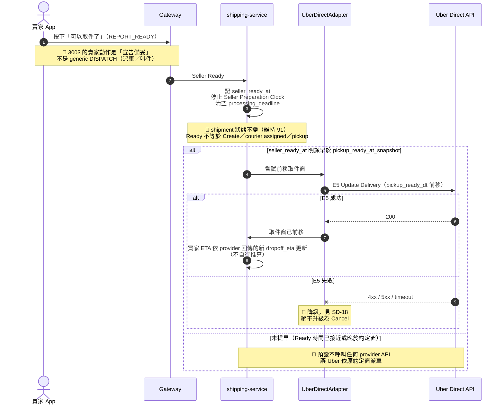

🔴 **這張圖要畫出來的關鍵點**
1. `E5` **成功／失敗的兩條路**都要在圖上。
2. 失敗時退回「**讓 Uber 依原窗派車**」，而不是報錯、不是取消。
3. 賣家動作是 **`REPORT_READY`**，且它**不觸發** Create／不代表 courier assigned／不代表 pickup。
4. 預設路徑（未提早）**不呼叫任何 provider API**。

**SD-18｜時序：`E5` 失敗的降級鏈**

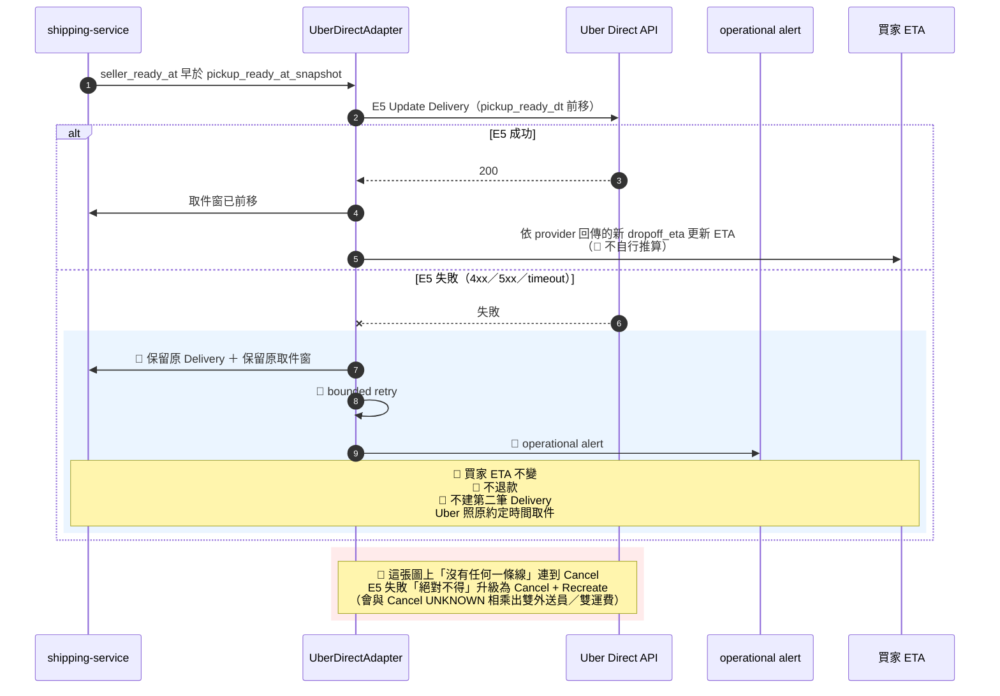

🔴 **這張圖要畫出來的關鍵點**
1. `E5` 成功／失敗**兩條路**。
2. 失敗路徑必須畫成「**保留原窗 ＋ retry ＋ alert**」。
3. 🔴 明確標示**不得連到 Cancel**。

**SD-06｜時序：`Cancel + Recreate`（🔴 人工限定備援）**

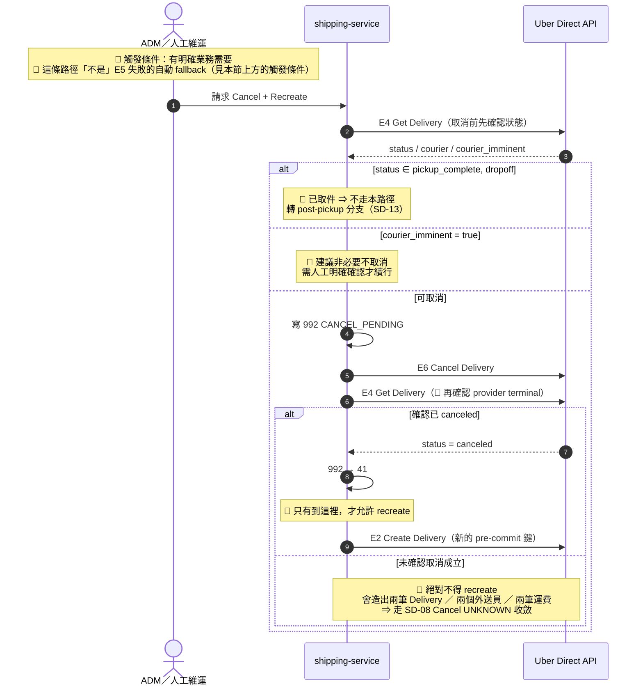

🔴 **這張圖要畫出來的關鍵點**
1. 🔴 **必須先確認 cancel 成立才能 recreate**——中間的 `E4` 確認框是這張圖的主角。
2. 本路徑**人工限定**，🔴 **不是 `E5` 失敗的自動退路**。
3. 未確認取消成立時**絕對不得 recreate**。

🔴 **External Verification（#3522）**：`E5` 成功後 Uber 實際多久重新安排取件，**官方未載**
⇒ 只有 sandbox／真實運行資料才知道。**不阻塞 implementation**，
但它決定「提早多少才值得打 `E5`」那個門檻的預設值，開燈後要以實測回填。

#### 4.5.1 OAuth 與 token 集中快取

`POST https://auth.uber.com/oauth/v2/token`，`grant_type=client_credentials`；平台單一 application，賣家永不取得。
**剩餘壽命 < 20% 時背景換新，不逐筆取。**
🔴 **刷新失敗不得 fail-open**：拿不到 token ⇒ 立刻拋、選項 `available=false`。
「先用舊 token 試試看」會把一次認證失敗變成 N 次 401，而 401 對外看起來像我們被停權。
⚠️ **token 快取放行程內即可**——多副本各自取自己的 token 是允許的；**不要**為此引入 Redis
（那會讓 token 變成一個「不能失敗的狀態」，觸發 《硬上限依賴接入治理規範（配額與容量）》 的接入前置三件）。

#### 4.5.2 端點表（base `https://api.uber.com/v1`）

| # | 功能 | Method | 路徑 | deadline | 副作用 |
|---|---|---|---|---|---|
| E1 | Create Quote | POST | `/customers/{customer_id}/delivery_quotes` | 8s | 否 |
| E2 | Create Delivery | POST | `/customers/{customer_id}/deliveries` | 15s | **是** |
| E3 | List Deliveries | GET | `/customers/{customer_id}/deliveries` | 10s | 否 |
| E4 | Get Delivery | GET | `/customers/{customer_id}/deliveries/{delivery_id}` | 10s | 否 |
| E5 | Update Delivery | POST | `/customers/{customer_id}/deliveries/{delivery_id}` | 15s | **是** |
| E6 | Cancel Delivery | POST | `/customers/{customer_id}/deliveries/{delivery_id}/cancel` | 15s | **是** |
| E7 | Get POD | POST | `/customers/{customer_id}/deliveries/{delivery_id}/proof-of-delivery` | 20s | 否 |

🔴 **七條路徑與官方現行 spec 逐字相符**（`uber/uber-direct-sdk` 的
`src/deliveries/openapi.yaml`，OpenAPI 3.1.0，title `Direct API`）。`delivery_id` 官方逐字「Always starts with `del_`」。
🔴 **仍必須在施工前以 sandbox 真實回應覆核**（誠實標註：spec 與線上 reference **無法確認逐位元同步**；
且 changelog 2025-12-08 新增的 Cancel cancelation reason **尚未反映在 spec 裡**）。
⚠️ 本表的價值在「有幾支、各自的 deadline 與副作用性質」——那三件不會因路徑微調而改變。

##### 4.5.2a Organizations API（本表之外的第二組端點）

🔴 **`uber_organization.organization_id`（§5.1.2）的唯一產生路徑 ＝ CreateOrg**——
「誰把 `PENDING` 推到 `ACTIVE`」在 §5 的四問裡答不出來，因為根本沒有人去建那個組織。

| 功能 | Method / 路徑 | scope |
|---|---|---|
| CreateOrg | `POST https://api.uber.com/v1/direct/organizations` | 🔴 **`direct.organizations`** |
| GetOrg | `GET /v1/direct/organizations/{organization_id}` | 同上 |
| InviteToOrg | `POST /v1/direct/organizations/{organization_id}/memberships/invite` | 同上 |

🔴 **兩個立即的施工後果**：
① **token 要按 scope 分槽快取**——Organizations 用 `direct.organizations`，Direct API 用 `eats.deliveries`，
**不是同一個 token**。拿錯會得到 401，而那個 401 看起來像憑證壞掉。§4.5.1 的 token cache 因此**不是單一槽**。
② **`onboard()` capability 的內容變了**：它不再只是「寫一筆 store mapping」，而是**真的要打 provider**
（CreateOrg ＋ 可選的 InviteToOrg）⇒ §4.5.0 表裡 `onboard()` 那兩列的「失敗行為」要補 provider 呼叫的錯誤處置。

**必填欄位（官方 `required`）**：`info.name`、`info.billing_type`、`hierarchy_info.parent_organization_id`。
⚠️ **台灣業務指南宣稱「六個參數皆為必填」是錯的**——`merchant_type`／`point_of_contact`／`address`
只有在 `BILLING_TYPE_DECENTRALIZED` 時才必要，而**我方是 CENTRALIZED**。
🔴 **`parent_organization_id` 必須是 root**（官方錯誤訊息逐字 `parent organization is not a root organization`）
⇒ **組織層級只有兩層，不能無限巢狀**。
🔴 **`merchant_type` 我方取 `MERCHANT_TYPE_GROCERY`**（生鮮雜貨）——⚠️ 台灣業務指南 p.60 拼成 `MERCHANT_TYPE_GROERY`（少一個 C），**以官方為準**。
**`options.onboarding_invite_type = ONBOARDING_INVITE_TYPE_EMAIL`** 會讓 Uber 直接寄出
**收集帳務與稅務資訊的 webform** 給 `point_of_contact` ⇒ 🔴 **這是 N6／`customer_blocked` 那條路徑的前置觸發點**：
N6 的「沒有事前查詢欄位」**仍然正確**（確實沒有查詢 API），但我方**可以主動觸發表單**，
不必等第一筆建單失敗才知道賣家沒填稅務資料。⇒ 列入 onboarding 設計輸入。

完整欄位與值域見 [總覽 §8](../第三方整合/Uber%20Direct%20API%20總覽.md)。

🔴 **CreateOrg 的呼叫時機與送出值**

| 格 | 定版 |
|---|---|
| **誰呼叫** | 賣家 Uber onboarding（`S-U1`）⇒ `onboard().apply(ctx)` |
| **一個賣家幾次** | 🔴 **一次，一個 Organization**（1 Seller = 1 Organization）。**不是每個取件地址一次** |
| `info.name` | 賣家名稱（🔴 **禁 URL 與 `/ \ : % < > # =`**） |
| `info.billing_type` | 🔴 **固定 `BILLING_TYPE_CENTRALIZED`**⇒ **不需要 Uber 先設 billing policy**，也**不必**送 `address`／`point_of_contact`（那兩個只有 DECENTRALIZED 才必要） |
| `hierarchy_info.parent_organization_id` | 我方 Root Org（`uber_account.organization_id`）。🔴 **父層必須是 root**，所以**只有兩層** |
| `info.merchant_type` | `MERCHANT_TYPE_GROCERY` |
| 回應 `organization_id` | 寫入 `uber_organization.organization_id`；🔴 **它就是後續所有 Direct API 路徑的 `{customer_id}`** |
| `status` 推進 | `PENDING → ACTIVE` 的執行者**就是這一次成功呼叫**（§5.1.2） |

⚠️ **這裡不會產生 Uber Store**：官方的 Store 層由**第一次 Create Quote 帶 `external_store_id`** 時自動建立
（WOK location，總覽 §2.3）⇒ **我方不呼叫任何 Store 建立 API，也不需要** ⇒
**V1 的「一賣家一取件點」在 provider 側是自然成立的，不是我方要去維護的東西**。

#### 4.5.3 id 前綴慣例與解析規則

`dqt_` quote／`del_` 正向／`ret_` 逆向／~~`cus_` customer~~。

🔴 **`cus_` 那一格**：官方對 `customer_id` 的定義是
**「Either **UUID** or starts with `cus_`」** ⇒ **它不保證有前綴**，而 CreateOrg 回傳的正是 **UUID**。
⇒ **不得對 `customer_id` 做前綴檢查**（會在真實資料上 100% 失敗）。`dqt_`／`del_`／`ret_` 三個前綴則有官方逐字支持
（`delivery_id` 逐字「Always starts with `del_`」）。

🔴 **前綴只用於讀取時的健全性檢查，不用於分辨 leg。** leg 的真相是**我方自己的 `is_return`**
（既有 `ShippingEventPayload.isReturn` 就是它）——前綴是 provider 的實作細節，它改了我們不會知道。
讀到「`ret_` 前綴但 `is_return=false`」⇒ **建 case，不猜**。

#### 4.5.4 錯誤碼映射

| Uber | HTTP | 我方處置 |
|---|---|---|
| `customer_blocked` | 403 | 🔴 寫 `uber_store_mapping.blocked=true`／`tax_form_required=true`（N6 事後反推）＋ 建 case ＋ 通知賣家 |
| `noncancelable_delivery` | 400 | 取消失敗，**留原狀態**（不寫 `992→41`），回 65 `9522` |
| 其他 400 | 400 | **確定性** ⇒ 不重試 ⇒ `CREATE_FAILED(990)` |
| 401／403 | — | 斷路器計數 ⇒ 選項 `available=false` |
| 429 | — | 退避重試；連續發生開斷路器 |
| 5xx／timeout | — | **非確定性** ⇒ 重試耗盡後 `CREATE_UNKNOWN(991)`，**不是 990** |

🔴 **400 與 5xx 的分流是本表唯一真正重要的一格**：把 5xx 當 990 會導致「其實建成功了但我們以為失敗」
⇒ Admin 重建 ⇒ **兩趟車、重複計費**。需求書明訂「逾時先查詢，不直接重建」，`991` 就是為此存在。

#### 4.5.5 🔴 取消費用不在 API 契約內 ＋ 退款政策（二元）

取消**可能產生費用，而該費用只出現在帳單**（U-R）。⇒ **不得設計依賴「取消回應帶費用」的流程**：
① 🔴 **退款方向由責任成因決定，不由「取消回應帶不帶費用」決定**（下方二元政策表）。🔴 **「退給買家」與「成本誰負擔」是兩件事**：取消費依 [`ADR-004`](../adr/2026-09-11-responsibility-based-cost-attribution.md) 的**責任成因**歸屬（賣家／買家／平台或系統／物流商），**不是一律平台吸收**；成因未判定時落 `RESPONSIBILITY_UNRESOLVED`（§1.6.1）—— **既不退款、也不套 no-refund、也不自動向賣家收**
② 不得為它造 `shipments` 欄位（沒有來源就不要造，那欄會永遠是 null）
③ 對帳走月結帳單（落 65 的帳本軸），本書只負責留下可對帳的鍵（`uber_delivery_id` ＋ `cancelation_reason`）

🔴 **退款政策：二元，沒有第三種拆分公式**

🔴 **本表的適用時點 ＝ 責任判定 financially final 之後。** 仍有待覆核的 resolution、或同一 subject
還有未結的責任案件時，**視同尚未判定**（照最後一列處置：既不退款、也不套 no-refund），
🔴 **不得**因為「已經有人判了」就先把錢的方向定下來。

| `ResponsibilityCause` | `refund_to_buyer` |
|---|---|
| **`BUYER_CAUSED`** | 🔴 **`= 0`** —— 商品款與 Buyer Shipping Charge **都不**退回 Buyer |
| `SELLER_CAUSED` | **`= full`**（商品款 ＋ Buyer Shipping Charge） |
| `PROVIDER_CAUSED` | **`= full`** |
| `PLATFORM_CAUSED` | **`= full`** |
| **`RESPONSIBILITY_UNRESOLVED`** | 🔴 **暫不決定** —— 既不退款，也不套 no-refund |

🔴 **明令禁止的寫法**（任一出現即為 regression）：「商品款另外決定」／「Buyer Shipping Charge 單獨不退」／
「再從退款扣掉物流成本」／「Buyer 承擔 provider cost 然後第二次收款」／refund deduction engine／
buyer debt／buyer wallet。
⚠️ **本設計不引入 refund component model**（`refundable_product_amount`／`refundable_shipping_amount`／
deduction／offset／shipping deduction model）。既有售後若本來就有 partial refund，
那是**既有的 aftersales requirement**，🔴 **不得冒充成本次的 Uber Requirement**。

**`BUYER_CAUSED` 適用情形（至少含）**：買家不在場／無法聯繫／拒收／提供錯誤地址／
提供不足或無法履約的交付資訊／無安全可交付位置／未依約提供必要 PIN 或配合／其他有充分履約證據者。

🔴 **程序要件——`= 0` 不是無條件**：必須先有**可指認的履約證據**（交付嘗試／聯繫紀錄／等待）才適用。
🔴 **provider 的 `undeliverable`／`returned` 本身 ≠ `BUYER_CAUSED`**：它只描述「沒有完成交付」，
**不是責任方判定**。**嚴禁** `provider says undeliverable → 自動 BUYER_CAUSED → 自動 no refund` 這條捷徑（§1.6.1）。
🔴 **`refund_to_buyer = 0` 只在責任判定 financially final 為 `BUYER_CAUSED` 時成立**，
成立時 Order 走 `DELIVERY_FAILED_NO_REFUND` 終態
（值域與 downstream reader 的行為在 03；≠ `DELIVERED` ／ ≠ 正常 `COMPLETED` ／ ≠ `CANCELLED`，
**不觸發 Refund、不產生收貨確認語意**；🔴 **immutable financial terminal：無出邊、無 post-terminal reversal**），
🔴 **不得發正常 cancellation 或正常 refund 的通知文案**——既有 N1 `order.fulfillment.failed` 模板逐字是
「已停止履約並向你全額退款」，那句話**只在 Non-Buyer-caused 成立**。
⚠️ **對買家的通知必須含政策說明 ＋ 客服申訴管道**（§12 對外揭露）。
🔴 **那是受理與說明的管道，不改變責任判定、也不改變退款結果**：會修改責任歸屬或退款資格的覆核
**一律在責任判定階段（訂單 `35`）完成** ⇒ 🔴 **不得**把它寫成「責任判定申訴」這類隱含可翻案的名稱。
🔴 **最終結果的文案只在 financially final 之後才發**：未 final 期間對買家只能是
「配送未完成，正在確認處理結果」，🔴 **不得**出現「最終不退款」／「已全額退款」／「訂單已取消」；
對賣家同理，🔴 **不得**在 final 之前宣稱已確認收款或已確認 logistics charge。

🔴 **收費邊界（provider cost，不得寫成絕對 0）**

| 取消時的 provider 狀態 | 可以推論什麼 |
|---|---|
| `pickup_complete`／`dropoff` | **正常去程運費一定產生且不退**；返程是另一個 leg（🔴 **返程運費 ＝ 去程運費**） |
| `pending`／`pickup` | 🔴 只能推論「**尚無已確認的正常去程 delivery charge**」——**不得**推論成「provider 永遠不可能有任何 ancillary／adjustment cost」，🔴 **不得寫成絕對 0** |

任一情形的**最終** provider cost 一律以 provider refund／billing／statement 證據收斂（External Verification #3522，不阻塞 implementation）。

🔴 **Cancel Saga 的順序固定，三步缺一不可**：`E4 Get Delivery` → `E6 Cancel Delivery` → **再確認 provider terminal**。
先 `E4` 的理由是**判斷這次取消會不會產生費用**，並據此走不同的責任歸屬與文案；
`courier_imminent = true` 時**非必要不取消**。🔴 **Cancel timeout／5xx 時不得直接** refund／no-refund／recreate／
assume canceled —— 收斂鏈見 §7.7。

#### 4.5.6 contract tests 防指南漂移

🔴 **fixture 來源＝sandbox 真實回應，不得手寫、不得抄 D-21 報告或 §4.5.2 表。**
測三件：① status 值域是 7 值（跑完整一趟含取消與退回，收集所有出現過的 `status` 成 golden，斷言映射表 key ⊇ golden）
② `related_deliveries` 是陣列 ③ 未知值 fail-closed（**變異**：塞 `status:"teleported"` ⇒ 不寫入 ＋ counter ＋ 建 case）

### 4.6 靜默陷阱表

| # | 陷阱 | 症狀 | 防線 |
|---|---|---|---|
| A1 | 🔴 **把 3003 config 列的 `enabled` 切成 `true`** 但程式尚未部署（§12.2 步 5 未完成） | 買家付錢、建出沒人送的單、零告警 | §12.2 固定順序 |
| A1′ | ⚠️ **建列本身（`enabled=false`）不觸發 A1**——那是 §3.4 三層的第 ① 層，是**要求**不是陷阱 | — | §3.4 ① |
| A2 | 驗簽前做過 JSON parse／re-serialize | **偶發**失敗，失敗率取決於欄位順序 ⇒ 測不出來、上線才炸 | §6.3.1 raw body |
| A3 | `courier_update` 每則都發 MQ | 流量放大 14 倍且零 consumer ⇒ 只餵飽 `notification.*` 的 `#` 綁定，走 `logger.Debug` ＋ ACK **消失** | §6.3.2 |
| A4 | `930` 逆向 leg 沒登記進 aftersales | 買家已交件卻被 `ship_back_deadline_at` 判定「沒寄回」⇒ **自動關案且不退款** | §7.3.2 U5 |
| A5 | `992` 沒有入邊分支 | 前端顯示「取消已受理」、DB 沒動、零告警 | 65 §7.1.2.5（實作歸屬 65） |
| A6 | POD 用 public 前綴 | 收件地址與門口實景可被任何拿到 objectKey 的人取得 | §7.8 |
| A7 | 用前綴分辨 leg | provider 改前綴 ⇒ 逆向單被當正向處理 | §4.5.3 |
| A8 | 把 5xx 當建單失敗 | 兩趟車、重複計費 | §4.5.4 |
| A9 | payload hash 漏算 `external_store_id` | 換了取件門市但 hash 相同 ⇒ 用舊報價建新門市的單 | §5.1.4 |

---

## 5. 資料設計

> 每張表逐欄回答：① 誰寫入 ② 誰讀取 ③ **誰把它推走／誰刪除**。第三問答不出來就不要建。
> **服務歸屬**：本書在 shipping-service（Java／Flyway）建 **8 張表**——`uber_*` **六張**
> （`uber_account`／`uber_organization`／`uber_store_mapping`／`uber_quotes`／`uber_deliveries`／`uber_pod_artifacts`）
> ＋ §5.1.8 的 **`packing_policy`／`package_plan` 兩張**（它們不帶 `uber_` 前綴，但同屬本書 DDL）。
> 全部與 `shipments` 同庫 ⇒ 狀態轉換與 Uber 資料可在**同一交易**內寫（這正是 §4.3 不拆服務的理由）。
> ⚠️ 本書多處曾寫「`uber_*` 五張表」，那個數字從一開始就漏數了 `uber_pod_artifacts`，
> 且把 `packing_policy`／`package_plan` 排除在外 ⇒ 2026-09-12（Stage 8B W1 施工）**逐處更正為 8 張**。
>
> **migration**：🔴 **實際落 `V13__add_uber_direct_tables.sql`（2026-09-12 已落地）**。
> ⚠️ **不得把版號寫死在文件裡**——它會過期：
> 🔴 **版號一律以 `ls services/java/shipping-service/src/main/resources/db/migration/ | sort -t_ -k1.2 -n` 現查最大值 ＋1**——`ls` 的字典序會把 `V9` 排在 `V10` 之後而撞號，Flyway 撞號 ＝ 服務起不來。
> ⚠️ **版號一律以 `ls db/migration | sort -t_ -k1.2 -n` 現查決定，不得沿用設計書寫死的數字**
> ——設計書寫的是「寫下那一刻的現況」，而 migration 目錄在兩本設計書之間還會被別人動。
> 🔴 `V11` 仍**與 65 §5.2.1 是同一個檔**（兩本不得各開一個 V11），這一條不變。

### 5.1 資料模型

#### 5.1.1 `uber_account`
`id`(TSID PK)／`env`／`client_id`／`organization_id`／`enabled`／時戳。🔴 **`client_secret` 不在這張表**（k8s secret，§8.5）。
誰推走：不刪除，停用走 `enabled=false`。⚠️ 只會有 1～2 列；不用 env 是因為 `enabled` 要能被 ADM **即時**關掉，而 env 改動要重新部署——出事那一刻我們不想等 rollout。

🔴 **唯一性一律落 DB constraint，不得讓 application-only check 代替它。**
落地於 shipping-service `V14__add_uber_account_organization_unique.sql`，**兩道**：

| 約束 | 守什麼 |
|---|---|
| `UNIQUE (env, client_id)`（`uk_uber_account_env_client`） | natural business key ＝ provider account（`client_id`）＋ environment（`env`）。擋「同一組憑證在同一環境登記兩次」 |
| partial unique index `ON uber_account (env) WHERE enabled`（`uk_uber_account_one_enabled_per_env`） | 每個 `env` **至多一列 `enabled`** ⇒ 「取 token 用哪一列」有唯一解 |

🔴 **兩道缺一不可**：natural key 擋得住重複登記，擋不住「同一 env 兩列都 enabled 但 `client_id` 不同」，
而後者才是「沒有唯一解」的來源。
⚠️ 🔴 **不得改成 `UNIQUE (env)`**：那會禁止保留停用的舊憑證列，
使憑證輪替從「新舊並存 ⇒ 切換 ⇒ 舊列留著備查」變成必須先刪舊列 —— 把可回退的操作變成不可回退的。
⚠️ 代價（已知並接受）：憑證輪替必須**先停用舊列、再啟用新列**。順序反了會被擋下，
而那正是它的目的 —— 兩列同時 `enabled` 的那個瞬間，「這個環境的 Uber 帳號是哪一個」沒有答案。

#### 5.1.2 `uber_organization`
`id`／`uber_account_id`／**`store_id BIGINT`（🔴 **賣家業務鍵**，不是 account_id、**也不是門市**，見 5.1.3b）**／
`organization_id`／`status`(PENDING｜ACTIVE｜SUSPENDED)。
誰推走：賣家關店 ⇒ `SUSPENDED`（不刪，帳務要追溯）。

🔴 **本表逐欄釘死語意，不得自行擴充。**

| 要表達什麼 | 欄 | 定版語意 |
|---|---|---|
| **哪個賣家** | `store_id` | **1 Hawkr Seller ＝ 1 Uber Organization**。Seller 是 Hawkr 的商業與履約責任主體，Organization 與它對齊 |
| **Uber 側的組織身分** | `organization_id` | 🔴 **這就是 Direct API 路徑裡的 `{customer_id}`**。格式為 **UUID**（也可能 `cus_` 前綴）⇒ **不得做前綴檢查** |
| **計費型態** | 🔴 **`billing_type` 欄目前不存在** | 🔴 **所有 Seller Organization 一律 `BILLING_TYPE_CENTRALIZED`**。⚠️ 本表沒有承載它的欄位 ⇒ 🔴 **必須以「常數 ＋ CreateOrg 送出值的契約測試」釘死**。⚠️ 沒有那支測試時，「我方所有 org 都是 CENTRALIZED」只是文件上的宣稱，**資料面看不出來** |
| **onboarding 生命週期** | `status` | `PENDING｜ACTIVE｜SUSPENDED`。🔴 **誰把 `PENDING` 推到 `ACTIVE`：CreateOrg 成功的那一刻**（§4.5.2a）——R1 之前這一格沒有執行者，因為本書當時完全沒有 Organizations API |

🔴 **三段式不得被 `Seller = Organization` 誤導**：

```
Uber  ──（月結物流成本）──▶  Hawkr Direct Account        ← 付款責任在平台
Hawkr  ──（物流服務費應收）──▶  Seller                   ← 70 號的線 B
```

⚠️ **`Seller ＝ Organization` 不代表 Decentralized Billing。**
賣家**不直接對 Uber 付款**；70 號的核心商流（平台先付、再向賣家收）**不因本節而改變**。
Organization 在 CENTRALIZED 下的作用是 **provider tenant／identity boundary**：
provider onboarding、enable／disable 邊界、support 邊界、Dashboard 可見範圍、對帳歸屬、帳號層營運隔離。
🔴 **不得從這些用途推導出多門店功能**。

🔴 `UNIQUE (uber_account_id, store_id)`
（`uk_uber_organization_account_store`，V14）。
⚠️ **不取 `UNIQUE (store_id)`**：那會讓同一個賣家在 sandbox 與 production 兩個 `uber_account` 下無法並存，
而 §5.1.1 的 `env` 欄正暗示兩者要能並存。
⚠️ 與「賣家關店不刪列」相容：本節的推走路徑是 `status='SUSPENDED'`（UPDATE）⇒ 重新開通走 UPDATE 推回 `ACTIVE`，
不會 INSERT 出第二列。若有人改成「INSERT 一列新的」會當場被擋 —— 那是對的，兩列並存時這個賣家的組織同樣沒有答案。
⚠️ `idx_uber_organization_store`（非唯一）**保留**：新 UNIQUE 的前導欄是 `uber_account_id`，對「只給 `store_id`」的查詢用不上。

🔴 **兩節的約束合起來才保證得了**「某個 env 下某個賣家的組織是哪一個」的解析鏈：
① `uk_uber_account_one_enabled_per_env` ⇒ 該 env 的啟用帳號至多一列 → 唯一 `uber_account_id`；
② `uk_uber_organization_account_store` ⇒ `(該 account_id, store_id)` 至多一列 → 唯一組織。
缺任一道，這條鏈就有兩個答案，**而兩個答案在程式裡長得跟一個答案一模一樣**
（`selectOne` 取到其中一列，零錯誤零 log）。

⚠️ 兩節原先的缺口是同一個形狀：**「文字上的唯一性」沒有被翻譯成「約束」**，而缺約束是完全無聲的。

#### 5.1.3 `uber_store_mapping`

| 欄 | 說明 |
|---|---|
| `seller_store_id BIGINT NOT NULL` | → `sellers.store_id`（§2.4） |
| `external_store_id VARCHAR(64) NOT NULL` | 🔴 **Quote 與 Create 兩處都要帶** |
| `customer_id VARCHAR(64) NOT NULL` | 🔴 **語意 ＝ Uber Organization-level identity，不是 Store-level**（見 §5.1.3a）。官方逐字：「Unique identifier for the **organization**. Either **UUID** or starts with `cus_`」⇒ ① **它是組織識別碼，不是門市識別碼**（pickup origin 的識別碼是 `external_store_id`）② **格式可能是 UUID，不只 `cus_` 前綴** ⇒ 🔴 **任何「以 `cus_` 前綴驗證這一欄」的檢查都會在真實資料上失敗**（§4.5.3 已同步修正）。<br/>⚠️ **V1 它與 `uber_organization.organization_id` 恰好同值**（1 Seller = 1 Organization）⇒ 本欄在 V1 是 **denormalized 便利欄**，🔴 **權威在 `uber_organization`**；兩者不一致時以 `uber_organization` 為準，並建 case。登記為 `IMPLEMENTATION_REMEDIATION_INPUT #3`（是否直接移除本欄改為 join，屬 implementation review） |
| `pickup_snapshot JSONB NOT NULL` | 取件地址／聯絡人／電話／備註的**快照** |
| `supported_temps JSONB NOT NULL DEFAULT '["3201"]'` | 🔴 預設**只有常溫** |
| `max_packages INTEGER NOT NULL DEFAULT 30` | M-4 |
| `prep_sla_minutes INTEGER NOT NULL DEFAULT 15` | 🔴 **先讀這一行：本欄的正式語意是**「賣家對已付款 Uber 訂單**通常需要多久完成備貨並可被取件**」的正常履約 SLA，用途有**三**：① 推導 `processing_deadline` ② 算買家 ETA ③ 🔴 **推導 `pickup_ready_at_snapshot`（＝ `quote_time ＋ 本欄`），也就是實際送給 provider 的 `pickup_ready_dt`**（詳見本節下方「正式語意與三個用途」段與 §5.1.4a）。<br/>⚠️ **本欄有一條射程明確的禁令**：🔴 **不得拿本欄名去承載「外送員到店 lead time」**（那個概念必須另取名字）。**它不禁止上面三個用途**——三者承載的都是同一個物理量（賣家備貨時長）。<br/>🔴 **DB COMMENT 必須寫出 `pickup_ready_at_snapshot` 這個中介**：寫成「備貨時間，進 quote 的 `pickup_ready_dt`」會讓照字面實作的人在建單當下重算。<br/>⚠️ **它不是賣家處理期限**（那是 `processing_deadline`）——兩者的意義、承載欄與逾期處置完全不同 |
| `service_hours JSONB` | **賣家願意接 Uber 單的時段**（需求書 §4.3 資料模型明列）。🔴 **不等於店面營業時間**——賣家可以 09:00 開店但只在 11:00–19:00 接即時配送單。⚠️ **但方向單向**：店休息時 Uber 一律不可用，不得出現「店已打烊而 Uber 仍可下單」。🔴 **它只管「新訂單能不能進來」，不是已接受訂單的履約閘門，也不是履約時鐘的開關**——已付款訂單不因進入不可接單時段而被拒絕派車或暫停計時（65 §6.3.4 F、66 基設 §9.4）。值域與時區口徑見 §5.6。⚠️ **schema drift**：本欄目前只存在於設計書，已落地的 `V13` migration **沒有**這個欄位 ⇒ 需走 `V{N+1}` |
| `active BOOLEAN NOT NULL DEFAULT false` | |
| `blocked`／`tax_form_required BOOLEAN NOT NULL DEFAULT false` | `customer_blocked` 403 的事後反推（N6） |
| `health_status VARCHAR(20) NOT NULL DEFAULT 'UNKNOWN'` | HEALTHY｜DEGRADED｜BLOCKED｜UNKNOWN |

🔴 **`prep_sla_minutes` 的正式語意與三個用途**

| | |
|---|---|
| **語意** | 賣家對「**已付款的 Uber 訂單通常需要多久完成備貨並可被取件**」的**正常履約 SLA**（＝賣家備貨時長） |
| **賣家設定的是** | `prep_sla` |
| **賣家不得直接設定** | 🔴 `processing_deadline`（由平台依公式推導，§9.4）；🔴 `pickup_ready_dt` |
| **三個用途** | ① `processing_deadline` 的推導輸入 ② 買家 ETA（🔴 **經由 provider**，不由平台加總，§5.1.4a）③ 🔴 **`pickup_ready_at_snapshot` 的推導輸入 ＝ 實際送給 provider 的 `pickup_ready_dt`** |

🔴 **平台不猜賣家何時備好**：`prep_sla` 是**賣家自己設定**的值，不是平台估的。
🔴 **派車觸發權在 provider**：Uber 依約定的 `pickup_ready_dt` 自行排程
（65 §4.4.1a「`FL-2` actor 恆為 SELLER」對 3003 的顯式豁免，§4.1；🔴 **射程只有 3003**）。
🔴 **賣家的按鍵是 `REPORT_READY`（宣告備妥），不建單**（§4.5.0a）。

🔴 **兩條禁令（缺一都會做錯）**

| # | 禁令 | 違反的後果 |
|---|---|---|
| ① | **DB COMMENT／javadoc 不得寫成「本欄直接就是 quote 的 `pickup_ready_dt`」** | 它是 `pickup_ready_at_snapshot` 的**推導輸入**，中間隔著一次「凍結」；照字面實作會在建單當下重算 |
| ② | 🔴 **不得在建單當下用 `now ＋ prep_sla` 現算** | 值只能有**一個**來源 ＝ 報價當下凍結的那一份；現算會讓送給 provider 的約定時間與買家看到的 ETA 分岔 |

⚠️ 🔴 **也不得拿本欄名去承載「外送員到店 lead time」**——那是另一個物理量，必須另取名字。

**送給 provider 的四個時間窗欄位**

| 欄位 | 官方 | 本書 V1 |
|---|---|---|
| `pickup_ready_dt` | 取件窗的開始（逐字「Beginning of the window when an order must be picked up」），RFC 3339、optional、`< 30 天` | 🔴 **送**，值 ＝ `pickup_ready_at_snapshot` |
| `pickup_deadline_dt`／`dropoff_ready_dt`／`dropoff_deadline_dt` | 皆存在且 optional | 🔴 **OMIT**（一個都不送，§6.5） |

⚠️ 官方 delivery-window 指南對 **ASAP** 的「otherwise leave blank」，主體是「**沒有**備貨時間的 ASAP 單」。
我方**有**備貨時間（`prep_sla`）⇒ 送出取件窗開始時間。
🔴 **這不是 Scheduled**——ASAP／Scheduled 的官方分界是**送達預期 ≥ 90 分鐘**，不是「有沒有送時間窗」。
⇒ 🔴 **「取件前置緩衝」這個新欄位不需要存在**——`prep_sla_minutes` 本身就是那個輸入。

⚠️ `DEFAULT 15` ＝ `seller_prep_sla_default` 的 V1 預設（§0.2 的 V1 政策參數表）：
🔴 **我方裁量、configurable、不是 provider SLA**，開燈後以實測回填。
🔴 **設錯的影響面跨兩件事**：它同時決定賣家期限與**外送員到店時間** ⇒ 數值評估要一起做。

⚠️ **改名是破壞性變更**：`prep_sla_minutes` 已落在 migration（含 DB COMMENT）與一支
schema contract test ⇒ 必須走 expand-contract，並同步那支 contract test。

`UNIQUE (seller_store_id, external_store_id)`。

#### 🔴 5.1.3a　V1 Domain Boundary

**最高原則：Provider 不重新定義 Hawkr Domain。**
Uber 的 Direct Account／Organization／Store 是 **provider-side model**，
**不是** Hawkr 的產品 Domain。本次只是在既有電商上多一個配送選項 `3003`。

**V1 定版對應（1:1:1:1）**：

```
Hawkr Direct Account（平台，Root Org）
   ├─ Seller A ── Uber Organization A ── 1 個 active pickup profile ── 1 個 external_store_id
   ├─ Seller B ── Uber Organization B ── 1 個 active pickup profile ── 1 個 external_store_id
   └─ …
```

🔴 **「Uber Organization 底下理論上可以有多個 Store」不等於「Hawkr Seller 可以建立多個 Store」。**
**V1 明確不提供多 Store 的 UI 與 Domain。** 以下全部 **OUT OF SCOPE**，不得因 provider hierarchy 反向導入：
多門店／多出貨點／門店管理／門店庫存／門店 routing／店別 service hours／
買家選門店／賣家選出貨門店／訂單拆店／store selector／store-level inventory ownership。

**`external_store_id` 的 V1 正式語意**：

| 它是 | 它不是 |
|---|---|
| **Seller 唯一 Uber pickup origin 在 provider 側的穩定識別** | 🔴 **不是** Hawkr 的「門店 ID」 |
| 概念形狀例如 `HK-SELLER-<seller 業務鍵>` | 🔴 **不等於** `seller_store_id`（見 5.1.3b） |

**`customer_id` 的層級**：
**＝ Uber Organization-level identity**，**不是 Store-level**。
⇒ 語意分界固定為：**Organization identity（`uber_organization`）** vs
**Seller 唯一 pickup profile／`external_store_id`（本表）**，兩者不得互相冒充。
⚠️ **V1 兩者恰好 1:1，但「恰好相等」不是「是同一件事」**——未來多 origin 時它們會分開。

**未來 multi-origin 明確延後**：若日後同一 Seller 真的需要台北倉／高雄倉／3PL 倉，
那是**新的 Domain 問題**，要另行設計 `FulfillmentOrigin`（Seller → FulfillmentOrigin → Provider Store），
🔴 **本次 `3003` 不得預先導入這套模型**；尤其**第三方物流倉不得現在被偷偷建模成 Seller 的「第二間門店」**。

**賣家改地址**：V1 永遠只有 **one active Uber pickup profile**。
賣家改 Uber 出貨地址／聯絡資料 ⇒ 舊 config 轉 **historical／inactive／versioned**、新 config 轉 **active**；
**只影響 new eligibility／new quote／new orders**，
🔴 **不得回溯**已付款訂單、已接受的履約快照、已派送的 delivery（沿用既有「Seller config 只影響新訂單」規則）。
✅ 這與本節下方的 `pickup_snapshot`「快照不是參照」是**同一條規則的兩半**：
快照保護**已建立的 delivery**，versioning 保護**已付款但還沒建單的訂單**。

🔴 **`UNIQUE (seller_store_id, external_store_id)` 擋不住多 profile**——它允許同一 seller 有多列。
V1 的正確約束是「**每個 seller 至多一列 active**」（partial unique on `seller_store_id` WHERE active）。
🔴 **「唯一 active」必須由 DB partial unique 保證，不得只由 application 維持**
——application-only 的唯一性是**無聲失效**的：文字上的唯一性沒有被翻譯成約束時，
第二列 active 會安靜地存在，而報價會隨機取到其中一列。

#### 🔴 5.1.3b　命名警告：`seller_store_id` 與 Uber 的 Store 層**沒有關係**

| 名字 | 真正的意思 | 來源 |
|---|---|---|
| `uber_store_mapping.seller_store_id` | **賣家本身的業務鍵**（`sellers` PK `store_id`，store-stint surrogate） | 既有且已批准的身分 Domain（44 號／CLAUDE.md §6） |
| Uber 的 **Store** 層 | provider 側的取件地點 | Uber provider model |
| `external_store_id` | Seller 唯一 pickup origin 的 provider 側識別 | 本節 |

🔴 **三個名字都有 `store`，指的是三件不同的事。**
⚠️ **本 repo 的 `store_id` 從來就是「賣家」不是「門市」**——
它叫 store 是 store-stint surrogate 的歷史，**不是多門店**。
⇒ **不得因為 Uber 有 Store 層就在 Domain 新增 `seller_store`／`store_id selector`**。
⚠️ 也不要與 `shipments.cvs_store_code`（超商門市代碼）混淆——那才是真的門市，屬 `3002` 不屬本書。

**命名處置**：`uber_store_mapping` 這個表名容易誤導。
**semantic name ＝ Uber Seller Pickup Profile / Mapping**；
🔴 **physical table name ＝ `uber_store_mapping`**
（rename 屬破壞性變更，走 expand-contract，
由 implementation migration review 決定）。

🔴 `pickup_snapshot` 是**快照不是參照**：賣家改地址後已建立的 delivery 不得跟著變，
否則對帳時「這一趟從哪裡取件」會有兩個答案。⚠️ 但 **quote 用的是當下值** ⇒ hash 必須含 `external_store_id`（A9）。
誰推走：`active=false`（賣家關門市）；`blocked` 由 ADM 端點**或**下一次成功建單自動解除
——**兩個出口都要有**，只留 ADM 的話賣家會卡到有人去按。

#### 5.1.4 `uber_quotes`

`quote_id`(UNIQUE, `dqt_…`)／`order_no`（建單後回填）／`buyer_id`／`seller_store_id`／`external_store_id`／
**`fee_amount BIGINT`（元整數）**／`currency`／`expires_at`／`pickup_json`／`dropoff_json`／`items_json`／
`payload_hash CHAR(64)`／`packing_policy_version`／`status`／`created_at`／
**`seller_prep_sla_snapshot INTEGER NOT NULL`**／**`pickup_ready_at_snapshot TIMESTAMPTZ NOT NULL`**。

🔴 **那兩個新欄位是三段模型的核心——沒有它們，future-pickup 在本書就沒有承載體。**

| 欄 | 值 | 規則 |
|---|---|---|
| `seller_prep_sla_snapshot` | 報價當下的 `uber_store_mapping.prep_sla_minutes` | 🔴 **賣家之後改設定不回溯**（§5.1.4a G）。同一份值同時被 `processing_deadline` 讀（§4.1 兩個時鐘） |
| `pickup_ready_at_snapshot` | `quote_time ＋ seller_prep_sla_snapshot`（**絕對時間**） | 🔴 **Create Quote（E1）與 Create Delivery（E2）必須使用同一份 snapshot**；🔴 **禁止**在 Create 當下用 `payment_time ＋ prep_sla` 或新的 `now` 重算。capture 成功後即 **freeze，不可變** |

⚠️ **兩欄是 provider-specific，落在 `uber_quotes`（Uber 自己的表）**，
🔴 **不進 generic `shipments`**——其他 provider 沒有「報價時就約定取件時間」這個語意。
🔴 **`payload_hash` 不納入這兩欄**：hash 的職責是「這是不是同一筆購物車」，
而 `pickup_ready_at_snapshot` 是**時間**、每次重報都會變 ⇒ 納入它會讓 hash 對任何重報都不相等，
「hash 相同就直接回既有 quote」（§6.1.3）那條路徑**永遠走不到**。
⚠️ **這不會造成分岔**：hash 相同時回的是**同一列**，snapshot 自然也是同一個值；
真正重報時整列重建，snapshot 跟著重算並重新凍結（§4.1 失敗處置表第 ② 段）。
🔴 **這兩欄必須存在**（§5.4；schema 變更走 `V{N+1}`）。

`status` ∈ `CREATED`｜`CHECKOUT_ACCEPTED`｜`EXPIRED`｜`CONSUMED`｜`SUPERSEDED`。

🔴 **quote 只有一種用途：結帳報價（Checkout Quote）。**

| | **結帳報價（Checkout Quote）** |
|---|---|
| 誰產生 | `POST /app/checkout/uber_quote`（§6.1.3） |
| 決定什麼 | 資格・**買家配送費**・買家看到的預計送達・🔴 **`pickup_ready_at_snapshot`** |
| 買家看得到嗎 | ✅ |
| 過期怎麼辦 | 結帳流程內重報（連同 snapshot 重算）；金額有變**必須買家重新確認**（`INV-U1`） |

🔴 **「結帳報價過期是常態」這句話已經反轉。** 它的前提是「賣家可能數小時後才備妥」——
三段模型下建單**緊接付款**，結帳報價在秒級內就被 `CONSUMED`。
⇒ **`CHECKOUT_ACCEPTED` 長時間未 `CONSUMED` 重新變回一個真的異常**（偵測見本節下方）。
⚠️ **TTL 仍然改不了**（15 分是 Uber 官方對報價金額的有效期）；改的是我方對「過期」的解讀：
它從「正常現象」回到「該有人看一眼」。

⚠️ **價差問題隨派車報價一起消失**：既然只有一次報價，就沒有「暫估的取得時點從結帳挪到派車」這件事。
[`ADR-006`](../adr/2026-09-11-logistics-amount-semantics-separation.md)（三軸金額互不推導）＋ [`ADR-008`](../adr/2026-09-11-logistics-cost-true-up.md)（實支實付、雙向 true-up）仍然適用，
但它們作用的位置改成**月結對帳**那一段。
🔴 **不得對買家補收或退還**（`PF-INV-008`／`009`），也不得把它重新列為 Product Decision。

#### 5.1.4a 🔴 買家 ETA 模型

> **本節回答三件事**：買家在結帳看到的 ETA 是什麼組成的、
> 它與 `processing_deadline` 的 grace 是什麼關係、付款後它還會不會變。
> 🔴 **`PO-R7-03`／`PO-R7-04`，Authority ＝ Product Owner 2026-09-14。**

##### A. 公式：provider ETA 已含備貨窗；grace 仍然不進

```
買家 ETA  =  Uber provider ETA（dropoff_eta）          ← 🔴 不再另加 prep_sla
```

🔴 **兩條明令禁止**：

```
❌ 買家 ETA = prep SLA + platform grace + Uber ETA
❌ 買家 ETA = Uber ETA + prep SLA                 ← 🔴 三段模型下這是「同一段時間算兩遍」
```

⚠️ **第二條最容易被寫反。** 三段模型下我方在**報價當下**就送出
`pickup_ready_dt ＝ pickup_ready_at_snapshot（＝ quote_time ＋ seller_prep_sla_snapshot）`
⇒ **provider 回的 `dropoff_eta` 已經是「從那個取件時間算起」的送達時間**，備貨窗**已經在裡面**。
再加一次 `prep_sla`，買家看到的承諾會比真實晚整整一個備貨時長。

| 量 | 屬於什麼 | 買家看不看得到 |
|---|---|---|
| `seller_prep_sla_snapshot` | 賣家對「通常多久備好」的**正常履約 SLA** | 🔴 **不直接進買家 ETA**——它經由 `pickup_ready_dt` **已經送進 provider 的計算**了 |
| `platform_grace_period` | **純 buyer protection／timeout policy**——它是「還沒好就取消退款」的容忍量 | ❌ **不得進買家 ETA** |
| Uber provider ETA（`dropoff_eta`） | provider 對「從約定取件時間起」的送達預估 | ✅ **它就是買家 ETA** |

⚠️ **為什麼 grace 一定要分開**：grace 是「保護買家的最後底線」，把它加進 ETA 等於**對買家承諾一個比實際更晚的時間**，
而那個時間是為了保護他而存在的 ⇒ **保護機制被當成服務承諾，兩者都失真**。
⚠️ **為什麼 `prep_sla` 不能「保險起見再加一次」**：它已經在 provider 的輸入裡。
加第二次不是保守，是重複計算——而誤差會隨賣家把 `prep_sla` 調大而**等量放大**。

##### B. ready-time 輸入

**product 語意**：

```
pickup_ready_at_snapshot  =  quote_time ＋ seller_prep_sla_snapshot      ← 🔴 正式名稱
```

🔴 **它就是送進 provider 的 `pickup_ready_dt`**，落點 ＝ `uber_quotes.pickup_ready_at_snapshot`（§5.1.4）。
🔴 **名字必須說出它是「對 provider 做出的約定」而不是「我方的一個估計值」**
——不得叫 `expected_pickup_ready_time` 這種讀起來像估計值的名字。
🔴 **算一次、凍結、被讀兩次**（`E1` 報價 ＋ `E2` 建單）；🔴 **不得在建單當下重算**。

**provider 側的時間窗契約**

| 項 | 官方 |
|---|---|
| Create Quote 的必填欄位 | **只有 `pickup_address`、`dropoff_address` 兩個** |
| Create Quote 的回應欄位 | `id`、`fee`、`currency`、**`dropoff_eta`**、`duration`、`pickup_duration`、`expires` |
| ready-time 輸入 | `Create Quote` 與 `Create Delivery` **都收** `pickup_ready_dt`／`pickup_deadline_dt`／`dropoff_ready_dt`／`dropoff_deadline_dt` 四個 RFC 3339 欄位（皆 optional） |
| `pickup_ready_dt` 的語意 | 取件窗開始，`< 30 天` |

🔴 **我方只送 `pickup_ready_dt` 一欄，值 ＝ `pickup_ready_at_snapshot`；另外三個 OMIT**（§6.5）。
⚠️ 官方 delivery-window 指南對 **ASAP** 寫「otherwise leave blank」，主體是
「**沒有**備貨時間的 ASAP 單」；我方**有**備貨時間（`seller_prep_sla`）⇒ 送。
⇒ 🔴 **`prep_sla` 與買家 ETA 之間沒有 presentation adjustment**——provider 已經知道賣家的備貨時間，
兩個量仍然要在資料上分得出來（見 C），但**不得在顯示層再加一次**。

##### C. 🔴 `provider_raw_eta` 與 `buyer_display_eta` 在 V1 數值相等，但仍然是兩個欄位

**報價與建單都在付款那一側**（結帳 → 付款秒級內建單），而賣家的備貨時間**已經以
`pickup_ready_dt` 送進 provider 的計算**裡 ⇒ 兩個量在 V1 **數值相等**：

| 量 | 定義 | 來源 |
|---|---|---|
| `provider_raw_eta` | provider 依我方送出的取件窗回的 ETA | Uber `dropoff_eta`（官方明載、實作已解析） |
| `buyer_display_eta` | 買家實際看到的預計送達 | 🔴 **直接取 `provider_raw_eta`，不做 presentation adjustment** |

```
buyer_display_eta  =  provider_raw_eta                  ← 🔴 不得再加 seller_prep_sla
```

🔴 **「數值相等」不等於「可以合併成一個欄位」。**
`provider_raw_eta` 記的是**我方收到什麼**，`buyer_display_eta` 記的是**我方對外承諾了什麼**。
兩者今天相等，但只要哪天多一層顯示規則（取整、安全邊際、A/B），差別就會出現，
🔴 **而那時必須答得出「當初承諾的是哪一個值」** ⇒ 兩欄都要存（見 F 的 snapshot 表）。

🔴 **不得對 provider 回的 ETA 再做 presentation adjustment。**
三段模型下賣家的備貨時間**已經在 provider 的計算裡** ⇒ 我方再加一次就是**重複計算**（A 段第二條禁令）。

🔴 **ASAP／Scheduled 的官方分界是「送達預期 ≥ 90 分鐘」，不是「有沒有送 `pickup_ready_dt`」。**
⚠️ **送出取件窗的開始時間本身不改變 ASAP／Scheduled 的分類。**
🔴 **3003 V1 ＝ Uber Instant。不符 Instant eligibility（含送達預期 ≥ 90 分鐘）⇒
該配送方式在結帳回 `available=false`（eligibility 排除，§6.1.2），🔴 不是自動切 Scheduled。**
Scheduled 的官方契約可以留在
[Uber Direct API 總覽](../第三方整合/Uber%20Direct%20API%20總覽.md) 當 **provider capability reference**，
但它**不是 3003 V1 的 runtime branch**；未來若要做「Uber 預約配送」，那是另一個 capability／Product Flow。

##### D. 買家看得到什麼（原始需求既有要求，非新增）

原始需求已明確要求買家選 Uber 時看到 **運費 ＋ ETA ＋ 報價有效期**。正式文案形狀：

```
Uber 即時配送
運費：NT$xxx
預計送達：約 hh:mm
最晚約：hh:mm
報價有效：xx:xx
```

| 欄位 | 對應 | 狀態 |
|---|---|---|
| 預計送達 | `buyer_display_eta`（底層 provider 欄位 ＝ `dropoff_eta`） | ✅ **官方明載**，可實作 |
| 最晚約 | delivery-window 上界 | 🔴 **provider 欄位未確認** ⇒ 見下方 |
| 報價有效 | `expires`（官方明載，官方範例 15 分） | ✅ |

🔴 **禁止把正式文案寫成「最快 13:00／最慢 13:15」**——`最快`／`最慢` 是統計量的說法，
**除非 provider 契約明確把兩值定義為 statistical min／max**，否則那是我方替 provider 發明語意。

**「最晚約」的 provider 欄位**

| 欄位 | 官方 |
|---|---|
| `dropoff_deadline` | ✅ 存在於 `DeliveryQuoteResp`，逐字「When a delivery must be dropped off. **This is the end of the dropoff window.**」 |

🔴 **`QuoteResult` 必須解析 `dropoff_deadline`，連同 `duration` 與 `pickup_duration`。**
⚠️ 只解析 `(id, fee, currency, expires, dropoffEta)` 的 `QuoteResult` 拿不到上界，
而缺的是**我方沒解析**，不是對方沒給。
🔴 **`dropoff_deadline` 落在買家實際會等到的時間軸上**（賣家備貨時間已在 provider 的計算裡）
⇒ **不得用「上界不等於買家實際會等到的上界」當成不顯示的理由**。
⚠️ **顯示上界等於做出對外時間承諾**，而承諾一旦寫上去，`E5` 前移、provider rematch、
`processing_deadline` 取消都會變成「沒有達成承諾」。
🔴 **V1 買家 UI 只顯示「預計送達」單值，不顯示「最晚約」。**
🔴 **不得自行取一個平台常數去推導上界**（例如「預計 ＋ N 分鐘」）——那會變成**憑空發明的對外時間承諾**，
而它看起來與有依據的數字一模一樣。

##### E. `etaMinutes.min / max` 的語意（若既有契約使用它）

🔴 **本書不新增 `etaMinutes` 這個契約。**

⚠️ **但若既有契約（需求書側）確實以 `etaMinutes{min,max}` 描述該 API／UX，不得逕自刪除**；
此時其語意**必須**依下表讀，🔴 **不得照字面讀成「最快／最慢」**：

| 欄位 | 正式語意 |
|---|---|
| `min` | **現在時刻 → 預計送達**（expected delivery estimate） |
| `max` | **現在時刻 → 約略送達窗上界**（approximate delivery window upper bound） |

🔴 **不為了命名精確而破壞既有契約**：若欄名確實誤導，改名屬破壞性變更，走 expand-contract。

##### F. ETA snapshot（付款後凍結）

買家結帳看到 ETA 時，下列輸入**必須形成可追溯 snapshot**（缺一則事後無法重建「當時承諾了什麼」）：

| # | 欄位 | 為什麼要留 |
|---|---|---|
| 1 | `quote_time` | 所有相對時間的基準 |
| 2 | **`seller_prep_sla_snapshot`**（當時的值） | 賣家日後改設定不得回溯改舊單（見 G）。🔴 落 `uber_quotes`（§5.1.4） |
| 3 | **`pickup_ready_at_snapshot`** | 🔴 **它就是送給 provider 的 `pickup_ready_dt`**，也是事後重建「當初約好幾點取件」的唯一依據 |
| 4 | `provider_quote_id` | 對得回 provider 那一次報價 |
| 5 | provider ETA／delivery-window 原始欄位 | 🔴 **存原始值**，不存推導後的顯示值 |
| 6 | `display_eta_expected` | 買家實際看到的「預計送達」 |
| 7 | `display_eta_upper_bound` | 買家實際看到的「最晚約」（未顯示時為 NULL） |
| 8 | `quote_expires_at` | 報價有效期 |

**付款完成後**：

| | 規則 |
|---|---|
| 買家運費 | 🔴 **凍結**（`INV-U1`／`PF-INV-008`／`009`） |
| checkout ETA snapshot | 🔴 **保留為「當時的承諾／預估」，任何後續動作都不得改寫它** |

🔴 **兩個 ETA 必須在資料與 UI 上分得出來**：

| 量 | 語意 | 誰會更新 |
|---|---|---|
| `checkout_estimated_eta` | 結帳當下對買家做的預估 | 🔴 **永不更新** |
| `current_tracking_eta` | 配送進行中的即時預計 | 🔴 **`E5` 成功後 provider 回傳的新 `dropoff_eta`**（§4.5.0a）、`courier_update` 的 `eta_dropoff_at` |

⚠️ **`E5` 前移後 provider 回的新 ETA、以及配送中的 `eta_dropoff_at` 可以更新 `current_tracking_eta`，
但不得回頭改寫 `checkout_estimated_eta`**——那等於事後竄改對買家的承諾紀錄。
🔴 **`current_tracking_eta` 一律取 provider 回傳值，不得自行推算**（§4.5.0a）。

##### G. 賣家改 prep SLA 不回溯

| 情境 | 規則 |
|---|---|
| 賣家調整 `prep SLA` | 🔴 **只影響之後成立的訂單** |
| 已付款訂單 | 🔴 用**報價當下 snapshot 的 prep SLA**（`seller_prep_sla_snapshot`，上表第 2 欄）。🔴 **`pickup_ready_at_snapshot` 已凍結並已送給 provider，更不會跟著動** |

🔴 **明令禁止**：

```
❌ 賣家改 prep SLA → 舊訂單的 processing_deadline 跟著改
❌ 賣家改 prep SLA → 已建單的 pickup_ready_at_snapshot／pickup_ready_dt 跟著改
```

⚠️ 第一條：那會讓賣家能用「把 prep SLA 調長」來規避自己已經逾期的訂單，**買家保護被賣家單方面關掉**。
🔴 第二條的後果更糟：取件時間**已經送給 Uber 了**，我方單方面改只會讓兩邊的約定分岔，
而 provider 側**不會跟著變** ⇒ 外送員仍按原時間到店。要改取件時間**只有一條路：`E5 Update Delivery`**（§4.5.0a）。

**`payload_hash` 組成（順序固定，缺一即 A9）**
```
SHA256( external_store_id ‖ canonical(dropoff) ‖ canonical(items 依 sku_id 排序) ‖ packing_policy_version )
```
🔴 **hash 由伺服端算，前端不得傳**（前端傳 hash 等於讓前端決定「這是不是同一筆購物車」）。

**四問**：進 ← 報價端點／preview｜
走 ← `CHECKOUT_ACCEPTED`（結帳確認）・`CONSUMED`（建單成功）・`EXPIRED`（TTL 掃描）・`SUPERSEDED`（同 hash 重報）｜
allowed-from：🔴 **`CONSUMED` 只允許 from `CHECKOUT_ACCEPTED`**（結帳報價直接被用來建單）。
🔴 **不得有第二條 from `CREATED` 的例外**（例如「該列是派車報價」）：
它等於放行「跳過 §4.1 ② 的 capture 重驗直接建單」，而那正是這條 allowed-from 要擋的缺口｜
卡住 ← 見下。

🔴 **「`CHECKOUT_ACCEPTED` 長時間未 `CONSUMED` ＝ 收了錢沒建單」這條偵測在三段模型下重新成立。**
它的前提「付款後幾秒就該建單」現在是**真的**——`order.paid` 直接觸發 `Create Delivery`。
⚠️ **門檻不再是 30 分鐘**：那個數字當初是為了容忍賣家備貨。現在要容忍的只有
「MQ 投遞 ＋ 重試 ＋ 兜底排程跑一輪」⇒ 🔴 **門檻錨在建單兜底排程的 tick × 容忍輪數，不是一個憑空的分鐘數**。

⇒ **三條意義不同的偵測，🔴 不得合併成一條**：

| 要偵測什麼 | 怎麼判 | 門檻 |
|---|---|---|
| **收了錢但建單沒發生** | `CHECKOUT_ACCEPTED` 未 `CONSUMED` 的齡 | 🔴 錨在**建單兜底排程的 tick × 容忍輪數**。⚠️ 它現在只會對**真正的異常**為真 ⇒ **不得靜音** |
| **建單發了但結果不明** | 停在 `991 CREATE_UNKNOWN` 的齡 | §7.7（回查窗 180 分／冪等窗 60 分；🔴 **告警卡在 60 分那一刻**，不是 180 分） |
| **賣家遲遲不備貨** | `seller_ready_at IS NULL` 且逼近／越過 `processing_deadline` | 🔴 錨在 `processing_deadline`（§4.1 兩個時鐘），不是一個獨立的數字 |

⚠️ **第三條與前兩條的處置完全相反**：前兩條是「系統出錯，要修」，第三條是「人沒動作，要催」。
🔴 **合併成一條的後果是互相稀釋**——系統故障會被一堆「賣家慢吞吞但正常」的案例淹沒。
🔴 **`EXPIRED` 不得刪列**（買家 PII 的保留與清理仍照 §9.5）。

⚠️ `EXPIRED` 只改 status **不刪列**（帳務與客訴要查得到報價歷史），保留 90 天。

🔴 **保存期限清理走維運 SQL，不新增 application scheduler**
——它不是核心 business state transition，依 CLAUDE.md §22 不進 application code。
程序在 [`docs/runbooks/uber-quote-retention.md`](../runbooks/uber-quote-retention.md)
（`01-preview` → `02-delete` → `03-verify`，可重跑）。

🔴 **「已有程序」不等於「已被執行」**：在**執行者（誰、多久跑一次）被指定**之前，
不得宣稱 90-day retention 已生效；兩張表也必須有體積告警，否則沒有人會發現它沒在跑。

🔴 **清理範圍只含終態**（`CONSUMED`／`EXPIRED`／`SUPERSEDED`）。

🔴 **`CHECKOUT_ACCEPTED` 在三段模型下回到「缺陷證據」，保留期閘門因此重新成立。**

| 狀態逾 90 天 | 語意 | 處置 |
|---|---|---|
| `CREATED` | 缺陷證據：TTL 掃描沒在跑 | **永不刪除**，閘門 `RAISE EXCEPTION` |
| `CHECKOUT_ACCEPTED` | 🔴 **缺陷證據：「收了錢沒建單」** —— 三段模型下建單緊接付款，這一格**不該存在** | **永不刪除**，閘門 `RAISE EXCEPTION` |

🔴 **不得把這一格當成「正常現象」清掉**——那是把一個真正的缺陷證據當成常態抹掉，
而它正是「收了錢但沒有 delivery」在資料面**唯一**的痕跡。

**TTL 掃描的涵蓋面（設計面定版）**

| # | 要求 |
|---|---|
| 1 | `CREATED` 逾 TTL ⇒ 轉 `EXPIRED`；同 hash 重報 ⇒ 舊列轉 `SUPERSEDED`。**兩者都是終態，之後才進清理範圍** |
| 2 | 🔴 **`CHECKOUT_ACCEPTED` 不進 TTL 掃描**——它代表「已收款」，把它轉成 `EXPIRED` 等於把缺陷洗掉 |
| 3 | ⚠️ **不得用「把閘門整個拿掉」來解**：那會連 `CREATED` 的偵測一起關掉，而 `CREATED` 堆積正是 TTL 掃描死掉的唯一訊號 |

⚠️ **閘門成立的前提是它平常不該有列。** 若上線後 `CHECKOUT_ACCEPTED` 持續累積，
🔴 **正確處置是修建單鏈，不是放寬閘門**——`uber_quotes` 裝著**買家的收件地址、姓名與電話**，
閘門卡住代表 PII 正在實質永久保留：那是要立刻處理的訊號，不是要繞過的阻礙。

🔴 **維運 SQL 與其說明文件必須與本節的閘門判準一致**：
判準不一致時，程序會在第一道閘門就中止，而那看起來像「清理沒在跑」。
⚠️ §9.5 那句「`webhook_inbox`（Uber 列）沿用既有 `DataCleanupScheduler`」**是成立的**
（那張表在 payuni-webhook-service，該服務的 scheduler 逐字 `inbox-retention-days:90`）
——兩者容易被一起讀成「都有人清」，🔴 **實際只有 webhook 那半有執行者**（§5.1.4 的 retention 段）。

#### 5.1.5 `uber_deliveries`

`delivery_id`(UNIQUE)／`shipment_id`(UNIQUE → `shipments.id`)／`quote_id`／
**`is_return BOOLEAN`（🔴 leg 的真相在這裡，不在前綴）**／**`related_deliveries JSONB`（陣列，N2）**／
`provider_status`／**`courier_imminent BOOLEAN`（欄位不是狀態）**／`courier_name`／`courier_phone_masked`／
`courier_location JSONB`／`eta_dropoff_at`／`undeliverable_reason`／`cancelation_reason`／`outcome`。

⚠️ `courier_phone_masked`：Uber 給的是可撥打的臨時號碼 ⇒ 存**遮罩後**顯示值，原值只透傳給前端、**不落庫不落 log**。

🔴 **tracking／support 欄位的分類。**
**每一欄先答「它是哪一類」再決定存不存**——混在一起的後果是**把憑證當識別碼存、把 ephemeral 當事實存**。

| 欄位 | 分類 | 落庫？ | TTL | 規則 |
|---|---|:---:|---|---|
| `id`（`del_…`） | **PRIMARY PROVIDER ID** | ✅ `delivery_id` | 無 | 🔴 官方逐字「The `id` field should be used for **any identification purposes**」⇒ **所有 provider 操作、對帳、日誌一律用它** |
| `uuid` | **SUPPORT ID** | ⚠️ **需要一個欄位存它** | 無 | 與 Uber 客服／AM 溝通時使用（T2 p.63）。🔴 **不得提升為 API primary identity**——官方沒有這樣定義 |
| `tracking_url` | **PII / SENSITIVE** | ⚠️ 存則需存取控管 | 官方未載 | 🔴 官方逐字「via an **unauthenticated** webpage」⇒ **任何拿到 URL 的人都看得到收件資訊** ⇒ **不得放進公開回應、不得落進一般 log**；要給買家就走授權端點轉發 |
| `courier.phone_number` | **EPHEMERAL CONTACT DATA** | ❌ 只存遮罩顯示值 | 官方未載 | 🔴 官方逐字「masked phone number that **can only receive calls or SMS from the dropoff phone number**」⇒ **給賣家是沒有用的**（只有買家號碼打得通）。把它放進賣家 UI 會產生打不通的客訴 |
| `public_phone_info`（專線＋轉接碼） | **EPHEMERAL CONTACT DATA** | ❌ **不落庫** | T2：訂單完結／取消後 **30 分鐘失效** | 🔴 **T1 零命中**（只有 T2 有）⇒ `SANDBOX_VERIFY`。要給賣家用就**即時查即時顯示**，存起來的那一刻就開始過期 |
| `sms_phone_number` | **EPHEMERAL CONTACT DATA** | ❌ **不落庫** | 官方未載 | 同上，T1 零命中 |
| `dropoff_verification.pincode.value` | 🔴 **憑證（不是個資）** | ✅ `uber_pod_artifacts.pincode_value` | 至交付完成 | **單獨持有即可領走貨** ⇒ 🔴 **必須納入 log 遮罩清單**（10 檔 §10.3），且買家端預設遮罩顯示（65A） |

⚠️ **`related_deliveries` 的型別描述**：本節上方寫「陣列」，而官方 spec 宣告為**單一 object**
⇒ 依 §3.2／N2 的結論 **parser 兩形皆容忍**，欄位型別 `JSONB` 不變。

#### 5.1.6 webhook inbox — ✅ 共用既有 `webhook_inbox`

**不新建 `uber_webhook_inbox`**：資料層本來就有 provider 維度——`payuni-webhook-service`
`V1__init_webhook_tables.sql` 逐字 `CONSTRAINT uq_inbox_event UNIQUE (provider, webhook_type, event_key)`。

🔴 **兩個 schema 前置（65 附錄 G.2）**

| 欄位 | 現況（實讀） | 要做的事 |
|---|---|---|
| `mer_id VARCHAR(32) NOT NULL` | **無 DEFAULT**（有 DEFAULT 的是 `provider`／`status`／`verify_status`） | Uber 沒有 MerID ⇒ 第一筆就 `23502`。**放寬成 nullable** |
| `webhook_type` 欄註解 | V1 逐字「PayUniEventType value（8251-8254）」 | 決議不擴充 PayUni EventType ⇒ 那句註解變成假的。🔴 **V1 已凍結** ⇒ 在同一個 `V{N+1}` 用 `COMMENT ON COLUMN webhook_inbox.webhook_type IS '…'` **覆蓋**（既有寫法：product-service V7／V11／V15／V16） |

**為什麼 nullable 而不是給 sentinel**：sentinel（如 `'UBER'`）會讓「這一列有沒有 MerID」變成要比對字面值才知道，
而那個字面值必然散落到查詢與報表裡；`NULL` 讓「不適用」在型別層就成立。
⚠️ 代價：既有以 `mer_id` 過濾的查詢要確認 NULL 行為（`WHERE mer_id = ?` 天然排除 NULL ⇒ 安全）。

#### 5.1.7 `uber_pod_artifacts`

`delivery_id`／`artifact_type`（`picture`｜`signature`｜`pincode`，**Uber 原生值照抄**）／`asset_id`／
**`object_key VARCHAR(512)`（🔴 欄名叫 `_key`、存的是 key；`secure/` 前綴）**／`pincode_value`／
`fetched_at`／`fetch_attempts`／**`fetch_lease_until`（🔴 租約欄不是「已抓過」旗標）**。
`UNIQUE (delivery_id, artifact_type)`。

#### 5.1.8 `packing_policy`（版本化）＋ `package_plan`

`packing_policy`：🔴 **`id`(TSID PK) ＋ `version INTEGER` UNIQUE**／`void_factor NUMERIC(4,2)` 預設 `1.25`／
`packaging_weight_gram` 預設 `150`／`max_items_per_package` 預設 `12`／`effective_from`。
🔴 **`version` 不得兼任主鍵**（本 repo 新表主鍵一律 TSID，CLAUDE.md §7）：
`version` 仍然是唯一的、仍然是 `uber_quotes.packing_policy_version` 指向的那個值，但不是 PK。
`package_plan`：`quote_id`／`seq`／三邊／`weight_gram`（含包材）／`size_class`（Uber `size` string enum，N4）。

🔴 **政策版本進 quote 快照**：改政策**不回溯既有訂單**，否則同一張訂單在不同時間算出不同運費，而運費已經收過了。
⚠️ `void_factor` 是**估計不是事實** ⇒ 體積檢查是「下界估計 × 係數」⇒ §7.4 道 3 的文案是「超過限制」而不是「箱子放不下」。

#### 5.1.9 禁運品／品類守門

🔴 **repo 現況零概念**（`ALCOHOL_TW` 是虛構的，N3）。三件缺一即無效：
① 碼表 `RestrictedGoodsCategory`（C.2；**值域未定**）
② SKU 標記欄 `product_sku.restricted_category_codes JSONB NOT NULL DEFAULT '[]'`
　（**product-service**；實讀表名為 `product_sku`（單數），現況最高 `V18__add_product_certification_application.sql` ⇒ 落 `V19`）
③ 賣家上架 UI ＋ 結帳檢查（§7.4 道 6）

🔴 **只做 ①＋③ 不做 ② 是最糟的組合**：檢查會跑，但每一筆都是空陣列 ⇒ **恆為通過**，而且看起來完全正常。
⇒ 契約測試必須有「塞一個標記過的 SKU，斷言 Uber 選項被排除」的**陽性**案例（§13.3 T3）。

⚠️ **② 的 migration 取號一律以 `ls | sort -t_ -k1.2 -n` 取**，🔴 **不得用 `ls` 的字典序**
——那會把 `V9` 排在 `V18` 後面而撞號，而 Flyway 撞號 ＝ 服務起不來。
同批接上 `ProductSkuEntity.restrictedCategoryCodes` ＋ `RestrictedCategoryCodeListTypeHandler`。

🔴 **值域未定期間，② 必須被 CHECK 鎖成 fail-closed**：不得發明碼值；
而「沒有碼表」的預設後果是**什麼都寫得進去**，方向恰好相反。
⇒ `chk_product_sku_restricted_category_codes` 讓「值域為空」這件事在 DB 層成立
（唯一合法內容是空陣列）。完整取捨見附錄 C.2 ⑤。

⚠️ **值域未定期間 ③ 的陽性案例寫不出來**（沒有任何合法碼值可以塞）
⇒ 以 schema 契約測試（`RestrictedCategoryCodesSchemaContractTest`）釘住欄位、CHECK 與 entity 接線。
🔴 **它不能取代 T3**：T3 驗的是「標記過的 SKU 會不會讓 Uber 選項消失」。

#### 5.1.10 既有表擴充

| 表 | 動作 |
|---|---|
| `shipping_method_configs` | 新增欄 `max_volume_cm3 BIGINT NOT NULL DEFAULT 0`（0 表不限，沿用同表既有慣例）＋ **3003／3201 一列，建立時 `enabled = false`**（M-1～M-3；建列而非缺列的理由見 §3.4 ①） |
| `shipping_fee_tiers` | 🔴 **不新增 3003 列**——Uber 運費是 quote 即時價，不走級距查表 |
| `shipments` | 新增 `uber_status_reconcile_next_at TIMESTAMPTZ`（回查租約欄） |
| `webhook_inbox` | `mer_id` nullable ＋ `COMMENT ON COLUMN` 覆蓋（§5.1.6） |

🔴 **不建 `shipping_fee_tiers` 3003 列 ⇒ `CheckoutValidator` 的 `if (fee == null) continue;` 會命中**
⇒ Uber 選項在改造前**照樣消失**。⇒ 把 Uber 分支從「查表」改成「查 quote」（§12.2 步 5）
**必須先於把 `shipping_method_configs` 那一列 `enabled` 切成 `true`**（步 9）——🔴 錨在「開啟」不在「建列」：
列以 `enabled = false` 建立時是惰性的（§3.4 ①），真正把流量放進來的是那一次切換。§12.2 最容易被顛倒的一步。

#### 5.1.11 `ShipmentAnomalyType` 擴充

既有 7 值（實讀）：`TCAT_CALL_FAILED`／`CVS_LABEL_UNPRINTED`／`PROVIDER_STATUS_ABNORMAL`／`PACKAGE_LOST`／
`DELIVERY_OVERDUE`／`PAYUNI_LGS_NO_CODE`／`RETURN_STUCK` ⇒ 🔴 **無一對應 Uber**。新增 4 值見 C.2。

⚠️ **擴它 ≠ 賣家會收到推播**：推播面由 `ShipmentAnomalyRules.abnormalShipmentStatusValues()` 這份
**獨立的硬編碼集合**決定，實讀逐字 `Set.of(ShippingStatus.ABNORMAL.value(), ShippingStatus.PACKAGE_LOST.value())`（＝`{33,44}`）。
Uber 的異常最終都落 `33` ⇒ **恰好已涵蓋，本書不改該集合**。🔴 這是巧合不是設計——日後若有 Uber 異常落在 `33` 以外，這一格要重判。

🔴 **「巧合不是設計」這條判準必須寫進碼表本身**（下一個加值的人讀的是碼表，不是這一節）：
新增 `ShipmentAnomalyType` 時問「**它會讓 `shipments.status` 變成什麼？**」
答案不在 `{33,44}` 內 ⇒ **必須同時擴 `abnormalShipmentStatusValues()`**。

🔴 **severity 規則有兩份拷貝，一份 fail-loud、一份 fail-silent。**

| 拷貝 | 加值時的行為 |
|---|---|
| `ShipmentAnomalyRules.severityOf()`（exhaustive switch） | **當場編譯失敗** ⇒ 安全 |
| shipping-service `ShipmentAnomalyQueryMapper.CASE_SEVERITY`（SQL 片段） | **不會編譯失敗** ⇒ 必須逐值列舉 |

🔴 **`CASE_SEVERITY` 必須逐值列舉全部 `ShipmentAnomalyType`，收尾 `ELSE 'HIGH'`（fail-closed）。**
`ELSE` 在正確狀態下**不可達**；它的職責是「不說謊」而不是「偵測」——
`'LOW'` 會把未知異常降級藏起來、`NULL` 會讓該列從任何有 severity 條件的視圖消失，
只有 `'HIGH'` 留在最高注意力的桶裡、不可能被過濾掉。
⚠️ 🔴 **`ShipmentAnomalyQueryMapper` 只有一個 severity 常數**——不要去找第二個（例如 `CASE_SEVERITY_A`），
那個名字不存在。

🔴 **偵測仍缺一道 CI guard**：新增 `ShipmentAnomalyType` 而未同步該 SQL 片段時**必須轉紅**。
⚠️ `CASE_ANOMALY_TYPE` 由 `shipments` 既有欄位推導、**不產出任何 `UBER_*` 值**
⇒ Uber 四值要能在 Dashboard 上被看到，前置是 emitter 先接上。

### 5.2 索引與查詢模式

回查候選 `shipping_method='3003' AND status NOT IN ('11','41') AND (uber_status_reconcile_next_at IS NULL OR <= NOW())`
⇒ `idx_shipments_uber_reconcile_lease ON shipments (uber_status_reconcile_next_at) WHERE shipping_method='3003' AND status NOT IN ('11','41')`｜
quote TTL ⇒ `idx_uber_quotes_expiry ON uber_quotes (expires_at) WHERE status='CREATED'`｜
POD 候選 ⇒ `idx_pod_fetch_lease ON uber_pod_artifacts (fetch_lease_until) WHERE fetched_at IS NULL`。

⚠️ **partial index 的述詞若與查詢述詞不完全相符，PostgreSQL 不會用它，而且不會報錯**——只會慢。每條的 WHERE 都要與 mapper 的 SQL 逐字對齊。

### 5.3 序號／排序／一致性

**建單技術防重鍵**：`uber_create_delivery:{order_no}:{leg}`（`leg ∈ {fwd, ret}`）。
🔴 **不含重試次數、不含時間戳**——那會讓每次重試變成一張新單（＝重複計費）。

🔴 **它是「技術防重」那一側，不是 `external_id`**（R3 釐清；**R4 定版措辭**，完整角色見 **§6.3.2a-1**）：

它是**一份 persisted technical dedupe key**，**同一個值**被用在兩個層：

| 層 | 用法 | 保證什麼 |
|---|---|---|
| **Local** | 作為 **pre-commit claim record** 的 `UNIQUE` 鍵 | ownership / 併發——同一 leg 只有一個執行者拿得到 claim |
| **Provider** | **原值送出**成 Uber `idempotency_key` | protocol dedupe——同鍵重送不會建第二趟 |

⚠️ **「同一個值」不代表「同一件事」**：local 那層沒有 TTL 且由我方 DB 保證；
provider 那層有 **60 分鐘 TTL 且在對方手上**。🔴 **兩層不得寫成互相取代**（65 [`ADR-014`](../adr/2026-09-14-uber-create-idempotency-precommit-key.md)）。
⛔ **不得為 local claim 另開一支 identifier**（`local_claim_id`／`precommit_id`／`claim_uuid` 一律禁止）。

🔴 **`external_id` 是另一個東西**——business correlation identity，由**訂單識別 ＋ leg** 導出、人可讀、
用於 Dashboard／帳單／webhook 對帳。**它與本鍵不得共用同一個 DB 欄位存放，也不得互相推導**。

⇒ **第一用途仍是在呼叫 Uber 之前先在我方落地一列**（pre-commit），
`UNIQUE` 由**我方 DB** 保證；重試取得同一列，**而不是依賴對方去重**。

🔴 **官方支援 `idempotency_key`（預設 60 分鐘）**
⇒ **同值一併帶進 request 當第二道防線**，🔴 **不得用它取代我方這一道**。
⚠️ 🔴 **不得以「我方總覽裡沒有」推論官方不支援**——那是查我方摘要而非官方來源，
方法論教訓記在 65 [`ADR-014`](../adr/2026-09-14-uber-create-idempotency-precommit-key.md) 後記。

🔴 **重試與 `991` replay 的鐵則**：一律**讀 pre-commit 落庫的那一份原值**，
**不得重新計算**。重算出來的鍵在協議層就是一把新鑰匙 ⇒ 那次「查詢」會變成真的建第二趟車。
⇒ 這一格要有契約測試釘死「鍵取自持久化那一份」。

我方側：`uber_deliveries.delivery_id` UNIQUE 是最後一道。建單成功但寫入失敗時重試會拿到同一個 id ⇒ UNIQUE 衝突
⇒ 🔴 用 **`ON CONFLICT DO NOTHING`**，**不是** catch `DuplicateKeyException`
（《PostgreSQL 設計規範與最佳實踐》：PostgreSQL 交易內任一句失敗即整個交易 aborted，catch 得到例外但下一句 SELECT 會炸成 500）。

### 5.4 Schema 演進與遷移

expand-only。🔴 **`ADD COLUMN ... DEFAULT` 必須同檔回填 ＋ CHECK**（《DB Migration 相容性規範（expand-contract）》）——逐欄判定：

| 欄 | 回填？ | 理由 |
|---|---|---|
| `max_volume_cm3 DEFAULT 0` | 不需要 | `0=不限`，與同表既有語意一致 |
| `shipments.uber_status_reconcile_next_at`（無 DEFAULT） | 🔴 **不得回填** | 它是**租約欄**，NULL 的正確語意就是「從未被搶佔、立即可搶」。回填成 NOW() 會讓既有列沉默一個租約週期（V10 檔頭已把這條寫成先例） |
| `product_sku.restricted_category_codes DEFAULT '[]'` | 不需要 | 空陣列＝未標記。⚠️ 但這正是 §5.1.9 的「恆為通過」——**靠測試而不是靠回填** |
| `uber_quotes.seller_prep_sla_snapshot`／`pickup_ready_at_snapshot`（**NOT NULL，無 DEFAULT**） | 🔴 **必須回填** | 兩欄是三段模型的建單輸入（§5.1.4）。⚠️ **既有列沒有正確值可回填** ⇒ 🔴 **不得用 `NOW()` 或當前 `prep_sla` 湊數**（那會憑空造出一個「約定時間」）；正解是**先以 nullable 上線 ＋ 只對新報價寫入**，待既有列全部進入終態後再收縮成 NOT NULL（expand-contract） |

CHECK：`uber_quotes.status`／`uber_store_mapping.health_status`／`uber_pod_artifacts.artifact_type` 各加。
⚠️ `shipments.status` **不加 CHECK**（65 §7.1.2.6 ⑤：`VARCHAR(4)` 且無 CHECK 是刻意的，歷史列可持有已下架的值）。

### 5.5 不變式清單

| # | 不變式 | 誰守 | 違反症狀 |
|---|---|---|---|
| INV-U1 | 訂單 Uber 運費 ＝ 被 `CHECKOUT_ACCEPTED` 的那筆 quote 的 `fee_amount`，**永不補收** | 收斂點：confirm 只讀 `uber_quotes`，不重算 | 補收＝對買家違約 |
| INV-U2 | 每筆 `CONSUMED` quote 恰有一筆 `uber_deliveries` | `quote_id` UNIQUE | 兩張單、重複計費 |
| INV-U3 | 每筆 `uber_deliveries` 恰有一筆 `shipments` | `shipment_id` UNIQUE | 狀態寫不回去 |
| INV-U4 | 3003 的列**不得**出現 `32`／`92`／`98`／`22`／`210`／`920`／`921`／`931`／`932`／`46`／`52`／`55`／`81`／`82` | 65 A-4 可達矩陣 ＋ §13.3 T4 | 訂單軸推到錯的一側 |
| INV-U5 | 每筆 `delivered` 在 7 天內有 ≥1 筆已抓到的 POD，**或**有一筆說明原因的 case | §7.8 ＋ §8.2 | 爭議時沒有證據 |
| INV-U6 | `active=true` ⇒ `blocked=false` | DB CHECK `(NOT active) OR (NOT blocked)` | 對已封鎖門市持續建單，每筆 403 |
| INV-U7 | 未知 provider 值時 `status` 未被該事件改動 | §4.5.6 變異測試 | 猜測式映射 |
| INV-U8 | 🔴 送給 provider 的 `pickup_ready_dt` **恆等於** 該筆 quote 的 `pickup_ready_at_snapshot` | 收斂點：`E2` 的參數組裝**只讀 `uber_quotes`**，🔴 **不得存在** `now()`／`payment_time ＋ prep_sla` 的分支 | 取件時間與買家看到的 ETA 分岔；賣家改設定就能移動一筆已建單的取件時間 |
| INV-U9 | 🔴 capture 成功後 `seller_prep_sla_snapshot` 與 `pickup_ready_at_snapshot` **不可變** | 只在建立 quote 列時寫入；之後任何路徑皆不 UPDATE 這兩欄 | 事後無法重建「當初承諾了什麼」，爭議時無據 |

⚠️ **INV-U1 的收斂點不是「不要重算」而是「沒有重算的路徑」**：confirm 的程式碼裡
**不得存在**呼叫 `shippingFeeCache.lookupFee("3003", …)` 的分支——只要那條路徑存在，總有一天有人走到它。
⚠️ **INV-U8 同形**：`E2` 的參數組裝裡**不得存在**任何取當前時間再加 `prep_sla` 的分支。
🔴 **變異測試**：把 `pickup_ready_at_snapshot` 改成一個明顯不同的時間，斷言 `E2` 送出的
`pickup_ready_dt` **跟著變**——若沒變，代表那個值是現算的，INV-U8 已經被繞過而沒有任何東西轉紅。

### 5.6 本章的值域定義與未決前提

> 🔴 **本節是 `service_hours` 的技術契約定義，§5.1.3 與 §6.5 兩處
> 「值域與時區口徑見 §5.6」「長度上限與截斷規則見 §5.6」指向這裡 ⇒ 兩個懸空引用。**
> 照字面施工的人會來這裡找定義，找不到之後只能自己發明一套，而那套不會與別人發明的那套相同。

#### 5.6.1 `service_hours` 技術契約（已批准）

`uber_store_mapping.service_hours JSONB`。語意見 §5.1.3：**賣家願意接 Uber 單的時段**。

| 項 | 契約 |
|---|---|
| 時區 | **`Asia/Taipei`**。🔴 **資料結構必須保留 timezone 欄**，即使 v1 只允許這一個值——加欄是擴張、事後補欄是破壞性變更 |
| 週期 | weekly，`MON`…`SUN` 七鍵 |
| 每日 | `0..N` 個 window |
| window | `{ start: "HH:mm", end: "HH:mm" }` |
| 邊界 | **`start` inclusive、`end` exclusive** |
| 跨午夜 | 🔴 **單一 window 不得跨午夜**；跨午夜一律**拆成兩天**兩個 window |
| `[]`（空陣列） | **當天不接受新的 Uber 訂單** |
| `NULL` / 未設定 | 🔴 **fail-closed ⇒ 該賣家的 Uber 對新訂單不可用** |

🔴 **射程（四條，缺一就會被誤用成履約閘門）**：
① **只影響「新訂單能不能進來」** —— 結帳頁的 eligibility 與 quote。
② 🔴 **判斷的不是「現在還在營業」，而是「`pickup_ready_at_snapshot` 落不落在可服務 window 內」**：
　三段模型下取件時間是**報價當下就約定好的未來時點**，而「現在可接單」保證不了「那個時點賣家還在」。
　⚠️ **`processing_deadline` 亦不得越過收班**——它是賣家必須完成備貨的硬期限，落在關店後等於這筆單必定逾期。
　⇒ 近關店時，若系統已知賣家無法完成本次 prep／pickup window ⇒ **3003 `available=false`**（reason 見 §6.1.2）。
③ **不影響已付款訂單**：已接受的訂單不因進入不可接單時段而被拒絕履約、不被取消。
④ **不阻擋賣家 `REPORT_READY`、不暫停 `processing_deadline` 計時。**
🔴 **付款後賣家修改 `service_hours` 不得回溯影響既有 paid order** —— 一律用付款前的 snapshot。
🔴 **`service_hours` 是受理政策，不是履約時鐘的開關**（66 基設 §9.4、65 §6.3.4 F）。

🔴 **本欄必須實際存在於 `uber_store_mapping`**（schema 變更走 `V{N+1}`，§5.4）——
只寫在設計書而 DB 沒有這個欄位時，上面每一條 fail-closed 規則都沒有載體。

#### 5.6.2 `dropoff_notes` 的長度與組成（官方值）

| 欄位 | 官方上限 | 我方用途 |
|---|---|---|
| `dropoff_notes` | **280 字元** | 大樓／社區名 ＋ 收件人稱謂 ＋ **買家配送指示**（§6.5） |
| `dropoff_seller_notes` | **280 字元** | 賣家對配送的額外指示 |
| `pickup_notes` | **280 字元** | 取件指示 |

🔴 **`dropoff_notes` 是多個來源併入的同一個欄位** ⇒ **必須有固定的分隔符與順序**，並在超過 280 時**截斷最低優先者**。
建議順序（高 → 低）：① 大樓／社區與收件人稱謂（送不到就整單失敗）② 買家配送指示 ③ 其他。
⚠️ **樓層／房號不在這個欄位**——它進 `street_address` 陣列（§6.5 已更正）。
⚠️ 官方逐字：`dropoff_notes` 「accessible **after the courier accepts the trip**」⇒ 它不是媒合條件，寫再多都不影響接單率。

#### 5.6.3 `pincode` 型 POD

`pincode` 是官方 `dropoff_verification` 的正式子欄（🔴 **只在 dropoff、不可與 leave-at-door 併用**），
值由 Uber 產生並回傳在建單／查詢回應。見 §6.5 與 [總覽 §2.9](../第三方整合/Uber%20Direct%20API%20總覽.md)。
🔴 **它是憑證不是個資**：單獨持有即可領走貨 ⇒ 必須納入 log 遮罩清單，買家端預設遮罩顯示（§5.1.5）。

---

## 6. API 與介面契約

### 6.1 對外 REST（經 Gateway）

#### 6.1.1 Namespace 對照表

需求書 `/seller/*`／`/webhooks/*` ⇒ 本 repo 只有三個 namespace（65 §3.9 五）：
賣家 → `/api/v1/app/*`（`requireSeller(cap)`）｜Admin → `/api/v1/admin/*`｜
webhook → **root 層** `/webhook/uber/delivery`（與既有 `/webhook/payuni/notify` 同層，**不在 `/api/v1` 下**）。

🔴 **路徑參數名必須與同層既有路由一致，否則 gin 啟動即 panic（boot 失敗，不是編譯錯）**：

| 群組 | 既有參數名（實讀） | 新端點必須用 |
|---|---|---|
| `/api/v1/app/shipments/…` | `:order_no`（`/:order_no/call_tcat`・`/confirm`・`/tracking`） | `:order_no` |
| `/api/v1/app/shipping_onboardings/…` | `:onboarding_id` | `:onboarding_id`　🔴 **但 Uber 不進這個群組的 GET**：`:onboarding_id` 的語意是 `seller_shipment_settings.id`（06 §5.6），Uber 沒有該列 ⇒ 賣家 Uber 狀態走 `GET /app/shipping_methods`（§6.1.5 **S-U6**） |
| `/api/v1/admin/shipments/…` | `:id`（`AdminShipmentDetail = "/shipments/:id"`） | `:id` |

#### 6.1.2 Buyer：可用配送方案中的 Uber 項

沿用既有結帳選項端點（**不新增端點**），Uber 項多帶三欄：
`unavailableReason`／`unavailableMessage`／`quote`。

🔴 **reason code 清單（需求書只說「精確 reason code」未給清單 ⇒ 本書補齊）**

| reason | 類（65 §7.7.4.1） | 買家看到 | 誰處理 |
|---|---|---|---|
| `PROVIDER_NOT_ENABLED` | B | 此配送方式暫不可用 | 平台 |
| `SELLER_NOT_ONBOARDED` | B | 同上 | 賣家 |
| `SELLER_STORE_BLOCKED` | B | 同上 | 賣家（稅務表單，N6） |
| `CONFIG_MISSING` | B | 同上 | 平台 |
| `QUOTE_FAILED` | C→**降級為 B 的文案** | 同上 | 平台 |
| `TEMPERATURE_NOT_SUPPORTED` | A | 此配送方式不支援冷藏／冷凍商品 | — |
| `EXCEEDS_WEIGHT`／`EXCEEDS_VOLUME`／`EXCEEDS_SINGLE_SIDE`／`EXCEEDS_PACKAGE_COUNT` | A | 商品超過此配送方式的重量／材積／單邊／件數限制 | 買家可調整 |
| `RESTRICTED_GOODS` | A | 此商品類別不適用即時配送 | — |
| `DIFFERENT_PICKUP_LOCATION` | A | 商品來自不同出貨地點，無法合併即時配送 | 買家可調整 |
| `ADDRESS_UNPARSEABLE` | A | 收件地址資訊不足，請補充完整地址 | 買家可調整 |
| `OUT_OF_SERVICE_AREA` | A | 此收件地址不在即時配送範圍內 | 買家可調整 |
| `OUTSIDE_SERVICE_HOURS` | A | 此賣家目前不提供即時配送，請稍後再試或改選其他配送方式 | 買家可調整（改時間或改方式）。🔴 **判準是 `pickup_ready_at_snapshot`（連同 `processing_deadline`）落不落在可服務 window 內，不是「現在還在不在營業」**（§5.6.1 射程 ②）。🔴 **僅限結帳期**——它是「新訂單受理政策」（類 S），**不得挪用到履約期擋已付款訂單**（65 §6.3.4 F） |
| `EXCEEDS_INSTANT_ETA_LIMIT` | A | 此收件地址的預計送達時間過長，暫不適用即時配送 | 買家可調整（改地址或改配送方式）。🔴 **3003 V1 ＝ Uber Instant**：送達預期 **≥ 90 分鐘**即不符 Instant eligibility ⇒ 該方式 `available=false`，🔴 **不是自動切 Scheduled**（§5.1.4a C、§6.5）。⚠️ **承載它的承載檢查落在 §7.4**——本表只定義 reason，不定義檢查。🔴 **新增 reason ⇒ 三端同步是硬要求**（§6.1.2a） |

🔴 三條硬規則：① **選項永遠存在，只是 `available=false`**，不得憑空消失
② 類 B 對外一律「此配送方式暫不可用」，**不洩漏是哪個環節壞了**
③ **`QUOTE_FAILED` 刻意降級成類 B 的文案**——「Uber 現在壞了」對買家沒有可行動性，且會讓 Uber 的故障變成我方的信譽問題（內部 counter 仍分開記）。

#### 6.1.2a 🔴 reason code 契約：本表是唯一 SSOT

**問題**：後端、買家 Web、買家 App 各自手寫一份 reason 清單，三份數量都不同。
症狀是**一故障就把內部代號直接印給買家**（前端對不上的 key 會 fallback 成原始字串），
而那正是硬規則 ② 要防的事——**規則寫對了，但沒有任何東西保證三端一致**。

| 規則 | 內容 |
|---|---|
| **SSOT** | 🔴 **本節這張表是 `unavailableReason` 的唯一值域。** 任何一端不得自行新增、改名或省略 |
| **新增一個 reason** | 必須先改本表，且**同一個變更內**更新三端。⚠️ 新增而不更新前端 ⇒ 前端拿到不認得的值 |
| **未知值的行為** | 🔴 **前端遇到不認得的 `unavailableReason`，一律顯示類 B 的通用文案**，**不得**把原始 code 印出來。這是 fail-safe：新增 reason 時舊版 App 仍在線上 |
| **`unavailableMessage`** | 🔴 **文案由後端給，前端只負責顯示。** 這是三端對不齊的根治方式——前端各自維護一份 code→文案的對照表，必然漂移。`unavailableReason` 供前端做**分支**（例如要不要顯示「更換收件地址」按鈕），`unavailableMessage` 供**顯示** |
| **兩者的分工** | 前端**不得**用 `unavailableMessage` 做邏輯判斷（文案會改），也**不得**用 `unavailableReason` 直接當文案顯示 |

🔴 **分類必須真的分得出來，否則硬規則 ② 形同虛設。**
類 A（買家可行動）與類 B（我方或 provider 的問題）走完全不同的文案；
⚠️ **目前有一個實際的分類漏洞**：`OUT_OF_SERVICE_AREA` 被列為類 A，
**但沒有任何分支產得出它**——報價失敗的每一種原因都被塌縮成 `QUOTE_FAILED`（類 B）。
⇒ 買家「地址不在服務範圍」時看到的是「此配送方式暫不可用」，**而那是他自己可以處理的事**。

**修法（本書定版）**

| # | 要求 |
|---|---|
| 1 | 報價失敗必須依 **provider 回的錯誤類型**分流，而不是一律塌縮 |
| 2 | 🔴 **只有能明確對應到類 A 的錯誤才分流出去**；**未知錯誤一律維持 `QUOTE_FAILED`**（fail-safe） |
| 3 | ⚠️ **不得因為要分流就放寬**——把不確定的錯誤猜成「地址問題」會讓買家去改一個沒問題的地址 |
| 4 | 分流所需的**官方錯誤碼清單**屬 `UP-16` 的一部分；🔴 **取得之前，`OUT_OF_SERVICE_AREA` 這個值不得留在表上假裝它會出現**——要嘛做出產生分支，要嘛在表上標明「待官方錯誤碼清單，目前不會產生」。**兩個都可以，沉默不行** |

⚠️ **類 A 的地址類 reason 必須配一個可執行的出口**：顯示「請改用其他地址」而畫面上沒有更換地址的入口，
等於告訴買家去做一件他做不到的事。

🔴 **「這張表是 SSOT」必須被納管成機制，否則只是一句規則。**
沒有納管時三端各自手寫、各自漂移，而漂移**不會讓任何東西轉紅**。

| 要件 | 內容 |
|---|---|
| **納管位置** | CodeMeta 的共享碼表，依既有流程「先改 `.md` 再 `generate.sh --all`」，四份前端拷貝由既有的 `codemeta-copies` gate 守住 |
| 🔴 **命名不得與既有值域撞名** | 既有已有 `CartItemUnavailableReason`（**購物車商品**可購買性軸）⇒ 本值域（**配送方式**可用性軸）要另取一個能表達該軸的名字。⚠️ 兩者都叫 `UnavailableReason` 會在前端變成一個 mapping 蓋掉另一個 |
| **為什麼它該納管，而 Uber 的 raw status 不該**（對照 C.4） | 判準是**誰擁有這個值域**。Uber 的 raw status 是**對方的**，隨時會被改，納管等於宣稱我方擁有它；而 `unavailableReason` 是**我方定義給自己四個端用的**，正是 CodeMeta 存在的理由 |

🔴 **在納管完成之前，本節的「唯一 SSOT」只是紀律不是保證**——不得把它當成已被守住。

#### 6.1.2b 🔴 3003 必須在 generic 寄件人設定檢查之前分流

> **不分流的後果**：3003 的 preview／confirm **一次都不會成功**。

🔴 **兩個錯誤碼是同一個缺陷的兩個時態，不是兩件事**：

| `shipping_method_configs` 的 3003 列 | 擋在哪一關 | 錯誤碼 |
|---|---|---|
| `enabled = false`（§12.2 步 1 建立時的狀態） | `requireSellerOnboarded` | **4009** `SELLER_NOT_ONBOARDED` |
| `enabled = true`（§12.2 **步 9** 切開關之後） | `getSenderPostalCode` | **4010** `SELLER_SHIPPING_INCOMPLETE` |

⇒ 🔴 **開燈那一刻，3003 會同時變成「結帳頁可選」與「必定 4010」**——
它是定時炸彈不是死碼：燈沒開時測不到。

🔴 **不得用「替 Uber 補一筆 `seller_shipment_settings` 列」來解**（理由見 §6.1.5 S-U1）：
該表的 `shipping_type` CHECK 只允許 `3651`／`3652`、`mer_id` 為 `NOT NULL`（PayUni 商店代號，Uber 沒有這個東西），
且它帶著 PayUni submit lifecycle。硬塞 Uber 只有兩條路——改 CHECK 發明一個假的 ShippingType，
或填一個假的 `mer_id`——**兩條都是把 provider 邊界弄髒**。

**正解（三條，缺一都會留下同一個症狀）**：

1. 🔴 **3003 必須在 `getSenderPostalCode()` ／ traditional ShippingRoute 推導之前明確分流。**
   Uber 的 pickup identity、pickup address、可用性、資格與報價，
   一律來自 **Uber 專屬映射 ＋ 凍結快照 ＋ Uber quote flow**（§4.5.4／§5.1.3／§6.1.3），
   **不經過** `seller_shipment_settings.sender_postal_code → ShippingAreaResolver → ShippingRoute`
   這條 generic 宅配運費路線。
2. 🔴 **`requireSellerOnboarded` 對 3003 的判準要換源**：
   「`shipping_method_configs` 有沒有啟用的 3003 列」是**平台層開關**，
   而 U8 之後還要問「**這個賣家**有沒有完成 Uber onboarding」（＝ `uber_store_mapping` 的 per-seller 維度）。
   ⚠️ **兩者都要，且失敗時的 reason 不同**——平台未開放 vs 賣家未設定，
   賣家該做的事完全相反（§6.1.2a 的值域）。
3. 🔴 **這兩項的錯誤碼與文案不得塌縮成同一個。**
   「賣家物流設定不完整，請聯繫賣家」會把責任指向一個**沒有任何設定可補**的賣家。

#### 6.1.3 Buyer：取得／重新驗證 Uber 報價

**`POST /api/v1/app/checkout/uber_quote`**
Req `{cartId, addressId}`（🔴 **不收 `externalStoreId`**——伺服端從 SKU 的賣家推導）；
Resp `data = {quoteId, fee:"120"（🔴 字串）, currency, expiresAt（ISO 8601 UTC）, packagePlan[]}`。

```
進結帳頁 / 改地址 / 改數量 ─▶ 伺服端算 payload_hash
   ├ 已有 CREATED 且 hash 相同且剩餘 >180s ─▶ 直接回既有 quote（不打 Uber）
   ├ 已有但 hash 不同                     ─▶ 舊的標 SUPERSEDED，重報
   └ 沒有 / 過期 / 剩餘 ≤180s              ─▶ 重報
```
⚠️ 「剩餘 ≤180s 就重報」在**報價階段**做，不是等到 capture——capture 當下才發現過期，使用者已經按下付款了。

#### 6.1.4 checkout preview／confirm 的 Uber 分支

preview：取 quote、標 `CREATED`。
**confirm（capture 前）**：🔴 重驗兩件 ① `expires_at - now > 180s` ② `payload_hash` 與當下購物車一致。
任一不成立 ⇒ 重報一次；**金額不同 ⇒ 回 `UBER_QUOTE_PRICE_CHANGED` ＋ `data.newFee`，要求使用者重新確認，不 capture**。
confirm（capture 後）：quote 標 `CHECKOUT_ACCEPTED`；🔴 **建單走 §4.1 ③ —— `FL-1` 就是
`Create Delivery`（帶 `pickup_ready_dt ＝ pickup_ready_at_snapshot`）**，由 `order.paid` 觸發（§6.4.2）。
⚠️ **capture 與建單不同交易**（跨 payment／shipping 兩服務兩 DB）⇒ 補償邊見 §7.2。

🔴 這是 INV-U1 的實際形式：自動接受新價＝補收（違約）；自動用舊價＝我方吃差額且無上限。**兩個都不能默默做，所以要問。**

⚠️ **這條「金額有變一定要問」的規則只適用於 capture 之前——而三段模型下「之後」已經沒有第二次報價。**
🔴 **付款後不會再產生新的 provider 報價**（§4.1、§5.1.4）。
🔴 **但它擋的東西仍然要記住**：任何「付款後拿到新價就回頭找買家」的設計都是變相補收（`INV-U1`）；
把 `UBER_QUOTE_PRICE_CHANGED` 這個**面向買家**的業務碼用在已離開結帳頁的人身上，
等於把一個內部事件包裝成使用者可行動的錯誤。
⚠️ 付款後唯一的價差來源是**月結對帳**（[`ADR-008`](../adr/2026-09-11-logistics-cost-true-up.md) 的實支實付 true-up），它進的是我方物流成本那一維，
🔴 **永遠不回買家**（`PF-INV-008`／`009`）。

#### 6.1.4a 🔴 買家在結帳時多送兩個欄位

| 欄位 | 必填 | 值域 | 送到哪裡 |
|---|:--:|---|---|
| **交付方式**（handoff） | 是（有預設值） | 我方 domain 值域：本人簽收／驗證碼交付／指定放置。🔴 **官方 enum ＝ `deliverable_action` ＋ 三個 verification 物件**。仍只在 adapter 內做映射、不外露我方 domain 值以外的東西。🔴 **互斥規則要釘死**：指定放置不可與簽名／驗證碼併用（§6.5） | Uber 建單（§6.5） |
| **買家配送指示** | 否 | 自由文字，有長度上限 | Uber 建單的 `dropoff_notes`（§6.5） |

**四條規則**

| # | 規則 | 為什麼 |
|---|---|---|
| 1 | 🔴 **兩者都在 capture 當下定版**，之後該筆配送不再改變 | 🔴 **付款當下就已經送進 `Create Delivery`**（§4.1 ③）⇒ 之後再改，外送員拿到的仍是建單當時那一份。⚠️ **`E5 Update Delivery` 救不了**——它只允許更新四個時間窗欄位（§4.5.0a），改不了 `dropoff_notes` 與 `deliverable_action` |
| 2 | 🔴 **付款後買家不得修改收件地址、交付方式、配送指示** | 同上。要改只能走客服，由營運判斷是否來得及 |
| 3 | 🔴 **不得用訂單備註冒充配送指示** | 訂單備註的收件人是**賣家**；把它送給 Uber 等於把買賣雙方的交易溝通交給第三方外送員 |
| 4 | 選了「指定放置」就**必須**要求送達照片 | 否則爭議時我方零證據，而生鮮放門口的爭議本來就多（§7.8） |

⚠️ **現況是四種狀態裡最糟的一種**：買家把配送指示寫在訂單備註裡、以為外送員看得到，
而那一欄外送員**永遠看不到**。這不是少一個功能，是一個讓買家誤以為已經交代過的陷阱。

⚠️ **這兩個欄位不進 `payload_hash`**（它們不影響報價金額），但**都是「不可變」類**——
分類依據見 [65 §6.3.4 D](65-物流履約平台（Fulfillment%20Platform）詳細設計書.md) 的四類表。

#### 6.1.5 Seller 端點

> 🔴 capability 一律 `requireSeller(cap)`。既有 `/app/shipments` 群組全掛 **`authz.CapOrderFulfill`**，
> 既有 `/app/shipping_onboardings` 群組全掛 **`authz.CapProductManage`**（皆為實讀）。
> **新端點沿用所在群組的既有 capability，不自創。**

| # | Method | 路徑 | capability | 用途 | 停權賣家 |
|---|---|---|---|---|---|
| S-U1 | POST | `/app/shipping_onboardings/uber` | `CapProductManage` | 建立／更新 **Uber 門市映射**（U8）。🔴 **只寫 Uber 專屬表**（`uber_organization`／`uber_store_mapping`，必要時解析 `uber_account`），**不建立 `seller_shipment_settings` 列、不要求 PayUni `mer_id`、不映射 `ShippingType` `3651`／`3652`**。⚠️ 「與既有 `/cvs`・`/home_delivery` 同形」只指 **URL 形狀與 capability**，🔴 **不指落表** | ❌ 鎖（擴張型） |
| S-U2 | GET | `/app/shipping_onboardings/:onboarding_id` | `CapProductManage` | 🔴 **既有端點，本書不改，且 Uber 不使用它**。它是 PayUni 建店明細端點，`:onboarding_id` 的語意 ＝ `seller_shipment_settings.id`（06 §5.6），Uber 沒有那一列 ⇒ 🔴 **不得為了讓 UI 拿得到 `onboarding_id` 而替 Uber 造一列假的**。賣家的 Uber setup／health 走 **S-U6** | ❌ 鎖 |
| **S-U6**　🔴 **既有端點，非新增** | GET | `/app/shipping_methods`（`ListSellerShippingMethods`） | `CapProductManage` | 🔴 **賣家 Uber setup／health／availability 的唯一對外載體。**<br/>選它的理由：它本來就是 **provider-neutral 的「這個賣家有哪些配送方式」read model**（06 §5.13），request 只需要 **store identity**（`store_id` ＋ `account_type`，無商品、無地址），而 3003 本來就在它的固定槽位清單裡 ⇒ **不新增 RPC、不新增 endpoint、不恢復任何 `/uber_enablement` 路徑**。<br/>3003 那一槽至少要能表達：`shippingMethod = 3003`／`available`／**`onboardingRequired = true`**（U8）／setup・onboarding 狀態／`enabled`（provider availability）／**`unavailableReason`**／**`unavailableMessage`**。<br/>🔴 **`unavailableReason` 的值域權威在 §6.1.2a，任何一端不得自行新增、改名或省略。**<br/>🔴 **欄位集合仍受 §8.1 白名單拘束**：`client_id`／`client_secret`／`organization_id`／`customer_id`／`external_store_id`／`pickup_snapshot`／任何 webhook signing key 一律不得外露 | ❌ 鎖 |
| S-U3 ＝ **65 `S-10`** | POST | `/app/shipments/:order_no/dispatch`（🔴 **路徑字面值的權威在 65 §6.1.1**；3003 的 action 代號是 **`REPORT_READY`**，而 URL 一律由 `allowedActions[].href` 給、**前端不自行組** ⇒ 路徑用哪個字對前端不可見） | `CapOrderFulfill` | 🔴 **賣家宣告「貨已備妥」**——它**不建單、不叫車**（建單由 `order.paid` 觸發，§4.1 ③）：本地記 `seller_ready_at` ＋ 停掉賣家備貨時鐘，並在明顯提早時**可選地**打 `E5`（§4.5.0a）。⚠️ **`990 CREATE_FAILED` 沒有賣家側入口**，見下方。契約定版見 65 §6.3.4 | ✅ 白名單 |
| S-U4 ＝ **65 `S-11`** | POST | `/app/shipments/:order_no/cancel` | `CapOrderFulfill` | 取消 ⇒ 打 E6；🔴 **本書是四本唯一真的呼叫 provider 的取消**（`cancel()` present，§4.5.0），先寫 `CANCEL_PENDING(992)` 再打 | ✅ 白名單（收縮型） |
| S-U5 ＝ **65 `S-12`** | GET | `/app/shipments/:order_no/pod` | `CapOrderFulfill` | 查看 POD（回授權下載連結，**不回 objectKey**） | ✅ 白名單 |

🔴 **S-U3／S-U4／S-U5 一律 provider-neutral，不帶 `uber_` 前綴**（65 §6.2.1）：
65 §6.2.1 的 `allowedActions[]` 已補上 **`href` ＋ `method`** 兩欄，**前端只跟隨後端給的 URL，不自行組**。
若動作端點帶 provider 名，前端就從「不推導**可做什麼**」退化成「必須推導**打哪裡**」——而後者同樣需要 provider 知識，
⇒ 新增 provider 時前端還是得改，那條約束只擋住一半。provider 由後端從 shipment 反查
（`shipments.shipping_method = '3003'` ⇒ 走本書的 Uber 分支），**不由 URL 表達**。
⚠️ **S-U1 的 `POST /app/shipping_onboardings/uber` 是刻意保留的例外**：建店欄位本質 provider-specific
（🔴 **provider-specific 指的是「欄位與落表」**——Uber 寫 `uber_*` 三張表，
CVS／宅配寫 `seller_shipment_settings`；**同形不等於同一張表**），
且它**不在 `allowedActions[]` 的出口上** ⇒ 沒有「前端要推導打哪裡」的問題。

🔴 **S-U3 承載的是 `REPORT_READY`（備妥），不是「賣家發動 `Create Delivery`」。**
它對應需求書的 `/uber/ready`（帶 `readyAt`），動作歸屬在賣家；
⚠️ `readyAt` 這個入參對應的正是本書的 `seller_ready_at`（§4.5.0a）。
⚠️ 需求書**沒有**一支叫 `dispatch` 的端點——不要去找它。

🔴 **S-U3 只承載 `REPORT_READY`，不承載建單重試。**

| 狀態格 | 賣家側動作 | domain action | 打 provider？ |
|---|---|---|---|
| `91 UNPROCESSED` | 🔴 **宣告備妥**——每一筆訂單都會走到 | **`REPORT_READY`** | ❌ **本地動作**（`E5` 只是可選加值，§4.5.0a） |
| `990 CREATE_FAILED` | **無**——賣家沒有任何按鈕 | — | — |

🔴 **`990` 的出口是「建單兜底排程 ＋ ADM」，不是賣家按鈕**（§7.3.4、附錄 D.1 同此）：
三段模型下建單由 `order.paid` 觸發（§4.1 ③），賣家從來沒有「建單／再建一次單」這顆按鈕
⇒ 🔴 **除 `order.paid` consumer 與建單兜底排程外，不得有第三個 `E2` 發動點**（§4.5.0 `E2` 列）。
⚠️ 把 S-U3 接到 `990` 就是那第三個發動點。
一個是「我備好了」（本地動作），另一個是「請再建一次單」（provider 動作），
🔴 **兩者語意不同、不可混用**，也不得合成同一個代號。

#### 6.1.6 Admin（🔴 四條全掛 `admin` group，不是 `adminNoAuth`）

`POST /admin/shipments/:id/uber_resync`（立即回查）｜`POST /admin/shipments/:id/uber_compensation_cases`（D-1 義③）｜
`GET /admin/shipments/:id/uber_timeline`（webhook＋回查＋狀態轉換合併時間軸）｜
`POST /admin/uber/store_mappings/:id/unblock`。

#### 6.1.7 錯誤碼

→ 附錄 C.3。🔴 **本書不取號**（65 §6.7.0 逐字：號碼由 65 §6.7 一次配完，66／67／68／69 只引用）。

### 6.2 gRPC 介面

新增 `GetUberQuoteForCheckout`／`ValidateUberQuoteForCheckout`（order→shipping）、
`CancelUberDelivery`（aftersales→shipping）；既有 `CreateShipmentFromOrder` 的 Uber 分支改為真的呼叫 API。

🔴 **response 側沒有「內部 RPC 可用原生數值」的豁免**（65 §6.5.2）：`make proto-lint-numeric` 的走訪起點是
「任何 RPC 的 OUTPUT type 可遞移到達的 message」，**不看該 RPC 是否對外** ⇒ `fee_amount` 一律 `string`。

🔴 **新增跨服務呼叫的三件**（65 §6.1.5／65 §6.1.5，fail-open 時完全無聲）：NetworkPolicy 放行／values 的 `*_SERVICE_HOST`・`*_SERVICE_GRPC_PORT`／
檢查該 policy 註解有沒有寫「只有 X 會呼叫」。⚠️ 本書 order→shipping 與 aftersales→shipping 是**既有通道**；
真正新增的是 **shipping → 外網**（§8.5）。

#### 6.2.1 配送查詢的四支 RPC（賣家面／Admin 面）

🔴 **少了這四支，`uber_deliveries`／`uber_quotes`／`uber_pod_artifacts` 三張表就是「資料在、零出口」**
——賣家看不到自己的配送，Admin 查不到任何一筆，而資料層看起來完全正常。

**角色分離（§5.1）：賣家與 Admin 是四支獨立 RPC，不得以 flag 分流。**

| RPC | 對外端點 | 用途 |
|---|---|---|
| `ListSellerUberDeliveries` | `GET /app/uber_deliveries` | 賣家看自己的列表 |
| `GetSellerUberDelivery` | `GET /app/uber_deliveries/:delivery_no` | 賣家看單筆 |
| `ListUberDeliveriesForAdmin` | `GET /admin/uber_deliveries` | Admin 列表（9 個篩選維度） |
| `GetUberDeliveryForAdmin` | `GET /admin/uber_deliveries/:delivery_no` | Admin 詳情（含 timeline／raw payload） |

🔴 **歸屬在 SQL 述詞強制，不在呼叫端**：三支賣家查詢共用同一個
`SELLER_OWNERSHIP_PREDICATE`（`AND s.store_id = #{storeId}`），而 `store_id` 由 Gateway 從 JWT
解析後夾帶，**不接受任何 query 參數**。兩側各有一支測試釘住，缺任一半賣家都看得到別人的配送。

🔴 **驅動表是 `shipments` 不是 `uber_deliveries`**：建單失敗（990）與建單結果未知（991）的單
**沒有** provider delivery id，以 `uber_deliveries` 當驅動表會讓 Admin 恰好查不到他最需要查的那幾筆。

🔴 **`delivery_no` 的定義**（本書新增的可定址鍵）：`COALESCE(NULLIF(delivery_id,''), shipment_no)`。
理由同上——用 `delivery_id` 當唯一鍵，點不開的正好是失敗的那幾筆。

#### 6.2.2 兩個刻意的邊界（不是待辦，是現在就該這樣）

**① POD 只回「有沒有／哪一種／抓到沒」，不回 URL。**
`uber_pod_artifacts` 的 `object_key` 走 `secure/` 前綴（§8.4），而 Gateway 今天**沒有**
secure 資產的簽章取用路徑。把 media base URL 直接拼上去就是陷阱 A6
——收件地址與門口實景變成任何人可取。`pincode_value` 同理，一律不外露（它是憑證）。
⇒ 前端拿得到「這筆有沒有 POD」，拿不到可直接 render 的圖。要補的是簽章端點，不是放寬這裡。

**② Admin 的 `allowed_actions` 今天必然是空陣列，而那是正確的。**
兩個獨立原因，缺一不可：`FulfillmentActionPolicy.ACTORS` 對現行 5 個 SUPPORTED action
只宣告買家與賣家；`fulfillment_actions.go` 的 `trackTargets()` 沒有 `ViewerAdmin` key。
⚠️ **不得為了讓 Admin 有按鈕而憑空登一條 href** ——今天沒有任何 admin 面的履約端點可指，
登了就是渲染一顆按下去 404 的按鈕，比回 `[]` 更糟。
賣家 viewer 是**有值**的（3003 的三張路由表都登錄過）。

#### 6.2.3 這四支擋不住什麼（誠實標明邊界）

- **沒有「建單嘗試」表**⇒ W6-4 的 `create` 一格只能由 `created_at` ＋ `quote.status=CONSUMED`
  ＋ `status`(990/991) ＋ `provider_error_*` ＋ timeline 讀出來，不是一筆獨立紀錄。
- **`cost` 一格只有 `quote.fee_amount`**（＝買家被收取的運費）。Actual Provider Cost 在月結帳單，
  由 payment-service 的物流財務軸承載（70 號），**不在 shipping 的資料庫**——
  `hawkr_shipping` 與 `hawkr_payment` 是兩個 database，join 不到。
- **`responsibility` 一格只有 `outcome`**。case 本體是 `fulfillment_exception_cases`，
  它在 `hawkr_payment`（V9 建），同上，shipping 讀不到 ⇒ `case_no` 要由 payment 側的 RPC 出。
- 🔴 **shipping-service 沒有 DB 測試基礎設施**（其 pom 無 testcontainers）
  ⇒ 本書的 SQL 斷言是對 `@Select` 註解值的斷言，**不是**對 PostgreSQL 執行結果的斷言。
  ⚠️ **這是誠實標明的邊界**：註解對了不代表查詢在真 DB 上跑得出結果。

### 6.3 Uber Webhook（inbound）

#### 6.3.1 驗簽

header `x-uber-signature`（新）／`x-postmates-signature`（舊）**擇一存在即可**，兩者都在時以前者為準；
演算法 **HMAC-SHA256**；訊息 🔴 **raw body 逐位元組，保留 `\uXXXX`、不做 Unicode 正規化**；
比較 **constant-time**（`MessageDigest.isEqual`，禁 `String.equals`）；
金鑰 🔴 **per-webhook signing key**（不是全域一把）⇒ secret 是一組不是一個。

🔴 驗簽必須在任何 JSON 解析之前：Gateway 這層是**純代理**（不解析），驗簽做在 Uber slice，
且必須拿到 raw bytes（`@RequestBody byte[]`，**不是** `Map` 或 record）。⚠️ 這是陷阱 A2。

🔴 **台灣業務指南對驗簽的描述不得採用**（標 `PDF SIMPLIFIED / OUTDATED`）。
該文件 p.14 把機制寫成「Direct Webhook 會在指定的 **request header 屬性中放入約定的 Secret Key**，
您可以在 WAF 建立安控規則」——**那是 shared-secret 比對，不是 HMAC 簽章**。
照它實作會得到一個**完全不驗 payload 完整性**的端點：任何知道該 key 的人可以偽造任意 body，
而**我方會照著那個 body 改訂單狀態**。⇒ 本節六件（專屬 signing key ＋ `x-uber-signature` ＋ HMAC-SHA256
＋ raw payload ＋ constant-time ＋ 驗簽先於 JSON parse）**一件都不得簡化**。
⚠️ 同頁另一句**是對的且要留意**：Uber **不提供固定來源 IP／網域** ⇒ webhook 端點**不得**做來源 IP 白名單，
驗簽是唯一閘門。🔴 **但不得從這句推導「我方打 Uber 的 outbound 也不需要固定出口 IP」**——
那是兩個方向、兩件事（見 [總覽 §1.2](../第三方整合/Uber%20Direct%20API%20總覽.md)）。

⚠️ **webhook 端點與 signing key 只能在 Dashboard 手動建立／複製**（官方未提供對應 API）
⇒ **環境重建與金鑰輪替是人工步驟**，§12 的 runbook 必須寫成人工程序，不得假裝它可自動重建。

#### 6.3.2 四種事件與訂閱決策

| 事件 | 訂閱 | 進 MQ | 落點 | 理由 |
|---|---|---|---|---|
| `delivery_status` | ✅ | ✅ | 狀態軸（§7.3.2） | 核心 |
| `courier_update` | ✅ | 🔴 **否** | 只 UPDATE `uber_deliveries` 的 `courier_*`／`eta_dropoff_at`／`courier_imminent` | **每 20 秒一發**；全進 MQ ＝ 流量放大 14 倍，而**沒有 consumer 需要「外送員又移動了 20 秒」** |
| `refund_request` | ✅ | ✅ | 只建 compensation case（§6.3.6） | 錢的事不自動化 |
| `shopping_progress` | ❌ | — | — | Pick & Pack 不在範圍；收到即 200 ＋ counter，**不報錯** |

🔴 **`courier_imminent` 是本書唯一「不進 MQ 但要進推播」的訊號**：
`false → true` 的**那一次**轉換發一則 `shipment.status.changed`（status 不變、payload 帶 `courier_imminent: true`），之後不再發。
⚠️ 這是**邊緣觸發**不是 level——不加這個條件，一趟會發 90 則推播。

##### 🔴 6.3.2b `delivery_status` 有**兩個** status 欄位

**官方事實**：`event.delivery_status` 的 payload **同時有頂層 `status` 與 `data.status`**，
且**兩者的官方描述逐字相同**（「Status of the delivery the event refers to.」）
⇒ 🔴 **官方只證實兩者存在，從未定義它們何時會不同。**

**台灣業務指南（T2）p.46 給了唯一一個已知的分歧情境**，並建議使用 `body.data.status`：

| # | 情境 | 原單 `data.status` | 原單 `status` | 返程單（`ret_`） |
|---|---|---|---|---|
| 1–4 | 正常推進 | `pending`→`pickup`→`pickup_complete`→`dropoff` | 相同 | — |
| **5** | 🔴 **取消並轉入返程** | **`returned`** | **`canceled`** | `pickup` |
| 6–7 | 返程推進 | — | — | `pickup_complete`→`dropoff` |
| 8 | 返程送達 | `returned` | `returned` | `delivered` |

🔴 **這一格若讀錯，後果是實的**：照**頂層** `status` 實作 ⇒ 第 5 列讀到 `canceled`
⇒ §7.3.2 的第 6 列直接寫 `CANCELLED(41)`（**T1 終態**）⇒ **跳過 `33`、不觸發 §7.3.4 的
`outcome_reason = PROVIDER_UNDELIVERABLE` 鏈**；而實際上包裹**正在返程**，
且依 §4.5.5 會**再產生一筆等額的返程運費**。⇒ 我方對買家宣告「已取消」、對帳卻多一筆費用、
賣家還會收到一件沒有人通知他的退回包裹。

**設計規則（四條）**：
① 🔴 **parser 必須同時讀取並保存兩個欄位** —— 官方沒有定義語意差，只讀一個等於把行為押在一個沒有文件的欄位上。
② **狀態機的輸入取 `data.status`**（T2 建議；且它與 Get Delivery 回傳的 delivery 物件 `status` 同軸）。
③ **兩者不一致時記 counter（`uber_webhook_status_divergence_total`）＋ 保留 raw**，**不得靜默擇一**。
④ 🔴 **返程分歧必須進 sandbox test matrix**，且是**必測不是選測** —— 它是我方唯一已知會分歧的情境，
而 §7.3.3「`returned` ≠ 已送達」那條不變式的正確性**完全建立在讀對欄位上**。

**SD-13｜時序：取件後取消／退回（雙 `status` 分歧）**

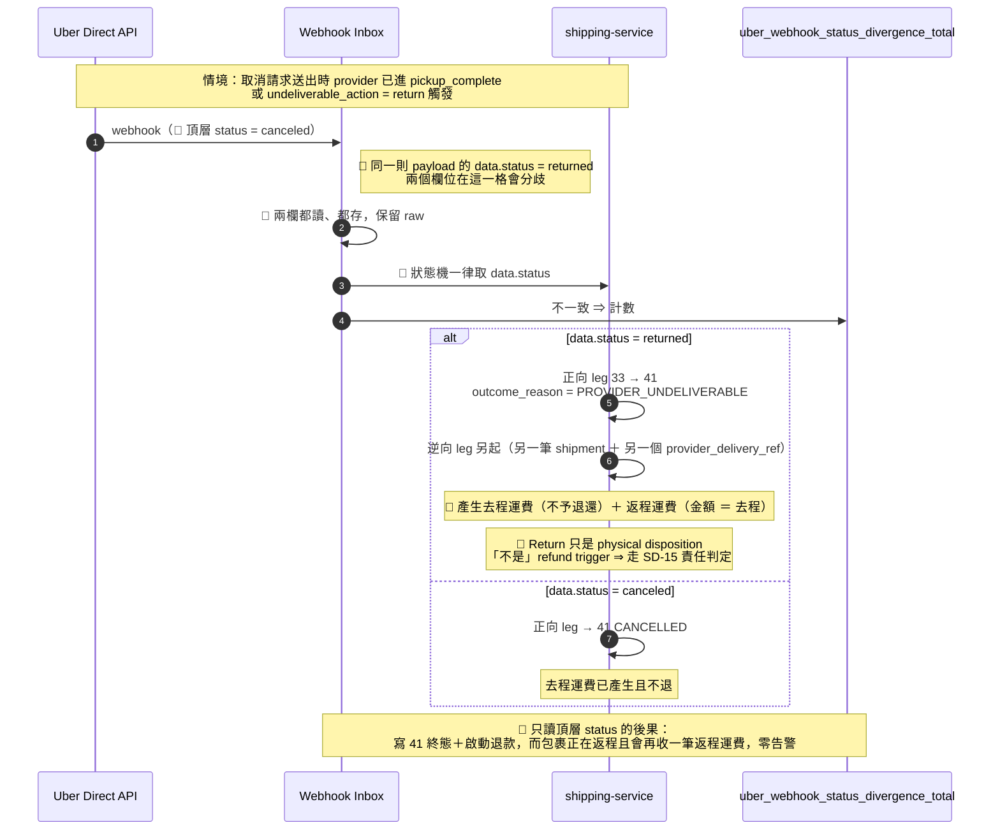

🔴 **這張圖要畫出來的關鍵點**
1. 🔴 **webhook 雙 `status` 分歧**（頂層 `canceled` vs `data.status` `returned`）必須畫成兩條線。
2. 四條規則：**兩欄都讀都存／狀態機取 `data.status`／不一致計數 ＋ 保留 raw／返程分歧必測**。
3. 🔴 **Return ≠ Refund trigger**。

🔴 **`Return` 只是 physical disposition，不是 refund trigger。**
`undeliverable_action = return` 的 return completed **只代表**包裹的實體處置／庫存回收／賣家取回，
🔴 **`RETURN_COMPLETED` 不得自動觸發退款**。退款方向一律回到責任判定（§4.5.5 的二元政策），🔴 **且一律以 financially final 為前提**：
**financially final** 的 `BUYER_CAUSED` ⇒ `refund_to_buyer = 0`（🔴 **return 完成也不恢復退款資格**）／
**financially final** 的 Non-Buyer-caused ⇒ `= full`／
**尚未 financially final**（🔴 **含 `RESPONSIBILITY_UNRESOLVED` 與「判定已提案但覆核未通過」兩種**）⇒ 等裁決，🔴 **不動錢**。
⚠️ **這一格與 §6.3.6 同源**：`refund_request` 也只建 case、不自動退款——
**退款的唯一寫入路徑在 aftersales**，webhook 側永遠只提供事實。

🔴 **返程是另一個 fulfillment leg**：它有自己的 `provider_delivery_ref`（`ret_…`）
⇒ 天然是另一筆 `logistics_receivable`（§1.6.1），**返程運費 ＝ 去程運費**，
🔴 **不需要任何 fee 維度去區分去程與返程**。

#### 6.3.2a 🔴 回調的定位鏈：一條，不是兩條

> 🔴 **「去重」（§6.3.3）與「定位」是兩件事，不得當成同一件事帶過**——
> 於是「這則事件屬於哪一筆配送單」沒有任何一處被明確指定。
> ⚠️ **定位鍵錯了的症狀是全部貨態靜默進不來**——訂單永遠到不了送達，
> 連帶讓買家的時間軸、送達證明與**售後入口**一起消失，而每一層的 log 各自看起來都正常。

**唯一合法的定位鏈（依序嘗試，缺一不可）**

| 序 | 用什麼 | 何時可用 | 對應到 |
|:--:|---|---|---|
| **1** | `uber_delivery_id`（`del_…`／`ret_…`） | 建單已成功並寫回 | `shipments.uber_delivery_id` |
| **2** | 我方送出的 **`external_id`**（business correlation identity，見 §6.3.2a-1）與 `manifest.reference`，由 Uber 原樣回傳 | **建單結果不明（`991`）時的認出手段**——那時我方沒有 `delivery_id` | `uber_deliveries` 的 pre-commit 列 |
| **3** | 都對不上 | — | 🔴 **落 inbox ＋ counter ＋ 建案件，不得靜默丟棄**，也不得猜 |

🔴 **三條硬規則**

| # | 規則 | 為什麼 |
|---|---|---|
| ① | **`external_id` 在呼叫 Uber 之前就必須隨 pre-commit 列一起落庫** | 沒先落庫的話，回調拿著對方回傳的識別字在我方查不到任何東西。⚠️ **2026-09-15 R3 更正措辭**：本條原寫「pre-commit 鍵**就是**送出去的 `external_id`」——那句話把**技術防重鍵**與**業務關聯識別**壓成同一個東西，與 §6.5 的「`external_id` ＝ 我方訂單號」直接矛盾。四個識別字的角色見 §6.3.2a-1 |
| ② | 🔴 **定位不得依賴任何為別的 provider 設計的欄位。** 本 provider 的識別字只有上表兩個 | 借用別的 provider 的欄位（例如超商的物流單號欄）會讓兩件事共用一個欄位，而其中一條路徑從來不寫它 ⇒ 查詢恆空 |
| ③ | **webhook 不是唯一入口**：`track()` 的回查必須能用**同一條鏈**定位 | 只有 webhook 一條路時，對方漏送就永遠收不回來。⚠️ 回查若被設計成「排除 `991`／`990`」，第 2 條錨就零使用者，而那正是它存在的唯一理由 |

🔴 **第 2 條錨的形狀**：
① **回應側成立** —— `external_id` 與 `manifest.reference` 確實會出現在 webhook 頂層與 Get／List 的回應內容中；
② **查詢側是「有界過濾」不是「精確反查」** —— 見 §6.3.2a-2。
⇒ 第 2 條錨的用途是**認出（recognition）**，不是**精確查詢（exact query）**。

#### 🔴 6.3.2a-1　識別字的角色分離

> 🔴 **四個角色、三支送出的識別字、一份共用的 key value。**
> 把它們讀成同一個東西，或反過來為 local claim 另發明一支 identifier，**兩種錯都會壞**。
> 🔴 **不得新增第四支 identity。**

##### 🔴 A. local pre-commit claim ＝ **INTERNAL OWNERSHIP RECORD**，不是一支 identifier

它回答的是「**這一個 delivery leg 的 Create Delivery side effect，由哪一筆本地記錄取得 ownership**」。
它是一筆**記錄與機制**（claim-before-side-effect），**不是**我方另外發明的第四個識別碼。
保證方式：**本地 DB 的 `UNIQUE` / CAS**。

🔴 **那筆 claim record 用哪個值當鍵？** ⇒ **就用那份 persisted technical dedupe key**，
而**同一個值**會被送出成 Uber 的 `idempotency_key`：

```
local pre-commit claim record                  ← INTERNAL OWNERSHIP RECORD（機制）
   └─ keyed by  persisted technical dedupe key ← 同一份 immutable 值
          └─ 原值送出成 Uber idempotency_key    ← PROVIDER PROTOCOL FIELD
```

⚠️ **這不是「把 local claim record 送給 provider」**——送出去的只是**那筆 record 持有的 key value**。

🔴 **共享 key value ≠ 共享責任**：

| 層 | 誰保證 | 保證什麼 |
|---|---|---|
| **Local** | 我方 DB `UNIQUE` / CAS | **ownership / 併發**——同一 leg 只有一個執行者拿得到 claim |
| **Provider** | Uber 的 `idempotency_key`（預設 60 分鐘） | **protocol dedupe**——同鍵重送不會建第二趟 |

🔴 **兩層不得寫成互相取代**（65 [`ADR-014`](../adr/2026-09-14-uber-create-idempotency-precommit-key.md)），也**不得**因為共用同一個值就說它們是同一件事：
provider 那層有 **60 分鐘 TTL 且在對方手上**，我方這層**沒有 TTL 且是我們自己能保證的**。

⛔ **禁止新增**：`local_claim_id`／`precommit_id`／`claim_uuid`／任何第四支 opaque identity。
理由：多一支就多一張 mapping、多一種 correlation failure mode。

##### B. 四個角色的定版表

| # | 識別字／機制 | 類型 | 硬要求 | 🔴 不得 |
|---|---|---|---|---|
| **A** | **local pre-commit claim** | **INTERNAL OWNERSHIP RECORD** | claim-before-side-effect；由本地 DB `UNIQUE` / CAS 保證；其鍵**即** B 的那份 persisted 值 | 🔴 **它本身不是 provider identity**；🔴 **不得為它另開一支 identifier** |
| **B** | **`idempotency_key`**（送出） | **TECHNICAL DEDUPE IDENTITY** | **immutable**；**provider side effect 之前就 persisted**；**per delivery leg 唯一**；重試與 `991` replay **一律讀那份 persisted 原值**；✅ **該值同時可作為 A 的 `UNIQUE` 鍵** | 🔴 **不得重新計算**（重算＝換了一把鑰匙，那次重送就是真的建第二趟）；🔴 **不得拿來當 business／human correlation** |
| **C** | **`external_id`**（送出） | **BUSINESS CORRELATION IDENTITY** | **deterministic**；由**訂單識別 ＋ leg** 導出；**正逆向可區分**；**stable**；在 Dashboard／帳單／support 場合**人讀得懂** | 🔴 **語意角色不等於** `idempotency_key`；🔴 **不得把 technical dedupe key 直接當成它的定義** |
| **D** | **`manifest_reference`**（送出） | **COURIER / PICKUP OPERATIONAL REFERENCE** | 面向外送員／取件現場；不得含換行；與 `external_id` 的**組合**滿足官方唯一性規則 | 🔴 **不得與 `external_id` 或 `idempotency_key` 混成同一用途** |

🔴 **生成責任與唯一性（這兩件是契約，字串格式不是）**：

| 項 | 定版 |
|---|---|
| **誰生成** | 全部由 **shipping-service 的 uber-adapter 在 pre-commit 交易內**一次產生並落庫；**不由呼叫端傳入** |
| **`external_id` 的唯一性** | 每個 **(訂單, leg)** 一個值 ⇒ 全域唯一 |
| **`idempotency_key` 的唯一性** | 每個 **delivery leg** 一個值。⚠️ 它與 `external_id` 是**兩個獨立欄位、不得共用同一個 DB 欄位存放**；但它**與 local claim 的鍵是同一份值**（見 A） |
| **正逆向區分** | `external_id` **必須**能區分 forward／return leg |

**語意範例（🔴 僅示意，不是可直接硬編碼的契約）**：`<order_no>:FWD`／`<order_no>:RET`。
⚠️ **實際 delimiter 與字串格式由 implementation review 決定並釘契約測試**；
🔴 **不得把上面這兩個範例字串直接抄進程式**。

✅ **`§5.3` 的 `uber_create_delivery:{order_no}:{leg}` 是哪一個**：
它是 **B 那份 persisted technical dedupe key**，同時**作為 A 那筆 claim record 的 `UNIQUE` 鍵**，
並**原值送出成 Uber `idempotency_key`**。**它不是** `external_id`。

#### 🔴 6.3.2a-2　List Deliveries 的查詢能力

| 來源 | 說什麼 | 等級 |
|---|---|---|
| 官方 **changelog 2025-04-17** | 逐字「Added support for **new query parameters in the List Deliveries endpoint**: `external_store_id`、`start_dt`、`end_dt`」（後兩者 RFC 3339） | **T1-c（現行官方）** |
| `uber/uber-direct-sdk` 的現行 `openapi.yaml` | 仍只列 `filter`／`limit`／`Offset`，**`start_dt`／`end_dt` 在整份 spec 零命中** | **T1-B，但落後 changelog** |

🔴 **SDK spec 與官方 changelog 不保證逐位元同步** ⇒ **spec 缺某欄位不等於官方沒有**：
查「有沒有這個能力」時 **changelog 與 spec 必須併查**，且 **changelog 較新者為準**。

**現行可用的 query 參數（T1-c ＋ T1-B 合併）**：

| 參數 | 用途 |
|---|---|
| `external_store_id` | 依取件點過濾 —— 🔴 **V1 一賣家一個值** ⇒ 它等同「依賣家過濾」 |
| `start_dt` / `end_dt` | RFC 3339 時間窗過濾 |
| `filter` | 狀態：`pending`／`pickup`／`pickup_complete`／`dropoff`／`delivered`／`canceled`／`returned`／`ongoing` |
| `limit` / `Offset` | 分頁；回應另帶 `next_href`。⚠️ `total_count` 官方標 **DEPRECATED，永遠回 -1** ⇒ **不得用它判斷結果數量** |

🔴 **維持不變的結論**：**沒有 `external_id` 或 `manifest_reference` 的 exact query。**
⇒ List 能做的是**縮小候選集合**，不是**直接指名取回那一筆**。
**回應內容是完整的 `DeliveryResp` 陣列**（含 `id`／`uuid`／`external_id`／`manifest`／`status`）
⇒ **嚴格本地比對在回應側是做得到的**（§7.7）。

#### 6.3.3 去重鍵

級 1（首選）：provider event id ⇒ `event_key = <event_id>`。
級 2（fallback）：`{delivery_id}:{event_type}:{provider_timestamp}:{sha256(raw_body)[0:16]}`。

🔴 **級 2 的失效條件必須寫明**（否則它看起來像萬能）：
- 同一秒內同 delivery 的同型事件且內容完全相同 ⇒ 被誤判重複而丟棄。`delivery_status` 不會（狀態變了 body 就變）；`courier_update` 會（外送員沒動時 body 相同）⇒ **可接受**，因為它的語意是 level（丟一則不影響最終值）
- `provider_timestamp` 精度只到秒 ⇒ 上述窗口是 1 秒
- body 有 float 或 map 順序不穩 ⇒ 同一事件算出不同 hash ⇒ **重複處理**。防線：狀態寫入本身冪等（`isValidTransition` ＋ CAS）

`webhook_inbox` 對應：`provider=<WebhookProvider.UBER 的 **Value**>`／`webhook_type=<Uber 原生事件型別>`／`mer_id=NULL`。
🔴 **該欄存的是 CodeMeta 的 Value（數字碼字串）不是 Name**：`webhook_inbox.provider` 的 DEFAULT 是 `'8241'`（＝ `WebhookProvider.PAYUNI` 的 Value），CodeMeta 該節「DB 儲存欄位」欄也逐字寫 `webhook_inbox.provider（存 Value）`。⇒ 🔴 **寫 `'UBER'` 會讓 consumer 拿字串去比數字碼**。Uber 的 Value 由 65 統一配（附錄 C.2）。

#### 6.3.4 🔴 收到即 ACK 的時間預算

同步段只做四件（全是本機動作）：讀 raw body → 驗簽 → `INSERT webhook_inbox`（`ON CONFLICT DO NOTHING`）→ 200。
**業務處理一律非同步**（outbox → MQ → consumer）。預算：p99 **< 300 ms**，硬上限 1 s。

🔴 INSERT 失敗（DB 不可用）**必須回 5xx**——回 200 等於承認收到卻沒存，而 Uber 不會再送。
🔴 200 之後的任何失敗都不得改變回應 ⇒ 那些失敗由 §7.7 回查兜底。

#### 6.3.5 亂序收斂（三道，依序）

① **provider timestamp**：早於已記錄值 ⇒ 丟棄 ＋ `uber_webhook_out_of_order_total`
② **合法 transition**：交給 `ShipmentStatusMapper.isValidTransition`；false ⇒ 不寫入 ＋ counter。
🔴 **分兩類**（65 §7.7.4.2）：亂序／重複 webhook（**不建案件**）vs 真倒退（**建案件**）。
判別：`to` 在映射表中的序位低於 `from` **且** timestamp 也較早 ⇒ 亂序；否則 ⇒ 真倒退
③ **Get Delivery 為準**：前兩道判不出來時（例如未知值）打一次 E4 取絕對值。⚠️ 有 deadline 且**不重試**——收斂責任在回查排程，不在 webhook 路徑

#### 6.3.6 `refund_request` 只建 compensation case

🔴 **不自動驅動 buyer refund**。三條理由：① 退款的**唯一寫入路徑**在 aftersales，從 webhook 直接叫退款＝第二條退款入口
② Uber 的 `refund_request` 是 **Uber 向我方求償或退我方款**，與「退錢給買家」是不同的兩筆錢 ③ 金額與責任歸屬需要人判（D-1 義③）。
落點：65 §5.5 的 `fulfillment_exception_cases`，`caseType = UBER_REFUND_REQUEST`。

### 6.4 非同步事件（MQ）

#### 6.4.1 發布的事件

🔴 **配送軸新增 1 條內部 routing key：`uber.shipping.status`。**

⚠️ **為什麼不能是 0 條**：本書的 8 張表在 **shipping-service**（`hawkr_shipping`），
uber slice 在 **payuni-webhook-service**（`hawkr_webhook`）——**兩個獨立資料庫**
⇒ 跨庫不能同交易。少了這條 key，**3003 的 933／930／31／11 全部不可達，且完全靜默**。

**決定：沿用既有 PayUni 的形狀**（那條路徑已經證明可行）：

| 既有（PayUni） | 本書（Uber） |
|---|---|
| `payuni-webhook-service` 發 `MqConstants.ROUTING_KEY_PAYUNI_SHIPPING_STATUS` | 發 **`uber.shipping.status`** |
| `shipping-service` 的 `ShippingWebhookConsumer`（`@RabbitListener(queues = MqConstants.QUEUE_SHIPPING_PAYUNI_WEBHOOK)`） | 新增 consumer，收 **`shipping.uber.webhook`** queue |
| → `ShippingService.processWebhookStatusUpdate` → `updateStatus`（唯一寫 `shipments.status` 的中央分派點） | **同一個中央分派點**，不另開寫入路徑 |

⇒ **`uber_deliveries` 的寫入與 `ShipmentStatusMapper.isValidTransition` 都在 shipping-service 側**，
webhook 服務只負責驗簽、入 inbox、發事件（與它對 PayUni 的職責一致：純 ingress、零業務邏輯）。

**其餘配送軸 routing key ＝ 0 條**（65 §6A.0 R3：能用既有 key 承載的一律擴充 payload）：
`shipment.status.changed`（所有 Uber 正向狀態變化，含 `courier_imminent` 邊緣觸發）／`shipment.delivered`／
`shipment.return.status_changed`（`is_return=true`）／`shipment.created`。

🔴 **物流財務軸另有一條，本書是它的 producer 但不擁有它的契約**：
**`logistics.cost.incurred`** —— 由 **shipping-service** 在 **provider 這條 leg 已產生成本**時發出
（🔴 **不是「送達完成時」**——送達、取件後取消、買家無法投遞、返程 leg 四種情形都算，見 70 §3.1.1），
consumer 是 **payment-service 的 Logistics Finance module**，
用途是建立賣家物流應收（[`ADR-003`](../adr/2026-09-11-uber-logistics-fee-charge-trigger.md)／[`ADR-009`](../adr/2026-09-11-logistics-finance-domain-ownership.md)）。
🔴 **契約 SSOT ＝ [70 §7](70-物流財務結算%EF%BC%88Logistics%20Settlement%20%26%20Receivable%EF%BC%89詳細設計書.md)，本書不重述。**

⚠️ **為什麼不能用 `shipment.delivered` 承載它**（R3 的例外）：
`shipment.delivered` 是**物流事實**、consumer 是 order／aftersales；
財務軸要的是**帶成本維度**的事件（`estimated_cost`／`provider`／`provider_delivery_ref`）。
🔴 **該 payload 不得攜帶 `responsibility_cause`**：
Cost Fact ≠ Responsibility Decision，唯一的 responsibility authority 是 N16
（`fulfillment.responsibility.finalized`）。🔴 **成本事實不得等責任判定才能發送**——
那會讓 70 §6.3／SD-15 的「成本已發生的事實**先記錄**、歸屬未定」在物理上不可能發生。
兩個事實如何 durable join 見 **70 §3.1.4**。
把成本欄位塞進 `shipment.delivered` 會讓**所有**既有 consumer 都收到它們用不到的財務資料，
而那正是 65 §6A.0 R3 另一半（「payload 不得為單一 consumer 長胖」）要防的。

🔴 **`logistics.cost.incurred` 的四面登記不在本書的 §6.4.4**（本書 §6.4.4 只算配送軸那一條）。
⚠️ **四面的清單以 [70 §7](70-物流財務結算%EF%BC%88Logistics%20Settlement%20%26%20Receivable%EF%BC%89詳細設計書.md) 為準，
🔴 三份文件不得各列一套。**

payload 沿用 `ShippingEventPayload`（實讀 19 欄 record，`@JsonNaming(SnakeCaseStrategy)`），
加上 65 §6A.1.1 X4 已規劃的四欄（`commerce_model`／`provider`／`previous_status`／`occurred_at`）。

🔴 **`commerce_model` 的取值本書一律 `SELLER_DIRECT`**（§1.6）；
本書路徑產生的**訂單快照欄與事件 payload 一律填這個值**，且 `collection_model = SELLER_MERCHANT`、
`invoice_model = SELLER_TO_BUYER`（三欄由 65 §5.1.3 的 policy matrix 綁成一組，填錯任一個都會被 DB CHECK 擋下）。
⚠️ 🔴 **不得填 `PLATFORM_CONSIGNMENT`**（§1.6）。
它不是裝飾欄：65 §7.7.1.3 的 G0 與撥款 Gate 都吃它——而 `SELLER_DIRECT` 讓 `PayoutEligibility` 的 G0
回 `NOT_APPLICABLE` ⇒ **本書路徑不進平台撥款軸，這正是修正後的預期行為**（不是缺陷）。
🔴 **不得為了「讓撥款鏈跑起來」把它改回 `PLATFORM_CONSIGNMENT`**：平台沒有代收，就沒有款可撥。
平台向賣家收 Uber 物流服務費走的是另一條線（§1.6 線 B），與撥款鏈無關。
另外三欄的語意由 65 §6A.1.1 X4 那一列定義，本書不重述，只補本書的取值：`provider` 填**字串 `UBER_DIRECT`**
（65 附錄 C.2「`provider`（envelope 欄的值域）」那一列：`MERCHANT`／`TAQBIN`／`CVS_711`／`UBER_DIRECT`）。

🔴 **`WebhookProvider` 與這個欄位是兩件事，不要混用**：
`WebhookProvider`（§5.1.6 的 `webhook_inbox.provider`）是 **webhook inbox 的內部分類**——回答「這個原始 HTTP 請求是哪個第三方送進來的」；
X4 的 `provider` 是 **MQ payload 的配送服務提供者維度**（65 §4.2）——回答「這一段配送是誰在跑」。
兩者值域不同、生命週期不同（前者只在 ingress 存在，後者要跨服務傳給 order／aftersales／撥款鏈）。
⚠️ 🔴 **不得用 `WebhookProvider.UBER` 的 Value（數字碼）填這個 wire 欄位**——69 對同一個欄位填字串 `MERCHANT`
⇒ **同一欄位兩種型別，consumer 無法解析**。定案取字串值域。

🔴 **值域由 65 統一定版**（65 附錄 C.2 該列）；本書只引用，**不自訂**。

🔴 **X4 第五欄 `outcome_reason`（String，nullable）——本書提出，✅ 已回灌 65（2026-09-08）。**
理由：order-service 要據此決定發不發 N1（`order.fulfillment.failed`），現況它只能從 `provider_status` 的
**原生字串**猜（`returned` vs `canceled`）——那是把跨服務判斷建立在 provider 的字面值上，provider 改字就靜默失效。
值域 ＝ `UberDeliveryOutcome`（C.2；權威在 65 附錄 C.2 那一列）：（`PROVIDER_UNDELIVERABLE`／`PROVIDER_CANCELED`／`SELLER_CANCELED`／`ADMIN_CANCELED`／`CREATE_FAILED`）⇒ **open item 已關閉**，66 的 payload 契約測試有值域可對。

#### 6.4.2 消費的事件
`order.paid` —— 🔴 **它觸發 §4.1 ③ 的完整 `FL-1`：`Create Delivery`（帶 `pickup_ready_dt ＝ pickup_ready_at_snapshot`）
＋ 建本地 shipment（`91`）＋ 寫 `processing_deadline`。**
🔴 **`order.paid` 就是 Uber 建單的唯一事件觸發者**
（§4.5.0 的 `E2` 列；建單兜底排程是它的補做者，不是第二個入口）。
🔴 **consumer 的三件必辦**：① **冪等**——同一 `order_no` 重複投遞只能有一筆 delivery
（靠**持久化的** pre-commit 鍵 ＋ 同值 `idempotency_key`，[`ADR-014`](../adr/2026-09-14-uber-create-idempotency-precommit-key.md)）
② 失敗**不得 ACK 丟棄**，走 retry／DLQ（`pkg/mq`／`manualAckContainerFactory` 的既有形狀）
③ 🔴 **不得在 consumer 內重算 `pickup_ready_dt`**（`INV-U8`）。
無新增 queue。

#### 6.4.3 envelope 遵循聲明
→ 65 §4.6。本書不定義 envelope。

#### 6.4.4 `topology.yaml` 條目

🔴 **本書新增：exchange +0／queue +1（`shipping.uber.webhook`，`dlq:` 形狀）。**

🔴 **`test_expand.py` 的資源數量 pin 會變，施工時一律以實跑對帳，不得抄任何寫在文件裡的絕對值。**
絕對值受**落地順序**影響（66／67／68／69 哪一本先進）⇒ 抄舊數字必然撞。

```bash
cd infra/mq && python3 -m unittest discover -s tools -p 'test_*.py'
```

⚠️ **先對帳增減量再改 pin 數字**，🔴 **不得只為了讓測試變綠而改**（10 檔 §10.7）。

**`retry:` 與 `dlq:` 的增減量不同**（`expand.py` 實作；🔴 兩者**互斥**，同時宣告直接 `ExpandError`）：

| 條目形狀 | exchanges | queues | bindings | 自動展開出什麼 |
|---|---:|---:|---:|---|
| 宣告 `retry:` | **+1** | **+2** | **+3** | `{name}.retry` fanout ＋ `{name}.dlq` queue；bindings ＝ 自有 ＋ `{name}.retry`→queue ＋ `{exchange}.dlx`→`{name}.dlq` |
| 宣告 `dlq:`（不給 `queue:`） | **+0** | **+2** | **+2** | `{name}.dlq` queue；bindings ＝ 自有 ＋ `via`→`{name}.dlq` |

🔴 **`{name}.dlq` 兩種形狀都會自動產生** ⇒ **不需要也不得手寫進 `topology.yaml`**
（手寫會與展開結果重複）。把 queue 增量算成 +1 就是漏算了它。

##### 🔴 形狀 ＝ `dlq:`

🔴 **判準（機械可執行）**：`topology.yaml` 中帶 `retry:` 的條目**全部屬於 Go 服務**，
**Java 消費端一條都沒有**。

| 形狀 | 對應的消費端機制 |
|---|---|
| `retry:` | Go `pkgmq.NewResilientConsumer` 的 `{queue}.retry` fanout |
| `dlq:` | Java Spring `manualAckContainerFactory` ＋ `x-dead-letter-exchange` |

⚠️ 本 queue 的消費端是 **Java**（`ShippingService.processWebhookStatusUpdate` 在
`services/java/shipping-service`，§6.3.2）⇒ 🔴 **`dlq:`**。

⚠️ 🔴 **`.dlx` 不得沿用 `hawkr.shipping.dlx`**：那一支是 `notification.shipping`（Go）在用；
shipping-service 消費的既有 queue 走的是 **`shipping.webhook.dlx`**。

**定版條目（直接抄進 `infra/mq/topology/topology.yaml` 的 `queues:` 區）**：

```yaml
- name: shipping.uber.webhook
  dlq:
    via: shipping.webhook.dlx
    routing_key: shipping.uber.webhook.dlq
  bindings:
  - exchange: payuni.events
    key: uber.shipping.status
```

**逐格說明**：

| 格 | 值 | 理由 |
|---|---|---|
| `dlq.via` | `shipping.webhook.dlx` | 已存在（topic），與同服務其他四條 queue 一致。**不新增 exchange** |
| `dlq.routing_key` | `shipping.uber.webhook.dlq` | 與 `shipping.payuni.webhook.dlq` 同形 |
| 不給 `dlq.queue:` | — | 讓 `expand.py` 自動產生 `{name}.dlq`，**不手寫**（手寫會與展開結果重複） |
| `bindings[0].exchange` | `payuni.events` | 🔴 **刻意沿用**：§4.5.1 的 ADR 已決定 Uber slice 落在 `payuni-webhook-service` 並**共用 inbox／outbox 兩張表**，而該服務的 outbox 派發器只有一個出口（`PayUniEventRouting` 回 `MqConstants.EXCHANGE_PAYUNI_WEBHOOK`）。另開 exchange 等於為同一個派發器造第二個路由軸，且新 exchange 還要配一個 `.dlx` ⇒ **多兩個 exchange 換一個命名純度**。⚠️ 命名債要寫下來：🔴 **`payuni.events` 承載的是「webhook-service 收到的所有 provider 回調」，不只 PayUni**——36 號 catalog 該 exchange 的說明必須同步改，否則下一個人會以為它只走 PayUni |
| `bindings[0].key` | `uber.shipping.status` | 與既有 `payuni.shipping.status` 同形，provider 維度由 key 的第一段承載 |

🔴 **展開結果必須與既有兄弟 `shipping.payuni.webhook` 逐格同形**：
`x-dead-letter-exchange = shipping.webhook.dlx`、`x-dead-letter-routing-key = shipping.uber.webhook.dlq`、
自動產生的 `shipping.uber.webhook.dlq` 由 `shipping.webhook.dlx` 以同名 routing key 綁定。

🔴 **本 queue 落在 MQ 登記 gate 觀測窗外，而且是雙重的**（65 §0.5 gate 6 ／ C-8）：
① `scripts/mq-consumer-registration-check.py` **只掃 Go**，本 queue 的 consumer 是 Java；
② 該腳本 topology 側**只走帶 `retry:` 的條目**，而本 queue 是 `dlq:`。
⇒ **漏登記時 gate 靜默轉綠**。補償措施＝ 65 §0.5 gate 6 的第三項「5 條新 queue 逐條人工核對」，
本 queue 是其中之一；**核對內容＝上面那段 YAML 逐格比對**，不是「有沒有這條 queue」。

⚠️ **`MqConstants` 要成對新增**（漏了不會編譯錯、consumer 直接收不到）：
`QUEUE_SHIPPING_UBER_WEBHOOK = "shipping.uber.webhook"` ＋ `QUEUE_SHIPPING_UBER_WEBHOOK_DLQ = "shipping.uber.webhook.dlq"`
＋ `ROUTING_KEY_UBER_SHIPPING_STATUS = "uber.shipping.status"`（比照既有 PayUni 三個常數）。

🔴 **pin 數字一律實跑對帳**（`cd infra/mq && python3 -m unittest discover -s tools -p 'test_*.py'`），
**不得為了讓測試變綠而改數字**——實跑值與預期不符時，先問「是不是某處偷偷加了 key」，
再決定改的是條目還是 pin。

#### 6.4.5 CodeMeta EventType ／ 6.4.6 catalog 落點 ／ 6.4.7 部署順序

🔴 物流是唯一沒有 EventType enum 的大領域（65 §3.9 八）；本書不新增事件 ⇒ 不新增值，但 65 建立 `ShippingEventType` 時，本書用的四條 key 都要在裡面。
四條既有 key 的 payload 擴充由 65 §6A.1.1 X4 統一登記；本書不另開 36 號條目，只在 X4 那列的 producer 欄補一句「含 `shipping_method='3003'` 的 Uber 路徑」。
🔴 **本書有 topology 變更：一條新 queue `shipping.uber.webhook`（§6.4.4 已定版條目）。**
⇒ 🔴 **順序約束必須遵守**（CLAUDE.md §10.7）：**topology apply（走 CI）先於 consumer 部署**。
反過來做的話，服務端已切 passive declare ⇒ **查不到 queue 不 crash、不進 DLQ，該訂閱靜默失效**，
唯一線索是 Go 端 reconnect 當下的一行 log，而本 queue 的 consumer 是 Java、**連那一行都沒有**。
apply 後確認 `consumers ≥ 1`，仍為 0 就 `kubectl rollout restart deployment/shipping-service`。
⚠️ X4 的 payload 擴充另有順序（65 §6A.1.1 三個施工前置），那是 65 的責任。

#### 6.4.8 五組「漏了不會有任何東西轉紅」的成對登記

| # | 成對 | 漏了會怎樣 |
|---|---|---|
| 1 | `WebhookProvider.UBER` ＋ `webhook_type` 的 COMMENT 覆蓋 | enum 漏 ⇒ 寫入時 `CodeMetaValidator` 拋；COMMENT 漏 ⇒ 下一個人照假註解實作 |
| 2 | `AssetReferenceType.DELIVERY_POD` ＋ media 的 `secure/` 分類 | 前者漏 ⇒ 上傳被拒；後者漏 ⇒ POD 落 public 前綴 |
| 3 | 3003 config 列**切成 `enabled = true`** ＋ **`CheckoutValidator` 的 Uber 分支改造** | 只做前者 ⇒ 陷阱 A1（真實訂單掉進黑洞）。⚠️ 建列本身（`enabled = false`）不觸發 A1，§3.4 ① |
| 4 | `RestrictedGoodsCategory` 碼表 ＋ `product_sku` 欄位 | 只做碼表 ⇒ 檢查恆為通過 |
| 5 | **`ReturnShippingRules`**（common-core 新增，取代 5 個 `PAYUNI_RETURN_*`）把 `930` 歸為退貨運送中 ＋ aftersales 的 `933` no-op 分支（65 [`ADR-013`](../adr/2026-09-12-return-leg-classifier-canonical.md)） | 只做前者 ⇒ `933` 走 else 靜默丟棄（無害）；只做後者 ⇒ 陷阱 A4。🔴 **若照舊去改 `AfterSalesConstants` 而不建分類器，`PAYUNI_` 前綴會繼續說謊，且未知值仍是 `else`＋ACK 靜默丟棄** |

⚠️ 第 3、4 組分屬兩個服務／兩個 PR，**CI 不會檢查它們的配對** ⇒ §12.2 的順序表是唯一防線。

### 6.5 Uber Provider API 呼叫契約（outbound 欄位映射）

| 我方 | Uber | 規則 |
|---|---|---|
| 收件地址（`orders.shipping_address` **單一字串**） | 🔴 **內含 JSON 的字串**（`street_address` **array**／`city`／`state`／`zip_code`／`country`） | **本節最大落差**：需要一支地址結構化解析器；失敗 ⇒ reason `ADDRESS_UNPARSEABLE`（類 A，可行動）。<br/>🔴 **台灣 mapping（T2，`SANDBOX_VERIFY`）**：`state` ＝ **縣市**、`city` ＝ **行政區**、`country` ＝ `TW` ——**與英語系直覺相反**，只有台灣業務指南一個來源，必須實測 geocoding 成功率後才定版 |
| 樓層／門牌補充 | 🔴 **`street_address` 陣列的第二個元素** | 🔴 **樓層／門牌補充進 `street_address`，不進 notes。**<br/>官方 spec 的 `StructuredAddress.street_address` 逐字範例即 `["2000 Ocean Ave", "Floor 2"]`；FAQ 逐字「Apartment or unit numbers are added as a **separate value in the street address structure**」。<br/>⚠️ **真正該進 notes 的是另一類**：大樓名／社區名／收件人稱謂（那些會讓地理編碼失敗）。**兩者不是同一件事** ⇒ 解析器要分得出「2樓403室」與「ABC大樓／王小姐收」。<br/>證據見 [Uber Direct API 總覽 §2.4](../第三方整合/Uber%20Direct%20API%20總覽.md) |
| **買家配送指示**（`BUYER_DELIVERY_INSTRUCTION`，獨立欄位） | `dropoff_notes`（與樓層補充**併入同一欄時必須有固定分隔與順序**） | 🔴 **這是獨立的輸入欄，語意見 66 基設 §3.5**。⚠️ **不得用訂單備註（`orders.remark`）冒充**——那一欄的收件人是**賣家**，把它送給 Uber 等於把買賣雙方的交易溝通交給第三方外送員。⚠️ **也不得用樓層補充冒充**：一個是地址的一部分，一個是給人的指示。長度上限與截斷規則見 §5.6 |
| **交付方式（handoff）** | `deliverable_action`（enum） | 官方值域 `deliverable_action_meet_at_door`（🔴 **未設定時的預設**）／`deliverable_action_leave_at_door`。<br/>🔴 **`leave_at_door` 有硬互斥**：官方逐字「**Cannot** leave at door when **signature or ID** verification requirements are applied」，且會**自動加上照片確認**。<br/>⇒ 我方 domain 值域（本人簽收／驗證碼交付／指定放置）的 adapter 映射**現在可以寫了**：本人簽收＝`meet_at_door` ＋ `signature_requirement`；驗證碼交付＝`meet_at_door` ＋ `pincode`；指定放置＝`leave_at_door`（**且不得同時要求簽名／ID／PIN**）。🔴 **這三個組合必須有契約測試釘死互斥關係**，否則建單會被拒而我方以為是別的原因 |
| **送達證明的要求方式** | `dropoff_verification`（object） | 🔴 **值域**：`picture`(bool)／`signature_requirement`／`barcodes[]`(`CODE39`｜`CODE39_FULL_ASCII`｜`CODE128`｜`QR`)／`identification`／**`pincode`（只有 dropoff 有）**。<br/>🔴 **官方逐字：「If a delivery is created with any verification requirements … the resulting image file is made available」** ⇒ **不要求就沒有 POD**，這與 §7.8 的 2026-09-13 更正一致。<br/>🔴 **必須明確送出要求，不得依賴帳號預設**——`meet_at_door` 的官方預設是**不帶任何驗證**（`leave_at_door` 才會自動帶照片）⇒ 不送＝**每一單都沒有證據**。<br/>✅ **`pincode` 是正式子欄**，值由 Uber 產生並**回傳在建單／查詢回應的 `pincode.value`**，Uber 另會簡訊告知收件人 |
| **PIN 的買家可見性** | 建單回應的 `dropoff_verification.pincode.value` | 🔴 **設計輸入**：PIN **我方拿得到**（不必靠 Uber 簡訊碰運氣）⇒ 買家端顯示 PIN 是**可行的**。<br/>⚠️ **且是必要的**：Uber 的簡訊依賴 `dropoff_phone_number` 正確；號碼一旦有問題，**我方 UI 是買家唯一的 PIN 來源**，而拿不到 PIN 的後果是收不到貨並轉入返程。<br/>🔴 **PIN 屬交付憑證**（單獨持有即可取貨）⇒ 依 10 檔 §10.3 的判準**必須納入 log 遮罩清單**，且不得落進任何非必要的持久化路徑 |
| **未能送達時的處置**（`undeliverable_action`） | enum，官方預設 `return` | ✅ **值域已確認**：`return`（🔴 **未設定時的預設**）／`leave_at_door`／`discard`。<br/>🔴 **改為明確送出 `return`，不再依賴對方預設**——「依賴對方預設」與「我方決定」是兩件事，而該預設是 Uber 的營運參數、隨時可改且我方不會知道。<br/>⚠️ 官方另註：**即使 `deliverable_action` 選了放門口，外送員仍可能把包裹送回取件點** ⇒ 返程路徑**不因選擇放門口而消失** |
| 電話 | `+886…` | `09xxxxxxxx` → `+8869xxxxxxxx`。✅ **2026-09-14 覆核正確**：官方 spec 的 `pickup_phone_number`／`dropoff_phone_number` pattern 逐字 `^\+[0-9]+$` ⇒ **不得帶連字號**。⚠️ 台灣業務指南 p.35 寫的 `+886-2xxxxxxxx`（帶 `-`）**違反官方 regex**，不採用 |
| 金額（元整數） | 🔴 **cents（¹⁄₁₀₀ 幣別單位）** | 🔴 **TWD 的係數不是 1。**<br/>官方 spec 多處逐字：`manifest_total_value`／`manifest_items[].price`／`fee`／`tip`／refund 金額皆為「**Value in cents ( ¹/₁₀₀ of currency unit )**」，並附換算例「`$10.99` => `1099`」。**規則是「幣別單位的 ¹⁄₁₀₀」，TWD 沒有豁免**（T2 獨立佐證：指南 p.37 逐字「乘以 100」；p.108 的 refund 實例 `TWD 7500` ＝ NT$75）。<br/>🔴 **邊界規則**：DB／domain／MQ payload／對外 API **一律維持元整數不變**；**只在 uber-adapter 邊界**做出站 `×100`、入站 `÷100`，且必須是**具名轉換函式 ＋ 契約測試**。🔴 **Uber 的 minor unit 不得滲透進 domain**。<br/>⚠️ 連帶：`uber_quotes.fee_amount` 存的是**元整數**（不變），但寫入前要除 100 —— 照原文實作會讓報價金額變成 100 倍 |
| 幣別欄 | 🔴 **`currency_type`（大寫），不是 `currency`** | 官方 spec 已把 `currency` 標 `deprecated`（三字母小寫），改用 `currency_type`（三字母大寫）。⚠️ **我方 `uber_quotes.currency` 欄名不必改**（那是我方欄名），改的是**讀 Uber 回應時取哪一個 key** |
| 冪等 | 🔴 **`idempotency_key`（官方支援，預設 60 分鐘）** | 官方 spec 逐字「avoid duplicate order creation with identical idempotency keys for the same account. The key persists for a set time frame, **defaulting to 60 minutes**」。<br/>🔴 **當第二道防線一併送出，不取代 [`ADR-014`](../adr/2026-09-14-uber-create-idempotency-precommit-key.md) 的第 1 層**（我方 pre-commit 鍵是唯一我們自己能保證的那道）。<br/>🔴 另有一條**官方側唯一性**：`manifest_reference` × `external_id` 的**組合必須唯一，否則建單直接失敗** ⇒ 兩欄的產生規則要保證組合唯一 |
| 訂單識別 | `manifest_reference`（外送員 App 可見）／`external_id`（Dashboard ＋ **帳單**可見） | 🔴 **兩欄都必須明確送出**：§7.7 的 `991` 收斂與 §4.5.5 的對帳都依賴它們——少送任一欄就是「送出端沒定義、反查端卻依賴」。<br/>🔴 **角色與生成規則以 §6.3.2a-1 為準**：`external_id` ＝ **business correlation identity**，deterministic、由**訂單識別 ＋ leg** 導出、**正逆向可區分**、人可讀（官方逐字定位給「**aggregators, POS systems**」使用 ⇒ 正是我方平台的角色）；`manifest_reference` ＝ **courier／pickup operational reference**（不得含換行）。<br/>🔴 **`external_id` 不等於 `idempotency_key`，也不等於 local pre-commit claim**；🔴 官方要求 **`manifest_reference` × `external_id` 組合唯一**，否則建單直接失敗 |
| `external_store_id` | 同名 | 🔴 Quote 與 Create **兩處都帶** |
| 品項 | `manifest_items[]`（`size` string enum） | 由 packing policy 產出 |
| 溫層 | **無對應欄位** | 🔴 不送、不假裝。溫層只活在我方 |
| **取件時間**（V1 唯一送出的時間窗欄位） | `pickup_ready_dt` | 🔴 **送，值 ＝ `pickup_ready_at_snapshot`**（報價當下凍結的絕對時間，§5.1.4）。`E1 Create Quote` 與 `E2 Create Delivery` **必須送同一份 snapshot**；🔴 **禁止**在 Create 當下用 `payment_time ＋ prep_sla` 或新的 `now` 重算（`INV-U8`）。<br/>**官方事實（Provider Reference）**：型別 RFC 3339、**optional**、逐字「Beginning of the window when an order **must be picked up**. Must be **less than 30 days** in the future」。<br/>⚠️ 官方 delivery-window 指南對 ASAP 寫「otherwise **leave blank**」——**那句話的主體是「沒有備貨時間」的 ASAP 單**；我方**有**備貨時間（`seller_prep_sla`）⇒ 送出取件窗開始時間。<br/>⚠️ **T2 指南 p.38 寫「即時訂單請輸入現在時間 +5s」** ⇒ 標 `SANDBOX_VERIFY`：我方送的是未來時點，若 sandbox 拒收再依實測調整。<br/>證據見 [總覽 §2.6](../第三方整合/Uber%20Direct%20API%20總覽.md) |
| `pickup_deadline_dt`／`dropoff_ready_dt`／`dropoff_deadline_dt` | 同名 | 🔴 **V1 一律 OMIT（三欄一個都不送）**。官方皆為 optional。<br/>🔴 **不得**因為「順手補上比較完整」而送——多送一個時間窗就多一個與 `pickup_ready_at_snapshot` 分岔的來源，而 provider 會把它當成硬約束。<br/>⚠️ `E5 Update Delivery` 也只准動 `pickup_ready_dt` 一欄（§4.5.0a） |
| **ASAP／Scheduled 的分界**（Provider Reference，🔴 **不是 runtime branch**） | — | 🔴 **官方分界是「送達預期 ≥ 90 分鐘」**，**不是**「有沒有送 `pickup_ready_dt`」（≥ 90 分即 Scheduled，且四個時間窗欄位皆必填、各有最小間距）。<br/>🔴 **3003 V1 ＝ Uber Instant**：不符 Instant eligibility ⇒ **該配送方式 `available=false`（結帳 eligibility 排除，reason `EXCEEDS_INSTANT_ETA_LIMIT`，§6.1.2）**，🔴 **不是自動切 Scheduled**。<br/>🔴 **不得**在本書任何地方寫出「ETA ≥ 90 分 ⇒ 自動切 Scheduled」這類 runtime 分流；Scheduled 的契約留在 [Uber Direct API 總覽](../第三方整合/Uber%20Direct%20API%20總覽.md) 當 **provider capability reference**。未來若要做「Uber 預約配送」，那是另一個 capability／Product Flow |

⚠️ **地址結構化是本書最大的實作未知數**，它決定 quote 成功率 ⇒ §12.0 EV-4 用**真實 dev 訂單地址樣本**量測解析率，
低於門檻就不上線——失敗的每一筆都是一個看不到選項的買家。

---

## 7. 執行時視圖

### 7.0 元件代號與排程器名冊

| 代號 | 排程器 | 形狀 | 為什麼 | 租約／欄 |
|---|---|---|---|---|
| **P1** | `UberStatusReconcileScheduler` | 🔴 **lease**（不是 level-triggered） | 判準是「重放一次，是多做了一件事，還是重新確認同一件事」。**它會發 MQ 事件** ⇒ **向外投遞** ⇒ 65 §3.9 九 逐字「一律不得 level-triggered」 | 5 分／`shipments.uber_status_reconcile_next_at` |
| **P2** | `UberPodFetchScheduler` | lease | 批次讀候選 → 逐筆副作用（**寫媒體**） | 10 分／`uber_pod_artifacts.fetch_lease_until` |
| **P3** | `UberQuoteExpiryScheduler` | lease | claim 述詞就是狀態轉換（`CREATED→EXPIRED`）⇒ lease 或出路 4；本書選 lease（無 publish） | 1 分 |
| **P4** | `ProviderPickupDeadlineScheduler` | 🔴 **lease** | 它是 `PROVIDER_REMATCHING` 與「provider 遲遲不取件」的**唯一**推走者：tick T-14 打 `E4`、寫回 `courier` 是否為 null、在 T-15 告警、在 T-16 發動 Cancel Saga（§7.7）。**會發 MQ 事件與推播 ⇒ 不得 level-triggered** | T-14／`uber_deliveries` 的 provider 取件租約欄 |
| **P5** | `CancelPendingTimeoutScheduler` | 🔴 **lease** | `992 CANCEL_PENDING` 的推走者：`E4` 回查 → 四出口（§7.7）。**會觸發退款與買家通知 ⇒ 向外投遞** | T-17／`shipments` 的取消確認租約欄 |
| **P0′** | `ProcessingDeadlineScheduler`〔既有，跨 provider〕 | lease（既有形狀） | 🔴 **本書只要求一件事：候選述詞必須涵蓋 3003**。逾期處置是 §7.2 的 Cancellation Saga（`E4`→`E6`→確認 terminal→**才**退款），🔴 **不是「直接取消訂單並退款」**——三段模型下 delivery 一定存在 | 既有 |

🔴 **P1 為什麼不是 level-triggered**：它「查 Uber 當前狀態並寫下來」聽起來完全是狀態同步（絕對值），
但它**寫下來之後會發事件**，下游是訂單推進與推播 ⇒ 重放一次＝多送一則推播＝**多做了一件事**。
⚠️ 65 §7.5.4 逐字「level-triggered reconcile：零支」——🔴 **本書不開第一支**。

**上下界逐支驗算**：P1 下界 30s（T-5×3）< 5 分、上界 5 分 < 候選窗 3 天 ✅；
P2 下界 80s（T-7×3 ＋ media 20s）< 10 分、上界 10 分 < 7 天 ✅；P3 單筆 UPDATE ≪ 1 分 < 90 天 ✅；
P4 下界 30s（T-5×3）< 5 分、上界 5 分 < T-16 的 30 分 ✅；
P5 下界 30s（T-5×3）< 租約、上界必須 < T-17 的 10 分 ✅。
**每一支的租約基準都在 claim 的 UPDATE 內逐筆取**（🔴 不得在批次迴圈外算一次——那會讓不變式從
「單筆最壞耗時 < 租約」退化成「批次總耗時 < 租約」，隨 `batch-size` 一起破）。

### 7.1 主要場景（happy path）

**三段，不是四段**（§4.1）：① quote ② capture ③ `FL-1` ＝ Create Delivery with future window。

| 段 | 發生什麼 | 層級 |
|---|---|---|
| ① quote | 選 Uber ─▶ 算 `pickup_ready_at_snapshot`（＝ `quote_time ＋ seller_prep_sla_snapshot`）─▶ `E1 Create Quote` ─▶ `uber_quotes(CREATED)` ＋ 兩個快照欄落庫 ─▶ 回買家 quote 即時價（🔴 **不查 `shipping_fee_tiers`**）。買家同時選交付方式 ＋（選填）配送指示 | — |
| ② capture | 確認 ─▶ 重驗 TTL>180s ＋ `payload_hash` ─▶ `CHECKOUT_ACCEPTED` ─▶ 收款 ─▶ 🔴 **買家配送費就此凍結**（`INV-U1`），兩個快照欄同時 **freeze，不可變**（`INV-U9`） |  — |
| ③ `FL-1` | `order.paid` ─▶ 建本地 shipment（`91`）＋ 寫 `processing_deadline` ─▶ **同一條路徑內** `E2 Create Delivery`（`pickup_ready_dt = pickup_ready_at_snapshot`，其餘三個時間窗欄位 **OMIT**）─▶ `uber_deliveries` ─▶ 通知賣家「有一筆要備貨」 | 🔴 **`FL-1`**——我方**尚未觀察到** courier assignment |
| 賣家備貨 | 備妥後按 **`REPORT_READY`**（🔴 **不建單、不叫車**，狀態不變）；明顯提早才（可選）`E5` 前移取件窗（§4.5.0a） | 仍是 `FL-1` |
| provider 推進 | `pending→91` ｜ `pickup` ＋ `courier != null` **→`933`**（訂單 20）｜ `pickup_complete→930`（訂單 30）｜ `dropoff→31`（訂單 30） | 🔴 **`933` 才是 `FL-1 → FL-2` 的分界** |
| 送達 | `delivered→11`（T1，訂單 40 ＋ `shipment.delivered`）─▶ 5 分內 P2 抓 POD ─▶ media（`secure/`）─▶ `logistics.cost.incurred` | 終態 |

⚠️ **上表是 happy path**：`logistics.cost.incurred` 出現在「送達」那一格，是因為那是最常見的路徑，
**不是**它的觸發條件。取件後取消、買家無法投遞、返程 leg 同樣會發（70 §3.1.1 四種情形）。

（`courier_update` ×≈90 **不進 MQ**；`courier_imminent` `false→true` 的**那一次**發一則推播，§6.3.2。）

🔴 **`91` 在三段模型下只有一種語意：delivery 一定已經存在，我方在等 Uber 指派外送員。**
🔴 **不得靠「有沒有 delivery 紀錄」把 `91` 分成兩格**——它恆為「有」。
⇒ `91` 的停滯告警因此可以用**單一門檻**（對齊 Uber 指派的合理時間 T-15／T-16，§8.2）；
賣家側的催辦另外錨在 `seller_ready_at IS NULL` ＋ `processing_deadline`。
🔴 **兩者是兩條獨立的線，不得合成一條**：一條催 Uber、一條催賣家，處置完全不同。

🔴 **`logistics.cost.incurred` 不等於「賣家物流應收成立」——中間還隔著一個軸。**

| 軸 | 它回答什麼 | 本書的角色 |
|---|---|---|
| **provider cost incurred** | 這一趟 provider 有沒有真的產生成本 | ✅ 本書負責產生這個事實（送達、取件後取消、返程 leg 都算） |
| **settlement counterparty** | 這筆 provider cost 最後走**哪一條既有物流結算鏈**（載體＝既有 `Bearer`，純推導值、不落庫） | 🔴 **本書不定義**，契約在 70 |
| **`ResponsibilityCause`** | **誰造成**履約失敗（**四個 resolved 值**，§4.5.5／§1.6.1；未判定屬案件分類，不在本 enum） | 本書負責把判定所需的 provider 事實正規化並帶進事件 |

**Seller logistics receivable 的 trigger ＝ `provider cost incurred` AND `settlement counterparty = SELLER`。**
🔴 **不得**寫成 `responsibility = SELLER`／`fault = SELLER`／`economic responsibility = SELLER`，
也**不得**寫成「送達才建應收」（取消與返程一樣會產生成本）。
⚠️ **`BUYER_CAUSED` 這一格三者同時成立且不矛盾**：`fault = BUYER` ＋ `settlement counterparty = SELLER`
＋ **Seller KPI fault = false**。`Bearer` 表達的是**財務結算對象**（「這筆物流額外成本最終算誰的」），
**不是責任方**——這一格最容易被直覺讀反，所以要把理由寫出來，而不是只寫結論。
🔴 **one provider fulfillment leg ＝ one logistics receivable**：正向與返程各有自己的
`provider_delivery_ref` ⇒ **天然是兩筆**，🔴 **不需要任何 fee 維度去區分去程與返程**，
同一 leg 事後才出現的等待費／取消費／附加費 ⇒ **同一筆 receivable 的 true-up**，不建第二筆（§6.3.2b）。

### 7.2 時序圖（付款即建單；唯一的補償邊 ＝ capture→`FL-1` 非原子）

> 🔴 **本節的圖是「付款即建單」的唯一權威**（§4.1）；賣家沒有「按派車鍵才 Create Delivery」這條路徑。

**SD-01｜主路徑：付款成功 → Future-Pickup Create Delivery**

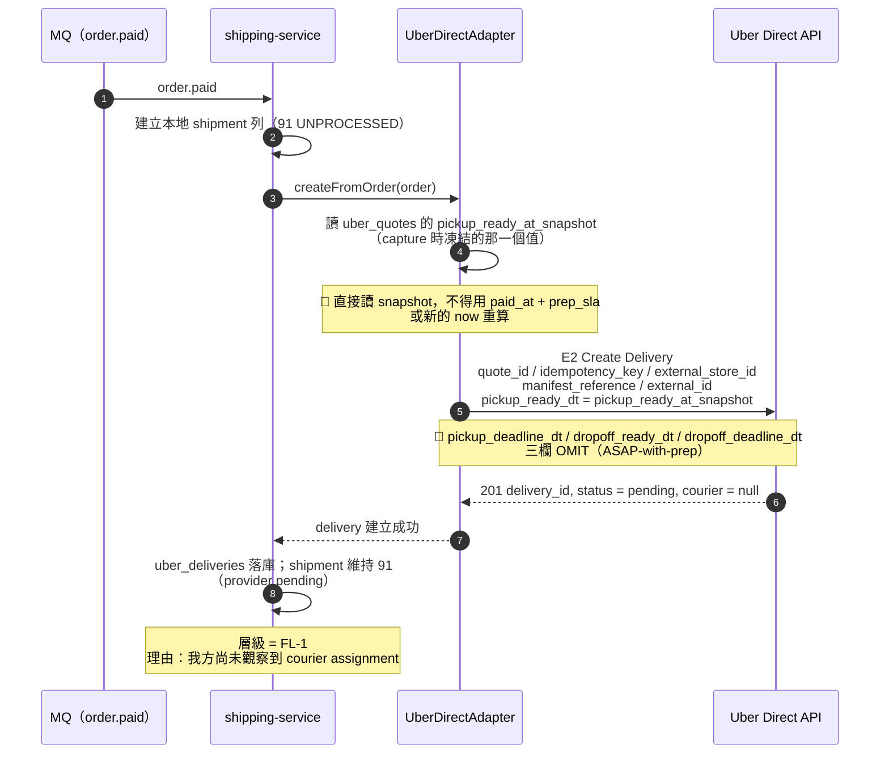

🔴 **這張圖要畫出來的關鍵點**
1. `pickup_ready_dt` **直接讀** `pickup_ready_at_snapshot`，**不重算**。
2. 另外三個時間窗欄位 **OMIT**。
3. 🔴 **沒有 ASAP／Scheduled 分流框**——3003 V1 只走 ASAP-with-prep。
4. 建單成功當下仍是 **`FL-1`**，理由是「**我方觀察不到 courier assignment**」，不是「Uber 還沒開始排線」。

**SD-17｜snapshot 凍結：算一次、凍結、被讀兩次**

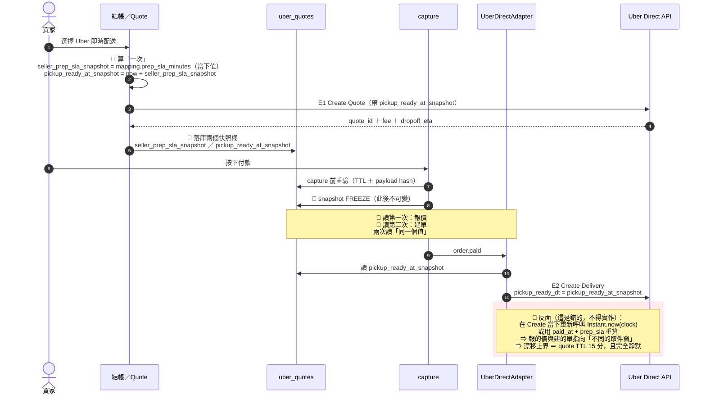

🔴 **這張圖要畫出來的關鍵點**
1. 🔴 snapshot 的「**算一次、凍結、被讀兩次**」。
2. 🔴 **反面**要標明：「付款後用新的 `now` 重算」是錯的。
3. 兩個快照欄都要落庫（`seller_prep_sla_snapshot` ＋ `pickup_ready_at_snapshot`）。

**SD-02｜報價過期 → 重新報價 → 建單（買家配送費凍結線）**

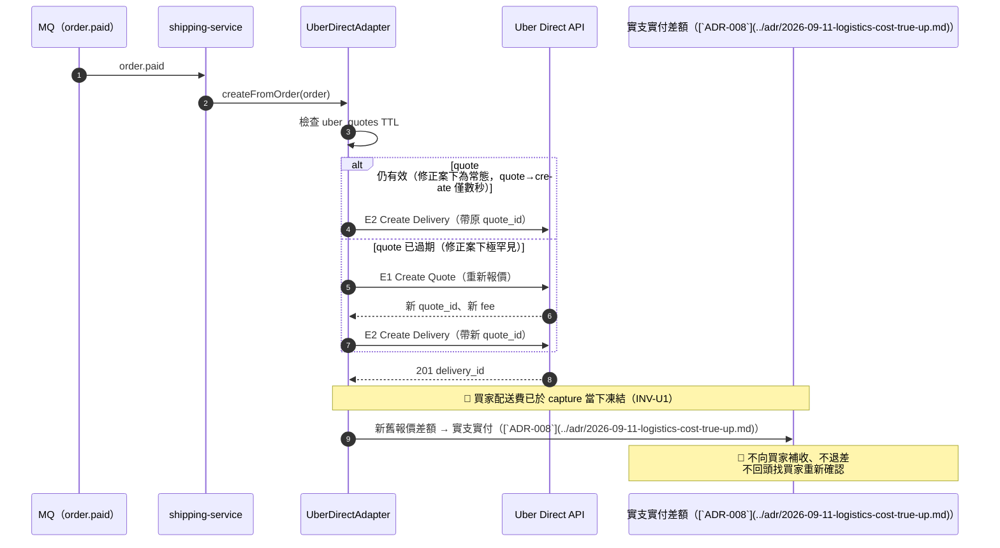

🔴 **這張圖要畫出來的關鍵點**
1. **買家配送費凍結線**（`INV-U1`）：capture 之後買家付的運費不再變動。
2. 差額**往實支實付走**，🔴 **不回頭找買家**。
3. 重新報價**不改** pre-commit 鍵。

⚠️ **這條分支在三段模型下是罕見路徑不是常態**——`quote → create` 只隔數秒。
🔴 **但它不得被刪**：capture 與 `order.paid` 之間仍可能因 MQ 延遲或補做而拉長。
🔴 **重新報價只換 `quote_id` 與費用，不換 `pickup_ready_at_snapshot`**——那個值已經凍結（`INV-U9`）。

**SD-09｜正常 courier pickup → delivery（`courier_imminent` 邊緣觸發）**

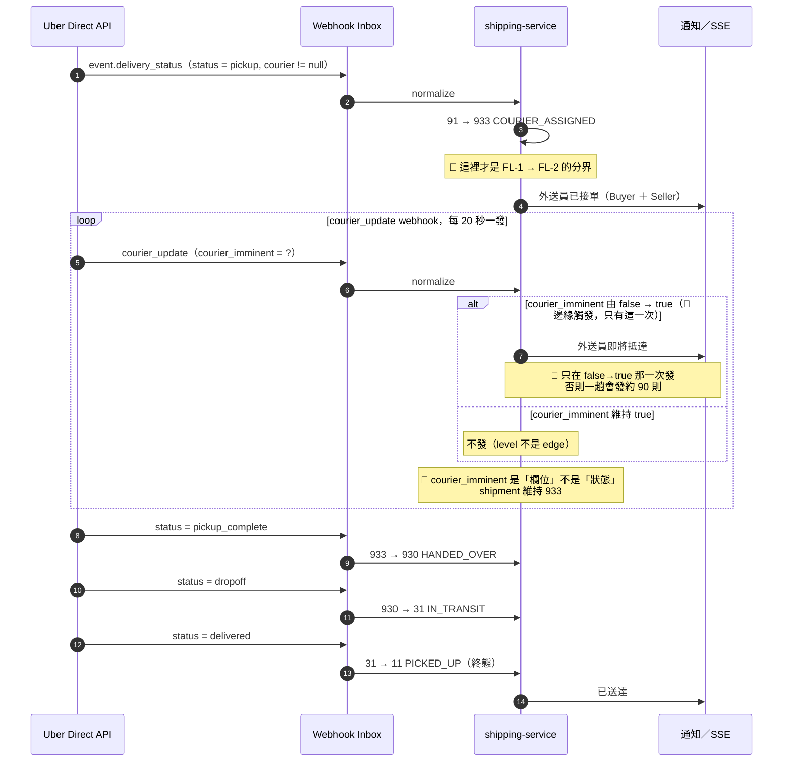

🔴 **這張圖要畫出來的關鍵點**
1. `courier_imminent` 的**邊緣觸發**（`false→true` 只發一次）。
2. `courier_imminent` 是**欄位不是狀態**——shipment 狀態不因它改變。
3. `FL-1 → FL-2` 的分界錨在 **courier 指派**。

**SD-12｜外送員即將抵達但賣家尚未備妥（交叉判定）**

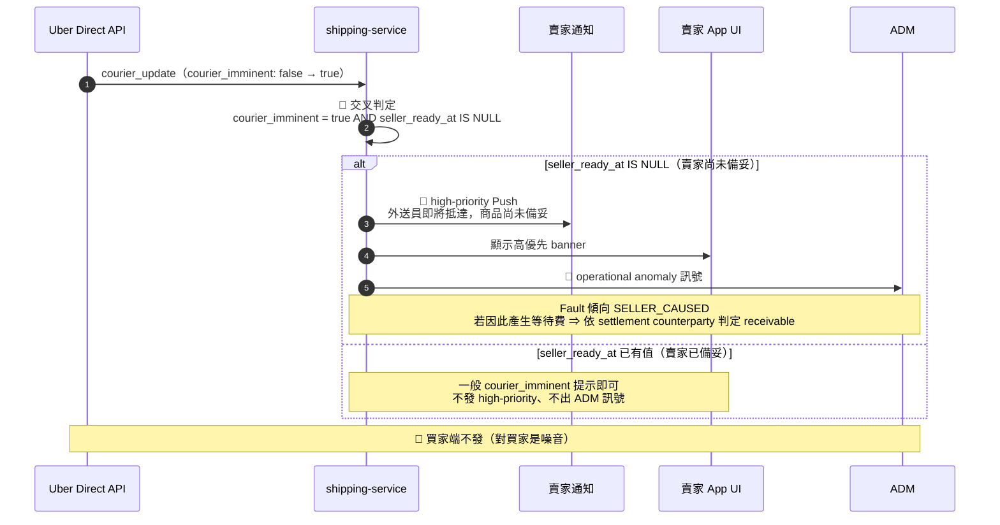

🔴 **這張圖要畫出來的關鍵點**
1. **兩個條件的交叉判定框**（`courier_imminent = true` **AND** `seller_ready = false`）。
2. 賣家 **high-priority 通知**與 **ADM 訊號**的分岔。
3. 買家端**不發**。

⚠️ **這個情境是三段模型才會出現的**：舊模型下「外送員來了而賣家沒好」不可能發生，
因為車是賣家自己叫的。🔴 **它是本架構最需要被看見的營運風險**，不是邊角案例。

**SD-07｜賣家備貨逾時 → Cancellation Saga（四步，缺一不可）**

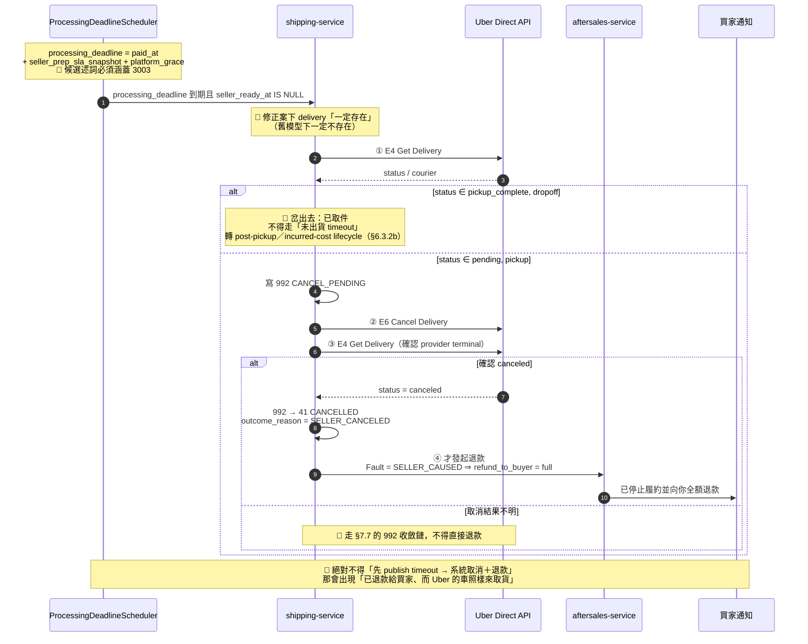

🔴 **這張圖要畫出來的關鍵點**
1. **`E4 → E6 → 確認 terminal → 才退款`** 四步，缺一不可。
2. 「已 `pickup_complete`」時**岔出去**的那條線。
3. 🔴 反面標註：不得跳過 provider cancel 直接退款。

🔴 **逾期代表「車已經約好了而貨還沒好」⇒ 一定要打 provider，不是只動訂單軸。**
⚠️ 少掉這一步的後果不是少一步，是**外送員照樣到店，而買家的錢已經退掉了**。

🔴 **唯一的補償邊：`capture` 成功而 `FL-1` 失敗。**

| 情境 | 資料上長什麼樣 | 處置 |
|---|---|---|
| `FL-1` 整段沒跑到（MQ 丟失／consumer 掛掉） | 訂單已付款、**`orders.shipping_status` 仍為 `NULL`** | 建單兜底排程**補做同一件事**（建本地 shipment ＋ `E2`）。🔴 **候選述詞錨在 `orders.shipping_status IS NULL`，不是 `orders.shipment_no`** |
| `E2` 確定性失敗（400／`customer_blocked` 403） | `990 CREATE_FAILED` | 停止履約 ＋ 退款。🔴 **退款方向仍走 §4.5.5 的二元政策**——此格的成因是我方或 provider，不是買家 ⇒ `refund_to_buyer = full` |
| `E2` 結果不明（5xx／timeout） | `991 CREATE_UNKNOWN` | 🔴 **不重送裸請求**；收斂鏈見 §7.7 |

🔴 **補償邊不是可選的**：`capture` 成功而 `FL-1` 失敗 ＝「已收錢但沒有物流單」，
那個狀態如果沒有出口，錢就停在系統裡沒有人知道。`990`／`991` ＋ N1 就是它的出口。

🔴 **`UD-07`（已收錢但沒有配送單）這個出口在三段模型下仍然必要，不得移除。**
窗口只是**從賣家發動當下移回付款當下**——地址已不在服務範圍、Uber 拒單、門市被 blocked
這些失敗一樣會發生，只是發生得更早。

🔴 **補償邊只有這一條**——沒有第二條「`FL-1`→`FL-2` 等人」（沒有 `FL-2` 要等）
⇒ 建單兜底要補做的**就是**完整的 `FL-1`（含 `E2`），不受「不得跨越 `FL-1`→`FL-2`」這類禁令拘束。
⚠️ **雙向驗收仍然要做**：造一筆「`FL-1` 已完成」⇒ **不得**被兜底重打 `E2`
（那會是第二趟車）；造一筆「`FL-1` 整段沒跑到」⇒ **仍須**被補做。
**同一段程式碼同時是安全網與殺手**，而冪等靠的是**我方 pre-commit 鍵 ＋ 同值的官方 `idempotency_key`**。

### 7.3 狀態機

#### 7.3.1 Uber 原生值 ＋ 容忍 ＋ 終態

**7 值（U-I）**：`pending`／`pickup`／`pickup_complete`／`dropoff`／`delivered`／`canceled`／`returned`

⚠️ 七個名字的權威 ＝ 官方 `/docs/deliveries/daas/api/webhook-event-deliverystatus`
（整理於 [Uber Direct API 總覽 §7.1](../第三方整合/Uber%20Direct%20API%20總覽.md)）。
🔴 **§13.2 建立 golden fixture 時必須逐字覆核這七個值**——名字對不上時整條映射靜默失效。

**容忍**：`shopping_completed`（Pick & Pack 專屬）⇒ counter ＋ 不寫入狀態，**不建 case**（它是我方沒訂閱的功能的正常值，不是異常）。
**終態**：`delivered`→T1 `11`；`canceled`→T1 `41`；`returned`→經 `33` 到 T1 `41`。
**`courier_imminent`**：🔴 boolean 欄位，**不映射任何 normalized 值**（65 §7.1.2.4 ④ 逐字）。

#### 7.3.2 🔴 原生值 → 65 normalized 值的映射表（本書核心）

**正向 leg（`del_`，`is_return=false`）**

| # | Uber raw | normalized | 述詞集合（65 §7.1.2.3） | 訂單軸 | `allowedActions[]` |
|---|---|---|---|---|---|
| 1 | `pending` | `UNPROCESSED(91)` | `isPendingShipment` | 20 | 🔴 **`report_ready`／`cancel`**（🔴 **3003 沒有 `dispatch` 這個 domain action**——建單由 `order.paid` 觸發，賣家在這一格要做的是**宣告備妥**，見 §4.5.0 E5 與 §4.5.0a） |
| 2 | `pickup` | **`COURIER_ASSIGNED(933)`** | `isPendingShipment` | 20 | `cancel` |
| 3 | `pickup_complete` | **`HANDED_OVER(930)`** | `isConfirmedShipment` | 30 | `cancel`（可能收費，§4.5.5）／`track` |
| 4 | `dropoff` | `IN_TRANSIT(31)` | 既有值，經 C1 → 30 | 30 | `track` |
| 5 | `delivered` | `PICKED_UP(11)` | `isTerminal` | 40 | `view_pod` |
| 6 | `canceled` | `CANCELLED(41)` | `isTerminal` | 見 65 K-06 | — |
| 7 | `returned` | 🔴 **`ABNORMAL(33)`**，同一次處理內續推 `41`（§7.3.4） | `isAbnormal` | 35 → 取消鏈 | — |

🔴 **`91` 這一格只有一種語意。**

三段模型下**停在 `91` 的訂單必然已經有 delivery 紀錄**（`order.paid` 當下就建了）
⇒ 🔴 **`91` 沒有「`FL-2` 尚未發動／已發動」這兩種子狀態**，`allowedActions[]` 不需要分辨它們。
⚠️ **不得用「有沒有 delivery 紀錄」當分辨依據**——它恆為「有」
⇒ 那會產生一條永遠走不到的分支，而那條分支正是「**不打 provider `E6` 的取消**」
⇒ **留下一筆沒有人取消的 Uber 單**：外送員照樣到店、照樣計費。

🔴 **`PROVIDER_REMATCHING`：`pickup` ＋ `courier = null` 的正式表達**

| 項 | 定義 |
|---|---|
| **偵測契約** | `E4 Get Delivery` 回 `status = "pickup"` **AND** `courier = null` |
| **怎麼表達** | 🔴 **不新增 shipment 狀態值**——shipment 維持 `933`；本情境由 **`uber_deliveries` 的 `courier` 是否為 null ＋ `rematch_started_at`** 表達（provider extension）。🔴 **不得污染 generic `shipments`** |
| **為什麼不新增狀態值** | 退回 `91` 會讓買家看到「外送員取消了」然後又「有外送員了」；而 65 的 normalized 值域畫的是**跨 provider 的貨態**，rematch 是 **Uber 內部的媒合行為**（65 §7.1.2.0 ②）。⚠️ 🔴 **也不得新增 `courier_assigned BOOLEAN`**——`933 COURIER_ASSIGNED` 已經表達它，加了就是兩份 truth |
| 🔴 **唯一偵測手段** | **主動回查**。Uber **不會**把 `status` 退回 `pending`、**也不會發 webhook**（台灣業務指南 p.47，陷阱 B7）⇒ webhook 這條路**完全靜默** ⇒ 回查**不是可選增強** |
| **誰把它推進來** | P4 `ProviderPickupDeadlineScheduler` 的 `E4` 回查，在 `courier` **由非 null 變 null 的邊緣**寫入（🔴 **edge 不是 level**） |
| **誰把它推走** | 同一支 P4，三個出口 A／B／C（§7.7） |
| **停太久誰知道** | T-15（10 分）⇒ 賣家 ＋ ADM 告警；T-16（30 分）⇒ 硬期限，走出口 C |

🔴 **polling 自 Create Delivery 成功後就持續存在**（頻率 T-14），**不需要**任何「recovery 開始」的門檻
——一觀察到 `pickup` ＋ `courier = null` **就已經知道正在 rematch**。
🔴 **`provider_pickup_recovery_start` 不存在，也不得新增第二個 recovery clock。**
🔴 **`uber_deliveries` 必須有 `rematch_started_at`**
與 courier 是否為 null 的可查詢表達（`V{N+1}`）；P4 排程器（§7.0）。

**逆向 leg（`ret_`，`is_return=true`）**——值域相同，**leg 是維度不是狀態**（65 §7.1.2.0 ②）

| # | Uber raw | normalized | aftersales（`AfterSaleCaseStatus`） | 依據 |
|---|---|---|---|---|
| 1 | `pending` | `91` | 不處理（案件留 `RETURN_PENDING(20)`） | 包裹還在買家手上 |
| 2 | `pickup` | **`933`** | 🔴 **明確不處理（no-op 分支，不是 else）**（U6） | 同上；要「明確」才不會與「未識別」混在一起 |
| 3 | `pickup_complete` | **`930`** | 🔴 **`RETURN_SHIPPING(25)`**（U5） | 見下方推導 |
| 4 | `dropoff` | `31` | `RETURN_SHIPPING(25)` | 既有 `PAYUNI_RETURN_IN_TRANSIT = {"31","92"}` 已含 |
| 5 | `delivered` | `11` | `RETURN_DELIVERED(27)` | 既有 `PAYUNI_RETURN_DELIVERED = {"11"}` |
| 6 | `canceled` | `41` | 🔴 **無對應** | open item UP-8 |
| 7 | `returned` | `33` | `RETURN_FAILED(28)` | 既有 `PAYUNI_RETURN_ABNORMAL = {"33","53","44"}` 已含 |

**🔴 U5 的完整推導：`930` 在逆向 leg 進 `RETURN_IN_TRANSIT`**

65 §7.1.2.6 ③ 逐字把這格指派給本書：「必須決定它進 `PAYUNI_RETURN_IN_TRANSIT` 還是不處理，**不決定就是靜默丟棄**」。

| 65 §3.11 四問 | 答 |
|---|---|
| 語意對得上嗎 | ✅ `AfterSaleCaseStatus.RETURN_SHIPPING(25)` 的 description **逐字**是「買家已寄出，物流配送中」。逆向 `pickup_complete` ＝ 外送員已從買家手中取件 ＝ 買家已寄出 |
| allowed-from 含不含實際來源 | ✅ `ReturnShipmentStatusConsumer.handleInTransit` javadoc 逐字「碼 31/92：`RETURN_PENDING(20)` → `RETURN_SHIPPING(25)`」。`930` 是逆向 leg **第一個實質貨態**，來源必然是 `20` ⇒ 對得上 |
| 重複觸發呢 | ✅ 之後 `31` 到達再呼叫 `markReturnInTransit` ⇒ `rows=0` ⇒ 走**既有** skip 分支（log 逐字「case 已不在 RETURN_PENDING(20)，跳過」），零副作用零重複通知 |
| 不決定的代價 | 🔴 若 Uber 在 `pickup_complete` 之後、`dropoff` 之前取消或退回，案件**永遠停在 `RETURN_PENDING(20)`**；而 `20` 的出口是 `ship_back_deadline_at`（預設 7 天）逾期 ⇒ `AUTO_COMPLETED_RETURN_PENDING_TIMEOUT(33)`，其 description 逐字「**本狀態為「不退款」終態**」⇒ **買家明明已交件卻被判定沒寄回而拿不到退款**。這才是「靜默丟棄」的實際代價，不是少一則通知 |

⇒ **決定：`930` 在逆向 leg 歸類為「退貨運送中」（→ `RETURN_SHIPPING(25)`）。**
（🔴 **承載它的不再是 `AfterSalesConstants.PAYUNI_RETURN_IN_TRANSIT`，而是 `ReturnShippingRules`** —— 見下方與 65 [`ADR-013`](../adr/2026-09-12-return-leg-classifier-canonical.md)。）

🔴 **不是改名，是整組刪除 —— 見 [`ADR-013`](../adr/2026-09-12-return-leg-classifier-canonical.md)。**

⚠️ 🔴 **不得「同批改名」`AfterSalesConstants.PAYUNI_RETURN_IN_TRANSIT`**——改成同一個名字等於沒改，
而下一個人看到「已經改過名了」就不會再懷疑它。

**正解（[`ADR-013`](../adr/2026-09-12-return-leg-classifier-canonical.md)）**：`PAYUNI_` 前綴之所以是謊話，不在於多了一個 `930`，而在於這 5 個集合**從一開始就不是
provider-specific mapping** —— 它們比對的是**已正規化的 `ShippingStatus.value()`**，不是 PayUni wire code
（PayUni 的映射恰好恆等，所以謊話至今隱形）。⇒ 🔴 **加一套 `UBER_RETURN_*` 是架構上錯誤的修法**：
Uber 的 raw 值在 shipping-service 就被轉成 `930`／`933`，**永遠到不了 aftersales**。

⇒ 5 個 `PAYUNI_RETURN_*` **全部刪除**，改用 common-core 新增的 **`ReturnShippingRules`**
（與正向 leg 的 `ShippingStatusRules` 同層同宿、入參型別為 `ShippingStatus` 枚舉），
未知值**對齊正向 leg 的 fail-loud 進 DLQ**，不得 `else` ＋ ACK。

**🔴 A-2 自檢**：七個 raw 值一對一映到七個不同 normalized 值，**不存在**「兩值映到同一 normalized 卻分屬不同述詞集合」。
特別檢查 65 F.7.1 點名的那一對：`92` 與 `210` **都不在本表**（Uber 不經過它們）⇒ 不可能合併。
**🔴 A-4 自檢**：本表產出集合 `{91,933,930,31,11,41,33}` 與 65 §7.1.2.4 ④ 的「3003 不經過」清單
（`92`／`98`／`22`／`32`／`210`／`920`／`921`／`931`／`932`／`46`／`52`／`55`／`81`／`82`）**交集為空** ✅。
逆向亦然：`32` 不在本表 ⇒ `handleStoreArrived` 的 `method=3002` 守衛不會被觸發。

#### 7.3.3 退貨 leg 與「returned ≠ delivered」的不變式

逆向 leg 是**另一筆 shipment ＋ 另一筆 `uber_deliveries`**（`is_return=true`），不是在同一筆上加狀態；
關聯靠 `related_deliveries` 陣列（N2）。🔴 `relationship` 未知值 fail-closed（enum 是 `return`，官方 description 寫 `returned`，U-P）⇒ 不建關聯 ＋ 建 case，**不做前綴比對、不猜**。

🔴 **不變式：Uber 的 `returned` ≠ 我方「已送達」**。它在正向 leg 是**失敗**
（→`33`→`41`→🔴 **責任判定**→三分流，§7.3.4），
在逆向 leg 才是「退貨包裹送不回賣家」（→`33`→`RETURN_FAILED(28)`）。⚠️ 名字容易誤讀成「已退貨完成」，而**兩者的錢往完全相反的方向走**。

🔴 **`Return` ≠ Refund trigger。** 🔴 **不得把這一格接成「→33→41→退款」**——
那是把 provider 的**實體處置**直接接到**錢**上。`undeliverable_action = return` 的 return completed
**只代表** physical disposition／庫存回收／賣家取回；🔴 **`RETURN_COMPLETED` 不得自動觸發退款**。
退不退款一律由 **financially final 的** `ResponsibilityCause` 決定（§4.5.5 的二元政策）：
**financially final** 的 `BUYER_CAUSED` ⇒ `refund_to_buyer = 0`（🔴 **return 完成也不恢復退款資格**）／
**financially final** 的 Non-Buyer-caused ⇒ `= full`／
**尚未 financially final**（🔴 **含 `RESPONSIBILITY_UNRESOLVED` 與「判定已提案但覆核未通過」兩種**）⇒ 等 ADM 裁決，🔴 **不動錢**。
⚠️ 讀到「`returned` ⇒ 退款」請視為未回灌，**回報而不要照做**。

**既有拒絕碼 `9024` 的處置**：`AFTERSALE_RETURN_NOT_SUPPORTED_FOR_UBER` 是本書的 fail-closed。
🔴 **它的解除時點是「開燈之前」，不是「上線之後」。**
🔴 **順序（§12.2 步 8j／8k）**：逆向 leg 的兩個分支（U5／U6）**完成並驗證** → **才**移除擋門 → **才**允許 3003 `enabled` → 才允許 `uber.enabled=true`。
⚠️ 前半段反過來會讓退貨申請進得來但走不完；**後半段反過來則違反 Product Owner 的明確裁決**（逆向未完成不得正式 enable Uber）。
⚠️ **碼本身不刪**（碼是對前端的契約，賣家 App 可能留有舊分支——`5046` 的教訓逐字寫在碼表裡）。

#### 7.3.4 🔴 `delivery.FAILED` 的出口（D-19 群 A）

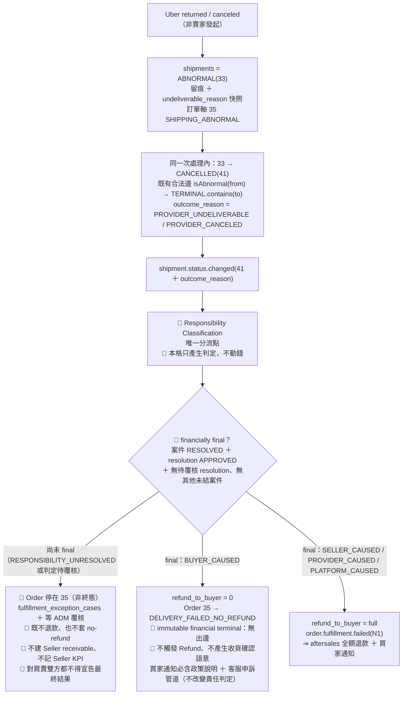

🔴 **provider 的終局宣告不得直接接到錢。**
provider 的 `returned`／`canceled` 描述的是「**沒有完成交付**」，**不是責任方判定**。
⚠️ **嚴禁** `provider says undeliverable → 自動 BUYER_CAUSED → 自動 no refund`
這條捷徑，**也嚴禁**反方向的 `provider 終局宣告 → 一律全額退款`。
讀到後者請視為未回灌，**回報而不要照做**。

🔴 **classification 只在這一格分流，其他章節不得重複判定邏輯。**
§7.3.5 終態清單、§4.5.5 的二元政策表、03 的 downstream reader 表——它們的 scope 都是
「**已 financially final 為某一值之後**該怎麼走」。
🔴 **`financially final` 用既有載體判定，不另造 dispute engine、不另造 finality 專用表**：
案件（`fulfillment_exception_cases`）已 `RESOLVED`、其責任 resolution（`fulfillment_case_resolutions`）已
`APPROVED`（🔴 **覆核者 ≠ 提案者**）、且該案無待覆核 resolution、同一 subject 無其他未結案件
——三者同時成立才算。語意 owner 是 65，Order 側的入邊與終態行為在 03，本書只引用。
evidence 來源（不得只有一個）、成因值域定義（**四個 resolved 值**）與
「`= 0` 的程序要件」在 §4.5.5／§1.6.1；`DELIVERY_FAILED_NO_REFUND` 的值域、
🔴 **唯一入邊 `35 → 54`**、無出邊、以及十三類 downstream reader 的行為**在 03**，本書不另寫一份。

🔴 **為什麼經過 `33` 而不是直接寫 `41`**：① `41` 也可能來自「賣家主動取消」，兩者的**錢與責任完全不同**，經過 `33` 讓 delivery 軸自己就能區分
② `33` 有 aging 指標與 `shipment_anomaly_acknowledgments` 的處置載體 ③ `33 → 41` 是**既有合法邊**
（`ShipmentStatusMapper` 的 `isAbnormal(from)` 分支逐字 `return isAbnormal(to) || TERMINAL.contains(to) || IN_DELIVERY.contains(to)`）⇒ **零 mapper 改動**。

🔴 **為什麼 `33` 這一格不等人**：65 對 `33` 的「誰推走」寫「Admin 處置」，但 Uber 的 `returned`／`canceled` 是
**provider 的終局宣告，沒有裁量空間** ⇒ `UberDeliveryOutcomeService` 在同一次處理內續推，`33` 是**瞬時留痕格**不是人工佇列。
⚠️ 代價：`33` 的 aging 對 Uber 幾乎不觸發。**這是預期的，要寫進告警說明**，否則下一個人看到「Uber 從不進異常佇列」會以為偵測壞了。

🔴 **「`33` 不等人」與「責任判定要等人」不矛盾，因為它們在不同的軸上。**
配送軸照常在同一次處理內終結於 `41 CANCELLED`（provider 已給終局宣告，沒有裁量空間）；
**等裁決的載體是 Order 的 `35 SHIPPING_ABNORMAL` ＋ `fulfillment_exception_cases`**，
🔴 **不是** `33`。⚠️ 把等待掛回 `33` 會同時壞掉兩件事：`33` 的 aging 變成常態紅、
而真正需要 aging 的「**責任判定尚未 financially final 而訂單停在 `35`** 超過 N 小時」沒有人在看
（🔴 **射程是兩種等待不是一種**：`RESPONSIBILITY_UNRESOLVED` ＋「判定已提案但覆核未通過」；
指標 ＝ `fulfillment_responsibility_not_final_rows`，§8.2 ⑥。只數前者會漏掉整段覆核等待窗，
而那段期間買家同樣拿不到任何最終結果）。

⚠️ `CREATE_FAILED(990)` 的出口不在本書（65 §7.1.2.1 已補 Admin 重建／Admin 取消）。
🔴 **三段模型下 `990` 沒有賣家側入口**：建單是 `order.paid` 的事，賣家沒有「重新派車」這顆按鈕（§4.5.0）
⇒ 它的重試者是**建單兜底排程**，人工出口是 ADM。
🔴 **S-U3 承載的是 `REPORT_READY`（宣告備妥），不是建單重試，兩者不可混用**（§6.1.5）。

#### 7.3.5 終態清單

delivery 軸（3003，正向與逆向相同）：**T1** `PICKED_UP(11)`／`CANCELLED(41)`；**T2** 無；
**T3（必須有推走者）** `91`／`933`／`930`／`31`／`33`／`991`／`992`／
**`PROVIDER_REMATCHING`**（🔴 **不是第八個狀態值**——它是 `933` 之下由 `courier = null`
表達的子情境，推走者＝ P4 的三個出口 A／B／C，§7.7）。
🔴 **`992` 的推走者是 P5**（`E4` 回查四出口，§7.7）——列進本表就必須答得出誰推走它。
⚠️ **Order 軸另有一格 T3 不在本表**：責任判定尚未 **financially final** 期間訂單停在 `35`
（🔴 **含 `RESPONSIBILITY_UNRESOLVED` 與「判定已提案但覆核未通過」兩種**），
推走者＝ ADM 覆核通過（載體 `fulfillment_exception_cases` ＋ `fulfillment_case_resolutions`），
**需有 aging 指標**；該格的契約在 03。
quote 軸：終態 `CONSUMED`／`EXPIRED`／`SUPERSEDED`；非終態 `CREATED`／`CHECKOUT_ACCEPTED`。
🔴 **需求書從未宣告任何終態**（D-19），上表全部是本書指派。

### 7.4 承載檢查流程（九道）

> 落點：`CheckoutValidator.validate`（order-service）＋ 新的 `UberEligibilityChecker`。
> 輸出 `Excluded{method, temp, reason}`，🔴 **一律不得 `continue`**（65 §7.7.4.2）。

| 道 | 檢查 | 失敗 reason | 現況（實讀） | 本書工作量 |
|---|---|---|---|---|
| 1 | 同一賣家、同一 dropoff | `DIFFERENT_PICKUP_LOCATION` | 已對**賣家**硬失敗：`errors.add(new ValidationError("DIFFERENT_SELLER", "結帳商品必須來自同一賣家"))` | 🔴 **V1 不存在 multi-origin**（一個賣家不得有多個 active `uber_store_mapping`）。<br/>V1 **1 Seller ＝ 1 active pickup profile ＝ 1 `external_store_id`** ⇒ **同賣家必然同取件地址** ⇒ 🔴 **既有的 `DIFFERENT_SELLER` 硬失敗已涵蓋本道，不新增判定**。<br/>⚠️ **但仍要在 adapter 做一次 sanity assert**：解析出的 `external_store_id` 只能有一個；出現第二個 ⇒ **建 case ＋ 拒絕**，**不得自行挑一個**。那代表 5.1.3a 的「唯一 active」不變式已經破了（而它目前只由 application 維持，見 `IMPLEMENTATION_REMEDIATION_INPUT #1`） |
| 2 | 總重量 | `EXCEEDS_WEIGHT` | 機制在（`ShippingFeeCacheClient.isWithinLimit` 讀 `config.maxWeightGrams()`；黑貓已用 20000） | **只需新增 3003 config 列** |
| 3 | **總體積 cm³** | `EXCEEDS_VOLUME` | 🔴 **零**——`isWithinLimit` 只有 `maxDimensionSumCm`／`maxSingleSideCm`／`maxWeightGrams` 三項，而「材積」是 **L+W+H 相加**（`totalDimSum = stackedShort + maxMid + maxLong`），**量綱是 cm 不是 cm³** | **全新演算法 ＋ 新欄 `max_volume_cm3` ＋ `V13`**（版本號見 §5 開頭；實際落 `V13`） |
| 4 | 逐 item 尺寸／重量 | `EXCEEDS_SINGLE_SIDE` | 🔴 結帳時已聚合掉——`calculatePackageDimension` 回的 `PackageDimension` **只有三個純量** | **需保留逐 item 維度**（傳 `List<ResolvedItem>`，不傳聚合結果） |
| 5 | 件數 | `EXCEEDS_PACKAGE_COUNT` | 零 | 全新。🔴 **30 硬擋、無 warning 層**（U7） |
| 6 | **禁運品／品類** | `RESTRICTED_GOODS` | 🔴 **零概念**（N3） | **全新**：碼表 ＋ SKU 欄位 ＋ 結帳檢查 ＋ 賣家上架 UI（§5.1.9 三件） |
| 7 | 溫層 | `TEMPERATURE_NOT_SUPPORTED` | 有溫層碼 3201／3202／3203，`CheckoutValidator` 已算 `tempIntersection` | 🔴 **Uber 無溫層欄位 ⇒ 檢查 100% 在我方**；`supported_temps` 預設只有 `3201` |
| 8 | **可服務時段（`service_hours`）** | `OUTSIDE_SERVICE_HOURS` | 🔴 **零**——本欄目前只存在於設計書（§5.6.1），`V13` 沒有它 | **全新**。🔴 **判準是「`pickup_ready_at_snapshot` 落不落在賣家可接 Uber 履約的 window 內」，不是「現在還在不在營業」**；且 `processing_deadline` **亦不得越過收班**。近關店時若已知賣家完不成本次 prep／pickup window ⇒ **3003 unavailable**。🔴 **付款後賣家改 `service_hours` 不得回溯影響既有 paid order**——一律用付款前 snapshot |
| 9 | **Instant eligibility（送達預期）** | `EXCEEDS_INSTANT_ETA_LIMIT` | 🔴 **零** | **全新，且是唯一一道「報價之後」才判得出來的檢查**：3003 V1 ＝ **Uber Instant**，`E1` 回的送達預期 **≥ 90 分鐘**即不符 Instant eligibility ⇒ 該方式 `available=false`。🔴 **不是自動切 Scheduled**——Scheduled 是**另一個產品**（四欄變必填、各有最小間距、要重走 quote TTL／capture 重驗／取消規則），見 §5.1.4a C 與 §6.5 |

🔴 **順序**：1 → 7 → 8 → 6 → 2/3/4 → 5 →（呼叫 `E1` 之後）→ 9
（便宜且能一次排除整個選項的先做；道 5 要跑 packing policy，最貴）。
⚠️ 但**不得短路到只回一個 reason**——`unavailableReason` 取第一個命中即可，**counter 要每一道各記一次**，
否則永遠看不到第二個原因（65 §7.7.4.3 第 3 條）。

🔴 **道 9 的位置是刻意的：它是唯一一道需要 provider 回應的檢查。**
道 1～8 全部在我方資料上判得出來 ⇒ 它們在 `E1` **之前**跑，不符就**不必浪費一次報價**；
道 9 的輸入是 `E1` 回的送達預期 ⇒ 只能在報價**之後**判。
⚠️ **道 9 命中時仍然是 `available=false` 而不是錯誤**——選項永遠存在（§6.1.2 硬規則 ①）。
🔴 **不得把道 9 的命中塌縮成 `QUOTE_FAILED`**：那是類 B（我方或 provider 壞了），
而「太遠所以不適用即時配送」是類 A（買家可以換地址或換配送方式）。

⚠️ **道 8 與道 9 只產生 `unavailableReason`，🔴 不新配錯誤碼。**
它們是**結帳受理政策**（類 S／類 A），只在買家結帳頁出現、由 `available=false` ＋ reason 表達；
🔴 **不得挪用到履約期擋已付款訂單**（65 §6.3.4 F）⇒ 沒有賣家面或 ADM 面的觸發點，也就沒有錯誤碼的需求。
⇒ 附錄 C.3「本書新配 18 條」的對帳數字**不因本次新增而改變**（道 2 `EXCEEDS_WEIGHT` 同樣沒有專屬碼，是既有先例）。

⚠️ **道 8 與道 9 是新增的 `unavailableReason` 值** ⇒ 🔴 **三端同步是硬要求**（§6.1.2a）：
先改 §6.1.2 那張表（唯一 SSOT），再在**同一個變更內**更新後端與兩個買家端。
🔴 **必須落地的 schema／碼值**：`service_hours` 欄位（§5.6.1）、
兩個 reason 的納管與前端拷貝同步。

### 7.5 `PACKING_REVIEW_REQUIRED` 的產生與人工出口

包件數落在 **25–30**（接近上限但未超過）⇒ 標記在 `package_plan` 上（**不是一個訂單狀態**）。
誰推進：packing engine，在 quote 產生當下｜誰推走：**ADM 調 packing policy 參數** ⇒ 下一次 quote 自然不再標記｜
🔴 **前端與賣家沒有任何勾選可以繞過**——標記只影響 ADM 的觀測，**不阻擋結帳**｜
卡住誰知道：`uber_packing_review_rows` 連續 7 天有標記 ⇒ policy 參數與真實包裝不符。

🔴 **它刻意不是阻擋**：25–30 之間擋掉，買家會看到「莫名其妙不能用」；放行但不記錄，我們永遠不知道參數偏了 ⇒ **記錄但放行**。
⚠️ 與道 5 的「30 硬擋」是兩件事：30 是**門檻**，25 是**觀測線**。

### 7.6 失效與重試

| 情境 | 處置 | 為什麼不是別的 |
|---|---|---|
| Create Quote 失敗 | 選項 `available=false` ＋ `QUOTE_FAILED`，不建訂單 | 還沒收錢 |
| capture 前逾期／hash 不符 | 重報；金額不同 ⇒ 使用者重新確認 | INV-U1 |
| Create Delivery **400** | `990` ＋ 停止履約 ＋ **全額退款** | 已收錢；重試同一 payload 只會再錯一次。🔴 **這一格的 `full` 不是「一律全額」而是責任判定的結果**：建單失敗發生在**買家還沒收到任何東西**之前，成因是我方或 provider ⇒ `PLATFORM_CAUSED`／`PROVIDER_CAUSED` ⇒ `refund_to_buyer = full`（§4.5.5） |
| Create Delivery **5xx／timeout** | `991` ＋ 回查 | 🔴 **不得當 990**——可能已建成功，重建＝兩趟車、重複計費 |
| `customer_blocked` 403 | `990` ＋ 寫 `blocked=true` ＋ 通知賣家 ＋ 建 case | N6 事後反推 |
| provider `canceled`／`returned` | §7.3.4 的鏈：`33` → `41` → 🔴 **責任判定** → 三分流 | 🔴 **不是「一律全額退款」**——provider 的終局宣告是「沒有完成交付」的事實，**不是責任方判定**（§7.3.4／§4.5.5） |
| 賣家取消 | `992` → 打 E6 → 成功 `41`／`noncancelable` 回原狀態 | 🔴 **不得直接寫 `41`**——它是 T1 終態，provider 未確認前寫入＝對買家宣告取消而貨照送 |
| **Cancel Delivery 5xx／timeout** | `992` 維持不動 ＋ **`E4` 回查收斂鏈**（§7.7），寬限 T-17 內未確定 ⇒ `CANCEL_RECONCILIATION_REQUIRED` ＋ ADM | 🔴 **不得**直接 refund／no-refund／recreate／assume canceled。取消結果不明時**四件事都可能是錯的**：貨可能照送、也可能真的取消了 |
| **`pickup` ＋ `courier = null` 持續**（`PROVIDER_REMATCHING`） | P4 回查 → 三出口 A／B／C（§7.7） | 🔴 **webhook 對 rematch 完全靜默** ⇒ 不回查就等於這個情境不存在（陷阱 B7） |

🔴 以上每一條「已收錢」的失敗都必須產生 `fulfillment_exception_cases` 的一列（D-1 義③），
即使退款已自動完成——那一列是**對帳用的**（Uber 那邊可能已經計了費）。

### 7.7 未終態回查與收斂

tick 5 分（🔴 必須 > webhook 重試窗 100 秒）；候選述詞見 §5.2；
退出條件：進入 T1，或超過 3 天（⇒ `991` → 建 case → 人工）；
與 webhook 的優先序：🔴 **provider timestamp 較新者為準**，不是「webhook 優先」——回查拿到的是**當下絕對值**，
可能比一則遲到的 webhook 更新。
`991` 的收斂：查到成功→`91`／查到不存在→`990`／超出回查窗仍未知→`41` ＋ 人工。<br/>⚠️ 65 §7.1.2.1 的該列是 **provider-aware** 的（3001／3002／**3003** → `91`；3004 → `92`）⇒ **3003 落 `91`**，3003 落 `91` 是刻意的：與同步 201 成功的落點相同，等 webhook 帶進 `933`（**§7.2 時序圖**的建單路徑，⚠️ **不是 §6.1**——那一節是「對外 REST（經 Gateway）」，整節不含 `991`／`91` 落點）。

⚠️ 回查用 E4 而不是 E3，因為我們知道 `delivery_id`。

🔴 **`991` 的收斂手段（三條路的射程各不相同，不得互相取代）**

| 手段 | 可不可用 | 理由 |
|---|---|---|
| E3 List ＋ 我方 `external_id` **精確反查** | ❌ **不存在** | List **沒有** `external_id`／`manifest_reference` 的 exact query 參數 |
| 帶 `idempotency_key` **重送 E2** | ✅ **主要路徑** | 官方逐字「avoid duplicate order creation with identical idempotency keys for the same account. The key persists for a set time frame, **defaulting to 60 minutes**」 |
| E3 List **有界候選過濾** | ⚠️ **降級路徑** | `external_store_id`／`start_dt`／`end_dt` 可用（§6.3.2a-2）⇒ 縮小候選集合，**不是**直接指名取回 |

🔴 **新的 ③：帶同一個 `idempotency_key` 重送 Create Delivery。**
60 分鐘窗內，Uber 會回傳**原本那一筆**而不是建第二趟 ⇒ 我方因此拿到缺失的 `delivery_id`。
⚠️ **這與「不得重送」不矛盾**：[`ADR-014`](../adr/2026-09-14-uber-create-idempotency-precommit-key.md) 禁止的是**裸重送**（可能造出第二趟車）；
帶冪等鍵的重送**在協議層就是查詢**，不是第二次建單。🔴 **鍵必須與第一次逐位元相同**，
否則它就真的是一次新建單——這一格要有契約測試釘死「重送用的鍵取自持久化的那一份，不是重新計算」。

🔴 **60 分鐘是硬邊界，收斂窗必須因此分成兩段**：

| 距建單 | 手段 | 說明 |
|---|---|---|
| **≤ 60 分鐘** | **`idempotency_key` replay**（protocol-level reconciliation） | **主要路徑**。帶**持久化的那一份原值**重送 E2 ⇒ Uber 回原單而不是建第二趟。⚠️ 我方回查 tick 5 分 ⇒ 窗內約有 12 次機會 |
| **> 60 分鐘** | **bounded List candidate search ＋ strict local correlation**| 🔴 **降級路徑，規則見下方**。🔴 **禁止 unbounded `filter=ongoing` 全掃當主要設計** |

🔴 **`> 60 分鐘` 的降級路徑：三步，缺一不可**

| 步 | 做什麼 |
|---|---|
| **① 有界取候選** | `external_store_id`（V1 一賣家一個值）**＋ 窄 `start_dt`／`end_dt`**（錨在我方 pre-commit 落庫時間的前後小窗）**＋ 必要時 `filter`**。🔴 **三者同時給，不得只給狀態** |
| **② 嚴格本地比對** | 對回傳的每一筆逐項比對 **`external_id`** ＋ **`manifest.reference`** ＋ 其他**不可變的本地證據**（leg、pre-commit 時間窗、`external_store_id`）。🔴 **必須是完整匹配，不是「看起來像」** |
| **③ 依匹配數分流** | 見下表。🔴 **只有唯一且完整匹配才允許自動收斂** |

| 匹配數 | 處置 |
|:---:|---|
| **恰好 1 且完整匹配** | ✅ 自動收斂：寫回 `delivery_id` ⇒ `991 → 91` |
| **0** | 🔴 **不得直接判定「Uber 沒建單」** —— 0 筆可能是時間窗開錯、分頁沒翻完、或該筆不在此過濾條件下。⇒ **進 Admin／Dashboard recovery ＋ 建 case** |
| **>1 或有歧義** | 🔴 **不得猜**。⇒ 同上，進人工 |

⚠️ **`total_count` 不可用於判斷結果數量**（官方標 DEPRECATED、永遠回 `-1`）⇒
候選數量要**自己數 `data[]` 並跟著 `next_href` 翻完**，否則「0 筆」可能只是沒翻頁。

⚠️ **因此回查窗（180 分）與冪等窗（60 分）不是同一個數字**，且**後者更短** ⇒
`991` 停留超過 60 分鐘時，**收斂從「協議層保證」降級為「靠比對推斷」**，
告警要卡在這一刻而不是 180 分。

🔴 **`991 CREATE_UNKNOWN` 的收斂鏈必須五格齊全，缺任一格它就是一個沒有出口的狀態（65 §3.11 每個新狀態的四問）**

| 格 | 誰 | 內容 |
|---|---|---|
| **① 誰把它推進來** | 🔴 **`order.paid` 的 `FL-1` 建單路徑**（三段模型）＋ 建單兜底排程 | Create Delivery 逾時或 5xx ⇒ 交易 B 寫 `991`。🔴 **不得裸重送**（[`ADR-014`](../adr/2026-09-14-uber-create-idempotency-precommit-key.md)） |
| **② 誰把它推走** | **P1 回查排程**（帶 lease） | 🔴 **候選述詞必須包含 `991`。** 若排程把 `991` 排除在候選外，這個狀態就零推走者——而它看起來完全正常（有狀態值、有 UI 文案、有註解說「稍後會自動更新」） |
| **③ 用什麼查** | 🔴 **≤60 分鐘：帶持久化原值的 `idempotency_key` replay E2**；**>60 分鐘：bounded List candidate search ＋ strict local correlation**，只有唯一完整匹配才自動收斂，0 筆或多筆一律進人工 | 🔴 **不得用 E4**——`991` 根本沒有 `delivery_id`，E4 每次 404 ⇒ 永不收斂（陷阱 B2）。🔴 **不得用「E3 ＋ `external_id` 精確反查」**——**那個 query 參數不存在**（🔴 **不存在**）。🔴 **也不得用 unbounded `filter=ongoing` 全掃**。詳見本節上方 |
| **④ 轉換邊** | `991 → 91`（查到有單）／`991 → 990`（確認沒有）／`991 → 41` ＋ 建案件（超出回查窗仍未知） | 🔴 三條都要在狀態機的 allowed-from 內。少任何一條 ⇒ CAS `rows=0` 靜默卡死，而呼叫端多半把它讀成「別人先做過了」 |
| **⑤ 終態與告警** | 回查窗 **180 分**（SSOT 在 65 §0.1.2）；窗內未收斂 ⇒ 人工案件 | `uber_create_unknown_rows` 的齡；🔴 **停在 `991` 超過回查窗必須有人知道**——這一格代表「我方不知道有沒有派車出去」，它同時是重複計費與買家空等的來源 |

⚠️ **「有表、有索引、有 enum、有 UI 文案」不等於這條鏈是活的。**
判準是逐格指得出 `檔案:符號名`；②③④ 任何一格答不出來，`991` 就是一個有名字的黑洞。

**SD-03｜時序：`991` 收斂（≤ 60 分鐘）— `idempotency_key` replay**

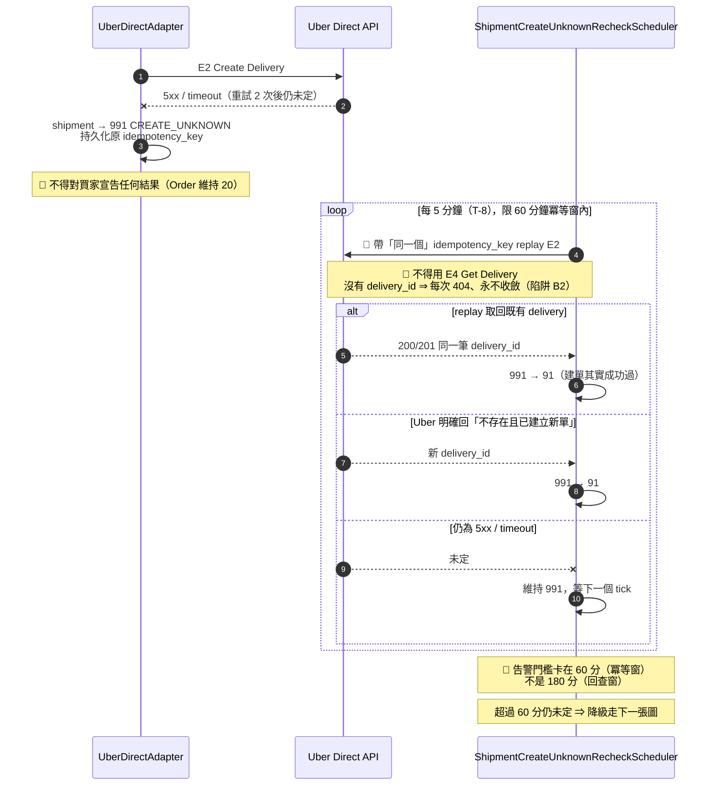

🔴 **這張圖要畫出來的關鍵點**
1. 用 **`idempotency_key` replay `E2`**，🔴 **不是 `E4`**（沒有 `delivery_id`，`E4` 會每次 404、永不收斂）。
2. **60 分鐘冪等窗**的邊界，以及超窗後的降級。
3. 告警門檻在 **60 分**不是 180 分。

**SD-04｜時序：`991` 收斂（> 60 分鐘）— bounded List 三分流**

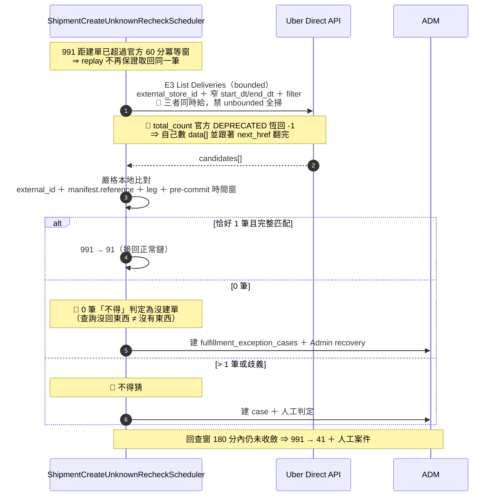

🔴 **這張圖要畫出來的關鍵點**
1. **bounded** List（三個限制條件同時給），禁 unbounded 全掃。
2. **三種匹配數的三條分流**（1／0／>1），特別是 🔴 **「0 不得判定沒建單」**。
3. `total_count` 恆 `-1` ⇒ 必須自己數並翻頁。

#### 7.7.1 🔴 `992 CANCEL_PENDING` 的收斂鏈（SD-08）（與 `991` 同構）

> **為什麼要有這一節**：§7.3.5 把 `992` 列為 T3「**必須有推走者**」，
> 而 `E6` 只有「成功 `41`」與「`noncancelable` 400 回原狀態」兩條的話，
> **5xx／timeout 這一格就沒有任何分支**，`992` 的推走者答不出來。
> ⚠️ 取消結果不明是**最貴的一種未知**：它同時是「已退款而貨照送」與「已宣告取消而錢沒退」的來源。

| 格 | 誰 | 內容 |
|---|---|---|
| **① 誰把它推進來** | `S-11` 賣家取消／`ProcessingDeadlineScheduler` 逾期取消／P4 的 rematch 出口 C | 打 `E6` **之前**先寫 `992`。🔴 **順序不可顛倒**：先打後寫 ⇒ pod 掛掉就沒有任何痕跡 |
| **② 誰把它推走** | 🔴 **P5 `CancelPendingTimeoutScheduler`**（帶 lease，§7.0） | 🔴 **候選述詞必須包含 `992`**——漏了它，`992` 就是一個沒有推走者的狀態 |
| **③ 用什麼查** | 🔴 **`E4 Get Delivery`**（`992` 一定已經有 `delivery_id`，這點與 `991` 相反） | ⚠️ **不得**用「再打一次 `E6`」當查詢——`E6` 有副作用，而我方要的是**事實**不是再試一次 |
| **④ 轉換邊** | `992 → 41`（確認 canceled）／`992 → 原狀態`（provider 仍在跑）／`992 → post-pickup 分支`（已 `pickup_complete`）／`992 → CANCEL_RECONCILIATION_REQUIRED`（逾 T-17 仍未知） | 🔴 **`992` 是全值域唯一允許「回退到原狀態」的狀態**，四條邊都要在 allowed-from 內。少任何一條 ⇒ CAS `rows=0` 靜默卡死 |
| **⑤ 終態與告警** | 寬限 **T-17（10 分）**；逾越 ⇒ `CANCEL_RECONCILIATION_REQUIRED` ＋ `fulfillment_exception_cases` ＋ **aging 指標** | `uber_cancel_pending_rows` 的齡。🔴 **停在 `992` 代表「我方不知道那台車還會不會來」**，它同時是重複計費與買家誤解的來源 |

🔴 **未確認取消成立之前，以下四件事一件都不准做**：
① 對買家宣告取消 ② 退款或套用 no-refund ③ `Cancel + Recreate` ④ 假設已取消（`assume canceled`）。
🔴 **若回查發現已 `pickup_complete`** ⇒ 走 **post-pickup path**（成本已產生，§4.5.5 的收費邊界），
**不得**走「未出貨 timeout」那條——兩者的錢往完全不同的方向走。

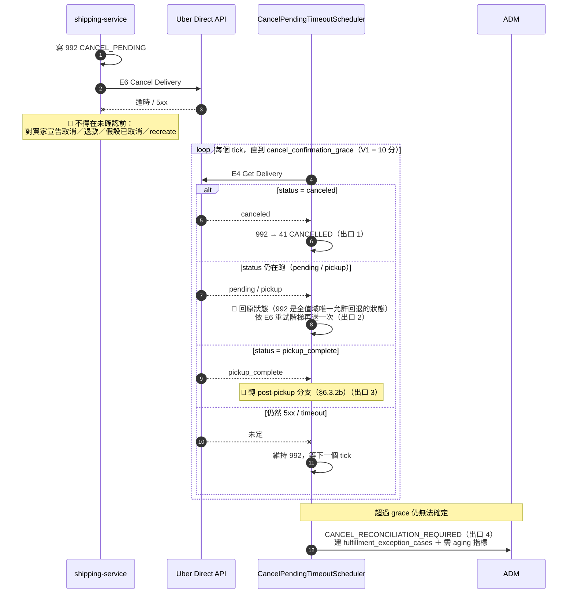

🔴 **這張圖要畫出來的關鍵點**
1. `992` 之後的 **`E4` 回查迴圈**。
2. **四種出口**（confirmed canceled／仍在跑／已 `pickup_complete`／長期未知）。
3. **`CANCEL_RECONCILIATION_REQUIRED` 的入口**。

#### 7.7.2 🔴 `PROVIDER_REMATCHING` 的回查與三個出口（SD-10）

> 🔴 **webhook 對 rematch 完全靜默** ⇒ **主動回查是唯一偵測手段**，不是可選增強（§7.3.2／陷阱 B7）。
> polling 自 Create Delivery 成功後**就持續存在**（頻率 T-14），
> 🔴 **不需要任何「recovery 開始」的第二門檻**（`provider_pickup_recovery_start` 不存在，也不得新增）。

**回查時必須寫回的欄位**：`status`、🔴 **`courier` 是否為 null**、`courier_imminent`、`eta_dropoff_at`。
⚠️ **只寫 `status` 等於這個情境不存在**——`status` 在 rematch 全程都是 `pickup`，一動也不動。

| 出口 | 觸發 | 結果 |
|---|---|---|
| **A** | `courier` 恢復 non-null | 回正常 provider pickup lifecycle（`933`）。🔴 **只更新 SSE ＋ ETA，不再 Push**——避免 A／B／C 反覆切換造成推播 spam |
| **B** | Provider 回 terminal failure（`canceled`／`returned`） | 走 §7.3.4 的 provider failure closure（→`33`→`41`→**責任判定**） |
| **C** | **T-16（30 分）硬期限到期** | final `E4` → 仍為 `pending` 或 `pickup ＋ courier = null` ⇒ **平台發動 Cancel Saga**（§4.5.5 三步）→ 確認 terminal → refund closure。本格 Fault ＝ **`PROVIDER_CAUSED`** ⇒ `refund_to_buyer = full` |

🔴 **只有這三條出口，不得有第四條。**
🔴 **禁止 automatic Cancel + Recreate**：在「原 Delivery 是否真的取消」尚未確認之上再建一次，
⇒ **兩筆 Delivery、兩個外送員、兩筆運費**，而我方對買家宣告的只有一筆（§4.5.0a）。
⚠️ **出口 C 的 Fault 是 `PROVIDER_CAUSED` 而不是 `RESPONSIBILITY_UNRESOLVED`**：
「Uber 媒合不到外送員」本身就是**可指認的 provider 事實**，不是證據不足。
🔴 **但 `settlement counterparty` 仍然不是 SELLER** ⇒ **不建立 Seller receivable**；
理由是**counterparty 不是賣家**，🔴 **不是**「賣家沒有責任」——兩者是不同的軸（§7.1）。

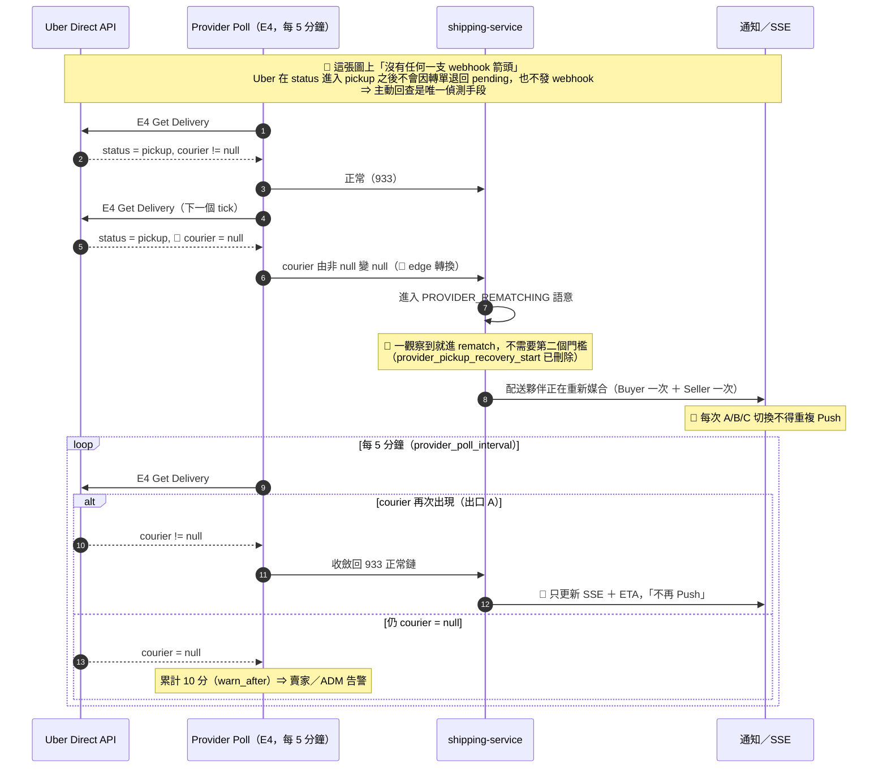

🔴 **這張圖要畫出來的關鍵點**
1. 🔴 **webhook 在這張圖上必須是空白的**——所有箭頭都來自我方 `E4` 輪詢。
2. `courier` 由非 null 變 null 的 **edge 轉換**才觸發，不是 level。
3. rematch **recovered 只走 SSE ＋ ETA，不再 Push**。

**SD-11｜出口 C：rematch 最終失敗（🔴 Uber 從未給終態）**

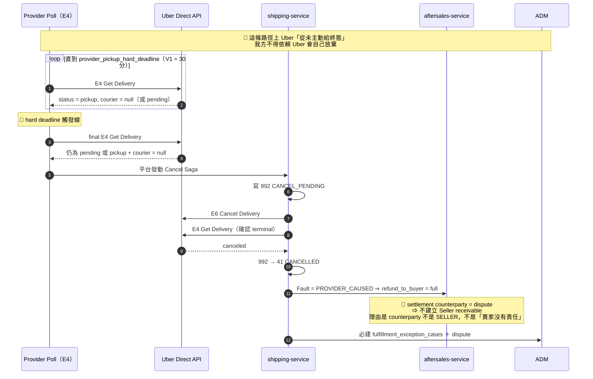

🔴 **這張圖要畫出來的關鍵點**
1. **`provider_pickup_hard_deadline` 觸發線**。
2. 🔴 「**Uber 從未給終態**」這條**沒有 provider 主動箭頭**的路徑。
3. `PROVIDER_CAUSED` ⇒ `refund_to_buyer = full`，且 **Seller receivable 不成立**（counterparty 是 dispute）。

⚠️ **External Verification（#3522）**：rematch 最長會跑多久、Uber 會不會自行放棄，**官方未載**
⇒ 只有 sandbox／真實運行資料才知道。**不阻塞 implementation**，但它決定 T-16 的預設值合不合理。
⚠️ **External Verification（#3522）**：帶未來 `pickup_ready_dt` 時 Uber 實際提前多久開始媒合，同樣**官方未載**
⇒ 它決定「`courier = null` 在取件窗之前是不是正常」——**開燈後要以實測回填**，
🔴 **在回填之前，告警門檻要錨在 `pickup_ready_at_snapshot` 而不是建單時間**，
否則帶 2 小時取件窗的單會在建單後 10 分鐘就開始誤報。

### 7.8 POD 抓取

觸發：`delivered` 寫入後插入待抓列｜排程 P2（tick 5 分、租約 10 分）｜窗口 **7 天**（T-12）｜
存放：🔴 走 media proto 的 **`ServerUploadSecureAndFinalize`**（`secure/` 前綴）＋ `AssetReferenceType.DELIVERY_POD`。
⚠️ **shipping-service 的 `MediaGrpcClient` 目前只有 `serverUploadAndFinalize`**（實讀四支：`serverUploadAndFinalize`／
`finalizeImages`／`linkImages`／`unlinkImages`），而它走 `public/` 前綴（`MediaAssetService` 註解逐字「那支硬寫 `public/`」）
⇒ **本書要在該 client 新增一支 secure 包裝**，不可沿用既有那支。先例：invoice-service 的 PDF 走同一支 RPC ＋
`GetSecureAssetInternal`（`AssetReferenceType.INVOICE_DOCUMENT` 的 description 逐字記載）。
逾期：建 case `UBER_POD_MISSING`，並在 timeline 留一行「POD 不可得，原因 X」。

**`leave_at_door` 與簽名／ID 互斥**：放門口 ⇒ 只有 `picture`；需簽收 ⇒ `signature`（可能另有 `picture`）；需 PIN ⇒ `pincode`。
🔴 **INV-U5 因此是「≥1 筆」而不是「三種都要有」**——要求齊全會讓 `leave_at_door` 每一單都被判成缺證據。

🔴 **不得假設「Uber 對 `delivered` 一定至少有一種 POD」** —— 那個不變式不成立，據以告警會誤報。

官方文件顯示送達證明是**在建單時明確要求才會產生**（opt-in），不是每一筆 `delivered` 都必然有。
⇒ 現況我方**從不送出任何要求**，因此「有沒有 POD」實際上由 Uber 帳號的預設行為決定
——**那是對方的營運參數，隨時可能改，而改了我方不會知道**。

| | 處置 |
|---|---|
| **設計面** | 🔴 **建單時明確送出送達證明的要求，不依賴任何一方的預設值。** 要求的內容依買家選的交付方式而定（§6.5） |
| **契約面** | 欄位為 `dropoff_verification`（`picture`／`signature_requirement`／`barcodes[]`／`identification`／`pincode`）。🔴 **「不得宣稱一定有 POD」的結論不但維持、還更硬**：官方逐字「**If** a delivery is created with **any verification requirements** … the resulting image file is made available」，而 `meet_at_door` 的預設是**不帶任何驗證** ⇒ **不送就沒有** |
| **不變式** | `INV-U5` 在確認之前**只能是「我方要求了就該有」**，不能是「`delivered` 就該有」。⚠️ 用後者當斷言會對每一筆未要求的訂單誤報，而誤報的告警會被靜音 |
| **缺 POD 時** | 既有處置不變：建 case `UBER_POD_MISSING` ＋ timeline 留一行「POD 不可得，原因 X」。🔴 **「我方沒要求」也是一種原因，要寫得出來**，否則營運會把設定問題當成 Uber 的問題查 |

### 7.9 並發與順序

同一 webhook 兩 pod 同時處理 → `uq_inbox_event` ＋ `ON CONFLICT DO NOTHING`｜回查與 webhook 同時寫 → `isValidTransition` ＋
`UPDATE … WHERE status=<from>` 樂觀鎖（既有 `updateShipmentStatus` 即此形狀）｜兩 pod 同時回查 → P1 的 lease｜
建單重試造兩張單 → **我方 pre-commit 鍵 ＋ `991` 不重建**（[`ADR-014`](../adr/2026-09-14-uber-create-idempotency-precommit-key.md)；🔴 **不是**依賴 Uber 去重）｜POD 重複上傳 → `UNIQUE(delivery_id, artifact_type)`。

⚠️ `shipping-service` prod 目前 `replicas: 1`（65 §3.9 九 實測：只有 cart／gateway／order／payment／payuni-webhook 被覆蓋成 2）
⇒ 上述今天**不是 live bug**，但**擴容那一刻才引爆**。🔴 **五支排程器（P1～P5）全走 lease 就是為此**，
新增的 P4／P5 同樣不得例外——它們各自會發通知與觸發退款，重放一次就是多做了一件事。

### 7.10 靜默陷阱表

| # | 陷阱 | 訊號在哪 |
|---|---|---|
| B1 | 回查 tick < webhook 重試窗 ⇒ 兩邊同時在動、狀態來回跳 | `uber_webhook_out_of_order_total` 升高 |
| B2 | `991` 用 E4 回查（沒有 delivery_id）⇒ 每次 404 ⇒ 永遠不收斂 | `uber_reconcile_lag_seconds` 只升不降 |
| B3 | POD 用 public 上傳 | **沒有訊號** ⇒ 靠 §13.3 T10 斷言 objectKey 以 `secure/` 開頭 |
| B4 | `courier_imminent` 用 level 而非 edge | 一趟 90 則推播（會有客訴，但那太晚了）⇒ T9 |
| B5 | 道 4 拿聚合後的三個純量做逐 item 判定 | **沒有訊號**（結果永遠通過）⇒ T2 要塞「總和沒超但單件超」的案例 |
| B6 | **只讀 webhook 頂層 `status`** | 取消轉返程時讀到 `canceled` ⇒ 寫入 `41` 終態 ＋ 啟動退款，而包裹正在返程且會再收一筆返程運費 ⇒ **零告警**（狀態轉換完全合法）。防線＝§6.3.2b 的四條規則 ＋ `uber_webhook_status_divergence_total` |
| B7 | **外送員棄單換手時當成「還在路上」** | 🔴 **Uber 不會退回 `pending`、也不會發 webhook**（台灣業務指南 p.47）：`status` 停在 `pickup` 而 **`courier` 變成 `null`** ＝ 系統正在重新媒合。<br/>⇒ **只有主動回查看得到**，webhook 這條路**完全靜默**。不處理的話賣家看到「已媒合外送員」卻一直沒人來，而我方所有指標都正常。<br/>防線＝**P4 回查**（§7.0）時把 `courier` 是否為 null 一併寫入 `uber_deliveries`，並走 §7.7.2 的 `PROVIDER_REMATCHING` 三出口：T-15 告警、T-16 硬期限。🔴 **只寫 `status` 等於這個情境不存在**——`status` 在 rematch 全程都是 `pickup`。⚠️ 標 `SANDBOX_VERIFY`（T2 來源，官方未載） |
| B8 | **把 provider 的 `undeliverable`／`returned` 當成「買家責任」** | 🔴 **沒有訊號**——退款與不退款**都是合法路徑**，兩邊都不會拋錯、不會轉紅、不會有指標異常。差別只出現在買家的銀行帳戶裡。<br/>⇒ provider 的字只描述「沒有完成交付」，**不是責任方判定**（§7.3.4／§4.5.5）。防線＝ ① classification 只有一個分流點 ② `= 0` 有**程序要件**（必須先有可指認的履約證據）③ evidence 來源**不得只有一個** ④ 缺證據就落 `RESPONSIBILITY_UNRESOLVED`，🔴 **不得預設任一方向** |
| B9 | **`E5` 失敗時升級成 `Cancel + Recreate`** | 🔴 **沒有訊號**，而且後果是**相乘的**：`E6` 的結果本來就可能不明（§7.7.1），在「取消尚未確認」之上再 Create 一次 ⇒ **兩筆 Delivery、兩個外送員、兩筆運費**，而我方對買家宣告的只有一筆。<br/>⇒ 防線＝ §4.5.0a 的四條降級規則（保留原 Delivery／保留原取件窗／bounded retry／operational alert），🔴 **`Cancel + Recreate` 是人工限定備援，不是自動 fallback** |

---

## 8. 跨切面關注點

### 8.1 安全與授權

賣家看得到：自己的 `externalStoreId`／`healthStatus`／`blocked`／`taxFormRequired`／自己單子的 POD。
🔴 **永遠看不到**：`client_id`／`client_secret`／`organization_id`／任何 webhook signing key／其他賣家的門市。
買家看得到：運費／ETA／外送員名字與**遮罩**電話／POD 授權下載連結；看不到 `external_store_id` 與外送員原始電話。

賣家路由一律 `requireSeller(cap)`（46 號）；停權 deny-by-default，白名單只有 S-U3／S-U4／S-U5；Admin 四條全掛 `admin` group。

🔴 **「賣家永不取得 secret」不能靠 code review 保證**：加契約測試斷言 **S-U1** 與 **S-U6**
（`ListSellerShippingMethods` 的 3003 槽，health carrier）的 response DTO
**欄位集合 ＝ 白名單**（不只是「secret 欄名不在裡面」）——後者擋不住上游 DTO 長胖時靜默流出的新欄位。
⚠️ **不是 S-U2**：S-U2 是 PayUni 建店明細端點，Uber 不經過它（§6.1.5）。

### 8.2 可觀測性

🔴 **每個非終態一條 aging**（D-19）

> 🔴 **兩條指標的判準以本表為準。**
>
> | 指標 | 三段模型下的判準 | 為什麼 |
> |---|---|---|
> | `uber_quote_stuck_rows`：`CHECKOUT_ACCEPTED` 超過 N 分未 `CONSUMED` ＝「**收了錢沒建單**」 | ✅ **重新成立，且門檻要往下收**（分鐘級而非 30 分） | 三段模型下建單**緊接付款** ⇒ `CONSUMED` 應在**秒級**發生。⚠️ 這條曾在四段模型下被判失效（那時那 30 分鐘是賣家正常備貨時間，對每一筆正常訂單為真）——🔴 **失效的前提已經不存在，判準要跟著回來，不是沿用那次的替代方案** |
> | `fulfillment_state_age_seconds{status="91"}` **單一門檻** | ✅ **單一門檻就夠** | `91` 現在只有一種語意（delivery 已存在、等 Uber 指派外送員，§7.1）⇒ 門檻對齊 **T-15／T-16**。⚠️ 🔴 **不得依「有沒有 delivery 紀錄」分兩條 series**——它恆為「有」 |
>
> ⚠️ **一條永遠紅的告警等於沒有告警**，而且比沒有更糟——它會被靜音，然後讓後來的人相信有人在看。
> 🔴 **指標名不變而判準改變是一個真實的風險** ⇒
> 看到同一個名字的人不會知道它現在量的是別的東西。**改判準時要同時改告警說明。**
>
> 🔴 **另補業務面告警**（開燈前至少要有）：
> ① **賣家處理期限逾期而被自動取消的筆數**——它升高代表「期限訂太短」或「賣家不知道要按 `REPORT_READY`」，兩者都要人介入
> ② 停在 `991` 超過**冪等窗 60 分**的筆數（🔴 **卡在 60 分不是 180 分**，§7.7）
> ③ 停在 **`992`** 超過 T-17 的筆數（`CANCEL_RECONCILIATION_REQUIRED` 的入口，§7.7.1）
> ④ **`PROVIDER_REMATCHING` 持續超過 T-15 的筆數**（§7.7.2；🔴 **webhook 對它完全靜默，沒有這條指標就等於沒有偵測**）
> ⑤ **`courier_imminent = true` AND `seller_ready_at IS NULL`** 的即時訊號（§7.2 交叉判定）
> ⑥ **責任判定尚未 financially final 而訂單停在 `35` 超過 N 小時**的筆數
> （🔴 **含 `RESPONSIBILITY_UNRESOLVED` 與「判定已提案但覆核未通過」兩種**——只數前者會漏掉整段覆核等待窗，
> 而那段期間買家同樣拿不到任何最終結果）——🔴 **它是一個會停在那裡等人的狀態**，
> 沒有 aging 就會變成「買家在等一個沒有人在處理的判定」（§7.3.4）。
> 🔴 **指標名必須涵蓋兩種等待 ⇒ `fulfillment_responsibility_not_final_rows`，不是 `…_unresolved_rows`**：
> 實作者照名字建 SQL 述詞，一個叫 `unresolved` 的指標只會被寫成 `WHERE cause = 'RESPONSIBILITY_UNRESOLVED'`，
> **恰好漏掉本條自己警告的那一半**，而告警照樣有序列、照樣不紅——那正是本節開頭紅字說的
> 「改判準時要同時改告警說明」在本條上的具體形式

指標（沿用 `<domain>_<subject>_<measure>`）：
`fulfillment_state_age_seconds{axis="delivery",status,method="3003"}`（🔴 錨在 `now - entered_state_at`，**不錨在狀態集合**）／
`uber_quote_stuck_rows{status}`（🔴 **判準見本節開頭紅字**：三段模型下「`CHECKOUT_ACCEPTED` 未 `CONSUMED`」重新成立，門檻收到分鐘級）／`uber_pod_missing_rows`／
`uber_pod_fetch_failed_total{reason}`／`uber_reconcile_lag_seconds`／`uber_webhook_out_of_order_total`／
`fulfillment_provider_unknown_status_total{provider="UBER",raw}`／`uber_store_blocked_rows`／`uber_packing_review_rows`／`uber_create_unknown_rows`／
`uber_cancel_pending_rows`（§7.7.1）／`uber_provider_rematching_rows`（§7.7.2）／`uber_webhook_status_divergence_total`（§6.3.2b）／`fulfillment_responsibility_not_final_rows`（§7.3.4；🔴 **述詞涵蓋兩種等待**——
案件分類 ＝ `FulfillmentExceptionCategory.RESPONSIBILITY_UNRESOLVED`（🔴 **不是** `ResponsibilityCause` 的值；此時 `responsibility_cause` 留 NULL），**以及**責任 resolution 仍 `AWAITING_REVIEW`／案件仍 `OPEN`／`IN_PROGRESS`
的「判定已提案但覆核未通過」；🔴 **不得只數前者**，見本節 ⑥）。

**65 §3.10 四問（統一答案）**：① 觀測窗＝一句 SQL 的述詞範圍（`sql_exporter` job）。⚠️ 實測基線：
`monitoring/sql-exporter/sql_exporter.yml` 對 `shipments` 命中 **0** ⇒ 本節是**從零建**不是「補幾條」
② 窗外 ⇒ 🔴 **必須輸出**：期望恆 0 的指標空表回 `0`；**齡類指標空表回 `-1` 而不是「沒有序列」**（後者在 PromQL 上與「exporter 掛了」無法分辨；沿用 58 號既有寫法）
③ 誰能合法移到窗外 ⇒ 狀態值改名／維運 SQL 推到未列舉狀態／`shipping_method` 被改／表被搬庫
④ 目標不存在 ⇒ 🔴 **FAIL**，不得靜默無序列

🔴 **兩個就地例外，必須寫進告警說明**：① `fulfillment_state_age_seconds{status="33"}` 對 Uber 幾乎不觸發（`33` 是瞬時留痕格）
⇒ 恆為 0 **不代表偵測壞了**；② `uber_reconcile_lag_seconds` 在沒有 3003 訂單時依 ② 要回 `-1`，而**功能還沒開的期間會一直是 -1**
⇒ 告警規則要加 `uber.enabled` 抑制條件，否則上線前會有一條永遠紅的告警然後被靜音——**靜音過的告警等於不存在**。

### 8.3 錯誤處理與降級

Uber outage（斷路器開）⇒ 選項 `available=false` ＋ `QUOTE_FAILED`（對外文案降級成類 B）。
🔴 **不得 fallback 到其他 provider**：買家選的是「即時配送」，換成黑貓不是同一個商品體驗（到貨時間差一個數量級）
⇒ 給不出 Uber 就給不出，讓買家自己改選。
🔴 **「不 fallback」要在 code 層有形式**：checker 回 `Excluded{method=3003,…}`，**不是**把 3001 塞進 `availableOptions`。
兩者在畫面上看起來一樣（都只剩黑貓），但後者會讓「買家原本想要即時配送」這件事消失，連帶讓 `uber_*` 指標**看起來一切正常**。
已建單後 outage ⇒ 狀態停原處、P1 持續嘗試、超過 3 天建 case。斷路器參數仿 `pkg/sms` 的 gobreaker 形狀。

### 8.4 一致性與冪等

webhook 去重 `uq_inbox_event`｜建單 `uber_create_delivery:{order_no}:{leg}`｜狀態轉換 `UPDATE … WHERE status=<from>`（第 2 次起 rows=0 走既有 skip）｜
POD `UNIQUE(delivery_id, artifact_type)`｜通知 `reference_id` **含可重複維度**（只填 `order_no` ⇒ 第二則同型通知被 dedup index 靜默吞掉，65 附錄 G.3）。

🔴 **三層去重是三件不同的事，鍵不一樣**（65 §6A.3.1）：webhook 層去「同一則事件送兩次」、業務層去「同一個狀態轉換做兩次」、
通知層去「同一個人收到兩則一樣的推播」。**用同一把鍵會漏掉其中兩層。**

### 8.5 設定與機密

env：`UBER_ENABLED`／`UBER_BASE_URL`／`UBER_AUTH_URL`——五處同步（`.env.template`／`docker-compose-local.yml`／
`k8s/values/shipping-service.yaml`／deployment secretRef／**實際讀值驗證**）。
secret：k8s secret `uber-direct-credentials` 的 `client-id`／`client-secret`；
🔴 `UBER_WEBHOOK_SIGNING_KEYS` 是 **per-webhook key ⇒ 一組不是一個**，存 JSON map `{webhookId: key}`
——**只放一把＝多註冊一個 webhook 就靜默驗簽失敗**。

🔴 **secret 的 key 名與值來源必須進 git，值不進**（《Cloudflare Worker 與 Serverless 部署治理規範》 的 #2024 教訓）；
gate ＝ `k8s/scripts/check-secret-declarations.sh`（實讀存在），靜態當 PR gate、`--live` 比對叢集。
⚠️ 漏宣告＝**環境不可重建 ＋ 功能靜默失能**（`PAYUNI_API_URL` 讓 prod 金流全打 sandbox 就是這個形狀）。

**egress**：shipping-service → `api.uber.com`／`auth.uber.com` 是新的對外呼叫。
Uber 是否要求來源 IP 白名單：**官方認證指南全篇未提及 IP 白名單**，認證是純 OAuth 2.0 `client_credentials` bearer token（https://developer.uber.com/docs/deliveries/guides/authentication ）⇒ **不走 `egress-proxy`**。⚠️ 「文件未提及」不等於「一定不需要」——sandbox 實測若出現 403／IP 相關錯誤，回頭**一律收斂到既有 `egress-proxy`**（不得為 Uber 另開新 proxy／新固定 IP）
（`serverless/egress-proxy/nginx.conf` 加路徑前綴白名單 ＋ 重跑 `deploy.sh`），不為單一第三方另開 proxy／VPC／固定 IP（《51 號設計書》proxy 章節）。
不要求則直連，但仍需 k8s egress NetworkPolicy 放行。

### 8.6 PII 與 log 遮罩

🔴 **遮罩清單是「值的清單」不是「欄位位置的清單」**（gateway `middleware/logger.go` 的 `sensitiveKeys`／`redactBody`／`redactQuery`）：同一個值可從 body／query／path／header 進來，**漏掉任一條就等於沒遮**。

- 🔴 **憑證**（拿到它就能做事）：POD objectKey、`external_store_id`（Create Quote 必填之一；洩漏 ＋ token 洩漏 ＝ 可代賣家叫車）⇒ body／resp_body／log 全遮
- **PII**：收件地址、收件人電話、外送員電話 ⇒ 同上，**含 Uber outbound payload 的 log**
- **secret**：`client_secret`／signing key ⇒ 🔴 **永不進 log，連遮罩後的長度都不要記**
- **不遮**：`buyer_id`／`store_id`（要配 JWT 才有意義）

**判準**：PII 問「這是誰的個資」，**憑證問「拿到它能做什麼」**。任何「單獨持有即可操作」的識別碼一律視為憑證。

### 8.7 靜默陷阱表

C1 signing key 只放一把 ⇒ 那個 webhook 每則都驗簽失敗 ⇒ 我方回 401 ⇒ **Uber 不重試 4xx** ⇒ 事件全丟，
而 401 在我方看起來像「有人在打我們」｜C2 遮罩只做 body 沒做 query／outbound ⇒ 地址電話從 outbound log 流出｜
C3 上線前恆 `-1` 的告警被靜音 ⇒ 等於不存在｜C4 secret 只建在叢集沒進 git ⇒ 換叢集時功能靜默失能。

---

## 9. 品質需求與 NFR

### 9.1 SLO／SLI
quote 成功率 ≥97%（🔴 分母**刻意排除**「Uber 不可用」與「地址不可解析」——那兩件我們都不能改善，各自有獨立 counter）｜
quote p95 ≤2.5 s｜**建單成功率（`order.paid` 之後）≥99.5%**（🔴 三段模型下付款與建單之間**沒有人的時間** ⇒ 「付款後」就是正確的量法；🔴 **不得改錨在賣家動作上**）｜webhook 同步段 p99 ≤300 ms｜狀態最終一致 ≥99.9%／24h｜POD 取得率 ≥98%（🔴 分母僅限**我方明確要求了送達證明**的那些，見 §7.8）。

### 9.2 容量與規模
見 §0.4。⚠️ `courier_update` 讓同一列一天被更新 90 次 ⇒ **dead tuple** 集中在 `uber_deliveries`
⇒ 建議 `fillfactor = 80`，並列入 §12.3 的 bloat 觀察。

### 9.3 硬上限依賴治理（《硬上限依賴接入治理規範（配額與容量）》）
🔴 **production rate limit：官方只載 token 發放上限 100 req/hour，Deliveries API 本身未載（U-N／UP-6）**（https://developer.uber.com/docs/deliveries/guides/authentication ）。⇒ ① token **必須快取 30 天**、不得每次請求重取（否則單這一項就會撞 100/hr）；② API 本身的上限仍未知，下列三件前置不變。三件前置：① 指標 ⇒ 🔴 只有用量沒有上限 ⇒ 上限 series 先以我方保守配額填入並標「非官方值」
② 告警 ⇒ 逼近配額 80% warn、出現 429 critical ③ 預算 ⇒ 🔴 **無法計算**。

**未取得官方數字前的 fail-closed（三條，缺一即為「沒有預算的設定」）**：
① 🔴 回查頻率**鎖死 5 分鐘**，不得因為「想更即時」而調高——調高的成本我們算不出來
② 🔴 **不得開啟任何主動輪詢 `courier_update`**（若改成拉，單這一項就是每單 90 次呼叫）
③ 自訂保守配額 `5 req/s` 平均、`20 req/s` 尖峰——**我方裁量不是官方值**，作用是讓 ① 算得出佔比、讓 ② 有門檻可掛。
⚠️ 《硬上限依賴接入治理規範（配額與容量）》的判準是「用滿了會不會回錯誤／拒絕服務／丟資料」：429 會讓 quote 失敗與建單失敗（已收錢）⇒ **適用**，不能用「只是 dev」豁免。

### 9.4 效能預算
Gateway→order 50 ms ＋ order→shipping 50 ms ＋ shipping 本機 100 ms ＋ **Create Quote 8 s deadline**（p95 目標 2 s）⇒ 合計 p95 ≤2.5 s。
🔴 **8 秒是上限不是目標**：quote 沒回來時**不阻塞整個結帳頁**——其他方式先顯示，Uber 那格顯示載入中，逾時轉 `available=false` ＋ `QUOTE_FAILED`。

### 9.5 資料保存與清理
`uber_quotes` 90 天｜`package_plan` 隨 quote 同壽命——兩者走
[維運 SQL runbook](../runbooks/uber-quote-retention.md)。
🔴 **程序已就緒且已驗證，但執行者尚未指定** ⇒ 不得宣稱 90-day retention enforced；
且清理**只刪終態**，逾期的 `CREATED`／`CHECKOUT_ACCEPTED` 是缺陷證據不是清理對象｜
`webhook_inbox`（Uber 列）沿用既有 `DataCleanupScheduler`（🔴 **這一項有執行者**：payuni-webhook-service，`inbox-retention-days:90`）｜
🔴 **`uber_pod_artifacts` 與 media 檔不清**（爭議與帳務證據）｜`uber_deliveries` 不清。
⚠️ POD 不清是刻意的：它存在的理由就是「Uber 只留 7 天」，自存之後又設保留期＝把同一個問題搬到我方。

---

## 10. 決策索引

> 🔴 **本書不承載決策理由。**
> 決策**結論**在 **§1.5**（承接 65 的 D 系列）與 **§3.7**（本書定版的 U1～U9）；
> **理由、被否決方案與代價**在 **65 稽核附錄的 [`ADR-001`](../adr/2026-09-06-fulfillment-docs-split-into-six.md)～[`ADR-014`](../adr/2026-09-14-uber-create-idempotency-precommit-key.md)**，本書只引用編號。

---

## 11. 風險、技術債與未決問題

### 11.1 已知風險與技術債

R1 🔴 **地址結構化解析**是全新的、無現成實作 ⇒ 解析率低則 quote 成功率低（§12.0 先量測，低於門檻不上線）｜
R2 承載四門檻（M-1～M-4）全是我方裁量 ⇒ 上線後以 `uber_create_total{result="rejected"}` 回頭校準｜
R3 `void_factor` 是估計 ⇒ §7.5 觀測線｜R4 `mer_id` 放寬 nullable ⇒ 既有以它過濾的查詢要逐一盤點｜
R5 `9024` 解除順序顛倒 ⇒ 退貨申請進得來但走不完｜R6 `33` 是瞬時格 ⇒ aging 幾乎不觸發（§8.2 例外 1）｜
R7 冷鏈不是「補一列 config」就成立｜R8 一張訂單一趟（A-1）⇒ 大單無法履約，道 5 的硬擋是它的 fail-closed。

**R9 `PLATFORM_CONSIGNMENT` 相關機制的零消費者狀態**：65 的帳本／撥款／1% 撥款指示費／受託代銷附約
整組機制只服務 `commerce_model = PLATFORM_CONSIGNMENT`，而**沒有任何履約模式採用該值**。
🔴 **這是技術債不是安全缺陷**：撥款資格的 G0 軸守門本身就是 `commerce_model = PLATFORM_CONSIGNMENT`，
沒有訂單填那個值 ⇒ **整條鏈自然惰性，不會誤撥任何一筆**。
🔴 **不刪那三個 CodeMeta enum 值、不改 DB CHECK**：刪除是破壞性變更
（DB CHECK 值域、四份前端 CodeMeta 拷貝、相關述詞與測試都要動），
且「要不要保留受託代銷這個未來選項」是產品決定，**不得因為看起來沒用就刪**（65 §11.1 第 6 項）。
🔴 **線 B／線 C／帳本／異常案件的 9 張表在 `payment-service`**（Flyway `V9`）
——**沒有獨立的結算服務**，F／G 軸的判定已退役。

### 11.2 外部輸入未定時的 fail-closed 行為

> 🔴 **每一項都已經有 fail-closed 的形式，不是「之後再決定」。**
> 讀法：左欄是外部輸入，右欄是**在拿到它之前系統必須怎麼行為**——右欄就是規格。
> ⚠️ 🔴 **只有一項阻斷上線**（sandbox 憑證，見下）；其餘一律**不阻塞 implementation**。

#### 需要 Uber 台灣窗口／法遵的書面確認

| # | 未定的是什麼 | 🔴 未定時系統必須怎麼行為 |
|---|---|---|
| UP-1 | 台灣 Direct API 的**書面可用性** | 🔴 **建** 3003／3201 config 列但 **`enabled = false`**（§3.4 fail-closed 三層的第 ①）。⚠️ **不是「不建列」**——缺列會落類 B `9510`（配置缺陷），而這裡要的是類 A（規則查得到、規則說現在不可用） |
| UP-2 ／ UP-25 | 台灣**費率**與**帳號層承載上限**的書面值 | 🔴 **platform policy 一律取 `min(我方裁量值, T2 指南值)`**；🔴 **`M-2` 是目前唯一「我方比 provider 寬」的門檻**（125,000 vs 82,369 cm³）⇒ **開燈前必須收斂**，否則就是「承載檢查放行 → 建單失敗 → 已收錢才退款」。⚠️ 費率未定 ⇒ 無法估單位成本 ⇒ 不進 §9.3 預算 |
| UP-3 | 申請流程與 **sandbox 憑證** | 🔴 **golden fixture 建不起來 ⇒ §13.2 無法執行 ⇒ 不得上線**（本表**唯一的硬阻斷**） |
| UP-4 | `RestrictedGoodsCategory` 值域（法遵 ＋ Uber 台灣條款） | 🔴 值域為空時道 6 **恆為通過** ⇒ 以 **DB CHECK 鎖成 fail-closed**（唯一合法內容是空陣列），並以**白名單**（只允許已審核品類）而非黑名單運作 |
| UP-16 | Uber statement／adjustment 的真實欄位、收款通道的真實費率與扣費公式、查詢與結算的實際行為 | 🔴 **不得把「1%」寫成常數**，一律用實際查詢值記帳；成因判不出來 ⇒ 落 `RESPONSIBILITY_UNRESOLVED` |
| UP-26 | Refund Submission API 的欄位表與適用條件 | 🔴 **不得在設計或 runbook 寫「只能人工透過客服發起」**——官方已有該 API。本書仍不實作主動提交（要先有 compensation case 流程） |

#### 需要 sandbox／真實運行資料回填的數值

| # | 未定的是什麼 | 🔴 未定時系統必須怎麼行為 |
|---|---|---|
| UP-6 | Deliveries API 本身的 rate limit（**token 發放 100 req/hour 是官方明載**） | 🔴 token **必須快取 30 天**，不得每次請求重取；上限 series 先以我方保守配額填入並**標「非官方值」** |
| UP-27 | `E5` 成功後 Uber 實際多久重新安排取件 | 🔴 `E5` **只動 `pickup_ready_dt` 一欄**，其餘三欄一律 OMIT；🔴 **失敗一律降級**（保留原 Delivery ＋ 原取件窗 ＋ bounded retry ＋ alert），**絕不升級為 Cancel**。⚠️ 回填前**不得把 `E5` 寫成「一定會提早取件」** |
| UP-28 | rematch 的最長時間、Uber 會不會自行放棄 | 🔴 **不得依賴 Uber 會自己給終態** ⇒ 我方以 `provider_pickup_hard_deadline`（V1 ＝ 30 分，T-16）主動收斂（§7.7.2 出口 C）。⚠️ 回填的是**門檻值**，不是「要不要有門檻」 |
| UP-29 | 帶未來 `pickup_ready_dt` 時 Uber 提前多久開始媒合 | 🔴 **rematch 告警門檻錨在 `pickup_ready_at_snapshot` 而不是建單時間**——否則帶 2 小時取件窗的單會在建單後 10 分鐘就誤報，而**誤報的告警會被靜音**（§8.2）。⚠️ 回填前**不得把 `FL-1 → FL-2` 的預期間隔寫成任何具體數字** |
| UP-18 | SDK spec 與線上 reference 是否逐位元同步；Cancel 的 cancelation reason 欄位 | 🔴 §12.0 EV-3 的 golden fixture **必須涵蓋 E4／E6／E7 的完整實際回應**，不得只比對 spec |

#### 本團隊自決但尚未落地的機械保證

| # | 缺什麼 | 🔴 沒有它會怎樣 |
|---|---|---|
| UP-8 | 逆向 leg 的 `canceled` 對應哪個 `AfterSaleCaseStatus` | 五個 `PAYUNI_RETURN_*` 都不含「退貨物流被取消」的語意 ⇒ 暫走「**明確不處理 ＋ 建 case**」，🔴 **不猜**（§7.3.2） |
| UP-21 | severity 雙份 SSOT 的 CI guard | `@Select` 的值必須是編譯期常數 ⇒ 兩份拷貝無法整併（詳見 §5.1.11）⇒ 🔴 **新增 `ShipmentAnomalyType` 而未同步 SQL 時必須轉紅**。SQL 側已拆成 `SEVERITY_HIGH_TYPES`／`SEVERITY_MEDIUM_TYPES`／`SEVERITY_LOW_TYPES` 三個具名常數，就是為了讓 guard 有**結構上的錨**可解析 |
| UP-22 | `platform_grace_period_minutes` 與 `seller_prep_sla` 的範圍／預設 | §0.2 已給 V1 預設且全部 configurable ⇒ 🔴 **未定的只有兩個數字，不是模型**（模型見 §1.6） |

🔴 **`LEGAL_VERIFICATION` 與 External Verification 不得混在一起計數。**
台灣消保法對 `refund_to_buyer = 0` 的措辭屬 `LV-01`～`LV-04`：
它**不阻塞** Architecture／Design／一般 implementation，
🔴 **但阻塞 production 啟用 `refund_to_buyer = 0` 與正式對外法律文案上線**。
本書不撰寫最終法律條款全文；揭露落點見 §4.5.5 與 66 基設。

🔴 **文件 PASS 不等於 Uber 整合 PASS**：正式 implementation 前必須取得 Uber Direct Test Account
並通過 §12.0 阻斷前置。

---

## 12. 部署與維運

### 12.0 阻斷前置（External Verification Gate）

EV-1 台灣書面確認（UP-1）｜EV-2 sandbox 憑證（UP-3）：能打通 E1～E7 各一次｜
EV-3 **golden fixture**：跑完一趟正向（含 `courier_update`）＋ 取消 ＋ 退回 ＋ 逆向 ＋ **rematch（`pickup` ＋ `courier = null`）** ＋ **取消結果不明（`E6` 5xx／timeout）** ＋ **`refund_request`（含 `refund_fees[]`）** ＋ **返程 webhook 雙 `status` 分歧**，所有 raw 回應存檔（🔴 **與 §13.2 是同一份清單，改一邊就要改另一邊**）｜
EV-4 **地址解析率量測**（R1，用 dev 真實訂單地址樣本）。

🔴 **EV-3／EV-4 未完成前，§7.3.2 的狀態映射表不得作為映射實作或驗收的依據**：它是本書核心，而 key 集合目前有三格是**推導不是實讀**。

### 12.1 環境與設定

env 五位置見 §8.5，逐項確認並在起 pod 後 `env | grep UBER_` 實際讀值驗證。

### 12.2 遷移步驟（🔴 順序）

| 步 | 動作 | 漏了／顛倒會怎樣 |
|---|---|---|
| 1 | `V13`：本書 8 張表 ＋ `max_volume_cm3` ＋ `uber_status_reconcile_next_at` ＋ 索引。**同一檔另建 `shipping_method_configs` 的 3003／3201 設定列（`enabled = false`）** | 晚於步 5 ⇒ §3.4 ① 的類 A 退化成類 B |
| 2 | payuni-webhook `V{N+1}`：`mer_id` nullable ＋ `COMMENT ON COLUMN` | 第一筆 Uber 事件 `23502` |
| 3 | product-service `V19`：`product_sku.restricted_category_codes`（含 fail-closed CHECK，見 C.2 ⑤） | 道 6 恆為通過 |
| 4 | CodeMeta 五項 → `generate.sh --all` → 四份前端拷貝 ＋ 四份 fixture。🔴 **碼值與四份拷貝必須同批**，只改 SSOT 會被 `CodeMeta drift diff` 逐位元對拍擋下 | 碼值對不上、前端收到未知值 |
| 5 | **程式部署**（`uber.enabled=false` 的 fail-closed、**九道檢查**、映射、**五支排程器**（P1／P2／P3 ＋ P4／P5，§7.0）、webhook slice） | — |
| 6 | Gateway：`/webhook/uber/delivery` proxy ＋ 新端點 | — |
| 7 | secret 建立 ＋ `check-secret-declarations.sh --live` 驗過 | 功能靜默失能 |
| 8 | **sandbox 端到端驗證** | — |
| 8a | 🔴 **賣家開通路徑可用**：賣家自己走得完「設定取件門市 → 可接單時段 → 啟用」（🔴 **取件前置緩衝仍然不列入本步驟**：賣家設定的是 `prep_sla_minutes`（備貨時長），而取件時點是由它推導出的 `pickup_ready_at_snapshot`（§5.1.4）⇒ **不需要第二個「緩衝」欄位**。⚠️ **理由不是「四個時間窗欄位全部留空」**——我方**有送** `pickup_ready_dt`（§5.1.3）；**結論相同、理由不同**）並產生一筆有效的門市映射。**驗收＝dev 上由賣家身分造出 ≥1 筆，不得靠營運手改資料庫** | 沒有它，**每一筆 Uber 訂單的第一個守衛就失敗**（門市未映射）⇒ 全數落 `990`。**這一步不做，8b～8f 全部無法驗證** |
| 8b | 🔴 **`REPORT_READY` 生命週期必須完整**：`report_ready` 的 allowed-from ＝ `91`、gateway 路由存在、`FulfillmentAction` 值域含 `REPORT_READY`（含四份前端拷貝）、🔴 **`order.paid` 就是 `E2` 的唯一觸發者**（建單兜底是它的補做者，不是第二個入口）。⚠️ 🔴 **不得把驗收條件寫成「`order.paid` 不再觸發 E2」**——那會擋住現行架構本身 | 缺前半 ⇒ 賣家沒有「我備好了」的入口，每一筆都走到逾期取消；缺後半 ⇒ 沒有任何東西建單 |
| 8c | 🔴 **賣家處理期限已設定且生效**：**`PP-1`／`PP-2` 兩個數值皆有值**（V1 預設 15 分／15 分，§0.2）、掃描器涵蓋 3003、逾期會真的走 **Cancellation Saga**。⚠️ **`prep_sla` 到期只發 warning 不取消**，強制點只有 `processing_deadline`（66 基設 §9.4 B）。🔴 **逾期處置是 `E4`→`E6`→確認 terminal→**才**退款，不是「直接取消訂單並退款」**——三段模型下 delivery 一定存在（§7.2） | 沒有它，買家的「不出貨就退錢」保護對 Uber 是關閉的；做錯處置則會出現「已退款而外送員照樣到店」 |
| 8d | 🔴 **建單兜底補做的是「完整的 `FL-1`」（含 `E2`）且冪等**：**雙向驗收**——造一筆「`FL-1` 已完成」⇒ **不得**被重打 `E2`（那會是第二趟車）；造一筆「`FL-1` 整段沒跑到」⇒ **仍須**被補做。⚠️ 🔴 **不得把驗收條件寫成「兜底不得跨越 `FL-1`→`FL-2`」**——沒有 `FL-2` 可以跨越，照它實作等於兜底永遠不建 delivery | 只驗一邊 ⇒ 另一邊靜默壞掉；冪等沒驗 ⇒ 兩趟車、兩筆運費（§7.2） |
| 8e | 🔴 **回調關聯鏈實測通過**：七個貨態逐一進得來，且 `991` 的回查真的收斂 | webhook 是貨態的唯一入口；進不來 ⇒ 訂單永遠到不了送達 ⇒ 買家的時間軸、送達證明與**售後入口**一起消失 |
| 8f | 🔴 **建單冪等的 pre-commit 交易邊界實測通過**：併發兩請求只派一次車；結果不明的重試不得產生第二筆 | 重複派車＋重複計費 |
| 8g | 🔴 **取消鏈實測通過（三步 Saga）**：`E4`→`E6`→**再確認 provider terminal** 才寫 `41`；回「不可取消」⇒ 留原狀態並如實告知；**`E6` 5xx／timeout ⇒ 停在 `992` 並由 P5 回查收斂，不得直接退款**（§7.7.1） | 買家已退款而外送員照樣把貨送到；或反過來，對買家宣告取消而貨照送 |
| 8h | 🔴 **送達 → 賣家物流應收的 producer 已上線並經驗證**（`logistics.cost.incurred` 的四面登記完成 ＋ dev 造出 ≥5 筆真實應收） | 🔴 **沒有它，每一筆 Uber 單都是 100% 淨流出、無報表無告警**，要等月結帳單寄來才知道。⚠️ **線 B 不在任何其他 gate 上** ⇒ 少了這一條，開燈在流程上看起來「完全合規」 |
| 8i | 🔴 **官方契約確認已取得**：台灣可用性（`UP-1`）／帳單取得方式與真實欄位（`UP-16`）／**帳號層承載上限（`UP-25`）** | 未確認＝整條不該開。<br/>⚠️ 送達證明與交付方式的欄位值域**已確認**，不在本項內 |
| 8j | 🔴 **逆向／售後 lifecycle 完成並驗證**（3003 所需的兩個分支可走完；`UP-8` 已關閉；golden fixture 含逆向一趟） | 沒有它，買家對 Uber 訂單開不了退貨案，或申請進得來卻走不完 |
| 8k | 🔴 **才**解除 `9024` 擋門 | 早於 8j ⇒ 退貨申請進得來但走不完（比直接拒絕更糟） |
| 8L | 🔴 **責任判定鏈的三個出口都有落點，且 trigger 一律是「責任判定 financially final 為某值」，不是「`ResponsibilityCause` 有值」**：① **final `BUYER_CAUSED`** ⇒ **`DELIVERY_FAILED_NO_REFUND` 終態已存在**（CodeMeta 已生成 ＋ 03 的 downstream reader 逐項關閉）② **final Non-Buyer-caused** ⇒ 既有 N1 全額退款鏈 ③ **尚未 final**（🔴 **含 `RESPONSIBILITY_UNRESOLVED` 與「判定已提案但覆核未通過」兩種**）⇒ `fulfillment_exception_cases` 有入口**且有 aging 指標**（`fulfillment_responsibility_not_final_rows`，§8.2 ⑥）。🔴 **驗收必須實際造出一筆「判定已提案但覆核未通過」**（案件仍 `OPEN`／resolution 仍 `AWAITING_REVIEW`）並確認錢沒動——只造 `RESPONSIBILITY_UNRESOLVED` 的話，本格的三個出口對「classification 當下即進終態」的實作全部會過 | 🔴 **缺 ① ⇒ `refund_to_buyer = 0` 無處可落**，實作者會退回「借用 `CANCELLED(80)`」或「一律全額退」，兩者都是錯的；缺 ③ ⇒ 買家在等一個沒有人在處理的判定；🔴 **trigger 寫成 `ResponsibilityCause` 的值 ⇒ 覆核尚未通過就先進 `54` 並建了撥款任務，而 `54` 是 immutable financial terminal（無出邊）**——錯了收不回來 |
| 8m | 🔴 **P4／P5 兩支排程器已註冊且候選述詞正確**：P4 涵蓋「`pickup` ＋ `courier = null`」與 provider 遲不取件；P5 涵蓋 `992` | 🔴 **webhook 對 rematch 完全靜默** ⇒ 沒有 P4 就等於這個情境不存在；沒有 P5 則 `992` 零推走者（§7.3.5 T3） |
| 9 | 🔴 **才**把步 1 那一列（3003／3201）的 `enabled` 由 `false` 切成 `true` | 顛倒 ⇒ 陷阱 A1：真實訂單掉進黑洞 |
| 10 | 🔴 **才**開 `uber.enabled = true` | 同上 |

🔴 **8a～8k 是十一個前置，不是「建議」**——
每一條都對應一個「今天切開關就會發生的確定性後果」，且**沒有任何其他 gate 擋得住**。

⚠️ **這份清單本身不是機制。** 它寫在設計書裡，而設計書不會在有人切開關時出聲。
⇒ **必須有一道啟動期 fail-fast**：`uber.enabled = true` 時，若
①門市映射零有效列 ②**§0.2 的六個 V1 政策參數任一未設定**（🔴 **射程是六個不是只有處理期限那兩個**——
`provider_poll_interval`／`provider_pickup_warn_after`／`provider_pickup_hard_deadline`／`cancel_confirmation_grace`
缺任何一個，對應的狀態就零推走者）③ 線 B 應收表零列 ④ 3003 設定列仍是暫定值
🔴 **⑤ `9024` 擋門仍然生效（＝逆向 lifecycle 尚未驗證通過）**
**⑥ P4 或 P5 未註冊**（＝ `PROVIDER_REMATCHING` 與 `992` 零推走者）
**⑦ `uber_quotes` 缺 `seller_prep_sla_snapshot`／`pickup_ready_at_snapshot` 任一欄**
（＝建單時無值可讀 ⇒ 實作者會就地用 `now` 重算，而那是靜默的，§5.1.4）
——任一成立即**拒絕啟動**。
🔴 **⑥⑦ 特別容易漏**：三段模型把兩個新的未終態狀態與兩個新的快照欄放進了 hot path，
而**清單上的前五條一條都擋不到它們**。
🔴 **第 ⑤ 條缺了的話，「逆向先於開燈」這條 Product Owner 裁決仍然只是紀律。**
本節自己就寫著「寫在清單上＝上線當下沒有訊號；寫成啟動斷言＝部署時就擋住，**本節要的是後者**」。
🔴 **判準是「這道檢查在哪個時間點發出訊號」**：寫在清單上＝上線當下沒有訊號；
寫成啟動斷言＝部署時就擋住。前者是紀律，後者是機制，**本節要的是後者**。

🔴 **`9024` 的解除必須排在開燈之前。**

🔴 **順序（不得對調）**：
**逆向／售後 lifecycle 完成並驗證（8j）→ 解除 `9024`（8k）→ 才允許 3003 `enabled`（步 9）
→ 才允許 `uber.enabled=true`（步 10）。**

⚠️ **依據**：逆向 lifecycle 沒完成就正式 enable Uber ⇒ 買家買得到、退不掉，
而 `9024` 正是擋住那個缺口的東西——先開燈再解除它，等於中間開了一個「可買不可退」的窗口。

⚠️ **這個反轉讓 `UP-8` 從 open item 升格成阻斷項**：逆向 leg 的 `canceled` 目前**無對應售後案件狀態**、
處置仍是人工 ⇒ 在舊順序下那只是「先開燈再說」的已知缺口，**在新順序下它擋住 `enabled` 本身**。
⚠️ **同時要收斂上游**：賣家端的售後處置 UI 目前仍把「退貨退款」列為 Uber 訂單的可選項，
而後端明文拒絕 ⇒ **賣家選得下去、送出必失敗**。設計要求：**後端拒絕的選項，前端不得引導使用者去選**。

⚠️ **第 9 步是唯一不可逆的一步**（`enabled` 一切成 `true`，買家當下就看得到選項）；它之前的每一步都可以留在 dev 反覆試。
⚠️ **`9024` 的解除（8k）現在排在第 9 步之前**，它本身是可逆的（碼不刪，只是不再拋）。

🔴 **步 1 的 3003／3201 設定列是 production 配置，寫進 migration，不走 seed 路徑**：
本 repo **沒有 production 配置的 seed 路徑**——`infra/seed-data/` 放的是 dev 測試 fixture
（`infra/seed-data/` 沒有 production 配置的 seed 路徑），
而 `shipping_method_configs` 既有的五列就寫在 `V1__init_shipping_tables.sql:296`。
⇒ 這一列是 **production 配置不是測試資料**，沿用 V1 的既有先例寫進 `V13`，並以
`ON CONFLICT DO NOTHING`（**不指名 conflict target**）收尾。
⚠️ 「Flyway 禁 seed」擋的是**測試資料**，不是**配置列**；把配置塞進一個不存在的 seed 路徑，
結果會是那一列在每個環境都不存在，而 §3.4 ① 的類 A／類 B 之分正好取決於它在不在。

### 12.3 健康檢查與優雅關閉

adapter 的健康 ＝ **token 能不能取得**（不打業務端點，避免健康檢查本身吃 rate limit）；
shutdown 時**先停止 claim 新候選**，已 claim 的做完，租約到期後其他 pod 自然接手。
⚠️ **不要在 shutdown 時主動釋放租約**（65 §3.10 的 bizcarrier 教訓：`Disarm` 無條件清空是 fail-open）。

### 12.4 Runbook

建單失敗潮 → `uber_create_total{result}` 的 reason 分佈｜webhook backlog → `webhook_inbox` 中 `status=RECEIVED` 且 `processed_at IS NULL` 的列數｜
stale ETA → `uber_deliveries.updated_at` 最舊齡（`courier_update` 沒進來：驗簽失敗？多註冊了一個 webhook？→ C1）｜
pickup 後 courier 消失 → `fulfillment_state_age_seconds{status="930"}`，打 E4 取絕對值｜
🔴 **Uber 選項全不見 → 先查 `uber_quote_total{result}` 有沒有序列**：沒有序列 ⇒ 根本沒被呼叫到（config 缺列／flag 關）；有序列且全失敗 ⇒ Uber 端。
⚠️ 這是 65 §3.10 的形狀：「查詢回空」要先問「這個查詢看得到那一類東西嗎」。

### 12.5 一次性資料處理的分界（《後端服務責任邊界規範》）

屬 application code：業務寫入路徑同事務維護 `uber_*` 一致性、**五支排程器（P1～P5）**。屬維運 SQL：3003 設定列的建立與 `enabled` 切換（步 1／步 9）、既有 3003 列盤點。
🔴 **禁止** `UberReconciliationJob`／`UberBackfillCLI`／drift scanner。
🔴 **P1 不是 reconciliation job**：它是 D-1 義①（provider 狀態回查），是**業務流程的一部分**——因為 webhook 只重試 3 次，回查是唯一的收斂手段。
⚠️ 這個區分要寫清楚，否則下一個 review 會拿《後端服務責任邊界規範》的禁令否決它。

---

## 13. 測試策略

### 13.1 分層與落點

unit（映射表／packing policy／地址與電話正規化）｜契約 provider 側（golden fixture）｜
契約 consumer 側（`ShippingEventPayload` 欄名與型別，🔴 **抄自 producer 原始碼不手寫**）｜
integration（驗簽→inbox→outbox→consumer→狀態）｜E2E（結帳→付款→**`FL-1`＝建單（帶未來 `pickup_ready_dt`）**→賣家 `REPORT_READY`→`933`→送達→POD，dev ＋ sandbox）。
🔴 **E2E 必須涵蓋三條負向路徑**：
① 賣家逾期未備妥 ⇒ **`E4`→`E6`→確認 terminal→才退款**（🔴 **不是「直接取消訂單並退款」**，§7.2）
② 建單兜底的**雙向驗收**：「`FL-1` 已完成」⇒ 不得被重打 `E2`；「`FL-1` 整段沒跑到」⇒ 仍須被補做（§7.2）
③ **provider 終局失敗 ⇒ 責任判定三分流**
（🔴 **trigger ＝「責任判定 financially final 為某值」，不是「classification 產生了某個值」**）：
**financially final** 的 `BUYER_CAUSED` ⇒ `refund_to_buyer = 0` ＋ 新終態／
**financially final** 的 Non-Buyer-caused ⇒ full refund／
**尚未 financially final**（`RESPONSIBILITY_UNRESOLVED`，**或判定已提案但覆核未通過**）⇒ **訂單停在 `35` 且不動錢**（§7.3.4）。
🔴 **③ 的三條必須各跑一次**——只跑其中一條的話，另外兩條的「不該發生的事」沒有任何東西看著。
🔴 **第三條必須用「判定已提案但覆核未通過」造一次**（案件仍 `OPEN`／resolution 仍 `AWAITING_REVIEW`，
而 `ResponsibilityCause` **已經有值**），不得只用 `RESPONSIBILITY_UNRESOLVED` 代表它——
只造後者的話，一個「classification 當下即進財務終態並建撥款任務」的實作**三條全綠**（§13.3 T22 ／ §13.4 的 finality 變異）。

### 13.2 契約測試與 golden fixture

🔴 **fixture 來源＝sandbox 真實回應，不得手寫、不得抄 D-21 報告或 §4.5.2 表**
（D-21 誠實標註：欄位級事實全來自 SDK repo `openapi.yaml` v1.0.1，**無法確認與線上 reference 逐位元同步**；
手寫 fixture ＝自己跟自己對，必然全綠）。
清單（＝ §12.0 的 EV-3，🔴 **兩處是同一份，改一邊就要改另一邊**）：
正向一趟（7 狀態 ＋ ≥3 則 `courier_update`）／取消／退回／逆向／`customer_blocked`／429／
**rematch**（同一筆 delivery 的兩則 `E4` 回應：`pickup` ＋ `courier != null` → `pickup` ＋ **`courier = null`**）／
**取消結果不明**（`E6` 5xx／timeout，接著 `E4` 的四種回應各一份：`canceled`／仍在跑／`pickup_complete`／再次 5xx）／
**`refund_request` 含 `refund_fees[]`**（🔴 **本書從未解析過這個陣列** ⇒ 沒有 fixture 就沒有欄名與型別的來源）／
**返程 webhook 雙 `status` 分歧**（🔴 頂層 `status = canceled` 而 `data.status = returned` 的**同一則** payload）。

🔴 **返程分歧這一筆是補一個已經成立的內部矛盾**：§6.3.2b 逐字寫著「**返程分歧必須進 sandbox test matrix，
且是必測不是選測**」，而本節與 §13.3 兩份清單**都沒有它** ⇒ 那條「必測」先前沒有任何載體。
⚠️ **它也是 fixture 最不可能手寫對的一筆**——兩個欄位在同一則 payload 裡取不同值，
**手寫的人會自然把它們寫成一樣**，而那正好讓測試永遠通過（§13.4 的鑑別力問題）。

### 13.3 覆蓋要求

| # | 案例 | 斷言 |
|---|---|---|
| T1 | 承載**九道各一個失敗案例**（含 道 8 `OUTSIDE_SERVICE_HOURS`、道 9 `EXCEEDS_INSTANT_ETA_LIMIT`） | reason 正確；🔴 **counter 每一道各記一次**。**道 8 的斷言錨在 `pickup_ready_at_snapshot` 落不落在 window 內，不是「現在還在不在營業」**；**道 9 命中時必須是 `available=false` ＋ 該 reason，🔴 不得塌縮成 `QUOTE_FAILED`、不得切 Scheduled** |
| T2 | 道 4：**總和沒超但單件超** | 被排除（B5） |
| T3 | 道 6：塞一個標記過的 SKU | 被排除（§5.1.9 陽性案例） |
| T4 | 狀態映射**全值域**（7 raw × 2 leg ＝14 格） | 逐格對照 §7.3.2；🔴 A-4：3003 產出集合與「不經過」清單交集為空 |
| T5 | webhook 亂序（`delivered` 先於 `dropoff`） | 後到的被丟棄 ＋ counter |
| T6 | webhook 重播 100 次 | 只有第 1 次有副作用 |
| T7 | 驗簽失敗 | 回 401、**不寫 inbox** |
| T8 | 🔴 驗簽用**含中文與 emoji 的 body** | 通過（A2） |
| T9 | `courier_imminent` false→true→true→true | **只發一則**（B4） |
| T10 | POD 上傳 | objectKey 以 `secure/` 開頭（B3） |
| T11 | 逆向 `930` | case 20→25；再收 `31` ⇒ rows=0 走 skip 分支 |
| T12 | 逆向 `933` | 走 **no-op 分支（不是 else）**，counter +1，case 不變 |
| T13 | 正向 `returned` | 33→41 ＋ `outcome_reason=PROVIDER_UNDELIVERABLE` ＋ 事件發出 |
| T14 | 未知 raw status | 不寫入 ＋ counter ＋ 建 case |
| T15 | 賣家端點回應 | 欄位集合 ＝ 白名單（§8.1） |
| T16 | **rematch 偵測**：同一筆 delivery 連兩次 `E4`，`courier` 由非 null 變 **null** | 進入 `PROVIDER_REMATCHING`（`uber_deliveries` 的 courier 欄與 `rematch_started_at` 被寫入）；🔴 **shipment 維持 `933` 不得退回 `91`**；Buyer ＋ Seller **各一則**通知 |
| T17 | **rematch 恢復**：`courier` 再次出現 | 收斂回正常鏈；🔴 **只更新 SSE ＋ ETA，不再 Push**（變異：改成 level ⇒ A／B／C 每次切換都發，應被抓到） |
| T18 | **rematch 硬期限**：`courier = null` 持續超過 T-16 | 走出口 C：`E4`→`E6`→確認 terminal→`41`；Fault ＝ `PROVIDER_CAUSED` ⇒ `refund_to_buyer = full`；🔴 **不建立 Seller receivable**；必建 exception case |
| T19 | **取消結果不明**：`E6` 回 5xx／timeout | 🔴 **停在 `992`**；四種出口各一個案例（`canceled` ⇒ `41`／仍在跑 ⇒ **回原狀態**／`pickup_complete` ⇒ **post-pickup 分支**／逾 T-17 ⇒ `CANCEL_RECONCILIATION_REQUIRED`）。🔴 **斷言「未確認前沒有任何退款被發起」** |
| T20 | **`refund_request` 的 `refund_fees[]` 解析** | 欄名與型別**抄自 fixture**（🔴 **不得手寫**）；🔴 **只建 compensation case，不驅動 buyer refund**（§6.3.6） |
| T21 | 🔴 **返程 webhook 雙 `status` 分歧**（頂層 `canceled` ／ `data.status` `returned`） | ① **兩欄都被保存** ② 狀態機取 **`data.status`** ⇒ 走 `33 → 41 ＋ PROVIDER_UNDELIVERABLE` ③ `uber_webhook_status_divergence_total` +1 ④ 🔴 **未產生任何退款**（`Return ≠ Refund trigger`）。**變異：把狀態機改讀頂層 `status` ⇒ 必須轉紅** |
| T22 | **責任判定三分流**（同一筆 provider 失敗；🔴 **trigger ＝「責任判定 financially final 為某值」而非「classification 產生了某個值」**）。三種情境各跑一次，其中「尚未 final」🔴 **必須以「判定已提案但覆核未通過」造出來**：案件仍 `OPEN`／責任 resolution 仍 `AWAITING_REVIEW`，而 `ResponsibilityCause` **已經有值**（例如 `BUYER_CAUSED`） | **final `BUYER_CAUSED`**（案件 `RESOLVED` ＋ resolution `APPROVED` ＋ 無待覆核 resolution、無其他未結案件）⇒ `refund_to_buyer = 0` ＋ Order 進 `DELIVERY_FAILED_NO_REFUND`，🔴 **零 Refund、零收貨確認語意**／**final Non-Buyer-caused** ⇒ full refund／**尚未 final**（`RESPONSIBILITY_UNRESOLVED`，或判定已提案但覆核未通過）⇒ 🔴 **Order 停在 `35`、不動錢、不套 no-refund、不建 `grant_payment_tasks`、不建 Seller receivable、不記 Seller KPI、不對買賣雙方宣告最終結果**。🔴 **陰性斷言是本案的主體**——「不該發生的事沒發生」才是 `= 0` 這條政策的實質內容 |

🔴 **T22 的 trigger 必須錨在 finality，不能錨在 `ResponsibilityCause` 的值。**
若三個案例只寫成「三種 cause 各跑一次」，一個**跳過整組 finality 前置**的實作
（classification 當下即套財務終態並建撥款任務——不查案件是否 `RESOLVED`、不查 resolution 是否 `APPROVED`、
不查有無待覆核 resolution）會讓**三個案例全部通過**：
`BUYER_CAUSED` ⇒ `= 0` ＋ 進終態 ✅／Non-Buyer-caused ⇒ full ✅／`RESPONSIBILITY_UNRESOLVED` ⇒ 停 `35` ✅。
⚠️ 它漏掉的那一格是**判定已提案但覆核未通過**：那一格的 `ResponsibilityCause`
**已經有值**，而錢還不能動；而「三種 cause」的寫法裡**沒有任何一格會走到它**。
🔴 後果不是「少測一格」而是不可逆：`54` 是 immutable financial terminal（無出邊），
覆核翻案時撥款任務已經建了、退款資格已經歸零。
⇒ T22 必須有一個案例停在這一格，且 §13.4 必須有一道**專門對準 finality** 的變異（見該節）。

### 13.4 鑑別力驗證

每道 gate 做**兩件不是一件**：① 動手前 `cp <file> <file>.mut-backup`（🔴 還原用 `cp`，**禁 `git checkout <file>`**）
② 弄壞修復 → **必須轉紅** ③ 🔴 **人為造一個它本來就該抓到的真問題 → 仍然轉紅** ④ `cp` 還原 → 轉綠。
逐 gate 的「真問題」：T4 把 `pickup` 誤映成 `930`（跨述詞集合，A-2 應抓到）／T2 把 `List<ResolvedItem>` 換回三個純量／
T3 把 `restricted_category_codes` 讀取改成永遠回空陣列／T10 改用既有 `serverUploadAndFinalize`／T9 改成 level／
T16 把回查只寫 `status` 不寫 `courier`（rematch 全程 `status` 都是 `pickup` ⇒ **這個變異必須讓 T16 轉紅**，
否則那支測試根本沒在看 `courier`）／T19 把 `E6` 的 5xx 當成「已取消」直接寫 `41`／
T21 把狀態機改讀頂層 `status`／T22 把 `provider undeliverable` 直接映成 `BUYER_CAUSED`
（🔴 **這一個變異最重要**：它正好長得像正確實作——有分類、有終態、有 counter，
而它跳過了「必須先有可指認的履約證據」那個程序要件，§4.5.5）。
**T22 的第二個真問題（finality 專用，🔴 與上一個不可互相取代）**：**把 finality 檢查整個拿掉**——
案件仍 `OPEN`／責任 resolution 仍 `AWAITING_REVIEW` 就依 `ResponsibilityCause` 放行
（`refund_to_buyer = 0` ＋ `35 → 54` ＋ 建 `grant_payment_tasks`）⇒ **必須轉紅**。
🔴 **兩個變異驗的是不同的東西**：上一個（`provider undeliverable` 直接映成 `BUYER_CAUSED`）驗的是
**證據要件**——這個分類憑什麼成立；這一個驗的是**程序終局性**——這個判定還會不會被翻案。
⇒ 現有那道對本缺口**零鑑別力**：證據要件的變異在「三種 cause 各跑一次」的舊寫法下照樣會被抓到，
而 finality 被拿掉時它**不會轉紅**（分類本身仍是從證據推出來的，只是提早了一個覆核窗）。
⚠️ 這道變異**必須跑在「判定已提案但覆核未通過」那個案例上**（§13.3 T22）——
只用 `RESPONSIBILITY_UNRESOLVED` 的案例去跑，拿掉 finality 一樣不會轉紅（那一格本來就沒有 cause 可放行）。
**T1 的道 9 專用真問題**：把「ETA ≥ 90 分」改成「自動切 Scheduled」⇒ 必須轉紅
（🔴 選項不得消失、不得變成另一個產品）。
⚠️ **沒轉紅時三選一**：測試弱／變異無鑑別力（哪條冗餘防線接住，`檔案:符號名`）／派工單的預期錯了。**不准只寫「沒轉紅」。**

### 13.5 測試資料與環境防線

fixture deterministic、可重跑、**不含真實個資**；dev smoke 資料用可識別前綴並在驗證後清理；
🔴 **不為了讓測試通過而放寬 production contract**——特別是「未知值 fail-closed」那條。

### 13.6 與既有 CI gate 的關係

🔴 `infra/smoke-checkout.sh` **會踩**（動 `CheckoutValidator`，紅線 10 hot path）：push 前必跑全綠，**merge＋deploy 後再跑一次**（那才是有鑑別力的時點）｜
proto generated diff 會（§6.2）｜`make proto-lint-numeric` 會（🔴 response 側 `fee_amount` 必須 string）｜
MQ topology **不會**但仍要跑三件驗證確認數字沒變｜CodeMeta drift 會（一律 `--all`）｜`check-secret-declarations.sh` 會｜
Java tests 會（shipping／order／aftersales／payuni-webhook 四模組，從 `services/java/` 跑 reactor）｜
Go tests 會（gateway；`gofmt -l` ＋ `go build` ＋ 逐模組 `go test`，《開發工作流程》 四件）。

---

## 14. 術語表

### 14.1 Uber 專有名詞與我方處置
quote（15 分有效，付款後不補收）｜delivery ＝一筆 `shipments`｜customer ＝計費單位｜organization ＝品牌／賣家層｜
`external_store_id` ＝ 🔴 Quote 與 Create 兩處都帶｜`courier_imminent` ＝ 🔴 **boolean 欄位不是狀態**｜
`related_deliveries` ＝ 🔴 **陣列**｜POD ＝ picture／signature／pincode，🔴 主動抓回自存｜`leave_at_door` 決定會有哪種 POD｜
`noncancelable_delivery` ⇒ 留原狀態回 65 `9522`｜`customer_blocked` ⇒ 事後反推寫 `blocked`／`tax_form_required`。

### 14.2 同一件事的多個名字
`quote_id`(`dqt_`)＝`uber_quotes.quote_id`＝`quoteId`｜`id`(`del_`／`ret_`)＝`shipments.uber_delivery_id`／`uber_deliveries.delivery_id`＝`deliveryId`｜
`external_store_id`＝`uber_store_mapping.external_store_id`＝`externalStoreId`｜`customer_id`(`cus_`)＝同表 `customer_id`＝🔴 不外露｜
賣家＝`sellers.store_id`／`shipments.store_id`＝`storeId`。
🔴 **`shipments.cvs_store_code`（超商門市代碼）與上面的 `store_id` 無關，但 V4 之前曾經同名**——讀舊碼與舊文件時特別容易搞錯。

---

## 附錄 C：CodeMeta 與碼表新增清單

### C.1 生成流程

→ 65 §3.9 七／附錄 C.6。

🔴 **改碼表就要把整條鏈跑完**：改 `.md` → `generate.sh --all`（🔴 **一律 `--all`**，不自行判斷哪些輸出會變）
→ 同步四份前端拷貝 ＋ 四份 fixture → `check-copies.sh` exit 0。
⚠️ **只改 `.md` 而不重新生成會被 `static-gates.yml` 的逐位元對拍擋下**——
正解不是「不要改 `.md`」，而是「改完把鏈跑完」。

### C.2 新增碼表一覽

**① `ShipmentAnomalyType` 擴充**（既有 7 值，🔴 無一對應 Uber）

| Name／Code／Value | Label | Description |
|---|---|---|
| `UBER_COURIER_UNASSIGNED` | Uber 外送員未指派 | 建單成功後停在 `UNPROCESSED(91)` 超過 30 分鐘未指派 |
| `UBER_PICKUP_STUCK` | Uber 取件停滯 | 停在 `COURIER_ASSIGNED(933)` 超過 45 分鐘未取件 |
| `UBER_CREATE_UNKNOWN_UNRESOLVED` | Uber 建單結果未知且未收斂 | `CREATE_UNKNOWN(991)` 超過回查窗仍未知 |
| `UBER_POD_MISSING` | Uber 送達憑證缺漏 | `delivered` 後 7 天內未取得任何 POD |

⚠️ **擴它 ≠ 賣家會收到推播**：推播面由 `ShipmentAnomalyRules.abnormalShipmentStatusValues()`（實讀 `{33,44}`）決定；
Uber 異常最終落 `33` ⇒ **恰好已涵蓋，本書不改該集合**。🔴 這是巧合不是設計。

✅ **2026-09-12 已落地**（四值已進 `業務類型碼.md` ＋ `generate.sh --all` ＋ 四份前端拷貝）。
🔴 **「這是巧合不是設計」已逐字寫進碼表本身**（`業務類型碼.md` 的 `ShipmentAnomalyType` 表後 blockquote），
附可機械執行的判準：新增值時問「它會讓 `shipments.status` 變成什麼？」答案不在 `{33,44}` 內 ⇒ 必須同時擴
`abnormalShipmentStatusValues()`。這一條不寫在碼表上，日後就不會有人回來重判這一格。

🔴 **severity 對應有第二份拷貝**：`ShipmentAnomalyRules.severityOf()` 的 severity 對應
**同時硬編在 shipping-service 的 `ShipmentAnomalyQueryMapper.CASE_SEVERITY`** 這個 SQL 片段裡，
而它以 `ELSE 'LOW'` 收尾 ⇒ **新增值只改 helper 不改 SQL，Dashboard 一律顯示「低」，且完全無聲**。
⚠️ 🔴 **`ShipmentAnomalyQueryMapper` 只有一個 severity 常數**（不要去找 `CASE_SEVERITY_A`），
**`CASE_SEVERITY_A` 在程式碼中從不存在**（幽靈引用；對照組見 §7 同段）。

✅ **2026-09-12 已同步**（裁決 `DEC-20260912-184025` 第 17 條）。severity 取值與理由：

| 值 | severity | 理由（Uber 是即時配送，整段生命週期僅約 1 小時 ⇒ MEDIUM 的「早晚摘要」對它等於沒有通知，故只用兩端） |
|---|---|---|
| `UBER_COURIER_UNASSIGNED` | **HIGH** | 30 分未指派；買家正在等，賣家可取消或改配送方式 |
| `UBER_PICKUP_STUCK` | **HIGH** | 45 分未取件；貨已打包擺著，賣家要決定是否改派 |
| `UBER_CREATE_UNKNOWN_UNRESOLVED` | **HIGH** | 這張單究竟有沒有建成不明，賣家在釐清前不應把貨交給任何人 |
| `UBER_POD_MISSING` | **LOW** | delivered 後 7 天未取得 POD；純證據面，賣家當下無事可做 |

判準（裁決逐字）：需要營運／賣家**立即介入**、等到摘要才處理就失去處理價值 ⇒ HIGH；純資訊型 ⇒ LOW。
SQL 片段同步改為**逐值列舉 11 值 ＋ fail-closed `ELSE 'HIGH'`**，不再使用 `ELSE 'LOW'`。
⚠️ **現在仍不可觀測**：`CASE_ANOMALY_TYPE` 不產出任何 `UBER_*` 值（emitter 在 W2）⇒ 這是前置不是已驗證的線上行為。
🔴 偵測用的 CI guard 仍缺 —— 見 `UP-21`。
⚠️ severity 取值是**預設值**，屬功能擁有者可調整的產品判斷。

**② `WebhookProvider` 擴充**（既有**只有 `PAYUNI(8241)` 一個值**）：新增 `UBER`。

✅ **2026-09-12 已落地，Value ＝ `8242`**（沿該 enum 既有的 `824x` 連號；65 §6.7 的連號配置管的是**錯誤碼**，
不涵蓋本 enum ⇒ 取下一個連號）。
🔴 `webhook_inbox.provider` **存的是 Value 不是 Name** ⇒ Uber 事件寫 `'8242'`，寫 `'UBER'` 會讓 consumer 拿字串比數字碼（§5.1.6／66:950）。
⚠️ 🔴 **該 enum 的說明必須是「服務商分類，不限金流商」**——寫成「金流商分類」在接進 Uber 之後就不成立
⇒ 已改為「**服務商**分類，不限金流商」。**擴一個 enum 的值域時，它自己的定義句也要一起看**——
留著舊定義會讓下一個人以為 `UBER` 是填錯的。

**③ `AssetReferenceType` 擴充**（既有 21 值，最高 `OTHER(7199)`；`INVOICE_DOCUMENT` 是 `7120`）

| Name | Value | Description |
|---|---|---|
| `DELIVERY_POD` | **7121** ✅ **2026-09-12 已落地**（`OTHER` 是 7199，7121 為 `INVOICE_DOCUMENT(7120)` 的下一個連號，無衝突） | 配送送達憑證（Uber POD 照片／簽名）；shipping-service 經 media-service `ServerUploadSecureAndFinalize` 寫入 `secure/delivery_pod/` 前綴，僅供授權端點以 `GetSecureAssetInternal` 取用（66 §7.8） |

🔴 **本 enum 的 `Code` 決定 R2 上的實體儲存路徑**（`{public|secure}/{Code.toLowerCase()}/…`，見碼表該節的警告）
⇒ `DELIVERY_POD` 這個 Code 一旦有物件寫進去就**不可再改**，改了等於把新舊物件分岔到兩個前綴。
⚠️ 它標「前端可見: No」⇒ 只進 Java ＋ `pkg/media/ref_type.go`（`--go-media` 直寫），**不進四份前端拷貝**。

**④ `UberDeliveryOutcome`**：`PROVIDER_UNDELIVERABLE`（Uber `returned`）／`PROVIDER_CANCELED`（Uber `canceled`，非我方發起）／
`SELLER_CANCELED`（S-U4）／`ADMIN_CANCELED`／`CREATE_FAILED`。

🔴 **本 enum 由 65 擁有（不是新 enum，本書不得重造）**，值域即上列五值。
🔴 **`chk_uber_deliveries_outcome` 的 CHECK 值域必須與它逐字一致。**
⚠️ **不要與 `ResponsibilityCause` 混淆**：後者是**責任成因**碼表（四個 resolved 值
`SELLER_CAUSED`／`BUYER_CAUSED`／`PLATFORM_CAUSED`／`PROVIDER_CAUSED`），
而 `RESPONSIBILITY_UNRESOLVED` 兩者都不屬於——它是 `FulfillmentExceptionCategory` 的一格。
⚠️ 它同時在 `GO_REGISTRY_ENUMS` 與 `ADMIN_ENUMS` 兩份 allowlist 內，擴充它時四份前端拷貝與 Go registry 會一起動。
⚠️ **Go registry 那一半目前零消費者**（線 B／線 C 的 domain 在 Java 的 payment-service）。
**Go 常數刻意保留**，理由逐字寫在 `docs/代碼管理（CodeMeta）/scripts/generate.sh` 的 `GO_REGISTRY_ENUMS` 註解：
「碼表屬於物流財務結算 domain，domain 還在、只是換了 runtime owner；刪掉會讓 ADMIN_ENUMS 那半也要重判，
而 ADM 的帳本畫面確實會用到值域」⇒ **ADM 消費那一半仍然成立**。
🔴 它同時是 65 §6A.1.1 X4 建議新增欄位 `outcome_reason` 的值域（§6.4.1 的回灌項）。

**⑤ `RestrictedGoodsCategory`**：🔴 值域待 UP-4。本書只確立三件：① 它是 CodeMeta enum（不是散落字面值）
② SKU 側欄位 `product_sku.restricted_category_codes JSONB NOT NULL DEFAULT '[]'`
③ 🔴 值域為空時道 6 **恆為通過** ⇒ 定案前以**白名單**運作，不是黑名單。

🔴 **值域未定期間：碼表「不建」、欄位「建」，並用 DB CHECK 把它鎖成 fail-closed。**

| 做了 | 沒做 | 理由 |
|---|---|---|
| `product_sku.restricted_category_codes JSONB NOT NULL DEFAULT '[]'`（product-service **`V19`**） | 不建 `RestrictedGoodsCategory` 碼表 | 值域未定 ⇒ **不得自己發明碼值**（CodeMeta 是 SSOT，碼值由 `.md` 定） |
| `CHECK (jsonb_typeof(...) = 'array' AND jsonb_array_length(...) = 0)` | — | 讓「沒有碼表」＝「**寫不進去**」，而不是「什麼都寫得進去」 |

**為什麼不採「建空骨架碼表」那條路**：生成鏈會把它輸出成 **Dart `enum`**，而 **Dart 不允許沒有成員的 enum**
⇒ 兩個 Flutter repo 當場編譯失敗。這不是風格問題，是硬阻斷。

**為什麼一定要有那條 CHECK**：沒有碼表的預設後果是 JSONB 對內容零約束——任何服務都能塞自創字串進去，
而且不會有任何東西擋下來；等 UP-4 定案時，DB 裡已經躺著一批沒有人認得的值。
⇒ 把「值域是空集合」逐字翻譯成約束：合法內容只有空陣列，任何寫入嘗試當場 `23514`。

🔴 **UP-4 定案時要做的兩件（同一個 `V{N+1}` 內，缺一即回到「什麼都寫得進去」）**：
① 建碼表 ＋ `generate.sh --all` ＋ 四份前端拷貝；
② **置換**（不是刪除）那條 CHECK 為逐值列舉，寫入路徑同時走 `CodeMetaValidator`。
⚠️ **只 DROP 不 ADD ＝ 把守門拆掉**，而拆掉之後測試照樣全綠。
守門本身由 product-service 的 `RestrictedCategoryCodesSchemaContractTest` 釘住（含 entity 接線與 TypeHandler）。

### C.3 錯誤碼佔用清單與號段選擇

🔴 **本書不取號**（65 §6.7.0 逐字：「號碼由本節一次配完，66／67／68／69 只引用不自行取號」）。下表只列語意。

**可沿用既有碼（先確認語意真的相同）**：`5004 SHIPMENT_SELLER_NOT_ONBOARDED`（reason `SELLER_NOT_ONBOARDED`）／
`5014 SHIPMENT_UNSUPPORTED_METHOD`／`5018 SHIPMENT_PROVIDER_CREATE_FAILED`（§7.6 的 400 分支）／
65 的 `9503 FULFILLMENT_PROVIDER_NOT_ENABLED`／`9510 SHIPPING_OPTION_CONFIG_MISSING`／
`9512 SHIPPING_OPTION_EXCEEDS_LIMIT`／`9520 SHIPMENT_STATE_TRANSITION_REJECTED`／
`9521 SHIPMENT_CANCEL_ALREADY_PENDING`／`9522 SHIPMENT_CANCEL_NOT_CANCELLABLE`／`9526 SHIPMENT_PROVIDER_STATUS_UNKNOWN`。

**本書需要新配的語意（18 條）**

| # | 建議 Name | Message | 觸發 | 面向 | HTTP |
|---|---|---|---|---|---|
| 1 | `UBER_NOT_ENABLED` | 即時配送尚未開放 | `uber.enabled=false` 仍呼叫 | 賣／ADM | 403 |
| 2 | `UBER_STORE_NOT_MAPPED` | 尚未設定即時配送的出貨門市 | 無 `uber_store_mapping` | 賣 | 409 |
| 3 | `UBER_STORE_BLOCKED` | 即時配送帳號目前無法建單，請完成稅務資料 | `customer_blocked` 403 | 賣／ADM | 403 |
| 4 | `UBER_STORE_MAPPING_NOT_FOUND` | 出貨門市設定不存在 | A-U4 查無 | ADM | **404** |
| 5 | `UBER_QUOTE_NOT_FOUND` | 報價不存在或已失效 | quote 查無 | 買 | **404** |
| 6 | `UBER_QUOTE_EXPIRED` | 報價已過期，請重新確認運費 | TTL ≤180s | 買 | 409 |
| 7 | `UBER_QUOTE_PAYLOAD_MISMATCH` | 購物車內容已變更，請重新確認運費 | hash 不符 | 買 | 409 |
| 8 | `UBER_QUOTE_PRICE_CHANGED` | 即時配送運費已變更，請確認後再送出 | 重報後金額不同（`data.newFee`） | 買 | 409 |
| 9 | `UBER_QUOTE_FAILED` | 此配送方式暫不可用 | E1 失敗／斷路器開 | 買／賣 | 409 |
| 10 | `UBER_ADDRESS_UNPARSEABLE` | 收件地址資訊不足，請補充完整地址 | 地址結構化失敗 | 買 | **400** |
| 11 | `UBER_OUT_OF_SERVICE_AREA` | 此收件地址不在即時配送範圍內 | Uber 回無法服務 | 買 | 409 |
| 12 | `UBER_EXCEEDS_VOLUME` | 商品超過此配送方式的材積限制 | 道 3 | 買／賣 | 409 |
| 13 | `UBER_EXCEEDS_ITEM_DIMENSION` | 單件商品尺寸超過此配送方式的限制 | 道 4 | 買／賣 | 409 |
| 14 | `UBER_EXCEEDS_PACKAGE_COUNT` | 商品件數超過此配送方式的上限 | 道 5 | 買／賣 | 409 |
| 15 | `UBER_RESTRICTED_GOODS` | 此商品類別不適用即時配送 | 道 6 | 買／賣 | 409 |
| 16 | `UBER_TEMPERATURE_NOT_SUPPORTED` | 此配送方式不支援冷藏／冷凍商品 | 道 7 | 買／賣 | 409 |
| 17 | `UBER_DIFFERENT_PICKUP_LOCATION` | 商品來自不同出貨地點，無法合併即時配送 | 道 1 | 買 | 409 |
| 18 | `UBER_POD_NOT_AVAILABLE` | 送達憑證尚未取得 | S-U5 查無 | 賣／買 | 🔴 **改為 200 ＋ `data.available=false` ＋ `unavailableReason=UBER_POD_NOT_AVAILABLE`**（2026-09-09：原記 404，與 65 §6.1.1 `S-12` 的「不得回 404」直接衝突；理由同 B-2——App 會把 404 顯示成錯誤。本碼降為 `unavailableReason` 的一個值，不再是 HTTP 狀態） |

🔴 `bizHTTPStatus` 一律 4xx（65 §6.7.2：Cloudflare 會把 origin 的 5xx body 整個換掉 ⇒ 前端永遠拿不到業務碼）。

⚠️ **號段對帳（65 §6.7.4）**：C.5.1 估 66 ＝29 條，本書實際新配 **18** 條（另沿用 10 條）⇒ **少 11 條**。
🔴 **該觸發已經成立且已執行**：65 §6.7.0 定版 **`9500~9699`（200 個）**，65 佔 `9501~9575`，66／67／68／69 自 `9576` 起連號追加。本書只引用不自行取號。

🔴 **本書實配聲明（配號的權威輸入）**：**新配語意 18 條**（上表 1～18）＋ **沿用既有碼 10 條**（上一段「可沿用既有碼」列的 10 個）
⇒ 本書向 `9576` 起的連號區間**只索取 18 個號**。
⚠️ **65 附錄 C.5.1 的「66 ＝29 條」是分本估數、已過時**：配號時**以各本自己的附錄為準逐條扣除**，
不得拿 C.5.1 的估數預留號段——預留 29 個而實配 18 個 ⇒ 中間空出 11 個號，**67／68／69 的起號會全部錯位**。
（本書不改 65；此處只聲明本書這一側的權威數字。）

### C.4 刻意不納管的值域

Uber 的 7 個 raw status／`undeliverable_reason`／`cancelation_reason`／`relationship`／Uber 錯誤碼字串
——全部 **provider 原生值照抄**（D-4）。理由：進 CodeMeta 等於宣稱我方擁有這個值域，而它隨時可能被 Uber 改；
且 `fromValue` 對未知值會拋，而我們要的是 **fail-closed 的 counter 不是例外**。
🔴 **「不納管」不等於「不驗證」**：未知值一律 fail-closed（不寫入 ＋ counter ＋ 建 case）——這比納管更嚴格。

### C.5 每個值的 emitter

`ShipmentAnomalyType.UBER_*` ×4 ← P1／P2 與 webhook consumer（§7.0）｜`WebhookProvider.UBER` ← Uber webhook slice 的 inbox 寫入（§6.3.4）｜
`AssetReferenceType.DELIVERY_POD` ← P2 上傳 POD（§7.8）｜`UberDeliveryOutcome.*` ← `UberDeliveryOutcomeService`（§7.3.4）｜
`RestrictedGoodsCategory.*` ← 賣家上架 UI → product-service（§5.1.9）。
🔴 **每個值都有 emitter ＝ 沒有死碼**；找不到 emitter 的值依 65 §3.11 第①問 ⇒ **刪掉或別造**。

---

## 附錄 D：前端契約與交付對照

### D.1 端點 ↔ 畫面 ↔ 前端路由 ↔ 檔案

結帳選項（既有，多三欄）→ 結帳頁配送方式清單（🔴 `available=false` 時**顯示 ＋ 灰階 ＋ reason 文案**，不得過濾掉）｜
`POST /app/checkout/uber_quote` → 結帳頁重報的 loading 態｜
confirm 的 `UBER_QUOTE_PRICE_CHANGED` → **二次確認 dialog**（🔴 必須有，否則 INV-U1 在前端這端斷掉）｜
`POST /app/shipping_onboardings/uber` → 賣家「配送設定」（與既有 `/cvs`・`/home_delivery` 同一畫面，但**落表不同**，§6.1.5 S-U1）｜
`GET /app/shipping_methods`（S-U6）→ 同一個「配送設定」畫面的 **Uber 狀態區塊**（賣家在這裡看到自己是「平台未開放」還是「我還沒設定」——兩者症狀相同但賣家該做的事相反，§6.1.2a）｜
`.../dispatch`（🔴 **3003 的 domain action 是 `report_ready` 不是 `dispatch`**，allowed-from ＝ **`91` 一格**；路徑字面值的權威在 65 §6.1.1，而**按鈕出不出現由 `allowedActions[]` 決定**，見 §4.5.0 E5 與 §7.3.2。🔴 **`990` 那一格沒有賣家按鈕**——它的救援入口是**建單兜底排程** ＋ ADM，見 §7.3.4）／`.../cancel`／`.../pod` → 賣家訂單詳情（🔴 **URL 由 `allowedActions[].href` 給，前端不自行組**，65 §6.2.1）｜
買家配送進度 → 訂單詳情物流時間軸，🔴 **禁止 `provider → 預設值` 的二元 fallback**（65 §7.7.4.5）：
既有 `OrderDetailClient.tsx` 的 `LogisticsTracking` 與 seller App `order_bottom_row.dart` 的 `_sevenElevenSteps` 都是二元，要改成明確分派｜
Admin 四條 → ADM 物流頁。
🔴 **自檢**：「一個真實使用者，從**哪個畫面**、按**哪顆按鈕**會用到它？」答不出來的端點**不要做**。

### D.2 wire type 手寫同步

前端四 repo 各自手寫 TS／Dart 型別（無自動生成）⇒ 三個新回應欄位（`unavailableReason`／`unavailableMessage`／`quote`）**要逐 repo 加**。
⚠️ 漏加**不會編譯錯**（TS 可選欄位／Dart `Map` 取值）⇒ **只會顯示不出來**。

### D.3 前端清冊登記

website／ADM 有路由清冊契約測試（E2E，**只跑 main／dev** ⇒ 🔴 主動 `workflow_dispatch`，《開發工作流程》）；
兩個 Flutter 無清冊，靠 `flutter analyze` ＋ 本地實測。

### D.4 交付路徑與必跑的本地 gate

`backend-payuni` → **PR，base 一律 `dev`**，gate 見 §13.6 ＋ `infra/smoke-checkout.sh`。
website／ADM → **直接 push `dev`**（禁開分支），lint ＋ `test:unit` ＋ 本地 hot reload 看效果。
兩個 Flutter → **直接 push `dev`**（禁開分支），🔴 六項缺一不可：`dart format --set-exit-if-changed lib/`（**禁接 pipe**）／
`flutter analyze lib/`／`flutter test`／`flutter run` 直連遠端 dev 實測／每個受影響機能修前修後截圖／**主對話親自 Read 過每張截圖**。
