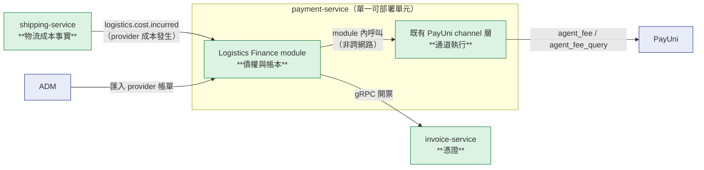
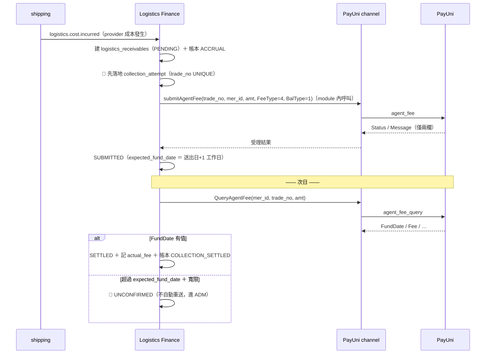
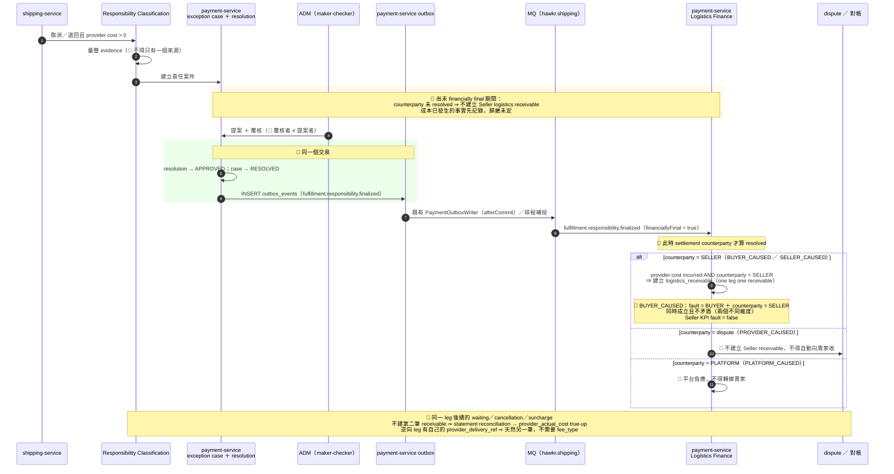
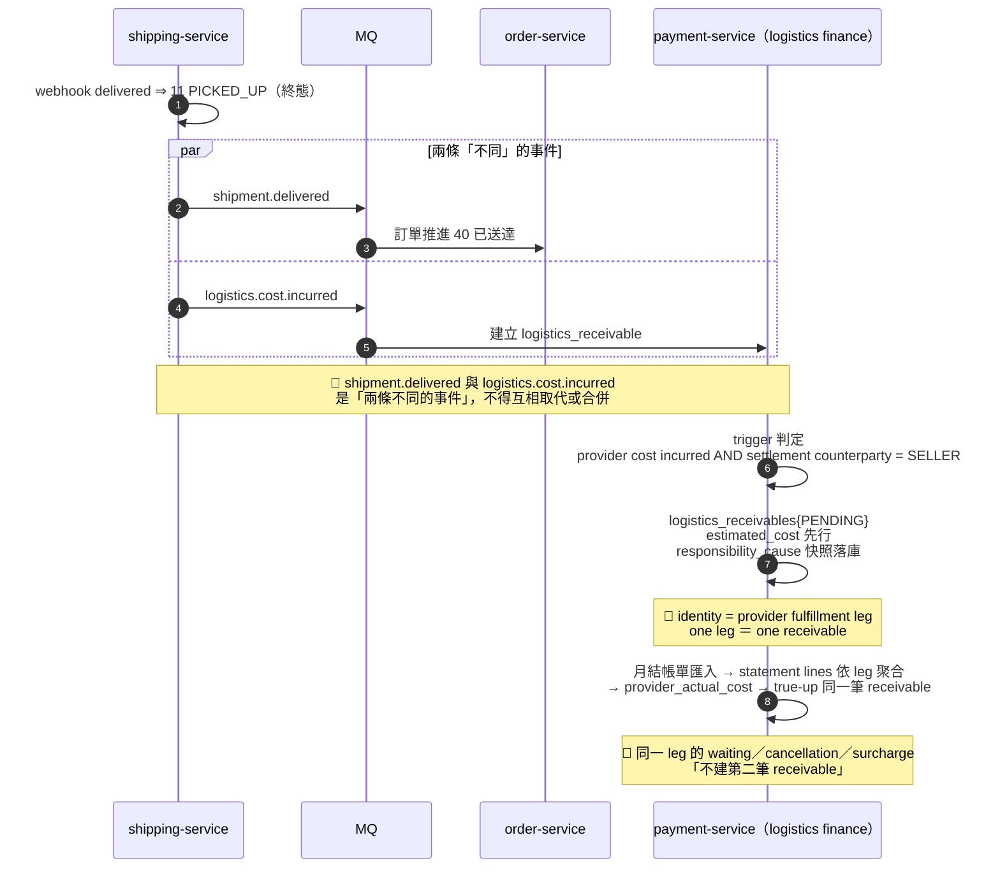

# 70　物流財務結算（Logistics Settlement & Receivable）詳細設計書

> **本書回答一個問題**：`SELLER_DIRECT` 商流下，**平台向賣家收物流服務費**（線 B）與
> **平台對 provider 的月結對帳**（線 C）在系統裡長什麼樣。
>
> **業務敘述在 [70 基本設計書](../基本設計書/70-物流財務結算（Logistics%20Settlement%20%26%20Receivable）基本設計書.md)**（本書的外部設計）；
> Uber 專屬的商流背景在 [66 基本設計書 §2／§4／§5](../基本設計書/66-Uber%20Direct%20即時配送整合基本設計書.md)；
> 決策依據是 [`ADR-003`](../adr/2026-09-11-uber-logistics-fee-charge-trigger.md)～[`ADR-014`](../adr/2026-09-14-uber-create-idempotency-precommit-key.md)（`docs/adr/`）。
> **本書不重述業務規則，只落成施工契約。**

> ⚠️ **provider 中立**：本書的對象是「平台代賣家安排的物流，其成本如何向賣家收取與對帳」。
> Uber（`3003`）是第一個，`3004`／`3005` 未來走同一條。**書名與表名一律不含 provider 名。**

> 🔴 **Runtime Owner ＝ `payment-service` ／ Logistics Finance module**
> package 根 `io.github.will413028.hawkr.payment.logistics.{domain,application,repository,infrastructure,scheduler}`；
> 資料表 9 張，DDL 見 `services/java/payment-service/src/main/resources/db/migration/V9__add_logistics_finance_tables.sql`。
>
> ⚠️ **本書是 Domain Design，不是 service design**——它定義的是「線 B／線 C 這個 domain 長什麼樣」，
> 那件事不因為換了執行它的可部署單元而改變。**Domain 文件與 deployment boundary 是兩件事。**
>
> 🔴 **併入同一個服務不等於併入同一個 domain**：
> **business payment hot path 與 logistics reconciliation 不得彼此直接耦合**
> ——拆成兩個服務時網路邊界會替你擋住，合併之後只剩 package 邊界與 gate（65 [`ADR-009`](../adr/2026-09-11-logistics-finance-domain-ownership.md) 驗證二）。

---

## 0. 這本書解決什麼、不解決什麼

| | |
|---|---|
| ✅ **解決** | 賣家物流應收的建立／收款／失敗處置／true-up／貸記；provider 帳單匯入與對帳；**五個**新帳本科目；線 B 的憑證觸發 |
| ❌ **不解決** | 配送履約本身（66）／買家付款與退款（05／09）／**撥款鏈本身**（在 03；本書只**唯讀引用**其結果，見下）／發票的開立機制（58） |

🔴 **線 B 與撥款軸不共用任何一條寫入路徑**：`SELLER_DIRECT` 下平台沒有代收**物流費**，
就沒有物流款可撥（`PayoutEligibility` 的 G0 軸對每一筆都回 `NOT_APPLICABLE`）。
**線 B 是平台向賣家「收」，撥款是平台向賣家「付」——方向相反、載體不同、不得共用任何一條路徑。**

🔴 **唯一的例外是一個唯讀依賴，不是一條路徑**：Order 終態 `DELIVERY_FAILED_NO_REFUND`
下**不向 Buyer 退款、原訂單款依既有規則正常結算給賣家**（那條路徑由 03 擁有，不在本書）。
本書必須知道這件事，才答得出「線 B 要不要沖回任何東西」——**答案是不沖回**（§3.8.1）。
⚠️ **本書仍不得新增、不得持有、不得寫入那條路徑的任何一格**；它只讀那個結果。

---

## 1. Domain Ownership（承 [`ADR-009`](../adr/2026-09-11-logistics-finance-domain-ownership.md)）



🔴 **`ST → PM` 是 module 內呼叫，不是跨網路呼叫。**
⇒ 「記應收」與「送出收款」**落在同一個 DB transaction**，不得為這個窗口引入補償機制。
⚠️ 代價：沒有網路邊界擋著，耦合只能靠 package 邊界與 gate（§6.2）。

🔴 **界線的一句話**：「這趟配送的成本是 120」是**物流事實**（shipping-service）；
「賣家因此欠平台 120」是**債權**（Logistics Finance module）。
⚠️ 這條界線畫的是 **domain**，不是部署拓撲——兩者同屬一個可部署單元時仍然成立。

**可機械執行的驗證（寫成 gate）**：`shipping-service` 的任何一張表**不得出現**
`receivable`／`credit`／`collection`／`agent_fee` 語意的欄位。
⚠️ **費率欄（`commission_rate`）與天期欄（`settlement_days`）不是金額欄**，不在本條射程內
——把它們讀成違規會誤殺 shipping-service 既有的運費計算。


---

## 2. 十個金額維度的落點（承 [`ADR-006`](../adr/2026-09-11-logistics-amount-semantics-separation.md)）

⚠️ **本表的編號是本書自己的，與另外兩本不對應**：
66 基設 §2.3 用 1–10 的平面編號（其 #2＝**實際**成本、#9＝**估計**成本），
66 詳設 §1.6.1 用 9 列（`5a`／`5b`、`6a`／`6b`／`6c` 是拆列），本表以**落點**為軸。
🔴 **跨書對讀一律以「語意名稱」為錨，不要用編號**——三套編號互相錯位，而
本書 §3.1 的欄位註解引用的是**本表**的編號。

🔴 **不要求十個 DB column**，要求的是**無歧義保存十種業務語意**。
下表是**唯一的對照表**——任何一格找不到落點，就是 [`ADR-006`](../adr/2026-09-11-logistics-amount-semantics-separation.md) 沒有落地。

| # | 金額語意 | 落點 | 誰寫 |
|---|---|---|---|
| 1 | 買家配送費 | `orders.shipping_fee`〔既有〕 | order-service |
| 2 | **估計 provider 成本** | `logistics_receivables.estimated_cost` | Logistics Finance（收 shipping 事件） |
| 3 | **實際 provider 成本** | `logistics_receivables.actual_cost`（NULL＝尚未對帳）＋ `provider_settlement_lines.amount`〔既有表〕 | Logistics Finance（ADM 匯入後） |
| 4 | **賣家物流服務費** | `logistics_receivables.target_net`（Collection Target Net）。🔴 **送出給通道的 `gross_amount` 不在 domain 表裡**——它在 `logistics_collection_attempts`，由 adapter 依費率反推（[`ADR-011`](../adr/2026-09-11-channel-fee-grossup-in-adapter.md)） | Logistics Finance |
| 5 | **收款通道實際手續費** | `logistics_collection_attempts.actual_fee`（來自 `agent_fee_query` 的 `Fee`）。🔴 **正常路徑不進帳本**——手續費由賣家負擔（[`ADR-005`](../adr/2026-09-11-payuni-channel-fee-bearer.md)）⇒ 對平台不是費用，而是「應收未收足的原因」，未收足的部分自然留在 `SELLER_LOGISTICS_RECEIVABLE` 餘額裡（§3.8）。科目 `PLATFORM_COLLECTION_FEE_EXPENSE` **僅限 `PLATFORM_CAUSED` 例外** | Logistics Finance（查詢後） |
| 6 | 賣家補貼 | 🔴 **尚不存在**——`orders` 側須新增 `seller_subsidy`（**本書不擁有**，屬結帳波次；66 §1.6.1 row 5a 逐字「不存在」） | order-service |
| 7 | 平台補貼 | `logistics_receivables.platform_subsidy` | Logistics Finance |
| 8 | **責任歸屬（重分類）調整** | `logistics_adjustments{kind=RESPONSIBILITY, responsibility_cause}`。🔴 **只用於「已成立之後改判」**——首次成立的 provider 成本一律走維度 2／3 ＋ `logistics_receivables`（觸發見 §3.1.1、界線見 §3.5.1） | Logistics Finance |
| 9 | **對帳調整** | `logistics_adjustments` | Logistics Finance |
| 10 | **賣家物流貸記** | `seller_logistics_accounts.credit_balance` ＋ 科目 `SELLER_LOGISTICS_CREDIT` | Logistics Finance |

🔴 **第 4 項不等於第 1 項，也不等於第 2 項**——`INV-U-FEE`（66 §1.6.1）的機械形式：

> `logistics_receivables` 的建立**不讀** `orders.shipping_fee`。

**變異測試（鑑別力）**：把某筆訂單的 `orders.shipping_fee` 改成 0，斷言 `target_net` **不變**。
⚠️ 若跟著變 0，就是 66 基設 Case B 會讓平台默默吸收成本的那條路徑。

---

## 3. 資料模型

> 每張表逐欄回答：① 誰寫入 ② 誰讀取 ③ **誰把它推走** ④ **卡住了誰會知道**
> （`.claude/rules/06-no-small-tails.md` §3.13 四問）。
> **服務歸屬**：全部在 **payment-service ／ Logistics Finance module**
> （Java／Spring Boot／**Flyway**／MyBatis-Plus），DB ＝ 既有的 `hawkr_payment`。
> 🔴 **schema 變更走 Flyway `V{N+1}__*.sql` append-only**（V1 凍結）——**不是** Atlas／sqlc。
> ⚠️ **取號前必須現查 migration 目錄取實際最大版號**：`ls` 是字典序，會把 `V9` 排在 `V10` 之後
> ⇒ 一律用
> `ls services/java/payment-service/src/main/resources/db/migration/ | sort -t_ -k1.2 -n`
> （撞號 ＝ Flyway 啟動失敗）。
> 主鍵一律 **TSID**（`TsidUtil.generate()` ＋ `@TableId(type = IdType.INPUT)`；
> payment-service 的 `node-id-base ＝ 0`，見 10 檔 §7.2），
> 🔴 **例外 `ledger_entries` 為 `BIGSERIAL`**（純內部關聯表，不對外暴露，`@TableId(type = IdType.AUTO)`）；
> 金額一律 `BIGINT`（元整數，禁浮點）；時間一律 `TIMESTAMPTZ`（UTC，Java 側 `LocalDateTime` 值語意 UTC，
> 取時間走 `DateTimeUtils.nowUtc()`）。

### 3.1 `logistics_receivables`｜賣家物流應收（本書的主體）

| 欄 | 型別 | 說明 |
|---|---|---|
| `id` | BIGINT PK | TSID |
| `store_id` | BIGINT NOT NULL | 賣家業務鍵（**不是 account_id**） |
| `order_no` / `shipment_id` | VARCHAR(32) / BIGINT | 溯源；🔴 **都不是唯一鍵**——唯一鍵錨在 **provider fulfillment leg**（見 §3.1.2），而同一個 `shipment_id` 可先後對應多個 provider leg |
| `provider` | VARCHAR(8) NOT NULL | ShippingMethod 碼值（`3003`…），與 ledger `owner_ref_id` 同口徑 |
| `provider_delivery_ref` | VARCHAR(64) | provider 的 **fulfillment leg 識別**（Uber ＝ `uber_deliveries.delivery_id`）；對帳的關聯鍵。🔴 **partial UNIQUE `uq_logrecv_delivery_ref`（`WHERE provider_delivery_ref IS NOT NULL`）是「one leg one receivable」唯一的機械保證**——非唯一索引擋不住重複建應收 |
| `estimated_cost` | BIGINT NOT NULL | 維度 2 |
| `actual_cost` | BIGINT NULL | 維度 3；🔴 **NULL ＝ 尚未對帳，不是 0** |
| `platform_subsidy` | BIGINT NOT NULL DEFAULT 0 | 維度 7 |
| `target_net` | BIGINT NOT NULL | 🔴 **Collection Target Net**＝這次要讓平台**淨收**多少（＝賣家本金 ＋ `carried_residual`）。**不是送給通道的金額**——那個由 adapter 依費率反推（[`ADR-011`](../adr/2026-09-11-channel-fee-grossup-in-adapter.md)） |
| `carried_residual` | BIGINT NOT NULL DEFAULT 0 | 🔴 本筆 `target_net` 內含的**前期收款殘差**（[`ADR-011`](../adr/2026-09-11-channel-fee-grossup-in-adapter.md)；可負）。⚠️ **它不是「上期的手續費」**——是「上期預估與實際的差」，費率估準時為 **0** |
| `status` | VARCHAR(16) NOT NULL | §3.2 |
| `charge_basis_frozen_at` | TIMESTAMPTZ NOT NULL | 🔴 **immutable charge basis**：凍結當下的計費依據時間 |
| `responsibility_cause` | VARCHAR(20) NULL | 建立 receivable 當下的 **resolved responsibility audit snapshot**；`chk_logrecv_responsibility_cause` 只允許 **4 個 resolved 值**（§3.6.2 的值域分工）。<br/>⚠️ 寫入者 ＝ `LogisticsCostFactJoinService.converge`——🔴 **它是兩個 consumer 共用的唯一收斂點**（§3.1.4），「兩個事實齊備 ⇒ 建立應收」**不得有第二個實作**，兩個實作就是兩份真相。<br/>⚠️ 寫入是**一次性**的：mapper 的述詞帶 `AND responsibility_cause IS NULL` ⇒ 重投 `rows=0`，呼叫端讀回比對，值相同 ＝ 重投、值不同 ＝ **衝突且不得覆蓋** |
| `submit_lease_until` | TIMESTAMPTZ NULL | 🔴 提交 worker 的**租約欄**（**不是**「已送出」旗標）。⚠️ **漏了它就是重複扣款**：兩個 pod 同時撈到同一列 `PENDING` ⇒ 各自生 `trade_no` ⇒ 各自呼叫 PayUni；`trade_no` 的 UNIQUE 與 `PENDING → SUBMITTED` 的 CAS **都擋不住**（後者發生在呼叫 PayUni **之後**）。逐筆在 claim 當下取，見 §4.2 |
| `idempotency_key` | VARCHAR(128) NOT NULL | 🔴 **錨在 provider fulfillment leg**：`logistics_receivable:{provider}:{provider_delivery_ref}`；**UNIQUE**，組成由 `chk_logrecv_idem_anchor` 約束 ⇒ 「錨錯了」在**寫入當下**就現形，而不是等到對帳才發現。🔴 **它必須與 `provider_delivery_ref` 表達同一份 identity**（§3.1.2）|
| `invoice_document_id` | BIGINT NULL | 58 號憑證關聯 |
| `statement_line_id` | BIGINT NULL | `provider_settlement_lines.id`，對帳後回填 |

**四問**：① 進 ← `logistics.cost.incurred`（🔴 觸發條件見 §3.1.1，**不是**「送達完成」）｜
② 走 ← §3.2 狀態機｜③ allowed-from 見 §3.2 表｜
④ 卡住 ← `logistics_receivable_stuck_rows{status}`（§8）

#### 3.1.1 🔴 觸發條件：`provider cost incurred` **AND** `settlement counterparty = SELLER`

> 🔴 **不是「送達完成」，也不是「責任方是賣家」。** 這兩個舊說法各自會漏掉一整類情形。

| 條件 | 意思 | 🔴 不得寫成 |
|---|---|---|
| ① `provider cost incurred` | provider 的這一趟 fulfillment leg **已經產生成本** | 「已送達」——🔴 **成本發生與送達成功是解耦的兩件事** |
| ② `settlement counterparty = SELLER` | 這筆 provider 成本最後走**向賣家結算**這條既有物流結算鏈（載體 ＝ 既有 `Bearer`） | `responsibility = SELLER`／`fault = SELLER`／`economic responsibility = SELLER` |

🔴 **條件 ② 有一個前置：settlement counterparty 只在 responsibility `financially final` 之後才算 resolved。**
`financially final` 的**語意 SSOT ＝ [65 §5.5.2 E0](65-物流履約平台%EF%BC%88Fulfillment%20Platform%EF%BC%89詳細設計書.md)**：
該 fulfillment leg 上**只能存在一張**會改變 `refund_to_buyer` 的 Responsibility Case，
它走完 resolution `APPROVED` ＋ case `RESOLVED` 之後即為 financially final，
此後**不得再開第二張**（lifetime invariant）。
🔴 **本書不複述它的機械保證**——`financially final` 的語意與其約束一律以 65 §5.5.2 E0 為準；事件面由 **36** 定義。
⇒ 🔴 **未 financially final 期間不得建立 Seller logistics receivable**——
此時 counterparty **尚未 resolved**，而不是「先暫時算成賣家、之後再改」。
⚠️ **這不是改變 trigger**（trigger 仍是 `provider cost incurred` **AND** `settlement counterparty = SELLER`），
而是把「**counterparty 何時才算 resolved**」講明白。
⚠️ **它也不是新的等待狀態**：receivable 只是**還沒建立**，不需要為此新增一格 `LogisticsReceivableStatus`（§3.2）。

**兩條都成立才建立，因此涵蓋四種情形（不只「正常送達」一種）**：

| # | 情形 | 為什麼落在這裡 |
|---|---|---|
| 1 | 正常 `delivered` | 成本發生、結算對手是賣家 |
| 2 | **賣家可歸責的取消**（`SELLER_CAUSED`） | provider 已收取消費／等待費 |
| 3 | **買家可歸責的無法投遞**（`BUYER_CAUSED`） | 🔴 `fault = BUYER` 但 **`settlement counterparty = SELLER`**——三軸分離見 §3.6.1 |
| 4 | **返程 leg**（provider 的 `ret_…`） | 它有**自己的 `provider_delivery_ref`** ⇒ 天然是另一個 fulfillment leg ⇒ 天然另一筆 receivable（返程運費 ＝ 去程運費） |

🔴 **`PROVIDER_CAUSED`／`PLATFORM_CAUSED`／`RESPONSIBILITY_UNRESOLVED` 三格不建立 receivable**
（條件 ② 不成立）——它們的去處見 §6.3。

🔴 **兩個條件由兩個獨立事件帶來，抵達順序不定** ⇒ 收斂機制見 **§3.1.4**
（成本側載體 `logistics_cost_facts`／**V16**；責任側沿用 `fulfillment_exception_cases`）。

⚠️ **觸發時點不是 `delivered`-only**（見上表條件 ①）。
[`ADR-003`](../adr/2026-09-11-uber-logistics-fee-charge-trigger.md) 要守的那一條是 🔴 **不得從買家那筆錢裡扣**
（§5「不得做的三件事」第 ③ 條、§6.2 的回寫禁令都是它的機械形式），本節不影響它。

#### 3.1.2 🔴 identity 不變式：**one provider fulfillment leg ＝ one logistics receivable**

| 保證 | 機制 | 防什麼 |
|---|---|---|
| 同一個 provider leg 不重複建應收 | `provider_delivery_ref` **partial UNIQUE**（`WHERE NOT NULL`） | provider 側重送／我方重放／人工重建 |
| 事件重放不重複計費 | `idempotency_key` **UNIQUE**，且**錨在同一個 identity** | MQ 至少一次投遞 |

🔴 **兩者必須表達同一份真相。**
identity 若錨在 `shipment_id` ＋ `leg`，而對帳比對的是 `provider_delivery_ref`，
就是**兩套 identity truth**：
provider 建單結果不明後重建、或人工 cancel + recreate，會讓同一個 `shipment_id`
先後對應兩個 delivery ⇒ 兩套 identity 直接分岔，**而 UNIQUE 抓不到**。

🔴 **`leg` 自 identity 退場**：逆向 leg 已由它自己的 `provider_delivery_ref` 區分，
`leg` 只剩顯示與映射用途。

🔴 **`provider_delivery_ref` 為 NULL 時不得建立 receivable**：
沒有 provider leg ＝ 沒有 `provider cost incurred`，條件 ① 不成立。
建單失敗且 provider 側已確認無單的情形走 §6.3。

#### 3.1.3 🔴 同一 leg 的後續費用：true-up，**不建第二筆**

同一 leg 之後才出現的 waiting fee／cancellation fee／surcharge／adjustment
⇒ 🔴 **不得建立第二筆 receivable**，而是
**provider settlement line／component 層聚合 → `actual_cost` → true-up 同一筆 receivable**（§6.2）。

🔴 **因此 `logistics_receivables` 不加 `fee_type`。**
provider billing 當然可以有 DELIVERY／WAITING／CANCELLATION／RETURN／surcharge／adjustment
——那些留在 `provider_settlement_lines`（🔴 **該表本來就有 `fee_type`，而且它是唯一鍵
`uq_provsettle_line` 的一部分**）。
⚠️ **「不加 `fee_type`」的射程是 `logistics_receivables` 與 `logistics.cost.incurred` payload
（§7），不是「全 repo 不准有這個字」**——把它讀成後者會去動一個既有表的唯一鍵。

#### 3.1.4 🔴 兩個事實的 durable join：**抵達順序不影響最終結果**

§3.1.1 的 trigger 是**連言**，而它的兩個條件由**兩個互相獨立的事件**帶來：

| 事實 | 載體 | 它回答什麼 | 誰是 authority |
|---|---|---|---|
| **A. Provider Cost Fact** | `logistics.cost.incurred`（§7.1） | 這條 provider leg **已經產生成本**，權威金額多少 | shipping domain |
| **B. Responsibility Finality** | `fulfillment.responsibility.finalized`（N16，36 號） | 責任終局 ＋ **settlement counterparty** | payment domain 的責任判定案件 |

🔴 **兩者是兩個獨立的 business fact，不得讓其中一個成為另一個的發送前置條件。**
成本是否發生，與責任判給誰，在時間上沒有必然先後：
provider 可以在 ADM 還沒覆核時就已經產生取消費（SD-15），
ADM 也可以在 provider 帳還沒結算前就完成判定。
🔴 **因此 `logistics.cost.incurred` 的 payload 不得帶 `responsibilityCause`**（§7.1）：
要求成本事件必帶 resolved 責任結論，等於讓「成本已發生的事實**先記錄**、歸屬未定」
（§6.3／SD-15）在物理上不可能發生。

##### 三種狀態的落點（🔴 **不新增任何表**）

| 狀態 | 落在哪 | 怎麼認出來 | 至多一筆由誰保證 |
|---|---|---|---|
| ① A 已到、B 未定 | **`logistics_cost_facts`**（V16）有列，而 `logistics_receivables` **沒有**列 | cost fact 列存在且該 leg 查無 receivable | `uq_costfact_delivery_ref` |
| ② B 已定、A 未到 | `fulfillment_exception_cases` | `category = RESPONSIBILITY_UNRESOLVED` ＋ `status = RESOLVED` ＋ `resolution_code` 為四個 resolved cause 之一 | `uq_exc_responsibility_subject (subject_type, subject_ref)`，**lifetime 唯一** |
| ③ 兩者皆到、counterparty ＝ SELLER | `logistics_receivables` | 該列存在且 `responsibility_cause` 非空 | `uq_logrecv_delivery_ref`（partial UNIQUE） |
| ③′ 兩者皆到、counterparty ≠ SELLER | **哪裡都不建**（正確結果，不是缺漏） | cost fact 有列、receivable 無列、案件已 RESOLVED | — |

🔴 **狀態 ① 絕不可以是「一筆 `responsibility_cause IS NULL` 的 receivable」**，
那與 §3.1.1 的禁令直接牴觸：「**未 financially final 期間不得建立 Seller logistics receivable**
——receivable 只是**還沒建立**」。
⚠️ 機械後果比語意更硬：`PENDING` 是提交 worker 的 claim 述詞（`idx_logrecv_submit_lease`）
⇒ 建了那一列就等於**開始向賣家收錢**，而此時 counterparty 根本還沒 resolved。

#### `logistics_cost_facts` 的射程

🔴 **它不是第二套 receivable engine**（§14.1、§3.5.1 的射程）：
它**沒有狀態機、沒有收款嘗試、不參與任何收款流程**，是一張 append-only 的**事實表**。
應收的唯一建立路徑仍然只有一條——`logistics.cost.incurred` ＋ counterparty ＝ SELLER。
⚠️ 判準是「這張表壞掉會不會讓錢收錯」：它壞掉只會讓應收**建不出來**（fail-closed），
不會讓錢收到錯的人身上。

🔴 **兩表之所以 join 得起來，是因為 `fulfillment_exception_cases.subject_ref` 裝的就是
`provider_delivery_ref`**——**不是** `order_no`、**不是** shipment PK。
同一張訂單的正逆向兩條 leg 因此各自有獨立的案件與獨立的 receivable（§3.1.1 情形 4、§3.1.2）。
⚠️ `subject_type` 固定為 `SHIPMENT` 只是標籤，唯一性實際由 `subject_ref` 決定。

🔴 **狀態 ② 不得落在 `logistics_receivables`**，三個理由各自獨立成立：

1. **`store_id` 是 `NOT NULL` ＋ `CHECK (> 0)`，而 N16 payload 沒有 `store_id`**
   ——B 事實本身不帶賣家業務鍵。
2. **`chk_logrecv_status` 沒有「等成本」那一格，而 `PENDING` 是提交 worker 的 claim 述詞**
   （`idx_logrecv_submit_lease`）⇒ 佔位列會被 worker 撈去打 PayUni。
   ⚠️ 這一條**不是 CHECK 擋得住的**，它是「新增一個沒有人該撈走的狀態」的典型後果。
3. 這正是 §3.1.1 末尾那句「**它也不是新的等待狀態**」要防的事：
   receivable 只是**還沒建立**，不需要為此新增一格 `LogisticsReceivableStatus`（§3.2）。

⚠️ 也**不得**落在 `logistics_adjustments`：`chk_logadj_amount_nonzero` 直接擋「還沒有金額」的列，
且該表依 §3.5.1 不是收款載體。

##### 兩種抵達順序的收斂

**兩條路徑做的事是對稱的**：先到的那一方只負責把自己的事實持久化，
**判斷一律由後到的那一方執行**——因此最終結果與抵達順序無關。

```
Case A（成本先到）                          Case B（責任先到）
─────────────────────                      ─────────────────────
logistics.cost.incurred                    N16 finalized
  │                                          │
  ▼                                          ▼
UPSERT logistics_cost_facts                 案件列已是 RESOLVED（N16 的來源）
  （uq_costfact_delivery_ref 去重）            │
  │                                          ▼
  ▼                                        查 logistics_cost_facts
查 fulfillment_exception_cases                by provider_delivery_ref
  by (SHIPMENT, providerDeliveryRef)          │
  │                                          ├─ 查無 ⇒ 狀態 ②
  ├─ 查無 / 未 RESOLVED ⇒ 狀態 ①              │    什麼都不做（AWAITING_COST_FACT）
  │    什麼都不做（等 N16）                    │
  │                                          └─ 有 ⇒ 兩者齊備
  └─ 已 RESOLVED ⇒ 兩者齊備                        │
       │                                          │
       └──────────────┬───────────────────────────┘
                      ▼
          counterparty = bearerOf(cause)
                      │
          ┌───────────┴────────────┐
          ▼                        ▼
       SELLER                非 SELLER
          │                        │
          ▼                        ▼
  建立 logistics_receivable    不建（狀態 ③′，正確結果）
  （帶 responsibility_cause     §6.3：PROVIDER→爭議／對帳
    快照 ＋ cost fact 的金額）    PLATFORM→平台吸收
```

🔴 **收斂點是同一個述詞**：
`provider cost incurred` **AND** `bearerOf(responsibilityCause) = SELLER`（§3.1.1）。

⚠️ **`bearerOf(...)` 是 B 軸（settlement counterparty）的唯一 authority**（§3.6.1）。
🔴 **禁止把它 shortcut 成 `responsibilityCause == SELLER_CAUSED`**：
`BUYER_CAUSED` 的 counterparty 也是 SELLER（§3.1.1 情形 3），shortcut 會讓那一整類漏建。

⚠️ **金額永遠取自 cost fact，不得由責任側推導或估算**——
N16 不帶金額，憑空造一個 `estimated_cost` 正是 §14.1 禁止的那條路徑換個形狀。

##### 衝突：同一條 leg 的兩個事實互相矛盾

同一個 `provider_delivery_ref` 若先後帶來不一致的 `provider`／`store_id`／
`order_no`／`shipment_id`／成本金額／責任結論：

🔴 **不得 last-write-wins、不得 `log.warn` ＋ ACK。**
兩者都會讓「向賣家收錯錢」變成一個沒有訊號的事件。
處置一律 **fail closed**：拋出 → 既有 retry／DLQ → ADM 可見的異常（§8）。
⚠️ **`responsibility_cause` 一旦寫入即為該 leg 的 audit snapshot（§3.6.2），
後到的不同結論是衝突，不是更新。** 真要改判走 `logistics_adjustments` 的責任重分類（§3.5），
那條路徑有自己的留痕與覆核。

### 3.2 狀態機（`LogisticsReceivableStatus`，新 CodeMeta 碼表）

> 🔴 **不照抄任務書的示例值域**——依 repo 既有 CodeMeta 慣例（UPPER_SNAKE code ＋ 數字 value）設計，
> 且**只保留有執行者的狀態**（§3.13 第 ① 問：答不出「誰把它推進來」的不要造）。

| 狀態 | 語意 | 誰推進來 | 誰推走（→ 目標） | allowed-from |
|---|---|---|---|---|
| `PENDING` | 應收成立，尚未送出 | `logistics.cost.incurred` consumer（§3.1.1）；**ADM 授權重送** | 提交 worker（→ `SUBMITTED`／`FAILED`） | —（新建）／**`UNCONFIRMED`** |
| `SUBMITTED` | 已送出 `agent_fee`，等次日執行 | 提交 worker | 查詢 worker（→ `SETTLED`／`UNCONFIRMED`） | `PENDING`／**`FAILED`** |
| `SETTLED` | `agent_fee_query` 回 `FundDate` 有值 ⇒ 確認入帳 | 查詢 worker；**ADM 核對後確認已收** | true-up（→ `CLOSED`） | `SUBMITTED`／**`UNCONFIRMED`** |
| `UNCONFIRMED` | 🔴 超過期望撥款日＋寬限，`FundDate` 仍為 `0000-00-00` | 查詢 worker | **ADM**（→ `SETTLED`／`PENDING`／`WRITTEN_OFF`，三選一） | `SUBMITTED` |
| `FAILED` | **送出當下** `Status ≠ SUCCESS`（明確失敗） | 提交 worker | 提交 worker 退避重送（→ `SUBMITTED`）或 ADM（→ `WRITTEN_OFF`） | `PENDING` |
| `CLOSED` | 已結清（含 true-up 完成） | true-up | —（終態） | `SETTLED` |
| `WRITTEN_OFF` | 人工核銷 | **ADM**（強制填理由） | —（終態） | `UNCONFIRMED`／`FAILED` |

🔴 **`UNCONFIRMED` 的三條出邊，缺一都會讓這一格變成死路**：

| ADM 到 PayUni 後台核對的結果 | 出邊 | 為什麼不能少 |
|---|---|---|
| **其實收到了** | → `SETTLED`（附 ADM 留痕與核對依據） | 🔴 **這是最可能的結果**。少了它，查證為真的那條路沒有邊，**只剩認賠** |
| **確認沒受理** | → `PENDING`（🔴 **開新 attempt ＋ 新 `trade_no`**，原 attempt 留「ADM 判定未受理」理由） | 用舊 `trade_no` 重送等於賭 PayUni 真的沒受理；開新的一筆即使原來其實受理了，**也是兩筆可查的紀錄，而不是一筆分不清的** |
| **查不出來** | → `WRITTEN_OFF`（強制填理由） | 認賠，但要留痕 |

⚠️ **`FAILED` 的 allowed-from 只有 `PENDING`**：它的語意是「**送出當下**回 `Status ≠ SUCCESS`」
⇒ 只會從 `PENDING` 來。把 `SUBMITTED` 加進去是一條**沒有執行者的邊**（§3.13 第 ① 問答不出來）。
⚠️ **`SUBMITTED` 的 allowed-from 必須含 `FAILED`**：退避重送成功的目標就是它，
🔴 **漏了它 ⇒ 重送成功時 CAS `rows=0`，而呼叫端多半把 rows=0 當成「別人先做過了」**。

🔴 **`UNCONFIRMED` 不自動重送，這是本狀態機最重要的一格。**
理由是 PayUni 的實際能力（§4.1）：`TradeNo` 官方標「**可重複**」、
`agent_fee_query` 回**單筆結構非陣列** ⇒ **真的送重複了，用官方 API 也對不出有幾筆**。
⇒ 自動重送的期望值是「把一次不確定變成一次確定的重複扣款」。**必須由人看。**

⚠️ **`FAILED` 可以自動退避重送**，因為它是**送出當下**就回 `Status ≠ SUCCESS`
——那代表 PayUni 沒有受理，不存在「可能已經扣了」的窗口。
🔴 **兩者的差別是「有沒有不確定窗口」，不是「失敗嚴不嚴重」。**

#### 3.2.1 🔴 每個非終態的「卡住了誰會知道」（§3.13 第 ④ 問）

**答不出這一格的狀態，就是一個會靜默卡死的狀態。**

| 狀態 | 卡住的判準 | 誰會知道 |
|---|---|---|
| `PENDING` | `created_at` 超過 1 小時仍未送出 | `logistics_receivable_stuck_rows{status="PENDING"}` ⇒ 提交 worker 掛了 |
| `SUBMITTED` | `now > expected_fund_date + 寬限` | 查詢 worker 會把它推成 `UNCONFIRMED`；**若連它也沒動** ⇒ 同一支指標 |
| `UNCONFIRMED` | 進入後超過 N 天無 ADM 處置 | `logistics_receivable_unconfirmed_rows` 🔴 **本書最重要的一條** |
| `FAILED` | 退避重送已耗盡 | `logistics_collection_failed_total{reason}` ＋ ADM 佇列 |
| `SETTLED` | 有 `actual_cost` 但超過 N 天未 true-up 也未 `CLOSED` | `provider_statement_unmatched_rows` 的另一面 |

⚠️ **`SETTLED` 不是終態**，這一格最容易被誤讀：收到錢**不等於**這筆帳結清了——
還要等 provider 帳單確定 `actual_cost` 才能 true-up。
🔴 **把 `SETTLED` 當終態的後果**：`actual > estimated` 的差額永遠不會被收，
而**帳面上看起來一切正常**（應收已收、狀態是「已結算」）。

#### 3.2.2 🔴 維運 SQL 改狀態前的三問（`06-no-small-tails.md` §3.13）

本表的狀態會有人用 SQL 手動改（ADM 處置、資料修補）。改之前必答：

1. **我要寫的這個值，有沒有執行者？** —— 把列推回非終態 ＝ 手動造一個沒有出口的狀態
2. **推走它的那一句，allowed-from 含不含我造出來的組合？** —— §3.2 的 allowed-from 欄是唯一權威
3. **同一交易要不要補一列狀態歷程？** —— 🔴 裸 `UPDATE` 不留痕 ⇒ 下一個人看到的軌跡是假的

### 3.3 `logistics_collection_attempts`｜每一次 `agent_fee` 送出

| 欄 | 說明 |
|---|---|
| `id` / `receivable_id` | TSID / FK |
| `trade_no` | VARCHAR(32) **UNIQUE** — 🔴 **我方生成並保證唯一**（官方不保證，§4.1） |
| `gross_amount` | 🔴 **AgentFee Gross Amount**＝實際送出的 `Amt`，由 adapter 依費率反推（domain 不算它） |
| `net_proceeds` | 🔴 **Agent Net Proceeds** ＝ `gross_amount − actual_fee`，平台**真正收到**的錢 |
| `residual` | 🔴 **Collection Residual** ＝ `target_net − net_proceeds`（可負）。**不為 0 不得標記已收訖** |
| `submit_status` / `submit_message` | `agent_fee` 回傳僅有的兩欄 |
| `submitted_at` | 送出時間（UTC） |
| `expected_fund_date` | 🔴 送出日 ＋ 1 個工作日（§4.2）——`UNCONFIRMED` 判定的錨 |
| `fund_date` | 來自 `agent_fee_query`；`0000-00-00` 映成 NULL |
| `actual_fee` | 🔴 維度 5，來自查詢的 `Fee`。**不得用預估值（含 1%）冒充** |
| `query_lease_until` | 租約欄（**不是「已查過」旗標**） |

🔴 **送出前必須先落地這一列**（pre-commit），才呼叫 PayUni。
順序顛倒的後果：HTTP 逾時 ⇒ 我方沒有紀錄 ⇒ 重試產生第二個 `TradeNo` ⇒ **重複扣款且事後查不出來**。

### 3.4 `seller_logistics_accounts`｜賣家物流費帳戶（[`ADR-011`](../adr/2026-09-11-channel-fee-grossup-in-adapter.md)／[`ADR-008`](../adr/2026-09-11-logistics-cost-true-up.md) 的載體）

`store_id` PK｜`receivable_balance` BIGINT（賣家欠平台，含前期結轉殘差）｜
`credit_balance` BIGINT（**平台欠賣家**）｜`last_activity_at`。

🔴 **兩個餘額是兩個欄位，不是一個欄位的正負**：它們可以同時存在（這期欠、上期多收），
合成淨額之後 [`ADR-008`](../adr/2026-09-11-logistics-cost-true-up.md) 第 1 條保證（永久可追蹤）就失效了。
🔴 **`credit_balance` 永不過期、不因賣家無後續交易而清零**（[`ADR-008`](../adr/2026-09-11-logistics-cost-true-up.md) 第 2、3 條）
⇒ **不得有任何排程會把它歸零**；§8 有一條「credit 帳齡」指標，它的用途是**催付平台自己**，不是清理。

### 3.5 `logistics_adjustments`｜責任重分類與對帳調整

| 欄 | 型別 | 說明 |
|---|---|---|
| `id` | BIGINT PK | TSID |
| `receivable_id` | BIGINT **NULL** | 🔴 **明標可為 NULL**——責任**改判**可能發生在一筆從未建立 receivable 的 leg 上。⚠️ **NULL 不代表它可以當母單**，見 §3.5.1 |
| `kind` | — | `RESPONSIBILITY`／`RECONCILIATION`（`chk_logadj_kind` 鎖死兩值；🔴 **本次不擴充**，四種用途的映射見 §3.5.1） |
| `amount` | BIGINT | **可負** |
| `responsibility_cause` | — | 見 §3.6 |
| `statement_line_id` | — | `provider_settlement_lines.id` |
| `created_by` / `reason` | — | ADM 留痕（**強制填理由**） |

⚠️ **本表的 `amount` 允許負數**（與 `ledger_entries.amount` 恆正相反）：
這裡是**業務調整單**，正負是它的語意；帳本那邊由 `direction` 表達。**兩層的規則不同是刻意的。**

#### 3.5.1 🔴 職責界線：它**不是**第二套收款引擎

**它只負責四件事**，全部映到既有兩個 `kind`，**因此不需要擴充 CHECK**：

| # | 用途 | `kind` |
|---|---|---|
| 1 | **statement true-up**（暫估 → 實際的差額） | `RECONCILIATION` |
| 2 | **reconciliation difference**（帳單與我方紀錄對不上的差） | `RECONCILIATION` |
| 3 | **post-facto accounting adjustment**（事後會計調整） | `RECONCILIATION` |
| 4 | **responsibility reclassification**（責任**改判**後的金額移轉） | `RESPONSIBILITY` |

🔴 **明文禁止（六條，缺一都會讓它長成第二套引擎）**：
① 它**不是** collection mother record（收款母單）
② **不得**為它建 state machine
③ **不得**為它建 collection worker
④ **不得**開 ADM「Create Adjustment」RPC 當成向賣家收錢的入口
⑤ **不得**為它建 collection attempts／收款 retry
⑥ **不得**為它建 stuck collection 指標

🔴 **凡是「provider 已經產生成本、需要向賣家結算」⇒ 一律走 `logistics_receivable`。**
**一套收款引擎，不是兩套。**

**機械證明（不是紀律，是 DB 層的事實）**：`logistics_collection_attempts.receivable_id`
是 **`NOT NULL` ＋ FK** ⇒ 🔴 **一筆沒有母單的 adjustment，在 DB 層就掛不上任何一次收款嘗試**。
⇒ 想讓 adjustment 真的收到錢只有兩條路：替它造一筆 receivable（那就是走回正途），
或改掉那條 FK（🔴 **明令禁止**）。

🔴 **`logistics_adjustments.receivable_id` 的欄註解不得寫成「無母單」的用法。**
註解與本節六條禁令是同一份契約：一旦註解描述了「掛在 `store_id` ＋ `provider_delivery_ref` 上、
無母單」的收款用法，下一個實作者會照註解做，而 DB 的 FK 擋不住他先造一筆假母單。
⚠️ 既有 migration **不得修改**（Flyway append-only）⇒ 註解要改一律走後續 migration 的
`COMMENT ON COLUMN` 覆蓋。

### 3.6 `ResponsibilityCause`（新 CodeMeta 碼表，承 [`ADR-004`](../adr/2026-09-11-responsibility-based-cost-attribution.md)）

> 🔴 **值域 ＝ 四個 resolved 值。** 碼值清單的 SSOT 是 CodeMeta 的 `ResponsibilityCause` 碼表
> （`docs/代碼管理（CodeMeta）/業務類型碼.md`）；**本節不複製完整碼表**，只定義三軸分工。
>
> 🔴 **`RESPONSIBILITY_UNRESOLVED` 不屬於本碼表**——它是 `FulfillmentExceptionCategory` 的一格，
> 表達的是「還沒判定」這個**案件狀態**，不是一個成因。

| code | 所屬碼表 | 語意 |
|---|---|---|
| `RESPONSIBILITY_UNRESOLVED` | 🔴 **`FulfillmentExceptionCategory`**（**不是** `ResponsibilityCause`） | **evidence 不足、尚未判定**。它是一個正式且明確的**案件分類**，不是「暫時沒填」，也**永遠不是一個成因** |

**四值在三個地方各有一份複製，任一份漂移都會讓「只有四值」變成假的**：

| 拷貝 | 形式 |
|---|---|
| CodeMeta SSOT `業務類型碼.md` ＋ 生成碼 `ResponsibilityCause` | 四個 resolved 值；`RESPONSIBILITY_UNRESOLVED` **不屬於本碼表** |
| `chk_logrecv_responsibility_cause`（`logistics_receivables`） | `IN ('BUYER_CAUSED','SELLER_CAUSED','PROVIDER_CAUSED','PLATFORM_CAUSED')` |
| `fulfillment_exception_cases` 側的責任綁定 CHECK | 同一組四值 |

🔴 **新增或改名任一值必須同批改上述兩道 CHECK**，漂移由 `LogisticsSchemaContractTest`
逐字對拍守住；收斂時遇到 `RESPONSIBILITY_UNRESOLVED` 一律回 `CONFLICT`（它不是合法成因）。

🔴 **判定原料不足時不得落任何成因。** 案件留在 `IN_PROGRESS`，
分類由 `FulfillmentExceptionCategory.RESPONSIBILITY_UNRESOLVED` 承載。
⚠️ **`PROVIDER_CAUSED` 不是 fail-closed 落點**：把「查不出來」記成「物流商的錯」，
等於**做了一個沒有證據的判定**，並讓 `PROVIDER_CAUSED` 同時承載兩種完全不同的事實
（真的是物流商的錯／我們不知道是誰的錯）——對帳與爭議都會因此失準。

#### 3.6.1 🔴 三軸分離：Fault ≠ Settlement Counterparty ≠ KPI

🔴 **三件事不得壓成「code ＋ 負擔方」兩欄**——壓在一起會被讀成「成因決定了誰付錢」，
而那正是本節要防的誤讀。

| 軸 | 回答什麼 | 載體 |
|---|---|---|
| **A. Fault／Responsibility** | **誰造成**履約失敗 | `ResponsibilityCause`（**四個 resolved 值**）；「責任未判定」由案件的 `FulfillmentExceptionCategory.RESPONSIBILITY_UNRESOLVED` 承載，**不在成因 enum 內** |
| **B. Settlement counterparty** | 平台的 provider 成本**最後走哪一條既有物流結算鏈** | 既有 `Bearer`（🔴 **純推導值，不落庫、不進 CodeMeta**） |
| **C. KPI attribution** | **哪一方的營運 KPI** 被記 failure | 🔴 錨 `ResponsibilityCause`（軸 A） |

| `ResponsibilityCause` | A. Fault | B. Settlement counterparty | C. Seller KPI fault | 建 receivable？ |
|---|---|---|---|---|
| `SELLER_CAUSED` | 賣家 | **SELLER** | ✅ true | ✅ |
| `BUYER_CAUSED` | 買家 | 🔴 **SELLER** | 🔴 **false** | ✅ |
| `PLATFORM_CAUSED` | 平台／系統 | **PLATFORM**（🔴 不得轉嫁賣家） | false | ❌ |
| `PROVIDER_CAUSED` | 物流商 | **爭議／對帳**（🔴 不得自動向賣家收） | false | ❌ |
| `RESPONSIBILITY_UNRESOLVED` | 🔴 **尚未決定** | 🔴 **尚未決定** | 🔴 **不記** | ❌ |

🔴 **`BUYER_CAUSED` 那一列的三格同時成立且不矛盾**，這是全書最容易被「修正」成錯的一格：
`fault = BUYER` ＋ `settlement counterparty = SELLER` ＋ `Seller KPI fault = false`。
**`Bearer` 表達的是財務結算對象（「這筆物流額外成本最終算誰的」），不是責任方。**
⇒ 🔴 **既有的 `BUYER_CAUSED → Bearer.SELLER` 一行都不改**；🔴 **不新增 `Bearer.BUYER`**。

🔴 **平台不得向買家二次收款。**
🔴 **它與「不向 Buyer 退款（`refund_to_buyer = 0`）」是兩件不同的事**：
前者是「不另外跟買家要錢」，後者是「原本收的不退」（該政策在 66／03，**本書不定義它**）。
**兩句必須並存，刪掉任何一句都會讓另一句被讀成全部。**

🔴 **KPI 的機械形式**：KPI 輸入**必須讀 `ResponsibilityCause`**，
**明令禁止讀 `Bearer`／`chargeableToSeller`／「有沒有 logistics receivable」**。
兩者在 `BUYER_CAUSED` 這一格上**刻意不一致**——那個不一致就是 KPI 汙染的唯一入口。
⚠️ **誠實標註**：賣家 KPI 系統今天不存在 ⇒ 這是**對未來的約束**，不是對現況的描述。

#### 3.6.2 🔴 `logistics_receivables.responsibility_cause` 的 SSOT 邊界

它 ＝ **「建立 receivable 當下的 resolved responsibility audit snapshot」**，
🔴 **不是**所有 fulfillment responsibility 的唯一 SSOT。

**理由是機械的，不是風格的**：`PROVIDER_CAUSED`／`PLATFORM_CAUSED` **可以沒有** Seller receivable，
`RESPONSIBILITY_UNRESOLVED` **明確沒有**
⇒ 🔴 **receivable 不能成為 responsibility classification 存在的前提**。

**未建立 receivable 時的 authoritative landing ＝ 既有 `fulfillment_exception_cases`
＋ `fulfillment_case_resolutions`**（🔴 **不得另造 dispute platform／第二套 case engine**）。

🔴 **值域分工（看起來像矛盾，但它是正確的）**：
classification 本身是 **5 值**，而本欄的 DB CHECK **只允許 4 個 resolved 值**
——因為 **receivable 只在 resolved 之後才建立**。
**這是分工，不是矛盾。** 下一個人看到兩個數字對不上時，請先讀這一句再動手。

**它的職責**：audit evidence／receivable origin／ADM reconciliation／（未來）KPI input。
🔴 **不是** financial counterparty、**不是** payment collector、**不是** `Bearer`、**不是** KPI owner 本身。

#### 3.6.3 Evidence sources（🔴 不得只有一個）

| # | 來源 | 注意 |
|---|---|---|
| ① | normalized provider outcome／reason | 🔴 provider 的 `undeliverable`／`returned` **本身 ≠ `BUYER_CAUSED`**——它只描述「沒有完成交付」，不是責任方判斷 |
| ② | delivery attempt facts（`courier` 指派與即將抵達軌跡、POD／pickup 證據） | — |
| ③ | contact evidence | 🔴 **僅限實際已存在、可保存、可指認的紀錄**；⚠️ 匿名轉接號 ＋ PIN 是**聯絡能力**，不是**聯絡紀錄** |
| ④ | Seller／Platform facts（賣家備妥時間、逾期、我方建單或取消錯誤） | — |
| ⑤ | `event.refund_request.party_at_fault`（`UBER`／`Partner`） | 🔴 **只是其中一個來源**，且只有二值 ⇒ 需要一層我方 mapping（§10 **EV-U2**） |

🔴 **某項 evidence 系統不存在時不得假裝存在，也不得為此新增大型 evidence subsystem**；
**缺證據就落 `RESPONSIBILITY_UNRESOLVED`**，而不是落一個看起來比較具體的值。

🔴 **classification 只在一個地方分流**（配送 Lifecycle 的 provider 終局處置格，66 詳設）
——**本書不重複 classification 邏輯**；本書的 scope 是「**已 resolved 為某一值之後**，錢怎麼走」。
⚠️ 這一格的可判定性取決於 provider statement 的真實欄位（§10 **EV-U2**）。

### 3.7 既有表擴充

| 表 | 動作 |
|---|---|
| `ledger_transactions` | 🔴 `chk_ledgtxn_model` 放寬 ＋ 新增 `chk_ledgtxn_model_type` 相容性 CHECK（[`ADR-010`](../adr/2026-09-11-ledger-carrier-model-compatibility.md) 全文） |
| `LedgerAccountCode` | ＋**5** 值（[`ADR-010`](../adr/2026-09-11-ledger-carrier-model-compatibility.md)）：`SELLER_LOGISTICS_RECEIVABLE`／`PLATFORM_LOGISTICS_SERVICE_INCOME`／`PLATFORM_COLLECTION_FEE_EXPENSE`（🔴 **僅限 `PLATFORM_CAUSED` 例外，正常路徑不 post**）／`SELLER_LOGISTICS_CREDIT`／🔴 `PLATFORM_OPERATING_CASH`（平台自有現金——`SELLER_DIRECT` 下 `PLATFORM_COLLECTED_CASH` 無語意，見 §3.8） |
| `LedgerTxnType` | ＋**6** 值（🔴 其中 `COLLECTION_FEE_ACCRUAL` **只用於平台負擔手續費的例外**，正常路徑不 post，見 §3.8）：`LOGISTICS_RECEIVABLE_ACCRUAL`／`LOGISTICS_COLLECTION_SETTLED`／`LOGISTICS_TRUE_UP`／`LOGISTICS_CREDIT_ISSUE`／`LOGISTICS_CREDIT_APPLY`／`COLLECTION_FEE_ACCRUAL`（＋既有 `LOGISTICS_COST_ACCRUAL`／`PROVIDER_SETTLEMENT` 沿用） |
| `provider_settlement_lines`〔既有〕 | **不改結構**——它無 `commerce_model` 限制，可直接用。缺的只是寫入端點（§6.1） |

### 3.8 🔴 分錄對照表（`SELLER_DIRECT` 分支）

> 🔴 **每個新 `txn_type` 都必須在本表有借貸科目對，只給名稱等於沒給。**
> `ledger_transactions` 有 `CONSTRAINT TRIGGER trg_ledger_balanced`（`Σ DEBIT = Σ CREDIT`）
> ⇒ 施工者猜錯科目對就是 **INSERT 當下 500**，而症狀會出現在呼叫端（收款流程／帳單匯入）。
> 既有 11 值的科目對在 65 §5.3.1a，本節列 `SELLER_DIRECT` 這一側。

| `txn_type` | DEBIT | CREDIT | 什麼時候 post |
|---|---|---|---|
| `LOGISTICS_COST_ACCRUAL` | `PLATFORM_LOGISTICS_COST` | `PROVIDER_PAYABLE` | 收到 `logistics.cost.incurred`（暫估） |
| `LOGISTICS_RECEIVABLE_ACCRUAL` | `SELLER_LOGISTICS_RECEIVABLE` | `PLATFORM_LOGISTICS_SERVICE_INCOME` | 應收成立（🔴 觸發 ＝ §3.1.1，**不是「送達」**）。🔴 **金額＝本期成本 − 平台補貼，不含前期結轉**（結轉是前期已認列、尚未收足的餘額，再認列一次就是**重複認列收入**） |
| `LOGISTICS_COLLECTION_SETTLED` | `PLATFORM_OPERATING_CASH` | `SELLER_LOGISTICS_RECEIVABLE` | `FundDate` 有值。🔴 **金額＝`net_proceeds`（`gross_amount − actual_fee`），不是 `gross_amount`** |
| `COLLECTION_FEE_ACCRUAL` | `PLATFORM_COLLECTION_FEE_EXPENSE` | `PLATFORM_OPERATING_CASH` | 🔴 **只在「平台負擔手續費」的例外情況**（見下方三角警語）。**正常路徑不 post 這一筆** |
| `LOGISTICS_TRUE_UP`（實際 > 暫估） | `SELLER_LOGISTICS_RECEIVABLE` | `PLATFORM_LOGISTICS_SERVICE_INCOME` | 對帳後補收 |
| `LOGISTICS_TRUE_UP`（實際 < 暫估） | `PLATFORM_LOGISTICS_SERVICE_INCOME` | `SELLER_LOGISTICS_RECEIVABLE` | 🔴 **方向相反，同一個 `txn_type`** |
| `LOGISTICS_CREDIT_ISSUE` | `PLATFORM_LOGISTICS_SERVICE_INCOME` | `SELLER_LOGISTICS_CREDIT` | 多收成立貸記（平台欠賣家） |
| `LOGISTICS_CREDIT_APPLY` | `SELLER_LOGISTICS_CREDIT` | `SELLER_LOGISTICS_RECEIVABLE` | 貸記抵扣下一筆應收 |
| `PROVIDER_SETTLEMENT` | `PROVIDER_PAYABLE` | 🔴 **`PLATFORM_OPERATING_CASH`** | 月結付款給 provider |
| `MANUAL_ADJUSTMENT` | 依方向 | 依方向 | ADM 可稽核調整（強制填理由） |

🔴 **`PROVIDER_SETTLEMENT` 的 CREDIT 與舊商流不同，這一格最容易抄錯**：
65 §5.3.1a 寫的是 `PLATFORM_COLLECTED_CASH`（平台**代理商戶收到買家款**），
而 **`SELLER_DIRECT` 下平台沒有代收** ⇒ 該科目在新商流裡沒有語意
⇒ 對手科目是 **`PLATFORM_OPERATING_CASH`**（平台自有現金，[`ADR-010`](../adr/2026-09-11-ledger-carrier-model-compatibility.md) 新增）。
⚠️ **同一個 `txn_type` 在兩個商流下是同名的兩種分錄**，科目對由
`ledger_transactions.commerce_model` 決定 —— 不是由 `txn_type` 單獨決定。

⚠️ **`LOGISTICS_CREDIT_ISSUE` 為什麼借「收入」而不是借「費用」**：
多收的那一筆當初是貸記收入（`LOGISTICS_RECEIVABLE_ACCRUAL`），現在要還
⇒ **沖減當初認列的收入**，而不是新增一筆費用。
把它記成費用會讓損益表上同時有「虛增的收入」與「不存在的費用」，兩者金額相同但都是假的。

⚠️ **手續費是 PayUni「從撥款裡扣掉的」，平台從來沒收到那筆錢** ——
所以 `LOGISTICS_COLLECTION_SETTLED` 的金額是**實收**（`Amt − Fee`）而不是 `Amt`。
🔴 **未收足的那一塊不需要任何分錄**：它自然留在 `SELLER_LOGISTICS_RECEIVABLE` 的餘額裡，
**那就是 [`ADR-011`](../adr/2026-09-11-channel-fee-grossup-in-adapter.md) 要結轉、下一期併收的東西**（逐步驗算見本節末）。

🔴 **手續費不沖減應收（本表最容易做錯的一格）**

[`ADR-005`](../adr/2026-09-11-payuni-channel-fee-bearer.md) 定案手續費**由賣家負擔** ⇒ 對平台而言它**不是費用**，而是「**應收未收足的原因**」。
若照直覺 post 一筆 `DEBIT PLATFORM_COLLECTION_FEE_EXPENSE / CREDIT SELLER_LOGISTICS_RECEIVABLE`：

| | 帶那筆分錄 | 不帶（正確） |
|---|---|---|
| 期末 `SELLER_LOGISTICS_RECEIVABLE` | **0**（被沖平） | **＝ `residual`** |
| 可結轉到下期的缺口 | **0** | ＝ `residual` ✅（費率估準時為 **0**） |
| 結果 | 🔴 **[`ADR-011`](../adr/2026-09-11-channel-fee-grossup-in-adapter.md) 的結轉機制在帳上失效** —— 缺口消失，下期收不回來 | 機制成立 |

⚠️ 而且它同時**違反 [`ADR-005`](../adr/2026-09-11-payuni-channel-fee-bearer.md)**：把賣家該負擔的手續費認列成平台自己的費用，
損益表上會出現一筆不存在的平台支出。

⇒ **正常路徑不 post `COLLECTION_FEE_ACCRUAL`**；實際手續費金額記在
`logistics_collection_attempts.actual_fee`（§3.3，供對帳與賣家帳單逐項顯示），
**未收足的部分自然留在應收餘額裡**，那就是 [`ADR-011`](../adr/2026-09-11-channel-fee-grossup-in-adapter.md) 要結轉的東西。
🔴 `PLATFORM_COLLECTION_FEE_EXPENSE` 這個科目**保留但只用於例外**：
平台原因（`PLATFORM_CAUSED`）造成的反向沖銷，其手續費依 [`ADR-004`](../adr/2026-09-11-responsibility-based-cost-attribution.md) 由平台負擔，那一筆才用它。

**守恆自檢（可寫成測試，四條缺一不可）**：

| # | 斷言 | 抓什麼 |
|---|---|---|
| 1 | 期末 `SELLER_LOGISTICS_RECEIVABLE` ＝ `residual` | 收款有沒有記全 |
| 2 | 🔴 **平台累計現金 ＝ Σ(`net_proceeds`) − Σ(付 provider)，且費率估準時為 0** | fee-on-fee 造成的永久短收——🔴 **只看應收與收入的斷言看不到它** |
| 3 | `PLATFORM_COLLECTION_FEE_EXPENSE` ＝ 0（正常路徑） | 有沒有把賣家的成本記成平台費用 |
| 4 | 🔴 **Order 終態 `DELIVERY_FAILED_NO_REFUND` 本身不產生本書的任何一筆分錄** | 有沒有人把「原訂單款撥給賣家」那條線誤寫成本書的沖回／二次收款／退款分錄（§3.8.1） |

⚠️ **第 4 條與 1～3 是不同的軸**：1～3 守的是收款金額鏈（[`ADR-011`](../adr/2026-09-11-channel-fee-grossup-in-adapter.md)），
第 4 條守的是**兩條資金線沒有被混寫**（§3.8.1）⇒ 🔴 **它必須是獨立的一支測試**，
不得併進金額鏈那三條裡（併進去就會被金額全對的情境蓋過去）。

🔴 **第 2 條是唯一抓得到「永久短收」的那一條**：只看應收餘額與收入的斷言
**完全看不到平台的現金** ⇒ 一個每期短收 `Cr/(1−r)` 的模型可以讓它們全部 PASS。

🔴 **三條斷言守三條不同的軸，一條斷言只看得到一條**（載體 ＝
`LogisticsMultiPeriodCashConservationTest`，多期跑完後逐項斷言）：

| 斷言 | 守哪條軸 | 什麼變異會讓它 FAIL |
|---|---|---|
| `C1` 期末應收 ＝ `residual`（估準時 0） | 收款有沒有記全 | 以**沖減應收**那一式 post 手續費 |
| `C2` 收入只認列本期 | 不重複認列收入 | 帳本認列含前期結轉 |
| `C3` 平台零費用且現金不短列 | 🔴 **[`ADR-005`](../adr/2026-09-11-payuni-channel-fee-bearer.md)（賣家負擔）** | 以**任一式** post 手續費分錄 |

🔴 **`C3` 補的洞很具體**：把 `DEBIT PLATFORM_COLLECTION_FEE_EXPENSE / CREDIT PLATFORM_OPERATING_CASH` **加回正常路徑**時，
**[`ADR-011`](../adr/2026-09-11-channel-fee-grossup-in-adapter.md) 的結轉完全不受影響** ⇒ `C1`／`C2` 照樣 PASS，
而平台每期憑空多一筆支出、現金短列（`C=120` 時 cash 120→119）。
⚠️ **「這條軸沒被破壞」不等於「設計沒被破壞」**——一條軸一條斷言。
🔴 **三條缺一不可，且不得互相取代。**

**驗算（`C=120`、費率估準、無前期 residual）**：
認列 `+120` ⇒ 應收 `120`；`target_net=120`；adapter 反推 `gross≈121.21`；
`actual_fee≈1.21` ⇒ `net_proceeds=120` ⇒ 貸 `120`
⇒ **期末應收 `0`、residual `0`、平台現金淨 `0`** ✅（三條斷言全成立）。
⚠️ **費率估不準時**（預估 1%、實際 1.5%）：`net_proceeds≈119.39` ⇒ `residual≈0.61`
⇒ 期末應收 `0.61` ＝ residual ✅，併入下期 `target_net` 後整體再 gross-up。

#### 3.8.1 🔴 `DELIVERY_FAILED_NO_REFUND` 的兩條資金線（**不得混寫**）

Order 終態 `DELIVERY_FAILED_NO_REFUND`（配送未成功、責任已 **financially final** 為 `BUYER_CAUSED`、
**不向 Buyer 退款**、訂單已完成財務結案且具備撥款資格）會**同時**牽動兩條資金線。
🔴 **它是 immutable financial terminal**：`refund_to_buyer = 0` 一旦套用即不可逆（詳見本節末）。
🔴 **它們是兩條不同的 flow**——載體不同、方向不同、分錄不同。
**混寫的結果就是做出「退款兼撥款」這種東西。**

| | **線 ①：原訂單款 → 賣家** | **線 ②：該 leg 的 provider 成本 → 向賣家收** |
|---|---|---|
| 方向 | 平台／通道 **付**給賣家 | 平台向賣家 **收** |
| 擁有者 | 🔴 **Order 軸（03），不在本書** | **本書（線 B）** |
| 本書的角色 | 🔴 **唯讀引用其結果** | 🔴 **正常建立 `logistics_receivable`**（§3.1.1 情形 3） |
| 本書要 post 的分錄 | 🔴 **一筆都沒有** | `LOGISTICS_COST_ACCRUAL` ＋ `LOGISTICS_RECEIVABLE_ACCRUAL`（既有兩列，**不需要新 `txn_type`**） |

🔴 **線 ① 沒有任何新分錄，因為本書對它的唯一保證是「不動它」**——
**「沒有分錄」本身就是這裡的設計，不是漏寫**（守恆自檢第 4 條）。
⚠️ **錢的方向不要被狀態名稱帶跑**：狀態名含 `FAILED`，但那說的是**配送**失敗，
**不是**這筆訂單的錢失敗 ⇒ 🔴 **不得因為狀態名而觸發沖回、退款或發票作廢**。

**線 ① 的撥款路徑（由 03 擁有；本書只登記它的存在與硬約束）**

🔴 **入向 ＝ 責任 final 事件的 consumer（order-service）** ⇒ 責任判定未 financially final 時，
這條鏈**根本不會被走到**（§3.1.1 的同一條前置）。

```
新 Tx Handler（與既有 OrderCompletionTxHandler 同形）
  │  🔴 同一個交易內做兩件事：
  │  ① CAS：SHIPPING_ABNORMAL(35) → DELIVERY_FAILED_NO_REFUND(54)
  │  ② INSERT grant_payment_tasks(PENDING)
  └─► GrantPaymentWorker.processTask      （🔴 沿用既有 worker：claim lease → payout-hold 閘門）
        └─► PaymentGrpcClient.grantPayment （🔴 order→payment 的唯一 gRPC 發動點）
              └─► … → PaymentClient.grant  （🔴 唯一打 PayUni 撥款端點的地方）
```

🔴 **不得開第二條撥款鏈**：grant 層仍然只有一個發動點，
payout-hold 閘門（fail-closed）的**機制**沿用於新終態的 task（同一支 worker、同一個反查、同一個 fail-closed）。

🔴 **也不需要為本終態再造第二道 payout hold**：撥款任務**只在責任判定 financially final 之後**
才會被建立，而未 final 期間 Order 停在 `SHIPPING_ABNORMAL(35)`——不退款、**尚未**套用
`refund_to_buyer = 0`、**不建 `grant_payment_tasks`**、不建 Seller receivable
⇒ 🔴 **「先撥款、之後才發現該退款」這個 race 不存在**，因為那個窗口本身不存在。
⚠️ **順序才是這裡的保護機制**，不是閘門：把 review 擋在財務終態之前，
比在財務終態之後補一道 responsibility-specific 的 hold 便宜且可靠得多。

🔴 **`DELIVERY_FAILED_NO_REFUND(54)` 是 immutable financial terminal**：
沒有 post-54 的自動 reversal、沒有回到退款終態的路徑、沒有賣家扣回機制
⇒ **任何「先撥款、事後再退款」的設計都不得在此假設存在回收路徑**——
錢一旦撥出即為平台資損，而**這正是「撥款前必須先 financially final」這條順序要守的東西**。
⚠️ **客服 goodwill coupon ／ 人工補償仍可存在**，但它**不改 Order 終態、不改 refund entitlement、
不變成賣家扣回** ⇒ 對本書的線 ①／線 ② **都不產生任何分錄**（守恆自檢第 4 條）。

**責任 final 事件的 producer 側（🔴 這一半在本書射程內）**

責任案件與其 resolution 兩張表（`fulfillment_exception_cases`／`fulfillment_case_resolutions`）
由 **payment-service** 擁有（`V9__add_logistics_finance_tables.sql`）
⇒ 🔴 **責任 final 事件的 producer 必須是 payment-service**——
別的服務**無法**在同一個交易內寫這兩張表，而不同交易就不再是 atomic。

```
🔴 同一個交易（producer 側 atomic boundary）
  ⓪ SELECT … FROM fulfillment_exception_cases WHERE id = ? FOR UPDATE   -- guarded read，序列化同一張 case
  ① CAS：UPDATE fulfillment_case_resolutions SET status = 'APPROVED', reviewed_by = …, reviewed_at = …
       WHERE id = ? AND status = 'AWAITING_REVIEW'
  ② CAS：UPDATE fulfillment_exception_cases  SET status = 'RESOLVED',
       resolution_code = <ResponsibilityCause>, resolved_at = …, resolved_by = …
       WHERE id = ? AND status IN ('OPEN','IN_PROGRESS')
  ③ INSERT outbox_events（責任 final 事件，🔴 exchange = 'hawkr.shipping'）
```

🔴 **⓪ 不可省，①② 必須是 CAS**：`rows = 0` 代表該 case／resolution 已被別人推進 ⇒ **整個交易 rollback**，
**不得**當成「別人先做過了」就放行走到 ③（那會發出第二筆 final 事件）。
🔴 **不得改用「先掃描有沒有 `AWAITING_REVIEW`／有沒有其他 `OPEN` case」的 snapshot 判定**——
那是 read-then-act，兩個並行交易會同時讀到「沒有」。步驟語意的 SSOT ＝ 36 §3.3.1 的 Atomic Boundary，本書不另立一套。

投遞沿用 payment-service **既有**的 `PaymentOutboxWriter`（afterCommit 即時投遞）
＋ `OutboxEventPublisherScheduler`（排程補投）。
🔴 **不新增任何 outbox 基礎設施、不新增 dispute engine、不新增 finality 專用表。**
⚠️ **在既有 `outbox_events` 上加一個 `exchange` 欄不算「新增基礎設施」**——同一張表、同一支 publisher、同一支排程。

🔴 **exchange 是 explicit persisted contract，不是推斷值。**
該列必須自己帶著 `exchange = 'hawkr.shipping'`（`fulfillment.*` 收斂在該 exchange，SSOT ＝ 36），
🔴 **不得**用 routing key 前綴去猜 exchange。
**`exchange` 欄的 fail-closed 契約（四條，缺一即退化成推斷值）**：

| # | 契約 |
|---|---|
| ① | `OutboxEventEntity` 持有 `exchange` 欄，publisher **讀該欄**投遞——🔴 **不得在 publisher 內硬寫任何 exchange 常數** |
| ② | 建立 outbox 列的 factory 方法，`exchange` 是**必填參數** ⇒ 漏傳是**編譯錯**，不會靜默落 DB DEFAULT |
| ③ | `exchange` 為 null／空白時 **fail-closed**：不投遞、標 `FAILED`、走既有 retry／DEAD lifecycle，🔴 **不得 fallback 到任何預設 exchange** |
| ④ | 寫入者（`ResponsibilityCaseService`）在**同一個交易內** enqueue，afterCommit 即時投遞；投遞失敗留 `PENDING` 由 `OutboxEventPublisherScheduler` 兜底 |

⚠️ 取號一律依**數值排序**（`sort -t_ -k1.2 -n`），不可用 `ls | tail` 的字典序——
那會把 `V10` 以上的版號藏起來而撞號，Flyway 同版號 ＝ 服務起不來。
🔴 **欄位擴充、fail-closed 規則與其 rollout 順序（① migration ② publisher 改讀該欄並全部 pod 完成 rollout ③ 才啟用本事件的寫入路徑）
的權威定義**，本書不另寫一份——**contract 語意（模型／值／fail-closed）見 36 §3.3.1「Outbox persisted exchange」；
payment-service 端的實作 impact 清單（migration／entity／factory／writer／publisher／mapper／scheduler／tests）與 rollout 順序見 65 §6A.1.2**。
🔴 **contract（routing key／exchange／queue／DLQ／payload／版本／冪等）的 SSOT ＝ 36**，本書不另寫一份（§7）。

⚠️ 🔴 **這不是第二條撥款路徑**：本書在這裡**只發事件**。
`35 → 54` 的 CAS 與 `grant_payment_tasks` 的建立仍然**只**發生在 **03 的 consumer 側同一個交易內**
（上方那條鏈），本書一格都不寫——§0 的「線 B 與撥款軸不共用任何一條寫入路徑」**一字不變**。

🔴 **`grant_payment_tasks` 的合法建立點只有兩個，並由 CI gate pin 住**：
`scripts/check-payout-chain-single-writer.sh` 的 `TASK_WRITER_GUARD` 逐一登記
`OrderCompletionTxHandler.completeOrderInTx`（03 §5.4）與
`ResponsibilityFinalizedTxHandler.applyBuyerCausedFinality`（03 §5.7.3／§3.8.1）
——🔴 **出現未登記的第三個即 FAIL**。
⚠️ 錨（方法名）改名時必須同批改 gate；**錨指向不存在的符號時 gate 必須轉紅而不是 SKIP**
（SKIP 會在建立點被搬走的那天靜默轉綠）。
**理由**：少了它，「誰能建立撥款 task」會從一個答案變成兩個答案，而**沒有任何東西在看**。

⚠️ **本書不得為線 ① 新增任何 RPC、worker、排程或帳本科目**
（與 §14.1「本 module 不提供建立應收的 RPC」同一條紀律）。
**時序見 `SD-19`（Buyer-caused 配送失敗 → 責任 financially final → 財務結案 → 撥款），落點在 03 §7。**

---

## 4. PayUni `agent_fee` 整合契約（線 B 的執行面）

### 4.1 🔴 官方能力的三個缺口，決定了整個設計形狀

> 官方契約的 SSOT ＝ `docs/第三方整合/PayUni 代理商專用 API 總覽.md`。
> 🔴 **下表的每一列都是「對方沒有提供的能力」，本書的形狀由它們決定**——
> 任何一列被誤讀成「我方還沒做」，就會有人去實作一個對方根本不支援的機制。

| 官方事實 | 對設計的強制後果 |
|---|---|
| `FeeType=4` ＝**物流**（8 值，文件未賦予任何行為差異 ⇒ 只是分類標籤） | 直接採用 |
| `BalType=1` 正向＝「扣合作商店款項，**扣 1% 手續費後**撥款給代理商」；`2` 負向＝「扣代理商款項**含該金額 1% 手續費**，足額撥款給合作商店」 | 🔴 **兩個方向的現金負擔都落在平台** ⇒ 正向用 **adapter 層 gross-up** 讓賣家承擔（[`ADR-011`](../adr/2026-09-11-channel-fee-grossup-in-adapter.md)）；負向見 §4.5（賣家足額收到，通道成本另行歸屬） |
| `Amt` 值域 **1~9999999**，**不接受 0 或負數** | 正負號**只能**由 `BalType` 表達；金額欄永遠是正整數 |
| EncryptInfo 的 `MerID`（被扣款賣家）＋選填 `AgentMerID`（收款平台商店） | 🔴 **兩個 merchant 識別，不得混用**；`MerID` ＝ `'HAWK' ‖ store_id` |
| **request accepted ≠ money settled**：「實際交易**於次日執行**」；回傳**只有 `Status`／`Message` 兩欄**（無單號、無受理序號） | ⇒ `SUBMITTED` 是一個真實存在的狀態，不是實作細節 |
| `agent_fee_query` 存在，key ＝ `(MerID, TradeNo, Amt)`；回傳含 **`FundDate`**（`0000-00-00`＝未撥款）與 **`Fee`**（實際手續費） | ⇒ 維度 5 的唯一來源 |
| 🔴 **無冪等鍵**：`TradeNo` 三處逐字標「**可重複**」；查詢回**單筆結構非陣列** | ⇒ §3.3 `trade_no` UNIQUE 由**我方**保證；⇒ `UNCONFIRMED` **不自動重送** |
| 🔴 **無 status lifecycle**：查詢無逐筆狀態欄，唯一訊號是 `FundDate` 二元 | ⇒ 🔴 **「還沒到次日」與「次日執行失敗」長得一模一樣** ⇒ 必須用 `expected_fund_date` ＋ 寬限期把兩者分開 |
| 🔴 **無 reversal API**：唯一機制是反向 `agent_fee`，**且不對稱**（負向「含該金額 1% 手續費」⇒ 收了再退，平台兩邊各付一次） | ⇒ 貸記**優先抵扣**、現金返還為後備（但 🔴 **不得因成本而拒絕返還**，[`ADR-008`](../adr/2026-09-11-logistics-cost-true-up.md) 第 4 條） |
| 🔴 **餘額不足／負餘額行為完全未載** | ⇒ §5 的 fail-safe 設計；⇒ **EV-P1**（§10） |

🔴 **必須沿用既有通道**：`PayUniHttpClient.callAgentApi(agentId, path, ...)`（`grant` 已在用），
AES-GCM 加解密／稽核／錯誤封裝全部共用 ⇒ 接 `agent_fee` ＝ **加端點常數與方法**，
🔴 **不得為它新建第二條 PayUni 通道**（新通道 ＝ 第二套加解密與稽核，兩者必然漂移）。
⚠️ **假朋友**：`ProviderFeeType`（5 值 DELIVERY/CANCELLATION/WAITING/RETURN/ADJUSTMENT）是
**Uber 帳單費用類型**，**不是** PayUni 的 `FeeType`。名字近似、值域完全不同。

### 4.2 提交與查詢的時序



🔴 **查詢 worker 用 lease 不用永久旗標**（`docs/開發規範/多副本排程搶佔規範.md`）：
`query_lease_until` 逐筆在 claim 當下取 `now()+N`，**不在批次迴圈外算一次**。
租約下界必須 > 單筆最壞耗時（含 `agent_fee_query` 的 deadline ×重試），上界必須 < 候選窗口壽命。

### 4.3 🔴 冪等：三層，全部在我方

| 層 | 機制 | 防什麼 |
|---|---|---|
| 1 | `logistics_receivables.idempotency_key` UNIQUE ＋ `provider_delivery_ref` **partial UNIQUE** | 成本事件重放／provider 側重送 ⇒ 重複建應收。🔴 **兩者錨在同一個 identity**（§3.1.2），不是兩份真相 |
| 2 | `logistics_collection_attempts.trade_no` UNIQUE ＋ **送出前落地** | HTTP 逾時重試 ⇒ 重複扣款 |
| 3 | `UNCONFIRMED` **不自動重送** | 不確定窗口被自動化放大 |

🔴 **衝突一律用 `ON CONFLICT DO NOTHING`，不是 catch `DuplicateKeyException`**
（PostgreSQL 交易內任一句失敗即整個交易 aborted，catch 得到例外但下一句 SELECT 會炸成 500）。

### 4.4 手續費的結轉（[`ADR-011`](../adr/2026-09-11-channel-fee-grossup-in-adapter.md) 的實作形式）

```
domain（本服務）
  本期認列（帳本） = estimated_cost − platform_subsidy      ← 🔴 不含 residual
  target_net       = 本期認列 + carried_residual            ← Collection Target Net
  🔴 domain 到此為止。它**不知道**要送多少給通道，也**不得**出現任何費率。

payment adapter（PayUni 專屬）
  gross_amount = 依 verified fee policy 反推，使 gross − fee(gross) ≥ target_net
  送出 agent_fee(BalType=1, FeeType=4, Amt=gross_amount)

回報
  actual_fee    ← agent_fee_query 的 Fee
  net_proceeds  = gross_amount − actual_fee                 ← 平台真正收到
  residual      = target_net − net_proceeds                 ← 可正可負
  carried_residual(下一期) = residual
```

🔴 **三個數字分開，缺一個就會混淆不同性質的錢**：
`本期認列`（帳本收入）／`target_net`（要淨收多少）／`gross_amount`（送出多少）。
前期 residual **已經在前期認列過收入**，本期再認列一次就是**重複認列**
⇒ 帳本只認列本期新增那一塊（§3.8），而 `target_net` 才含 residual。

🔴 **`residual` 不是「上期的手續費」**——是「**預估與實際的差**」。
費率估準時它恆為 **0**；估不準時它併入下一期的 `target_net` 後**整體再 gross-up 一次**，
**不是**對 fee 本身再收一次 fee（[`ADR-011`](../adr/2026-09-11-channel-fee-grossup-in-adapter.md) 逐期驗算：residual 每期乘以 `(r_act−r_est)/(1−r_est)`）。

⚠️ 賣家帳單要逐項列 `carried_residual`——否則賣家看到的扣款額與我方帳上的收入對不起來。

🔴 **穩態下賣家負擔 `C/(1−r)`，與 gross-up 等價，而全程不出現費率常數**（推導見 [`ADR-011`](../adr/2026-09-11-channel-fee-grossup-in-adapter.md)）。
⚠️ **代價**：賣家某一期的扣款金額**不等於**該期物流成本 ⇒ **帳單必須逐項列**
（本期物流成本／減平台補貼／加前期收款殘差／＝應收淨額／**＋通道手續費**／＝實際扣款）。
🔴 **最後一列才是賣家銀行帳上看到的數字**；不分開列的話賣家對不起帳，而那會變成客服量。

---

### 4.5 負向（`BalType=2`）：賣家貸記的 cash movement

官方逐字：「扣代理商款項**含該金額 1% 手續費**，**足額**撥款給合作商店」。

```
賣家應收到（credit principal）  C_credit
平台實際被扣                    C_credit × (1 + r)
平台額外承擔的通道成本           C_credit × r
```

🔴 **賣家收到的是足額 ⇒ credit principal 不被侵蝕**（[`ADR-008`](../adr/2026-09-11-logistics-cost-true-up.md) 第 1、4 條保證的機械形式）。

🔴 **那筆通道成本不得從 credit 裡扣**，也不得默默記成「賣家少拿」：
- 它是**平台履行退還義務的執行成本**，預設由**平台**承擔
- ⚠️ **若未來要轉嫁賣家，需要業務裁決**——[`ADR-005`](../adr/2026-09-11-payuni-channel-fee-bearer.md) 講的是「平台**向賣家收款**」的手續費，
  不當然涵蓋「平台**退還賣家**」的手續費。**兩者的當事人與觸發原因都不同。**
- 🔴 **例外**：若該筆退還的起因是**賣家原因**（[`ADR-004`](../adr/2026-09-11-responsibility-based-cost-attribution.md) 的 `SELLER_CAUSED`），
  成本歸屬依 §3.6.1 的三軸表判定，而**不是**依方向判定

⚠️ **不對稱是刻意標明的，不是筆誤**：正向要 gross-up（讓賣家多付），負向不 gross-up（讓平台多付）。
兩者的共同點是「**通道成本永遠先落在平台**」，差別在後續歸屬。

**因此「貸記優先抵扣、現金返還為後備」有成本理由**（抵扣不經通道 ⇒ 零通道成本），
🔴 **但不得因成本而拒絕返還**（[`ADR-008`](../adr/2026-09-11-logistics-cost-true-up.md) 第 4 條）。

## 5. F-2｜賣家餘額不足與收款失敗的生命週期

🔴 **PayUni 是否支援賣家負餘額，官方文件完全未載（EV-P1）。⇒ 本節不假設它存在。**

| 情境 | 我方可觀測訊號 | 處置 |
|---|---|---|
| 送出當下被拒（`Status ≠ SUCCESS`） | 立即 | `FAILED` ⇒ 退避重送（1h／6h／24h，至多 3 次）⇒ 仍失敗則 ADM |
| 次日執行失敗（餘額不足最可能落這裡） | 🔴 **無直接訊號**——`FundDate` 仍 `0000-00-00`，與「還沒到」同形 | `UNCONFIRMED` ⇒ **ADM 人工**（§4.1） |
| 賣家 MerID 停用／未開通 | 文件未載（EV-P3） | 同上 |

**賣家層級的處置階梯**

🔴 **觸發條件不是「餘額為正」**：費率估準時 `residual = 0`、餘額會歸零；
但**估不準或取整**時會留下小額殘差（[`ADR-011`](../adr/2026-09-11-channel-fee-grossup-in-adapter.md)：預估 1%／實際 1.5% ⇒ 穩態 `residual ≈ 0.61`）。
⇒ **小額殘差是機制的正常產物，不是欠款訊號**。用「餘額為正 ＋ 帳齡」當條件，
會把每一個費率估不準的正常賣家判成逾期。

**正確的觸發錨是 `seller_logistics_accounts.last_activity_at`**（§3.4 已有此欄），
判準要同時滿足**兩個**合取項（缺一都會誤判）：

| # | 條件 | 為什麼不能只有其中一個 |
|---|---|---|
| ① | `receivable_balance > 結轉容許上限` | 只有它 ⇒ 正常結轉的 1.2 元也算逾期 |
| ② | `now − last_activity_at > 門檻天數`（**無新交易**） | 只有它 ⇒ 賣家單純沒出貨也被停用 |

**殘差容許上限**：`max(該賣家近 N 期的 |residual|) × 安全係數`，下限為**取整容差**（1 元）。
🔴 **不得寫成固定金額常數**——那等於用另一種形式寫死費率（[`ADR-005`](../adr/2026-09-11-payuni-channel-fee-bearer.md) 禁止）。
⚠️ **尺規錨在 residual 不是 actual_fee**：新模型的殘差是「預估與實際的差」，量級遠小於手續費本身（估準時為 0）；用手續費當尺規會讓門檻過寬。

| 帳齡（自 `last_activity_at` 起算，且滿足 ①） | 動作 |
|---|---|
| D+3 | 通知賣家（`notification` 既有通道） |
| D+7 | ADM 工作佇列 |
| D+14 | 🔴 **經 46 號賣家能力權限層停用其「即時配送」啟用**（不是停用整個賣家帳號） |

🔴 **可機械執行的驗證（寫成測試）**：造一個「每期正常交易、每期正常結轉」的賣家，
斷言他**永遠不會**進入 D+3 通知。**這是本節唯一有鑑別力的測試**——
只驗「欠錢的賣家會被停用」（陽性）驗不到這個 bug，
要驗的是**「不該被停用的沒有被停用」**（陰性驗證，`02-judgment.md` §2.0 第 3 問）。

🔴 **停用走能力層、不走計費**：計費解決「這一筆誰付」，權限層解決「要不要讓他繼續用」。
**兩者並存不互相取代**（66 基設 §6.2 同一條）。
⚠️ **門檻值（3／7／14）是本書提出的起始值，不是既有規則** ⇒ 上線後以實際帳齡分布校準。

🔴 **不得做的三件事**：① 從賣家的**其他**款項自動扣抵（平台在 `SELLER_DIRECT` 下沒有代收，沒有可扣的款）
② 自動沖銷 `receivable_balance`（等於平台單方免除賣家債務）
③ 向**買家**追討（[`ADR-004`](../adr/2026-09-11-responsibility-based-cost-attribution.md)：買家不是線 B 的當事人）

---

## 6. 對帳與 true-up（線 C，承 [`ADR-008`](../adr/2026-09-11-logistics-cost-true-up.md)）

### 6.1 provider 帳單匯入

🔴 **人工匯入，不做自動比對排程**（沿用 65 `D-1` 的裁決，且與《後端服務責任邊界規範》一致：
禁止 `*ReconciliationJob`／drift scanner 進 application code）。
⚠️ **這不是偷懶**：Uber 是否提供 statement／invoice API **完全沒有證據**
（`statement`／`invoice` 在 Uber 總覽各 **0 命中**，EV-U1）。**沒有來源就不要造排程。**

新增 ADM 端點寫入既有的 `provider_settlement_lines`（**該表不改結構**），
`recon_status` 沿用既有四值 `UNMATCHED`／`MATCHED`／`DISPUTED`／`WRITTEN_OFF`，
既有 `chk_provsettle_ledger`（`MATCHED` ⇔ `ledger_txn_no IS NOT NULL` 雙向等式）繼續守。

### 6.2 true-up

| 情形 | 處置 | 硬規則 |
|---|---|---|
| `actual > estimated` | 新增 `logistics_adjustments{kind=RECONCILIATION, amount=+diff}` ⇒ 併入賣家下一筆應收 | 🔴 不得默默由平台吸收 |
| `actual < estimated` | `credit_balance += diff` ＋ 帳本 `LOGISTICS_CREDIT_ISSUE` | 🔴 不得吞掉、不得當平台 margin |
| 帳單有我方無紀錄的費用 | `recon_status = DISPUTED` ＋ 建案件 | 🔴 **不自動改金額、不自動補列** |

🔴 **true-up 不會產生第二筆 receivable**（§3.1.3）：`actual_cost` 一律回填到**同一筆**
`logistics_receivable`——那筆才是該 fulfillment leg 的唯一債權紀錄。
差額的**收取**則因為原筆可能已 `SETTLED`，而併入賣家**下一筆**應收的 `target_net`。
⚠️ **「同一筆被 true-up」與「差額在下一筆收」是兩件事**——不要因為後者就去替同一個 leg 建第二筆。
🔴 同一 leg 的 waiting／cancellation／surcharge 等 component **一律先聚合成 `actual_cost`** 再走本表，
**不得逐項各開一筆**。

🔴 **對帳一律不得回寫買家端**（[`ADR-008`](../adr/2026-09-11-logistics-cost-true-up.md) 最硬的一條）：
`orders.shipping_fee`／訂單總額／商品本金**三者皆不得被本書的任何路徑寫入**。
**可機械執行的 gate**：`io.github.will413028.hawkr.payment.logistics.**` **不得**持有 order-service 的寫入型 gRPC client。
🔴 **這條 gate 的粒度必須是 package，不是服務。**
payment-service **本來就**持有 order-service 的 client（結帳路徑要用）
⇒ 以服務為粒度檢查時，這條 gate 對每一次違規都會回「本來就有」而**永不轉紅**。
⇒ 檢查對象是 `io.github.will413028.hawkr.payment.logistics.**` 底下的 import 與欄位型別。

🔴 **裝上之後必須弄壞它守的東西、實跑一次、看它真的變紅**——
「設定檔裡有這個條目」不算裝好。
🔴 **錨指向不存在的符號時必須 FAIL 而不是 SKIP**（SKIP 會在目標被改名的那天靜默轉綠）。
⚠️ **在它實際轉紅過之前，§13 的 R3 不得把它算成已生效的緩解措施**：
一道被宣告卻不存在的 gate 比沒有 gate 更危險——它會讓下一個人相信有東西在看，因而不再人工檢查。

⚠️ 🔴 **它與 `scripts/check-payout-chain-single-writer.sh` 的 `TASK_WRITER_GUARD`（§3.8.1）是兩件事**
——前者守「logistics package 不得寫 order」，後者守「誰能建立撥款 task」，**不得互相冒充**。

### 6.3 未送達的情形

🔴 **「未送達」不是一個處置，而是五種不同的處置。**
分岔點是 **responsibility classification**（§3.6），**不是**「有沒有送到」。

**第一步永遠是判責任，不是判要不要記帳**：

| responsibility（🔴 **已 financially final**） | settlement counterparty | 本書的處置 |
|---|---|---|
| `SELLER_CAUSED` | **SELLER** | ✅ **正常建立 `logistics_receivable`**（§3.1.1 情形 2） |
| `BUYER_CAUSED` | 🔴 **SELLER** | ✅ **正常建立 `logistics_receivable`**（§3.1.1 情形 3）。🔴 `fault = BUYER` 與 `counterparty = SELLER` **同時成立且不矛盾** |
| `PROVIDER_CAUSED` | 爭議／對帳 | ❌ **不建立 Seller receivable**；🔴 **不得自動向賣家收** ⇒ 進 §6.1／§6.2 的爭議與對帳 |
| `PLATFORM_CAUSED` | **PLATFORM** | ❌ **不建立 Seller receivable**；🔴 **不得轉嫁賣家**（平台吸收，以 `MANUAL_ADJUSTMENT` 留痕） |
| `RESPONSIBILITY_UNRESOLVED`，**或責任判定尚未 financially final** | 🔴 **尚未決定** | ❌ **什麼都不做**——不建 receivable、不記 Seller fault／KPI、不決定 counterparty；等 ADM 裁決（載體見 §3.6.2） |

🔴 **第零步比第一步更早：問「這個責任判定 financially final 了沒」**（§3.1.1）。
判定**已經做出**但仍存在 pending review／dispute／未覆核的 resolution ⇒ 本表**一列都還不適用**，
處置與 `RESPONSIBILITY_UNRESOLVED` 那一列相同：**什麼都不做**。
⚠️ **「有人已經判了」不等於「不會再改」**——拿前者當後者用，就會在判定還可能翻案時先向賣家記一筆應收。

🔴 **取消／建單失敗／退回不得改走「無 receivable 母單的 `logistics_adjustments`」**，
兩個理由各自獨立成立：

1. **觸發條件不是送達**（§3.1.1）：provider 成本已經發生、結算對手是賣家 ⇒ 該建就要建。
2. 🔴 **`logistics_adjustments` 不得當 collection mother record**（§3.5.1）
   ——「掛在 `store_id` ＋ `provider_delivery_ref` 上、無母單」正是「當母單」的定義。
   ⚠️ **DB 層也不允許**：`logistics_collection_attempts.receivable_id` 是 `NOT NULL` ＋ FK
   ⇒ 那條路徑**永遠收不到錢**，只會產生一張沒有人去收的調整單。

⚠️ **「未送達不收」講的是價金，不是「取消費沒人付」。**
🔴 取消費是**另一種錢**，它需要一個真正的收款載體
——那就是 `logistics_receivable`，而不是一張掛不上任何收款嘗試的調整單。

🔴 **`returned`（退回）不是豁免**：逆向 leg 有**自己的 `provider_delivery_ref`**
⇒ 它是另一個 fulfillment leg ⇒ 依 §3.1.1 **自己一筆 receivable**（返程運費 ＝ 去程運費）。
⚠️ **物理退回完成 ≠ 任何財務結論**——它只代表商品回到賣家手上。

**SD-15｜取消／退回且已產生成本 → 責任 financially final → receivable／dispute**



🔴 **這張圖要畫出來的關鍵點**
1. 🔴 **receivable 的建立在 financially final 之後**——分類當下**不建**。
2. **counterparty 何時才算 resolved**：finalized 事件抵達之後。
3. **三種 counterparty 的不同去向**（SELLER 建 receivable／dispute 不建／PLATFORM 不轉嫁）。
4. `fault = BUYER` 與 `counterparty = SELLER` **同時成立且不矛盾**。

---

## 7. MQ 事件

> 🔴 **四面登記的唯一定義**（36／65／70 共用同一份清單，逐字如下；CLAUDE.md 紅線 8 ＋ 10 檔 §23）：
> ① **36 號 Event Catalog 條目**
> ② **擁有該事件的詳細設計書事件清單**（＋ 資源數量／pin 對帳，若適用）
> ③ **常數來源**：Java `MqConstants`／Go `pkg/mq`
> ④ **`infra/mq/topology/topology.yaml`**：queue／binding／`retry:`／DLQ
> 🔴 **四面必須在同一個 PR 內一次做完。**
> **漏 ④ ＝ 訂閱靜默失效**（passive declare，不 crash、不進 DLQ）；**漏 ③ ＝ 裸字串散落業務碼**。
> ⚠️ **consumer 註冊不是第五面**——它是 ③ 的使用端，由 `scripts/mq-consumer-registration-check.py` 與 ④ 雙向檢查。

⚠️ **本書射程內的 ② 是誰**：三條 `logistics.*` ＝ 下表（本書 §7，payload 契約在 §7.1）；
`fulfillment.responsibility.finalized` ＝ 65 §6A 事件清單（本書不持有，見下方）。

| routing key | producer | consumer | 用途 |
|---|---|---|---|
| `logistics.cost.incurred` | shipping-service | **payment-service**（Logistics Finance） | 🔴 **provider 成本發生** ⇒ 建應收（觸發條件見 §3.1.1，**不是「送達完成」**） |
| `logistics.receivable.settled` | **payment-service**（Logistics Finance） | invoice-service／notification | 觸發憑證與賣家通知 |
| `logistics.receivable.unconfirmed` | **payment-service**（Logistics Finance） | notification（ADM） | §4.1 的不確定窗口 |
| `fulfillment.responsibility.finalized` | 🔴 **payment-service**（Logistics Finance；§3.8.1 的 producer 側） | order-service／**payment-service**（Logistics Finance）／notification | 🔴 **責任判定 financially final** ⇒ Order 軸走財務結案；本書據以確認 **settlement counterparty 已 resolved**（§3.1.1／§6.3）。🔴 **contract SSOT ＝ 36**，本書不重複定義 |

🔴 **`fulfillment.responsibility.finalized` 的契約不在本書。**
它的 routing key／exchange／queue／DLQ／payload／版本／冪等一律以 **36** 為 SSOT
（登記面見本節開頭的四面清單）。本書只登記兩件事：
① **producer ＝ payment-service**——責任兩表由它擁有，落列與 outbox 同交易（§3.8.1），
該 outbox 列的 `exchange` ＝ **`hawkr.shipping`（explicit persisted，非推斷）**，其前置與 rollout 順序見 §3.8.1；
② 本書身為 **consumer** 時，它是「settlement counterparty 已 resolved」的唯一入向（§3.1.1／§6.3）。
🔴 **本書不得為這條 key 另寫一份 payload 表**——三份文件各寫一份，就是三份互相漂移的 truth。
⚠️ 它與上表三條 `logistics.*` 的差別在**誰定義契約**：後者的契約定義在本書（§7.1），前者在 36。

🔴 **本書只消費／產出上表四條 routing key。**
`order.completed`／`order.refund.finalized` 屬**線 A**（`PLATFORM_CONSIGNMENT` 撥款資格重算，
F／G 軸；SSOT ＝ 36 號 §3.3），**不在本書射程內** ⇒ 🔴 **不得因為兩者同屬 payment-service
就把它們接進 Logistics Finance module**。
⚠️ 本書 §0 逐字「**線 B 與撥款軸不共用任何一條寫入路徑**」（`PayoutEligibility` 的 G0 軸對每一筆都回 `NOT_APPLICABLE`），而同節緊接著寫「🔴 **唯一的例外是一個唯讀依賴，不是一條路徑**」。
🔴 **「不共用寫入路徑」不等於「與撥款沒有因果關係」**：本書身為 `fulfillment.responsibility.finalized` 的 producer，
正是撥款鏈的觸發來源（§3.8.1）——**觸發一條路徑與持有一條路徑是兩件事**，本書只做前者。

⚠️ **Java 側的 MQ 實作規約**：
publisher 走 `obsRabbitPublisher.publish(...)`、consumer 走 `manualAckContainerFactory`，
常數進 `MqConstants`（**不是** `pkg/mq`）。
🔴 **Java 側漏登記 `topology.yaml` 沒有任何 CI gate 擋得住**
（`static-gates.yml` 的登記一致性 step 只掃 Go）⇒ 本書的三條新 key 必須人工覆核到 review。

🔴 **每一條 `logistics.*` routing key 的四面登記（上方 ①～④）必須在同一個 PR 內一次做完。**
**只改 36 號、不改 topology** 會製造一個看不見的不一致——36 說有這條 queue、broker 上沒有，
而**漏登記 topology 的症狀是訂閱靜默失效**（passive declare：不 crash、不進 DLQ，
唯一線索是 Go 在連線當下印一行 `skipping queue X (NOT consumed)`）。
⚠️ 施工時 `test_expand.py` 的**資源數量 pin 會變**（每條帶 `retry:`／`dlq:` 的新 queue 各有不同增量）
⇒ **先對帳增減量再改數字**，不得只為了讓測試變綠而改（65 §6A.4.2）。

🔴 **`logistics.cost.incurred` 是新的，不能用 `shipment.delivered` 代替**：
後者是**物流事實**、consumer 是 order／aftersales；本書要的是**帶成本維度**的事件。
**兩者是兩條不同的事件，不得互相取代或合併**——`shipment.delivered` 只在送達時發，
而本事件的觸發是 `provider cost incurred`（§3.1.1），**取消與退回一樣要發**。

### 7.1 `logistics.cost.incurred` payload（🔴 **本節是這條 wire 的契約定義**）

| 目的地 | 值 |
|---|---|
| exchange | **`hawkr.shipping`**（既有 Topic；`EXCHANGE_SHIPPING`） |
| routing key | `logistics.cost.incurred` |
| producer | **shipping-service**（🔴 domain ownership：「這趟配送 provider 成本多少」是 shipping domain fact，payment 不得自行估算） |
| consumer | payment-service／Logistics Finance（`logistics/mq/LogisticsCostIncurredConsumer` → `LogisticsCostFactJoinService.converge`） |
| 成本側載體 | **`logistics_cost_facts`（V16）**——事實先落庫，再求值收斂述詞（§3.1.4） |

⚠️ **exchange 之所以是既有的 `hawkr.shipping` 而不是新開一個**：36 §1.4 的硬規則粒度是
**routing key**，不是 exchange——同一 exchange 上多個 publisher 合規，只要每條 key 的發送方唯一。
該 exchange 已是 `shipping-service ＋ payment-service` 雙 publisher（36 §2.1），本 key 的發送方唯一。
🔴 **不得用前綴猜 exchange**（§7 開頭）——本表就是它的指定處。

#### wire 契約

wire key 為 **snake_case**（`@JsonNaming(SnakeCaseStrategy)`，對齊同 exchange 的既有
`ShippingEventPayload` 與 N16／N17）。下表「Java 欄位」是 record 的 camelCase 欄名，**不是 wire key**。

| wire key | Java 欄位 | 型別 | 可 null | 說明 |
|---|---|---|---|---|
| `event_id` | `eventId` | String（UUID v4） | ❌ | 36 §7.4.1 必含；L1 broker 重投去重 |
| `event_type` | `eventType` | String | ❌ | 值對齊 CodeMeta `內部技術碼.md` 的 EventType |
| `event_version` | `eventVersion` | String | ❌ | `v1` |
| `occurred_at` | `occurredAt` | String（ISO 8601 UTC 帶 `Z`） | ❌ | 🔴 **成本事實發生的業務時間**，不得用發送時間；與 DB audit time 不可互相冒充 |
| `trace_id` | `traceId` | String | ✅ | 觀測性透傳；空字串是正常值 |
| `correlation_id` | `correlationId` | String | ✅ | 觀測性透傳 |
| `provider` | `provider` | String | ❌ | ShippingMethod 碼值（`3003`…）。🔴 **provider-neutral**：Uber 只是第一個 producer path |
| `provider_delivery_ref` | `providerDeliveryRef` | String | ❌ | 🔴 **identity 的錨**（§3.1.2）。為 null ⇒ 沒有 provider leg ⇒ **不得發這個事件** |
| `store_id` | `storeId` | **String**（TSID 十進位字串） | ❌ | 賣家業務鍵（🔴 **不是 `account_id`**） |
| `order_no` | `orderNo` | String | ❌ | 溯源 |
| `shipment_id` | `shipmentId` | **String**（TSID 十進位字串） | ✅ | 溯源。🔴 **取消可能發生在 shipment 建立之前** ⇒ 這個事件真的可能沒有 shipment ⇒ 必須表達得了「沒有」 |
| `estimated_cost` | `estimatedCost` | **String**（十進位整數字串） | ❌ | 維度 2；**新台幣「元」整數，禁浮點**。🔴 值的來源見下方「金額語意」 |

🔴 **id 與金額一律 `String`**（65 §6A.1.3 通則；N16 同一口徑）。
⚠️ **理由不是風格**：notification-service 把 payload 解進 `map[string]interface{}`，
`encoding/json` 對 `any` 用 **float64** ⇒ 超過 2^53 的 TSID 會被**靜默截斷**。
🔴 **`storeId`／`shipmentId`／`estimatedCost` 在 wire 上是字串，consumer 端不得宣告成數值型別。**

#### 🔴 不帶 `responsibilityCause`：Cost Fact ≠ Responsibility Decision

🔴 **本 payload 不得攜帶 `responsibilityCause`，也不得有「未判定就不發」這種發送前置。**
那會讓 §6.3／SD-15 的「成本已發生的事實**先記錄**、歸屬未定」在物理上不可能發生。

判準是 domain ownership：

| 事實 | 誰是 authority | 載體 |
|---|---|---|
| 這條 leg 產生了多少成本 | shipping domain | **本事件** |
| 責任終局 ＋ settlement counterparty | payment domain 的責任判定案件 | **N16**（`fulfillment.responsibility.finalized`） |

🔴 **唯一的 Responsibility authority 是 N16。**
本事件**不得**攜帶、不得推導、不得取代它——那會形成兩份 truth，
而「向賣家收錯錢」在雙 SSOT 下是沒有訊號的。
兩個事實如何 durable join、以及抵達順序為何不影響最終結果，見 **§3.1.4**。

⚠️ **schema 本來就站在這一邊**：`logistics_receivables.estimated_cost` 是 `NOT NULL`
而 `responsibility_cause` 是 **nullable**，且後者的寫入者是 N16 consumer（§3.6.2）。
若成本事件必須先帶 cause，那個設計整段會變成死碼。

#### 金額語意（🔴 estimated，不是 provider 最終帳單）

`estimated_cost` 是**這條 leg 已發生成本的當下權威估計**，**不是** provider 的最終帳單。

- **初始值**：provider 報價（Uber 走 E1 quote 的 `fee`）。
- **後續**：provider 月結帳單 → `actual_cost` → **true-up 同一筆 receivable**（§6.2、§3.1.3）。
  🔴 **不得為 true-up 建第二筆 receivable。**

🔴 **單位：新台幣「元」整數。** provider 的 minor unit 不得滲透進本 wire——
Uber 官方 `fee` 是 **cents**，換算只在 uber-adapter 邊界做（具名轉換函式 ＋ 契約測試，66）。
⚠️ 這不是假設性風險：入站**直接取值不換算就是金額差 100 倍**，而那個值正是要向賣家收的錢。

#### 刻意不加的欄位

🔴 **不加 `feeType`**：同一 leg 的所有費用 component 走 true-up（§3.1.3），**事件不承載費用分類**。
🔴 **不加 `settlementCounterparty`**：它是**純推導值**（由 N16 的 cause 經 `bearerOf` 推得，§3.6.1），
落進 payload 就變成第二份 truth。
🔴 **不加 `leg`**：identity 已錨在 `providerDeliveryRef`（§3.1.2）。
🔴 **不加 `responsibilityCause`**：理由見上。

⚠️ **consumer 的冪等鍵由 `provider` ＋ `providerDeliveryRef` 組出**（§3.1.2）
——🔴 **這正是 `shipmentId` 不能當冪等鍵的原因**，它可以是 null。
⚠️ 該鍵的形式由 `chk_logrecv_idem_anchor` 在 DB 層強制：
`logistics_receivable:{provider}:{provider_delivery_ref}`。**寫入端用別的格式會在 INSERT 當下 23514。**

🔴 **本表是這條 wire 的契約定義；欄名與型別一律錨在 producer 原始碼**
（`LogisticsCostIncurredPayload`）——producer 與 consumer **都不得手寫一份獨立的 fixture truth**。
⚠️ producer 側由 `LogisticsCostIncurredWireContractTest` 逐欄對拍本表；consumer 以 `JsonNode`
按欄名取值、**沒有編譯期保護** ⇒ 改欄名必須兩邊同時改
（走 `.claude/skills/mq-wire-contract/`；正例
`services/invoice-service/internal/mq/producer_contract_test.go`）。

**SD-14｜送達 → logistics receivable（🔴 兩條不同的事件）**



🔴 **這張圖要畫出來的關鍵點**
1. `logistics.cost.incurred` 與 `shipment.delivered` 是**兩條不同的事件**。
2. receivable 的 trigger 是 **cost incurred AND counterparty = SELLER**（不是「送達」）。
3. 同一 leg 的後續費用走 **true-up，不建第二筆**。

---

## 8. 可觀測性

> 65 §3.10 四問：① 觀測窗 ＝ 一句 SQL 的述詞範圍（`sql_exporter`）
> ② 🔴 **窗外必須輸出**：期望恆 0 的指標空表回 `0`；**齡類指標空表回 `-1`**（否則與 exporter 掛掉無法分辨）
> ③ 誰能合法移到窗外 ⇒ 狀態值改名／維運 SQL 推到未列舉狀態
> ④ 🔴 目標不存在 ⇒ **FAIL**，不得靜默無序列

| 指標 | 為什麼要它 |
|---|---|
| `logistics_receivable_stuck_rows{status}` | `SUBMITTED` 超過 `expected_fund_date`＋寬限 ＝ 收款卡住 |
| `logistics_receivable_unconfirmed_rows` | 🔴 **本書最重要的一條**——它代表「錢可能收了也可能沒收」 |
| `logistics_collection_failed_total{reason}` | `FAILED` 的原因分布 |
| `seller_logistics_credit_age_days` | 🔴 **催付平台自己**（[`ADR-008`](../adr/2026-09-11-logistics-cost-true-up.md) 第 4 條）——不是用來清理 credit |
| `seller_logistics_receivable_age_days` | §5 的階梯錨 |
| `provider_statement_unmatched_rows{provider}` | 對帳缺口 |
| `logistics_cost_chain_diff_rows{provider,stage}` | 🔴 **成本鏈差額超過門檻的筆數**（期望恆 **0**）。`stage` ∈ `quote_create`／`create_accrual`／`accrual_statement` |
| `logistics_cost_chain_diff_abs_amount{provider,stage}` | 🔴 **累計絕對差額（金額）**——單筆看不出來的偏差只有累計才現形 |
| `platform_logistics_cash_deviation_amount` | 🔴 §11.2 那條不變式的 production 版：`Σ(net_proceeds) − Σ(付給 provider)` 的**累計偏離**（費率估準時期望為 **0**） |

🔴 **`seller_logistics_credit_age_days` 的存在理由要寫進告警說明**：
它響的時候，欠錢的是**平台**。沒有這句話，下一個人會把它當成「賣家欠款」而處置反了。

### 8.1 🔴 三條金額型指標：`Quote → Create → Lifecycle → Settlement` 的差額門檻

**為什麼要它**：上面六條全部是**列數**型（`*_rows`／`*_total`／`*_age_days`），
**沒有任何一條看金額**。而本書最貴的那一類錯誤是**金額對不上而筆數完全正常**
——§11.2 已經證明過一次：fee-on-fee 每期只短收 `C·r^n`，**單看一期幾乎看不出來**，
只有累計才現形。那條不變式目前**只活在測試裡**，🔴 **production 沒有任何東西在看它**。

**同一筆 provider 成本在四個時點各被表達一次，任兩個相鄰時點的差就是一條可量的軸**：

| `stage` | 比什麼 | 差額代表什麼 |
|---|---|---|
| `quote_create` | 報價金額 ↔ 建單回傳金額 | 報價凍結線破了（買家配送費已凍結，成本卻變了） |
| `create_accrual` | 建單金額 ↔ `logistics_receivables.estimated_cost` | 事件 payload 或 consumer 的換算出錯 |
| `accrual_statement` | `estimated_cost` ↔ `actual_cost`（provider 帳單） | 正常會有差（那是 true-up 的理由）⇒ **看的是「超過門檻」與「累計偏離」，不是「不等於 0」** |

🔴 **門檻是 configurable，不得寫死金額常數**（與 §5 殘差上限同一條理由：
寫死金額等於用另一種形式寫死費率）。

🔴 **不得比較「買家運費」與「provider 成本」**（`orders.shipping_fee` vs Uber fee）：
固定運費、免運、賣家補貼、平台補貼都會讓兩者**正常地不同** ⇒ 那條差額**沒有鑑別力**，
只會製造永遠在響的告警。本節三條全部只比較**同一筆 provider 成本的不同表達**。

🔴 **不新增任何 adjustment collection 類指標**（`logistics_adjustments` 的收款引擎**不存在**，
§3.5.1）——替一個不存在的引擎建指標，等於宣告它存在。

⚠️ **窗外規約**（本節前言第 ② 問）：這三條**期望恆 0** ⇒ **空表一律回 `0`**，
🔴 **不得無序列**（無序列與 exporter 掛掉分不出來）；齡類指標才回 `-1`。
⚠️ **第 ④ 問要實際驗一次**：把述詞指向的表改名／清空，確認它 **FAIL 而不是靜默 SKIP**。

---

## 9. 前端（承 65A 的 `allowedActions[]` 原則）

🔴 **線 B 的四類畫面在 65A 不存在對應項，本節是它們的唯一規格來源。**

| 端 | 畫面 | 必須顯示 |
|---|---|---|
| **賣家** | 物流費帳單 | 本期物流成本／減平台補貼／**加前期收款殘差**（`carried_residual`，可負）／本期應收；🔴 **實際扣款金額（`gross_amount`）與應收不同**——差額是通道手續費，要標明「由您負擔」；暫估 vs 實際；貸記餘額；發票連結 |
| **賣家** | 物流費歷程 | 每一筆的狀態與時間（`SUBMITTED` 要顯示「銀行次日執行」而非「處理中」） |
| **ADM** | 收款異常佇列 | `UNCONFIRMED`／`FAILED` 逐筆，**附 `trade_no` 供人到 PayUni 後台核對** |
| **ADM** | 帳單匯入與對帳 | `provider_settlement_lines` 的四態；差異案件 |
| **ADM** | 賣家帳戶 | 兩個餘額**分開顯示**（🔴 不得合成淨額） |

🔴 **動作一律由後端 `allowedActions[]` 授權，前端不得從 status 自行推按鈕**（65A 硬規則）。
⚠️ **`gross_amount` 與 `carried_residual` 不顯示的話，賣家會算出與我方不同的數字** ⇒ 這兩欄是客服成本的分水嶺。
🔴 尤其 `gross_amount`：賣家銀行帳上看到的是**它**，而不是我方帳上的應收。

---

## 10. 外部輸入未定時的 fail-closed 行為

> 🔴 **本節每一項都已經有 fail-closed 的形式，不是「之後再決定」。**
> 讀法：左欄是外部輸入，右欄是**在拿到它之前系統必須怎麼行為**——右欄就是規格。
> ⚠️ 🔴 **不得因為左欄未定而停工**：唯一被擋住的是 `EV-P6` 的自動收款開關（見下）。

### 10.1 會計／稅務

| # | 未定的是什麼 | 🔴 未定時系統必須怎麼行為 |
|---|---|---|
| **EV-A1** | 平台對賣家收物流服務費的**正式會計科目** | 開票的業務關係已確定（58 方向二）⇒ 🔴 **不自動開立憑證**，以人工處理 |
| **EV-A2** | **正式稅務科目** | 同上 |
| **EV-A3** | 補收／退還的**正式憑證形式** | 商業義務已定（[`ADR-008`](../adr/2026-09-11-logistics-cost-true-up.md)）⇒ 以案件人工處理，🔴 **不自動產生憑證** |
| **EV-A4** | 發票品項**是否拆**「物流服務費／代收手續費」 | 🔴 資料層一律分帳（兩個科目）⇒ 拆不拆只影響**列印呈現**，不影響帳務 |

### 10.2 Uber

| # | 未定的是什麼 | 🔴 未定時系統必須怎麼行為 |
|---|---|---|
| **EV-U1** | 是否有 statement／invoice API | §6.1 **人工匯入**——🔴 **那是設計，不是暫代**；**沒有來源就不要造排程** |
| **EV-U2** | statement／adjustment 的**真實欄位** | 決定 `ResponsibilityCause` 判得出多少；🔴 **判不出 ⇒ `RESPONSIBILITY_UNRESOLVED`**（§3.6），不得為了讓欄位有值而挑一個看起來具體的 |
| **EV-U3** | quote 是否為最終價、wait／cancellation／return fee 欄位 | 66 的設計**不依賴 API 回應、不造欄位** |
| **EV-U4** | 台灣 Direct API／契約真實能力 | 整條擋在**啟用**前（不擋實作） |

🔴 **`external_id` 是備援對帳鍵，`provider_delivery_ref` 才是主鍵。**
官方 spec 對 `external_store_id` 與 `external_id` 逐字記載
「is also visible on the billing details report generated by the dashboard」
⇒ 這兩個鍵確定在帳單上。
⚠️ **不得據此更動主鍵**：帳單截圖只顯示末五碼，而**截圖不是欄位表**
——從截圖推導「主鍵對不上」是無證據的宣稱。

🔴 **`event.refund_request.party_at_fault` 是一個輸入訊號，不得直接映成 `ResponsibilityCause`**
（它是 §3.6.3 的來源 ⑤），三個理由各自獨立成立：

1. **值域對不上**——`party_at_fault` 只有 **2 值**（`UBER`／`Partner`），
   而 `BUYER_CAUSED`／`PLATFORM_CAUSED`／`RESPONSIBILITY_UNRESOLVED` 在來源裡**沒有對應值**
   ⇒ 它是**部分映射**。
2. 🔴 **`Partner` ≠ `SELLER_CAUSED`**——在 Uber 的詞彙裡 `Partner` 指的是**接入方（我方平台）**，
   不是我方的賣家；直接映成 `SELLER_CAUSED` 會**把平台的錯轉嫁給賣家**
   （與 §4.1 的 `ProviderFeeType` 假朋友同一形狀）。
3. `reason` 的七個值是 provider 側敘述（`undeliverable`／`returned` 之類），
   而 🔴 **provider 的 `undeliverable`／`returned` 本身 ≠ `BUYER_CAUSED`**（§3.6.3 ①）。

⇒ 🔴 **必須經過一層我方 mapping；映不出的一律落 `RESPONSIBILITY_UNRESOLVED`。**

### 10.3 PayUni

| # | 未定的是什麼 | 🔴 未定時系統必須怎麼行為 |
|---|---|---|
| **EV-P1** | **餘額不足的行為**，兩個獨立子問題：(a) 失敗 or 允許負餘額？ (b) 若失敗，是**送出當下**還是**次日**？ | §5 的雙軌（`FAILED` 自動退避／`UNCONFIRMED` 人工）**兩種都涵蓋** |
| **EV-P2** | `agent_fee` **專屬錯誤碼清單**（§11 的 `AGENT0*` 表只適用 bind/update_merchant） | 未知碼一律 `FAILED` ＋ **保留原文，不猜語意** |
| **EV-P3** | 賣家 MerID **停用／未開通**時的行為 | 同上 |
| **EV-P4** | 重複送同一 `TradeNo` 的實際行為 | 🔴 我方 UNIQUE 已擋住，**不依賴這個答案** |
| **EV-P5** | 反向沖銷的**實際成本與時點**（是否再收一次手續費、已送出未執行能否撤回） | 貸記**優先抵扣**、現金返還為後備（🔴 不得因成本而拒絕返還） |
| **EV-P6** | 🔴 **精確費率／rounding 規則／gross-net 語意／min-max fee** | 🔴 **它是 adapter gross-up 的輸入，缺了就反推不出送出額** ⇒ **自動收款必須維持停用**。⚠️ **但不阻擋實作**——schema／狀態機／對帳／residual 機制都可以先做完 |

🔴 **`EV-P6` 擋的是 enablement（自動收款開關），不是 implementation。**
⚠️ **不得以「不做 gross-up」為由把它降級**：那個模型有 fee-on-fee 遞迴
（現金流證明見 [`ADR-011`](../adr/2026-09-11-channel-fee-grossup-in-adapter.md)），會讓平台每期永久短收。

---

## 11. 測試策略

| 層 | 內容 |
|---|---|
| unit | 狀態機 allowed-from（**每一條邊各一支**）；[`ADR-011`](../adr/2026-09-11-channel-fee-grossup-in-adapter.md) 結轉算式（含**穩態收斂**斷言） |
| 契約 | 🔴 `agent_fee` payload **從 PayUni 文件的欄位表生 fixture**，不得手寫；MQ payload 走 `mq-wire-contract` 三方對拍 |
| integration | `PENDING→SUBMITTED→SETTLED` 全鏈（真 DB）；🔴 **必須從 `logistics.cost.incurred` 進**，不得直接把狀態 fixture 成 `SUBMITTED`（否則前置條件不會被執行到） |
| **變異** | ① 拿掉 `idempotency_key` UNIQUE ⇒ 重放測試必須轉紅；🔴 **再單獨拿掉 `provider_delivery_ref` 的 partial UNIQUE 各驗一次**——兩者錨在同一個 identity（§3.1.2），只拿掉其中一個時**另一個會接住**，那正是「變異無鑑別力」的情形，必須分開驗才知道兩道各自守得住 ② 把 `target_net` 改成讀 `orders.shipping_fee` ⇒ §2 的變異測試必須轉紅 ③ 讓 `UNCONFIRMED` 自動重送 ⇒ 必須轉紅 ④ 🔴 把 `net_proceeds = gross_amount − actual_fee` 改成 `= gross_amount` ⇒ **必須轉紅** ⑤ 🔴 把 `residual ≠ 0` 的收款直接標 `CLOSED` ⇒ **必須轉紅** ⑥ 🔴 **在責任判定尚未 financially final 時仍建立 Seller logistics receivable ⇒ 必須轉紅**（兩種變異各驗一次：`fulfillment.responsibility.finalized` 尚未抵達／抵達但 payload `financiallyFinal` 非 `true`）——§3.1.1 的前置若沒有一支測試**直接斷言那個欄位**，它就沒有人守，consumer 會退回「這個 routing key 應該只在 final 時發」的紀律保證，而那不是機械保證 |

### 11.1 🔴 收款金額鏈的四個必測案例（[`ADR-011`](../adr/2026-09-11-channel-fee-grossup-in-adapter.md)）

| Case | 場景 | 斷言 |
|---|---|---|
| **1** | 正常收款：`target_net = 120`、費率已知 | `gross_amount > 120`／`actual_fee > 0`／`net_proceeds = gross − fee`／🔴 **`net_proceeds ≥ target_net`，無 silent shortfall** |
| **2** | **實際費率 ≠ 預估**（預估 1%、實際 1.5%） | 🔴 **必須產生 `residual > 0` 並保持未結清**；**不得**因為「錢收到了」就標 `CLOSED` |
| **3** | 送出後查詢**尚未 settled**（`FundDate` 仍為空） | 🔴 **不得**提前視為已收款；狀態留在等待，`net_proceeds` 為 NULL 而非 0 |
| **4** | 負向：賣家貸記 `50` | 🔴 **賣家實收 `50`（足額）**；平台被扣 `50 × (1+r)`；**通道成本不得從 credit principal 扣** |

🔴 **Case 2 是這組的核心**：它是「`residual` 機制存在的唯一理由」的直接驗證。
費率永遠估得準的話 `residual` 恆為 0，這個欄位就不需要存在——**它存在就是為了 Case 2。**

### 11.2 🔴 平台現金流不變式

```
Σ(net_proceeds) − Σ(付給 provider) == 0     （費率估準、無 residual 時）
```

⚠️ **這條不在任何單筆測試裡，必須跨多期驗**：fee-on-fee 造成的短收**每期只有 `C·r^n`**
（`1.2` → `0.012` → `0.00012`…），**單看一期幾乎看不出來**，只有**累計**才會現形
（穩定在 −1.2121）。
🔴 **測試要跑 ≥10 期並斷言累計值**，不能只驗一期。

---

## 12. 啟用前置（Enablement Gate）

### 12.1 🔴 線 B 應收 producer 的 dev 驗收

🔴 **`logistics.cost.incurred` 的 producer 未上線時不得開啟 3003**（對應 66 §12.2 步 8h）：
沒有 producer ⇒ **每一筆 Uber 單都是 100% 淨流出**——無應收、無報表、無告警，
要等 provider 的月結帳單寄來才知道花了多少。

**驗收條件（逐條可驗證，缺一不算通過）**：

| # | 條件 | 為什麼不能少 |
|---|---|---|
| ① | dev 上由**真實的 provider 成本發生**造出 **≥5 筆**應收 | 「consumer 起得來」不是驗收；N=1 只能宣稱那一筆成功 |
| ② | 樣本**跨分支**：`delivered` 與**非 `delivered`（取消／退回）各至少一筆** | 只跑 happy path 驗不到 §3.1.1 的情形 2／3／4 |
| ③ | 非 `delivered` 的那幾筆必須由**真實的 `fulfillment.responsibility.finalized` 事件**驅動（payload `financiallyFinal = true`，帶 `caseNo` ＋ `resolutionId`） | 🔴 **不得把責任判定 fixture 成已判定**——那會把 §3.1.1 的前置整條跳過 |
| ④ | **反面各驗一次**：責任案件上仍有 `AWAITING_REVIEW` 的 resolution 時，**不得**出現任何 `logistics_receivables` 列 | 「approved 才建」的保證，其實質內容是「非 approved 不建」 |

### 12.2 🔴 其他 enablement 條件（各自獨立，互不取代）

| 條件 | 擋住什麼 | 不擋什麼 |
|---|---|---|
| `EV-P6`（PayUni 精確費率／rounding／gross-net／min-max fee） | **自動收款**（adapter 反推不出送出額） | 🔴 schema／狀態機／對帳／residual 機制的實作 |
| `EV-A1`／`EV-A2`（正式會計與稅務科目） | **自動開立憑證** | 🔴 §3～§9 的全部實作 |
| `EV-U4`（台灣 Direct API／契約真實能力） | **3003 整條開燈** | — |
| §6.2 的 package 邊界 gate **實測轉紅過** | §13 R3 的緩解不得算數 | — |

🔴 **enablement 條件不得被讀成 implementation 前置**——把它們寫成「等外部答案才能動工」，
會讓整條線停在一個沒有人推得動的地方。

| failure injection | `agent_fee` 逾時（送出後失聯）；`FundDate` 永遠 `0000-00-00`；帳單有我方無紀錄的列 |

🔴 **變異沒轉紅時三選一並附證據**：測試弱／變異無鑑別力（指名哪條冗餘防線接住，`檔案:符號名`）／
派工單的預期錯了。**不准只寫「沒轉紅」。**

🔴 **fake 必須真的維護狀態並鏡射 SQL 的 allowed-from**：只記 `calls` 的替身在狀態機測試上零鑑別力。

---


---

## 13. 風險與已知技術債

| # | 風險 |
|---|---|
| R1 | 🔴 **`UNCONFIRMED` 的人工負擔未知**：它的發生率取決於 EV-P1（餘額不足行為），而那是未載的。若發生率高，ADM 會被淹沒 ⇒ 上線後以 `logistics_receivable_unconfirmed_rows` 校準寬限期 |
| R2 | [`ADR-011`](../adr/2026-09-11-channel-fee-grossup-in-adapter.md) 的結轉讓賣家每期扣款 ≠ 該期成本 ⇒ **客服解釋成本**；§9 的逐項顯示是唯一緩解 |
| R3 | 🔴 **沒有網路邊界隔開 business payment hot path**：結帳／退款與物流對帳同一個 JVM、同一個 DB、同一組 pod ⇒ **一次 Logistics Finance 的長交易或 scheduler 失控，打到的是金流 hot path。** 緩解三項：§6.2 的 **package 粒度** gate（🔴 **在它實測轉紅過之前不得算進這一格**）＋ 65 [`ADR-009`](../adr/2026-09-11-logistics-finance-domain-ownership.md) 驗證二（禁跨 domain JOIN／import）＋ scheduler 走 §29 的 lease claim，不得裸迴圈 |
| R4 | provider 帳單人工匯入 ⇒ **匯入頻率決定 true-up 延遲**；月結一次代表賣家最久要等一個月才知道最終金額 |
| R5 | 🔴 `chk_ledgtxn_model` 放寬後，**舊商流的 dormant 帳本與新商流共用一張表** ⇒ 稽核查詢必須帶 `commerce_model` 條件，否則兩套帳會被混算 |

---

## 14. 介面契約（gRPC ／ REST）

> ⚠️ **本章刻意放在文末而不是範本的 §6 位置**：本書的章節依「線 B／線 C 的邏輯流」組織，
> 而 65／66／65A 已經引用了 §2（金額維度）／§6（對帳）／§9（前端）等編號
> ⇒ **重編號會讓那些交叉引用全部指錯**，代價大於對齊範本的收益。
> 範本對應：本章 ＝ 範本 §6；§4.2 ＝ 範本 §7；§8 ＝ 範本 §8；§11 ＝ 範本 §13。

### 14.1 Logistics Finance 對內 gRPC（payment-service 既有 gRPC server，**port 9925**）

🔴 **不新增服務、不新增 port。** 下列 RPC 一律掛在 payment-service **既有**的 gRPC server 上
（HTTP 9924 ／ gRPC **9925**，見 10 檔 §7.2）。
⚠️ **proto 落點仍要與 business payment 的分開**（獨立 `service` 定義），
否則 §6.2 的 package 邊界在契約層被繞過。

| RPC | 呼叫端 | 用途 | 角色分離 |
|---|---|---|---|
| `GetSellerLogisticsAccount` | Gateway（賣家面） | 賣家自己的兩個餘額與近期帳單 | 賣家線 |
| `ListLogisticsReceivables` | Gateway（賣家面） | 賣家自己的應收列表 | 賣家線 |
| `GetLogisticsReceivableForAdmin` | Gateway（ADM） | 單筆全欄位＋收款嘗試歷程 | 🔴 **獨立 RPC，不與賣家線共用**（10 檔 §5.1：禁止以 flag 分流角色） |
| `ListCollectionExceptionsForAdmin` | Gateway（ADM） | `UNCONFIRMED`／`FAILED` 佇列 | ADM 線 |
| `ImportProviderStatementForAdmin` | Gateway（ADM） | 帳單匯入（§6.1） | ADM 線 |
| `ResolveCollectionExceptionForAdmin` | Gateway（ADM） | 人工結案／核銷（**強制填理由**） | ADM 線 |

🔴 **本 module 不提供任何「建立應收」的 RPC**——應收只能由 `logistics.cost.incurred` 事件建立。
理由：開一個 RPC 等於開一條繞過 §3.1.1 觸發條件的路徑，
而那正是 `INV-U-FEE` 與 66 `INV-U1` 要防的形狀。

### 14.2 payment-service 既有 channel 層新增（`agent_fee` 通道）

| RPC | 用途 | 備註 |
|---|---|---|
| `SubmitAgentFee` | 送出 `agent_fee` | 🔴 **呼叫端必須先落地 `trade_no`**（§3.3）；本介面 **不負責去重** |
| `QueryAgentFee` | `agent_fee_query` | 回 `FundDate`／`Fee`；🔴 `0000-00-00` 一律映成 **null**，不得回字面值 |

⚠️ **合併後這兩個不再是 gRPC，而是 module 內的 Java 介面**（Logistics Finance → channel 層）。
🔴 **契約要求一條都沒放寬**：`trade_no` 先落地、不自造受理單號、`0000-00-00` 映 null——
**跨網路時這些是契約，同進程時它們仍然是契約**，不要因為「反正在同一個服務裡」就省掉。

⚠️ **`SubmitAgentFee` 的回傳只能有 PayUni 真的給的兩欄**（`Status`／`Message`）
＋ 我方的呼叫結果（逾時／連線失敗）。
🔴 **不得自造「受理單號」欄位** —— PayUni 沒有給，造一個出來會讓呼叫端以為可以用它對帳。

### 14.3 對外 REST（經 Gateway，遵 10 檔 §2）

| # | Method | 路徑 | namespace | 說明 |
|---|---|---|---|---|
| L-1 | GET | `/app/logistics_account` | `/app/*` | 賣家自己的帳戶（兩個餘額） |
| L-2 | GET | `/app/logistics_receivables` | `/app/*` | 分頁走 `response.Page`（`records`／`total`／`page`／`pageSize`） |
| L-3 | GET | `/app/logistics_receivables/:id` | `/app/*` | 單筆明細（🔴 含 `carriedFee` 逐項） |
| L-4 | GET | `/admin/logistics_receivables` | `/admin/*` | ADM 列表（可篩 status） |
| L-5 | POST | `/admin/provider_statements` | `/admin/*` | 帳單匯入 |
| L-6 | POST | `/admin/logistics_receivables/:id/resolutions` | `/admin/*` | 人工處置（強制 reason） |

🔴 **契約規約**（10 檔 §2，逐條適用，不因為是新服務而豁免）：
URL／query `snake_case`、JSON body／response `camelCase`、
**金額與 ID 一律 string**（避免 JS 精度）、時間 ISO 8601 UTC 帶 `Z`、
每個 endpoint **專屬 DTO**（禁止 proto struct 直出——`protoc-gen-go` 的 tag 是 snake ＋ `omitempty`，
直出會讓零值欄位整個消失）、統一 envelope `{code, message, data, traceId}`。
🔴 **賣家路由一律 `requireSeller(cap)`**（46 號能力層；capability 必填參數）。
⚠️ 🔴 **`/admin/*` 與 `/app/*` 的 handler 不得共用 DTO**，且本書所有端點的下游是 payment-service
——**不是**一個新服務 ⇒ Gateway 側不需要新增 peer client，沿用既有的 payment client。

### 14.4 事件 payload

見 **§7.1**（`logistics.cost.incurred` 的欄位表 ＝ 這條 wire 的契約定義）。
🔴 **欄名與型別一律從 producer 原始碼（`LogisticsCostIncurredPayload`）對拍**，不得手寫 fixture
（走 `.claude/skills/mq-wire-contract/`；正例 `services/invoice-service/internal/mq/producer_contract_test.go`）。

---

## 15. 術語表

| 詞 | 在本書的精確意義 | 常被誤讀成 |
|---|---|---|
| **線 A** | 買家 → 賣家的商品與配送費付款 | — |
| **線 B** | **平台 → 賣家**的物流服務費應收與收款 | ❌ 「從買家那筆錢裡扣」 |
| **線 C** | 平台 ↔ provider 的月結 | ❌ 訂單的一個步驟 |
| **應收（receivable）** | **賣家欠平台** | ❌ 平台欠賣家（那是 credit） |
| **貸記（credit）** | **平台欠賣家**（多收要還） | ❌ 折扣／優惠 |
| **結轉殘差（carried residual）** | 前期**預估與實際的差**，併入本期目標淨額（**可負**；費率估準時為 0） | ❌ 上期的手續費／滯納金 |
| **暫估（estimated）** | **provider 成本發生當下**建立應收用的先行值 | ❌ 最終金額 |
| **實際（actual）** | provider **帳單**上的金額 | ❌ 結帳報價 |
| **true-up** | 暫估 → 實際的**雙向**差額結算 | ❌ 只補收不退還 |
| `SETTLED` | **錢收到了**，但帳未必結清（還要 true-up） | ❌ 終態 |
| `UNCONFIRMED` | 🔴 **可能收了也可能沒收**——PayUni 查詢分不出來 | ❌ 失敗 |
| **fulfillment leg** | provider 的**一趟**履約，由它自己的 `provider_delivery_ref` 識別。去程與返程是**兩個 leg** | ❌ 一張訂單／一個 shipment |
| **settlement counterparty** | 這筆 provider 成本**最後向誰結算**（載體 ＝ 既有 `Bearer`） | ❌ 責任方／`economic responsibility` |
| **financially final** | 該 fulfillment leg 上**唯一一張**會改變 `refund_to_buyer` 的 Responsibility Case 已走完 `APPROVED` ＋ `RESOLVED`，且**不得再開第二張**（語意 SSOT ＝ 65 §5.5.2 E0；🔴 本書不複述其機械保證） | ❌ 「已經有人判了」——判了之後若還開得出第二張會改 entitlement 的案，那就還不是 final |
| **`ResponsibilityCause`** | **誰造成**履約失敗（**四個 resolved 值**，§3.6） | ❌ 誰付錢（那是 settlement counterparty）；❌ 「還沒判」（那是案件分類） |
| `RESPONSIBILITY_UNRESOLVED` | 🔴 **evidence 不足、尚未判定**——一個正式且明確的狀態 | ❌ 「暫時沒填」／❌ 等同 `PROVIDER_CAUSED` |

🔴 **`BUYER_CAUSED` 是本表最容易讀反的一格**：
`fault = BUYER`，但 `settlement counterparty = SELLER`、`Seller KPI fault = false`
——**三者同時成立且不矛盾**（§3.6.1）。

🔴 **這兩列是本書最容易做錯的兩個詞**：
把 `SETTLED` 當終態 ⇒ 正差額永遠收不到而帳面正常；
把 `UNCONFIRMED` 當失敗 ⇒ 自動重送 ⇒ **重複扣款且事後查不出來**（§4.1）。
