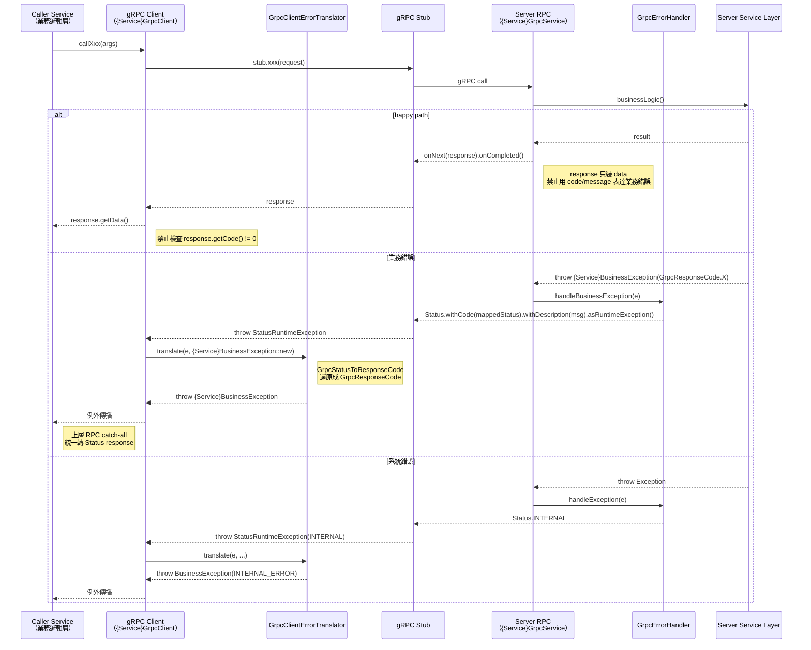

# Java gRPC 錯誤處理規範

> **適用範圍（2026-09-24 起）**：只適用遷移期間仍在運作的 Java 服務，Java 服務全部改寫成 Go 後（遷移計畫階段 B）退場（`docs/adr/2026-09-24-go-modular-monolith.md` D1）。


> **本文件為所有 Java 微服務 gRPC 錯誤處理的唯一規範**。新增或修改 RPC 方法時必須遵守。

---

## 1. 概述

### 1.1 目的

統一全 Java 微服務的 gRPC 錯誤處理機制，確保：

1. **參數錯誤回 400**（`INVALID_PARAM`），不是 500
2. **業務錯誤回正確業務碼**（如 7001 優惠券不存在），不被 catch-all 吞成 500
3. **系統錯誤回 500**（`INTERNAL_ERROR`），不洩漏內部實作細節
4. **錯誤訊息集中管理**，來自 `GrpcResponseCode.message()`

### 1.2 設計原則

| 原則 | 說明 |
|------|------|
| **集中處理** | catch-all 統一使用 `GrpcErrorHandler`（observability-common），禁止各服務自行組裝錯誤回應 |
| **業務異常完整捕獲** | 每個 RPC 方法必須捕獲它可能拋出的所有業務異常，不可遺漏 |
| **訊息不寫死** | 錯誤訊息來自 `GrpcResponseCode.message()`，禁止硬編碼字串 |
| **不洩漏內部細節** | catch-all 禁止回傳 `e.getMessage()`（可能含 SQL/堆疊） |
| **參數錯誤透傳** | `IllegalArgumentException` 的 `e.getMessage()` 可透傳（來自 CodeMetaValidator/ProtoConversionUtils 的結構化訊息） |

---

## 2. 錯誤碼體系

### 2.1 GrpcResponseCode（統一錯誤碼）

**位置**：`services/java/shared/common-core/src/main/java/io/github/will413028/hawkr/common/utils/code/GrpcResponseCode.java`

每個錯誤碼攜帶 `code`（整數）與 `message`（前端顯示值）。

### 2.2 錯誤碼規則

| 規則 | 說明 |
|------|------|
| **通用碼禁止重複定義** | 0, 400, 401, 403, 404, 409, 500, 503 所有服務共用，禁止各服務自創同語意的碼 |
| **業務碼按服務分段** | Order: 4001~4099, Cart: 6001~6099, Coupon: 7001~7099 |
| **業務碼僅限通用碼無法表達時使用** | 如「庫存不足」無法用 404 表達，才用 4001 |

### 2.3 通用錯誤碼

| 列舉值 | Code | Message |
|--------|:----:|---------|
| `SUCCESS` | 0 | 成功 |
| `INVALID_PARAM` | 400 | 參數錯誤 |
| `UNAUTHORIZED` | 401 | 未登入 |
| `PERMISSION_DENIED` | 403 | 無權操作 |
| `NOT_FOUND` | 404 | 資源不存在 |
| `CONFLICT` | 409 | 資源衝突 |
| `INTERNAL_ERROR` | 500 | 系統錯誤 |
| `SERVICE_UNAVAILABLE` | 503 | 服務暫時不可用 |

### 2.4 業務錯誤碼

#### Order（4001~4099）

| 列舉值 | Code | Message |
|--------|:----:|---------|
| `INSUFFICIENT_STOCK` | 4001 | 庫存不足 |
| `INVALID_STATUS` | 4002 | 狀態不允許此操作 |
| `CHECKOUT_EXPIRED` | 4006 | 結帳已過期 |
| `CHECKOUT_PRICE_CHANGED` | 4091 | 訂單金額已變動 |

#### Cart（6001~6099）

| 列舉值 | Code | Message |
|--------|:----:|---------|
| `CART_ITEM_NOT_FOUND` | 6001 | 找不到購物車項目 |
| `INVALID_SKU` | 6002 | 商品不存在或已下架 |
| `CART_ITEM_LOCKED` | 6003 | 商品處於結帳鎖定狀態 |
| `CHECKOUT_LOCK_FAILED` | 6005 | 結帳鎖定失敗 |

#### Coupon（7001~7099）

| 列舉值 | Code | Message |
|--------|:----:|---------|
| `COUPON_NOT_FOUND` | 7001 | 優惠券不存在 |
| `COUPON_EXPIRED` | 7002 | 優惠券已過期 |
| `COUPON_ALREADY_USED` | 7003 | 優惠券已使用 |
| `COUPON_NOT_APPLICABLE` | 7004 | 優惠券不適用 |
| `COUPON_QUOTA_EXCEEDED` | 7005 | 賣家優惠券配額已滿 |
| `COUPON_ISSUE_LIMIT_REACHED` | 7006 | 優惠券發行上限已達 |
| `COUPON_ALREADY_RECEIVED` | 7007 | 已領取過此優惠券 |
| `COUPON_RESERVE_FAILED` | 7008 | 優惠券鎖定失敗 |
| `COUPON_INVALID_STATUS` | 7009 | 優惠券狀態不允許此操作 |

### 2.5 新增錯誤碼流程

> 依 [CodeMeta 體系總覽](../代碼管理（CodeMeta）/README.md)（最高優先）：錯誤碼唯一真實來源為 [`docs/代碼管理（CodeMeta）/錯誤碼.md`](../代碼管理（CodeMeta）/錯誤碼.md)，**禁止**直接修改生成檔 `GrpcResponseCode.java`（手動新增的列舉值會被下次 `generate.sh` 覆蓋遺失）。

1. 確認通用碼無法表達此語意
2. 在 `docs/代碼管理（CodeMeta）/錯誤碼.md` 對應服務區塊新增條目（Name + code + message）
3. 執行 `cd docs/代碼管理（CodeMeta）/scripts && ./generate.sh --java` 生成 `GrpcResponseCode.java`
4. 編譯受影響模組（`common-core` + `observability-common` + 受影響微服務）驗證

---

### 2.6 越權回應策略（防枚舉）

存取**存在但不屬於自己**的敏感資源（ownership mismatch）時，回 `NOT_FOUND`(404) 而非 `PERMISSION_DENIED`(403)，且回應（code + message）必須與「資源不存在」**完全一致**，避免以 403 / 404 差異枚舉探測。最穩健做法：越權分支直接走該資源的 not-found 例外路徑（如 order 越權直接 `throw new OrderNotFoundException(orderNo)`）。完整 Tier A/B/C 界線與強制清單見 [API 設計規範 §14.1](./API%20設計規範.md)。純認證 / 角色門檻失敗仍回 401 / 403。

## 3. GrpcErrorHandler（集中錯誤處理工具）

**位置**：`services/java/shared/observability-common/src/main/java/io/github/will413028/hawkr/common/obs/grpc/GrpcErrorHandler.java`

### 3.1 方法

| 方法 | 用途 |
|------|------|
| `handleException(observer, builder, e, className, method)` | 系統錯誤碼預設 `INTERNAL_ERROR(500)` |
| `handleException(observer, builder, e, className, method, systemErrorCode)` | 指定系統錯誤碼 |

### 3.2 處理邏輯

```
Exception 進入
    ↓
1. StatusRuntimeException？ → 直接透傳（responseObserver.onError），return
    ↓
2. GrpcBusinessException？ → 業務碼 biz.code() + e.getMessage()（onNext，非 onError）
    ↓
3. IllegalArgumentException？ → INVALID_PARAM(400) + e.getMessage()
    ↓
4. 其他 Exception → systemErrorCode + systemErrorCode.message()（不洩漏 e.getMessage()）
```

### 3.3 日誌機制

使用 SLF4J Logger + MDC event 欄位，與 `ObsLogger` 格式一致，供 Grafana 查詢：
- 業務異常：event = `{className}.{method}.businessError`（WARN）
- 參數錯誤：event = `{className}.{method}.invalidParam`（WARN）
- 系統錯誤：event = `{className}.{method}.error`（ERROR，帶完整堆疊）

**businessError 日誌內容規則（強制）**：`businessError` 分支**必須印出 exception 類別名稱**（`e.getClass().getSimpleName()`）+ message；當業務異常**帶 cause**（`getCause() != null`，即包裝了下游真實失敗）時，**必須一併帶 cause/stack**（`logger.warn(msg, e)`）。純業務拒絕（無 cause，如 `CANCEL_DUPLICATE`）不印 stack，避免常規流程刷 noise。

> 教訓：曾發生 `businessError` 只印 `e.getMessage()`，當 `GrpcResponseCode` 模板無 `%s` 佔位符時（如 `INTERNAL_ERROR("系統錯誤")`），throw site 傳入的 detail 被 `formatMessage` 的 `String.format` 靜默丟棄 → log 只剩「系統錯誤」、無 cause，root cause 無法定位。throw 業務異常代表「下游真實失敗」時，detail 必須能進 message 或 cause，**禁止**傳給無佔位符模板（會被丟棄）。

> **實作位置**：本規則要求修改 `services/java/shared/observability-common/src/main/java/io/github/will413028/hawkr/common/obs/grpc/GrpcErrorHandler.java`（現行 `businessError` 分支只有 `logger.warn(e.getMessage())`，需改為印 class name + 條件帶 cause/stack）。此為共用元件，修改後全 Java 服務一致生效。

### 3.4 使用方式

```java
} catch (Exception e) {
    GrpcErrorHandler.handleException(responseObserver, XxxResponse.newBuilder(),
            e, "CouponGrpcService", "sellerCreateTemplateAndIssue");
}
```

---

## 4. 統一 catch 層級順序（強制）

每個 RPC 方法的 try-catch **必須**按以下順序排列：

```java
try {
    // 業務邏輯
} catch ({Service}BusinessException e) {     // 1. 業務異常 → 業務錯誤碼
    responseObserver.onNext(XxxResponse.newBuilder()
            .setCode(e.code())
            .setMessage(e.getMessage())
            .build());
    responseObserver.onCompleted();
} catch (Exception e) {                      // 2. catch-all → GrpcErrorHandler
    GrpcErrorHandler.handleException(responseObserver, XxxResponse.newBuilder(),
            e, "ClassName", "methodName");
}
```

`GrpcErrorHandler` 內部自動處理：
- `StatusRuntimeException` → 透傳
- `IllegalArgumentException` → 400 參數錯誤
- 其他 → 500 系統錯誤

### 4.1 業務異常完整性規則（強制）

每個 RPC 方法**必須捕獲**它呼叫的 Service 層方法可能拋出的**所有業務異常**。

| 規則 | 說明 |
|------|------|
| 新增 RPC 時 | 檢查 Service 方法的 `throw` 語句，確認每種異常都有對應 catch |
| 修改 Service 時 | 如新增 `throw`，同步更新呼叫方的 catch |
| 遺漏的結果 | 業務異常落入 catch-all → 被當作系統錯誤回 500 → 前端無法判斷具體原因 |

### 4.2 各服務業務異常類別

| 服務 | 異常類別 | 攜帶 |
|------|---------|------|
| Order | `OrderNotFoundException`, `InvalidStatusException`, `InsufficientStockException`, `CheckoutExpiredException`, `CheckoutPriceChangedException` | 固定語意 |
| Cart | `CartBusinessException` | `GrpcResponseCode` |
| Coupon | `CouponBusinessException` | `GrpcResponseCode` |
| Shipping | `ShippingBusinessException` | `GrpcResponseCode` |
| Media | `MediaServiceException` | gRPC Status Code |
| Product | `ProductNotFoundException`, `ProductAccessDeniedException`, `IdempotencyConflictException` | 固定語意 |
| Payment | `IllegalStateException`, `DataIntegrityViolationException` | Java 內建 |

---

## 5. 禁止事項

| 禁止行為 | 正確做法 |
|---------|---------|
| catch-all 回傳 `e.getMessage()` | 使用 `GrpcErrorHandler`（自動隱藏系統錯誤細節） |
| catch-all 硬編碼 `"系統錯誤"` 字串 | 由 `GrpcErrorHandler` 使用 `GrpcResponseCode.message()` |
| 各服務自建錯誤處理 helper | 統一使用 `GrpcErrorHandler` |
| 業務異常被 catch-all 吞掉 | 在 catch-all 之前捕獲所有業務異常 |
| 通用碼語意重複定義（如自建 5000 代替 500） | 使用通用碼 |
| Service 層用 `RuntimeException` 表達業務錯誤 | 建立 `{Service}BusinessException` 攜帶 `GrpcResponseCode` |
| 新增 RPC 不加錯誤處理 | catch-all 必須使用 `GrpcErrorHandler` |

---

## 6. 新增 RPC 方法檢查清單（Server 端）

| # | 檢查項目 |
|---|---------|
| 1 | 列出 Service 層方法可能拋出的所有業務異常 |
| 2 | 每種業務異常都有對應的 catch block，在 catch-all 之前 |
| 3 | catch-all `Exception` 使用 `GrpcErrorHandler.handleException()` |
| 4 | 不硬編碼錯誤訊息字串，使用 `GrpcResponseCode.message()` 或 `e.getMessage()` |
| 5 | 不回傳系統錯誤的 `e.getMessage()` 給前端 |
| 6 | 使用 `GrpcResponseCode` 的通用碼，不自創重複碼 |

---

## 7. gRPC Client 端錯誤處理（2026-04-08 新增）

### 7.0 ⚠️ 現狀澄清與適用順序（2026-06-24 更新，最高優先）

> 本節為 §7.1–§7.9（2026-04-08 規劃的 StatusRuntimeException 遷移）的**現狀修正**。當本節與 §7.2–§7.9 衝突時，**一律以本節為準**，直到全系統遷移完成。

**現狀事實**（以實際強制執行的系統為準，不以規範文字為準）：

- §7.2 規劃的「業務錯誤一律走 `StatusRuntimeException`、Client 禁止檢查 envelope code」**從未落地**：
  - Server 端 catch-all 核心 `GrpcErrorHandler`（observability-common）對 `GrpcBusinessException` 仍是 `setCode(biz.code()) + onNext`（envelope-code），**不是** `Status.asRuntimeException()`。
  - coupon / payment / order / aftersales 等核心服務**全部 RPC** 業務錯誤皆走 envelope-code（`onNext` with `code≠0`）。
  - §7.6 的 `GrpcClientErrorTranslator` 僅少數對 media 的呼叫採用。
- §7.9 的 migration 清單（2026-04-08）**未執行完成**，且 server 端基礎（GrpcErrorHandler）未改，遷移實質爛尾。

**現行實際約定（envelope-code 模式，遷移完成前一律適用）**：

| 角色 | 規則 |
|---|---|
| **Server 端** | 業務錯誤經 `GrpcErrorHandler` 以 `code≠0 + message` 回 `onNext`（envelope-code）。只有 `StatusRuntimeException`（下游不可達 / 權限）才 `onError` 透傳。 |
| **Client 端（強制）** | 呼叫**寫入型 RPC**（grant / create / refund / ack / deduct / reserve / cancel 等會改變狀態或觸發業務動作者）後，**必須**檢查 `resp.getCode()`；非 `SUCCESS(0)` 時**禁止**使用 `resp.getData()` 推進本地狀態機。純查詢型 RPC（get / list / batchGet）可不檢查（拿到空 data 不致狀態錯誤），但建議一併檢查。 |

**Client 端 envelope-code 失敗後的動作**（依「此前是否有不可逆跨服務動作」分類）：

| 情境 | 失敗動作 | 範例 |
|---|---|---|
| **無不可逆前置**（本地事務內、尚未觸發跨服務不可逆變更） | `throw {Service}BusinessException`（透傳下游 code / message）→ `@Transactional` rollback，本地狀態保持原樣，使用者可重試 | aftersales `handleCouponCompensation`（發券失敗不關案）、`handleReturnRefund`（建單失敗不標 RETURN_PENDING） |
| **有不可逆前置**（上游已 commit 不可逆動作，rollback 會造成跨服務不一致） | **不 throw**：走補償 / 重試 / 終態持久化，**禁止假裝成功推進終態** | order `AutoRefundWorker`（createRefund 失敗 → 不標 DONE，走 retry → MANUAL_INTERVENTION）、aftersales `createRefundTask`（ATM 預建失敗 → 終態 FAILED 持久化 PayUni 原話，case 樂觀推進，見 09 號設計書 §2.3.1） |

**正確 / 錯誤範例**：

```java
// ✅ 正確（envelope-code 現行約定）：寫入型 RPC 後檢查 code
GrantSellerCompensationCouponResponse resp = couponGrpcClient.grantSellerCompensationCoupon(...);
if (resp.getCode() != GrpcResponseCode.SUCCESS.code()) {
    // 無不可逆前置 → throw 透傳下游訊息，@Transactional rollback，不關案
    throw new AfterSalesBusinessException(GrpcResponseCode.AFTERSALE_COUPON_COMPENSATION_FAILED, resp.getMessage());
}
String templateId = resp.getData().getTemplateId();  // 確認成功後才安全取用

// ❌ 錯誤（本 bug #1150 root cause）：誤信「失敗會拋 StatusRuntimeException」，不檢查 code 直接用 data
var resp = couponGrpcClient.grantSellerCompensationCoupon(...);
String templateId = resp.getData().getTemplateId();  // code≠0 時 data 為空 → 假成功關案，買家無券
```

> **§7.1–§7.9 何時恢復適用**：待 server 端 `GrpcErrorHandler` 改為業務錯誤拋 `Status.asRuntimeException()` + 全服務 client 改用 `GrpcClientErrorTranslator` 的**獨立遷移**完成後，本節失效、§7.2 恢復為唯一約定。該遷移為獨立工程，**不得與業務修復混做**（避免半遷移造成 envelope-code 與 Status 並存的更大不一致）。


### 7.1 背景與問題

本節為補充章節，處理**呼叫端**（gRPC Client）對錯誤回應的統一處理方式。上輪規範僅涵蓋 Server 端 RPC 方法，未規範 Client 端如何處理被呼叫服務的錯誤回應，導致 5 個微服務出現大量「envelope code 反模式 + RuntimeException 包裝」漏網 —— 2026-04-08 清查時共計 21 處 envelope code 檢查 + 11 處 Client RuntimeException 拋出。

### 7.2 唯一管道原則

**gRPC 業務錯誤一律透過 `StatusRuntimeException` 傳遞，禁止使用 response envelope `code/message` 欄位表達業務錯誤。**

#### 7.2.1 權威時序圖（所有設計書引用此圖，不再個別繪製）

> ⚠️ **本圖描述 StatusRuntimeException 模式為未落地目標**（見 §7.0）。**現行實作為 envelope-code 模式**：圖中「Client 禁止檢查 response.getCode()」與「Server 禁止 code/message 表達業務錯誤」**現階段不適用**，現行約定以 §7.0 為準（寫入型 RPC 必須檢查 code）。本圖待全系統遷移完成後恢復適用。



**禁止事項**（圖中已視覺化，列為強制條款）：
- ❌ Server 端 `response.setCode(非零).setMessage(...).build()` 表達業務錯誤
- ❌ Client 端 `if (response.getCode() != 0) throw ...`
- ❌ Client 端 `throw new RuntimeException("...")` 包裝業務錯誤
- ❌ Server 端新增 Response message 帶 `code/message/success` 欄位

**所有微服務設計書內的 sequence diagram 不再個別繪製 gRPC client error path**，統一引用本圖。設計書內 happy path 仍須繪製，但 error 分支只需註記「依規範 §7.2.1」。

| 傳遞方式 | Server 端動作 | Client 端動作 |
|---|---|---|
| **業務錯誤** | 拋出 `{Service}BusinessException` → `GrpcErrorHandler` 轉為 `Status.withCode(...).withDescription(...).asRuntimeException()` | 接到 `StatusRuntimeException`，從 `Status.getCode()` 判斷錯誤類型 |
| **系統錯誤** | 拋出 `Exception` → `GrpcErrorHandler` 轉為 `Status.INTERNAL` | 同上 |
| **業務成功** | `responseObserver.onNext(response).onCompleted()` | 直接讀取 `response.getData()`，**不檢查 envelope code** |

### 7.3 Response Proto envelope 欄位規則

| 情境 | envelope code/message |
|---|---|
| **舊 Response** 保留 `code/message` 欄位 | 業務成功時 `code=0`；**禁止**業務錯誤時 `code≠0` —— 業務錯誤必須由 `StatusRuntimeException` 承擔 |
| **新增 Response** | **禁止**新增 `code/message/success` 等 envelope 欄位；response 只裝 data |

### 7.4 Server 端修正要求

任何 Service 層（或 RPC 方法內部）**禁止**以 `response.setCode(非零).setMessage(...).build()` 的方式回傳業務錯誤。正確做法：

```java
// ❌ 錯誤：業務錯誤塞進 response envelope
if (!valid) {
    responseObserver.onNext(ValidateCouponResponse.newBuilder()
            .setCode(7009)
            .setMessage("優惠券狀態不允許此操作")
            .build());
    responseObserver.onCompleted();
    return;
}

// ✅ 正確：直接拋業務異常，讓 GrpcErrorHandler 統一處理
if (!valid) {
    throw new CouponBusinessException(GrpcResponseCode.COUPON_INVALID_STATUS);
}
```

### 7.5 Client 端修正要求

任何 gRPC Client（例如 `CheckoutCouponGrpcClient`、`ProductGrpcClient`、`MediaGrpcClient` 等）：

```java
// ❌ 錯誤：envelope code 檢查 + RuntimeException
ValidateCouponResponse response = couponStub.validateCoupon(request);
if (response.getCode() != 0) {
    throw new RuntimeException("Coupon Service 回傳錯誤，code=" + response.getCode()
            + ", message=" + response.getMessage());
}
return response.getData();

// ✅ 正確：直接呼叫，讓 StatusRuntimeException 自動傳播
try {
    ValidateCouponResponse response = couponStub.validateCoupon(request);
    return response.getData();
} catch (StatusRuntimeException e) {
    // 轉換為本服務的業務異常，供上層 catch
    throw GrpcClientErrorTranslator.translate(e, OrderBusinessException::new);
}
```

**原則**：
- Client 端**禁止**檢查 `response.getCode() != 0`
- Client 端**禁止**拋 `new RuntimeException(...)` 包裝業務錯誤
- Client 端**必須**捕獲 `StatusRuntimeException` 並轉換為本服務的業務異常（讓本服務的 RPC catch-all 捕獲）
- 若 Client 位於非 RPC 入口（例如 Scheduler / MQ Consumer），可讓 `StatusRuntimeException` 自然傳播至 Worker 層的重試機制

### 7.6 GrpcStatusToResponseCode + GrpcClientErrorTranslator（common-core 新增）

#### 7.6.1 背景：現存三種寫法不一致

grep 全部 `catch (StatusRuntimeException e)` 結果，目前有 3 種互不一致的寫法：

| 寫法 | 範例 | 問題 |
|---|---|---|
| **A** 全部當服務不可用 | `CartService.java:63` → `throw new CartBusinessException(SERVICE_UNAVAILABLE)` | 損失資訊（不知道是 NOT_FOUND 還是 PERMISSION_DENIED） |
| **B** 手寫 if 判斷部分 status | `OrderGrpcService.java:208` 三行 if 判斷 UNAUTHENTICATED/PERMISSION_DENIED | 漏掉其他 status code，重複貼到多個方法 |
| **C** 沒 catch，envelope code 路徑 | `CheckoutCouponGrpcClient.java:50` → `throw RuntimeException` | 業務錯誤被當系統錯誤回 500 |

統一作法：**新增 helper 把 gRPC `Status.Code` 轉為 `GrpcResponseCode`**，所有 client 一律呼叫此 helper。

#### 7.6.2 GrpcStatusToResponseCode（common-core 新增）

**位置**：`services/java/shared/common-core/src/main/java/io/github/will413028/hawkr/common/utils/grpc/GrpcStatusToResponseCode.java`（新增）

```java
public final class GrpcStatusToResponseCode {

    private GrpcStatusToResponseCode() {}

    /**
     * 將 gRPC Status.Code 轉換為內部 GrpcResponseCode
     *
     * 對應規則參考 gRPC 官方規範：
     * https://grpc.io/docs/guides/error/
     */
    public static GrpcResponseCode map(io.grpc.Status.Code grpcCode) {
        return switch (grpcCode) {
            case OK -> GrpcResponseCode.SUCCESS;
            case INVALID_ARGUMENT, OUT_OF_RANGE -> GrpcResponseCode.INVALID_PARAM;
            case NOT_FOUND -> GrpcResponseCode.NOT_FOUND;
            case ALREADY_EXISTS, FAILED_PRECONDITION, ABORTED -> GrpcResponseCode.CONFLICT;
            case UNAUTHENTICATED -> GrpcResponseCode.UNAUTHORIZED;
            case PERMISSION_DENIED -> GrpcResponseCode.PERMISSION_DENIED;
            case UNAVAILABLE, DEADLINE_EXCEEDED -> GrpcResponseCode.SERVICE_UNAVAILABLE;
            // INTERNAL, UNKNOWN, DATA_LOSS, RESOURCE_EXHAUSTED, UNIMPLEMENTED, CANCELLED
            default -> GrpcResponseCode.INTERNAL_ERROR;
        };
    }
}
```

#### 7.6.3 GrpcClientErrorTranslator（common-core 新增）

**位置**：`services/java/shared/common-core/src/main/java/io/github/will413028/hawkr/common/utils/grpc/GrpcClientErrorTranslator.java`（新增）

```java
public final class GrpcClientErrorTranslator {

    private GrpcClientErrorTranslator() {}

    /**
     * 將 StatusRuntimeException 轉換為本服務的業務異常
     *
     * @param e                gRPC StatusRuntimeException
     * @param exceptionFactory 本服務業務異常建構子（必須提供 (GrpcResponseCode, String) 建構子）
     * @return 對應的業務異常
     */
    public static <T extends RuntimeException> T translate(
            io.grpc.StatusRuntimeException e,
            java.util.function.BiFunction<GrpcResponseCode, String, T> exceptionFactory) {
        io.grpc.Status status = e.getStatus();
        GrpcResponseCode code = GrpcStatusToResponseCode.map(status.getCode());
        String description = status.getDescription() != null ? status.getDescription() : code.message();
        return exceptionFactory.apply(code, description);
    }
}
```

#### 7.6.4 各服務 BusinessException 建構子規範（強制）

為了讓 `GrpcClientErrorTranslator.translate()` 能用 method reference（`OrderBusinessException::new`），**所有服務的 `*BusinessException` 必須提供 `(GrpcResponseCode code, String message)` 建構子**。

| 服務 | 類別 | 必要建構子 |
|---|---|---|
| order | `OrderBusinessException` | `(GrpcResponseCode, String)` |
| cart | `CartBusinessException` | `(GrpcResponseCode, String)` |
| coupon | `CouponBusinessException` | `(GrpcResponseCode, String)` |
| shipping | `ShippingBusinessException` | `(GrpcResponseCode, String)` |
| product | `ProductBusinessException`（若無，新增） | `(GrpcResponseCode, String)` |
| aftersales | `AfterSalesBusinessException`（若無，新增） | `(GrpcResponseCode, String)` |
| media | `MediaServiceException` 或新增 `MediaBusinessException` | `(GrpcResponseCode, String)` |
| payment | 新增 `PaymentBusinessException` | `(GrpcResponseCode, String)` |

新增/補齊建構子時，原有 `(GrpcResponseCode)` 等較簡的建構子可保留（單參數預設帶 `code.message()`）。

#### 7.6.5 使用範例

```java
// Client 端
try {
    ValidateCouponResponse response = couponStub.validateCoupon(request);
    return response.getData();
} catch (StatusRuntimeException e) {
    throw GrpcClientErrorTranslator.translate(e, OrderBusinessException::new);
}
```

### 7.7 禁止事項（Client 端）

| 禁止行為 | 正確做法 |
|---|---|
| 檢查 `response.getCode() != 0` | 直接呼叫 stub，讓 `StatusRuntimeException` 傳播 |
| `throw new RuntimeException("... " + response.getMessage())` | `catch (StatusRuntimeException)` + `GrpcClientErrorTranslator.translate(...)` |
| Client 自行 log + swallow 例外 | 透傳例外，由 Worker/RPC catch-all 集中處理 |
| 判斷 `response.hasData()` / `response.getSuccess()` 當作錯誤訊號 | 同上，僅用於確認 data 欄位存在性，業務失敗訊號一律走 Status |
| 在 Scheduler 或 Consumer 使用 `RuntimeException` 包裝 gRPC 錯誤 | 讓 `StatusRuntimeException` 傳播，由 Worker 層的重試機制捕獲 |

### 7.8 Migration 檢查清單

每個 Client 改寫後必須滿足：

- [ ] 無 `response.getCode() != 0` 檢查
- [ ] 無 `throw new RuntimeException` 包裝業務錯誤
- [ ] `StatusRuntimeException` 被正確 catch 或透傳
- [ ] 呼叫端 Service 層或 RPC catch-all 能處理 translate 後的業務異常

### 7.9 Migration 進度追蹤

各服務 Client 改寫進度：

| 服務 | 現存違規處數（2026-04-08） | 檔案 |
|---|---:|---|
| order-service | 8（envelope code）+ 5（RuntimeException） | `grpc/client/*GrpcClient.java` × 3、`checkout/client/*GrpcClient.java` × 2、`checkout/CheckoutService.java`、`checkout/ShippingFeeCacheClient.java`、`grpc/OrderGrpcService.java` |
| aftersales-service | 8（envelope code） | `grpc/AfterSalesGrpcService.java`、`service/AfterSaleResolutionService.java`、`service/AfterSaleCaseService.java`、`service/RefundPageService.java`、`service/SellerCancelService.java` |
| coupon-service | 1 | `grpc/client/AccountGrpcClient.java` |
| product-service | 1（envelope code）+ 2（RuntimeException） | `grpc/ProductGrpcService.java`、`grpc/client/*GrpcClient.java` |
| shipping-service | 3（envelope code）+ 4（RuntimeException） | `service/OnboardingService.java`、`service/ShippingService.java`、`client/MediaGrpcClient.java` |

---

## 8. 完整檢查清單（Server + Client）

新增或修改 gRPC 方法時的完整檢查：

### Server 端
- [ ] 每個業務異常都有獨立 catch，在 catch-all 之前
- [ ] catch-all 使用 `GrpcErrorHandler.handleException()`
- [ ] **禁止**以 `response.setCode(非零)` 表達業務錯誤
- [ ] 不硬編碼錯誤訊息
- [ ] 不洩漏系統錯誤 `e.getMessage()`

### Client 端

> ⚠️ 以下依 **§7.0 現行 envelope-code 約定**（最高優先）。§7.2+ 的 StatusRuntimeException 規則待遷移完成後才適用。

- [ ] 呼叫**寫入型 RPC**（grant / create / refund / ack / deduct 等）後**必須**檢查 `resp.getCode() != GrpcResponseCode.SUCCESS.code()`
- [ ] code 非成功時**禁止**使用 `resp.getData()` 推進本地狀態機（關案 / 標狀態 / 標 task 終態 / 發 MQ）
- [ ] 失敗動作依 §7.0「有 / 無不可逆前置」分類：無前置 → `throw` 透傳下游 code/message（rollback）；有前置 → 補償 / 重試 / 終態持久化，不假裝成功
- [ ] **禁止**`throw new RuntimeException` 包裝業務錯誤（用 `{Service}BusinessException`）
- [ ] **禁止**殘留「下游失敗會拋 StatusRuntimeException」的誤導註解（現行業務失敗走 envelope-code）
