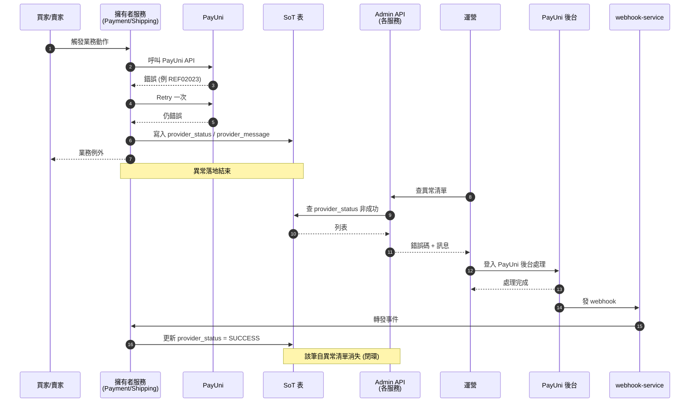

# PayUni 錯誤回應收斂規範

> **本文件為所有微服務處理 PayUni（第三方）API 回應的唯一規範**。凡呼叫 PayUni HTTP API、接收 PayUni Webhook、或在 Order / AfterSales 等聚合服務向前端輸出 PayUni 狀態的場景，皆須遵守。

---

## 1. 概述

### 1.1 目的

統一全專案對 PayUni 錯誤回應（Status code + Message）的處理，確保：

1. **每個呼叫點都接收、儲存、透傳** PayUni 原始狀態與訊息（現存呼叫點與修正項見 [§9 現況修正對照表](#9-現況修正對照表)）
2. **平台業務碼**與 **PayUni 原始碼**在 schema / proto / API 回應中語意清楚分離
3. **前端可拿到第三方錯誤細節**以進行分類 UX（例：買家輸入錯 → 回填表頁；系統錯 → 人工介入）
4. **跨服務 snapshot** 不破壞 single source of truth
5. **state 表與 log 表職責分離**，避免把歷史資訊塞進狀態欄位
6. **完整閉環**：異常 → 落地 → Admin 可見 → PayUni 後台處理 → webhook 回流 → 自動恢復（見 [§8.4 人工介入閉環](#84-人工介入閉環)）

與既有規範的關係：

- Envelope 結構遵循 [API 設計規範 §十二（統一回應格式）](./API%20設計規範.md)
- Proto 型別規則遵循 [Proto 管理規範](./Proto%20管理規範.md) 與 [Java 微服務開發規範 §2（型別對應）](./Java%20微服務開發規範.md)
- gRPC 錯誤處理遵循 [Java gRPC 錯誤處理規範](./Java%20gRPC%20錯誤處理規範.md) 與 [Go gRPC 錯誤處理規範](./Go%20gRPC%20錯誤處理規範.md)

### 1.2 三層語意分離（核心原則）

所有 PayUni 相關欄位必須明確屬於以下三層之一：

| 層 | 欄位命名前綴 | 語意 | 擁有者 | 典型例子 |
|---|---|---|---|---|
| **平台層** | 無前綴（`status` / `order_status` / `case_status`）| 我們平台業務狀態機，使用 CodeMeta | 各聚合服務 | `orders.status`、`aftersales_cases.status` |
| **Provider SoT 層** | `provider_*` | PayUni 原始狀態碼與訊息的**唯一真實來源** | 擁有該 PayUni 操作的服務 | `payment_transactions.provider_status`、`shipments.provider_status` |
| **Provider Snapshot 層** | `payuni_*` | 跨服務 event-driven 快照，**非 SoT** | 訂閱 event 的服務 | `refund_tasks.payuni_status` |

**三層不可混用**。讀 schema 名稱就要能知道欄位所屬層級。

---

## 2. 欄位命名規範

### 2.1 前綴強制規則

| 場景 | 前綴 | 禁止 |
|---|---|---|
| 平台業務狀態碼（CodeMeta） | 不加前綴 | 不得用 `provider_*` / `payuni_*` 命名 |
| PayUni 呼叫結果 SoT（擁有者服務） | `provider_*` | 不得使用 `set_status`、`status_desc`、`third_party_*`、`vendor_*` 等雜名 |
| 跨服務 event snapshot（非擁有者服務） | `payuni_*` | 不得使用 `provider_*`（會與 SoT 層混淆）|

### 2.2 標準欄位型別

| 欄位 | 型別 | 說明 |
|---|---|---|
| `provider_status` / `payuni_status` | `VARCHAR(20)` | PayUni 錯誤碼可達 10+ 字元（例：`REF02023`、`CLOSE02005`），預留寬度 |
| `provider_message` / `payuni_message` | `TEXT` | 不可 `VARCHAR(N)`，避免截斷 |

**禁止**：`VARCHAR(4)` / `VARCHAR(10)` / `VARCHAR(200)` 等截斷風險寬度。

### 2.3 保留字段示範

| 情境 | 正確 | 錯誤 | 理由 |
|---|---|---|---|
| 退款 PayUni 狀態（SoT）| `payment_refunds.provider_status` | ~~`payment_refunds.payuni_code`~~、~~`payment_refunds.refund_result`~~ | SoT 層強制 `provider_*` 前綴 |
| 物流 PayUni 狀態（SoT） | `shipments.provider_status` | ~~`shipments.provider_status_desc`~~、~~`set_status`~~ | `desc` 命名語意不清、`set_status` 無 `provider_` 前綴 |
| 建店 PayUni 狀態（SoT） | `seller_shipment_settings.provider_status` | ~~`set_status`~~ | 同上，歷史遺留需改名 |
| AfterSales 退款 snapshot | `refund_tasks.payuni_status` | ~~`refund_tasks.provider_status`~~ | AfterSales 非 SoT，用 `payuni_*` 區別 |
| 平台業務狀態 | `orders.status`、`aftersales_cases.status` | ~~`orders.provider_status`~~ | 平台層不加前綴 |
| 聚合 API 回應 DTO | `data.providerStatus`、`data.providerMessage` | ~~`data.payuniStatus`~~ | 聚合服務對外用 SoT 語意（最終可信來源）|
| 撥款專屬（Admin only） | `payment_transactions.grant_status`、`grant_message`、`granted_at` | — | 不用 `provider_*`;見 [§6.2](#62-依平台狀態決定-provider-取源) |

---

## 3. 欄位設計原則（狀態 vs 歷史）

### 3.1 一條原則

> **一張表的一列 = 一個實體「當下的狀態」。歷史去 log 表，不要塞主表。**

### 3.2 欄位新增決策清單

新增欄位前，依序檢查：

| # | 問題 | 通過 | 否 |
|---|---|---|---|
| 1 | 這個值能從其他欄位 + 狀態機推導嗎？ | ❌ 不加 | 繼續 |
| 2 | 這是歷史事件還是當下狀態？ | 歷史 → log 表，不加 | 當下狀態 → 繼續 |
| 3 | 這個時間戳能被 `updated_at` 涵蓋嗎？ | ❌ 不加 | 是里程碑 → 加 |
| 4 | 加了後有明確的 API 查詢或業務邏輯使用場景嗎？ | ❌ 不加 | 加 |

### 3.3 禁止的欄位模式（反面教材）

下列欄位**禁止**新增到 state 表，屬於 log 的職責：

| 禁止欄位 | 為什麼禁 | 正解 |
|---|---|---|
| `*_error_code` / `*_error_message` | 冗餘，`provider_status` + 平台 `status` 已表達 | 刪除，依平台 `status` 判斷是否處於錯誤狀態 |
| `*_error_at` | `updated_at` 已涵蓋 | 要完整時間軸去 log 表 |
| `*_error_type`（`TRANSIENT` / `PERMANENT`）| 人為分類，非 PayUni 真實欄位 | PayUni 錯誤碼本身就是分類依據 |
| `retry_count` / `next_retry_at`（在 state 表） | state 表只記當下狀態，retry 屬 orchestration 語意；task 表仍允許（見 [§8.2](#82-state-表-vs-task-表的欄位規範)）| 人工介入看 `provider_status` 判斷；自動重試歸 task 表 |
| `payuni_refund_status`（與 `payuni_status` 並存） | 狀態機排除同步成功 + 非同步失敗的並存場景 | 單一 `payuni_status` + 任務狀態機判斷階段 |
| `payuni_updated_at`（與 `updated_at` 並存） | 若 row 僅因 PayUni 事件更新，`updated_at` 已足夠 | 刪除 |

### 3.4 允許的里程碑時間戳

以下時間戳**可保留**，因為是穩定的業務里程碑、不可被 `updated_at` 取代：

| 欄位 | 理由 |
|---|---|
| `paid_at` / `refunded_at` / `granted_at` | 成功完成時間，用於前端顯示與報表；row 之後可能因其他原因更新，里程碑必須凍結 |
| `provider_create_at` / `provider_paid_at` | PayUni 回報的真實交易時間（與我們系統時間不同）|
| `provider_status_time` | PayUni 回報的狀態發生時間（對應 webhook `StatusTime`），與 `updated_at`（我們寫入時間）並存無衝突 |

---

## 4. DB Schema 規範

### 4.1 Provider SoT 表最小欄位集

擁有 PayUni 呼叫的服務，其 SoT 表**至少**須具備：

```sql
provider_status  VARCHAR(20)  -- PayUni 原始狀態碼
provider_message TEXT         -- PayUni 原始訊息
```

**不得新增的衍生欄位見 [§3.3 禁止的欄位模式](#33-禁止的欄位模式反面教材)**（包含 `*_error_*`、`raw_payload` 等）。若 SoT 表另有獨立 PayUni 操作（例：撥款 `grant_*`），仍遵循三層語意與 §3.2 決策清單判斷。

SoT 表**可另外**保存 PayUni 回報的狀態發生時間（例如 `provider_status_time` 對應 PayUni webhook 的 `StatusTime`）。這類欄位屬於 §3.4 所述的 PayUni 里程碑時間戳（跟 `provider_paid_at` 同性質），不同於我們系統的 `updated_at`，保留有 debug / 稽核價值，不受禁止。

### 4.2 Snapshot 表最小欄位集

訂閱 event 的服務若需快照，**至少**須具備：

```sql
payuni_status  VARCHAR(20)  -- event payload 的 PayUni 狀態碼
payuni_message TEXT         -- event payload 的 PayUni 訊息
```

**額外規則**：
- 欄位註解必須明記「本表非 SoT，SoT 在 `<owner_service>.<owner_table>`」
- 若 event 未送達 / 遺失，容忍 snapshot 與 SoT 之間的短期 drift（非即時同步）

### 4.3 Log 表的職責

PayUni 原始 payload、完整請求/回應、重試過程等歷史資訊，**一律放 log 表**：

| 服務 | Log 表 | 承載內容 |
|---|---|---|
| Payment | `payment_logs` | 狀態變更、衝突、webhook、手動介入等事件序列 |
| Payment | `payment_webhooks` | PayUni webhook 原始加密/解密 payload |
| Shipping | `shipment_status_logs` | 物流狀態變更歷史 + raw webhook payload |
| Shipping | `seller_shipment_onboarding_logs` | 建店 request/response snapshot（JSONB）|
| PayUni Webhook | `webhook_inbox` | 第一落地點，原始 envelope + decrypted JSONB |

### 4.4 單一狀態欄位的雙階段寫入規則

當 PayUni 流程同時含**同步 API + 非同步 webhook** 兩階段（典型：ATM 退款），單一 `provider_status` / `payuni_status` 欄位的寫入值來源依階段決定：

| 階段 | 寫入值來源 | 範例值 |
|---|---|---|
| 同步 API response | PayUni response 的 `Status`（可含豐富錯誤碼）| `SUCCESS` / `REF02023` / `CLOSE02005` |
| 非同步 webhook | webhook **內層業務狀態欄位**（例：ATM webhook 的 `RefundStatus`）| `1` / `2` |

**不寫 webhook outer Status**：它只代表「PayUni 通知是否成功送達」，是通知傳遞層訊號，對業務決策無意義，不佔用 `provider_status` / `payuni_status` 欄位。

**當下階段由平台狀態機判定**：各服務依業務需要自定義狀態（例：`PENDING` / `PROCESSING` / `COMPLETED` / `FAILED`，或更細分如 `AWAITING_WEBHOOK` / `AWAITING_BUYER_RESUBMISSION`）。consumer / API 讀取 `payuni_status` 時，搭配當下平台狀態詮釋值的語意。規範不規定具體狀態命名，由各服務詳細設計書定義。

**典型範例**（以通用狀態名示意，實際命名見各服務設計書）：

| 情境 | 平台狀態（示意）| `payuni_status` 值 | 代表 |
|---|---|---|---|
| 信用卡退款成功 | `COMPLETED` | `SUCCESS` | PayUni 同步回成功 |
| 信用卡退款失敗（retry 後仍失敗）| `FAILED`（升級異常）| `REF02023` 等錯誤碼 | PayUni 同步錯誤碼，進 Admin 異常清單 |
| ATM 同步受理中 | `PROCESSING` 或 `AWAITING_WEBHOOK` | `SUCCESS` | 同步已接收，等 webhook |
| ATM 同步失敗 | 保持 `PENDING` 或 `AWAITING_BUYER_RESUBMISSION` | `REF02023` 等 | 讓買家重填，不升級異常 |
| ATM 非同步成功 | `COMPLETED` | `1` | webhook RefundStatus=1 |
| ATM 非同步失敗 | `FAILED`（升級異常）| `2` | 銀行退件等，進 Admin 異常清單 |

**不新增 `provider_refund_status` / `payuni_refund_status` 等分層欄位**：單一欄位 + 平台狀態機足以表達「當下最重要的 PayUni 值」；outer Status 本身無業務意義，不落地保留。

---

## 5. Proto / MQ Event 規範

### 5.1 Proto 欄位

所有 PayUni 相關 gRPC 訊息必須包含 `provider_status` + `provider_message`（對應 SoT）或 `payuni_status` + `payuni_message`（對應 snapshot）。

依照 [Proto 管理規範](./Proto%20管理規範.md)，型別仍為 `string`：

```protobuf
message PaymentDetail {
    // ... 平台欄位 ...
    string provider_status  = 20;  // PayUni 原始狀態碼
    string provider_message = 21;  // PayUni 原始訊息
}

message ShipmentDetail {
    string provider_status  = 10;
    string provider_message = 11;
}
```

### 5.2 MQ Event Payload

微服務之間的事件 payload 若供下游做分類決策，必須帶 `payuni_status` + `payuni_message`：

```protobuf
message PaymentRefundResultEvent {
    string refund_no      = 1;
    string status         = 2;  // 平台狀態
    string payuni_status  = 10; // PayUni 原始
    string payuni_message = 11;
}
```

**原則**：

- Event payload 由擁有者服務（SoT 所在）發出
- 下游可消費後寫入自己的 `payuni_*` snapshot 欄位
- 不追求 exactly-once / 即時一致性，容忍短期 drift

### 5.3 規範邊界（本規範到哪為止）

本規範針對 MQ event 的職責**僅涵蓋共通契約**，不涉及特定消費者的業務邏輯：

```
[規範範圍]
  擁有者發布 event （payload 含 payuni_* 欄位）
          ↓
  MQ 送達訂閱者
          ↓
  訂閱者 consumer 寫入自己的 snapshot 欄位 (payuni_*)
          ↓
═══ 規範邊界 ═══
          ↓
[設計書範圍]
  Worker 讀取 snapshot → 分類決策 → 後續動作
  （例：通知買家重填 / 改任務狀態 / 呼叫其他服務 API）
```

**為什麼這樣切**：

| 規範（共通契約）| 設計書（單一服務實作）|
|---|---|
| 跨服務穩定、變動少 | 業務邏輯會演化、會變動 |
| 多個消費者共用（AfterSales / Notification / Analytics）| 特定消費者專屬 |
| 描述「event 長什麼樣」 | 描述「收到 event 後要做什麼」 |

若規範把 Worker 分類邏輯寫進來，會造成：AfterSales 內部邏輯變動 → 動到共通規範 → 影響其他無關服務的開發者。

**訂閱者不必推 state**：收到 event 不等同要改平台狀態。consumer 可選擇只更新 `payuni_*` snapshot 欄位（維持 UX 持久性 / 稽核），而不觸發狀態機轉移。典型案例：ATM 退款同步失敗時 Payment 仍發 event，AfterSales consumer 只更新 `refund_tasks.payuni_status` / `payuni_message`，task state 保持原有（如 `AWAITING_BUYER_REFUND_PAGE`），讓買家重新填寫。發 event 給下游「查得到錯誤原因」，不代表要推 state 到 FAILED。

完整鏈路的實作請參閱對應服務的詳細設計書：

- 退款分類 Worker：[09-售後微服務詳細設計書](../詳細設計書/09-售後微服務（AfterSales%20Service）詳細設計書.md)
- 其他 event 消費者的後續動作：由各消費者所屬服務之詳細設計書定義

### 5.4 補救路徑（Rescue）不發 event

系統自動補救（例：`RescueRefundConsumer` 觸發的退款）**不額外發 event** 給下游 snapshot。原因：

1. 補救為極少數異常路徑，屬於系統內部帳務修正
2. 為罕見 case 建立 event 管道是過度防禦
3. 下游若真需最新狀態，改用 on-demand gRPC 查詢（詳 [§6.3](#63-批次聚合避免-n1)）

---

## 6. 聚合讀取規範

聚合服務（Order / AfterSales）**不儲存** `provider_*` 欄位，而是在 API 回應時向 SoT 擁有者查詢。

### 6.1 聚合層的回應結構

```json
{
  "orderStatus": "SHIPPING_FAILED",    // 平台業務碼
  "statusMessage": "物流建單失敗",        // 平台中文
  "providerStatus": "E001",             // PayUni 原始（聚合自 shipments）
  "providerMessage": "門市不存在"         // PayUni 原始
}
```

### 6.2 依平台狀態決定 provider 取源

| 當下平台狀態類型 | `providerStatus` 取自 | 適用 API 層 |
|---|---|---|
| 付款相關（PENDING_PAYMENT / PAYMENT_FAILED）| `payment_transactions`（最新一筆）| App + Admin |
| 退款相關（REFUND_PROCESSING / REFUND_FAILED）| `payment_refunds`（最新一筆）| App + Admin |
| 物流建單相關（SHIPPING / SHIPPING_FAILED）| `shipments`（is_return=false）| App + Admin |
| 退貨物流相關（RETURN_SHIPPING / RETURN_SHIPPING_FAILED）| `shipments`（is_return=true）| App + Admin |
| **撥款相關（後台結算）** | `payment_transactions.grant_status` / `grant_message` / `granted_at` | **僅 Admin API** |
| 平台成功終態 | `null` | — |

**撥款欄位的嚴格封閉規則**：

| API 層 | `granted_at` | `grant_status` | `grant_message` |
|---|---|---|---|
| **Admin API**（後台運營） | ✅ 必須帶 | ✅ 必須帶 | ✅ 必須帶 |
| **Seller App API**（賣家前台） | ⚠️ 可帶（或以 `isGranted` 布林取代）| ❌ 嚴禁 | ❌ 嚴禁 |
| **Buyer App API**（買家前台） | ❌ 嚴禁 | ❌ 嚴禁 | ❌ 嚴禁 |

原因：撥款是平台內部結算邏輯，買家不 care、賣家只需知「入帳沒+時間」，PayUni 錯誤碼會污染消費體驗並徒增客服負擔。撥款失敗屬於平台與 PayUni 之間的財務異常，僅 Admin 需要完整資訊。

### 6.3 批次聚合（避免 N+1）

列表 API 必須提供批次 gRPC，**禁止** N+1：

| Service | 批次 RPC | 回傳 | Caller |
|---|---|---|---|
| Payment | `BatchGetProviderStatusByOrderIds(orderIds[])` | `Map<orderId, {status, message}>` | Order 聚合（付款相關）|
| Payment | `BatchGetRefundProviderStatusByCaseIds(caseIds[])` | `Map<caseId, {status, message}>` | AfterSales 聚合（退款相關，以售後 case 為鍵）|
| Payment | `BatchGetRefundProviderStatusByOrderIds(orderIds[])` | `Map<orderId, {status, message}>` | Order 聚合（退款相關，以 order 為鍵取最新一筆 payment_refunds）|
| Shipping | `BatchGetProviderStatusByOrderIds(orderIds[], isReturn)` | `Map<orderId, {status, message}>` | Order / AfterSales 聚合（物流相關，以 is_return 切換正向/退貨）|

聚合服務列表流程：

1. 讀自身表取得 20 筆訂單
2. 依 `orderStatus` 分組決定向哪個 SoT 服務查
3. 對每個 SoT 服務發 1 次 Batch RPC
4. 組裝 `providerStatus` / `providerMessage` 回應

**詳情 API** 可直接 gRPC 單筆查，不強制走 batch。

**部分失敗容忍**：

| 情境 | 處理方式 |
|---|---|
| Batch RPC 整體失敗（SoT 服務不可用） | 該類 provider 欄位回空字串，**不阻擋**主回應；寫 warn log |
| Batch RPC 部分 key 查無結果（例如該 order 尚未有 payment 紀錄）| 該筆 provider 欄位回空字串，正常場景不視為錯誤 |
| SoT 服務回應超過 timeout（建議 500ms）| 同「整體失敗」處理 |

聚合服務**不**把 provider 查詢失敗當成業務錯誤。原則：平台狀態永遠正常回傳，provider 欄位盡力而為。

---

## 7. Gateway 透傳規範

### 7.1 Envelope 結構不動

前端回應 envelope **不擴充**，維持 [API 設計規範 §十二（統一回應格式）](./API%20設計規範.md) 定義：

```json
{ "code": 0, "message": "success", "data": { ... } }
```

### 7.2 Provider 欄位放在 `data`

前端要看 PayUni 原始錯誤 → 從 `data.providerStatus` / `data.providerMessage` 取，**不動 envelope**。

### 7.3 錯誤時 envelope.message 仍透傳

遵循 [API 設計規範 §十二（統一回應格式）](./API%20設計規範.md) 既有規則：
- `code == 0` → `message = "success"`
- `code != 0` → `message` 透傳微服務 `resp.Message`

微服務回傳錯誤時可自行決定是否在訊息中夾帶 PayUni 訊息（例：`"信用卡授權失敗: Insufficient funds"`），但**結構化資料仍在 data.providerStatus**。

### 7.4 Handler DTO 必備欄位

所有涉及 PayUni 狀態的 handler DTO 必須有：

```go
type PaymentDetailResponse struct {
    // ... 平台欄位 ...
    ProviderStatus  string `json:"providerStatus"`
    ProviderMessage string `json:"providerMessage"`
}
```

Swagger 註解依 [Gateway Swagger 註解規範](./Gateway%20Swagger%20註解規範.md) 同步。

---

## 8. 錯誤重試與人工介入規範

### 8.1 重試原則（分三類場景）

| 場景 | 規則 | 說明 |
|---|---|---|
| **主流程同步 PayUni 呼叫** | 呼叫當下同步 retry **最多一次** | 失敗立即寫入 `provider_status` / `provider_message` 並拋業務例外 |
| **非同步 PayUni webhook 失敗** | 依既有 webhook 重送機制 | 不新增 retry 機制 |
| **L2 補救路徑（既有）** | 允許保留 | `PendingPaymentReconcileScheduler` / `ShipmentStatusReconcileScheduler` 等既有補救排程屬合理機制，本規範不禁止 |
| **Task worker 冪等重試（既有）** | 允許保留 | `auto_refund_tasks` / `refund_tasks` 的 worker 重試屬 orchestration，非本規範管轄 |

### 8.2 State 表 vs Task 表的欄位規範

這是本規範的**關鍵切分**：

| 表類型 | 職責 | 允許 retry 欄位？ |
|---|---|---|
| **State 表**（`payment_transactions` / `payment_refunds` / `shipments` / `aftersales_cases` 等）| 記錄實體的當下狀態 | ❌ **禁止** `retry_count` / `next_retry_at` / `*_error_type` |
| **Task 表**（`auto_refund_tasks` / `refund_tasks` / `outbox_events` 等）| 任務 orchestration，記錄「下一步要做什麼」 | ✅ **允許** `retry_count` / `next_retry_time` / `last_error`（既有欄位，本規範不動）|

State 表記錄「是什麼」，Task 表記錄「要做什麼」。混淆兩者就會出現「state 表塞 retry_count」的反模式。

### 8.3 禁止事項

| 禁止 | 替代 |
|---|---|
| 在 **state 表**加 `retry_count` / `next_retry_at` / `retry_at` 欄位 | 人工介入看 `provider_status` 錯誤碼決定處理方式 |
| 為主流程 PayUni 呼叫新建 `retry_scheduler` / `DLQ` 機制 | 同步 retry 一次後交人工介入 |
| 自創 `error_type`（`TRANSIENT` / `PERMANENT`）做錯誤分類 | PayUni 錯誤碼本身就是分類依據 |
| 在 SoT 主表複製 task 表的 retry 欄位 | task 表本身已有這些欄位 |

### 8.4 人工介入閉環

#### 閉環前提

**我們系統不提供「手動重試 PayUni 呼叫」API**。恢復動作的權威入口是 **PayUni 後台**。

理由：

- 運營能修正的資料（例：商戶設定、餘額、帳號格式）大多在 PayUni 後台調整
- 我們系統重建 = 重複呼叫可能被 PayUni 視為重複請求
- PayUni 後台操作完成後會自動發 webhook，狀態自然流回我們系統

#### 完整閉環流程



#### 閉環 5 個節點的強制規定

| 節點 | 強制規定 |
|---|---|
| **1. 落地** | 失敗時 SoT 必須寫入 `provider_status` + `provider_message`，不得吞掉（見 [§4.1](#41-provider-sot-表最小欄位集)）|
| **2. Admin 可見** | 每個擁有 PayUni 呼叫的服務**必須**提供 Admin 列表 API（列出 `provider_status` 非成功的紀錄）與詳情 API（含錯誤碼、訊息、時間、關聯鍵）|
| **3. PayUni 後台處理** | 本規範不涉及 PayUni 後台操作流程，由運營 SOP 規範 |
| **4. Webhook 回流** | 既有機制，本規範不新增 |
| **5. 狀態復原** | Webhook 處理方必須將 `provider_status` 更新為成功值（例：`SUCCESS`），異常清單隨即該筆消失 |

#### Admin API 規範

- 路徑：`/api/v1/admin/{resource}`（遵循 [API 設計規範](./API%20設計規範.md)）
- 列表 API 必須支援 filter：`provider_status`、時間範圍、平台狀態
- 排序預設：`updated_at DESC`（最近失敗優先）
- 列表 DTO 必須含：`providerStatus`、`providerMessage`、`updatedAt`、平台狀態
- 詳情 DTO 必須額外含：完整時間軸、關聯鍵、相關服務查詢連結（若涉及聚合）
- 具體 API 規格由各服務詳細設計書定義（設計書 2-5 與 Admin API 設計書）

### 8.5 既有 L2 補救機制（允許保留的例外）

以下既有機制**不受本規範約束**，屬於補救設計：

| 機制 | 位置 | 用途 |
|---|---|---|
| `PendingPaymentReconcileScheduler` | payment-service | 掃 INIT/EXPIRED 交易補救查詢 |
| `ShipmentStatusReconcileScheduler` | shipping-service | 掃漏收 webhook 的物流單補查 |
| `RescueRefundConsumer` | payment-service | 補救衝突退款 |
| Outbox/Inbox pattern retry | 各服務 `outbox_events` / `webhook_inbox` | MQ 可靠投遞冪等重試 |
| 退款 Task Worker 重試 | order-service / aftersales-service | 任務型 orchestration |

**原則**：本規範禁止「為主流程同步 path 新建 retry scheduler」，但**不推翻**既有的 L2 補救 / task orchestration 設計。

---

## 9. 現況修正對照表

本規範發布前，專案中不符此規範的既有欄位，於本次改造一併修正：

### 9.1 Payment Service

| 表 | 欄位 | 原狀 | 調整後 |
|---|---|---|---|
| `payment_transactions` | `provider_status` | `VARCHAR(4)` | `VARCHAR(20)` |
| `payment_transactions` | `provider_message` | `VARCHAR(500)` | `TEXT` |
| `payment_transactions` | `granted_at` | 不存在 | **新增** `TIMESTAMPTZ` |
| `payment_transactions` | `grant_status` | 不存在 | **新增** `VARCHAR(20)` |
| `payment_transactions` | `grant_message` | 不存在 | **新增** `TEXT` |
| `payment_refunds` | `provider_status` | `VARCHAR(4)` | `VARCHAR(20)` |
| `payment_refunds` | `provider_message` | `VARCHAR(500)` | `TEXT` |

### 9.2 Shipping Service

| 表 | 欄位 | 原狀 | 調整後 |
|---|---|---|---|
| `shipments` | `provider_status` | `VARCHAR(10)` | `VARCHAR(20)` |
| `shipments` | `provider_status_desc` | `VARCHAR(200)` | **改名** `provider_message` + `TEXT` |
| `shipment_status_logs` | `provider_status_desc` | `VARCHAR(200)` | **改名** `provider_message` + `TEXT` |
| `seller_shipment_settings` | `set_status` | `VARCHAR(10)` | **改名** `provider_status` + `VARCHAR(20)` |
| `seller_shipment_settings` | `provider_message` | 不存在 | **新增** `TEXT` |

### 9.3 AfterSales Service

| 表 | 欄位 | 原狀 | 調整後 |
|---|---|---|---|
| `refund_tasks` | `payuni_status` | 不存在 | **新增** `VARCHAR(20)` |
| `refund_tasks` | `payuni_message` | 不存在 | **新增** `TEXT` |

### 9.4 聚合服務（Order / AfterSales 回應 DTO）

| 位置 | 變更 |
|---|---|
| `order.proto` `OrderDetail` / `OrderListItem` | 新增 `provider_status` / `provider_message` |
| `aftersales.proto` `AfterSaleCaseDetail` / `AfterSaleCaseListItem` | 新增 `provider_status` / `provider_message` |
| Gateway `payment.go` / `shipping.go` / `order.go` / `aftersales.go` handler DTO | 新增 `ProviderStatus` / `ProviderMessage` |

### 9.5 MQ Event Payload

| Event | 新增欄位 | 說明 |
|---|---|---|
| `refund.succeeded` / `refund.failed`（exchange `payment.events`） | `payuni_status` / `payuni_message` / `estimated_refund_date` / `bank_date` / `occurred_at` | 擴充規格詳見 05-支付服務設計書 §4.4；payuniStatus 寫入映射遵循 §4.4 雙階段規則；不加 `phase` 欄位 |

### 9.6 Admin API 新增（閉環必要）

為達成 [§8.4 人工介入閉環](#84-人工介入閉環)，各服務**必須新增** Admin 列表 + 詳情 API。

| 服務 | API 範圍 | 負責設計書 |
|---|---|---|
| Payment | `/api/v1/admin/payment_transactions`、`/api/v1/admin/payment_refunds`、`/api/v1/admin/grants` | Admin 異常訂單管理 API 詳細設計書 |
| Shipping | `/api/v1/admin/shipments`、`/api/v1/admin/seller_shipment_settings` | 同上 |
| AfterSales | `/api/v1/admin/aftersales_cases` | 同上 |
| Order | `/api/v1/admin/orders`（聚合） | 同上 |

**具體 API 規格**由 `Admin 異常訂單管理 API 詳細設計書` 定義（由另一平行任務產出）。本規範只定義 Admin API 的「必要性」與「最低欄位要求」（見 [§8.4 Admin API 規範](#admin-api-規範)）。

### 9.7 不納入本次改造的項目

| 項目 | 理由 |
|---|---|
| `webhook_inbox` 新增 `provider_status` / `provider_message` | 現有 JSONB `decrypted_payload` 足夠;denormalization 目前沒有查詢需求，不值得 |
| Rescue 路徑的 event | 極少數異常路徑，過度防禦 |
| `payment_refunds.provider_status` 拆分「同步」與「非同步」兩欄位 | 狀態機已排除並存場景，單一欄位足夠 |
| 既有 L2 補救 scheduler / task worker | 不在本規範管轄，見 [§8.5](#85-既有-l2-補救機制允許保留的例外) |
| 「手動重試 PayUni 呼叫」API（**付款 / 退款 / 物流 / 建店**）| 恢復權威入口是 PayUni 後台 + webhook 回流（見 [§8.4 閉環前提](#閉環前提)）|

**例外 — 撥款（Grant）的 Admin 重發 API 納入本次改造**：

PayUni 撥款 API（`/api/merchant/grant`）**沒有對應的 webhook 回流機制**，是唯一沒有自動閉環的 PayUni 操作。撥款失敗時（例：商戶餘額不足），運營到 PayUni 後台修正後，需要系統層提供「重新觸發撥款」的入口，否則狀態永遠卡在失敗。因此本次改造**新增**：

- `POST /api/v1/admin/orders/:order_no/retry_grant`（Admin API）
- Order Service 側重置 `grant_payment_tasks` row（status=PENDING, retry_count=0, next_retry_time=NOW()）讓既有 worker 重跑
- 或直接呼叫 Payment `GrantPayment(order_no)` RPC

此為「恢復路徑」而非「自動重試」，不違反 §8.4 禁止手動重試 API 的精神（該禁止針對有 webhook 閉環的操作；撥款無 webhook 閉環必須例外）。

---

## 10. 自我檢查清單

修改 PayUni 相關程式碼或 schema 時，確認：

### 10.1 欄位與 Schema

- [ ] 欄位命名符合三層前綴規則（`status` / `provider_*` / `payuni_*`）
- [ ] 欄位寬度：status 用 `VARCHAR(20)`，message 用 `TEXT`
- [ ] 未新增被禁止的欄位模式（§3.3：`*_error_*` / `retry_count`（state 表）/ `*_type` 等）
- [ ] 新增里程碑時間戳前，已確認無法用 `updated_at` 涵蓋
- [ ] Provider SoT 表擁有者清楚（避免兩處同時自稱 SoT）
- [ ] Snapshot 欄位註解明記 SoT 位置
- [ ] 分清 state 表（禁止 retry 欄位）與 task 表（允許 retry 欄位）

### 10.2 API 與 Proto

- [ ] MQ event payload 已補 `payuni_*` 欄位（如下游需分類）
- [ ] 聚合服務未自建 `provider_*` 欄位（走 gRPC 聚合）
- [ ] 列表 API 使用 batch RPC，無 N+1
- [ ] Batch RPC 部分失敗時，provider 欄位回空而非阻擋主回應
- [ ] Gateway envelope 未被擴充，provider 欄位放 `data.*`
- [ ] Gateway handler DTO 新增 `ProviderStatus` / `ProviderMessage` 並補 Swagger 註解

### 10.3 撥款（grant）封閉規則

- [ ] `granted_at` / `grant_status` / `grant_message` 只出現在 Admin API
- [ ] Buyer App API 未包含任何撥款欄位
- [ ] Seller App API 最多只有 `isGranted` / `grantedAt`，不含 PayUni 錯誤碼/訊息

### 10.4 錯誤重試與閉環

- [ ] 錯誤重試符合「同步呼叫最多一次」原則
- [ ] 未為主流程新建排程 scheduler / DLQ 做自動重試
- [ ] 未提供「手動重試 PayUni 呼叫」的 API
- [ ] 各擁有 PayUni 呼叫的服務都有 Admin 列表 + 詳情 API
- [ ] Admin 列表 API 支援 `provider_status` / 時間範圍 / 平台狀態 filter
- [ ] Webhook 回流路徑可正確更新 `provider_status`（閉環第 5 節點）

---

## 相關文件

- [API 設計規範](./API%20設計規範.md)
- [Proto 管理規範](./Proto%20管理規範.md)
- [Java gRPC 錯誤處理規範](./Java%20gRPC%20錯誤處理規範.md)
- [Go gRPC 錯誤處理規範](./Go%20gRPC%20錯誤處理規範.md)
- [PostgreSQL 設計規範與最佳實踐](./PostgreSQL%20設計規範與最佳實踐.md)
- [05-支付服務 詳細設計書](../詳細設計書/05-支付服務（Payment%20Service）詳細設計書.md)
- [06-物流微服務 詳細設計書](../詳細設計書/06-物流微服務（Shipping%20Service）詳細設計書.md)
- [09-售後微服務 詳細設計書](../詳細設計書/09-售後微服務（AfterSales%20Service）詳細設計書.md)
- [CodeMeta 體系總覽（禁止硬編碼）](../代碼管理（CodeMeta）/README.md)
