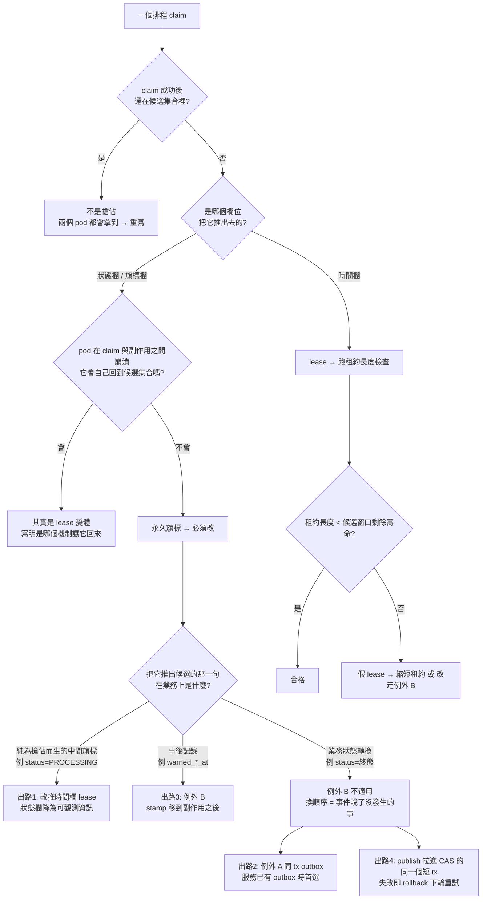

# 多副本排程搶佔規範（Scheduler Claim）

> **適用範圍（2026-09-24 起）**：只適用遷移期間仍在運作的舊服務。單體的非同步工作與排程由 River 認領與執行，不自己實作 lease（`docs/adr/2026-09-24-go-modular-monolith.md` D6）。


> 適用對象：所有 `@Scheduled` / cron worker / outbox dispatcher / MQ 補償 worker —— 凡是「**批次讀候選 → 逐筆做副作用**」形狀的程式碼，不分 Java 或 Go。
> **以及 MQ consumer**（`@RabbitListener` / Go consumer）—— 凡是「**收到訊息 → 改狀態 → 做副作用**」形狀者，判定與修法逐字相同，理由見 [§四 的適用範圍](#-本節不只適用於排程器mq-consumer-是同一個形狀)。
> 動機：服務一旦 `replicas ≥ 2`，同一則候選會被每個 pod 各撈一次；沒有搶佔就是同一件事做 N 次（重複 publish、重複打第三方、重複退款）。**哪些服務今天真的 ≥ 2、以及怎麼自己查，見下面的 [§〇](#〇判定輸入prod-副本數現況會變用前重查)——判斷緊急度之前先看它。**
> 相關：[後端服務責任邊界規範](後端服務責任邊界規範.md)、[MQ 與事件管理規範](MQ%20與事件管理規範.md)、[PostgreSQL 設計規範與最佳實踐](PostgreSQL%20設計規範與最佳實踐.md)

---

## 〇、判定輸入：prod 副本數現況（會變，用前重查）

本規範每一條的「今天會不會出事」都取決於**該服務在 prod 有幾個 pod**。這個數字**不是常數**，所以下表是**某一天的快照**，不是規範的一部分——**判定之前請自己重跑下面的查證命令**。

### 查證方式（三步，唯讀）

```bash
# ① 預設值（env 層 common overlay）
grep -n 'replicas' k8s/values/overlays/prod/common.yaml
# ② 被 per-service overlay 覆蓋的服務（這些才是多副本）
grep -rn 'replicas' k8s/values/overlays/prod/
# ③ 有沒有 HPA 會在執行期把副本數推上去（有的話上面兩步都不作數）
grep -rn 'autoscaling\|HorizontalPodAutoscaler' k8s/
```

`helm -f` 的覆蓋順序是 `values/<svc>.yaml` → `overlays/<env>/common.yaml` →（Java 才有）`overlays/<env>/java-common.yaml` → `overlays/<env>/<svc>.yaml`，**後者覆蓋前者**（`.github/workflows/deploy-k8s.yml:943/946/951/956`）⇒ **per-service overlay 是最終值**。chart 預設 `replicas: 1`（`k8s/charts/hawkr-service/values.yaml:19`）。

### 快照（2026-08-08 實查）

| | 服務 | prod `replicas` | 來源 |
|---|---|---|---|
| 預設 | **其餘全部服務** | **1** | `k8s/values/overlays/prod/common.yaml:4` |
| 覆蓋 | `cart-service` | 2 | `k8s/values/overlays/prod/cart-service.yaml:7` |
| 覆蓋 | `gateway` | 2 | `k8s/values/overlays/prod/gateway.yaml:6` |
| 覆蓋 | `order-service` | 2 | `k8s/values/overlays/prod/order-service.yaml:7` |
| 覆蓋 | `payment-service` | 2 | `k8s/values/overlays/prod/payment-service.yaml:5` |
| 覆蓋 | `payuni-webhook-service` | 2 | `k8s/values/overlays/prod/payuni-webhook-service.yaml:8` |

**全叢集無 HPA**（上列第 ③ 步在 `k8s/` 零命中，2026-08-08）⇒ 副本數只會由上面這幾個檔案的 PR 改變，不會在執行期自己長出來。

### 怎麼用這個數字

| | 今天 `replicas = 2` 的服務 | 今天 `replicas = 1` 的服務 |
|---|---|---|
| 缺搶佔的排程是什麼 | **live bug** —— 現在就在重複 publish／重複打第三方 | **地雷**，不是 live bug —— 單 pod 下不會跨 pod 重複 |
| 要不要修 | 要，而且優先 | **一樣要修**（規則 ⑧） |
| 為什麼單副本也要修 | — | 擴容那一刻才引爆，而擴容的動機通常是流量，**沒有人會在那時想到排程器**。等到那天再修＝在事故當下改搶佔語意 |

> 🚨 **不要拿「今天是單副本」當放行理由，也不要拿它反過來誇大成「多數服務都是雙副本」。** 兩種說法都會讓讀者做出錯的決定：前者讓地雷留下，後者讓「今天有沒有在出事」失去可信度。**陳述緊急度時引用上表的實際數字，不要憑印象。**
>
> ⚠️ **單副本 ≠ 單執行者**：chart 預設零停機 surge（`maxUnavailable: 0` / `maxSurge: 1`，`k8s/charts/hawkr-service/values.yaml:32-35`）⇒ rolling update 期間**新 pod 先起來、舊 pod 才下線**，`replicas: 1` 的服務在每次部署的那個窗口內仍有**兩個 pod 各跑一次排程**。這是「單副本也要修」的第二個理由，而且它**每次部署都發生**。（全 repo 覆蓋掉這個策略的目前只有 `im-service`：`k8s/values/im-service.yaml` 改成 `maxUnavailable: 1` / `maxSurge: 0`，而它沒有本規範適用的排程。）

---

## 一、八條規則（違反任一 = 不合格）

| # | 規則 |
|---|---|
| **①** | **搶佔必須在副作用之前**。副作用 = publish MQ / 呼叫第三方 / 呼叫其他微服務 gRPC / 寫外部儲存。搶佔閘門與副作用之間不得有任何其他 I/O。 |
| **②** | **`FOR UPDATE SKIP LOCKED` 只在「鎖持有到副作用完成」時才有搶佔效果**，否則一律改用 CAS。鎖的壽命 = 該 SELECT 所在交易的壽命；批次讀完就離開交易（自動提交）＝ SELECT 一回傳鎖就沒了，兩個 pod 照樣各拿一份。 |
| **③** | **搶佔一律 stamp「下次可再嘗試的時間」（lease），不得 stamp「已處理」的永久旗標**。 |
| **④** | **判定「是不是永久旗標」走下面 §二 的六步機械判準**，每個 claim 都要跑一次。`SET status = <中間狀態>` 是永久旗標的一種。 |
| **⑤** | **租約長度必須 < 該 row 在候選集合中的剩餘壽命**（§三）。 |
| **⑥** | **不走 lease 時的合法出路只有三條**：**例外 A**（同 tx outbox）、**例外 B**（不加 DB 搶佔、stamp 移到副作用之後，**僅限那一句是事後記錄**）、**publish 拉進 CAS 的同一個短 tx**（§四 適用邊界）。三者皆須逐條寫出理由與證據，並寫進服務設計書。 |
| **⑦** | **claim SQL 必須有非 PK 述詞**。`WHERE id = ?` 對兩個 pod 都會回 1，那不是搶佔。 |
| **⑧** | **調高 `replicas` 之前，必須確認該服務的排程全數有合格搶佔**。⇒ 改 `k8s/values/overlays/<env>/<svc>.yaml` 的 `replicas` 的那個 PR，必須同時給出該服務排程的逐支盤點（現況副本數見 [§〇](#〇判定輸入prod-副本數現況會變用前重查)）。 |

> ⚠️ **⑧ 目前只有規範條文，沒有機械保證**。讓它變成 CI gate 的靜態檢查在 `#2310`；在 `#2310` 落地之前，**這一條靠 review**。本規範不得反過來宣稱「由 gate 保證」——那會是一句說著沒發生的事的文件。

### 為什麼 ② 要特別寫出來

`FOR UPDATE SKIP LOCKED` 讀起來像是萬用解法，實際上本 repo 現存的每一處都跑在自動提交下（批次讀方法沒有 `@Transactional`／Go 側傳裸 ctx 直接拿 pool），**零保護**。要讓它有效就得把 MQ publish 與第三方 HTTP 包進 DB 交易——那直接違反本 repo 反覆聲明的「事件不在事務內發送」邊界，而且會在網路 I/O 期間長時間持有 row lock。

**⇒ Java 與 Go 側一律採 CAS claim，不採 SKIP LOCKED。** CAS 不依賴交易邊界、跨 pod 天然成立。
（Go 側原本三支 outbox 查詢帶著 `FOR UPDATE SKIP LOCKED`，且 scheduler 的 doc comment 據此宣稱「Multi-replica deployments are safe」——**那是零保護被包裝成安全保證**，2026-08-08 已連同註解一起移除，見下方「Go 側的對稱形態」。）

> ⚠️ **這一段反對的是「把候選集合鎖住、跨網路 I/O 長時間持鎖」，不是反對「交易內有 publish」本身。** §四 的**出路 4**（publish 拉進 CAS 所在的**單列短 tx**）不在此列：它不持有候選集合的鎖、不做批次讀、tx 內只有一列 CAS 與一次 publish。**兩者的差別是交易的形狀與壽命，不是「有沒有 publish」。** 判斷時看的是「這個交易鎖住了幾列、活多久」。

---

## 二、通則 0：怎麼認出「永久旗標」（六步，順序不可調換）

**「有 CAS」不等於「搶佔語意正確」。** CAS 的嚴謹只保證「不重複」，不保證「會回來」。

1. **寫出 claim 的 `SET` 子句與候選 SQL 的 `WHERE` 子句。**
2. **問：claim 成功之後，這一筆還在候選集合裡嗎？**
   - 還在 → **這根本不是搶佔**（兩個 pod 都會拿到），回去重寫。
   - 不在 → 進第 3 步。
3. **問：把它推出候選集合的那一次寫入，寫進去的值是不是「一個會過去的未來時間」？**
   > 🚨 **判準是「寫進去的值」，不是「欄位的型別」。** 時間型別的欄位一樣可以承載永久旗標——把它寫成 `NULL`、寫成過去、或寫成一個候選述詞永遠不會再納入的值，都是永久旗標。照「欄位是不是時間型別」分流，會讓這類寫入在第 3 步就被放行，**第 4 步的崩潰題根本沒被問到**。
   - **寫入「未來時間」**（`SET next_retry_at = NOW()+30s` / `next_retry_time` / `last_reconciled_at = NOW()` 之類，時間一到就自動回到候選集合）→ 走 **lease**，接著跑 §三 的租約長度檢查。
   - **其餘一律當永久旗標**，進第 4 步。包含：
     - **狀態欄／旗標欄**（`status`、`auto_escalated`、`warned_*_at IS NULL`、`*_retry_count` …）
     - **寫成 `NULL` 或過去值的時間欄** —— 本 repo 現況實例：shipping 的 `ShipmentMapper.clearProcessingDeadline`（`:454`）寫的是 `SET processing_deadline = NULL`，而候選述詞是 `WHERE processing_deadline IS NOT NULL AND processing_deadline < #{now}`（`findExpiredUnprocessedShipments`，`:403-404`）⇒ **寫 NULL 之後永遠不會再被納入**，它是永久旗標、**不是 lease**，儘管欄名與型別都像租約欄。（`ProcessingDeadlineScheduler` 當時只因 §一 規則 ①「搶佔必須在副作用之前」被擋下——它是 publish 之後才清——**不是**因為第 3 步。**現況已修**：claim 改成同一欄的 lease CAS 且落在 publish **之前**（`leaseProcessingDeadline`，`ProcessingDeadlineScheduler.java:108`），`clearProcessingDeadline` 留在 publish 之後、降級成事後記錄。**「寫 NULL 是永久旗標」這個判定本身沒變**，變的是那一句已經不是搶佔閘門。）
     > ⚠️ **不要因為它叫 `claimTask`、或它的 CAS 述詞很嚴謹、或欄名長得像租約欄就放行。**
4. **對永久旗標，問：pod 在 claim 與副作用之間崩潰（不是拋例外，是進程消失），這一筆會不會自己回到候選集合？**
   - 會 → 其實是 lease 的變體，**說明是哪個機制讓它回來**。
   - 不會 → **必須改**。三條出路：① 把 claim 換成時間欄 lease（狀態欄可保留當可觀測資訊，但**候選述詞要能容納它**）② 例外 A（同 tx outbox）③ 例外 B（不加 DB 搶佔、stamp 移到副作用之後）。
     > 🚨 **出路 ③ 只在「被移到後面的那一句是事後記錄」時可用**。若把 row 推出候選集合的是**業務狀態轉換本身**（`SET status = <終態>`、`SET <業務旗標> = true`），例外 B **不適用** —— 換順序會變成「事件說了一件沒發生的事」。判準與正解見 [§四 例外 B 的適用邊界](#-例外-b-的適用邊界被移到後面的那一句-sql必須是事後記錄)。
5. ⚠️ **「catch 裡有回退」不算回頭路**。catch 只在**進程還活著**時執行；pod 被驅逐／OOM／節點失聯時**沒有任何 catch 會跑**，而那正是多 pod 場景要防的情況。
6. ⚠️ **「有人工救濟」也不算回頭路，除非救濟路徑收得到這個狀態。** 寫「有 ops 可以處理」之前，**先讀那支救濟 SQL 的 `WHERE`**。

### 反例（本 repo 實際存在過的五支，issue #2294 §1-4b）

`RefundTaskWorker`（aftersales）／`AutoRefundWorker`／`CartCleanupRetryWorker`／`GrantPaymentWorker`／`CouponConsumptionWorker`（order）的 claim 都是：

```sql
-- 值為 WorkerTaskStatus 的 CodeMeta value：'0'=PENDING / '10'=PROCESSING / '30'=FAILED
UPDATE <task_table> SET status = '10'
 WHERE task_id = ? AND status IN ('0', '30')
```

而候選述詞是 `status IN ('0','30') AND (next_retry_time IS NULL OR next_retry_time <= NOW())`。

> 🚨 **本檔所有 SQL 一律寫 CodeMeta value，不寫 enum 名。** 這些 `status` 欄存的是 CodeMeta 的 **value 字串**（`WorkerTaskStatus`：`0`/`10`/`20`/`30`…，見 [業務狀態碼](../代碼管理（CodeMeta）/業務狀態碼.md)；`OutboxEventStatus`：`8221`/`8222`/`8223`/`8224`，見 [內部技術碼](../代碼管理（CodeMeta）/內部技術碼.md)）。把 enum 名當字面值寫進述詞 ⇒ **零命中、排程靜默停擺**（沒有錯誤、只是每輪撈到 0 筆）。設計書照抄規範，所以規範裡寫錯會擴散（[Java 微服務開發規範](Java%20微服務開發規範.md) §6「Enum 與禁止硬編碼」）。

五支**完全符合 ①②⑦**（搶佔在副作用之前、用 CAS 不用 SKIP LOCKED、述詞非純 PK），命名還叫 `claimTask` —— **唯獨違反 ③**：`PROCESSING` 不在候選集合、沒有任何時間欄能讓它回來，pod 崩潰即永久卡死。

**`GrantPaymentWorker` 是其中最嚴重的一支**：admin 的人工救濟 `resetForRetry` 當時只收 `status IN ('30', '40')`（`WorkerTaskStatus`：`'30'`＝FAILED、`'40'`＝MANUAL_INTERVENTION），**卡在 `PROCESSING` 的撥款任務連人工重發都做不到** —— 正是第 6 步要擋的那種「以為有救濟、實際收不到」。（修復後救濟路徑與候選述詞已同步涵蓋 `PROCESSING`，見 `GrantPaymentTaskRepository.resetForRetry`。）

**正解（零 migration，五張表都已有 `next_retry_time` 與 `(status, next_retry_time)` 索引）**：claim 從「換狀態」改成「**推時間**」。

```sql
UPDATE <task_table>
   SET next_retry_time = #{leaseUntil},      -- now + lease（建議 = 該 worker tick × 3）
       status          = #{processing},       -- 保留：狀態從「閘門」降為「可觀測資訊」
       updated_at      = NOW()
 WHERE task_id = #{taskId}
   AND status IN (#{pending}, #{failed}, #{processing})   -- 與候選述詞一致
   AND (next_retry_time IS NULL OR next_retry_time <= NOW())  -- ← lease CAS
```

> ⚠️ **保留 `PROCESSING` 時，候選述詞必須從 `status IN ('0','30')` 放寬成 `status IN ('0','30','10')`**（`WorkerTaskStatus`：`'0'`＝PENDING、`'30'`＝FAILED、`'10'`＝PROCESSING），否則租約到期 row 仍然回不來 —— 那就只是把永久旗標寫得更像 lease 而已。

### Go 側的對稱形態：既有的 `next_attempt_at` 就是租約欄（零 schema 變更）

上面 Java 那個「零 migration 正解」在 Go 側有一個逐字對應的版本，**且更乾淨**：Go 的 outbox / 重試表本來就有一個「下次可再嘗試的時間」欄（`next_attempt_at`），而候選述詞本來就是 `status = 'pending' AND next_attempt_at <= $1` —— **那個欄位在定義上就是租約欄**，claim 只要把它推到未來即可，不必新增任何欄位、不必跑 Atlas migration。

```sql
-- 候選：SELECT ... WHERE status = 'pending' AND next_attempt_at <= $1 ORDER BY next_attempt_at LIMIT $2;
-- claim（:execrows，rows=1 才做副作用）：
UPDATE <outbox_table>
   SET next_attempt_at = sqlc.arg(lease_until)
 WHERE id = sqlc.arg(id)
   AND status = 'pending'                                  -- 非 PK 述詞（規則 ⑦）
   AND next_attempt_at <= sqlc.arg(claimable_before);      -- ← lease CAS，與候選述詞一致
```

本 repo 實例（三支）：`services/account-service/db/queries/apple_revoke_outbox.sql`、`services/buyer-service/db/queries/buyer_deleted_outbox.sql`、`services/seller-service/db/queries/seller_deleted_outbox.sql`。seller-service 的 `payuni_registrations.last_synced_at`（節流窗口）是同一個形狀的變體。

- ⚠️ **既有的 backoff 寫入是同一欄的第二個寫入者，這是刻意的、不違反 §三 第 7 點**：`UpdateAttempt`（失敗退避）把自己的 backoff 寫在租約上頭，語意是「這一輪已經有結論了，租約可以被更長的退避取代」。要守的是「**不知情的覆蓋**」，不是「只准寫一次」。
- ⚠️ **`FOR UPDATE SKIP LOCKED` 要一併移除**，不要留著當「第二道保險」：它在自動提交下零保護（規則 ②），留著只會讓下一個讀 code 的人以為搶佔是它提供的（本 repo 三支 scheduler 的 doc comment 原本都寫著「Multi-replica deployments are safe: SELECT FOR UPDATE SKIP LOCKED …」——那句話騙過了每一個 reviewer）。

### 判定流程圖



---

## 三、通則 1：租約長度必須 < 候選窗口的剩餘壽命

lease 的全部價值來自「租約到期 → row 回到候選集合 → 自動重送」。若租約到期時 row **已經因為別的述詞掉出候選集合**，那條路徑永遠不會發生 ⇒ **lease 在行為上等同永久旗標，而且更危險**：程式碼看起來是 lease、審查者看到 `(t IS NULL OR t <= now)` 就放行，實際交付語意是 at-most-once。

**機械步驟（每加一個 lease 都要算一次）**：

1. 找出候選 SQL 裡**除了租約欄以外**的所有時間上界（`created_at >= #{maxAgeCutoff}`、`xxx_at >= #{maxAgeCutoff}`、`end_at <= #{until}`、`deadline_at <= #{cutoff}` …）。
2. 算出 row 從「第一次成為候選」到「必然掉出候選」之間的最長時間 = **候選窗口寬度**。**沒有上界 → 寬度 = ∞**，任何租約都合格。
3. **租約長度必須明顯小於窗口寬度**（建議 ≤ 1/10，至少要讓 row 在窗口內還能被重試 ≥ 3 次）。
4. **獨立的極端情況**：**cron 週期 ≥ 窗口寬度 ⇒ 每個 row 一生只落在一個 tick 內，任何租約值都無效**（不是「租約太長」，是租約這個機制在這裡不存在——row 根本不會被掃第二次）。
   > ⚠️ 這一步曾寫成「租約若 ≥ cron 週期 × 窗口內 tick 數，同樣退化」。**那是恆等式、沒有鑑別力**：窗口內 tick 數 ＝ 窗口寬度 ÷ cron 週期，右式恆等於窗口寬度，與第 3 步是同一條界。有鑑別力的只有上面這個極端情況。
5. **租約還有一個下界，別只算上界**：**租約長度必須 > 單筆工作的最壞耗時**（一次第三方往返、一次 publisher confirm、一次 gRPC 逾時上限，取最大者）。租約短於最壞耗時 ⇒ 原持有者還在跑、租約已到期、下一個 tick 直接重做同一筆 ⇒ **每筆都被做兩次，搶佔等於沒有**。

6. **🚨 租約基準必須在「claim 當下」取，不能在批次開始時取一次**（2026-08-08 補；backend#2294 R4-P1-2 一次抓到四處）。
   典型寫法是 tick 開頭 `LocalDateTime now = nowUtc();`，然後整批 claim 都用 `now.plusXxx(lease)`。
   那使**第 k 筆的有效租約 = 租約長度 − (前 k−1 筆的耗時)**，批次夠長就變成**負數**
   ⇒ 租約在持有者仍在工作時到期 ⇒ 另一個 pod 合法搶走同一筆 ⇒ **重複副作用，而且是在原持有者還在打第三方的當下**。
   - 判定式：**`batchSize × 單筆最壞耗時` 是否 > 租約長度**。是 ⇒ 這個 bug 一定會發生（不是機率問題）。
     實例：`StockCompensationWorker` `(20+20) × 10s = 400s > 300s` 租約；
     payment `PendingPaymentReconcileScheduler` `50 × 90s ≈ 75 分 ≫ 5 分`租約。
   - **候選述詞用的 `now` / `retryBefore` 可以維持 tick 起點**——那個方向讓候選集合更小，是保守的。
     要動的只有寫進 DB 的那個租約到期時間。
   - ⚠️ 這個缺陷**不會被既有的 lease 測試抓到**：「租約是未來時間」「租約 = now + LEASE」對第一筆都成立。
     要釘住它得讓第一筆的副作用耗掉一段可觀測時間，再斷言**第二筆的租約嚴格晚於第一筆**
     （共用 tick 起點時兩者**完全相等**）。

7. **🚨 租約欄必須只有一個寫入者；claim 之後的任何 UPDATE 若會碰到該欄，必須帶著 claim 當下寫進去的值**（2026-08-08 補；backend#2294 R4-P2-2，Java 與 Go 各出現過一次）。
   claim 把租約寫進 DB 之後，**同一輪後續的寫入常常會不知情地把它覆蓋掉**——覆蓋回的是「查詢當下」那份快照裡的舊值（多半是 `NULL` 或已過期）⇒ **claim 被自己的下一句抵銷**，另一個 pod 立刻就能合法搶走同一筆。
   - **兩種典型載體**：① **ORM 的整列更新**（MyBatis-Plus `updateById(entity)` / JPA `save(entity)`）——entity 是 claim **之前**撈的，租約欄還是舊值；② **一個「順便也寫租約欄」的業務方法**（Go 的 `UpdateDetailedStatus(..., now)` 之類），參數若傳 tick 起點的 `now`，等於把 §三 第 6 點剛拿到的 per-row 基準又換回批次基準。
   - **本 repo 的兩個實例**：
     - Java：`ProductImportGcJob.tierAExpireJobsBody`（`services/java/product-import-service/.../scheduler/ProductImportGcJob.java:297-298`）—— claim 之後必須 `job.setGcLeaseUntil(leaseUntil)` 才 `updateById`。
     - Go：`PayuniUseCase.SyncPendingStatuses`（`services/seller-service/internal/usecase/payuni.go:127-135`）—— `UpdateDetailedStatus` 會寫 `LastSyncedAt`（＝租約欄），必須傳 `claimedAt` 而不是 tick 的 `now`。
   - ⚠️ **「今天沒炸」常常只是隱性耦合**：product-import 那一句同時把 `status` 推成終態，而終態落在候選述詞的 `NOT IN` 排除清單裡，所以該列無論如何都離開候選集合。**候選述詞一改（例如要讓終態也能被重掃），這一行就當場變成「租約憑空消失」的 bug。** 不要把它當成「可以不修」的理由。
   - **檢查動作（機械）**：claim 之後到副作用結束之間，逐句問「這一句寫不寫得到租約欄？」。ORM 整列更新一律算「寫得到」。

⇒ **合格區間是 `單筆最壞耗時 < 租約 ≪ 候選窗口寬度`**，上下界都要算。區間為空（最壞耗時已經逼近窗口寬度）＝ lease 在此不成立，改走例外。

### 🚨 上界不是只有「候選窗口」那一個

第 1–3 步算的是**述詞層**的上界（row 什麼時候會掉出候選集合）。候選窗口 = ∞ 時它無條件成立，
很容易讓人以為「上界不必想了，取大一點比較安全」。**不對**——當副作用是一個**會靜默失敗**的操作
（best-effort publish、吞例外的 wrapper）時，租約同時是**那次失敗的救援窗口**，
於是還有一個**業務層上界**：「這件事沒發生」最多能持續多久不被察覺。

> **實例（backend#2294 R4-P1-1）**：`ShipmentCreationBackstopScheduler` give-up 分支租約初版取 **1440 分**，
> 論證是「候選窗口 ∞ ⇒ 上界成立」＋「1 天遠大於一次 MQ publish」。但它 publish 的
> `order.shipment.creation_failed` 走的是**吞掉所有例外**的 publisher
> ⇒ MQ 短暫不可用時 claim 已寫入、事件沒送出、呼叫端拿不到訊號
> ⇒ **買家已付款、無物流單、無取消、無退款、無告警 24 小時**。
> 而修復前那支根本不寫任何欄位、每 tick 重發，恢復窗口是 5 分鐘 ⇒ **288 倍退化**。
> 正解：上界取同一支排程的重試節奏（30 分），並**共用同一個設定值**讓不變式結構上恆成立。

**判準**：寫下租約長度時問一句——「如果這次副作用**靜默失敗**了，下一次重來要等多久？那個等待可以接受嗎？」
答不出「可以接受」就是上界沒算完。**只論證下界、然後用『窗口是 ∞』帶過上界，是不合格的推導。**

不合格時只有兩條出路：**縮短租約**，或**改走例外 B**。

### 兩個反例

| 反例 | 形狀 | 為什麼不合格 |
|---|---|---|
| **黑貓卡死告警**（`TcatCallStuckAlertScheduler`） | 候選窗口 = 24 小時（`tcat_call_requested_at >= now − max-age-hours(24)`），首版租約取 **24 小時** | **租約與窗口等寬** ⇒ 首次告警在 `+3min` 蓋章、租約到期 `+24h+3min` 時 row 已於 `+24h` 掉出窗口 ⇒ **退化成 at-most-once**。**正解：租約改 1 小時**（窗口內約 23 次）。<br>⚠️ **這個 1 小時不能「順手改回 24h 比較不吵」** —— 那會靜默退回 at-most-once，而且不會有任何錯誤訊息。 |
| **券到期通知**（`CouponExpiringWarningJob`） | 候選窗口 ≤ 1 天（`end_at ∈ (now, now + warningDays(1)]`），cron `0 0 1 * * ?` = **1 天一次** | **第 4 步不成立**：cron 週期 ≥ 窗口寬度 ⇒ 每張券一生只落在一個 tick，**任何租約值都無效** ⇒ 只能走例外 B。 |

---

## 四、兩個例外條款

### 🚨 本節不只適用於排程器：MQ consumer 是同一個形狀

本規範的標題與 §一～§三 的例子都以 `@Scheduled` 為主，於是很容易被讀成「只有排程器要看」。**不是。**

| | 排程器 | MQ consumer |
|---|---|---|
| 形狀 | 撈候選 → 改狀態 → 做副作用 | **收到訊息 → 改狀態 → 做副作用** |
| 「回到候選集合」的機制 | 下一個 tick 重撈 | **重投**（`MqErrorHandler` 重送 / broker requeue） |
| 狀態被 CAS 推到終態之後，副作用失敗了會怎樣 | 下一 tick 的候選述詞已不含它 ⇒ **不會重來** | 重投時**同一句 CAS 回 0**（或前置的 `isTerminalState` 直接 ack skip）⇒ **不會重來** |

⇒ **六步機械判準（§二）、租約長度算式（§三）、例外 A／B 與出路 4（本節）逐條套用，不需要任何調整。** 唯一要換掉的是第 4 步的措辭：把「pod 崩潰之後這一筆會不會自己回到候選集合」讀成「**這則訊息被重投時，那句 CAS 還會不會通過**」。答案是「不會」⇒ 同樣是永久旗標，同樣必須改。

**兩者的差別只有兩點，且都不影響判定**：

1. **重投次數有上限**（本 repo `MqErrorHandler` 為 3 次後進 DLQ），而 tick 是無限的 ⇒ consumer 側的**殘餘窗口更短、但耗盡之後是 DLQ 不是靜默**。這使「為了一個非關鍵欄位而讓整筆 rollback」的代價比排程器高（例：身分反解失敗時，consumer 側可以合理地維持 best-effort 降級，排程器側則應跳過本筆等下一 tick）——**取捨可以不同，判定不能不同**。
2. **consumer 沒有 claim 的必要**（訊息本身就是被 broker 分派的，一則訊息只會給一個 consumer）⇒ **命中的一律是「CAS 已提交、副作用失敗無訊號」這一類**，也就是本節的**出路 4** 與**例外 A**，不會命中 lease。

> **本 repo 實例（issue #2294 晚掃，2026-08-08）**：換角度窮舉 MQ consumer 側後又命中 5 處出路 4／例外 A ——
> aftersales `RefundResultConsumer`（[09 §8.5](../詳細設計書/09-售後微服務（AfterSales%20Service）詳細設計書.md)）、
> aftersales `ReturnShipmentStatusConsumer` 四分支（同上）、
> order `ShippingEventConsumer`（`order.delivered`）與 `PaymentEventHandler`（`order.sales.accumulated`）改走例外 A（[03 §8.13](../詳細設計書/03-訂單微服務（Order%20Service）詳細設計書.md)）、
> product-import `MediaCallbackListener` 的 inbox dedup 併入同事務（[40 §8.5](../詳細設計書/40-商品匯入精靈服務（Product%20Import%20Service）詳細設計書.md)）。
> **首輪盤點只掃 `@Scheduled` 完全掃不到這 5 處**——它們一個 `@Scheduled` 都沒有。

> ⚠️ **consumer 側特有的一個陷阱：dedup／inbox 的 claim 必須與工作本體同事務。** dedup INSERT 若在交易外先行提交，而工作本體 rollback，**重投會被自己的 dedup 擋掉**（原樣重投＝同一個 `event_id`）⇒ 那一筆永遠不會被處理，且沒有任何錯誤。這與「狀態 CAS 已提交、副作用沒發生」是同一個病，只是閘門換成了 dedup 表。實例＝product-import `MediaCallbackListener`（[40 §5.4.2](../詳細設計書/40-商品匯入精靈服務（Product%20Import%20Service）詳細設計書.md)）。

### 例外 A —— 可用永久標記

**成立條件**：該事件**重複投遞的代價高於遺失的代價**。

**必須做的事**：逐條寫出理由，**並且把「不遺失」交給別的機制** —— **同 tx outbox 是本 repo 唯一驗證過的做法**。

**正例**：`PendingPaymentReconcileService`（payment）的 `markRescued`（永久旗標 `rescued_at IS NULL`）與 outbox `INSERT` 包在**同一個 `txTemplate` 短 tx** 內 ⇒ 旗標與「事件一定會發出去」原子成立。

**禁止**：宣告走例外 A、卻沒有任何機制保證不遺失。那不是例外，那是缺陷。

### 例外 B —— 不加任何 DB 搶佔（C-none），跨 pod 去重委託 consumer 冪等

**必須同時滿足四條，缺一不可**：

1. **lease 不適用**，下列兩個分支**擇一成立**：
   - **(a) 結構上不可能** —— §三 的第 3 或第 4 步不成立（租約長度無論怎麼取都會退化成永久旗標）。
   - **(b) 語意上只該發一次** —— 該事件在業務上是**一次性事件**（D-1／到期前預警、一次性裁決通知這一類），「已經發出去」本身就是終態。lease 會讓它在候選窗口內反覆 publish 數十次；即使 consumer 冪等把它收斂成一則通知，**MQ 流量與 dedup 索引寫入仍變成常態噪音，且 DB 上再也讀不出「這一筆到底通知過沒有」**。
   > ⚠️ **(b) 與「該持續有聲音」只有一線之隔，判準要機械化**：問「**狀態沒解除時，把同一件事再發一次，對收件人是不是仍然有新資訊**」。
   > - **卡死告警**（黑貓卡死、退貨卡死）答案是「**是**」（沒人處理就該一直吵）⇒ **不得走 (b)，必須 lease**。
   > - **D-1 預警**答案是「**否**」（買家已經知道了，再提醒 23 次只是噪音）⇒ (b) 成立。
2. **重複投遞代價 < 遺失代價**（否則要走的是例外 A 不是 B）。
3. **附 consumer 側冪等證據**：具體的**唯一索引名 + 定義 + `reference_id` 組成 + 出處行號**。「應該有冪等」不算證據。
4. 🚨 **publish 呼叫點必須拿得到失敗訊號**。走例外 B 要把 stamp 移到 publish 之後，但**換順序本身不構成修復**：若 publish 呼叫的是一個吞掉所有例外的 publisher，呼叫端永遠看到「成功」、stamp 照樣寫，**at-most-once 原封不動**。
   ⇒ 呼叫點必須改成呼叫一個**會傳遞失敗的變體**（或該 publisher 的契約本身改掉），並在失敗時**跳過 stamp**。

**走例外 B 的做法**：把 stamp 從副作用**之前**移到**之後**。

| 情形 | 舊（stamp → publish） | 例外 B（publish → stamp） |
|---|---|---|
| publish 成功、stamp 成功 | 一次 | 一次 |
| publish 成功、stamp 失敗／pod 崩潰 | 不會發生（stamp 先） | 下輪重發 → consumer 冪等吸收 |
| **publish 失敗** | **永久遺失、無告警、無重試** | **不 stamp → 下輪重試** |
| 兩 pod 同 tick | 只有一個發 | 各發一次 → consumer 冪等吸收 |

> ⚠️ **「不加 DB 搶佔」≠「零程式碼改動」**。例外 B 至少要動兩個地方：換順序、以及把 publish 呼叫點改成會傳遞失敗的變體（第 4 條）。
> ⚠️ **例外 B 的保證等級要逐案寫清楚**：有 stamp 可移的（例：24h 預警）拿得到「publish 失敗會重試」；**連 stamp 都沒有的**（例：券到期通知）走例外 B **只消除跨 pod 重複、不改變原本的 at-most-once** —— 那是**已知殘留**，設計書必須明寫，不得寫成「已解」。

#### 🚨 例外 B 的適用邊界：被移到後面的那一句 SQL，必須是「事後記錄」

上表第 2 列（「publish 成功、stamp 失敗／pod 崩潰」⇒ 下輪重發）**只在 stamp 是事後記錄時成立** —— stamp 失敗的意思是「**只是沒記到**」，業務上什麼都沒少。

**反例（不適用例外 B）：被移到 publish 之後的那一句是「業務動作本身」。**

| | stamp 是**事後記錄** | 被移到後面的是**業務狀態轉換** |
|---|---|---|
| 典型 SQL | `SET warned_*_24h_at = NOW() WHERE … IS NULL` | `SET status = '33' WHERE status = '20' AND deadline <= NOW()` |
| 那一句失敗／CAS 回 0 的意思 | 「沒記到」 | 「**這件事沒有發生**」 |
| 但事件已經發出去了 ⇒ | 下輪重發，consumer 冪等吸收，**最終一致** | **事件說了一件沒發生的事，而且不會自我收斂**——沒有任何後續動作會撤回那則事件 |
| 例外 B | ✅ 適用 | ❌ **不適用** |

**判準（一句話）**：把那一句 SQL 拿掉，**業務上有沒有少一件事**？少了 → 它是業務動作，不是 stamp ⇒ **例外 B 不適用**。

**為什麼「CAS 回 0 是罕見競態」不是放行理由**：CAS 回 0 正是這類排程**設計上預期會發生**的分支（例：買家壓哨寄出把 `status` 從 20 推到 25，逾時關案的 CAS 因此 affected=0）。把 publish 排在它前面，等於**在最該安靜的那條分支上發出錯誤事件**：買家收到「逾時未寄回、退款資格已解除」，而他明明剛寄出。

**這一類的正解只有兩條**：
- **例外 A（同 tx outbox）** —— 服務已有 outbox 時的首選。
- **把 publish 拉進 CAS 所在的同一個 `@Transactional`（短 tx）** —— 服務沒有 outbox 時的次選。publish 走會傳遞失敗的變體 ⇒ 失敗即 rollback ⇒ 狀態沒轉、事件沒發、下輪重試，**兩者永遠同進同出**。
  > 這與 §一 ② 的「不要把副作用包進 DB 交易」**不矛盾，界線在交易的形狀**：② 反對的是「批次讀 `FOR UPDATE` 持鎖跨網路 I/O」那種長交易；這裡是**單列 CAS ＋ 單次 publish 的短交易**，不持有候選集合的鎖。
  > **殘餘風險要誠實寫進設計書**：publish 成功、commit 失敗 ⇒ 事件已發、狀態未轉。但那一列**仍在候選集合裡**，下一 tick 會重跑並重發，consumer 冪等吸收 ⇒ **不一致是暫態的、窗口 = 一個 tick**。對照例外 B 用在這一類時的不一致是**永久的**（CAS 回 0 之後沒有下一輪）——這正是取捨的全部內容。

##### 🚨 出路 4 的硬性邊界：**tx 內只准有那一列 CAS 與那一次 publish，不得有任何其他網路呼叫**

出路 4 之所以不違反 §一 ②，全部理由就是「交易的形狀與壽命」——**一列、很短**。往那個 tx 裡多放一次網路呼叫，這個豁免當場失效。

**最常見的破法：組事件 payload 需要先查別的服務**（把 `store_id` / `buyer_id` 反解成登入 `account_id`、拿商品快照、拿收件人資料…）。這些呼叫往往長在 publisher 內部，**呼叫端從程式碼上看不出來**——`tryPublishXxx(...)` 讀起來就只是「發個事件」。

**為什麼比一般的慢查詢嚴重**：本 repo 的 Java gRPC stub 由共用 `GrpcStubFactory` 產生，**預設沒有 deadline**。下游服務掛住（不是拒絕，是不回應）時該呼叫**永不返回** ⇒ 這個「短 tx」無限期持有該列的 row lock ＋ 一條連線池連線；排程又是逐筆跑的 ⇒ 一次下游故障就能把整支排程與該表的相關寫入一起拖住。

**正解（機械可執行）**：
1. **所有身分／上下文反解移到 tx 之外**，由呼叫端（worker）先解好，當**參數**傳進 tx 內的 publish；publisher 提供一個「零 gRPC」的多載專供 tx 內使用。
2. **反解失敗＝該筆本輪不做**：此時尚未進 tx ⇒ 沒有 CAS、沒有事件、候選述詞未變 ⇒ 下一 tick 必然重撈。⚠️ **不得降級成「帶著空值／0 把事件照發」** —— 那是拿一則永遠路由不到收件人的通知，換掉一次本來會成功的重試。（best-effort 降級只適用 **API 路徑**：那裡沒有下一個 tick。）
3. **失敗要留 error log**，跳過不等於靜默。
4. **測試斷言兩件事**：tx 內的 publish 跑完後對下游 client **零互動**（`verifyNoInteractions`）、以及反解先於 tx service 發生（`InOrder`）。缺這兩條，反解會在下一次重構時被無聲地搬回 tx 內。

> 本 repo 實例：aftersales B1／B2／B3（issue #2294 P1-2）。移進 tx 的 `tryPublishXxx` 內含兩次無 deadline 的 gRPC（payload 一次、賣家工作區 realtime 再一次），修法即上列四步。

**⚠️ 兩個一定會被誤讀的地方（issue #2294 P1-B／P1-C 的教訓，寫給下一個套用本節的人）**

1. **「移出去了」不等於「有界了」。** 上列四步解掉的是「無界呼叫**持有 row lock**」，**不是**「無界呼叫」。呼叫搬到 tx 外之後，它多半落在 `@Scheduled` 執行緒上——而 Spring Boot 的 `spring.task.scheduling.pool.size` **預設是 1**。下游若是「掛住」而非「失敗」，整個服務的**所有**排程一起停擺且永不恢復；比原本的 row lock 影響面更大。
   ⇒ **反解移出 tx 的同一個 PR，必須在呼叫點加 `withDeadlineAfter`**（加在呼叫點、每次呼叫時加；`withDeadlineAfter` 換算的是**絕對**時間，挪進建構子＝啟動 N 秒後全部逾時）。
   ⇒ deadline 值要同時給**下界**（內部查表 vs 夾著第三方，量級不同）與**上界**（`BATCH_LIMIT × 每筆 RPC 數 × deadline` = 最壞單 tick 佔用）。
   ⇒ 若最壞單 tick 佔用仍大於排程週期，**要誠實寫出來**：deadline 買到的是「執行緒不會被永久吃掉」，不是「一個 tick 跑得完」。

2. **`verifyNoInteractions` 只證明它列到的那幾個 client 沒被碰。** 本節第 4 步要求的斷言涵蓋的是**身分反解**的 client；tx 內若還有別的網路呼叫（例：aftersales `createRefundTaskAndAdvanceStatus` 的 ATM `createRefund`），那組斷言**量不到**，綠燈不構成「tx 內零 gRPC」的證據。
   ⇒ 宣稱時**保留限定詞**：達成的是「tx 內零**身分反解** gRPC」。剩下的每一個 in-tx 網路呼叫要逐個列出，寫明它的 deadline 上界與是否計畫治本。

### 🚨 讀完本節之後：還有第四種形狀，它不在 §一～§四 裡

§一～§四 全部建立在同一個前提上——**有一個候選集合，而某一句寫入會把 row 推出去**。lease、例外 A、例外 B、出路 4 是這個前提下的四條路。

**候選集合每輪重算、沒有任何欄位會把 row 推出去**的排程（level-triggered reconcile）不在這四條路裡：§二 六步的第 1 步在它身上**沒有對象**。

> 本規範一度有 §七 專門收這種形狀，2026-09-06 連同它唯一的實例（貼文媒體引用 reconciler）一併移除。移除的理由不是形狀本身有問題，而是**那個實例根本不該存在**：它的職責是釋放已無人引用的媒體資產，屬「資料完整性監測」，而《後端服務責任邊界規範》§三把那件事整格劃給維運 SQL 與 DB observability，§二明文禁止 application code 內的週期性 drift 掃描。原本用來論證它合規的 §七，是同一份 ADR 自己加進本規範的條文——用自己剛加的條文核准自己的設計不是合規檢查。
>
> 因此：**下一個想寫 level-triggered reconcile 的人，第一題不是「怎麼寫得合格」，是「《後端服務責任邊界規範》§二 為什麼不禁止它」。** 答不出來就不要寫。真的答得出來（例如 SoT 在外部系統、補 webhook 漏收，如 `PendingPaymentReconcileScheduler`）再回頭談形狀。

> ⚠️ §七 排在文件最後**不是因為它是附錄**，而是因為 §五／§六 的編號已被多份詳細設計書逐字引用（`03`／`06`／`07`／`09`／`56`），插進 §四 之後會把那些引用全部指偏而且不會有任何錯誤。**閱讀順序上它接在這裡。**

---

## 五、寫進設計書的必答題

任何新增或修改排程的設計書，必須回答：

1. 這個排程的**候選述詞**是什麼？**副作用**是什麼（publish / gRPC / 第三方）？
2. **搶佔閘門**是哪一句 SQL？它在副作用**之前**嗎？
3. 走 §二 六步的結果：lease／例外 A／例外 B／**publish 拉進同一個短 tx**？
4. 走 lease → **租約欄是哪一欄、租約多長、候選窗口多寬**（§三 的算式）。
   > **另外要逐句回答「claim 之後還有誰寫得到這一欄」**（§三 第 7 點）：ORM 的整列更新（`updateById` / `save`）與任何「順便也寫租約欄」的業務方法都算，且它們必須帶著 claim 當下的值。答「沒有人寫」時要說明是怎麼確認的，不能只憑欄名沒出現在 SQL 裡——`updateById` 的字面上看不到任何欄名。
   > **租約欄的欄名會騙人**：`*_alerted_at`／`*_next_at`／`*_reconciled_at` 讀起來像「已處理旗標」。設計書要逐條寫明「**這是冷卻租約不是已處理旗標**」，否則下一個人會照欄名把它當一次性旗標用，把 at-most-once 重新鑿回來。
5. 走例外 A → **不遺失交給誰**（哪張 outbox、哪個 tx）。
6. 走例外 B → **四條件逐條的證據**，含 consumer 冪等索引名與 `reference_id` 組成，以及**這筆的保證等級到底是什麼**；並回答「被移到 publish 之後的那一句是事後記錄嗎」（[§四 適用邊界](#-例外-b-的適用邊界被移到後面的那一句-sql必須是事後記錄)）。
6a. 走**短 tx**（publish 拉進 CAS 的 `@Transactional`）→ 必須寫出：**tx 邊界落在哪個 bean 的哪個方法**（同 class 內 self-invocation 不經 proxy ⇒ `@Transactional` 失效，見 [Java 微服務開發規範](Java%20微服務開發規範.md)）、**publish 走的是會傳遞失敗的變體**、**rollback 之後那一列仍滿足候選述詞**（逐條比對候選 SQL 的每個條件），以及**殘餘窗口 = 一個 tick** 的誠實說明。
7. **行為退化寫出來**：
   - pod 在 claim 與 publish 之間崩潰，該事件會**延後一個租約**才重送（現況是「下一 tick 就重來」）。這是真實退化，換來的是不重複；**at-least-once 契約不變**。
   - **租約不是鎖**：租約到期後原持有者若仍活著，可能與新持有者同時處理同一筆 → 回到「重複一次」。這是刻意取捨（at-least-once 優先），下游冪等仍是最終防線。租約長度取「大於單筆工作的最壞耗時」就是為了讓這件事罕見。
   - **有做租約釋放（release）的，要連它的兩面一起寫**：`publish` 未成功 ⇒ 把租約還原成 claim 之前的值 ⇒ **下一 tick 就重試**（而不是等滿一個租約）；代價是 **confirm timeout 這條路徑上訊息可能其實已經送達**，於是下一 tick 會**多發一次**，由收件端吸收。取捨要寫成一句話：**多吵一次 ≪ 靜默一個租約**。
     > ⚠️ 釋放**不是**正確性的一部分（進程直接消失時沒有任何 catch 會跑，那正是租約存在的理由），它只把「進程還活著的失敗」從一個租約縮短到一個 tick。釋放的 CAS 條件必須是「租約仍等於我剛寫進去的那個值」，否則會清掉別人的租約（規則 ⑦ 的同一個道理）。

---

## 六、相鄰缺陷：終態沒有退出候選集合

與「缺搶佔」不同、但每次改排程都要順手檢查的一類：**已處理／終態的 row 是否仍留在候選集合裡**。

實例：`order_outbox` 的候選述詞曾寫成 `status <> '8222'`（`'8222'` ＝ `OutboxEventStatus.SENT`），於是 **`DEAD`（`'8224'`）row 永久滯留**；累積到批次上限（例：50 筆）之後，每個 tick 都被那些 DEAD row 佔滿，**整條 outbox starvation** —— 而且**單 pod 也會壞**，與 replicas 無關。

**正解**：候選述詞改成**正面枚舉**（`status IN ('8221','8223')`，即 `OutboxEventStatus.PENDING` / `FAILED`），並讓部分索引跟著改。

> 🚨 **枚舉的是 CodeMeta 的 value 字串，不是 enum 名。** `order_outbox.status` / `outbox_events.status` 存的是 `OutboxEventStatus` 的 **value**（`8221`=PENDING／`8222`=SENT／`8223`=FAILED／`8224`=DEAD，SSOT＝[代碼管理（CodeMeta）／內部技術碼](../代碼管理（CodeMeta）/內部技術碼.md)）。寫成 `status IN ('PENDING','FAILED')` 的 SQL **一筆都撈不到 ⇒ 整條 outbox 靜默停擺**（沒有錯誤、只是 0 筆，比 starvation 更徹底）。另注意 `OutboxEventStatus` **沒有 `RETRYING`**——重試中的狀態就是 `FAILED('8223')`。

**規則**：候選述詞一律**正面列出「要處理的狀態」**，禁止用 `<>` / `NOT IN` 表達，因為新增終態時不會有人回頭改它。

---
