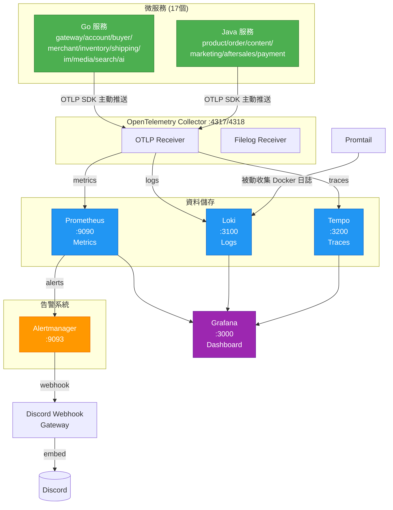

# Hawkr 監控系統

## 概覽

基於 Grafana LGTM Stack + OpenTelemetry 的一站式監控解決方案：

| 組件 | 端口 | 用途 |
|------|------|------|
| **Grafana** | 3000 (本機與遠端) | 視覺化儀表板 |
| **Prometheus** | 9091 (外部) → 9090 (內部) | 指標收集 |
| **Loki** | 3100 | 日誌聚合 |
| **Tempo** | 3200 | 分散式追蹤 |
| **Alertmanager** | 9093 | 告警管理 |
| **OTel Collector** | 4317 (gRPC) / 4318 (HTTP) | 遙測收集（traces、metrics、logs） |

## 架構圖



## 本機開發

### 1. 配置環境變數

```bash
cd backend-payuni/monitoring
cp .env.example .env
```

編輯 `.env` 填入所需帳號密碼。

### 2. 配置 Discord Webhook（告警通知用）

在 `.env` 中填入 Discord Webhook URL：

```env
DISCORD_WEBHOOK_URL=https://discord.com/api/webhooks/your_id/your_token
```

完整設定教學（含建立 Discord Server/頻道/Webhook）見 `docs/基礎建設/Discord 告警通知設定指南.md`。

測試階段 alertmanager 預設使用 `blackhole` receiver，僅 `env: dev` 或 `env: prod` 的告警才會發送到 Discord。

### 3. 啟動

此監控集會自動創建並使用名為 `hawkr-monitoring` 的獨立 Docker Network：

```bash
make up
```

`make up` 會依序執行：
1. `docker compose up -d` — 啟動所有服務
2. `scripts/init-tempo-datasource.sh` — 等 Grafana 啟動後自動建立 Tempo datasource

> **為什麼 Tempo 不在 provisioning YAML 裡？**
> Grafana 12.x 中，provisioned datasource（`editable: false`）的 trace-to-logs 跳轉連結不會顯示。
> 因此 Tempo 改用腳本透過 API 建立，確保 trace-to-logs 功能正常。詳見 `TROUBLESHOOTING.md` #14。

### 4. 存取介面

| 介面 | URL | 帳號 |
|------|-----|------|
| **Grafana** | http://localhost:3000 | `.env` 中的 `GF_SECURITY_ADMIN_USER` / `GF_SECURITY_ADMIN_PASSWORD` |
| **Prometheus** | http://localhost:9091 | - |
| **Alertmanager** | http://localhost:9093 | - |

## 使用指南

### 遙測資料收集策略：雙軌並行

- **應用程式遙測 (Push 模式) - `otel-collector`**: 
  專注於接收來自各個 Java/Go 微服務透過 OTLP 主動發送的 Metrics、Traces 以及 App-level Logs。這種方式能保持每一筆 Log 與 Trace ID 有最嚴密的連動，讓追蹤查詢無懈可擊。
- **基礎設施終端日誌 (Pull 模式) - `promtail`**: 
  專注於掛載 `/var/run/docker.sock` 以被動爬取如 Redis, PostgreSQL, RabbitMQ 等基礎環境元件打印的標準 Console 日誌 (stdout)。藉助於 docker_sd_configs 自動注入漂亮的資料庫與服務標籤。

### Grafana 儀表板

登入 Grafana 後，左側選單 > **Dashboards** > **Hawkr** 資料夾：

| 儀表板 | 用途 | 常用場景 |
|--------|------|----------|
| **系統總覽** | 全局健康狀態、流量、錯誤率 | 日常巡檢 |
| **微服務詳情** | 單一服務的 HTTP/gRPC 指標、延遲、記憶體 | 排查特定服務問題 |
| **業務指標** | 訂單、支付、庫存、購物車 | 業務監控 |
| **基礎設施** | PostgreSQL、Redis、RabbitMQ | DB/快取問題排查 |
| **PostgreSQL** | 連線數、查詢效能、dead tuples | 資料庫調優 |

### 查看 Targets 狀態

Prometheus UI > **Status** > **Targets**，確認所有 scrape target 為 `UP`。

### 分散式追蹤 (Tempo)

在 Grafana 左側選單 > **Explore** > 選擇 **Tempo** datasource：
1. 搜尋 trace：輸入 service name 或 trace ID
2. 點擊 span 展開詳情，可看到 **Logs for this span** 圖示跳轉到 Loki
3. 從 Loki logs 跳轉：日誌中包含 `trace_id=xxx` 會自動產生 **View Trace** 連結

**前端 App 取得 trace_id：** Gateway 在每個 API response header 回傳 `x-trace-id`，開發時從 Flutter console log 複製即可查詢。

Gateway 需設定環境變數啟用 trace 輸出：

```env
OTEL_EXPORTER_OTLP_ENDPOINT=otel-collector:4317
```

## 維運命令

```bash
cd backend-payuni/monitoring

# 查看所有容器狀態
docker compose ps

# 查看特定服務日誌
docker compose logs -f grafana
docker compose logs -f prometheus
docker compose logs -f otel-collector

# 改了 Prometheus / Alertmanager 設定後，送 SIGHUP 重新載入（不需重啟容器）
docker compose kill -s HUP prometheus
docker compose kill -s HUP alertmanager

# 停止所有監控服務
docker compose down
```

## 目錄結構

```
monitoring/
├── .env                          # 環境變數（不入版控）
├── .env.example                  # 環境變數範本
├── .gitignore                    # 排除 .env 和密碼檔
├── docker-compose.yml            # 監控 stack 定義
├── Makefile                      # make up / down / restart
├── README.md
├── scripts/
│   └── init-tempo-datasource.sh  # 建立 Tempo datasource（非 provisioned）
├── alertmanager/
│   └── config.yml                # 告警路由與接收器（→ Discord）
├── discord-webhook-gateway/
│   ├── Dockerfile                # Multi-stage Go build
│   └── main.go                   # Alertmanager → Discord Embed 橋接
├── grafana/
│   └── provisioning/
│       ├── dashboards/
│       │   ├── dashboard.yml     # 儀表板自動載入設定
│       │   └── json/             # 預設儀表板 JSON
│       └── datasources/
│           └── datasources.yml   # 資料源設定
├── loki/
│   └── local-config.yaml         # Loki 設定
├── otel-collector/
│   └── otel-collector-config.yaml# OTel Collector pipelines
├── prometheus/
│   ├── prometheus.yml            # Prometheus scrape 設定
│   ├── rules/                    # 告警規則
│   └── targets/                  # 動態 target（預留）
├── promtail/
│   └── promtail-config.yaml      # Docker 系統 Log 抓取設定
└── tempo/
    └── tempo-config.yaml         # Tempo 設定
```

## 設定載入方式

`prometheus`、`alertmanager`、`grafana` 以相對路徑直接掛載本目錄內的設定
（`prometheus/prometheus.yml`、`prometheus/rules/`、`alertmanager/config.yml`、`grafana/provisioning/`），
改檔後的生效方式：

- Prometheus / Alertmanager：`docker compose kill -s HUP <服務>`。
- Grafana dashboard：file provisioner 每 30 秒輪詢，不需重啟。
- `docker-compose.yml` 本身（加減服務、換 image 版本）：`docker compose up -d`。
